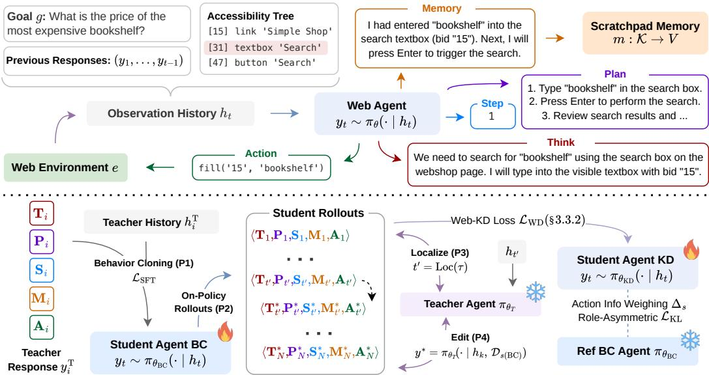
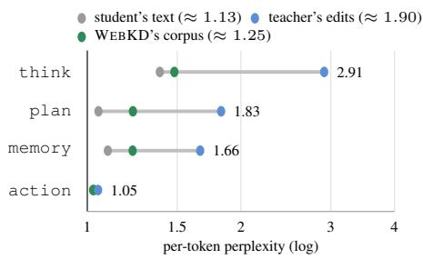
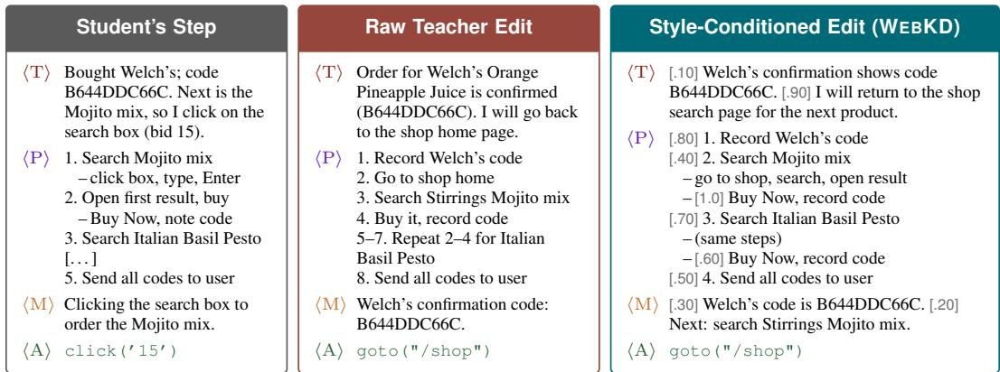
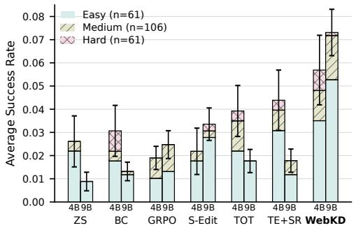
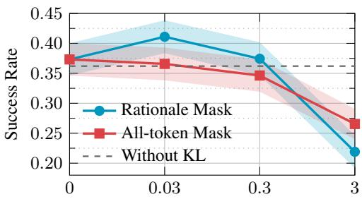
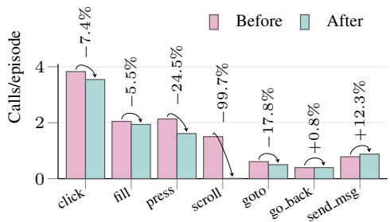
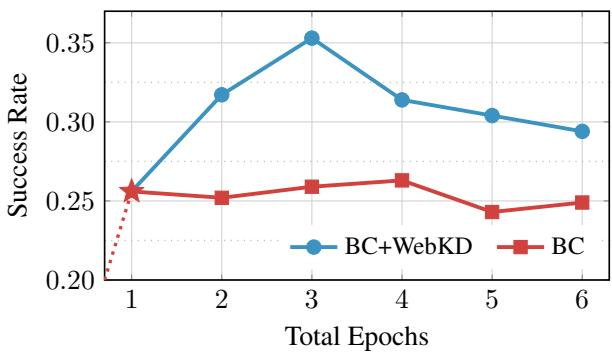
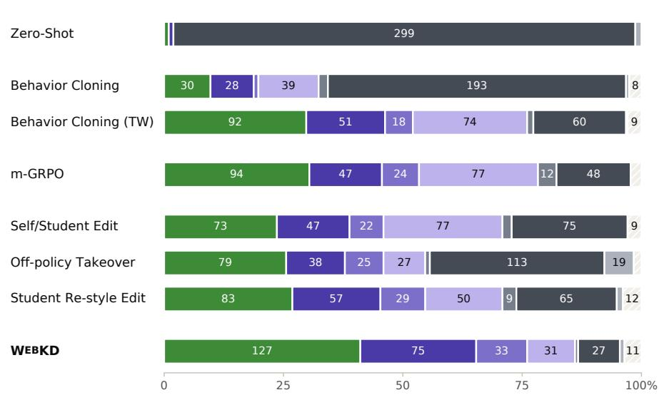
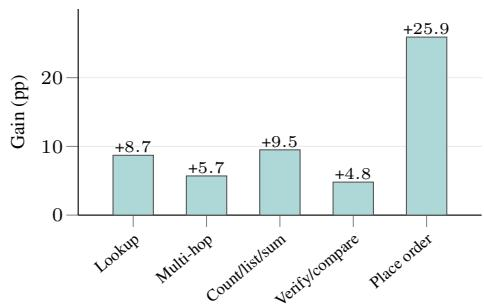

# TEACHING AGENTS IN THEIR OWN STYLE: BLACK-BOX TEACHER DISTILLATION FOR WEB AGENTS

Md Farhan Ishmam and Kenneth Marino Kahlert School of Computing, University of Utah {farhan.ishmam,kenneth.marino}@utah.edu

https://web-teach-kd.github.io/

## ABSTRACT

Frontier web agents using closed models have high inference and computational costs. Smaller open models can be an alternative, but to be performant, they require training supervision from a human or teacher model. Token-level teacher distillation is not an option for closed teachers as it needs access to the model’s logits. The standard approach is to imitate teacher demonstrations offline, but it trains the student on states it has never visited, and in a style it does not write in. We introduce WEBKD, where the teacher is the editor of the student’s failures. Given a failed episode, the teacher finds the first point of mistake, and rewrites the student’s reasoning traces, harness states, and actions from that point onward. The editing reveals that the teacher’s corrections can be more surprising to the student than the student’s own text. WEBKD instead aims to edit minimally. In the data space, the teacher writes each correction in the student’s style. In the objective space, the reasoning is weighted by its contribution to the action. A roleasymmetric KL anchor allows the corrected action to move freely while keeping the reasoning near the student’s prior. On the TimeWarp benchmark, WEBKD students gain about 5.5-10.7pp over behavior cloning, outcome-reward RL, and teacher editing baselines. The performance transfers to unseen versions and to the live web in the OnlineMind2Web benchmark. WEBKD opens a new way of distilling black-box models to improve the capabilities of open-weight web agents.

## 1 INTRODUCTION

Agents built on the largest proprietary large language models (LLMs) now perform remarkably well on web tasks (Song et al., 2025; Xue et al., 2025). Such a task hands the agent a goal and a browser, and asks it to navigate complex, changing interfaces, plan across tens of steps, and carry intermediate findings through to a final answer. Deploying these agents for everyday use is another matter. Frontier models have high latency because they are large reasoning models. The computational cost makes them less viable as agents that run in the background of daily work. Robotics faced a similar problem, which led to compact Vision-Language-Action (VLA) models distilled for real-time control (Zitkovich et al., 2023; Kim et al., 2025). Web agents also need a small and cheap open-weight model that runs at interactive latency but carries the competence closer to its frontier teacher.

This raises the main challenge we address in this paper: how do we effectively transfer the competence of the black-box, teacher model to the small, more efficient model? Web tasks can be long-horizon over partially observed pages, and the agent must plan explicitly while reasoning in natural language (Xue et al., 2025). The harness truncates the history to recent observations due to the limited context. So the agent also keeps a scratchpad memory, and what it writes there, together with its earlier responses, is the only state that persists across steps (de Chezelles et al., 2025) (§3.1).

Secondly, the outcome reward is a single value per episode, far too sparse to shape multiple structured decisions with reinforcement learning (RL) (Shao et al., 2024; Wei et al., 2025). Teacher supervision is denser, but the strongest teachers are black boxes that expose no internals or logits. Every distillation method that consumes the teacher’s next-token distribution, e.g., token-level knowledge distillation (KD), reverse Kullback–Leibler (KL) objectives, and on-policy distillation (Gu et al., 2024; Agarwal et al., 2024; Lu & Thinking Machines Lab, 2025), is therefore unavail able. What a frontier teacher can emit is text. Our research asks how much of a black-box frontier teacher’s competence can be distilled into a small web agent through text alone.

The standard approach is behavior cloning, which involves sampling teacher demonstrations and fine-tuning the student on them offline (Kim & Rush, 2016). For web agents, this is known to help substantially (He et al., 2025; Ishmam & Marino, 2026), and it is where our pipeline begins. But behavior cloning creates two new problems. It trains the student only at states the teacher visits, so at deployment, small errors carry the student into states its supervision never covered, and the errors compound over the horizon (Ross et al., 2011). Secondly, it trains the student on the teacher’s surface distribution, unintentionally importing a writing style that the small model cannot comfortably produce. Is offline imitation really the most a teacher has to offer?

The classical answer to this is DAgger (Ross et al., 2011), where the expert relabels the states the learner visits. However, DAgger corrects only the actions while a web agent’s generation is a structured response (Fig. 1). With truncated history, the non-action parts of that response form the belief state that guides later decisions. Fixing the click while leaving the reasoning that led to it unchanged, therefore fixes the immediate mistake but not its source. Conversely, on-policy expert correction (Lauffer et al., 2026) gives control to the teacher from the point of failure and lets it finish the episode. So the completed suffix is the teacher’s trajectory, which is off-policy in state and style.

An alternative is to use the teacher as an editor of the student’s own failures. The teacher reads a failed episode, localizes the earliest erroneous step, and rewrites the student’s full structured re sponse, reasoning, and harness traces included, from that step to the end. Each rewrite is a singlestep teacher rollout on a state the student actually visited, so the supervision is on-policy. However, it is not on-policy in style. A frontier teacher’s corrections are surprising to the student, which are at several times the perplexity of the student’s own steps. This gap is especially large in the reasoning components, where perplexity can increase by up to an order of magnitude, while the action itself remains much closer to the student’s distribution.

Under uniform fine-tuning, the loss is largest where the supervision is most foreign, which is the teacher’s wording rather than its decisions. WEBKD attacks this perplexity premium by editing the rationale minimally. In data space, the teacher writes each correction in the student’s own style from in-context exemplars of the student’s writing. In objective space, each reasoning span is weighted by how much it raises the student’s probability of the corrected action. A role-asymmetric anchor allows the corrected action to move freely while keeping the reasoning close to the student’s prior. The student adopts the teacher’s decisions in full, while being closer to its own writing style.

Our contributions are as follows:

• Problem. We formulate distillation from a black-box frontier teacher into a small web agent by using teacher-edits and identify a key obstacle, the on-policy perplexity premium (Defn. 1). The premium is the excess surprisal of the student on the teacher supervision, and it concentrates on the reasoning components rather than the action (Fig 2).

• Method. We introduce WEBKD, a new distillation method that uses the teacher to edit the student’s failures without the teacher’s logits (Fig.1). The teacher localizes the first erroneous step and rewrites the subsequent reasoning traces, scratchpad memory, and actions in the student’s style instead of imitating teacher-style traces (§3.3). The student then trains under a novel objective function that weights each reasoning span by how much it informs the action (§3.3.1) and anchors the reasoning to the student’s prior (§3.3.2).

• Evidence. On the TimeWarp benchmark, WEBKD lifts the performance of students by 5.5 − 10.7 pp across behavior cloning, outcome-reward RL, and teacher editing baselines using Qwen and Gemma models (Tab. 1). The gains translate to unseen TimeWarp versions, and the live web benchmark, OnlineMind2Web (Fig. 4). Our ablations vary the source of the edits and styles, training objectives, and hyperparameters (Tables 2, 3, Fig. 5).

## 2 RELATED WORK

## 2.1 WEB AGENTS

Web agents, LLM-driven agents that operate a browser on a user’s behalf (Deng et al., 2023), are a subcategory of computer-use agents, which perceive rendered user interfaces and act through UIlevel commands (Xie et al., 2024). The benchmark ecosystem spans curated demonstrations (Deng et al., 2023), sandboxed sites (Zhou et al., 2024), live websites (He et al., 2024), and unified harnesses (de Chezelles et al., 2025). TimeWarp (Ishmam & Marino, 2026) additionally varies the era of the interface and tests robustness to temporal UI change. On these suites, proprietary frontier LLMs reach strong success rates, but their cost and latency make them impractical as always-on daily drivers. That gap motivates the small open-weight students this paper targets.

  
Figure 1: Overview of WEBKD. (Top) At step t, the harness generates the observation history from the goal, accessibility tree, and previous responses. The web agent emits a five-component response conditioned on the observation history. The Think, Plan, and Step components carry their reasoning and running plan, the Memory component reads from and writes to the scratchpad memory, and only the Action component is executed in the web environment, which returns the next observation. (Bottom) The student is behavior-cloned on the teacher’s rollouts (P1) and then generates rollouts from the training tasks (P2). The teacher localizes each failure at t′ (P3) and rewrites the faulty trajectory suffix in the student’s style (P4). The resulting corpus D trains the student under action informativeness weighing, and KL anchored objective of §3.3.1–§3.3.2.

Training pipelines for such students span imitation and RL. WebRL (Qi et al., 2025), WebAgent-R1 (Wei et al., 2025), and DigiRL (Bai et al., 2024) train with outcome-reward RL and inherit its sparse signal, while OpenWebVoyager (He et al., 2025) and TimeWarp (Ishmam & Marino, 2026) fine-tune on teacher demonstrations, the recipe we start from. We differ in what happens after imitation. The teacher corrects the student’s own failures instead of supplying more demonstrations or rewards. Closest to us is WebCoT (Hu et al., 2025), which also distills reconstructed chain-ofthought rationales. However, the teacher rewrites stored records with template heuristics against observations simulated in the style of WebDreamer (Gu et al., 2025), and it does not localize the first fatal step before rewriting. WEBKD edits actual failures against the observations the student saw from the localized step in the student’s own style, using both the data and training objective.

## 2.2 KNOWLEDGE DISTILLATION

Knowledge distillation transfers a teacher’s behavior to a smaller student (Hinton et al., 2015), classically by matching token-level distributions or by fine-tuning on teacher generations at the se quence level (Kim & Rush, 2016). For LLMs, the white-box distillation methods sharpen this line of work with reverse-KL objectives (Gu et al., 2024), on-policy distillation that scores studentsampled prefixes under the teacher (Agarwal et al., 2024; Lu & Thinking Machines Lab, 2025), and skew-divergence stabilizations (Ko et al., 2024). All of them consume the teacher’s next-token distribution over a shared vocabulary. Black-box agents do not expose these, which forces distillation through text only. This introduces the notion of a perplexity premium (§3.2), which has previously been observed with LLM distillation (Ren et al., 2024) and is one of our paper’s main focuses.

A second lineage imitates the expert at the learner’s own states. DAgger (Ross et al., 2011) showed that relabeling learner-visited states turns quadratic compounding error into linear error, and LLMera variants revive the recipe through turn-level policy interpolation (Li et al., 2026a), mid-trajectory expert takeover (Lauffer et al., 2026), and iterated fine-tuning on privileged feedback (Choudhury & Sodhi, 2025). We keep the state-distribution insight but change the label. Our teacher rewrites the full structured response offline instead of relabeling actions online. A third line removes the external teacher. Rejection fine-tuning keeps self-generated successes (Zelikman et al., 2022; Yuan et al., 2023), and on-policy self-distillation conditions the same model on privileged information such as a gold solution (Zhao et al., 2026), consensus (Li et al., 2026c), or rich feedback (Hubotter¨ et al., 2026), with agentic variants that target failure-relevant spans (Yeo et al., 2026; Li et al., 2026b). Self-distillation presupposes the competence the model already has, which a 4B student on realistic web tasks typically lacks (Tab. 1). So we keep an external frontier teacher and hold its supervision close to the student’s own states and style.

## 3 METHODOLOGY

## 3.1 BACKGROUND

Web tasks as POMDP. A web task is specified by a natural-language goal $g$ on an interactive browser environment e (Zhou et al., 2024; de Chezelles et al., 2025). Performing a web task is naturally formalized as a finite-horizon partially observable Markov decision process (POMDP) (Kaelbling et al., 1998) $\langle S , \mathcal { A } , \mathcal { O } , \mathbb { T } , \mathbb { T } _ { 0 } , \overset { \cdot } { \mathbb { O } } , R \rangle$ , with a step budget of $T$ actions per episode. The underlying browser state $s _ { t } \in S$ contains the full document object model (DOM), session, and site state, and is never observed directly. The initial state is drawn as $s _ { 0 } \sim \mathbb { T } _ { 0 }$ . The agent receives the rendering $o _ { t } = \mathbb { O } ( s _ { t } ) \in \mathcal { O }$ , in the form of HTML or an AXTree. An LLM policy $\pi _ { \theta }$ generates a structured response $y _ { t } \sim \pi _ { \theta } ( \cdot \ | \ h _ { t } )$ autoregressively, conditioned on the observation history $h _ { t } .$ The browser-level action $a _ { t } \in \mathcal { A } , e . g . \operatorname { c l i c k } \ ( \mathit { \Omega } ^ { \prime } 6 3 ^ { \prime } \ )$ ), is deterministically parsed from $y _ { t }$ and executed, producing $o _ { t + 1 }$ through the effectively deterministic transition $\mathbb { T } .$ The reward is sparse and terminal: $\bar { R \in \ \{ 0 , 1 \} }$ , assigned once at the end of the episode. The task goal $g$ is rendered into every observation, so the full interaction history is $\left( o _ { 1 : t } , \ y _ { 1 : t - 1 } \right)$ . Carrying several high-dimensional observations (a single AXTree runs to thousands of tokens) overflows the context window, so the history is truncated to the most recent observation together with the full response history, $h _ { t } = \left( o _ { t } , y _ { 1 : t - 1 } \right)$

Web harness. Between the policy and the browser sits the harness, the interface that turns the raw POMDP into an agentic loop. A harness also maintains its internal state across steps, namely the response history $y _ { 1 : t - 1 }$ , which carries the scratchpad memory $s _ { m }$ as the sequence of memory components emitted so far (§A.4). At step t, the harness (i) generates the observation history $h _ { t } , ( \mathrm { i i } )$ obtains the structured response yt $\sim \pi _ { \theta } ( \cdot \mid h _ { t } )$ , (iii) parses the action $f _ { \mathrm { p a r s e } } ( y _ { t } )$ , and (iv) executes the action to advance the environment $s _ { t + 1 } = \mathbb { T } ( s _ { t } , a _ { t } )$ and $o _ { t + 1 } = \mathbb { O } ( s _ { t + 1 } )$

Agent response. The harness enforces a five-component response, $y _ { t } = \langle y _ { t } ^ { \mathrm { t h i n k } } , y _ { t } ^ { \mathrm { p 1 a n } } , y _ { t } ^ { \mathrm { s t e p } }$ $y _ { t } ^ { \mathsf { m e m o r y } } , \ \hat { y } _ { t } ^ { \mathsf { a c t i o n } } \rangle = \langle \mathrm { T } , \mathrm { P } , \mathrm { S } , \mathrm { M } , \mathrm { A } \rangle$ , generated sequentially (Fig 1) (de Chezelles et al., 2025). think tokens constitute the free-form reasoning grounded in the current observation, plan tokens form the running, numbered multi-step plan, re-emitted and revised at every step, the step token(s) is a single integer naming the current plan step, memory tokens are the agent’s interface to the scratchpad memory $s _ { m } \ ( \ S \mathbf { A } . 4 )$ , and $\tt a c t i o n$ tokens form one executable browser command. Only the $\tt a c t i o n$ tokens $( y _ { t } ^ { \mathsf { a c t i o n } } = a _ { t } )$ interact with the environment. Every other component acts on the harness state alone and enters future contexts as part of the observation history $h _ { t }$

We provide additional preliminary discussion on behavior cloning (§A.1), knowledge distillation (§A.2), and the black-box constraint (§A.3) in the appendix.

## 3.2 PERPLEXITY PREMIUM

Teacher edits are high-perplexity text for the student. The perplexity of a response y under a policy π with context $x ,$

$$
\begin{array} { r } { \mathrm { P P L } _ { \pi } ( y \mid x ) ~ = ~ \mathrm { e x p } \Big ( - \frac { 1 } { | y | } \sum _ { i } \log \pi ( y _ { i } \mid x , y _ { < i } ) \Big ) , } \end{array}\tag{1}
$$

measures how natural the text is to that policy. 1 means the policy would have emitted it with certainty, and each unit of log-perplexity is a nat of average per-token surprise. The relative quantity that matters for training is the premium the student pays on its supervision.

Definition 1 (On-policy perplexity premium). For a step with student response y and supervision target $y ^ { * }$ at the same observation history $h ,$ the premium is the excess per-token surprisal, under the behavior-cloned student $\pi _ { \theta _ { B C } } ( \ S A . I )$ , ofthe supervision relative to the student’s own text:

$$
\Pi ( y ^ { * } , y ) = \frac { 1 } { \left| y ^ { * } \right| } \sum _ { i } - \log \pi _ { \theta _ { B C } } ( y _ { i } ^ { * } \mid h , y _ { < i } ^ { * } ) - \frac { 1 } { \left| y \right| } \sum _ { i } - \log \pi _ { \theta _ { B C } } ( y _ { i } \mid h , y _ { < i } ) .\tag{2}
$$

This premium is one of the obstacles to distilling a frontier teacher through text. As shown in Fig. 2, the teacher edits are high-perplexity for the student, while WEBKD’s corpus stays close to the student’s own continuations. Per-token cross-entropy is the surprisal inside Eq. 1, and under uniform SFT, the loss is largest on the tokens most foreign to the student. On raw teacher edits, those are mostly the rationale tokens. The action tokens that fix the failure carry only a few percent of the loss. The surprising spans mix the teacher’s style with its content and reasoning. What it shows is where uniform SFT spends its loss, which motivates the objective of Eq.5. Any method that trains on teacher edits must address

  
Figure 2: The perplexity premium by response components against the student’s continuations, the teacher’s raw corrections, and the WEBKD’s corpus with in-context edits.

the premium. Our method attacks it from both sides. In data space, before training, the correction is written in the student’s own style (P4 of §3). In objective space, during training, the learning signal is concentrated on the tokens that inform the action (§3.3.1), and the rationale is anchored to the student’s own prior, which damps the premium the student absorbs and caps it per token once $\beta$ exceeds the threshold of Corollary 1 (§3.3.2).

## 3.3 WEB KNOWLEDGE DISTILLATION (WEBKD)

The core of WEBKD is to correct the student’s decisions at the states it visited, rewriting only the steps from the failure onward. How can the student policy be improved while minimizing the student’s surprisal to teacher edits? WEBKD starts from a student agent fine-tuned to replicate the teacher (P1). We then collect rollouts from the fine-tuned student agent and keep its failures (P2). The edit itself is a two-stage teacher intervention: where did the student $f a i l ? \left( \mathbf { P 3 } \right)$ , and how should the teacher correct $i t ? \left( \mathbf { P 4 } \right)$ . The corpus of corrected trajectories trains the student under a premiumaware objective: action-informative token weighting (§3.3.1) and a role-asymmetric anchor to the student’s prior (§3.3.2). Figure 1 gives an overview, and Algorithm 1 states the full method. We characterize in closed form the per-token target of the WEBKD objective (Proposition 2) and bound the student’s failure rate by the teacher’s localization and correction errors plus the student’s own disagreement with the corrected process (Theorem 1).

P1: Behavior cloning on teacher rollouts. WEBKD first replicates the teacher rollouts on the training tasks via behavior cloning at the sequence level. For the teacher $\pi _ { \boldsymbol { \theta _ { \mathrm { T } } } }$ acting as the agent under the same harness, the base model $\pi _ { \theta _ { 0 } }$ is fine-tuned on the teacher demonstration trajectories $\mathcal { D } _ { \mathrm { T } } = \{ \tau _ { n } \} _ { n = 1 } ^ { N } \mathrm { . }$ , where each $\tau _ { n } = ( h _ { 1 } , y _ { 1 } , \dots , h _ { T } , y _ { T } )$ is a closed-loop teacher rollout, $y _ { i } \sim \pi _ { \theta _ { \mathrm { T } } } ( \cdot \ |$ $h _ { i } )$ , kept only if its terminal reward is $R ( \tau _ { n } ) = 1$ . Training uses the uniform BC objective $\mathcal { L } _ { \mathrm { B C } }$ of Eq. 6 to produce $\pi _ { \theta _ { \mathrm { B C } } }$ , which is then frozen and reused in the following phases.

P2: Student on-policy rollout. We collect on-policy rollouts from the behavior-cloned student on the training tasks. Each rollout is generated by the agentic loop of §3.1, every response drawn from the student’s own policy at a context the student itself reached, $\begin{array} { r } { y _ { t } \mathrm { ~ \tiny ~ \sim ~ } \pi _ { \theta _ { \mathrm { B C } } } ( \cdot \mid h _ { t } ) } \end{array}$ and we write $\tau \sim \pi _ { \theta _ { \mathrm { B C } } }$ for the induced trajectory distribution. $\mathcal { D } _ { \mathrm { B C } }$ collects these rollouts. The failed trajectories $\mathcal { D } _ { f ( \mathrm { B C } ) } = \{ \tau \in \mathcal { D } _ { \mathrm { B C } } : R ( \check { \tau } ) < \check { 1 } \}$ } become the substrate for editing, and the solved episodes are kept as a style pool $\mathcal { D } _ { s ( \mathrm { B C } ) } = \{ \tau \in \mathcal { D } _ { \mathrm { B C } } : R ( \tau ) = 1 \}$ , mined for in-context exemplars in P4. Every observation in $\mathcal { D } _ { f \left( \mathrm { B C } \right) }$ has been visited by the student, which places the teacher’s supervision of the following phases within the student’s own state distribution.

  
Figure 3: Edits for the same student step. The raw teacher edit replaces the student’s action but rewrites the plan in its own style. The style-conditioned edit keeps the student’s nested plan format. Values in brackets give the span weight $v _ { s } .$ . ⟨T⟩: think, ⟨P⟩: plan, ⟨M⟩: memory, $\langle \mathbf { A } \rangle$ : action.

P3: Failure localization. For each failed trajectory, the teacher first localizes the error to prevent editing the correct steps. We establish that web trajectories carry enough structure for the “point of failure” to be a well-defined property of the trajectory (§B.2). The teacher call is an estimator of $t ^ { \star }$ , reads the full trajectory $\tau \in \mathcal { D } _ { f \left( \mathrm { B C } \right) }$ and returns an index, $t ^ { \prime } = \operatorname { L o c } ( \tau ) \in \{ 1 , . . . , T \}$ , the earliest step whose action sets the trajectory on the path to failure. Localization splits the trajectory into a replayed prefix $\tau _ { p } = ( h _ { 1 } , y _ { 1 } , \dots , h _ { t ^ { \prime } - 1 } , y _ { t ^ { \prime } - 1 } )$ ), which is kept verbatim, and a faulty suffix $\tau _ { s } = ( h _ { t ^ { \prime } } , y _ { t ^ { \prime } } , \dots , h _ { T } , y _ { T } )$ , which will be rewritten.

P4: Teacher editing in the student’s style. After localization, the teacher corrects the structured response of every step in the faulty suffix. Each correction is conditioned on the observation the student saw at that step, re-rendered by replaying the student’s original actions in the deterministic container, so the teacher sees exactly what the student saw. The correction query also carries the student’s response style in context. The corpus targets are

$$
y _ { k } ^ { * } = y _ { k } \quad \forall k < t ^ { \prime } ( \mathrm { r e p l a y } ) , \qquad y _ { k } ^ { * } \sim \pi _ { \theta _ { T } } \bigl ( \cdot \mid h _ { k } , \mathcal { D } _ { s ( \mathrm { B C } ) } \bigr ) \quad \forall k \ge t ^ { \prime } ( \mathrm { e d i t } ) ,\tag{3}
$$

where each edit is a 1-step rollout of the teacher policy at the student’s context. πT is conditioned on the observation history $h _ { k }$ the student saw (the same rendered goal, AXTree, and response history) and on in-context exemplars from the student’s style pool $\mathcal { D } _ { s ( \mathrm { B C } ) }$ , one independent call per step. The edited structured response $y _ { k } ^ { * }$ comprises the edited tokens $\langle \dot { \mathrm { T } } ^ { * } , \dot { \mathrm { P } } ^ { * } , \mathrm { S } ^ { * } , \mathrm { M } ^ { * } , \mathrm { A } ^ { * } \rangle$ (Details in §B.3).

## 3.3.1 ACTION-INFORMATIVE TOKEN WEIGHTING

P4 first lowers the premium in data space by having the teacher write in the student’s style. It cannot lower it to zero without giving up the correction. Some premium must be paid, and Fig. 2 shows that on raw teacher edits, it falls almost entirely on the rationale components. The question for the objective is therefore which rationale tokens are worth their premium.

We ask, which tokens carry the learning signal? A rationale span is worth its premium to the extent that it changes the action, so Eq.4 ranks the spans of each step by their measured effect on the student’s probability of the corrected action. Second, how $f a r$ the policy may move? Eq.5 adds a role-asymmetric anchor that damps how far the rationale moves toward the teacher’s phrasing while the action follows the teacher in full. Together, the objective pays the premium mainly where it buys the action. We weigh each rationale span by how much it contributes to the decision that follows.

Let s be a non-action segment, a sentence or clause of the edited rationale $\langle \mathrm { T } ^ { * } , \mathrm { P } ^ { * } , \mathrm { M } ^ { * } \rangle$ . Its leaveone-out contribution to the teacher’s corrected action, measured under the student is

$$
\Delta _ { s } = \log P _ { \pi _ { \theta _ { \mathrm { B C } } } } ( a ^ { * } \mid h , y _ { < a } ^ { * } ) - \log P _ { \pi _ { \theta _ { \mathrm { B C } } } } ( a ^ { * } \mid h , y _ { < a } ^ { * } \setminus s ) , \quad s \subset \langle \mathrm { T } ^ { * } , \mathrm { P } ^ { * } , \mathrm { M } ^ { * } \rangle ,\tag{4}
$$

where $a ^ { * } = \langle \mathrm { A } ^ { * } \rangle$ denotes the teacher-edited action tokens, h is the observation history, $y _ { < a } ^ { * } =$ $\langle \mathrm { T } ^ { * } , \mathrm { P } ^ { * } , \mathrm { S } ^ { * } , \dot { \mathrm { M } ^ { * } } \rangle$ is the part of the edited response that precedes the action, so both terms are teacherforced log-probabilities of the action tokens, and $\scriptstyle y _ { < a } ^ { * } \ \backslash \ s$ is that prefix with segment s deleted. As $\Delta _ { s }$ is the student’s own credit assignment over the teacher’s rationale, it needs no teacher logits and

Table 1: Success rate (%) on the TimeWarp test split, in domain on v6 and on the five held-out versions v1–v5. Results are averaged over three runs with the standard error as the subscript.
<table><tr><td>Model</td><td>Baseline</td><td>v1</td><td>v2</td><td> $\mathbf { v } 3$ </td><td>v4</td><td>v5</td><td>v6 (seen)</td></tr><tr><td></td><td>Teacher (GPT-5.5)</td><td> $7 1 . 8 _ { \pm 4 . 4 3 }$ </td><td> $7 1 . 8 _ { \pm 4 . 4 3 }$ </td><td> $6 8 . 0 { \scriptstyle \pm 4 . 6 0 }$ </td><td> $6 8 . 0 { \scriptstyle \pm 4 . 6 0 }$ </td><td> $6 9 . 9 _ { \pm 4 . 5 2 }$ </td><td> $7 0 . 9 { \scriptstyle \pm 4 . 5 8 }$ </td></tr><tr><td rowspan="8">Qwen 3.5 4B</td><td>Zero-Shot</td><td> $1 . 0 { \scriptstyle \pm 0 . 5 7 }$ </td><td> $1 . 0 { \scriptstyle \pm 0 . 5 7 }$ </td><td> $0 . 3 { \scriptstyle \pm 0 . 3 1 }$ </td><td> $1 . 6 { \scriptstyle \pm 0 . 7 1 }$ </td><td> $0 . 0 { \scriptstyle \pm 0 . 0 0 }$ </td><td> $1 . 0 { \scriptstyle \pm 0 . 5 7 }$ </td></tr><tr><td>Behavior Cloning</td><td> $1 0 . 7 _ { \pm 1 . 7 6 }$ </td><td> $9 . 4 _ { \pm 1 . 6 6 }$ </td><td> $9 . 7 _ { \pm 1 . 6 8 }$ </td><td> $1 0 . 7 _ { \pm 1 . 7 6 }$ </td><td> $5 . 2 _ { \pm 1 . 2 6 }$ </td><td> $9 . 7 _ { \pm 1 . 6 8 }$ </td></tr><tr><td>Behavior Cloning (TW)</td><td> $2 7 . 5 { \scriptstyle \pm 2 . 5 4 }$ </td><td> $2 8 . 5 { \scriptstyle \pm 2 . 5 7 }$ </td><td> $2 7 . 8 { \scriptstyle \pm 2 . 5 5 }$ </td><td> $2 6 . 2 { \scriptstyle \pm 2 . 5 0 }$ </td><td> $2 8 . 2 { \scriptstyle \pm 2 . 5 6 }$ </td><td> $2 9 . 8 { \scriptstyle \pm 2 . 6 0 }$ </td></tr><tr><td>m-GRPO</td><td> $3 0 . 1 { \scriptstyle \pm 2 . 6 2 }$ </td><td> $2 7 . 2 { \scriptstyle \pm 2 . 5 4 }$ </td><td> $2 6 . 2 _ { \pm 2 . 5 0 }$ </td><td> $2 8 . 2 { \scriptstyle \pm 2 . 5 6 }$ </td><td> $3 0 . 1 { \scriptstyle \pm 2 . 6 1 }$ </td><td> $3 0 . 4 { \scriptstyle \pm 2 . 6 2 }$ </td></tr><tr><td>Self/Student Edit</td><td> $2 5 . 2 _ { \pm 2 . 4 7 }$ </td><td> $1 9 . 4 _ { \pm 2 . 2 5 }$ </td><td> $2 7 . 2 _ { \pm 2 . 5 3 }$ </td><td> $2 4 . 3 _ { \pm 2 . 5 6 }$ </td><td> $2 3 . 3 _ { \pm 2 . 6 1 }$ </td><td> $2 3 . 6 _ { \pm 2 . 6 2 }$ </td></tr><tr><td>Off-policy Takeover</td><td> $2 4 . 4 { \scriptstyle \pm 2 . 4 5 }$ </td><td> $2 4 . 3 { \scriptstyle \pm 2 . 4 4 }$ </td><td> $2 5 . 2 _ { \pm 2 . 4 8 }$ </td><td> $2 3 . 3 { \scriptstyle \pm 2 . 4 1 }$ </td><td> $2 7 . 2 { \scriptstyle \pm 2 . 5 4 }$ </td><td> $2 5 . 6 { \scriptstyle \pm 2 . 4 9 }$ </td></tr><tr><td>Student Re-style Edit</td><td> $2 8 . 8 { \scriptstyle \pm 2 . 5 8 }$ </td><td> $2 3 . 6 _ { \pm 2 . 4 2 }$ </td><td> $2 3 . 7 _ { \pm 2 . 4 3 }$ </td><td> $2 6 . 5 { \scriptstyle \pm 2 . 5 2 }$ </td><td> $2 8 . 3 { \scriptstyle \pm 2 . 5 7 }$ </td><td> $2 6 . 9 { \scriptstyle \pm 2 . 5 3 }$ </td></tr><tr><td>WEBKD</td><td> $\mathbf { 3 7 . 9 _ { \pm 2 . 7 7 } }$ </td><td> ${ \bf 3 6 . 3 _ { \pm 2 . 7 3 } }$  </td><td> ${ \bf 3 5 . 3 _ { \pm 2 . 7 2 } }$ </td><td> ${ \bf 3 8 . 8 _ { \pm 2 . 7 7 } }$ </td><td> ${ \bf 3 6 . 9 _ { \pm 2 . 7 4 } }$ </td><td> ${ \bf 4 1 . 1 _ { \pm 2 . 8 0 } }$ </td></tr><tr><td rowspan="8">Qwen 3.5 9B</td><td>Zero-Shot</td><td> $0 . 0 { \scriptstyle \pm 0 . 0 0 }$ </td><td> $0 . 3 _ { \pm 0 . 3 1 }$ </td><td> $1 . 6 _ { \pm 0 . 7 1 }$ </td><td> $1 . 3 _ { \pm 0 . 6 5 }$ </td><td> $0 . 0 { \scriptstyle \pm 0 . 0 0 }$ </td><td> $0 . 6 _ { \pm 0 . 4 4 }$ </td></tr><tr><td>Behavior Cloning</td><td> $1 2 . 3 { \scriptstyle \pm 1 . 8 7 }$ </td><td></td><td></td><td> $1 1 . 7 _ { \pm 1 . 8 2 }$ </td><td></td><td></td></tr><tr><td>Behavior Cloning (TW)</td><td> $2 5 . 9 _ { \pm 2 . 4 9 }$ </td><td> $1 0 . 0 { \scriptstyle \pm 1 . 7 1 }$   $2 4 . 3 _ { \pm 2 . 4 4 }$ </td><td> $6 . 8 { \scriptstyle \pm 1 . 4 3 }$   $2 2 . 0 _ { \pm 2 . 3 6 }$ </td><td> $2 5 . 2 _ { \pm 2 . 4 7 }$ </td><td> $4 . 9 { \scriptstyle \pm 1 . 2 3 }$   $2 6 . 2 _ { \pm 2 . 5 0 }$ </td><td> $1 2 . 3 { \scriptstyle \pm 1 . 8 7 }$   $2 5 . 2 _ { \pm 2 . 4 7 }$ </td></tr><tr><td>m-GRPO</td><td> $2 6 . 9 { \scriptstyle \pm 2 . 5 2 }$ </td><td> $2 7 . 8 { \scriptstyle \pm 2 . 5 4 }$ </td><td> $2 8 . 8 { \scriptstyle \pm 2 . 5 8 }$ </td><td> $3 1 . 1 { \scriptstyle \pm 2 . 6 2 }$ </td><td> $3 1 . 4 { \scriptstyle \pm 2 . 6 5 }$ </td><td> $2 6 . 5 { \scriptstyle \pm 2 . 5 1 }$ </td></tr><tr><td>Self/Student Edit</td><td> $2 2 . 3 { \scriptstyle \pm 2 . 3 7 }$ </td><td> $2 3 . 2 _ { \pm 2 . 4 0 }$ </td><td> $2 2 . 7 _ { \pm 2 . 3 8 }$ </td><td> $2 5 . 7 _ { \pm 2 . 4 9 }$ </td><td></td><td></td></tr><tr><td>Off-policy Takeover</td><td> $2 8 . 4 _ { \pm 2 . 5 7 }$ </td><td> $2 5 . 4 _ { \pm 2 . 4 8 }$ </td><td> $2 9 . 4 _ { \pm 2 . 5 9 }$ </td><td> $3 0 . 1 _ { \pm 2 . 6 1 }$ </td><td> $2 2 . 7 _ { \pm 2 . 3 8 }$   $2 7 . 3 _ { \pm 2 . 5 3 }$ </td><td> $2 3 . 0 { \scriptstyle \pm 2 . 3 9 }$   $2 5 . 0 _ { \pm 2 . 4 6 }$ </td></tr><tr><td>Student Re-style Edit</td><td> $1 7 . 3 { \scriptstyle \pm 2 . 1 5 }$ </td><td> $1 9 . 5 { \scriptstyle \pm 2 . 2 5 }$ </td><td> $1 8 . 7 _ { \pm 2 . 2 2 }$ </td><td> $1 4 . 4 { \scriptstyle \pm 2 . 0 0 }$ </td><td> $1 6 . 4 { \scriptstyle \pm 2 . 1 0 }$ </td><td> $2 0 . 2 { \scriptstyle \pm 2 . 2 8 }$ </td></tr><tr><td>WEBKD</td><td> $\mathbf { 3 4 . 6 _ { \pm 2 . 7 1 } }$  </td><td> ${ \bf 3 2 . 3 _ { \pm 2 . 6 6 } }$  </td><td> $3 2 . 4 { \scriptstyle \pm 2 . 6 6 }$  </td><td> $\mathbf { 3 4 . 5 } _ { \pm 2 . 7 0 }$ </td><td> $\mathbf { 3 4 . 9 } _ { \pm 2 . 7 1 }$ </td><td> $\mathbf { 3 4 . 6 _ { \pm 2 . 7 1 } }$ </td></tr><tr><td rowspan="8">Gemma 4 E4B</td><td>Zero-Shot</td><td> $1 . 9 { \scriptstyle \pm 0 . 7 8 }$ </td><td></td><td></td><td></td><td></td><td></td></tr><tr><td>Behavior Cloning</td><td></td><td> $7 . 8 { \scriptstyle \pm 1 . 5 3 }$ </td><td> $7 . 8 { \scriptstyle \pm 1 . 5 3 }$ </td><td> $1 . 9 { \scriptstyle \pm 0 . 7 7 }$ </td><td> $3 . 9 { \scriptstyle \pm 1 . 1 0 }$ </td><td> $2 . 6 _ { \pm 0 . 9 0 }$ </td></tr><tr><td>Behavior Cloning (TW)</td><td> $1 7 . 5 _ { \pm 2 . 1 6 }$ </td><td> $1 6 . 5 _ { \pm 2 . 1 1 }$ </td><td> $1 8 . 4 _ { \pm 2 . 2 0 }$ </td><td> $1 5 . 5 { \scriptstyle \pm 2 . 0 6 }$ </td><td> $1 6 . 5 _ { \pm 2 . 1 1 }$ </td><td> $1 9 . 4 _ { \pm 2 . 2 5 }$ </td></tr><tr><td>m-GRPO</td><td> $2 8 . 2 { \scriptstyle \pm 2 . 5 6 }$ </td><td> $2 8 . 2 { \scriptstyle \pm 2 . 5 6 }$ </td><td> $3 2 . 0 { \scriptstyle \pm 2 . 6 5 }$ </td><td> $3 0 . 1 { \scriptstyle \pm 2 . 6 1 }$ </td><td> $2 8 . 8 { \scriptstyle \pm 2 . 5 8 }$ </td><td> $2 9 . 4 { \scriptstyle \pm 2 . 5 8 }$ </td></tr><tr><td>Self/Student Edit</td><td> $1 6 . 5 _ { \pm 2 . 1 1 }$ </td><td> $1 4 . 6 _ { \pm 2 . 0 1 }$ </td><td> $1 7 . 5 _ { \pm 2 . 1 6 }$ </td><td> $1 8 . 4 _ { \pm 2 . 2 0 }$ </td><td> $1 4 . 6 _ { \pm 2 . 0 1 }$ </td><td> $2 0 . 7 _ { \pm 2 . 3 0 }$ </td></tr><tr><td>Off-policy Takeover</td><td> $2 2 . 3 { \scriptstyle \pm 2 . 3 7 }$   $2 9 . 8 { \scriptstyle \pm 2 . 6 0 }$ </td><td> $2 4 . 3 { \scriptstyle \pm 2 . 4 4 }$   $2 8 . 2 { \scriptstyle \pm 2 . 5 6 }$ </td><td> $2 1 . 4 { \scriptstyle \pm 2 . 3 3 }$   $2 9 . 1 { \scriptstyle \pm 2 . 5 8 }$ </td><td> $2 2 . 3 { \scriptstyle \pm 2 . 3 7 }$   $3 0 . 1 { \scriptstyle \pm 2 . 6 1 }$ </td><td> $2 1 . 7 _ { \pm 2 . 3 4 }$ </td><td> $2 3 . 0 { \scriptstyle \pm 2 . 3 9 }$ </td></tr><tr><td>Student  $\mathrm { R e - s t y l e }$  Edit</td><td> $2 0 . 4 _ { \pm 2 . 2 9 }$ </td><td> $2 5 . 2 _ { \pm 2 . 4 7 }$ </td><td> $2 3 . 3 _ { \pm 2 . 4 0 }$ </td><td> $2 4 . 3 _ { \pm 2 . 4 5 }$ </td><td> $3 3 . 0 { \scriptstyle \pm 2 . 6 6 }$   $2 3 . 3 _ { \pm 2 . 4 0 }$ </td><td> $3 4 . 3 { \scriptstyle \pm 2 . 7 0 }$   $2 8 . 2 _ { \pm 2 . 5 6 }$ </td></tr><tr><td>WEBKD</td><td> $\mathbf { 3 7 . 2 } _ { \pm 2 . 7 5 }$  </td><td> $\mathbf { 3 4 . 0 { \scriptstyle \pm 2 . 6 9 } }$  </td><td> $\mathbf { 3 7 . 9 } _ { \pm 2 . 7 6 }$  </td><td> $\mathbf { 3 6 . 6 _ { \pm 2 . 7 4 } }$  一</td><td> ${ \bf 3 8 . 8 _ { \pm 2 . 7 7 } }$ </td><td> ${ \bf 3 9 . 8 { \scriptstyle \pm 2 . 7 8 } }$ </td></tr></table>

is computable in the black-box setting. Perplexity says how foreign a span is to the student. $\Delta _ { s }$ says how much the span raises the student’s probability of the corrected action, and two spans can be equally foreign while differing in this. The weighting in §B.4 ranks the spans of a step by $\Delta _ { s } ,$ , so, outside the dead zone of Eq. 10 and when these spans are unique, the span that moves the action the most keeps full weight, and the span that moves it the least drops to the floor. Hence, the premium is paid mainly where it changes the decision rather than where it only changes the wording or style. Details on the action informativeness mapped to the WEBKD loss have been provided in §B.4.

## 3.3.2 ROLE-ASYMMETRIC ANCHORING AND THE WEBKD OBJECTIVE

The weighting decides which spans contribute to the action, but does not bound the magnitude of their contribution. A decisive span in $\left. \mathrm { T ^ { * } } \right.$ keeps full weight, and fitting it under the weighed SFT objective asks the student to fully absorb that span’s influence. As this could cause SFT to move the policy further than intended, we add a KL penalty (Hinton et al., 2015) toward $\pi _ { \mathrm { r e f } } \equiv \pi _ { \theta _ { \mathrm { B C } } }$ , the frozen checkpoint of each run. The KL acts on the rationale tokens ⟨T, P, M⟩ only, i.e., it pulls these tokens toward the student’s prior and leaves the non-rationale $\langle \mathrm { A } , \mathrm { S } \rangle$ tokens free to drift. With $\beta \geq 0$ the anchor strength and $\gamma _ { i } \in [ 0 , 1 ]$ a per-token role mask, the WEBKD objective is

$$
{ \mathcal { L } } _ { \mathrm { W D } } = \underbrace { { \frac { \sum _ { i \in T } w _ { i } \mathrm { C E } _ { i } } { \sum _ { i \in T } w _ { i } } } } _ { { \mathcal { L } } _ { \mathrm { S w } } } + \beta \cdot \underbrace { { \frac { \sum _ { i \in T } \gamma _ { i } \mathrm { k l } _ { i } } { \sum _ { i \in T } \gamma _ { i } } } } _ { { \mathcal { L } } _ { \mathrm { K L } } }\tag{5}
$$

where $d _ { i } : = \log \pi _ { \mathrm { r e f } } - \log \pi _ { \theta } ( y _ { i } ^ { * } )$ , kli $: = e ^ { d _ { i } } - d _ { i } - 1$ , and $\pi _ { \theta _ { \mathrm { W D } } }$ is the student produced. We note that γ is role-asymmetric. $\gamma _ { i } = 1$ on the ⟨T, P, M⟩ tokens and $\gamma _ { i } \approx 0$ on $\langle \mathrm { A } , \mathrm { S } \rangle$ , so the student is free to adopt the teacher’s corrected decisions while being held near its prior on deliberation. Normalizing by $\textstyle \sum _ { i } \gamma _ { i }$ makes β a penalty per anchored token, comparable across masks that cover different numbers of tokens. Because $\mathrm { k l } _ { i }$ is evaluated on corpus tokens rather than on samples from $\pi _ { \theta } ,$ it is a pointwise anchor penalty on the target sequence. Details on the intuition of update in §E.

  
KL coefficient (β)  
Figure 4: Success rate on Online-Mind2Web for the Qwen-3.5 4B and 9B students. The contributions are stacked across easy, medium, and hard categories.  
Figure 5: Success rate of Qwen-3.5 4B on Time-Warp v6 as a function of the anchor strength β with ${ \mathcal { L } } _ { \mathrm { W D } }$ , anchoring the rationale tokens or all tokens. The dashed line is without KL.

## 4 EXPERIMENTS

We organize our experiments around four research questions: RQ1 (performance). Does WE-BKD’s teacher edit distillation outperform behavior cloning, outcome-reward RL, or other methods of teacher edit? RQ2 (transfer). Do the gains survive interface versions never seen in training, and the live web? RQ3 (edit-style). Who should edit the student’s decisions and in whose style? RQ4 (objective). Which tokens should the loss emphasize, and how should the policy be anchored?

## 4.1 EXPERIMENTAL SETUP

We describe our setup concisely here and include additional details in the Appendix (§C).

Models, Harness, Baselines. We compare latest open-weight models: Qwen-3.5 4B and 9B (Team, 2026), and Gemma 4 E4B (Team et al., 2026), in BrowserGym with the AgentLab harness (de Chezelles et al., 2025). We evaluate (a) zero-shot, (b) vanilla behavior cloning on actions, and the TimeWarp approach on the full response (Ishmam & Marino, 2026), (c) outcome-based RL baseline using multi-turn Group Relative Policy Optimization (m-GRPO) (Wei et al., 2025), and (d) black-box distillation baselines on student self-editing, off-policy takeover with the teacher completing the trajectory, the teacher prompting the student to restyle the edits, and (e) our method, WEBKD. The average results of three seeds are reported with the standard error.

Benchmarks. We evaluate on: (a) TimeWarp (TW) (Ishmam & Marino, 2026), a containerized web benchmark with websites from different eras of the internet, and (b) OnlineMind2Web (OM2W) (Xue et al., 2025), a live web benchmark with realistic tasks using real user workflows.

## 4.2 RESULTS

WEBKD outperforms every baseline on the seen distribution (RQ1). WEBKD improves over the strongest baseline by 10.7pp for Qwen 3.5 4B, 8.1pp for Qwen 3.5 9B, and 5.5pp for Gemma 4 E4B, on the seen TimeWarp version v6 (Tab. 1). Zero-shot students are near 0% on every version, so the task is out of reach without training. Behavior cloning is competitive only when non-action tokens are included in the loss (BC-TW). No single alternative is reliably second best. m-GRPO is the strongest baseline on both Qwen models, but falls on Gemma. The other teachertext baselines show the opposite pattern. Off-policy takeover is the strongest baseline on Gemma (34.3%), but every teacher baseline trail m-GRPO on either the Qwen models.

The gains hold on unseen versions and transfer to the live web (RQ2). On the unseen versions v1–v5, WEBKD beats the strongest baseline by 3.0–10.6pp. Version shift itself costs little once a student is trained, and the seen–unseen gap stays below 5pp. WebKD’s gains hold on the live web, where Online-Mind2Web’s numbers are low for all methods (below 8%, Fig. 4). WEBKD is the only method that clearly separates from the rest, roughly doubling the strongest baseline for the 9B student. The gains are mostly concentrated on the easy tasks, which have a shorter horizon.

Table 2: Edit–style ablation. Teacher edits paired with incontext student style perform best. Qwen-3.5 4B baselines are trained using ${ \mathcal { L } } _ { \mathrm { W D } } .$ , KL rationale anchor at $\beta = 0 . 0 3$  
Table 3: Loss ablation. Token weightings on the filtered teacher rollouts, each with and without the KL rationale anchor at $\beta = 0 . 0 3$ using the Qwen-3.5 4B model.
<table><tr><td>ES</td><td>SS</td><td>Variant</td><td>S.R. ↑</td></tr><tr><td>T</td><td>T</td><td>Teacher takeover (off-policy)</td><td> $1 7 . 4 8 { \scriptstyle \pm 2 . 1 6 }$ </td></tr><tr><td>T</td><td>T</td><td>Teacher edit + teacher style</td><td> $3 3 . 0 1 { \scriptstyle \pm 2 . 6 8 }$ </td></tr><tr><td>T</td><td> $\mathbf { S } _ { \mathrm { i c } }$ </td><td>Teacher edit + student style (in-context)</td><td> $\mathbf { 4 1 . 1 0 { \scriptstyle \pm 2 . 8 0 } }$ </td></tr><tr><td>T</td><td> $\mathbf { S } _ { \mathrm { i n f } }$ </td><td>Teacher edit + student re-style (2-pass)</td><td> $2 5 . 8 9 _ { \pm 2 . 4 9 }$ </td></tr><tr><td>S/T</td><td>S/T</td><td>Student proposes, teacher judges/fixes</td><td> $2 7 . 8 3 { \scriptstyle \pm 2 . 5 5 }$ </td></tr><tr><td>S</td><td>S</td><td>Student-only edit</td><td> $2 4 . 2 7 _ { \pm 2 . 4 4 }$ </td></tr></table>

ES: Edit Source; SS: Style Source. T = Teacher, S = Student.

<table><tr><td>Loss</td><td> $\mathbf { w } / \mathbf { K L }$ </td><td>w/o KL</td></tr><tr><td> $\mathcal { L } _ { \mathrm { C E } }$ </td><td> $3 7 . 4 3 { \scriptstyle \pm 2 . 7 5 }$ </td><td> $3 6 . 2 5 { \scriptstyle \pm 2 . 7 3 }$ </td></tr><tr><td> ${ \mathcal { L } } _ { \mathrm { W D } }$  </td><td> $\mathbf { 4 1 . 1 0 { \scriptstyle \pm 2 . 8 0 } }$  </td><td> $\mathbf { 3 8 . 5 1 _ { \pm 2 . 7 7 } }$ </td></tr><tr><td> ${ \mathcal { L } } _ { \mathrm { G N D } }$ </td><td> $3 5 . 9 2 _ { \pm 2 . 7 3 }$ </td><td> $3 6 . 0 3 { \scriptstyle \pm 2 . 7 3 }$ </td></tr><tr><td> $\mathcal { L } _ { \mathrm { C O N S } }$ </td><td> $3 7 . 5 4 { \scriptstyle \pm 2 . 7 5 }$ </td><td> $3 5 . 8 1 { \scriptstyle \pm 2 . 7 3 }$ </td></tr><tr><td> ${ \mathcal { L } } _ { \mathrm { P P L } }$ </td><td> $3 7 . 5 4 { \scriptstyle \pm 2 . 7 5 }$ </td><td> $3 3 . 0 1 { \scriptstyle \pm 2 . 6 8 }$ </td></tr></table>

The teacher should edit in the student’s style, but minimally (RQ3). Following Tab. 2, offpolicy takeover underperforms as it drifts too far from the states the student has visited. Edits or suggestions written by the student are worse still, which we can attribute to the student lacking a reliable sense of its own correctness. Asking the student to restyle the teacher’s edit on a second pass can also undermine the rationale. This is most evident on Qwen 3.5 9B, where the student re-style edit is a weaker baseline (Tab.1). Although vanilla teacher editing works, its outputs deviate more from the student’s style and carry a larger perplexity premium (Fig.2). In-context student re-styling, as used by WEBKD, stays closer to the student distribution and outperforms it by 8.1pp.

Loss should emphasize action informativeness, and anchor the rationale(RQ4). Tab. 3 compares token weightings of the loss, with and without the KL anchor on the rationale. ${ \mathcal { L } } _ { \mathrm { W D } }$ with the kl anchor (Eq.5) outperforms the other token-weighting schemes (§C.2) by 3.6pp. Sweeping the anchor strength shows that $\beta = 0 . 0 3$ gives the highest success with rationale masking (Fig. 5).

Discussion. Behavior cloning for more epochs doesn’t simply improve performance like WE-BKD (§D.1). Teacher capability matters. With the same prompts, states, and style exemplars, using Claude Opus 5 or Qwen-3.8 27B as the editor trains students to 33.3% and 26.9%, versus 41.1% with GPT-5.5. As Qwen-3.8 is a smaller, less-performant model, the distilled student’s performance is worse. Why can’t students self-improve? On average, self/student edit falls below BC (TW) on every backbone (Tab. 1). This is consistent with the findings on RQ3, i.e., without an external signal, the student cannot reliably tell which of its own decisions were wrong. How does WEBKD affect the behavior of the stu-

  
Figure 6: Change in action distribution before and after teacher distillation using WE-BKDfor the Qwen-3.5 4B baseline.

dent? It mostly prunes redundant actions, e.g, scrolling nearly disappears (−99.7%) and key presses drop by 24.5% (Fig. 6). send msg rises by 12.3%, indicating higher task completion rate. Where do the gains come from? Our analysis reveals WEBKD’s strongest gains come from verifying the steps and answer +14.6pp and exiting loops +9.4pp. Detailed failure analysis (§D.2), and analysis of the improvements against behavior cloning (§D.3) have been provided in the Appendix.

## 5 CONCLUSION

Small, open-weight web agents are key to making web use automation widespread and accessible. Frontier agents have become highly capable, and distilling them into smaller models is a natural next step. Yet closed frontier models expose only their generated text, which rules out logit-based distillation. WEBKD addresses this by turning the teacher into an editor of the student’s failures. It rewrites failed episodes in the student’s own style and trains on them, using an objective that weights tokens based on action informativeness and a role-asymmetric KL anchor. Although WE-BKD produced strong gains, the student still reaches only about half of the teacher’s success rate, leaving substantial room for improvement. We hope this work spurs further research on black-box distillation and helps narrow the gap between closed frontier models and small open-weight agents.

## REFERENCES

Rishabh Agarwal, Nino Vieillard, Yongchao Zhou, Piotr Stanczyk, Sabela Ramos Garea, Matthieu Geist, and Olivier Bachem. On-policy distillation of language models: Learning from selfgenerated mistakes. In The Twelfth International Conference on Learning Representations, 2024.

Hao Bai, Yifei Zhou, Mert Cemri, Jiayi Pan, Alane Suhr, Sergey Levine, and Aviral Kumar. DigiRL: Training in-the-wild device-control agents with autonomous reinforcement learning. In Advances in Neural Information Processing Systems, volume 37, 2024.

Sanjiban Choudhury and Paloma Sodhi. Better than your teacher: LLM agents that learn from privileged AI feedback. In The Thirteenth International Conference on Learning Representations, 2025. URL https://openreview.net/forum?id=st7XqFgbAH.

Thibault Le Sellier de Chezelles, Maxime Gasse, Alexandre Drouin, Massimo Caccia, Leo Boisvert,´ Megh Thakkar, Tom Marty, Rim Assouel, Sahar Omidi Shayegan, Lawrence Keunho Jang, et al. The BrowserGym ecosystem for web agent research. Transactions on Machine Learning Research, 2025.

Xiang Deng, Yu Gu, Boyuan Zheng, Shijie Chen, Samuel Stevens, Boshi Wang, Huan Sun, and Yu Su. Mind2web: Towards a generalist agent for the web. In Thirty-seventh Conference on Neural Information Processing Systems Datasets and Benchmarks Track, 2023. URL https: //openreview.net/forum?id=kiYqbO3wqw.

Yu Gu, Kai Zhang, Yuting Ning, Boyuan Zheng, Boyu Gou, Tianci Xue, Cheng Chang, Sanjari Srivastava, Yanan Xie, Peng Qi, Huan Sun, and Yu Su. Is your LLM secretly a world model of the internet? model-based planning for web agents. Transactions on Machine Learning Research, 2025. ISSN 2835-8856. URL https://openreview.net/forum?id=c6l7yA0HSq.

Yuxian Gu, Li Dong, Furu Wei, and Minlie Huang. MiniLLM: Knowledge distillation of large language models. In The Twelfth International Conference on Learning Representations, 2024. URL https://openreview.net/forum?id=5h0qf7IBZZ.

Hongliang He, Wenlin Yao, Kaixin Ma, Wenhao Yu, Yong Dai, Hongming Zhang, Zhenzhong Lan, and Dong Yu. WebVoyager: Building an end-to-end web agent with large multimodal models. In Proceedings of the 62nd Annual Meeting of the Association for Computational Linguistics, 2024.

Hongliang He, Wenlin Yao, Kaixin Ma, Wenhao Yu, Hongming Zhang, Tianqing Fang, Zhenzhong Lan, and Dong Yu. OpenWebVoyager: Building multimodal web agents via iterative real-world exploration, feedback and optimization. In Wanxiang Che, Joyce Nabende, Ekaterina Shutova, and Mohammad Taher Pilehvar (eds.), Proceedings ofthe 63rd Annual Meeting ofthe Association for Computational Linguistics (Volume 1: Long Papers), pp. 27545–27564, Vienna, Austria, July 2025. Association for Computational Linguistics. ISBN 979-8-89176-251-0. doi: 10.18653/v1/ 2025.acl-long.1336. URL https://aclanthology.org/2025.acl-long.1336/.

Geoffrey Hinton, Oriol Vinyals, and Jeff Dean. Distilling the knowledge in a neural network. arXiv preprint arXiv:1503.02531, 2015.

Minda Hu, Tianqing Fang, Jianshu Zhang, Jun-Yu Ma, Zhisong Zhang, Jingyan Zhou, Hongming Zhang, Haitao Mi, Dong Yu, and Irwin King. WebCoT: Enhancing web agent reasoning by reconstructing chain-of-thought in reflection, branching, and rollback. In Findings of the Association for Computational Linguistics: EMNLP 2025, 2025.

Jonas Hubotter, Frederike L¨ ubeck, Lejs Deen Behric, Anton Baumann, Marco Bagatella, Daniel¨ Marta, Ido Hakimi, Idan Shenfeld, Thomas Kleine Buening, Carlos Guestrin, and Andreas Krause. Reinforcement learning via self-distillation. In Forty-third International Conference on Machine Learning, 2026. URL https://openreview.net/forum?id=QkfkxyRizZ.

Md Farhan Ishmam and Kenneth Marino. TimeWarp: Evaluating web agents by revisiting the past. In Fortieth Conference on Neural Information Processing Systems Evaluations and Datasets Track, 2026. URL https://arxiv.org/abs/2603.04949. To appear.

Leslie Pack Kaelbling, Michael L Littman, and Anthony R Cassandra. Planning and acting in partially observable stochastic domains. Artificial Intelligence, 101(1-2):99–134, 1998.

Moo Jin Kim, Karl Pertsch, Siddharth Karamcheti, Ted Xiao, Ashwin Balakrishna, Suraj Nair, Rafael Rafailov, Ethan P Foster, Pannag R Sanketi, Quan Vuong, Thomas Kollar, Benjamin Burchfiel, Russ Tedrake, Dorsa Sadigh, Sergey Levine, Percy Liang, and Chelsea Finn. Openvla: An open-source vision-language-action model. In Pulkit Agrawal, Oliver Kroemer, and Wolfram Burgard (eds.), Proceedings of The 8th Conference on Robot Learning, volume 270 of Proceedings of Machine Learning Research, pp. 2679–2713. PMLR, 06–09 Nov 2025. URL https://proceedings.mlr.press/v270/kim25c.html.

Yoon Kim and Alexander M Rush. Sequence-level knowledge distillation. In Proceedings of the 2016 Conference on Empirical Methods in Natural Language Processing, pp. 1317–1327, 2016.

Jongwoo Ko, Sungnyun Kim, Tianyi Chen, and Se-Young Yun. DistiLLM: Towards streamlined distillation for large language models. In Proceedings of the 41st International Conference on Machine Learning, 2024.

Niklas Lauffer, Xiang Deng, Srivatsa R Kundurthy, Brad Kenstler, and Jeff Da. Imitation learning for multi-turn LM agents via on-policy expert corrections. In Forty-third International Conference on Machine Learning, 2026. URL https://openreview.net/forum?id=l0LA4SUA50.

Changhao Li, Rushi Qiang, Jiawei Huang, Chenxiao Gao, Chao Zhang, Niao He, and Bo Dai. Revisiting DAgger in the era of LLM-agents. arXiv preprint arXiv:2605.12913, 2026a.

Xiaozhe Li, Tianyi Lyu, Yang Li, Yichuan Ma, Peiji Li, Linyang Li, Qipeng Guo, Dahua Lin, and Kai Chen. What and when to distill: Selective hindsight distillation for multi-turn agents. arXiv preprint arXiv:2605.19447, 2026b.

Yijiang Li, Bingyang Wang, Yijun Liang, Yunjie Tian, Di Fu, and Nuno Vasconcelos. On-policy self-distillation without any supervision. arXiv preprint arXiv:2608.06296, 2026c.

Kevin Lu and Thinking Machines Lab. On-policy distillation. Thinking Machines Lab: Connectionism, 2025. https://thinkingmachines.ai/blog/on-policy-distillation.

Long Ouyang, Jeffrey Wu, Xu Jiang, Diogo Almeida, Carroll Wainwright, Pamela Mishkin, Chong Zhang, Sandhini Agarwal, Katarina Slama, Alex Ray, et al. Training language models to follow instructions with human feedback. In Advances in Neural Information Processing Systems, volume 35, pp. 27730–27744, 2022.

Zehan Qi, Xiao Liu, Iat Long Iong, Hanyu Lai, Xueqiao Sun, et al. WebRL: Training LLM web agents via self-evolving online curriculum reinforcement learning. In The Thirteenth International Conference on Learning Representations, 2025.

Xuan Ren, Biao Wu, and Lingqiao Liu. I learn better if you speak my language: Understanding the superior performance of fine-tuning large language models with LLM-generated responses. In Yaser Al-Onaizan, Mohit Bansal, and Yun-Nung Chen (eds.), Proceedings ofthe 2024 Conference on Empirical Methods in Natural Language Processing, pp. 10225–10245, Miami, Florida, USA, November 2024. Association for Computational Linguistics. doi: 10.18653/v1/2024.emnlp-main. 571. URL https://aclanthology.org/2024.emnlp-main.571/.

Stephane Ross and Drew Bagnell. Efficient reductions for imitation learning. In ´ Proceedings of the Thirteenth International Conference on Artificial Intelligence and Statistics (AISTATS), pp. 661–668, 2010.

Stephane Ross, Geoffrey J Gordon, and J Andrew Bagnell. A reduction of imitation learning and´ structured prediction to no-regret online learning. In Proceedings of the Fourteenth International Conference on Artificial Intelligence and Statistics (AISTATS), pp. 627–635, 2011.

John Schulman. Approximating KL divergence, 2020. http://joschu.net/blog/ kl-approx.html.

Zhihong Shao, Peiyi Wang, Qihao Zhu, Runxin Xu, Junxiao Song, Xiao Bi, Haowei Zhang, Mingchuan Zhang, YK Li, Y Wu, et al. DeepseekMath: Pushing the limits of mathematical reasoning in open language models. arXiv preprint arXiv:2402.03300, 2024.

Yixiao Song, Katherine Thai, Chau Minh Pham, Yapei Chang, Mazin Nadaf, and Mohit Iyyer. BEARCUBS: A benchmark for computer-using web agents. In Second Conference on Language Modeling, 2025. URL https://openreview.net/forum?id=0JzWiigkUy.

Gemma Team, Sherif El Abd, Vaibhav Aggarwal, Robin Algayres, Alek Andreev, Olivier Bachem, Ian Ballantyne, Cormac Brick, Victor Carbune, Michelle Casbon, et al. Gemma 4 technical report.˘ arXiv preprint arXiv:2607.02770, 2026.

Qwen Team. Qwen3.5: Towards native multimodal agents, February 2026. URL https://qwen. ai/blog?id=qwen3.5.

Zhepei Wei, Wenlin Yao, Yao Liu, Weizhi Zhang, Qin Lu, Liang Qiu, Changlong Yu, Puyang Xu, Chao Zhang, Bing Yin, Hyokun Yun, and Lihong Li. WebAgent-r1: Training web agents via endto-end multi-turn reinforcement learning. In Christos Christodoulopoulos, Tanmoy Chakraborty, Carolyn Rose, and Violet Peng (eds.), Proceedings of the 2025 Conference on Empirical Methods in Natural Language Processing, pp. 7909–7928, Suzhou, China, November 2025. Association for Computational Linguistics. ISBN 979-8-89176-332-6. doi: 10.18653/v1/2025.emnlp-main. 401. URL https://aclanthology.org/2025.emnlp-main.401/.

Tianbao Xie, Danyang Zhang, Jixuan Chen, Xiaochuan Li, Siheng Zhao, Ruisheng Cao, Toh Jing Hua, Zhoujun Cheng, Dongchan Shin, Fangyu Lei, Yitao Liu, Yiheng Xu, Shuyan Zhou, Silvio Savarese, Caiming Xiong, Victor Zhong, and Tao Yu. OSWorld: Benchmarking multimodal agents for open-ended tasks in real computer environments. In The Thirty-eight Conference on Neural Information Processing Systems Datasets and Benchmarks Track, 2024. URL https: //openreview.net/forum?id=tN61DTr4Ed.

Tianci Xue, Weijian Qi, Tianneng Shi, Chan Hee Song, Boyu Gou, Dawn Song, Huan Sun, and Yu Su. An illusion of progress? Assessing the current state of web agents. In Conference on Language Modeling (COLM), 2025.

Jianwei Yang, Hao Zhang, Feng Li, Xueyan Zou, Chunyuan Li, and Jianfeng Gao. Setof-mark prompting unleashes extraordinary visual grounding in GPT-4V. arXiv preprint arXiv:2310.11441, 2023.

Woongyeng Yeo, Yumin Choi, Taekyung Ki, and Sung Ju Hwang. HinT-SD: Targeted hindsight self-distillation for long-horizon agents. arXiv preprint arXiv:2605.17873, 2026.

Zheng Yuan, Hongyi Yuan, Chengpeng Li, Guanting Dong, Keming Lu, Chuanqi Tan, Chang Zhou, and Jingren Zhou. Scaling relationship on learning mathematical reasoning with large language models. arXiv preprint arXiv:2308.01825, 2023.

Eric Zelikman, Yuhuai Wu, Jesse Mu, and Noah D Goodman. STaR: Bootstrapping reasoning with reasoning. In Advances in Neural Information Processing Systems, volume 35, 2022.

Siyan Zhao, Zhihui Xie, Mengchen Liu, Jing Huang, Guan Pang, Feiyu Chen, and Aditya Grover. Self-distilled reasoner: On-policy self-distillation for large language models. In ICLR 2026 Workshop on Lifelong Agents: Learning, Aligning, Evolving, 2026. URL https://openreview. net/forum?id=31wkVZXEaJ.

Lianmin Zheng, Wei-Lin Chiang, Ying Sheng, Siyuan Zhuang, Zhanghao Wu, Yonghao Zhuang, Zi Lin, Zhuohan Li, Dacheng Li, Eric Xing, et al. Judging LLM-as-a-judge with MT-Bench and chatbot arena. In Advances in Neural Information Processing Systems, volume 36, 2023.

Shuyan Zhou, Frank F Xu, Hao Zhu, Xuhui Zhou, Robert Lo, Abishek Sridhar, Xianyi Cheng, Tianyue Ou, Yonatan Bisk, Daniel Fried, Uri Alon, and Graham Neubig. WebArena: A realistic web environment for building autonomous agents. In The Twelfth International Conference on Learning Representations, 2024.

Brianna Zitkovich, Tianhe Yu, Sichun Xu, Peng Xu, Ted Xiao, Fei Xia, Jialin Wu, Paul Wohlhart, Stefan Welker, Ayzaan Wahid, Quan Vuong, Vincent Vanhoucke, Huong Tran, Radu Soricut, Anikait Singh, Jaspiar Singh, Pierre Sermanet, Pannag R. Sanketi, Grecia Salazar, Michael S. Ryoo, Krista Reymann, Kanishka Rao, Karl Pertsch, Igor Mordatch, Henryk Michalewski, Yao

Lu, Sergey Levine, Lisa Lee, Tsang-Wei Edward Lee, Isabel Leal, Yuheng Kuang, Dmitry Kalash nikov, Ryan Julian, Nikhil J. Joshi, Alex Irpan, Brian Ichter, Jasmine Hsu, Alexander Herzog, Karol Hausman, Keerthana Gopalakrishnan, Chuyuan Fu, Pete Florence, Chelsea Finn, Kumar Avinava Dubey, Danny Driess, Tianli Ding, Krzysztof Marcin Choromanski, Xi Chen, Yevgen Chebotar, Justice Carbajal, Noah Brown, Anthony Brohan, Montserrat Gonzalez Arenas, and Kehang Han. Rt-2: Vision-language-action models transfer web knowledge to robotic control. In Jie Tan, Marc Toussaint, and Kourosh Darvish (eds.), Proceedings ofThe 7th Conference on Robot Learning, volume 229 of Proceedings of Machine Learning Research, pp. 2165–2183. PMLR, 06–09 Nov 2023. URL https://proceedings.mlr.press/v229/zitkovich23a. html.

## A ADDITIONAL BACKGROUND DETAILS

## A.1 BEHAVIOR CLONING

Given a corpus D of (context, target) pairs, behavior cloning is performed via supervised fine-tuning, which minimizes the teacher-forced cross-entropy (Ouyang et al., 2022),

$$
{ \mathcal { L } } _ { \mathrm { B C } } ( \theta ) = - \mathbb { E } _ { ( x , y ) \sim \mathcal { D } } { \frac { 1 } { | y | } } \sum _ { i = 1 } ^ { | y | } \log \pi _ { \theta } { ( y _ { i } \mid x , y _ { < i } ) } .\tag{6}
$$

Behavior cloning is typically performed on the action tokens. However, the TimeWarp version (Ishmam & Marino, 2026) uses the full response, including the reasoning traces, and is the default type of behavior cloning in our experiments. We note that in Eq. 6, every target token carries the same weight $1 / | y |$ , whether it belongs to the executed action or to filler thinking tokens. The state distribution is the teacher’s, not the student’s. At deployment, the policy conditions on its own generations and observations, and errors compound, which is the classic distribution-shift argument of imitation learning, under which a per-step error rate ε can inflate to ${ \cal O } ( \varepsilon T ^ { 2 } )$ cost over a T-step horizon unless supervision is collected on the student’s own state distribution (Ross et al., 2011).

## A.2 KNOWLEDGE DISTILLATION

Distillation replaces gold targets with supervision from a stronger teacher (Hinton et al., 2015). For autoregressive models, the token-level form matches full next-token distributions along a sequence,

$$
{ \mathcal { L } } _ { \mathrm { K D } } ( \theta ) = \mathbb { E } _ { x } \mathbb { E } _ { y } \sum _ { i } D _ { \mathrm { K L } } \big ( p _ { T } ( \cdot \mid x , y _ { < i } ) \big \| \pi _ { \theta } ( \cdot \mid x , y _ { < i } ) \big ) ,\tag{7}
$$

where the choice of the sequence y (teacher-generated, gold, or student-generated) and of the divergence defines the family. Sequence-level KD (Kim & Rush, 2016) sidesteps the inner distributions entirely and applies Eq. 6 to teacher-generated text. On-policy distillation evaluates the divergence at prefixes the student samples, correcting the train–inference mismatch (Agarwal et al., 2024).

## A.3 BLACK-BOX CONSTRAINT

Every token-level instantiation of Eq. 7 needs two things from the teacher: its full next-token distribution $p _ { T } ( \cdot \mid \cdot \rangle )$ , and a shared tokenizer. The strongest available teachers for web agents are black-box models that usually provide neither. The distillation channel is therefore only textual: the teacher writes, and the student trains on the writing via Eq. 6. But text entangles two signals, (a) the teacher’s decisions (which element to click, what to answer) and (b) its surface distribution (style, phrasing, tone). Training a small student on off-policy frontier text imports both at once, and the student pays a significant perplexity premium on the teacher’s style (Fig. 2).

## A.4 SCRATCHPAD MEMORY

The scratchpad belongs to the harness state, not to the environment. It is the sequence of memory components $( y _ { 1 } ^ { \mathrm { m e m o r y } } , \dots , y _ { t - 1 } ^ { \mathrm { m e m o r y } } )$ the agent has emitted so far, carried inside the response history $y _ { 1 : t - 1 }$ that the harness places in every context $h _ { t }$ (§3.1). The agent interacts with it only through

the memory tokens. It writes by emitting ymemoryt and reads only what the harness surfaces back at later steps. Under truncated history, a fact from a page the agent has since left survives only if it was written into a rationale component, most durably into the scratchpad memory.

## A.5 EXTENDED PROBLEM FORMULATION

Details deferred from the Background’s POMDP formulation $\langle S , \mathcal { A } , O , \mathbb { T } , \mathbb { T } _ { 0 } , \mathbb { O } , R \rangle$ (Kaelbling et al., 1998).

Observation modalities. The observation function O : S → O may render the browser state as raw HTML, a set-of-marks screenshot (Yang et al., 2023), or an accessibility tree. We use the AX-Tree throughout, a textual serialization of the rendered page, annotated with the element identifiers the action space refers to.

Action space. A is a subset of BrowserGym’s browser-level action space (de Chezelles et al., 2025): page interactions (e.g. click, fill), navigation (e.g. goto), tab operations (e.g. tab focus), and user interaction (send msg to user, which is also how the agent submits its answer). The generated action is deterministically parsed from the action component of the response and passed to the browser for execution. The transition $\mathbb { T } : \mathcal { S } \times \mathcal { A }  \mathcal { S }$ is treated as deterministic.

Initial states and episodes. $\mathbb { T } _ { 0 }$ draws the initial state uniformly over the benchmark’s tasks. An episode ends when the agent messages the user or exhausts its step budget, at which point the LLMjudge evaluator (Zheng et al., 2023) assigns the terminal $R \in \{ 0 , \bar { 1 } \}$ against the task specification.

Environment versions. The environment comes in multiple versions $\{ \mathcal { E } _ { 1 } , \ldots , \mathcal { E } _ { n } \}$ , the same sites captured at different points in time, each defining its own instance of the POMDP tuple. Training and evaluation fix one version, except when cross-version transfer is itself under test.

## B METHODOLOGY DETAILS

## B.1 TEACHER DETAILS

Teacher-as-agent. The teacher is prompted with the same rendered system and user prompt the student saw: identical goal, AXTree serialization, history format, and action-space description. This keeps the teacher’s output in-distribution as an SFT target rather than free-form advice, and makes the edit a drop-in replacement for the student’s own response. The teacher receives no privileged input in our method: no gold walkthrough, no hints.

Localization. The teacher makes one call per failed episode over the full logged trajectory. The instruction reads:

The agent’s trajectory above FAILED. Identify the FIRST   
erroneous step -- the earliest step whose action set the   
trajectory on the path to failure. Reply with ONLY the   
integer step index (0-based). Nothing else.

Section contract. Every edit query ends with a format contract requiring exactly the five tags <think>, <plan>, <step>, <memory>, <action>: think-aloud reasoning grounded only in what is visible in the observation, the running multi-step plan, a single integer in <step> naming the plan step the action belongs to, facts worth carrying forward in <memory>, and exactly one executable action. The contract exists because the student is trained and evaluated with the thinking, planning, and memory components enabled. A teacher that omits one of these components would silently teach the student to drop the field.

Style block. The K=3 exemplars are appended after the contract, at the very end of the query. The contract is the instruction whose loss is most expensive (a missing tag costs the whole step), so it must not be pushed out of the recency window, whereas a style hint that is only partly followed

Require: base model $\pi _ { \theta _ { 0 } }$ , black-box teacher $\pi _ { T }$ (text only), training tasks, exemplar count $K .$   
grounding threshold $\rho _ { \mathrm { m i n } } .$ weight floor $\phi ,$ dead zone $\tau _ { \mathrm { d z } } ,$ , anchor strength $\beta$   
Ensure: $\pi _ { \theta _ { \mathrm { W D } } }$   
1: P1 (seed): $\pi _ { \theta _ { \mathrm { B C } } } $ fine-tune $\pi _ { \theta _ { 0 } }$ on successful teacher rollouts $\mathcal { D } _ { \mathrm { T } }$ with $\mathcal { L } _ { \mathrm { B C } }$ (Eq. 6); freeze   
2: P2 (rollout): run $\pi _ { \theta _ { \mathrm { B C } } }$ on every training task; split episodes into failures $\mathcal { D } _ { f \left( \mathrm { B C } \right) }$ and style   
pool $\mathcal { D } _ { s ( \mathrm { B C } ) }$   
$3 \colon { \mathcal { D } } \gets \emptyset$   
4: for all $\tau = ( h _ { 1 } , y _ { 1 } , \dots , h _ { T } , y _ { T } ) \in \mathcal { D } _ { f ( \mathrm { B C } ) }$ do   
5: P3 (localize): $t ^ { \prime } \gets \mathrm { L o c } ( \tau )$ , the earliest erroneous step (estimate of $t ^ { \star } , \operatorname { E q } . 8 )$   
6: Replay: $\mathcal { D }  \mathcal { D } \cup \{ ( h _ { k } , \dot { y } _ { k } ) \}$ for $k = 1 , \ldots , t ^ { \prime } - 1$   
7: P4 (edit): $y _ { k } ^ { * } \sim \pi _ { T } ( \cdot \mid h _ { k } , \mathcal { D } _ { s ( \mathrm { B C } ) } )$ with $\dot { K }$ style exemplars, unexecuted $\left( \operatorname { E q } . 3 \right)$ , for   
$k = t ^ { \prime } , \ldots , T$   
8: Filter: $\mathcal { D }  \mathcal { D } \cup \{ ( h _ { k } , y _ { k } ^ { * } ) : \rho _ { k } \geq \rho _ { \operatorname* { m i n } } \}$   
9: end for   
10: Weights: for each edited $( h _ { k } , y _ { k } ^ { \ast } ) \in \mathcal { D } _ { \mathrm { ~ } }$ , score segments by $\Delta _ { s }$ under $\pi _ { \theta _ { \mathrm { B C } } }$ (Eq. 4), rank-map   
to $\bar { v _ { s } } \in [ \phi , 1 ]$ (Eq. 10), spread to token weights $w _ { i }$ (Eq. 12); pin $\langle { \mathrm { A } } \rangle , \langle { \mathrm { S } } \rangle$ tokens at $w _ { i } = 1 ;$   
replayed records keep uniform weights   
11: Mask: $\gamma _ { i } \gets 1$ on $\langle \overset { \bullet } { \mathrm { T } } \rangle , \langle \mathrm { P } \rangle , \langle \mathrm { M } \rangle$ tokens; $\gamma _ { i } \gets 1 0 ^ { - 6 }$ on $\langle \mathrm { A } \rangle , \langle \mathrm { S } \rangle$ tokens (Appendix B.6)   
12: Train: $\pi _ { \theta _ { \mathrm { W D } } }  \mathrm { a r g }$ minθ $\mathcal { L } _ { \mathrm { W D } } \left( \mathrm { E q . } 5 \right)$ over $\mathcal { D } ,$ initialized at $\pi _ { \theta _ { \mathrm { B C } } }$ with anchor $\pi _ { \mathrm { r e f } } = \pi _ { \theta _ { \mathrm { B C } } }$   
13: return $\pi _ { \theta _ { \mathrm { W D } } }$

Algorithm 1 WEBKD: black-box distillation through grounded teacher edits

still leaves a usable record. Exemplar selection is deterministic given the task. Solved episodes are preferred, the task being edited is excluded, and at most one exemplar is drawn per source task. Exemplars carry the rationale components and the step index but never <action>.

Correction prompt. The correction query is assembled as the student’s rendered context, then the section contract, then the style block. The style block opens with the following instruction:

[STYLE -- write this step in the student agent’s own style]   
The five sections you emit become training data for the   
agent whose steps appear above. Match ITS writing style:   
same register, same typical length, same amount of detail,   
the same way of phrasing a plan and of noting a memory.   
Below are verbatim examples of how THIS agent writes.   
Copy the STYLE only. Do NOT copy their content, their   
decisions, or their conclusions -- they are unrelated steps   
from other tasks. Your decision for this step must remain   
exactly the one you would have made without these examples;   
only the wording changes.

It is followed by the K exemplars, each delimited by how the student writes, example n and end example n. The correction call is made once per step $k \geq t ^ { \prime }$ , teacher-forced on the student’s original prefix.

## B.2 P3 FAILURE LOCALIZATION DETAILS

Definition 2 (Recoverability). For a trajectory $\tau ,$ let $\nu _ { t } \in \{ 0 , 1 \}$ indicate that, from the underlying browser state reached after the first t actions of τ , some action sequence within the remaining step budget $T - t$ ends with $R = 1$

Proposition 1 (Every failed web trajectory has a unique first fatal step). Assume the harness of§3.1: a finite step budget ${ \dot { T } } ,$ , deterministic transitions and parsing, a terminal binary reward, and a task solvable from its initial state $( \nu _ { 0 } = 1 )$ . Then along any failed trajectory $\nu _ { t }$ is non-increasing and equals 0 at the episode’s end, so

$$
t ^ { \star } = \displaystyle \operatorname* { m i n } \{ t \geq 1 : \nu _ { t } = 0 \}\tag{8}
$$

exists and is unique: every step before $t ^ { \star }$ leaves the task solvable, every step from $t ^ { \star }$ on leaves it unsolvable, and at step $t ^ { \star }$ a recoverability-preserving action existed but was not taken. (Proof and discussion in $\ S F . l . \}$

The two ways $t ^ { \prime }$ can miss $t ^ { \star }$ have very different costs. If the teacher localizes too early $( t ^ { \prime } < t ^ { \star } )$ it rewrites steps from which the task was still solvable. The state at $t ^ { \prime }$ is still recoverable, so the only cost is extra edits to the corpus. If it localizes too late $( t ^ { \prime } > t ^ { \star } )$ , the replayed prefix includes, and so endorses, the fatal steps, and by Proposition 1 no continuation from $h _ { t ^ { \prime } }$ can succeed. This asymmetry is why the localization prompt asks for the earliest erroneous step (§B.1), and it shows up again as the one-sided error $\varepsilon _ { \mathrm { l o c } }$ in the guarantee of §E.2.

Localization Accuracy. We sample 200 failed episodes from the rollout pools of the three students. Two human annotators, blind to the teacher’s prediction and to each other, independently mark the earliest step after which success within the remaining budget became impossible, following the same recoverability instruction given to the teacher. Under the strict budget reading, a step counts as unrecoverable only when the remaining budget is insufficient to complete the task. Here, the teacher is never late. It is early on 93% of episodes and exact on the remaining $7 \%$ . Under the loop-onset reading, the failure point is the step at which the agent enters a loop that it never escapes. Here the teacher is early on about two-thirds of episodes, exact on about a quarter, and late on roughly 10%. Under both readings, its errors fall mostly on the early side, which is the benign direction. The budget reading is the $t ^ { \star }$ of Proposition 1, so its late rate is the $\varepsilon _ { \mathrm { l o c } }$ of Theorem 1.

## B.3 P4 TEACHER EDIT DETAILS

(i) Style conditioning. The teacher’s query ends with a style block containing K=3 verbatim exemplars of the student’s own writing. The exemplars are mined from the style pool $\mathcal { D } _ { s ( \mathbf { B C } ) }$ , excluding the task being edited, and are selected deterministically per task, with at most one exemplar per source task. The block opens with an explicit instruction to match this agent’s register, typical length, and level of detail, and to copy only the style, keeping the decision “exactly the one you would have made without these examples, but only the wording changes” (Appendix B.1). Exemplars include the student’s rationale components but never its $\langle \mathrm { A } \rangle$ component: an action is a decision, and the style block should transfer the student’s style, not its decisions. This directly targets the perplexity premium of §3.2. Apart from the correction itself, the corrected trajectory should read as low-surprise text to the student.

(ii) Edits are never executed. The environment always steps on the student’s original action. An edit at step k therefore leaves the observation at step $k { \mathrm { + } } 1$ unchanged, corrections never compound, and every $h _ { k }$ in the corpus is a state the student actually reached. Each teacher call conditions on the student’s original prefix, never on an earlier edit. This mirrors the central idea of on-policy distillation, where the supervising distribution is evaluated on prefixes that the student itself produced (Agarwal et al., 2024; Zhao et al., 2026).

## B.4 WEBKD LOSS DETAILS

Remark 1 $( \Delta _ { s }$ as a conditional pointwise mutual information). Writing $c = ( h , y _ { < a } ^ { * } \setminus s )$ for the context with s deleted,

$$
\Delta _ { s } = \log \frac { P _ { \pi _ { \theta _ { B C } } } ( \langle \mathrm { A } ^ { * } \rangle \ : | \ : s , c ) } { P _ { \pi _ { \theta _ { B C } } } ( \langle \mathrm { A } ^ { * } \rangle \ : | \ : c ) } = \mathrm { P M I } _ { \pi _ { \theta _ { B C } } } ( \langle \mathrm { A } ^ { * } \rangle ; \ : s \ : | \ : c ) ,\tag{9}
$$

which reads as the pointwise mutual information, under the student’s own distribution, between the segment and the decision it precedes. Thefirst equality is exact. The second takes the student’s probability given the shortened prefix as the reference $P ( \langle \mathrm { A } ^ { * } \rangle \mid c )$ , and deleting s is not marginalizing over it, so it is an interpretation of the log-ratio rather than an identity. Negative $\Delta _ { s }$ is meaningful as it marks segments whose presence makes the student less certain ofthe correct decision, which is why such segments stay in the ranking and are never masked.

We use ranks rather than raw magnitudes by default. Because log $P ( \langle \mathrm { A } ^ { * } \rangle )$ varies by two orders of magnitude across steps, a magnitude-based weighting would implicitly weight segments by action length. Ranking within each step removes this dependence on scale. Span weights $v _ { s }$ become token weights $w _ { i } \in [ \phi , 1 ]$ by character-coverage average, so a token straddling a segment boundary receives the area-weighted blend (Eq. 12, Appendix B.5).

Scoring policy and the complete map. Segments are sentences or lines of the ⟨T⟩, ⟨P⟩, and ⟨M⟩ components. ⟨S⟩ and $\langle \mathrm { A } \rangle$ are never segmented, and the merge rules and caps are given in Appendix B.5. Both terms of Eq. 4 are scored once, offline, under the frozen seed checkpoint $\pi _ { \boldsymbol { \theta } _ { \mathrm { B C } } }$ the same policy that provides the initialization and, in §3.3.2, the anchor, so the weights describe the student the training starts from. We write $r _ { s } \in [ 0 , 1 ]$ for the normalized average rank of $\Delta _ { s }$ within its step (ties share their mean rank), $\begin{array} { r } { \sigma = \operatorname* { m a x } _ { s } \dot { \Delta } _ { s } - \mathbf { \bar { m } } \mathrm { i n } _ { s } \Delta _ { s } } \end{array}$ for the within-step spread in nats, and $\tau _ { \mathrm { { d z } } } > 0$ for the dead-zone width. Then

$$
\begin{array} { r } { v _ { s } = \mathrm { c l i p } _ { [ \phi , 1 ] } \Big ( \phi + ( 1 - \phi ) \Big ( \frac { 1 } { 2 } + \big ( r _ { s } - \frac { 1 } { 2 } \big ) \mathrm { m i n } \big ( 1 , \ : \sigma / \tau _ { \mathrm { d z } } \big ) \Big ) \Big ) , } \end{array}\tag{10}
$$

where $\tau _ { \mathrm { d z } } ~ = ~ 0 . 0 5$ nats. So a step whose segments are statistically indistinguishable $( \sigma \ll \tau _ { \mathrm { d z } } )$ degrades to the midpoint weight $( 1 + \phi ) / 2$ on every segment (exactly so at $\sigma = 0 ;$ within $( 1 -$ $\phi ) \sigma / ( 2 \tau _ { \mathrm { d z } } )$ of it otherwise), which is the mean span weight of every ranked steps, since average ranks normalized to [0, 1] have mean 1/2. A single-segment step has $\sigma = 0$ and lands at the same midpoint. The imitation term of the objective is a weighted mean of per-token cross-entropies,

$$
{ \mathcal { L } } _ { \mathrm { { S W } } } = { \frac { \sum _ { i \in T } w _ { i } \mathrm { { C E } } _ { i } } { \sum _ { i \in T } w _ { i } } } ,\tag{11}
$$

where T indexes the supervised response tokens and $\mathrm { C E } _ { i } = - \log \pi _ { \theta } ( y _ { i } ^ { * } \mid h , y _ { < i } ^ { * } )$ is the crossentropy of corpus token i. The denominator is the weight sum, never the token count. This matters because it makes $w _ { i } \equiv c$ reproduce standard SFT (the per-token mean over the same tokens) exactly for any $c > 0 ,$ , so a scheme whose weights average w¯ does not silently train at an effective learning rate of ${ \bar { w } } \cdot \eta ,$ for learning rate η.

Remark 2 (The update resamples tokens rather than rescaling the loss). Since $q _ { w } ( i ) = w _ { i } / \sum _ { j } w _ { j }$ is a probability distribution over supervised positions, $\mathcal { L } _ { \mathrm { S W } } = \mathbb { E } _ { i \sim q _ { w } } [ \mathrm { C E } _ { i } ]$ , so gradient descent on Eq. 11 is gradient descent on ordinary SFT over a corpus in which tokens are resampled in proportion to their weights.

## B.5 ACTION-INFORMATIVE WEIGHTING: CONSTANTS AND SCORING INTERFACE

Segmentation. Boundaries are newlines, or whitespace following sentence-final punctuation (. $\ ! \quad ? \quad ; \quad : )$ . Each separator stays with the preceding segment, so segments exactly partition each component’s inner span. Segments shorter than 24 non-whitespace characters are merged into the previous segment (into the next, if first). A step is capped at 24 segments by repeatedly merging the shortest adjacent pair. Merges never cross a component boundary.

Scoring interface. Both terms of Eq. 4 are computed by teacher-forced echo-scoring against a served copy of the seed checkpoint: the full (context, target) string is submitted with the prompt echoed and per-token log-probabilities returned, at temperature zero and with no new tokens generated. The log-probability of $\langle \mathrm { A } ^ { * } \rangle$ is the sum over its token positions. The ablated variant deletes the segment’s characters (including its trailing separator) and re-tokenizes. Numbered plan lines are deliberately not renumbered after a deletion. Renumbering would perturb segments other than the ablated one and break the leave-one-out contract. The chat template’s pre-opened <think> tag is stripped before the target is appended, so the scored string matches the training-time rendering.

Characters to tokens. With chars(i) the character span of token i under the tokenizer’s offset mapping, the token weight is the coverage-weighted average

$$
w _ { i } = \frac { \sum _ { s } | \mathrm { c h a r s } ( i ) \cap s | \cdot v _ { s } + \left| \mathrm { c h a r s } ( i ) \setminus \bigcup _ { s } s \right| \cdot 1 } { | \mathrm { c h a r s } ( i ) | } ,\tag{12}
$$

clamped to [ϕ, 1]. Characters outside every rationale segment (tags, separators, and the components pinned at weight 1) contribute weight 1, zero-width special tokens take weight 1, and the response envelope (the template’s closing tokens) is never down-weighted.

## B.6 ANCHOR IMPLEMENTATION

Estimator. $\mathrm { k l } _ { i }$ in Eq. 5 is the $" k _ { 3 } "$ estimator (Schulman, 2020): it is non-negative and lowvariance, and unbiased for $D _ { \mathrm { K L } } ( \pi _ { \theta } \lVert \pi _ { \mathrm { r e f } } )$ under sampling from $\pi _ { \theta } .$ . The log-ratio $d _ { i }$ is clamped to [−20, 8]. The asymmetry is deliberate. $d _ { i } \approx 0$ at initialization and drifts negative as the student fits the corpus, where k3 grows only linearly and is harmless. The positive tail is the direction in which $e ^ { d }$ can overflow 16-bit precision, and it is not the direction the penalty exists to control.

Reference pass. $\pi _ { \mathrm { r e f } }$ is the frozen seed checkpoint, held in 16-bit precision and evaluated in a second, gradient-free forward pass per micro-batch. Per-token log-probabilities are gathered with a fused cross-entropy rather than a full log-softmax, avoiding ${ \bf a } \ | y | \times | \nu |$ 32-bit intermediate. The anchor’s marginal memory cost is nonetheless substantial, an unsharded 16-bit copy of the reference policy on every rank (measured ≈27 GB at 9B scale) on top of the loss computation’s 32-bit logit upcast, which is why training runs single-rank with ZeRO-3 parameter partitioning and CPU-offloaded optimizer state (Appendix C.3).

Why normalize by $\textstyle \sum _ { i } \gamma _ { i }$ . In our corpus, the rationale mask anchors roughly 88% of supervised characters, while an action mask would anchor roughly 9%. Normalized by token count instead, the same $\beta$ would be an order of magnitude weaker under the action mask because actions are short.

## C ADDITIONAL EXPERIMENTAL DETAILS

## C.1 BENCHMARK BASELINES

We describe each baseline of Tab. 1 and Fig. 4 below.

1. Zero-Shot: The base model without fine-tuning.

2. Behavior Cloning (BC): The base model is trained using supervised fine-tuning (Eq. 6) on the teacher rollouts containing the observation history, prompts, and actions only.

3. Behavior Cloning (TW): The TimeWarp version of behavior cloning (Ishmam & Marino, 2026). It is identical to vanilla BC, except that it also includes the thinking, planning, step, and memory tokens during behavior cloning.

4. m-GRPO: Multi-turn Group Relative Policy Optimization (m-GRPO) is an outcome-based RL baseline, which uses the trajectory’s reward for credit assignment (Wei et al., 2025).

5. Self/Student Edit: An edit-style baseline in which the student, instead of an external teacher model, edits its own failed trajectories.

6. Off-policy Takeover: An edit-style baseline where, instead of the teacher editing the student’s failed trajectories, the teacher takes over from the point of failure and completes the trajectory. The student is then trained off-policy on the edited trajectories. This is similar to on-policy expert correction (Lauffer et al., 2026).

7. Student Re-style Edit: A two-pass edit, in which the teacher first edits the student’s failed trajectories, and the student is then prompted to rewrite the edits in its own style. The student is then trained on-policy on the re-styled edits.

## C.2 LOSS ABLATION BASELINES

Each variant keeps the weighted objective of Eq. 11 and changes only the token weights $w _ { i } \in [ \phi , 1 ]$ The ⟨A⟩ and ⟨S⟩ tokens stay at $w _ { i } = 1$ in every variant. Span weights $v _ { s }$ become token weights w by the same character-coverage average as in WEBKD. The “w/ KL” column of Table 3 adds the anchor of Eq. 5 unchanged.

1. $\mathcal { L } _ { \mathrm { C E } }$ (uniform). Standard SFT cross-entropy with equal weight on every response token, the control for all weighted variants.

2. ${ \mathcal { L } } _ { \mathrm { G N D } }$ (grounding). A soft, within-step version of the grounding filter of Algorithm 1, which floors any rationale span that makes a claim not supported by the goal or by the AXTrees observed up to step k. The claims $\mathcal C ( s )$ of a span are its quoted strings, numbers, element identifiers, and capitalized entities, and a claim is grounded if its case- and whitespace-folded form occurs in the goal or in one of those AXTrees,

Table 4: Training hyperparameters for the combined objective.
<table><tr><td>Hyperparameter</td><td>Value</td></tr><tr><td>fine-tuning</td><td>full-parameter, from the seed checkpoint</td></tr><tr><td>learning rate</td><td> $1 \times 1 0 ^ { - 5 }$  , cosine decay, warmup ratio 0.1</td></tr><tr><td>epochs</td><td>2</td></tr><tr><td>context cutoff</td><td>20,480 tokens</td></tr><tr><td>batch precision</td><td>1 per device × 16-step gradient accumulation (effective 16) bf16, gradient checkpointing</td></tr><tr><td>partitioning</td><td>ZeRO-3 with CPU offload</td></tr><tr><td>CE weight floor  $\phi$ </td><td>0.1</td></tr><tr><td>dead zone  $\tau _ { \mathrm { d z } }$ </td><td>0.05 nats</td></tr><tr><td>anchor strength  $\beta$ </td><td>0.03 (per anchored token)</td></tr><tr><td>anchor mask  $\gamma$ </td><td>1 on think/plan/memory,  $1 0 ^ { - 6 }$  elsewhere</td></tr></table>

$$
v _ { s } \ = \ { \left\{ \begin{array} { l l } { \phi } & { { \mathrm { i f ~ } } \mathrm { s o m e } \ c \in { \mathcal C } ( s ) { \mathrm { ~ i s ~ n o t ~ g r o u n d e d } } , } \\ { 1 } & { { \mathrm { o t h e r w i s e } } . } \end{array} \right. }\tag{13}
$$

3. $\mathcal { L } _ { \mathrm { C O N S } }$ (teacher self-consistency). A span is weighted by how much of it the teacher reproduces when it re-edits the same step $k = 3$ times, net of the overlap expected by chance,

$$
v _ { s } = \phi + ( 1 - \phi ) \mathrm { c l i p } _ { [ 0 , 1 ] } \bigg ( { \frac { c _ { \mathrm { s a m e } } ( s ) - c _ { \mathrm { n u l l } } ( s ) } { 1 - c _ { \mathrm { n u l l } } ( s ) } } \bigg ) ,\tag{14}
$$

where $c _ { \mathrm { s a m e } } ( s )$ is the IDF-weighted containment of s in the teacher’s resampled edits of the same step and $c _ { \mathrm { n u l l } } ( s )$ is the same statistic against resampled edits of steps from other tasks.

4. $\mathcal { L } _ { \mathrm { P P I } }$ (student perplexity). Each token is weighted by how likely the seed student already finds it, so the high-perplexity tokens of the teacher’s edit are floored,

$$
w _ { i } = \phi + \left( 1 - \phi \right) r _ { i } ,\tag{15}
$$

where $r _ { i } \in [ 0 , 1 ]$ is the normalized average rank of log $\pi _ { \theta _ { \mathrm { B C } } } ( y _ { i } ^ { * } \mid \cdot )$ among the rationale tokens of its step.

## C.3 TRAINING CONFIGURATION

Corpus. The corpus records are step-level: one (context, response) pair per step, the context being the full rendered agent state (goal, AXTree, history) and the response the five-component output. On the corpus used throughout, 15 failed training episodes yield 432 step records. The teacher edits 403 of them (the remaining 29 precede $t ^ { \prime }$ and are replayed), the grounding filter of Algorithm 1 removes 40 edited steps (9.9%), and 392 records survive (363 edited, 29 replayed). The edited targets total ≈64k response tokens (16.6k think, 19.3k $\mathtt { p l a n }$ , 8.7k memory, 5.2k action, 13.8k structural). Rollouts (P2) use temperature 0.01 and a 30-step budget, with the thinking, plan, and memory components enabled and no hints, the same interface as evaluation. Training is full-parameter finetuning from the seed checkpoint with the hyperparameters of Table 4.

Compute. Each fine-tune runs on a single H200 GPU with ZeRO-3 parameter partitioning and CPU-offloaded optimizer state. Corpus generation and evaluation parallelize over a farm of single-GPU workers, one containerized browser environment per GPU, and all teacher and judge calls go through hosted APIs.

Cost and latency. Most of the teacher cost is in P1, which makes 4,448 calls and uses 21.8 M prompt tokens to produce the demonstrations. The correction stage is much cheaper. P3 makes one call per failed episode (15 calls, 0.47 M tokens), and P4 makes one call per edited step (403 calls, 4.0 M tokens, 6% of which is the style block). Correction is therefore 17% of the pipeline’s 26.3 M prompt tokens, paid once, or about the cost of 135 teacher episodes at the teacher’s in-harness rate of 33k prompt tokens per episode. These counts are lower bounds, since the prompts of 13% of the P1 conversations were not kept and hidden reasoning tokens were not logged (0.78 M visible completion tokens). A fine-tune takes 1.0 GPU-hour on one H200, and evaluating the 103 v6 tasks takes 20 minutes on one 48 GB L40S. Measured inside the harness, the trained 4B student takes a median of 6.10 s per step (38.8 s per episode), against 9.05 s per step for the seed and 12.80 s per step (68.1 s per episode) for the teacher acting as the agent.

## D ADDITIONAL EXPERIMENTAL RESULTS

## D.1 CAN WE SIMPLY TRAIN BEHAVIOR CLONING FOR LONGER?

We fine-tune Qwen-3.5 9B using the TimeWarp version of Behavior Cloning (BC) for longer epochs, and compare it against the standard setting of WE-BKD where we fine-tune from the BC seed. Fig. 7 shows the success rate of these two baselines for the Qwen-3.5 9B model. BC alone plateaus early, remaining between 0.24 and 0.26 regardless of the training budget. This suggests that additional epochs on the same training data alone provide little benefit. In contrast, adding WEBKD results in consistent gains at every budget beyond the one-epoch BC seed. The best checkpoint is when WEBKD is trained for two additional epochs.

  
Figure 7: Behavior cloning over more epochs doesn’t improve the success rate, as it flattens at ∼ 25%, whereas WEBKD continues to improve and peaks at the 3rd total epoch for the Qwen-3.5 9B model. WEBKD is trained from the first epoch of the BC seed.

## D.2 ERROR ANALYSIS

Fig. 8 assigns every evaluation trajectory to a single outcome, which separates navigation failures (the agent never reaches the page containing the answer) from failures that occur after the relevant page has been found. The zero-shot model almost never completes a task. ∼ 97% of its trajectories end by it getting stuck in a loop. Behavior Cloning (BC) substantially reduces looping but leaves it as the dominant failure mode (∼ 62.5%). Behavior Cloning (TW) and m-GRPO both reach roughly 30% success, yet each still loses 15.5% − 19.4% trajectories to loops. Off-policy takeover produces the fewest unsupported answers among the methods (27). However, it also has the highest looping failure rate (36.6%) among the non-BC methods.

WEBKD passes the most tasks while getting stuck in a loop less than any other method (∼ 8.7%). Most of the gain comes from navigation. Counting trajectories that either pass or end in right page, wrong answer, WEBKD reaches the correct page 202 times, while no baseline does so more than 143 times. Because of this, its remaining errors move downstream, and right page, wrong answer becomes its largest failure category (∼ 24.3%). This suggests that further improvements are more likely to come from better answer extraction once the relevant page is found than from better navigation. Task and judge defects remain roughly constant across methods (8–12 trajectories where labeled), indicating a small noise floor in the evaluation that does not depend on the agent.

  
Figure 8: Failure mode analysis of Qwen3.5-4B. Each bar assigns every evaluation trajectory of a method to exactly one outcome for the 103 × 3 = 309 tasks.

## D.3 WHERE DO THE GAINS COME FROM?

  
Figure 9: Absolute gain by task type, in percentage points.

Figure 9 breaks the overall improvement down by task type. Gains are positive in all five categories, but their size varies considerably. Placing an order improves the most, rising from 0% to 25.9% (+25.9 pp), and it is the only category where performance started at zero. Counting/listing (+9.5 pp, from 11.9% to 21.4%) and lookup (+8.7 pp) show moderate gains, while multi-hop (+5.7 pp) and verification (+4.8 pp) improve the least. Because each category has only 9–29 examples, these differences should be read with caution: only the gains on placing an order and counting/listing have 95% confidence intervals that exclude zero.

## D.4 A COMPLETE WORKED EXAMPLE

This subsection gives the unabridged text of the step shown in Fig. 3.

## Student, step 5.

<think> We successfully purchased the Welch’s item and are on the thank-you page showing code B644DDC66C. Next, we need to search for the Mojito mix. I will click the search box (bid "15") to bring up the search input. </think> <plan> 1. Search for Mojito mix - Click search box Type query - Press Enter 2. Open first result and buy - Click first result link - Click Buy Now and note confirmation code 3. Search for Italian Basil Pesto [...] 5. Send all confirmation codes to the user </plan> <step> 2 </step>

<memory> I am clicking the search box to prepare for   
ordering the Mojito mix. </memory>   
<action> click(’15’) </action>   
Raw te acher edit.   
<think> The page shows the order confirmation for Welch’s   
Orange Pineapple Juice with code B644DDC66C. I need now   
search for the second product, so I will navigate back to   
the shop home page within the allowed SHOP environment.   
</think>   
<plan> 1. Record Welch’s confirmation code. 2. Navigate   
to shop home/search page. 3. Search for Stirrings Simple   
Classic Cocktail Mix Mojito. 4. Open matching product,   
buy it, and record confirmation code. 5. Navigate to shop   
home/search page. 6. Search for Italian Basil Pesto. 7.   
Open matching product, buy it, and record confirmation code.   
8. Send all confirmation codes to the user. </plan>   
<step> 2 </step>   
<memory> Welch’s Orange Pineapple Juice confirmation code:   
B644DDC66C. </memory>   
<action> goto(’http://localhost:5002/abc’) </action>

##

## Style-conditioned teacher edit (the WEBKD target), with span weights $v _ { s }$ in brackets.

<think> [0.10] The purchase confirmation page for Welch’s   
Orange Pineapple Juice is displayed, and the code shown is   
B644DDC66C. [0.90] I need to continue shopping for the next   
product, so I will return to the shop search page. </think>   
<plan> [0.80] 1. Record Welch’s confirmation code [0.40]   
2. Search for Stirrings Simple Classic Cocktail Mix Mojito   
- Go to shop page - Type query and press Enter - Open   
matching result [1.00] - Click Buy Now and record code   
[0.70] 3. Search for Italian Basil Pesto - Go to shop   
page - Type query and press Enter - Open matching result   
[0.60] - Click Buy Now and record code [0.50] 4. Send all   
confirmation codes to the user </plan>   
<step> 2 </step>   
<memory> [0.30] Welch’s Orange Pineapple Juice confirmation   
code is B644DDC66C. [0.20] Next I need to search for   
Stirrings Simple Classic Cocktail Mix Mojito. </memory>   
<action> goto(’http://localhost:5002/abc’) </action>

## E THEORETICAL INTUITION AND ANALYSIS

## E.1 WHAT THE ANCHORED UPDATE DOES

Write $p _ { i } = \pi _ { \theta } ( y _ { i } ^ { * } \mid \cdot )$ and $q _ { i } = \pi _ { \mathrm { r e f } } ( y _ { i } ^ { * } \mid \cdot )$ for the two policies’ probabilities of corpus token $y _ { i } ^ { * } , \mathbf { p } ^ { ( i ) }$ for the student’s full next-token distribution at that position, $\mathbf { e } _ { y _ { i } ^ { * } }$ for the one-hot target, and collect the two normalized coefficients acting on token i: $a _ { i } = w _ { i } / \sum _ { j } \overset { \cdot } { w } _ { j }$ (imitation) and $b _ { i } = \beta \gamma _ { i } / \sum _ { j } \gamma _ { j }$ (anchor). Because the pointwise anchor depends on the position-i logits $\mathbf { z } ^ { ( i ) }$ only through log $p _ { i }$ , the gradient of Eq. 5 at that position factorizes exactly:

$$
\nabla _ { \mathbf z ^ { ( i ) } } \mathcal { L } = \underbrace { \Bigl ( a _ { i } - b _ { i } \bigl ( 1 - q _ { i } / p _ { i } \bigr ) \Bigr ) } _ { \mathrm { t h r o t t l e } ~ c _ { i } } \cdot \underbrace { \bigl ( \mathbf { p } ^ { ( i ) } - \mathbf { e } _ { y _ { i } ^ { * } } \bigr ) } _ { \mathrm { S F T } \mathrm { d i r e c t i o n } } .\tag{16}
$$

Eq. 16 says the anchor never rotates the update. Every anchored token still moves along the SFT direction, toward the corpus token while $c _ { i } > 0$ and away from it when $c _ { i } < 0$ , and the anchor only rescales it through the data-dependent scalar coefficient $c _ { i } ,$ , which we call the throttle:

• At initialization the anchor is inert. Training starts from $\pi _ { \mathrm { r e f } } , \mathrm { s o } \ p _ { i } = q _ { i }$ and $c _ { i } = a _ { i }$ and the first update is exactly weighted SFT. The penalty acts on drift accumulated during training, never on the starting point.

• Below the reference, the anchor helps. If interference drives $p _ { i }$ under $q _ { i }$ (the student losing probability on text its prior found natural), then $q _ { i } / p _ { i } > 1$ and $c _ { i } ~ > ~ a _ { i }$ , so the anchor adds force toward the corpus token, protecting prior competence rather than fighting the corpus.

• Above the reference, it throttles and can stop. As $p _ { i }$ climbs past $q _ { i }$ the throttle falls monotonically toward $a _ { i } - b _ { i }$ . When $b _ { i } > a _ { i }$ it vanishes at $p _ { i } = q _ { i } b _ { i } / ( b _ { i } - a _ { i } )$ and is negative beyond $\mathbf { i t } ,$ where the update pushes $p _ { i }$ back down; that point lies below 1, so the throttle actually stops the token, only when $b _ { i } ( 1 - q _ { i } ) > a _ { i }$ (Corollary 1), which is the content of Proposition 2.

• On $\langle \mathrm { A } \rangle$ and $\langle \mathrm { S } \rangle$ , it is absent. ⟨A⟩ and ⟨S⟩ carry $\gamma _ { i } \approx 0 .$ , so $b _ { i } \approx 0$ and $c _ { i } { \approx } a _ { i }$ throughout, and the teacher’s decision is learned at full strength, all the way to the one-hot target.

Proposition 2 (Per-token target of the anchored objective). Fix a supervised position $i ,$ treat its logits as free parameters, and hold the context fixed. The contribution of position i to Eq. 5 is minimized at

$$
p _ { i } ^ { \star } \ = \ \left\{ \begin{array} { l l } { \displaystyle \operatorname* { m i n } \bigg \{ 1 , } & { \displaystyle q _ { i } \cdot \frac { b _ { i } } { b _ { i } - a _ { i } } \bigg \} , } & { \displaystyle b _ { i } > a _ { i } , } \\ { 1 , } & { \displaystyle b _ { i } \leq a _ { i } . } \end{array} \right.\tag{17}
$$

(Proof in Appendix F.)

That is, the anchor does not shrink the step toward the corpus. It moves the target, from the one-hot corpus token to a bounded multiple of the reference policy’s own probability.

Corollary 1 (Critical anchor strength). The cap in Eq. 17 exists iff $\beta ~ > ~ \bar { \beta } _ { i } ~ \equiv ~ ( w _ { i } / \gamma _ { i } )$ $\textstyle { \left( \sum _ { j } \gamma _ { j } / \sum _ { j } w _ { j } \right) }$ . Because $\bar { \beta } _ { i } \propto w _ { i }$ , the cap appears first on the spans the action-informative weighting marked as least informative about the action.

The condition $\beta > \bar { \beta } _ { i }$ makes the interior optimum of Eq. 17 finite. That optimum is below 1, and so limits the token, only under the stronger condition $q _ { i } b _ { i } / ( b _ { i } - a _ { i } ) < 1$ , that is, $b _ { i } ( 1 - q _ { i } ) > a _ { i }$ . In anchor strength this is $\beta > \bar { \beta } _ { i } / ( 1 - q _ { i } )$ , so the order in which caps bind also depends on $q _ { i } \colon$ among tokens with equal $q _ { i }$ the least informative spans are capped first, but a span the reference already finds likely can stay uncapped at a $\beta$ that caps a more informative, less likely one.

## E.2 A SINGLE-ROUND RELABELING BOUND

The pipeline admits an imitation-learning guarantee in the style of DAgger (Ross et al., 2011), with the classical action oracle replaced by the two calls a black-box teacher actually answers: localize (P3) and correct (P4). Write $\rho ( \pi )$ for the success rate of a policy on the task distribution and ρBC for the fraction of tasks whose logged seed rollout (P2) succeeded, an estimate of $\rho ( \pi _ { \theta _ { \mathrm { B C } } } )$ . Three error rates describe one correction round, each a population quantity over the seed’s failed episodes. $\varepsilon _ { \mathrm { l o c } } = \mathrm { P r } [ t ^ { \prime } > t ^ { \star } ]$ is the late-localization rate of P3 (early misses are benign for the guarantee; they only spend edits). $\varepsilon _ { \mathrm { c o r r } }$ is the teacher’s own failure rate when it takes over as the agent from a still-recoverable localized state $h _ { t ^ { \prime } }$ and plays the episode out. ε¯ is the trained student’s per-step disagreement, over the full structured response, with the relabeled process that replays the seed through step $t ^ { \prime } - 1$ and then follows the teacher, measured on that process’s own history distribution, that is, $\begin{array} { r } { \bar { \varepsilon } = \frac { 1 } { T } \sum _ { t = 1 } ^ { T } \delta _ { t } } \end{array}$ (formal definitions in Appendix F.3).

Theorem 1 (Single-round relabeling bound, informal). Under the assumptions ofProposition 1, the student $\pi _ { \theta _ { \mathrm { W D } } }$ trained on the P1–P4 corpus satisfies

$$
\begin{array} { r } { 1 - \rho ( \pi _ { \theta _ { \mathrm { W D } } } ) \ \leq \ \underbrace { ( 1 - \rho _ { \mathrm { B C } } ) \big ( \varepsilon _ { \mathrm { l o c } } + \varepsilon _ { \mathrm { c o r r } } \big ) } _ { t e a c h e r t e r m } + T \bar { \varepsilon } , \qquad \bar { \varepsilon } \ \leq \ \rho _ { \mathrm { B C } } \varepsilon _ { \mathrm { r e t } } + \big ( 1 - \rho _ { \mathrm { B C } } \big ) \big ( \varepsilon _ { \mathrm { f i t } } + \varepsilon _ { \mathrm { r e c } } \big ) , } \end{array}\tag{18}
$$

where $\varepsilon _ { \mathrm { r e t } }$ is disagreement with the seed’s logged responses on episodes the seed already solves (retention), $\varepsilon _ { \mathrm { { f i t } } }$ is disagreement with the relabeled process at the states the corpus supervises (the logged response before $t ^ { \prime } ,$ , and at t′ the teacher’s response distribution, ofwhich the corpus record is one draw), and $\varepsilon _ { \mathrm { r e c } }$ is disagreement at the post-correction states no corpus record covers. (Formal statement and proofin Appendix F.3.)

Eq. 18 separates what the teacher limits from what the student limits. With a perfect student $( \bar { \varepsilon } = 0 )$ the remaining failure is the fraction of seed failures that the teacher either localizes too late or cannot repair itself. We estimate both error rates on the 15 seed failures the corpus is built from. Taking over at $t ^ { \prime } .$ , the teacher solves 14 of them. The one it fails was localized at the first step, a state that is recoverable by assumption, so the failure counts against correction rather than localization, giving $\varepsilon _ { \mathrm { l o c } } = 0 / 1 5$ and $\varepsilon _ { \mathrm { c o r r } } = 1 / 1 5$ on this pool. The teacher term is then $0 . 7 0 \times 0 . 0 7 \approx 0 . 0 5$ , well below the observed student failure rate of 0.61, so the teacher’s errors are not the main limit. This is an estimate rather than a direct measurement of the term, because the takeover failure rate comes from training-split states under one judge and the seed failure rate from the test split under another. For reference, the teacher succeeds on 0.71 of test episodes in the same harness (Tab. 1).

The student term $T \bar { \varepsilon }$ is linear in $T$ because ε¯ is evaluated on the history distribution of the relabeled process, which the corpus supervises except at the post-correction states counted in $\varepsilon _ { \mathrm { r e c } }$ . This is where collecting the corpus on the student’s own states enters the bound. The bound concerns terminal failure, whereas the $O ( T ^ { 2 } \varepsilon )$ bound for cloning off-policy demonstrations (§A.1) concerns cumulative cost, so the two are not directly comparable. Because the disagreement is measured on the full structured response, any rewording of a rationale counts as disagreement, so $T \bar { \varepsilon }$ is conservative and can exceed one. We use the bound for its structure, which separates the teacher’s errors from the student’s and places the student’s error on the relabeled process’s own histories, not as a numerical prediction of the student’s failure rate.

## E.3 PREMIUM SPLIT, RANK WEIGHTING, AND THE ANCHOR BUDGET

This subsection relates the per-token result of Proposition 2 to the premium of Definition 1. Under uniform SFT, the premium determines how the update splits between rationale and action (Proposition 3). The rank map of $\operatorname { E q . }$ 10 orders the update optimally to first order in an additive twin with a common emission probability (Theorem 2). The anchor limits how much premium each token can absorb, and the limit is largest on the spans that the weighting marks as decisive (Corollary 2). Proofs are in Appendix F.4.

Where the uniform update goes. Fix a set of corpus steps and score them under the seed $\pi _ { \theta _ { \mathrm { B C } } } ,$ the policy every run starts from. Write ${ \mathcal { T } } _ { \mathrm { r a t } }$ for the positions of the rationale tokens $( \langle \mathrm { T ^ { * } } \rangle , \langle \mathrm { P ^ { * } } \rangle$ $\langle \mathrm { M } ^ { * } \rangle )$ and $\mathcal { T } _ { \mathrm { a c t } }$ for the positions of the action tokens across those steps, with $n _ { \mathrm { r a t } } ~ = ~ |  { \mathbb { Z } } _ { \mathrm { r a t } } |$ and $n _ { \mathrm { { a c t } } } = | \mathcal { T } _ { \mathrm { { a c t } } } |$ . Write $\mathrm { P P L } _ { \mathrm { r a t } }$ and $\mathrm { P P L } _ { \mathrm { a c t } }$ for the per-token perplexity of Eq. 1 pooled over each set, so that log $\begin{array} { r } { \mathrm { P P L } _ { C } = \frac { 1 } { n _ { C } } \sum _ { i \in \mathcal { I } _ { C } } \mathrm { C E } _ { i } } \end{array}$ , and $\begin{array} { r } { G _ { C } = \sum _ { i \in \mathcal { I } _ { C } } \| \dot { \nabla } _ { \mathbf { z } ^ { ( i ) } } \mathrm { C } \dot { \mathrm { E } } _ { i } \| _ { 2 } } \end{array}$ for the logit-gradient mass that uniform SFT places on set C.

Lemma 1 (Gradient norm is sandwiched by the surprisal). At every supervised position $i , \quad 1 -$ $e ^ { - \mathrm { { C E } } _ { i } } \ \leq \ \| \nabla _ { \mathbf { z } ^ { ( i ) } } \mathrm { { C E } } _ { i } \| _ { 2 } \ \leq \ \sqrt { 2 } \left( 1 - e ^ { - \mathrm { { C E } } _ { i } } \right)$

Assumption 1 (Bounded surprisal). Every per-token surprisal is bounded, $\mathrm { C E } _ { i } \ \leq \ \Lambda$ for some $\Lambda < \infty .$

Proposition 3 (The premium fixes the split of the uniform update). (i) Restricted to $\mathcal { T } _ { \mathrm { r a t } } \cup \mathcal { T } _ { \mathrm { a c t } } ,$ , the share of the token-pooled uniform loss (every supervised token weighted equally, rather than each step normalized by its length as in Eq. 6) that the action tokens contribute at initialization is exactly

$$
\frac { n _ { \mathrm { a c t } } \log { \mathrm { P P L } _ { \mathrm { a c t } } } } { n _ { \mathrm { a c t } } \log { \mathrm { P P L } _ { \mathrm { a c t } } + n _ { \mathrm { r a t } } \log { \mathrm { P P L } _ { \mathrm { r a t } } } } } .\tag{19}
$$

(ii) Under Assumption 1, the action’s share ofthe logit-gradient mass satisfies

$$
\frac { G _ { \mathrm { a c t } } } { G _ { \mathrm { a c t } } + G _ { \mathrm { r a t } } } \ \leq \ \frac { X } { X + Y } , \qquad X = \sqrt { 2 } n _ { \mathrm { a c t } } \log \mathrm { P P L } _ { \mathrm { a c t } } , \qquad Y = \frac { 1 - e ^ { - \Lambda } } { \Lambda } n _ { \mathrm { r a t } } \log \mathrm { P P L } _ { \mathrm { r a t } } .\tag{20}
$$

Why the rank map is the right order. Proposition 3 says how much of the update lands on the rationale. The weighting of §3.3.1 decides how that part is spent across segments. Fix a corpus step with corrected action $\langle \check { \mathrm { A } } ^ { * } \rangle$ and rationale segments $s _ { 1 } , \ldots , s _ { n }$ (Appendix B.5), and write $\Delta _ { j }$ for the score of Eq. 4 on segment $s _ { j }$

Assumption 2 (Additive twin). For every subset $\mathcal { U } \subseteq \{ 1 , \ldots , n \}$ of segments present in the rationale, the student’s log-probability of the corrected action is log $\begin{array} { r } { \bar { P _ { \pi } } ( \left. \mathrm { A } ^ { * } \right. | h , \mathcal { U } ) = \alpha _ { 0 } + \sum _ { j \in \mathcal { U } } \Delta _ { j } } \end{array}$ for some constant $\alpha _ { 0 } ,$ , so the leave-one-out score of $E q .$ . 4 recovers $\Delta _ { j }$ exactly.

Assumption 3 (Independent emission). At deployment the student writes segment $s _ { j }$ into its own rationale independently with probability $\kappa _ { j } \in ( 0 , 1 )$ , and raising log $\kappa _ { j }$ by du nats costs du nats of premium on that segment (Definition 1).

Theorem 2 (Rank weighting is first-order optimal credit assignment). Under Assumptions 2 and 3, the deployment probability ofthe corrected action is $\begin{array} { r } { P _ { \pi } ( \langle \mathrm { A } ^ { * } \rangle \mid h ) = e ^ { \alpha _ { 0 } } \prod _ { i = 1 } ^ { n } \left( 1 - \kappa _ { j } + \kappa _ { j } e ^ { \Delta _ { j } } \right) } \end{array}$ and the gain in log $P _ { \pi } ( \left. \mathrm { A } ^ { * } \right. | h )$ per nat ofpremium absorbed on segment $s _ { j }$ is

$$
\mu _ { j } ~ = ~ { \frac { \partial \log P _ { \pi } ( \langle \mathrm { A } ^ { * } \rangle ~ | ~ h ) } { \partial \log \kappa _ { j } } } ~ = ~ { \frac { \kappa _ { j } ~ ( e ^ { \Delta _ { j } } - 1 ) } { 1 - \kappa _ { j } + \kappa _ { j } e ^ { \Delta _ { j } } } } ,\tag{21}
$$

which is strictly increasing in $\Delta _ { j }$ , zero at $\Delta _ { j } = 0 ,$ , and negative for $\Delta _ { j } < 0 .$ . If moreover $\kappa _ { j } = \kappa$ for all segments ofthe step and a step on ${ \mathcal { L } } _ { \mathrm { S W } }$ sheds premium on segment $s _ { j }$ at a rate proportional to its weight v (Remark 2), then for any fixed multiset of segment weights $\{ v _ { 1 } , \ldots , v _ { n } \}$ the firstorder gain $\sum _ { j } \mu _ { j } v _ { j }$ is maximized by assigning the weights in the order of $\Delta _ { j }$ , and the maximizing assignment depends on the $\Delta _ { j }$ only through that order.

Remark 3 (What the twin predicts). The twin makes two predictions. First, segments with $\Delta _ { j } < 0$ have $\mu _ { j } < 0 ,$ , so learning them lowers the deployment probability of the corrected action. The weighting of §B.4 does not mask them: it ranks them below the step’s segments with $\Delta _ { j } \geq 0$ and keeps their weights in $[ \phi , 1 ] ;$ outside the dead zone a unique lowest-ranked segment reaches $\phi ,$ , and 42% ofsegmentsfall in this class. The twin predicts that masking them costs nothing and may help. Second, the gain of ${ \mathcal { L } } _ { W D }$ over $\mathcal { L } _ { C E }$ in Table 3 should grow with the within-step spread σ $o f \Delta _ { j } ,$ , since a step with $\sigma \approx 0$ has nothing to reorder, which is what the dead zone of Eq. 10 already assumes.

The anchor as a premium budget. Proposition 2 gives the per-token target of the anchored objective. Read in the units of Definition 1, it is a budget.

Corollary 2 (Per-token premium budget). Under the anchored objective of Eq. 5, the premium the student can shed on a rationale token i, its $\mathrm { C E } _ { i }$ at initialization minus its $\mathrm { C E } _ { i }$ at the per-token optimum $p _ { i } ^ { \star }$ of Eq. 17, satisfies

$$
\log \frac { p _ { i } ^ { \star } } { q _ { i } } \ \leq \ - \log \Bigl ( 1 - \frac { { \bar { \beta } } _ { i } } { \beta } \Bigr ) w h e n e { \nu } e r \beta > { \bar { \beta } } _ { i } , \qquad { \bar { \beta } } _ { i } = \frac { w _ { i } } { \gamma _ { i } } \cdot \frac { \sum _ { j } \gamma _ { j } } { \sum _ { j } w _ { j } } ,\tag{22}
$$

with equality when the interior cap $q _ { i } b _ { i } / ( b _ { i } - a _ { i } )$ is at most 1 (when it exceeds 1 the token is fit to $p _ { i } ^ { \star } = 1$ and sheds itsfull CE , which is below the right-hand side), and is the $\mathrm { \ f u l l { C E } } _ { i }$ at initialization (the token may be fit to $p _ { i } ^ { \star } = 1 )$ when $\beta \leq \bar { \beta } _ { i }$ . The budget decreases in $\beta$ and increases in $w _ { i } ,$ so at a fixed $\beta$ the spans the weighting marks as decisive receive the largest budget.

## F PROOFS AND THEORETICAL REMARKS

## F.1 THE FIRST FATAL STEP: PROOF OF PROPOSITION 1

Fix a task and a failed trajectory τ executed under the harness of §3.1. Write $s _ { ( t ) }$ for the underlying browser state after the first t actions of $\tau _ { \ast }$ , with $s _ { ( 0 ) }$ the initial state, and recall the recoverability indicator $\nu _ { t }$ of Definition 2. The assumptions of Proposition 1, stated in full:

Assumption 4 (Finite budget). The harness enforces a step budget T, and an episode that issues a terminal action earlier enters an absorbing state with its rewardfixed.

Assumption 5 (Determinism). T, O, and $f _ { \mathrm { p a r s e } }$ are deterministic, so the state reached by a given action sequence from $s _ { ( 0 ) }$ is unique and replayable.

Assumption 6 (Terminal binary reward). $R \in \{ 0 , 1 \}$ is assigned once, when the episode ends.

Assumption 7 (Feasibility). $\nu _ { 0 } = 1 .$ the task is solvable from its initial state within the budget.

Lemma 2 (Recoverability is absorbing). Under Assumptions 4–6, $\nu _ { t } = 0$ implies $\nu _ { t + 1 } = 0$ along τ .

Proof. Suppose $\nu _ { t + 1 } = 1 \colon$ some action sequence $( a _ { 1 } ^ { \prime } , \ldots , a _ { m } ^ { \prime } )$ with $m \le T - \left( t + 1 \right)$ reaches $R = 1$ from $^ { S } ( t { + } 1 )$ . Since $s _ { ( t + 1 ) } = \mathbb { T } \big ( s _ { ( t ) } , a _ { t + 1 } \big )$ deterministically, the sequence $( a _ { t + 1 } , a _ { 1 } ^ { \prime } , \ldots , a _ { m } ^ { \prime } )$ has length $m + 1 ^ { ' } \leq T - t$ and reaches $R = 1$ from $s _ { ( t ) } , \ s _ { 0 } \ \nu _ { t } = 1$ . The contrapositive gives the claim. □

ProofofProposition 1. $\nu _ { 0 } = 1$ by Assumption 7. At the episode’s end $\nu = 0$ . If the budget is exhausted, the only continuation within budget 0 is the empty one, and it ends with the episode’s own reward $R ( \tau ) = 0$ . If a terminal action ended the episode early, the state is absorbing with $R = 0$ (Assumption 4). By Lemma 2 the sequence $\nu _ { 0 } , \nu _ { 1 } , . . .$ . is non-increasing over $\{ 0 , 1 \}$ , so it crosses exactly once, and $t ^ { \star } =$ min $\{ t \geq 1 : \nu _ { t } = 0 \}$ exists and is unique, with $\nu _ { t } ~ = ~ 1$ for all $t \ : < \ : t ^ { \star }$ and $\nu _ { t } ~ = ~ 0$ for all $t \geq t ^ { \star }$ . For the final clause, $\nu _ { t ^ { \star } - 1 } = 1$ supplies a within-budget success sequence from $^ { S } ( t ^ { \star } - 1 )$ . Its first action a leaves the task solvable in the remaining budget, so a recoverability-preserving action existed at step $t ^ { \star }$ , and the executed $a _ { t ^ { \star } }$ was not one, since it produced $\nu _ { t ^ { \star } } = 0$ □

Remarks. (i) The role of the budget. Recoverability is defined within the remaining budget, so even a diffuse failure with no single wrong click, an agent that dithers, loops, or re-reads pages, has a unique $t ^ { \star } \colon$ the first step after which the shortest completion no longer fits in the budget. Without Assumption 4 the proposition is false, since an agent on an unbounded horizon can wander indefinitely without failure ever becoming irreversible. (ii) What $t ^ { \star }$ is and is not. $t ^ { \star }$ is an interventional quantity, the earliest step after which no policy could still succeed, which is what the localization instruction of Appendix B.1 asks for. By Assumption 5 it is a property of the executed actions and the environment alone: attainability depends only on the browser state and the remaining budget, so rationale tokens influence which action a policy will take but never whether success is still attainable. It need not coincide with the causal “root cause” a human would narrate (a misread page three steps earlier), which is why the localization study of §B.2 anchors annotators to the recoverability definition rather than to blame. (iii) Live sites. Assumption 5 holds exactly in a containerized benchmark and only approximately on the live web, where transitions are stochastic. There $\nu _ { t }$ generalizes to the optimal success probability from $s _ { ( t ) }$ , monotonicity can fail (a lucky refresh can restore a lost option), and $t ^ { \star }$ must be defined relative to a threshold on $\nu _ { t }$ . Nothing in the paper relies on this extension. (iv) Infeasible tasks. If $\nu _ { 0 } = 0$ , the task is unsolvable from the start: Eq. 8 gives $t ^ { \star } = 1$ , but no recoverability-preserving action ever existed, and no correction can lead to success. Assumption 7 is thus a benchmark-design requirement, witnessed per task by any successful demonstration.

## F.2 PROOF OF PROPOSITION 2

Restrict Eq. 5 to a single supervised position i and write p for $p _ { i } = \pi _ { \theta } ( y _ { i } ^ { * } \mid \cdot )$ , suppressing the index. Substituting $e ^ { d _ { i } } = q _ { i } / p$ into $\mathrm { k l } _ { i } = e ^ { d _ { i } } - d _ { i } - 1$ , position i contributes

$$
L _ { i } ( p ) = - a _ { i } \log p + b _ { i } \left( \frac { q _ { i } } { p } + \log \frac { p } { q _ { i } } - 1 \right) ,\tag{23}
$$

with $a _ { i } = w _ { i } / \sum _ { j } w _ { j }$ and $b _ { i } = \beta \gamma _ { i } / \sum _ { j } \gamma _ { j }$ as in Appendix E. Differentiating,

$$
\frac { d L _ { i } } { d p } = - \frac { a _ { i } } { p } + b _ { i } \biggl ( - \frac { q _ { i } } { p ^ { 2 } } + \frac { 1 } { p } \biggr ) = - \frac { c _ { i } ( p ) } { p } , c _ { i } ( p ) = a _ { i } - b _ { i } \biggl ( 1 - \frac { q _ { i } } { p } \biggr ) ,\tag{24}
$$

recovering the throttle of Eq. 16. For $b _ { i } ~ > ~ 0$ the function $c _ { i } ( p )$ is strictly decreasing in $p ,$ with $\begin{array} { r } { \operatorname* { l i m } _ { p \to 0 ^ { + } } c _ { i } = + \infty } \end{array}$ and $c _ { i }  a _ { i } - b _ { i }$ as $p  \infty .$ , and for $b _ { i } = 0$ it is the constant $a _ { i }$ . If $b _ { i } \leq a _ { i }$ then $c _ { i } ( p ) = ( a _ { i } - b _ { i } ) + b _ { i } q _ { i } / p > 0$ for every $p \in ( 0 , 1 ]$ (here $a _ { i } > 0 ,$ since $w _ { i } \geq \phi > 0 )$ , so $L _ { i }$ is strictly decreasing on $( 0 , 1 ]$ and the minimum sits at the boundary $p = 1$ (approached as the target logit grows, since finite logits give $p < 1 )$ . If $b _ { i } > a _ { i } .$ , solving $c _ { i } ( p ) = 0$ gives the unique interior stationary point

$$
p _ { i } ^ { \star } \ = \ \frac { q _ { i } b _ { i } } { b _ { i } - a _ { i } } ,\tag{25}
$$

with $c _ { i } > 0$ below it and $c _ { i } < 0$ above it, so it is the minimum. Clipping at the boundary yields Eq. 17. The minimization can also be checked without calculus, which is how the Lean proof does it. With $\hat { p } = q _ { i } b _ { i } / ( b _ { i } - a _ { i } )$ and $\begin{array} { r } { b _ { i } \ > \ a _ { i } , \ L _ { i } ( p ) - L _ { i } ( \hat { p } ) = \frac { q _ { i } b _ { i } } { \hat { p } } \big [ ( \hat { p } / p - 1 ) - \log ( \hat { p } / p ) \big ] \ \geq \ 0 } \end{array}$ for every $p > 0$ , because log $x \leq x - 1$ . When $b _ { i } \ \leq \ a _ { i } ,$ , or when $\hat { p } > 1 , L _ { i } ( p ) - L _ { i } ( 1 ) =$ $( b _ { i } - a _ { i } ) \log p + b _ { i } q _ { i } ( 1 / p - 1 ) \geq 0 \mathrm { o n } ( 0 , 1 ]$ , by log $p \leq 0$ in the first case and by log $p \ge 1 - 1 / p$ with $b _ { i } - a _ { i } < q _ { i } b _ { i }$ in the second. For the full-softmax statement, note $\nabla _ { \mathbf { z } } ( - \log p ) = \mathbf { p } - \mathbf { e } _ { y }$ and $\nabla _ { \mathbf { z } } \log { p } = \mathbf { e } _ { y } - \mathbf { p }$ , while $\partial \mathrm { k l } _ { i } / \partial \log p = 1 - e ^ { d _ { i } } = 1 - q _ { i } / p .$ Combining gives Eq. 16, which vanishes iff $c _ { i } = 0 \mathrm { o r } \mathbf { p } = \mathbf { e } _ { y }$ . Under gradient flow from the initialization $\mathbf { p } = \mathbf { q }$ (the reference’s full distribution, since $\theta _ { 0 } ~ = ~ \theta _ { \mathrm { r e f } } )$ , every logit moves along the SFT direction scaled by $c _ { i } .$ . The target logit rises at rate $c _ { i } ( 1 - p )$ and each off-target logit $z _ { v }$ falls at rate $c _ { i } p _ { v } ,$ in proportion to its current probability, so the gap between two off-target logits $z _ { u } - z _ { v }$ moves at rate $c _ { i } ( p _ { v } - p _ { u } )$ and the more probable alternatives lose ground faster. The off-target distribution therefore flattens rather than keeping the reference’s shape, while $p$ rises toward $p _ { i } ^ { \star }$ , where $c _ { i }$ vanishes when $p _ { i } ^ { \star }$ is interior. □

We note that the closed form exists because the anchor is pointwise in $p .$ . A full-distribution KL to $\pi _ { \mathrm { r e f } }$ would couple every vocabulary coordinate and add a second, non-collinear term to Eq. 16. The tabular idealization treats each position’s logits as free and ignores parameter sharing across positions. It characterizes the force each token contributes, not the coupled optimum of the network. The clamp of $d _ { i }$ to [−20, 8] (Appendix B.6) is also outside the analysis. It is inactive for $q _ { i } e ^ { - 8 } \leq p _ { i } \leq q _ { i } ^ { \cdot } e ^ { 2 0 }$ , so Proposition 2 is unchanged for every token with $q _ { i } \geq e ^ { - 2 0 }$ (below $q _ { i } e ^ { - 8 }$ the clamp only removes the anchor’s force, and $\bar { \boldsymbol { L } } _ { i }$ stays decreasing there). For rarer tokens $L _ { i }$ is again decreasing above $q _ { i } e ^ { 2 0 }$ , so its minimum over (0, 1] can move to $p _ { i } = 1$ even when $p _ { i } ^ { \star } < 1$

## F.3 A SINGLE-ROUND IMITATION BOUND: PROOF OF THEOREM 1

P1 is behavior cloning on teacher rollouts, whose error can compound quadratically in the horizon (Ross & Bagnell, 2010). P2–P4 implement the oracle that DAgger uses to make it linear (Ross et al., 2011), expert-quality labels at states drawn from $d _ { \pi _ { \theta _ { \mathrm { B C } } } }$ , but in a setting the classical theory does not cover: the expert is black-box, answers only in text, runs for a single round rather than DAgger’s iterated no-regret scheme, and its labels can fail in ways an action oracle’s cannot (a mislocalized failure, a fluent reference to state that was never observed). This subsection accounts for these differences. Throughout, Assumptions 4–7 hold, R is treated as ground truth (the LLM judge that implements it adds measurement noise orthogonal to this analysis), and success rates $\rho ( \cdot )$ average over the training-task distribution and any policy stochasticity.

The relabeled process. The comparator is the process π˜ that the corpus of P2–P4 supervises. On a task whose logged seed rollout succeeded, π˜ replays that rollout and nothing is edited. On a task whose seed rollout failed with localization $t ^ { \prime } ,$ π˜ replays the logged responses through step $t ^ { \prime } - 1$ and then hands control to the teacher-as-agent of Appendix B.1, style-conditioned exactly as in P4, which plays the episode out closed-loop from $h _ { t ^ { \prime } }$ . All quantities are conditional on the logged P2 rollouts, one per task, so the replay is exact and π˜ is a policy of the task. Accordingly $\rho _ { \mathrm { B C } }$ is the fraction of tasks whose logged rollout succeeded, which estimates $\rho ( \pi _ { \theta _ { \mathrm { B C } } } )$ ) because P2 rolls out at temperature 0.01 (Appendix C.3).

Error terms. All are population quantities, conditioned on failed seed rollouts where indicated:

$$
\begin{array} { r l r l } & { \varepsilon _ { \mathrm { l o c } } = \operatorname* { P r } \big [ t ^ { \prime } > t ^ { \star } \big | \operatorname { s e e d } \operatorname { r o l l o u t } \mathrm { f a i l e d } \big ] , } & & { \mathrm { l a t e ~ l o c a l i z a t i o n } \left( \mathrm { P } 3 \right) , } \\ & { \varepsilon _ { \mathrm { c o r r } } = \operatorname* { P r } \big [ \mathrm { t e a c h e r - a s - a g e n t ~ f a i l s ~ f r o m } \ h _ { t ^ { \prime } } \ \big | \mathrm { ~ f a i l e d } , \ t ^ { \prime } \leq t ^ { \star } \big ] , } & & { \mathrm { c o r r e c t o r ~ c a p a c i t y ~ ( P 4 ) } , } \\ & { \delta _ { t } = \mathbb { E } _ { h \sim d _ { \overline { { \tau } } } ^ { t } } \Big [ \mathrm { T V } \big ( \pi _ { \theta _ { \mathrm { W D } } } ( \cdot \mid h ) , \ \tilde { \pi } ( \cdot \mid h ) \big ) \Big ] , } & & { \mathrm { s t u d e n t ~ d i s a g r e e m e n t } , } \end{array}
$$

where $d _ { \tilde { \pi } } ^ { t }$ is the step-t history distribution of the relabeled process and the total variation is over the full structured response y. Remark iii explains why the action alone does not suffice. We write $\begin{array} { r } { \bar { \varepsilon } = \frac { 1 } { T } \sum _ { t = 1 } ^ { T } \delta _ { t } } \end{array}$ for the per-step disagreement of Theorem 1.

Lemma 3 (Imitation on a deterministic harness). For any two policies $\pi , { \tilde { \pi } }$ on the harness of §3.1, $\begin{array} { r } { \rho ( \tilde { \pi } ) - \rho ( \pi ) \le \sum _ { t = 1 } ^ { T } \mathbb { E } _ { h \sim d _ { \bar { \pi } } ^ { t } } \big [ \mathrm { T V } \big ( \pi ( \cdot \mid h ) , \tilde { \pi } ( \cdot \mid h ) \big ) \big ] } \end{array}$

Proof. By Assumption 5 a history is determined by the task and the responses emitted so far. Write hy for the history after response y at h, and $V _ { \pi } ( h )$ for the probability that π succeeds from h within the remaining budget, so that $\begin{array} { r } { V _ { \pi } \tilde { ( \boldsymbol { h } ) } = \sum _ { \boldsymbol { y } } \pi ( \boldsymbol { \tilde { y } } \mid \boldsymbol { \tilde { h } } ) V _ { \pi } ( \boldsymbol { h } \boldsymbol { \dot { y } } ) } \end{array}$ , with ${ \dot { V _ { \pi } } } = R$ once the budget is spent.

At every history,

$$
V _ { \ \pi } ( h ) - V _ { \pi } ( h ) \ = \ \sum _ { y } \tilde { \pi } ( y \mid h ) \big ( V _ { \ \pi } ( h y ) - V _ { \pi } ( h y ) \big ) \ + \ \sum _ { y } \big ( \tilde { \pi } ( y \mid h ) - \pi ( y \mid h ) \big ) \ V _ { \pi } ( h y ) .
$$

Both rows sum to one and $0 ~ \leq ~ V _ { \pi } ~ \leq ~ 1$ , so the second sum equals $\begin{array} { r } { \sum _ { y } ( \tilde { \pi } ( y ~ \mid ~ h ) ~ - ~ \pi ( y ~ \mid ~ } \end{array}$ $\begin{array} { r } { h ) \big ( V _ { \pi } ( h y ) - \frac { 1 } { 2 } \big ) \le \frac { 1 } { 2 } \sum _ { \boldsymbol { u } } | \tilde { \pi } ( \boldsymbol { y } \mid h ) - \pi ( \boldsymbol { y } \mid h ) | = \mathrm { T V } ( \pi ( \cdot \mid h ) , \tilde { \pi } ( \cdot \mid \tilde { h } ) ) } \end{array}$ . The first sum is the same gap one step later, averaged under π˜. Unrolling it from the initial history over the $T$ steps and averaging over tasks gives the claim. This is the coupling argument in recursive form: the second sum bounds the probability that a maximal coupling of ${ \bar { \pi } } ( \cdot \mid h )$ and ${ \tilde { \pi } } ( \cdot \mid h )$ separates the two responses at $h ,$ and the first follows the coupled process along π˜ while they agree. □

Theorem 3 (Single-round relabeling bound, formal). Under Assumptions $^ { 4 - 7 , }$

$$
1 - \rho ( \pi _ { \theta _ { \mathrm { W D } } } ) \leq ( 1 - \rho _ { \mathrm { B C } } ) \big ( \varepsilon _ { \mathrm { l o c } } + \varepsilon _ { \mathrm { c o r r } } \big ) + \sum _ { t = 1 } ^ { T } \delta _ { t } .\tag{26}
$$

Proof. First bound the relabeled process. On tasks whose logged seed rollout succeeds, probability ρ , π˜ replays that rollout and succeeds, by Assumption 5. On a failed rollout, distinguish the localization outcomes. I $\mathbf { \Phi } ^ { \mathsf { f } } t ^ { \prime } > t ^ { \star }$ , then $t ^ { \prime } - 1 \geq t ^ { \star } , \mathrm { s o } \nu _ { t ^ { \prime } - 1 } = 0$ by Proposition 1 and no continuation from $h _ { t ^ { \prime } }$ within the remaining budget can succeed: the episode is lost regardless of the teacher. If $t ^ { \prime } \leq t ^ { \star }$ , then $\nu _ { t ^ { \prime } - 1 } = 1$ , the state is recoverable, and the teacher-as-agent fails with probability $\varepsilon _ { \mathrm { c o r r } }$ by definition. Hence

$$
\begin{array} { r } { 1 - \rho ( \tilde { \pi } ) \ \leq \ ( 1 - \rho _ { \mathrm { B C } } ) \big ( \varepsilon _ { \mathrm { l o c } } + ( 1 - \varepsilon _ { \mathrm { l o c } } ) \varepsilon _ { \mathrm { c o r r } } \big ) \ \leq \ ( 1 - \rho _ { \mathrm { B C } } ) \big ( \varepsilon _ { \mathrm { l o c } } + \varepsilon _ { \mathrm { c o r r } } \big ) . } \end{array}
$$

The first inequality does not use the lateness of the localization: a late episode is counted as a failure, which bounds its failure probability whatever the teacher does there, so it holds for any localization. Proposition 1 makes the count exact, since a late episode is then lost with probability one, and Remark (i) uses this. Apply Lemma 3 with $\pi = \pi _ { \theta _ { \mathrm { W D } } }$ and combine. □

Corollary 3 (Regime decomposition). Partition the states of $d _ { \tilde { \pi } } ^ { t }$ into three cells. The first holds states of solved seed episodes, where π˜ replays the logged rollout and no record supervises. The second holds states offailed episodes up to and including $t ^ { \prime } ,$ , where the corpus supervises exactly the histories π˜ visits (replay records before $t ^ { \prime } ,$ , the edited record at $t ^ { \prime } ) .$ . The third holds post-correction states $t > t ^ { \prime } o f f a i l e d$ episodes, which no record covers. Writing $\varepsilon _ { \mathrm { r e t } } , \ \varepsilon _ { \mathrm { f i t } } , \ \varepsilon _ { \mathrm { r e c } } \ f o r$ the per-step average $o f \mathrm { T V } \bigl ( \pi _ { \theta _ { \mathrm { W D } } } , \tilde { \pi } \bigr )$ on each cell respectively,

$$
\sum _ { t = 1 } ^ { T } \delta _ { t } \ \leq \ T \Bigl ( \rho _ { \mathrm { B C } } \varepsilon _ { \mathrm { r e t } } \ + \ ( 1 - \rho _ { \mathrm { B C } } ) \bigl ( \varepsilon _ { \mathrm { f t } } + \varepsilon _ { \mathrm { r e c } } \bigr ) \Bigr ) ,\tag{27}
$$

since each episode contributes at most $T$ steps to its cells. With $\begin{array} { r } { \bar { \varepsilon } = \frac { 1 } { T } \sum _ { t } \delta _ { t } } \end{array}$ this is the second inequality of Eq. 18. The bound adds the two failed-episode cells; weighting each instead by its share ofthose episodes’ steps makes it an equality.

Remarks. (i) The DAgger correspondence. $\varepsilon _ { \mathrm { { f i t } } }$ plays the role of DAgger’s training loss on the aggregated on-policy dataset, and $\bar { T ^ { \varepsilon } }$ its linear-in-horizon error term (Ross et al., 2011). The teacher term can be measured directly. A takeover run, in which the teacher plays the episode out from $h _ { t ^ { \prime } }$ reports the bracket $\varepsilon _ { \mathrm { l o c } } + \left( 1 - \varepsilon _ { \mathrm { l o c } } \right) \varepsilon _ { \mathrm { c o r r } }$ of the proof directly, since a late localization fails with probability one, so $( 1 - \rho _ { \mathrm { B C } } )$ times the measured takeover failure rate is a tighter teacher term than the $\varepsilon _ { \mathrm { l o c } } + \varepsilon _ { \mathrm { c o r r } }$ that Eq. 26 prints and needs no separate estimate of $\varepsilon _ { \mathrm { l o c } } . ~ ( i i )$ Teacher capacity sets the bound’s floor, and the degradation is graceful. A weaker teacher enters the bound three times, through $\rho _ { \mathrm { B C } }$ (worse P1 demonstrations, themselves subject to the off-policy $O ( T ^ { 2 } \varepsilon )$ regime above), through $\varepsilon _ { \mathrm { l o c } } ,$ and through $\varepsilon _ { \mathrm { c o r r } } .$ , each linearly. The bound is one-directional: it caps failure and does not preclude the student empirically exceeding the teacher-in-harness, but any such gain is outside the guarantee. (iii) Why the disagreement is over thefull response. $h _ { t + 1 }$ contains $y _ { t } ,$ so two policies that always agree on the executed action but phrase their rationale differently still diverge in history, and the coupling of Lemma 3 breaks. This is the truncated-history argument of Appendix A.4 as it appears in the bound. Rationale tokens are part of the harness state, which is why the method supervises and anchors them. Action-level agreement suffices exactly when rationale differences never change a later decision, a policy-dependent property the anchor pushes toward but does not certify. (iv) The single-round residual. $\varepsilon _ { \mathrm { r e c } }$ lives on the states the teacher’s correction steers into, which no record covers by design, since edits never execute (P4ii). Two mechanisms keep it small: recovered states resemble the teacher-demonstration states P1 already cloned, and the anchor limits how far $\pi _ { \theta _ { \mathrm { W D } } }$ moves from $\pi _ { \theta _ { \mathrm { B C } } }$ on corpus tokens, which limits drift where the corpus is silent only indirectly, through shared parameters. Iterating P2–P4 from $\pi _ { \theta _ { \mathrm { W D } } }$ would convert $\varepsilon _ { \mathrm { r e c } }$ into supervised coverage, which is DAgger’s aggregation. Likewise $\varepsilon _ { \mathrm { r e t } }$ is the retention term the anchor of §3.3.2 targets: on solved episodes the reference behavior is the seed’s own, so any drift there is pure loss. Because the anchor is a pointwise, role-masked penalty on corpus tokens (§3.3.2), it lowers $\varepsilon _ { \mathrm { r e t } }$ and $\varepsilon _ { \mathrm { r e c } }$ by limiting drift, but it does not bound either through a distributional inequality. (v) What the deep-suffix records do. Edited records at $k > t ^ { \prime }$ sit at seed-visited states that are unrecoverable whenever $t ^ { \prime } = t ^ { \star }$ (Proposition 1), so they cannot rescue those episodes and do not appear in Eq. 26. They teach the policy how to behave at bad states and influence the bound only through generalization, that is, through lowering $\varepsilon _ { \mathrm { \mathrm { f i t } } }$ and $\varepsilon _ { \mathrm { r e c } }$ at nearby states. The grounding filter of Algorithm 1 removes a kind of label error that an action oracle cannot make, fluent references to state that was never observed, which would otherwise corrupt these records.

## F.4 PROOFS FOR §E.3

ProofofLemma 1. Write $\mathbf { p } = \mathbf { p } ^ { ( i ) }$ for the student’s next-token distribution at position $i , y = y _ { i } ^ { * }$ for the target, and $p _ { y } = e ^ { - \mathrm { C E } _ { i } }$ for its probability. Since $\mathrm { C E } _ { i } = - \log \mathrm { s o f t m a x } ( \mathbf { z } ^ { ( i ) } ) _ { y }$ , the gradient is $\begin{array} { r } { \nabla _ { \mathbf { z } ^ { ( i ) } } \bar { \mathrm { C E } } _ { i } = \mathbf { p } - \mathbf { e } _ { y } , \mathrm { s o } \ \| \nabla _ { \mathbf { z } ^ { ( i ) } } \mathrm { C E } _ { i } \| _ { 2 } ^ { 2 } = ( 1 - p _ { y } ) ^ { 2 } + \sum _ { v \neq y } p _ { v } ^ { 2 } } \end{array}$ . The sum is non-negative, which gives the lower bound, and $\begin{array} { r } { \sum _ { v \neq y } p _ { v } ^ { 2 } \leq \big ( \sum _ { v \neq y } p _ { v } \big ) ^ { 2 } = ( 1 - p _ { y } ) ^ { 2 } } \end{array}$ because every $p _ { v } \geq 0 .$ , which gives the upper bound. □

Proof of Proposition 3. (i) By Eq. 1 pooled over a set C, log $\begin{array} { r } { \mathrm { P P L } _ { C } ~ = ~ \frac { 1 } { n _ { C } } \sum _ { i \in \mathcal { I } _ { C } } \mathrm { C E } _ { i } } \end{array}$ , so $\textstyle \sum _ { i \in { \mathcal { I } } _ { C } } \mathrm { C E } _ { i } = n _ { C }$ log PPLC. The uniform loss restricted to $\begin{array} { r } { \mathcal { T } _ { \mathrm { r a t } } \cup \mathcal { T } _ { \mathrm { a c t } } \mathrm { ~ i s ~ } \frac { 1 } { n _ { \mathrm { r a t } } + n _ { \mathrm { a c t } } } } \end{array}$ times the sum of the two, and the action’s share is the ratio in Eq. 19. (ii) By Lemma 1 and $1 - e ^ { - x } \leq x$ for $\begin{array} { r } { x \ge 0 , G _ { \mathrm { a c t } } \le \sqrt { 2 } \sum _ { i \in \mathcal { T } _ { \mathrm { a c t } } } ( 1 - e ^ { - \mathrm { C E } _ { i } } ) \le \sqrt { 2 } \sum _ { i \in \mathcal { T } _ { \mathrm { a c t } } } \mathrm { C E } _ { i } = \dot { X } } \end{array}$ . The function $x \mapsto 1 - e ^ { - x }$ is concave, so on [0, Λ] it lies above its chord, $1 - e ^ { - x } \geq ( 1 - e ^ { - \Lambda } ) x / \Lambda$ . With Assumption 1 and Lemma $\begin{array} { r } { 1 , G _ { \mathrm { r a t } } \ge \sum _ { i \in { \cal Z } _ { \mathrm { r a t } } } ( 1 - e ^ { - \mathrm { C E } _ { i } } ) \ge \frac { 1 - e ^ { - \Lambda } } { \Lambda } \sum _ { i \in { \cal Z } _ { \mathrm { r a t } } } \mathrm { C E } _ { i } = Y } \end{array}$ . Finally $t \mapsto t / ( t + s )$ is increasing in t and decreasing in s, so $G _ { \mathrm { a c t } } / ( G _ { \mathrm { a c t } } ^ {  } + G _ { \mathrm { r a t } } ) \overset {  } { \leq } G _ { \mathrm { a c t } } / ( G _ { \mathrm { a c t } } + Y ) \leq X / ( X + Y )$ □

Scope. The proposition is about gradients with respect to the logits, similar to Proposition 2.

ProofofTheorem 2. Under Assumption 3 the set U of segments the student writes has $\mathrm { P r } [ \mathcal { U } ] =$ $\begin{array} { r } { \prod _ { j \in \mathcal { U } } \kappa _ { j } \prod _ { j \not \in \mathcal { U } } ( 1 - \kappa _ { j } ) } \end{array}$ , and under Assumption 2

$$
P _ { \pi } ( \left. \mathrm { A } ^ { * } \right. | h ) = \sum _ { \mathcal { U } } \mathrm { P r } [ \mathcal { U } ] e ^ { \alpha _ { 0 } } \prod _ { j \in \mathcal { U } } e ^ { \Delta _ { j } } = e ^ { \alpha _ { 0 } } \prod _ { j = 1 } ^ { n } \left( 1 - \kappa _ { j } + \kappa _ { j } e ^ { \Delta _ { j } } \right) ,
$$

since the sum over subsets factorizes coordinate by coordinate. Taking logarithms and differentiating the j-th factor with respect to log $\kappa _ { j }$ gives Eq. 21. Writing $a = e ^ { \Delta _ { j } } , \mu _ { j } = \kappa _ { j } ( a - 1 ) / ( 1 - \kappa _ { j } + \kappa _ { j } a )$ has derivative in a equal to $\left[ \kappa _ { j } ( 1 - \kappa _ { j } + \kappa _ { j } a ) - \kappa _ { j } ^ { 2 } ( a - 1 ) \right]$ over the square of the denominator, which simplifies to $\kappa _ { j } / ( 1 - \kappa _ { j } + \kappa _ { j } a ) ^ { 2 } > 0$ , so $\mu _ { j }$ is strictly increasing in $\Delta _ { j }$ . It vanishes at $a = 1$ and is negative for $a < 1$

For the ordering claim, the rate hypothesis says a step on ${ \mathcal { L } } _ { \mathrm { S W } }$ raises log $\kappa _ { j }$ by $\eta v _ { j }$ for a common $\eta > 0$ . To first order the change in log $P _ { \pi } ( \langle \mathrm { A } ^ { \ast } \rangle \mid h )$ is then $\eta \sum _ { j } \mu _ { j } v _ { j }$ by Eq. 21. With $\kappa _ { j } = \kappa$ for all $j , \mu _ { j }$ is an increasing function of $\Delta _ { j }$ alone, so the $\mu _ { j }$ and the $\Delta _ { j }$ have the same order. The rearrangement inequality states that for two finite real sequences the sum of products is maximized when both are sorted the same way, so among all assignments of a fixed multiset $\{ v _ { j } \}$ to the segments, $\textstyle \sum _ { j } \mu _ { j } v _ { j }$ is maximized by assigning the weights in the order of $\Delta _ { j }$ . The maximizing assignment is a function of the order of the $\Delta _ { j }$ alone, which is what Eq. 10 computes, up to ties, which the average rank resolves without changing the maximum. □

Scope. Assumption 2 makes the leave-one-out score exact and removes interactions among segments, so a segment that matters only jointly with another is scored as inert. Assumption 3 treats the segments as independently emitted and prices a nat of log-probability on a segment as a nat of premium, which is Definition 1 applied to that segment. The rate hypothesis holds in logit space when the rationale tokens of a step have equal gradient norm at initialization and its segments have equal token length. A logit-space step of size η on ${ \mathcal { L } } _ { \mathrm { S W } }$ at a token i with weight $w _ { i }$ moves the logits by $- \eta w _ { i } ( \mathbf { p } - \mathbf { e } _ { y } )$ up to the common normalizer $\sum _ { k } w _ { k }$ , and since $\nabla _ { \mathbf { z } ^ { ( i ) } }$ log $p _ { i } = \mathbf { e } _ { y } - \mathbf { p } _  \mathrm  $ , it raises log $p _ { i }$ by $\eta w _ { i } \| \mathbf { p } - \mathbf { e } _ { y } \| ^ { 2 }$ to first order. Summed over the tokens of $s _ { j }$ , it raises log $\kappa _ { j }$ by $\eta v _ { j } g _ { j }$ up to the normalizer, where $\begin{array} { r } { g _ { j } = \sum _ { i \in s _ { i } } \|  { \mathbf { p } } ^ { ( i ) } -  { \mathbf { e } } _ { y _ { i } } \| ^ { 2 } } \end{array}$ , so the rate is proportional to $v _ { j }$ only when the $g _ { j }$ agree. Equal surprisal across the step’s rationale tokens makes these squared norms equal within a factor of two by Lemma 1, and equal when the off-target mass is spread alike. In general the first-order gain is $\eta \dot { \sum _ { j } } \mu _ { j } g _ { j } v _ { j }$ and the optimal order is by $\mu _ { j } g _ { j }$ . Here $\mu _ { j }$ also depends on $\kappa _ { j } \colon$ by Eq. 21 its magnitude grows with $\kappa _ { j }$ , so it increases with $\kappa _ { j }$ when $\Delta _ { j } > 0$ and decreases when $\Delta _ { j } < 0$

ProofofCorollary 2. By Proposition $2 , \operatorname { i f } b _ { i } > a _ { i }$ the per-token optimum is $p _ { i } ^ { \star } =$ min $\{ 1 , q _ { i } b _ { i } / ( b _ { i } -$ $a _ { i } ) \}$ , so $\log ( p _ { i } ^ { \star } / q _ { i } ) \leq \log \big ( b _ { i } / ( b _ { i } - a _ { i } ) \big ) = - \log ( 1 - a _ { i } / b _ { i } )$ . With $a _ { i } = w _ { i } / \sum _ { j } w _ { j }$ and $b _ { i } =$ $\begin{array} { r } { \beta \gamma _ { i } / \sum _ { j } \gamma _ { j } , a _ { i } / b _ { i } = \frac { w _ { i } } { \gamma _ { i } } \cdot \frac { \sum _ { j } \gamma _ { j } } { \sum _ { i } w _ { j } } \cdot \frac { 1 } { \beta } = \bar { \beta } _ { i } / \beta , } \end{array}$ , which is Eq. 22, and $b _ { i } > a _ { i } \mathrm { i s } \beta > \bar { \beta } _ { i }$ (Corollary 1). Training starts at $p _ { i } = q _ { i } ( \ S 3 . 3 . 2 )$ , so the surprisal shed on token i between initialization and the per-token optimum is log $p _ { i } ^ { \star } - \log q _ { i } . \mathrm { I f } \ b _ { i } \leq a _ { i }$ the optimum is $p _ { i } ^ { \star } = 1$ and the shed surprisal is the full $\mathrm { C E } _ { i }$ at initialization. The budget $- \log ( 1 - \bar { \beta } _ { i } / \beta )$ is decreasing in $\beta$ and increasing in $\beta _ { i } \propto w _ { i }$ On tokens with $\gamma _ { i } \approx 0 , b _ { i } \approx 0 < a _ { i }$ and there is no cap. □

## DECLARATION OF LLM USAGE

The authors acknowledge the use of LLMs to polish the draft, to brainstorm ideas and research directions, to orchestrate experiments, to formalize and check the proofs in Lean, and to review code. We take full responsibility for the paper’s content and correctness.

## REPRODUCIBILITY STATEMENT

We have taken several steps to ensure our results are reproducible. The complete source code is included in the supplementary material and will be released publicly upon acceptance. It comes with a README describing environment setup, dependencies, and each component. Every proposition, lemma, corollary, and theorem of the theory appendix is formalized in Lean 4 on finite models of the setting, and the formalization is included in the supplementary material. Its README maps each result to its Lean declaration and states the modeling choices and what is trusted. All datasets are publicly available and have been cited.