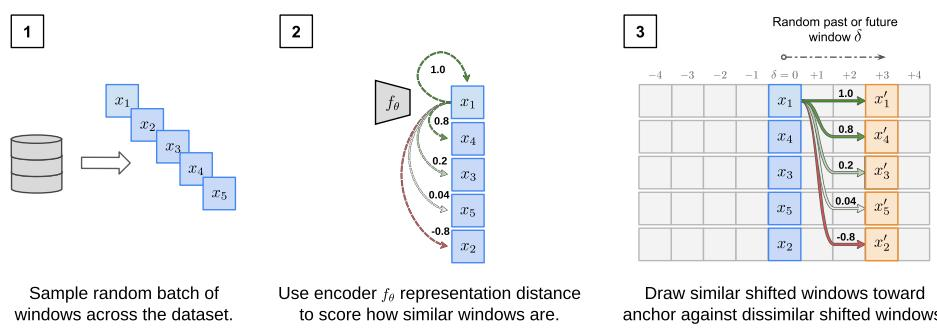
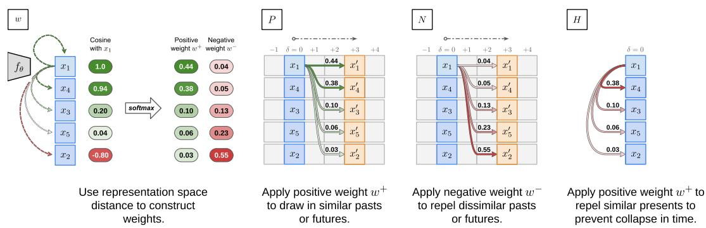
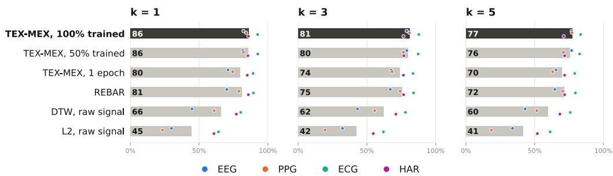

# TEX-MEX: SIMILARITY-GUIDED TEMPORAL CONTRASTIVE LEARNING FOR TIME SERIES

Aditya Radhakrishnan1, Maxwell A. Xu1∗, Wanting Mao1, Santosh Kumar2, Harish Haresamudram1, James M. Rehg1

1Health Care Engineering Systems Center, University of Illinois Urbana-Champaign   
2Department of Computer Science, University of Memphis   
{aditya63, jrehg}@illinois.edu

## ABSTRACT

Contrastive learning for time series depends on deciding which pairs of inputs should be treated as similar and dissimilar. Because few augmentations reliably preserve meaning in time series, prior methods have relied on two disjoint notions of similarity between windows: structural similarity, which relates windows with similar morphology, and temporal similarity, which relates windows that occur close together in time. We introduce TEX-MEX, to our knowledge the first approach to unify the two into a single relationship. Given a random batch of windows drawn across the dataset, TEX-MEX uses the encoder to identify which windows are structurally similar or dissimilar to each other. It then pulls each window toward the temporally shifted versions of similar windows and pushes it away from those of dissimilar ones, learning what typically accompanies similar windows in time. Across PPG, EEG, ECG, accelerometry, and continuous glucose monitoring, TEX-MEX broadly achieves state-of-the-art performance against contrastive, reconstructive, JEPA-based, and modality-specific approaches, establishing it as a strong general SSL objective. We further train a 560K-parameter PPG foundation model that achieves state-of-the-art performance across a broad range of downstream benchmarks while being roughly 50× smaller than the next-best unimodally pretrained PPG foundation model in our evaluation. We will release this foundation model open-source and open-weight to the community to support future work and practical applications.

## 1 INTRODUCTION

Self-supervised learning (SSL) has emerged as the dominant paradigm for learning generalizable representations from large-scale unlabeled data (Chen et al., 2020; He et al., 2022). This approach is particularly attractive for modeling physiological signals, such as photoplethysmography (PPG) or electrocardiography (ECG), which are routinely captured as time series data by wearables (e.g. smart watches) or medical devices. Labeling clinically-important events in such data (such as atrial fibrillation in an ECG recording) typically requires expert interpretation, invasive assays, or controlled clinical settings (Xu et al., 2024), and is very difficult to perform at scale. At the same time, the increasing adoption of smart watches by the general public and the large-scale aggregation of waveform data within electronic health records has created an opportunity to develop foundation models for such physiological signals (Xu et al., 2025; Saha et al., 2025; Ansari et al., 2025). Such models could enable new data-driven approaches to modeling states of health and disease.

Time series representation learning is challenging due to the need to capture statistical dependencies across widely-varying temporal scales (Goldberger et al., 2002). For example, heart rate, which is measurable via PPG, is correlated at the level of minutes in responding to physiological demands such as exercise, but is also correlated at the level of hours due to the diurnal cycle. Weekly patterns of stress or physical activity, such as regular commute times or exercise routines, can induce even longer-range correlational structure. A key step in developing foundation models for such data is the identification of effective pretext tasks. Two common approaches are contrastive learning, which extracts windows of samples from a time series recording to construct positive and negative pairs, and masked autoencoding, which uses temporal context to reconstruct the samples within a masked-out window. Contrastive learning is a particularly useful lens for examining time series representation learning as it provides a way to explicitly reason about similarity and dissimilarity.

  
Figure 1: Overview of TEX-MEX. (1) Windows of sensor data are randomly sampled from the dataset; (2) The encoder scores each window’s similarity to an anchor (here, x ) using cosine similarity; (3) Each window is offset in time (forward or backward) by a random δ (here, +3 windows). The anchor is pulled toward the temporal shifts of similar windows and away from those of dissimilar ones, in proportion to the similarity, composing structural and temporal notions.

Unfortunately, time series recordings typically lack a rich set of well-defined invariances from which positive pairs can be constructed (Xu et al., 2024). As a consequence, prior contrastive learning works have adopted one of two disjoint approaches to defining similarity between windows: structural similarity approaches that index on signal morphology or frequency content (i.e., windows are similar if they contain similar waveform shapes, like two heart beats in an ECG waveform) (Xu et al., 2025; 2024), and temporal similarity measures that index on temporal proximity (i.e., two windows are similar if they occur close together in time, such as when a cool-down period follows a period of vigorous exercise) (Tonekaboni et al., 2021; Oord et al., 2018). In contrast, this paper proposes, to our knowledge, the first contrastive learning approach which unifies structural and temporal similarity measures into a single framework. We demonstrate that the standard approach of generating positive pairs by mining morphologically-similar patterns from time series recordings (Xu et al., 2024) can be extended by composing it with temporal similarity, drawing positive and negative pairs from the temporal context of similar and dissimilar windows. This unifies the two primary sources of similarity in time series modeling: windows that correspond to similar physiological processes (e.g., two heartbeats) will have similar morphology, while windows which map onto stable patterns of human behavior (e.g., cool-down following exercise) will be temporally co-occurring. An exercise window, for instance, can learn from the cool-downs that follow exercise in other recordings, capturing what typically follows exercise rather than what followed it once.

We introduce TEX-MEX: for each anchor window, it first identifies similar and dissimilar windows within a random batch drawn across the dataset. Every window is then shifted by the same random offset, forward or backward in time, redrawn in each batch to span many timescales. TEX-MEX pulls the anchor toward the shifted versions of similar windows and pushes it away from those of dissimilar windows. We find that the encoder’s own representations suffice for measuring this similarity, eliminating the costly signal distance measures of prior methods (Xu et al., 2024). Unlike those fixed measures, this similarity improves as the encoder trains, ultimately surpassing them. Because it is graded rather than binary, TEX-MEX is naturally a soft contrastive method (Lee et al., 2024; Xu et al., 2025), weighting each shifted window by its source window’s similarity to the anchor, which captures degrees of relatedness and adds robustness to false negatives. The main contributions of our work are as follows:

1. We introduce TEX-MEX, a contrastive objective that unifies structural and temporal similarity by contrasting the shifted versions of similar windows against those of dissimilar windows, with similarity derived from the encoder’s own representations.

2. We show that this representation-space similarity improves throughout training, surpassing existing signal distance approaches as a predictor of mutual class membership.

3. We demonstrate the generality of TEX-MEX across PPG, ECG, accelerometry, EEG, and CGM, where it broadly achieves state-of-the-art performance against leading contrastive, reconstructive, JEPA-based, and modality-specific methods.

4. Leveraging its efficiency, we train and will release an open-source, open-weight PPG foundation model that achieves state-of-the-art performance across a range of downstream tasks with just 560K parameters, roughly 50× smaller than the next-best unimodally pretrained PPG foundation model in our evaluation.

## 2 RELATED WORK

Time-Series Self-Supervised Learning. Temporal contrastive methods use proximity in time as supervision: CPC (Oord et al., 2018) contrasts a window’s future against other samples, and TNC (Tonekaboni et al., 2021) treats windows within a locally stationary neighborhood as positives, reweighting others as unlabeled. A single neighborhood, however, ties relatedness to one timescale and one recording. Structural methods instead relate windows by learned distances, such as RE-BAR’s reconstruction-based motif similarity (Xu et al., 2024) and RelCon’s learnable distance (Xu et al., 2025), which RelCon also uses to grade relationships for soft contrastive learning, as in our work. These, however, miss temporal relationships, relating only windows that look alike. TS2Vec (Yue et al., 2022) and SoftCLT (Lee et al., 2024) apply instance-wise and temporal contrast as losses independent of one another, and their temporal contrast stays within a single input. SoftCLT soft ens both, using DTW distance and a monotonically decaying timestamp distance, and reports that embedding-space similarity, as in NNCLR (Dwibedi et al., 2021), degrades performance; in our formulation, where it determines how temporal context is contrasted rather than serving directly as positives, it instead surpasses data-space distances. Masked modeling approaches such as TimeMAE (Cheng et al., 2026) and PatchTST (Nie et al., 2023) instead reconstruct masked portions of an input.

PPG Foundation Models. Recent PPG foundation models span contrastive, reconstructive, and autoregressive pretraining. Contrastive approaches differ mainly in how they relate windows: through shared subject identity (Abbaspourazad et al., 2024; Pillai et al., 2025), morphology-based similarity (Pillai et al., 2025; Saha et al., 2025), quality-aware temporal proximity (Ding et al., 2024), or synchronization with paired ECG (Nie et al., 2026). xMAE (Zhou et al., 2026) instead learns through cross-modal reconstruction of masked ECG, and GPT-PPG (Chen et al., 2025) models PPG autoregressively through next-patch prediction. We build on Pulse-PPG (Saha et al., 2025), adopting its pretraining corpus and downstream evaluation.

## 3 METHODOLOGY

Batch Construction At each training step, we randomly sample a batch of B windows, $\mathcal { X } =$ $\{ x _ { 1 } , \dots , x _ { B } \}$ , across the pretraining dataset. Then, for each batch, we sample a single temporal offset $\delta \sim \hat { \mathcal { N } } ( 0 , \sigma ^ { 2 } )$ , measured in window lengths. Unlike in TNC, δ does not determine positives: it is shared across the batch, and each shifted window’s role as positive or negative is set by encoderestimated similarity, as described next. The offset thus only selects the timescale each batch probes, and the Gaussian acts as a simple, symmetric prior over where useful relationships are likely to be exposed, with σ setting their scale. We reject and resample draws outside $\delta _ { \mathrm { m i n } } \leq | \delta | \leq \delta _ { \mathrm { m a x } } .$ . The lower bound prevents shifted windows from overlapping their originals, which would permit trivial identity shortcuts; the upper bound limits shifts that cross gaps or recording boundaries. We set $\delta _ { \operatorname* { m i n } } = 1$ and $\delta _ { \mathrm { m a x } } = 2 . 5 \sigma$ by default, the latter truncating only ${ \approx } 1 . 2 \%$ of the Gaussian’s mass. Each window $x _ { i }$ is then paired with a shifted offset (a past or future window) $x _ { i } ^ { \prime } = T _ { \delta } ( x _ { i } )$ from the same recording, where $\bar { T } _ { \delta }$ denotes displacement by δ along the time series. This produces paired unshifted and shifted sets, $\mathcal { X } = \{ x _ { 1 } , \ldots , x _ { B } \}$ and $\mathbf { \bar { \mathcal { X } } ^ { \prime } } = \{ x _ { 1 } ^ { \top } , \ldots , x _ { B } ^ { \prime } \}$ , respectively.

Finding Similar and Dissimilar Windows: Encoder-Based Batch Grading A useful property of TEX-MEX is the availability of continually improving estimates of the degree of similarity between windows, derived directly from the encoder’s representation space (as examined in Section 4.1). Let $z _ { i } = f _ { \theta } ( x _ { i } )$ denote the $\ell _ { 2 }$ -normalized representation of window $x _ { i }$ . For each anchor $x _ { i }$ , we compute its cosine similarity with every member $x _ { k }$ of the unshifted batch as $c _ { i k } = z _ { i } ^ { \top } z _ { k }$

  
Figure 2: Components of the TEX-MEX loss, shown for anchor $x _ { 1 }$ with a batch of five windows and $\delta = + 3 .$ . (w) The anchor’s cosine similarity to each window is turned by two softmaxes into positive weights $w ^ { + }$ , which favor similar windows, and negative weights $w ^ { - }$ , which favor dissimilar ones. (P) The shifted windows, weighted by $w ^ { + }$ , are attracted to the anchor. (N) The same shifted windows, weighted by $w ^ { - }$ , are repelled. Every shifted window therefore counts as partly positive and partly negative, according to how related it is. (H) The unshifted versions of the other windows, weighted by $w ^ { + }$ , are also repelled. This stops the encoder from ignoring time by mapping a window and its shift to the same point. The loss is $\dot { - } \log ( P / ( P + N + \bar { H } ) )$ .

We then transform these similarities into positive and negative weights,

$$
w _ { i k } ^ { + } = \frac { \exp ( c _ { i k } / \tau _ { w } ) } { \sum _ { j = 1 } ^ { B } \exp ( c _ { i j } / \tau _ { w } ) } \qquad w _ { i k } ^ { - } = \frac { \exp ( - c _ { i k } / \tau _ { w } ) } { \sum _ { j = 1 } ^ { B } \exp ( - c _ { i j } / \tau _ { w } ) }\tag{1}
$$

where $\tau _ { w }$ controls the sharpness of the weighting distributions. Thus, $\boldsymbol { w } _ { i k } ^ { + }$ places greater weight on batch members most similar to the anchor, while $w _ { i k } ^ { - }$ places greater weight on those least similar. Together, these provide complementary estimates of the degree of similarity between each anchor and all B members of the batch. When producing these weights, we apply a stop-gradient to $c _ { i k } .$ preventing the contrastive objective described below from directly optimizing the similarity estimates used to construct its own weights. However, because explicit negatives remain, removing the stop-gradient does not strictly result in collapse.

Soft Contrastive Terms on a Graded, Temporally-Shifted Batch Having estimated similarity among the unshifted windows, we apply these relationships to attract and repel shifted windows in time. Let $z _ { k } ^ { \prime } = f _ { \theta } ( x _ { k } ^ { \prime } )$ denote the normalized representation of shifted window $ { \boldsymbol { x } } _ { k } ^ { \prime }$ . For each anchor $x _ { i }$ , we compute its similarity to every shifted batch member as $s _ { i k } ^ { \prime } = { z } _ { i } ^ { \top } { z } _ { k } ^ { \prime } / \tau$ , where τ is the contrastive temperature. We then use the weights derived above to construct positive and negative terms,

$$
P _ { i } = \sum _ { k = 1 } ^ { B } w _ { i k } ^ { + } \exp ( s _ { i k } ^ { \prime } ) \qquad N _ { i } = \sum _ { k = 1 } ^ { B } w _ { i k } ^ { - } \exp ( s _ { i k } ^ { \prime } )\tag{2}
$$

Thus, the same set of shifted candidates participates in both terms, but their contributions differ according to their estimated relationship with the anchor: shifted windows of more similar members contribute more strongly to $P _ { i } ,$ while those of more dissimilar members contribute more strongly to $N _ { i }$ . In this way, TEX-MEX contrasts the temporal shifts of batch members according to their graded cross-member relationships rather than temporal distance.

Encouraging Temporal Frame Separation The positive and negative terms above contrast relationships across batch members in time, but alone do not require representations to preserve features that distinguish a window from its temporal shift: an encoder could merely learn a collapsed invariance to time. For example, user identity shortcuts may be learned. To prevent this, we additionally contrast the temporal shifts of similar batch members against their corresponding unshifted windows. We define $\dot { s } _ { i k } = z _ { i } ^ { \top } z _ { k } / \tau$ and introduce the temporal frame-separation term

$$
H _ { i } = \sum _ { k \neq i } w _ { i k } ^ { + } \exp ( s _ { i k } )\tag{3}
$$

Here, unshifted windows of more similar batch members receive greater weight as negatives. We exclude $k = i ,$ as a sample cannot serve as a negative against itself. Consequently, for a similar member k, the shifted representation $z _ { k } ^ { \prime }$ contributes to the positive term $P _ { i }$ , while its unshifted rep resentation $z _ { k }$ contributes with the same weight $w ^ { + }$ to the negative term $H _ { i }$ , encouraging separation between temporal frames.

Combining the three terms, the TEX-MEX objective is

$$
\mathcal { L } _ { \mathrm { T E X - M E X } } = - \frac { 1 } { B } \sum _ { i = 1 } ^ { B } \log \frac { P _ { i } } { P _ { i } + N _ { i } + H _ { i } }\tag{4}
$$

The resulting objective attracts an anchor toward the temporal shifts of similar batch members, repels it from the temporal shifts of dissimilar members, and distinguishes those shifted representations from the original unshifted frame: temporal cross-member exchange.

## 4 TEX-MEX AS A GENERAL TIME-SERIES SSL OBJECTIVE

To evaluate TEX-MEX as a general time-series SSL objective, we adopt two recently proposed evaluation settings spanning five signal domains: first, following PULSE (Chen et al., 2026) (PPG, EEG, ECG, and HAR) and second, following CGM-JEPA (Muhammad et al., 2026) (for CGM).

## 4.1 MULTI-DOMAIN SELF-SUPERVISED LEARNING: PPG, EEG, ECG, AND HAR

Setup The core evaluation setting of PULSE (Chen et al., 2026) utilizes four datasets spanning four time-series domains. For PPG, WESAD (Schmidt et al., 2018) is used for four-class affectivestate classification across baseline, stress, amusement, and meditation states. For EEG, Sleep-EDF (Kemp et al., 2000) is used for five-class sleep-stage classification. For ECG, MIT-BIH Atrial Fibrillation (Moody, 1983) is used for binary classification of atrial fibrillation versus normal rhythm. Finally, the accelerometry dataset from Reyes-Ortiz et al. (2015) is used for six-class human activity recognition. We retain preprocessing, windowing, and predefined 70/15/15 inter-subject splits.

The PULSE evaluation protocol provides a standardized setup for introducing new SSL objectives while preserving the encoder architecture and downstream evaluation. We use the same 10-layer dilated-convolution encoder with 320-dimensional representations. Each method is tuned through 30 random-search trials over shared training hyperparameters, while allowing method-specific hyperparameters to vary independently. The best hyperparameter configuration is selected by validation performance, and the lowest-validation-loss checkpoint within each training run is retained. Frozen representations are evaluated using a fixed logistic-regression linear probe, with results averaged across five model initialization seeds (0–4) on the predefined split. We reuse results for existing baselines from Chen et al. (2026), which cover representative modern approaches spanning contrastive learning, masked autoencoding, and sequential variational autoencoding.

Alongside TEX-MEX, we implement TNC (Tonekaboni et al., 2021) and SoftCLT (Lee et al., 2024) as additional baselines representing prior temporal contrastive approaches. For each, we sweep method-specific hyperparameters following the search spaces of their original implementations. Fur ther details on hyperparameter sweeps and final choices can be found in Appendix A.

TEX-MEX as a Distance Function is a Predictor of Mutual Class Membership The use of signal-distance functions to estimate similarity has been applied in several prior time-series SSL works. REBAR (Xu et al., 2024) learns a reconstruction-based distance that captures shared motifs between windows, while SoftCLT (Lee et al., 2024) uses DTW in the raw signal space to estimate graded relationships between instances. We derive the former from Chen et al. (2026). Figure 3 compares these approaches with the representation-space distance learned directly by TEX-MEX, as well as raw-signal $L _ { 2 }$ distance. For each domain, we sample 100 batches of 64 windows from the held-out set and measure the proportion of each anchor’s $k \in \{ 1 , 3 , 5 \}$ nearest neighbors that share its ground-truth class. All distance measures are evaluated on identical batches, and we evaluate TEX-MEX at one epoch, halfway through training, and after training.

A few observations emerge from this analysis. First, by 50% of training, the distance learned by TEX-MEX is the strongest measure across all three values of k, exceeding REBAR by 4–5 percentage points on average. Second, its continuous improvement suggests that the representation

  
Figure 3: Comparison of signal distance measures by mutual class membership. On the held-out set, we sample 100 batches of 64 windows per domain and, for each anchor, retrieve its $k \in \{ 1 , 3 , 5 \}$ nearest neighbors according to each distance measure, reporting the proportion sharing the anchor’s ground-truth class. Bars show the unweighted mean across PPG, EEG, ECG, and HAR, with colored points indicating individual domains. TEX-MEX is evaluated at 1 epoch, 50% of training, and after training, and compared with REBAR and raw-signal DTW and $L _ { 2 }$ distances. Higher values indicate that a distance measure more reliably identifies semantically similar signals.

Table 1: Linear probe performance across four sensor domains. Bold is best, underline second best. The bracketed block is reproduced from Chen et al. (2026); TNC and SoftCLT are run by us under the same protocol.
<table><tr><td rowspan="2" colspan="2">Method</td><td colspan="4">AUROC ↑</td><td colspan="4">PRAUC↑</td></tr><tr><td>PPG</td><td>ECG</td><td>HAR</td><td>EEG</td><td>PPG</td><td>ECG</td><td>HAR</td><td>EEG</td></tr><tr><td></td><td>SimCLR (Chen et al., 2020)</td><td>.6119</td><td>.8254</td><td>.9938</td><td>.8545</td><td>.3608</td><td>.8063</td><td>.9763</td><td>.5095</td></tr><tr><td>(06)</td><td>TS2Vec (Yue et al., 2022)</td><td>.6428</td><td>.8656</td><td>.9931</td><td>.9499</td><td>.3959</td><td>.8516</td><td>.9766</td><td>.7022</td></tr><tr><td></td><td>REBAR (Xu et al., 2024)</td><td>.6977</td><td>.9146</td><td>.9965</td><td>.9508</td><td>.4457</td><td>.8985</td><td>.9891</td><td>.7077</td></tr><tr><td></td><td>PatchTST (Nie et al., 2023)</td><td>.7108</td><td>.7096</td><td>.9744</td><td>.9355</td><td>.5291</td><td>.6816</td><td>.8990</td><td>.6737</td></tr><tr><td></td><td>TimeMAE (Cheng et al., 2026)</td><td>.7808</td><td>.7661</td><td>.9914</td><td>.9509</td><td>.5674</td><td>.7662</td><td>.9705</td><td>.7322</td></tr><tr><td> hn n  )</td><td>LFADS (Sussillo et al., 2016)</td><td>.7110</td><td>.7169</td><td>.9949</td><td>.9449</td><td>.4959</td><td>.6921</td><td>.9829</td><td>.6855</td></tr><tr><td></td><td>DSVAE (Li &amp; Mandt, 2018)</td><td>.7678</td><td>.8288</td><td>.9936</td><td>.9542</td><td>.5538</td><td>.8131</td><td>.9769</td><td>.7225</td></tr><tr><td></td><td>PULSE (Chen et al., 2026)</td><td>.8029</td><td>.9493</td><td>.9942</td><td>.9617</td><td>.5989</td><td>.9475</td><td>.9810</td><td>.7382</td></tr><tr><td></td><td>TNC (Tonekaboni et al., 2021)</td><td>.7213</td><td>.8723</td><td>.9923</td><td>.9628</td><td>.5016</td><td>.8421</td><td>.9734</td><td>.7459</td></tr><tr><td></td><td>SoftCLT (Lee et al., 2024)</td><td>.7089</td><td>.8598</td><td>.9969</td><td>.9527</td><td>.4550</td><td>.8118</td><td>.9893</td><td>.7170</td></tr><tr><td>TEX-MEX</td><td></td><td>.8162</td><td>.9539</td><td>.9944</td><td>.9684</td><td>.6094</td><td>.9475</td><td>.9811</td><td>.7580</td></tr></table>

space becomes an increasingly informative source of cross-member relationships as optimization proceeds. Unlike REBAR or DTW, for which the distance measure is frozen for contrastive learning, there is no fixed ceiling in supervision quality.

Results Table 1 summarizes linear-probe performance across the four domains. For PPG, EEG, and ECG, TEX-MEX achieves the highest (or, in one case, tied-highest) performance on both AU-ROC and PRAUC, with PULSE generally providing the closest baseline performance. Further, TEX-MEX retains its computational efficiency: on a Quadro RTX 6000, a controlled runtime benchmark found that TEX-MEX reduced peak GPU memory utilization by 65.4% and pretraining wall clock time by 49.6% on average relative to PULSE. On HAR, however, TEX-MEX is outperformed by SoftCLT, LFADS, and REBAR, ranking 4/11. Nevertheless, performance on this task is highly saturated: all but one baseline exceeds 99% AUROC, with TEX-MEX reaching 99.44% compared with 99.69% for SoftCLT, the best-performing method. A similar, though somewhat larger, gap is observed for PRAUC, where TEX-MEX reaches 98.11% compared with 98.93%.

The advantage of TEX-MEX is especially clear in comparison with contrastive methods that similarly exploit temporal structure. Across the benchmark, TEX-MEX is the only such approach that remains consistently competitive with the strongest SSL methods, with particularly large gains on PPG and ECG over TNC, SoftCLT, and the SimCLR implementation of Chen et al. (2026), which uses temporal shifting as an augmentation. Each of these methods prescribes similarity in advance, whether by temporal proximity (TNC, SimCLR) or by DTW and timestamp distance (SoftCLT). TEX-MEX instead learns similarity through the encoder itself, contrasting the temporal shifts of similar windows against those of dissimilar ones. These learned relationships carry most of the positive weight, with only 30.2% of $w ^ { + }$ (averaged across domains and epochs) falling on the anchor’s own shift. Because similarity comes from representations already computed in the forward pass, TEX-MEX also avoids the highly costly dataset-wide preprocessing required by TNC (ADF stationarity testing) and SoftCLT (DTW distances), making it substantially more amenable to largescale pretraining. We exploit this advantage of TEX-MEX in Section 5.

## 4.2 TEX-MEX APPLIED TO CONTINUOUS GLUCOSE MONITORING

Setup We follow the experimental setting of CGM-JEPA (Muhammad et al., 2026), preserving its transformer-based encoder, pretraining data, downstream tasks, seeds, and evaluation protocol. Pretraining uses unlabeled continuous glucose monitoring (CGM) recordings from a Stanford study of metabolic health (Metwally et al., 2025) together with a public CGM dataset (Colas et al., 2019).´ Downstream evaluation uses two labeled groups from the Stanford study. One group contains glu cose responses measured from venous blood draws during an in-clinic oral glucose tolerance test (OGTT), while a separate held-out group contains both venous OGTT measurements and wearable CGM collected at home. Each participant is clinically labeled for insulin resistance and β-cell dysfunction, yielding two binary prediction tasks. We evaluate frozen representations in three settings: training on venous measurements from the first group and testing on venous measurements from the held-out group, training and testing on home CGM within the held-out group, and training on venous measurements and testing on home CGM within the held-out group. The logistic-regression probe and average of 20 seeds of subject-level 2-fold cross validation are unchanged, and all baseline results (other than TNC and SoftCLT) are derived from Muhammad et al. (2026).

Incorporating TEX-MEX requires a few tweaks in this setup. First, the corpus does not support temporal shifts at CGM-JEPA’s 24-hour (288-reading) window: 391 of its 413 recordings are exactly one day long, leaving only 22 long enough to hold both an anchor and a displaced partner. We therefore rewindow and pretrain on 39-reading (3.25-hour) windows, matching the 39-point curves that form every downstream input in their setup. Second, we z-score inputs using corpus statistics; this is applied to TS2Vec in their setup. We derive all TEX-MEX-specific hyperparameters without modification from defaults derived in Section 5, with an exception for σ = 1 chosen beforehand as a more plausible timescale for the domain. We also expand the baselines list by including TNC and SoftCLT. For the former, we use the TEX-MEX window size of 39, while for the latter, we preserve the window size of 288 as SoftCLT only performs within-window temporal contrast. For both, we use defaults for method-specific hyperparameters.

Results Table 2 summarizes linear-probe performance for metabolic subphenotyping. TEX-MEX achieves the best or tied-best performance on 11 of 12 metric-task combinations, spanning both β- cell dysfunction and insulin resistance across the three evaluation settings. The sole exception is venous insulin resistance AUROC, where TNC achieves the highest performance.

The largest gains emerge on at-home CGM, particularly for insulin resistance. TEX-MEX exceeds the strongest competing baseline by 6.3 AUROC points for in-domain home evaluation and by 8.6 points under venous→home transfer. The latter is the largest improvement across the evaluated settings and is particularly relevant for practical deployment, as it tests whether a probe learned from clinically collected venous OGTT curves transfers to CGM measurements obtained during an athome glucose challenge. This setting reflects a plausible path toward scalable metabolic screening, where models can leverage high-quality clinical measurements during development while operating on substantially more accessible wearable measurements at deployment (Metwally et al., 2025).

Ablations of TEX-MEX We perform five ablations of TEX-MEX (Table 3). The most direct test of its core idea removes graded weighting: the anchor’s own shift becomes the sole positive, while all other shifted and unshifted windows serve as uniformly weighted negatives. This effectively reduces TEX-MEX to more standard hard contrastive learning with temporal shifts as positives. Performance drops sharply, most severely under venous→home transfer (−17.1 and −14.2 AUROC on β-cell and IR). Temporal shifting alone therefore does not account for TEX-MEX’s performance; the gains come from contrasting the shifts of similar windows against those of dissimilar ones. Only fixing δ = 0, which removes temporal shifting entirely, is more damaging, reducing venous performance to chance level. The remaining ablations have effects concentrated on home and transfer evaluation and particularly on insulin resistance. Removing the frame-separation term H or the stop-gradient costs up to 6.6 and 7.9 AUROC points, respectively. Computing $c _ { i k }$ from an EMA copy of the encoder trails the live encoder by up to 9.0 points. Since the encoder’s similarity estimates improve throughout training (Figure 3), this suggests that the EMA’s lag degrades the weights by tying them to an earlier, weaker encoder. On venous evaluation, these three variants perform comparably to the full model.

Table 2: Linear probe evaluation for CGM metabolic subphenotyping across three regimes and two endpoints. All results are mean over 20 seeds.
<table><tr><td rowspan="3" colspan="2"></td><td colspan="6">AUROC↑</td><td colspan="6">PRAUC ↑</td></tr><tr><td colspan="2">Home</td><td colspan="2">Venous</td><td colspan="2">Ven.→Home</td><td colspan="2">Home</td><td colspan="2">Venous</td><td colspan="2">Ven.→Home</td></tr><tr><td>β-cell</td><td>IR</td><td>β-cell</td><td>IR</td><td>β-cell</td><td>IR</td><td>β-cell</td><td>IR</td><td>β-cell</td><td>IR</td><td>β-cell</td><td>IR</td></tr><tr><td></td><td>PCA (Shlens, 2014)</td><td>.925</td><td>.821</td><td>.790</td><td>.744</td><td>.927</td><td>.827</td><td>.909</td><td>.842</td><td>.784</td><td>.770</td><td>.911</td><td>.847</td></tr><tr><td>Mud) (  026)</td><td>GluFormer (Lutsker et al., 2025)</td><td>.857</td><td>.889</td><td>.742</td><td>.709</td><td>.801</td><td>.530</td><td>.809</td><td>.880</td><td>.703</td><td>.758</td><td>.756</td><td>.555</td></tr><tr><td></td><td>TS2Vec (Yue et al., 2022)</td><td>.854</td><td>.848</td><td>.735</td><td>.733</td><td>.805</td><td>.713</td><td>.880</td><td>.868</td><td>.716</td><td>.741</td><td>.754</td><td>.720</td></tr><tr><td></td><td>MOMENTs (Goswami et al., 2024)</td><td>.849</td><td>.819</td><td>.712</td><td>.674</td><td>.736</td><td>.830</td><td>.834</td><td>.829</td><td>.668</td><td>.671</td><td>.751</td><td>.852</td></tr><tr><td></td><td>MOMENTL (Goswami et al., 2024)</td><td>.652</td><td>.605</td><td>.683</td><td>.630</td><td>.606</td><td>.713</td><td>.649</td><td>.651</td><td>.604</td><td>.579</td><td>.615</td><td>.750</td></tr><tr><td></td><td>Mantis (Feofanov et al., 2025)</td><td>.758</td><td>.690</td><td>.674</td><td>.709</td><td>.821</td><td>.766</td><td>.777</td><td>.759</td><td>.634</td><td>.687</td><td>.826</td><td>.809</td></tr><tr><td></td><td>CGM-JEPA (Muhammad et al., 2026)</td><td>.932</td><td>.842</td><td>.845</td><td>.801</td><td>.946</td><td>.866</td><td>.931</td><td>.872</td><td>.821</td><td>.824</td><td>.941</td><td>.892</td></tr><tr><td></td><td>X-CGM-JEPA (Muhammad et al., 2026)</td><td>.946</td><td>.857</td><td>.855</td><td>.800</td><td>.949</td><td>.865</td><td>.941</td><td>.883</td><td>.815</td><td>.822</td><td>.943</td><td>.892</td></tr><tr><td></td><td>TNC (Tonekaboni et al., 2021)</td><td>.914</td><td>.832</td><td>.831</td><td>.805</td><td>.912</td><td>.845</td><td>.909</td><td>.850</td><td>.831</td><td>.841</td><td>.882</td><td>.853</td></tr><tr><td></td><td>SoftCLT (Lee et al., 2024)</td><td>.902</td><td>.811</td><td>.735</td><td>.741</td><td>.911</td><td>.831</td><td>.916</td><td>.857</td><td>.717</td><td>.774</td><td>.921</td><td>.872</td></tr><tr><td>TEX-MEX</td><td></td><td>.980</td><td>.952</td><td>.855</td><td>.796</td><td>.978</td><td>.952</td><td>.972</td><td>.946</td><td>.882</td><td>.848</td><td>.967</td><td>.943</td></tr></table>

Table 3: Ablation of TEX-MEX components on CGM metabolic subphenotyping. The top row reports absolute performance; all other rows report the change relative to it. Values are means over 20 seeds.
<table><tr><td rowspan="3"></td><td colspan="6">AUROC↑</td><td colspan="6">PRAUC ↑</td></tr><tr><td colspan="2">Home</td><td colspan="2">Venous</td><td colspan="2">Ven.→Home</td><td colspan="2">Home</td><td colspan="2">Venous</td><td colspan="2">Ven.→Home</td></tr><tr><td></td><td>IR</td><td>β-cell</td><td>IR</td><td>β-cell</td><td>IR</td><td>β-cell</td><td>IR</td><td>β-cell</td><td>IR</td><td>β-cell</td><td>IR</td></tr><tr><td>TEX-MEX</td><td>.980</td><td>.952</td><td>.855</td><td>.796</td><td>.978</td><td>.952</td><td>.972</td><td>.946</td><td>.882</td><td>.848</td><td>.967</td><td>.943</td></tr><tr><td>w/o graded weighting</td><td>-.042</td><td>-.097</td><td>-.049</td><td>+.001</td><td>-.171</td><td>-.142</td><td>-.046</td><td>-.090</td><td>–.118</td><td>-.008</td><td>-.159</td><td>-.125</td></tr><tr><td>w/o frame separation H</td><td>-.018</td><td>-.066</td><td>+.018</td><td>+.004</td><td>–.012</td><td>-.057</td><td>-.020</td><td>-.044</td><td>-.010</td><td>-.015</td><td>-.010</td><td>-.033</td></tr><tr><td>w/o stop-gradient</td><td>-.037</td><td>-.079</td><td>+.019</td><td>-.010</td><td>-.025</td><td>-.069</td><td>-.034</td><td>-.052</td><td>-.009</td><td>-.019</td><td>-.025</td><td>-.047</td></tr><tr><td>EMA grader (m=0.999)</td><td>-.034</td><td>-.090</td><td>+.009</td><td>+.016</td><td>-.032</td><td>-.090</td><td>-.031</td><td>-.057</td><td>-.020</td><td>-.009</td><td>-.026</td><td>-.054</td></tr><tr><td> $\delta = \mathrm { { 0 } } ^ { \circ }$ </td><td>-.227</td><td>-.198</td><td>-.398</td><td>-.326</td><td>-.220</td><td>-.146</td><td>-.265</td><td>-.203</td><td>-.492</td><td>-.404</td><td>-.232</td><td>-.138</td></tr></table>

## 5 SCALING TEX-MEX: A BITE-SIZED, SOTA PPG FOUNDATION MODEL

Setup We broadly derive our setup from Pulse-PPG (Saha et al., 2025), a prior state-of-the-art open PPG foundation model pretrained on field-collected wearable data. We inherit its Mobile Open Observation of Daily Stressors (MOODS) pretraining dataset (Neupane et al., 2024), a largescale collection of raw smartwatch PPG recorded during participants’ everyday lives, as well as its diverse downstream evaluation: PPG-BP (Liang et al., 2018), WESAD (Schmidt et al., 2018), PPG-DaLiA (Reiss et al., 2019), MOODS (Neupane et al., 2024), and SDB (Garde et al., 2014). The downstream tasks span wearable field, wearable lab, and clinical settings, cover both classification and regression problems such as stress, activity, heart rate, sleep disturbance, blood pressure, and hypertension, and use input windows at a variety of temporal scales. We strengthen the downstream evaluation protocol for all models. Rather than evaluating on a single subject split with one random seed, we use subject-level five-fold cross-validation repeated across 15 random seeds for every downstream task. We also expand the set of foundation-model baselines to include more recent general time-series and PPG-specific models. These include MOMENT (Goswami et al., 2024), Chronos 1 & 2 (Ansari et al., 2024; 2025), PaPaGei (both S and P variants) (Pillai et al., 2025), AnyPPG (Nie et al., 2026), and Pulse-PPG (Saha et al., 2025).

For the TEX-MEX PPG foundation model, we apply a pretraining window length of 1 minute. This contrasts with Saha et al. (2025), where longer, four-minute windows were specifically chosen to capture the multi-minute physiological dynamics associated with stress. TEX-MEX, however, explicitly learns temporal relationships across shifted signal windows during pretraining. We therefore use a shorter window intended to provide a more general representation across tasks operating at different temporal scales. Similar to Saha et al. (2025) we use a ResNet backbone, however, we substantially reduce the size of the encoder to 560K parameters, yielding a 96-dim representation. We manually explored a range of architectural and training hyperparameters for the TEX-MEX foun-

Table 4: Downstream performance of the TEX-MEX PPG foundation model against general timeseries and PPG-specific foundation models. All results are mean over 15 seeds of 5-fold crossvalidation. Bold is best, underline second best.
<table><tr><td rowspan="2" colspan="3"></td><td colspan="3">General TSFMs</td><td colspan="5">PPG FMs</td></tr><tr><td>MOMENT 341.25</td><td>Chronos 201.37</td><td>Chronos-2 119.48</td><td>Pulse-PPG 28.50</td><td>PaPaGei-S 5.79</td><td>PaPaGei-P 4.99</td><td>AnyPPG 4.04</td><td>TEX-MEX 0.56</td></tr><tr><td>P-BP</td><td>Embedding dim Pretraining data Hypertension</td><td>AUROC↑ PRAUC↑</td><td>1024 Gen. TS .6749 .3951</td><td>768 Gen. TS .6353 .3642</td><td>768 Gen. TS .6659 .4103</td><td>512 PPG .6487</td><td>512 PPG .6373 .3573</td><td>512 PPG .6357 .3567</td><td>512 PPG+ECG .6739</td><td>96 PPG .7347</td></tr><tr><td>WESAD</td><td>HR Stress (2)</td><td>MAE↓ MAE↓ AUROC↑ PRAUC ↑ AUROC↑ PRAUC ↑</td><td>10.610 4.950 .8507 .7259 .6969 .4665</td><td>10.203 5.525 .8642 .7218 .7394</td><td>10.103 4.815 .9302 .8675 .7431</td><td>9.649 4.815 .9388 .8734 .7197</td><td>10.096 5.030 .8383 .6537 .7046</td><td>9.148 4.765 .8486 .7168 .6599</td><td>5.747 .9520 .9017 .7562</td><td>8.294 4.433 .9630 .9387 .7455</td></tr><tr><td>DaiIA</td><td>Activity HR</td><td>AUROC↑ PRAUC↑ MAE↓</td><td>.7798 .3250 8.460</td><td>.5174 .8069 .3773 8.830</td><td>.5425 .7937 .3461 9.628</td><td>.5049 .7744 .3126 10.105</td><td>.4594 .7164 .2478 14.099</td><td>.4299 .7399 .2821 12.232</td><td>.5588 .7988 .3641 6.643</td><td>.5404 .7992 .3543 9.790</td></tr><tr><td>MOODS</td><td>Activity Stress</td><td>AUROC ↑ PRAUC↑ AUROC↑ PRAUC↑</td><td>.7387 .3645 .5163 .4193</td><td>.8325 .5001 .5384 .4378</td><td>.8574 .5415 .5360 .4292</td><td>.8635 .5465 .5438 .4363</td><td>.6917 .2982 .5316 .4282</td><td>.7140 .3168 .5526 .4391</td><td>.8657 .5660 .5556 4464</td><td>.8835 .6058 .5591 .4500</td></tr><tr><td>SDB</td><td>Sleep</td><td>AUROC↑ PRAUC ↑</td><td>.5039 .3823</td><td>.5364 .3931</td><td>.5425 4017</td><td>.4967 .3632</td><td>.5257 .3892</td><td>.5507 .4118</td><td>.4929 .3727</td><td>.4928 .3544</td></tr></table>

dation model, including model depth and width, learning rate, and TEX-MEX-specific parameters. Full details of the TEX-MEX ResNet architecture and pretraining hyperparameters are provided in Appendix B.

Results Table 4 summarizes linear-probe performance across 11 downstream classification and regression tasks, spanning five datasets and three settings: wearable field, wearable lab, and clinical. Overall, TEX-MEX is the strongest-performing approach, achieving the best performance on 7 of 11 tasks and outperforming all unimodally pretrained PPG foundation models on 10 of 11. The gains are particularly pronounced for hypertension prediction, where TEX-MEX exceeds the next-best models by roughly 6–7 percentage points in both AUROC and PRAUC.

While TEX-MEX is the best-performing model overall, it is also by far the smallest in our evaluation: the next-smallest, AnyPPG, is over 7× larger and additionally requires paired PPG and ECG recordings during pretraining. The comparison with Pulse-PPG, the strongest unimodally pretrained baseline (outperforming both PaPaGei variants on 6 of 11 tasks), is especially stark. It is roughly 50× larger and uses the same pretraining dataset and evaluation splits, yet TEX-MEX outperforms it on 10 of 11 tasks; on the sole exception, sleep, the gap is under one percentage point on both AUROC and PRAUC. Further, attempts at downscaling by Saha et al. (2025) show that reducing Pulse-PPG even to ∼4.73M parameters causes AUROC losses up to 0.139 in downstream tasks.

On the four tasks where TEX-MEX is not the top performer, two involve marginal differences from the best result in the table, with gaps to the best competing model averaging 1.5 percentage points. The other two cases (DaLiA heart-rate estimation and sleep classification on SDB) are more substantial. For the former, TEX-MEX nevertheless remains the best-performing unimodally pretrained PPG model, with only general time-series foundation models and multimodally pretrained AnyPPG performing better. On sleep, however, TEX-MEX underperforms by roughly six percentage points relative to the best performer, PaPaGei-P. We suspect this reflects a limitation of the MOODS pretraining dataset, which contains no sleep recordings. Consistent with this explanation, Pulse-PPG, a generally strong model trained on the same corpus, also performs poorly on SDB. PaPaGei, by contrast, is pretrained with sleep data and performs best in this setting though even it is hardly better than random. This limitation could be addressed in future work by expanding MOODS to include sleep recordings.

## 6 CONCLUSION

We introduce TEX-MEX, an efficient, scalable self-supervised objective for time series that unifies structural and temporal similarity by contrasting the temporal shifts of windows the encoder deems similar against those it deems dissimilar. Across PPG, ECG, EEG, accelerometry, and CGM, TEX-MEX broadly achieves state-of-the-art performance. We further demonstrate it at scale with a 560K-parameter PPG foundation model that achieves state-of-the-art downstream performance while having significantly fewer parameters than the PPG foundation models in our evaluation.

## REFERENCES

Salar Abbaspourazad, Oussama Elachqar, Andrew Miller, Saba Emrani, Udhyakumar Nallasamy, and Ian Shapiro. Large-scale training of foundation models for wearable biosignals. In International Conference on Learning Representations, pp. 3158–3181, 2024.

Abdul Fatir Ansari, Lorenzo Stella, Caner Turkmen, Xiyuan Zhang, Pedro Mercado, Huibin Shen, Oleksandr Shchur, Syama Sundar Rangapuram, Sebastian Pineda Arango, Shubham Kapoor, et al. Chronos: Learning the language of time series. Transactions on Machine Learning Research, 2024.

Abdul Fatir Ansari, Oleksandr Shchur, Jaris Kuken, Andreas Auer, Boran Han, Pedro Mercado,¨ Syama Sundar Rangapuram, Huibin Shen, Lorenzo Stella, Xiyuan Zhang, et al. Chronos-2: From univariate to universal forecasting. arXiv preprint arXiv:2510.15821, 2025.

Ting Chen, Simon Kornblith, Mohammad Norouzi, and Geoffrey Hinton. A simple framework for contrastive learning of visual representations. In International Conference on Machine Learning, pp. 1597–1607. PMLR, 2020.

Yenho Chen, Maxwell A Xu, James Matthew Rehg, and Christopher John Rozell. Self-supervised dynamical system representations for physiological time-series. In Forty-third International Conference on Machine Learning, 2026. URL https://openreview.net/forum?id= cKsANUDt1m.

Zhaoliang Chen, Cheng Ding, Saurabh Kataria, Runze Yan, Minxiao Wang, Randall Lee, and Xiao Hu. GPT-PPG: A GPT-based foundation model for photoplethysmography signals. Physiological Measurement, 46(5):055004, 2025.

Mingyue Cheng, Xiaoyu Tao, Zhiding Liu, Qi Liu, Hao Zhang, Rujiao Zhang, and Enhong Chen. TimeMAE: Self-supervised representations of time series with decoupled masked autoencoders. In Proceedings ofthe Nineteenth ACM International Conference on Web Search and Data Mining, pp. 498–508, 2026.

Ana Colas, Luis Vigil, Borja Vargas, David Cuesta-Frau, and Manuel Varela. Detrended fluctuation´ analysis in the prediction of type 2 diabetes mellitus in patients at risk: Model optimization and comparison with other metrics. PLoS ONE, 14(12):e0225817, 2019.

Cheng Ding, Zhicheng Guo, Zhaoliang Chen, Randall J Lee, Cynthia Rudin, and Xiao Hu. SiamQuality: A ConvNet-based foundation model for photoplethysmography signals. Physiological Measurement, 45(8):085004, aug 2024. doi: 10.1088/1361-6579/ad6747. URL https://doi.org/10.1088/1361-6579/ad6747.

Debidatta Dwibedi, Yusuf Aytar, Jonathan Tompson, Pierre Sermanet, and Andrew Zisserman. With a little help from my friends: Nearest-neighbor contrastive learning of visual representations. In IEEE/CVF International Conference on Computer Vision (ICCV), pp. 9568–9577. IEEE, 2021.

Vasilii Feofanov, Marius Alonso, Songkang Wen, Romain Ilbert, Hongbo Guo, Malik Tiomoko, Lujia Pan, Jianfeng Zhang, and Ievgen Redko. Mantis: Lightweight calibrated foundation model for user-friendly time series classification. In 1st ICML Workshop on Foundation Models for Structured Data, 2025.

Ainara Garde, Parastoo Dehkordi, Walter Karlen, David Wensley, J Mark Ansermino, and Guy A Dumont. Development of a screening tool for sleep disordered breathing in children using the Phone Oximeter™. PLoS ONE, 9(11):e112959, 2014.

Ary L Goldberger, Luis AN Amaral, Jeffrey M Hausdorff, Plamen Ch Ivanov, C-K Peng, and H Eugene Stanley. Fractal dynamics in physiology: alterations with disease and aging. Proceedings of the National Academy ofSciences, 99(suppl 1):2466–2472, 2002.

Mononito Goswami, Konrad Szafer, Arjun Choudhry, Yifu Cai, Shuo Li, and Artur Dubrawski. MOMENT: A family of open time-series foundation models. In Ruslan Salakhutdinov, Zico Kolter, Katherine Heller, Adrian Weller, Nuria Oliver, Jonathan Scarlett, and Felix Berkenkamp (eds.), Proceedings of the 41st International Conference on Machine Learning, volume 235 of Proceedings of Machine Learning Research, pp. 16115–16152. PMLR, 21–27 Jul 2024. URL https://proceedings.mlr.press/v235/goswami24a.html.

Kaiming He, Xinlei Chen, Saining Xie, Yanghao Li, Piotr Dollar, and Ross Girshick. Masked´ autoencoders are scalable vision learners. In IEEE/CVF Conference on Computer Vision and Pattern Recognition (CVPR), pp. 15979–15988. IEEE, 2022.

Bob Kemp, Aeilko H Zwinderman, Bert Tuk, Hilbert AC Kamphuisen, and Josefien JL Oberye. Analysis of a sleep-dependent neuronal feedback loop: the slow-wave microcontinuity of the EEG. IEEE Transactions on Biomedical Engineering, 47(9):1185–1194, 2000.

Seunghan Lee, Taeyoung Park, and Kibok Lee. Soft contrastive learning for time series. In International Conference on Learning Representations, pp. 46815–46839, 2024.

Yingzhen Li and Stephan Mandt. Disentangled sequential autoencoder. In International Conference on Machine Learning, pp. 5670–5679. PMLR, 2018.

Yongbo Liang, Zhencheng Chen, Guiyong Liu, and Mohamed Elgendi. A new, short-recorded photoplethysmogram dataset for blood pressure monitoring in China. Scientific Data, 5(1):180020, 2018.

Guy Lutsker, Gal Sapir, Smadar Shilo, Jordi Merino, Anastasia Godneva, Jerry R Greenfield, Dorit Samocha-Bonet, Raja Dhir, Francisco Gude, Shie Mannor, et al. GluFormer: Learning generalizable representations from continuous glucose monitoring data. In Learning Meaningful Representations ofLife (LMRL) Workshop at ICLR 2025, 2025.

Ahmed A Metwally, Dalia Perelman, Heyjun Park, Yue Wu, Alokkumar Jha, Seth Sharp, Alessandra Celli, Ekrem Ayhan, Fahim Abbasi, Anna L Gloyn, et al. Prediction of metabolic subphenotypes of type 2 diabetes via continuous glucose monitoring and machine learning. Nature Biomedical Engineering, 9(8):1222–1239, 2025.

George Moody. A new method for detecting atrial fibrillation using RR intervals. Proc. Comput. Cardiol., 10:227–230, 1983.

Hada Melino Muhammad, Zechen Li, Flora Salim, and Ahmed A Metwally. CGM-JEPA: Learning consistent continuous glucose monitor representations via predictive self-supervised pretraining. arXiv preprint arXiv:2605.00933, 2026.

Sameer Neupane, Mithun Saha, Nasir Ali, Timothy Hnat, Shahin Alan Samiei, Anandatirtha Nandugudi, David M Almeida, and Santosh Kumar. Momentary stressor logging and reflective visualizations: Implications for stress management with wearables. In Proceedings of the 2024 CHI Conference on Human Factors in Computing Systems, pp. 1–19, 2024.

Guangkun Nie, Xiaocheng Fang, Gongzheng Tang, Yujie Xiao, Jun Li, Bo Liu, Hongyan Li, and Shenda Hong. AnyPPG: An ECG-guided PPG foundation model trained on over 100,000 hours of recordings for holistic health profiling. In Proceedings ofthe 32nd ACM SIGKDD Conference on Knowledge Discovery and Data Mining V. 2, pp. 11717–11727, 2026.

Yuqi Nie, Nam H Nguyen, Phanwadee Sinthong, and Jayant Kalagnanam. A time series is worth 64 words: Long-term forecasting with transformers. In International Conference on Learning Representations, 2023.

Aaron van den Oord, Yazhe Li, and Oriol Vinyals. Representation learning with contrastive predictive coding. arXiv preprint arXiv:1807.03748, 2018.

Arvind Pillai, Dimitris Spathis, Fahim Kawsar, and Mohammad Malekzadeh. PaPaGei: Open foundation models for optical physiological signals. In International Conference on Learning Representations, pp. 48230–48261, 2025.

Attila Reiss, Ina Indlekofer, Philip Schmidt, and Kristof Van Laerhoven. Deep PPG: Large-scale heart rate estimation with convolutional neural networks. Sensors, 19(14):3079, 2019.

Jorge L Reyes-Ortiz, D Anguita, L Oneto, and X Parra. Smartphone-based recognition of human activities and postural transitions data set. UCI Machine Learning Repository, 2015.

Mithun Saha, Maxwell A Xu, Wanting Mao, Sameer Neupane, James M Rehg, and Santosh Kumar. Pulse-PPG: An open-source field-trained PPG foundation model for wearable applications across lab and field settings. Proceedings of the ACM on Interactive, Mobile, Wearable and Ubiquitous Technologies, 9(3):1–35, 2025.

Philip Schmidt, Attila Reiss, Robert Duerichen, Claus Marberger, and Kristof Van Laerhoven. Introducing WESAD, a multimodal dataset for wearable stress and affect detection. In Proceedings of the 20th ACM International Conference on Multimodal Interaction, pp. 400–408, 2018.

Jonathon Shlens. A tutorial on principal component analysis. arXiv preprint arXiv:1404.1100, 2014.

David Sussillo, Rafal Jozefowicz, LF Abbott, and Chethan Pandarinath. LFADS – Latent factor analysis via dynamical systems. arXiv preprint arXiv:1608.06315, 2016.

Sana Tonekaboni, Danny Eytan, and Anna Goldenberg. Unsupervised representation learning for time series with temporal neighborhood coding. In International Conference on Learning Representations, 2021.

Maxwell Xu, Alexander Moreno, Hui Wei, Benjamin M Marlin, and James Rehg. REBAR: Retrieval-based reconstruction for time-series contrastive learning. In International Conference on Learning Representations, pp. 15440–15464, 2024.

Maxwell Xu, Jaya Narain, Gregory Darnell, Haraldur Hallgrimsson, Hyewon Jeong, Darren Forde, Richard Fineman, Karthik Raghuram, James Rehg, and Shirley Ren. RelCon: Relative contrastive learning for a motion foundation model for wearable data. In International Conference on Learning Representations, pp. 53188–53206, 2025.

Zhihan Yue, Yujing Wang, Juanyong Duan, Tianmeng Yang, Congrui Huang, Yunhai Tong, and Bixiong Xu. TS2Vec: Towards universal representation of time series. In Proceedings of the AAAI Conference on Artificial Intelligence, volume 36, pp. 8980–8987, 2022.

Hao Zhou, Simon A. Lee, Cyrus Tanade, Keum San Chun, Juhyeon Lee, Migyeong Gwak, Megha Thukral, Justin Sung, Eugene Hwang, Mehrab Bin Morshed, Li Zhu, Viswam Nathan, Md Mahbubur Rahman, Subramaniam Venkatraman, and Sharanya Arcot Desai. Physiology-aware masked cross-modal reconstruction for biosignal representation learning. In Forty-third International Conference on Machine Learning, 2026. URL https://openreview.net/forum? id=NxbSbkLNMc.

## A MULTI-DOMAIN BENCHMARK DETAILS

All methods share the training-hyperparameter search described in Section 4.1 (30 random-search trials), with method-specific hyperparameters varying independently within the same trials. The best configuration is selected by validation performance.

TEX-MEX. We sweep three method-specific hyperparameters: the offset scale $\sigma \in \{ 0 . 5 , 1 , 2 , 4 .$ 8, 16} (in window lengths), the contrastive temperature $\tau \in \{ 0 . 0 3 , 0 . 0 4 , 0 . 0 5 , 0 . 0 7 , 0 . 1 \dot { 0 } , 0 . 1 5 \}$ , and the weighting temperature $\tau _ { w } \in \{ 0 . 0 4 , 0 . 0 6 , 0 . \bar { 1 0 } , 0 . 1 4 , 0 . 2 0 \}$ }. The offset is drawn as $\delta \sim \mathcal { N } ( \overset { \cdot } { 0 } , \sigma ^ { 2 } )$ and resampled until $\delta _ { \mathrm { m i n } } \leq | \delta | \leq \delta _ { \mathrm { m a x } }$ , with $\delta _ { \mathrm { m i n } } = 1$ and $\bar { \delta _ { \mathrm { m a x } } } = 2 . 5 \sigma$

SoftCLT. Following the classification search space of Lee et al. (2024), we sweep the instancewise sharpness $\tau _ { I } \in \{ 1 , 2 , 3 , 4 , 5 , 1 0 , 2 0 \}$ and the temporal sharpness $\tau _ { T } \in \{ 0 . 5 , 1 . 0 \mathrm { , 1 . 5 , 2 . 0 , 2 . 5 } \}$ keeping the loss weight fixed at $\lambda = 0 . 5$ as in the original work.

TNC. We sweep the positive-unlabeled weight $w \in \{ 0 , 0 . 0 5 , 0 . 1 \}$ , where $w = 0$ disables the PU correction, the Monte Carlo sample size $\in \{ 1 0 , 2 0 , 4 0 \}$ , and the augmentation factor $\in \{ 5 , 7 \}$ These ranges span the per-dataset settings used in the official implementation of Tonekaboni et al. (2021).  
Table 5: Final method-specific hyperparameters selected on the validation set for each domain.
<table><tr><td>Method</td><td>Hyperparameter</td><td>PPG</td><td>ECG</td><td>HAR</td><td>EEG</td></tr><tr><td rowspan="3">TEX-MEX</td><td>σ</td><td>1</td><td>8</td><td>8</td><td>2</td></tr><tr><td>T</td><td>0.03</td><td>0.04</td><td>0.03</td><td>0.04</td></tr><tr><td> $\tau _ { w }$ </td><td>0.06</td><td>0.14</td><td>0.10</td><td>0.10</td></tr><tr><td rowspan="2">SoftCLT</td><td> $\tau _ { I }$ </td><td>10</td><td>4</td><td>20</td><td>5</td></tr><tr><td> $\tau _ { T }$ </td><td>0.5</td><td>1.0</td><td>2.0</td><td>2.5</td></tr><tr><td rowspan="3">TNC</td><td>w</td><td>0</td><td>0</td><td>0.1</td><td>0.05</td></tr><tr><td>MC sample size</td><td>20</td><td>10</td><td>10</td><td>20</td></tr><tr><td>Augmentation factor</td><td>5</td><td>5</td><td>5</td><td>7</td></tr></table>

Table 6: Selected shared training hyperparameters. Following Chen et al. (2026), all three methods draw from the same grid (epochs $\in \{ 5 0 , 1 0 0 , 2 0 0 \}$ , learning rate $\in \{ 1 0 ^ { - 3 } , 5 { \times } 1 0 ^ { - 4 } , 1 0 ^ { - 4 } \}$ , weight decay $\in \ \{ 1 0 ^ { - 3 } , 1 0 ^ { - 4 } , 1 0 ^ { - 5 } \}$ , batch $\mathsf { s i z e } \in \{ 6 4 , 1 2 8 \} )$ . A batch size of 64 was selected for all methods and domains, except TEX-MEX on HAR, which selected 128.
<table><tr><td>Method</td><td>Hyperparameter</td><td>PPG</td><td>ECG</td><td>HAR</td><td>EEG</td></tr><tr><td rowspan="3">TEX-MEX</td><td>Epochs</td><td>100</td><td> $2 0 0$ </td><td> $5 0$ </td><td>100</td></tr><tr><td>Learning rate</td><td> $1 0 ^ { - 4 }$ </td><td> $1 0 ^ { - 4 }$ </td><td> $1 0 ^ { - 4 }$ </td><td> $1 0 ^ { - 4 }$ </td></tr><tr><td>Weight decay</td><td> $1 0 ^ { - 5 }$ </td><td> $1 0 ^ { - 5 }$ </td><td> $1 0 ^ { - 5 }$ </td><td> $1 0 ^ { - 4 }$ </td></tr><tr><td rowspan="3">SoftCLT</td><td>Epochs</td><td>200</td><td>100</td><td>200</td><td>200</td></tr><tr><td>Learning rate</td><td> $5 \times 1 0 ^ { - 4 }$ </td><td> $1 0 ^ { - 4 }$ </td><td> $5 \times 1 0 ^ { - 4 }$ </td><td> $1 0 ^ { - 3 }$ </td></tr><tr><td>Weight decay</td><td> $1 0 ^ { - 4 }$ </td><td> $1 0 ^ { - 4 }$ </td><td> $1 0 ^ { - 4 }$ </td><td> $1 0 ^ { - 4 }$ </td></tr><tr><td rowspan="3">TNC</td><td>Epochs</td><td>100</td><td>50</td><td>200</td><td>100</td></tr><tr><td>Learning rate</td><td> $1 0 ^ { - 3 }$ </td><td> $1 0 ^ { - 3 }$ </td><td> $1 0 ^ { - 3 }$ </td><td> $5 \times 1 0 ^ { - 4 }$ </td></tr><tr><td>Weight decay</td><td> $1 0 ^ { - 5 }$ </td><td> $1 0 ^ { - 3 }$ </td><td> $1 0 ^ { - 3 }$ </td><td> $1 0 ^ { - 5 }$ </td></tr></table>

## B PPG FOUNDATION MODEL DETAILS

Following Saha et al. (2025), the encoder is a 1D ResNet; we reduce it to 560K parameters. Table 7 lists the final configuration.

Table 7: PPG foundation model architecture and pretraining hyperparameters.
<table><tr><td colspan="2">Encoder</td></tr><tr><td>Architecture</td><td>Stem conv + 6 residual blocks</td></tr><tr><td>Channels</td><td>48 → 96</td></tr><tr><td>Kernel size Downsampling</td><td>11</td></tr><tr><td>Dropout</td><td>Stride 2 every second block (8× total) 0.5</td></tr><tr><td>Pooling Embedding dimension</td><td>Global average 96</td></tr><tr><td>Parameters</td><td>560K</td></tr><tr><td>Objective</td><td></td></tr><tr><td>Window</td><td>60 s (3000 samples at 50 Hz)</td></tr><tr><td> $\sigma$ </td><td>4</td></tr><tr><td> $[ \delta _ { \mathrm { m i n } } , \delta _ { \mathrm { m a x } } ]$ </td><td>[1, 10] windows</td></tr><tr><td> $\tau$ </td><td>0.03</td></tr><tr><td> $\tau _ { w }$ </td><td>0.10</td></tr><tr><td></td><td></td></tr><tr><td>Optimization</td><td></td></tr><tr><td>Optimizer</td><td>Adam, learning rate  $1 0 ^ { - 4 }$  , no weight decay</td></tr><tr><td>Batch size</td><td>32</td></tr><tr><td>Training</td><td>4 epochs × 40,000 steps</td></tr><tr><td>Checkpoint</td><td>Lowest validation loss (epoch 4)</td></tr></table>