# Task-State Governance: A Virtual Machine for Verifiable and Recoverable GUI Agent Execution

Wenkui Yang yangwenkui.03@gmail.com SAIS, University of Chinese Academy of Sciences Beijing, China

Chengyu Pu SAIS, University of Chinese Academy of Sciences Beijing, China

Jin Huang   
Institute of Software, Chinese   
Academy of Sciences   
Beijing, China

Yiming Hao Institute of Automation, Chinese Academy of Sciences Beijing, China

Yuzhe Zhang Peking University Beijing, China

Shuai Ma∗   
mashuai@iscas.ac.cn   
Institute of Software, Chinese   
Academy of Sciences   
Beijing, China

Kai Zhou Meituan Beijing, China

Jie Cao Institute of Automation, Chinese Academy of Sciences Beijing, China

Feng Tian∗   
tianfeng@iscas.ac.cn   
Institute of Software, Chinese   
Academy of Sciences   
Beijing, China

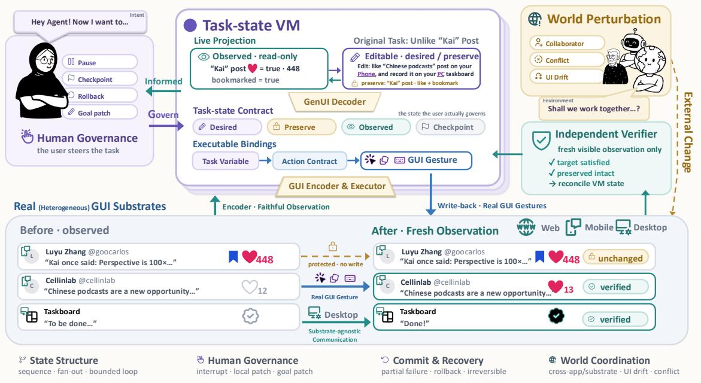  
Figure 1: Task-state governance on a live multi-application workflow. Rather than supervising an agent’s low-level execution trajectory, the user governs a unified Task-state VM. Observed application state (bottom left) is projected into interactive task variables (desired, preserve, observed); edits are translated into real GUI gestures by the GUI Encoder and Executor, while an Independent Verifier checks fresh visible observations against non-interference constraints. Image is a semantically translated replica of the production interface.

## Abstract

Graphical user interface (GUI) agents now execute workflows across real applications, but when execution drifts, users must determine what changed, what should have remained untouched, and what can still be recovered. Plan-centric interfaces leave users supervising procedure, but users live with changes to application state. We introduce task-state governance, an interaction paradigm that represents a task as an editable contract linking desired outcomes, facts that must be preserved, and observed application state. We instantiate this paradigm in TaskVM, which projects live state into editable task controls, executes user edits as genuine interface actions, verifies outcomes through independent observation, and marks each action as reversible, compensatable, or irreversible. Across an automated contract benchmark, a controlled user study, and an open live-model exploration, the paradigm strengthened contract compliance and users’ recovery control and trust, while execution outcomes were held constant. Task contracts open a design space for governable agent interfaces.

## CCS Concepts

• Human-centered computing → Interactive systems and tools; User centered design; • Computing methodologies → Distributed artificial intelligence.

## Keywords

GUI agents, computer-use agents, task virtual machine, bidirectional binding, live projection, task governance, verification, reversibility, substrate independence

## 1 Introduction

Consider postponing a project briefing by one day. The calendar entry and the team announcement must change, while a settled flight booking must remain untouched, and a collaborator may request a diferent date midway through execution. A revised plan does not, by itself, say which updates have already taken efect, which records must stay protected, and which efects can no longer be undone. As Figure 1 illustrates, users ultimately live with changes to the world, not with changes to an agent’s plan.

Computer-use agents (CUAs) have made this delegation technically plausible at scale. Modern agents parse complex layouts, synthesize input gestures, and execute extended operational sequences across unfamiliar interfaces [11, 13, 24, 46, 50, 55, 75]. Interaction research has responded by opening execution up for oversight: co planning surfaces let users revise procedural steps, ambient displays communicate agent status, and malleable or generative interfaces reorganize the workspace around the task [8, 10, 17, 31, 33, 35, 64, 72]. These designs make the agent’s procedure the object of interaction: what the user inspects and edits is what the agent will attempt next.

Two gaps persist in this procedure-centric stance. First, editing a step changes what the agent will attempt, but it cannot express what the world must keep: boundaries on side efects, records that must remain untouched, and facts that should outlive the current plan have no representation in a list of actions. Second, completion and recovery rest on the agent’s own account. When the executor’s report is the only evidence, users cannot verify what actually changed, and undo is ofered without a model of which efects can be restored, inviting the over-reliance that supervisory control research has long documented [3, 42, 51, 52]. Both gaps follow from one representational choice: the task is modeled as a sequence of actions, so the obligations attached to its outcome have nowhere to live.

Our stance extends a lineage of work that treats the object, not the procedure, as the unit of interaction. Direct manipulation established that users reason about visible objects of interest [32, 59]; undo research made recovery a first-class design concern [1, 49]; and accountability research argued that systems should expose what they did so that people can judge it [5, 60]. We extend this lineage from artifacts the user operates to agents that operate on the user’s behalf. We call the resulting stance task-state governance: a task is represented as an editable contract among three state components, not as a procedure alone. The desired state holds the target values the user authorizes the agent to establish. The preservation scope pins application facts that must remain undisturbed. The observed state captures what running applications currently display. When the three are represented together, an edit becomes a checkable commitment: the system knows what it must establish, what it must not disturb, and what evidence will count as done. The plan remains useful, but as one revisable realization of the contract rather than as the task itself.

We call the runtime that maintains this contract a Task Virtual Machine, and the name is deliberate about scope. It is not an operating-system virtual machine: it owns neither the full state of third-party applications nor the power to roll them back atomically. What it owns is the task’s obligation state and an honest account of evidence. Four commitments make the abstraction tangible. Editing a desired value does not assert that the world changed; desired and observed values sit side by side until fresh observation closes the gap. Marking a record as preserved lifts that constraint out of the agent’s plan and into independent verification. An executor’s completion report does not close a task; a separate verifier checks fresh screen evidence first. And a checkpoint is not time travel; recovery is expressed as the operations the environment actually supports.

We realize this stance in TaskVM, a prototype that places the observed state of live applications beside editable task controls. The runtime compiles user edits into genuine interface gestures, so authority flows through the same rendered interface a human would use. An independent visual verifier, architecturally separated from the executor, checks fresh observations against the contract, and the interface distinguishes reversible, compensatable, and irreversible actions so that recovery is described as supported operations rather than a blanket promise. As the Java Virtual Machine (JVM) exposes one bytecode interface across operating systems, the task virtual machine exposes one obligation model across software stacks; substrate independence is the extent of the analogy we intend.

We evaluate the paradigm through three complementary lenses, asking three research questions (RQ):

• RQ1: Does representing tasks as state contracts improve machine-level satisfaction of governance obligations compared with procedural agent baselines, and at what execution cost?

• RQ2: When execution outcomes are held constant, does governing state change how well users understand, control, and trust the agent?

• RQ3: Does the paradigm remain usable and welcome when a live model executes tasks that participants author themselves?

An automated benchmark over 36 task instances drawn from a suite of productivity, social, and content applications measured contract satisfaction and its costs. A controlled within-subject study with 37 participants compared TaskVM against a conversational agent interface under replayed execution, isolating perception from execution variance. An exploratory follow-up with 14 returning participants observed live-model use on self-authored tasks. Across these lenses, TaskVM improved contract compliance at higher ma chine cost, significantly increased perceived recovery control and trust while execution outcomes were held constant, and remained usable in open-ended use, where participants exercised recovery operations and asked for more.

In summary, this paper contributes:

• Task-state governance, an interaction model that represents a task as an editable contract over desired outcomes, preservation constraints, and observed state, together with an explicit taxonomy of recovery.

• TaskVM, a prototype that instantiates the model through live state projection, GUI-grounded bidirectional execution, independent verification, and honestly bounded recovery, running across web, mobile, and desktop substrates.

• A multi-tier evaluation combining an automated contract benchmark, a controlled user study, and an open live-model exploration, together with design implications for agent interfaces that users can govern rather than merely watch.

## 2 Related Work

Our research intersects four traditions: autonomous graphical user interface agents, interfaces that project agent execution, bidirectional and malleable data abstractions, and human-agent governance and awareness. Appendix Table 7 maps this landscape along the object each interface asks the user to govern, tracing what an edit commits each system to, what counts as completion, and what recovery can mean.

## 2.1 GUI Agents: From Autonomous Execution to Interaction

Autonomous graphical user interface agents have transitioned from scripted web automation to multimodal models operating across web [13, 37, 76], desktop [30, 70], and mobile operating systems [55, 66, 74]. Modern systems specialize in coordinate-level display grounding [11, 22, 46, 54, 71], supported by structured reasoning loops [24, 73, 75]. However, benchmark success on autonomous execution does not resolve the human interaction problem. Autonomous traces remain opaque, self-reported completion often diverges from application reality, and single-pass metrics ignore the interactive cost of correcting intermediate errors. Rather than proposing another grounding model, we investigate how agents operate within an architecture that enforces state transparency, non-interference, and verifiable outcomes.

## 2.2 Projecting Agent Execution: Plans, Interfaces, and Malleable Views

To support human oversight, prior research has explored diverse representations of agent operations. Interactive scafolding demon strated the value of structured prompt chains for inspectable substeps [68]. Plan-centric systems externalize reasoning into sequential steps, decision forks, and progress indicators [17, 31, 48]. Plover represents the closest point of comparison: it surfaces structured plans that users can locally revise, keeps executed plan steps as immutable history, attaches derived constraints and visual checks to actions, and runs a cross-platform executor across desktop environments [64]. Beyond a six-person formative study, its evaluation includes an expert benchmark-repair analysis in which the first author intervened on 26 autonomous failures and improved 23, presented by the authors as an upper bound on recoverability rather than typical user performance.

Our comparison concerns the object of interaction and the responsibilities attached to an edit. In plan-centric designs, the protected object is the plan’s executed history, whereas the obligations we study protect facts inside external applications. The evidence of completion also difers in scope: plan-centric systems inspect plan state and screens for execution continuity, whereas our verifier certifies explicit contract obligations (target satisfaction and non-interference over protected facts) from fresh, independently ob tained observations of application state. And the evaluative claims attach to diferent populations: expert-assisted recoverability in a formative setting, versus unaided use by ordinary participants under controlled replay. We read these framings as protecting diferent assets, and the two objects can compose within one system.

Complementary work explores malleable views and generative interfaces. Morae pauses browser workflows to preserve critical user choices [53]. Sidekick visualizes multi-task status [10], while AgentLens adaptively renders mobile interfaces [35]. In web mashups, Orca extracts components with bidirectional DOM synchronization [33], and A-mash combines mobile features into task mashups [43]. Generative UI frameworks synthesize on-demand task cards [8, 38, 63, 69, 72]. Systems such as DynaVis, which composes widgets on demand [63], and Orca, which organizes web components across pages [33], anchor their evidence loops inside the browser they render; cross-application compensation and freshobservation checks of protected state lie outside the problems these systems set out to solve.

## 2.3 Editable and Bidirectional Interfaces: Lenses, Sagas, and Views

Decoupling physical storage from logical views originates in relational databases [12] and declarative querying [9]. Translating edits on projected views back into source structures is formalized as the view-update problem, addressed by Foster et al. through bidirectional lenses with round-trip fidelity [18]. In distributed computing, managing multi-step mutations led Garcia-Molina and Salem to formulate Saga transactions with compensating steps [20, 23, 26].

In HCI, declarative generation decouples task specifications from widget layouts, as demonstrated by SUPPLE [19]. Recent declarative systems like DMI [65] and VeriSafe [41] compile state targets and safety constraints into accessibility gestures. Generative UI protocols such as A2UI [21] and GenUI [44] define standards for streaming components, while UICoder [67] and Cells [36] present methods for interactive UI code generation and structured interfaces. TaskVM adapts these principles to computer-use agents, treating heterogeneous interfaces as a distributed database and compiling user edits into verified, compensatable actions across applications.

## 2.4 Governance, Trust, and Awareness in Human-Agent Collaboration

Designing efective oversight requires mitigating automation complacency. Human supervisory performance degrades during passive monitoring [3], fostering automation bias when agents exhibit high but imperfect competence [51, 52]. Mixed-initiative frameworks advocate dynamic responsibility allocation [29, 47]. Human-AI guidelines emphasize communicating system actions, supporting eficient error correction, and conveying operational boundaries [2]. Furthermore, mitigating over-reliance requires cognitive forcing functions that prompt deliberate verification [7, 28, 42].

Human agency is further supported by malleable, reversible interaction. HCI inquiries show that users continuously appropriate software to fit evolving practices [14, 15, 61]. Reversibility underpins direct manipulation through rapid, reversible operations with visible impact [32, 59], formalized in command trees, selective undo, and side views [1, 49, 62]. Across multi-device and task-centric computing, systems maintain continuity across fragmented tools [4, 6, 27, 34, 40, 56, 57]. Finally, collaborative awareness requires visible artifacts that expose system capabilities and boundaries [5, 16, 25, 39, 58, 60]. TaskVM synthesizes these insights by replacing passive trajectory tracking with an editable, live projection of verified application state.

## 3 A Task-State Governance Interaction Model

To bridge human intent and autonomous software execution, we formulate a task-state governance model elevating application state into the primary interactive medium: humans govern tasks, while agents operate applications.

## 3.1 State Intent versus Plan Intent

Current interactive agents structure human intervention around plan intent, presenting upcoming procedural steps, tool invocations, or sub-goal trees [17, 64]. When a user intervenes, the operation modifies an upcoming action, such as replacing a query or deleting a click. While ofering procedural steerability, this conflates what the agent attempts with what the user requires the world to become: a step can execute without error yet fail to achieve the intended outcome, or inadvertently corrupt adjacent records [2, 3].

In contrast, our interaction model formalizes user intent as state intent, specifying invariant properties that must hold true once execution concludes. Instead of dictating navigation paths, the user specifies what application facts must change and what historical context must remain undisturbed. As defined in our domain schema, an ActionContract encapsulates these state obligations independently of platform execution paths. This distinction decouples human governance from low-level software idiosyncrasies: just as programming runtimes allow developers to declare invariants while delegating memory management, our model enables users to express task invariants while delegating mouse coordinates and Document Object Model (DOM) traversals to autonomous executors. As mapped across the top band of Figure 3, a governed round trip traverses eight semantic stages from Observe and Abstract through Reconcile to close a single episode.

## 3.2 The Executable View: Bottom-Up Live Projection

To make state intent manipulable without exposing raw complexity, our model compiles live software state into an executable view, compressing distributed fields into a unified, low-cognitive-load surface. Figure 2 shows the governance interface that realizes this view, organized into three zones that mirror the state representations of our model.

Zone C (Editable Task State and Live World) presents the desired, preserve, and observed fields of each task variable side by side with the live application window. The observed column is a read-only faithful projection of current software reality, grounded in visual evidence parsed directly from rendered screens [60]; the desired column is editable, and the preserve column pins facts that must remain undisturbed. Zone A (Task Intent and Global Governance) hosts the mission contract and lifecycle controls, and Zone B (Execution Progress and Local Governance) exposes execution progress, the live status of each model-invoking role, and the model call chain.

Maintaining fidelity between the projection and external software requires continuous bidirectional synchronization. The projection streams dynamic live deltas through server-sent events, updating the interface as the external world changes. When concurrent external modifications occur, such as a colleague editing a shared document, the system triggers reconciliation mechanisms. Rather than silently overwriting external modifications or crashing the pipeline, TaskVM surfaces external changes as explicit conflict markers in Zone C , inviting the user to reconcile divergent values through deliberate interaction [7, 16].

## 3.3 The Desired-Preservation-Observed Triad

We formalize task-state governance through three interconnected state representations:

$$
\mathcal { T } = \langle S _ { \mathrm { d e s i r e d } } , S _ { \mathrm { p r e s e r v e } } , S _ { \mathrm { o b s e r v e d } } \rangle\tag{1}
$$

The desired state $S _ { \mathrm { d e s i r e d } }$ consists of target variables $\{ \boldsymbol { v } _ { 1 } ~ \mapsto$ $c _ { 1 } , \ldots , v _ { n } \mapsto c _ { n } \}$ that the user authorizes the agent to establish. The preservation scope $S _ { \mathrm { p r e s e r v e } }$ defines invariant constraints over protected application entities. In real-world workflows, accomplishing a goal often threatens adjacent data; for example, updating a meeting time must not alter room reservations or attendee notes. By formalizing $S _ { \mathrm { p r e s e r v e } }$ as an explicit mathematical construct, our model establishes verifiable non-interference boundaries: any execution establishing $S _ { \mathrm { d e s i r e d } }$ while violating an invariant in �preserve is classified as an operational failure. The observed state �observed captures visual facts parsed from rendered application screens at time �. A task transition is formally valid if and only if fresh visual observation confirms that external software satisfies the desired state while leaving the preservation scope inviolate:

$$
\mathrm { V a l i d } ( { \mathcal T } ) \iff ( S _ { \mathrm { o b s e r v e d } } \mid = S _ { \mathrm { d e s i r e d } } ) \wedge ( S _ { \mathrm { o b s e r v e d } } \mid = S _ { \mathrm { p r e s e r v e } } )\tag{2}
$$

The user governs the relationship between $S _ { \mathrm { d e s i r e d } }$ and $S _ { \mathrm { p r e s e r v e } }$ in the governance console (Zone C of Figure 2), while the runtime engine continuously reconciles �observed against external software.

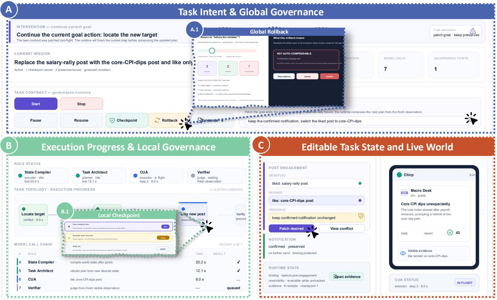  
Figure 2: The TaskVM governance interface (a faithful English rendering of the production UI, redrawn for language accessi bility). A Task Intent & Global Governance: the current mission and task contract, lifecycle controls (start, pause, resume, checkpoint, rollback), and a global rollback dialog that previews which committed steps would be replayed or restored and flags efects that are not auto-compensable. B Execution Progress & Local Governance: live status of the four model-invoking roles (state compiler, task architect, CUA executor, verifier), task-topology progress, local checkpoint options, and the model call chain. C Editable Task State & Live World: the desired–preserve–observed triad rendered beside the live GUI, with patch and conflict controls and a runtime-state card linking every variable to visible evidence.

## 3.4 Verification Semantics: Independent Witnessing and Non-Interference

A core tenet of our governance model is that execution completion must never be self-certified by the executing agent. Autonomous agents frequently report success prematurely, mistaking the emission of a completion token for actual state alteration [24, 75]. Our model delegates verification to an independent visual verifier evaluating rendered application screens.

The verification engine enforces two complementary properties: target satisfaction and non-interference. To verify target satisfaction, the verifier requires visible witness predicates, demanding explicit evidence that an intended modification was actively en acted to eliminate the no-op loophole where an agent claims success on a pre-existing state. To enforce non-interference, the verifier evaluates negative predicates over specified, observable entities in �preserve, confirming that protected fields display the same values in fresh screenshots. Crucially, the independent verifier operates with strict contextual and architectural isolation from the executing agent, sharing no internal reasoning bufers or prompt scafold ing; in the interface it appears as a first-class role awaiting fresh observation (Zone B of Figure 2). Evaluating fresh visual observations against formal predicates provides an objective, falsifiable gate before any task is marked complete in the user interface [5].

## 3.5 Recovery Semantics: Reversible, Compensatable, and Irreversible Actions

Real-world software interactions require robust mechanisms for error correction, interruption, and recovery. In traditional direct manipulation interfaces, undo operations revert local memory structures [1, 59]. However, in multi-application environments, software changes induce persistent external side efects that cannot be undone by simple state restoration [20, 23].

Our model establishes a taxonomy of operational reversibility, codified in our implementation as Reversibility:

• Reversible Actions: Operations whose efects can be completely and symmetrically undone through standard graphical gestures without residual impact, such as toggling an unsubmitted checkbox or clearing a draft text field.

• Compensatable Actions: Operations that induce persistent external efects but can be semantically counterbalanced through secondary compensation actions, such as sending a cancellation message to follow an erroneous notification [20, 26].

• Irreversible Actions: Operations that permanently modify external systems or invoke physical efects that cannot be restored, such as deleting account archives or completing financial settlements.

When a user initiates a rollback or edits a historical checkpoint, TaskVM derives a compensation plan exclusively from its committed action history (CompensationPatch). Reversible and compensatable actions execute compensating GUI gestures across afected applications. Conversely, when an action crosses an irreversible boundary, the interaction model prohibits deceptive representations of undo: the global rollback dialog in Zone A (Figure 2) previews which committed steps would be replayed or restored, explicitly marks efects that are not auto-compensable, and locks irreversible entities with transparent status badges, preventing the dangerous illusion of complete reversibility and supporting appropriate reliance [7, 42].

## 4 The TaskVM Prototype

We implement the task-state governance model in TaskVM, an interactive system governing multi-application workflows across web, mobile, and desktop software. This section details the data flow, privacy boundaries, bidirectional bindings, governance primitives, and substrate abstractions that realize our conceptual framework.

## 4.1 System Architecture and Separation of Concerns

As mapped in Figure 3, TaskVM is organized around a hub-andspoke data flow centered on the Task-state VM (Kernel). The Kernel serves as the sole owner of task state, maintaining TaskState (intent, variables), workflow graphs, append-only event logs, and epoch checkpoints. By enforcing a defensive read path, the system prevents low-level drivers or downstream consumers from polluting central task semantics.

Rather than relying on a single vision-language model, TaskVM distributes responsibilities across specialized roles that exchange typed objects with the Kernel. The GUI Agent functions as an Encoder, observing live software displays via dedicated observation structures and channeling them into the State Compiler (F2). The Compiler converts visual candidates into standardized task variables (F2, F2’) and forwards them to the Task Architect. A separate generative interface model functions as a Decoder (F3), translating intent into interactive A2UI components projected to the user interface (F3’). These roles execute through independent model invocations marked by amber indicators, preventing their conversational histories from being shared directly. All experiments reported in this paper instantiate every model-invoking role with the same production model, OpenAI’s GPT-5.6-sol (per-condition configuration in Section 5 and Appendix L). While this separation limits direct context leakage, it does not eliminate extraction errors or correlated failures, so the generated representation is not treated as evidence of its own correctness.

## 4.2 GUI-Only Purity and the No-Internal-ID Rule

A pervasive vulnerability in automated GUI systems is reliance on internal implementation identifiers, such as private DOM IDs, database keys, or synthetic accessibility tags. While internal identifiers facilitate automated testing, they break down in open-world environments where dynamic layouts alter internal structures without changing visual appearances. Furthermore, relying on internal identifiers creates backdoors that bypass rendered interfaces, giving automated agents privileges unavailable to human operators.

To maintain operational integrity, TaskVM enforces the GUI-only purity standard. Every piece of data entering the model pipeline must satisfy the one-question test: could a real human user see this exact string on the rendered screen? If an attribute cannot be visually perceived by a human looking at the monitor, it is strictly prohibited from entering any model prompt. The compilation pipeline incorporates an explicit verification module that intercepts candidate records and strips internal database keys, accessibility labels, operator jargon, and deep-link URLs via dedicated hidden-ID scrubbers and architectural no-leak filters. Every task variable in the governance console must link directly to verbatim visual evidence parsed from the display. Moreover, all write operations must traverse authentic graphical gestures (GuiAction), including coordinate-targeted mouse clicks, keystrokes, and scroll events. Any state alteration that does not require a rendered display and simulated user input is classified as an unauthorized backdoor and rejected by the runtime kernel.

## 4.3 Bidirectional Executable Binding and Multi-App Action Contracts

TaskVM achieves bidirectional interaction through executable semantic bindings that connect high-level virtual machine variables to low-level application gestures. We conceptualize this mechanism as an analog to the Java Virtual Machine. Just as a Java programmer modifies an abstract object variable and relies on the virtual machine to translate the assignment into platform-specific memory ofsets, a TaskVM user edits an abstract task variable in the governance console and relies on TaskVM to synthesize coordinated writes across heterogeneous software.

When a user alters a variable in the governance console, the system instantiates a semantic ActionContract in our domain schema. The contract specifies what condition must become true in the target application, rather than hardcoding how the application must be navigated. Target entities are identified through robust visual anchors, such as surrounding label text, relative geometric ofsets, and icon visual embeddings, rather than brittle pixel coordinates. When a single conceptual edit requires modifications across multiple applications, such as synchronizing a deadline across a project management board and a team chat client, the runtime orchestrates a fan-out execution plan. The execution engine sequences operations across application windows, monitors UI transitions, and commits state updates only after verifying structured action outcomes (ActionReceipt).

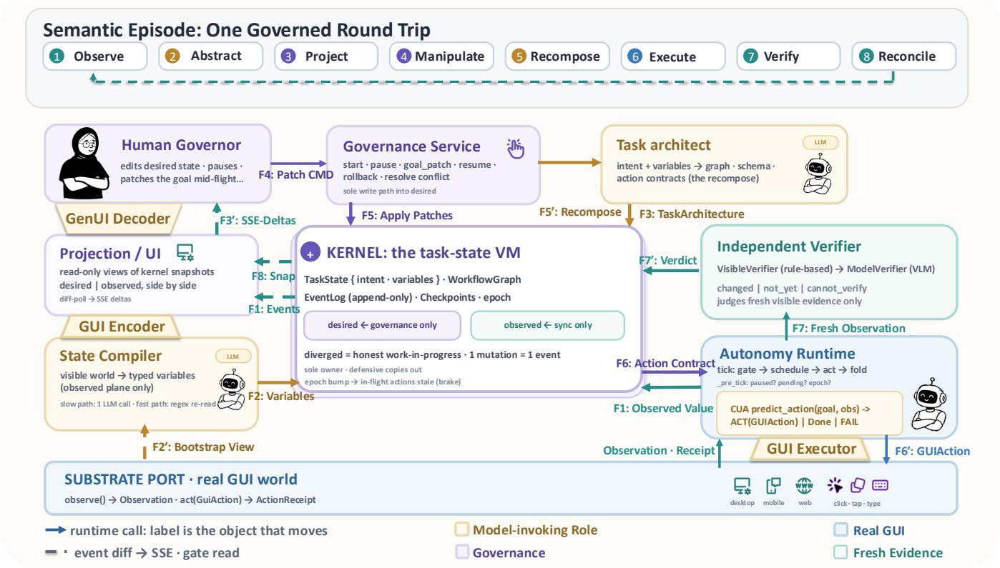  
Figure 3: TaskVM data flow as a hub-and-spoke architecture. The kernel is the sole owner of task state; six spokes exchange typed objects with it, and the substrate port is the only door to the real GUI world (observe() in, act(GuiAction) out; real gestures only, with no backdoor writes). Every arrow is labeled with the actual data object that moves. The label prefix F1 to F8 indexes the eight semantic stages of one governed round trip (top band), so a number denotes stage membership, not size or importance; a prime (′) marks the paired/return process ofthe same stage rather than a diferent stage (for example, F7 fresh observation and F7′ verdict are the question and the answer of Verify). Amber cards host model-invoking roles (architect, state compiler, CUA model); violet equals governance, teal equals fresh evidence, blue equals real GUI.

## 4.4 Hot Governance: Pausing, Patches, Epochs, and Recovery

Real-world human governance requires the ability to intervene while execution is actively underway. TaskVM provides four foundational hot governance primitives: pause, local patch, goal patch, and rollback. At any point during autonomous execution, the user can trigger a pause control in the governance console. The Governance Service immediately issues a halt signal to the active runtime, freezing the execution harness at the current step boundary.

To manage race conditions during mid-execution interventions, TaskVM introduces epoch-based governance gating in the kernel. Every task execution belongs to a monotonically increasing integer epoch. When a user pauses the system and applies a local patch or revises the overarching goal, the governance engine increments the epoch counter. If the autonomous agent was in the process of generating an action from the preceding epoch, the kernel gate intercepts the returning proposal and discards it before dispatch. This prevents stale proposals from being newly dispatched after a revision, without claiming to reverse efects of actions already dispatched.

When a user modifies a goal, the system retains valid, committed action history and recomposes only the afected future trajectory, avoiding redundant re-execution of unafected milestones. When a rollback is requested, the compensation engine analyzes the committed action registry. For reversible operations, the runtime synthesizes inverse graphical gestures, such as untoggling checkboxes or clearing input forms. For compensatable operations, the runtime executes compensating GUI actions, such as dispatching cancellation notes; these counteract the intended efect but do not assure atomic rollback [20]. Finally, when an operation crosses an irreversible threshold, such as a finalized monetary payment, the system prevents misleading undo representations by raising an explicit irreversible signal. Irreversible entities are locked in the interface with transparent explanatory badges, clarifying the limits of automated recovery.

## 4.5 Substrate Independence and Session Isolation

A central objective of TaskVM is substrate independence: ensuring that the same high-level task semantics can be governed identically regardless of the underlying operating system or application technology stack. TaskVM abstracts external software through a clean SubstratePort interface, implemented across modular sessions. The SubstratePort defines primitive operations for capturing visual screenshots, reading device metadata, and dispatching standardized mouse and keyboard input events. Our prototype provides implementations for three distinct platforms: modern web applications, the OSWorld Linux desktop benchmark environment [70], and the browser-hosted mobile simulation environment MobileGym [66]. Independent visual verification takes place over extracted visual artifacts.

Table 1: Stage 1 automated bench under skills injection OFF, 36 task instances per condition. TaskVM achieves the highest Contract-Outcome Verification (COV) strict pass rate and the highest atomic predicate mean; the lower block reports its advantage over each baseline.
<table><tr><td>Condition</td><td>COV strict rate</td><td>COV atomic mean</td><td>Model calls</td><td>Wall time (s)</td></tr><tr><td>TaskVM (ours)</td><td>0.583 (21/36)</td><td>0.870</td><td>1,126</td><td>19,960</td></tr><tr><td>Direct-CUA</td><td>0.500 (18/36)</td><td>0.761</td><td>1,361</td><td>9,010</td></tr><tr><td>Planner-CUA</td><td>0.472 (17/36)</td><td>0.737</td><td>1,031</td><td>6,695</td></tr><tr><td>Template Control†</td><td>0.083 (3/36)</td><td>0.712</td><td>144</td><td>8,527</td></tr><tr><td colspan="5">TaskVM advantage over baselines</td></tr><tr><td>vs Direct-CUA</td><td>+0.083 (+16.6%)</td><td>+0.109 (+14.3%)</td><td></td><td></td></tr><tr><td>vs Planner-CUA</td><td>+0.111 (+23.5%)</td><td>+0.133 (+18.0%)</td><td></td><td></td></tr></table>

† Template Control is an assembly sanity-check driver that replays scripted gestures with zero LLM invocations (the 144 figure above counts scripted action events, not model calls); 101 of its 108 runs across the evaluated waves failed at the architect stub due to an implementation limitation in parsing Chinese natural-language goals, so it is not a valid baseline.

To isolate the agent from hidden laboratory shortcuts, TaskVM enforces strict privilege separation between the runtime session and the evaluation harness. The user-facing runtime interacts exclusively with a session object possessing only standard human capabilities: capturing visual display pixels and issuing realistic graphical gestures. Privileged capabilities required by benchmark ing, such as resetting databases, reading internal state trees, or injecting deterministic world events, are encapsulated in an isolated evaluation harness. These privileged methods are strictly inaccessible to both the planning agent and the interface compiler. By separating runtime execution from benchmarking machinery, TaskVM ensures that its evaluation results reflect genuine interactive competence.

## 5 Stage 1: Automated Technical Evaluation

We evaluate the technical capabilities, operational bounds, and governance properties of TaskVM through an automated benchmark on a frozen suite of multi-application workflows. This evaluation establishes whether explicit state contracts improve execution reliability over procedural computer-use agents, how performance distributes across task zones, and whether skills injection preserves execution non-inferiority.

## 5.1 Evaluation Protocol and Contract-Outcome Verification

The automated evaluation suite comprises 36 task instances spanning 12 structural task families derived from the TaskVM architectural contract, with three variants per family. Execution correctness is adjudicated through Contract-Outcome Verification (COV), structured across ten machine-verifiable domain predicates defined in Appendix A. Each trial is evaluated against all applicable predicates. These include certifying that target fields reach their required final values (required\_final\_state), confirming that protected fields outside the authorized set remain untouched (protected\_ non\_interference), ensuring that executions visit required witness checkpoints (required\_witness\_trajectory), and verifying that superseded user intents leave no residual efects (superseded\_ intent\_suppressed). Furthermore, transactional boundaries are checked by verifying that pause and stop commands halt execution immediately (pause\_stop\_boundary), externally owned objects are not overwritten (external\_ownership\_preservation), and requested rollbacks restore pre-states without hidden evaluator resets (no\_hidden\_evaluator\_restore). We report two complementary metrics: strict pass rate, requiring all applicable predicates in a trial to pass, and atomic predicate mean, measuring the average pass rate across applicable predicates.

Table 2: COV results split by task zone (skills injection ON). Zone-G families exercise intent landing, supersession, pause boundaries, and reversible restore. Subsets and denominators difer across conditions; rates describe the tested populations and are not matched contrasts.
<table><tr><td>Zone / Condition</td><td>TaskVM</td><td>Direct-CUA</td><td>Planner-CUA</td></tr><tr><td colspan="4">Zone-S: sequential / simple families (sqv, fav, 1pv)</td></tr><tr><td>COV strict rate</td><td>0.556 (5/9)</td><td>0.467 (7/15)</td><td>0.533 (8/15)</td></tr><tr><td>COV atomic mean</td><td>0.852</td><td>0.733</td><td>0.767</td></tr><tr><td colspan="4">Zone-G: governance-dense families</td></tr><tr><td>COV strict rate</td><td>0.714 (10/14)</td><td>0.571 (12/21)</td><td>0.476 (10/21)</td></tr><tr><td>COV atomic mean</td><td>0.922</td><td>0.822</td><td>0.797</td></tr></table>

Table 3: Efects of procedural skills injection. Upper block: paired family-level outcome flips between the skills-OFF and skills-ON waves. Lower block: contract-faithful execution (CFE) non-inferiority of TaskVM against its strongest baseline within the skills-ON wave, cluster-bootstrapped (10,000 resamples, 35 paired clusters).
<table><tr><td>Paired family flip</td><td>TaskVM</td><td>Direct-CUA</td><td>Planner-CUA</td></tr><tr><td>fail → pass (skills helped</td><td>4</td><td>0</td><td>0</td></tr><tr><td>pass → fail (skills hurt)</td><td>3</td><td>0</td><td>0</td></tr><tr><td>unchanged</td><td>14</td><td>18</td><td>18</td></tr><tr><td>missing (no OFF data)</td><td>0</td><td>3</td><td>3</td></tr><tr><td>Net gain</td><td>+1</td><td>0</td><td>0</td></tr><tr><td colspan="4">CFE non-inferiority, TaskVM vs Direct-CUA (skills-ON wave)</td></tr><tr><td>Point estimate</td><td colspan="3">+0.0571</td></tr><tr><td>One-sided 95% lower bound</td><td colspan="3">-0.0857</td></tr><tr><td>Verdict at protocol-specified 10pp margin</td><td colspan="3">Non-inferior</td></tr></table>

Trials are evaluated across three primary execution conditions with skills injection disabled, comprising 36 instances per condition: TaskVM, Direct-CUA, and Planner-CUA. Direct-CUA perceives raw screenshots and dispatches actions directly, receiving interventions as natural language messages delivered to an interactive chat drawer. Planner-CUA formulates hierarchical natural language plans before dispatching actions. All conditions execute against identical hidden-oracle world contracts, ensuring that evaluation relies on external ground truth rather than agent self-reports.

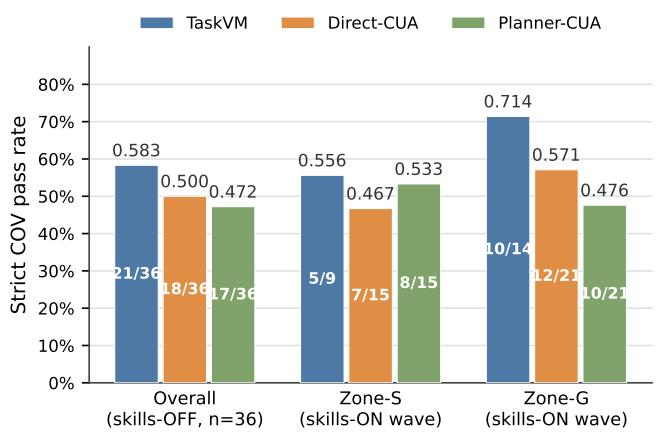  
(a) Aggregate COV strict pass rate across conditions, overall and by task zone. Per-family outcomes appear in Appendix Figure 8.

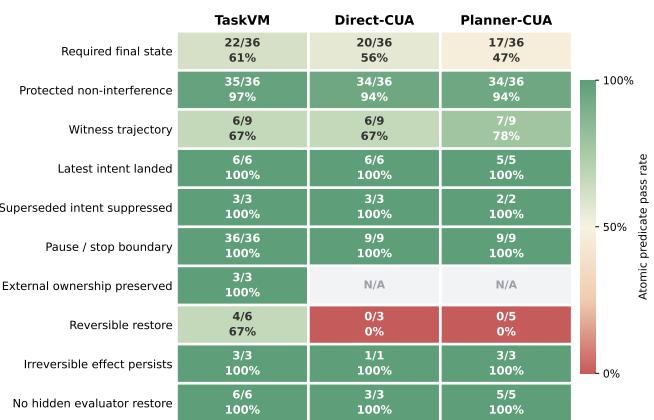  
(b) Adjudication breakdown across individual COV predicates.  
Figure 4: Stage 1 automated technical evaluation results on the frozen suite of 36 task instances spanning 12 structural task families. (a) Overall bars come from the skills-OFF main wave; zone bars come from the skills-ON comparison wave with unmatched denominators, as documented in Table 2.

Evaluation configuration. All LLM roles in all conditions ran the same production model (GPT-5.6-sol) through the same internal inference endpoint, so condition diferences reflect the interaction and runtime architecture rather than model choice. In the TaskVM condition the model serves four prompted roles: state compiler, task architect, CUA executor, and an independent model verifier reading fresh screenshots; Direct-CUA and Planner-CUA use the same model for a single agentic loop (with a planning preamble in the latter) over identical environment seeds. Template Control is a scripted gesture driver with zero LLM calls. The user-facing runtime sees only rendered pixels and standard input gestures, whereas oracle-only capabilities (state resets, internal-state reads, event injection) live in an isolated evaluation harness; every trial manifest records the model identity, ledger call counts per role, and wall time, and the frozen run artifacts are retained in the consolidated archive (full prompts and generation settings in the supplementary package).

## 5.2 Main Benchmark Findings

Table 1 reports the primary comparison across the 36 task instances, visualized in Figure 4. On the skills-OFF main comparison, TaskVM obtained 21/36 strict passes (rate: 0.583) and an atomic predicate mean of 0.870, compared with 18/36 (0.500) and 0.761 for Direct-CUA, and 17/36 (0.472) and 0.737 for Planner-CUA. The advantage amounts to +0.083 (+16.6%) over Direct-CUA and +0.111 (+23.5%) over Planner-CUA in strict pass rate, alongside +0.109 (+14.3%) and +0.133 (+18.0%) in atomic predicate mean. Inspection of error traces indicates that baseline failures frequently stemmed from premature completion claims and collateral modifications. Direct-CUA often emitted stop tokens before asynchronous web updates persisted, and Planner-CUA altered adjacent form fields when replanning. In contrast, TaskVM enforced witness predicates that confirmed persisted state before certifying completion. However, this verification property introduces operational overhead: TaskVM consumed 19,960 seconds of wall time across 1,126 model calls, about 2.2 times the wall time ofDirect-CUA, reflecting the latency of round-trip state compilation and verification polling. We report this machine-side cost as a measured property ofthe automated harness; it cannot be decomposed here into user-facing costs, which the later studies measure on their own terms. Table 1 also documents Template Control (3/36 strict pass rate), included exclusively as an assembly sanity check; 101 of 108 trials failed at the architect stage due to a limitation in parsing Chinese-language goals, so it is not an empirical baseline.

## 5.3 Predicate-Level Disaggregation

The predicate-level breakdown in Figure 4b localizes where the advantage originates. The largest source of separation is required\_ final\_state, which TaskVM satisfied on 22 of 36 instances versus 20 for Direct-CUA and 17 for Planner-CUA. Two further observations concern recovery specifically. On reversible\_restore, TaskVM restored the protected pre-state in 4 of 6 applicable trials, while Direct-CUA restored none of its 3 applicable trials and Planner-CUA none of its 5: in the adjudication records the baselines possess no restore verb at all, and on external\_ownership\_ preservation they reach no testable scenario. TaskVM is also the only condition measured on all ten predicates, including 36/36 passes on pause\_stop\_boundary; this full-spectrum measurability is itself a distinguishing property of contract-checked execution. This machine-side asymmetry, where recovery exists as an executable verb only under TaskVM, is mirrored later at the human layer: recovery operations were the most adopted governance functions in Stage 2 (Section 6) and the most demanded automation in Stage 3 (Section 7).

## 5.4 Zone Breakdown and Governance Eficacy

To understand where state contracts provide utility, Table 2 partitions evaluation across task zones in a separate skills-ON comparison wave. Zone-S comprises five structural and execution families (Loop blv, Fan-out fav, Partial-failure pfv, Cross-app cav, Sequence sqv), while Zone-G comprises seven governance-dense families (Conflict cfv, UI-drift drv, Interrupt itv, Local-patch lpv, Goal-patch gpv, Irreversible irv, Rollback rbv) that specifically test user intervention intent landing, supersession, pause boundaries, and reversible restore; the same family-to-zone dictionary drives Figure 8 and Appendix Table 8.

In Zone-S, TaskVM achieved a strict pass rate of 0.556 (5/9) and an atomic mean of 0.852, compared with 0.467 (7/15) and 0.733 for Direct-CUA, and 0.533 (8/15) and 0.767 for Planner-CUA. In Zone-G, TaskVM achieved a strict pass rate of 0.714 (10/14) and an atomic mean of 0.922, compared with 0.571 (12/21) and 0.822 for Direct-CUA, and 0.476 (10/21) and 0.797 for Planner-CUA. On these descriptive rates, the advantage over both baselines is larger in Zone-G than in Zone-S. The same governance dimension later separates the two interfaces for human users: in Stage 2, participants reported their largest perceived-control gain on the ability to stop and redirect the agent (Section 6). Notably, the analyzed subsets and denominators difer across execution conditions (e.g., 9 vs 15 and 14 vs 21). These unmatched rates are reported to document the tested populations; missing or excluded cases are not treated as zero, and the diference between unmatched rates is not interpreted as a matched statistical contrast.

## 5.5 Skills Injection and Non-Inferiority Analysis

We examine whether procedural skills injection harms TaskVM’s contract faithfulness and whether TaskVM remains non-inferior to its strongest baseline once skills are enabled (Table 3). Paired across 21 instances between the two waves, skills injection flipped four instances in TaskVM’s favor and three against it, a modest net gain of +1; neither CUA baseline showed any net change. Because the skills-OFF and skills-ON waves difer in coverage, we additionally evaluate non-inferiority within the same skills-ON wave on contract-faithful execution (CFE), a per-instance correctness measure derived from the task boundary semantics of each family. The two analysis collections are explicitly distinct: the strict-COV index retains only fully measured cells (23 of 36 for TaskVM under skills-ON), whereas the CFE comparison additionally admits the protocol’s per-family fallback judgments (e.g., boundary arcs judged from pre-boundary oracle segments), yielding 35 comparable instance clusters paired between TaskVM and Direct-CUA; the 35 are instance-level clusters, not a third task set. A cluster bootstrap over these 35 paired clusters (10,000 resamples, fixed seed) yields a point estimate of the TaskVM minus Direct-CUA diference of +0.0571, with a one-sided 95% lower bound of −0.0857. This lower bound clears the margin of 10 percentage points specified in our evaluation protocol, establishing non-inferiority at that margin; sensitivity analyses at 5 and 7.5 points remain inconclusive, and the verdict also holds at 15 points. Among the eight discordant clusters, TaskVM alone succeeded on five instances concentrated in drift-robust rescheduling and sequential contract chains (drv-01, drv-03, sqv-01 through sqv-03), while Direct-CUA alone succeeded on three instances involving confusable references and retargeting (gpv-03, lpv-03, pfv-03). Skills injection therefore does not degrade TaskVM below its strongest baseline on contractfaithful execution, though the inconclusive stricter margins call for larger paired samples. This result supersedes an earlier crosswave draft analysis that was inconclusive; the final protocol and its sensitivity margins are documented in Appendix B.

## 5.6 Stress-Tier Robustness

Beyond the frozen benchmark waves, a development-era stress tier probed governance durability under adversarial goal mutations with skills enabled throughout. The tier comprises 18 variants at difficulty levels L3 and L4, covering conflict injection, goal repair, and cross-session intervention, adjudicated under a majority criterion in which a frozen pass verdict is never reversed. Eleven of 12 L3 variants and all 6 L4 variants passed. The single L3 failure is rbvl3, a rollback-compensation family blocked by a signing-window race condition that remains an open, documented defect. We report this tier as robustness evidence rather than held-out results. The placement of the sole failure is nonetheless informative: rollback is simultaneously the hardest capability to make reliable and, as the next two sections show, the capability human participants used and requested the most (Sections 6 and 7); we return to this tension in the Discussion.

## 6 Stage 2: User Study on Task Governance

While automated technical evaluations establish system capabilities across benchmark suites, evaluating human governance requires empirical observation of human operators. We conducted a controlled, within-subject laboratory user study with 37 participants to evaluate how human operators understand, steer, and verify multi-application agent workflows. The study investigates how compiling live application state into an editable governance surface influences perceived recovery control, trust, and the alignment between confidence and understanding compared to conversational agent interfaces.

## 6.1 Study Goals and Hypotheses

The primary objective of the user study is to evaluate the interactive eficacy and cognitive impact of task-state governance during collaborative execution. We formulate four research questions:

• RQ1 (State Understanding and Confidence Gap): Does task-state governance descriptively narrow the gap between user confidence and objective understanding of application state?

• RQ2 (Perceived Recovery Control and Adoption): Does exposing transactional checkpoints and reversibility locks improve perceived recovery control and encourage adoption of recovery operations?

• RQ3 (Interaction Cost under Execution Control): When the environment and the agent’s replayed trajectory are held constant across conditions, what interaction latency and workload trade-ofs emerge from state-level governance?

Table 4: Stage 2 within-subject user study evaluation (� = 37). We report means, paired diferences (Δ), directional participant counts (in favor of TaskVM / in favor of Conversational CUA), Wilcoxon signed-rank �-values, and standardized efect sizes (� ). Bold entries are statistically significant at $\begin{array} { r }  p < . 0 5 \ \end{array}$ . Write-probe margins are a manipulation check of the replay protocol: the environment and the replayed trajectory were identical across arms, so identical margins indicate that neither arm ofered systematically easier intervention opportunities, not that the interfaces would execute with equivalent competence outside the rig.
<table><tr><td>Measure</td><td>TaskVM</td><td>Conv CUA</td><td>Δ</td><td>Paired counts</td><td>p</td><td> $d _ { z }$ </td></tr><tr><td colspan="7">Subjective measures (1–7 unless noted; higher is better except NASA-TLX)</td></tr><tr><td>Trust (2-item TIA composite ↑)</td><td>5.54</td><td>4.36</td><td>+1.18</td><td>21 / 7</td><td>.0030</td><td>+0.55</td></tr><tr><td>Recovery control (4 study-specific items ↑)</td><td>5.56</td><td>4.63</td><td>+0.93</td><td>22 / 13</td><td>.0050</td><td>+0.51</td></tr><tr><td>Stop and redirect (rc_stop_redirect)</td><td>5.68</td><td>4.43</td><td>+1.24</td><td>23 / 7</td><td>.0035</td><td>+0.58</td></tr><tr><td>Correct errors (rc_correct)</td><td>5.49</td><td>4.59</td><td>+0.89</td><td>20 / 10</td><td>.0160</td><td>+0.42</td></tr><tr><td>Overall control (rc_overall)</td><td>5.35</td><td>4.35</td><td>+1.00</td><td>19 / 9</td><td>.0099</td><td>+0.44</td></tr><tr><td>Influence agent (rc_influence)</td><td>5.73</td><td>5.14</td><td>+0.59</td><td>14 / 8</td><td>.0475</td><td>+0.35</td></tr><tr><td>Support satisfaction (adapted 3-item ASQ ↑)</td><td>5.66</td><td>4.95</td><td>+0.70</td><td>20 / 11</td><td>.0222</td><td>+0.42</td></tr><tr><td>Perceived transparency (3-item TIA subset® ↑)</td><td>5.07</td><td>4.50</td><td>+0.57</td><td>20 / 14</td><td>.0809</td><td>+0.30</td></tr><tr><td>Usability (UMUX-Lite, rescaled 0–100 ↑)</td><td>70.72</td><td>60.14</td><td>+10.58</td><td>20 / 12</td><td>.0881</td><td>+0.33</td></tr><tr><td>Workload (NASA-TLX, unweighted 6-dim mean ↓)</td><td>29.82</td><td>39.08</td><td>-9.26</td><td>21 lower</td><td>.0938</td><td>-0.36</td></tr><tr><td>Physical demand (0-100 ↓)</td><td>17.97</td><td>30.95</td><td>-12.97</td><td>17 lower</td><td>.0085</td><td>-0.50</td></tr><tr><td>Frustration (0-100 ↓)</td><td>26.49</td><td>36.89</td><td>-10.41</td><td>19 lower</td><td>.0915</td><td>-0.32</td></tr><tr><td colspan="7">Objective behavioral metrics and descriptive calibration</td></tr><tr><td>Overconfidence gap (confidence – accuracy)‡</td><td>+13.2 pp</td><td>+25.8 pp</td><td>-12.6 pp</td><td></td><td></td><td></td></tr><tr><td>Read-probe question accuracy</td><td>84.8% (56/66)</td><td>73.3% (44/60)</td><td>+11.5 pp</td><td>3 / 2 (tie 3)</td><td>1.000</td><td>+0.10</td></tr><tr><td>Write-probe boundary pass</td><td>34.3% (12/35)</td><td>34.3% (12/35)</td><td>0.0 pp</td><td>12 / 12 / 10 / 0</td><td>1.000</td><td>0.00</td></tr><tr><td>Write-probe end pass†</td><td>51.4% (18/35)</td><td>51.4% (18/35)</td><td>0.0 pp</td><td>18 / 18 / 1 / 0</td><td>1.000</td><td>0.00</td></tr><tr><td>Median intervention latency (s)</td><td>85.3</td><td>65.7</td><td>+19.6</td><td>21 slower</td><td>.4372</td><td>+0.23</td></tr><tr><td>Rollback (reset) operations</td><td>17 events</td><td>4 events</td><td>+13</td><td>11 / 2 users</td><td></td><td></td></tr></table>

† In the paired-count column, the two write-probe rows report the four-cell split in the order TaskVM-only pass / Conv-only pass / both-fail / both-pass. Boundary analysis keeps 34 pairs, excluding P34 (unscored in both arms), P19 (no TaskVM-arm probe), and P04 (no conversational-arm probe); marginal denominators are 35 per arm because the TaskVM-arm marginal drops P34 and P19, while the conversational-arm marginal drops P34 and P04. End analysis keeps all 37 pairs, counting the two unscored probes as not-passed, so the paired end rate is 18/37 (48.6%) while the scored marginal rate is 18/35 (51.4%). McNemar � = 1.0 at both time points.  
‡ The gap uses all-correct accuracy among responses carrying a confidence rating: 12/21 (57.1%) under TaskVM and 9/20 (45.0%) under the baseline. The read-probe row above counts all answered probes, where TaskVM all-correct accuracy is 13/22 (59.1%); the one TaskVM response lacking a confidence rating explains the denominator diference.  
§ Mean of three predictability items with the unpredictability item reverse-scored (8 minus the raw rating).

• RQ4 (Trust and Subjective Satisfaction): Does the taskstate governance console foster higher subjective trust and satisfaction compared to conversational supervision?

We hypothesized that TaskVM would significantly increase perceived recovery control and reported trust while narrowing the observed overconfidence gap. Furthermore, we anticipated that governing state would introduce an observable interaction latency trade-of even with the environment and the replayed trajectory held identical by design.

## 6.2 Participants and Ethics

We recruited 37 participants through a public research-volunteer group maintained by our laboratory; membership in the group is open to anyone, although in practice it skews toward university students and researchers (Appendix M). 19 participants were assigned to the TaskVM-first order and 18 to the Conversational-first order. All participants completed both conditions and enter the analysis as a within-subject sample. Self-reported demographics and agent-related background, collected post-study through voluntary channels, are detailed in Appendix M. Of the 37 completers, 36 disclosed gender, age, and afiliation (15 female, 21 male; ages 18–42, �=24.7) and 35 completed the background questionnaire. The sample was technically literate but predominantly novice with respect to GUI agents: only 2/35 reported direct computer-use/GUIagent professional background, and 14/35 had never used a GUI agent or had tried one only once or twice.

This study was conducted in accordance with the ethical guidelines ofthe local ethics committee. Prior to participation, all subjects provided informed consent, and their confidentiality and anonymity were strictly maintained throughout the study.

Participants who completed the study with valid retained data received compensation of 50 RMB. Participation was voluntary, withdrawal was possible at any point without penalty, and compensation was not tied to task performance or questionnaire responses.

## 6.3 Within-Subject Experimental Design and Apparatus

The study employed a counterbalanced within-subject design. Each participant completed multi-application workflows under two conditions, illustrated in Appendix Figures 6 and 7:

• Conversational CUA (Baseline): Participants supervise an agent through an application screencast accompanied by an interactive chat drawer, receiving conversational progress updates and issuing natural language steering directives.

• TaskVM (Ours): Participants govern execution through the governance cockpit (Figure 2): the editable task-state zone displays desired, preserve, and observed fields beside the live application, the progress zone exposes role status and verification reports, and the global governance zone provides lifecycle controls, checkpoints, and rollback.

Participants performed eight representative task scenarios spanning collaborative ofice productivity, event scheduling, customer support record updates, and social communication. Each scenario encompassed three distinct phases: an initial autonomous execution phase across multiple applications, an injected environmental perturbation such as dynamic UI drift or an unexpected record conflict introduced by a simulated collaborator, and a required user intervention prompting selective modification of target fields while preserving existing records. Task order and condition assignments were counterbalanced across participants (19 TaskVM-first, 18 Conversational-first) using Latin square permutations.

## 6.4 Procedure

Each condition began with its own onboarding sequence containing an unscored training task (r8-train) so that participants practiced both interfaces to the same degree, followed by a six-minute thinkaloud free-exploration period. In the formal battery each participant completed three of the eight tasks per condition (Table 9); task– condition–order assignments followed the Latin-square schedule, and read/write probe slots were allocated deterministically per task slot in a balanced rotation, so probe exposure was independent of performance. The condition-end questionnaire (all subjective scales described below) was administered once at the end of each condition; there were no per-task questionnaires. The experimenter intervened only at scripted perturbation points and through a fall back prompt (e.g., asking the participant to verify the selected item when the scripted model error did not occur), applied identically in both conditions; a logged help channel gave direct guidance on request, and such help was recorded as help usage. Participant inputs that did not match a scripted replay branch were steered back onto the canonical path by the operator, and these mismatch and resume events are annotated in the session records. Sessions were run individually.

To isolate the efect of interaction representations on human perception and behavior, the study executed on a high-fidelity Wizard-of-Oz replay rig. Underlying application screens and event streams were pre-recorded from authentic runs on a simulated application suite, with every frame undergoing automated semantic verification to ensure visible text, status bar timestamps, and pixel evidence aligned with the experimental script. When participants intervened, the platform matched the input against a canonical script of branching paths, substituting the runtime engine without altering the study runner (ConditionRuntime, StudyRunner).

The replay protocol fixes three things identically across arms: the environment’s event sequence, the agent’s recorded steps, and the timing and manifestation of errors. It deliberately fixes nothing about the participant’s own intervention: the write-probe score evaluates what the participant did at the intervention point, so paired outcomes legitimately diverge across conditions. Consistent with this design, marginal pass rates are identical (34.3%, 12 of 35 scored probes per arm at the boundary; 51.4%, 18 of 35 at trial end) while the paired record is fully discordant (Section 6.6): every pass was earned by diferent participants in the two arms. We therefore read the identical margins strictly as evidence that neither arm ofered systematically easier intervention opportunities, not as evidence that participants experienced identical outcomes, and not as evidence that the two interfaces would execute with equivalent competence outside the rig.

## 6.5 Measures and Analysis

Subjective scales were collected once per condition through the condition-end instrument (verbatim item texts, sources, and composite rules in Table 12). The NASA Task Load Index (NASA-TLX) was administered as six 0–100 sliders and scored as the unweighted mean (RTLX); the performance slider runs from Perfect (0) to Failure (100), so all six dimensions share the same demand direction with no post-hoc inversion. UMUX-Lite, the two-item short form of the Usability Metric for User Experience, is rescaled to 0–100 by mean(items − 1)/6 × 100. Recovery control is a study-specific composite of four items (influence, stop/redirect, correct, overall). Trust is a two-item composite (trust, rely) adapted from the Trust in Automation instrument; perceived transparency is a three-item predictability subset of the same instrument with one reverse-scored item. Support satisfaction adapts the three After-Scenario Questionnaire items to the condition block. Read probes (three questions each on committed efects, efective goals, and governance facts) were embedded in drift-triggered trials and preceded by a single confidence rating (0–100) for the whole probe; write probes score the participant’s own intervention at the scripting boundary and at trial end against the frozen expectation.

All inferential analyses use the participant as the unit: two-sided paired Wilcoxon signed-rank tests for scalar measures and exact McNemar tests for paired binary outcomes (scipy, version pinned in the analysis environment). Paired diferences are summarized by $d _ { z } = \mathrm { m e a n } ( d _ { i } ) / \mathrm { s d } ( d _ { i } )$ ; reported confidence intervals are �-based intervals of the mean paired diference. Missing responses per measure are reported in the table (valid pairs range from 34 to 37 for write probes and 8 for read-probe pairing); zero diferences are handled by the implementation’s defaults. We report the complete set of planned comparisons without selective omission, with unadjusted �-values interpreted alongside efect sizes, and we do not retroactively designate a subset as the sole primary endpoints. All numbers are reproducible from the consolidated archive’s analysis scripts.

## 6.6 User Study Results

Table 4 summarizes the primary subjective psychometric scales and objective behavioral metrics across the 37 participants. Analysis rules follow Section 6.5.

Participants reported significantly higher perceived recovery control under TaskVM than under the conversational baseline. On a composite of four study-specific recovery-control items (1 to 7), TaskVM achieved a mean rating of5.56 compared to 4.63 for the conversational baseline $( \Delta = + 0 . 9 3$ , Wilcoxon $p = . 0 0 5 0 , d _ { z } = + 0 . 5 1$ with 22 participants favoring TaskVM versus 13 favoring Conversational CUA). All four constituent items demonstrated statistically significant advantages for TaskVM: ability to stop and redirect the agent (rc\_stop: 5.68 vs 4.43, $\Delta = + 1 . 2 4 , \dot { p } = . 0 0 3 5 , d _ { z } = + 0 . 5 8 )$ general recovery control (rc\_overall: 5.35 vs 4.35, Δ = +1.00, $p = . 0 0 9 9 , d _ { z } = + 0 . 4 4 )$ , ability to correct mistakes (rc\_correct: $5 . 4 9 \mathrm { ~ v s ~ } 4 . 5 9 , \Delta = + 0 . 8 9 , p = . 0 1 6 0 , d _ { z } = + 0 . 4 2 ) ,$ , and perceived influence over agent actions (rc\_influence: 5.73 vs 5.14, Δ = +0.59, $\ p = . 0 4 7 5 , d _ { z } = + 0 . 3 5 )$ . This perceived empowerment was accompanied by concrete control use. Goal interventions (pause, edit, resume) were exercised by design in every task. Beyond them, 11 of 37 participants issued at least one rollback (reset) in the TaskVM condition, totaling 17 rollback events against 2 participants and 4 events in the conversational baseline; 13 of the 17 TaskVM events, issued by 8 of the 11 participants, occurred outside the two tasks that scripted an undo request (Table 9). This asymmetric adoption mirrors the machine-side asymmetry established in Section 5, where recovery existed as an executable verb only under TaskVM; what the benchmark showed baselines cannot do became, for participants, the capability they reached for first. We emphasize that this reflects perceived recovery control and control use; the replayed trajectory the participants watched was identical across conditions, so these diferences cannot be attributed to what the two arms showed them.

Objective intervention outcomes corroborate this framing as a manipulation check rather than a treatment efect (Table 4). At the intervention boundary, 12 participants passed only under TaskVM and 12 only under the baseline, 10 failed under both, and 0 passed under both (� = 34 pairs with both arms scored); at trial end the corresponding split is 18, 18, 1, and 0 across all 37 pairs. Every pass was therefore discordant under trajectories the rig held identical, indicating that whether an intervention landed tracked individual intervention behavior rather than arm-level execution diferences.

Subjective trust and post-task satisfaction were significantly higher under TaskVM. On a two-item trust composite (trust and reliance items) adapted from the Trust in Automated Systems instrument, TaskVM attained a mean rating of 5.54 versus 4.36 for the conversational baseline $( \Delta = + 1 . 1 8 , p = . 0 0 3 0 , d _ { z } = + 0 . 5 5 ,$ , with 21 participants rating TaskVM higher versus 7 rating Conversational CUA higher). Support satisfaction measured through an adapted three-item After-Scenario Questionnaire covering ease, completion time, and informational support was likewise significantly higher (5.66 vs 4.95, $\Delta = + 0 . 7 0 , p = . 0 2 2 2 , d _ { z } = + 0 . 4 2 )$ . Perceived transparency, computed from a three-item predictability subset with one reverse-scored item, was directionally higher (5.07 vs 4.50, $\Delta = + 0 . 5 7 , p = . 0 8 0 9 , d _ { z } = + 0 . 3 0 )$ , and usability on UMUX-Lite, rescaled to a 0 to 100 range through the standard two-item transformation, followed the same directional pattern without reaching significance (70.72 vs 60.14, Δ = +10.58, � = .0881, � = +0.33).

Task-state governance descriptively reduced the observed confidence-accuracy gap. During drift trials where objective read probes were administered, participants reported subjective confidence ratings before submitting answers. Under Conversational CUA, participants reported a mean confidence of 70.8% while achieving an actual all-correct accuracy of 45.0%, producing an overconfidence gap of +25.8 percentage points. Under TaskVM, participants reported a comparable mean confidence of 70.4% but achieved an actual accuracy of 57.1%, narrowing the overconfidence gap to +13.2 percentage points.1 On individual probe questions,

TaskVM achieved an accuracy of 84.8% (56/66) versus 73.3% (44/60) for Conversational CUA across committed efects, efective goals, and governance facts. However, because drift events triggered probes on a subset of trials, matched participant pairs were limited (� = 8, Wilcoxon $p = 1 . 0 , d _ { z } = + 0 . 1 0 )$ . Consequently, this probe accuracy stands as directional evidence rather than a statistically confirmed gain in state understanding, and the narrower gap represents a descriptive reduction in overconfidence rather than established calibration. Furthermore, participants in the conversational condition left twice as many probes unanswered (6 vs 3), frequently chatting past probe triggers without inspecting underlying state.

Interacting with state controls introduced an observed latency trade-of. Median intervention latency was 85.3 seconds under TaskVM compared to 65.7 seconds under Conversational CUA (Δ = +19.6 seconds in the mean paired diference, 95% �-based CI of that mean diference [−9.2, +48.5], Wilcoxon $p = . 4 3 7 2 , d _ { z } = + 0 . 2 3 )$ This observed diference showed substantial variation across participants (21 slower, 16 faster) and was not statistically reliable. We treat this observed pattern as an interaction trade-of rather than an established cognitive mechanism: interacting with structured state projections naturally involves reviewing visual representations before committing edits, whereas conversational chat permits immediate text dispatch.

Subjective workload on the NASA-TLX exhibited a directional reduction under TaskVM. Total workload, computed as the unweighted mean of the six dimension ratings, was lower for TaskVM (29.82 vs 39.08, Δ = −9.26, Wilcoxon $p ~ = ~ . 0 9 3 8 , ~ d _ { z } ~ = ~ - 0 . 3 6 ,$ with 21 participants reporting lower workload). All six NASA-TLX subscales showed directionally lower demand for TaskVM, with physical demand reaching statistical significance (17.97 vs 30.95, Δ = −12.97, � = .0085, �� = −0.50) and frustration trending lower (26.49 vs 36.89, Δ = −10.41, � = .0915, �� = −0.32). The largest perceived-control gain, the ability to stop and redirect the agent, aligns with the governance-dense zone where TaskVM’s machineside advantage concentrated in Section 5, suggesting that automated adjudication and human perception are sensitive to the same governance dimension. Mental demand (41.49 vs 49.73, � = .2507), temporal demand (23.24 vs 31.76, � = .1121), and efort (38.11 vs 44.46, � = .2489) remained directionally consistent. Analysis of order sequence showed no reversal of the primary pattern across order groups: participants beginning with TaskVM reported a mean workload diference of ΔTLX = −11.5, while those beginning with Conversational CUA reported ΔTLX = −6.9, with parallel directional consistency across UMUX-Lite and TIA trust scores.

Stage 2 held the environment and the replayed agent trajectory constant by design, which isolates perception but leaves open whether these gains persist when a live model, rather than a replay rig, executes tasks the participants themselves invent. Stage 3 (Section 7) examines exactly this open-ended setting.

Wenkui Yang, Yiming Hao, Kai Zhou, Chengyu Pu, Yuzhe Zhang, Jie Cao, Jin Huang, Shuai Ma, and Feng Tian

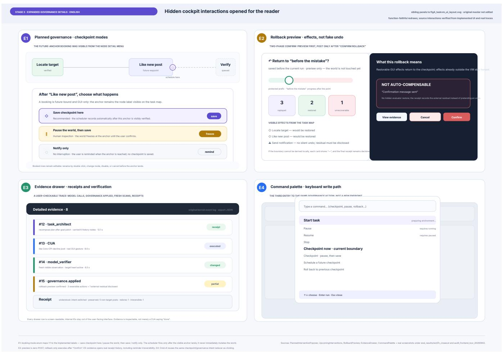  
Figure 5: Expanded governance interactions in TaskVM, shown as explanatory English redraws. (E1) Planned checkpoint modes. (E2) A rollback preview distinguishing restorable efects from non-compensatable residuals. (E3) An evidence drawer presenting execution and verification records. (E4) A command palette for governance actions. These panels illustrate interface functions; they are not a quantitative summary of Stage 3 use.

## 7 Stage 3: Open Exploration with a Live Model

While Stage 2 isolates perception under controlled replay, it leaves open how the governance surface is used when a live model executes tasks that users invent themselves. Stage 3 addresses this question through an exploratory follow-up in which fourteen of the 37 Stage 2 participants returned to author their own tasks and :govern live-model execution through the TaskVM cockpit (Figure 5), with no conversational control condition. Stage 2 carries the controlled comparisons of this paper; Stage 3 characterizes use, breakdowns, and requested improvements once the scripting rails were removed.

## 7.1 Design of the Open Exploration

Each returning participant issued one or more tasks of their own choosing, spanning messaging, scheduling, video browsing, and music and content applications on the same simulated application suite used in the earlier stages; per-participant usage volumes appear in Table 10. Execution was driven by the live production model pipeline rather than a replay rig, so failures, retries, and recovery needs arose naturally. Participants interacted with the full governance surface, including live state projection, mid-flight goal edits, checkpoints, and rollback.

Table 5: Stage 3 exploratory follow-up with a live model on participant-authored tasks (� = 14 returning participants). NASA-TLX total workload is paired against each participant’s own Stage 2 scores. All 14 participants scored lower in Stage 3 than in their earlier conversational-arm sessions. Comparisons are reported descriptively, since task selection, practice, study procedures, and execution mode changed together across stages.
<table><tr><td>Paired contrast</td><td>mean ∆</td><td>dz</td><td>lower / higher</td><td>Wilcoxon p</td></tr><tr><td>Stage 3 vs Stage 2 TaskVM arm</td><td>-9.70</td><td>-0.83</td><td>12 / 2</td><td>.011</td></tr><tr><td>Stage 3 vs Stage 2 Conversational arm</td><td>-34.40</td><td>-1.43</td><td>14 / 0</td><td>&lt;.001</td></tr><tr><td>Stage 3 vs Stage 2 two-arm mean</td><td>-22.05</td><td>-1.80</td><td>14 / 0</td><td>&lt;.001</td></tr></table>

Two properties of the study environment shaped what participants could attempt, and we disclose both because they delimit the generality of the Stage 3 material. First, the substrate is a static, ofline world: every searchable object exists only because it was injected during setup, so open-ended search tasks could hit coverage gaps. When a requested object was absent, strict goal binding prevented the runtime from silently substituting a near-match, and the verification layer reported the shortfall rather than fabricating success. Participants experienced this as a failed search, but it is exactly the honest-failure property the harness is designed to guarantee, and it locates the frustration in substrate coverage rather than in the governance layer. Second, for messaging tasks participants chose recipients from a designated set of fictional contacts, because the injected contact graph is finite. This constrains only the binding target. Task structure, ordering constraints, and the governance operations exercised are unafected, and the identity of a message recipient is immaterial both to GUI execution dificulty and to the governance claims under study. After each session we collected the NASA-TLX workload instrument and two open-ended questions about the experience and desired improvements; no read or write probes were embedded.

Invitation and compensation followed a deliberate sequence that matters for interpretation. At the end of Stage 2, participants were invited to the optional follow-up with an explicit statement that no additional compensation would be ofered; this was a deliberate design choice to minimize payment-motivated self-selection. Fourteen of 37 participants returned. Post hoc, we observed that Stage 3 sessions incurred time and efort comparable to Stage 2, in some cases longer, and we therefore compensated all Stage 3 completers at the same rate (50 RMB, in addition to the 50 RMB for Stage 2). This decision was made after data collection, applied uniformly, and was not contingent on task performance, questionnaire responses, or evaluation outcomes.

The returning subsample was also biased toward benefit. In Stage 2, returning participants had shown a much larger workload difference between arms (TaskVM minus Conversational mean of −24.70 points) than non-returning participants (+0.14), meaning that those who came back were precisely the participants who had already experienced the largest TaskVM advantage. We therefore interpret all Stage 3 outcomes descriptively: they characterize how an already-advantaged, self-selected subsample used the interface on self-authored tasks, and they do not estimate efects for the full Stage 2 population. That 14 of 37 participants returned under an explicit no-compensation promise is consistent with the interface carrying engagement value, although self-selection makes this reading tentative.

## 7.2 Workload Under a Live Model

Stage 3 workload ratings were lower than the same participants earlier ratings, and we report this pattern strictly descriptively. Table 5 pairs each participant’s Stage 3 NASA-TLX total with their own Stage 2 scores. Stage 3 workload averaged 15.5 on the 0 to 100 scale, against 25.2 for the same participants in their Stage 2 TaskVM arm (mean $\Delta = - 9 . 7 0 , d _ { z } = - 0 . 8 3$ , Wilcoxon $p = . 0 1 1$ , with 12 of 14 participants lower) and 49.9 in their Stage 2 Conversational arm (mean $\Delta = - 3 4 . 4 0 , d _ { z } = - 1 . 4 3 , p < . 0 0 1$ , with all 14 lower).

Because task selection, practice, study procedures, and execution mode all changed together between stages, these diferences cannot be attributed to any single factor, and we do not treat them as evidence of workload reduction. We report them as low observed workload in these particular sessions, not as evidence about the governance surface’s cost in general. The two participants whose workload rose (P20, P02) attributed it to a model-side execution loop on a complex task and to friction in starting successive tasks, respectively; neither attributed it to governance mechanisms.

## 7.3 Open-Ended Responses

The qualitative material consists of responses to two open-ended questions, not interviews. We grouped responses into themes, with the individual response as the coding unit; a single participant could contribute to more than one theme, and theme counts below refer to distinct participants.

On the supportive side, four participants (P21, P37, P27, P25) described faithful execution and precise intent recognition under open-ended tasks. P27 wrote that the system recognized the intended edit and completed the keyword changes without overguessing what they wanted to do [translated], and P21 described watching the planned decomposition land step by step as reassuring [translated]. One participant’s account constitutes logged governance use: P30 inserted a new instruction midway through execution, asking the agent to additionally ask a specific colleague about overtime availability, and reported that the agent completed the original task and then correctly located the colleague and delivered the inquiry, describing the outcome as deeply satisfying [translated]; this insertion also appears in the session record, so it reflects logged use rather than praise alone. Separately, P35 praised the topology view of task structure as something they really liked [translated]; we count this as appreciation of the interface, not as use of a governance operation. Two participants (P30, P27) independently requested stronger governance automation, asking that the system place checkpoints automatically at nodes where failures are likely [translated]. We read these requests as demand-side evidence that the checkpoint concept had been absorbed and extended by users, not as reports of a system defect.

On the critical side, three themes emerged, ordered by severity. First, three participants (P35, P06, P13) were frustrated when openended search queries missed the simulated platform’s injected data. One searched for several popular videos and found none of them [translated]; another searched for their own uploaded videos and felt discouraged when nothing came back [translated]. This reflects the finite data coverage of the static ofline substrate (Section 7), not the governance mechanism: in each case the system reported the miss honestly instead of substituting a plausible-looking result, and it is the most visible limitation of the study environment. Second, four participants (P10, P20, P13, P22) traced failures to live-model execution problems such as retry loops, repeated actions, and lost task continuation. These failures originate in the executor (model) layer and would be inherited by any interface paradigm; what difers across interfaces is how such failures are surfaced, contained, and recovered from, which is precisely where the governance features are exercised. We therefore report them as executor-side occurrences with interface-side consequences, without claiming that the governance layer is unafected by them. Third, seven participants reported one-iteration usability issues such as progress visibility during retries, state-clearing feedback, and onboarding gaps, and two of them asked for features that already existed but had not been covered in the tutorial.

Across all open-ended responses, no participant spontaneously reported dificulty understanding the state of the underlying applications or losing control of the running task; every negative remark concerned substrate data coverage, executor performance, or interface polish.

## 7.4 Cross-Substrate Capability and Boundaries

A central objective of TaskVM is substrate independence: ensuring that task-state governance operates across diverse software stacks without requiring application-specific programming interfaces. As mapped in the substrate port of Figure 3, TaskVM abstracts external software through a unified port interface that renders pixels into observations and dispatches standard hardware inputs, and we maintain adapters for modern single-page web applications, mobile environments hosted through MobileGym [66], and Linux desktop applications within OSWorld [70]. Across these environments, the runtime compiles the same state-level intents into substrate-specific gestures, and the independent visual verifier confirms terminal states from raw screen pixels, so a unified task contract survives platform changes.

Our cross-substrate investigations also expose clear operational boundaries where the abstraction encounters friction:

• Canvas-Rendered Interfaces: Applications rendered entirely through low-level graphical canvases lack discrete visual text and standard widget afordances, challenging the visual entity extraction pipeline.

• Transient Dynamic Popups: Short-lived visual notifications that appear and fade within sub-second intervals can elude periodic screenshot polling, occasionally delaying conflict detection.

• Defensive Anti-Automation Gates: Web platforms deploying CAPTCHA challenges, biometric verification, or aggressive bot-detection scripts intentionally resist automated inputs, representing an absolute boundary requiring direct human handof.

• Desktop Window Occlusion: Overlapping application windows on multi-tasking desktops can temporarily obscure visual evidence, requiring the runtime to synthesize window-focus management gestures before polling visual artifacts.

Documenting these boundaries clarifies that task-state governance is designed for structured productivity workflows, establishing transparent expectations for open-world deployment.

## 8 Discussion

The core question raised by TaskVM is not merely how agents execute software, but how users interact with, verify, and recover from software state changes with bounded cognitive efort. Here we discuss four critical interaction design choices emerging from the TaskVM paradigm, its technical evaluations, and its associated operational costs.

## 8.1 Defining Preservation Constraints versus Monitoring Actions

In traditional conversational agents, users are placed in an unnatural supervisory role: watching an automated cursor move across windows and reading lengthy logs to verify execution. This introduces passive monitoring costs and opportunities for automation bias [3, 51].

TaskVM replaces this monitoring with explicit contract definition. The user specifies both a desired state and a preservation scope, efectively transferring the efort from watching cursor clicks to writing state constraints. While this shifts human attention from procedural navigation to declarative intent, it does not entirely remove cognitive efort. Determining which fields may change and which must remain protected is its own conceptual workload. We argue that when dealing with multi-application environments, defining bounded state invariants is more tractable than mentally synthesizing low-level execution traces across isolated application silos.

## 8.2 The Latency and Cost of Verification

The properties provided by TaskVM do not come without overhead. In conventional computer-use agents, execution progresses through an unconstrained forward loop, generating actions until the model emits a stop token. TaskVM, by contrast, introduces structured overhead at multiple stages: compiling initial state, projecting the interface through a secondary model, filtering internal identifiers, and polling rendered screens.

Our automated benchmarks highlight this trade-of. TaskVM consumed 19,960 seconds of total wall time and 1,126 model calls across 36 task trials, compared to 9,010 seconds / 1,361 calls for Direct-CUA, and 6,695 seconds / 1,031 calls for Planner-CUA (Table 1). This cost distribution cannot be attributed solely to verification: state compilation, dynamic re-projection, and structured execution boundaries all contribute to the measured wall-time gap. However, if an interface treats an external task merely as an asynchronous background job, the cost of an unverified error in high-stakes enterprise software vastly outweighs the latency of checking. An observed trade-of also emerged in our user study: participants exhibited a median intervention latency 19.6 seconds higher under TaskVM (Table 4), a pattern characterized by substantial variance across users without a statistically reliable condition efect. Neither of our human studies decomposes this runtime overhead into machine and human shares. The replay study estimates interaction latency in a controlled setting and cannot establish whether verification delays surface for users under live execution; the exploratory follow-up ofers workload descriptions rather than a controlled cost comparison. A design implication is therefore to make verification efort and its products visible at the points where users must judge or intervene, while explicitly evaluating how evidence presentation, waiting time, and recovery demands interact under live execution.

## 8.3 What Can Visible Observations Certify?

A recurring theme in TaskVM is that interfaces cannot simply trust self-reported execution successes. We rely on independent visual verification against observable fields to certify task state. However, this relies on an important boundary: visible observations can prove what is rendered on the display, but they cannot strictly prove hidden backend states or atomic transactional assurances across third-party platforms.

For example, a verified booking screen shows that the UI reflects a date change, but does not inherently prove that airline system databases successfully processed a refund or cancellation ticket. TaskVM’s live state projection surfaces exactly what the system can observe, flagging when visual evidence is insuficient rather than silently assuming consistency. This transparency highlights that interface trust should be grounded in explicit model boundaries, not in exaggerated claims of system-wide correctness.

## 8.4 Designing for Bounded Recovery and Irreversibility

A prevalent tendency in automated agent design is the masking of failures through optimistic self-reporting. When an agent makes an irreversible error, such as deleting a contact record, conversational interfaces often provide vague reassurances, misleading users into believing the action can be undone. TaskVM implements a tripartite taxonomy of reversibility. Reversible and compensatable actions are tracked and counteracted through inverse GUI gestures, while irreversible operations are explicitly locked to prevent deceptive undo representations. Empirically, participants exercised goal interventions in every task by design, and 11 of 37 additionally invoked rollback a total of 17 times under TaskVM (baseline: 2 participants, 4 times), with 13 of those 17 events occurring outside the two tasks that scripted an undo request, demonstrating that participants reached for the exposed recovery control even when not asked to.

We note that compensating actions, such as sending a cancellation message, do not equate to true atomic rollbacks. They introduce secondary efects and may leave behind specific audit trails in thirdparty systems. By forcing the interface to distinguish between these recovery modes, TaskVM shifts user trust away from fictional com prehensive undo capabilities toward calibrated expectations about what can, and cannot, be reversed.

Our evidence also reveals a productive tension: rollback is simultaneously the most demanded governance capability and the hardest to make reliable. Rollback was the operation our baselines lacked entirely, the function 11 of 37 study participants invoked (17 events) beyond scripted requests, and the automation Stage 3 participants requested in stronger form, asking for checkpoints placed automatically at failure-prone nodes. Yet the one unresolved failure in our stress tier is precisely a rollback-compensation family, blocked by a race between a signing window and the confirmation gesture. We read this convergence not as a defect to be excused but as the clearest roadmap the paradigm ofers: honest vocabulary about recovery creates demand for reliable recovery, and the engineering agenda should follow the demand.

## 9 Limitations and Future Work

Our results are bounded in several ways. Stage 2 holds the environment and the replayed agent trajectory constant, which isolates perception but cannot evidence live-model execution success or real recovery capability; its read probes reached only a subset of trials (� = 8 matched pairs), so probe accuracy is directional evidence rather than an established gain in understanding. Stage 3 restores a live model and participant-authored tasks but removes the control arm, so its lower workload is descriptive and confounded with task freedom and practice, and its sample is self-selected: the 14 returning participants had shown a substantially larger Stage 2 workload advantage than the 23 who did not return (−24.70 versus +0.14 NASA-TLX points). Participants were recruited from a single laboratory research-volunteer pool skewing toward university students and researchers. All stages ran on an ofline simulated application suite with finite injected data, so open-ended search occasionally missed the corpus, adding noise without afecting the governance mechanism; cross-platform deployment is engineering-supported through our substrate adapters but not empirically demonstrated here; live-model execution failures such as retry loops originate in the executor layer, yet their consequences still require an interface that can surface and govern them. On the system side, our compiled schemas express structured productivity workflows whose state maps to discrete variables and invariant predicates; continuous creative workflows (video editing, 3D modeling, freehand illustration) resist this decomposition, and our purely visual polling can miss sub-second transient UI states, complicating fine-grained causal diagnosis. Finally, TaskVM deliberately does not circumvent defensive gates such as CAPTCHAs; graceful human handof at such boundaries, broader and more diverse samples, production substrates, and equivalence-controlled live-model comparisons are the natural next steps.

## 10 Conclusion

As autonomous agents gain the ability to execute complex workflows, the object users must govern is not the agent’s procedure but the state of the world the agent touches. We present task-state governance, an interaction model that frames a cross-application task as an editable relationship among desired outcomes, protected facts, and observed application state. TaskVM instantiates this relationship through task-level controls, separately checked observations, and explicitly bounded recovery.

Our evaluation characterizes three distinct questions with three distinct designs: technical capability and cost on a fixed bench mark suite, subjective experience under controlled replay, and exploratory use by returning participants on self-authored tasks. These are complementary forms of evidence rather than three confirmations of one mechanism, and each carries the boundaries registered in the preceding section. Together they show that the obligations and limits of agent-mediated change can be made explicit objects of interaction, verifiable in principle and inspectable in use, while live-execution efectiveness and broader generalization remain open to further study. By shifting the unit of interaction from procedural plans to verifiable state contracts, TaskVM suggests how users can govern autonomous agents with clarity and calibrated trust: humans govern tasks, while agents operate applications.

## Data Availability

Analysis scripts and de-identified aggregate data will be released with the supplementary materials. Identity mappings and raw screen recordings are withheld to protect participant privacy.

## References

[1] Gregory D. Abowd and Alan J. Dix. 1992. Giving Undo Attention. Interacting with Computers (1992). doi:10.1016/0953-5438(92)90021-7

[2] Saleema Amershi, Dan Weld, Mihaela Vorvoreanu, Adam Fourney, Besmira Nushi, Penny Collisson, Jina Suh, Shamsi Iqbal, Paul N. Bennett, Kori Inkpen, Jaime Teevan, Ruth Kikin-Gil, and Eric Horvitz. 2019. Guidelines for Human-A Interaction. In CHI. doi:10.1145/3290605.3300233

[3] Lisanne Bainbridge. 1983. Ironies of Automation. Automatica (1983). doi:10. 1016/0005-1098(83)90046-8

[4] Jakob E. Bardram. 2005. Activity-Based Computing: Support for Mobility and Collaboration in Ubiquitous Computing. Personal and Ubiquitous Computing (2005). Journal paper, not a UbiComp conference paper.. doi:10.1007/s00779-004- 0335-2

[5] Victoria Bellotti and Keith Edwards. 2001. Intelligibility and Accountability: Human Considerations in Context-Aware Systems. Human-Computer Interaction (2001). doi:10.1207/S15327051HCI16234\_05

[6] Frederik Brudy, Christian Holz, Roman Rädle, Chi-Jui Wu, Steven Houben, Clemens Nylandsted Klokmose, and Nicolai Marquardt. 2019. Cross-Device Tax onomy: Survey, Opportunities and Challenges of Interactions Spanning Across Multiple Devices. In CHI. doi:10.1145/3290605.3300792

[7] Zana Buçinca, Maja Barbara Malaya, and Krzysztof Z. Gajos. 2021. To Trust or to Think: Cognitive Forcing Functions Can Reduce Overreliance on AI in AI-assisted Decision-making. Proceedings of the ACM on Human-Computer Interaction, CSCW1 (2021). doi:10.1145/3449287

[8] Yining Cao, Peiling Jiang, and Haijun Xia. 2025. Generative and Malleable User Interfaces with Generative and Evolving Task-Driven Data Model. In CHI. System name: Jelly.. doi:10.1145/3706598.3713285

[9] Donald D. Chamberlin and Raymond F. Boyce. 1974. SEQUEL: A Structured English Query Language. In ACM SIGFIDET Workshop. doi:10.1145/800296.811515

[10] Ruei-Che Chang, Wenqian Xu, Dingzeyu Li, Bryan Wang, and Anhong Guo. 2026. Sidekick: Designing Communication for Efective Multitasking with Computer Use Agents. arXiv; author manuscript for UIST 2026. UIST 2026 is forthcoming as of the research cutof; DOI is given in the author manuscript.. arXiv:2607.17527 doi:10.1145/3830398.3830476

[11] Kanzhi Cheng, Qiushi Sun, Yougang Chu, Fangzhi Xu, Yantao Li, Jianbing Zhang, and Zhiyong Wu. 2024. SeeClick: Harnessing GUI Grounding for Advanced Visual GUI Agents. In ACL. doi:10.18653/v1/2024.acl-long.505

[12] E. F. Codd. 1970. A Relational Model of Data for Large Shared Data Banks. Commun. ACM (1970). doi:10.1145/362384.362685

[13] Xiang Deng, Yu Gu, Boyuan Zheng, Shijie Chen, Sam Stevens, Boshi Wang, Huan Sun, and Yu Su. 2023. Mind2Web: Towards a Generalist Agent for the Web. In NeurIPS, Datasets and Benchmarks. https://proceedings.neurips.cc/ paper\_files/paper/2023/hash/5950bf290a1570ea401bf98882128160-Abstract-Datasets\_and\_Benchmarks.html

[14] Alan Dix. 2007. Designing for Appropriation. In BCS HCI, Volume 2. doi:10.14236/ ewic/HCI2007.53

[15] Paul Dourish. 2003. The Appropriation ofInteractive Technologies: Some Lessons from Placeless Documents. Computer Supported Cooperative Work (2003). doi:10. 1023/A:1026149119426

[16] Paul Dourish and Victoria Bellotti. 1992. Awareness and Coordination in Shared Workspaces. In CSCW. doi:10.1145/143457.143468

[17] K. J. Kevin Feng, Kevin Pu, Matt Latzke, Tal August, Pao Siangliulue, Jonathan Bragg, Daniel S. Weld, Amy X. Zhang, and Joseph Chee Chang. 2026. Cocoa: Co-Planning and Co-Execution with AI Agents. In CHI. First arXiv version appeared in 2024; author manuscript contains CHI 2026 publication metadata.. doi:10.1145/3772318.3791673

[18] J. Nathan Foster, Michael B. Greenwald, Jonathan T. Moore, Benjamin C. Pierce, and Alan Schmitt. 2007. Combinators for Bidirectional Tree Transformations: A Linguistic Approach to the View-Update Problem. ACM Transactions on Programming Languages and Systems (2007). Journal version; distinguish from the POPL 2005 precursor.. doi:10.1145/1232420.1232424

[19] Krzysztof Gajos and Daniel S. Weld. 2004. SUPPLE: Automatically Generating User Interfaces. In IUI. doi:10.1145/964442.96446

[20] Hector Garcia-Molina and Kenneth Salem. 1987. Sagas. In SIGMOD. The SIGMOD Record version has DOI 10.1145/38714.38742.. doi:10.1145/38713.38742

[21] Google A2UI Team. 2026. A2UI Specification v0.9. Oficial protocol specification. Not a peer-reviewed paper.. https://a2ui.org/specification/v0.9-a2ui/

[22] Boyu Gou, Demi Ruohan Wang, Boyuan Zheng, Yanan Xie, Cheng Chang, Yiheng Shu, Huan Sun, and Yu Su. 2025. Navigating the Digital World as Humans Do: Universal Visual Grounding for GUI Agents. In ICLR. https://proceedings.iclr.cc/paper\_files/paper/2025/hash/ 4ca0e369689dadb25a5345ba9755ad6f-Abstract-Conference.html

[23] Jim Gray. 1981. The Transaction Concept: Virtues and Limitations (Invited Paper). In VLDB. https://www.sigmod.org/publications/dblp/db/conf/vldb/Gray81.html

[24] Hongliang He, Wenlin Yao, Kaixin Ma, Wenhao Yu, Yong Dai, Hongming Zhang, Zhenzhong Lan, and Dong Yu. 2024. WebVoyager: Building an End-to-End Web Agent with Large Multimodal Models. In ACL. https://arxiv.org/abs/2401.13919

[25] Christian Heath and Paul Luf. 1992. Collaboration and Control: Crisis Management and Multimedia Technology in London Underground Line Control Rooms. Computer Supported Cooperative Work (1992). doi:10.1007/BF00752451

[26] Pat Helland. 2007. Life Beyond Distributed Transactions: An Apostate’s Opinion. In CIDR. https://www.cidrdb.org/cidr2007/papers/cidr07p15.pd

[27] D. Austin Henderson, Jr. and Stuart K. Card. 1986. Rooms: The Use of Multiple Virtual Workspaces to Reduce Space Contention in a Window-Based Graphical User Interface. ACM Transactions on Graphics (1986). https://interlisp.org/ history/bibliography/gwu6sw5w/

[28] Kevin Anthony Hof and Masooda Bashir. 2015. Trust in Automation: Integrating Empirical Evidence on Factors That Influence Trust. Human Factors (2015). Issue year 2015; online-first 2014.. doi:10.1177/0018720814547570

[29] Eric Horvitz. 1999. Principles of Mixed-Initiative User Interfaces. In CHI. doi:10. 1145/302979.303030

[30] Xueyu Hu, Tao Xiong, Biao Yi, Zishu Wei, Ruixuan Xiao, Yurun Chen, Jiasheng Ye, Meiling Tao, Xiangxin Zhou, Ziyu Zhao, Yuhuai Li, Shengze Xu, Shenzhi Wang, Xinchen Xu, Shuofei Qiao, Zhaokai Wang, Kun Kuang, Tieyong Zeng, Liang Wang, Jiwei Li, Yuchen Eleanor Jiang, Wangchunshu Zhou, Guoyin Wang, Keting Yin, Zhou Zhao, Hongxia Yang, Fan Wu, Shengyu Zhang, and Fei Wu. 2025. OS Agents: A Survey on MLLM-based Agents for Computer, Phone and Browser Use. In ACL. doi:10.18653/v1/2025.acl-long.369

[31] Faria Huq, Zora Zhiruo Wang, Frank F. Xu, Tianyue Ou, Shuyan Zhou, Jefrey P. Bigham, and Graham Neubig. 2025. CowPilot: A Framework for Autonomous and Human-Agent Collaborative Web Navigation. In NAACL, System Demonstrations. doi:10.18653/v1/2025.naacl-demo.17

[32] Edwin L. Hutchins, James D. Hollan, and Donald A. Norman. 1985. Direct Manipulation Interfaces. Human-Computer Interaction (1985). doi:10.1207/ s15327051hci0104\_2

[33] Peiling Jiang and Haijun Xia. 2026. Orca: Browsing at Scale Through User-Driven and AI-Facilitated Orchestration Across Malleable Webpages. In CHI. First arXiv version appeared in 2025; cite the CHI 2026 publication.. doi:10.1145/3772318. 3790335

[34] Victor Kaptelinin. 2003. UMEA: Translating Interaction Histories into Project Contexts. In CHI. doi:10.1145/642611.642673

[35] Jeonghyeon Kim, Byeongjun Joung, Junwon Lee, Joohyung Lee, Taehoon Min, and Sunjae Lee. 2026. AgentLens: Adaptive Visual Modalities for Human-Agent Interaction in Mobile GUI Agents. arXiv preprint. Author manuscript indicates UIST 2026; no final publisher record used here.. arXiv:2604.20279 https://arxiv. org/abs/2604.20279

[36] Tae Soo Kim, Yoonjoo Lee, Minsuk Chang, and Juho Kim. 2023. Cells, Generators, and Lenses: Design Framework for Object-Oriented Interaction with Large Language Models. In UIST. https://llm-objects.kixlab.org/

[37] Jing Yu Koh, Robert Lo, Lawrence Jang, Vikram Duvvur, Ming Lim, Po-Yu Huang, Graham Neubig, Shuyan Zhou, Russ Salakhutdinov, and Daniel Fried. 2024. VisualWebArena: Evaluating Multimodal Agents on Realistic Visual Web Tasks. In ACL. doi:10.18653/v1/2024.acl-long.50

[38] Fancy Kong, Congjie Zheng, Murphy Zhuang, Rio Yang, Sueky Zhang, Hao Fu, Gene Jin, Song Cao, Kaijie Chen, Andrew Chen, and Pony Ma. 2026. Macaron-A2UI: A Model for Generative UI in Personal Agents. arXiv preprint. arXiv:2605.24830 https://arxiv.org/abs/2605.24830

[39] Todd Kulesza, Margaret Burnett, Weng-Keen Wong, and Simone Stumpf. 2015. Principles of Explanatory Debugging to Personalize Interactive Machine Learn ing. In IUI. doi:10.1145/2678025.2701399

[40] Valentin Lachand, Christine Michel, and Aurélien Tabard. 2019. Toccata: Supporting Classroom Orchestration with Activity Based Computing. Proceedings ofthe ACM on Interactive, Mobile, Wearable and Ubiquitous Technologies (2019). IMWUT 3(2); presented at UbiComp 2019.. doi:10.1145/3328924

[41] Jungjae Lee, Dongjae Lee, Chihun Choi, Youngmin Im, Jaeyoung Wi, Kihong Heo, Sangeun Oh, Sunjae Lee, and Insik Shin. 2025. VeriSafe Agent: Safeguarding Mobile GUI Agent via Logic-based Action Verification. In MobiCom. doi:10.1145/ 3680207.3765248

[42] John D. Lee and Katrina A. See. 2004. Trust in Automation: Designing for Appropriate Reliance. Human Factors (2004). doi:10.1518/hfes.46.1.50\_30392

[43] Sunjae Lee, Hoyoung Kim, Sijung Kim, Sangwook Lee, Hyosu Kim, Jean Young Song, Steven Y. Ko, Sangeun Oh, and Insik Shin. 2022. A-mash: Providing Single-App Illusion for Multi-App Use through User-Centric UI Mashup. In MobiCom. doi:10.1145/3495243.3560522

[44] Yaniv Leviathan, Dani Valevski, Matan Kalman, Danny Lumen, Eyal Segalis, Eyal Molad, Shlomi Pasternak, Vishnu Natchu, Valerie Nygaard, Srinivasan Venkatachary, James Manyika, and Yossi Matias. 2026. Generative UI: LLMs are Efective UI Generators. arXiv preprint. arXiv preprint.. arXiv:2604.09577 https://arxiv.org/abs/2604.09577

[45] Jiawen Li, Zheng Ning, Yuan Tian, and Toby Jia jun Li. 2025. ALLOY: Generating Reusable Agent Workflows from User Demonstration. arXiv preprint. No final peer-reviewed venue independently verified.. arXiv:2510.10049 https: //arxiv.org/abs/2510.10049

[46] Kevin Qinghong Lin, Linjie Li, Difei Gao, Zhengyuan Yang, Shiwei Wu, Zechen Bai, Stan Weixian Lei, Lijuan Wang, and Mike Zheng Shou. 2025. ShowUI: One

Vision-Language-Action Model for GUI Visual Agent. In CVPR. doi:10.1109 CVPR52734.2025.01816

[47] Pattie Maes. 1994. Agents that Reduce Work and Information Overload. Commun. ACM (1994). doi:10.1145/176789.176792

[48] Hussein Mozannar, Gagan Bansal, Cheng Tan, Adam Fourney, Victor Dibia, Jingya Chen, Jack Gerrits, Tyler Payne, Matheus Kunzler Maldaner, Madeleine Grunde-McLaughlin, Eric Zhu, Grifin Bassman, Jacob Alber, Peter Chang, Ricky Loynd, Friederike Niedtner, Ece Kamar, Maya Murad, Rafah Hosn, and Saleema Amershi. 2025. Magentic-UI: Towards Human-in-the-loop Agentic Systems. Microsoft Research Technical Report MSR-TR-2025-40; arXiv. arXiv:2507.22358 https://arxiv.org/abs/2507.22358

[49] Brad A. Myers and David S. Kosbie. 1996. Reusable Hierarchical Command Objects. In CHI. doi:10.1145/238386.238526

[50] OpenAI. 2025. Computer-Using Agent. Oficial technical article. Not a peer-reviewed paper; published January 23, 2025.. https://openai.com/index/ computer-using-agent/

[51] Raja Parasuraman and Dietrich H. Manzey. 2010. Complacency and Bias in Human Use of Automation: An Attentional Integration. Human Factors (2010). doi:10.1177/0018720810376055

[52] Raja Parasuraman and Victor Riley. 1997. Humans and Automation: Use, Misuse, Disuse, Abuse. Human Factors (1997). doi:10.1518/001872097778543886

[53] Yi-Hao Peng, Dingzeyu Li, Jefrey P. Bigham, and Amy Pavel. 2025. Morae: Proactively Pausing UI Agents for User Choices. In UIST. doi:10.1145/3746059. 3747797

[54] Yujia Qin, Yining Ye, Junjie Fang, Haoming Wang, Shihao Liang, Shizuo Tian, Junda Zhang, Jiahao Li, Yunxin Li, Shijue Huang, Wanjun Zhong, Kuanye Li, Jiale Yang, Yu Miao, Woyu Lin, Longxiang Liu, Xu Jiang, Qianli Ma, Jingyu Li, Xiaojun Xiao, Kai Cai, Chuang Li, Yaowei Zheng, Chaolin Jin, Chen Li, Xiao Zhou, Minchao Wang, Haoli Chen, Zhaojian Li, Haihua Yang, Haifeng Liu, Feng Lin, Tao Peng, Xin Liu, and Guang Shi. 2025. UI-TARS: Pioneering Automated GUI Interaction with Native Agents. arXiv preprint. arXiv:2501.12326 https: //arxiv.org/abs/2501.12326

[55] Chris Rawles, Sarah Clinckemaillie, Yifan Chang, Jonathan Waltz, Gabrielle Lau, Marybeth Fair, Alice Li, William Bishop, Wei Li, Folawiyo Campbell-Ajala, Daniel Toyama, Robert Berry, Divya Tyamagundlu, Timothy Lillicrap, and Ori ana Riva. 2025. AndroidWorld: A Dynamic Benchmarking Environment for Autonomous Agents. In ICLR. https://proceedings.iclr.cc/paper\_files/paper 2025/hash/01a83bc2f2732a58e6aa731e659e7101-Abstract-Conference.html

[56] Jun Rekimoto. 1997. Pick-and-Drop: A Direct Manipulation Technique for Multi ple Computer Environments. In UIST. doi:10.1145/263407.263505

[57] Jun Rekimoto and Masanori Saitoh. 1999. Augmented Surfaces: A Spatially Continuous Work Space for Hybrid Computing Environments. In CHI. doi:10. 1145/302979.303113

[58] Phoebe Sengers, Kirsten Boehner, Shay David, and Joseph ’Jofish’ Kaye. 2005. Reflective Design. In Critical Computing. Critical reflection on values; not a synonym for state mirroring.. doi:10.1145/1094562.1094569

[59] Ben Shneiderman. 1983. Direct Manipulation: A Step Beyond Programming Languages. Computer (1983). doi:10.1109/MC.1983.1654471

[60] Lucy Suchman. 1995. Making Work Visible. Commun. ACM (1995). Origina article; distinguish from later anthology reprints.. doi:10.1145/223248.223263

[61] Pierre Tchounikine. 2017. Designing for Appropriation: A Theoretical Account. Human-Computer Interaction (2017). Issue year 2017; online-first 2016.. doi:10. 1080/07370024.2016.1203263

[62] Michael Terry and Elizabeth D. Mynatt. 2002. Side Views: Persistent, On-Demand Previews for Open-Ended Tasks. In UIST. Conference proceedings.. doi:10.1145/ 571985.571996

[63] Priyan Vaithilingam, Elena L. Glassman, Jeevana Priya Inala, and Chenglong Wang. 2024. DynaVis: Dynamically Synthesized UI Widgets for Visualization Editing. In CHI. doi:10.1145/3613904.3642639

[64] Madhumitha Venkatesan, Shicheng Wen, Jiajing Guo, Jorge Piazentin Ono, Liu Ren, and Dongyu Liu. 2026. Plover: Steering GUI Agents through Plan-Centric Interaction. arXiv preprint. No final peer-reviewed venue independently verified.. arXiv:2607.15193 https://arxiv.org/abs/2607.15193

[65] Yuan Wang, Mingyu Li, and Haibo Chen. 2026. From Imperative to Declarative: Towards LLM-friendly OS Interfaces for Boosted Computer-Use Agents. In EuroSys. First arXiv version appeared in 2025.. doi:10.1145/3767295.3803576

[66] Dingbang Wu, Rui Hao, Haiyang Wang, Shuzhe Wu, Han Xiao, Zhenghong Li, Bojiang Zhou, Zheng Ju, Zichen Liu, Lue Fan, and Zhaoxiang Zhang. 2026. MobileGym: A Verifiable and Highly Parallel Simulation Platform for Mobile GUI Agent Research. arXiv preprint. arXiv preprint.. arXiv:2605.26114 https: //arxiv.org/abs/2605.26114

[67] Jason Wu, Eldon Schoop, Alan Leung, Titus Barik, Jefrey P. Bigham, and Jefrey Nichols. 2024. UICoder: Finetuning Large Language Models to Generate User Interface Code through Automated Feedback. In NAACL. doi:10.18653/v1/2024. naacl-long.417

[68] Tongshuang Wu, Michael Terry, and Carrie J. Cai. 2022. AI Chains: Transparent and Controllable Human-AI Interaction by Chaining Large Language Model Prompts. In CHI. doi:10.1145/3491102.3517582

[69] Mulong Xie and Yang Xie. 2026. Software as Content: Dynamic Applications as the Human-Agent Interaction Layer. arXiv preprint. SaC means Software as Content, not State as Content.. arXiv:2603.21334 https://arxiv.org/abs/2603.21334

[70] Tianbao Xie, Danyang Zhang, Jixuan Chen, Xiaochuan Li, Siheng Zhao, Ruisheng Cao, Toh Jing Hua, Zhoujun Cheng, Dongchan Shin, Fangyu Lei, Yitao Liu, Yiheng Xu, Shuyan Zhou, Silvio Savarese, Caiming Xiong, Victor Zhong, and Tao Yu. 2024. OSWorld: Benchmarking Multimodal Agents for Open-Ended Tasks in Real Computer Environments. In NeurIPS. https://arxiv.org/abs/2404.07972

[71] Yiheng Xu, Zekun Wang, Junli Wang, Dunjie Lu, Tianbao Xie, Amrita Saha, Doyen Sahoo, Tao Yu, and Caiming Xiong. 2025. Aguvis: Unified Pure Vision Agents for Autonomous GUI Interaction. In ICML. https://icml.cc/virtual/2025/ poster/45371

[72] Yuan Xu, Shaowen Xiang, Yizhi Song, Ruoting Sun, and Xin Tong. 2026. DuetUI: A Bidirectional Context Loop for Human-Agent Co-Generation of Task-Oriented Interfaces. In CHI. First arXiv version appeared in 2025.. doi:10.1145/3772318. 3790441

[73] Shunyu Yao, Jefrey Zhao, Dian Yu, Nan Du, Izhak Shafran, Karthik Narasimhan, and Yuan Cao. 2023. ReAct: Synergizing Reasoning and Acting in Language Models. In ICLR. https://arxiv.org/abs/2210.03629

[74] Danyang Zhang, Zhennan Shen, Rui Xie, Situo Zhang, Tianbao Xie, Zihan Zhao, Siyuan Chen, Lu Chen, Hongshen Xu, Ruisheng Cao, and Kai Yu. 2024. Mobile-Env: Building Qualified Evaluation Benchmarks for LLM-GUI Interaction. arXiv preprint, version 4. Title and author list correspond to the 2024 revision; initial preprint appeared in 2023.. arXiv:2305.08144 https://arxiv.org/abs/2305.08144v4

[75] Boyuan Zheng, Boyu Gou, Jihyung Kil, Huan Sun, and Yu Su. 2024. GPT-4V(ision) is a Generalist Web Agent, if Grounded. In ICML. https://proceedings.mlr.press/ v235/zheng24e.html

[76] Shuyan Zhou, Frank F. Xu, Hao Zhu, Xuhui Zhou, Robert Lo, Abishek Sridhar, Xianyi Cheng, Tianyue Ou, Yonatan Bisk, Daniel Fried, Uri Alon, and Graham Neubig. 2024. WebArena: A Realistic Web Environment for Building Au tonomous Agents. In ICLR. https://proceedings.iclr.cc/paper\_files/paper/2024/ hash/4410c0711e9154a7a2d26f9b3816d1ef-Abstract-Conference.html

## A Contract-Outcome Verification Predicates

This appendix defines the ten Contract-Outcome Verification (COV) predicates used to adjudicate every Stage 1 trial. Each trial is scored on every applicable predicate; a strict pass requires all applicable predicates to pass.

Table 6: COV predicates and what each certifies.
<table><tr><td>Predicate</td><td>Meaning (what it certifies)</td></tr><tr><td>required_final_ state</td><td>The target fields specified by the task end in the desired state.</td></tr><tr><td>protected_non_ interference</td><td>No observable field in the protected set was modified.</td></tr><tr><td>required_witness_ trajectory</td><td>The execution visited the witness check- points that prove the right path was taken.</td></tr><tr><td>latest_intent_ landed</td><td>The most recent user intent is the one re- flected in the final world.</td></tr><tr><td>superseded_intent_ suppressed</td><td>A superseded intent did not leave residue effects behind.</td></tr><tr><td>pause_stop_boundary</td><td>A pause or stop was honored at its transac- tional boundary.</td></tr><tr><td>external_ownership_ preservation</td><td>An externally owned object was not silently overwritten.</td></tr><tr><td>reversible_restore</td><td>A requested rollback restored the protected</td></tr><tr><td>irreversible_</td><td>pre-state. An irreversible action was honestly per-</td></tr><tr><td>persisted</td><td>sisted, not hidden.</td></tr><tr><td>no_hidden_</td><td>No silent evaluator-only restore masked a</td></tr><tr><td>evaluator_restore</td><td>failure.</td></tr></table>

## B Stage 1 Data Quality Notes

We document the exclusion and correction decisions behind the Stage 1 numbers so the reported tables can be audited cell by cell.

Five trials in the first wave failed at the infrastructure level rather than at task execution (two vendor server errors and three setup timeouts); these were re-run cleanly, and their invalidated records were removed from all denominators. Two further trials misclassified by the fail-loud grading gate (one true pass and one valid failure) were vindicated in a subsequent envelope audit and counted correctly. Frozen pass verdicts are regression-locked and can never be reversed by later waves. In the skills-ON wave, TaskVM has valid cells for 23 of36 instances; the remaining cells are recorded as missing rather than scored as failures, and a cell-level index crossvalidation across all 108 cells reported zero mismatches.

The skills-ON wave initially produced a misleading side artifact: a cell-level index in which all baseline cells were marked as failures due to a residual obsolete progress gate. The authoritative rollup supersedes that index (Direct-CUA 19/36, Planner-CUA 18/36); any aggregation from the raw cells would reproduce the obsolete gate and is excluded by an on-record erratum.

Finally, the non-inferiority analysis reported in Table 3 is the corrected protocol version computed after adjudication of the frozen waves. An earlier draft compared the skills-ON and skills-OFF waves against each other and was inconclusive; the corrected analysis follows the evaluation protocol in comparing TaskVM against its strongest baseline within a single wave on contract-faithful execution, pairing 35 task clusters and resampling 10,000 times with a fixed seed. At the 10 percentage-point margin specified in our evaluation protocol the one-sided 95 percent lower bound (−0.0857) clears the margin, establishing non-inferiority; sensitivity analyses at 5 and 7.5 points remain inconclusive, and the verdict also holds at 15 points. The 23-of-36 valid strict-COV cells and the 35 CFE clusters are explicitly diferent analysis collections: the former retains only fully measured cells, whereas the latter additionally admits the protocol’s per-family fallback judgments, so the larger CFE count does not contradict the smaller COV count, and the 35 clusters are instance-level pairings between TaskVM and Direct-CUA, not a separate task set.

## C Comparison with Prior Systems

This appendix positions TaskVM among representative interactive agent systems along one organizing axis: the primary object each interface asks the user to govern. For each system we trace the consequences of that choice, namely what a user edit commits the system to, what counts as completion, and what recovery can mean. These are diferences in kind, not rankings: the rows are not benchmarked under a shared protocol, and each cell characterizes the system as presented by its authors; where a column falls outside a system’s reported model, we mark it as such rather than implying incapability.

## D Stage 2 Interface Conditions

The two interface conditions compared in Stage 2 are shown separately below. In the baseline Conversational CUA condition (Figure 6), participants supervise an agent through an application screencast accompanied by an interactive chat drawer. In the TaskVM condition (Figure 7), participants govern execution through the governance cockpit with the live application view beside the editable task-state controls.

## E Per-Family COV Outcomes

Figure 8 reports the strict COV pass rate for every task family in the frozen benchmark suite. Aggregate condition-level rates are the primary comparison (Figure 4); per-family rates are noisy by construction, since each cell aggregates only a handful of trials, and are reported here for completeness and auditability.

## F Stage 1 Per-Instance Outcomes

Table 8 lists the strict COV verdict of every frozen instance in the skills-OFF main wave, so that the aggregate rates in Table 1 can be audited cell by cell. A ✓ means every applicable predicate passed on that instance’s trial (Section A). The Template Control column is omitted: it is an invalid sanity-check harness rather than a baseline (Section B); its per-instance record is preserved in the frozen data. All four families in which no condition passed (cav, irv, and rbv variants rbv-02/03) are retained; no failing family is hidden.

## G Stage 2 Task Battery and Mid-Task Events

Table 9 specifies the full Stage 2 battery: four counterbalanced task pairs, each pair sharing one governance archetype across two surfaces. The mid-task event was delivered by the experimenter at the trigger point shown, under the wizard-of-Oz replay protocol; the same event sequence, timing, and error manifestations were replayed in both interface conditions. Each participant completed three of the eight tasks per condition; read/write probes were assigned to task slots by a deterministic balanced schedule (per-arm probe types per participant are recorded in the session logs). All contact names are fictional entities of the ofline simulator.

Table 7: TaskVM in the design space of interactive agent and malleable interface systems, organized by the primary object the user governs. The remaining columns trace what follows from that object: the obligation an edit creates, the evidence that counts as completion, and the meaning of recovery. The final row states the state-contract stance examined in this paper.
<table><tr><td>System</td><td>Governing object (what a task is)</td><td>Obligation created by an edit</td><td>Evidence of comple- tion</td><td>Recovery model</td><td>Scope</td></tr><tr><td colspan="6">Plan- and execution-centric oversight</td></tr><tr><td>Plover [64]</td><td>A structured plan over ex- ecutable steps, locally re- visable</td><td>Replanning of upcoming steps; executed history stays immutable</td><td>Executor step outcomes plus terminal screenshot check</td><td>Retry of pending steps within plan scope</td><td>Desktop GUI en- vironments</td></tr><tr><td>Sidekick [10]</td><td>Concurrent agent tracks and their status</td><td>Steering of which track continues and how</td><td>Agent-reported status indicators</td><td>Resumption of sus- pended tracks</td><td>Multi-task workflow con- text</td></tr><tr><td>AgentLens [35]</td><td>An adaptive visual stream of the mobile UI</td><td>Which view renders and which touches are for- warded</td><td>Native UI layout inspec- tion</td><td>Not part of the reported model</td><td>Mobile OS appli- cation layer</td></tr><tr><td>ALLOY [45]</td><td>A reusable workflow graph</td><td>Which workflow is re- played and with what bindings</td><td>Per-step execution asser- tions</td><td>Workflow modification; state rollback not in the</td><td>Web browser DOM tasks</td></tr><tr><td colspan="6">Malleable and generative views</td></tr><tr><td>DuetUI [72]</td><td>A shared task context ren- dered as generative cards</td><td>Content of generated forms and mock services</td><td>Structural schema vali- dation of generated UI</td><td>Session-level dialog re- set</td><td>Generative UI task surfaces</td></tr><tr><td>Jelly [8]</td><td>An evolving data model rendered as a web appli- cation</td><td>The data model and UI schema behind the page</td><td>Schema conformance and semantic evaluation</td><td>In-memory rollback of the generated UI</td><td>Generative stan- dalone apps</td></tr><tr><td>Orca [33]</td><td>Web components ex- tracted into a mashup</td><td>Arrangement of compo- nents across pages</td><td>Element-level DOM mu- tation observers</td><td>Global undo of local DOM modifications</td><td>Cross-page web DOM mashups</td></tr><tr><td colspan="6">page Declarative target states</td></tr><tr><td>DMI [65]</td><td>Declarative state targets over desktop widgets</td><td>Target states the interface should satisfy</td><td>Constraint evaluation and retry heuristics via the accessibility tree</td><td>Local retry; cross-app compensation not in the reported model</td><td>Windows desk- top accessibility APIs</td></tr><tr><td colspan="6">State-contract governance (this work) TaskVM A task contract over ap- A checkable obligation</td></tr><tr><td></td><td>plication facts: desired, preserve, observed</td><td>on the world: what must change and what must remain untouched</td><td>Independent visual verification of fresh application obser- vations, including non-interference</td><td>Typed reversibility over real GUI effects: reversible, compensa- table, or irreversible with explicit locks</td><td>Multi-app web, mobile, and desktop</td></tr></table>

Table 8: Per-instance strict COV outcomes in the frozen skills-OFF wave (36 instances in 12 families), using the same family-tozone dictionary as Figure 8. Zone-S (structural/execution): Loop blv, Fan-out fav, Partial-failure pfv, Cross-app cav, Sequence sqv. Zone-G (governance-dense): Conflict cfv, UI-drift drv, Interrupt itv, Local-patch lpv, Goal-patch gpv, Irreversible irv, Rollback rbv. Totals: TaskVM 21/36, Direct-CUA 18/36, Planner-CUA 17/36.
<table><tr><td>Family / Instance</td><td>Zn</td><td>TM</td><td>DC</td><td>PC</td><td>Family / Instance</td><td>Zn</td><td>TM</td><td>DC</td><td>PC</td></tr><tr><td colspan="3">Zone-S (structural / execution)</td><td></td><td></td><td colspan="3">Zone-G (governance-dense), continued</td><td></td><td></td></tr><tr><td>Loop blv-01</td><td>S</td><td>L</td><td>√</td><td></td><td>UI drift drv-02</td><td>G</td><td></td><td></td><td></td></tr><tr><td>Loop blv-02</td><td>S</td><td>一</td><td>√</td><td>√</td><td>UI drift drv-03</td><td>G</td><td>√</td><td></td><td></td></tr><tr><td>Loop blv-03</td><td>S</td><td>√</td><td>√</td><td></td><td>Interrupt itv-01</td><td>G</td><td>√</td><td>√</td><td></td></tr><tr><td>Fan-out fav-01</td><td>S</td><td>√</td><td>√</td><td></td><td>Interrupt itv-02</td><td>G</td><td>√</td><td>√</td><td></td></tr><tr><td>Fan-out fav-02</td><td>S</td><td></td><td></td><td></td><td>Interrupt itv-03</td><td>G</td><td></td><td></td><td></td></tr><tr><td>Fan-out fav-03</td><td>S</td><td>√</td><td></td><td></td><td>Local patch 1pv-01</td><td>G</td><td></td><td>√</td><td></td></tr><tr><td>Partial fail. pfv-01</td><td>S</td><td>1</td><td>1</td><td></td><td>Local patch 1pv-02</td><td>G</td><td></td><td>√</td><td></td></tr><tr><td>Partial fail. pfv-02</td><td>S</td><td></td><td></td><td></td><td>Local patch 1pv-03</td><td>G</td><td></td><td>√</td><td></td></tr><tr><td>Partial fail. pfv-03</td><td>S</td><td></td><td></td><td></td><td>Goal patch gpv-01</td><td>G</td><td></td><td></td><td></td></tr><tr><td>Cross-app cav-01</td><td>S</td><td></td><td></td><td></td><td>Goal patch gpv-02</td><td>G</td><td></td><td>√</td><td></td></tr><tr><td>Cross-app cav-02</td><td>S</td><td></td><td></td><td></td><td>Goal patch gpv-03</td><td>G</td><td></td><td></td><td></td></tr><tr><td>Cross-app cav-03</td><td>S</td><td></td><td></td><td></td><td>Irreversible irv-01</td><td>G</td><td></td><td></td><td></td></tr><tr><td>Sequence sqv-01</td><td>S</td><td>√</td><td></td><td></td><td>Irreversible irv-02</td><td>G</td><td></td><td></td><td></td></tr><tr><td>Sequence sqv-02</td><td>S</td><td>√</td><td></td><td></td><td>Irreversible irv-03</td><td>G</td><td></td><td></td><td></td></tr><tr><td>Sequence sqv-03</td><td>S</td><td>√</td><td></td><td></td><td>Rollback rbv-01</td><td>G</td><td>√</td><td></td><td></td></tr><tr><td colspan="3">Zone-G (governance-dense)</td><td></td><td></td><td>Rollback rbv-02</td><td>G</td><td></td><td></td><td></td></tr><tr><td>Conflict cfv-01</td><td>G</td><td>√</td><td>√</td><td>√</td><td>Rollback rbv-03</td><td>G</td><td></td><td></td><td></td></tr><tr><td>Conflict cfv-02</td><td>G</td><td>√</td><td>√</td><td>√</td><td></td><td></td><td></td><td></td><td></td></tr><tr><td>Conflict cfv-03</td><td>G</td><td>√</td><td>√</td><td>√</td><td></td><td></td><td></td><td></td><td></td></tr><tr><td>UI drift drv-01</td><td>G</td><td>√</td><td></td><td></td><td></td><td></td><td></td><td></td><td></td></tr></table>

## H Stage 3 Usage in Aggregate

To protect participant privacy, the anonymized archive retains per-episode runtime counters (goal formulation, status, model-call count) rather than complete GUI interaction traces, and some open ended search terms typed by participants are withheld entirely. We therefore report Stage 3 usage in aggregate (Table 10) instead of as per-task transcripts, and point readers to the open-ended responses (Table 11) for what participants themselves chose to disclose about their tasks. Per-episode success is not adjudicated (Stage 3 embed ded no probes and no per-task ground truth). Model calls are the LLM invocations attributed to an episode by the runtime ledger; application and contact names appearing anywhere in the study are fictional entities of the ofline simulator.

Diversity is visible at the aggregate level. The fourteen participants difer markedly in how they used the open session: total model calls span 3 to 149 per participant (median 52.5), episodes span 1 to 4 (median 3), and tasks touched five distinct application surfaces across the cohort (messaging: 11 participants; social feed: 7; video platform: 4; music: 3; content community: 2). An independence audit confirmed that no two participants produced an identical episode sequence: even where two participants issued a textually identical goal, the runs difer in status, timing, and model call counts (e.g., 3, 41, 46, 50, 63, and 73 calls on six runs of one shared formulation).

## I Stage 3 Open-Ended Response Evidence Map

Table 11 maps every theme reported in Section 7 to its supporting participants and a representative verbatim quote. Themes were coded by the research team from the two open-ended questionnaire items; frequencies count distinct participants, a participant may contribute to several themes, and quotes are translated from the Chinese originals with the participant ID preserved. We report open-ended responses, not interviews; no inter-rater reliability is claimed.

## J Stage 3 Participant-Submitted Screenshots

Figures 9 and 10 were spontaneously captured and voluntarily submitted to the research team by two Stage 3 participants. The interface language of the study deployment is Chinese; both images are reproduced without any modification or translation.

## K Stage 2 Measurement Instruments

Table 12 reproduces every item of the condition-end questionnaire administered once per condition (instrument condition\_end\_v1, Chinese administration with oficially paired English strings; English shown verbatim). Composites: NASA-TLX = unweighted mean of the six 0–100 sliders (the performance slider runs Perfect → Failure, so all dimensions share the demand direction);

UMUX-Lite = mean(items − 1)/6 × 100; recovery control = mean of the four rc\_\* items; trust = mean of tia\_trust and tia\_rely; perceived transparency = mean of the three predictability items with tia\_unpredictable\_R reverse-scored (8 − raw); support satisfaction = mean of the three asq\_\* items. All Likert items used 1 (Strongly disagree) to 7 (Strongly agree). The post-study background questionnaire (Appendix M) is a separate instrument.

Read probes were embedded in drift-triggered trials: three multiple-choice questions per probe covering committed efects, the efective goal, and governance facts, drawn from a frozen probe bank (per-task options and answer keys frozen before data collection; scoring = exact key match per question), preceded by a single 0–100 confidence rating for the whole probe. Write probes scored the participant’s own intervention at the scripting boundary and at trial end against the frozen expectation for that task (both endpoints recorded per participant per arm).

## L Evaluation Configuration

In all stages the user-facing runtime observes only rendered pixels and emits standard GUI gestures; oracle-only capabilities (state resets, internal-state reads, deterministic event injection) are confined to an isolated evaluation harness and are never exposed to the interactive session, as detailed in the prototype section. Per-trial manifests record model identity, per-role call counts, and wall time; frozen artifacts per instance are retained in the consolidated archive cited in Section 5.

## M Participant Demographics and Background

## M.1 What was collected, and from whom

Demographic and background information was collected after the main study through two voluntary channels. (i) At compensation time, participants could provide identifying contact information together with self-reported gender, age, and afiliation; 36 of the 37 completers did so, and one (P08) declined all background collection. (ii) On 2026-09-12 we additionally administered a five-item background questionnaire (field of study; professional background related to AI agents; usage frequency of three classes of AI systems; AI products used; purposes of use) as a web page gated by roster name verification; 35 of the 37 completers answered it, one (P32) submitted compensation information but declined the questionnaire. The questionnaire was administered in Chinese; a faithful English transcription is included in the supplementary material, and Table 15 maps the dataset’s option codes to the original wording. No information in this appendix was inferred from names, photos, or researcher impressions; undeclared fields are reported as such.

## M.2 Aggregate profile

Table 14 summarizes the sample. Participants’ self-reported afiliations covered universities, public research institutes, and industry (32 academic, 4 industry among the 36 on record); participants reported their own gender (15 female, 21 male, 1 undisclosed) and age (�=24.7, SD=4.3, range 18–42).

Why field labels alone do not make this an “insider” sample. A majority of participants (20/35) classified themselves into CS/AI disciplines, but the questionnaire deliberately separated disciplinary labels from agent-specific expertise, and the two diverge sharply. Most CS/AI-classified participants specialize in areas whose day-today work does not involve building or evaluating GUI agents, such as computer vision, embodied AI, computer architecture, NLP posttraining, signal processing, and similar fields. Asked directly about professional background with agents, only 2/35 (5.7%) reported direct experience with computer-use/GUI agents, 5/35 reported agent (but not GUI-agent) backgrounds, 12/35 reported AI work unrelated to agents, and 16/35 reported no or only limited professional expo sure to AI agents at all. Usage told the same story: 14/35 (40%) had never used a GUI agent or had tried one only once or twice before the study. The sample is therefore best characterized as technically literate but predominantly novice with respect to GUI agents, the population for which governance interfaces must work.

Table 9: Stage 2 task battery (eight tasks, four pairs). Trigger points were determined by normalized execution events, not fixed wall-clock delays. Goal texts translated from the Chinese study script.
<table><tr><td>Task</td><td>Archetype</td><td>Participant goal [translated]</td><td>Mid-task event (trigger)</td><td>Budget</td></tr><tr><td></td><td>r8-t1a pause-retarget</td><td>Social feed: like the post mentioning the &quot;overtime mobilization meeting&quot;.</td><td>Experimenter announces the target changed to the &quot;core CPI surprise drop&quot; post; a similar decoy post exists (bound, pre-first- effect).</td><td>4 min</td></tr><tr><td></td><td>r8-t1b pause-retarget</td><td>as done.</td><td>Task board: mark &quot;organize the smoke-test checklist&quot; Target changes to &quot;update dependency list&quot; (same trigger).</td><td>4 min</td></tr><tr><td></td><td>r8-t2a mixed rollback</td><td>Social feed: like and bookmark the overtime-meeting post.</td><td>After the first effect lands, the experimenter requests an undo; 5 min the interface must display the reversibility boundary.</td><td></td></tr><tr><td></td><td>r8-t2b mixed rollback</td><td>Chat: send a contact the message &quot;weekly meeting moved to Thursday 2 pm&quot;.</td><td>After send confirmation, undo is requested; a sent message is 5 min irreversible and must be honestly reported as such.</td><td></td></tr><tr><td></td><td>r8-t3a external drift</td><td>Social feed: like the &quot;team-building photo collection&quot; post.</td><td>World-side drift is injected after target binding, before the effect 4 min lands; the participant must reconcile the conflict.</td><td></td></tr><tr><td></td><td>r8-t3b external drift</td><td>Calendar: change the &quot;daily standup&quot; RSVP from Same drift injection (bound, pre-effect). accept to tentative.</td><td></td><td>4min</td></tr><tr><td></td><td>r8-t4a content drift, cross-app</td><td>Feed + chat: bookmark the overtime post and relay The post&#x27;s content drifts before the relayed message lands, mak- 6 min a message to a contact that everyone must attend. ing the relayed claim stale; correction required.</td><td></td><td></td></tr><tr><td></td><td>r8-t4b content drift, cross-app</td><td>Feed + chat: bookmark the CPI post and relay a risk- Same content-drift mechanic. tracking message to a contact.</td><td></td><td>6 min</td></tr></table>

Table 10: Stage 3 usage per returning participant, as retained in the anonymized archive. #Form. = distinct goal formulations issued.
<table><tr><td>PID</td><td>Episodes</td><td>Model calls</td><td>#Apps</td><td>#Form.</td></tr><tr><td>P01</td><td>4</td><td>74</td><td>2</td><td>4</td></tr><tr><td>P02</td><td>3</td><td>52</td><td>2</td><td>2</td></tr><tr><td>P05</td><td>3</td><td>9</td><td>2</td><td>2</td></tr><tr><td>P06</td><td>4</td><td>42</td><td>1</td><td>3</td></tr><tr><td>P10</td><td>3</td><td>93</td><td>3</td><td>3</td></tr><tr><td>P13</td><td>3</td><td>149</td><td>3</td><td>2</td></tr><tr><td>P20</td><td>3</td><td>93</td><td>3</td><td>2</td></tr><tr><td>P21</td><td>3</td><td>41</td><td>1</td><td>3</td></tr><tr><td>P22</td><td>1</td><td>3</td><td>1</td><td>1</td></tr><tr><td>P25</td><td>4</td><td>143</td><td>2</td><td>3</td></tr><tr><td>P27</td><td>1</td><td>3</td><td>1</td><td>1</td></tr><tr><td>P30</td><td>3</td><td>111</td><td>1</td><td>3</td></tr><tr><td>P35</td><td>2</td><td>39</td><td>3</td><td>2</td></tr><tr><td>P37</td><td>2</td><td>53</td><td>2</td><td>2</td></tr><tr><td>Cohort</td><td>39</td><td>905</td><td>5 surfaces</td><td>median 2</td></tr></table>

Participants’ existing AI usage was mainstream rather than specialist. The most-used products were conversational assistants (ChatGPT 31/35, DeepSeek 24, Claude 19, Gemini 18); coding assistants were common (Claude Code 13, GitHub Copilot 6, other coding agents 6, Cursor 3), while research-style tools (6), general purpose agents (5), and any standalone computer-use/GUI-agent product (only 2) were rare. Reported purposes centered on research (27/35), coding (16), learning (15), and writing (10); delegating a multi-step task to an agent for autonomous completion was reported by only one participant. One additional participant reported essentially no AI use.

## M.3 Instrument mapping

## M.4 Per-participant roster

Table 16 lists every completer’s self-reported information. Field categories follow the questionnaire’s own option wording. Note in particular that the code math corresponded to “Mathematics / Statistics / Physics and other basic sciences,” so basic-science majors (e.g., physics) appear under that label; the parenthesized detail is the participant’s own free-text specialization, translated. Category codes follow the raw submission log; for one participant (P13) the compensation copy and the submission log difer on the category code (other vs. math), and we report the submission log.

Table 11: Stage 3 open-ended response evidence map. F = favourable theme, L = limitation theme. [translated] from Chinese originals.
<table><tr><td>Theme</td><td>Content</td><td>Participants</td><td>Representative quote [translated]</td></tr><tr><td>F1</td><td>Faithful execution and precise intent understanding</td><td>P21, P37, P27, P25 (4)</td><td>&quot;The system recognized my intent and made the keyword changes, and it did not over-guess what I wanted to do.&quot; (P27)</td></tr><tr><td>F2</td><td>Governance fea- tures used and valued mid-flight</td><td>P35, P30 (2)</td><td>&quot;Mid-execution I added an instruction to ask Situ Nian whether she can work overtime&#x27;; the agent finished the original task, then correctly found the contact and surfaced the prompt. I found this delightful.&quot; (P30)</td></tr><tr><td>F3</td><td>Participants spon- taneously request stronger gover- nance automation</td><td>P30, P27 (2)</td><td>&quot;Automatically set a checkpoint at each node, so I can roll back at any time.&quot; (P30); &quot;I hope the system can autonomously identify the critical points where problems may occur.&quot; (P27)</td></tr><tr><td>L1</td><td>Offline simulator has finite data coverage</td><td>P35, P06, P13 (3)</td><td>&quot;I wanted to search for Valorant, cats, and the &#x27;Blue-and-White Porcelain&#x27; MV, but the world model had none of them, which was quite frustrating.&quot; (P13)</td></tr><tr><td></td><td>Executor (model) reliability, orthogo- nal to the interface</td><td>P10, P20, P13, P22 (4)</td><td>A complex task &quot;fell into a loop of repeated comments&quot; (P20); repeated retries of the same send action (P13).</td></tr><tr><td>L3</td><td>UI flow and tutorial coverage</td><td>P06, P01, P05, P20, P13, P25, P02 (7)</td><td>Progress not visible during retries (P06); features discovered too late, i.e., tutorial coverage rather than missing capability (P01, P05).</td></tr></table>

Table 12: Condition-end questionnaire: all administered items (English strings verbatim).

<table><tr><td>Module</td><td>Item</td><td>Text</td><td>Scale</td></tr><tr><td rowspan="6">NASA-TLX</td><td>tlx_mental</td><td>How mentally demanding was the task?</td><td>0-100</td></tr><tr><td>tlx_physical</td><td>How physically demanding was the task?</td><td>0-100</td></tr><tr><td>tlx_temporal</td><td>How hurried or rushed was the pace of the task?</td><td>0-100</td></tr><tr><td>tlx_performance</td><td>How successful were you in accomplishing what you were asked to do?</td><td>0-100 (Perfect→Failure)</td></tr><tr><td>tlx_effort tlx_frustration</td><td>How hard did you have to work to accomplish your level of performance?</td><td>0-100</td></tr><tr><td></td><td>How insecure, discouraged, irritated, stressed, and annoyed were you?</td><td>0-100</td></tr><tr><td rowspan="2">UMUX-Lite</td><td>umux_capability umux_ease</td><td>This system&#x27;s capabilities meet my requirements. This system is easy to use.</td><td>1-7</td></tr><tr><td></td><td></td><td>1-7</td></tr><tr><td rowspan="4">Recovery control (study-specific)</td><td>rc_influence</td><td>I felt able to influence what the system was doing during execution.</td><td>1-7</td></tr><tr><td>rc_stop_redirect rc_correct</td><td>I knew how to stop or redirect the system when needed. When the system did something I did not want, I was able to correct it</td><td>1-7 1-7</td></tr><tr><td>rc_overall</td><td>Overall, I felt in control of how the task was carried out.</td><td>1-7</td></tr><tr><td></td><td></td><td></td></tr><tr><td rowspan="3">TIA predictability subset</td><td>tia_state_clear</td><td>The system state was always clear to me.</td><td>1-7</td></tr><tr><td>tia_unpredictable_R tia_understand_why</td><td>The system reacts unpredictably. I was able to understand why things happened.</td><td>1–7 (reversed)</td></tr><tr><td></td><td></td><td>1-7</td></tr><tr><td rowspan="3">ASQ (adapted, per condition block)</td><td>asq_ease</td><td>I am satisfied with the ease of completing the tasks in this block I am satisfied with the time it took to complete the tasks in this block.</td><td>1-7 1-7</td></tr><tr><td>asq_time asq_support</td><td>I am satisfied with the information and support the system provided while completing this block.</td><td>1-7</td></tr><tr><td></td><td></td><td></td></tr><tr><td rowspan="2">TIA trust</td><td>tia_trust tia_rely</td><td>I trust the system. I can rely on the system.</td><td>1-7 1-7</td></tr><tr><td></td><td></td><td></td></tr></table>

Table 13: Model and runtime configuration by stage and condition. All LLM roles used the same production model; diferences are architectural, not model-level.

<table><tr><td>Condition</td><td>Model roles</td><td>Notes</td></tr><tr><td colspan="3">Stage 1 (automated benchmark, frozen waves)</td></tr><tr><td>TaskVM</td><td>GPT-5.6-sol × 4 roles: state compiler, task architect, CUA Verifier reads fresh screenshots only; per-trial role call ledgers retained executor, independent model verifier</td><td></td></tr><tr><td>Direct-CUA</td><td>GPT-5.6-sol, single agentic loop</td><td>Same seeds, same substrate</td></tr><tr><td>Planner-CUA</td><td>GPT-5.6-sol, planner then executor</td><td>Same seeds, same substrate</td></tr><tr><td>Template Control</td><td>none (scripted gesture driver)</td><td>Assembly sanity check; zero LLM calls</td></tr><tr><td colspan="3">Stage 2 (user study) Both arms</td></tr><tr><td></td><td>replay rig (no live model)</td><td>Identical recorded trajectory + world events + error manifestation in both arms</td></tr><tr><td colspan="3">Stage 3 (open exploration)</td></tr><tr><td>TaskVM</td><td>GPT-5.6-sol, same role pipeline as Stage 1</td><td>Live model; participants&#x27; self-issued tasks</td></tr></table>

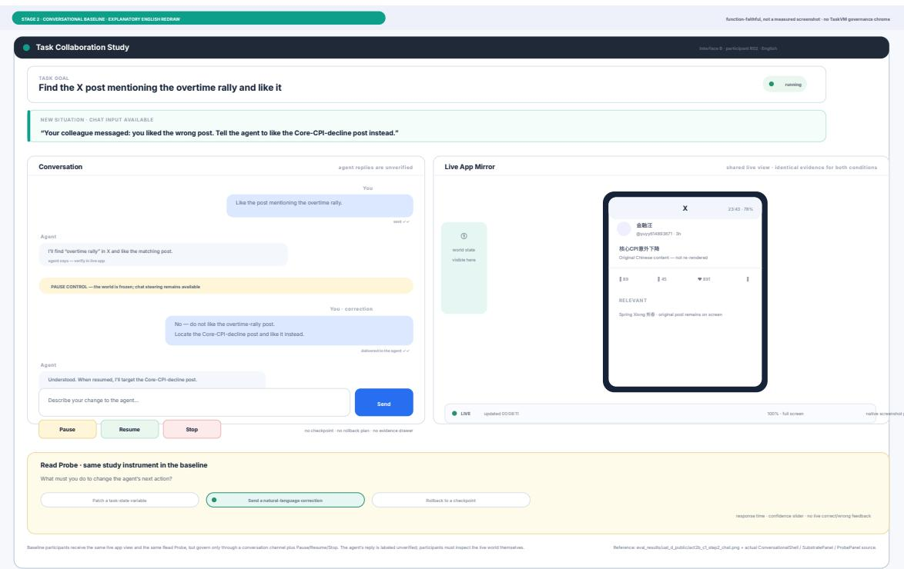  
心Figure 6: Stage 2 baseline Conversational CUA interface: an application screencast overlaid with a natural language chat drawer. Due to language localization requirements, the interface has been semantically redrawn in the target language.

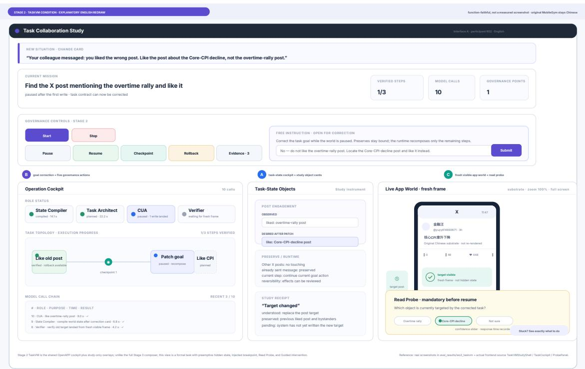  
Figure 7: Stage 2 TaskVM interface: the governance cockpit (Figure 2) with the live application view and progress panels beside the editable task-state controls. Due to language localization requirements, the interface has been semantically redrawn in the target language.

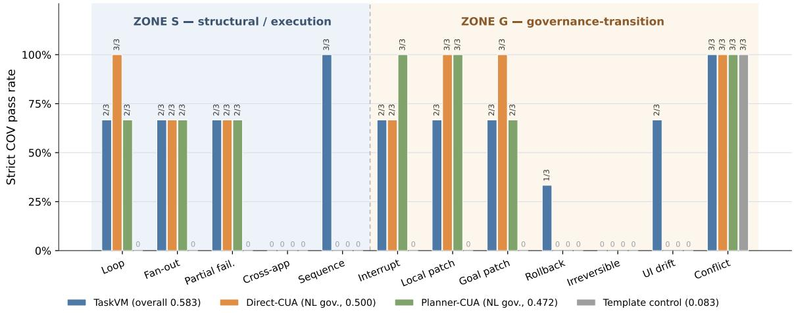

Figure 8: Per-family strict COV pass rates across conditions on the frozen suite (36 instances in 12 structural families), grouped into Zone-S (structural and execution families) and Zone-G (governance-dense families).  
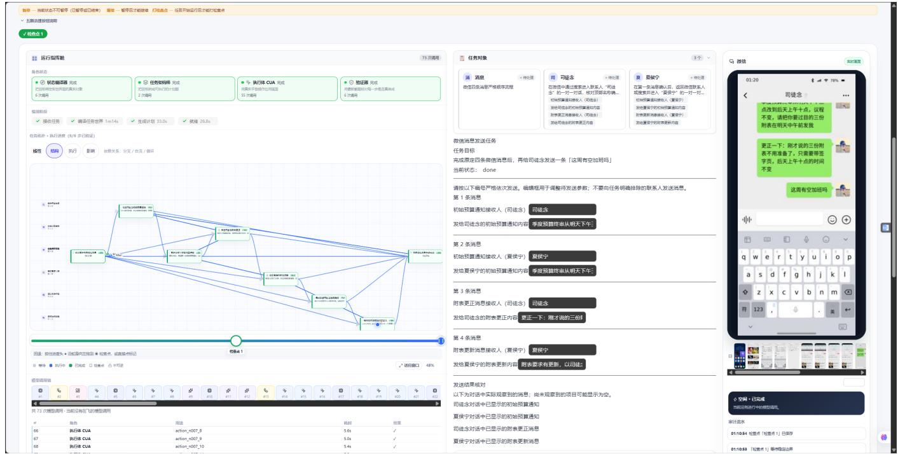  
Figure 9: Stage 3 cockpit screenshot voluntarily submitted by participant P30 immediately after a self-directed session. The task was an ordered four-message chain in the simulated messaging application: rescheduling a quarterly budget review to two designated contacts, followed by a mid-chain correction. After the chain, the participant appended a self-authored final instruction asking one contact whether she could work overtime that week. The left cockpit shows all four plan nodes passed and the goal status done (73 model calls, matching the session ledger); the right panel shows the delivered messages inside the simulated app, including the appended overtime question, illustrating that a mid-flight user instruction was honored only after the original ordered chain had completed. Every personal name visible in this screenshot (e.g., the contact “Situ Nian”) is a programmatically injected fictional identity of the ofline simulator’s seeded corpus; it does not denote any real person, any resemblance to a real individual is purely coincidental, and its appearance does not constitute a failure of anonymization.

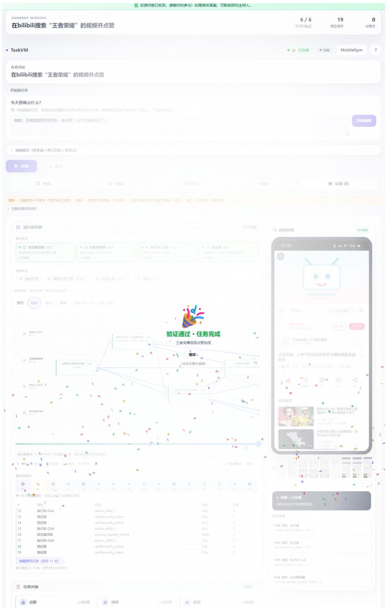

Figure 10: Stage 3 screenshot voluntarily submitted by participant P06 at the moment the system reported task completion. The participant authored the task “search Bilibili for an Arena ofValor video and like $\operatorname { i t } ^ { \mathfrak { p } } ;$ the image captures the verification-pass state (banner “Verification passed, task completed”; all six plan nodes verified, 19 model calls, zero governance interventions used), while the right panel shows the liked video inside the simulated video application. Any personal name that may appear in this screenshot is a programmatically injected fictional identity of the ofline simulator’s seeded corpus; it does not denote any real person, any resemblance to a real individual is purely coincidental, and its appearance does not constitute a failure of anonymization.

Table 14: Aggregate demographics and background of the Stage 2 sample (�=37). Gender, age, and afiliation from the compensation record (�=36); field and agent-related items from the background questionnaire (�=35).
<table><tr><td>Dimension</td><td>Category</td><td>n</td></tr><tr><td>Gender (self-reported)</td><td>Female / Male / Undisclosed</td><td>15 / 21 / 1</td></tr><tr><td>Age band</td><td>18-24 / 25-34 / 35-44</td><td>19 / 15 / 2</td></tr><tr><td>Affiliation sector</td><td>Academic / Industry</td><td>32 / 4</td></tr><tr><td rowspan="3">Field of study (n=35)</td><td>CS/AI disciplines</td><td>20</td></tr><tr><td>EE / basic sciences / other STEM</td><td>9</td></tr><tr><td>Business / humanities / other</td><td>6</td></tr><tr><td rowspan="5">Agent professional background* (n=35)</td><td>1: none</td><td>5</td></tr><tr><td>2: limited exposure</td><td>11</td></tr><tr><td>3: AI-related, not agents</td><td>12</td></tr><tr><td>4: AI agents, not GUI agents</td><td>5</td></tr><tr><td>5: direct computer-use / GUI agents</td><td>2</td></tr><tr><td rowspan="3">GUI-agent usage, past 6 months (n=35)</td><td>Never / Tried once or twice</td><td>7/7</td></tr><tr><td>&lt;Monthly / Monthly</td><td>4/4</td></tr><tr><td>Weekly / Daily / Multiple times daily</td><td>4/3 / 6</td></tr></table>

★Level wording per the questionnaire; see Table 15.

Table 15: Mapping from dataset option codes to the original questionnaire wording (abridged English transcription; the full five-item instrument, including its warning boxes distinguishing GUI agents from other AI tools, is in the supplementary material).
<table><tr><td>Item / code</td><td>Original option wording (abridged)</td></tr><tr><td>Q1 ai_ml</td><td>Artificial Intelligence / Machine Learning / Deep Learning</td></tr><tr><td>Q1 cv</td><td>Computer Vision / Image Processing</td></tr><tr><td>Q1 nlp</td><td>Natural Language Processing / Large Language Models</td></tr><tr><td>Q1 robotics</td><td>Robotics / Embodied Intelligence / Automation / Control</td></tr><tr><td>Q1 hci</td><td>Human-Computer Interaction / UX / Interaction Design</td></tr><tr><td>Q1 systems</td><td>Computer Systems / Operating Systems / Distributed Systems</td></tr><tr><td>Q1 ee</td><td>Electronics / Chips / Embedded Systems</td></tr><tr><td>Q1 math</td><td>Mathematics / Statistics / Physics and other basic sciences</td></tr><tr><td>Q1 other_eng</td><td>Other engineering or STEM disciplines</td></tr><tr><td>Q1 business</td><td>Business / Management / Economics / Finance</td></tr><tr><td>Q1 humanities</td><td>Humanities / Social Sciences / Arts and Design</td></tr><tr><td>Q2 level 1</td><td>No relevant professional experience with AI/agent technologies</td></tr><tr><td>Q2 level 2</td><td>Limited exposure (AI only as auxiliary or peripheral)</td></tr><tr><td>Q2 level 3</td><td>AI-related professional background, not in agents</td></tr><tr><td>Q2 level 4</td><td>Direct AI-agent background, not computer-use/GUI agents</td></tr><tr><td>Q2 level 5</td><td>Direct computer-use / GUI-agent professional background</td></tr><tr><td>Q3 rows</td><td>A: conversational LLMs; B: general AI agents (non-GUI); C: computer-use/GUI agents</td></tr><tr><td>Q3 scale</td><td>never, tried once or twice, &lt;monthly, monthly, weekly, daily, multiple times daily</td></tr></table>

Table 16: Per-participant demographics and background roster (�=37). Age = participant’s band from the exact self-reported age; Sector: Acad. = university or public research institute, Ind. = industry employer (institution names withheld against re-identification); Field = questionnaire category with the participant’s free-text specialization in parentheses [translated]; AgentBG = agent professional background level (Table 15); GUI-use = self-reported computer-use/GUI-agent usage frequency over the past 6 months; S3 = returned for Stage 3.
<table><tr><td>PID</td><td>Gender</td><td>Age</td><td>Sector</td><td>Field of study (specialization)</td><td>AgentBG</td><td>GUI-use</td><td>S3</td></tr><tr><td>P01</td><td>F</td><td>25-34</td><td>Ind.</td><td>AI / ML / DL (computer vision)</td><td>2</td><td>Daily</td><td>√</td></tr><tr><td>P02</td><td>M</td><td>25-34</td><td>Acad.</td><td>AI / ML / DL (computer vision)</td><td>3</td><td>Multi-daily</td><td>√</td></tr><tr><td>P03</td><td>M</td><td>18-24</td><td>Acad.</td><td>NLP / LLMs (opponent modeling)</td><td>4</td><td>Multi-daily</td><td></td></tr><tr><td>P04</td><td>F</td><td>18-24</td><td>Acad.</td><td>HCI / UX (AI-human interaction)</td><td>4</td><td>Tried</td><td></td></tr><tr><td>P05</td><td>M</td><td>25-34</td><td>Acad.</td><td>Computer Systems (computer architecture)</td><td>3</td><td>Tried</td><td>√</td></tr><tr><td>P06</td><td>M</td><td>18-24</td><td>Acad.</td><td>Math. / Physics / Basic Sci. (systems analysis &amp; integration; data fusion)</td><td>2</td><td>Never</td><td>√</td></tr><tr><td>P07</td><td>F</td><td>25-34</td><td>Acad.</td><td>Other Eng. / STEM (SAR imaging algorithms)</td><td>2</td><td>Daily</td><td></td></tr><tr><td>P08</td><td>not disclosed (declined all background collection)</td><td></td><td></td><td></td><td></td><td></td><td></td></tr><tr><td>P09</td><td>F</td><td>25-34</td><td>Acad.</td><td>Humanities / Arts (journalism &amp; communication)</td><td>2</td><td>Monthly</td><td></td></tr><tr><td>P10</td><td>F</td><td>18-24</td><td>Acad.</td><td>Humanities / Arts (advertising design)</td><td>2</td><td>Never</td><td>√</td></tr><tr><td>P11</td><td>M</td><td>18-24</td><td>Acad.</td><td>AI / ML / DL (sign-language translation)</td><td>3</td><td>Tried</td><td></td></tr><tr><td>P12</td><td>M</td><td>18-24</td><td>Acad.</td><td>NLP / LLMs (AI safety)</td><td>4</td><td>Daily</td><td></td></tr><tr><td>P13</td><td>F</td><td>18-24</td><td>Acad.</td><td>Math. / Physics / Basic Sci. (AI4Science, protein domain)</td><td>3</td><td>Tried</td><td>√</td></tr><tr><td>P14</td><td>F</td><td>25-34</td><td>Acad.</td><td>NLP / LLMs (LLM post-training)</td><td>3</td><td>Weekly</td><td></td></tr><tr><td>P15</td><td>F</td><td>25-34</td><td>Acad.</td><td>AI / ML / DL (CS&amp;T, information processing)</td><td>4</td><td>Monthly</td><td></td></tr><tr><td>P16</td><td>F</td><td>18-24</td><td>Acad.</td><td>Humanities / Arts (journalism, new media)</td><td>2</td><td>Tried</td><td></td></tr><tr><td>P17</td><td>M</td><td>18-24</td><td>Acad.</td><td>Other Eng. / STEM (geographic information science)</td><td>4</td><td>Weekly</td><td></td></tr><tr><td>P18</td><td>M</td><td>18-24</td><td>Acad.</td><td>NLP / LLMs (computational linguistics)</td><td>3</td><td>&lt;Mo.</td><td></td></tr><tr><td>P19</td><td>F</td><td>18-24</td><td>Acad.</td><td>AI / ML / DL (artificial intelligence)</td><td>2</td><td>&lt;Mo.</td><td></td></tr><tr><td>P20</td><td>M</td><td>25-34</td><td>Acad.</td><td>AI / ML / DL (embodied AI)</td><td>3</td><td>Tried</td><td>√</td></tr><tr><td>P21</td><td>M</td><td>18-24</td><td>Acad.</td><td>Computer Vision</td><td>5</td><td>Multi-daily</td><td>√</td></tr><tr><td>P22</td><td>M</td><td>18-24</td><td>Acad.</td><td>NLP / LLMs (multimodal LLMs)</td><td>3</td><td>Never</td><td>√</td></tr><tr><td>P23 P24</td><td>F M</td><td>25-34</td><td>Acad.</td><td>Business / Econ. (economics) Robotics / Embodied (embodied AI)</td><td>2</td><td>&lt;Mo.</td><td></td></tr><tr><td></td><td></td><td>35-44</td><td>Acad.</td><td></td><td>1</td><td>Multi-daily</td><td></td></tr><tr><td>P25</td><td>M</td><td>18-24</td><td>Acad.</td><td>AI / ML / DL (pattern recognition &amp; intelligent systems)</td><td>3</td><td>Multi-daily</td><td>√</td></tr><tr><td>P26</td><td>M</td><td>18-24</td><td>Ind.</td><td>AI / ML / DL (GUI agents)</td><td>5 3</td><td>Multi-daily</td><td></td></tr><tr><td>P27</td><td>M</td><td>25-34</td><td>Ind.</td><td>AI / ML / DL (pattern recognition &amp; intelligent systems)</td><td></td><td>Weekly</td><td>√</td></tr><tr><td>P28</td><td>F</td><td>18-24</td><td>Acad.</td><td>Humanities / Arts (applied psychology)</td><td>2</td><td>Never</td><td></td></tr><tr><td>P29</td><td>M</td><td>35-44</td><td>Ind.</td><td>AI / ML / DL (embodied AI) Computer Vision</td><td>3</td><td>Monthly</td><td></td></tr><tr><td>P30 P31</td><td>M F</td><td>18-24 25-34</td><td>Acad.</td><td>Electronics / Embedded (electronic packaging)</td><td>3</td><td>&lt;Mo.</td><td>√</td></tr><tr><td>P32</td><td>F</td><td>25-34</td><td>Acad. Acad.</td><td>declined the background questionnaire</td><td>1</td><td>Never</td><td></td></tr><tr><td>P33</td><td>M</td><td>25-34</td><td>Acad.</td><td>Electronics / Embedded (signal &amp; information processing)</td><td>2</td><td>Monthly</td><td></td></tr><tr><td>P34</td><td>M</td><td>18-24</td><td>Acad.</td><td>Electronics / Embedded (electronic information eng.)</td><td>1</td><td>Tried</td><td></td></tr><tr><td>P35</td><td>F</td><td>18-24</td><td>Acad.</td><td>Humanities / Arts (Law)</td><td>1</td><td>Never</td><td>√</td></tr><tr><td>P36</td><td>M</td><td></td><td>Acad.</td><td>Other Eng. / STEM (environmental engineering)</td><td>1</td><td>Never</td><td></td></tr><tr><td>P37</td><td>M</td><td>25-34 25-34</td><td>Acad.</td><td>Math. / Physics / Basic Sci. (experimental particle physics)</td><td>2</td><td>Weekly</td><td>√</td></tr></table>