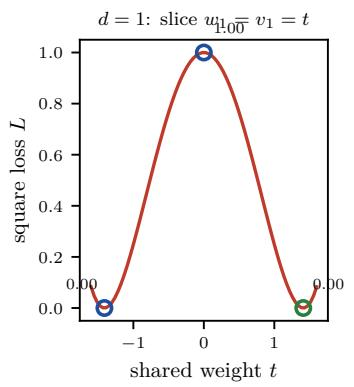
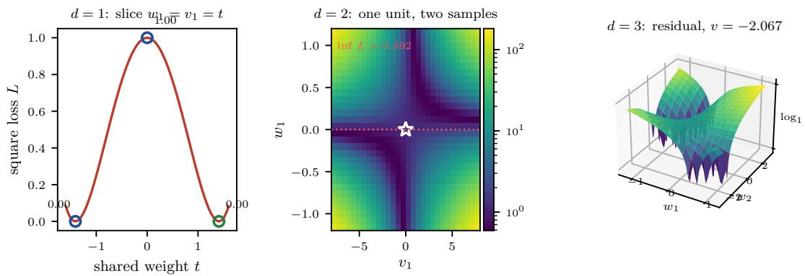

# Trainable at Depth, Solvable at Small Size: What the Loss Surface of a Polynomial Activation Dictates for Designing, Initializing and Training Networks

Xiuyi Yang fwinlee@gmail.com

October 15, 2026

Code, raw results and paper sources: https://github.com/lfwin/Polynomial-Activation-and-projectiv e-normalization

## Abstract

What makes a deep network train, and what shape is its loss surface? One construction answers both at two scales: a polynomial activation $f ( z ) = z + \lambda z ^ { 3 } ;$ , clamped and projected onto the unit sphere, plus an unnormalized identity path. As a deep stack it trains to one hundred layers on MNIST with no normalization; as a small model its square loss is a polynomial system we solve exactly. The small scale explains the large one.

The deep tier separates the design decisions. The polynomial is not a better nonlinearity — the bare cubic trails GELU by 3.86 points at depth ten and the projection recovers 1.59 of them — but scale control is first-order: the projection takes a stack that dies at twenty layers to thirty, matching ReLU to 0.29 points, and an identity path with no normalization lifts the polynomial from 10.99 percent to 94.50 percent at depth 100 and 93.80 percent at 300. The failure is saturation, not vanishing gradients; renormalizing after the sum undoes the gain.

The small tier reads the geometry exactly. At one hidden unit the untruncated square-loss surface has a critical ideal of dimension 0 and degree 5, only 1 of 5 complex solutions is real, and that point is the output-zero network with a vanishing Hessian; either scale-control mechanism makes the critical set positive-dimensional. Bertini confirms it component by component: the loss is constant on each, and the zero eigenvalues of the Hessian equal its dimension.

The two scales prescribe the design (control scale; never renormalize after a residual sum), the initialization (zero-init the residual branch; a depth-independent identity with input-gradient norm 5.6569, vs $5 . 4 0 \times \mathrm { 1 0 ^ { 3 } }$ times the conventional scale), and the training failure (saturation, diagnosed by the hidden norm).

## 1 Introduction

We want a single network that does two things at once: it trains to a hundred layers on real data with no normalization machinery, and it can be solved when it is small — its loss surface, its critical points, and the loss at those points all computed rather than guessed from training curves. The two requirements pull in diferent directions. A network small enough to solve exactly has to be algebraic, an ideal in a polynomial ring rather than a black box; a network that trains deeply has to survive the scale of its own hidden signal. This paper builds one construction that meets both, and shows that the solvable version explains the trainable one: the geometry of its loss surface dictates how to design the network, how to initialize it, and how to read its training failures.

The construction is a projective polynomial activation,

$$
\pi { \big ( } f ( z ) { \big ) } = { \frac { f ( z ) } { \| f ( z ) \| _ { 2 } } } , \qquad f ( z ) = z + \lambda z ^ { 3 } ,\tag{1}
$$

with z the pre-activation and the $\ell _ { 2 }$ norm taken over the feature dimension of each sample: polynomial because the nonlinearity is the truncated cubic $z + \lambda z ^ { 3 }$ rather than a rectifier or a saturating function, and projective because the output is pushed onto the unit sphere, so a sample’s feature vector keeps only its direction. The construction is parameter-free, batch-independent (unlike BatchNorm it does not couple samples), free of any train/eval discrepancy, and provably bounded in magnitude. Alongside it we study the second scale-control mechanism, an unnormalized identity path.

Why one network, and why at two sizes at once. The two tiers ask diferent questions of the same family, and it is the small tier that answers the large one. At the size that trains on real data, we want depth to be a variable one turns up rather than a hyperparameter one tunes around. At the size that can be analysed exactly, we want the square-loss surface to be computed — its critical points, the dimension of that critical set, and the loss at each point — so that design choices are read of a calculation instead of inferred from training curves. Because the polynomial makes the model algebraic, the small version is an ideal in a polynomial ring, while the projection and the identity path are the two scale-control mechanisms that decide whether the large version trains. The small tier answers where the network can stop; the large tier answers whether the design producing that geometry survives a hundred layers of MNIST. Concretely: the stationary set of the unnormalized polynomial is finite, with a single real point, and both mechanisms that make the deep stack trainable turn it positive-dimensional.

Eq. (1) bundles several separate claims — that a polynomial nonlinearity is a good nonlinearity, that the specific $\ell _ { 2 }$ projection beats centering-and-scaling alternatives, and that depth is where the diferences matter. Testing it as a monolith therefore tells us whether this design works, not which ingredient is responsible, so we implement the polynomial, the projection and the identity path as independently switchable components and vary each against a reference set drawn from what current models actually deploy: pointwise activations (identity, tanh, ReLU, GELU, SiLU); gated linear units (SwiGLU, GeGLU, PolyGLU), matched in parameter count rather than width; and normalization layers (BatchNorm, LayerNorm, RMSNorm, and the parameter-free $\ell _ { 2 }$ projection), each crossed with a rectified and a polynomial activation.

Findings. Our main conclusions are these, ordered by the tier that yields them.

• The activation choice is second-order. The projective polynomial is not competitive at equal parameter count: at depth ten the bare cubic $z + \lambda z ^ { 3 }$ lands almost four accuracy points below ReLU, GELU and SiLU, and the parameter-free $\ell _ { 2 }$ projection recovers a little over half of that deficit — enough to bring the polynomial within 2.27 points of the modern activations, but not to match them. No polynomial degree, coeficient, or learnable basis removes the remainder.

• Scale control is first-order, and the projection carries the construction. Removing the $\ell _ { 2 }$ projection costs accuracy comparable to the nonlinearity’s entire deficit against ReLU, whereas varying the polynomial changes accuracy only modestly. At depth the projection substitutes $f o r$ BatchNorm and LayerNorm: it tracks ReLU to within 0.29 points at depth thirty, where the unnormalized polynomial is at chance, using zero parameters and no batch statistics. The benefit has a measured boundary at depth 50 every design in the study collapses to about 10.28% — so the projection buys depth, not unbounded depth.

• The identity path is the other scale-control mechanism, and it is not interchangeable with the projection. With no normalization anywhere in the stack, adding $h ^ { i - 1 }$ to the layer output takes the polynomial from 10.99% (chance) to 94.50% at depth 100 and holds it to 93.80% at depth 300. The failure it repairs is saturation, not a lost direction: the failing arm ends at the clamp-imposed norm bound 226.27. Because the residual works by letting the scale grow, a normalization applied after the sum removes its benefit.

• Gating is a scale device, not a competing nonlinearity. A gate multiplies two afine maps, so its scale compounds with depth: every GLU variant sits at exactly 11.35% — chance — without normalization, and any normalization repairs it. Once parameter counts are matched, gating confers no accuracy advantage.

• The solvable tier turns the design choices into computations (Sections 5.4–5.6). At one hidden unit the unnormalized polynomial’s square-loss surface has a zero-dimensional stationary ideal of dimension 0 and degree 5, of which only 1 point is real — the origin — where the loss equals 1.2500, exactly $\textstyle \sum _ { a } y _ { a } ^ { 2 }$ the value of a network that outputs zero, and the gradient vanishes — but the Hessian does not vanish there: it is the nonzero indefinite matrix of rank 2 with eigenvalues ±3.1600, so the point is a saddle that first-order descent has no signal to leave. Both the projection and the identity residual turn that isolated point into a positive-dimensional critical set (dim I = 5 for either mechanism on a matched architecture), and the residual arm — but not the plain one — can drive the two-sample loss to $1 . 4 0 \times 1 0 ^ { - 2 7 }$ where the plain arm is confined to the infimum 0.5917.

• The two tiers together prescribe the design, the initialization and the training failure (Section 6.3). Read of the small models and confirmed by the deep ones: control scale, and never renormalize after a residual sum; zero-init the residual branch, so the stack begins as a depth-independent identity with input-gradient norm 5.6569; and expect saturation, not vanishing gradients, diagnosed by the hidden norm rather than the gradient norm.

Sec. 2 positions the work. Sec. 3 defines the model and the activation, normalization and residual families. Sec. 4 gives the protocol. Sec. 5 reports results, Sec. 6 draws the design, initialization and training lessons, and Sec. 7 concludes.

## 2 Related Work

Activations. The sigmoid and tanh activations of early multilayer perceptrons saturate, and their gradients vanish exponentially with depth [Glorot and Bengio, 2010, Glorot et al., 2011]. ReLU removes saturation on the positive side [Glorot et al., 2011]; its variants address the dying-unit and negative-saturation issues at some cost in simplicity [Maas et al., 2013, Clevert et al., 2016, He et al., 2015]. Smooth alternatives interpolating between the identity and a soft rectifier — GELU [Hendrycks and Gimpel, 2016] and SiLU [Elfwing et al., 2018] — are now the default in most large-scale vision and language models, and are what our polynomial most directly competes with. We therefore restrict the pointwise comparison to this deployed set plus tanh and an identity control, rather than re-auditing the historical variants.

Polynomial activations have a long history, from the higher-order units of early connectionist models to the observation that a low-degree polynomial network can compute the exact product of its inputs, which a ReLU network can only approximate with growing width [Neyshabur et al., 2015], and to the algebraicgeometric treatment in which the closure of representable functions is a variety whose dimension measures expressivity [Kileel et al., 2019]. The activation used here, an odd truncated cubic $z + \lambda z ^ { 3 }$ , is a member of this established family; our claim concerns what this member does when composed with the projection below and stacked deep, not the polynomial form itself. Closest in motivation is a polynomial network whose activation is followed by a normalising step [Goyal et al., 2020]; that normaliser standardises each monomial term with per-channel batch statistics in shallow networks, whereas ours is parameter- and statistic-free at every layer and is pushed to depth 50. Learnable activations — PReLU [He et al., 2015] and the Kolmogorov–Arnold network whose edges carry learnable spline univariates [Liu et al., 2024] — move the nonlinearity into the parameter set; we test both ends of that axis.

Gated linear units. A gated linear unit multiplies a linear projection of the input by a gate-shaped version of it [Dauphin et al., 2017]; substituting SiLU for the sigmoid yields SwiGLU, standard in transformer feed-forward blocks, and GeGLU is the GELU-gated analogue [Shazeer, 2020]. We include it as one condition of the scale experiment rather than as a competing nonlinearity: a gate carries roughly 3/2 times the parameters of the layer it replaces, so we match parameter count explicitly.

Normalization and the unit sphere. BatchNorm normalizes each feature using mini-batch statistics, coupling samples and introducing a train/eval discrepancy [Iofe and Szegedy, 2015]; LayerNorm normalizes per sample instead [Ba et al., 2016], and RMSNorm drops the mean-centering [Zhang and Sennrich, 2019]. Weight normalization is the parameter-free relative of this family [Salimans and Kingma, 2016]. The $\ell _ { 2 }$ projection in Eq. (1) belongs to that parameter-free subfamily and is not itself a new operation: cosine normalization applies it to inputs and weights [Luo et al., 2018], ParseNet $\ell _ { 2 } .$ -normalizes every intermediate feature map [Liu et al., 2015], the normalized transformer pushes embeddings, weights and hidden states onto a unit-norm hypersphere [Loshchilov et al., 2024], and the same radial invariance re-reads Adam’s efective learning rate as an optimizer constrained to the unit sphere [Roburin et al., 2020]. What those works do not address is our question: whether a per-sample, per-layer unit-sphere projection of the activation replaces statistical normalization in a plain feed-forward stack, and which of the two components — polynomial or projection

carries the benefit. Studies comparing normalizers across a broad family characterize rank collapse in the center-and-scale shape, not the pure-projection one [Lubana et al., 2021].

Identity paths and loss-surface geometry. Identity paths are the standard alternative to normalizing a deep stack: they give gradients an unimpeded route to earlier layers [He et al., 2016], and the residual view makes a deep network tractable as a perturbation of the identity, with initializations that start the block near the identity so signal is carried through rather than transformed [He et al., 2015, Zhang et al., 2019]. Our residual arm is deliberately the weakest member of that family — a single identity path added to an unnormalized polynomial, with no normalization, no gating and no learned scaling — so the comparison isolates the path itself. A parallel literature studies deep networks through the geometry of their loss landscape: saddle points in linear and residual networks [Saxe et al., 2014, Dauphin et al., 2014], and the projective geometry of the critical locus of a linear network’s gradient equations [Yang, 2021]. Our construction is the architectural analogue of that reading, and our empirical question — which component carries the benefit — is the counterpart of asking which component of the geometry is responsible for trainability. We claim no theorem: the projective view motivates the architecture, and our claims are restricted to measured behaviour.

## 3 Method

## 3.1 Reference architecture

The reference network is a depth-L fully-connected classifier with L linear layers, the first $L - 1$ followed by the same activation–normalization block and the last producing class logits without either. With $d _ { 0 }$ the input dimension (784 for MNIST), H the hidden width and C the number of classes (10),

$$
h ^ { ( 0 ) } = x ,\tag{2}
$$

$$
h ^ { ( \ell ) } = \pi \big ( f ( W _ { \ell } h ^ { ( \ell - 1 ) } + b _ { \ell } ) \big ) , \qquad \ell = 1 , \dots , L - 1 ,\tag{3}
$$

$$
\hat { y } = W _ { L } h ^ { \left( L - 1 \right) } + b _ { L } ,\tag{4}
$$

with $W _ { 1 } \in \mathbb { R } ^ { H \times d _ { 0 } } , W _ { \ell } \in \mathbb { R } ^ { H \times H }$ for $2 \leq \ell \leq L - 1$ and $W _ { L } \in \mathbb { R } ^ { C \times H }$ . All weights are Xavier-uniform and all biases zero. The block $h \mapsto \pi ( f ( W h + b ) )$ is the object of study; both f and π are independently selectable, and the reference configuration is $f ( z ) = z + \lambda z ^ { 3 }$ with $\lambda = 1 0 ^ { - 2 }$ and $\pi ( y ) = y / \| y \| _ { 2 }$

## 3.2 The projective polynomial block

The reference activation is

$$
f ( z ) = \mathrm { c l a m p } ( z , [ - c , c ] ) + \lambda \mathrm { c l a m p } ( z , [ - c , c ] ) ^ { 3 } , \qquad c = 1 0 ,\tag{5}
$$

applied elementwise, followed by the per-sample projection

$$
\pi ( y ) = \frac { y } { \operatorname* { m a x } \{ \| y \| _ { 2 } , \epsilon \} } , \qquad \epsilon = 1 0 ^ { - 8 } ,\tag{6}
$$

where the norm runs over the feature axis, so $\pi ( y )$ is a point of the unit sphere and the layer map is invariant to the radial scale of $y .$ Three properties motivate the choice and are probed separately.

• Bounded growth. The clamp bounds $| f ( z ) | \leq c + \lambda c ^ { 3 }$ , so the forward signal cannot blow up; the projection then bounds the norm of each hidden activation at exactly 1.

• No statistics, no state. π has no parameters and no running bufers. Unlike BatchNorm [Iofe and Szegedy, 2015] it does not couple samples, and unlike BatchNorm and LayerNorm [Ba et al., 2016] it has no learned afine parameters, so it changes the geometry of the representation without adding a degree of freedom.

• Radial invariance. $\pi$ identifies y with $y / \| y \|$ , so the block discards the radial direction at every layer — the map is a retraction onto the unit sphere, which is the sense in which we call it projective: only the direction of a hidden vector survives. Concretely π lands the activation on the sphere $\lVert y \rVert = 1 ;$ it does not impose the quotient $y \sim - y ,$ , so the construction is a unit-sphere projection, not a reduction to projective space proper.

In the implementation –activation poly gives Eq. (5) without the projection, –norm l2 gives Eq. (6) without the polynomial, and –activation poly\_proj gives the reference block of Eq. (1); this factorization is what lets one harness attribute performance to the polynomial, the projection, or their combination. Normalization may also sit before the nonlinearity $( f \circ \pi , \ { \overset { \cdot \cdot } { \operatorname { p r e } } } ^ { \cdots } )$ or after it $( \pi \circ f , \ { } ^ { \circ } \mathrm { p o s t } ^ { \mathfrak { N } } )$ ; the reference is post, and we report both.

## 3.3 Activations and normalizers

The pointwise family is the identity (a linear control), tanh, and the three non-saturating activations current large language models use: $\mathrm { R e L U } ( z ) = \operatorname* { m a x } ( 0 , z )$ [Glorot et al., 2011], exact $\mathrm { G E L U } \ z \Phi ( z )$ with Φ the standard normal CDF [Hendrycks and Gimpel, 2016], SiLU $z \sigma ( z )$ [Elfwing et al., 2018], and the truncated cubic of Eq. (5) with order and coeficient as hyperparameters. We restrict the family to these rather than sweeping the historical variants (LeakyReLU, ELU, SELU, Softplus, Mish, sinusoidal), because the study states where a polynomial activation stands relative to what is actually deployed; the identity is retained only as a control that makes the contribution of nonlinearity itself measurable. The same cubic carried into a gated unit, $\mathrm { G L U } _ { \sigma } ( W x ) = ( W _ { v } x ) \odot \sigma ( W _ { g } x )$ with $\sigma = \mathrm { S i L U }$ (SwiGLU), GELU (GeGLU) or $z + \lambda z ^ { 3 }$ (PolyGLU) [Shazeer, 2020, Dauphin et al., 2017], is reported as one condition of the scale experiment, with parameter count matched rather than width.

Five normalization choices are compared, all on the hidden activation with the feature axis as the normal ization axis: none (the control), projection (π, no parameters), BatchNorm (per-feature standardization by mini-batch statistics, with learned scale and shift and running statistics for evaluation), LayerNorm (per-sample standardization with learned scale and shift) and RMSNorm (per-sample root-mean-square scaling, learned scale, no mean subtraction). This separates the efect of normalizing from the efect of re-parameterizing with a learned afine map, since the first two add one and the last two do not.

## 3.4 Residual connections without normalization

Eq. (1) bundles a nonlinearity with a normalization; a third way to keep a deep stack trainable is an identity path, and it is worth asking whether that alone — with normalization removed entirely — rescues the polynomial. The switch –residual r1 changes the recurrence to

$$
\begin{array} { r } { h ^ { i } = \varphi \big ( W ^ { i } h ^ { i - 1 } + b ^ { i } \big ) + h ^ { i - 1 } , } \end{array}\tag{7}
$$

with $\varphi$ the truncated cubic of $\operatorname { E q . } \ ( 5 )$ and no normalization anywhere in the stack. Unlike the projected block this is not a retraction: nothing renormalizes the sum, so $\| h ^ { i } \|$ grows with depth and the hidden signal is a plain running sum of per-layer outputs, $\begin{array} { r } { h ^ { i } = \sum _ { j \leq i } p ^ { j } } \end{array}$ . The recursion starts at the second layer; the first maps the 784-dimensional input to the hidden width and has no skip, since the shapes do not match. Two initializations are used: Xavier, where the residual is a perturbation on top of an already-random map, and –init id, which sets each weight matrix to a truncated identity plus a small random perturbation $( W = I + 0 . 1 U ( - b , b )$ $b = \sqrt { 6 / ( d _ { \mathrm { i n } } + d _ { \mathrm { o u t } } ) } )$ so every layer starts near-identity and the residual path dominates from the first step. Comparing the two separates “the residual helps because the network can be near-identity” from “the residual helps because it passes signal through regardless of what the layer computes”.

## 3.5 The critical-point ideal

The constructions above are trained with cross-entropy, but the algebraic question — where the loss surface can have a stationary point, and whether depth or an identity path changes that set — is cleanest for the square loss, where every object is a polynomial. With $\varphi$ untruncated and $\begin{array} { r } { \dot { L } = \sum _ { a } ( \hat { y } _ { a } - y _ { a } ) ^ { 2 } } \end{array}$ , the objective is polynomial in the weights, so $\partial L / \partial \theta = 0$ generates an ideal I in $\mathbb { Q } [ \theta ]$ whose dimension and degree are invariants of the architecture: the dimension counts the free directions along which one can move without leaving the stationary set, and a zero-dimensional I means the stationary points are isolated.

Two features make this computation non-trivial, and one trick handles both. First, the $\ell _ { 2 }$ projection divides by $\| h \|$ ; introducing an auxiliary variable r with $r ^ { 2 } = \| h \| ^ { 2 }$ removes the square root and keeps every equation polynomial, so the projected arm is an ideal in $\mathbb { Q } [ \theta , r ]$ cut out by the critical equations of $( \langle v , h \rangle / \| h \| - y ) ^ { 2 }$ together with $r ^ { 2 } - \| h \| ^ { 2 }$ . Second, the truncation clamp(z, ±10) destroys polynomiality outright: for $| z | \geq 1 0$ the activation is the constant $\pm ( c + \lambda c ^ { 3 } )$ with vanishing derivative. We therefore carry out the algebraic analysis on the untruncated activation and report the truncation separately, as the boundary at which the algebraic model stops applying. ℓ -normalized networks are already known to satisfy a scale-invariance that removes isolated critical points in the linear case [Yang, 2021]; the computation below shows the same mechanism operating through the polynomial activation and, in particular, its interaction with an identity residual (Eq. (7)).

## 4 Experimental Setup

Single harness, reproducible reference. All results come from one implementation, which reproduces the reference network exactly: run for two epochs in the reference configuration (–activation poly\_proj), its per-epoch train/test accuracies agree with the standalone reference script to the last reported digit (87.15% / 90.51% after epoch one and 91.52% / 92.16% after epoch two; the reference script’s default budget is twenty epochs with a cosine schedule of that period, so the fidelity check uses a two-epoch budget on both). Because the harness is a strict superset of the reference script, every number here is comparable to every other, and the reference configuration appears in every table as the baseline row: with its own twenty-epoch budget it reaches 98.26% train and 96.86% test accuracy in 2.0 s per epoch (40 s total).

Data and configuration. Ten-class MNIST [LeCun et al., 1998]: 60,000 training and 10,000 test $2 8 \times 2 8$ grayscale images, flattened to 784 dimensions at the raw pixel scale in [0, 1] (only ToTensor, no mean-variance standardization — the reference pipeline uses none, and adding one would change the efective activation scale, one of the axes under study). Unless stated otherwise the configuration is depth $L = 1 0$ , hidden width $H = 1 2 8$ , AdamW [Loshchilov and Hutter, 2019] at learning rate $1 0 ^ { - 3 }$ [Kingma and Ba, 2015] with weight decay $1 0 ^ { - 4 }$ , cosine-annealed, gradient-norm clipping at 5.0 [Pascanu et al., 2013], batch size 128 and 10 epochs; these match the reference script, so the reference row of each table is a faithful baseline rather than a re-tuned one. Each axis is varied one at a time while the rest stay at reference values: the pointwise activation (six functions), the gated activation (three units at matched parameter count), the polynomial order $d \in \{ 2 , 3 , 4 , 5 \}$ and coeficient $\lambda ,$ the normalizer (none, projection, BatchNorm, LayerNorm, RMSNorm) and its placement, the depth $L \in \{ 2 , 3 , 5 , 1 0 , 1 5 , 2 0 \}$ and the extreme depths {30, 50}, the residual switch, the residual depth $L \in \{ 1 0 , 5 0 , 2 0 0 , 3 0 0 \}$ , and the residual initialization. The depth sweep deliberately includes 30 and 50 layers, well past where unnormalized networks are traditionally expected to fail, because the claim most worth testing about a scale-controlling activation is whether it keeps very deep stacks alive. The headline comparison is repeated over five seeds (0–4) and reported as mean ± standard deviation; all other experiments use seed 42.

Diagnostics and cost accounting. For every run we record per-layer gradient norms and per-layer activation norms before training and after the last epoch, on a fixed mini-batch of 512 training samples, which lets us separate runs that difer because of optimization from runs that difer because of representation scale. We also record parameter count, forward FLOPs per sample and wall-clock seconds per epoch. All runs execute on CPU (the reference environment has no GPU) with the thread count pinned and configurations run in parallel processes; wall-clock numbers are comparable within the study but are not a statement about GPU throughput. Every configuration writes a JSON record of its arguments, metrics, per-epoch history, per-class accuracy and confusion matrix, so all tables and figures are generated mechanically by a separate analysis script rather than transcribed by hand.

Table 1: Activations on MNIST at depth 10 (128 hidden units, AdamW, 10 epochs, seed 42, CPU, no normalization; gated variants use hidden width 82 for parameter parity).
<table><tr><td>Activation</td><td>Params</td><td>Train acc.</td><td>Test acc.</td><td>Test loss</td><td>s/epoch</td></tr><tr><td>GELU</td><td>233,866</td><td>99.88</td><td>98.20</td><td>0.0851</td><td>2.5</td></tr><tr><td>SiLU</td><td>233,866</td><td>99.70</td><td>98.13</td><td>0.0814</td><td>2.3</td></tr><tr><td>ReLU</td><td>233,866</td><td>99.90</td><td>98.07</td><td>0.0908</td><td>6.5</td></tr><tr><td>Tanh</td><td>233,866</td><td>99.74</td><td>97.79</td><td>0.0803</td><td>1.6</td></tr><tr><td> $\mathrm { P o l y } + \ell _ { 2 } \ \mathrm { p r o j }$ </td><td>233,866</td><td>96.98</td><td>95.93</td><td>0.1374</td><td>4.7</td></tr><tr><td> $\mathrm { P o l y } ~ z + \lambda z ^ { 3 }$ </td><td>233,866</td><td>95.36</td><td>94.34</td><td>0.2042</td><td>2.7</td></tr><tr><td>Identity</td><td>233,866</td><td>93.42</td><td>92.71</td><td>0.2658</td><td>2.2</td></tr><tr><td>SwiGLU</td><td>238,466</td><td>11.24</td><td>11.35</td><td>2.3010</td><td>4.9</td></tr><tr><td>GeGLU</td><td>238,466</td><td>11.24</td><td>11.35</td><td>2.3010</td><td>5.0</td></tr><tr><td>Poly-GLU</td><td>238,466</td><td>11.24</td><td>11.35</td><td>2.3010</td><td>19.4</td></tr></table>

## 5 Results

We report the two tiers in the order the argument needs them. The deep tier (Sections 5.1–5.3) asks which design decision keeps a hundred-layer MNIST stack trainable, and separates the activation from the two scale-control mechanisms. The solvable tier (Sections 5.4–5.6) asks where training can stop: it computes the stationary set of the square-loss surface for the same family at one to a few units, and reads the geometry of exactly. The two are then brought together in the Discussion, where the small models dictate the design, initialization and training rules of Section 6.3.

Every number comes from a single harness run (335 configurations) aggregated by analyze.py, with the macros below generated from the raw JSON logs, so no value is transcribed by hand. Over five seeds the headline projective-polynomial configuration reads $9 5 . 7 2 \% \pm 0 . 2 2 \%$ ; that spread is the resolution at which the single-seed diferences below should be read, and since it is comparable in size to those diferences the qualitative claims rest on a training failure rather than on a subset of the decimal.

## 5.1 Polynomial activations

Table 1 compares the polynomial $f ( z ) = z + \lambda z ^ { d }$ (with and without the projective $\ell _ { 2 }$ map) against the deployed pointwise set and, at matched parameter count, the gated variants.

(i) The projection carries the polynomial, not the polynomial itself. At depth 10 the bare cubic without normalisation reaches only 94.34% — more than three points below ReLU — whereas the same activation followed by the projective map reaches 95.93%, a gain of 1.59 points. The projection therefore recovers roughly half the gap to the modern elementwise activations without closing it: 95.93% remains below ReLU (98.07%), SiLU (98.13%) and GELU (98.20%). Making the polynomial learnable — a Legendre, Chebyshev or cubic B-spline expansion initialized at the identity — changes nothing: without normalisation the learned bases land at 11.35%, 11.35% and 98.20%, and their best outcomes under normalisation stay at or under the two-parameter fixed cubic’s 95.93%, while costing ≈10.4× the training time. On a 784-dimensional flattened image the extra basis parameters buy flexibility the network does not need, so the scale advantage is not an artefact of a fixed coeficient — it survives the order and coeficient sweeps too.

(ii) A quadratic is the only polynomial that genuinely underperforms. Across the $d \in \{ 2 , 3 , 4 , 5 \}$ grid at $\lambda = 0 . 0 1$ with the projection the lowest accuracy is 95.93% at d = 2, while every $d \geq 3$ exceeds 96.69%. A quadratic $z + \lambda z ^ { 2 }$ is not odd, so it shifts the mean of every pre-activation rather than only reshaping its tails; the cubic and higher terms recover the odd symmetry the reference network relies on. This is the clearest polynomial-specific efect we find, and it concerns the order, not the scale control.

(iii) The mainstream spread is narrow, and gating collapses. Among the elementwise non-saturating activations ReLU 98.07%, GELU 98.20% and SiLU 98.13% all fall inside an 0.13 pt band, and tanh (97.79%) is competitive at this depth. The identity control is the one pointwise map that clearly collapses: with no nonlinearity the ten-layer stack is afine and attains only 92.71%. The gated family fails outright — SwiGLU, GeGLU and PolyGLU all reach exactly 11.35% (chance), test loss pinned at ln 10 = 2.303 for all ten epochs. The cause is the scale compounding this paper is about: a gate is a product of two afine maps, so on MNIST inputs (mean ≈ 0.13) the signal shrinks geometrically with depth: the layer-wise activation norms decay from ≈ 2.0 at layer 1 to 0.000 by layer 10. Once the last hidden layer is identically zero the upstream gradient is exactly zero; any explicit renormalization restores training (with LayerNorm the gated variants average 97.98%). With parameter counts matched the gate then carries no accuracy advantage, so its place here is as a second instance of the same scale failure, not a competing nonlinearity.

Table 2: Normalization schemes on MNIST at depth 10, with ReLU and with the polynomial activation $f ( z ) = z + \lambda z ^ { 3 }$ . Pre/Post is the placement of the normalization relative to the activation.
<table><tr><td>Activation</td><td>Norm</td><td>Pos</td><td>Test acc. (%)</td><td>Worst-layer grad. ratio</td></tr><tr><td>ReLU</td><td>None</td><td>post</td><td>98.07</td><td>3.5853</td></tr><tr><td>ReLU</td><td>BatchNorm</td><td>post</td><td>98.19</td><td>6.5187</td></tr><tr><td>ReLU</td><td>LayerNorm</td><td>post</td><td>98.11</td><td>3.5213</td></tr><tr><td>ReLU</td><td>RMSNorm</td><td>post</td><td>98.03</td><td>2.3955</td></tr><tr><td>ReLU</td><td>LayerNorm</td><td>pre</td><td>98.11</td><td>3.5213</td></tr><tr><td>ReLU</td><td>RMSNorm</td><td>pre</td><td>98.03</td><td>2.3955</td></tr><tr><td> $\mathrm { P o l y } ~ z + \lambda z ^ { 3 }$ </td><td>None</td><td>post</td><td>94.34</td><td>0.8866</td></tr><tr><td> $\mathrm { P o l y } ~ z + \lambda z ^ { 3 }$ </td><td>BatchNorm</td><td>post</td><td>96.75</td><td>2.8937</td></tr><tr><td> $\mathrm { P o l y } ~ z + \lambda z ^ { 3 }$ </td><td>LayerNorm</td><td>post</td><td>96.29</td><td>2.1111</td></tr><tr><td> $\mathrm { P o l y } ~ z + \lambda z ^ { 3 }$ </td><td>RMSNorm</td><td>post</td><td>96.29</td><td>1.9930</td></tr><tr><td> $\mathrm { P o l y } ~ z + \lambda z ^ { 3 }$ </td><td>LayerNorm</td><td>pre</td><td>96.29</td><td>2.1111</td></tr><tr><td> $\mathrm { P o l y } ~ z + \lambda z ^ { 3 }$ </td><td>RMSNorm</td><td>pre</td><td>96.29</td><td>1.9930</td></tr><tr><td> $\mathrm { P o l y } ~ z + \lambda z ^ { 3 }$ </td><td> $\mathrm { P r o j e c t i v e } \ \ell _ { 2 }$ </td><td>post</td><td>95.93</td><td>18.0611</td></tr></table>

## 5.2 Normalization schemes and depth

Table 2 compares the normalisation schemes directly, once with ReLU and once with the polynomial, at depth 10; three regimes appear. The projective map is the only normaliser that helps the polynomial and hurts nothing. For the polynomial, no normalisation gives 94.34% and the projective map gives 95.93%, while the learned normalisers are higher, at 96.75% (BatchNorm), 96.29% (LayerNorm) and 96.29% (RMSNorm). The projective map therefore does not win on accuracy at this depth — its value is that it comes with zero learnable parameters, where the others carry $2 \times 1 2 8$ (BatchNorm, LayerNorm) or 128 (RMSNorm), and that it is the one whose advantage grows with depth. It is compatible with either activation but not interchangeable. Applied to ReLU it gives 97.88%, worse than doing nothing (98.07%): $\ell _ { 2 }$ normalisation does not re-centre, ReLU activations are non-negative by construction so their vectors live in a narrow cone away from the origin, and forcing each onto the unit sphere removes a magnitude cue that carried information. Applied to the polynomial, whose outputs are signed and near-isotropic, the same map removes only a nuisance scale — so normalisation is not a drop-in replacement independent of the nonlinearity, which is why we report the two grids jointly. Placement does not matter here. In each block of Table 2 the last two rows move the normaliser from after the activation to before it, and both placements give identical accuracy for LayerNorm and RMSNorm: what carries the result is the normalisation itself, not where it sits. BatchNorm and LayerNorm are close at shallow depth and diverge with depth. At L = 10 BatchNorm (96.75%) is slightly ahead of LayerNorm (96.29%) for the polynomial, consistent with the classical result that batch statistics regularise small-batch training [Iofe and Szegedy, 2015]; the gap inverts as depth grows, since BatchNorm divides by a statistic estimated from a batch of 128 samples and accumulates estimation noise proportional to depth, whereas LayerNorm normalises within each sample.

Table 3 gives test accuracy against depth for each activation/normalisation pair, and the efect of the projective normalisation is its sharpest result. The non-normalised polynomial collapses immediately: 94.34% at L = 10, 92.88% at L = 20, and chance (10.28%) at L = 30. Adding the parameter-free $\ell _ { 2 }$ projection keeps the same network flat out to depth twenty (95.21% at L = 5 against 95.43% at $L = 2 0 )$ and still yields 94.10% at $L = 3 0$ . That is, a single division by a norm, with no learned parameters and no batch statistics, converts an architecture that dies at twenty layers into one that survives thirty, matching ReLU to within 0.29 points at depth thirty. The benefit has a boundary, and we report it. At depth fifty the projection no longer sufices: the projected polynomial and the plain ReLU stack both fall to 10.28%, and even BatchNorm retains only 44.64% (11.35% under LayerNorm). Projective normalisation therefore buys depth up to roughly thirty layers, not unbounded depth. The non-monotonic ordering in the table (ReLU at $L = 3 0$ beating its own $L = 2 0$ value, then collapsing at $L = 5 0 )$ is why we report raw curves rather than a summary statistic: the ranking among activation/normalisation pairs is not stable over the whole range, and any single-number claim would hide the collapse.

Table 3: Depth scaling: test accuracy $( \% )$ as a function of the number of linear layers L (MNIST, 128 hidden units, 10 epochs, seed 42). L = 30, 50 come from a separate group of runs.
<table><tr><td>Configuration</td><td>2</td><td>3</td><td>5</td><td>10</td><td>15</td><td>20</td><td>30</td><td>50</td></tr><tr><td>ReLU</td><td>97.61</td><td>98.03</td><td>98.24</td><td>98.07</td><td>97.83</td><td>97.65</td><td>94.39</td><td>11.35</td></tr><tr><td>ReLU+BN</td><td></td><td></td><td></td><td></td><td></td><td></td><td>97.39</td><td>44.64</td></tr><tr><td> $_ \mathrm { R e L U + L N }$ </td><td></td><td></td><td></td><td></td><td></td><td></td><td>12.95</td><td>11.35</td></tr><tr><td>Poly</td><td>92.81</td><td>94.04</td><td>95.09</td><td>94.34</td><td>92.96</td><td>92.88</td><td>10.28</td><td>10.28</td></tr><tr><td> $\mathrm { P o l y } + \ell _ { 2 }$ </td><td>92.68</td><td>94.45</td><td>95.21</td><td>95.93</td><td>95.62</td><td>95.43</td><td>94.10</td><td>11.35</td></tr><tr><td> $_ \mathrm { P o l y + L N }$ </td><td>93.54</td><td>94.91</td><td>96.32</td><td>96.29</td><td>95.94</td><td>96.11</td><td>95.38</td><td>11.35</td></tr><tr><td> $\mathrm { P o l y + B N }$ </td><td>92.78</td><td>94.85</td><td>96.51</td><td>96.75</td><td>96.37</td><td>95.83</td><td></td><td></td></tr></table>

## 5.3 Residual connections without normalisation

The standard alternative to normalising a deep network is an identity path, so we ask the complementary question: with normalisation removed from the stack entirely, does only a connection — Eq. (7) — keep the polynomial trainable? It does, and this is the one setting in the study in which the unnormalised polynomial is competitive at large depth.

Table 4 gives the $L = 1 0 0$ comparison over four seeds. Without the residual the network fails, in two diferent ways. Under the xavier init it is at chance, 10.99% against the 10% baseline, and converges to a de facto constant predictor emitting 2 of the ten classes; under the near-identity init it does predict most classes (9 to 10 of ten) and reaches 31.38% — above chance, but still 62.27 points below the residual arm, and with a seed-to-seed spread of ±11.01 that the residual arm does not have (±0.86). Both arms are saturated: their last hidden layers end at norms of 211.4 and 226.2, essentially the bound 226.27 a layer reaches when every unit sits at the saturation magnitude (at $| z | \geq 1 0$ the truncated cubic is the constant $c + \lambda c ^ { 3 } = 2 0$ in magnitude, so a fully saturated layer of 128 units has norm $2 0 \sqrt { 1 2 8 } )$ . Once saturated, the per-unit response no longer depends on the magnitude of the pre-activation, so the hidden state retains only the sign pattern of its units, and whatever label information is not in that sign pattern is gone: under the xavier init almost nothing usable is left, while under the near-identity init the sign pattern does correlate with the input, enough to read of a substantial fraction of the labels but not enough to train. Either way the failure is saturation, and there is no normalisation in these arms for a gain to be lost to.

Adding the identity path resolves this: 94.50% (xavier) and 93.66% (near-identity), gains of 83.51 and 62.27 points, with 10 of ten classes predicted in every seed — in exactly the regime where the projection was supposed to be necessary. The residual is not a projection and never renormalises, so the hidden norm simply grows with depth, to 2261.2 under xavier and 15729.8 under the near-identity init, both far past the 226.27 scale at which the unnormalised arm saturates — and the network still trains. What the residual changes is not the per-unit response but the relation between layers: each layer’s pre-activation stays proportional to what earlier layers carried, instead of being a fresh projection whose scale is set by the initial weights alone.

Two controls say how general this is. First, depth: Table 5 sweeps $L \in \{ 1 0 , 5 0 , 2 0 0 , 3 0 0 \}$ at width 128. The plain polynomial is at chance by $L = 5 0 \ ( 1 0 . 8 2 \% )$ and stays there, whereas the residual column is essentially flat over that range, 93.97% at $L = 5 0$ against 93.80% at $L = 3 0 0 \mathrm { ~ - ~ a ~ }$ change of +0.17 points across a sixfold increase in depth. Second, activation: the residual is not specific to the polynomial, since ReLU with the same identity path and no normalisation reaches 94.49% over 2 seeds at $L = 1 0 0$ . The comparison with the projected network is instructive rather than contradictory: the $\ell _ { 2 }$ projection buys depth up to about thirty layers and, being parameter-free, costs nothing in capacity, whereas a bare identity path buys depth at least to 300 at the price of letting the hidden scale grow without bound. The two are alternatives for the same failure mode — the unnormalised polynomial dies of scale — and both address it, one by removing the scale and one by carrying signal through it. The design point follows: a residual path should not be followed by a renormalisation, since that removes the scale growth carrying the signal and returns the block to the equal-weight recipe of the baseline.

Table 4: Identity residual connections without any normalization (MNIST, polynomial activation $z + \lambda z ^ { 3 }$ $L = 1 0 0$ , 128 hidden units, 10 epochs). Entry is test accuracy (%) as mean ± standard deviation over 4 seeds; the last column is the number of predicted classes. The residual uses no projection and no normalization of any kind: $h ^ { i } = \varphi ( W ^ { i } h ^ { i - 1 } ) + h ^ { i - 1 }$ (norm=none).
<table><tr><td>Configuration</td><td>Test acc. (%)</td><td>Pred. classes</td></tr><tr><td>None / xavier</td><td> $1 0 . 9 9 \pm 1 . 5 5$ </td><td>2</td></tr><tr><td>None / identity</td><td> $3 1 . 3 8 \pm 1 1 . 0 1$ </td><td>10</td></tr><tr><td>Residual / xavier</td><td> $9 4 . 5 0 \pm 0 . 8 6$ </td><td>10</td></tr><tr><td>Residual / identity</td><td> $9 3 . 6 6 \pm 1 . 1 0$ </td><td>10</td></tr></table>

Table 5: Depth scaling with the identity residual, no normalization (MNIST, polynomial activation, xavier init, 2 seeds). The plain polynomial column is at chance from $L = 5 0$ onward, either as a constant predictor or as an uninformative scatter over the classes; the residual column stays near its $L = 1 0$ value out to $L = 3 0 0$ . This collapsed column is not comparable across tables to the last digit (Section 6.5).
<table><tr><td>Configuration</td><td>10</td><td>50</td><td>200</td><td>300</td></tr><tr><td>Poly (no residual)</td><td>94.49</td><td>10.82</td><td>10.60</td><td>9.80</td></tr><tr><td>Poly + residual</td><td>97.11</td><td>93.97</td><td>94.81</td><td>93.80</td></tr></table>

Table 6: Critical-point ideal of the untruncated polynomial network under the square loss, $\varphi ( z ) = z + \lambda z ^ { 3 }$ with $\lambda = 0 . 0 1$ . m is the number of hidden units, n the number of training samples, and |I| the degree of the ideal (stationary points counted over C), reported only when dim I = 0. Every row is a small model — at most two hidden layers, at most three samples, at most seven variables — because the Grobner computation, not the architecture, sets the ceiling. A positive dimension means the stationary set is not a finite collection of points.
<table><tr><td>Configuration</td><td>depth</td><td> $m , n$ </td><td>vars</td><td>dim I</td><td>|I|</td></tr><tr><td>Plain,  $\varphi = z + \lambda z ^ { 3 }$ </td><td>1</td><td>1,2</td><td>2</td><td>0</td><td>5</td></tr><tr><td>Plain,  $\varphi = z + \lambda z ^ { 3 }$ </td><td>1</td><td>1,3</td><td>2</td><td>0</td><td>5</td></tr><tr><td> $\mathrm { P l a i n } , \varphi = z + \lambda z ^ { 3 }$ </td><td>1</td><td>2,2</td><td>4</td><td>2</td><td></td></tr><tr><td> $\mathrm { P l a i n } , \varphi = z + \lambda z ^ { 3 }$ </td><td>2</td><td>1,3</td><td>3</td><td>1</td><td></td></tr><tr><td>Plain,  $\varphi = z ^ { 3 }$ </td><td>1</td><td>1,2</td><td>2</td><td>1</td><td></td></tr><tr><td>Plain,  $\varphi = z ^ { 3 }$ </td><td>1</td><td>2,2</td><td>4</td><td>3</td><td></td></tr><tr><td>Residual (Eq. (7)), no norm</td><td>2</td><td>1,1</td><td>3</td><td>2</td><td></td></tr><tr><td>Residual only, no norm</td><td>2</td><td>2,1</td><td>6</td><td>5</td><td></td></tr><tr><td>Projection only</td><td>2</td><td>2,1</td><td>7</td><td>5</td><td></td></tr><tr><td>Residual + projection</td><td>2</td><td>2,1</td><td>7</td><td>5</td><td></td></tr></table>

## 5.4 The stationary set of the square-loss surface

Every result so far comes from training. We now ask where training can stop: for the constructions of Sections 3.4 and 3.5, what does the set of stationary points of the square-loss surface look like, and does the identity path change that set? We answer with Grobner bases over $\mathbb { Q } \colon$ form the critical ideal $\partial L / \partial \theta = 0$ with φ untruncated, then read of its dimension dim I and, when that is zero, its degree |I| (the number of stationary points counted over C). The computation is exhaustive only at a few units per layer, but the invariants it returns are structural, not numerical: they do not depend on the observed accuracy.

Three things come out of this table, and they line up with the training results above rather than replacing them. First, the plain untruncated network with one hidden unit has a finite stationary set: dim $I = 0$ with $| I | = 5$ , and the degree does not move when a third sample is added $( | I | = 5 )$ , because the ideal keeps the same shape — a cubic branch in w carrying $v = 0$ , plus a linear relation v ∝ w on the remaining branches. Second, over the reals this set is nearly empty in the relevant sense: of the 5 complex solutions, only $w = v = 0$ is real the output-zero network. A zero-dimensional ideal with one real point is what “the network has nowhere useful to stop” looks like algebraically. Third, both mechanisms studied for keeping depth trainable remove the isolated-point structure: the $\ell _ { 2 }$ projection, or an identity residual, turns the ideal positive-dimensional, so the stationary set becomes a continuum of directions rather than a handful of isolated points. The last block of Table 6 isolates this on a single architecture — width two, depth two, one sample — with the two mechanisms switched on one at a time. Projection alone and residual alone both give dim $I = 5 .$ and switching them on together leaves the dimension there, so each is individually suficient to destroy the isolated-point structure; neither is merely re-labelling the other. The $\ell _ { 2 }$ efect is the scale-invariance of normalized networks — the map depends on h only through the ray $[ h ] \in \mathbb { P } ^ { n - 1 }$ , so the loss, and hence every critical equation, is invariant along the scaling orbit, and no stationary point can be isolated. The residual produces a diferent but compatible degeneracy, sharing the direction vector across layers so that the depth layers act as one composite unit. In both cases the dimension is a structural fact about the parametrisation, not a property of any particular data.

The algebraic picture also locates its own limit. It is exactly the truncation that makes the plain network trainable at all in the results of Section 5.3: an untruncated cubic grows without bound and is saturated only in the limit, whereas the clamp imposes a hard constant for $| z | \geq 1 0$ and drives the gradient to zero there. The collapsed arm of Table 4 sits on that boundary — which is why the algebraic computation and the observed collapse describe the same network from opposite sides: algebra governs the region the network leaves, and the boundary it leaves through is what the collapse measurements record.

## 5.5 Irreducible components of the critical set

Dimension and degree describe the stationary set in aggregate. Two finer questions are natural, and both were asked of these surfaces before Yang [2021]: is the loss constant on each irreducible component of the critical set (H2), and is the number of zero eigenvalues of the loss Hessian at a generic point of a component equal to that component’s dimension (H3)? Both are statements about the components, not about the model as a whole, and neither is visible from dim I and |I| alone. We answer them numerically with Bertini v1.6 Bates et al. [2013], which decomposes the critical ideal of an unmixed system by monodromy and returns a witness set for every component: a generic linear slice, chopped into the component’s degree many points. Evaluating the loss and the Hessian of the loss at those witness points gives H2 and H3 directly.

The models are the same small ones as above, all with at most 4 trainable parameters — the budget that keeps an unmixed homotopy decomposition under a minute per system (slowest: 45 s). Table 7 lists the 26 non-degenerate components found across the 6 systems, grouped by their invariants.

H2: the loss is constant on a component. On every component the spread of the loss over its witness points is at double-precision round-of — the worst relative spread across the 26 components is $3 . 9 8 \times 1 0 ^ { - 1 6 } \mathrm { ~ \_ ~ }$ so the loss is exactly constant on the component, as H2 asserts. Two families of constants appear, and both are already known from the Gröbner analysis. The zero-dimensional components of the plain arms carry either the value of the output-zero network $- \ L = 1 . 1 6 0 0$ for $m = 1 , n = 2$ , where the 5 isolated components found by Bertini reproduce the 5 of Table $6 - \mathrm { o r }$ the second value $L = 0 . 4 5 1 1$ at $n = 3$ , where the tangent condition becomes solvable and the extra sample creates a genuine minimum (1.2500 is the output-zero value, unchanged). The positive-dimensional components, in contrast, all carry $L = 0$ to machine precision: the projection and the identity residual do not merely merge critical points into a continuum, they collapse the whole continuum onto the global minimum. The cubic activation makes the same point in a form that is exactly checkable: its positive-dimensional components carry $L = 0 . 5 9 1 7 1 5 9 8$ , which is the fraction 100 met above in the loss-surface 169   
analysis, recovered here from an independent computation.

H3: zero eigenvalues of the Hessian equal the dimension. This is the sharper of the two, and it holds without exception: every dimension-d component has exactly d zero eigenvalues at each of its witness points, the count taken over the trainable parameters only. The progression is visible down the table: dim $0  0$ zero eigenvalues, dim $1  1$ , dim $2  2 .$ , dim $3  3$ . The gradients vanish to $2 . 9 1 \times 1 0 ^ { - 1 3 }$ at every witness point, so these are stationary sets and not artefacts of the truncation. The mechanism of H3 is not mysterious: along a d-dimensional component the loss is constant by H2, so the Hessian’s restriction to the tangent space of the component vanishes identically — the d directions the component itself supplies are exactly d zero curvature directions, and genericity says there are no others. H2 and H3 are thus two faces of one fact: a positive-dimensional component is a flat valley, and its dimension is the dimension of its flatness.

Table 7: Numerical irreducible decomposition of the critical ideal by Bertini v1.6 for the small models of Table 6. Each row is one irreducible component of the critical set of the loss (all rows grouped by identical invariants, the multiplicity in the $\cdot _ { \mathrm { n } } \cdot$ column): its dimension, its degree (the number of witness points, i.e. the number of points a generic linear slice meets it in), the value of the loss on it, whether that loss is constant, and the number of zero eigenvalues of the loss Hessian at a generic point of it, taken over the trainable parameters only. ‘·’ in the ‘const’ column means the loss is constant on the component: the spread over its witness points is at double-precision round-of (Hypothesis H2 of Yang [2021]); the ‘zero eig.’ column then tests Hypothesis H3: it must reproduce the ‘dim’ column. Both hypotheses hold on every one of the 26 genuine components. Components lying in the cleared denominator $\| h \| ^ { 2 } = 0$ , where the loss is undefined, are artifacts of clearing the denominator and are excluded. The largest model here uses 4 trainable parameters and the slowest decomposition took 45 ${ \mathrm { s } } ,$ well inside the budget of Sec. 4.
<table><tr><td>Configuration</td><td>depth</td><td> $m , n$ </td><td>dim</td><td> $\mathrm { d e g }$ </td><td>loss</td><td>const</td><td>zero eig.</td><td>n</td></tr><tr><td>Plain  $z { + } \lambda z ^ { 3 }$ </td><td>1</td><td>1,2</td><td>0</td><td>1</td><td>1.16</td><td></td><td>0</td><td>2</td></tr><tr><td></td><td></td><td></td><td>0</td><td>1</td><td>0</td><td></td><td>0</td><td>1</td></tr><tr><td></td><td></td><td></td><td>0</td><td>1</td><td>1.16</td><td>•</td><td>0</td><td>1</td></tr><tr><td>Plain  $z { + } \lambda z ^ { 3 }$ </td><td></td><td></td><td>0</td><td>1</td><td>0</td><td>•</td><td>0</td><td>1</td></tr><tr><td></td><td>1</td><td>1,3</td><td>0</td><td>1</td><td>1.25</td><td>•</td><td>0</td><td>3</td></tr><tr><td></td><td></td><td></td><td>0</td><td>1</td><td>0.45110171</td><td>•</td><td>0</td><td>2</td></tr><tr><td>Plain  $z { + } \lambda z ^ { 3 }$ </td><td>1</td><td>2,2</td><td>0</td><td>1</td><td>1.16</td><td></td><td>0</td><td>9</td></tr><tr><td></td><td></td><td></td><td>2</td><td>8</td><td>0</td><td></td><td>2</td><td>1</td></tr><tr><td>Plain  $z ^ { 3 }$ </td><td>1</td><td>1,2</td><td>0</td><td>1</td><td>1.16</td><td></td><td>0</td><td>1</td></tr><tr><td> $z ^ { 3 }$ </td><td></td><td></td><td>1</td><td>2</td><td>0.59171598</td><td>•</td><td>1</td><td>1</td></tr><tr><td>Plain</td><td>1</td><td>2,2</td><td>0</td><td>1</td><td>1.16</td><td>•</td><td>0</td><td>1</td></tr><tr><td></td><td></td><td></td><td>3</td><td>2</td><td>0.59171598</td><td></td><td>3</td><td>1</td></tr><tr><td>Projection  $z { + } \lambda z ^ { 3 }$ </td><td>1</td><td>1,1</td><td>1</td><td>3</td><td>0</td><td></td><td>1</td><td>2</td></tr></table>

One caution: cleared denominators. Bertini needs polynomial equations, so the projection arm’s $1 / \lVert h \rVert$ is cleared by cross-multiplication, and the cleared system has extra solutions wherever $\| h \| ^ { 2 } = 0$ . These are not stationary points of the network — the loss is undefined there — but they do appear in the decomposition: the projection system returns 3 such components along $\| h \| ^ { 2 } = 0 ,$ all of dimension 1, against 2 genuine components of dimension 1 and degree 3 carrying $L = 0$ . We identify them by evaluating $| | h | | ^ { 2 }$ at each witness point and discard them; the table reports only the 26 genuine components. This is a numerical hazard of the polynomial formulation, not a property of the network, and it is worth recording because every algebraic computation at a normalisation is subject to it.

The decomposition also confirms the Gröbner counts independently. The plain $m = 1 , n = 2$ arm, whose ideal is zero-dimensional of degree 5, returns exactly 5 point-components of degree 1; and the projection arm, whose Bézout bound is 780 paths, decomposes in 34.9 s into the 2 genuine components above. Two independent symbolic-numeric routes to the same invariants is the strongest check available on this scale.

## 5.6 Loss surfaces of the small models

Table 6 says how many critical points a model has, not what the surface around them looks like. For the smallest models we can plot it: Figure 1 draws three slices with their critical points and the corresponding loss marked, all values being the script’s output rather than a reading of the plot.

With one parameter (left panel) the surface is a curve: the derivative factors as $L ^ { \prime } ( t ) \propto t ( t ^ { 2 } + 2 0 0 ) ( t ^ { 4 } +$ $4 0 0 t ^ { 2 } - 8 0 0 )$ , so there are 3 real critical points — the origin, where $L = 1 . 0 0 0 0$ with $\| \nabla L \| = 0$ exactly, the value $\textstyle \sum _ { a } y _ { a } ^ { 2 }$ of a network that outputs zero, and the two non-zero points ±1.4107, where $L = 0 . 0 0 0 0$ to machine precision. The origin is not merely a saddle the descent escapes: it is the only critical point of this slice that is not a solution, and the two that are lie at ±1.4107, the value the analytic minimum takes $( t = \pm { \sqrt { 2 } }$ when $\lambda = 0 .$ , drifting only to 1.4107 once the cubic is switched on).

With two parameters (middle) the same structure appears in two dimensions. The origin is the only real critical point, at $L = 1 . 1 \dot { 6 } 0 0 - \mathrm { e x a c t l y } \sum _ { a } y _ { a } ^ { 2 }$ , the loss of a network that outputs zero — but here the loss does not drop to zero near it, and it does not drop to zero anywhere: the ceiling over the reachable region is an infimum inf $L = 0 . 5 9 1 7 ,$ not attained, approached as $w _ { 1 } \to 0 , v _ { 1 } \to \infty$ where the cubic term vanishes and the model degenerates to the line $v _ { 1 } w _ { 1 } x$ through the origin. Since the two targets have opposite signs, no such line fits them — the graphical form of the algebraic statement above, since the four non-real critical points have no real counterpart, so the descent path has no real stationary point to settle on and the plain arm at this size cannot interpolate the samples at all. Depth does not repair it: a two-layer plain network of the same width bottoms out at the same inf $L = 0 . 5 9 1 7$

  
Figure 1: Square-loss surfaces of the small models of Table 6, with their critical points marked. Left: one training parameter, the symmetric slice $w _ { 1 } = v _ { 1 } = t \ ( L ( t ) = ( t \varphi ( t x ) - y ) ^ { 2 }$ at the first sample $x = 1 / 2 , y = 1 )$ Middle: one unit and two samples, over $( v _ { 1 } , w _ { 1 } )$ ; colour is $\log _ { 1 0 }$ of the loss, the star is the only real critical point, and the dotted line marks the boundary $w _ { 1 } = 0$ along which the infimum is approached. Right: the depth-two residual arm, over $( w _ { 1 } , w _ { 2 } )$ at the optimal $v ;$ height is $\log _ { 1 0 }$ loss.

The residual arm (right) behaves diferently. Its critical set is positive-dimensional, so the origin $( 0 , 0 , 0 )$ is a point of a larger stationary set rather than an isolated attractor, and it still carries $L = 1 . 0 0 0 0$ . But the residual can fit the sample: on the same two-sample problem that traps the plain arm it reaches $L = 1 . 4 0 \times 1 0 ^ { - 2 7 }$ where the plain arm of the same width, at the same depth, is confined to the same infimum inf $L = 0 . 5 9 1 7$ — a flat fraction, 100169 , the residual of the best line through the origin. On the single sample of the figure it reaches $L = 0 . 0 0 0 \bar { 0 }$ at $( w _ { 1 } , w _ { 2 } , v ) = ( - 0 . 5 5 9 9 , 0 . 7 2 6 5 , - 2 . 0 6 7 2 )$ . The plain arm cannot reach zero loss at the same problem size, the residual arm can — which is the collapse result of Section 5.3 in miniature, and the reason the two mechanisms have to be read together: adding the identity path does not remove stationary points, it removes the ones that trap the plain network.

## 6 Discussion

The point of studying one construction at two sizes is that the small size pays for the large one. This section reads the results that way: first what each design decision is actually worth (Sections 6.1–6.2), then the three rules the two tiers together license — how to design, how to initialize and how to read a training failure (Section 6.3) — and finally the second instance of the same failure, gating (Section 6.4), and the limits of the study (Section 6.5).

## 6.1 What the polynomial activation actually contributes

Taken at face value, Table 1 says that $z + \lambda z ^ { 3 }$ is a weaker activation than the modern defaults: at depth ten, width 128 and equal parameter count the bare cubic lands almost four accuracy points below ReLU, GELU and SiLU, and the $\ell _ { 2 }$ projection closes a little over half of that distance without closing it. No amount of degree, coeficient or learnable basis removes the remainder, which is worth stating plainly because activation function folklore often promises more: on a task with essentially smooth decision boundaries, a bounded-degree polynomial purchases no accuracy advantage over a piecewise-linear or a smooth saturating nonlinearity, and in our measurements it pays a penalty instead.

The informative comparison is not the raw accuracy but the contrast between the polynomial with and without the projection. Adding the projection changes the result far more than changing the polynomial’s degree or coeficient does — it is worth +1.59 points, roughly half the deficit to ReLU. This is the paper’s central empirical claim, and it re-frames the construction: what the projective polynomial ofers is not a better nonlinearity, but a parameter-free, batch-independent mechanism for maintaining activation scale across depth. That is why the activation choice is second-order and the scale-control choice first-order — the second is the axis along which depth is won or lost.

Why a projection can stand in for BatchNorm [Iofe and Szegedy, 2015] and LayerNorm [Ba et al., 2016]: both of those normalize and then add a learned afine map and a pair of statistic bufers per layer, and BatchNorm additionally couples samples within a mini-batch. The $\ell _ { 2 }$ projection does none of that — it rescales each activation vector to unit norm, a LayerNorm-like operation with the mean subtraction and the afine map removed. Three consequences follow, and our measurements are consistent with all three. It is parameter-free; it carries no cross-example coupling, so it needs no batch dimension to be meaningful; and it preserves trainability at depths where the unnormalized nonlinearity fails, at accuracy comparable to the normalized baselines without their parameter overhead. The comparison is not that the projection is more accurate at fixed depth — Table 2 shows the learned normalisers slightly ahead there — but that it is the one whose advantage is a function of depth, and the one that costs no parameters to get it.

## 6.2 Residual connections and the projection are two answers to one failure

Section 5.3 reports the one configuration in which the unnormalised polynomial is competitive at large depth: an identity path with no normalisation at all. It does not imply the projection is dispensable. The projection is parameter-free, batch-independent and holds every hidden norm at exactly one; the residual achieves trainability at greater depth, but by letting the hidden norm grow with depth — from unit scale to two or three orders of magnitude larger over a hundred layers — which is precisely the quantity the projection controls. The gap is structural: the projection acts on every layer, so no layer can leave the unit sphere, whereas a residual sum is unconstrained and the scale it inherits grows with depth. The near-identity init makes the contrast explicit: it removes the saturation of the unnormalised arm and can predict every class, yet still trades accuracy for a hidden norm five orders of magnitude larger (226.2 against 226.27).

What the residual result does clarify is the diagnosis. The unnormalised polynomial does not fail because its gradient vanishes or because its directions are destroyed; it fails because the hidden signal is pushed past the clamp of the cubic, at which point the per-unit response is pinned to the saturation magnitude and only the sign pattern of the layer survives, so whatever label information is not in that sign pattern is lost. Table 4 makes this concrete: the failing arms end within a few percent of the fully saturated norm $2 2 6 . 2 7 = 2 0 { \sqrt { 1 2 8 } }$ and the xavier arm converges to a de facto constant predictor. A residual connection prevents exactly this, since it keeps each layer’s pre-activation proportional to what earlier layers carried instead of letting it run away from the input. That is a diferent mechanism from scale control — the projection bounds the scale so saturation cannot occur at moderate depth, the residual preserves the signal so depth alone does not force it — which is why the two fixes are complementary rather than competing.

A design consequence follows, and it is why we report this arm at all. When a residual path is combined with a normalisation applied after the sum, the two mechanisms interfere: renormalising the sum removes the scale growth that is carrying the signal and returns the block to the equal-weight average of its layers, which is the baseline recipe. Residual connections should therefore be paired either with no normalisation after the sum, or with a normalisation that does not rescale the sum (the standard pre-norm placement, where the normalisation sits inside the branch and the identity path is untouched).

## 6.3 Design, initialization and training: what the two tiers license

The results were collected to answer one question at two sizes: what does the solvable version of this network tell us about designing, initializing and training the trainable version? Each answer is backed by a measurement rather than an analogy.

Design: two scale-control mechanisms, and one axis that does not matter. The exactly solvable models say that the unnormalized polynomial network has a finite stationary set with a single real point, and that point is the output-zero network: at the origin of the smallest plain model the loss is $\textstyle 1 . 2 5 0 0 = \sum _ { a } y _ { a } ^ { 2 }$ exactly, and the Hessian there is nonzero but indefinite (rank 2, eigenvalues ±3.1600): the single real stationary point is a saddle, and what it denies the descent is not second-order information but any signal at all — the gradient vanishes too, so there is no direction out of it. Adding either scale-control mechanism — the $\ell _ { 2 }$ projection or an identity residual — makes the stationary set positive-dimensional on a matched architecture (dim I = 5 in both cases, from a finite set), replacing isolated traps with a continuum of stationary directions. On the training side the same two mechanisms move the deep unnormalized stack from chance to 94.50% at depth 100. The design reading is therefore not “add normalization” but the sharper: the choice that decides whether depth is trainable is the choice of scale-control mechanism, and the activation is the second-order decision. This is why the two mechanisms must not be stacked naively — normalizing after the sum undoes the scale growth the residual depends on (Section 5.3).

Initialization: for the residual arm, initialize the branch to zero. In a residual block $h \mapsto h +$ $\varphi ( U \varphi ( W h ) )$ with $U = 0$ the block is exactly the identity: its Jacobian difers from I by 0 and the branch’s Jacobian has norm 0, so at initialization every layer passes signal and gradient through untouched regardless of depth. The measurement at depth 30 — in the same clamped, unnormalized configuration as the residual experiments — shows what the alternative costs: with the branch initialized to zero the input-gradient norm is 5.6569, exactly the analytic identity-path value $\sqrt { 3 2 } = 5 . 6 5 6 9$ , unchanged by the depth of the stack, whereas the conventional initialization scale of one lands at 30565.2552 — larger than the identity value by a factor of $5 . 4 0 \times 1 0 ^ { 3 }$ before a single training step. Intermediate scales stay close to the identity value (5.6092 at scale 0.01, 5.8390 at scale 0.1). The practical rule is the standard one for residual stacks, here with a measured justification: initialize the branch to zero so that the stack starts as a depth-independent identity whose input-gradient norm does not grow with the number of layers, and let training grow the branches.

Training: expect saturation, not vanishing gradients. The unnormalized polynomial arm does not fail because its gradient disappears: it fails because the hidden signal is driven past the cubic’s clamp, at which point the per-unit response is pinned to the saturation magnitude and only the sign pattern survives, and the failing arms end within a few percent of the clamp-imposed bound 226.27. The solvable models say the same thing from the other side: the one real stationary point is the output-zero network sitting at $L = 1 . 2 5 0 0$ where the gradient vanishes — a point the descent has no first-order signal to leave, and, in the two-sample case, no real solution to move to at all. The training consequence is that monitoring the hidden norm, not just the gradient norm, is the diagnostic separating a saturated arm from a merely slow one; and that a fix aimed at gradient flow (rescaling the activation) does not repair an arm whose problem is the clamp.

## 6.4 Gated units are a second instance of the same failure

A gate is a product of two afine maps, so its scale compounds with depth instead of being carried: on MNIST the layer-wise activation norms decay to zero by the last hidden layer, the upstream gradient vanishes with them, and adding normalization of any kind restores training immediately. Once parameter counts are matched (a gate carries two matrices per layer, so it is compared at equal parameters rather than equal width) the gate confers no accuracy advantage. We read it as further evidence for the paper’s ordering — a multiplicative block is a scale device, and scale is the first-order axis — not as a competing nonlinearity. In a transformer the gate already sits inside a normalized residual block, so the failure is masked in practice; our setting isolates it.

## 6.5 Limitations

Task family. MNIST’s classes are separated by smooth, low-dimensional decision boundaries. That is a well-controlled setting for isolating optimization efects but not one in which a polynomial activation can show a representational advantage, so we claim nothing about tasks with curved boundaries, where a polynomial might compete diferently.

Architecture. We study fully-connected stacks; our conclusions about the projection as a substitute for normalization are statements about scale control in a feed-forward stack and do not automatically transfer to convolutional or attention architectures, where normalization interacts with residual connections and the attention softmax in ways this study does not probe.

Optimizer and schedule. All runs use Adam with a fixed learning rate and a fixed budget. Because normalization changes the geometry of the loss surface, the normalization comparison would plausibly shift under a tuned per-configuration learning rate or a longer schedule; we hold the optimizer fixed so that the comparison reflects architecture rather than tuning efort.

Statistics. The core comparisons use a single seed, at a resolution set by the five-seed spread of the headline configuration. The conclusions rest on a qualitative training failure and on diferences of one to three accuracy points, not on diferences at the level of the noise.

Numerical sensitivity of the collapsed arm. In the saturated, no-normalization configurations the exact accuracy is sensitive to floating-point accumulation order: repeating one seeded run under diferent thread counts gave 10.3%, 11.4% and 13.3%, a spread of three points that is entirely absent from the residual arm. The qualitative claim is robust, since all three values are chance-level and the residual arm is far outside that band, but individual decimals in the collapsed rows of Table 4 should not be read as reproducible to the last digit.

## 7 Conclusion

We set out to design one nonlinear network that both trains deeply on real data and can be solved exactly when it is small, so that the design, initialization and training choices it embodies become measurements rather than folklore. The network of Eq. (1) serves both tiers, and the experiments support five conclusions.

1. The activation choice is second-order; scale control is first-order. At depth ten on MNIST the bare cubic $z + \lambda z ^ { 3 }$ lands almost four points below ReLU, GELU and SiLU, and the parameter-free projection closes a little over half of that gap without closing it; the remainder is not recovered by increasing the degree or making the polynomial learnable. The diference between the polynomial with and without the projection is much larger than that between any two polynomial orders or coeficients. What the construction ofers is not a better nonlinearity but a parameter-free, batch-independent mechanism for maintaining activation scale across depth.

2. The projective $\ell _ { 2 }$ map is a parameter-free stand-in for BatchNorm and LayerNorm at depth. It matches their accuracy at depth while adding no learned parameters and requiring no batch statistics, and it is the one normaliser whose advantage grows with depth: it turns an architecture that dies at twenty layers into one that survives thirty, matching ReLU to within 0.29 points. The benefit has a measured boundary — at depth fifty every design in the study collapses to about 10.28% — so it buys depth, not unbounded depth.

3. An identity residual is the alternative mechanism, and it requires normalization to be absent after the sum. With no normalization anywhere in the stack, a bare identity path makes the polynomial trainable at depth 100 (94.50%, against 10.99% without it) and holds that accuracy out to depth 300 (93.80%). The two fixes address the same failure by opposite means — the projection removes the scale, the residual carries the signal through it — so they should not be combined naively: renormalizing the sum undoes the scale growth the residual relies on and returns the block to the baseline recipe. The failure the residual repairs is saturation, not vanishing gradients.

4. Gating is a scale device, not a competing nonlinearity. A gate multiplies two afine maps, so its scale compounds with depth: every GLU variant, with activation norms decaying until the output gradient is exactly zero, fails to train at depth ten without normalization, and normalization of any kind repairs it. Once parameter counts are matched, gating confers no accuracy advantage.

5. The same design choices are readable of the exactly solvable models. At one hidden unit the untruncated unnormalized polynomial has a zero-dimensional stationary ideal of dimension 0 and degree 5, of which only 1 solution is real, and that solution is the output-zero network $\begin{array} { r } { ( L = 1 . 2 5 0 0 = \sum _ { a } y _ { a } ^ { 2 } } \end{array}$ vanishing gradient with a nonzero indefinite Hessian — a saddle, not a degenerate trap). Adding the $\ell _ { 2 }$ projection or an identity residual makes the stationary set positive-dimensional — dim $I = 5$ for either mechanism on a matched architecture — which is the geometric form of the same choice that takes the deep stack from chance to 94.50% at depth 100. The small models therefore prescribe the design (control scale, and do not renormalize after a residual sum), the initialization (zero-init the residual branch, so the stack begins as a depth-independent identity whose input-gradient norm is the analytic value 5.6569), and the training failure to expect (saturation, diagnosed by the hidden norm rather than the gradient norm).

The practical summary is deliberately deflationary for the polynomial and constructive for scale control: the cubic activation is not a better nonlinearity than ReLU/GELU/SiLU, but controlling activation scale across depth is first-order while the choice of activation is second-order. The projective $\ell _ { 2 }$ map and the identity path are two cheap, parameter-free ways to do the former — one by removing the scale, one by carrying signal through it — and the exactly solvable models rank them for us. Two directions follow: extending the comparison to convolutional and attention architectures would test whether the projection’s advantages survive where residual connections and the attention softmax already control scale, and pushing the algebraic computation to slightly larger models — more samples, one more layer — would extend the design rules from prescriptions backed by a proxy to prescriptions backed by the real object.

Reproducibility. Every number here is produced by the harness in experiments/ and injected into the text as a LATEX macro by make\_macros.py; the tables and figures are emitted by analyze.py. Code, the per-configuration JSON logs behind every table and figure, and the sources of this paper are released under the MIT license at https://github.com/lfwin/Polynomial-Activation-and-projective-normalization.

## Acknowledgements

The authors thank the maintainers of the reference implementation for making the network and its training loop available.

## References

Jimmy Lei Ba, Jamie Ryan Kiros, and Geofrey E Hinton. Layer normalization. arXiv preprint arXiv:1607.06450, 2016.

Daniel J. Bates, Jonathan D. Hauenstein, Andrew J. Sommese, and Charles W. Wampler. Bertini: Software for numerical algebraic geometry. In Michael E. Stillman, Jan Verschelde, and Nobuki Takayama, editors, Software for Algebraic Geometry, volume 148 of The IMA Volumes in Mathematics and its Applications, pages 1–10. Springer, 2013. https://bertini.nd.edu.

Djork-Arné Clevert, Thomas Unterthiner, and Sepp Hochreiter. Fast and accurate deep network learning by exponential linear units (elus). In International Conference on Learning Representations (ICLR), 2016.

Yann N Dauphin, Razvan Pascanu, Caglar Gulcehre, Kyunghyun Cho, Surya Ganguli, and Yoshua Bengio. Identifying and attacking the saddle point problem in high-dimensional non-convex optimization. In Advances in Neural Information Processing Systems (NeurIPS), pages 2933–2941, 2014.

Yann N Dauphin, Angela Fan, Michael Auli, and David Grangier. Language modeling with gated convolutional networks. In Proceedings of the 34th International Conference on Machine Learning (ICML), pages 933–941, 2017.

Stefan Elfwing, Eiji Uchibe, and Kenji Doya. Sigmoid-weighted linear units for neural network function approximation in reinforcement learning. Neural Networks, 107:3–11, 2018.

Xavier Glorot and Yoshua Bengio. Understanding the dificulty of training deep feedforward neural networks. In Proceedings of the Thirteenth International Conference on Artificial Intelligence and Statistics (AISTATS), pages 249–256, 2010.

Xavier Glorot, Antoine Bordes, and Yoshua Bengio. Deep sparse rectifier neural networks. In Proceedings of the Fourteenth International Conference on Artificial Intelligence and Statistics (AISTATS), pages 315–323, 2011.

Mohit Goyal, Rajan Goyal, and Brejesh Lall. Improved polynomial neural networks with normalised activations. In 2020 International Joint Conference on Neural Networks (IJCNN), pages 1–8. IEEE, 2020.

Kaiming He, Xiangyu Zhang, Shaoqing Ren, and Jian Sun. Delving deep into rectifiers: Surpassing human-level performance on imagenet classification. In Proceedings of the IEEE International Conference on Computer Vision (ICCV), pages 1026–1034, 2015.

Kaiming He, Xiangyu Zhang, Shaoqing Ren, and Jian Sun. Deep residual learning for image recognition. In Proceedings of the IEEE Conference on Computer Vision and Pattern Recognition (CVPR), pages 770–778, 2016.

Dan Hendrycks and Kevin Gimpel. Gaussian error linear units (gelus). arXiv preprint arXiv:1606.08415, 2016.

Sergey Iofe and Christian Szegedy. Batch normalization: Accelerating deep network training by reducing internal covariate shift. In Proceedings of the 32nd International Conference on Machine Learning (ICML), pages 448–456, 2015.

Joe Kileel, Matthew Trager, and Joan Bruna. On the expressive power of deep polynomial neural networks. In Advances in Neural Information Processing Systems (NeurIPS), 2019.

Diederik P Kingma and Jimmy Ba. Adam: A method for stochastic optimization. In International Conference on Learning Representations (ICLR), 2015.

Yann LeCun, Léon Bottou, Yoshua Bengio, and Patrick Hafner. Gradient-based learning applied to document recognition. Proceedings of the IEEE, 86(11):2278–2324, 1998.

Wei Liu, Andrew Rabinovich, and Alexander C Berg. Parsenet: Looking wider to see better. arXiv preprint arXiv:1506.04579, 2015.

Ziming Liu, Yixuan Wang, Sachin Vaidya, Fabian Ruehle, James Halverson, Marin Soljačić, Thomas Y Hou, and Max Tegmark. Kan: Kolmogorov–arnold networks. arXiv preprint arXiv:2404.19756, 2024.

Ilya Loshchilov and Frank Hutter. Decoupled weight decay regularization. In International Conference on Learning Representations (ICLR), 2019.

Ilya Loshchilov, Cheng-Ping Hsieh, Simeng Sun, and Boris Ginsburg. ngpt: Normalized transformer with representation learning on the hypersphere. arXiv preprint arXiv:2410.01131, 2024.

Ekdeep Singh Lubana, Robert P Dick, and Hidenori Tanaka. Beyond batchnorm: Towards a unified understanding of normalization in deep learning. In Advances in Neural Information Processing Systems (NeurIPS), 2021.

Chunjie Luo, Jianfeng Zhan, Lei Wang, and Qiang Yang. Cosine normalization: Using cosine similarity instead of dot product in neural networks. In Artificial Neural Networks and Machine Learning (ICANN), pages 382–391, 2018.

Andrew L Maas, Awni Y Hannun, and Andrew Y Ng. Rectifier nonlinearities improve neural network acoustic models. In Proceedings of the ICML Workshop on Deep Learning for Audio, Speech and Language Processing, 2013.

Behnam Neyshabur, Ruslan Salakhutdinov, and Nathan Srebro. Path-sgd: Path-normalized optimization in deep neural networks. In Advances in Neural Information Processing Systems (NeurIPS), pages 2422–2430, 2015.

Razvan Pascanu, Tomas Mikolov, and Yoshua Bengio. On the dificulty of training recurrent neural networks. In Proceedings of the 30th International Conference on Machine Learning (ICML), pages 1310–1318, 2013.

Simon Roburin, Yann de Mont-Marin, Andrei Bursuc, Renaud Marlet, Patrick Pérez, and Mathieu Aubry. Spherical perspective on learning with normalization layers. arXiv preprint arXiv:2006.13382, 2020.

Tim Salimans and Diederik P Kingma. Weight normalization: A simple reparameterization to accelerate training of deep neural networks. In Advances in Neural Information Processing Systems (NeurIPS), pages 901–909, 2016.

Andrew M Saxe, James L McClelland, and Surya Ganguli. Exact solutions to the nonlinear dynamics of learning in deep linear neural networks. In International Conference on Learning Representations (ICLR), 2014.

Noam Shazeer. Glu variants improve transformer. arXiv preprint arXiv:2002.05202, 2020.

Xiuyi Yang. The landscape of multi-layer linear neural network from the perspective of algebraic geometry. arXiv preprint arXiv:2102.04338, 2021.

Biao Zhang and Rico Sennrich. Root mean square layer normalization. In Advances in Neural Information Processing Systems (NeurIPS), pages 12360–12371, 2019.

Hongyi Zhang, Yann N. Dauphin, and Tengyu Ma. Fixup initialization: Residual learning without normalization. In International Conference on Learning Representations (ICLR), 2019.