# UNIVERSAL SAMPLE-BASED EMBEDDINGS OF HIGHER-ORDER OBJECTS

Radovan Haluška1, Christopher Solinas2,

Nathan R. Sturtevant2,3, Martin Schmid1,4, Michael Bowling2,3

1Charles University, Prague, 2University of Alberta,

3Alberta Machine Intelligence Institute (Amii), 4EquiLibre Technologies, Inc.

{haluskr,schmidm}@kam.mff.cuni.cz,

{solinas,nathanst,mbowling}@ualberta.ca

## ABSTRACT

Neural networks operate naturally on finite-dimensional vectors, yet many problems require reasoning about higher-order objects such as distributions, functions, and graphs. Such objects capture relationships within a ground set and rarely admit an explicit compact representation. Moreover, we typically want a compact representation not of a single higher-order object but of an entire family of such objects, including members unseen during training. While a few approaches exist for particular object types, none is designed to work across object types. We propose a unified framework that represents any higher-order object as a fixed-size embedding vector learned over a family of such objects. An encoder maps an object, seen only through a finite set of samples, to an embedding, and a domainspecific decoder supplies the training signal by modeling the object conditioned on that embedding. Since the encoder works only from samples, one architecture serves different object types. Because the decoder is a model already suited to single instances of the object type, the framework inherits that model’s native operations and inductive biases. We instantiate the framework on distributions, functions, and graphs. In each case we show that a single trained model represents an entire family and generalizes to members unseen during training. Furthermore, we demonstrate the downstream utility of these embeddings: interpolating distributions in embedding space, solving differential equations in embedding space, and predicting unseen edges from a graph’s embedding.

## 1 INTRODUCTION

Neural networks have seen a widespread adoption in practically every field of science and engineering where inputs and outputs can be represented as finite-dimensional vectors. In such cases, existing approaches excel at approximating complex relationships between inputs and outputs coming from complex distributions (LeCun et al., 2015; Goodfellow et al., 2016; Wang et al., 2023). However, there is no natural way of capturing distributions, functions, or generally any higher-order objects, as inputs or producing them as outputs. For instance, it is not obvious how to train a neural network to predict the probability density function of an input distribution as there is no general compact representation to provide to the network.

Once we allow higher-order objects as inputs and outputs, it is natural to restrict ourselves to the relevant families of such objects. Examples include families of distributions that share a common parameterization, such as the family of Gaussian distributions parameterized by their mean and covariance, or solutions to differential equations under varying parameters and initial conditions. When a family admits a closed-form parameterization, one can simply feed the parameters into the neural network, but in many cases such a parameterization is not known a priori. Manipulating these higher-order objects, and families thereof, efficiently, with generalization to unseen members, has no general and established solution and is typically handled in ad-hoc and domain-specific manners (e.g., Edwards & Storkey, 2016; Kovachki et al., 2023; Narayanan et al., 2017).

These approaches each target a single object type and carry inductive biases that do not transfer to the others. For distributions, kernel mean embeddings (Muandet et al., 2017) depend on a hand-crafted kernel, and the Neural Statistician (Edwards & Storkey, 2016) ties its embeddings to a variational autoencoder. For functions, Neural Processes (Garnelo et al., 2018) learn distributions over functions, and neural operators such as DeepONet (Lu et al., 2021) and FNO (Li et al., 2020) learn maps between function spaces, but impose rigid input assumptions and expose no representation of an individual function. For graphs, most methods embed nodes rather than whole graphs (Hamilton et al., 2017) or learn to generate graphs (Simonovsky & Komodakis, 2018; You et al., 2018; Vignac et al., 2022) without exposing an embedding of any single one. More recently, distribution embeddings have been proposed independently in two distinct domains: as part of a filtering algorithm for state-space models (Solinas et al., 2026b) and as a way to reason across scales in computational biology (Fishman et al., 2025).

We propose a unified framework for representing and learning from families of higher-order objects, building on the distribution embeddings introduced in the initial version of Solinas et al. (2026b). It couples an encoder, which maps an object given only as a finite set of samples to a fixed-size vector, with a domain-specific decoder that provides the training signal. Because the encoder sees only samples, a single architecture handles very different object types; because the decoder is the model one would normally fit to a single object, the framework lifts its native operations, such as sampling, density evaluation, and spectral reconstruction, from one object to a whole family, while producing a compact representation of each member that is reusable in downstream tasks.

We instantiate the framework on three object types, changing primarily the decoder. For distributions, a generative decoder reconstructs densities from few samples, and the embedding space supports arithmetic and interpolation between distributions. For functions, a pointwise decoder reconstructs functions faithfully and scales to high-dimensional state; because whole functions become vectors, an ordinary network acts as a neural operator, which we use to differentiate functions and solve ODEs in embedding space. For graphs, a spectral decoder recovers a Laplacian representation that reliably separates edges from non-edges, from sampled edges alone. In every case, a single trained model generalizes to unseen family members and to sample sets of arbitrary size.

## 2 EMBEDDING & LEARNING FROM FAMILIES OF HIGHER-ORDER OBJECTS

For any given higher-order object, there is usually a well-established way of approximating it — for instance, generative models for distributions (Kingma & Welling, 2013; Papamakarios et al., 2021; Lipman et al., 2022). Such approaches, however, treat every object in isolation: whenever the target changes, the model must be retrained from scratch, and it never yields an explicit compact representation of the object. Our framework instead replaces per-object fitting with a single model that represents a whole family of objects and generalizes to members unseen during training.

Our goal is two-fold: a) to learn representations of higher-order objects, and b) to enable learning across families of such objects. We view a higher-order object O as anything that has no canonical finite-vector representation, such as a distribution, a function, or a graph. A family F is a collection of related objects; for example, the solutions of a given differential equation across its initial conditions and parameters form a family.

For a family of higher-order objects to be learnable within our framework, we require the following three components:

1. Object sampler. A procedure S that, given an object ${ \mathcal { O } } \in { \mathcal { F } } .$ , produces a set of (weighted) samples D. This set, if sufficiently large, represents O and is our only access to it; we never require a closed-form description of the object.

2. Parameterizable fitting model. A model $g _ { \psi }$ that can learn to represent an object O from a set of samples D.

3. Training loss. A loss function L that provides the only training signal for the framework. It is usually tied to the fitting model $g _ { \psi }$

To make the three components concrete, consider a family of two-dimensional, donut-shaped distributions. Each object O is a single donut, fully described by three parameters: a mean, a radius, and a width, although this parameterization is not known a priori. The family $\mathcal { F }$ is itself a distribution over such donuts. A sample set D for a given donut is a collection of i.i.d. points $\{ x _ { i } \} _ { i = 1 } ^ { n } , x _ { i } \in \mathbb { R } ^ { 2 }$ drawn from it; Figure 2 shows several donuts, each represented by its own D. The fitting model $g _ { \psi }$ can be any generative model, such as a Normalizing Flow, and the training loss is the negative log-likelihood of the samples under that model.

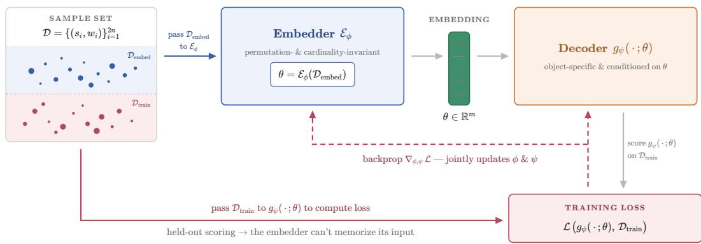  
Figure 1: General training procedure. Each sample set $\mathcal { D }$ is split into two halves, $\mathcal { D } _ { \mathrm { e m b e d } }$ and $\mathcal { D } _ { \mathrm { t r a i n } }$ The embedder $\mathcal { E } _ { \phi }$ maps $\mathcal { D } _ { \mathrm { e m b e d } }$ to an embedding vector θ that conditions the object-specific decoder $g _ { \psi } .$ . The held-out half $\mathcal { D } _ { \mathrm { t r a i n } }$ is then used to score $g _ { \psi }$ and compute the training loss ${ \mathcal { L } } .$ Finally, $\mathcal { L }$ is differentiated with respect to the trainable parameters of both networks and backpropagated.

Given ${ \mathcal { S } } , g _ { \psi }$ , and ${ \mathcal { L } } ,$ we train a single model that a) learns to represent the objects in a family as compact embedding vectors $\theta \in \mathbb { R } ^ { \bar { m } }$ , from only a partial view of each object through samples, and b) learns to fit an object given its embedding and an object-specific input. To this end, our model comprises two jointly-trained neural networks: an embedder $\bar { \mathcal { E } } _ { \phi } .$ , sometimes called an encoder, and the supplied fitting model $g _ { \psi }$ , which we will refer to as the decoder.

The role of the embedder is to compress an object’s samples into a fixed-size vector that retains the information needed to fit the object. Using sets of samples as the only input has two benefits. First, it lets a single architecture serve very different object types, as the following sections show. Second, it lets us handle objects seen only through samples, at arbitrary sample-set sizes, including objects never encountered during training. The fixed-size embedding is convenient in turn: it can serve as a conditioning signal, or as an input to and output of other networks. Our framework conditions the decoder $g _ { \psi }$ on the embedding; we explore further uses, such as operator learning, in later sections.

On the other hand, because the decoder is what we would normally use to fit a single object, it not only drives training by providing the loss signal, but also lets the whole model inherit the decoder’s native capabilities, such as sampling and density estimation in Flow Matching models. In this way the framework extends object-specific operations, normally available on a per-object basis, to entire families, while also producing representations suitable for downstream tasks.

Training data. Our training data is a finite collection of sample sets $\{ \mathcal { D } _ { 1 } , \mathcal { D } _ { 2 } , \ldots , \mathcal { D } _ { N } \}$ , where each $\bar { \mathcal { D } _ { k } } \bar { = } \{ ( s _ { i } , w _ { i } ) \} _ { i = 1 } ^ { 2 n }$ is a sample-based representation of an object $\mathcal { O } _ { k }$ , collected with the object sampler S. We do not require this mapping to be unique: a single $\mathcal { O } _ { k }$ may be described by several overlapping sample sets, possibly of varying size, and we make no assumptions about their structure, such as a regular grid of points. Working only with samples, rather than object-specific encodings, is precisely what lets our framework support families of very different objects. The training data can therefore be viewed as a dataset of datasets: each $\mathcal { D } _ { k }$ describes a single object and is itself an ordinary dataset, though typically a small one. Equivalently, a family is a distribution over datasets, and our model learns to fit this distribution and to generalize across it.

Embedding network. The embedder takes a sample set D representing a member of the family and produces a fixed-size embedding vector $\theta \in \mathbb { R } ^ { \bar { m } }$ . The network must be cardinality- and permutation-invariant: its output must not depend on the size of the set or on the order of its elements. DeepSets (Zaheer et al., 2017) and Set Transformers (Lee et al., 2019) are examples of such architectures. The embedder encodes each sample separately, possibly conditioned on the rest of the set, and pools the resulting codes by a (weighted) mean into a single vector. In Section 3, we discuss a variation on this architecture that better captures higher moments.

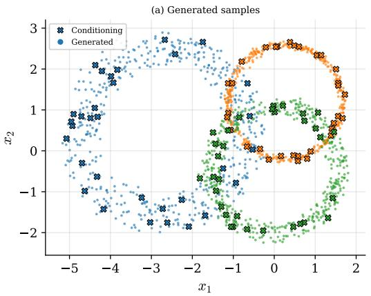

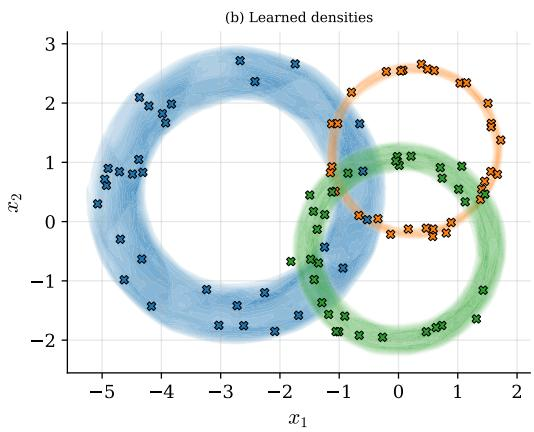  
Figure 2: Distribution embeddings on the donut family. (a) Three donuts (color-coded), each embedded from a small conditioning set of samples drawn from it (crosses); the decoder then generates new samples (dots) from that embedding, recovering the donut the conditioning points were drawn from. (b) The density the same embedding induces over the plane, evaluated on a grid. From only a handful of conditioning samples, the embedding captures each ring’s center, radius, and width.

Training procedure. In each training step we sample a batch of B sample sets $\{ \mathcal { D } _ { 1 } , \mathcal { D } _ { 2 } , \ldots , \mathcal { D } _ { B } \}$ each of size 2n. Every sample set $\mathcal { D } _ { k }$ is split into two halves of approximately equal total weight. The first half $\mathcal { D } _ { k , \mathrm { e m b e d } }$ is passed to the embedder to produce an embedding $\theta _ { k } \overset { \cdot } { = } \bar { \mathcal { E } } _ { \phi } ( \mathcal { D } _ { k , \mathrm { e m b e d } } )$ , and the second half $\mathcal { D } _ { k , \mathrm { t r a i n } }$ is scored by the decoder $g _ { \psi }$ conditioned on $\theta _ { k }$ . This split discourages the embedder from memorizing its input and forces $\theta _ { k }$ to capture transferable structure of ${ \mathcal { O } } _ { k }$ . The loss L itself is object-dependent, and we discuss several decoders and their loss functions in the following sections. In every case, however, the training signal is backpropagated through the decoder and the embedding $\theta _ { k }$ back to the embedder, so that the two networks are trained jointly and the embedder learns to produce embeddings the decoder can use. This procedure is illustrated in Figure 1.

In the following three sections, we instantiate and evaluate our approach on concrete families of distributions (Sec. 3), functions (Sec. 4), and graphs (Sec. 5). The framework is not limited to these: any higher-order object and family thereof fits within it, given the three components introduced at the start of this section.

## 3 DISTRIBUTION EMBEDDINGS

We first instantiate the framework on families of distributions. Every distribution in a family shares a common sample space, and a single sample is one i.i.d. draw from a member distribution.

Following Section 2, each distribution is represented as a sample set $\{ x _ { i } \} _ { i = 1 } ^ { n } .$ , and the embedder maps this set to a fixed-size embedding θ that parameterizes the decoder. For distributions, the decoder $g _ { \psi }$ is a conditional generative model: it draws samples from the embedded distribution and evaluates their density. Following the general training procedure, each sample set is split in half: one half produces the embedding, the other scores the decoder on held-out samples, and the embedder and decoder are trained jointly.

The embedder is a Set Transformer with induced set attention blocks (ISABs) (Lee et al., 2019). To help it capture higher moments of the distribution, we extend it into multiple stages: each stage operates on the original samples combined with a pooled summary of the previous stage’s output. Unlike stacking ${ \mathrm { I S A B s } } ,$ as in the original architecture, this multi-stage conditioning applies to any set encoder, not only Set Transformers; we give pseudocode in Appendix D. The embedding θ parameterizes the decoder $g _ { \psi } .$ , which can be any generative model. Our experiments use both normalizing flows and flow matching. Each is trained with its usual loss; see Appendix A for details on these models. Further details and hyperparameters are in Appendix D.

Table 1: Donut reconstruction at $n { = } 2 5 6$ embedding samples $( \mathrm { m e a n } \pm \mathrm { S E M }$ over 3 seeds, lower is better). FM and NF are our flow matching and normalizing flow decoders on a shared Set Transformer embedder; KDE and a method-of-moments parametric fit are per-sample-set baselines.
<table><tr><td>Model</td><td>NLL↓</td><td>SWD↓</td><td>Center ↓</td><td>Radius ↓</td><td>Width↓</td></tr><tr><td>FM</td><td> $1 . 2 1 8 \pm 0 . 0 1 7$ </td><td> $0 . 0 7 0 \pm 0 . 0 0 1$ </td><td> $0 . 0 5 9 \pm 0 . 0 0 3$ </td><td> $0 . 0 1 2 \pm 0 . 0 0 0$ </td><td> $0 . 0 6 6 \pm 0 . 0 1 1$ </td></tr><tr><td>NF</td><td> $1 . 2 1 2 \pm 0 . 0 1 2$ </td><td> $0 . 0 6 3 \pm 0 . 0 0 0$ </td><td> $0 . 0 4 8 \pm 0 . 0 0 1$ </td><td> $0 . 0 1 3 \pm 0 . 0 0 1$ </td><td> $0 . 0 6 1 \pm 0 . 0 0 7$ </td></tr><tr><td>KDE</td><td>2.011</td><td>0.152</td><td>0.082</td><td>0.048</td><td>0.627</td></tr><tr><td>Parametric fit</td><td>1.332</td><td>0.077</td><td>0.081</td><td>0.010</td><td>0.049</td></tr></table>

We evaluate on the donuts family introduced in Section 2. Parameter ranges are in Appendix D. Figure 2 shows three donuts from the family. From only 32 samples, the embedding captures each donut well enough for the decoder to reproduce it both as fresh samples (left) and as a density over the plane (right); both views trace the true distribution reliably.

Table 1 reports reconstruction quality in terms of negative log-likelihood (NLL) and sliced Wasserstein distance (SWD). NLL measures density reconstruction, while SWD measures sample reconstruction. Furthermore, we report the recovery error for each of the three parameters. We compare our approach against two baselines, each fit to every sample set independently: Kernel Density Estimation (KDE), and a parametric fit that recovers the three donut parameters by method of moments and then samples and evaluates density from the fitted donut analytically. With either decoder, our approach outperforms KDE on all five metrics by a large margin, and only trails the parametric fit in radius and width recovery, and even there only marginally. Note that the parametric fit is only applicable because it was given the parametric form of the donut family, which is rarely available in practice; our approach requires no such knowledge and works from samples alone.

The embedding also recovers the family’s intrinsic dimensionality. Although the embeddings live in $\mathbb { R } ^ { 1 6 }$ , the donut family has only four scalar degrees of freedom (the two center coordinates, the radius, and the width), and the first four principal components of the embeddings explain 99.5% of their variance for the flow-matching head (97.7% for the normalizing flow), each aligning almost one-to-one with a single generative property $( | r | \geq 0 . 9 5 )$ . Appendix D reports further experiments that exploit this structure, including embedding arithmetic and interpolation.

## 4 FUNCTION EMBEDDINGS

We now turn to functions. A family of functions is a set that shares a common structure, such as polynomials of bounded degree, or the solutions of a given differential equation under varying initial conditions and parameters. A single sample from a function $f$ is now an input–output pair $( x , f ( x ) )$ .

As described in Section 2, each object is represented as a sample set $\{ ( x _ { i } , f ( x _ { i } ) ) \} _ { i = 1 } ^ { n }$ , and the embedder maps this set to a fixed-size embedding that parameterizes the decoder. For functions, the decoder is a pointwise evaluator: given a query point x in the function’s domain, it produces an output $\hat { f } ( x )$ approximating $f ( x )$ . Following the general training procedure, each sample set is split in half: one half produces the embedding, the other scores the decoder on held-out samples. The embedder and decoder are trained jointly to minimize the error between ${ \hat { f } } ( x )$ and $f ( x )$

In practice, the embedder can be the same multi-stage Set Transformer used in Section 3, operating on samples formed by concatenating x, $f ( x )$ (and optionally the pooled output of the previous stage). While this already works well, we find it better to project x, f(x), and the pooled output separately into a learned feature space and multiply the three projections pointwise before passing the resulting set to the Set Transformer. This three-way product incorporates the pooling information directly, rather than through concatenation, and yields a stronger embedder; the results we report use it, and we compare the two in Appendix E. The decoder $g _ { \psi }$ is a single-head attention layer: it maps the query point x to a query vector and the embedding θ to a set of synthetic key and value vectors, then attends the query over them to predict ${ \hat { f } } ( x )$ . This performs better than a plain feedforward network that concatenates x and θ.

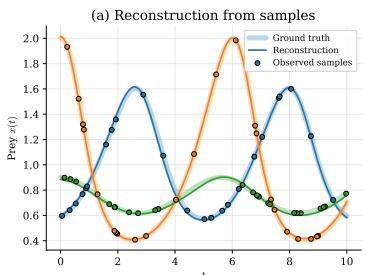

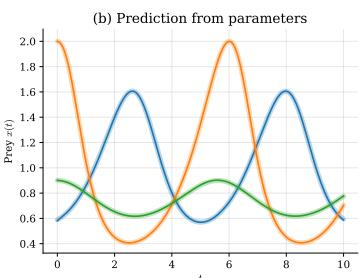

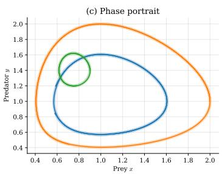  
Figure 3: Function embeddings on the Lotka–Volterra family. (a) Reconstruction of three solutions (color-coded) from observed samples: the embedder maps the samples (dots) to an embedding from which the decoder reconstructs the prey trajectory $x ( t )$ (solid line, ground truth shaded). (b) Prediction of the same solutions from their parameters $( x _ { 0 } , y _ { 0 } , \alpha , \beta , \gamma , \delta )$ alone, with no samples, via the operator. (c) The predicted trajectories drawn as a predator–prey phase portrait. The same decoder recovers the trajectory whether the embedding is formed from samples or predicted from parameters.

The loss $\mathcal { L }$ can be any regression loss, such as the mean squared error or the Huber loss. All our experiments use the relative $L ^ { 2 }$ error, $\mathcal { L } = \mathbb { E } _ { f \sim \mathcal { F } } \Big [ \| f - \hat { f } \| _ { 2 } / \| f \| _ { 2 } \Big ]$ , as both training loss and evaluation metric, where the norms are taken over the query points. Normalizing by $\| f \| _ { 2 }$ makes the error insensitive to the scale of the target, and it is standard in operator learning (Lu et al., 2021; Li et al., 2020). Further details, including architectures and hyperparameters, are in Appendix E.

We train and evaluate function embeddings on three families: polynomials of bounded degree, and the solutions of the damped harmonic oscillator and Lotka–Volterra ordinary differential equations under varying initial conditions and parameters. Descriptions and parameter ranges are in Appendix E.

We further show that the learned embeddings can serve as inputs and outputs of operator networks, which generalize ordinary functions to maps between infinite-dimensional function spaces. Because our embeddings represent whole functions as finite-dimensional vectors, an ordinary neural network becomes a neural operator: it maps between compact vectors rather than predicting entire functions, while the decoder expands each result into a function at arbitrary query points. A single embedding also feeds many heads at once, so the decoder and every operator share one representation; when this reuse is not needed and operator learning is the only goal, the reconstruction phase can be skipped and the operator trained directly. We train two such operators: for polynomials, one mapping a function’s embedding to that of its derivative; for ODEs, one mapping initial conditions and parameters to the embedding of the solution. Both are simple feedforward networks; see Appendix E.

Figure 3 shows both reconstruction and operator prediction on the Lotka–Volterra family. From only a small sample set, the embedding captures enough structure for the decoder to reconstruct the full trajectory (left), while an operator trained to output an embedding can predict the solution from its initial conditions and parameters alone (middle and right).

Table 2 reports both tasks across the three families, and Table 3 reports performance on a generalized n-dimensional damped harmonic oscillator as the state dimension grows. The families cover qualitatively different behaviors: the damped-oscillator and Lotka–Volterra solutions are oscillatory across a wide range of amplitudes, the former decaying to zero and the latter periodic, while the polynomials range from near-zero constants and linear functions to quadratics and cubics with values in the tens and hundreds. In each case, a single model captures its family’s full range of behaviors, and the approach scales to functions of up to 32 dimensions.

The two operators behave differently relative to the sample-inferred embedding (the Embedding column). The ODE solution operator maps clean, fixed parameters to an embedding and can therefore be more accurate than an embedding inferred from a noisy, finite sample set. The differential operator instead takes such a sample-inferred embedding as input, inheriting its noise and adding its own, so its error exceeds the embedding’s.

Table 2: Relative $L ^ { 2 }$ reconstruction error by family (mean ± SEM over 3 seeds). Embedding: the function is reconstructed from an embedding inferred from a sample set; Operator: from an embedding produced by an operator. For polynomials, operator error is reported on the output derivative and indexed by its degree. A degree-three derivative is omitted, as it would require a degree-four input.
<table><tr><td>Family</td><td>Embedding</td><td>Operator</td></tr><tr><td>Polynomials</td><td> $0 . 0 1 4 3 \pm 0 . 0 0 1 1$ </td><td> $0 . 0 1 8 5 \pm 0 . 0 0 2 2$ </td></tr><tr><td>Degree 0</td><td> $0 . 0 0 1 6 \pm 0 . 0 0 0 1$ </td><td> $0 . 0 1 3 3 \pm 0 . 0 0 1 3$ </td></tr><tr><td>Degree 1</td><td> $0 . 0 1 0 3 \pm 0 . 0 0 0 4$ </td><td> $0 . 0 1 5 1 \pm 0 . 0 0 1 4$ </td></tr><tr><td>Degree 2</td><td> $0 . 0 2 0 1 \pm 0 . 0 0 1 9$ </td><td> $0 . 0 2 7 1 \pm 0 . 0 0 3 9$ </td></tr><tr><td>Degree 3</td><td> $0 . 0 2 5 1 \pm 0 . 0 0 2 4$ </td><td></td></tr><tr><td>Damped Oscillator</td><td> $0 . 0 1 7 3 \pm 0 . 0 0 2 9$ </td><td> $0 . 0 0 5 6 \pm 0 . 0 0 0 2$ </td></tr><tr><td>Lotka-Volterra</td><td> $0 . 0 0 4 7 \pm 0 . 0 0 0 1$ </td><td> $0 . 0 0 2 0 \pm 0 . 0 0 0 0$ </td></tr></table>

Table 3: Damped-oscillator dimension scaling: relative $L ^ { 2 }$ reconstruction error vs. state dimension (mean ± SEM over 3 seeds; columns as in Table 2).
<table><tr><td>Dim.</td><td>Embedding</td><td>Operator</td></tr><tr><td>2</td><td> $0 . 0 1 7 3 \pm 0 . 0 0 2 9$ </td><td> $0 . 0 0 5 6 \pm 0 . 0 0 0 2$ </td></tr><tr><td>4</td><td> $0 . 0 1 7 8 \pm 0 . 0 0 1 0$ </td><td> $0 . 0 0 7 0 \pm 0 . 0 0 0 6$ </td></tr><tr><td>8</td><td> $0 . 0 2 7 9 \pm 0 . 0 0 0 3$ </td><td> $0 . 0 1 2 2 \pm 0 . 0 0 0 6$ </td></tr><tr><td>16</td><td> $0 . 0 4 0 4 \pm 0 . 0 0 4 2$ </td><td> $0 . 0 1 9 9 \pm 0 . 0 0 1 3$ </td></tr><tr><td>32</td><td> $0 . 0 6 4 5 \pm 0 . 0 0 1 5$ </td><td> $0 . 0 3 4 8 \pm 0 . 0 0 1 5$ </td></tr></table>

## 5 GRAPH EMBEDDINGS

Finally, we instantiate our framework on families of graphs. We consider undirected labeled graphs $\mathcal { G } = ( V , E )$ with no self-loops, where V is the vertex set and E the edge set. A family is a collection of graphs that share a common vertex set V while the edge set E varies. A single sample is now an edge: an unordered pair of vertices.

Following the procedure laid out in Section 2, a graph is represented solely as a set of randomly sampled edges $\{ e _ { 1 } , \ldots , e _ { n } \}$ . Each edge is encoded as a two-hot vector, with ones at the positions of its two vertices, so that the embedder is invariant to their order. The embedder maps this set to a fixed-size embedding and uses the same multi-stage Set Transformer architecture as in the previous sections. The embedding parameterizes a decoder whose goal is to recover a Laplacian representation of the vertices: a spectral representation of a graph that is a useful state representation for reinforcement learning (Gomez et al., 2024). Following the general training procedure, the sampled edges are split in half, one half producing the embedding and the other scoring the decoder, and the two networks are trained jointly.

The decoder is trained with the ALLO objective (Appendix A.2). In ALLO both the vertexrepresentation network and the lower-triangular matrix of dual variables are fit to a single graph. We make both depend on the embedding instead: the decoder maps each vertex to its representation vector conditioned on θ, and we exchange the fixed matrix of dual variables for a separate neural network that predicts its entries from θ. A single model thus produces the Laplacian representation of any graph in the family. Further details are in Appendix F.

We train and evaluate on three families: unweighted random trees, scale-free networks, and weighted gridworlds. Detailed descriptions and parameter ranges are in Appendix F. The quality of learned representation and embeddings is assessed in two ways. First, by its geometry: whether the distance between vertices effectively separates edges from non-edges. This is meaningful because the Euclidean distance between two vertices in the Laplacian representation is known to correlate with their temporal distance in the graph (Gomez et al., 2024). Second, by reconstruction: whether a learned thresholding strategy can recover adjacency, predicting an edge between two vertices when their representation distance falls below a per-vertex threshold. We report two thresholding strategies. The vertex-degrees strategy is an oracle that uses each vertex’s true degree to set its threshold, whereas the medians network is trained, solely from the sampled edges, to predict the median distance from a vertex to its neighbors. It minimizes the mean absolute error between the representation distances of sampled edges and the predicted medians:

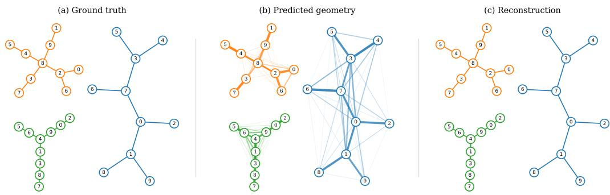  
Figure 4: Graph embeddings on the random-trees family. For three sampled trees (color-coded), we show (a) the ground-truth graphs, (b) the predicted geometry (each pair of vertices joined by a line that grows thicker and darker as their representation distance shrinks), and (c) the reconstruction from thresholding those distances with the medians network. The tree structure is already visible in the geometry alone.

$$
{ \mathcal { L } } _ { \mathrm { m e d } } = \mathbb { E } _ { ( u , v ) \in E } { \Big [ } { \big | } d ( u , v ) - m _ { u } { \big | } + { \big | } d ( u , v ) - m _ { v } { \big | } { \Big ] } ,
$$

where $d ( u , v ) = \| h _ { u } - h _ { v } \| _ { 2 }$ is the distance between the representation vectors of u and v, and $m _ { u }$ is the median distance the network predicts for vertex u to its neighbors.

Figure 4 shows three randomly sampled trees, together with their predicted geometry and reconstructions. The geometry panel draws, for each pair of vertices, a line whose thickness and darkness grow as their representation distance shrinks. From the predicted geometry alone, the structure of each tree is clearly visible. To turn these distances into binary edge/non-edge decisions, we apply per-vertex thresholds from the trained medians network; the rightmost panel shows the resulting reconstruction. Table 4 reports the geometry ROC-AUC and the reconstruction F1 of the degree oracle and the medians network, for random trees and scale-free graphs at $n = 1 0$ and $n = 2 0$ vertices. Additional results, including the weighted gridworld family, are in Appendix F.

The ROC-AUC scores show that the model separates edges from non-edges well across all four settings, and on the $n = 1 0$ families the medians network nearly matches the degree oracle. On the larger $n = 2 0$ families, both reconstruction strategies degrade, largely because the geometry is learned less accurately there, as reflected in the lower ROC-AUC. The medians network predicts an edge between u and v whenever their distance falls below $m _ { u } + m _ { v }$ , the sum of the two endpoints medians; since each median is itself roughly a typical edge distance, this is a loose rule that tends to over-predict edges. It also learns these medians from only the sampled edges, the same data the embedder and decoder see, so giving it access to labeled data raises its F1; we report additional reconstruction-head numbers in Appendix F. Scale-free graphs are harder than trees at both sizes, most likely because they are denser and contain hubs: a hub has many neighbors at a wide range of distances, so a single median cannot separate its edges from non-edges cleanly.

## 6 DISCUSSION

We demonstrated the generality and usefulness of our framework on three very distinct higher-order objects: distributions, functions, and graphs. Appendix B underscores how distinct these objects are, as each has historically been approached with its own domain- and object-specific methods.

Table 4: Geometry and reconstruction quality by family (mean ± SEM over 3 seeds). Geometry ROC-AUC is the threshold-free edge/non-edge separation; the two F1 columns are degree-oracle and learned-head (medians) reconstruction.
<table><tr><td>Family</td><td>ROC-AUC</td><td>Vtx-degree F1</td><td>Medians F1</td></tr><tr><td>Random trees  $( n = 1 0 )$ </td><td> $0 . 9 9 3 \pm 0 . 0 0 1$ </td><td> $0 . 9 8 3 \pm 0 . 0 0 1$ </td><td> $0 . 9 2 2 \pm 0 . 0 0 5$ </td></tr><tr><td>Random trees  $( n = 2 0 )$ </td><td> $0 . 9 5 3 \pm 0 . 0 0 6$ </td><td> $0 . 7 8 1 \pm 0 . 0 2 8$ </td><td> $0 . 4 4 9 \pm 0 . 0 6 4$ </td></tr><tr><td>Scale-free (n = 10)</td><td> $0 . 9 8 0 \pm 0 . 0 0 1$ </td><td> $0 . 9 5 8 \pm 0 . 0 0 2$ </td><td> $0 . 7 9 3 \pm 0 . 0 0 2$ </td></tr><tr><td>Scale-free  $( n = 2 0 )$ </td><td> $0 . 8 4 7 \pm 0 . 0 1 0$ </td><td> $0 . 6 1 3 \pm 0 . 0 2 2$ </td><td> $0 . 3 3 1 \pm 0 . 0 0 8$ </td></tr></table>

Distributions. Distribution embeddings, as presented in Section 3, have already been applied to state tracking in partially observable domains as part of Neural Bayesian Filtering (Solinas et al., 2026b), which in turn underpins an online POMDP solver, Belief Embedding Tree Search (BETS) (Solinas et al., 2026a). Because the belief state is now a single fixed-size vector, policies and value functions can be learned directly on the embedding, which was not possible with the particle-based representations they replace. Compared to the closest prior work, our framework generalizes the Neural Statistician (Edwards & Storkey, 2016) by admitting any decoder, not just a variational autoencoder, and it goes beyond the continuous distributions to which Generative Distribution Embeddings (Fishman et al., 2025) have so far been applied. BETS embeds discrete distributions by supplying a discrete generative model as the decoder, and we discuss discrete extensions of normalizing flows and flow matching in Appendix A.

Functions. Similar to distribution embeddings, function embeddings reconstruct functions accurately from a handful of samples and even scale to higher-dimensional problems. They also demonstrate how useful a fixed-size vector representation of a higher-order object can be: unlike specialized approaches such as DeepONet (Lu et al., 2021) and FNO (Li et al., 2020), our embeddings let ordinary neural networks act as neural operators. Because these operators act on the learned embeddings rather than on raw function values, they carry none of the rigid input assumptions, such as regular grids, fixed sensor locations, or fixed resolutions, that these methods impose, yet they can still exploit that structure when it is available. In our experiments a single model maps parameters directly to ODE solutions, and solving a PDE requires nothing new: it reduces to mapping one embedding to another, the same operation we demonstrated with the differential operator that sends a function’s embedding to that of its derivative. Finally, because Physics-Informed Neural Networks (PINNs) (Raissi et al., 2019) only alter the training loss, our framework is open to them as well.

Graphs. In Section 5 we took ALLO, an existing single-object model, and lifted it to a whole family for the first time. As originally proposed by Gomez et al. (2024), it operates on one graph at a time, so a new graph requires retraining from scratch. Using it as the object-specific decoder $g _ { \psi }$ , we made one small change: the fixed lower-triangular matrix of dual variables became a neural network that predicts its entries from the embedding. The lifted model learns vertex representations across a whole family of graphs, recovering a geometry that separates edges from non-edges well. Recovering the exact adjacency is harder, for two reasons: ALLO optimizes for spectral geometry and not reconstruction; and thresholding distances against a single per-vertex median cannot cleanly separate edges from non-edges at every vertex, particularly at high-degree hubs. Reconstruction oriented approaches, such as those discussed in Appendix B, may be better suited to that task. Finally, because the embedding summarizes a graph as a single vector, it is a natural conditioning signal for reinforcement learning: an agent could act in an unknown environment, gather enough transitions to embed the local structure of its underlying Markov Decision Process, and condition its policy on that embedding.

## 7 CONCLUSION

We introduced the first framework general enough to learn compact representations of higher-order objects and to generalize across families of them. The framework accommodates any higher-order object through three user-provided components: an object sampler, a parameterizable fitting model, and a training loss. We instantiated it on three objects that have each historically demanded vastly different architectures and training procedures: distributions, functions, and graphs. In every case, a single trained model represents an entire family and generalizes to members unseen during training. Specific applications of this approach (notably distribution embeddings) have already been shown to be useful for tracking beliefs in POMDPs and in building cell dynamics models.

## ACKNOWLEDGMENTS

This work was supported in part by the Canada CIFAR AI Chairs program and the Alberta Machine Intelligence Institute (Amii) and the Natural Sciences and Engineering Research Council of Canada (NSERC), and was enabled in part by support provided by Prairies DRI and the Digital Research Alliance of Canada (https://www.alliancecan.ca). R. Haluška and M. Schmid were supported by the grant no. 25-18031S of the Czech Science Foundation (GACR) and theˇ Charles University Grant Agency (GAUK) project no. 326525. Additional computational resources were provided by the e-INFRA CZ project (ID:90254), supported by the Ministry of Education, Youth and Sports of the Czech Republic.

## AI USE STATEMENT

Large language models (LLMs) assisted us with writing and coding. They were used to refine writing, discover relevant prior work, and implement and test the experiment pipeline. We revised and verified all LLM output carefully and take responsibility for the final content of this work, including any text, claims, or artifacts produced with the aid of generative AI.

## REPRODUCIBILITY STATEMENT

The source code implementing the proposed method and the experiments presented in the paper has been made available as supplementary material and will be open-sourced on GitHub upon publication. The appendices provide further implementation details, such as hyperparameter ranges.

## REFERENCES

Réka Albert and Albert-László Barabási. Statistical mechanics of complex networks. Reviews of modern physics, 74(1):47, 2002.

James Bradbury, Roy Frostig, Peter Hawkins, Matthew James Johnson, Yash Katariya, Chris Leary, Dougal Maclaurin, George Necula, Adam Paszke, Jake VanderPlas, Skye Wanderman-Milne, and Qiao Zhang. JAX: composable transformations of Python+NumPy programs, 2018. URL http://github.com/jax-ml/jax.

Laurent Dinh, Jascha Sohl-Dickstein, and Samy Bengio. Density estimation using real nvp. arXiv preprint arXiv:1605.08803, 2016.

Conor Durkan, Artur Bekasov, Iain Murray, and George Papamakarios. Neural spline flows. Advances in Neural Information Processing Systems, 32, 2019.

Harrison Edwards and Amos Storkey. Towards a neural statistician. arXiv preprint arXiv:1606.02185, 2016.

Nic Fishman, Gokul Gowri, Peng Yin, Jonathan Gootenberg, and Omar Abudayyeh. Generative distribution embeddings: Lifting autoencoders to the space of distributions for multiscale representation learning. Advances in Neural Information Processing Systems, 38:24644–24685, 2025.

Marta Garnelo, Jonathan Schwarz, Dan Rosenbaum, Fabio Viola, Danilo J Rezende, SM Eslami, and Yee Whye Teh. Neural processes. arXiv preprint arXiv:1807.01622, 2018.

Itai Gat, Tal Remez, Neta Shaul, Felix Kreuk, Ricky TQ Chen, Gabriel Synnaeve, Yossi Adi, and Yaron Lipman. Discrete flow matching. Advances in Neural Information Processing Systems, 37: 133345–133385, 2024.

Diego Gomez, Michael Bowling, and Marlos C Machado. Proper laplacian representation learning. In International Conference on Learning Representations, volume 2024, pp. 28911–28934, 2024.

Ian Goodfellow, Yoshua Bengio, and Aaron Courville. Deep Learning. MIT Press Cambridge, 2016.

Will Hamilton, Zhitao Ying, and Jure Leskovec. Inductive representation learning on large graphs. Advances in Neural Information Processing Systems, 30, 2017.

Jonathan Ho, Xi Chen, Aravind Srinivas, Yan Duan, and Pieter Abbeel. Flow++: Improving flowbased generative models with variational dequantization and architecture design. In International Conference on Machine Learning, pp. 2722–2730. PMLR, 2019.

Tyler Ingebrand, Amy Zhang, and Ufuk Topcu. Zero-shot reinforcement learning via function encoders. arXiv preprint arXiv:2401.17173, 2024.

Tyler Ingebrand, Adam J Thorpe, and Ufuk Topcu. Function encoders: A principled approach to transfer learning in hilbert spaces. arXiv preprint arXiv:2501.18373, 2025.

Patrick Kidger. On Neural Differential Equations. PhD thesis, University of Oxford, 2021.

Diederik P Kingma and Max Welling. Auto-encoding variational bayes. arXiv preprint arXiv:1312.6114, 2013.

Nikola Kovachki, Zongyi Li, Burigede Liu, Kamyar Azizzadenesheli, Kaushik Bhattacharya, Andrew Stuart, and Anima Anandkumar. Neural operator: Learning maps between function spaces with applications to pdes. Journal of Machine Learning Research, 24(89):1–97, 2023.

Yann LeCun, Yoshua Bengio, and Geoffrey Hinton. Deep learning. Nature, 521(7553):436–444, 2015.

Juho Lee, Yoonho Lee, Jungtaek Kim, Adam Kosiorek, Seungjin Choi, and Yee Whye Teh. Set transformer: A framework for attention-based permutation-invariant neural networks. In International Conference on Machine Learning, pp. 3744–3753. PMLR, 2019.

Zongyi Li, Nikola Kovachki, Kamyar Azizzadenesheli, Burigede Liu, Kaushik Bhattacharya, Andrew Stuart, and Anima Anandkumar. Fourier neural operator for parametric partial differential equations. arXiv preprint arXiv:2010.08895, 2020.

Zongyi Li, Daniel Zhengyu Huang, Burigede Liu, and Anima Anandkumar. Fourier neural operator with learned deformations for pdes on general geometries. Journal of Machine Learning Research, 24(388):1–26, 2023.

Yaron Lipman, Ricky TQ Chen, Heli Ben-Hamu, Maximilian Nickel, and Matt Le. Flow matching for generative modeling. arXiv preprint arXiv:2210.02747, 2022.

Lu Lu, Pengzhan Jin, Guofei Pang, Zhongqiang Zhang, and George Em Karniadakis. Learning nonlinear operators via deeponet based on the universal approximation theorem of operators. Nature machine intelligence, 3(3):218–229, 2021.

Krikamol Muandet, Kenji Fukumizu, Bharath Sriperumbudur, and Bernhard Schölkopf. Kernel mean embedding of distributions: A review and beyond. Foundations and Trends in Machine Learning, 10(1-2):1–141, 2017.

Annamalai Narayanan, Mahinthan Chandramohan, Rajasekar Venkatesan, Lihui Chen, Yang Liu, and Shantanu Jaiswal. graph2vec: Learning distributed representations of graphs. arXiv preprint arXiv:1707.05005, 2017.

George Papamakarios, Eric Nalisnick, Danilo Jimenez Rezende, Shakir Mohamed, and Balaji Lakshminarayanan. Normalizing flows for probabilistic modeling and inference. Journal ofMachine Learning Research, 22(57):1–64, 2021.

Maziar Raissi, Paris Perdikaris, and George E Karniadakis. Physics-informed neural networks: A deep learning framework for solving forward and inverse problems involving nonlinear partial differential equations. Journal ofComputational physics, 378:686–707, 2019.

Martin Simonovsky and Nikos Komodakis. Graphvae: Towards generation of small graphs using variational autoencoders. In International Conference on Artificial Neural Networks, pp. 412– 422. Springer, 2018.

Christopher Solinas, Radovan Haluška, Martin Schmid, Michael Buro, Nathan R. Sturtevant, and Michael Bowling. Belief embedding tree search, 2026a.

Christopher Solinas, Radovan Haluška, David Sychrovský, Finbarr Timbers, Nolan Bard, Michael Buro, Martin Schmid, Nathan R. Sturtevant, and Michael Bowling. Neural bayesian filtering, 2026b.

Clement Vignac, Igor Krawczuk, Antoine Siraudin, Bohan Wang, Volkan Cevher, and Pascal Frossard. Digress: Discrete denoising diffusion for graph generation. arXiv preprint arXiv:2209.14734, 2022.

Hanchen Wang, Tianfan Fu, Yuanqi Du, Wenhao Gao, Kexin Huang, Ziming Liu, Payal Chandak, Shengchao Liu, Peter Van Katwyk, Andreea Deac, et al. Scientific discovery in the age of artificial intelligence. Nature, 620(7972):47–60, 2023.

Jiaxuan You, Rex Ying, Xiang Ren, William Hamilton, and Jure Leskovec. Graphrnn: Generating realistic graphs with deep auto-regressive models. In International Conference on Machine Learning, pp. 5708–5717. PMLR, 2018.

Manzil Zaheer, Satwik Kottur, Siamak Ravanbakhsh, Barnabas Poczos, Russ R Salakhutdinov, and Alexander J Smola. Deep sets. Advances in Neural Information Processing Systems, 30, 2017.

Zachary Ziegler and Alexander Rush. Latent normalizing flows for discrete sequences. In International Conference on Machine Learning, pp. 7673–7682. PMLR, 2019.

## A BACKGROUND

## A.1 GENERATIVE MODELING

Normalizing flows (Papamakarios et al., 2021) model a distribution with an invertible, differentiable map $f _ { \psi } : \mathbb { R } ^ { \breve { d } } \to \mathbb { R } ^ { d }$ that pushes a tractable base $p _ { 0 }$ (a standard Gaussian) to the target. A sample is $x = f _ { \psi } ( z )$ with $z \sim p _ { 0 }$ , and its density follows from the change-of-variables formula

$$
\log p _ { \psi } ( x ) = \log p _ { 0 } \Big ( f _ { \psi } ^ { - 1 } ( x ) \Big ) + \log \left| \operatorname* { d e t } \frac { \partial f _ { \psi } ^ { - 1 } } { \partial x } ( x ) \right| .
$$

Architectures such as RealNVP (Dinh et al., 2016) and neural spline flows (Durkan et al., 2019) keep $f _ { \psi } ^ { - 1 }$ and this log-determinant tractable by composing layers with triangular Jacobians, and are trained by maximizing the log-likelihood of the data. Flows live on continuous spaces; a discrete support is reached through variational dequantization (Ho et al., 2019), which adds learned noise to each point so the categorical target becomes a continuous density, at the price of an implicit ordinal structure over classes that may in fact be unordered.

Flow matching (Lipman et al., 2022) is a continuous-time analogue that replaces the composition of invertible layers with a learned velocity field $v _ { \psi } ( z , \tau )$ over $\tau \in [ 0 , 1 ]$ . Sampling integrates $\dot { z } _ { \tau } =$ $v _ { \psi } ( z _ { \tau } , \tau )$ from $z _ { 0 } \sim p _ { 0 }$ and returns $x \ { \stackrel { \mathrm { d e f } } { = } } \ z _ { 1 }$ , and densities follow from integrating the instantaneous change of variables along the same trajectory. Given the optimal-transport interpolant $z _ { \tau } = ( 1 -$ $\tau ) z + \tau x$ between $z \sim p _ { 0 }$ and a target sample $x \sim p ,$ , training regresses onto the target velocity,

$$
\mathcal { L } _ { \mathrm { F M } } ( \psi ) = \mathbb { E } _ { \tau , z , x } \Vert v _ { \psi } ( z _ { \tau } , \tau ) - ( x - z ) \Vert ^ { 2 } .
$$

Dropping the closed-form-inverse requirement makes the transport more expressive, at the cost of an ODE solve for both sampling and density. Its categorical analogue, discrete flow matching (Gat et al., 2024), interpolates between the data and a factorized noise distribution over classes and trains a denoiser to recover the clean configuration, which is integrated in reverse to sample; unlike dequantization it acts on the discrete support directly, with no ordinal bias.

## A.2 AUGMENTED LAGRANGIAN LAPLACIAN OBJECTIVE

An undirected graph without self-loops is fully described by its graph Laplacian $\mathbf { L } = \mathbf { D } - \mathbf { A }$ where D is the diagonal degree matrix and A the (weighted) adjacency matrix. The Laplacian representation assigns each vertex i the d-dimensional vector formed from the i-th component of the d smallest eigenvectors of $\mathbf { L } .$ Distances in this representation encode temporal structure of the underlying state space, making it a useful state representation for reinforcement learning (Gomez et al., 2024).

The augmented Lagrangian Laplacian objective (ALLO) (Gomez et al., 2024) learns this representation for a single graph from its sampled edges. It is a saddle-point objective that recovers the true eigenvectors and eigenvalues of L with little hyperparameter tuning, jointly optimizing a network that maps each vertex to its representation vector against an explicit lower-triangular matrix of dual variables $( \beta _ { j k } ) _ { 1 \leq k \leq j \leq d } .$ , one per pair of eigenvectors. The diagonal entries $\beta _ { j j }$ converge to values proportional to the eigenvalues, and the off-diagonal entries $\beta _ { j k }$ enforce orthogonality between the eigenvectors.

## B RELATED WORK

To the best of our knowledge, no prior approach represents and learns from families of general higher-order objects. Existing work targets specific object types: mostly functions, through operator learning, and more recently distributions across a range of domains.

Distributions. Kernel mean embeddings (KMEs) (Muandet et al., 2017) are a classical nonparametric way to represent a distribution as a point in a reproducing kernel Hilbert space, but they scale poorly with dimension, are not natively generative, and require a kernel whose choice and hyperparameters usually demand domain knowledge. The Neural Statistician (Edwards & Storkey,

2016) instead learns distribution embeddings from i.i.d. samples and uses them to condition a variational autoencoder (VAE). Generative Distribution Embeddings (GDEs) (Fishman et al., 2025) generalize both by allowing an arbitrary conditional generative model as the decoder; they also justify distributional invariance theoretically and show that latent distances correlate with the Wasserstein-2 distance, though they have been applied only to continuous distributions in computational biology. At the same time, Solinas et al. (2026b) independently proposed distribution embeddings to represent belief states in a filtering algorithm for partially observable state tracking, outperforming traditional filters.

Functions. Neural Processes (NPs) (Garnelo et al., 2018) combine Gaussian processes and neural networks to learn distributions over functions: they encode a set of input-output pairs into a distribution over latent codes, which a decoder evaluates at a query input to predict the function’s value there, and are trained by maximizing an ELBO. DeepONet (Lu et al., 2021) and FNO (Li et al., 2020) are neural operators that learn maps between function spaces, typically PDE solution operators, and so act on families of related functions; DeepONet uses branch and trunk networks, while FNO learns the operator in the spectral domain via Fourier transforms. Both carry function-specific biases: DeepONet needs conditioning points on a predefined grid and FNO assumes uniform grids. Later variants such as GeoFNO (Li et al., 2023) relax some of these but remain tied to functions (see Kovachki et al. (2023) for an overview). Finally, function encoders (Ingebrand et al., 2024) represent a function as a linear combination of learned basis functions, first for reinforcement learning and later for transfer learning (Ingebrand et al., 2025).

Graphs. Most graph representation learning embeds nodes rather than whole graphs: GraphSAGE (Hamilton et al., 2017), for example, learns an inductive node encoder that generalizes to unseen nodes and graphs, but yields one vector per node rather than a single representation of the graph. graph2vec (Narayanan et al., 2017) instead embeds an entire graph as a fixed-size vector, learned unsupervised by treating rooted subgraphs as words in the manner of document embeddings, though the resulting representation is task-agnostic and tied to graph-specific substructures. A separate line of work learns to generate graphs: GraphVAE (Simonovsky & Komodakis, 2018) decodes a graph from a latent code with a variational autoencoder, GraphRNN (You et al., 2018) builds graphs autoregressively, and DiGress (Vignac et al., 2022) does so through discrete denoising diffusion. These models capture a distribution over graphs but do not expose a reusable embedding of any given graph.

Compared to the approaches above, our framework is not tied to a single object type and bakes in no domain-specific assumptions, though such biases can still be reintroduced through the decoder $g _ { \psi }$ and the loss L when useful. This generality is what lets many of these methods be recast as special cases of our framework under particular choices of $g _ { \psi }$ and ${ \dot { \mathcal { L } } } .$ , and it lets any existing singleobject model serve as a decoder, making the framework straightforward to adapt to new problems and domains.

## C MULTI-STAGE SET ENCODER

The embedder wraps any permutation-equivariant set encoder in a multi-stage loop. Stage k re-reads the original samples, each concatenated with a pooled summary of the previous stage’s output, so that later stages can compute features relative to the set-level context, such as the spread of the samples around their estimated mean (a second moment). Unlike stacking induced set attention blocks, which is specific to the Set Transformer, this wrapper applies to any set encoder, including DeepSets and the Set Transformer we use. Algorithm 1 states the procedure: each SetEnc is a set encoder mapping N inputs to N features, and Pool is a weighted mean (our default) or an attention pooling.

## D DISTRIBUTION EMBEDDINGS

## D.1 DISTRIBUTION FAMILIES

Donuts. Two-dimensional ring-shaped distributions, each fully described by a center $c \in \mathbb { R } ^ { 2 }$ , a radius $r ,$ and a width w. A sample is drawn as $x = c + r a \left( 1 + w b \right)$ , where a is a uniformly random

Algorithm 1 Multi-stage set encoder   
Require: samples $\{ x _ { i } \} _ { i = 1 } ^ { N }$ with weights $\{ w _ { i } \} _ { i = 1 } ^ { N }$ ; stages SetEnc $1 { : } K { : }$ pooling Pool   
Ensure: embedding z   
1: $\bar { w } _ { i }  w _ { i } / \sum _ { j } \bar { w } _ { j }$ ▷ normalize the sample weights   
2: $c \gets \emptyset$ ▷ no context for the first stage   
3: for $k = 1$ to $K$ do   
4: $h _ { i }  x _ { i } \mathbf { i f } k = 1$ else $[ x _ { i } ; c ] ,$ for all $i \triangleright$ concatenate the running context to each sample   
5: $( g _ { 1 } , \ldots , g _ { N } ) \gets \mathrm { S e t E n c } _ { k } ( h _ { 1 } , \ldots , h _ { N } ; w )$ ▷ permutation equivariant, $N  N$   
6: $c  \mathrm { P o o l } ( g _ { 1 } , \dots , g _ { N } ; \bar { w } )$ $\triangleright N \to 1 ;$ default $\begin{array} { r } { c = \sum _ { i } { \bar { w } } _ { i } g _ { i } } \end{array}$   
7: end for   
8: return $z  c$

unit vector and $b \sim \mathcal { U } [ - \frac { 1 } { 2 } , \frac { 1 } { 2 } ]$ , so the points fill an annulus of mean radius r whose thickness is rw. The family draws the center from $\mathcal { N } ( 0 , I )$ , the radius uniformly from [0.5, 2], and the width uniformly from [0.01, 0.75], spanning both thin and thick donuts.

## D.2 EMBEDDING PROPERTIES

The main text shows that the embedding space is low-dimensional and aligned with the donut’s generative parameters. Two further experiments test whether it is also linear: whether straight lines and vector arithmetic between embeddings correspond to meaningful operations on the distributions. Both use the same flow-matching model from Section 3 with 512-sample embeddings, and every panel below shows the learned density decoded from a single embedding.

Interpolation. Figure 5 embeds two donuts that differ in center, radius, and width, and decodes the densities along the segment $z _ { \alpha } = \left( 1 - \alpha \right) z _ { 0 } + \alpha z _ { 1 }$ between their embeddings. During training, every embedding the decoder sees is produced by the encoder from the samples of some donut; the interior points $z _ { \alpha }$ are not, being mere convex combinations of two such embeddings, so nothing forces the decoder to treat them sensibly. Yet each decodes to a single well-formed ring, and the rings translate, grow, and thin as α increases. This is neither of the two naive interpolations. Mixing the two densities, $( 1 - \alpha ) p _ { 0 } + \alpha p _ { 1 }$ , cross-fades one ring into the other and never produces an intermediate donut, and moving paired samples along straight lines smears the rings into a cloud that is no donut at all. The embedding instead moves through the family: every intermediate point is a donut with intermediate center, radius, and width.

Embedding arithmetic. Starting from a base donut A, we raise one property to obtain B or C, and both to obtain D. If the properties are encoded along independent directions, the parallelogram identity $z _ { D } \approx z _ { B } + z _ { C } - z _ { A }$ holds, and decoding its right-hand side predicts D without ever seeing samples of it. Figures 6 and 7 show this for two positional properties and for a positional and a shape property. The predictions agree with the true corner to a cosine similarity above 0.999, with relative errors of $3 . 1 \%$ and 4.2% of $\| z _ { D } \|$ , at the 3.9% floor set by sampling noise in a 512-sample embedding. The identity extends to three properties as z $\approx z _ { B } + z _ { C } + z _ { D } - 2 z _ { A }$ , and it breaks only where the family itself is not additive: a donut’s absolute thickness is the product of its radius and its relative width, so raising both interacts multiplicatively, and no additive code can represent a product. The triple in Figure 8, which raises radius and width together, misses by 24% and decodes to a visibly thinner ring, whereas triples avoiding that pair stay near their 5.6% noise floor.

## D.3 ADDITIONAL EXPERIMENTS

Table 1 in the main text reports the operating point $n = 2 5 6$ . Tables 5 and 6 sweep the number of samples the embedding is computed from, $n \in \{ 1 6 , 3 2 , 6 4 , 1 2 8 , 2 5 6 , 1 0 2 4 \}$ , for both generator heads on the same 1,024 held-out donuts. Reconstruction quality improves steeply from $n = 1 6$ to $n = 6 4$ and saturates by $n = 1 2 8 $ : with more samples the embedding no longer changes what the decoder produces, so the remaining error reflects the capacity of the amortized model rather than the size of the sample set. The two heads tie on NLL, while the normalizing flow is slightly better on SWD at every n. The center and radius errors keep decreasing with n and level off by $n = 1 2 8 .$ whereas the width error, the noisiest of the three across seeds, stops improving after $n = 3 2$

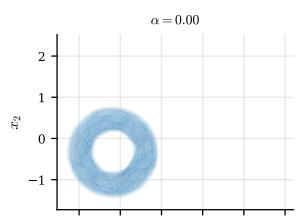

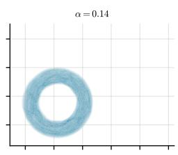

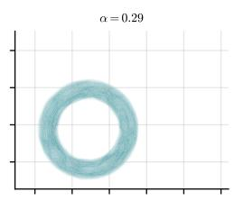

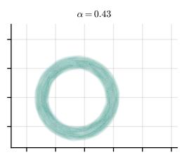

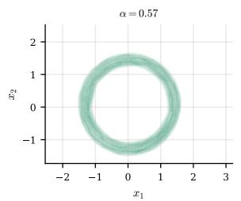

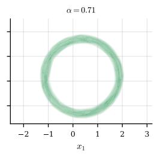

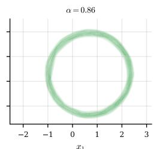

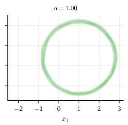

Figure 5: Densities decoded along a straight line between the embeddings of two donuts (α = 0 and α = 1). The interior points are interpolated in embedding space, not embedded from samples. Color tracks α.  
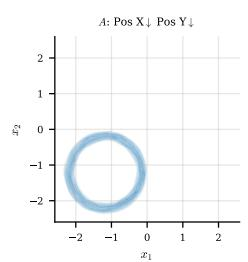

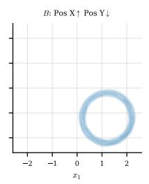

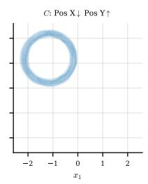

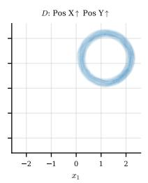

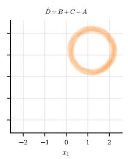

Figure 6: Embedding arithmetic across horizontal and vertical position. Blue panels are embedded from samples; the orange panel decodes the prediction $\hat { D } = z _ { B } + z _ { C } - z _ { A }$ , which matches D to within the sampling-noise floor.  
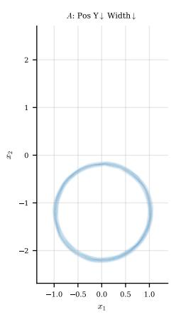

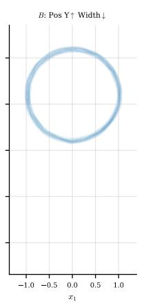

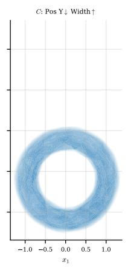

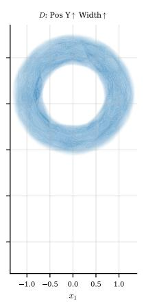

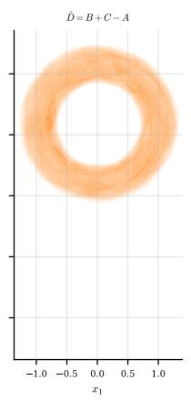  
Figure 7: The same identity across vertical position and width. The prediction (orange) again matches D to within the noise floor.

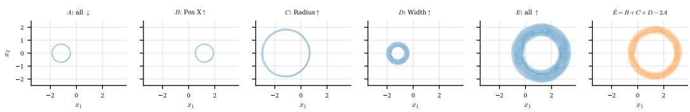  
Figure 8: Where additivity breaks: raising horizontal position, radius, and width together. The prediction $\hat { E } = z _ { B } + z _ { C } + z _ { D } - 2 z _ { A }$ (orange) is visibly thinner than E, because a donut’s thickness is the product of radius and width.

Table 5: Donut reconstruction quality: held-out NLL and sliced-Wasserstein distance $( \mathrm { m e a n } \pm \mathrm { S E M }$ over seeds, lower is better) versus embedding sample count n.
<table><tr><td rowspan="2">n</td><td colspan="3">NLL</td><td colspan="2">SWD</td></tr><tr><td>FM</td><td></td><td>NF</td><td>FM</td><td>NF</td></tr><tr><td>16</td><td> $1 . 8 1 9 \pm 0 . 2 0 2$ </td><td> $1 . 9 3 9 \pm 0 . 1 0 8$ </td><td></td><td> $0 . 0 9 8 \pm 0 . 0 0 1$ </td><td> $0 . 0 9 1 \pm 0 . 0 0 2$ </td></tr><tr><td>32</td><td> $1 . 3 1 1 \pm 0 . 0 2 8$ </td><td> $1 . 3 1 9 \pm 0 . 0 1 3$ </td><td></td><td> $0 . 0 7 9 \pm 0 . 0 0 1$ </td><td> $0 . 0 7 3 \pm 0 . 0 0 0$ </td></tr><tr><td>64</td><td> $1 . 2 2 3 \pm 0 . 0 0 9$ </td><td> $1 . 2 1 5 \pm 0 . 0 0 6$ </td><td></td><td> $0 . 0 7 2 \pm 0 . 0 0 0$ </td><td> $0 . 0 6 6 \pm 0 . 0 0 0$ </td></tr><tr><td>128</td><td> $1 . 2 1 4 \pm 0 . 0 1 5$ </td><td> $1 . 2 0 5 \pm 0 . 0 1 0$ </td><td></td><td> $0 . 0 7 0 \pm 0 . 0 0 1$ </td><td> $0 . 0 6 4 \pm 0 . 0 0 0$ </td></tr><tr><td>256</td><td> $1 . 2 1 8 \pm 0 . 0 1 7$ </td><td> $1 . 2 1 2 \pm 0 . 0 1 2$ </td><td></td><td> $0 . 0 7 0 \pm 0 . 0 0 1$ </td><td> $0 . 0 6 3 \pm 0 . 0 0 0$ </td></tr><tr><td>1024</td><td> $1 . 2 2 4 \pm 0 . 0 1 7$ </td><td> $1 . 2 2 4 \pm 0 . 0 1 4$ </td><td></td><td> $0 . 0 6 9 \pm 0 . 0 0 1$ </td><td> $0 . 0 6 3 \pm 0 . 0 0 1$ </td></tr></table>

## D.4 HYPERPARAMETERS

The embedder is the multi-stage set encoder of Algorithm 1 with an ISAB at every stage and weighted-mean pooling; the pooled output of the last stage is the embedding θ. Both generator heads are conditioned on θ by concatenation: every MLP inside a head receives θ appended to its input. Table 7 lists the hyperparameters of both heads, together with the evaluation protocol.

Flow-matching head. An MLP velocity field $v ( x , t ; \theta )$ that reads x concatenated with a sinusoidal embedding of t. It is trained with the conditional flow-matching loss on the linear path $x _ { t } = ( 1 - ( 1 -$ $\sigma _ { \operatorname* { m i n } } ) t ) \boldsymbol z + t \boldsymbol x$ from Gaussian noise z to a sample x, regressing the target velocity $x - \left( 1 - \sigma _ { \operatorname* { m i n } } \right) z .$ Sampling integrates the learned ODE from noise to data with the midpoint rule, and the density follows from the continuous change-of-variables formula, accumulating the divergence of v along the reverse path.

Normalizing-flow head. A stack of masked coupling layers on a standard normal base, each of which updates one coordinate given the other and then the reverse, using the non-linear squared (NLSq) transform of Ziegler & Rush (2019), $f ( x ) = a + b x + c / ( 1 + { \overset { \vartriangle } { ( } } d x + e ) ^ { 2 } )$ ), whose five parameters are predicted by a conditioned MLP. It is trained by maximum likelihood, and both sampling and density evaluation take a single pass through the stack.

Evaluation. Each held-out donut is embedded from n of its samples. The NLL is scored on fresh samples of the same donut, and a set of generated samples is compared with the true donut by the sliced Wasserstein distance and by the recovery error of its center, radius, and width, which are estimated from the generated samples by the method of moments. The KDE and parametric fit baselines are fit to the same n samples.

## E FUNCTION EMBEDDINGS

## E.1 FAMILIES

Polynomials. Univariate polynomials $\begin{array} { r } { f ( x ) = \sum _ { k = 0 } ^ { d } c _ { k } x ^ { k } } \end{array}$ of degree d up to three, with coef ficients drawn uniformly and evaluated on a bounded interval. See Table 8 for concrete ranges.

Table 6: Donut parameter-recovery error: center, radius, and width of the reconstructed ring (mean ± SEM over seeds, lower is better) versus embedding sample count n.
<table><tr><td rowspan="2">n</td><td colspan="2">Center</td><td colspan="2">Radius</td><td colspan="2"></td></tr><tr><td>FM</td><td>NF</td><td>FM</td><td>NF</td><td>FM</td><td>NF</td></tr><tr><td>16</td><td> $0 . 1 0 0 \pm 0 . 0 0 1$ </td><td> $0 . 0 9 0 \pm 0 . 0 0 3$ </td><td> $0 . 0 3 5 \pm 0 . 0 0 2$ </td><td> $0 . 0 3 6 \pm 0 . 0 0 2$ </td><td> $0 . 0 8 0 \pm 0 . 0 0 6$ </td><td> $0 . 0 7 4 \pm 0 . 0 0 4$ </td></tr><tr><td>32</td><td> $0 . 0 7 4 \pm 0 . 0 0 1$ </td><td> $0 . 0 6 3 \pm 0 . 0 0 0$ </td><td> $0 . 0 2 2 \pm 0 . 0 0 0$ </td><td> $0 . 0 2 3 \pm 0 . 0 0 2$ </td><td> $0 . 0 5 5 \pm 0 . 0 0 2$ </td><td> $0 . 0 4 6 \pm 0 . 0 0 1$ </td></tr><tr><td>64</td><td> $0 . 0 6 4 \pm 0 . 0 0 1$ </td><td> $0 . 0 5 3 \pm 0 . 0 0 0$ </td><td> $0 . 0 1 6 \pm 0 . 0 0 0$ </td><td> $0 . 0 1 7 \pm 0 . 0 0 1$ </td><td> $0 . 0 5 3 \pm 0 . 0 0 8$ </td><td> $0 . 0 4 5 \pm 0 . 0 0 5$ </td></tr><tr><td>128</td><td> $0 . 0 5 9 \pm 0 . 0 0 2$ </td><td> $0 . 0 4 9 \pm 0 . 0 0 0$ </td><td> $0 . 0 1 3 \pm 0 . 0 0 0$ </td><td> $0 . 0 1 4 \pm 0 . 0 0 1$ </td><td> $0 . 0 5 9 \pm 0 . 0 1 0$ </td><td> $0 . 0 5 3 \pm 0 . 0 0 7$ </td></tr><tr><td>256</td><td> $0 . 0 5 9 \pm 0 . 0 0 3$ </td><td> $0 . 0 4 8 \pm 0 . 0 0 1$ </td><td> $0 . 0 1 2 \pm 0 . 0 0 0$ </td><td> $0 . 0 1 3 \pm 0 . 0 0 1$ </td><td> $0 . 0 6 6 \pm 0 . 0 1 1$ </td><td> $0 . 0 6 1 \pm 0 . 0 0 7$ </td></tr><tr><td>1024</td><td> $0 . 0 5 8 \pm 0 . 0 0 2$ </td><td> $0 . 0 4 7 \pm 0 . 0 0 2$ </td><td> $0 . 0 1 2 \pm 0 . 0 0 1$ </td><td> $0 . 0 1 4 \pm 0 . 0 0 2$ </td><td> $0 . 0 7 1 \pm 0 . 0 1 1$ </td><td> $0 . 0 6 9 \pm 0 . 0 0 8$ </td></tr></table>

Table 7: Distribution-embedding architectures, hyperparameters, and evaluation protocol on the donut family.
<table><tr><td>Hyperparameter</td><td>Value</td></tr><tr><td>Encoder (multi-stage ISAB) Embedding size Stages Attention heads Inducing points Feed-forward hidden size Generator head</td><td>16 3 4 16 128</td></tr><tr><td>Type Velocity MLP hidden size Velocity MLP layers Time-embedding size ODE steps (midpoint)  $\sigma _ { \mathrm { m i n } }$  Coupling layers Parameter MLP hidden size Parameter MLP layers</td><td>FM NF 128 4 16 100  $1 0 ^ { - 4 }$  8 32 3</td></tr><tr><td>Training (Adam) Learning rate Warmup steps Batch size</td><td>0.001 0 64</td></tr><tr><td>Samples per distribution Iterations</td><td>128 100,000</td></tr><tr><td>Evaluation</td><td></td></tr><tr><td>Held-out distributions</td><td>1,024</td></tr><tr><td>NLL samples per distribution Generated samples per distribution</td><td>512 1,024</td></tr></table>

Unlike the oscillatory ODE solutions below, this family spans a wide range of output scales, from near-zero constants to cubics reaching into the hundreds. We train the embedding over degrees 0–3; the differential operator is then trained over degrees 1–3 only, since the derivative of a degree-0 polynomial is identically zero and undefined under a relative- $\dot { L } ^ { 2 }$ loss.

Damped harmonic oscillator. A chain of M unit masses on a line, each tied to its rest position by an on-site spring of frequency ω and to its neighbors by coupling springs, under uniform velocity damping $\gamma .$ For a single mass this reduces to $\ddot { x } + 2 \gamma \dot { x } + \omega ^ { 2 } x = 0$ , whose closed-form solution covers the under-, over-, and critically-damped regimes. Stacking the M positions and velocities into a state z gives a linear system $\dot { z } = A z$ with the closed-form solution $z ( t ) = \exp ( A t ) z _ { 0 } ,$ , so each trajectory is a 2M-dimensional state evolving in time. Varying $M \in \{ 1 , 2 , 4 , 8 , 1 6 \}$ sweeps the state dimension from 2 to 32, the axis of the dimension-scaling result in Table 3.

Table 8: Function families: state dimension, and domain and parameter ranges.
<table><tr><td>Family</td><td>State dim.</td><td>Domain and parameter ranges</td></tr><tr><td>Polynomials</td><td>1</td><td> $x \in [ - 4 , 4 ] , c _ { k } \in [ - 5 , 5 ] , d \in [ 0 , 3 ]$ </td></tr><tr><td>Damped oscillator</td><td>2M</td><td> $t ~ \in ~ [ 0 , 1 0 ] , ~ x _ { 0 } , \stackrel { \cdot } { v } _ { 0 } ~ \in ~ [ - 2 , \stackrel { \cdot } { 2 } ] , ~ \stackrel { \cdot } { \gamma } ~ \in ~ [ 0 . 3 , 2 . 5 ] ,$ </td></tr><tr><td>Lotka-Volterra</td><td>2</td><td> $\omega \in [ 0 . 5 , 3 ] , k \in [ 0 . 5 , 1 . { \dot { 5 } } ]$   $t \in [ 0 , 1 0 ] , \stackrel { \cdot } { x } _ { 0 } , y _ { 0 } \stackrel { \cdot } { \in } [ 0 . 5 , 2 ] , \alpha , \beta , \gamma , \delta \in [ 0 . 8 , 1 . 5 ]$ </td></tr></table>

Lotka–Volterra. The predator–prey system $\dot { x } = \alpha x - \beta x y , \dot { y } = \delta x y - \gamma y$ , with a two-dimensional state $( x , y )$ tracking the prey and predator populations. It has no elementary closed-form solution, so each trajectory is integrated numerically with a Dormand–Prince solver implemented in diffrax (Kidger, 2021). A function is specified by its initial state $( x _ { 0 } , y _ { 0 } )$ and the four interaction rates $( \alpha , \beta , \gamma , \delta )$ , and the resulting trajectories are periodic orbits of varying amplitude.

## E.2 ARCHITECTURES & HYPERPARAMETERS

The embedder is the multi-stage set encoder of Appendix C (Algorithm 1), whose stages differ only in how each sample is combined with the running set-level summary c. We use two such stage blocks, both built on the induced set attention block (ISAB) of the Set Transformer (Lee et al., 2019). The two stage-block variants, along with the decoder, operator, and training recipe, share a single set of hyperparameters, listed in Table 9.

Concatenation embedder. Each stage concatenates the per-sample input x, output $f ( x )$ , and (from the second stage on) the pooled summary c into a single vector, and passes the resulting set through an ISAB. This is the direct analogue of the encoder used for distributions, with c appended to every sample.

Dot-product embedder. Each stage instead projects $x , f ( x )$ , and c through separate MLPs and multiplies the three projections elementwise before passing the product to the ISAB. The elementwise product lets the summary modulate the per-sample features multiplicatively rather than enter as an extra input channel, and we found it to yield a stronger encoder; it is the default in all reported results. The two variants are compared in Tables 11 and 10.

Decoder. The decoder reconstructs $f$ at a query point x by single-head cross-attention. An MLP maps x to a query vector, while two linear projections expand the embedding θ into a small fixed set of synthetic key and value vectors; the query attends over the keys and returns the resulting convex combination of values as ${ \hat { f } } ( x )$ . Treating the embedding as a short sequence of learned slots outperforms a plain MLP that concatenates x and θ directly.

Operator networks. Both operators are plain feedforward MLPs acting directly in vector spaces. The differential operator maps a function’s embedding to the embedding of its derivative and is trained as a second stage on the frozen embedding; the ODE solution operator maps a raw vector of initial conditions and parameters to the embedding of the corresponding solution. In both cases the decoder above expands the predicted embedding back into a function at arbitrary query points.

## E.3 ADDITIONAL RESULTS

Figure 9 is the polynomial counterpart of the Lotka–Volterra figure in the main text, for three polynomials of degree one through three: the decoder reconstructs each $f$ from a small sample set (left), while the differential operator maps its embedding to that of its derivative, which the decoder in turn expands into $f ^ { \prime }$ (right). Tables 11 and 10 give the full per-family reconstruction error, broken out by polynomial degree and reported as RMSE, relative $L ^ { 2 }$ , and relative max-abs error, for the dot-product and concatenation encoders respectively. Error grows with polynomial degree, as higher-degree polynomials span a much wider range of output scales, and aggregated over each family the dot-product encoder attains the lower error, consistent with our use of it as the default in the main text.

Table 9: Function-embedding architecture and training hyperparameters, shared by every family and both encoders.
<table><tr><td>Hyperparameter</td><td>Value</td></tr><tr><td>Encoder (multi-stage ISAB)</td><td></td></tr><tr><td>Embedding size</td><td>64</td></tr><tr><td>Stages</td><td>2</td></tr><tr><td>Attention heads</td><td>4</td></tr><tr><td>Inducing points</td><td>16</td></tr><tr><td>Feed-forward / projection hidden size</td><td>64</td></tr><tr><td>Projection MLP layers</td><td>2</td></tr><tr><td>Activation</td><td>GELU</td></tr><tr><td>Decoder (cross-attention)</td><td></td></tr><tr><td>Query MLP hidden size</td><td>128</td></tr><tr><td>Query MLP layers</td><td>2</td></tr><tr><td>Query/key size</td><td>48</td></tr><tr><td>Key/value slots</td><td>24</td></tr><tr><td>Activation</td><td>GELU</td></tr><tr><td></td><td></td></tr><tr><td>Operator (MLP) Hidden size</td><td>256</td></tr><tr><td>Hidden layers</td><td>4</td></tr><tr><td>Activation</td><td></td></tr><tr><td></td><td>GELU</td></tr><tr><td>Training (Adam)</td><td></td></tr><tr><td>Learning rate</td><td>0.003</td></tr><tr><td>Schedule</td><td>cosine decay</td></tr><tr><td>Weight decay</td><td>0</td></tr><tr><td>Gradient clip</td><td>1</td></tr><tr><td>Loss</td><td>relative  $L ^ { 2 }$ </td></tr><tr><td>Batch size</td><td>64</td></tr><tr><td>Samples per function</td><td>256</td></tr><tr><td>Embedding iterations</td><td>30,000</td></tr><tr><td>Operator iterations</td><td>30,000</td></tr><tr><td>Evaluation</td><td></td></tr><tr><td>Held-out functions</td><td>1,024</td></tr><tr><td></td><td></td></tr><tr><td>Samples per function</td><td>256</td></tr></table>

Table 10: Embedding reconstruction error (inferred from a sample set) by family, Set Transformer encoder, concatenation fusion, mean ± SEM over 3 seeds. Rel Max is the relative max-abs error.
<table><tr><td>Family</td><td>RMSE</td><td> $\mathrm { R e l } \ L ^ { 2 }$ </td><td>Rel Max</td></tr><tr><td>Polynomials</td><td> $0 . 8 5 9 6 \pm 0 . 0 1 6 5$ </td><td> $0 . 0 1 6 2 \pm 0 . 0 0 0 7$ </td><td> $0 . 0 1 8 4 \pm 0 . 0 0 0 8$ </td></tr><tr><td>degree 0</td><td> $0 . 0 0 4 1 \pm 0 . 0 0 0 2$ </td><td> $0 . 0 0 1 0 \pm 0 . 0 0 0 0$ </td><td> $0 . 0 0 1 7 \pm 0 . 0 0 0 1$ </td></tr><tr><td>degree 1</td><td> $0 . 0 6 6 0 \pm 0 . 0 0 1 4$ </td><td> $0 . 0 0 8 1 \pm 0 . 0 0 0 4$ </td><td> $0 . 0 1 0 0 \pm 0 . 0 0 0 4$ </td></tr><tr><td>degree 2</td><td> $0 . 4 0 3 3 \pm 0 . 0 2 4 6$ </td><td> $0 . 0 1 8 2 \pm 0 . 0 0 1 3$ </td><td> $0 . 0 2 0 2 \pm 0 . 0 0 1 4$ </td></tr><tr><td>degree 3</td><td> $2 . 9 6 4 9 \pm 0 . 0 4 6 1$ </td><td> $0 . 0 3 7 6 \pm 0 . 0 0 1 1$ </td><td> $0 . 0 4 1 5 \pm 0 . 0 0 1 5$ </td></tr><tr><td>Damped oscillator</td><td> $0 . 0 1 1 4 \pm 0 . 0 0 1 0$ </td><td> $0 . 0 1 7 8 \pm 0 . 0 0 0 7$ </td><td> $0 . 0 1 9 1 \pm 0 . 0 0 0 6$ </td></tr><tr><td>Lotka-Volterra</td><td> $0 . 0 0 8 7 \pm 0 . 0 0 0 6$ </td><td> $0 . 0 0 5 9 \pm 0 . 0 0 0 3$ </td><td> $0 . 0 0 9 2 \pm 0 . 0 0 0 4$ </td></tr></table>

## F GRAPH EMBEDDINGS

## F.1 FAMILIES

Random trees. Uniformly random labeled trees on n vertices, drawn through Prüfer sequences: a uniformly random length- $( n - 2 )$ string over the n vertex labels decodes to a distinct labeled tree, so every labeled tree is equally likely. The graphs are unweighted, and we evaluate them at $n \in \{ 1 0 , 2 0 \}$

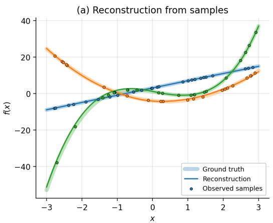

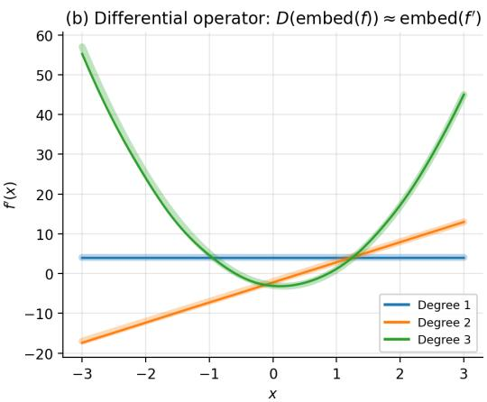  
Figure 9: Function embeddings on the polynomial family. Three polynomials of degree one, two, and three (color-coded). (a) Reconstruction from observed samples: the embedder maps the samples (dots) to an embedding from which the decoder reconstructs $f$ (solid line, ground truth shaded). (b) The differential operator maps each function’s embedding to that of its derivative, $D ( { \mathrm { e m b e d } } ( f ) )$ ≈ $\mathrm { e m b e d } ( f ^ { \prime } )$ , which the decoder then expands into $f ^ { \breve { \prime } }$ (solid line, ground truth shaded). A single embedding thus supports both reconstructing a function and differentiating it.

Table 11: Embedding reconstruction error (inferred from a sample set) by family, Set Transformer encoder, dot-product fusion, mean ± SEM over 3 seeds. Rel Max is the relative max-abs error.
<table><tr><td>Family</td><td>RMSE</td><td> $\mathrm { R e l } \ L ^ { 2 }$ </td><td>Rel Max</td></tr><tr><td>Polynomials</td><td> $0 . 5 2 2 4 \pm 0 . 0 6 8 2$ </td><td> $0 . 0 1 4 3 \pm 0 . 0 0 1 1$ </td><td> $0 . 0 1 6 4 \pm 0 . 0 0 1 7$ </td></tr><tr><td>degree 0</td><td> $0 . 0 0 5 5 \pm 0 . 0 0 0 6$ </td><td> $0 . 0 0 1 6 \pm 0 . 0 0 0 1$ </td><td> $0 . 0 0 3 0 \pm 0 . 0 0 0 1$ </td></tr><tr><td>degree 1</td><td> $0 . 0 7 4 0 \pm 0 . 0 0 4 8$ </td><td> $0 . 0 1 0 3 \pm 0 . 0 0 0 4$ </td><td> $0 . 0 1 3 5 \pm 0 . 0 0 1 1$ </td></tr><tr><td>degree 2</td><td> $0 . 3 7 8 6 \pm 0 . 0 3 7 5$ </td><td> $0 . 0 2 0 1 \pm 0 . 0 0 1 9$ </td><td> $0 . 0 2 2 1 \pm 0 . 0 0 2 7$ </td></tr><tr><td>degree 3</td><td> $1 . 6 3 1 5 \pm 0 . 2 3 6 2$ </td><td> $0 . 0 2 5 1 \pm 0 . 0 0 2 4$ </td><td> $0 . 0 2 7 0 \pm 0 . 0 0 3 2$ </td></tr><tr><td>Damped oscillator</td><td> $0 . 0 1 0 8 \pm 0 . 0 0 1 8$ </td><td> $0 . 0 1 7 3 \pm 0 . 0 0 2 9$ </td><td> $0 . 0 2 1 6 \pm 0 . 0 0 3 4$ </td></tr><tr><td>Lotka-Volterra</td><td> $0 . 0 0 6 8 \pm 0 . 0 0 0 3$ </td><td> $0 . 0 0 4 7 \pm 0 . 0 0 0 1$ </td><td> $0 . 0 0 7 8 \pm 0 . 0 0 0 0$ </td></tr></table>

Scale-free networks. Barabási–Albert graphs (Albert & Barabási, 2002) grown by preferential attachment: vertices are added one at a time, and each new vertex attaches to $m = 2$ earlier vertices chosen with probability proportional to their current degree. This yields a heavy-tailed degree distribution with a few high-degree hubs, which are the vertices reconstruction struggles with most. The graphs are unweighted, again at $n \in \{ 1 0 , 2 0 \}$

Gridworlds. The only weighted family. Each graph starts from a fixed $4 \times 4$ grid $( n = 1 6 )$ and removes up to three of its edges uniformly at random, subject to the remaining graph staying connected. Every surviving edge carries a positive weight drawn uniformly, and edges are sampled with frequency proportional to their weight, so the family tests reconstruction of a weighted adjacency rather than a binary one.

## F.2 ARCHITECTURES & HYPERPARAMETERS

The encoder is the multi-stage set encoder of Appendix C, built on ISABs and applied to the sampled edges, each given as the pair of one-hot labels of its endpoints. Table 12 lists the hyperparameters; across families only the number of representation dimensions and the number of edges sampled per graph change. Each sampled edge set is split in half between producing the embedding and scoring the decoder, and every configuration is trained with three seeds.

Decoder. The decoder is the ALLO objective of Section A.2 with both of its trainable parts conditioned on the embedding. An MLP maps a vertex’s one-hot label, concatenated with θ, to its d-dimensional representation, and a second MLP predicts each dual variable $\beta _ { j k }$ from θ and the index pair $( j , k )$ . The diagonal duals provide the eigenvalue estimates; the representation used downstream drops the constant eigenvector and rescales every remaining coordinate by the inverse square root of its eigenvalue. The augmented Lagrangian carries the penalty coefficient b and an $L _ { 2 }$ regularizer on the dual variables, and its saddle point is optimized with optimistic Adam.

Reconstruction heads. The medians network is an MLP that maps a vertex’s one-hot label, concatenated with θ, through a softplus to $m _ { u }$ , the predicted median distance from vertex u to its neighbors. It is trained with the mean absolute error discussed in Section 5 and predicts an edge between u and v whenever $d ( u , v ) \leq m _ { u } + m _ { v }$ . The degree oracle instead connects each vertex to its deg(u) nearest vertices, thresholding halfway between the deg(u)-th and the next nearest distance, with the threshold of a pair taken as the mean of its endpoints’ thresholds. For the weighted gridworld family, the transition network is an MLP that scores every ordered vertex pair from its representation distance and θ; a global softmax over all pairs, excluding self-loops, turns the scores into a normalized symmetric adjacency, trained by the negative log-likelihood of the held-out sampled edges. Since edges are sampled with frequency proportional to their weight, this recovers the true adjacency up to its overall scale, which frequency sampling cannot identify.

Evaluation. Each held-out graph is embedded from its sampled edges, and the geometry is scored by ranking every vertex pair by representation distance: we report the ROC-AUC and the average precision (AP) of the resulting edge detector. Reconstruction is scored by the precision, recall, and F1 of the predicted adjacency against the true one, with counts pooled over all held-out graphs, for both the degree oracle and the medians network. On gridworld, the transition head’s adjacency is compared with the true normalized adjacency by Spearman rank correlation, over the true edges and over all vertex pairs (rescaled by the ceiling that the tied non-edges impose), and by the mean absolute error of the off-diagonal weights.

## F.3 ADDITIONAL RESULTS

Table 13 extends Table 4 with the average precision of the geometry, the full precision and recall of both reconstruction heads, and the weighted gridworld family. The medians network reconstructs with a recall near one but a low precision on the n = 20 families, the signature of the over-prediction discussed in the main text, whereas the degree oracle keeps the two balanced. On gridworld the geometry separates edges from non-edges nearly as well as on the n = 10 families, and the transition head ranks the true edge weights with a Spearman correlation of about 0.76 over the edges and 0.93 over all vertex pairs, after rescaling for the ceiling that the tied non-edges impose.

## G SOURCE CODE

The entire framework is implemented in JAX (Bradbury et al., 2018). The source code will be publicly available on GitHub upon publication.

Table 12: Graph-embedding architectures and hyperparameters per family.
<table><tr><td>Hyperparameter</td><td>Trees 10</td><td>Trees 20</td><td>SF 10</td><td>SF 20</td><td>Gridworld</td></tr><tr><td>Encoder (multi-stage ISAB) Embedding size</td><td></td><td></td><td>128</td><td></td><td></td></tr><tr><td>Stages Attention heads Inducing points Feed-forward hidden size</td><td></td><td></td><td>2 4 32 64</td><td></td><td></td></tr><tr><td>Decoder Representation dims d Eigenfunction MLP hidden size Eigenfunction MLP layers Dual-variable MLP hidden size Dual-variable MLP layers</td><td>8</td><td>16</td><td>8 1,024 3 32 2 2</td><td>16</td><td>12</td></tr><tr><td>Penalty coefficient b Dual regularization Reconstruction head (MLP) Hidden size Hidden layers</td><td></td><td></td><td>0.003 64</td><td></td><td></td></tr><tr><td>Embedding training (optimistic Adam) Learning rate Schedule Gradient clip</td><td></td><td></td><td>3 0.001 cosine decay 1</td><td></td><td></td></tr><tr><td>Batch size Samples per graph Iterations Head training (Adam)</td><td>128</td><td>256</td><td>64 128 100,000</td><td>256</td><td>256</td></tr><tr><td>Learning rate Schedule Batch size Samples per graph Iterations Evaluation</td><td>128</td><td>256</td><td>0.001 constant 64 128 50,000</td><td>256</td><td>256</td></tr></table>

Table 13: Graph-embedding quality per family, all metrics $( \mathrm { m e a n } \pm \mathrm { S E M }$ over 3 seeds).
<table><tr><td>Metric</td><td>Trees 10</td><td>Trees 20</td><td>SF 10</td><td>SF 20</td><td>Gridworld</td></tr><tr><td>Geometry</td><td></td><td></td><td></td><td></td><td></td></tr><tr><td>ROC-AÚC</td><td> $0 . 9 9 3 \pm 0 . 0 0 1$ </td><td> $0 . 9 5 3 \pm 0 . 0 0 6$ </td><td> $0 . 9 8 0 \pm 0 . 0 0 1$ </td><td> $0 . 8 4 7 \pm 0 . 0 1 0$ </td><td> $0 . 9 5 8 \pm 0 . 0 0 2$ </td></tr><tr><td>AP</td><td> $0 . 9 7 8 \pm 0 . 0 0 2$ </td><td> $0 . 7 9 3 \pm 0 . 0 1 6$ </td><td> $0 . 9 5 6 \pm 0 . 0 0 1$ </td><td> $0 . 6 2 5 \pm 0 . 0 1 8$ </td><td> $0 . 9 0 7 \pm 0 . 0 0 1$ </td></tr><tr><td colspan="6">Reconstruction (degree oracle)</td></tr><tr><td>Precision</td><td> $0 . 9 8 4 \pm 0 . 0 0 1$ </td><td> $0 . 8 0 6 \pm 0 . 0 2 3$ </td><td> $0 . 9 4 9 \pm 0 . 0 0 2$ </td><td> $0 . 6 4 9 \pm 0 . 0 2 1$ </td><td></td></tr><tr><td>Recall</td><td> $0 . 9 8 2 \pm 0 . 0 0 1$ </td><td> $0 . 7 5 8 \pm 0 . 0 3 2$ </td><td> $0 . 9 6 7 \pm 0 . 0 0 2$ </td><td> $0 . 5 8 0 \pm 0 . 0 2 3$ </td><td></td></tr><tr><td>F1</td><td> $0 . 9 8 3 \pm 0 . 0 0 1$ </td><td> $0 . 7 8 1 \pm 0 . 0 2 8$ </td><td> $0 . 9 5 8 \pm 0 . 0 0 2$ </td><td> $0 . 6 1 3 \pm 0 . 0 2 2$ </td><td></td></tr><tr><td>Reconstruction (medians)</td><td></td><td></td><td></td><td></td><td></td></tr><tr><td colspan="6"></td></tr><tr><td>Precision</td><td> $0 . 8 7 9 \pm 0 . 0 0 9$ </td><td> $0 . 2 9 9 \pm 0 . 0 5 9$ </td><td> $0 . 6 5 8 \pm 0 . 0 0 3$ </td><td> $0 . 1 9 9 \pm 0 . 0 0 6$ </td><td></td></tr><tr><td>Recall</td><td> $0 . 9 7 0 \pm 0 . 0 0 1$ </td><td> $0 . 9 5 7 \pm 0 . 0 1 1$ </td><td> $0 . 9 9 7 \pm 0 . 0 0 0$ </td><td> $0 . 9 9 4 \pm 0 . 0 0 1$ </td><td></td></tr><tr><td>F1</td><td> $0 . 9 2 2 \pm 0 . 0 0 5$ </td><td> $0 . 4 4 9 \pm 0 . 0 6 4$ </td><td> $0 . 7 9 3 \pm 0 . 0 0 2$ </td><td> $0 . 3 3 1 \pm 0 . 0 0 8$ </td><td></td></tr><tr><td colspan="6">Weight reconstruction</td></tr><tr><td>Spearman (edges)</td><td></td><td></td><td></td><td></td><td> $- \phantom { 1 } 0 . 7 5 6 \pm 0 . 0 0 3$ </td></tr><tr><td>Spearman (all pairs)</td><td></td><td></td><td></td><td></td><td> $- \phantom { - } 0 . 9 2 6 \pm 0 . 0 0 3$ </td></tr><tr><td>MAE (×10−3)</td><td></td><td></td><td></td><td></td><td>1.700</td></tr></table>