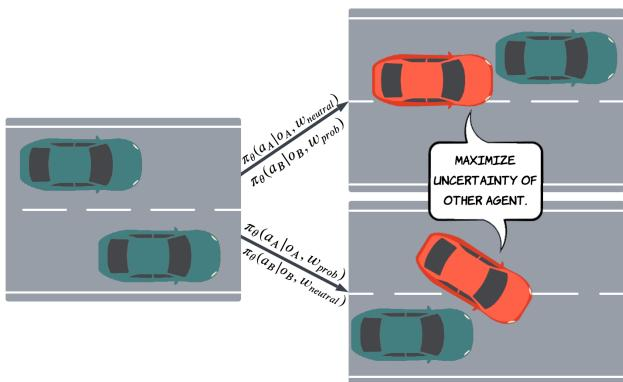
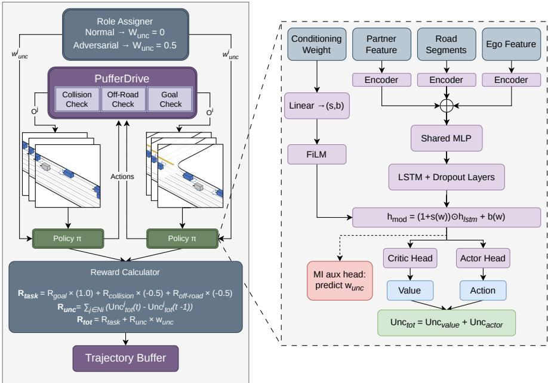
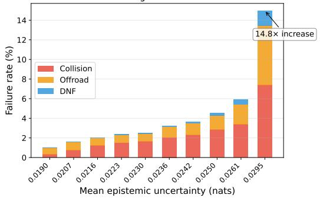
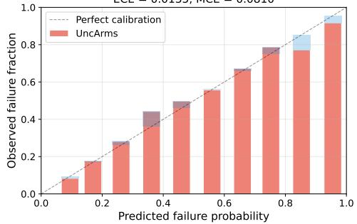
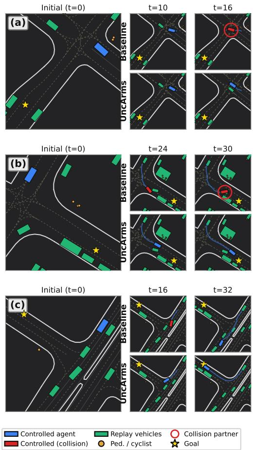
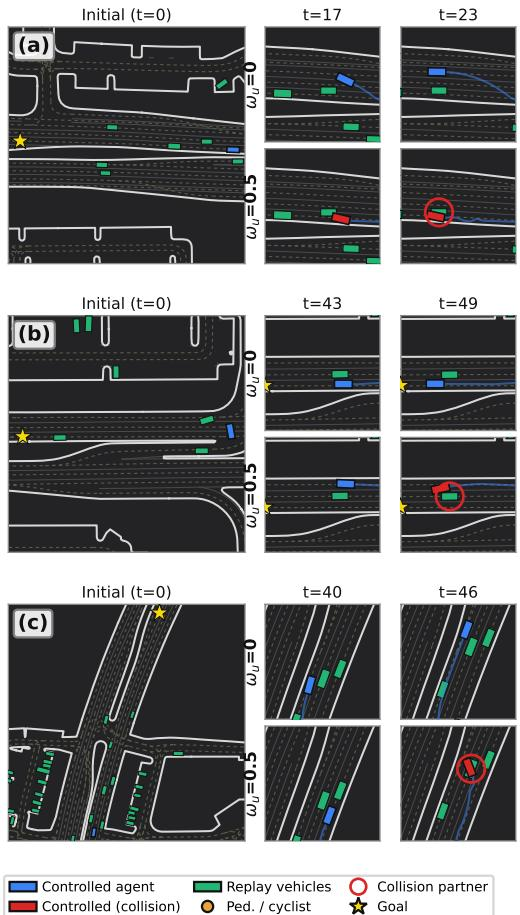

# Uncertainty-Driven Self-Play for Robust Multi-Agent Driving Policies

Sajad Marvi1,2, Julian Schmidt1, Alessandro Canevaro1, Julian Jordan1, and Abhinav Valada2

Abstract— Learning robust driving policies that generalize beyond their training domain remains a central challenge in motion planning. We propose an uncertainty-driven self-play scheme, in which half of the agents are rewarded for increasing their neighbors’ epistemic uncertainty, while the other half learn to drive safely as the exploring agents continuously seek out their weaknesses. Epistemic uncertainty indicates where the policy is least confident and serves as an automatic proxy for scenario difficulty. Exploring agents use this signal to seek out hard cases, generating a challenging curriculum without manual scenario design. The resulting policy outperforms standard selfplay, achieving best-in-class zero-shot transfer to nuplan Val14 (99.12% vs. 97.97%) and Argoverse 2 (82.39% vs. 78.03%) without fine-tuning, while also improving performance over standard self-play on Waymo. Our diversity-driven approach achieves 85% higher LSTM hidden-state coverage than the baseline, indicating a much richer set of behaviors. Further analysis shows that epistemic uncertainty serves as a calibrated difficulty detector, with highest-uncertain agents exhibiting 14.8× the combined failure rate across collision, off-road, and DNF, of lowest-uncertain agents, enabling automatic prioritization of challenging scenarios without ground-truth labels.

## I. INTRODUCTION

Object-level behavior planning is a core challenge in autonomous driving where a policy must control agents through complex multi-agent scenarios involving dynamic interactions with other vehicles, pedestrians, and road structure. Imitation learning [1]–[3] trains policies from logged human trajectories but underrepresents rare, safety-critical events. Reinforcement learning [4]–[8] scales well and produces competent drivers, but policies reflect only the scenarios seen during training and may not generalize to novel domains. Training separate adversarial policies [9], [10] can expose the ego agent to harder situations, but such policies are expensive to maintain and tend to produce unrealistic behaviors. A promising alternative is conditioned self-play, where all agents share one network and a conditioning signal selects the behavioral mode for each agent. Prior work conditions on return targets [11], skill indices [12], or entropy bonuses [13], but these face a fundamental tension. Achieving meaningful behavioral diversity typically degrades driving performance, even when conditioned to drive normally. We term this the diversity tax. Can a conditioned policy, set to its normal driving mode, not only match but exceed an unconditional self-play baseline?

Our key insight is that epistemic uncertainty, which measures the policy’s confidence, provides a natural proxy for behavioral diversity. We train half the agents to increase their neighbors’ uncertainty while the other half learn to drive safely under this probing pressure. Uncertainty is an inexpensive, automatic proxy for scenario difficulty. Rather than hand-engineering diverse training scenarios, probing agents find the hard cases automatically by targeting exactly where the current policy is most confused. This self-play scheme generates an automatic diversity-driven curriculum of challenging interactions. Among the conditioned methods we evaluate, our method is the only one to outperform a strong unconditional self-play baseline.

  
Fig. 1: Probing agents (red), assigned the role in each episode, are rewarded for increasing the epistemic uncertainty of their nearest neighbors, while neutral agents (blue) receive only the task reward. As neutral agents adapt, probing agents must discover increasingly novel confusing situations, generating an automatic diversity-driven curriculum. At evaluation, all agents use the neutral role, benefiting from the broader training distribution.

In each training episode (Fig. 1), 50% of agents are designated probing agents (rewarded for increasing the epistemic uncertainty of their K=3 nearest neighbors) while 50% are neutral (pure task reward). As neutral agents adapt, probing agents must discover increasingly novel challenging situations, generating a diversity-driven curriculum without hand-crafted scenario design. At evaluation, all agents use the neutral role, benefiting from exposure to this broader training distribution. This relates to adversarial training [14] and domain randomization [15] where both improve robustness by exposing the learner to challenging conditions during training.

Our contributions are:

1) An uncertainty-driven self-play scheme using epistemic uncertainty change (∆unc) as the probing reward, showing that a conditioned policy can surpass an unconditional self-play baseline, an outcome not achieved by any other conditioned method we evaluate.

2) Empirical demonstration that epistemic uncertainty serves as a calibrated difficulty detector, with highestuncertainty scenarios exhibiting 14.8× the combined failure rate across collision, off-road, and DNF, of lowest-uncertainty scenarios (ECE=0.014).

3) Comprehensive evaluations across 10,000 Waymo scenarios and zero-shot transfer to nuplan Val14 and Argoverse 2, with comparisons against DIAYN, entropyconditioned, and GIGAFLOW-style baselines.

4) Ablation studies identifying neighborhood size (K=3), warmup scheduling, conditioning mechanism (FiLM vs. Concatenation vs. none), and probing fraction (50%) as essential design choices, with warmup improving score by 0.57% and role conditioning being load-bearing for any gains over the unconditional baseline.

The resulting policy outperforms standard self-play, achieving best-in-class zero-shot transfer to nuplan Val14 (99.12% vs. 97.97%) and Argoverse 2 (82.39% vs. 78.03%) with no fine-tuning, while reducing the failure rate by 17% on Waymo validation scenarios compared to the baseline. It also achieves 85% higher LSTM hidden-state coverage, indicating a broader range of learned behaviors that explains the improved transfer.

## II. RELATED WORK

Our work spans controllable traffic simulation, adversarial training, diversity-promoting RL, and uncertainty estimation. Diverse Traffic Scenario Generation: Generating diverse traffic behavior is critical for Autonomous Vehicle (AV) validation. CtRL-Sim [11] conditions a diffusion model on return targets to yield reactive agents of varying aggressiveness, but requires offline trajectory data and separate generative models. MATS-Gym [16] provides a framework for multi-agent traffic scenarios but does not address uncertainty-driven curriculum generation. GIGAFLOW [17] demonstrates that massive-scale self-play with reward-weight conditioning produces robust driving with some behavioral variation, but conditions on task reward parameters (e.g., collision penalty magnitude), which couples diversity to driving competence. In contrast, our method (UncArms) conditions only on a scalar role signal derived from epistemic uncertainty, keeping task reward weights fixed and avoiding the diversity tax entirely.

Adversarial Training for Robustness: Adversarial training improves model robustness by exposing learners to worst-case perturbations [14]. In robotics, domain randomization [15] and adversarial environment generation [18] create challenging training conditions that improve transfer. For driving, RARL [19] trains a protagonist against an adversary, but uses fixed adversarial objectives rather than adaptive ones. Dedicated adversarial scenario generators such as SaFeR [20] and IntSim [21] optimize for safety-critical situations but require separate training loops or privileged world-model access. Our approach differs in using the learner’s own epistemic uncertainty within a single shared policy, creating an adaptive curriculum without separate adversarial optimization.

Diversity in Reinforcement Learning: DIAYN [12] discovers diverse skills by maximizing mutual information between skill indices and states, but the discrete skill space limits continuous behavioral interpolation and does not target policy weaknesses. Maximum entropy RL [13] encourages exploration through entropy bonuses but does not target specific policy weaknesses. Population-based approaches [22] maintain diversity through separate agents, incurring proportional computational costs. Our approach targets specific weaknesses (where the policy is uncertain) rather than undirected diversity.

Epistemic Uncertainty in Decision-Making: Monte Carlo Dropout [23] provides computationally tractable epistemic uncertainty estimates. Prior work has used uncertainty for exploration bonuses in single-agent settings [24], [25] and for safe navigation under uncertainty [26], [27]. Our key insight is that uncertainty can serve simultaneously as a calibrated difficulty detector (14.8× combined failure rate across deciles) and as a diversity-driving training signal in multi-agent settings.

## III. METHOD

Our method, UncArms (Uncertainty Arms-Race Self-Play), trains a shared policy through uncertainty-driven self-play in which agents are assigned one of two roles per episode: probing or neutral. We use arms race in the co-evolutionary sense. As neutral agents adapt, probing agents must escalate to maintain their reward, producing an escalating curriculum analogous to the Red Queen effect. This is not a zero-sum conflict, since neutral agents are never explicitly rewarded for resisting probing, but the adaptation pressure is nonetheless bidirectional. Both roles share the same FiLM-conditioned architecture. A scalar role signal allows the policy to specialize its behavior per role while sharing all parameters.

## A. Problem Formulation

We formulate multi-agent driving as a Partially Observable Markov Game:

$$
( \mathcal N , \mathcal S , \{ A _ { i } \} _ { i \in \mathcal N } , \mathcal P , \{ R _ { i } \} _ { i \in \mathcal N } , \Omega , \{ \mathcal O _ { i } \} _ { i \in \mathcal N } , \gamma ) ,\tag{1}
$$

where $\mathcal { N }$ is the set of N=32 agents per scenario, $s$ the global state space, $\mathcal { P }$ the transition function, $R _ { i }$ the reward function for agent $i , \ \Omega$ the joint observation space, and $\gamma { = } 0 . 9 9$ the discount factor. Each agent’s partial observation $\mathcal { O } _ { i }$ consists of ego features (speed, heading, relative goal position, lane alignment), relative partner features (position, heading, speed) for nearby agents, road geometry (segment positions, orientations, lane types), and the conditioning weight $w _ { \mathrm { u n c } }$ . Each agent selects actions from a discrete space $A _ { i }$ of 91 combinations (7 acceleration $\times \ 1 3$ steering bins).

## B. Epistemic Uncertainty via MC-Dropout

We estimate epistemic uncertainty using Monte Carlo Dropout [23] with K=5 stochastic forward passes during training rollouts. Critic uncertainty is the standard deviation across value estimates $V _ { k }$ from the k-th forward pass, with $\bar { V }$ their mean as

$$
\mathrm { U n c } _ { \mathrm { v a l u e } } ^ { \mathrm { e p } } = \sqrt { \frac { 1 } { K } \sum _ { k = 1 } ^ { K } ( V _ { k } - \bar { V } ) ^ { 2 } } .\tag{2}
$$

Actor uncertainty uses mutual information decomposition, where $\pi _ { k } ( a | s )$ is the action distribution from the k-th forward

  
Fig. 2: Architecture overview. Observations are processed by ego, partner, and road encoders with max-pooling over variable-count entities. The concatenated embedding passes through an LSTM with MC-Dropout and is modulated by FiLM conditioning on a scalar role signal (probing or neutral). At evaluation, all agents use the neutral role.

pass and $H [ \cdot ]$ denotes Shannon entropy:

$$
\mathrm { U n c e } _ { \mathrm { a c t o r } } ^ { \mathrm { e p } } = H \left[ \frac { 1 } { K } \sum _ { k = 1 } ^ { K } \pi _ { k } ( a | s ) \right] - \frac { 1 } { K } \sum _ { k = 1 } ^ { K } H [ \pi _ { k } ( a | s ) ] .\tag{3}
$$

The total uncertainty combines both via $\begin{array} { r l } { \mathrm { U n c } _ { \mathrm { t o t a l } } } & { { } = } \end{array}$ $\mathrm { U n c _ { v a l u e } ^ { e p } + U n c _ { a c t o r } ^ { e p } }$ . Together, they capture complementary aspects of the policy’s epistemic state in which the actor term reflects uncertainty about what action to take, while the critic term reflects uncertainty about how valuable the current situation is. This formulation assumes an actor-critic architecture, although the same concept applies to any method from which policy uncertainty can be estimated. While this work focuses on the self-play mechanism rather than the uncertainty estimator itself, we chose MC-Dropout for its simplicity: K=5 stochastic passes through a single shared model, with no additional networks. Exploring alternative estimators such as deep ensembles [28] or evidential methods [29] is a natural extension that could reduce training overhead without changing the core arms-race dynamic.

Important distinction: Uncertainty computation occurs only during training rollouts to generate rewards. At evaluation, all agents operate with neutral conditioning $( w _ { \mathrm { u n c } } { = } 0 )$ requiring no uncertainty computation. The policy runs as a standard single-pass network with zero additional inference cost. Accessing neighbors’ uncertainty is a training curriculum mechanism, not a privileged observation at deployment.

## C. FiLM-Conditioned Architecture

The architecture (Fig. 2) processes three observation modalities through separate encoders:

• Ego encoder: ego features $ 6 4  6 4$ (LayerNorm + GELU + Dropout).

• Partner encoder: per-partner features $ 6 4  6 4$ , maxpooled over all visible partners.

• Road encoder: per-segment features $ 6 4  6 4$ , maxpooled over road segments.

The concatenated 192-dimensional representation passes through a shared embedding layer (192 → 256, GELU) and an LSTM with Dropout Layer $\left( p { = } 0 . 2 \right)$ , then undergoes Featurewise Linear Modulation (FiLM) [30]:

$$
\mathbf { h } _ { \mathrm { m o d } } = \left( 1 + s ( \mathbf { w } ) \right) \odot \mathbf { h } _ { \mathrm { L S T M } } + b ( \mathbf { w } ) ,\tag{4}
$$

where $s , b$ are produced by a linear projection of the scalar role signal $w _ { \mathrm { r o l e } }$ . Max-pooling over partner and road encodings naturally handles variable agent counts without padding or masking. The full model has about 780K parameters.

Mutual information auxiliary loss. To ensure the policy attends to the role signal rather than ignoring it, an auxiliary head predicts the conditioning input from the shared representation:

$$
\mathcal { L } _ { \mathrm { M I } } = \| \hat { w } _ { \mathrm { r o l e } } - w _ { \mathrm { r o l e } } \| _ { 2 } ^ { 2 } ,\tag{5}
$$

weighted by $\alpha _ { \mathrm { M I } } ~ = ~ 0 . 1$ relative to the PPO objective. This maximizes a lower bound on $I ( w _ { \mathrm { r o l e } } ; \mathbf { h } )$ , ensuring the representation differentiates probing and neutral roles.

## D. Uncertainty-Driven Self-Play via Uncertainty Change

UncArms uses epistemic uncertainty as a training signal (Fig. 2, left): probing agents are rewarded for increasing neighbors’ uncertainty, exposing the neutral policy to a broader training distribution.

Role assignment. At each episode, agents are randomly assigned roles: 50% probing (role signal $w _ { \mathrm { r o l e } }$ sampled uniformly from (0, 0.5]) and 50% neutral (role signal $w _ { \mathrm { r o l e } } =$

0). Neutral agents receive only the standard task reward. Probing agents receive an additional reward based on the uncertainty change they induce in neighbors:

$$
R _ { \mathrm { a d v } } ^ { i } = \frac { 1 } { K } \sum _ { j \in \mathrm { K N N } _ { K } ( i ) } \left( \operatorname { U n c } _ { j } ( t ) - \operatorname { U n c } _ { j } ( t - 1 ) \right) ,\tag{6}
$$

where $\mathrm { K N N } _ { K } ( i )$ denotes the K=3 nearest agents to agent $i ,$ and $\Delta \mathrm { U n c } _ { j } = \mathrm { U n c } _ { j } ( t ) - \mathrm { U n c } _ { j } ( t - 1 )$ is the temporal change in epistemic uncertainty.

Self-play dynamics. The ∆unc reward creates coevolutionary pressure as probing agents must find situations that increase neighbors’ confusion (not just exploit existing uncertainty). As neutral agents adapt, the probing reward diminishes, forcing probing agents to discover increasingly novel confusing situations. This generates an automatic diversity-driven curriculum without hand-crafted scenario.

Training schedule. UncArms uses a three-phase curriculum in which steps 0–750M are a driving-only warmup (no adversarial reward), steps 750M–1B linearly ramp the probing reward, and steps 1B–1.5B run at full probing intensity.

Why ∆unc rather than absolute uncertainty? Rewarding absolute uncertainty would incentivize probing agents to merely approach already-confused agents. Rewarding the change requires probing agents to actively create new confusion, driving exploration of the state space where the policy has unexplored weaknesses.

## IV. EXPERIMENTAL EVALUATION

We evaluate all methods on the Waymo Open Motion Dataset (WOMD) [31] and test zero-shot transfer to nu-Plan [32] and Argoverse 2 [2]. All experiments use 4 seeds, and we report inter-seed mean±std.

## A. Setup

Simulator. We train in PufferDrive [33], built on Puffer-Lib [34] achieving >1M environment simulation steps/second with N=32 agents across 300 parallel WOMD scenarios [31].

Training. All experiments use PPO [35] with batch size 131,072, learning rate $3 \times 1 0 ^ { - 4 }$ , clip ratio 0.2, entropy coefficient $1 0 ^ { - 4 }$ , and discount $\gamma { = } 0 . 9 9$ . All methods train for 1.5B steps, following the setup in [33].

Hardware. Training is performed on a single NVIDIA T4 GPU. Including neural network inference and PPO updates, effective training throughput is ∼46K steps/second. Each 1.5B-step run completes in approximately 9 hours.

Evaluation. Primary WOMD evaluation uses 10,000 heldout maps with all 32 agents policy-controlled (fully reactive multi-agent). Transfer evaluation uses SDC-only mode (single ego policy-controlled, background agents replay logged trajectories) to isolate the ego policy’s generalization. All conditioned variants are evaluated at neutral conditioning $( w _ { \mathrm { u n c } } { = } 0 )$

## B. Baselines and Variants

• Baseline (Standard PPO): Self-play without FiLM, MC-Dropout, or conditioning [4]. The unconditional baseline.

$G I G A F L O W ^ { * }$ : Baseline architecture extended with GIGAFLOW-style [17] concatenation-based conditioning on the 3 task reward weights $( w _ { \mathrm { g o a l } } , w _ { \mathrm { c o l l } } , w _ { \mathrm { o f f } } )$ . No uncertainty signal. Evaluates the cost of task-weight conditioning.

• DIAYN: Skill discovery with 5 discrete skills [12], maximizing $I ( z ; s )$

• Ent-PPO (Entropy-conditioned PPO): Conditioned on target entropy level, with the entropy coefficient varied per agent per episode.

• UncArms (Ours): FiLM-conditioned architecture (Sec. III-C), role signal conditioning, arms-race training with ∆unc reward (50% probing / 50% neutral).

## C. Main Results

Tab. I presents the main results. UncArms surpasses the unconditional baseline with 99.41% vs. 99.29% goal score $( p < 0 . 0 5 )$ , the only conditioned method in our evaluation to beat a strong self-play baseline. UncArms also achieves the lowest DNF rate (0.20%), indicating that exposure to probing agents during training improves robustness to difficult scenarios that would otherwise cause agents to fail. We find that score, which requires both goal achievement and collision avoidance in the same episode, is the more informative metric than raw collision rate alone. An overly conservative agent can suppress collisions by slowing or avoiding contested paths, but this also prevents goal completion and inflates the DNF rate. Such behavior is not useful driving. UncArms achieves the highest score on WOMD (99.41% vs. 99.29%), nuplan Val14 (99.12% vs. 97.97%), and Argoverse 2 (82.39% vs. 78.03%), demonstrating that it reaches goals more reliably and collision-free across all three benchmarks. The slightly higher raw collision rate on WOMD (2.25% vs. 1.92%) is offset by more successful goal-directed behavior: of the agents that do collide, UncArms collides less on episodes where the goal is also reached (0.29% goal-collision overlap vs. 0.33% for baseline), so the extra collisions come from active failed attempts rather than reckless driving. Among diversityoriented baselines, UncArms exceeds DIAYN (98.36%), entropy-conditioned PPO (98.33%), and the GIGAFLOWstyle full-vector conditioning (94.70%).

## D. Zero-Shot Transfer

1) nuPlan: Tab. II presents the zero-shot transfer results, which provide the strongest evidence for UncArms’s value. UncArms achieves 99.12% score, surpassing the baseline by 1.15 percentage points, with higher goal rate (99.24% vs. 98.27%), lower collision rate (9.53% vs. 9.61%), and lower offroad rate (1.15% vs. 1.36%). Note that collision rates in SDC-only mode are elevated across all methods because background agents follow fixed logged trajectories without reacting to the ego agent; the relative ordering across methods remains meaningful. This result parallels findings in adversarial training for image classification [14] and sim-to-real transfer [15]. Models exposed to a broader distribution of challenging conditions during training develop more robust internal representations that transfer better to novel domains. In our setting, the diversity-driven curriculum forces agents to handle a wider distribution of interactive situations during training, producing a policy that is less brittle when encountering the different traffic patterns, map formats, and lane geometries of nuplan Val14. Diversityoriented baselines transfer substantially worse. GIGAFLOW scores 91.82% (−6.15% vs. baseline) and Ent-PPO 95.67% (−2.30%). DIAYN transfers at 97.16%, still below baseline. UncArms is the only method that consistently outperforms the baseline across all five metrics.

TABLE I: Main performance on WOMD (10K validation maps, 4 seeds, all methods trained for 1.5B steps). Score = goal reached ∧ no collision. Goal = fraction reaching goal. †: $p < 0 . 0 5$ vs. Baseline (Welch’s t-test). UncArms is the only conditioned policy to surpass the unconditional baseline.
<table><tr><td>Method</td><td>Conditioning Mechanism</td><td>Score (%) ↑</td><td>Goal (%) ↑</td><td>Coll. (%)↓</td><td>Offroad (%) ↓</td><td>DNF (%) ↓</td></tr><tr><td>Baseline (PPO)</td><td>None (unconditional self-play)</td><td> $9 9 . 2 9 { \scriptstyle \pm 0 . 0 8 }$ </td><td> $9 9 . 6 4 { \scriptstyle \pm 0 . 0 4 }$ </td><td> ${ \bf 1 . 9 2 \pm 0 . 1 9 }$ </td><td> ${ \bf 0 . 8 7 \pm 0 . 1 4 }$ </td><td> $0 . 2 4 \pm 0 . 0 1$ </td></tr><tr><td>UncArms (Ours)</td><td>Scalar role signal (∆unc arms-race)</td><td> $\pm { \bf 9 9 . 4 1 } { \pm } 0 . 0 8 ^ { \dagger }$ </td><td> $\mathbf { 9 9 . 7 2 { \scriptstyle \pm 0 . 0 2 } ^ { \dagger } }$ </td><td> $2 . 2 5 { \pm } 0 . 1 7$ </td><td> $1 . 1 3 { \pm } 0 . 0 9$ </td><td> $\mathbf { 0 . 2 0 } { \scriptstyle \pm 0 . 0 2 }$ </td></tr><tr><td>GIGAFLOW*</td><td>Task-weight vector (3D: goal, coll, off)</td><td> $9 4 . 7 0 { \scriptstyle \pm 0 . 7 0 } ^ { \dagger }$ </td><td> $9 6 . 6 0 { \scriptstyle \pm 0 . 5 0 } ^ { \dagger }$ </td><td> $4 . 6 0 { \scriptstyle \pm 0 . 4 0 }$ </td><td> $4 . 3 0 { \scriptstyle \pm 0 . 7 0 }$ </td><td> $1 . 8 1 { \pm } 0 . 3 1 $ </td></tr><tr><td>DIAYN</td><td>Discrete skill index  $( z \in \{ 1 . . 5 \} )$ </td><td> $9 8 . 3 6 { \pm } 0 . 1 8 ^ { \dagger }$ </td><td> $9 8 . 8 9 { \scriptstyle \pm 0 . 0 8 } ^ { \dagger }$ </td><td> $4 . 6 5 { \pm } 0 . 1 6$ </td><td> $2 . 2 9 \pm 0 . 1 9$ </td><td> $0 . 7 2 { \scriptstyle \pm 0 . 0 1 }$ </td></tr><tr><td>Ent-PPO</td><td>Target entropy level</td><td> $9 8 . 3 3 { \scriptstyle \pm 0 . 2 5 } ^ { \dagger }$ </td><td> $9 8 . 9 8 { \pm } 0 . 1 4 ^ { \dagger }$ </td><td> $5 . 1 2 { \pm } 0 . 3 6$ </td><td> $2 . 9 9 { \scriptstyle \pm 0 . 3 2 }$ </td><td> $0 . 6 2 { \scriptstyle \pm 0 . 0 9 }$ </td></tr></table>

∗GIGAFLOW-style reproduction: same architecture with concatenation-based conditioning on the 3 task reward weights $( w _ { \mathrm { g o a l } } , w _ { \mathrm { c o l l } } , w _ { \mathrm { o f f } } )$ [17]. The 4.59% score gap vs. Baseline demonstrates the diversity tax, conditioning on variable task weights forces the policy to represent incompatible objectives degrading driving competence.

TABLE II: Zero-shot transfer to nuplan Val14 (no fine-tuning). SDC-only: ego agent controlled by policy, background agents replay logged trajectories. UncArms achieves best transfer on all metrics.  
(a) Epistemic Uncertainty as Failure Predictor 113K WOMD agents in validation set
<table><tr><td>Method</td><td>Score (%) ↑ Goal (%) ↑ Coll. (%) ↓ Offroad (%) ↓ DNF (%) ↓</td><td></td><td></td><td></td><td></td></tr><tr><td>UncArms (Ours)</td><td> $\mathbf { 9 9 . 1 2 } { \scriptstyle \pm 0 . 3 2 }$ </td><td> $\mathbf { 9 9 . 2 4 } \pm \mathbf { 0 . 3 0 }$ </td><td> $9 . 5 3 { \pm } 0 . 1 4 $ </td><td> $1 . 1 5 { \pm } 0 . 1 0$ </td><td> $\mathbf { 0 . 4 4 \pm 0 . 1 8 }$ </td></tr><tr><td>Baseline (PPO)</td><td> $9 7 . 9 7 { \scriptstyle \pm 0 . 5 7 }$ </td><td> $9 8 . 2 7 { \scriptstyle \pm 0 . 5 8 }$ </td><td> $9 . 6 1 \pm 0 . 3 1$ </td><td> $1 . 3 6 \pm 0 . 2 6$ </td><td> $1 . 2 7 { \pm } 0 . 4 5 $ </td></tr><tr><td>DIAYN</td><td> $9 7 . 1 6 { \pm } 0 . 7 5 $ </td><td> $9 7 . 3 5 { \pm } 0 . 6 2 $ </td><td> $1 3 . 1 2 { \pm } 0 . 5 0 $ </td><td> $2 . 3 1 { \pm } 0 . 4 6$ </td><td> $1 . 0 8 { \pm } 0 . 2 3 $ </td></tr><tr><td>Ent-PPO</td><td> $9 5 . 6 7 { \scriptstyle \pm 0 . 2 5 }$ </td><td> $9 5 . 9 8 { \pm } 0 . 3 9$ </td><td> $1 2 . 4 0 { \scriptstyle \pm 0 . 5 4 }$ </td><td> $2 . 4 8 { \pm } 0 . 3 7$ </td><td> $2 . 4 7 { \scriptstyle \pm 0 . 4 9 }$ </td></tr><tr><td>GIGAFLOW*</td><td> $9 1 . 8 2 { \pm } 1 . 9 1 $ </td><td> $9 2 . 0 2 { \pm } 1 . 8 2 $ </td><td> $1 0 . 9 5 { \scriptstyle \pm 0 . 6 6 }$ </td><td> $2 . 3 1 { \pm } 0 . 5 3 $ </td><td> $3 . 9 7 { \pm } 1 . 3 3 $ </td></tr></table>

TABLE III: Zero-shot transfer to Argoverse 2 validation (24,988 scenarios, no fine-tuning). SDC-only control. UncArms leads on score and goal rate.
<table><tr><td>Method</td><td>Score (%) ↑ Goal (%) ↑ Coll. (%) ↓ Offroad (%) ↓ DNF (%) ↓</td><td></td><td></td><td></td><td></td></tr><tr><td>UncArms (Ours) Baseline (PPO)</td><td> $\mathbf { 8 2 . 3 9 2 0 . 6 8 }$   $7 8 . 0 3 { \scriptstyle \pm 2 . 7 9 }$ </td><td> ${ \bf 9 3 . 0 5 } \pm 0 . 4 9$ </td><td> $9 . 8 4 \pm 0 . 1 3$ </td><td> $2 6 . 6 7 { \scriptstyle \pm 1 . 5 6 }$ </td><td> ${ \bf 0 . 6 9 } \pm 0 . 0 8$ </td></tr><tr><td></td><td></td><td> $8 9 . 3 3 { \pm } 2 . 7 8$ </td><td> $\mathbf { 9 . 6 6 } \pm \mathbf { 0 . 4 6 }$ </td><td> $3 0 . 0 7 { \scriptstyle \pm 2 . 6 1 }$ </td><td> $1 . 2 5 { \pm } 0 . 1 7$ </td></tr><tr><td>DIAYN</td><td> $7 5 . 0 0 { \scriptstyle \pm 2 . 8 8 }$ </td><td> $8 2 . 7 7 { \scriptstyle \pm 2 . 9 0 }$ </td><td> $1 2 . 0 2 { \scriptstyle \pm 0 . 8 3 }$ </td><td> $2 8 . 2 8 { \scriptstyle \pm 2 . 9 3 }$ </td><td> $3 . 0 9 { \scriptstyle \pm 0 . 0 9 }$ </td></tr><tr><td>Ent-PPO</td><td> $7 6 . 9 2 { \scriptstyle \pm 0 . 9 3 }$ </td><td> $8 5 . 1 8 { \scriptstyle \pm 0 . 9 1 }$ </td><td> $1 2 . 8 2 { \scriptstyle \pm 0 . 7 2 }$ </td><td> $2 7 . 7 0 { \scriptstyle \pm 0 . 7 9 }$ </td><td> $3 . 2 6 { \pm } 0 . 9 9$ </td></tr><tr><td>GIGAFLOW*</td><td> $6 9 . 4 4 \pm 2 . 3 0 $ </td><td> $7 6 . 7 1 { \scriptstyle \pm 1 . 7 4 }$ </td><td> $1 1 . 2 1 { \pm } 0 . 4 3 $ </td><td> $3 0 . 1 8 { \pm } 2 . 0 9$ </td><td> $4 . 5 1 { \pm } 0 . 8 1 $ </td></tr></table>

Comparison of diversity mechanisms. The entropy baseline diversifies behavior without direction as it encourages exploration broadly but does not concentrate pressure on any particular region of the policy’s distribution. DIAYN diversifies the ego policy’s own behavioral range but optimizes for discriminability rather than safety-relevance. Our uncertainty-seeking approach performs better as it focuses probing pressure on interactions where the policy has low confidence, potentially generating scenario diversity more aligned with policy gaps.

(b) Reliability Diagram 113K WOMD agents in validation set ECE = 0.0135, MCE = 0.0810  
  
Fig. 3: Epistemic uncertainty as failure predictor and calibration analysis (UncArms, 113K agents across 10K WOMD validation maps, $w _ { \mathrm { u n c } } { = } 0 )$ (a) Combined failure rate (collision + offroad + DNF) by uncertainty decile. (b) Reliability diagram: logistic mapping fitted on training data, evaluated on held-out validation.

2) Argoverse 2: Tab. III presents zero-shot transfer results on Argoverse 2 [2]. AV2 lacks explicit road-edge annotations so we approximate edges via the drivable-area polygon boundary, which cuts diagonally across open intersections and flags legal turns as off-road. Offroad rates are therefore inflated for all methods (26–30% vs. <2% on nuPlan).

Score and goal rate remain reliable comparators. Despite this limitation, the relative ordering is consistent with nuPlan where UncArms achieves the highest score (82.39%) and goal rate (93.05%), outperforming the baseline by +4.36% and +3.72% respectively. The margin is larger here than on nuPlan (+1.15%), suggesting that the diversity-driven curriculum confers additional benefit on more geometrically diverse scenarios. Diversity baselines again transfer poorly. GIGAFLOW scores 69.44% (−8.59% vs. baseline), DIAYN 75.00% (−3.03%), and Ent-PPO 76.92% (−1.11%). UncArms is the only method to outperform the unconditional baseline on all three transfer datasets (WOMD, nuPlan, and AV2).

TABLE IV: LSTM hidden-state diversity.
<table><tr><td>Method</td><td>Coverage ↑</td><td>Eff. Dim. ↑</td><td>Spread</td></tr><tr><td>UncArms (Ours)</td><td>0.357</td><td>110</td><td>34.33</td></tr><tr><td>Baseline (PPO)</td><td>0.193</td><td>94</td><td>33.25</td></tr></table>

TABLE V: Ablation isolating the adversarial training contribution (10K WOMD maps, 4 seeds). MC-Dropout alone affects the performance while the arms-race mechanism more than compensates.
<table><tr><td>Method</td><td>Arms-Race</td><td>Score (%)</td></tr><tr><td>Baseline (PPO, no dropout)</td><td>X</td><td>99.29±0.08</td></tr><tr><td>Baseline + MC-Dropout</td><td>X</td><td> $9 8 . 5 0 { \scriptstyle \pm 0 . 0 8 }$ </td></tr><tr><td>UncArms (Ours)</td><td>√</td><td>99.41±0.08</td></tr></table>

## E. Uncertainty as Difficulty Detector

Fig. 3(a) demonstrates that epistemic uncertainty is a strong predictor of driving failure. Binning 113K agentlevel episodes by MC-Dropout uncertainty decile reveals a monotonic 14.8× increase in combined failure rate (collision + offroad + DNF) from the lowest to highest decile (1.01% vs. 14.96%). All three failure modes scale with uncertainty, with collisions dominating and DNF exhibiting the steepest relative growth. Fig. 3(b) shows a reliability diagram: a logistic mapping from uncertainty to failure probability, fitted on a random 1000-map subsample of the training set, is evaluated on 10K held-out validation maps (113K episodes). The resulting Expected Calibration Error (ECE=0.014) confirms that the uncertainty signal is not merely a good ranker but also yields well-calibrated failure probabilities after a simple post-hoc transformation. This finding motivates the selfplay mechanism: if uncertainty reliably indicates difficulty, then rewarding agents for increasing neighbors’ uncertainty naturally generates challenging interactions. Beyond its role in training, this difficulty signal is a practical deployment tool as a single UncArms checkpoint simultaneously provides best-in-class driving performance (Tab. I) and a calibrated perscenario failure predictor (Fig. 3) without requiring groundtruth labels or separate evaluation runs.

## F. Behavioral Diversity via LSTM Hidden States

To quantify whether adversarial training yields genuinely different behaviors or merely different action magnitudes, we analyze the LSTM hidden states during evaluation (Tab. IV). The LSTM encodes the policy’s internal “situation model”. Distinct hidden states correspond to distinct behavioral modes the policy has learned to represent.

Coverage measures what fraction of the representational space the policy actually uses. We project hidden states onto 3 principal components, divide the resulting space into a $2 0 ^ { 3 } { \mathrm { ; } }$ =8000-cell grid, and count the fraction of cells visited. UncArms occupies 35.7% of the grid vs. 19.3% for the Baseline, an 85% increase, meaning the adversarial policy activates a far broader set of behavioral modes during evaluation rather than repeatedly visiting the same few states.

Effective dimensionality counts how many independent directions the hidden states spread across (PCA components needed for 95% of variance). UncArms uses 110 dimensions vs. 94 for the Baseline, indicating more uniform representation spread rather than collapse along few dominant axes.

TABLE VI: Neighborhood size (K) and warmup ablations.
<table><tr><td>(a) Neighborhood size K Score</td><td> $( \% ) \uparrow$ </td></tr><tr><td> $K = 1$   $K = 3 ~ ( \mathbf { O u r s } )$   $K = 5$ </td><td> $9 8 . 9 7 { \scriptstyle \pm 0 . 2 4 }$   $\mathbf { 9 9 . 4 1 } { \scriptstyle \pm 0 . 0 8 }$   $9 9 . 2 2 { \scriptstyle \pm 0 . 0 9 }$ </td></tr><tr><td> $K = 1 0$ </td><td> $9 8 . 9 9 { \scriptstyle \pm 0 . 2 0 } $ </td></tr><tr><td>(b) Warmup schedule</td><td>Score  $( \% ) \uparrow$ </td></tr><tr><td>With warmup (Ours) No warmup</td><td> $\mathbf { 9 9 . 4 1 } { \scriptstyle \pm 0 . 0 8 }$   $9 8 . 8 4 { \scriptstyle \pm 0 . 2 4 }$ </td></tr></table>

TABLE VII: Effect of conditioning mechanism on WOMD score. All variants use the same arms-race training. Only the role-signal modulation differs.
<table><tr><td>Method</td><td>Score (%) ↑</td></tr><tr><td>Baseline (PPO)</td><td> $9 9 . 2 9 { \scriptstyle \pm 0 . 0 8 }$ </td></tr><tr><td>UncArms (no role assignment)</td><td> $9 9 . 1 8 { \pm } 0 . 3 0 $ </td></tr><tr><td>UncArms (Concatentation)</td><td> $9 9 . 3 5 { \scriptstyle \pm 0 . 0 7 }$ </td></tr><tr><td>UncArms (FiLM, Ours)</td><td> $\mathbf { 9 9 . 4 1 } { \scriptstyle \pm 0 . 0 8 }$ </td></tr></table>

Spread (trace of the covariance matrix) measures total variance. The Baseline and UncArms have similar spread (33.25 vs. 34.33), but UncArms distributes this variance more uniformly across space (higher coverage) rather than concentrating in dense clusters with empty gaps.

Together, these metrics indicate that the diversity-driven curriculum forces the policy to develop a richer internal set of behavioral modes, directly explaining its superior zero-shot transfer: a policy exposed to more situations during training is better equipped for novel scenarios.

## G. Ablation Study

1) MC-Dropout vs. Adversarial Training: A natural question is whether UncArms’s gains stem from its adversarial training mechanism or simply from the regularization effect of MC-Dropout. Tab. V isolates this factor. Adding MC-Dropout to the baseline without adversarial training reduces the score by 0.79%. UncArms uses the same architecture but surpasses the clean baseline by 0.12%, a net swing of +0.91% attributable entirely to the arms-race mechanism. MC-Dropout is a necessary enabler (providing the uncertainty signal for ∆unc rewards) but is not itself beneficial. The gains come from the adversarial curriculum it enables.

2) Neighborhood Size and Warmup Schedule: Tab. VI(a) ablates the neighborhood size K used in the ∆unc reward. K=3 achieves the best score. Both extremes (K=1 and K=10) degrade performance. With K=1, the probing signal is too sparse to generate a consistent curriculum. With K=10, averaging over distant agents dilutes the signal from the most proximate and relevant interactions. K=3 balances local interaction density with signal stability. Tab. VI(b) shows that removing the 750M-step driving-only warmup degrades score by 0.57%. The warmup first establishes a competent base policy before probing pressure is introduced where probing agents with an existing driving skill can navigate toward uncertain neighbors and generate meaningful interactions, yielding a richer uncertainty-driven curriculum that improves the final neutral policy.

TABLE VIII: Effect of probing fraction of UncArm on WOMD score.
<table><tr><td>Neutral (%) Probing (%) Score (%) ↑</td><td></td><td></td></tr><tr><td>25</td><td>75</td><td> $9 9 . 0 4 { \scriptstyle \pm 0 . 5 3 }$ </td></tr><tr><td>50</td><td>50</td><td> $\mathbf { 9 9 . 4 1 } { \scriptstyle \pm 0 . 0 8 }$ </td></tr><tr><td>75</td><td>25</td><td> $9 9 . 4 0 { \scriptstyle \pm 0 . 0 3 }$ </td></tr></table>

  
Fig. 4: Qualitative safety comparison under neutral conditioning $( w _ { \mathrm { u n c } } { = } 0 )$ For each scenario, the left panel shows the initial state, and the 2×2 matrix shows the controlled ego (blue, red on collision) for Baseline (top) and UncArms (bottom) at two timesteps. Other agents replay their logged trajectories (green vehicles, amber pedestrians/cyclists), the yellow star marks the ego goal, and the red ring marks the collision partner.

3) Conditioning Mechanism: Tab. VII isolates the role of the conditioning mechanism. Running the arms-race without any role assignment falls below the unconditional baseline (−0.11%), confirming that the probing reward alone is insufficient as agents cannot adopt distinct exploratory strategies if the policy cannot perceive its role. Concatenation conditioning recovers and surpasses the baseline (+0.06%), demonstrating that role awareness itself is the key contributor. FiLM’s multiplicative modulation (Ours) adds a further +0.06%, suggesting feature-wise gating provides a small but consistent benefit over additive conditioning.

4) Probing Fraction: Tab. VIII varies the fraction of neutral agents per episode. The 50/50 split (UncArms) and the

75% neutral split (E37) perform nearly identically (99.41% vs. 99.40%), indicating that a minority of probing agents is sufficient to generate a useful curriculum. Reducing neutral agents to 25% (E36) degrades performance substantially (−0.37% vs. UncArms, variance ±0.53), because too few neutral agents weaken the task-reward anchor and destabilize training. The asymmetry suggests that curriculum quality is limited by the diversity of probing behaviors, not by their quantity. Once enough probing pressure exists to surface novel scenarios, additional probers do not further help.

## H. Qualitative Results

Fig. 4 contrasts the unconditional Baseline with UncArms on three representative WOMD scenarios, both evaluated under identical neutral conditioning $( w _ { \mathrm { u n c } } { = } 0 )$ , so the differences stem from adversarial training rather than any test-time signal. In (a), UncArms shows greater negotiation capacity in a dense crossing conflict where it yields and waits for the other agents to pass first, then proceeds through the conflict zone and reaches its goal, whereas the Baseline drives into the conflict and collides. In (b), UncArms avoids a crossing-vehicle collision that the Baseline incurs, and in (c) it completes a route the Baseline fails to finish. These safer, negotiation-aware behaviors emerge purely from the adversarial arms-race during training.

Fig. 5 illustrates how a single UncArms checkpoint produces qualitatively distinct behaviors depending solely on the conditioning signal $w _ { \mathrm { u n c } }$ at inference time. Under neutral conditioning $( w _ { \mathrm { u n c } } { = } 0 )$ , the ego pursues a conservative, goaldirected strategy and avoids collisions in all three scenarios. Switching to probing conditioning $( w _ { \mathrm { u n c } } { = } 0 . 5 )$ from the same checkpoint produces a novelty-seeking agent that actively explores uncertain, high-interaction regions of the scene. Collisions arise as a natural byproduct of this exploratory drive rather than as an explicit objective. This role flexibility emerges at no additional cost as the checkpoint is shared and only the conditioning signal changes at test time. A current limitation of the neutral role is that, while it achieves higher scores, its trajectories do not necessarily comply with traffic regulations such as lane-keeping or right-of-way rules, since these constraints are absent from the reward definition. Addressing explicit rule compliance is left for future work.

## V. CONCLUSION

We presented UncArms, an uncertainty-driven self-play scheme for multi-agent driving that uses changes in epistemic uncertainty as the probing reward. In the proposed mechanism, the reward probing agents increase neighbors’ confusion and let neutral agents adapt. This yields self-play dynamics that expose the neutral policy to a broader distribution of challenging interactions. Among the conditioned methods we evaluate, UncArms is the only one to outperform the unconditional self-play baseline with 99.41% vs. 99.29% on WOMD, 99.12% vs. 97.97% on zero-shot nuplan Val14 transfer, and 82.39% vs. 78.03% on Argoverse 2, with no finetuning. The 85% increase in LSTM hidden-state coverage explains the transfer advantage since the diversity-driven curriculum forces the policy to internalize broader behaviors.

  
Fig. 5: Role-conditioned behavior from a single UncArms checkpoint on three WOMD scenarios. Left: initial scene with the goal visible. 2×2 matrix: ego at two timesteps under neutral conditioning $( w _ { \mathrm { u n c } } { = } 0 ,$ , top) and probing conditioning $( w _ { \mathrm { u n c } } { = } 0 . 5$ , bottom). Blue: controlled ego. red: ego at collision. green: replay vehicles. amber: pedestrians/cyclists. red ring: collision partner.

The core insight is that epistemic uncertainty, measuring where the policy has the lowest confidence, provides a cheap, automatic proxy for behavioral diversity in multiagent settings. Rather than hand-engineering diverse training scenarios, probing agents find the hard cases automatically by targeting precisely the situations where the current policy is least confident. Additionally, epistemic uncertainty serves as a calibrated difficulty detector (14.8× failure rate in highest vs. lowest decile, ECE=0.014), providing a signal for prioritizing challenging scenarios without ground-truth labels.

## ACKNOWLEDGMENT

This work is a result of the joint research project STADT:up (19A22006O). The project is supported by the German Federal Ministry for Economic Affairs and Energy (BMWE), based on a decision of the German Bundestag. The author is solely responsible for the content of this publication.

## REFERENCES

[1] H. Caesar, V. Bankiti, A. H. Lang et al., “nuscenes: A multimodal dataset for autonomous driving,” arXiv preprint arXiv:1903.11027, 2020.

[2] B. Wilson, W. Qi, T. Aber et al., “Argoverse 2: Next generation datasets for self-driving perception and forecasting,” in Adv. in Neural Information Processing Systems, 2023.

[3] F. Schmidt, M. Enzweiler, and A. Valada, “Graphpilot: Grounded scene graph conditioning for language-based autonomous driving,” arXiv preprint arXiv:2511.11266, 2025.

[4] D. Cornelisse, A. Pandya, K. Joseph, J. Suarez, and E. Vinitsky,´ “Building reliable sim driving agents by scaling self-play,” arXiv preprin arXiv:2502.14706, 2025.

[5] J. Wei, Y. Chen, S. Song, Y. Wu, A. Rehr, and A. Valada, “Copark: Learning reactive parking via self-play,” arXiv preprint arXiv:2606.04149, 2026.

[6] J. Wei, Y. Wu, R. He, and A. Valada, “Counterplay: Counterfactual posttraining for self-play driving policies,” arXiv preprint arXiv:2609.21617, 2026.

[7] F. Schmalstieg, D. Honerkamp, T. Welschehold, and A. Valada, “Learning hierarchical interactive multi-object search for mobile manipulation,” IEEE Robotics and Automation Letters, vol. 8, no. 12, pp. 8549–8556, 2023.

[8] ——, “Learning long-horizon robot exploration strategies for multiobject search in continuous action spaces,” in The Int. Symposium of Robotics Research, 2022, pp. 52–66.

[9] J. Wang, A. Pun, J. Tu, S. Manivasagam, A. Sadat, S. Casas, M. Ren, and R. Urtasun, “Advsim: Generating safety-critical scenarios for selfdriving vehicles,” in IEEE/CVF Conf. on Computer Vision and Pattern Recognition, 2021, pp. 9909–9918.

[10] N. Hanselmann, K. Renz, K. Chitta, A. Bhattacharyya, and A. Geiger, “King: Generating safety-critical driving scenarios for robust imitation via kinematics gradients,” arXiv preprint arXiv:2204.13683, 2022.

[11] L. Rowe, R. Ethier, A. Rajwanshi, and Y. Zeng, “Ctrl-sim: Reactive and controllable driving agents with offline reinforcement learning,” in Conf. on Robot Learning, 2024.

[12] B. Eysenbach, A. Gupta, J. Ibarz, and S. Levine, “Diversity is all you need: Learning skills without a reward function,” in Int. Conf. on Learning Representations, 2019.

[13] T. Haarnoja, A. Zhou, P. Abbeel, and S. Levine, “Soft actor-critic: Offpolicy maximum entropy deep reinforcement learning with a stochastic actor,” in Int. Conf. on Machine Learning, 2018, pp. 1861–1870.

[14] A. Madry, A. Makelov, L. Schmidt, D. Tsipras, and A. Vladu, “Towards deep learning models resistant to adversarial attacks,” in Int. Conf. on Learning Representations, 2018.

[15] J. Tobin, R. Fong, A. Ray, J. Schneider, W. Zaremba, and P. Abbeel, “Domain randomization for transferring deep neural networks from simulation to the real world,” in Int. Conf. on Intelligent Robots and Systems, 2017.

[16] P. Scheffe, Z. Xu, M. Kloock, and B. Alrifaee, “Mats-gym: Multi-agent traffic scenario benchmark for autonomous driving,” in IEEE Intel. Vehicles Symposium, 2024.

[17] M. Cusumano-Towner, D. Hafner et al., “Robust autonomy emerges from self-play,” arXiv preprint arXiv:2502.03349, 2025.

[18] M. Dennis, N. Jaques, E. Vinitsky, A. Baez, S. Singh, S. Levine, and I. Mordatch, “Emergent complexity and zero-shot transfer via unsupervised environment design,” in Adv. in Neural Information Processing Systems, 2020.

[19] L. Pinto, J. Davidson, R. Sukthankar, and A. Gupta, “Robust adversarial reinforcement learning,” in Int. Conf. on Machine Learning, 2017.

[20] J. Cui, F. Liang, G. Yang, C. Tang, and J. Cui, “Safer: Safetycritical scenario generation for autonomous driving test via feasibilityconstrained token resampling,” arXiv preprint arXiv:2603.04071, 2026.

[21] Z. Huang, X. Gao, G. Zheng, L. Wen, X. Yang, and X. Sun, “Safetycritical traffic simulation with adversarial transfer of driving intentions,” arXiv preprint arXiv:2503.05180, 2025.

[22] O. Vinyals, I. Babuschkin, W. M. Czarnecki et al., “Grandmaster level in starcraft ii using multi-agent reinforcement learning,” nature, vol. 575, no. 7782, pp. 350–354, 2019.

[23] Y. Gal and Z. Ghahramani, “Dropout as a bayesian approximation: Representing model uncertainty in deep learning,” arXiv preprint arXiv:1506.02142, 2016.

[24] D. Pathak, P. Agrawal, A. A. Efros, and T. Darrell, “Curiositydriven exploration by self-supervised prediction,” arXiv preprint arXiv:1705.05363, 2017.

[25] Y. Burda, H. Edwards, D. Pathak, A. Storkey, T. Darrell, and A. A. Efros, “Large-scale study of curiosity-driven learning,” arXiv preprint arXiv:1808.04355, 2018.

[26] B. Lutjens, M. Everett, and J. P. How, “Safe reinforcement learning ¨ with model uncertainty estimates,” in IEEE Int. Conf. on Robotics and Automation, 2019.

[27] G. Kahn, A. Villaflor, V. Pong, P. Abbeel, and S. Levine, “Uncertaintyaware reinforcement learning for collision avoidance,” arXiv preprint arXiv:1702.01182, 2017.

[28] B. Lakshminarayanan, A. Pritzel, and C. Blundell, “Simple and scalable predictive uncertainty estimation using deep ensembles,” arXiv preprint arXiv:1612.01474, 2017.

[29] S. Marvi, C. Rist, J. Schmidt, J. Jordan, and A. Valada, “Evidential uncertainty estimation for multi-modal trajectory prediction,” arXiv preprint arXiv:2503.05274, 2025.

[30] E. Perez, F. Strub, H. de Vries, V. Dumoulin, and A. Courville, “Film: Visual reasoning with a general conditioning layer,” arXiv preprint arXiv:1709.07871, 2017.

[31] S. Ettinger, S. Cheng, B. Caine et al., “Large scale interactive motion forecasting for autonomous driving : The waymo open motion dataset,” arXiv preprint arXiv:2104.10133, 2021.

[32] H. Caesar, J. Kabzan, K. S. Tan, W. K. Fong, E. Wolff, A. Lang, L. Fletcher, O. Beijbom, and S. Omari, “nuplan: A closed-loop mlbased planning benchmark for autonomous vehicles,” arXiv preprint arXiv:2106.11810, 2021.

[33] D. Cornelisse, S. Cheng, P. Mandavilli et al., “PufferDrive: A fast and friendly driving simulator for training and evaluating RL agents,” 2025. [Online]. Available: https://github.com/Emerge-Lab/PufferDrive

[34] J. Suarez, “Pufferlib: Making reinforcement learning libraries and environments play nice,” arXiv preprint arXiv:2406.12905, 2024.

[35] J. Schulman, F. Wolski, P. Dhariwal et al., “Proximal policy optimization algorithms,” arXiv preprint arXiv:1707.06347, 2017.