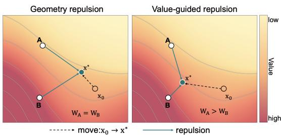
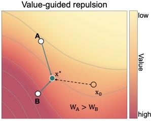
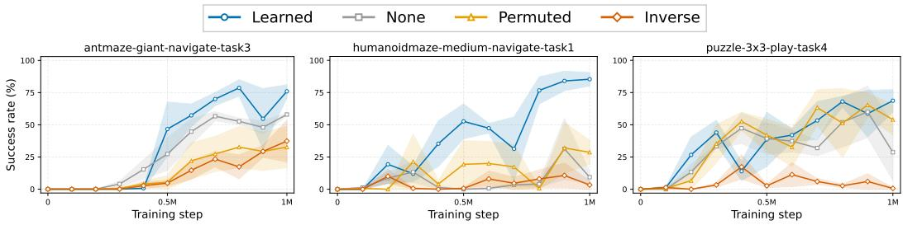
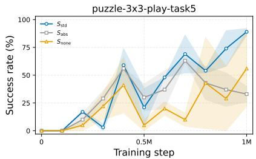
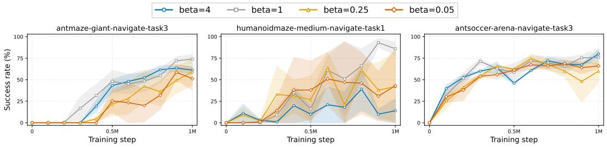
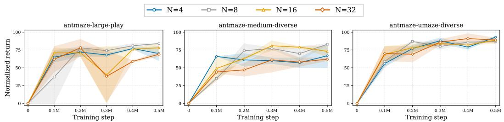
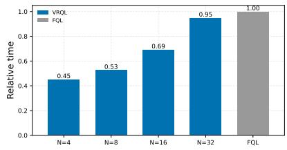

# VALUE-GUIDED REPULSION FOR OFFLINE REINFORCEMENT LEARNING

Yixue Hao, Jiahao Zhang, Jiesong Lian, Xufei Guo, Xumeng Guo, Wenhui Zhang, Long Hu, Rui Wang

School of Computer Science and Technology, Huazhong University of Science and Technology {yixuehao, ruiwang2020}@hust.edu.cn

## ABSTRACT

Drifting models have emerged as a highly efficient and stable paradigm for policy design in offline reinforcement learning (RL). However, standard drift policies determine repulsion solely from geometric relationships among generated actions and therefore cannot distinguish them by expected value. To address this limitation, we introduce Value-Guided Repulsion Q-Learning (VRQL) to integrate action value estimates into the particle interaction field. For each state, VRQL combines geometric kernel distance with a normalized Q value scaling. This mechanism assigns greater repulsive influence to particles with lower values while strictly retaining attraction toward behavior action. Consequently, this valueguided interaction field aligns behavior regularization with policy improvement without adding an auxiliary behavior model stage. On 50 OGBench task configurations and 6 D4RL AntMaze configurations, VRQL demonstrates highly competitive performance against established baselines, suggesting that value-guided particle interaction is an effective method for offline RL.

## 1 INTRODUCTION

Offline reinforcement learning (RL) aims to learn effective policies from static datasets (Levine et al., 2020). As modern datasets scale and aggregate heterogeneous sources of varying quality, they exhibit complex and multimodal behavioral distributions. This complexity requires expressive policies to accurately model the data support and enforce behavioral constraints (Fujimoto & Gu, 2021; Kostrikov et al., 2022; Wang et al., 2023).

Generative models, such as diffusion and flow matching approaches, provide the expressiveness required to capture complex, multimodal action distributions (Ho et al., 2020; Lipman et al., 2023; Liu et al., 2023; Albergo & Vanden-Eijnden, 2023; Tong et al., 2024) in offline RL. However, the iterative sampling process incurs high inference costs, and directly training flow or diffusion policies proves dif-

  
Figure 1: (Left) Standard drift policies rely on geometric distance, assigning identical repulsive weights $( W _ { A } ~ = ~ W _ { B } )$ to equidistant neighbors particle A and B. (Right) VRQL incorporates critic estimates into the interaction field. The lower valued neighbor A exerts a stronger repulsive force $( W _ { A } \ > \ W _ { B } )$ , pushing the generated particle $x _ { 0 }$ toward the higher value region at $x ^ { * }$ Background indicate the Q value landscape.

ficult due to unstable backpropagation through time (Wang et al., 2023; Park et al., 2025b). A common strategy adopts a two stage pipeline: first fitting a generative behavior model, and then using its samples to extract a separate actor (Chen et al., 2023; Hansen-Estruch et al., 2023; Park et al., 2025b). Furthermore, because offline datasets contain suboptimal trajectories, these decoupled methods weight the training data using estimated Q values to bias the actor toward high return actions (Peng et al., 2020; Ding et al., 2024; NGUIMATSIA TIOFACK et al., 2026). While effective at injecting value guidance, these two stage pipelines are inherently indirect and risk introducing compounding approximation errors.

By directly constructing the policy without relying on iterative sampling or auxiliary models, drifting models provide a promising alternative that sidesteps both inference inefficiencies and two stage approximation errors (Deng et al., 2026; Houssaini et al., 2026). These models train a conditional generator using an interaction field defined by attraction toward dataset actions and repulsion among generated particles to maintain diversity. However, while drifting models address the structural bottlenecks of two stage pipelines, they currently lack a mechanism for value-aware target shaping. Standard drift policies compute repulsive influence relying solely on geometric relationships. Consequently, particles at similar distances exert identical repulsive forces, even if their corresponding critic estimates differ significantly (Figure 1, left). Thus, a fundamental limitation of existing drift policies is their inability to incorporate estimated action values into the policy constraint, thereby hindering policy improvement.

To address this limitation, we propose VRQL, which integrates action values into the generated action interaction field. For each state, VRQL modulates the repulsion logits by combining kernel distance with a normalized value bias. Under this design, particles with lower values exert stronger repulsive influence, whereas those with higher values exert less forces (Figure 1, right), while the original attraction toward behavior action remains strictly preserved. To ensure stable optimization, we adaptively calibrate this value signal using a shared scale derived from the typical within state value variation. Thus, VRQL maintains a direct value maximization objective while injecting value awareness into the particle interaction. This integration dynamically reshapes the behavioral constraint within the generative process, avoiding the need for an auxiliary behavior model.

In summary, our primary contributions are:

• Value-Guided Repulsion: We propose a value-guided repulsion mechanism. By leveraging estimated action values and geometric proximity, VRQL modulates the influence of generated neighbors particles within the drifting policy.

• Adaptive Value Calibration: We introduce adaptive value calibration to control the strength of value guidance using the typical within state variation of particle values.

• Extensive Empirical Validation: We evaluate VRQL across 50 OGBench tasks and 6 D4RL AntMaze environments (Fu et al., 2021; Park et al., 2025a), demonstrating that our method yields highly competitive performance in the offline RL setting.

## 2 PRELIMINARIES

## 2.1 POLICY CONSTRAINED OFFLINE REINFORCEMENT LEARNING

We consider a discounted Markov decision process $( S , { \mathcal { A } } , P , r , \gamma )$ (Sutton et al., 1998), where $s$ and $\mathcal { A } \subseteq \mathbb { R } ^ { d }$ are the state and action spaces, $P$ is the transition kernel, $r$ is the reward function, and $\gamma \in [ 0 , 1 )$ is the discount factor. We assume $\mathcal { A }$ is a bounded action box and denote coordinatewise projection onto it by $\Pi _ { \mathcal { A } }$ . Given an initial state distribution, a policy π seeks to maximize $J ( \pi ) = \dot { \mathbb { E } } _ { \pi } [ \sum _ { t = 0 } ^ { \infty } \gamma ^ { t } r ( s _ { t } , a _ { t } ) ]$ . Its action value function $Q ^ { \pi } ( s , a )$ is the expected discounted return conditioned on starting with $( s _ { 0 } , a _ { 0 } ) = ( s , a )$ and subsequently following $\pi .$

Offline learning uses only a fixed dataset $\mathcal { D } = \{ ( s , a , r , s ^ { \prime } , m ) \}$ collected by a behavior policy $\mu ,$ where m is a continuation mask (Levine et al., 2020). A policy constrained offline objective combines value improvement with a soft behavioral regularizer:

$$
\operatorname* { m a x } _ { \pi } \quad \mathbb { E } _ { s \sim \mathcal { D } , a \sim \pi ( \cdot \vert s ) } \left[ Q ^ { \pi } ( s , a ) \right] - \lambda \mathcal { R } _ { \mathcal { D } } ( \pi , \mu ) , \qquad \lambda > 0 .\tag{1}
$$

Here $\mathcal { R } _ { \mathcal { D } }$ denotes a behavioral regularizer supported by the dataset; it need not be a hard equality or a fixed divergence to $\mu .$ . This soft formulation permits controlled movement within the learned action distribution while discouraging unsupported actions whose critic estimates may be unreliable (Fujimoto et al., 2019; Kumar et al., 2020).

In practice, the value term is estimated with an ensemble of H critics, with $[ H ] = \{ 1 , \dots , H \}$ online parameters $\{ \phi _ { h } \} _ { h \in [ H ] }$ , and target parameters $\{ \bar { \phi } _ { h } \} _ { h \in [ H ] }$ . For a next-state action sampled from the current actor, $x _ { \theta } ( s ^ { \prime } , z ^ { \prime } )$ , we define the target as

$$
y = r + \gamma m \operatorname* { m i n } _ { h \in [ H ] } Q _ { \bar { \phi } _ { h } } ( s ^ { \prime } , x _ { \theta } ( s ^ { \prime } , z ^ { \prime } ) ) .\tag{2}
$$

The corresponding Bellman regression is

$$
\mathcal { L } _ { \mathrm { c r i t i c } } = \frac { 1 } { H } \sum _ { h \in [ H ] } \mathbb { E } _ { ( s , a , r , s ^ { \prime } , m ) \sim \mathcal { D } , z ^ { \prime } } \left[ ( Q _ { \phi _ { h } } ( s , a ) - y ) ^ { 2 } \right] .\tag{3}
$$

For actor updates, let $\mathcal { Q } _ { \phi } ( s , a ) = \mathrm { A g g } _ { h \in \left[ H \right] } Q _ { \phi _ { h } } ( s , a )$ denote the chosen ensemble aggregation. The target critics are updated by Polyak averaging. VRQL leaves these standard value estimation components unchanged and modifies the behavioral regularizer $\mathcal { R } _ { \mathcal { D } }$

## 2.2 DRIFTING MODELS

Drifting models train a direct conditional generator $x _ { \theta } ( s , z ) = \Pi _ { \cal A } ( f _ { \theta } ( s , z ) )$ ), where $z \sim \mathcal { N } ( 0 , I )$ by regressing its outputs toward stopped targets constructed from attractive and repulsive sample interactions (Deng et al., 2026). The noise induces the stochastic policy $\pi _ { \theta } ( \cdot \mid s )$ , although the generator is deterministic for fixed $( s , z )$ . Given generated particles $x _ { i }$ and a set of positive samples ${ \mathcal { P } } ( s )$ , a positive kernel $k _ { \tau }$ with bandwidth parameter τ produces normalized attraction and repulsion weights. A common choice is a Laplace or Gaussian kernel scaled by the action dimension d,

$$
k _ { \tau } ^ { \mathrm { L } } ( x , y ) = \exp \left( - \frac { \| x - y \| _ { 2 } } { \tau \sqrt { d } } \right) , \qquad k _ { \tau } ^ { \mathrm { G } } ( x , y ) = \exp \left( - \frac { \| x - y \| _ { 2 } ^ { 2 } } { 2 \tau ^ { 2 } d } \right) .\tag{4}
$$

With $w _ { i u } ^ { + } \propto k _ { \tau } ( x _ { i } , u )$ normalized over $u \in \mathcal { P } ( s )$ and $w _ { i j } ^ { - } \propto k _ { \tau } ( x _ { i } , x _ { j } )$ normalized over $j \neq i ,$ the total drift vector $V _ { i }$ aggregates the attraction vector $A _ { i }$ pulling toward the behavior data, and the repulsion vector $R _ { i }$ pushing away from neighboring particles:

$$
A _ { i } = \sum _ { u \in \mathcal { P } ( s ) } w _ { i u } ^ { + } ( u - x _ { i } ) , \qquad R _ { i } = \sum _ { j \ne i } w _ { i j } ^ { - } ( x _ { j } - x _ { i } ) , \qquad V _ { i } = A _ { i } - R _ { i } .\tag{5}
$$

The generator is trained toward a projected, stopped target $t _ { i } { \mathrm { : } }$

$$
t _ { i } = \mathrm { s g } [ \Pi _ { A } ( x _ { i } + \eta V _ { i } ) ] , \qquad \mathcal { L } _ { \mathrm { d r i f t } } ( \theta ) = \mathbb { E } \left[ \frac { 1 } { d } \| x _ { i } - t _ { i } \| _ { 2 } ^ { 2 } \right] ,\tag{6}
$$

where $\eta > 0$ is a drift step size. The targets are recomputed as training proceeds and held fixed when differentiating the regression loss. Standard drifting models use geometry alone in $w _ { i j } ^ { - }$ ; VRQL changes this negative side weighting while retaining the attraction construction.

## 3 METHODS

Our method VRQL builds on drifting policies: it retains the actor network and behavior action anchor while redefining how generated particles repel each other. Algorithm 1 summarizes the complete training procedure. Specifically, for a given state, the actor generates a particle set, and the critic evaluates these particles. Then, a value signal combines with pairwise geometric distances to determine the repulsion weights. The resulting interaction field forms the drift target for actor optimization. Thus, VRQL reshapes the behavioral target through value-guided interactions while preserving the value maximization objective (Houssaini et al., 2026).

In this section, we consider a drift minibatch containing $B _ { d }$ transitions and use $b \in \{ 1 , \cdots , B _ { d } \}$ to index the transitions .

## 3.1 BEHAVIOR ACTION ANCHOR AND PARTICLE GENERATION

For each state $s _ { b } ,$ we sample N independent noise vectors $z _ { b } ^ { i }$ and generate the particle set $\{ x _ { b } ^ { i } \}$

$$
x _ { b } ^ { i } = x _ { \theta } ( s _ { b } , z _ { b } ^ { i } ) , \qquad i \in \{ 1 , \cdots , N \} .\tag{7}
$$

The dataset behavior action provides a positive anchor $a _ { b } ^ { + } = \Pi _ { A } ( a _ { b } )$ . The positive set in Eq. 5 reduces to the singleton $\mathcal { P } ( s _ { b } ) = \{ a _ { b } ^ { + } \}$ , yielding the normalized attraction field $A _ { b } ^ { i }$

$$
\begin{array} { r } { A _ { b } ^ { i } = a _ { b } ^ { + } - x _ { b } ^ { i } . } \end{array}\tag{8}
$$

At inference, the actor outputs actions directly. Value guidance acts only on generated neighbor interactions during training, leaving the attraction mechanism and inference architecture unchanged.

## 3.2 ADAPTIVE VALUE CALIBRATION

We define the value used to weight particle j as:

$$
q _ { b } ^ { j } = \mathrm { s g } \Bigl [ \mathrm { A g g } _ { h \in [ H ] } Q _ { \bar { \phi } _ { h } } ( s _ { b } , x _ { b } ^ { j } ) \Bigr ] .\tag{9}
$$

VRQL uses the target critic ensemble with minimum aggregation to compute this signal. The critic aggregation rules are configurable, as specified in Appendix A.

Because raw Q value magnitudes vary significantly across states and environments, using uncalibrated values makes the relative strength of value guidance sensitive. To ensure stable optimization, we center the Q values within each state using the mean $\begin{array} { r } { \bar { q } _ { b } = \frac { 1 } { N } \sum _ { j = 1 } ^ { N } q _ { b } ^ { j } } \end{array}$ and apply a shared scale for the centered differences across the minibatch. The default scale, $S _ { \mathrm { n o r m } } = S _ { \mathrm { s t d } }$ , is the average within state standard deviation:

$$
S _ { \mathrm { s t d } } = \frac { 1 } { B _ { d } } \sum _ { b = 1 } ^ { B _ { d } } \sqrt { \frac { 1 } { N } \sum _ { j = 1 } ^ { N } ( q _ { b } ^ { j } - \hat { q } _ { b } ) ^ { 2 } } + \epsilon ,\tag{10}
$$

where ϵ is a constant added for numerical stability. Centering subtracts the same value from all particle logits within each state and therefore leaves the softmax weights unchanged. We use it to remove common value offsets before computing the logits. The shared scale $S _ { \mathrm { s t d } }$ calibrates the strength of value guidance relative to typical within state value variation. Recomputing this scale at each training step adapts the calibration as the critic evolves. A shared scale also preserves differences in value dispersion across states, whereas normalizing each state separately can amplify small value differences in states with low variance. Section 4.3 evaluates alternative scaling schemes.

## 3.3 VALUE-GUIDED REPULSION

We measure geometric proximity using the Laplace kernel in Eq. 4 by default, denoted as $k _ { \tau }$ throughout. This geometric term is combined with the calibrated value signal to define the repulsion logit for each distinct pair $j \neq i \colon$

$$
\ell _ { b } ^ { i , j } = \underbrace { - \frac { \| x _ { b } ^ { i } - x _ { b } ^ { j } \| _ { 2 } } { \tau \sqrt { d } } } _ { \mathrm { g e o m e t r y } } - \underbrace { \frac { q _ { b } ^ { j } - \bar { q } _ { b } } { \beta S _ { \mathrm { n o r m } } } } _ { \mathrm { v a l u e } } , \qquad w _ { b } ^ { i , j } = \frac { \exp ( \ell _ { b } ^ { i , j } ) } { \sum _ { j ^ { \prime } \ne i } \exp ( \ell _ { b } ^ { i , j ^ { \prime } } ) } , \quad w _ { b } ^ { i , i } = 0 ,\tag{11}
$$

where $\beta > 0$ is the guidance temperature. With this scaling, β controls the strength of value guidance relative to typical within state value variation. By substituting the standard geometric weights $w _ { i j } ^ { - }$ in Eq. 5 with these value-guided weights $w _ { b } ^ { i , j }$ , we define the value-guided repulsive component $R _ { b } ^ { i }$ and the combined drift vector $V _ { b } ^ { i }$ as:

$$
R _ { b } ^ { i } = \sum _ { j \neq i } w _ { b } ^ { i , j } ( x _ { b } ^ { j } - x _ { b } ^ { i } ) , \quad \quad V _ { b } ^ { i } = A _ { b } ^ { i } - R _ { b } ^ { i } .\tag{12}
$$

The diagonal mask prevents self interaction. Since the normalized weights sum to one, the combined drift simplifies to $\begin{array} { r } { V _ { b } ^ { i } = a _ { b } ^ { + } - \sum _ { j \neq i } w _ { b } ^ { i , j } x _ { b } ^ { j } } \end{array}$ . Value guidance shifts the neighbor barycenter that determines the update direction. Although the repulsion weights sum to one, value-guided reweighting can change both the direction and magnitude of the resulting drift. Specifically, consider two eligible neighbors $( j , k \neq i )$ , their relative repulsive influence on particle i is:

$$
\frac { w _ { b } ^ { i , j } } { w _ { b } ^ { i , k } } = \frac { k _ { \tau } ( x _ { b } ^ { i } , x _ { b } ^ { j } ) } { k _ { \tau } ( x _ { b } ^ { i } , x _ { b } ^ { k } ) } \exp \left( - \frac { q _ { b } ^ { j } - q _ { b } ^ { k } } { \beta S _ { \mathrm { n o r m } } } \right) .\tag{13}
$$

This formulation combines geometric proximity with value differences. At equal distances, the lower valued neighbor receives greater repulsive weight. At unequal distances, spatial proximity and critic evaluations determine the influence. When particle values are identical or as $\beta  \infty ,$ the method recovers geometric repulsion.

Algorithm 1 Value-Guided Repulsion Q-Learning (VRQL)   
Input: Dataset $\mathcal { D } ;$ policy xθ; critic ensemble $\{ Q _ { \phi _ { h } } \} _ { h \in [ H ] } ;$ Laplace kernel temperature τ; guidance   
temperature $\beta ;$ particle count $N \geq 3$   
1: for each training step do   
2: Sample a minibatch from $\mathcal { D }$ and update the critics $\{ \phi _ { h } \} _ { h \in [ H ] }$   
3: Generate particles $x _ { b } ^ { i } \gets x _ { \theta } ( s _ { b } , z _ { b } ^ { i } ) , \ z _ { b } ^ { i } \sim \mathcal { N } ( 0 , I ) , \ i \in \{ \ r _ { 1 } , \tilde { \cdot } \cdot \ , N \}$   
4: Compute $q _ { b } ^ { j } , { \bar { q } } _ { b } .$ , and $S _ { \mathrm { n o r m } }$ as in Section 3.2   
5: $\ell _ { b } ^ { i , j } \gets - \| \dot { x } _ { b } ^ { i } - x _ { b } ^ { j } \| _ { 2 } / ( \tau \sqrt { d } ) - ( q _ { b } ^ { j } - \bar { q } _ { b } ) / ( \beta S _ { \mathrm { n o r m } } ) , ~ j \neq i$ ▷ value guidance   
6: $w _ { b } ^ { i , j } \gets$ softmax ${ \bf \Phi } _ { j \neq i } ( \ell _ { b } ^ { i , j } ) , \ w _ { b } ^ { i , i } \gets 0$   
7: $\begin{array} { r } { V _ { b } ^ { i }  ( a _ { b } ^ { + } - x _ { b } ^ { i } ) - \sum _ { j \neq i } w _ { b } ^ { i , j } ( x _ { b } ^ { j } - x _ { b } ^ { i } ) } \end{array}$ ▷ attraction − repulsion   
8: $t _ { b } ^ { i } \gets \mathrm { s g } \big [ \Pi _ { A } ( x _ { b } ^ { i } + \eta V _ { b } ^ { i } ) \big ]$   
9: $\mathcal { L } _ { \mathrm { d r i f t } }  \mathbb { E } _ { b , i } [ \frac { 1 } { d } \| x _ { b } ^ { i } - t _ { b } ^ { i } \| _ { 2 } ^ { 2 } ]$   
10: Update θ by minimizing α $\because \mathcal { L } _ { \mathrm { d r i f t } } - \mathbb { E } [ \mathcal { Q } _ { \phi } ( s , x _ { \theta } ( s , z ) ) ]$   
11: Update the target critics $\{ \bar { \phi } _ { h } \} _ { h \in [ H ] }$ by Polyak averaging   
12: end for   
Output: One step policy $\pi _ { \theta }$ with action $a = x _ { \theta } ( s , z )$

Actor optimization objective. The projected drift target $t _ { b } ^ { i } = \Pi _ { A } ( x _ { b } ^ { i } + \eta V _ { b } ^ { i } )$ is stopped as in Eq. 6. The actor loss is:

$$
\mathcal { L } _ { \mathrm { a c t o r } } ( \theta ) = \alpha \mathcal { L } _ { \mathrm { d r i f t } } ( \theta ) - \mathbb { E } _ { s \sim \mathcal { D } , z \sim \mathcal { N } ( 0 , I ) } \left[ \mathcal { Q } _ { \phi } ( s , x _ { \theta } ( s , z ) ) \right] ,\tag{14}
$$

where $\alpha > 0$ balances behavioral regularization and value improvement. The Q maximization term computes gradients through the online critic ensemble, whereas the values in Eq. 9 are detached before entering the repulsion weights. This stop gradient operation is necessary to prevent gradient paths from flowing through the drift interaction field or its value bias. The direct value objective improves actions through critic gradients, whereas value-guided repulsion uses relative critic estimates to reshape the stopped behavioral target. The two terms therefore incorporate value information through different update mechanisms.

Computational overhead. Value guidance adds one additional batch of critic evaluations for the $B _ { d } N$ generated actions to the $\mathcal { O } ( B _ { d } \bar { N } ^ { 2 } d )$ pairwise interactions.

## 4 EXPERIMENTS

In this section, we evaluate the policy performance against published baselines and investigate how repulsion assignment, normalization, guidance temperature, and particle count affect VRQL.

## 4.1 EXPERIMENTAL SETUP

Benchmarks. We evaluate VRQL on OGBench and D4RL AntMaze (Fu et al., 2021; Park et al., 2025a). OGBench offers 50 single task configurations across 10 categories, each comprising 5 tasks. These environments cover diverse domains spanning locomotion and navigation (humanoidmaze-medium/large-navigate, antmaze-large/giant-navigate, antsoccer-arena-navigate), high dimensional object manipulation (cube-single-play, cube-double-play, and scene-play), and long horizon puzzle solving (puzzle-3x3-play and puzzle-4x4-play). D4RL AntMaze adds 6 configurations covering three maze sizes (umaze, medium, large) and two offline dataset variants (play, diverse), explicitly testing the ability to stitch suboptimal trajectories. Detailed hyperparameter configurations are provided in Appendix A.2.

Baselines. We compare VRQL against five classes of offline algorithms: (i) behavior cloning and Gaussian policies, including BC, IQL (Kostrikov et al., 2022), and ReBRAC (Tarasov et al., 2023); (ii) diffusion and consistency models, represented by IDQL (Hansen-Estruch et al., 2023), SRPO, and CAC; (iii) standard flow policies, comprising FQL (Park et al., 2025b), FAWAC, FBRAC, and IFQL; (iv) value-guided policies, such as Q-Flow (Doo et al., 2026) and GFP (NGUIMATSIA TIO-FACK et al., 2026), to benchmark alternative value integration strategies; and (v) the direct drift

Table 1: Offline reinforcement learning results. VRQL achieves the best or tied for best performance across the OGBench categories and the D4RL AntMaze benchmark. The reported ± values aggregate the seed standard deviations across individual tasks. This table presents one representative method from each policy class, while Appendix C provides complete results for all fourteen methods. Boldface indicates the best score in each row.
<table><tr><td></td><td>Gaussian Diffusion</td><td></td><td>Flow</td><td> $\mathrm { \Delta V a l u e { \mathrm { - } } G u i d e }$ </td><td colspan="2">Drift</td></tr><tr><td>Task category</td><td>IQL</td><td>IDQL</td><td>FQL</td><td>Q-Flow</td><td></td><td>DriftQL VRQL</td></tr><tr><td>OGBench</td><td></td><td></td><td></td><td></td><td></td><td></td></tr><tr><td>antmaze-large (5 tasks)</td><td> $5 3 \pm 3$ </td><td> $2 1 \pm 5$ </td><td> $7 9 \pm 3$ </td><td> $8 8 \pm 5$ </td><td> $9 2 \pm 4$ </td><td> ${ \bf 9 7 \pm 1 }$ </td></tr><tr><td>antmaze-giant (5 tasks) humanoidmaze-medium (5 tasks)</td><td> $4 \pm 1$   $3 3 \pm 2$ </td><td> $0 \pm 0$   $1 \pm 0$ </td><td> $9 \pm 6$   $5 8 \pm 5$ </td><td> $4 0 \pm 6$ </td><td> $6 0 \pm 2$ </td><td> $7 4 \pm 4$ </td></tr><tr><td>humanoidmaze-large (5 tasks)</td><td> $2 \pm 1$ </td><td> $1 \pm 0$ </td><td> $4 \pm 2$ </td><td> $8 3 \pm 4$   ${ \bf 8 \pm 2 }$ </td><td> $6 2 \pm 2$   $5 \pm 8$ </td><td> ${ \bf 8 8 \pm 8 }$   ${ \bf 8 \pm 1 }$ </td></tr><tr><td>antsoccer-arena (5 tasks)</td><td> $\hphantom { 0 } 8 \pm 2$ </td><td> $1 2 \pm 4$ </td><td> $6 0 \pm 2$ </td><td> $5 5 \pm 5$ </td><td> $6 5 \pm 2$ </td><td> $7 1 \pm 2$ </td></tr><tr><td>cube-single (5 tasks)</td><td> $8 3 \pm 3$ </td><td> $9 5 \pm 2$ </td><td> $9 6 \pm 1$ </td><td> $9 5 \pm 2$ </td><td> $9 4 \pm 3$ </td><td> ${ \bf 9 9 \pm 1 }$ </td></tr><tr><td>cube-double (5 tasks)</td><td> $6 \pm 1$ </td><td> $1 5 \pm 6$ </td><td> $2 9 \pm 2$ </td><td> $3 6 \pm 5$ </td><td> $2 5 \pm 2$ </td><td></td></tr><tr><td>scene (5 tasks)</td><td> $2 8 \pm 1$ </td><td> $4 6 \pm 3$ </td><td> $5 6 \pm 2$ </td><td> $6 0 \pm 2$ </td><td> $7 4 \pm 4$ </td><td> ${ \bar { \bf 5 8 } } \pm 3$ </td></tr><tr><td>puzzle-3x3 (5 tasks)</td><td> $9 \pm 1$ </td><td> $1 0 \pm 2$ </td><td> $3 0 \pm 1$ </td><td> $4 9 \pm 5$ </td><td> $3 5 \pm 3$ </td><td> $7 5 \pm 1$ </td></tr><tr><td>puzzle-4x4 (5 tasks)</td><td> $7 \pm 1$ </td><td> $2 9 \pm 3$ </td><td> $1 7 \pm 2$ </td><td> $3 0 \pm 3$ </td><td> $2 7 \pm 3$ </td><td> ${ \pm } 2$ </td></tr><tr><td></td><td></td><td></td><td></td><td></td><td></td><td> ${ \bf 3 2 \pm 2 }$ </td></tr><tr><td> $D 4 R L$ </td><td></td><td></td><td></td><td></td><td></td><td></td></tr><tr><td>antmaze (6 tasks)</td><td>57</td><td>79</td><td> $8 4 \pm 3$ </td><td> $5 9 \pm 1$ </td><td> $8 4 \pm 3$ </td><td> ${ \bf 9 0 \pm 3 }$ </td></tr></table>

predecessor, DriftQL (Houssaini et al., 2026), which relies strictly on geometric repulsion to isolate the empirical contribution of our value-guided mechanism.  
Owing to space constraints, Table 1 reports only one representative method from each baseline class: IQL, IDQL, FQL, Q-Flow, and DriftQL. Appendix C presents the per task scores for these together with fourteen methods (i.e., BC, ReBRAC, SRPO, CAC, FAWAC, FBRAC, IFQL and GFP). Baseline scores follow the corresponding papers (Houssaini et al., 2026; Doo et al., 2026; NGUIMATSIA TIOFACK et al., 2026).

Evaluation. For all VRQL evaluations, we train with five independent random seeds per task and run 50 evaluation episodes per checkpoint. OGBench scores correspond to average success rates computed at 800k, 900k, and 1M training steps within each seed; D4RL AntMaze scores use normalized returns measured at 500k training steps. We report per task means and standard deviations across the five seed level scores. Table 1 equally weights all tasks per OGBench category and D4RL AntMaze configuration. Category standard deviations aggregate task-level seed variances. For D4RL IQL and IDQL, only means are reported, as original papers do not standard deviations.

## 4.2 MAIN RESULTS

Table 1 evaluates VRQL on OGBench and D4RL, demonstrating its empirical advantages across three distinct aspects. First, compared with purely geometric predecessor DriftQL, VRQL yields substantial gains, raising success rates from 60 to 74 on antmaze-giant and from 25 to 58 on cubedouble. Moreover, VRQL achieves higher mean scores than IQL, IDQL and FQL across all evaluated task categories. These results indicate that value guidance improving performance in these environments. Then, VRQL outperforms the alternative value-guided method Q-Flow on most task categories. These comparisons suggest that modulating the particle interaction field is a promising strategy for incorporating value guidance into policy optimization. Finally, on the established D4RL AntMaze benchmark, VRQL reaches a mean score of 90, exceeding all evaluated policy classes, which verifies its efficacy across classical offline continuous control domains.

## 4.3 ABLATION STUDIES

We evaluate four ablation studies, i.e., repulsion weight assignment, value normalization, guidance temperature, and particle count. To validate that VRQL generalizes across diverse environments, we distribute these evaluations across various tasks from both OGBench and D4RL, following the evaluation protocol of Section 4.1. The first three use OGBench tasks, the repulsion weight assignment and guidance temperature studies each cover three tasks. While the particle count study adopts three D4RL AntMaze configurations and additionally reports relative training time. All configuration is trained with five independent seeds, and all figures show seed means with shading denoting one standard deviation. Each ablation study varies a single quantity and inherits all remaining hyperparameters from the corresponding task configuration.

  
Figure 2: Effect of repulsion weight assignment. The learned assignment used by VRQL is compared with geometric repulsion (none), shuffled value biases (permuted), and reversed value biases (inverse). Curves show mean success rates, and shaded regions denote one standard deviation.

Repulsion weight assignment. Figure 2 evaluates the learned assignment used by VRQL on three single tasks (antmaze-giant-navigate, humanoidmaze-medium-navigate, puzzle-3x3-play). We compare this mechanism against three control variants: none (pure geometric repulsion), permuted (shuffled value biases among particles within each state before the softmax operation), and inverse (reversed value biases).

This ablation investigates whether the correspondence between estimated action quality and repulsive influence drives policy performance. The Figure 2 shows that the learned guidance achieves the highest success rates and fastest convergence across all three tasks. Moreover, disrupting the correct value relationship actively degrades learning, and the inverse assignment cause severe performance collapse, plunging success rates near zero in humanoid navigation and puzzle solving. Meanwhile, the permuted assignment performs worse than the none baseline, demonstrating that random value noise actively disrupts the beneficial geometric structure. These outcomes confirm that the precise alignment of high repulsion with low value actions is essential.

Value normalization. Figure 3 compares three scaling strategies for $S _ { \mathrm { n o r m } } { \mathrm { : } }$ the default within state standard deviation $S _ { \mathrm { s t d } }$ defined in Eq. 10, the absolute mean $S _ { \mathrm { a b s } }$ define in Eq. 15, and the unnormalized baseline $S _ { \mathrm { n o n e } } \left( \mathrm { i . e . , } S _ { \mathrm { n o n e } } \right) = 1 )$

$$
S _ { \mathrm { a b s } } = \frac { 1 } { B _ { d } N } \sum _ { b = 1 } ^ { B _ { d } } \sum _ { j = 1 } ^ { N } | q _ { b } ^ { j } | + \epsilon .\tag{15}
$$

The results show that calibration by relative value variation using $S _ { \mathrm { s t d } }$ yields the highest and most stable success rate. Without normalization $S _ { \mathrm { n o n e } } ,$ , training exhibits severe instability and variance, demonstrating

Figure 3: Value normalization ablation. Success rates under different normalization strategies.

that raw value scales disrupt the guidance signal. While absolute value scaling $S _ { \mathrm { a b s } }$ initially matches $S _ { \mathrm { s t d } } .$ , it suffers from performance degradation later in training state. Thus, calibrating the value term with the within state value spread provides a more reliable guidance scale.

Guidance temperature. Figure 4 evaluates VRQL sensitivity to the guidance temperature $\beta \in$ {0.05, 0.25, 1, 4} on three single tasks (antmaze-giant-navigate, humanoidmaze-medium-navigate, antsoccer-arena-navigate). Results indicate that low temperatures $( \beta = 0 . 0 5 )$ disrupt geometric diversity and degrade success rates in antmaze-giant. Conversely, high temperatures $( \beta = 4 )$ weaken the value signal and reduce performance in humanoid navigation. Thus, a moderate $\beta$ balances geometric diversity with value guidance.

  
Figure 4: Sensitivity to the guidance temperature β. Training curves for varying $\beta$ on three OGBench tasks. Curves show mean success rates, and shaded regions denote one standard deviation.

  
Figure 5: Sensitivity to the particle count N. Normalized return on three D4RL AntMaze tasks evaluating sensitivity to the generated particle count N. Curves show mean normalized returns, and shaded regions denote one standard deviation.

Generated action particles. Figure 5 evaluates VRQL sensitivity to the generated particle count N. While $N \geq 3$ is strictly necessary for value guidance to function when self-interactions are excluded, increasing N further expands the repulsive neighborhood at the cost of training computation. The learning curves demonstrate that VRQL sensitivity to the particle count varies by environment. Specifically, performance on antmaze-large-play and antmaze-medium-diverse exhibits noticeable sensitivity to N, whereas the antmaze-umaze-diverse task remains robust across all tested configurations $( N \in \{ 4 , 8 , 1 6 , 3 2 \} )$ ). Concurrently, the timing analysis in Figure 6 reveals that VRQL requires selecting the particle count based on specific task complexity to properly balance performance optimization and computational efficiency.

## 5 RELATED WORK

Offline reinforcement learning. Offline reinforcement learning improves a policy from a fixed dataset without environment interaction, which makes extrapolation error on out of distribution actions the central challenge: the critic assigns unreliable values to actions the data never covers, and unconstrained maximization exploits precisely those errors (Levine et al., 2020). One family of methods constrains the learned policy toward the behavior policy, either by restricting the action support through a generative model of the data or by adding an explicit divergence penalty to the

  
Figure 6: Relative training time. VRQL training time scales with particle count.

actor objective (Fujimoto et al., 2019; Fujimoto & Gu, 2021). A second family regularizes the value function, penalizing estimates at unobserved actions so that the induced policy stays conservative (Kumar et al., 2020). A third family avoids querying out of distribution actions altogether, fitting values with in sample targets and extracting a policy by weighted regression (Kostrikov et al., 2022; Tarasov et al., 2023), and recent analyses indicate that policy extraction is often the binding constraint on offline performance (Park et al., 2024). VRQL adopts the policy constrained formulation of Eq. 1 and contributes to the regularizer, leaving the value estimation components unchanged.

Generative policies for offline reinforcement learning. Diffusion and flow policies provide expressive conditional action distributions for behavioral modeling and policy extraction (Florence et al., 2022; Janner et al., 2022; Wang et al., 2023; Hansen-Estruch et al., 2023; Park et al., 2025b). A first line of work applies value improvement through an iterative sampler, which can require differentiating through multiple denoising or flow integration steps (Wang et al., 2023; Lu et al., 2023; Doo et al., 2026). A second line first fits an expressive behavior model and then uses its samples or predictions to regularize a separately trained policy (Chen et al., 2023; Hansen-Estruch et al., 2023; Park et al., 2025b). This two stage design separates the policy objective from the behavior model, but introduces an additional model and an approximation error between the two stages. VRQL instead modifies the interactions among actions generated by the policy regularizer itself, within a direct policy training objective. Sampling cost has also been reduced by distilled or few step policy classes (Kang et al., 2023; Ding & Jin, 2024), and entropy or ensemble regularization has been used to preserve action diversity (Zhang et al., 2024).

Value-aware behavioral regularization. Offline methods with value-aware behavioral regularization use estimated action quality to make behavioral fitting selective. Advantage weighted re gression and actor-critic policy extraction methods emphasize behavior action with higher estimated advantage, while implicit value based extraction combines in sample value learning with a simi larly selective fitting objective (Peters & Schaal, 2007; Peng et al., 2020; Nair et al., 2021; Kostrikov et al., 2022). Value-aware fitting has also been applied to expressive generative policies, where value or advantage estimates reweight flow matching or diffusion targets (Ajay et al., 2023; Ding et al., 2024; Zhang et al., 2025). Auxiliary behavior model methods can use the same signal when fitting a behavioral model and then transfer that model’s samples or targets to a separate actor (NGUIMAT-SIA TIOFACK et al., 2026). These approaches establish that behavioral regularization need not treat all examples equally, but they place the value weight on behavior action, training examples, or model targets. Value-aware fitting methods use critic estimates to prioritize behavioral examples or auxiliary model targets; VRQL uses critic estimates to assign interaction weights to the generated neighbors that define repulsion.

Drifting models and policies. Drifting models train a direct generator by regressing toward stopped targets constructed from attractive and repulsive sample interactions (Deng et al., 2026). A conditional offline policy construction specializes this principle to action generation by combining attraction toward a behavior action, repulsion among generated actions, and a direct actor value objective (Houssaini et al., 2026). VRQL retains this geometric foundation and introduces a negative value dependent bias into the normalized repulsive weights. Kernel similarity determines geometric influence, while relative critic values determine which generated neighbors exert more or less of that influence. The resulting contribution is a value-aware interaction rule inside the drifting regularizer.

## 6 CONCLUSION

We introduced VRQL, an offline algorithm that incorporates estimated action values directly into the repulsive interactions of a drifting policy. By combining geometric similarity with value dependent weights, VRQL modulates the influence of generated neighbors while preserving attraction toward behavioral data and maintaining a separate value maximization objective. Furthermore, batch level scaling effectively calibrates this guidance against typical within state value variations. Empirical evaluations across the OGBench and D4RL benchmarks demonstrate that VRQL establishes strong performance and outperforms representative baselines. Ablation studies suggest that these empirical gains are associated with pairing low action values with high geometric repulsion. Disrupting this learned assignment severely degrades policy optimization, whereas proper within state calibration and moderate guidance temperatures ensure stable learning.

However, a primary limitation of this approach stems from its inherent reliance on learned critic estimates. In environments where the critic produces incorrect value orderings, the guidance mechanism can inadvertently repel optimal actions and misguide the policy constraint. Future work will investigate integrating uncertainty estimation into the particle interaction field, allowing the algorithm to dynamically attenuate value guidance when critic reliability degrades. Additionally, future research will explore extending this value-aware mechanism to the behavioral attraction phase, allowing the policy to preferentially anchor to high return data points.

## REPRODUCIBILITY STATEMENT

To support reproducibility, the main paper describes the method and training objective, Appendix A provides the network architectures, hyperparameters, benchmark definitions, and compute resources, and the supplementary materials contain anonymized source code.

## AI USE STATEMENT

AI tools were used solely to improve the language and readability of this article. They were not used to generate the method, experimental results, scientific claims, or citations. All AI-assisted edits were reviewed by the authors, who take full responsibility for the final content of this work.

## REFERENCES

Anurag Ajay, Yilun Du, Abhi Gupta, Joshua B. Tenenbaum, Tommi S. Jaakkola, and Pulkit Agrawal. Is conditional generative modeling all you need for decision making? In The Eleventh International Conference on Learning Representations, 2023. URL https://openreview.net/ forum?id=sP1fo2K9DFG.

Michael Samuel Albergo and Eric Vanden-Eijnden. Building normalizing flows with stochastic interpolants. In The Eleventh International Conference on Learning Representations, 2023. URL https://openreview.net/forum?id=li7qeBbCR1t.

Huayu Chen, Cheng Lu, Chengyang Ying, Hang Su, and Jun Zhu. Offline reinforcement learning via high-fidelity generative behavior modeling. In The Eleventh International Conference on Learning Representations, 2023. URL https://openreview.net/forum?id= 42zs3qa2kpy.

Mingyang Deng, He Li, Tianhong Li, Yilun Du, and Kaiming He. Generative modeling via drifting, 2026. URL https://arxiv.org/abs/2602.04770.

Shutong Ding, Ke Hu, Zhenhao Zhang, Kan Ren, Weinan Zhang, Jingyi Yu, Jingya Wang, and Ye Shi. Diffusion-based reinforcement learning via q-weighted variational policy optimization. In A. Globerson, L. Mackey, D. Belgrave, A. Fan, U. Paquet, J. Tomczak, and C. Zhang (eds.), Advances in Neural Information Processing Systems, volume 37, pp. 53945–53968. Curran Associates, Inc., 2024. doi: 10.52202/ 079017-1708. URL https://proceedings.neurips.cc/paper\_files/paper/ 2024/file/6111371a868af8dcfba0f96ad9e25ae3-Paper-Conference.pdf.

Zihan Ding and Chi Jin. Consistency models as a rich and efficient policy class for reinforcement learning. In The Twelfth International Conference on Learning Representations, 2024. URL https://openreview.net/forum?id=v8jdwkUNXb.

JaeHyeok Doo, Byeongguk Jeon, Seonghyeon Ye, Kimin Lee, and Minjoon Seo. Q-flow: Stable and expressive reinforcement learning with flow-based policy. In Decision-Making from Offline Datasets to Online Adaptation: Black-Box Optimization to Reinforcement Learning, 2026. URL https://openreview.net/forum?id=payPql0Pk7.

Pete Florence, Corey Lynch, Andy Zeng, Oscar A Ramirez, Ayzaan Wahid, Laura Downs, Adrian Wong, Johnny Lee, Igor Mordatch, and Jonathan Tompson. Implicit behavioral cloning. In Conference on robot learning, pp. 158–168. PMLR, 2022.

Justin Fu, Aviral Kumar, Ofir Nachum, George Tucker, and Sergey Levine. D4{rl}: Datasets for deep data-driven reinforcement learning, 2021. URL https://openreview.net/forum? id=px0-N3\_KjA.

Scott Fujimoto and Shixiang (Shane) Gu. A minimalist approach to offline reinforcement learning. In M. Ranzato, A. Beygelzimer, Y. Dauphin, P.S. Liang, and J. Wortman Vaughan (eds.), Advances in Neural Information Processing Systems, volume 34, pp. 20132–20145. Curran Associates, Inc., 2021. URL https://proceedings.neurips.cc/paper\_files/ paper/2021/file/a8166da05c5a094f7dc03724b41886e5-Paper.pdf.

Scott Fujimoto, David Meger, and Doina Precup. Off-policy deep reinforcement learning without exploration. In Kamalika Chaudhuri and Ruslan Salakhutdinov (eds.), Proceedings of the 36th International Conference on Machine Learning, volume 97 of Proceedings ofMachine Learning Research, pp. 2052–2062. PMLR, 09–15 Jun 2019. URL https://proceedings.mlr. press/v97/fujimoto19a.html.

Philippe Hansen-Estruch, Ilya Kostrikov, Michael Janner, Jakub Grudzien Kuba, and Sergey Levine. Idql: Implicit q-learning as an actor-critic method with diffusion policies, 2023. URL https: //arxiv.org/abs/2304.10573.

Jonathan Ho, Ajay Jain, and Pieter Abbeel. Denoising diffusion probabilistic models. In H. Larochelle, M. Ranzato, R. Hadsell, M.F. Balcan, and H. Lin (eds.), Advances in Neural Information Processing Systems, volume 33, pp. 6840–6851. Curran Associates, Inc., 2020. URL https://proceedings.neurips.cc/paper\_files/paper/2020/ file/4c5bcfec8584af0d967f1ab10179ca4b-Paper.pdf.

Anas Houssaini, Mohamad H. Danesh, Amin Abyaneh, Scott Fujimoto, Hsiu-Chin Lin, and David Meger. Drift q-learning, 2026. URL https://arxiv.org/abs/2606.00350.

Michael Janner, Yilun Du, Joshua Tenenbaum, and Sergey Levine. Planning with diffusion for flexible behavior synthesis. In Kamalika Chaudhuri, Stefanie Jegelka, Le Song, Csaba Szepesvari, Gang Niu, and Sivan Sabato (eds.), Proceedings ofthe 39th International Conference on Machine Learning, volume 162 of Proceedings of Machine Learning Research, pp. 9902–9915. PMLR, 17–23 Jul 2022. URL https://proceedings.mlr.press/v162/janner22a.html.

Bingyi Kang, Xiao Ma, Chao Du, Tianyu Pang, and Shuicheng Yan. Efficient diffusion policies for offline reinforcement learning. In A. Oh, T. Naumann, A. Globerson, K. Saenko, M. Hardt, and S. Levine (eds.), Advances in Neural Information Processing Systems, volume 36, pp. 67195–67212. Curran Associates, Inc., 2023. doi: 10.52202/ 075280-2937. URL https://proceedings.neurips.cc/paper\_files/paper/ 2023/file/d45e0bfb5a39477d56b55c0824200008-Paper-Conference.pdf.

Ilya Kostrikov, Ashvin Nair, and Sergey Levine. Offline reinforcement learning with implicit qlearning. In International Conference on Learning Representations, 2022. URL https:// openreview.net/forum?id=68n2s9ZJWF8.

Aviral Kumar, Aurick Zhou, George Tucker, and Sergey Levine. Conservative q-learning for offline reinforcement learning. In H. Larochelle, M. Ranzato, R. Hadsell, M.F. Balcan, and H. Lin (eds.), Advances in Neural Information Processing Systems, volume 33, pp. 1179–1191. Curran Associates, Inc., 2020. URL https://proceedings.neurips.cc/paper\_files/ paper/2020/file/0d2b2061826a5df3221116a5085a6052-Paper.pdf.

Sergey Levine, Aviral Kumar, George Tucker, and Justin Fu. Offline reinforcement learning: Tutorial, review, and perspectives on open problems, 2020. URL https://arxiv.org/abs/ 2005.01643.

Yaron Lipman, Ricky T. Q. Chen, Heli Ben-Hamu, Maximilian Nickel, and Matthew Le. Flow matching for generative modeling. In The Eleventh International Conference on Learning Repre sentations, 2023. URL https://openreview.net/forum?id=PqvMRDCJT9t.

Xingchao Liu, Chengyue Gong, and qiang liu. Flow straight and fast: Learning to generate and transfer data with rectified flow. In The Eleventh International Conference on Learning Representations, 2023. URL https://openreview.net/forum?id=XVjTT1nw5z.

Cheng Lu, Huayu Chen, Jianfei Chen, Hang Su, Chongxuan Li, and Jun Zhu. Contrastive energy prediction for exact energy-guided diffusion sampling in offline reinforcement learning. In Andreas Krause, Emma Brunskill, Kyunghyun Cho, Barbara Engelhardt, Sivan Sabato, and Jonathan Scarlett (eds.), Proceedings of the 40th International Conference on Machine Learning, volume 202 of Proceedings of Machine Learning Research, pp. 22825–22855. PMLR, 23–29 Jul 2023. URL https://proceedings.mlr.press/v202/lu23d.html.

Ashvin Nair, Murtaza Dalal, Abhishek Gupta, and Sergey Levine. {AWAC}: Accelerating online reinforcement learning with offline datasets, 2021. URL https://openreview.net/ forum?id=OJiM1R3jAtZ.

Franki NGUIMATSIA TIOFACK, Theotime Le Hellard, Fabian Schramm, Nicolas Perrin-Gilbert,´ and Justin Carpentier. Guided flow policy: Learning from high-value actions in offline reinforcement learning. In C. Vondrick, B. Hariharan, C. Raffel, L. Pinto, D. Yang, and A. Faust (eds.), International Conference on Learning Representations, volume 2026, pp. 30601–30625, 2026. URL https://proceedings.iclr.cc/paper\_files/paper/2026/file/ 33f131b806a93d376cf0ce1a456464bb-Paper-Conference.pdf.

Seohong Park, Kevin Frans, Sergey Levine, and Aviral Kumar. Is value learning really the main bottleneck in offline rl? In A. Globerson, L. Mackey, D. Belgrave, A. Fan, U. Paquet, J. Tomczak, and C. Zhang (eds.), Advances in Neural Information Processing Systems, volume 37, pp. 79029–79056. Curran Associates, Inc., 2024. doi: 10.52202/ 079017-2509. URL https://proceedings.neurips.cc/paper\_files/paper/ 2024/file/8ffb4e3118280a66b192b6f06e0e2596-Paper-Conference.pdf.

Seohong Park, Kevin Frans, Benjamin Eysenbach, and Sergey Levine. OGBench: Benchmarking offline goal-conditioned RL. In The Thirteenth International Conference on Learning Representations, 2025a. URL https://openreview.net/forum?id=M992mjgKzI.

Seohong Park, Qiyang Li, and Sergey Levine. Flow q-learning. In Aarti Singh, Maryam Fazel, Daniel Hsu, Simon Lacoste-Julien, Felix Berkenkamp, Tegan Maharaj, Kiri Wagstaff, and Jerry Zhu (eds.), Proceedings ofthe 42nd International Conference on Machine Learning, volume 267 of Proceedings ofMachine Learning Research, pp. 48104–48127. PMLR, 13–19 Jul 2025b. URL https://proceedings.mlr.press/v267/park25f.html.

Xue Bin Peng, Aviral Kumar, Grace Zhang, and Sergey Levine. Advantage weighted regression: Simple and scalable off-policy reinforcement learning, 2020. URL https://openreview. net/forum?id=H1gdF34FvS.

Jan Peters and Stefan Schaal. Reinforcement learning by reward-weighted regression for operational space control. In Proceedings of the 24th International Conference on Machine Learning, ICML ’07, pp. 745–750, New York, NY, USA, 2007. Association for Computing Machinery. ISBN 9781595937933. doi: 10.1145/1273496.1273590. URL https://doi.org/10. 1145/1273496.1273590.

Richard S Sutton, Andrew G Barto, and Andrew Barto. Reinforcement learning: An introduction, volume 1. MIT press Cambridge, 1998.

Denis Tarasov, Vladislav Kurenkov, Alexander Nikulin, and Sergey Kolesnikov. Revisiting the minimalist approach to offline reinforcement learning. In A. Oh, T. Naumann, A. Globerson, K. Saenko, M. Hardt, and S. Levine (eds.), Advances in Neural Information Processing Systems, volume 36, pp. 11592–11620. Curran Associates, Inc., 2023. doi: 10.52202/ 075280-0511. URL https://proceedings.neurips.cc/paper\_files/paper/ 2023/file/26cce1e512793f2072fd27c391e04652-Paper-Conference.pdf.

Alexander Tong, Kilian FATRAS, Nikolay Malkin, Guillaume Huguet, Yanlei Zhang, Jarrid Rector-Brooks, Guy Wolf, and Yoshua Bengio. Improving and generalizing flow-based generative models with minibatch optimal transport. Transactions on Machine Learning Research, 2024. ISSN 2835-8856. URL https://openreview.net/forum?id=CD9Snc73AW. Expert Certification.

Zhendong Wang, Jonathan J Hunt, and Mingyuan Zhou. Diffusion policies as an expressive policy class for offline reinforcement learning. In The Eleventh International Conference on Learning Representations, 2023. URL https://openreview.net/forum?id=AHvFDPi-FA.

Ruoqi Zhang, Ziwei Luo, Jens Sjolund, Thomas B. Sch ¨ on, and Per Mattsson. Entropy-regularized¨ diffusion policy with q-ensembles for offline reinforcement learning. In A. Globerson, L. Mackey, D. Belgrave, A. Fan, U. Paquet, J. Tomczak, and C. Zhang (eds.), Advances in Neural Information Processing Systems, volume 37, pp. 98871–98897. Curran Associates, Inc., 2024. doi: 10.52202/

079017-3138. URL https://proceedings.neurips.cc/paper\_files/paper/ 2024/file/b319c0e8092ba726cb22e718d7d9a95e-Paper-Conference.pdf.

Shiyuan Zhang, Weitong Zhang, and Quanquan Gu. Energy-weighted flow matching for offline reinforcement learning. In The Thirteenth International Conference on Learning Representations, 2025. URL https://openreview.net/forum?id=HA0oLUvuGI.

## A IMPLEMENTATION DETAILS

This section describes the implementation of VRQL, including the network architectures, hyperparameter settings, and benchmark environments used in the experiments.

## A.1 NETWORK ARCHITECTURES

We parameterize the policy generator $f _ { \theta }$ and the critic ensemble $\{ Q _ { \phi _ { h } } \} _ { h = 1 } ^ { H }$ using multilayer perceptrons (MLPs). The actor and critics have separate parameters and are trained with Adam.

Actor network $( f _ { \theta } ) .$ . The actor consists of four hidden layers with 512 units each and GELU activations, without layer normalization. Its inputs are the state s and a Gaussian noise vector $z \sim$ $\mathcal { N } ( 0 , I )$ whose dimension equals the action dimension. The output is clipped coordinatewise to the action box $\mathcal { A } = [ - 1 , 1 ] ^ { d }$ , giving $x _ { \theta } ( s , z ) = \Pi _ { \cal A } ( f _ { \theta } ( s , z ) )$ ). Sampling z induces the policy $\pi _ { \theta } ( \cdot \mid s )$

Critic networks $( Q _ { \phi _ { h } } )$ . We use an ensemble of $H = 2$ critics. Each critic takes a state and an action as input and consists of four hidden layers with 512 units each, GELU activations, and layer normalization. The actor objective uses the mean of the online critic estimates, whereas Bellman targets use the minimum of the target critic estimates, as specified in Eqs. 14 and 2. By default, particle value guidance also uses the minimum of the target critic estimates. Target parameters are updated by Polyak averaging with coefficient $\rho .$

## A.2 HYPERPARAMETERS

The shared training settings for VRQL are summarized in Table 2, and the value guidance settings are listed in Table 3. All runs use the Laplace kernel defined in Eq. 4. We use τ for the kernel temperature and $\rho$ for the target network update coefficient.

Table 2: Shared hyperparameters. Symbols refer to the main text where one is defined.
<table><tr><td>Hyperparameter</td><td>Symbol</td><td>Value</td></tr><tr><td colspan="3">General training settings</td></tr><tr><td>Optimizer</td><td></td><td>Adam</td></tr><tr><td>Actor / critic learning rate</td><td></td><td> $3 \times 1 0 ^ { - 4 }$ </td></tr><tr><td>Batch size Hidden dimensions (actor and critic)</td><td></td><td>256 (512, 512, 512, 512)</td></tr><tr><td>Activation</td><td></td><td>GELU</td></tr><tr><td>Critic ensemble size</td><td>H</td><td>2</td></tr><tr><td>Target update coefficient</td><td>ρ</td><td>0.005</td></tr><tr><td colspan="3">Drifting policy settings</td></tr><tr><td>Particle count</td><td>N</td><td>32</td></tr><tr><td>Drift step size</td><td>η</td><td>1.0</td></tr><tr><td>Drift batch size</td><td> $\dot { B } _ { d }$ </td><td>256</td></tr><tr><td>Drift distance stabilizer</td><td></td><td> $1 0 ^ { - 1 2 }$ </td></tr><tr><td></td><td></td><td></td></tr><tr><td colspan="3">Training duration</td></tr><tr><td>Offline gradient steps (OGBench)</td><td></td><td>1,000,000</td></tr><tr><td>Offline gradient steps (D4RL AntMaze)</td><td></td><td>500,000</td></tr></table>

Task specific hyperparameters. Following the hyperparameter protocol of DriftQL (Houssaini et al., 2026), we retain its general training conventions and adapt the settings needed for valueguided repulsion. The behavioral regularization coefficient α controls the balance between the drift regression loss and direct value maximization in Eq. 14. We tune the guidance temperature β and the kernel temperature τ by task. Across OGBench, the settings span $\beta \in [ 0 . 0 5 , 1 0 ]$ , and $\tau \in [ 0 . 0 2 , 0 . 8 ]$ D4RL AntMaze uses $\dot { \boldsymbol { \beta } } = 1$ . The per task configurations are released with the code.

Table 3: Value-guided repulsion settings. These are the defaults of Section 3.3; the ablations of Section 4.3 vary them one at a time.
<table><tr><td>Hyperparameter</td><td>Default</td><td>Alternatives</td></tr><tr><td>Value scale  $S _ { \mathrm { n o r m } }$ </td><td> $S _ { \mathrm { s t d } }$  (Eq. 10)</td><td> $S _ { \mathrm { a b s } } , S _ { \mathrm { n o n e } } ( \mathrm { E q . } 1 5 )$ </td></tr><tr><td>Ensemble aggregation  $\mathrm { A g g }$ </td><td>min</td><td>mean</td></tr><tr><td>Critic for the value bias</td><td>target</td><td>online</td></tr><tr><td>Value scale stabilizer €</td><td> $1 0 ^ { - 6 }$ </td><td></td></tr></table>

## A.3 ENVIRONMENT DETAILS

We evaluate VRQL on 56 task configurations: 50 from OGBench and 6 from D4RL AntMaze. All experiments train on fixed offline datasets.

OGBench. The benchmark covers navigation, object manipulation, and puzzle solving. Navigation tasks include antmaze-large-navigate, antmaze-giant-navigate, humanoidmaze-mediumnavigate, humanoidmaze-large-navigate, and antsoccer-arena-navigate. Manipulation and puzzle tasks include cube-single-play, cube-double-play, scene-play, puzzle-3x3-play, and puzzle-4x4-play. Each of these ten families has five single task configurations. The full identifier appends -singletasktaski-v0, for $i \in \{ 1 , 2 , 3 , 4 , 5 \}$ , to the family prefix. Table 1 abbreviates these prefixes by omitting the -navigate or -play suffix.

D4RL AntMaze. The six configurations cover three maze sizes and different dataset variants: antmaze-umaze-v2, antmaze-umaze-diverse-v2, antmaze-medium-play-v2, antmaze-mediumdiverse-v2, antmaze-large-play-v2, and antmaze-large-diverse-v2. These tasks evaluate navigation using offline trajectories with different maze layouts and dataset compositions.

Both benchmarks use a bounded action box $\mathcal { A } = [ - 1 , 1 ] ^ { d }$ , so the projection $\Pi _ { \mathcal { A } }$ is a coordinatewise clip. We report success rate on OGBench and normalized return on D4RL AntMaze, following the protocol of Section 4.1 and the conventions of the respective benchmarks (Fu et al., 2021; Park et al., 2025a).

## B COMPUTE RESOURCES

All experiments run on a machine equipped with an AMD 9950 CPU and a single NVIDIA RTX 5090 GPU, with one task per device, in a JAX implementation. A single OGBench run takes approximately 0.5 GPU hours for 1,000,000 gradient steps, and a single D4RL AntMaze run approximately 0.2 GPU hours for 500,000 steps; both figures include periodic policy evaluation. With five seeds per configuration, the 50 OGBench and 6 D4RL configurations of Table 1 amount to roughly 125 and 6 GPU hours respectively, excluding the ablations of Section 4.3 and the hyperparameter search.

## C DETAILED BENCHMARK RESULTS

The tables below give the complete baseline inventory and the per task results underlying the main comparison. OGBench rows are grouped by the identifier prefixes of Appendix A.3 and named by their taski-v0 suffix; D4RL rows are the 6 AntMaze v2 tasks listed above, named by their dataset qualifier (div abbreviates diverse). The fourteen methods are split across two tables, seven each.

Table 4: Full results across all evaluated OGBench and D4RL tasks, methods one to seven, Boldface marks the best of all fourteen methods on a task, a row’s best may appear in Table 5, which gives the remaining seven methods.
<table><tr><td></td><td colspan="3">Gaussian</td><td colspan="3">Diffusion</td><td>Flow</td></tr><tr><td>Task</td><td>BC</td><td>IQL</td><td>ReBRAC</td><td>IDQL</td><td>SRPO</td><td>CAC</td><td>FAWAC</td></tr><tr><td colspan="8">antmaze-large-navigate-singletask</td></tr><tr><td>task1-v0 ★</td><td> $0 \pm 0$ </td><td> $4 8 \pm 9$ </td><td> $9 1 \pm 1 0$ </td><td> $0 \pm 0$ </td><td> $0 \pm 0$ </td><td> $4 2 \pm 7$ </td><td> $1 \pm 1$ </td></tr><tr><td>task2-v0</td><td> $6 \pm 3$ </td><td> $4 2 \pm 6$ </td><td> $8 8 \pm 4$ </td><td> $1 4 \pm 8$ </td><td> $4 \pm 4$ </td><td> $1 \pm 1$ </td><td> $0 \pm 1$ </td></tr><tr><td>task3-v0</td><td> $2 9 \pm 5$ </td><td> $7 2 \pm 7$ </td><td> $5 1 \pm 1 8$ </td><td> $2 6 \pm 8$ </td><td> $3 \pm 2$ </td><td> $4 9 \pm 1 0$ </td><td> $1 2 \pm 4$ </td></tr><tr><td>task4-v0</td><td> $\hphantom { 0 } 8 \pm 3$ </td><td> $5 1 \pm 9$ </td><td> $8 4 \pm 7$ </td><td> $6 2 \pm 2 5$ </td><td> $4 5 \pm 1 9$ </td><td> $1 7 \pm 6$ </td><td> $1 0 \pm 3$ </td></tr><tr><td>task5-v0</td><td> $1 0 \pm 3$ </td><td> $5 4 \pm 2 2$ </td><td> $9 0 \pm 2$ </td><td> $2 \pm 2$ </td><td> $1 \pm 1$ </td><td> $5 5 \pm 6$ </td><td> $9 \pm 5$ </td></tr><tr><td colspan="8">antmaze-giant-navigate-singletask</td></tr><tr><td>task1-v0 *</td><td>0 ± 0</td><td>0 ± 0</td><td> $2 7 \pm 2 2$ </td><td> $0 \pm 0$ </td><td> $0 \pm 0$ </td><td> $0 \pm 0$ </td><td> $0 \pm 0$ </td></tr><tr><td>task2-v0</td><td>0 ± 0</td><td> $1 \pm 1$ </td><td> $1 6 \pm 1 7$ </td><td> $0 \pm 0$ </td><td> $0 \pm 0$ </td><td>0 ± 0</td><td>0 ± 0</td></tr><tr><td>task3-v0</td><td> $0 \pm 0$ </td><td> $0 \pm 0$ </td><td> $3 4 \pm 2 2$ </td><td> $0 \pm 0$ </td><td> $0 \pm 0$ </td><td> $0 \pm 0$ </td><td> $0 \pm 0$ </td></tr><tr><td>task4-v0</td><td>0 ± 0</td><td>0 ± 0</td><td> $5 \pm 1 2$ </td><td> $0 \pm 0$ </td><td> $0 \pm 0$ </td><td>0 ± 0</td><td>0 ± 0</td></tr><tr><td>task5-v0</td><td> $1 \pm 1$ </td><td> $1 9 \pm 7$ </td><td> $4 9 \pm 2 2$ </td><td> $0 \pm 1$ </td><td> $0 \pm 0$ </td><td>0 ± 0</td><td>0± 0</td></tr><tr><td colspan="8">humanoidmaze-medium-navigate-singletask</td></tr><tr><td>task1-v0 ★</td><td>1 ± 0</td><td>32 ± 7</td><td> $1 6 \pm 9$ </td><td> $1 \pm 1$ </td><td></td><td>0 ± 0 38 ± 19</td><td>6 ± 2</td></tr><tr><td>task2-v0</td><td>1 ± 0</td><td> $4 1 \pm 9$ </td><td> $1 8 \pm 1 6$ </td><td>1± 1</td><td> $1 \pm 1$ </td><td> $4 7 \pm 3 5$ </td><td> $4 0 \pm 2$ </td></tr><tr><td>task3-v0</td><td> $6 \pm 2$ </td><td> $2 5 \pm 6$ </td><td> $3 6 \pm 1 3$ </td><td> $0 \pm 1$ </td><td> $2 \pm 1$ </td><td> $8 3 \pm 1 8$ </td><td> $1 9 \pm 2$ </td></tr><tr><td>task4-v0</td><td> $0 \pm 0$ </td><td> $0 \pm 1$ </td><td> $1 5 \pm 1 6$ </td><td> $1 \pm 1$ </td><td> $1 \pm 1$ </td><td> $5 \pm 4$ </td><td> $1 \pm 1$ </td></tr><tr><td>task5-v0</td><td> $2 \pm 1$ </td><td> $6 6 \pm 4$ </td><td> $2 4 \pm 2 0$ </td><td> $1 \pm 1$ </td><td> $3 \pm 3$ </td><td> $9 1 \pm 5$ </td><td> $3 1 \pm 7$ </td></tr><tr><td colspan="8">humanoidmaze-large-navigate-singletask</td></tr><tr><td>task1-v0 ★</td><td>0±0</td><td>3±1</td><td> $2 \pm 1$ </td><td> $0 \pm 0$ </td><td> $0 \pm 0$ </td><td>1± 1</td><td> $0 \pm 0$ </td></tr><tr><td>task2-v0</td><td>0 ± 0</td><td>0 ± 0</td><td>0 ± 0</td><td>0 ± 0</td><td> $0 \pm 0$ </td><td>0 ± 0</td><td>0±0</td></tr><tr><td>task3-v0 task4-v0</td><td> $1 \pm 1$ </td><td> $7 \pm 3$ </td><td> $\hphantom { 0 } 8 \pm 4$ </td><td> $3 \pm 1$ </td><td> $1 \pm 1$ </td><td>2 ± 3</td><td> $1 \pm 1$ </td></tr><tr><td>task5-v0</td><td>1 ± 0</td><td>1 ± 0</td><td>1 ± 1</td><td>0 ± 0</td><td> $0 \pm 0$ </td><td>0 ± 1</td><td>0 ± 0</td></tr><tr><td></td><td>0 ± 1</td><td>1± 1</td><td>2 ± 2</td><td>0 ± 0</td><td> $0 \pm 0$ </td><td>0 ± 0</td><td>0±0</td></tr><tr><td colspan="8">antsoccer-arena-navigate-singletask</td></tr><tr><td>task1-v0</td><td>2 ± 1</td><td>14 ± 6</td><td>0 ± 0</td><td>44 ± 12 15 ± 12</td><td> $2 \pm 1$  3± 1</td><td>1 ± 3</td><td>22 ± 2</td></tr><tr><td>task2-v0</td><td>2 ± 2</td><td> $1 7 \pm 7$ </td><td>0 ± 1 0 ± 0</td><td>0 ± 0</td><td></td><td>0 ± 0  $8 \pm 1 9$ </td><td>8 ± 1 11 ± 5</td></tr><tr><td>task3-v0 task4-v0 *</td><td> $0 \pm 0$ </td><td> $6 \pm 4$ </td><td></td><td>0 ± 1</td><td> $0 \pm 0$ </td><td>0 ± 0</td><td></td></tr><tr><td>task5-v0</td><td> $1 \pm 0$ </td><td> $3 \pm 2$ </td><td> $0 \pm 0$ </td><td></td><td> $0 \pm 0$ </td><td></td><td> $1 2 \pm 3$ </td></tr><tr><td></td><td> $0 \pm 0$ </td><td> $2 \pm 2$ </td><td> $0 \pm 0$ </td><td>0 ± 0</td><td> $0 \pm 0$ </td><td> $0 \pm 0$ </td><td> ${ 9 \pm 2 }$ </td></tr><tr><td colspan="8">cube-single-play-singletask</td></tr><tr><td>task1-v0</td><td> $1 0 \pm 5$ </td><td>88 ± 3</td><td> $8 9 \pm 5$ </td><td>95 ± 2</td><td>89± 7</td><td>77 ± 28</td><td> $8 1 \pm 9$ </td></tr><tr><td>task2-v0 *</td><td> $3 \pm 1$ </td><td> $8 5 \pm 8$ </td><td> $9 2 \pm 4$ </td><td>96 ± 2</td><td>82 ± 16</td><td>80 ± 30</td><td> $8 1 \pm 9$ </td></tr><tr><td>task3-v0</td><td> $9 \pm 3$ </td><td> $9 1 \pm 5$ </td><td> $9 3 \pm 3$ </td><td>99 ± 1</td><td>96 ± 2</td><td>98 ± 1</td><td> $8 7 \pm 4$ </td></tr><tr><td>task4-v0</td><td> $2 \pm 1$ </td><td> $7 3 \pm 6$ </td><td>92± 3</td><td>93 ± 4</td><td>70 ± 18</td><td>91 ± 2</td><td> $7 9 \pm 6$ </td></tr><tr><td>task5-v0</td><td> $3 \pm 3$ </td><td> $7 8 \pm 8$ </td><td>90 ± 8</td><td>90 ± 6</td><td>61 ± 12</td><td>80 ± 20</td><td> $7 8 \pm 1 0$ </td></tr><tr><td colspan="8">cube-double-play-singletask</td></tr><tr><td>task1-v0</td><td>8± 3</td><td>27 ± 5</td><td>45 ± 6</td><td>39 ± 19</td><td>7±6</td><td>21 ± 8</td><td> $2 1 \pm 7$ </td></tr><tr><td>task2-v0 *</td><td>0 ± 0</td><td>1± 1</td><td>7±3</td><td>16 ± 10</td><td>0 ± 0</td><td>2 ± 2</td><td> $2 \pm 1$ </td></tr><tr><td>task3-v0</td><td>0 ± 0</td><td>0 ± 0</td><td>4± 1</td><td>17 ± 8</td><td> $0 \pm 1$ </td><td>3± 1</td><td> $1 \pm 1$ </td></tr><tr><td>task4-v0</td><td> $0 \pm 0$ </td><td> $0 \pm 0$ </td><td> $1 \pm 1$ </td><td>0±1</td><td> $0 \pm 0$ </td><td> $0 \pm 0$ </td><td> $0 \pm 0$ </td></tr><tr><td>task5-v0</td><td> $0 \pm 0$ </td><td> $4 \pm 3$ </td><td> $4 \pm 2$ </td><td> $1 \pm 1$ </td><td> $0 \pm 0$ </td><td> $3 \pm 2$ </td><td> $2 \pm 1$ </td></tr><tr><td colspan="8">scene-play-singletask</td></tr><tr><td>task1-v0</td><td> $1 9 \pm 6$ </td><td> $9 4 \pm 3$ </td><td> $9 5 \pm 2$ </td><td> ${ \bf 1 0 0 \pm 0 }$ </td><td> $9 4 \pm 4$ </td><td> ${ \bf 1 0 0 \pm 1 }$ </td><td> $8 7 \pm 8$ </td></tr><tr><td>task2-v0 *</td><td> $1 \pm 1$ </td><td> $1 2 \pm 3$ </td><td> $5 0 \pm 1 3$ </td><td> $3 3 \pm 1 4$ </td><td> $2 \pm 2$ </td><td> $5 0 \pm 4 0$ </td><td> $1 8 \pm 8$ </td></tr><tr><td>task3-v0</td><td> $1 \pm 1$ </td><td> $3 2 \pm 7$ </td><td> $5 5 \pm 1 6$ </td><td> $9 4 \pm 4$ </td><td> $4 \pm 4$ </td><td> $4 9 \pm 1 6$ </td><td> $3 8 \pm 9$ </td></tr><tr><td>task4-v0</td><td> $2 \pm 2$ </td><td> $0 \pm 1$ </td><td> $3 \pm 3$ </td><td> $4 \pm 3$ </td><td> $0 \pm 0$ </td><td> $0 \pm 0$ </td><td> $6 \pm 1$ </td></tr><tr><td>task5-v0</td><td> $0 \pm 0$ </td><td> $0 \pm 0$ </td><td> $0 \pm 0$ </td><td> $0 \pm 0$ </td><td> $0 \pm 0$ </td><td> $0 \pm 0$ </td><td> $0 \pm 0$ </td></tr><tr><td colspan="8">puzzle-3x3-play-singletask</td></tr><tr><td>task1-v0</td><td> $5 \pm 2$ </td><td> $3 3 \pm 6$ </td><td> $9 7 \pm 4$ </td><td> $5 2 \pm 1 2$ </td><td> $8 9 \pm 5$ </td><td> ${ 9 7 \pm 2 }$ </td><td> $2 5 \pm 9$ </td></tr><tr><td>task2-v0</td><td> $1 \pm 1$ </td><td> $4 \pm 3$ </td><td> $1 \pm 1$ </td><td> $0 \pm 1$ </td><td> $0 \pm 1$ </td><td> $0 \pm 0$ </td><td> $4 \pm 2$ </td></tr><tr><td>task3-v0</td><td> $1 \pm 1$ </td><td> $3 \pm 2$ </td><td> $3 \pm 1$ </td><td> $0 \pm 0$ </td><td> $0 \pm 0$ </td><td> $0 \pm 0$ </td><td> $1 \pm 1$ </td></tr><tr><td>task4-v0 *</td><td> $1 \pm 1$ </td><td> $2 \pm 1$ </td><td> $2 \pm 1$ </td><td> $0 \pm 0$ </td><td> $0 \pm 0$ </td><td> $0 \pm 0$ </td><td> $1 \pm 1$ </td></tr><tr><td>task5-v0</td><td> $1 \pm 0$ </td><td> $3 \pm 2$ </td><td> $5 \pm 3$ </td><td> $0 \pm 0$ </td><td> $0 \pm 0$ </td><td> $0 \pm 0$ </td><td> $1 \pm 1$ </td></tr><tr><td colspan="8">puzzle-4x4-play-singletask</td></tr><tr><td>task1-v0</td><td> $1 \pm 1$ </td><td> $1 2 \pm 2$ </td><td> $2 6 \pm 4$ </td><td> $4 8 \pm 5$ </td><td> $2 4 \pm 9$ </td><td> $4 4 \pm 1 0$ </td><td> $1 \pm 2$ </td></tr><tr><td>task2-v0</td><td> $0 \pm 0$ </td><td> $7 \pm 4$ </td><td> $1 2 \pm 4$ </td><td> $1 4 \pm 5$ </td><td> $0 \pm 1$ </td><td> $0 \pm 0$ </td><td> $0 \pm 1$ </td></tr><tr><td>task3-v0</td><td> $0 \pm 0$ </td><td> $9 \pm 3$ </td><td> $1 5 \pm 3$ </td><td> $3 4 \pm 5$ </td><td> $2 1 \pm 1 0$ </td><td> $2 9 \pm 1 2$ </td><td> $1 \pm 1$ </td></tr><tr><td>task4-v0 *</td><td> $0 \pm 0$ </td><td> $5 \pm 2$ </td><td> $1 0 \pm 3$ </td><td> ${ \bf 2 6 \pm 6 }$ </td><td> $7 \pm 4$ </td><td> $1 \pm 1$ </td><td> $0 \pm 0$ </td></tr><tr><td>task5-v0</td><td> $0 \pm 0$ </td><td> $4 \pm 1$ </td><td> $7 \pm 3$ </td><td> $2 4 \pm 1 1$ </td><td> $1 \pm 1$ </td><td> $0 \pm 0$ </td><td> $0 \pm 1$ </td></tr><tr><td colspan="8">antmaze-*-v2 (D4RL)</td></tr><tr><td>umaze</td><td>55</td><td>77</td><td>98</td><td>94</td><td>97</td><td> $6 6 \pm 5$ </td><td> $9 0 \pm 6$ </td></tr><tr><td>umaze-div</td><td>47</td><td>54</td><td>84</td><td>80</td><td>82</td><td> $6 6 \pm 1 1$ </td><td> $5 5 \pm 7$ </td></tr><tr><td>medium-play</td><td>0</td><td>66</td><td>90</td><td>84</td><td>81</td><td> $4 9 \pm 2 4$ </td><td> $5 2 \pm 1 2$ </td></tr><tr><td>medium-div</td><td>1</td><td>74</td><td>84</td><td>85</td><td>75</td><td> $0 \pm 1$ </td><td> $4 4 \pm 1 5$ </td></tr><tr><td>large-play</td><td>0</td><td>42</td><td>52</td><td>64</td><td>54</td><td> $0 \pm 0$ </td><td> $1 0 \pm 6$ </td></tr><tr><td>large-div</td><td>0</td><td>30</td><td>64</td><td>68</td><td>54</td><td> $0 \pm 0$ </td><td> $1 6 \pm 1 0$ </td></tr></table>

Table 5: Full results across all evaluated OGBench and D4RL tasks, methods eight to fourteen, continuing Table 4 under the same conventions; boldface again marks the best of all fourteen methods on a task.
<table><tr><td></td><td colspan="3">Flow</td><td colspan="2">Value-Guide</td><td colspan="2">Drift</td></tr><tr><td>Task</td><td>FBRAC</td><td>IFQL</td><td>FQL</td><td>Q-Flow</td><td>GFP</td><td>DriftQL</td><td>VRQL</td></tr><tr><td colspan="8">antmaze-large-navigate-singletask</td></tr><tr><td>task1-v0 ★</td><td>70 ± 20</td><td>24 ± 17</td><td>80 ± 8</td><td>95 ± 4</td><td>95 ± 0</td><td>95 ± 2</td><td>99 ± 1</td></tr><tr><td>task2-v0</td><td>35 ± 12</td><td>8±3</td><td>57 ± 10</td><td>85 ± 6</td><td>92± 3</td><td>85 ± 9</td><td>91 ± 0</td></tr><tr><td>task3-v0</td><td>83 ± 15</td><td>52 ± 17</td><td>93 ± 3</td><td>93 ± 4</td><td>95± 2</td><td>97 ± 1</td><td>99 ± 1</td></tr><tr><td>task4-v0</td><td>37 ± 18</td><td>18 ± 8</td><td>80 ± 4</td><td>79 ± 23</td><td>90 ± 2</td><td>91 ± 1</td><td>97 ± 2</td></tr><tr><td>task5-v0</td><td>76 ± 8</td><td>38 ± 18</td><td>83±4</td><td>90 ± 6</td><td>95±1</td><td>92 ± 1</td><td>97± 1</td></tr><tr><td colspan="8">antmaze-giant-navigate-singletask</td></tr><tr><td>task1-v0 *</td><td>0± 1</td><td>0 ± 0</td><td>4±5</td><td>15 ± 10</td><td>12 ± 15</td><td>32 ± 2</td><td>56 ± 14</td></tr><tr><td>task2-v0</td><td>4±7</td><td>0 ± 0</td><td>9± 7</td><td>34 ± 22</td><td>52 ± 26</td><td>79 ± 1</td><td>69 ± 9</td></tr><tr><td>task3-v0</td><td>0 ± 0</td><td>0 ± 0</td><td>0 ± 1</td><td>9 ± 5</td><td>13 ± 10</td><td>43 ± 2</td><td>67 ± 7</td></tr><tr><td>task4-v0</td><td>9 ± 4</td><td>0 ± 0</td><td>14 ± 23</td><td>68 ± 13</td><td>17 ± 19</td><td>64 ± 3</td><td>87 ± 4</td></tr><tr><td>task5-v0</td><td>6 ± 10</td><td>13 ± 9</td><td>16 ± 28</td><td>73 ± 12</td><td>43 ± 35</td><td>85±5</td><td>89 ± 3</td></tr><tr><td colspan="8"></td></tr><tr><td>humanoidmaze-medium-navigate-singletask task1-v0 ★</td><td>25 ± 8</td><td>69 ± 19</td><td>19 ± 12</td><td>87 ± 5</td><td>83 ± 3</td><td>28 ± 2</td><td>87 ± 12</td></tr><tr><td>task2-v0</td><td>76 ± 10</td><td>85 ± 11</td><td>94 ± 3</td><td>95 ± 4</td><td>91 ± 6</td><td>87±2</td><td>100 ± 0</td></tr><tr><td>task3-v0</td><td>27 ± 11</td><td>49 ± 49</td><td>74 ± 18</td><td>95±3</td><td>86 ± 10</td><td>56 ± 3</td><td>99 ± 2</td></tr><tr><td>task4-v0</td><td>1 ± 2</td><td>1 ± 1</td><td>3±4</td><td>39 ± 21</td><td>3 ± 6</td><td>39± 3</td><td>56 ± 37</td></tr><tr><td>task5-v0</td><td>63 ± 9</td><td>98 ± 2</td><td>97 ± 2</td><td>98 ± 2</td><td>95± 1</td><td>99 ± 2</td><td>100 ± 0</td></tr><tr><td colspan="8">humanoidmaze-large-navigate-singletask</td></tr><tr><td>task1-v0 ★</td><td>0 ± 0</td><td>6 ± 2</td><td>7±6</td><td>14 ± 7</td><td>57 ± 23</td><td>2 ± 1</td><td>13 ± 3</td></tr><tr><td>task2-v0</td><td>0 ± 0</td><td>0 ± 0</td><td>0± 0</td><td>0 ± 1</td><td>0± 0</td><td>0± 0</td><td>0 ± 0</td></tr><tr><td>task3-v0</td><td>10 ± 2</td><td>48 ± 10</td><td>11 ± 7</td><td>16 ± 5</td><td>14 ± 16</td><td>23 ± 1</td><td>24 ± 1</td></tr><tr><td>task4-v0</td><td>1± 1</td><td>1 ± 1</td><td>2 ± 3</td><td>5±5</td><td>3 ± 4</td><td>1 ± 1</td><td>0 ± 1</td></tr><tr><td>task5-v0</td><td>1±1</td><td>0±0</td><td>1± 3</td><td>5±4</td><td>3 ± 15</td><td>1 ± 0</td><td>1± 1</td></tr><tr><td colspan="8">antsoccer-arena-navigate-singletask</td></tr><tr><td>task1-v0</td><td>17 ± 3</td><td>61 ± 25</td><td>77±4</td><td>73 ± 9</td><td>77 ± 1</td><td>79 ± 4</td><td>81 ± 2</td></tr><tr><td>task2-v0</td><td>8 ± 2</td><td>75 ± 3</td><td>88 ± 3</td><td>94 ± 5</td><td>91 ± 2</td><td>91 ± 2</td><td>98± 3</td></tr><tr><td>task3-v0</td><td>16 ± 3</td><td>14 ± 22</td><td>61 ± 6</td><td>58 ± 9</td><td>51 ± 4</td><td>60 ± 3</td><td>66 ± 1</td></tr><tr><td>task4-v0 *</td><td>24 ± 4</td><td>16 ± 9</td><td>39 ± 6</td><td>27 ± 11</td><td>40 ± 4</td><td>48±5</td><td>50 ± 1</td></tr><tr><td>task5-v0</td><td>15 ± 4</td><td>0 ± 1</td><td>36 ± 9</td><td>25 ± 15</td><td>29 ± 8</td><td>48± 9</td><td>58± 8</td></tr><tr><td colspan="8">cube-single-play-singletask</td></tr><tr><td>task1-v0</td><td>73 ± 33</td><td>79 ± 4</td><td>97 ± 2</td><td>95 ± 3</td><td>99 ± 0</td><td>94 ± 3</td><td>100 ± 1</td></tr><tr><td>task2-v0 *</td><td>83 ± 13</td><td>73±3</td><td>97 ± 2</td><td>98 ± 2</td><td>99 ± 0</td><td>93 ± 2</td><td>99 ± 1 100 ± 0</td></tr><tr><td>task3-v0</td><td>82 ± 12</td><td>88 ± 4</td><td>98 ± 2</td><td>98 ± 2</td><td>99 ± 0</td><td>95 ± 2</td><td>97±2</td></tr><tr><td>task4-v0</td><td>79 ± 20</td><td>79±6</td><td>94 ± 3</td><td>90 ± 5</td><td>99 ± 0</td><td>92±3</td><td></td></tr><tr><td>task5-v0</td><td>76 ± 33</td><td>77±7</td><td>93 ± 3</td><td>92±5</td><td>97 ± 1</td><td>90 ± 3</td><td>98 ± 1</td></tr><tr><td colspan="8">cube-double-play-singletask</td></tr><tr><td>task1-v0</td><td>47 ± 11</td><td>35 ± 9</td><td>61 ± 9</td><td>67 ± 11</td><td>76 ± 4</td><td>49 ± 1</td><td>95 ± 3</td></tr><tr><td>task2-v0 *</td><td>22 ± 12</td><td>9 ± 5</td><td>36 ± 6</td><td>27 ± 10</td><td>53 ± 8</td><td>23 ± 5</td><td>68 ± 1</td></tr><tr><td>task3-v0</td><td>4 ± 2</td><td>8±5</td><td>22 ± 5</td><td>28 ± 10</td><td>43 ± 8</td><td>9 ± 3</td><td>58 ± 11 9 ± 1</td></tr><tr><td>task4-v0</td><td>0 ± 1</td><td>1 ± 1</td><td>5± 2</td><td>9±5</td><td>7±3</td><td>3± 1</td><td></td></tr><tr><td>task5-v0</td><td>2 ± 2</td><td>17 ± 6</td><td>19 ± 10</td><td>48 ± 20</td><td>56 ± 11</td><td>43 ± 2</td><td>60 ± 10</td></tr><tr><td rowspan="2">Task</td><td colspan="3">Flow</td><td colspan="2">Value-Guide</td><td colspan="2">Drift</td></tr><tr><td>FBRAC</td><td>IFQL</td><td>FQL</td><td>Q-Flow</td><td>GFP</td><td>DriftQL</td><td>VRQL</td></tr><tr><td colspan="7">scene-play-singletask</td></tr><tr><td>task1-v0</td><td> $9 6 \pm 8$ </td><td> $9 8 \pm 3$ </td><td> ${ \bf 1 0 0 \pm 0 }$   $7 6 \pm 9$ </td><td> ${ \bf 1 0 0 \pm 0 }$ </td><td> $9 9 \pm 0$   $8 9 \pm 4$ </td><td> ${ \bf 1 0 0 \pm 0 }$ </td><td> ${ \bf 1 0 0 \pm 0 }$ </td></tr><tr><td>task2-v0 * task3-v0</td><td> $4 6 \pm 1 0$   $7 8 \pm 1 4$ </td><td> $0 \pm 0$   $5 4 \pm 1 9$ </td><td> ${ \bf 9 8 \pm 1 }$ </td><td> ${ \bf 9 6 \pm 6 }$   $9 6 \pm 4$ </td><td> $7 8 \pm 1 3$ </td><td> $8 9 \pm 3$   $9 3 \pm 3$ </td><td> $9 1 \pm 3$   $9 5 \pm 5$ </td></tr><tr><td>task4-v0</td><td> $4 \pm 4$ </td><td> $0 \pm 0$ </td><td> $5 \pm 1$ </td><td> $7 \pm 9$ </td><td> $0 \pm 0$ </td><td> $8 3 \pm 1 0$ </td><td> ${ \bf 8 7 \pm 2 }$ </td></tr><tr><td>task5-v0</td><td> $0 \pm 0$ </td><td> $0 \pm 0$ </td><td> $0 \pm 0$ </td><td> $0 \pm 1$ </td><td> $0 \pm 0$ </td><td> ${ \boldsymbol { 2 \pm 2 } }$ </td><td> ${ \boldsymbol { 2 \pm 2 } }$ </td></tr><tr><td colspan="8"></td></tr><tr><td>puzzle-3x3-play-singletask task1-v0</td><td> $6 3 \pm 1 9$ </td><td> $9 4 \pm 3$ </td><td> $9 0 \pm 4$ </td><td> $9 4 \pm 4$ </td><td> $9 4 \pm 4$ </td><td> $8 7 \pm 9$ </td><td> ${ \bf 1 0 0 \pm 0 }$ </td></tr><tr><td>task2-v0</td><td> $2 \pm 2$ </td><td> $1 \pm 2$ </td><td> $1 6 \pm 5$ </td><td> ${ \bf 6 0 \pm 1 7 }$ </td><td> $0 \pm 0$ </td><td> $3 9 \pm 2$ </td><td> $1 0 \pm 5$ </td></tr><tr><td>task3-v0</td><td> $1 \pm 1$ </td><td> $0 \pm 0$ </td><td> $1 0 \pm 3$ </td><td> ${ 2 \bf 8 \pm 7 }$ </td><td> $0 \pm 0$ </td><td> $2 0 \pm 3$ </td><td> $6 \pm 0$ </td></tr><tr><td>task4-v0 *</td><td> $2 \pm 2$ </td><td> $0 \pm 0$ </td><td> $1 6 \pm 5$ </td><td> $3 5 \pm 9$ </td><td> $5 \pm 2$ </td><td> $1 0 \pm 6$ </td><td> ${ \bf 8 4 \pm 2 }$ </td></tr><tr><td>task5-v0</td><td> $2 \pm 2$ </td><td> $0 \pm 0$ </td><td> $1 6 \pm 3$ </td><td> $2 9 \pm 9$ </td><td> $1 4 \pm 8$ </td><td> $1 9 \pm 1$ </td><td> ${ \bf 6 9 \pm 1 1 }$ </td></tr><tr><td colspan="8">puzzle-4x4-play-singletask</td></tr><tr><td>task1-v0</td><td> $3 2 \pm 9$ </td><td> $4 9 \pm 9$ </td><td> $3 4 \pm 8$ </td><td> $5 4 \pm 9$ </td><td> $5 0 \pm 8$ </td><td> $7 2 \pm 8$ </td><td> ${ \bf 8 3 \pm 4 }$ </td></tr><tr><td>task2-v0</td><td> $5 \pm 3$ </td><td> $4 \pm 4$ </td><td> $1 6 \pm 5$ </td><td> ${ \bf 1 7 \pm 5 }$ </td><td> ${ 9 \pm 2 }$ </td><td> $4 \pm 2$ </td><td> $5 \pm 0$ </td></tr><tr><td>task3-v0</td><td> $2 0 \pm 1 0$ </td><td> $5 0 \pm 1 4$ </td><td> $1 8 \pm 5$ </td><td> $4 7 \pm 8$ </td><td> $4 6 \pm 3$ </td><td> $4 7 \pm 1 0$ </td><td> ${ \bf 6 1 \pm 7 }$ </td></tr><tr><td>task4-v0 *</td><td> $5 \pm 1$ </td><td> $2 1 \pm 1 1$ </td><td> $1 1 \pm 3$ </td><td> $1 9 \pm 5$ </td><td> $1 7 \pm 3$ </td><td> $1 0 \pm 3$ </td><td> $6 \pm 2$ </td></tr><tr><td>task5-v0</td><td> $4 \pm 3$ </td><td> $2 \pm 2$ </td><td> $7 \pm 3$ </td><td> $1 1 \pm 5$ </td><td> $7 \pm 3$ </td><td> $2 \pm 1$ </td><td> $3 \pm 1$ </td></tr><tr><td colspan="8">antmaze-*-v2 (D4RL)</td></tr><tr><td>umaze</td><td>94 ± 2</td><td> $9 2 \pm 6$ </td><td> $9 6 \pm 2$ </td><td> $9 8 \pm 0$ </td><td> $9 6 \pm 1$ </td><td>96 ± 2</td><td> ${ \bf 1 0 0 \pm 1 }$ </td></tr><tr><td>umaze-div</td><td> $8 2 \pm 6$ </td><td> $6 2 \pm 1 2$ </td><td> $8 9 \pm 5$ </td><td> $6 7 \pm 0$ </td><td> ${ 9 1 \pm 2 }$ </td><td> $8 6 \pm 9$ </td><td> ${ \bf 9 6 \pm 5 }$ </td></tr><tr><td>medium-play</td><td> $7 7 \pm 7$ </td><td> $5 6 \pm 1 5$ </td><td> $7 8 \pm 7$ </td><td> $7 6 \pm 2$ </td><td> $8 1 \pm 5$ </td><td> $8 1 \pm 5$ </td><td> $8 9 \pm 5$ </td></tr><tr><td>medium-div</td><td> $7 7 \pm 6$ </td><td> $6 0 \pm 2 5$ </td><td> $7 1 \pm 1 3$ </td><td> $6 6 \pm 1$ </td><td> $6 1 \pm 2 0$ </td><td> $7 5 \pm 8$ </td><td> $8 4 \pm 1 0 $ </td></tr><tr><td>large-play</td><td> $3 2 \pm 2 1$ </td><td> $5 5 \pm 9$ </td><td> $8 4 \pm 7$ </td><td> $1 7 \pm 4$ </td><td> $8 2 \pm 5$ </td><td> $8 3 \pm 6$ </td><td> ${ \bf 8 9 \pm 8 }$ </td></tr><tr><td>large-div</td><td> $2 0 \pm 1 7$ </td><td> $6 4 \pm 8$ </td><td> $8 3 \pm 4$ </td><td> $2 6 \pm 7$ </td><td> $8 4 \pm 5$ </td><td> $8 4 \pm 6$ </td><td> ${ \bf 8 5 \pm 5 }$ </td></tr><tr><td></td><td></td><td></td><td></td><td></td><td></td><td></td><td></td></tr></table>