# Fractional Power-of-Two Quantization for Efficient and Effective Multiplier-Free LLM Inference\*

Sunghyun Wee   
Seoul National University   
LG Electronics   
wsh05@snu.ac.kr

Geunjae Choi† LG Electronics cgj.choi@lge.com

Suyoung Kim† Seoul National University ksyo96@snu.ac.kr

Hyeonjin Kim† Seoul National University peaceful1@snu.ac.kr

Nojun Kwak‡ Seoul National University nojunk@snu.ac.kr

## Abstract

Large Language Models (LLMs) demand efficient inference, where the multiplyaccumulate (MAC) operations in linear projections dominate compute and energy cost. Post-training quantization (PTQ) reduces this cost by mapping weights and activations to low-bit integers. Power-of-Two (PoT) weight quantization promises efficient multiplier-free LLM inference via shift-add logic, but suffers significant accuracy degradation at low bitwidths due to its coarse base-2 quantization grid. We introduce Fractional PoT (FPoT), a base-√2 (half-octave) fractional PoT grid that achieves practical 4-bit weight quantization while preserving a fully integer shift-add datapath. The method combines (i) the base-√2 weight grid with uniform integer activations, (ii) a calibration-time grid-alignment refinement absorbed into the static per-channel scale, and (iii) a lightweight 1-adder √2 approximation whose error is absorbed during weight calibration via approximategrid quantization, yielding a processing element (PE) with significantly fewer gates than a 4-bit integer multiplier. On Llama-3-8B with 4-bit weight and activation quantization, FPoT improves zero-shot commonsense reasoning performance by 8.72% relative to the PoT baseline, while maintaining performance close to the uniform integer baseline, with only a negligible 0.4%p degradation. These results hold across various configurations spanning seven models and three bit-widths. Furthermore, FPoT can be integrated with state-of-the-art LLM PTQ methods, demonstrating framework-agnostic applicability.

## 1 Introduction

The rapid proliferation of Large Language Models (LLMs) [Touvron et al., 2023, Grattafiori et al. 2024, Yang et al., 2024, Jiang et al., 2023] has transformed natural language processing, yet their deployment on resource-constrained edge devices remains challenging. One of the dominant costs in LLM inference is the multiply-accumulate (MAC) operation within Transformer [Vaswani et al., 2017] linear projections, which account for virtually all parameters and a majority of inference energy [Wang et al., 2020, Sze et al., 2017]. Recent post-training quantization (PTQ) [Ashkboos et al., 2024, Liu et al., 2025, Hu et al., 2025, Lin et al., 2024a] has pushed integer (INT) quantization to 4-bit weights, activations, and key-value (KV) cache at near-lossless accuracy, making 4-bit the practical operating point: 8-bit pays with costly multipliers, while lower bits collapse LLM accuracy.

Power-of-Two (PoT) quantization, also known as logarithmic quantization [Elhoushi et al., 2021 Li et al., 2020], offers a multiplier-free pathway and further reduces computation: constraining weights $\mathbf { t o } \pm 2 ^ { n }$ allows MAC operations to be substituted with bit-wise shifts and an integer addition, substantially reducing the per-MAC energy. Register-Transfer Level (RTL) synthesis on Samsung 5 nm shows a PoT weight MAC at 0.42× the energy of an equivalent INT MAC [Przewlocka-Rus et al., 2022].

Though efficient, accuracy remains the central obstacle of PoT quantization. Standard PoT places representable levels at geometric intervals of factor 2 (one octave), yielding a worst-case rounding error of 41 $. 4 \% ( 2 ^ { 1 / 2 } - 1 )$ at the midpoint under a 4-bit round-to-nearest strategy. While this coarseness is tolerable for Convolutional Neural Networks (CNNs) [Elhoushi et al., 2021, Li et al., 2020, 2023], it causes catastrophic degradation in LLMs: perplexity (PPL) degradation of +9.5 to +107.5 when PoT is applied to both weights and activations, or +1.43 when restricted to weights alone. Standard PoT is not a viable drop-in replacement for multiplication operations in LLMs.

In this work, we show that the accuracy barriers of 4-bit PoT stem from a grid mismatch with the LLM weight statistics, and introduce Fractional PoT (FPoT) to address this. On Llama-3-8B at 4-bit, applying FPoT to weights reaches on-par performance with the uniform INT baseline (only 0.4%p 0-shot degradation), while delivering an 8.72% relative gain over standard PoT. Throughout this paper, we use near-lossless to denote configurations whose perplexity increase remains within +0.5 and whose downstream accuracy drop remains within 1.0%p of the uniform INT baseline.

Our contributions are as follows.

• Theoretically grounded base-√2 grid for 4-bit LLMs: We conduct a Gaussian-proxy analysis to identify base- $\sqrt { 2 }$ as the optimal integer-resolution PoT grid at 4-bit, halving the worst-case relative error of standard PoT (41.4%→18.9%).

• Approximate-grid quantization with low computational overhead: FPoT quantizes weights to the actual hardware grid using a 1-adder $\sqrt { 2 }$ approximation. The resulting processing element (PE) requires significantly fewer gates than a 4-bit integer multiplier.

• Near-lossless performance over uniform INT baselines: FPoT integrates with state-of-theart LLM PTQ frameworks at comparable overhead (Appendix J), achieving performance on par with uniform INT baselines.

## 2 Related Work

## 2.1 Post-Training Quantization (PTQ) for LLMs

Uniform INT weight quantization methods such as GPTQ [Frantar et al., 2023] and AWQ [Lin et al., 2024b] achieve competitive accuracy at 4-bit via Hessian-weighted error compensation and activation-aware weight scaling. Based on these works, a line of research on quantizing activations to low-bits emerged for more efficient calculation. However, activation quantization is more challenging due to the high-magnitude outliers concentrated in a small subset of channels [Dettmers et al., 2022]. Extreme outliers cause uniform INT4 activation quantization to collapse most activations to zero under a per-tensor scale dominated by the outlier channels. Gradually, attempts to mitigate such outliers emerged. Early approaches such as SmoothQuant [Xiao et al., 2023] migrate the quantization difficulty from activations to weights via per-channel scaling. Recent methods resolve this via rotationbased preprocessing that redistributes outliers across dimensions: QuaRot [Ashkboos et al., 2024] applies randomized Hadamard rotations, SpinQuant [Liu et al., 2025] learns globally optimal rotations, OSTQuant [Hu et al., 2025] jointly trains rotation with per-channel smooth scales for tighter control, and DuQuant [Lin et al., 2024a] adds dual block-diagonal transforms and channel permutation. These approaches collectively enable 4-bit weights, 4-bit activations, 4-bit KV cache (W4A4KV4) uniform quantization at near-lossless accuracy.

While the aforementioned methods enable practical 4-bit activation quantization, they mainly focus on uniform quantization grids. In this work, we apply logarithmic weight quantization to the SoTA quantization methods and demonstrate that it can reach comparable performance with better efficiency.

## 2.2 Power-of-Two (PoT) and Shift-based Quantization

PoT quantization [Elhoushi et al., 2021] is a family of methods that constrains weights $\mathbf { t o } \pm 2 ^ { n }$ values and replaces multipliers with barrel shifters. Prior works on CNN include DeepShift [Elhoushi et al., 2021], APoT [Li et al., 2020], and DenseShift [Li et al., 2023]. These methods are either not directly applicable to LLMs, or represents weights as sums of multiple PoT terms, requiring n sequential shift-adds per MAC. For LLMs, PoT-PTQ [Wang et al., 2025] is a base-2 quantization that achieves 2–3-bit via data-agnostic scale initialization plus residual fine-tuning. Concurrent with our work, LogART [Xu et al., 2026] extends logarithmic PTQ with learnable rounding and dynamic base allocation between base-2 and base- ${ \mathrm { . } } { \sqrt { 2 } } .$ However, both methods retain floating-point (FP) activations at 16-bit precision (FP16).

Since the activations are stored in high bitwidths, the main operation of the previous works is $\mathtt { F P 1 6 } \times \mathtt { P o T }$ , requiring FP16 accumulators that cannot be simplified to an integer shift-add unit. Our FPoT pairs a fixed half-octave grid with uniform INT activations, enabling a fully integer shift-add PE.

Position of this work. Between the two distinct lines of work—activation quantization, which enables fully INT-only arithmetic, and PoT quantization, which replaces multipliers with shift-add PE—a gap remains. Our method, FPoT, aims to address this gap: a multiplier-free LLM quantization method that retains uniform INT activations and composes with recent PTQ frameworks. State-ofthe-art uniform INT quantization methods [Ashkboos et al., 2024, Liu et al., 2025, Hu et al., 2025, Lin et al., 2024a] achieve near-lossless W4A4 but retains integer multipliers. PoT-based methods are either CNN-targeted [Elhoushi et al., 2021, Li et al., 2020, 2023], or retain FP activations [Wang et al., 2025, Xu et al., 2026]. FPoT can pair base- $\cdot \sqrt { 2 }$ weight quantization with SoTA uniform INT activation quantization to achieve efficient and effective W4A4 quantization. $\sqrt { 2 }$ is approximated with 1-adder, where the approximation cost is absorbed via approximate-grid quantization (§3). FPoT realizes a fully integer shift-add PE at near-lossless W4A4KV4 accuracy.

## 3 Methodology

Our method applies base. ${ \mathfrak { - } } { \sqrt { 2 } }$ quantization to all linear projection weights of each Transformer block while maintaining uniform INT quantization for activations and the key-value (KV) cache. This design isolates the logarithmic grid to static weights, where calibration can absorb quantization error, while preserving hardware-friendly uniform INT formats for dynamic activations and KV-cache. Weight distributions are redistributed by state-of-the-art LLM PTQ preprocessing (Appendix A) prior to GPTQ calibration, and a calibration-time weight grid-alignment further refines the perchannel scale. In brief, such methods apply learned rotations and per-channel scaling to redistribute channel-concentrated outliers, producing smoother distributions amenable to the logarithmic grid The transform adds negligible overhead (≈0.02% of weight MACs).

Grid resolution and formulation. Standard PoT quantization places representable levels at geometric intervals of factor 2 (one octave), yielding a worst-case relative quantization error of $\bar { 2 } ^ { 1 / 2 } - 1 \approx 4 1 . 4 \%$ at the midpoint between adjacent levels. This coarse resolution is a fundamental accuracy bottleneck for LLM weight quantization using PoT.

We introduce fractional exponent resolution parameter $k \in \mathbb { Z } _ { > 0 } \left( \mathrm { F P o T } \right)$ , an extension of the PoT grid. For a per-channel scale $s > 0$ and n levels per sign, the FPoT quantized value is:

$$
Q _ { \mathrm { F P o T } } ( w ; s , n , k ) = \mathrm { s g n } ( w ) \cdot s \cdot 2 ^ { \mathrm { c l i p } \left( \Big \lfloor k \cdot \log _ { 2 } \frac { | w | } { s } \Big \rceil , 0 , n - 1 \right) / k } ,\tag{1}
$$

where $\lfloor \cdot \rceil$ denotes rounding to the nearest integer, and the exponent index is clipped to $[ 0 , n - 1 ]$ before division by k. For $k { = } 1 , \bar { \mathrm { E q . } } ( 1 )$ reduces to standard PoT. For $k { = } 2$ (half-octave grid), representable values are spaced at intervals of $2 ^ { 1 / 2 } \approx 1 . 4 1 4$ , reducing the worst-case relative error to $2 ^ { 1 / 4 } - 1$ ≈ 18.9%—roughly a $2 . 2 \times$ improvement in grid resolution. We analyze the optimality of $k { = } 2$ for 4-bit LLM weight quantization in §4.1.

Signed quantization with k-adaptive zero threshold. The zero threshold follows naturally from the grid geometry. For a FPoT grid with minimum exponent index $e { = } 0$ , the log-domain decision boundary between “round to $e { = } 0 ^ { \circ }$ and “round to zero” yields:

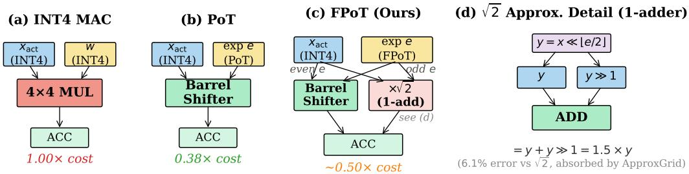  
Figure 1: PE architecture: INT4 multiplier, PoT barrel shifter, and FPoT (ours). FPoT adds one adder and a MUX; ${ \sqrt { 2 } } \approx y + y \gg 1 = 1 . 5$ (6.1% error, absorbed by approximate-grid quantization, §3).

$$
\tau _ { k } = 2 ^ { - 1 / ( 2 k ) } ,\tag{2}
$$

so that $| w | / s < \tau _ { k }$ maps to zero. $\mathrm { A t } \ k { = } 2 , \tau _ { 2 } \approx 0 . 8 4 1 ;$ the resulting fraction of weights mapped to zero and its accuracy implications are analyzed in §4.1.

The complete FPoT quantization procedure, including signed representation, k-adaptive zero thresholding, and the inference-time hardware decomposition, is given in the pseudocode in Appendix F.

Hardware implications. The stored weight is encoded as b bits with one sign bit and a magnitude code $m \in \{ 0 , \hat { , } . . . , 2 ^ { b - 1 } - 1 \}$ . When $m { = } 0$ the MAC is skipped (zero-gating); otherwise the exponent index $e = m - 1$ yields the dequantized value $\hat { w } = \mathrm { s g n } ( w ) \cdot s \cdot 2 ^ { e / k }$ . For $k { = } 2 , \lfloor e / 2 \rfloor$ and e mod 2 are direct wire selections from the magnitude bits (Appendix F). Combining FPoT weights with uniform INT activations, the shift-accumulate MAC becomes:

$$
y = \sum _ { i } \operatorname { s g n } ( w _ { i } ) \cdot ( x _ { i } \cdot 2 ^ { \left\lfloor e _ { i } / 2 \right\rfloor } ) \cdot ( \sqrt { 2 } ) ^ { e _ { i } \operatorname { m o d } 2 } ,\tag{3}
$$

which replaces integer multipliers with barrel shifters plus a lightweight $\times \sqrt { 2 }$ unit for odd exponents (～50% of MACs). Activations remain in uniform INT format (Appendix D provides the supporting per-projection analysis). The entire FPoT compute unit shares a single barrel shifter with PoT; the only additional logic is a 1-adder $\sqrt { 2 }$ approximation unit and a multiplexer (MUX) selected by the least significant bit (LSB) of the weight (Fig. 1). This shift-accumulate structure replaces all 4-bit integer multipliers in every linear projection of each Transformer block with a uniform FPoT PE.

Approximate-grid quantization. The odd-e path above requires a $\times \sqrt { 2 }$ coefficient. A 1-adder realization $( x + x { \gg } 1 = 1 . 5 x )$ deviates from $\sqrt { 2 } \approx 1 . 4 1 4 \mathrm { b y } 6 . 1 \%$ , which would normally degrade accuracy under naive post-hoc substitution—quantizing to the exact FPoT grid and only replacing the coefficient at dequantization. Our solution is approximate-grid quantization: we quantize weights to the nearest level in the actual hardware grid (i.e., using 1.5 for odd e instead of $\sqrt { 2 } )$ , so that weight calibration absorbs the approximation as part of the quantization grid rather than as post-hoc distortion. Empirical validation of this scheme is reported in §5.3, with the resulting hardware cost analyzed in §4.2.

Weight grid-alignment. We additionally evaluate a calibration-time grid-alignment refinement applicable to both PoT and FPoT grids. Since weights are static after calibration, the optimal phase offset can be absorbed into the per-channel scale at zero inference overhead. We add a phase-shift refinement evaluating G candidate scales

$$
s _ { g } ~ = ~ s _ { \mathrm { b a s e } } \cdot 2 ^ { g / G } , ~ g = 0 , 1 , . . . , G - 1 ,\tag{4}
$$

and pick per output-channel the $g ^ { * }$ minimizing MSE between raw weights and their FPoT reconstruction. The winning $s _ { g ^ { * } }$ replaces $s _ { \mathrm { b a s e } }$ as a static per-channel weight scale, so the deployed architecture is identical to unaligned FPoT.

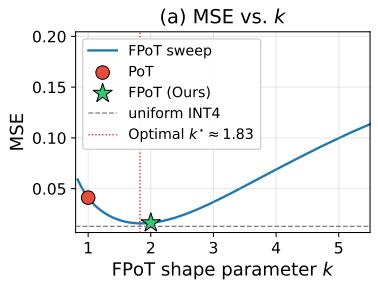

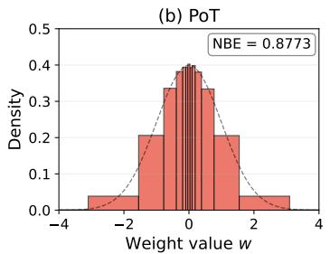

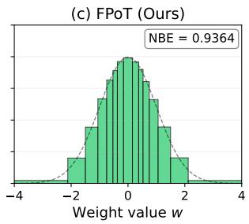  
Figure 2: (a) MSE vs. shape parameter k for $\mathcal { N } ( 0 , 1 )$ weights at 4-bit $( N { = } 1 5$ levels): the MSE is minimized at $k ^ { \star } \approx 1 . 8$ , so the integer choice $k { = } 2$ is near-optimal. (b, c) Bin-occupancy under the Gaussian proxy. FPoT concentrates levels near the high-density mode, while PoT spreads levels across an excessively wide range, leaving most of them in the sparsely-populated tail. Dashed curves: input density $p _ { W }$

## 4 Analysis

We analyze why the FPoT base- $\cdot \sqrt { 2 }$ grid is optimal for 4-bit LLM weight quantization (§4.1) and quantify its hardware cost relative to INT and standard PoT baselines (§4.2).

## 4.1 Grid-Matching Analysis

Gaussian proxy. Raw LLM weights are far from Gaussian: they exhibit heavy-tailed, leptokurtic distributions with high-magnitude outliers concentrated in a few channels. Recent LLM PTQ preprocessing redistributes channel-concentrated outliers across dimensions, reducing kurtosis and equalizing per-channel dynamic range. We analyze a zero-mean symmetric distribution whose logmagnitude is unimodal—a property that holds for the preprocessed weights, with the Gaussian $w \stackrel { - } { \sim } \mathcal { N } ( 0 , \sigma ^ { 2 } )$ serving as a tractable analytical proxy. Under this proxy, $u = \log _ { 2 } | w |$ is approximately Gaussian in log-space with standard deviation $1 / ( \sqrt { 2 } \ln 2 ) \approx 1 . 0 2$ octaves (derivation in Appendix B.2), $\mathbf { s o } \sim 9 5 \%$ of probability mass concentrates within \~4 octaves around the mode. Empirically, the preprocessed weight distributions of all seven models studied closely match this Gaussian-proxy prediction (Appendix C), validating its use for 4-bit grid design.

Optimal base under the Gaussian proxy. A PoT quantizer with step ratio $\beta = 2 ^ { 1 / k }$ and N levels covers a dynamic range $\beta ^ { N - 1 }$ ; with $N { = } 1 5 , k { = } \mathrm { \bar { 1 } }$ yields a 16,384× range that far exceeds the \~4-octave preprocessed weight spread, k=2 yields 128× (aligned), and $k { = } 4$ yields $1 1 \times$ (tail clipping). Numerically minimizing the MSE on w $\sim \mathcal { N } ( 0 , 1 )$ with 15 levels while jointly optimizing the scale s yields $\beta ^ { \star } \approx 2 ^ { 0 . 5 5 }$ (effective $k ^ { \star } \approx 1 . 8 )$ , very close to $k { = } 2 ( \operatorname { F i g } . 2 ) \colon \operatorname { F P o } \mathrm { T } _ { k { = } 2 }$ achieves $\mathrm { M S E } = 1 . 2 7 \times \mathrm { I N T } 4 ,$ while PoT wastes levels near zero $( 3 . 2 1 \times )$ and $k { \geq } 3$ suffers dynamic range starvation $( 2 . 8 7 \times$ at $k { = } 3 , 5 { . } 3 7 { \times } \mathrm { a t } k { = } 4 )$ . This optimality is bit-width specific—at 8-bit the optimal shifts to $k ^ { \star } \approx 1 9 - \mathrm { s o }$ the $k { = } 2$ choice is specifically motivated by the 4-bit constraint (8-bit analysis and full numerical table in Appendix B.3).

Normalized Bin Entropy. To quantify how effectively a grid utilizes its fixed bit budget under a given weight distribution, we introduce the Normalized Bin Entropy (NBE). For a quantizer $Q$ with N representable levels and level-occupancy probabilities $p _ { i } = \mathrm { P r } \bar { [ Q ( W ) = \ell _ { i } ] }$ , we define

$$
\mathrm { N B E } ( Q ; p _ { W } ) = { \frac { H ( { \bf p } ) } { \log _ { 2 } N } } , H ( { \bf p } ) = - \sum _ { i = 1 } ^ { N } p _ { i } \log _ { 2 } p _ { i } ,\tag{5}
$$

where N is the budget-determined number of representable levels $( \mathrm { e } . \mathrm { g } . , N { = } 1 5 $ for the 4-bit symmetric grids studied here: 7 positive + 7 negative + 1 zero). $\mathrm { N B E } = 1$ iff data mass is uniform across all levels; $\mathrm { N B E }  0$ as mass concentrates on a single level. Information-theoretically, $\log _ { 2 } N$ · NBE is the expected Shannon code length per weight, so NBE measures the fraction of the fixed bit budget that carries information (Appendix B.1). Unlike volumetric metrics such as QSUR [Hu et al., 2025], NBE distinguishes grid structures sharing the same dynamic range (Property 4 in Appendix B.1).

Under the Gaussian proxy, $\mathrm { F P o T } _ { k = 2 }$ achieves $\mathrm { N B E } = 0 . 9 3 6 4$ , surpassing both uniform INT4 (0.9026) and PoT (0.8773): the half-octave log-grid places denser levels where probability mass concentrates near the mode $| w | \approx \sigma ,$ while PoT wastes levels in the sparsely-populated tail (64:1 range); Fig. 2 visualizes this contrast. Empirical bin occupancy on real LLM weights (Appendix C) closely matches the Gaussian-proxy prediction.

Implicit magnitude pruning. The k-adaptive zero threshold $\tau _ { k } = 2 ^ { - 1 / ( 2 k ) }$ (Eq. 2) interacts with the Gaussian-proxy distribution to map a k-dependent fraction of weights to zero. $\textstyle \mathrm { A t } \ k = 2 .$ $\tau _ { 2 } \approx 0 . 8 4 1$ causes ～22% of preprocessed weights to be zeroed—implicit magnitude pruning that is fully compensated by the $\bar { 2 } \times$ finer grid resolution. Empirical measurement on real LLM weights confirms this ratio (Appendix C). These zeroed weights further skip their MACs entirely via zero-gating (§3), providing additional compute reduction beyond the shift-add substitution. Prior PoT methods (DeepShift, APoT) adopt ad-hoc zero strategies without recognizing this k-dependent effect.

## 4.2 Hardware Cost Analysis

We evaluate the hardware benefits of FPoT weight quantization with two complementary metrics: compute-unit (CU) cost from a naive component model and energy from published RTL synthesis data. FPoT is applied to all linear projection layers, converting all weight MACs (6.98 B per token) into shift-accumulate operations (per-projection breakdown in Appendix D).

Compute Unit Cost. We model hardware cost with a naive component-based analysis (Appendix E.1): an INT multiplier grows quadratically (W × A gate-equivalents), while a PoT barrel shifter and FPoT shifter + adder grow linearly. FPoT adds one adder for the $\sqrt { 2 }$ approximation $( x + x \gg 1 \ : = \ : 1 . 5 x , \ : 6 . 1 \%$ error absorbed by approximate-grid quantization, §3). At W4A4, PoT costs 0.38× and FPoT costs \~0.50× the INT multiplier; the $O ( W A ) – \mathbf { v s . } – O ( W + A )$ scaling gap widens at higher bit-widths (Table 6). Critically, the additional 1-adder over standard PoT costs only ${ \sim } 0 . 1 2 \times$ extra CU at W4A4 while reducing perplexity overhead by 67%–94%, placing FPoT at the knee of the accuracy-efficiency Pareto frontier (Fig. 3) in the compute-bound prefill regime. Open-source logic synthesis (Yosys [Wolf and Glaser, 2013]) is consistent with the structural ordering $\mathrm { I N T } > \mathrm { F P o T } > \mathrm { \bar { P } o T }$ and the bit-width scaling predicted above (Tables 6–7, Appendix E.2).

Energy. We anchor the energy comparison to RTL synthesis by Przewlocka-Rus et al. [2022] on Samsung 5 nm (250 MHz, TT corner, $0 . 6 \mathrm { V } , 2 5 ^ { \circ } \mathrm { C } .$ 50% toggle rate), which reports a PoT-to-INT energy ratio of $0 . 4 2 \times \mathrm { { \ a t { \ } W 4 A 8 { \_ } 2 . 4 \times } }$ reduction per weight MAC. FPoT with the 1-adder $\sqrt { 2 }$ unit adds minimal overhead (one adder, active for \~50% of MACs); we report the FPoT energy ratio as $\mathbf { 0 . 4 2  – 0 . 4 6 } \times$ at W4A4 (0.84–1.00× at W4A8; 1.68–2.00× at W8A8)—a 2.2–2.4× energy reduction per weight multiply versus INT, with the $\sqrt { 2 }$ unit contributing at most 0.04× overhead for a 50% duty cycle on odd exponents. Appendix E.4 provides per-model accuracy-cost trade-off curves.

Scope of hardware claims. The 0.42–0.46× energy and 0.50× CU ratios are per weight MAC, anchored to cell-level RTL synthesis [Przewlocka-Rus et al., 2022]; end-to-end inference energy reduction scales with the fraction of total energy attributable to weight MACs, which is largest in the compute-bound prefill regime and diminishes under memory-bound decode (Limitations, §6).

## 5 Experimental Results

## 5.1 Experimental Setup

FPoT is framework-agnostic with respect to the choice of state-of-the-art LLM PTQ preprocessing; for the main results we use the OSTQuant framework [Hu et al., 2025] for preprocessing, with rotation parameters jointly optimized with smooth scaling factors via Riemannian gradient descent for 400 steps with straight-through estimator (STE) gradients through discrete PoT quantization. Final weights are obtained via GPTQ [Frantar et al., 2023] with PoT targets. Cross-framework portability with DuQuant is validated in Appendix J. We evaluate WikiText-2 [Merity et al., 2017] perplexity (PPL↓) and the unweighted mean of zero-shot accuracy across nine benchmarks $( 0 { \cdot } \mathrm { s h o t } ^ { 9 } \uparrow$ , in %): ARC-Challenge, ARC-Easy [Clark et al., 2018], HellaSwag [Zellers et al., 2019], WinoGrande [Sakaguchi et al., 2021], PIQA [Bisk et al., 2020], BoolQ [Clark et al., 2019], OpenBookQA [Mihaylov et al., 2018], LAMBADA [Paperno et al., 2016], and Social IQA [Sap et al., 2019]. All zero-shot evaluations are conducted via the lm-eval-harness framework [Gao et al., 2024]. Table 1 reports mean±std over three calibration seeds (0, 42, 123); all other experiments use a single calibration seed (seed 0) unless the caption explicitly states otherwise. To scale FPoT training to 14B+ models on a single A100-80GB GPU, we implement a fused Triton [Tillet et al., 2019] kernel that merges the FPoT quantize-dequantize-STE pipeline into a single launch, reducing per-projection intermediate memory by 82%.

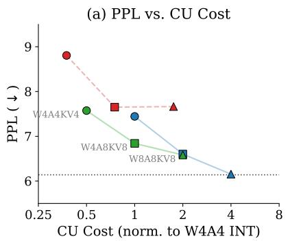

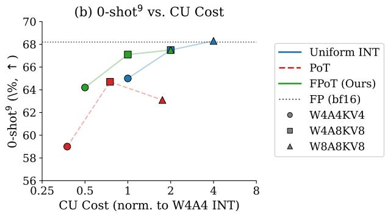  
Figure 3: Accuracy-cost Pareto trade-off for Llama-3-8B. FPoT achieves near-baseline PPL at ${ \sim } 0 . 5 0 \times \mathrm { C U }$ cost across all bit-widths. Per-model plots in Appendix E.4.

## 5.2 Main Results

Table 1 presents the main comparison of our proposed FPoT method against the non-PoT (uniform INT) baseline and standard PoT across seven models and three bit-width configurations. Our default configuration uses FPoT with G=16 grid-alignment and 1-adder approximate-grid quantization $( \sqrt { 2 } \approx 1 . 5 )$ ; activations and KV-cache use uniform INT quantization throughout.

FPoT achieves near-lossless PoT quantization across all settings (per the $\Delta \mathrm { P P L < } + 0 . 5 .$ $\Delta 0 { - } \mathrm { s h o t } ^ { 9 } \geq - 1 . 0 \% \mathrm { p }$ criterion stated in the introduction). On Llama-3-8B W4A4KV4, FPoT reduces PPL overhead from +1.43 (PoT) to +0.24—an 83% reduction—while downstream accuracy degradation shrinks from —5.6%p to —0.4%p. Since k=2 is specifically optimized for the 4-bit regime (§3), we analyze results primarily within the W4 operating points (W4A4KV4 and W4A8KV8, 14 configurations across seven models): ∆PPL ranges from +0.05 (Qwen2.5-14B W4A4KV4) to +0.26 (Qwen2.5-1.5B W4A8KV8)—strictly below +0.3 at the designed operating point—with PoT overhead reductions of 71%–94% (67%–94% across all twenty-one configurations including W8A8KV8). The W8A8KV8 configurations lie outside the 4-bit-specific design range yet still satisfy the +0.5 near-lossless threshold (∆PPL up to +0.42), demonstrating that $\mathrm { F P o T } _ { k = 2 }$ generalizes beyond its design point.

## 5.3 √2 Approximation Quality

The FPoT PE requires a fixed $\times \sqrt { 2 }$ for odd-exponent weights (\~50% of MACs). Table 2 compares canonical signed digit (CSD) shift-add approximations on Llama-3-8B (W4A4KV4) under three strategies: naïve post-hoc substitution (“Exact Grid": quantize to exact grid, dequantize with approximate coefficient), approximate-grid quantization (“Approx Grid": quantize to the nearest level in the actual hardware grid), and Aware training (use the approximate $\sqrt { 2 }$ during both OSTQuant training and GPTQ/eval). CU cost is evaluated under the same naive component model as §4.2, revealing that additional CSD adders rapidly consume the FPoT hardware advantage: the 3-adder variant already matches INT4 cost (1.00×), leaving only the 1-adder at the knee of the Pareto frontier.

With naïve substitution, the 1-adder $( x + x { \gg } 1 = 1 . 5 , 6 . 1 \%$ error) degrades PPL by $+ 0 . 1 7 .$ However, with approximate-grid quantization, the same 1-adder achieves $\mathrm { P \bar { P } L = 7 . 5 7 4 \mathrm { - } w i t h i n \ + 0 . 0 1 }$ of exact ${ \sqrt { 2 } } .$ —because weight calibration absorbs the approximation error as part of the quantization grid rather than as post-hoc distortion. The hierarchy Approx $\mathbf { G r i d } > \mathbf { A w a r e } >$ Exact Grid holds for the 1-adder case (PPL $7 . 5 7 4 < 7 . 6 2 5 < 7 . 7 2 9 )$ : aware training (7.625) lies between the two extremes since the STE gradient through approximate dequantization is less accurate than through exact dequantization, while smaller approximation errors (2-adder, 3-adder) make all three strategies converge. This yields a simple PE whose compute unit is \~0.50× that of an INT4 multiplier with no measurable accuracy loss—a Pareto-optimal point among CSD variants (Table 2): the 2-adder and 3-adder alternatives pay 1.5× and 2× more CU, respectively, for at most a 0.005 PPL improvement while the 0-adder PoT (0.38×) incurs an unusable +1.19 PPL penalty.

Table 1: Main results across models and quantization configurations $( \mathrm { m e a n } _ { \pm \mathrm { s t d } }$ over 3 calibration seeds). Uniform: OSTQuant uniform INT baseline; PoT (base 2) and FPoT (base ${ \sqrt { 2 } } ,$ Ours) replace the weight grid on the same pipeline; default configuration in §5.2. PPL: WikiText-2 perplexity (↓). $0 \mathrm { - s h o t ^ { 9 } } \dot { : }$ mean zero-shot accuracy across nine benchmarks (↑, %).
<table><tr><td colspan="2"></td><td colspan="2">W4A4KV4</td><td colspan="2">W4A8KV8</td><td colspan="2">W8A8KV8</td></tr><tr><td>Model</td><td>Weight Quant</td><td>PPL↓</td><td> $0 { \cdot } \mathrm { s h o t } ^ { 9 } \uparrow$ </td><td>PPL↓</td><td> $0 { \cdot } \mathrm { s h o t } ^ { 9 } \uparrow$ </td><td>PPL↓</td><td> $0 { \cdot } \mathrm { s h o t } ^ { 9 } \uparrow$ </td></tr><tr><td rowspan="3">Llama-3-8B</td><td>Uniform</td><td> $7 . 3 6 _ { \pm . 0 7 }$ </td><td> $6 5 . 2 _ { \pm . 4 }$ </td><td> $6 . 6 0 { \scriptstyle \pm . 0 1 }$ </td><td> $6 7 . 5 _ { \pm . 1 }$ </td><td> $6 . 1 6 _ { \pm . 0 0 }$ </td><td> $6 8 . 2 \pm . 1$ </td></tr><tr><td>PoT</td><td> $8 . 7 9 _ { \pm . 0 4 }$ </td><td> $5 9 . 6 _ { \pm . 6 }$ </td><td> $7 . 6 4 _ { \pm . 0 2 }$ </td><td> $6 4 . 0 { \scriptstyle \pm . 7 }$ </td><td> $7 . 5 2 _ { \pm . 1 2 }$ </td><td> $6 3 . 8 _ { \pm . 7 }$ </td></tr><tr><td>FPoT (Ours)</td><td> $\mathbf { 7 . 6 0 } \mathbf { \pm . 0 2 }$ </td><td> ${ \bf 6 4 . 8 _ { \pm . 6 } }$ </td><td> ${ \bf 6 . 8 5 _ { \pm . 0 1 } }$ </td><td> ${ \bf 6 7 . 3 _ { \pm . 5 } }$ </td><td> ${ \bf 6 . 5 8 _ { \pm . 0 0 } }$ </td><td> ${ \bf 6 7 . 7 \bot _ { \pm . 2 } }$ </td></tr><tr><td rowspan="3">Llama-2-7B</td><td>Uniform</td><td> $5 . 9 7 _ { \pm . 0 1 }$ </td><td> $6 2 . 1 _ { \pm . 3 }$ </td><td> $5 . 6 3 _ { \pm . 0 4 }$ </td><td> $6 3 . 8 _ { \pm . 2 }$ </td><td> $5 . 4 8 _ { \pm . 0 0 }$ </td><td> $6 5 . 1 \pm . 0$ </td></tr><tr><td>PoT</td><td> $6 . 9 3 _ { \pm . 0 0 }$ </td><td> $5 8 . 0 _ { \pm . 1 }$ </td><td> $6 . 2 7 _ { \pm . 0 3 }$ </td><td> $6 1 . 4 _ { \pm . 7 }$ </td><td> $6 . 0 5 _ { \pm . 0 4 }$ </td><td> $6 2 . 3 _ { \pm . 2 }$ </td></tr><tr><td>FPoT (Ours)</td><td> ${ \bf 6 . 1 1 _ { \pm . 0 4 } }$ </td><td> ${ \bf 6 1 . 9 } _ { \pm . 2 }$ </td><td> $5 . 7 5 _ { \pm . 0 2 }$ </td><td> ${ \bf 6 3 . 8 _ { \pm . 2 } }$ </td><td> ${ \pm } . 6 5 _ { \pm . 0 3 }$ </td><td> ${ \bf 6 4 . 2 _ { \pm . 3 } }$ </td></tr><tr><td rowspan="3">Llama-2-13B</td><td>Uniform</td><td> $5 . 2 6 _ { \pm . 0 1 }$ </td><td> $6 5 . 6 _ { \pm . 2 }$ </td><td> $5 . 0 3 _ { \pm . 0 1 }$ </td><td> $6 7 . 1 _ { \pm . 3 }$ </td><td> $4 . 8 9 _ { \pm . 0 0 }$ </td><td> $6 7 . 7 _ { \pm . 0 }$ </td></tr><tr><td>PoT</td><td> $5 . 9 0 { \scriptstyle \pm . 0 2 }$ </td><td> $6 2 . 7 _ { \pm . 5 }$ </td><td> $5 . 4 8 _ { \pm . 0 1 }$ </td><td> $6 5 . 2 _ { \pm . 3 }$ </td><td> $5 . 3 1 _ { \pm . 0 3 }$ </td><td> $6 5 . 2 { \scriptstyle \pm . 7 }$ </td></tr><tr><td>FPoT (Ours)</td><td> ${ \pm . 3 7 } _ { \pm . 0 2 }$ </td><td> ${ \bf 6 5 . 2 _ { \pm . 1 } }$ </td><td> ${ \bf 5 . 1 1 _ { \pm . 0 2 } }$ </td><td> ${ \bf 6 6 . 6 _ { \pm . 1 } }$ </td><td> ${ \bf 5 . 0 3 } _ { \pm . 0 1 }$ </td><td> ${ \bf 6 7 . 2 _ { \pm . 4 } }$ </td></tr><tr><td rowspan="3">Qwen2.5-1.5B</td><td>Uniform</td><td> $1 1 . 1 0 _ { \pm . 1 4 }$ </td><td> $3 8 . 7 _ { \pm . 4 }$ </td><td> $9 . 7 5 _ { \pm . 0 3 }$ </td><td> $4 2 . 7 _ { \pm . 6 }$ </td><td> $9 . 3 2 _ { \pm . 0 0 }$ </td><td> $4 4 . 0 _ { \pm . 2 }$ </td></tr><tr><td>PoT</td><td> $1 3 . 2 3 _ { \pm . 1 1 }$ </td><td> $3 7 . 2 { \scriptstyle \pm . 8 }$ </td><td> $1 1 . 3 5 _ { \pm . 0 9 }$ </td><td> $3 9 . 3 _ { \pm . 4 }$ </td><td> $1 1 . 3 3 _ { \pm . 0 5 }$ </td><td> $3 8 . 8 { \scriptstyle \pm 1 . 4 }$ </td></tr><tr><td>FPoT (Ours)</td><td> $\pm 1 1 . 2 3 _ { \pm . 0 3 }$ </td><td> $\mathbf { 3 9 . 9 } _ { \pm . 4 }$ </td><td> ${ \bf 1 0 . 0 1 } _ { \pm . 0 3 }$ </td><td> $4 2 . 4 _ { \pm 1 . 0 }$ </td><td> $\mathbf { 9 . 7 3 _ { \pm . 0 1 } }$ </td><td> ${ \bf 4 3 . 0 _ { \pm . 7 } }$ </td></tr><tr><td rowspan="3">Qwen2.5-7B</td><td>Uniform</td><td> $7 . 5 6 _ { \pm . 0 1 }$ </td><td> $6 6 . 4 _ { \pm . 5 }$ </td><td> $7 . 0 4 _ { \pm . 0 1 }$ </td><td> $6 8 . 1 _ { \pm . 1 }$ </td><td> $6 . 8 7 _ { \pm . 0 0 }$ </td><td> $6 8 . 6 _ { \pm . 1 }$ </td></tr><tr><td>PoT</td><td> $8 . 2 2 _ { \pm . 0 1 }$ </td><td> $6 2 . 9 _ { \pm . 6 }$ </td><td> $7 . 5 6 _ { \pm . 0 2 }$ </td><td> $6 5 . 5 _ { \pm . 2 }$ </td><td> $7 . 5 7 _ { \pm . 0 2 }$ </td><td> $6 6 . 2 _ { \pm 1 . 0 }$ </td></tr><tr><td>FPoT (Ours)</td><td> ${ \bf 7 . 6 2 _ { \pm . 0 2 } }$ </td><td> ${ \bf 6 6 . 3 _ { \pm . 3 } }$ </td><td> ${ \bf 7 . 1 4 _ { \pm . 0 1 } }$ </td><td> ${ \bf 6 8 . 6 _ { \pm . 6 } }$ </td><td> ${ \bf 7 . 0 3 _ { \pm . 0 2 } }$ </td><td> ${ \bf 6 8 . 5 { \scriptstyle \pm . 6 } }$ </td></tr><tr><td rowspan="3">Qwen2.5-14B</td><td>Uniform</td><td> $6 . 3 3 _ { \pm . 0 1 }$ </td><td> $6 8 . 7 _ { \pm . 4 }$ </td><td> $5 . 6 5 _ { \pm . 0 1 }$ </td><td> $7 1 . 1 { \scriptstyle \pm . 4 }$ </td><td> $5 . 3 1 _ { \pm . 0 0 }$ </td><td> $7 1 . 1 \pm . 2$ </td></tr><tr><td>PoT</td><td> $7 . 2 1 _ { \pm . 0 5 }$ </td><td> $6 4 . 8 _ { \pm 1 . 1 }$ </td><td> $6 . 4 8 _ { \pm . 0 5 }$ </td><td> $6 8 . 8 _ { \pm . 3 }$ </td><td> $6 . 4 0 { \scriptstyle \pm . 0 1 }$ </td><td> $6 8 . 7 _ { \pm . 4 }$ </td></tr><tr><td>FPoT (Ours)</td><td> ${ \bf 6 . 3 8 _ { \pm . 0 4 } }$ </td><td> ${ \bf 6 8 . 9 _ { \pm . 3 } }$ </td><td> ${ \pm . 8 5 } _ { \pm . 0 8 }$ </td><td> ${ 7 1 . 3 } _ { \pm . 8 }$ </td><td> ${ \pm . 6 0 } \mathrm { \pm . 0 0 }$ </td><td> $7 2 . 0 _ { \pm . 1 }$ </td></tr><tr><td rowspan="3">Mistral-7B</td><td>Uniform</td><td> $5 . 6 2 _ { \pm . 0 1 }$ </td><td> $6 6 . 5 _ { \pm . 3 }$ </td><td> $5 . 4 1 _ { \pm . 0 2 }$ </td><td> $6 7 . 8 _ { \pm . 1 }$ </td><td> $5 . 3 2 _ { \pm . 0 0 }$ </td><td> $6 8 . 3 _ { \pm . 1 }$ </td></tr><tr><td>PoT</td><td> $6 . 0 0 { \scriptstyle \pm . 0 3 }$ </td><td> $6 4 . 6 _ { \pm . 4 }$ </td><td> $5 . 6 9 _ { \pm . 0 2 }$ </td><td> $6 5 . 5 _ { \pm . 7 }$ </td><td> $5 . 7 1 _ { \pm . 0 2 }$ </td><td> $6 6 . 4 _ { \pm . 3 }$ </td></tr><tr><td>FPoT (Ours)</td><td> ${ \bf 5 . 7 1 _ { \pm . 0 5 } }$ </td><td> ${ \bf 6 6 . 1 _ { \pm . 5 } }$ </td><td> ${ \pm . 4 9 } _ { \pm . 0 4 }$ </td><td> ${ \bf 6 7 . 3 _ { \pm . 4 } }$ </td><td> ${ \pm . 4 5 _ { \pm . 0 7 } }$ </td><td> ${ \bf 6 7 . 7 { \scriptstyle \pm . 4 } }$ </td></tr></table>

Table 2: $\sqrt { 2 }$ approximation strategies on Llama-3-8B W4A4KV4 (FPoT; single calibration seed). Exact Grid / Approx Grid (Ours) / Aware: see §5.3 for definitions. CU/×: same naive component model (§4.2); †exact $\sqrt { 2 }$ has no finite CSD realization. $0 { \cdot } \mathrm { s h o t } ^ { 9 }$ in %.
<table><tr><td></td><td></td><td></td><td></td><td colspan="2">Exact Grid</td><td colspan="2">Approx Grid</td><td colspan="2">Aware</td></tr><tr><td>Impl.</td><td>Value (Err.)</td><td>Add.</td><td>CU/×</td><td>PPL↓</td><td> $0 { \cdot } \mathrm { s h o t } ^ { 9 } \uparrow$ </td><td>PPL↓</td><td> $0 { \cdot } \mathrm { s h o t } ^ { 9 } \uparrow$ </td><td> $\mathrm { P P L } \downarrow$ </td><td> $0 { \cdot } \mathrm { s h o t } ^ { 9 } \uparrow$ </td></tr><tr><td>Exact</td><td>1.414 (0%)</td><td></td><td>N/A‡</td><td>7.560</td><td>64.7</td><td></td><td></td><td></td><td></td></tr><tr><td>3-adder</td><td>1.438 (1.6%)</td><td>3</td><td>1.00×</td><td>7.580</td><td>64.4</td><td>7.569</td><td>65.0</td><td>7.611</td><td>64.3</td></tr><tr><td>2-adder</td><td>1.375 (2.8%)</td><td>2</td><td>0.75×</td><td>7.575</td><td>64.5</td><td>7.584</td><td>64.4</td><td>7.584</td><td>64.8</td></tr><tr><td></td><td>1-adder 1.500 (6.1%)</td><td>1</td><td>0.50×</td><td>7.729</td><td>63.4</td><td>7.574</td><td>64.2</td><td>7.625</td><td>63.8</td></tr><tr><td>k=1</td><td></td><td>0</td><td>0.38×</td><td>8.806</td><td>59.0</td><td></td><td></td><td></td><td></td></tr></table>

Exact $\sqrt { 2 }$ requires a full multiplier-grade unit (no finite CSD realization); not a shift-add alternative.

## 5.4 Additional Ablations

Preprocessing. Both rotation and per-channel scaling are necessary: without any transform FPoT yields catastrophic PPL = 181.3; only the full combination (learned rotation + scale) reaches 7.56, within +0.12 of the non-PoT baseline (Table 13, Appendix G.6).

Full FPoT (weight + activation). Applying the logarithmic grid to both weights and activations degrades accuracy severely (PPL 16.9–114.1 at k=1, 8.21–52.49 at k=2, versus 7.56 for weight-only; Appendix G.3). Uniform INT activations remain the practical choice.

Weight grid-alignment. Grid-alignment (Eq. 4) reduces PPL by up to —0.051 at k=1 at zero inference cost; at k=2 the finer grid self-corrects (|∆PPL| ≤ 0.034; Appendix G.2).

Hyperparameter sensitivity. The zero-threshold τ and log-vs-linear rounding mode have negligible impact (∆PPL < 0.03); see Appendices G.4 and G.5.

Calibration robustness. FPoT's data-independent grid boundaries yield robust calibration: |∆PPL| ≤ 0.065 across n ∈ {128, 256, 512} and only +0.06–+0.10 shift from WikiText-2 to C4 (Appendix G.1).

Cross-framework portability. A different PTQ framework yields comparable FPoT overhead (+0.05–+0.34 PPL; Appendix J, Table 22).

LogART comparison. In the weight-only setting (W4A16), LogART achieves lower PPL but degrades catastrophically (PPL > 3900) under post-hoc INT4 activation without PTQ preprocessing, while FPoT remains stable (Appendix I, Table 21).

## 6 Discussion

Design rationale and comparison with prior PoT methods. FPoT's three design choices—a regular geometric grid amenable to GPTQ (vs. APoT's irregular additive decompositions [Li et al., 2020]), uniform INT activations eliminating runtime log2 conversion [Elhoushi et al., 2021, Li et al., 2023], and 4-bit grid-resolution targeting (vs. PoT-PTQ's 2-3-bit scale-calibration focus [Wang et al., 2025])—collectively position FPoT as the only multiplier-free PTQ achieving near-lossless W4A4KV4. LogART [Xu et al., 2026] reports strong W4A16 accuracy but lacks LLM W4A4KV4 evaluation due to absent PTQ preprocessing (Appendix I).

Broader impact. Multiplier-free LLM inference can reduce the energy consumption and carbon footprint of large-scale deployment. However, cheaper inference may also lower barriers to harmful applications; this work does not introduce new capabilities and applies to existing public models with slightly degraded accuracy.

Limitations. Efficiency projections use analytical cost models anchored to published RTL synthesis [Przewlocka-Rus et al., 2022]; open-source logic synthesis (Yosys [Wolf and Glaser, 2013]) confirms the structural ordering and bit-width scaling (Appendix E.2), and end-to-end RTL/ASIC validation is left for future work. Preprocessing training requires float32 weight copies, limiting single-GPU (80 GB) experiments to ≤14B parameters. The k=2 optimum is 4-bit specific (8-bit shifts to ≈19). All results combine state-of-the-art LLM PTQ preprocessing with GPTQ; compatibility with AWQ or round-to-nearest (RTN) is untested.

## 7 Conclusion

We introduced FPoTa half-octave fractional PoT weight quantization scheme that, combined with uniform INT activation quantization and state-of-the-art LLM PTQ preprocessing, achieves near-lossless accuracy while enabling multiplier-free shift-add inference. Three contributions enable this result. First, a Gaussian-proxy analysis identifies base-√2 as the optimal integer-resolution grid at 4-bit, halving the worst-case relative error of standard PoT (41.4%→18.9%). Second, approximategrid quantization absorbs the 1-adder $\sqrt { 2 }$ hardware error via weight calibration, yielding a PE whose compute unit is \~0.50× the INT4 multiplier gate count (vs. \~0.38× for standard PoT). Third, FPoT achieves consistent near-lossless results across twenty-one configurations spanning seven models and three quantization settings (W4A4KV4 / W4A8KV8 / W8A8KV8), recovering zero-shot accuracy to within 1.0%p of the uniform INT baseline in 20/21 configurations (mean gap -0.17%p; all 14 W4 configurations within 0.5%p), and integrates with state-of-the-art LLM PTQ frameworks at comparable overhead (Appendix J).

These results suggest that FPoT is a promising pathway toward shift-based LLM inference hardware with near-lossless accuracy, with future work including scaling to larger models, exploring higher bit-widths, and end-to-end RTL/ASIC validation.

## Acknowledgments and Disclosure of Funding

This work was supported by the Korean Government through grants from IITP (RS-2021-II211343 and RS-2025-25442338) and NRF (RS-2026-25500579).

## References

Saleh Ashkboos, Amirkeivan Mohtashami, Maximilian L Croci, Bo Li, Pashmina Cameron, Martin Jaggi, Dan Alistarh, Torsten Hoefler, and James Hensman. QuaRot: Outlier-free 4-bit inference in rotated LLMs. Advances in Neural Information Processing Systems, 37:100213–100240, 2024.

Yonatan Bisk, Rowan Zellers, Ronan Le Bras, Jianfeng Gao, and Yejin Choi. PIQA: Reasoning about physical commonsense in natural language. In Proceedings of the AAAI Conference on Artificial Intelligence, volume 34, pages 7432–7439, 2020.

Christopher Clark, Kenton Lee, Ming-Wei Chang, Tom Kwiatkowski, Michael Collins, and Kristina Toutanova. BoolQ: Exploring the surprising difficulty of natural yes/no questions. In Proceedings of the 2019 Conference of the North American Chapter of the Association for Computational Linguistics: Human Language Technologies, Volume 1 (Long and Short Papers), pages 2924–2936, 2019.

Peter Clark, Isaac Cowhey, Oren Etzioni, Tushar Khot, Ashish Sabharwal, Carissa Schoenick, and Oyvind Tafjord. Think you have solved question answering? Try ARC, the AI2 reasoning challenge. arXiv preprint arXiv:1803.05457, 2018.

Tim Dettmers, Mike Lewis, Younes Belkada, and Luke Zettlemoyer. GPT3.int8(): 8-bit matrix multiplication for transformers at scale. Advances in Neural Information Processing Systems, 35: 30318–30332, 2022.

Mostafa Elhoushi, Zihao Chen, Farhan Shafiq, Ye Henry Tian, and Joey Yiwei Li. DeepShift: Towards multiplication-less neural networks. In Proceedings of the IEEE/CVF Conference on Computer Vision and Pattern Recognition (CVPR) Workshops, pages 2359–2368, 2021.

Elias Frantar, Saleh Ashkboos, Torsten Hoefler, and Dan Alistarh. OPTQ: Accurate quantization for generative pre-trained transformers. In The Eleventh International Conference on Learning Representations, 2023.

Leo Gao, Jonathan Tow, Baber Abbasi, Stella Biderman, Sid Black, Anthony DiPofi, Charles Foster Laurence Golding, Jeffrey Hsu, Alain Le Noac'h, Haonan Li, Kyle McDonell, Niklas Muennighoff, Chris Ociepa, Jason Phang, Laria Reynolds, Hailey Schoelkopf, Aviya Skowron, Lintang Sutawika, Eric Tang, Anish Thite, Ben Wang, Kevin Wang, and Andy Zou. A framework for few-shot language model evaluation, July 2024. URL https: //zenodo.org/records/12608602.

Aaron Grattafiori, Abhimanyu Dubey, Abhinav Jauhri, Abhinav Pandey, Abhishek Kadian, Ahmad Al-Dahle, Aiesha Letman, Akhil Mathur, Alan Schelten, Alex Vaughan, et al. The Llama 3 herd of models. arXiv preprint arXiv:2407.21783, 2024.

Xing Hu, Yuan Cheng, Dawei Yang, Zhixuan Chen, Zukang Xu, Zhihang Yuan, Sifan Zhou, et al. OSTQuant: Refining large language model quantization with orthogonal and scaling transformations for better distribution fitting. In The Thirteenth International Conference on Learning Representations, 2025.

Albert Q Jiang, Alexandre Sablayrolles, Arthur Mensch, Chris Bamford, Devendra Singh Chaplot, Diego de las Casas, Florian Bressand, Gianna Lengyel, Guillaume Lample, Lucile Saulnier, et al. Mistral 7B. arXiv preprint arXiv:2310.06825, 2023.

Xinlin Li, Bang Liu, Rui Heng Yang, Vanessa Courville, Chao Xing, and Vahid Partovi Nia. Dense-Shift: Towards accurate and efficient low-bit power-of-two quantization. In Proceedings of the IEEE/CVF International Conference on Computer Vision, pages 17010–17020, 2023.

Yuhang Li, Xin Dong, and Wei Wang. Additive powers-of-two quantization: An efficient non-uniform discretization for neural networks. In International Conference on Learning Representations, 2020.

Haokun Lin, Haobo Xu, Yichen Wu, Jingzhi Cui, Yingtao Zhang, Linzhan Mou, Linqi Song, Zhenan Sun, and Ying Wei. DuQuant: Distributing outliers via dual transformation makes stronger quantized LLMs. Advances in Neural Information Processing Systems, 37:87766–87800, 2024a.

Ji Lin, Jiaming Tang, Haotian Tang, Shang Yang, Wei-Ming Chen, Wei-Chen Wang, Guangxuan Xiao, Xingyu Dang, Chuang Gan, and Song Han. AWQ: Activation-aware weight quantization for on-device LLM compression and acceleration. Proceedings of Machine Learning and Systems, 6: 87–100, 2024b.

Zechun Liu, Changsheng Zhao, Igor Fedorov, Bilge Soran, Dhruv Choudhary, Raghuraman Krishnamoorthi, Vikas Chandra, Yuandong Tian, and Tijmen Blankevoort. SpinQuant: LLM quantization with learned rotations. In The Thirteenth International Conference on Learning Representations, 2025.

Stephen Merity, Caiming Xiong, James Bradbury, and Richard Socher. Pointer sentinel mixture models. In International Conference on Learning Representations, 2017.

Todor Mihaylov, Peter Clark, Tushar Khot, and Ashish Sabharwal. Can a suit of armor conduct electricity? A new dataset for open book question answering. In Proceedings of the 2018 Conference on Empirical Methods in Natural Language Processing, pages 2381–2391, 2018.

Denis Paperno, Germán Kruszewski, Angeliki Lazaridou, Ngoc-Quan Pham, Raffaella Bernardi, Sandro Pezzelle, Marco Baroni, Gemma Boleda, and Raquel Fernández. The LAMBADA dataset: Word prediction requiring a broad discourse context. In Proceedings of the 54th Annual Meeting of the Association for Computational Linguistics (Volume 1: Long Papers), pages 1525–1534, 2016.

Dominika Przewlocka-Rus, Syed Shakib Sarwar, H. Ekin Sumbul, Yuecheng Li, and Barbara De Salvo. Power-of-two quantization for low bitwidth and hardware compliant neural networks. In Proceedings of the tinyML Research Symposium, San Jose, CA, 2022.

Colin Raffel, Noam Shazeer, Adam Roberts, Katherine Lee, Sharan Narang, Michael Matena, Yanqi Zhou, Wei Li, and Peter J. Liu. Exploring the limits of transfer learning with a unified text-to-text transformer. Journal of Machine Learning Research, 21(140):1–67, 2020.

Keisuke Sakaguchi, Ronan Le Bras, Chandra Bhagavatula, and Yejin Choi. WinoGrande: An adversarial Winograd schema challenge at scale. Communications of the ACM, 64(9):99–106, 2021.

Maarten Sap, Hannah Rashkin, Derek Chen, Ronan Le Bras, and Yejin Choi. Social IQa: Commonsense reasoning about social interactions. In Proceedings of the 2019 Conference on Empirical Methods in Natural Language Processing and the 9th International Joint Conference on Natural Language Processing (EMNLP-IJCNLP), pages 4463–4473, 2019.

Vivienne Sze, Yu-Hsin Chen, Tien-Ju Yang, and Joel S Emer. Efficient processing of deep neural networks: A tutorial and survey. Proceedings of the IEEE, 105(12):2295–2329, 2017.

Philippe Tillet, H. T. Kung, and David Cox. Triton: An intermediate language and compiler for tiled neural network computations. In Proceedings of the 3rd ACM SIGPLAN International Workshop on Machine Learning and Programming Languages (MAPL), pages 10–19, 2019. doi: 10.1145/3315508.3329973.

Hugo Touvron, Louis Martin, Kevin Stone, Peter Albert, Amjad Almahairi, Yasmine Babaei, Nikolay Bashlykov, Soumya Batra, Prajjwal Bhargava, Shruti Bhosale, et al. Llama 2: Open foundation and fine-tuned chat models. arXiv preprint arXiv:2307.09288, 2023.

Ashish Vaswani, Noam Shazeer, Niki Parmar, Jakob Uszkoreit, Llion Jones, Aidan N Gomez, Łukasz Kaiser, and Illia Polosukhin. Attention is all you need. Advances in Neural Information Processing Systems, 30, 2017.

Sinong Wang, Belinda Z Li, Madian Khabsa, Han Fang, and Hao Ma. Linformer: Self-attention with linear complexity. arXiv preprint arXiv:2006.04768, 2020.

Xinyu Wang, Vahid Partovi Nia, Peng Lu, Jerry Huang, Xiao-Wen Chang, Boxing Chen, and Yufei Cui. PoTPTQ: A two-step power-of-two post-training for LLMs. arXiv preprint arXiv:2507.11959, 2025.

Clifford Wolf and Johann Glaser. Yosys – a free Verilog synthesis suite. In Proceedings of the 21st Austrian Workshop on Microelectronics (Austrochip), pages 1–6, 2013.

Guangxuan Xiao, Ji Lin, Mickael Seznec, Hao Wu, Julien Demouth, and Song Han. SmoothQuant: Accurate and efficient post-training quantization for large language models. In International Conference on Machine Learning, pages 38087–38099. PMLR, 2023.

Jiawei Xu, Yi Zheng, Chenghe Sun, Taiyu Zhou, Zuqi Zhang, Jie Li, Lirong Zheng, and Zhuo Zou. LogART: Pushing the limit of efficient logarithmic post-training quantization. In The Fourteenth International Conference on Learning Representations, 2026.

An Yang, Baosong Yang, Beichen Zhang, Binyuan Hui, Bo Zheng, Bowen Yu, Chengyuan Li, Dayiheng Liu, Fei Huang, Haoran Wei, et al. Qwen2.5 technical report. arXiv preprint arXiv:2412.15115, 2024.

Rowan Zellers, Ari Holtzman, Yonatan Bisk, Ali Farhadi, and Yejin Choi. HellaSwag: Can a machine really finish your sentence? In Proceedings of the 57th Annual Meeting of the Association for Computational Linguistics, pages 4791–4800, 2019.

## A Preliminaries

## A.1 Uniform Quantization

Standard uniform (linear) quantization maps a floating-point tensor to a finite set of evenly-spaced levels. For symmetric b-bit quantization with per-token dynamic scale s:

$$
Q _ { \mathrm { l i n } } ( x ) = \mathrm { c l a m p } \bigg ( \left\lfloor \frac { x } { s } \right\rceil , - 2 ^ { b - 1 } , 2 ^ { b - 1 } - 1 \bigg ) \cdot s ,\tag{6}
$$

where $s = \| x \| _ { \infty } / ( 2 ^ { b - 1 } - 1 )$ . In this work, activations and the KV cache use uniform INT quantization in all configurations, while weights use logarithmic (FPoT) quantization (§3).

## A.2 State-of-the-Art LLM PTQ Preprocessing

Recent LLM PTQ preprocessing methods (QuaRot [Ashkboos et al., 2024], SpinQuant [Liu et al., 2025], OSTQuant [Hu et al., 2025], DuQuant [Lin et al., 2024a]; see Section 2 for taxonomy) apply learned transformations—orthogonal rotations, per-channel scaling, or their composition—to redistribute channel-concentrated outliers before quantization. For input activation $\ b { X } \in \mathbb { R } ^ { n \times d }$ and weight $W \in \mathbb { R } ^ { d \times m }$ , these methods rewrite the linear operation as

$$
\begin{array} { r } { Y = X W = ( X T ) ( T ^ { - 1 } W ) = \hat { X } \hat { W } , } \end{array}\tag{7}
$$

where T is an invertible transform (orthogonal rotation, scaling matrix, or their composition). This reduces kurtosis and produces smoother distributions amenable to the logarithmic PoT grid. We primarily build on OSTQuant, which jointly trains a Hadamard rotation with per-channel smooth scales via Riemannian gradient descent on the Stiefel manifold (400 steps with STE). The transform adds only ≈0.02% overhead in MAC operations (\~49 K additions per layer at d=4,096 vs. 218 M weight MACs). Our FPoT method is compatible with any such preprocessing; we primarily evaluate with OSTQuant and confirm DuQuant portability in Appendix J.

## B Grid-Matching Theory

## B.1 Normalized Bin Entropy: Properties and Proofs

We establish five properties of Normalized Bin Entropy (NBE, Eq. (5)) that justify its use as a grid-level design metric.

Property 1 (Bounds). For any probability vector p $\in \Delta ^ { N - 1 } , 0 \le \mathrm { N B E } ( \mathbf { p } ) \le 1$ , with $\mathrm { N B E } = 1$ iff $p _ { i } = 1 / N$ for all i (uniform occupancy), and $\mathrm { N B E } = 0$ iff $p _ { i } = 1$ for some single level i.

Proof. By the non-negativity of Shannon entropy, $H ( \mathbf { p } ) \geq 0$ with equality iff p is a point mass. The upper bound $H ( \mathbf { p } ) \leq \log _ { 2 } N$ is the maximum-entropy property of the uniform distribution over N outcomes, proven by Jensen's inequality applied to —x log x. Dividing by $\log _ { 2 } N$ yields the stated bounds. □

Property 2 (Information-theoretic interpretation). Let $L ^ { \star } ( \mathbf { p } )$ denote the expected code length of an optimal prefix-free (Shannon–Fano or Huffman) code for the occupancy distribution p. Then

$$
\log _ { 2 } N \cdot \mathrm { N B E } ( \mathbf { p } ) \ = \ H ( \mathbf { p } ) \ \leq \ L ^ { \star } ( \mathbf { p } ) \ < \ H ( \mathbf { p } ) + 1 .
$$

That is, lo $\mathrm { ) g } _ { 2 } N$ · NBE is the tightest achievable expected code length per weight, and NBE measures the fraction of the fixed-length budget $\log _ { 2 }$ N that carries information under the data distribution.

Proof. Shannon's source coding theorem states that for any distribution p, $H ( \mathbf { p } ) \leq L ^ { \star } ( \mathbf { p } ) < H ( \mathbf { p } ) + 1$ bits per symbol. Dividing by $\log _ { 2 }$ N and rearranging yields the claim. □

Property 3 (Affine invariance of level values). NBE depends only on the occupancy probabilities p, not on the level values $\{ \ell _ { i } \}$ . Consequently, affine relabeling $\ell _ { i } ^ { \prime } \overset { \cdot } { = } a \ell _ { i } + b ( \overset { \cdot } { a } \neq \overset { \cdot } { 0 } )$ leaves NBE unchanged, provided the induced decision boundaries assign the same weight population to each level.

Proof. Eq. (5) depends only on p. Under affine relabeling with unchanged decision topology, each $p _ { i }$ is preserved. □

This property ensures that NBE captures the shape of the level-mass mapping independently of level magnitudes, distinguishing it from value-dependent metrics such as MSE.

Property 4 (Grid-structure sensitivity under fixed dynamic range). Let $Q _ { 1 } , Q _ { 2 }$ be two quantizers with identical N and identical dynamic range $[ - R , R ]$ but different level placements $\{ \ell _ { i } ^ { ( 1 ) } \} , \{ \ell _ { i } ^ { ( 2 ) } \}$ (e.g., uniform vs. logarithmic). For a non-uniform weight distribution $p _ { W }$ concentrated near 0, generally $\mathrm { N B E } ( Q _ { 1 } ; \bar { p _ { W } } ) \neq \mathrm { N B E } ( Q _ { 2 } ; p _ { W } )$

Proof sketch. Different level placements yield different decision regions, which partition $p _ { W }$ into different mass vectors $ { \mathbf { p } } ^ { ( 1 ) } \neq  { \mathbf { p } } ^ { ( 2 ) }$ . While Shannon entropy can coincidentally coincide on distinct probability vectors $( \mathrm { e . g . }$ , under permutation), structurally different partitions of a log-concave $p _ { W } -$ such as those induced by uniform vs. logarithmic grids—yield mass vectors that differ not merely by permutation but in their degree of concentration, producing distinct entropies. For $\mathcal { N } ( 0 , 1 )$ weights with $N { = } 1 5 ,$ uniform INT4 yields $\mathrm { N B E } = 0 . 9 0 2 6$ while $\mathrm { F P o T } _ { k = 2 }$ yields $\mathrm { N B E } = 0 . 9 3 6 4$ (Table 3), quantitatively confirming this claim. □

This is the property that volumetric utilization metrics (e.g., QSUR [Hu et al., 2025]) lack: they depend only on the bounding hypercube volume, not on the internal level structure.

Property 5 (Correlation with MSE for log-concave distributions). For log-concave symmetric weight distributions (satisfied by the Gaussian proxy and, after PTQ preprocessing, empirically by LLM weights), the quantizer base $\beta = 2 ^ { 1 / k }$ that maximizes NBE lies within a narrow neighborhood of the base that minimizes MSE. Specifically, for $\mathcal { N } ( 0 , 1 )$ weights with 4-bit budget $( N \bar { = } 1 5 )$ , both optima satisfy $\beta ^ { \star } \in [ 2 ^ { 0 . 5 0 } , 2 ^ { 0 . 6 0 } ]$ (equivalently, $k ^ { \star } \in [ 1 . 6 7 , 2 . 0 0 ] )$ 1

Empirical justification. The MSE of a log-base- $\cdot \beta$ quantizer on $p _ { W }$ decomposes into a tail-clipping term (decreasing in $\beta ,$ as a larger $\beta ^ { N - 1 }$ reduces clipped tail mass) and an in-range rounding term (increasing in $\beta ,$ as coarser bins accept larger within-bin errors); the interior optimum balances these effects. NBE exhibits the analogous trade-off: too-small $\beta$ concentrates mass in tail-proximal bins, too-large leaves high-density bins over-populated. Numerical sweep on $\mathcal { N } ( 0 , 1 )$ with $N { = } 1 5$ confirms both optima in the stated interval (Table 3, Fig. 2). A formal rate-distortion analysis is left to future work.

Remark. Properties 1–4 are exact; Property 5 is empirical for our operating regime and serves to justify why NBE-based grid design yields near-MSE-optimal quantizers in practice.

## B.2 Log-Magnitude Distribution Derivation

Let $u = \log _ { 2 } | w |$ for $w \sim \mathcal { N } ( 0 , \sigma ^ { 2 } )$ . Its probability density is

$$
f _ { U } ( u ) = \frac { 2 \ln 2 } { \sqrt { 2 \pi } \sigma } 2 ^ { u } \exp \Bigl ( - \frac { 2 ^ { 2 u } } { 2 \sigma ^ { 2 } } \Bigr ) .\tag{8}
$$

Substituting $v = u - \log _ { 2 } \sigma$ and expanding near $v { = } 0$ gives $f _ { U } \propto \exp ( - v ^ { 2 } )$ , so the log-magnitude is approximately Gaussian in log-space with standard deviation $1 / ( \sqrt { 2 } \ln { 2 } ) \approx 1 . 0 2$ octaves $( 2 ^ { 1 . 0 2 } )$ Consequently, ${ \sim } 9 5 \%$ of probability mass concentrates within \~4 octaves around the mode. This \~4- octave concentration is not unique to exact Gaussians: any symmetric, outlier-suppressed distribution with comparable kurtosis exhibits a similar log-domain spread, which is the condition that PTQ preprocessing enforces.

## B.3 MSE and NBE Across Integer k

Table 3 reports the 4-bit MSE and NBE under the Gaussian proxy across k. The optimal base $\beta ^ { \star } \approx 2 ^ { 0 . 5 5 }$ yields an effective $k ^ { \star } \approx 1 . 8 ( \mathrm { M S E } = 1 . 2 3 \times \mathrm { I N T 4 } , \bar { \mathrm { N B E } } = 0 . 9 4 1 7 )$ ; integer $k { = } 2$ is the closest practical choice.

Bit-width dependence. At 8-bit (127 magnitudes per side), the abundance of levels permits much finer resolution without dynamic-range starvation, shifting the optimal to $k ^ { \star } \approx 1 9 . \mathrm { F P o T } _ { k = 2 }$ thus does not generalize as the preferred grid at higher bit-widths.

Table 3: MSE and NBE of 4-bit PoT quantizers applied to $\mathcal { N } ( 0 , 1 )$ weights $( N { = } 1 5$ levels: 14 nonzero symmetric + 1 zero, log-domain rounding). MSE ratio is relative to uniform INT4.
<table><tr><td>Method</td><td>MSE</td><td>NBE</td><td>MSE ratio</td></tr><tr><td>Uniform INT4</td><td>0.0128</td><td>0.9026</td><td>1.00×</td></tr><tr><td>PoT</td><td>0.0411</td><td>0.8773</td><td>3.21×</td></tr><tr><td> $\mathbf { F P o T } _ { k = 2 }$ </td><td>0.0162</td><td>0.9364</td><td>1.27×</td></tr><tr><td> $\mathrm { F P o T } _ { k = 3 }$ </td><td>0.0368</td><td>0.8762</td><td>2.87×</td></tr><tr><td> $\mathrm { F P o T } _ { k = 4 }$ </td><td>0.0688</td><td>0.8115</td><td>5.37×</td></tr><tr><td>Optimal  $( k ^ { \star } { \approx } 1 . 8 )$ </td><td>0.0158</td><td>0.9417</td><td>1.23×</td></tr></table>

## C Empirical Bin Occupancy

While the Gaussian-proxy bin occupancy (Fig. 2, §4.1) establishes the grid-matching mechanism analytically, we validate this on real LLM weights here. Fig. 4 compares the quantization grids of uniform INT4, PoT, and FPoT on the number line. Fig. 5 shows the aggregated empirical bin occupancy for Llama-3-8B (W4A4KV4).

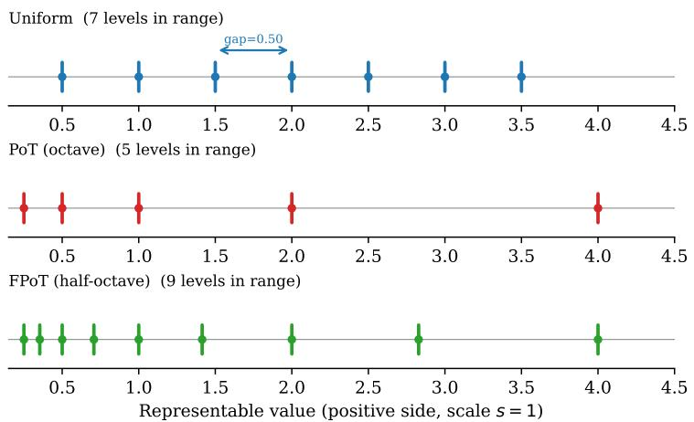  
Figure 4: Quantization grid comparison: Uniform, PoT (octave), and FPoT (half-octave). The FPoT grid places $2 \times$ more levels within the high-density region of the Gaussian weight distribution.

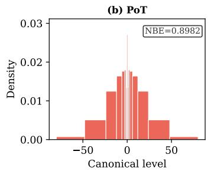

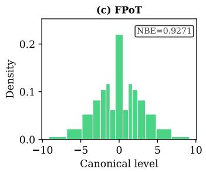  
Figure 5: Empirical bin occupancy for Llama-3-8B (W4A4KV4, aggregated across all projections). The pattern closely matches the Gaussian proxy prediction in Fig. 2.

We present the bin occupancy distributions of RTN-quantized weights (W4A4KV4) for each model evaluated in this work. These empirical distributions complement the theoretical Gaussian analysis (Fig. 2) and the Llama-3-8B aggregated results (Fig. 5).

Across all models, the empirical bin occupancy closely matches the theoretical Gaussian prediction: (a) uniform INT4 exhibits a bell-shaped occupancy with ${ \sim } 1 4 \%$ zero bin; (b) PoT concentrates weights in the mid-exponent bins (±16, ±32) with only ${ \sim } 3 \%$ zero; (c) FPoT achieves more uniform non-zero bin occupancy but maps \~20–22% of weights to zero due to the k-adaptive zero threshold $\tau _ { 2 } ~ = ~ 2 ^ { - 1 / 4 } ~ \approx ~ 0 . 8 4 1$ (Section 3). The consistency across model families (Llama-2, Llama-3, Qwen2.5) and scales (1.5B–14B) confirms that recent LLM PTQ preprocessing produces weight distributions with similar log-domain concentration, validating the use of the Gaussian proxy analysis for grid design.

## C.1 Per-Projection Breakdown

Fig. 6 shows the per-projection bin occupancy for Llama-3-8B, complementing the aggregated view in Fig. 5.

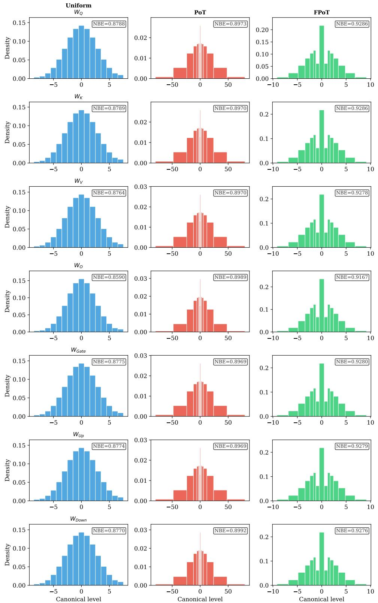  
Figure 6: Per-projection bin occupancy of RTN-quantized Llama-3-8B weights (W4A4KV4). Rows: $\bar { W _ { Q } } , W _ { K } , \bar { W _ { V } } , \bar { W _ { O } } , W _ { G a t e } , \bar { W _ { U p } } , \bar { W _ { D o w n } } .$ Columns: Uniform, PoT, FPoT. The occupancy pattern is consistent across all seven projections, with FPoT achieving NBE > 0.91 uniformly (0.9167– 0.9286), substantially above PoT and uniform INT4.

## C.2 Effect of PTQ Preprocessing on Bin Occupancy

Fig. 7–12 compare the bin occupancy before and after PTQ preprocessing. A consistent pattern emerges: preprocessing increases NBE for uniform INT4 (+0.01 to +0.07) and FPoT (+0.01 to +0.06), while slightly decreasing NBE for PoT (—0.01 to -0.03). This confirms that distribution redistribution specifically benefits grids whose dynamic range is matched to the redistributed weight spread (\~4 octaves), while the excessively wide PoT grid (64:1) cannot exploit the narrower postpreprocessing distribution. The effect is most pronounced for Qwen2.5 models, whose raw weights exhibit stronger outlier concentration.

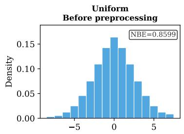

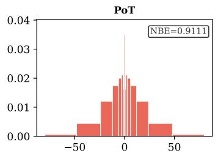

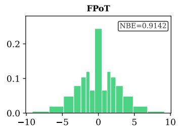

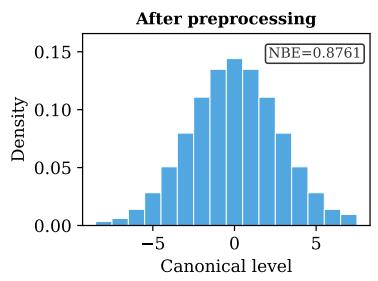

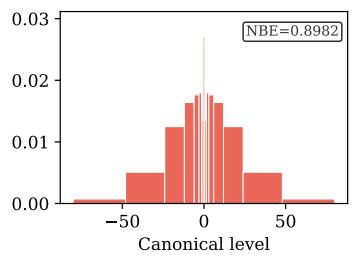

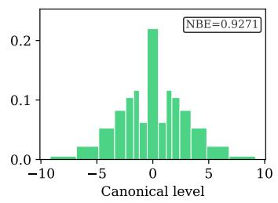  
Figure 7: Bin occupancy before (top) and after (bottom) PTQ preprocessing for Llama-3-8B (W4A4KV4). uniform INT4 NBE rises from 0.8599 to 0.8761 and FPoT from 0.9142 to 0.9271; PoT drops slightly (0.9111 → 0.8982).

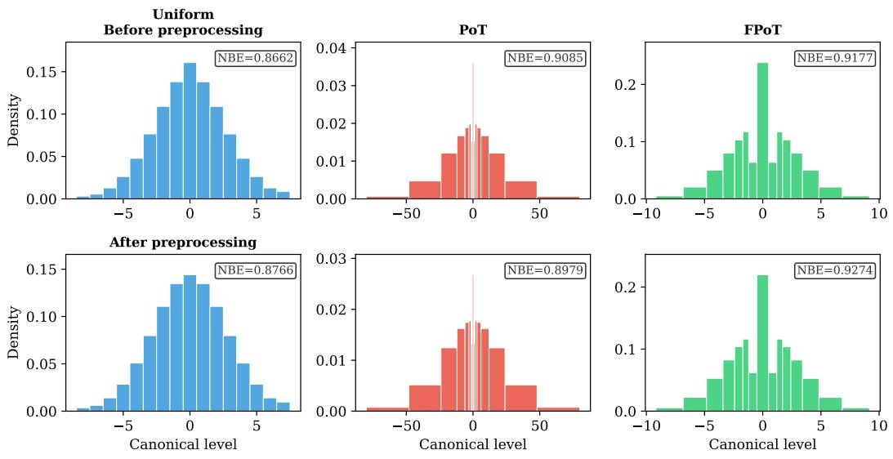  
Figure 8: Bin occupancy before (top) and after (bottom) PTQ preprocessing for Llama-2-7B (W4A4KV4). NBE shifts: uniform INT4 0.8662 → 0.8766; FPoT 0.9177 → 0.9274.

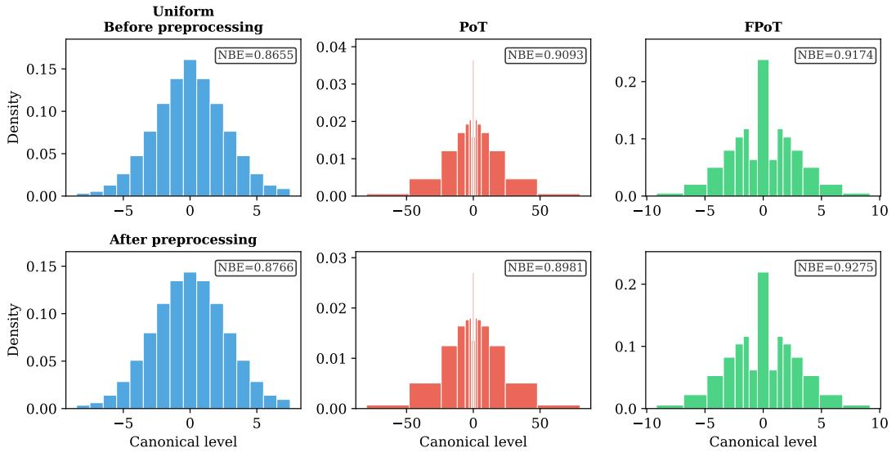  
Figure 9: Bin occupancy before (top) and after (bottom) PTQ preprocessing for Llama-2-13B (W4A4KV4). NBE shifts: uniform INT4 0.8655 → 0.8766; FPoT 0.9174 → 0.9275.

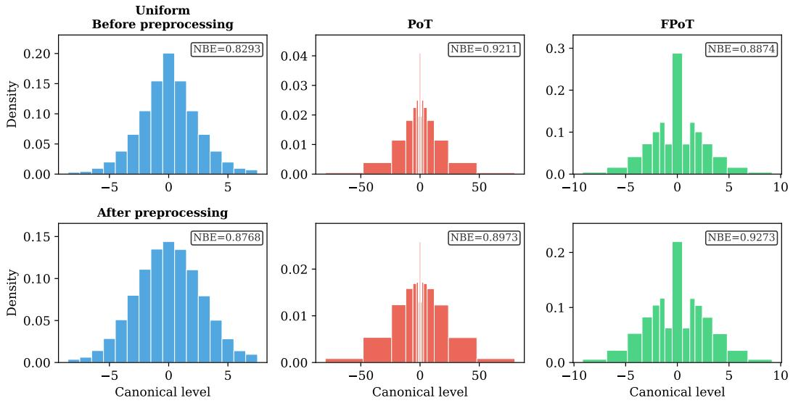  
Figure 10: Bin occupancy before (top) and after (bottom) PTQ preprocessing for Qwen2.5-1.5B (W4A4KV4). NBE shifts are large (uniform INT4 0.8293 → 0.8768; FPoT 0.8874 → 0.9273) reflecting strong raw-weight outlier concentration.

  
Figure 11: Bin occupancy before (top) and after (bottom) PTQ preprocessing for Qwen2.5-7B (W4A4KV4). NBE shifts: uniform INT4 0.8065 → 0.8775; FPoT 0.8644 → 0.9282.

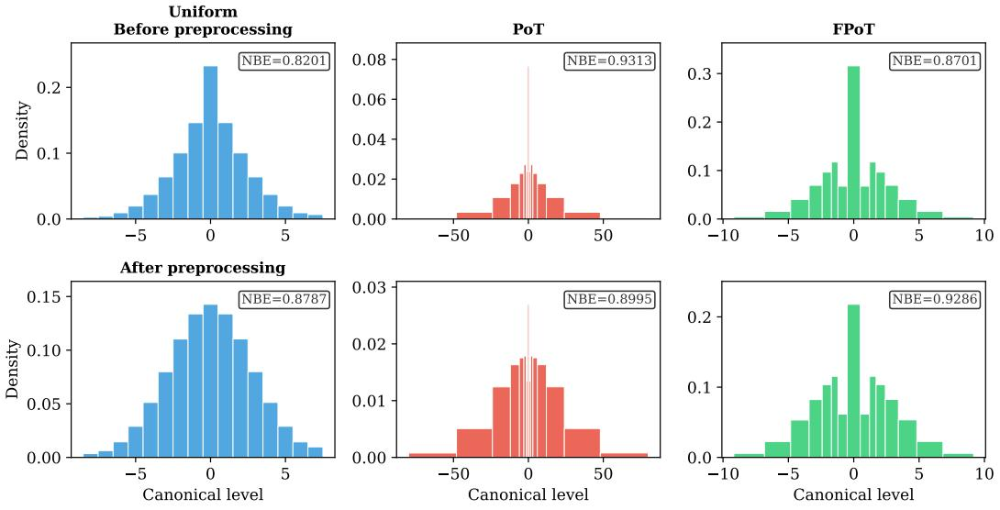  
Figure 12: Bin occupancy before (top) and after (bottom) PTQ preprocessing for Qwen2.5-14B (W4A4KV4). NBE shifts: uniform INT4 0.8201 → 0.8787; FPoT 0.8701 → 0.9286.

## D Per-Projection Sensitivity Analysis

## D.1 Per-Projection MAC Breakdown

Table 4 presents the per-projection MAC breakdown for Llama-3-8B (32 layers, single token); the FFN projections (Gate, Up, Down) dominate at 80.8% of weight MACs.

Table 4: MAC Breakdown per Token for Llama-3-8B (32 Layers)
<table><tr><td>Projection</td><td>MACs (M)</td><td> $\%$  of Total</td></tr><tr><td> $W _ { Q }$ </td><td>537</td><td>7.7%</td></tr><tr><td> $W _ { K }$ </td><td>134</td><td>1.9%</td></tr><tr><td> $W _ { V }$ </td><td>134</td><td>1.9%</td></tr><tr><td> $W _ { O }$ </td><td>537</td><td>7.7%</td></tr><tr><td>Gate</td><td>1,879</td><td>26.9%</td></tr><tr><td> $\mathrm { U p }$ </td><td>1,879</td><td>26.9%</td></tr><tr><td>Down</td><td>1,879</td><td>26.9%</td></tr><tr><td>Attn total</td><td>1,342</td><td>19.2%</td></tr><tr><td>FFN total</td><td>5,637</td><td>80.8%</td></tr><tr><td>Total</td><td>6,979</td><td>100%</td></tr></table>

## D.2 Per-Projection FPoT Sensitivity

Table 5 presents the per-projection FPoT sensitivity on Llama-3-8B (W4A4KV4). Each row applies weight-only FPoT to the indicated projection(s) while the rest use uniform INT. The non-PoT baseline achieves PPL = 7.444 and $0 { - } \mathrm { s h o t } ^ { \bar { 9 } } = \mathrm { 6 4 . 9 8 \% }$

Table 5: Per-projection FPoT weight-only ablation on Llama-3-8B (W4A4KV4, 400 steps, single seed). Each row applies FPoT to the indicated projection(s); all others use uniform INT. Activations use uniform INT4 throughout.
<table><tr><td>FPoT Applied To</td><td> $\mathrm { P P L } \downarrow$ </td><td> $0 { - } \mathrm { s h o t } ^ { 9 } \uparrow ( \% )$ </td></tr><tr><td>None (non-PoT baseline)</td><td>7.444</td><td>64.98</td></tr><tr><td> $W _ { Q }$  only  $W _ { K } \mathrm { \ o n l y }$ </td><td>7.379 65.59 7.393</td><td></td></tr><tr><td> $W _ { V } \ \mathrm { o n l y }$ </td><td>7.487</td><td>64.77 65.45</td></tr><tr><td> $W _ { O } \mathrm { \ o n l y }$ </td><td>7.337</td><td>65.21</td></tr><tr><td>Gate only</td><td>7.381</td><td>65.45</td></tr><tr><td>Up only</td><td>7.386</td><td>65.77</td></tr><tr><td>Down only</td><td>7.496</td><td>64.59</td></tr><tr><td>Attention  $( W _ { Q } + W _ { K } + W _ { V } + W _ { O } )$ </td><td>7.419</td><td>65.13</td></tr><tr><td>FFN (Gate+Up+Down)</td><td>7.530</td><td>64.74</td></tr><tr><td>All 7 projections</td><td>7.563</td><td>64.28</td></tr></table>

FPoT achieves near-lossless quantization on every individual projection. All single-projection entries achieve PPL within $+ 0 . 0 5$ of the non-PoT baseline, with 0-shot9 within 0.4%p. Even when applied to all seven projections simultaneously, the total overhead is only +0.12 PPL and —0.7%p $0 \mathrm { - s h o t ^ { 9 } }$

Degradation is sub-additive. Applying FPoT to all seven projections (PPL = 7.563) incurs less overhead than the sum of individual per-projection overheads, suggesting complementary error compensation across projections.

## D.3 Design Implications

Per-projection sensitivity guides future aggressive compression designs. The Value projection requires uniform INT activations: full FPoT on $W _ { V }$ incurs $\Delta \mathrm { P P L } = + 0 . 3 0$ versus +0.04 for weight-only FPoT (Table 5), a $7 \times$ gap driven by post-softmax activation noise. For future full-PoT activation

designs, the Output projection is the safest candidate, followed by FFN projections; Value should be last.

## E Hardware Efficiency Analysis Details

This appendix documents the methodology underlying the hardware cost estimates in Section 4.2 and presents per-model accuracy-cost trade-offs.

## E.1 Naive Component-Based Cost Model

We adopt a simple component-counting model with two unit costs: $c _ { \mathrm { f a } } = 1 . 0$ (full-adder equivalent) for arithmetic logic, and $c _ { \mathrm { m u x } } = 0 . 5 \times c _ { \mathrm { f a } }$ for 2-to-1 multiplexer stages (reflecting the lower transistor count of a pass-gate MUX vs. a full adder). All costs are per-bit of the datapath width A (activation bits).

INT multiplier. A $W { \times } A$ signed multiplier generates $W { \times } A$ partial products and reduces them through an adder tree. Complexity grows quadratically:

$$
C _ { \mathrm { I N T } } = W \times A .
$$

PoT barrel shifter. A barrel shifter with $( W { - } 1 )$ -bit shift control implements $( W { - } 1 )$ cascaded MUX stages, each containing A two-input multiplexers:

$$
C _ { \mathrm { P o T } } = ( W { - } 1 ) \times A \times c _ { \mathrm { m u x } } = ( W { - } 1 ) \times A \times 0 . 5 .
$$

Complexity grows linearly in both W and A, which is the fundamental source of $\mathrm { P o } \mathrm { T } { \boldsymbol { \mathrm { s } } }$ hardware advantage.

FPoT shifter + adder. FPoT uses a barrel shifter with one fewer stage (shift amount $\ l = \lfloor e / 2 \rfloor$ requiring $W { - 2 }$ control bits), plus a 1-adder $\sqrt { 2 }$ approximation unit $( x + x \gg 1 = 1 . 5 x , 6 . 1 \%$ error). The constant right-shift $( \gg 1 )$ is a hard-wired reconnection requiring zero logic gates. The 6.1% coefficient error is absorbed by approximate-grid quantization (Section 5.3):

$$
C _ { \mathrm { F P o T } } = \underbrace { ( W - 2 ) \times A \times 0 . 5 } _ { \mathrm { b a r r e l ~ s h i f t e r } } + \underbrace { 1 \times A } _ { \sqrt { 2 } \mathrm { ~ a d d e r } } = 0 . 5 \cdot A \cdot W .
$$

Accumulator. All three modes share an identical $( W { + } A )$ -bit accumulator adder:

$$
C _ { \mathrm { A C C } } = ( W + A ) \times c _ { \mathrm { f a } } = W + A .
$$

Table 6: Naive component-based cost model for INT, PoT, and FPoT compute units and full MACs (Section 4.2). Values are normalized to W4A4 INT compute unit = 1.00×, using $c _ { \mathrm { m u x } } = 0 . 5 { \times } c _ { \mathrm { f a } }$ (full derivation in §E.1). The accumulator $( C _ { \mathrm { { A C C } } } = W + { \bf { \bar { A } } } )$ is identical across all three modes and added to obtain the full-MAC cost.

<table><tr><td>Config</td><td>INT</td><td>PoT</td><td>FPoT</td><td>PoT/INT</td><td>FPoT/INT</td></tr><tr><td colspan="6">Compute unit only</td></tr><tr><td>W4A4</td><td>1.00</td><td>0.38</td><td>0.50</td><td>0.38×</td><td>0.50×</td></tr><tr><td>W4A8</td><td>2.00</td><td>0.75</td><td>1.00</td><td>0.38×</td><td>0.50×</td></tr><tr><td>W8A8</td><td>4.00</td><td>1.75</td><td>2.00</td><td>0.44×</td><td>0.50×</td></tr><tr><td colspan="6">Full MAC (compute unit + accumulator)</td></tr><tr><td>W4A4</td><td>1.50</td><td>0.88</td><td>1.00</td><td>0.58×</td><td>0.67×</td></tr><tr><td>W4A8</td><td>2.75</td><td>1.50</td><td>1.75</td><td>0.55×</td><td>0.64×</td></tr><tr><td>W8A8</td><td>5.00</td><td>2.75</td><td>3.00</td><td>0.55×</td><td>0.60×</td></tr></table>

The INT multiplier grows as $O ( W A )$ (quadratic), while both PoT and FPoT grow as $O ( W + A )$ (linear). The cost advantage therefore increases at higher bit-widths.

Remark 1 (Assumptions and Limitations). The naive model makes several simplifying assumptions: (1) unit cost approximation $( c _ { \mathrm { m u x } } = 0 . 5 \times c _ { \mathrm { f a } } ) ; ( 2 )$ no synthesis optimization; (3) no energy modeling (gate counts as area proxy only); (4) technology-node independence; (5) omitted common logic (sign negation, zero-gating), which are shared across all three modes and implemented in the accumulator control path rather than the compute unit, so their omission does not affect the CU cost ratios reported above. Despite these simplifications, the model correctly captures the fundamental scaling argument: multiplier cost is quadratic in bit-width while shifter + adder cost is linear, confirmed by the synthesis results.

## E.2 Open-source Synthesis Results

To corroborate the structural claims of the naive model, we synthesize the three compute units using Yosys 0.9 [Wolf and Glaser, 2013] with ABC generic-gate mapping (abc -g gates). Sign negation and zero-gating are implemented in the accumulator control path—consistent with Remark 1, assumption (5)—and are therefore excluded from compute-unit gate counts. Table 7 reports gate counts for all nine (config × mode) combinations.

Three observations are consistent with the analytical model. First, the structural ordering $\mathrm { I N T } > \mathrm { F P o T } > \mathrm { P o T }$ holds for every configuration, confirming that the 1-adder $\sqrt { 2 }$ unit adds only moderate overhead relative to the INT multiplier. Second, the INT gate count grows faster with bit-width than FPoT: scaling from W4A4 to W8A8 (compute unit), INT grows 5.2× while FPoT grows 3.8×, confirming that FPoT's cost advantage widens at higher bit-widths. Third, the full-MAC PoT/INT ratio decreases from 0.50× at W4A4 to 0.37× at W8A8, consistent with the quadratic-versus-linear scaling prediction.

Absolute ratios differ from Table 6 in two respects. PoT/INT at W4A4 (compute unit) measures 0.24× vs. the analytical 0.38×: the ABC optimizer aggressively shares gates in the barrel-shifter MUX chain, making the analytical model a conservative estimate of PoT's advantage. FPoT/INT at W4 (compute unit) measures 0.57–0.59× vs. the analytical 0.50×: the output-width MUX (selecting the even/odd branch) costs more than the $c _ { \mathrm { m u x } } = 0 . 5$ assumption in a generic-gate library. The Yosys results therefore support the core structural claim of the analytical model—the INT-vs.-FPoT cost gap is real and widens with bit-width—while absolute values should be interpreted with the caveats of Remark 1. Quantitatively, the cosine similarity between the analytical and Yosys-measured cost vectors (all 18 entries of Table 6 and Table 7, normalized to W4A4 INT CU) is 0.988, confirming near-perfect agreement in structural ordering and bit-width scaling direction despite differences in absolute ratios.

Table 7: Gate counts from Yosys + ABC open-source synthesis (generic-gate library, abc -g gat es), with relative cost in parentheses normalized to W4A4 INT compute unit = 1.00× (matching Table 6). Sign negation and zero-gating reside in the accumulator control path and are excluded from compute-unit counts (Remark 1, assumption 5).
<table><tr><td>Config</td><td>INT</td><td>PoT</td><td>FPoT</td><td>PoT/INT</td><td>FPoT/INT</td></tr><tr><td colspan="6">Compute unit only</td></tr><tr><td>W4A4</td><td>75 (1.00)</td><td>18 (0.24)</td><td>44 (0.59)</td><td>0.24×</td><td>0.59×</td></tr><tr><td>W4A8</td><td>154 (2.05)</td><td>30 (0.40)</td><td>87 (1.16)</td><td>0.19×</td><td>0.57×</td></tr><tr><td>W8A8</td><td>391 (5.21)</td><td>92 (1.23)</td><td>167 (2.23)</td><td>0.24×</td><td>0.43×</td></tr><tr><td colspan="6">Full MAC (compute unit + accumulator)</td></tr><tr><td>W4A4</td><td>119 (1.59)</td><td>60 (0.80)</td><td>91 (1.21)</td><td>0.50×</td><td>0.77×</td></tr><tr><td>W4A8</td><td>216 (2.88)</td><td>95 (1.27)</td><td>161 (2.15)</td><td>0.44×</td><td>0.75×</td></tr><tr><td>W8A8</td><td>487 (6.49)</td><td>180 (2.40)</td><td>271 (3.61)</td><td>0.37×</td><td>0.56×</td></tr></table>

## E.3 MAC Energy Ratio: Published Synthesis Anchor

The energy estimates in §4.2 are anchored to the only published RTL-level ASIC synthesis comparing INT and PoT MAC units at identical conditions: Przewlocka-Rus et al. [2022] (Samsung 5 nm, 250 MHz, TT corner, 0.6 V, 25°C, 50% toggle rate). Relative to an 8×8 uniform MAC baseline, they report W4A8 uniform MAC at 2.5× energy reduction and W4A8 PoT MAC at 6.0×. The PoT-to-INT

ratio for the same W4A8 precision is therefore:

$$
\frac { E _ { \mathrm { P o T } , \mathrm { W 4 A 8 } } } { E _ { \mathrm { I N T } , \mathrm { W 4 A 8 } } } = \frac { 2 . 5 } { 6 . 0 } \approx \mathbf { 0 . 4 2 } \times .
$$

FPoT adds the $\times \sqrt { 2 }$ unit (one adder, active for ～50% of MACs). We report the FPoT/INT energy ratio as a range: 0.42–0.46×, where the lower bound assumes negligible $\sqrt { 2 }$ switching energy and the upper bound assumes proportional contribution.

Applicability to LLMs. Although Przewlocka-Rus et al. [2022] synthesize CNN-oriented MAC units (ResNet/VGG benchmarks), the reported per-MAC energy ratio is model-agnostic: the synthesized block—a 4×8 shift-add unit vs. a 4×8 uniform multiplier—is structurally identical to the per-weight MAC in our LLM datapath. Model-level differences (sequence length, attention, layer count) affect only the aggregate MAC count, not the per-MAC energy, so the 0.42× ratio transfers directly to LLM inference. Note that this anchor reports per-MAC energy of the arithmetic unit alone; total LLM inference energy additionally includes memory-access, accumulator, and activation-path contributions, the relative weight of which varies with batch size and sequence length. The per-MAC ratio therefore sets the achievable upper bound on weight-arithmetic energy savings rather than the total system-level reduction.

## E.4 Per-Model Accuracy-Cost Trade-offs

The per-model figures below present accuracy-cost Pareto trade-offs across compute unit (CU) cost and full MAC cost (CU + accumulator), normalized to W4A4 Uniform INT = 1.0×.

The figures reveal a consistent pattern across all seven models: (1) FPoT consistently approaches the Uniform INT accuracy at 0.50× CU cost; (2) the shared accumulator compresses the advantage at full-MAC level (0.67× at W4A4); (3) as bit-widths increase, the quadratic/linear scaling gap widens, increasing FPoT's advantage; (4) all models share the same x-axis coordinates (hardware is modelindependent), with variation only in accuracy (y-axis). Per-model Pareto curves for Llama-3-8B, Llama-2-7B/13B, Mistral-7B, and Qwen2.5-1.5B/7B/14B are shown in Figs. 13–19, respectively.

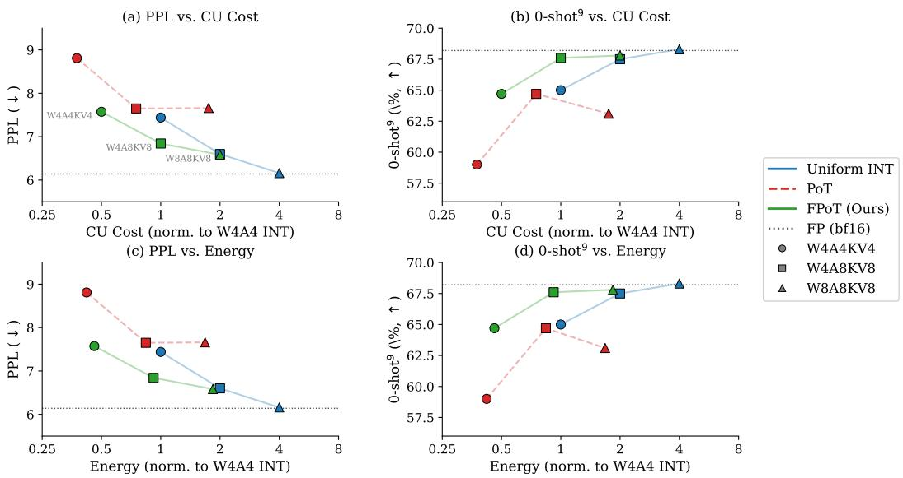  
Figure 13: Accuracy-cost Pareto trade-off: Llama-3-8B.

Llama-2-7B  
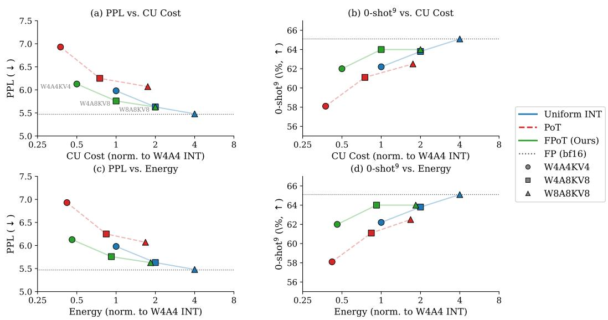  
Figure 14: Accuracy-cost Pareto trade-off: Llama-2-7B.

Llama-2-13B  
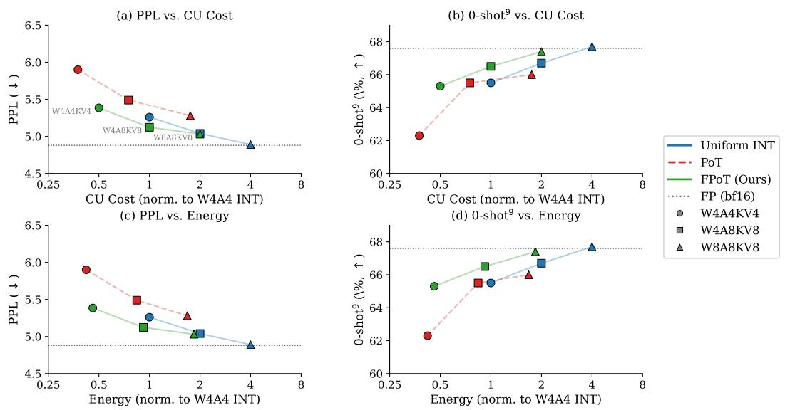  
Figure 15: Accuracy-cost Pareto trade-off: Llama-2-13B.

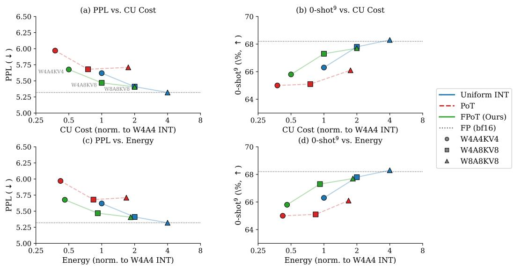  
Figure 16: Accuracy-cost Pareto trade-off: Mistral-7B.

Qwen2.5-1.5B  
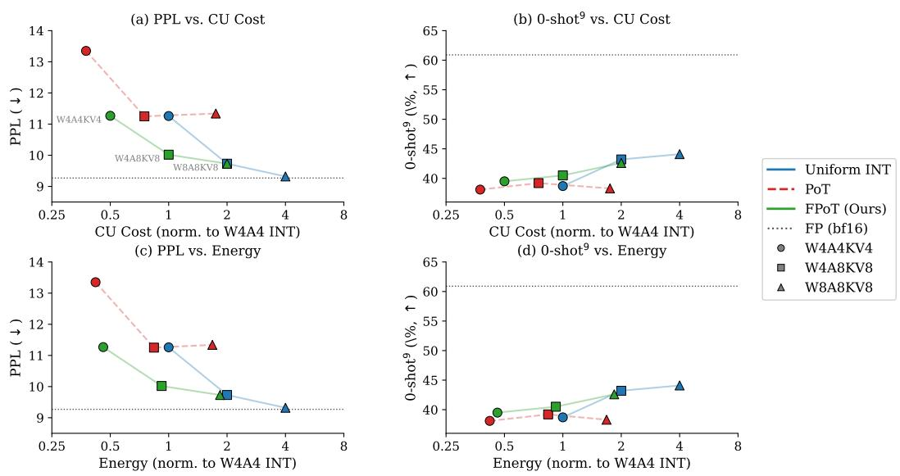  
Figure 17: Accuracy-cost Pareto trade-off: Qwen2.5-1.5B.

Qwen2.5-7B  
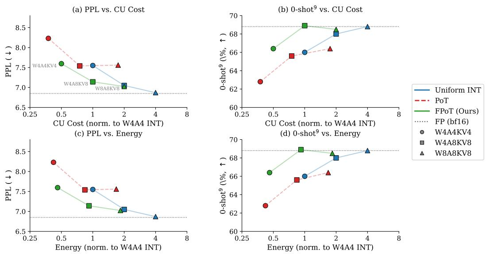  
Figure 18: Accuracy-cost Pareto trade-off: Qwen2.5-7B.

Qwen2.5-14B  
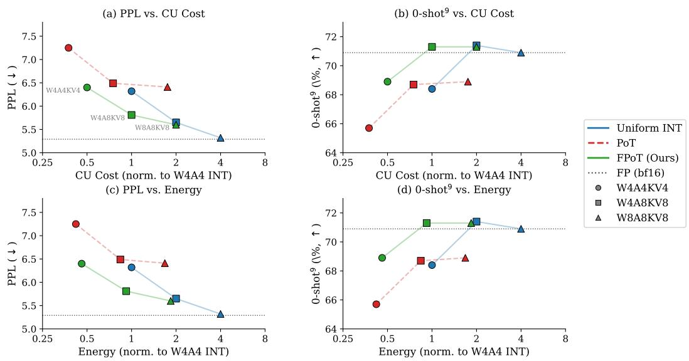  
Figure 19: Accuracy-cost Pareto trade-off: Qwen2.5-14B.

## F Fused Triton Kernel for FPoT Training

The FPoT fake-quantization pipeline (quantize → dequantize → STE) generates ${ \sim } 8$ intermediate tensors per weight matrix when implemented in standard PyTorch—sign, absolute value, log2 result, exponent, zero/kill masks, and dequantized output—each the same size as the weight. During gradientcheckpointed backward passes, these intermediates are regenerated, creating a memory peak that exceeds single-GPU capacity for models above \~13B parameters on 80 GB GPUs.

We implement a fused Triton kernel that performs the entire pipeline in a single kernel launch:

1. Quantize: compute $| x / s |$ , apply zero threshold $( 2 ^ { - 0 . 5 / k } )$ , compute round $( \log _ { 2 } ( \cdot ) \times k )$ clamp exponents, determine sign and kill masks.

2. Dequantize: compute s· sign· $2 ^ { e / k }$

3. STE: output $x _ { \mathrm { { f a k e } } } ;$ backward passes gradient through unchanged via a custom torch.autograd.Function.

All intermediate values reside in GPU registers and are never materialized as global-memory tensors. The kernel handles per-channel broadcast of scale, $n ,$ and m parameters natively through stride-based indexing, avoiding expand\_as () . contiguous () copies that would otherwise duplicate these tensors to full weight size.

Memory savings. On the largest single-projection weight in Qwen2.5-14B (gate-pro j: 18,944 × 5,120), the fused kernel reduces peak intermediate memory from 1.07 GB to 0.19 GB—an 82% reduction. This enables FPoT training of 14B-parameter models on a single A100-80GB with batch size 4, previously infeasible due to OOM during gradient checkpoint recomputation.

Numerical fidelity. The kernel performs all arithmetic in float32, matching the precision-critical $\log _ { 2 }$ and $2 ^ { ( \cdot ) }$ operations. On a full-size weight tensor, 99.6% of elements match the PyTorch reference exactly; the remaining 0.4% differ by at most one quantization level due to bf16→float32 promotion order differences, with the Triton path being strictly more precise. A pure-PyTorch fallback is provided for environments without Triton.

Pseudocode. Algorithm 1 details the complete FPoT quantize/dequantize/STE pipeline.

Algorithm 1 Signed FPoT Quantization with k-Adaptive Zero Threshold   
Require: Weight tensor $\overline { { \mathbf { W } \in \mathbb { R } ^ { C _ { \mathrm { o u t } } \times C _ { \mathrm { i n } } } } }$ , bit budget b, resolution parameter k, clip ratio $\alpha \in ( 0 , 1 ]$   
Ensure: Quantized weight codes M $\in \{ 0 , \ldots , \bar { 2 } ^ { b - 1 } - 1 \} ^ { C _ { \mathrm { o u t } } \times \bar { C _ { \mathrm { i n } } } }$ , signs $\textbf { S } \in \ \{ - 1 , 0 , + 1 \}$ , per  
channel scales $\mathbf { s } \in \mathbb { R } ^ { \breve { C } _ { \mathrm { o u t } } }$   
// Grid parameters   
1: $e _ { \mathrm { m a x } } \gets \sum ^ { b - 1 } - 2$ Max exponent index $( 4 { \cdot } \mathrm { b i t } \to e _ { \mathrm { m a x } } { = } 6 )$   
2: $\tau _ { k } \gets 2 ^ { - 1 / ( 2 k ) }$ ▶ k-adaptive zero threshold   
$( k { = } 1 ; \tau { = } 0 . 7 0 7 ; k { = } 2 ; \tau { = } 0 . 8 4 1 )$   
// Per-channel scale with MSE clip search   
3: for each output channel $c = 1 , \ldots , C _ { \mathrm { o u t } }$ do   
4: $s _ { c } \gets \alpha _ { c } ^ { * } \cdot \operatorname* { m a x } _ { j } \left| W _ { c , j } \right| / 2 ^ { e _ { \operatorname* { m a x } } / k }$ $\alpha _ { c } ^ { * } \colon$ MSE-optimal clip ratio   
5: end for   
// Quantize each weight   
6: for each weight $w = \breve { W } _ { c , j }$ do   
7: $\tilde { w }  | w | \textbar { / } s _ { c }$ Scale-normalized magnitude   
8: if $\tilde { w } < \tau _ { k }$ then Below zero threshold   
9: $m  0 , \sigma  0$ Zero code (implicit pruning)   
10: else   
11: $e \gets \mathrm { c l i p } \big ( \lfloor \log _ { 2 } ( \tilde { w } ) \cdot k \rceil , 0 , e _ { \mathrm { m a x } } \big )$ FPoT exponent index   
12: m $ e + 1$ Magnitude code: $m \in \{ 1 , \ldots , 2 ^ { b - 1 } - 1 \}$   
13: $\sigma \gets \operatorname { s g n } ( w )$ Sign   
14: end if   
15: end for   
// Stored weight representation (b-bit)   
weight[b−1] = sign bit, weight[b−2:0] = magnitude m   
// Dequantization   
$\hat { w } = \left\{ \begin{array} { l l } { 0 } \\ { \sigma \cdot s _ { c } \cdot 2 ^ { ( m - 1 ) / k } } \end{array} \right.$ if $m = 0$   
if $m \geq 1$   
// Hardware decomposition (k=2, inference)   
For each $M A C y + = x _ { \mathrm { a c t } } \cdot \hat { w } :$   
if m = 0: skip (zero-gating)   
e ← m − 1 Recover exponent from magnitude (subtract)   
shift $ \lfloor e / 2 \rfloor = { \mathsf { w e i g h t } } [ b / - 2 : 1 ]$ Wire selection, 0 gates   
odd $ e$ mod $2 = { \mathsf { w e i g h t } } [ 0 ]$ ▶ Wire, 0 gates   
shifted $ x _ { \mathrm { a c t } } \ll$ shift Barrel shifter   
if even: $y + = \sigma$ · shifted   
if odd: $y + = \sigma$ (shifted + shifted>1)  = 1.5 · shifted, 6.1% err vs ${ \sqrt { 2 } } ,$ absorbed by   
ApproxGrid

## G Additional Ablations

## G.1 Calibration Sensitivity

A common concern for post-training quantization methods is sensitivity to the calibration set: both its size and domain. We evaluate FPoT on Llama-3-8B (W4A4KV4) while varying: (1) the number of calibration samples $n \in \{ 1 2 8 , 2 5 6 , 5 1 2 \}$ , and (2) the calibration dataset: WikiText-2 [Merity et al., 2017] (the default used throughout the paper) versus C4 [Raffel et al., 2020] (a large-scale web-crawled corpus). All other hyperparameters—OSTQuant training steps (400), learning rate, GPTQ settings—remain fixed.

Table 8: Calibration sensitivity analysis on Llama-3-8B (W4A4KV4, FPoT, 400 steps). Rows vary the calibration dataset and number of calibration samples (n). The default configuration used throughout the paper is WikiText-2 with n=128.
<table><tr><td>Cal. Dataset</td><td>n</td><td>PPL↓</td><td> $0 { - } \mathrm { s h o t } ^ { 9 } \uparrow ( \% )$ </td><td>∆PPL</td></tr><tr><td rowspan="3">WikiText-2</td><td>128</td><td>7.559</td><td>65.07</td><td rowspan="3">+0.030</td></tr><tr><td>256</td><td>7.589</td><td>64.68</td></tr><tr><td>512</td><td>7.525</td><td>64.80</td></tr><tr><td rowspan="3">C4 [Raffel et al., 2020]</td><td>128</td><td>7.617</td><td>64.91</td><td>+0.058</td></tr><tr><td>256</td><td>7.660</td><td>65.01</td><td>+0.101</td></tr><tr><td>512</td><td>7.647</td><td>64.88</td><td>+0.088</td></tr></table>

FPoT is robust to calibration set size. Within either dataset, PPL varies by at most 0.065 (7.525– 7.589 for WikiText-2; 7.617–7.660 for C4) across a 4× range of sample counts. The 0-shot9 accuracy is similarly stable, with a maximum spread of 0.4%p. This indicates that n=128 samples are sufficient for FPoT calibration; increasing to 256 or 512 yields no systematic improvement, consistent with prior findings for GPTQ-based methods [Frantar et al., 2023].

FPoT is robust to calibration domain. Switching from WikiText-2 to C4 increases PPL by +0.06–+0.10, a minor shift relative to the method's +0.12 total overhead. Downstream accuracy is virtually unchanged (64.9–65.1% for C4 vs. 64.8–65.1% for WikiText-2). The modest cross-domain degradation suggests that FPoT's log-scale grid structure is inherently less sensitive to calibration distribution than fine-grained uniform quantization methods, since the quantization boundaries (powers of two) are data-independent—only the per-channel scale s adapts to the calibration data.

Practical recommendation. Our default setting (n=128, WikiText-2) is near-optimal across all configurations tested, and practitioners may safely use alternative calibration sources without retuning.

We evaluate design choices in the FPoT quantization scheme: the zero-threshold parameter, rounding mode, and weight-only vs. full PoT quantization. All experiments use Llama-3-8B (W4A4KV4, FPoT, 400 OSTQuant training steps).

## G.2 Weight Grid-Alignment

Table 9 reports PPL and 0-shot9 across $G \in \{ 4 , 8 , 1 6 , 3 2 \}$ phase-shift candidates on Llama-3-8B (W4A4KV4, 400 steps).

Table 9: Weight grid-alignment ablation (Llama-3-8B, W4A4KV4, 400 steps, single seed). G: number of phase-shift candidates (Eq. (4)); G=— denotes the plain FPoT baseline. At k=1, grid-alignment reduces PPL by up to —0.051; at k=2 the finer grid already self-corrects, so $| \Delta \mathrm { { P P L } | \leq 0 . 0 3 4 . { \dot { 0 } } { \mathrm { { - s h o t } } } ^ { \mathrm { { g } } } }$ values are in %.

<table><tr><td rowspan="2">G</td><td colspan="2">k=1</td><td colspan="2">k=2</td></tr><tr><td>PPL↓</td><td> $0 { \cdot } \mathrm { s h o t } ^ { 9 } \uparrow$ </td><td>PPL↓</td><td> $0 { \cdot } \mathrm { s h o t } ^ { 9 } \uparrow$ </td></tr><tr><td></td><td>8.806</td><td>58.99</td><td>7.563</td><td>64.28</td></tr><tr><td>4</td><td>8.755</td><td>59.09</td><td>7.545</td><td>64.49</td></tr><tr><td>8</td><td>8.771</td><td>60.04</td><td>7.597</td><td>64.45</td></tr><tr><td>16</td><td>8.771</td><td>60.08</td><td>7.560</td><td>64.71</td></tr><tr><td>32</td><td>8.801</td><td>59.69</td><td>7.568</td><td>63.55</td></tr></table>

## G.3 Weight-Only vs. Full PoT Quantization

Table 10 shows that applying PoT/FPoT to both weights and activations is catastrophic (PPL 16.9– 114.1 at k=1; even FPoTk=2 reaches only 8.21–52.49), while weight-only PoT/FPoT remains usable. The dominant bottleneck is the coarse logarithmic grid applied to post-softmax activations, not activation quantization per se.

Table 10: Weight-only vs. Full PoT/FPoT on Llama-3-8B (all 7 projections, single seed). Weight-only: PoT/FPoT weight + uniform INT activation. Full: PoT/FPoT applied to both weight and activation. 0-shot9 values are in %.
<table><tr><td>k Scope</td><td>PPL↓  $0 { \cdot } \mathrm { s h o t } ^ { 9 } \uparrow$ </td></tr><tr><td>W4A4KV4 (non-PoT baseline: k=1 Full 16.91 k=1 W-only 8.81 k=2 Full 8.21 k=2 W-only (Ours) 7.56 W4A8KV8 (non-PoT baseline:</td><td> $P P L = 7 . 4 4 )$  44.6 59.0 62.5 64.3  $P P L = 6 . 6 0 )$ </td></tr><tr><td>k=1 Full k=1 W-only k=2 Full k=2 W-only (Ours) W8A8KV8 (non-PoT baseline: PPL = 6.16)</td><td>114.1 42.7 7.65 64.7 52.49 53.8 6.80 67.2</td></tr><tr><td>k=1 Full 37.07 k=1 W-only 7.66 k=2 Full 27.91 k=2 W-only (Ours) 6.54</td><td>52.3 63.1 57.4 66.7</td></tr></table>

## G.4 k-Adaptive Zero-Threshold Sensitivity

In FPoT quantization, values with $| w / s | < \tau$ are mapped to zero rather than to the nearest PoT level. We parameterize $\tau = 2 ^ { \alpha / k }$ where α controls the aggressiveness of zeroing. The default $\alpha = - 0 . 5$ places the threshold at the log-space midpoint between zero and the smallest PoT level $( s \cdot 2 ^ { 0 } = s )$ which is the theoretically optimal boundary under a uniform-in-log prior.

Table 11: Zero-threshold sensitivity analysis on Llama-3-8B (W4A4KV4, FPoT, 400 steps). The threshold $\tau = 2 ^ { \alpha / k }$ determines the boundary below which $| w / s |$ is mapped to zero. The default $\alpha { = } \mathrm { - } 0 . 5$ corresponds to the log-space midpoint between zero and the smallest PoT level.
<table><tr><td>α</td><td> $\tau ( = 2 ^ { \alpha / 2 } )$   $\mathrm { P P L } \downarrow$ </td><td> $0 { - } \mathrm { s h o t } ^ { 9 } \uparrow ( \% )$ </td></tr><tr><td>-0.5</td><td>0.841 7.560</td><td>64.71</td></tr><tr><td>-1</td><td>0.707 7.573</td><td>64.99</td></tr><tr><td>-2</td><td>0.500 7.565</td><td>64.99</td></tr><tr><td>-3</td><td>0.354 7.553</td><td>65.06</td></tr><tr><td>-4</td><td>0.250 7.545</td><td>64.72</td></tr><tr><td>-6</td><td>0.125 7.557</td><td>64.54</td></tr><tr><td>-100</td><td>≈0 7.540</td><td>64.78</td></tr></table>

Table 11 sweeps α from —0.5 (aggressive zeroing, $\tau = 0 . 8 4 1 )$ to —100 (effectively no zeroing, τ ≈ 0). Across this entire range, PPL varies by only 0.033 $( 7 . 5 4 0  – 7 . 5 7 3 )$ and $0 \mathrm { - s h o t ^ { 9 } }$ by 0.5%p (64.5–65.1%). The negligible sensitivity indicates that the zero-threshold is not a critical hyperparameter for FPoT: state-of-the-art LLM PTQ preprocessing and GPTQ calibration effectively compensate for the threshold choice. Practitioners may safely use the default $\alpha = - 0 . 5$ without tuning.

## G.5 Rounding Mode

The standard FPoT rounding uses nearest-neighbor in log-space: $e = { \mathrm { r o u n d } } ( \log _ { 2 } ( | w / s | ) \cdot k )$ , which places decision boundaries at the geometric mean of adjacent PoT levels. An alternative is linear-space nearest-neighbor, which places boundaries at the arithmetic mean—potentially better aligned with MSE-based objectives like GPTQ, since it minimizes absolute (rather than relative) quantization error per element.

Table 12 shows that the two rounding modes produce virtually identical results $( \Delta \mathrm { P P L } = - 0 . 0 0 1$ $\Delta 0 { \mathrm { - s h o t } } ^ { 9 } = + 0 . 1 \% p )$ . This is expected: for FPoT, adjacent levels differ by a factor of ${ \sqrt { 2 } } \approx 1 . 4 1 4$ so the geometric and arithmetic mean boundaries differ by only \~1.5%—well within the noise floor of the calibration process. The default log-space rounding is retained for its computational simplicity (one round vs. floor + two exp2 + comparison).

Table 12: Rounding mode comparison on Llama-3-8B (W4A4KV4, FPoT, 400 steps). Log-space rounds to the nearest PoT level measured by relative distance (geometric mean boundary). Linearspace rounds by absolute distance (arithmetic mean boundary).
<table><tr><td>Rounding mode</td><td> $\mathrm { P P L } \downarrow$ </td><td> $0 { - } \mathrm { s h o t } ^ { 9 } \uparrow ( \% )$ </td></tr><tr><td>Log-space NN (default)</td><td>7.560</td><td>64.71</td></tr><tr><td>Linear-space NN</td><td>7.559</td><td>64.81</td></tr></table>

## G.6 Preprocessing Ablation

Table 13 ablates the type and quality of the preprocessing transform under FPoT weight quantization on Llama-3-8B W4A4KV4. Configurations vary along two orthogonal axes: rotation quality (none → fixed Hadamard → learned) and the presence of per-channel scale.

Table 13: Preprocessing component ablation within OSTQuant under FPoT weight quantization on Llama-3-8B W4A4KV4 (400 steps, single seed; cf. Table 1 3-seed mean $7 . 6 0 { \scriptstyle \pm . 0 2 }$ for the full-pipeline entry). Activations and KV-cache use uniform INT4 throughout.
<table><tr><td>Preprocessing</td><td> $\mathrm { P P L } \downarrow$ </td><td> $0 { - } \mathrm { s h o t } ^ { 9 } \uparrow ( \% )$ </td></tr><tr><td>No transform</td><td>181.3</td><td>37.56</td></tr><tr><td>Scale only</td><td>9.78</td><td>58.79</td></tr><tr><td>Fixed Hadamard</td><td>8.30</td><td>62.64</td></tr><tr><td>Learned rotation</td><td>7.78</td><td>63.30</td></tr><tr><td>Learned  $\mathbf { r o t a t i o n } + s \mathbf { c a l e }$ </td><td>7.56</td><td>64.28</td></tr></table>

Both rotation and scale are necessary. Without any transform, FPoT yields catastrophic PPL = 181.3. Fixed Hadamard rotation alone (8.30) or learned rotation alone (7.78) provide substantial recovery, while scale-only achieves 9.78. Only the full combination (learned rotation + scale) reaches 7.56, within +0.12 of the non-PoT baseline, because rotation suppresses position-level outliers on the logarithmic grid while scale normalizes per-channel amplitude. More broadly, this supports the design criterion satisfied by state-of-the-art LLM PTQ methods such as OSTQuant and DuQuant.

## H Per-Task Downstream Results

This appendix reports individual zero-shot task scores for all models and bit-width configurations in Table 1. For tasks providing both acc and acc\_norm, we report acc\_norm (ARC-C, ARC-E, HellaSwag, PIQA, OpenBookQA); all others report acc. The “AVG" column is the unweighted mean across all nine tasks, matching the O-shotº metric in the main paper. All scores are in %. Three weight quantization methods are compared: Uniform (uniform INT baseline), PoT (weight-only), and FPoT (Ours), with the unquantized FP (bf16) reference shown above each model's quantized results. Tables 14–20 report per-task results for each model across the W4A4KV4, W4A8KV8, and W8A8KV8 configurations. FPoT (Ours) rows are bolded throughout.

Observations. Across all seven models and three bit-width configurations, FPoT with 1-adder approximate-grid quantization maintains competitive per-task performance relative to both the FP (bf16) reference and the Uniform INT baseline. Key patterns:

• Per-task ∆ within ±3%p: On most tasks, the difference between uniform INT and FPoT is within ±2–3%p, consistent with the aggregate 0-shot9 results in Table 1.

• WinoGrande consistently improves under FPoT at W4A4KV4 for five of seven models, suggesting a mild regularization benefit from the logarithmic weight grid.

Table 14: Per-task results: Llama-3-8B. Single calibration seed (seed 0); FP (bf16) is the unquantized reference; FPoT (Ours) rows are bolded. All scores in %.
<table><tr><td>Config</td><td>Method</td><td colspan="10">ARC-C ARC-E Hella Wino PIQA BoolQ OBQA Lam SIQA |AVG</td></tr><tr><td colspan="2">FP (bf16) reference</td><td>53.1</td><td>77.9</td><td>79.2</td><td>73.4</td><td>81.0</td><td>81.3</td><td></td><td>45.075.7</td><td>47.1</td><td>68.2</td></tr><tr><td rowspan="3">W4A4KV4 PoT</td><td>Uniform</td><td>44.8</td><td>76.4</td><td>57.0</td><td>68.2</td><td>76.9</td><td>77.0</td><td>32.2</td><td>73.5</td><td>46.3</td><td>65.0</td></tr><tr><td></td><td>36.4</td><td>68.1</td><td>53.0</td><td>67.2</td><td>73.8</td><td>67.2</td><td>26.6 68.0</td><td></td><td>42.6</td><td>59.0</td></tr><tr><td>FPoT (Ours)</td><td>43.9</td><td>75.4</td><td>56.0</td><td>69.2</td><td>76.7</td><td>78.0</td><td>31.2</td><td>73.2</td><td>45.1</td><td>64.2</td></tr><tr><td rowspan="3">W4A8KV8 PoT</td><td>Uniform</td><td>49.4</td><td>79.7</td><td>59.1</td><td>74.0</td><td>78.5</td><td>78.5</td><td>34.2</td><td>75.3</td><td>47.5</td><td>67.5</td></tr><tr><td></td><td>44.5</td><td>76.5</td><td>57.0</td><td>72.1</td><td>76.2</td><td>78.1</td><td></td><td>31.4 71.8</td><td>45.5</td><td>64.7</td></tr><tr><td>FPoT (Ours)</td><td>47.9</td><td>78.9</td><td>57.8</td><td>72.8</td><td>78.4</td><td>79.5</td><td>33.6 75.2</td><td></td><td>46.6</td><td>67.1</td></tr><tr><td rowspan="3">W8A8KV8 PoT</td><td>Uniform</td><td>50.7</td><td>80.0</td><td>60.2</td><td>73.3</td><td>79.4</td><td>81.6</td><td>35.2 75.4</td><td></td><td>46.7|</td><td>68.3</td></tr><tr><td></td><td>41.6</td><td>74.4</td><td>56.1</td><td>72.5</td><td>76.2</td><td>68.3</td><td>30.0</td><td>72.6</td><td>45.5</td><td>63.1</td></tr><tr><td>FPoT (Ours)</td><td>47.3</td><td>79.3</td><td>59.1</td><td>74.5</td><td>79.3</td><td>80.6</td><td>34.0 75.0</td><td></td><td>46.0</td><td>67.5</td></tr></table>

Table 15: Per-task results: Llama-2-7B. Single calibration seed (seed 0); FP (bf16) is the unquantized reference; FPoT (Ours) rows are bolded. All scores in %.
<table><tr><td>Config</td><td>Method</td><td>ARC-C ARC-E Hella Wino PIQA BoolQ</td><td></td><td></td><td></td><td></td><td></td><td></td><td>OBQA Lam SIQA|AVG</td><td></td><td></td></tr><tr><td colspan="2">FP (bf16) reference</td><td>45.9</td><td>74.5</td><td>75.9</td><td>68.8</td><td>78.7</td><td>78.0</td><td>44.2</td><td>73.6</td><td>46.0|</td><td>65.1</td></tr><tr><td rowspan="3">W4A4KV4 PoT</td><td>Uniform</td><td>40.6</td><td>73.4</td><td>54.7</td><td>66.9</td><td>75.8</td><td>74.7</td><td></td><td>32.4 70.4</td><td>44.0</td><td>62.2</td></tr><tr><td></td><td>35.8</td><td>69.1</td><td>52.0</td><td>62.8</td><td>73.6</td><td>68.8</td><td>27.2</td><td>63.8</td><td>41.1</td><td>58.1</td></tr><tr><td>FPoT (Ours)</td><td>40.4</td><td>73.9</td><td>53.3</td><td>67.3</td><td>75.4</td><td>73.8</td><td>29.8</td><td>72.4</td><td>44.0</td><td>62.1</td></tr><tr><td rowspan="3">W4A8KV8 PoT</td><td>Uniform</td><td>42.3</td><td>75.6</td><td>55.7</td><td>68.4</td><td>77.0</td><td>75.3</td><td>30.8</td><td>71.6</td><td>44.4</td><td>63.8</td></tr><tr><td></td><td>39.8</td><td>72.4</td><td>54.3</td><td>66.5</td><td>76.2</td><td>72.3</td><td></td><td>28.666.7</td><td>43.6</td><td>61.1</td></tr><tr><td>FPoT (Ours)</td><td>40.8</td><td>73.8</td><td>55.1</td><td>68.9</td><td>77.8</td><td>76.6</td><td>30.2</td><td>73.6</td><td>44.6</td><td>63.5</td></tr><tr><td rowspan="3">W8A8KV8 PoT</td><td>Uniform</td><td>43.0</td><td>76.1</td><td>57.3</td><td>69.7</td><td>78.1</td><td>77.9</td><td>31.2</td><td>73.2</td><td>46.0|</td><td>65.1</td></tr><tr><td></td><td>40.3</td><td>72.6</td><td>54.9</td><td>67.6</td><td>76.9</td><td>73.0</td><td>30.6</td><td>67.4</td><td>44.5</td><td>62.5</td></tr><tr><td>FPoT (Ours)</td><td>42.8</td><td>75.0</td><td>56.5</td><td>68.6</td><td>77.5</td><td>75.9</td><td></td><td>31.6 73.4</td><td>45.0</td><td>64.0</td></tr></table>

• PoT degradation is uniform: Standard PoT shows consistent degradation across all tasks (—2 to —8%p), confirming the coarse grid resolution hurts all downstream capabilities equally.

• Qwen2.5 and Mistral-7B: FPoT matches or exceeds uniform: At W4A4KV4, FPoT AVG meets or surpasses the uniform INT baseline for all three Qwen2.5 models (+0.7–+1.2%p) and Mistral-7B (+0.1%p), while the Llama family shows a small deficit (—0.1 to —0.8%p). FPoT overhead is thus model-family dependent rather than universally negative.

• LAMBADA: contrasting patterns across models: FPoT consistently outperforms Uniform on Llama-2 and Mistral-7B by +0.2-+2.0%p across all bit-widths, suggesting a taskspecific affinity between FPoT's sparse weight representation and long-range language modeling. By contrast, all quantized methods collapse to ≈0% for Qwen2.5-1.5B (FP reference: 61.9%).

• FP gap shrinks with bit-width: At W8A8KV8, FPoT AVG is within ∼1%p of the FP reference for six of seven models (Qwen2.5-1.5B is an exception at —18.7%p, reflecting its small-model sensitivity to aggressive quantization). The W4A4KV4 gap is largest across all models.

Table 16: Per-task results: Llama-2-13B. Single calibration seed (seed 0); FP (bf16) is the unquantized reference; FPoT (Ours) rows are bolded. All scores in %.
<table><tr><td>Config</td><td>Method</td><td>ARC-C</td><td>ARC-E Hella</td><td></td><td>Wino PIQA BoolQ</td><td></td><td></td><td>OBQA Lam SIQA |AVG</td><td></td><td></td><td></td></tr><tr><td colspan="2">FP (bf16) reference</td><td>49.1</td><td>77.5</td><td>79.4</td><td>71.7</td><td>80.6</td><td>80.7</td><td></td><td>45.676.7</td><td>47.2|</td><td>67.6</td></tr><tr><td rowspan="3">W4A4KV4 PoT</td><td>Uniform</td><td>43.2</td><td>76.5</td><td>58.3</td><td>69.6</td><td>77.8</td><td>77.8</td><td>34.0</td><td>75.4</td><td>46.8</td><td>65.5</td></tr><tr><td></td><td>41.4</td><td>74.8</td><td>56.2</td><td>67.8</td><td>76.4</td><td>75.7</td><td>31.067.8</td><td></td><td>42.1</td><td>62.3</td></tr><tr><td>FPoT (Ours)</td><td>44.0</td><td>76.2</td><td>57.2</td><td>68.7</td><td>77.5</td><td>78.8</td><td>33.8</td><td>75.7</td><td>44.8</td><td>65.2</td></tr><tr><td rowspan="3">W4A8KV8 PoT</td><td>Uniform</td><td>45.5</td><td>78.1</td><td>59.5</td><td>72.5</td><td>78.6</td><td>79.4</td><td>33.8</td><td>76.6</td><td>46.6</td><td>66.7</td></tr><tr><td></td><td>46.8</td><td>77.4</td><td>58.1</td><td>69.6</td><td>77.7</td><td>79.5</td><td>32.2</td><td>72.1</td><td>45.1</td><td>65.5</td></tr><tr><td>FPoT (Ours)</td><td>46.3</td><td>78.2</td><td>58.6</td><td>71.4</td><td>77.6</td><td>78.7</td><td>32.4</td><td>77.4</td><td>46.9</td><td>66.5</td></tr><tr><td rowspan="3">W8A8KV8 PoT</td><td>Uniform</td><td>48.3</td><td>79.3</td><td>60.1</td><td>72.1</td><td>78.9</td><td>80.6</td><td>35.4 76.6</td><td></td><td>47.3</td><td>67.7</td></tr><tr><td></td><td>45.7</td><td>77.9</td><td>58.8</td><td>69.1</td><td>78.2</td><td>79.7</td><td>33.2</td><td>73.3</td><td>45.9</td><td>66.0</td></tr><tr><td>FPoT (Ours)</td><td>48.0</td><td>78.9</td><td>59.5</td><td>71.4</td><td>78.8</td><td>80.6</td><td>34.2</td><td>77.1</td><td>46.7</td><td>67.5</td></tr></table>

Table 17: Per-task results: Qwen2.5-1.5B. Single calibration seed (seed 0); FP (bf16) is the unquantized reference; FPoT (Ours) rows are bolded. All scores in %.
<table><tr><td>Config</td><td>Method</td><td colspan="10">ARC-C ARC-E Hella Wino PIQA BoolQ OBQA Lam SIQA |AVG</td></tr><tr><td colspan="2">FP (bf16) reference</td><td>44.9</td><td>71.6</td><td>67.8</td><td>63.5</td><td>76.0</td><td>72.8</td><td></td><td>40.4 61.9</td><td>49.0|</td><td>60.9</td></tr><tr><td rowspan="3">W4A4KV4 PoT</td><td>Uniform</td><td>28.1</td><td>41.5</td><td>29.3</td><td>58.0</td><td>63.5</td><td>51.0</td><td>21.2</td><td>0.0</td><td>35.9</td><td>38.7</td></tr><tr><td></td><td>27.1</td><td>40.5</td><td>29.0</td><td>54.2</td><td>62.6</td><td>53.1</td><td>21.8</td><td>0.0</td><td>35.2</td><td>38.1</td></tr><tr><td>FPoT (Ours)</td><td>28.0</td><td>44.7</td><td>29.3</td><td>59.0</td><td>63.6</td><td>56.3</td><td>21.2</td><td>0.0</td><td>35.6</td><td>39.9</td></tr><tr><td rowspan="3">W4A8KV8 PoT</td><td>Uniform</td><td>29.0</td><td>45.5</td><td>30.1</td><td>62.8</td><td>65.4</td><td>70.9</td><td>23.2</td><td>0.0</td><td>36.9</td><td>43.2</td></tr><tr><td></td><td>28.5</td><td>43.9</td><td>29.4</td><td>61.1</td><td>64.4</td><td>46.7</td><td>20.2</td><td>0.0</td><td>36.2</td><td>39.2</td></tr><tr><td>FPoT (Ours)</td><td>29.5</td><td>45.2</td><td>29.9</td><td>62.6</td><td>65.5</td><td>56.3</td><td>21.6</td><td>0.0</td><td>36.8</td><td>41.3</td></tr><tr><td rowspan="3">W8A8KV8 PoT</td><td>Uniform</td><td>31.6</td><td>47.1</td><td>30.5</td><td>63.5</td><td>67.3</td><td>71.0</td><td>23.4</td><td>0.8</td><td>38.0|</td><td>44.1</td></tr><tr><td></td><td>28.1</td><td>40.6</td><td>29.3</td><td>59.8</td><td>63.7</td><td>49.3</td><td>19.2</td><td>0.0</td><td>35.2</td><td>38.3</td></tr><tr><td>FPoT (Ours)</td><td>31.1</td><td>46.7</td><td>30.2</td><td>62.4</td><td>66.3</td><td>61.5</td><td>21.0</td><td>0.1</td><td>37.4</td><td>42.2</td></tr></table>

Table 18: Per-task results: Qwen2.5-7B. Single calibration seed (seed 0); FP (bf16) is the unquantized reference; FPoT (Ours) rows are bolded. All scores in %.
<table><tr><td>Config</td><td>Method</td><td>ARC-C</td><td>ARC-E Hella</td><td></td><td>Wino</td><td>PIQA</td><td>BoolQ</td><td>OBQA Lam SIQA|AVG</td><td></td><td></td><td></td></tr><tr><td colspan="2">FP (bf16) reference</td><td>51.4</td><td>77.7</td><td>79.0</td><td>73.2</td><td>80.0</td><td>84.7</td><td>47.0</td><td>71.6</td><td>54.8</td><td>68.8</td></tr><tr><td rowspan="3">W4A4KV4 PoT</td><td>Uniform</td><td>47.1</td><td>78.5</td><td>57.2</td><td>69.9</td><td>77.9</td><td>81.5</td><td>32.4</td><td>68.4</td><td>50.3</td><td>66.0</td></tr><tr><td></td><td>41.2</td><td>74.2</td><td>55.2</td><td>64.8</td><td>76.2</td><td>79.1</td><td>29.6</td><td>61.6</td><td>49.4</td><td>62.8</td></tr><tr><td>FPoT (Ours)</td><td>48.3</td><td>79.6</td><td>56.5</td><td>67.5</td><td>76.9</td><td>82.3</td><td>32.0</td><td>69.2</td><td>51.9</td><td>66.7</td></tr><tr><td rowspan="3">W4A8KV8 PoT</td><td>Uniform</td><td>48.0</td><td>80.5</td><td>59.3</td><td>71.6</td><td>78.7</td><td>83.9</td><td>34.671.8</td><td></td><td>51.8</td><td>68.0</td></tr><tr><td></td><td>45.2</td><td>77.0</td><td>57.5</td><td>70.9</td><td>77.8</td><td>81.6</td><td>31.8</td><td>64.7</td><td>50.8</td><td>65.6</td></tr><tr><td>FPoT (Ours)</td><td>51.0</td><td>82.3</td><td>58.5</td><td>72.3</td><td>78.8</td><td>85.8</td><td>32.4 71.5</td><td></td><td>54.4</td><td>69.2</td></tr><tr><td rowspan="3">W8A8KV8 PoT</td><td>Uniform</td><td>47.8</td><td>81.1</td><td>60.1</td><td>72.6</td><td>78.7</td><td>84.5</td><td>33.8 71.3</td><td></td><td>55.0|</td><td>68.8</td></tr><tr><td></td><td>46.3</td><td>78.9</td><td>57.6</td><td>69.1</td><td>78.5</td><td>83.8</td><td>31.6</td><td>666.4</td><td>51.1</td><td>66.4</td></tr><tr><td>FPoT (Ours)</td><td>49.9</td><td>81.3</td><td>59.1</td><td>71.3</td><td>79.1</td><td>83.8</td><td>33.2</td><td>71.8</td><td>53.6</td><td>68.5</td></tr></table>

Table 19: Per-task results: Qwen2.5-14B. Single calibration seed (seed 0); FP (bf16) is the unquantized reference; FPoT (Ours) rows are bolded. All scores in %.
<table><tr><td>Config</td><td>Method</td><td colspan="10">ARC-C ARC-E Hella Wino PIQA BoolQ OBQA Lam SIQA|</td></tr><tr><td colspan="2">FP (bf16) reference</td><td>59.0</td><td>79.3</td><td>82.9</td><td>74.7</td><td>82.1</td><td>85.4</td><td>44.8</td><td>74.1</td><td>55.5</td><td>70.9</td></tr><tr><td rowspan="3">W4A4KV4 PoT</td><td>Uniform</td><td>51.6</td><td>81.4</td><td>60.3</td><td>72.1</td><td>79.1</td><td>83.9</td><td>33.6</td><td>671.3</td><td>50.0</td><td>68.4</td></tr><tr><td></td><td>50.2</td><td>78.0</td><td>57.6</td><td>66.6</td><td>77.5</td><td>80.6</td><td>32.4 65.3</td><td></td><td>47.8</td><td>65.7</td></tr><tr><td>FPoT (Ours)</td><td>52.4</td><td>82.1</td><td>59.8</td><td>73.2</td><td>78.5</td><td>84.6</td><td>33.6</td><td>73.6</td><td>52.2</td><td>69.2</td></tr><tr><td rowspan="3">W4A8KV8 PoT</td><td>Uniform</td><td>56.1</td><td>83.0</td><td>62.9</td><td>75.5</td><td>80.6</td><td>85.4</td><td>35.4</td><td>75.4</td><td>55.2</td><td>71.4</td></tr><tr><td></td><td>54.0</td><td>82.8</td><td>60.8</td><td>73.0</td><td>79.8</td><td>82.6</td><td>31.4</td><td>68.0</td><td>51.8</td><td>68.7</td></tr><tr><td>FPoT (Ours)</td><td>56.1</td><td>83.0</td><td>62.5</td><td>78.0</td><td>80.5</td><td>87.7</td><td>34.2</td><td>75.3</td><td>54.3</td><td>72.0</td></tr><tr><td rowspan="3">W8A8KV8 PoT</td><td>Uniform</td><td>54.9</td><td>82.0</td><td>63.5</td><td>75.5</td><td>81.4</td><td>85.0</td><td>34.874.1</td><td></td><td>55.7</td><td>70.9</td></tr><tr><td></td><td>51.3</td><td>80.4</td><td>61.3</td><td>73.8</td><td>79.1</td><td>84.6</td><td>32.6</td><td>670.0</td><td>50.9</td><td>68.9</td></tr><tr><td>FPoT (Ours)</td><td>56.2</td><td>83.1</td><td>62.5</td><td>76.8</td><td>81.6</td><td>86.8</td><td>35.0 74.7</td><td></td><td>55.0</td><td>71.9</td></tr></table>

Table 20: Per-task results: Mistral-7B. Single calibration seed (seed 0); FP (bf16) is the unquantized reference: FPoT (Ours) rows are bolded. All scores in %.
<table><tr><td>Config</td><td>Method</td><td>ARC-C</td><td>ARC-E Hella</td><td></td><td>Wino</td><td>PIQA BoolQ</td><td></td><td></td><td>OBQA Lam SIQA |AVG</td><td></td><td></td></tr><tr><td colspan="2">FP (bf16) reference</td><td>52.2</td><td>78.3</td><td>80.5</td><td>73.6</td><td>82.3</td><td>82.1</td><td>44.2</td><td>75.1</td><td>45.8|</td><td>68.2</td></tr><tr><td rowspan="3">W4A4KV4 PoT</td><td>Uniform</td><td>45.5</td><td>77.7</td><td>59.0</td><td>69.9</td><td>79.2</td><td>82.4</td><td>30.6</td><td>73.4</td><td>44.7</td><td>66.3</td></tr><tr><td></td><td>44.5</td><td>76.7</td><td>57.5</td><td>68.7</td><td>78.8</td><td>79.9</td><td></td><td>29.670.5</td><td>44.3</td><td>65.0</td></tr><tr><td>FPoT (Ours)</td><td>48.0</td><td>77.8</td><td>57.9</td><td>70.5</td><td>79.2</td><td>81.0</td><td>31.8</td><td>75.0</td><td>44.7</td><td>66.4</td></tr><tr><td rowspan="3">W4A8KV8 PoT</td><td>Uniform</td><td>48.6</td><td>79.7</td><td>60.0</td><td>73.0</td><td>79.9</td><td>82.3</td><td>31.8</td><td>74.6</td><td>45.4</td><td>67.8</td></tr><tr><td></td><td>44.5</td><td>77.7</td><td>58.8</td><td>71.1</td><td>79.6</td><td>76.7</td><td>29.6</td><td>671.7</td><td>44.9</td><td>65.1</td></tr><tr><td>FPoT (Ours)</td><td>48.0</td><td>79.1</td><td>59.2</td><td>73.0</td><td>79.5</td><td>80.9</td><td></td><td>32.6 76.3</td><td>45.3</td><td>67.3</td></tr><tr><td rowspan="3">W8A8KV8 PoT</td><td>Uniform</td><td>49.1</td><td>79.6</td><td>60.9</td><td>73.6</td><td>80.1</td><td>82.3</td><td></td><td>33.6 75.0</td><td>46.0|</td><td>68.3</td></tr><tr><td></td><td>45.9</td><td>77.9</td><td>59.6</td><td>71.1</td><td>79.1</td><td>79.1</td><td>33.2</td><td>271.5</td><td>45.8</td><td>66.1</td></tr><tr><td>FPoT (Ours)</td><td>47.9</td><td>79.3</td><td>59.9</td><td>72.5</td><td>79.8</td><td>83.4</td><td></td><td>32.8 76.3</td><td>45.2</td><td>67.9</td></tr></table>

## I Comparison with LogART

LogART [Xu et al., 2026] is a concurrent logarithmic quantization method that also targets multiplierfree inference via power-of-two weight representations. Both methods share the same hardware motivation—replacing integer multipliers with barrel shifters—but differ in scope and design:

• LogART: Dynamic base assignment (per-channel base-2 or base- ${ \cdot } \sqrt { 2 } )$ , learned rounding (500 iterations/layer), asymmetric quantization. Weight-only; no activation or KV-cache quantization is reported for LLMs.

• Ours (FPoT): Fixed base- $\cdot \sqrt { 2 }$ grid, 1-adder approximate-grid quantization, state-of-the-art LLM PTQ preprocessing. Full W/A/KV quantization within a unified framework.

Important caveat: LogART's official implementation excludes activation quantization. For the W4A4KV4 rows below, we apply our per-token dynamic INT4 activation quantizer post-hoc to LogART's weight-quantized model without PTQ preprocessing. These results analyze the interaction between activation quantization and distribution redistribution, not a direct LogART benchmark.

Table 21 compares the two methods under weight-only (W4A16) and full (W4A4KV4) quantization. LogART is reproduced using the official open-source code1 with the same calibration setup as our experiments.

Table 21: Comparison with LogART under weight-only (W4A16) and full (W4A4KV4) quantization. All methods are multiplier-free (PoT-based). FPoT W4A4KV4 entries are copied from Table 1 (mean over three calibration seeds); FPoT W4A16 and all LogART entries use a single calibration seed. PPL: WikiText-2 (↓). 0-shot9: unweighted mean across nine benchmarks (↑, %).
<table><tr><td rowspan="2">Model Method</td><td rowspan="2"></td><td colspan="2">W4A16</td><td colspan="2">W4A4KV4†</td></tr><tr><td>PPL↓</td><td>0-shot9↑</td><td>PPL↓</td><td>0-shot9↑</td></tr><tr><td rowspan="2">LLaMA-3-8B</td><td>LogART</td><td>6.516</td><td>68.8</td><td>3903</td><td>34.4</td></tr><tr><td>FPoT (Ours)</td><td>6.862</td><td>66.6</td><td>7.60</td><td>64.8</td></tr><tr><td rowspan="2">LLaMA-2-7B</td><td>LogART</td><td>5.617</td><td>66.8</td><td>∞</td><td>33.9</td></tr><tr><td>FPoT (Ours) 5.861</td><td></td><td>63.5</td><td>6.11</td><td>61.9</td></tr></table>

† Post-hoc INT4 activation quantization applied to LogART's W4 model without PTQ preprocessing. This is not LogART's official configuration. PPL = ∞ indicates numerical overflow (NaN loss).

In the weight-only setting (W4A16), LogART achieves lower PPL and higher 0-shot accuracy than FPoT on both models (−0.24 PPL / +3.3%p 0-shot on LLaMA-2-7B; −0.35 PPL / +2.2%p 0-shot on LLaMA-3-8B), likely due to (1) dynamic per-channel base allocation and (2) learned rounding that directly optimizes the Hessian-weighted reconstruction loss.

However, when INT4 activation quantization is applied, LogART's weight-quantized model degrades catastrophically (PPL > 3900 or ∞; 0-shot9 drops to \~34%, near random), while FPoT maintains stable accuracy $( \mathrm { P P L } \leq 7 . 6 0 , 0 { - } \mathrm { s h o t } ^ { 9 } \geq 6 1 . 9 \% )$ . This confirms that distribution redistribution via state-of-the-art LLM PTQ preprocessing is a prerequisite for stable joint W4A4KV4 quantization. Without Hadamard rotation, channel-concentrated activation outliers dominate the per-token scale, effectively quantizing the majority of activations to zero. FPoT's compatibility with state-of-the-art LLM PTQ preprocessing resolves this at the source by redistributing outliers prior to quantization, enabling stable W4A4KV4 deployment that weight-only methods do not support.

## J Cross-Framework Portability

A natural question is whether FPoT's low overhead is specific to OSTQuant's learned rotation-scaling pipeline or transfers to other post-training quantization (PTQ) frameworks. To answer this, we integrate FPoT weight quantization into DuQuant [Lin et al., 2024a], a recent PTQ method that uses a dual-transform strategy—iteratively applying learned block-diagonal rotations and zigzag channel permutations to smooth both weight and activation outliers before quantization.

Integration. We replace DuQuant's round-to-nearest (RTN) weight quantizer with a column-wise weight calibration backend that supports both uniform INT and FPoT grids. Activations and the KV-cache remain on the uniform INT grid in all configurations; only the weight grid is swapped. We use symmetric per-channel weight quantization, no learnable weight clipping (epochs = 0), and a single calibration seed (WikiText-2, 128 samples, seqlen 2048). The weight calibration backend performs its own MSE-based clip-ratio search per channel, independent of DuQuant's smooth/rotation transforms.

Results. Table 22 compares OSTQuant (our main pipeline) and DuQuant+GPTQ under identical evaluation (WikiText-2 perplexity and nine zero-shot benchmarks). Several observations are worth highlighting:

• FPoT overhead is small and framework-invariant. Across all completed model–config pairs, replacing uniform INT weights with FPoT increases perplexity by +0.05–0.34 in the DuQuant pipeline, comparable to the +0.08–0.42 range observed with OSTQuant (Table 1). The overhead is consistently smallest at W4A4KV4, where the quantization grid is already coarse and the additional granularity of the FPoT half-octave grid compensates well.

• DuQuant matches OSTQuant on absolute quality. For Llama-2-7B, the two frameworks produce nearly identical perplexity under both uniform and FPoT grids (within ±0.15 PPL across all bit-widths). For Llama-3-8B the gap is slightly larger (≈0.3 PPL at W4A4), reflecting differences in the preprocessing strategy rather than the weight grid.

• Zero-shot accuracy tracks perplexity. The nine-task mean accuracy drops by at most 1.1%p when switching from uniform to FPoTwithin the noise margin of single-seed runs—confirming that the perplexity overhead translates to negligible downstream impact.

These results demonstrate that FPoT's near-lossless multiplier-free property is not tied to a specific PTQ framework: any pipeline that performs channel-level weight calibration (e.g. column-wise MSE search or OSTQuant's learned scaling) can adopt FPoT weights with minimal additional quality loss.

Table 22: Cross-framework comparison of FPoT weight quantization; only the weight grid differs across methods (Uniform INT vs. FPoT), with activations and KV-cache using uniform INT throughout. OSTQuant (ours): 3-seed mean; see Table 1. DuQuant: single calibration seed; column-wise weight calibration replaces the default RTN quantizer (see Appendix J). PPL: WikiText-2 perplexity (↓). 0-shot9: mean zero-shot accuracy across nine benchmarks (↑, %).
<table><tr><td colspan="3"></td><td colspan="2">W4A4KV4</td><td colspan="2">W4A8KV8</td><td colspan="2">W8A8KV8</td></tr><tr><td>Model</td><td>Method</td><td>Weight</td><td>PPL↓</td><td>0-shot9↑</td><td>PPL↓</td><td>0-shot9↑</td><td>PPL↓</td><td>0-shot9↑</td></tr><tr><td rowspan="4">Llama-3-8B</td><td rowspan="2">OSTQuant</td><td>Uniform</td><td>7.36</td><td>65.2</td><td>6.60</td><td>67.5</td><td>6.16</td><td>68.2</td></tr><tr><td>FPoT</td><td>7.60</td><td>64.8</td><td>6.85</td><td>67.3</td><td>6.58</td><td>67.7</td></tr><tr><td rowspan="2">DuQuant</td><td>Uniform</td><td>7.67</td><td>62.9</td><td>6.56</td><td>67.3</td><td>6.17</td><td>68.0</td></tr><tr><td>FPoT</td><td>7.87</td><td>63.1</td><td>6.68</td><td>66.6</td><td>6.51</td><td>66.9</td></tr><tr><td rowspan="4">Llama-2-7B</td><td rowspan="2">OSTQuant</td><td>Uniform</td><td>5.97</td><td>62.1</td><td>5.63</td><td>63.8</td><td>5.48</td><td>65.1</td></tr><tr><td>FPoT</td><td>6.11</td><td>61.9</td><td>5.75</td><td>63.8</td><td>5.65</td><td>64.2</td></tr><tr><td rowspan="2">DuQuant</td><td>Uniform</td><td>6.08</td><td>61.7</td><td>5.62</td><td>64.3</td><td>5.49</td><td>65.0</td></tr><tr><td>FPoT</td><td>6.19</td><td>61.6</td><td>5.67</td><td>63.3</td><td>5.60</td><td>64.4</td></tr><tr><td rowspan="4">Llama-2-13B</td><td rowspan="2">OSTQuant</td><td>Uniform</td><td>5.26</td><td>65.6</td><td>5.03</td><td>67.1</td><td>4.89</td><td>67.7</td></tr><tr><td>FPoT</td><td>5.37</td><td>65.2</td><td>5.11</td><td>66.6</td><td>5.03</td><td>67.2</td></tr><tr><td rowspan="2">DuQuant</td><td>Uniform</td><td>5.30</td><td>65.5</td><td>5.00</td><td>66.6</td><td>4.90</td><td>67.4</td></tr><tr><td>FPoT</td><td>5.35</td><td>65.4</td><td>5.05</td><td>67.1</td><td>4.99</td><td>66.8</td></tr></table>