# GNN-Guided Local Refinement for Eficient Layout Decomposition with DSA-MP

Yu Feng1 Liyi Zhou1 Haoyu Wang1 Yiming Xu1 Hao Geng2 Shaozhi Deng3 Ningsheng Xu1 Shisheng Xiong1,†

1Fudan University 2ShanghaiTech University 3Sun Yat-sen University

## Abstract

Multiple patterning lithography (MPL) has been widely used to improve lithography resolution in advanced nodes, but it faces cost limits as feature sizes shrink. Directed self-assembly (DSA) ofers a cost-efective complement, extending the resolution of optical lithography to sub-10 nm and beyond. Integrating DSA into MPL (DSA-MP) further enhances the resolution of contact/via patterning. Nevertheless, growing design complexity exposes the limits of existing decomposition methods, which struggle to balance solution quality and runtime, and neglect edge-to-edge spacing constraints of DSA templates, compromising manufacturability. To address these issues, we introduce a new conflict graph model capturing the previously overlooked constraints and develop a local refinement strategy powered by the graph neural network, enabling eficient and scalable layout decomposition. Experiments demonstrate that our method achieves higher solution quality with faster convergence than state-of-the-art methods, while maintaining robustness across layout scales, design styles, technology nodes, and varying mask counts.

## 1 Introduction

Multiple patterning lithography (MPL) has been widely adopted in advanced nodes to overcome the resolution limits of optical lithography [1]. By assigning closely spaced features to diferent masks, MPL avoids patterning conflicts. However, as feature sizes shrink, the number of required masks increases, leading to higher fabrication costs. To address this issue, directed self-assembly (DSA) has emerged as a promising and cost-efective alternative [2, 3]. When combined with MPL (DSA-MP), features that would otherwise conflict can share the same mask if they satisfy DSA grouping rules, efectively reducing conflicts. The underlying mechanisms and rules of DSA are detailed in Section 2.1.

DSA-MP holds great promise for via patterning at sub-10 nm nodes, but the associated layout decomposition problem is substantially harder than conventional MPL. Beyond assigning each via to a mask, the solver for DSA-MP must also decide which conflicting vias to group together. Grouped vias can be patterned on the same mask via DSA, efectively reducing conflicts. However, the grouping and mask assignment decisions are tightly coupled, and many valid groupings typically exist, making the search for the optimal combination far more complex. This problem is already NP-hard [4], and the dificulty further escalates in advanced nodes, where the conflict-to-via ratio has grown from around 1:2 [5–8] to 2:1 or even 3:1, reflecting much denser conflict relationships. This increase in conflict density makes prior methods dificult to scale. Exact approaches such as integer linear programming (ILP) guarantee optimality but incur prohibitive runtime. Reformulating the problem as an exact cover matrix leads to the exact cover matrix-based ILP (EILP) [6, 9], which reduces problem size but remains computationally expensive. In contrast, heuristic methods like DLXplus [6], while faster, often sacrifice solution quality. This leads to a fundamental dilemma: how can we achieve the high solution quality of ILP while avoiding its prohibitive computational cost?

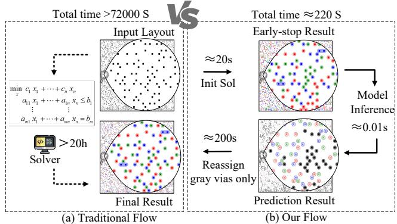  
Figure 1: (a) Traditional flow: solve from scratch until optimal or timeout. (b) Leveraging features from the initial solving phase, our flow predicts vias for mask reassignment. The solver reassigns masks only for these vias, keeping all others fixed, significantly speeding up convergence.

The key to breaking out of this dilemma lies in the ILP solving process itself. While a full ILP run takes hours, the solver typically reaches a high-quality feasible solution and accumulates rich intermediate solving records during the early stage of the ILP solve. We observe that reassigning only a small fraction of vias in this early solution is suficient to match the optimal objective value. If we can identify this critical subset, the solver can re-optimize only those vias on a drastically reduced search space, saving enormous computational efort. This insight calls for a shift in perspective: instead of treating the ILP solver merely as an end-to-end optimizer that runs for hours to deliver a final answer, we exploit the features accumulated during its early solving phase to predict which vias require mask reassignment to reach the optimum.

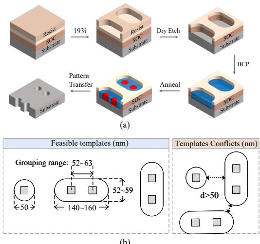  
Figure 2: (a) DSA process flow. (b) Feasible templates: by adjusting template size, vias with diferent pitches can be fabricated, but the grouping range is limited by the natural pitch $L _ { 0 }$ of the BCP. Moreover, a minimum edge-to-edge spacing between templates is required to ensure stable patterning.

This idea drives our approach. As illustrated in Figure 1, a timelimited ILP solver first provides an initial solution and intermediate features. A graph neural network (GNN) [10] trained on these features then predicts which vias are likely to benefit from reassignment. The solver re-optimizes only the selected vias while keeping all others fixed, converging to high-quality solutions in a fraction of the original runtime. Analogous to a lever, the solver’s intermediate features serve as a fulcrum: a small, targeted efort produces a disproportionately large improvement. However, eficient solving alone is not enough if the underlying conflict model is inaccurate. Existing methods [5–8] define conflicts based on center-to-center distances between vias, a metric carried over from conventional MPL. In DSA-MP, 193i lithography fabricates guiding templates instead of direct vias, and these templates may take non-circular shapes [11]. Simply evaluating manufacturability by checking center-to-center distances between vias fails to reflect the true process constraints. Since the final via quality is highly dependent on template geometry, suficient spacing between tem plates is required to provide a correction margin against proximity efects and ensure stable template formation. Therefore, we construct a conflict graph that explicitly captures edge-to-edge template spacing and refine the EILP formulation accordingly. Our major contributions are as follows:

• We propose a novel conflict graph model for DSA-MP and refine the formulation of EILP to account for edge-to-edge template conflicts.

• We propose a GNN-guided local refinement strategy, where the trained GNN model eficiently selects vias for refinement while keeping others fixed, significantly accelerating convergence.

• Our method outperforms state-of-the-art works by achieving about 45× speedup with only 0.1% cost increase on 7 nm synthetic benchmarks, while generalizing well to other 7 nm designs and 5 nm industrial layouts.

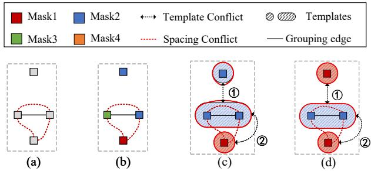

Figure 3: (a) Original layout. (b) Decomposition with triple patterning. (c) Decomposition with DSA-MP (The red solid line shows the lithography simulation result from S-litho). (d) Another decomposition with DSA-MP.  
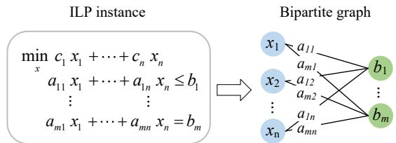  
Figure 4: Transforming an ILP instance to a bipartite graph.

## 2 Preliminaries

## 2.1 Brief Introduction to DSA

Directed self-assembly (DSA) utilizes block copolymers (BCPs) guided by lithographically defined templates for sub-lithographic patterning, as shown in Figure 2(a). The process involves template definition, BCP deposition, annealing, and pattern transfer, enabling the formation of dense and uniform vias [12].

As illustrated in Figure 2(b), we restrict feasible configurations to 1-D templates (n × 1 holes, $n \leq 2 )$ to ensure high yield and robustness, since templates with fewer holes generally provide more stable and reliable patterning [6]. The spacing of vias/contacts formed by the DSA process within a template is governed by the natural pitch $L _ { 0 }$ of the BCP, which limits the grouping distance to a specific range (52–63 nm in this work). In addition, suficient edge-to-edge spacing between adjacent templates must also be reserved. Without suficient spacing, OPC and other correction techniques lack the room to counteract proximity efects, making it impossible to ensure stable and accurate template profiles. However, the edgeto-edge spacing constraints of templates were often neglected in previous studies. For example, in Figure 3(c) and Figure 3(d), previous work considered both assignments feasible, but in reality only Figure 3(d) satisfies manufacturability, as the simulated contour in Figure 3(c) fails to match the required template profile. The contours are obtained using the rigorous lithography simulator S-Litho [13].

## 2.2 Problem Formulation

Definition 1. (Groupable vias): Two vias are defined as groupable if their center-to-center distance falls within the feasible DSA grouping range and they are aligned either horizontally or vertically. Such vias can be manufactured together by a two-hole guiding template.

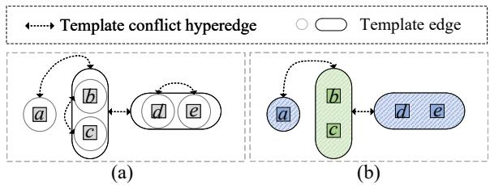  
Figure 5: (a) Our graph model. It unifies lithography spacing and template-related conflicts as edge-to-edge constraints between templates. Each via can be manufactured by a single hole template, while vias connected by a two-hole template edge may alternatively use the two-hole template. Template conflict hyperedges represent all possible template conflicts. (b) An example of a feasible mask and template assignment.

Problem 1. (Guiding template and mask assignment (TMA)): Given a via layout with $\vert V \vert$ vias, a minimum edge-to-edge template spacing $d _ { \operatorname* { m i n } } , K$ available masks, and a set of feasible guiding templates with associated template costs, a template spacing conflict occurs if the edge-to-edge distance between two templates on the same mask is smaller than $d _ { \mathrm { m i n } }$ . The problem is to assign each via to a guiding template and each template to one of the � masks, such that the total number of template spacing conflicts and the total template cost are minimized.

## 2.3 Bipartite Graph Representation

The bipartite graph representation of integer linear programs (ILPs) was proposed by [14], which losslessly transforms the ILP instance into a bipartite graph (see Figure 4). In this graph, the left part contains � variable nodes $X = \{ x _ { 1 } , \ldots , x _ { n } \}$ corresponding to the decision variables, and the right part contains � constraint nodes $B = \{ b _ { 1 } , \ldots , b _ { m } \}$ corresponding to the linear constraints. An edge $( i , j ) \in E$ between variable node � and constraint node � exists whenever the �-th variable appears in the �-th constraint, with the edge weight storing the coeficient $a _ { i j }$ . This representation preserves the original problem structure and provides a natural input for GNN models.

## 3 Proposed Graph Model and ILP Formulation

To better capture lithography spacing and template-related conflicts in a given layout, we unify them as edge-to-edge constraints between templates and introduce a hybrid grouping/conflict graph, as shown in Figure 5. In this graph, each vertex represents a via, template edges indicate that a via can be fabricated by a singlehole template alone or paired with another via to form a feasible two-hole template, and template conflict hyperedges denote cases where the edge-to-edge distance between templates is less than $d _ { m i n }$ . Built on this compact graph model, we develop a novel and concise ILP formulation that explicitly accounts for edge-to-edge template spacing constraints to optimally solve the TMA problem. The notations used in our ILP formulation are listed as follows.

1) ��, ���, ���: sets of edge-to-edge spacing conflict candi dates, as illustrated in Figure 6. Specifically, �� represents conflicts between two single-hole templates, ��� represents conflicts between a single-hole and a two-hole template, and ��� represents conflicts where both templates are two-hole.

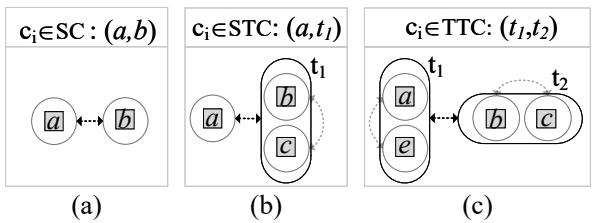  
Figure 6: Illustration of three types of edge-to-edge template spacing conflicts, each with a representative $c _ { i }$ highlighted by the black dashed arrow. (a) ��: taking $c _ { i } = ( a , b )$ as an example, a conflict between two single-hole templates. (b) ���: taking $c _ { i } = \left( a , t _ { 1 } \right)$ as an example, a conflict between single-hole template � and two-hole template �1. (c) ���: taking $c _ { i } = \left( t _ { 1 } , t _ { 2 } \right)$ as an example, a conflict between two-hole templates $t _ { 1 }$ and $t _ { 2 } .$

2) $\bar { J } _ { S C } , \bar { J } _ { S T C } , \bar { J } _ { T T C } \colon$ index sets corresponding to $S C , S T C ,$ , and ���.

3) $c _ { i } { : }$ Conflict $c _ { i } , i \in \mathcal { I } _ { S C } \cup \mathcal { I } _ { S T C } \cup \mathcal { I } _ { T T C }$

4) $\boldsymbol { v } _ { i } \boldsymbol { : }$ The �-th via.

5) $t _ { j } { \mathrm { : } }$ Template $t _ { j } ,$ with two vias in a template edge.

6) $c _ { i } ^ { k } { : 0 / 1 }$ Boolean variable. $c _ { i } ^ { k } = 1$ if the two templates involved in conflict $c _ { i }$ conflict at mask �.

7) $v _ { i } ^ { k } { : }$ 0/1 Boolean variable. $v _ { i } ^ { k } \ = \ 1$ if via �� is assigned to a single-hole template on mask �.

8) $t _ { i } ^ { k } { : }$ 0/1 Boolean variable. $t _ { j } ^ { k } = 1$ if a two-hole template $t _ { j }$ is chosen, and is assigned to mask �.

9) $\boldsymbol { w } _ { c } \colon$ Conflict cost. ��: Two-hole template cost.

The ILP formulation is given as follows:

min

$$
\sum _ { i \in { \cal I } _ { S C } \cup { \cal I } _ { S T C } \cup { \cal I } _ { T T C } } \sum _ { k = 1 } ^ { K } w _ { c } \cdot c _ { i } ^ { k } + \sum _ { j , k } w _ { t } \cdot t _ { j } ^ { k }\tag{1}
$$

$$
\mathrm { s . t . } \quad \sum _ { j : v _ { i } \in t _ { j } } \sum _ { k = 1 } ^ { K } t _ { j } ^ { k } + \sum _ { k = 1 } ^ { K } v _ { i } ^ { k } = 1 , \quad \forall i = 1 , \ldots , | V |\tag{2}
$$

$$
\sum _ { j : v _ { j } \in c _ { i } } v _ { j } ^ { k } \le 1 + c _ { i } ^ { k } , \forall i \in \mathcal { I } _ { S C } , \forall k = 1 , . . . , K\tag{3}
$$

$$
\sum _ { j : v _ { j } \in c _ { i } } v _ { j } ^ { k } + \sum _ { j : t _ { j } \in c _ { i } } t _ { j } ^ { k } \leq 1 + c _ { i } ^ { k } ,
$$

$$
\forall i \in { \cal I } _ { S T C } , \forall k = 1 , \dots , K\tag{4}
$$

$$
{ \sum _ { j : t _ { j } \in c _ { i } } t _ { j } ^ { k } \le 1 + c _ { i } ^ { k } , \forall i \in \mathcal { I } _ { T T C } , \forall k = 1 , \dots , K }\tag{5}
$$

Objective (1). The objective minimizes the number ofunresolved conflicts and the number of selected two-hole templates. To give priority to conflict minimization, $w _ { c }$ is set much larger than ��.

Constraint (2). Each via $v _ { i }$ must be covered by exactly one template on exactly one mask: either assigned to a single-hole template on some mask � $( \mathrm { i . e . , } v _ { i } ^ { k } = 1 )$ , or covered by a two-hole template $t _ { j }$ assigned to mask $k \left( \mathrm { i . e . , } t _ { j } ^ { k } = 1 \right)$ , with the two cases being mutually exclusive.

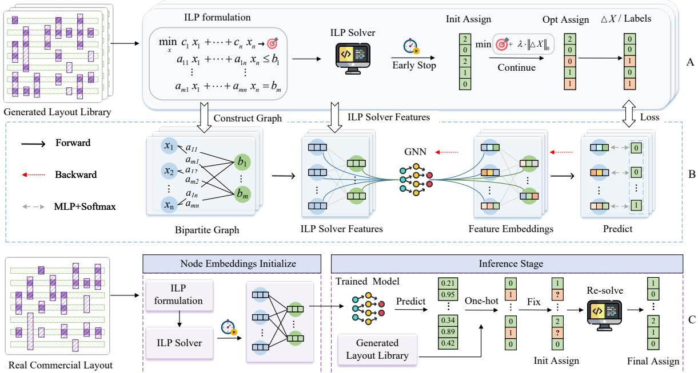  
Figure 7: Our proposed framework. (A) Synthetic layouts are generated based on design rules extracted from the ASAP7 PDK. A time-limited ILP solver produces an initial solution, and a constraint on the count of via changes is added to identify the minimal set of vias requiring reassignment, forming the Vias-to-Refine dataset. (B) The ILP formulation is represented as a bipartite graph, and solver-derived features initialize a GNN trained on the dataset from (A) to predict vias requiring reassignment. (C) For a test layout, a time-limited ILP solver provides an initial solution. Based on GNN-predicted probabilities a subset of vias is sampled for reassignment, while others are fixed, and only the selected vias are re-optimized.

Constraint (3). For each �� conflict candidate $c _ { i }$ with � ∈ $\mathit { I } _ { S C }$ and each mask �, the summation ${ \textstyle \sum _ { j : o _ { j } \in c _ { i } } v _ { j } ^ { k } }$ runs over the two vias involved in $c _ { i } ,$ each fabricated by a single-hole template. If both are assigned to mask �, the sum equals 2, forcing $c _ { i } ^ { k } = 1$ and incurring a conflict penalty in the objective. If they are assigned to diferent masks, the sum is at most 1 and $c _ { i } ^ { k }$ can remain 0.

Constraint (4). For each ��� conflict candidate $c _ { i }$ with $i \in \mathcal { I } _ { S T C }$ and each mask �, the constraint jointly considers both template types involved in $\begin{array} { r } { c _ { i } \colon \sum _ { j : v _ { j } \in c _ { i } } v _ { j } ^ { k } } \end{array}$ accounts for the single-hole template, and $\textstyle \sum _ { j : t _ { j } \in c _ { i } } t _ { j } ^ { k }$ accounts for the two-hole template. Ifboth templates are assigned to the same mask �, the left-hand side equals 2, forcing $c _ { i } ^ { k } = 1$ . Otherwise, $c _ { i } ^ { k }$ can remain 0.

Constraint (5). For each ��� conflict candidate $c _ { i }$ with � ∈ $\bar { \cal J } _ { T T C }$ and each mask $k , c _ { i }$ involves two templates, both of which are twohole templates. The summation $\textstyle \sum _ { j : t _ { j } \in c _ { i } } t _ { j } ^ { k }$ counts how many of them are assigned to mask �. If both are selected and assigned to the same mask, the sum equals 2, forcing $c _ { i } ^ { k } = 1$ and incurring a conflict penalty. Otherwise, $c _ { i } ^ { k }$ can remain 0.

## 4 Algorithms

## 4.1 Overview

To accelerate the TMA problem, we propose a GNN-based local refinement framework. As illustrated in Figure 7, our framework is divided into three main components. First, we construct the Vias-to-Refine Dataset (Figure 7A), which labels the vias that need reassignment compared to the initial solution to achieve optimal results. Second, we train a GNN model using the dataset (Figure 7B), encoding ILP-derived features into a graph to learn which vias need reassignment. Third, during inference (Figure 7C), vias requiring reassignment are sampled according to the probabilities predicted by the GNN, and only the variables associated with the sampled vias are re-optimized, yielding a high-quality solution with significantly reduced runtime compared to solving the full ILP from scratch.

## 4.2 Vias-to-Refine Dataset Preparation

Training a GNN model to predict vias requiring reassignment demands layouts with suficient diversity in conflict graph topologies to ensure good generalization, but most real-world designs are proprietary and not publicly available. Following [15], we generate synthetic layouts track-by-track based on design rules extracted from the open-source ASAP7 process design kit (PDK) [16], including wire width � and track pitch �. Candidate vias are placed at intersections of adjacent metal layers, with enclosure and pitch constraints enforced via an assist wire layer. Wire lengths, spacings, and via placements are randomized within design-rule constraints, resulting in layouts with diverse yet design-rule-compliant conflict graph topologies. This produces a diverse set of layouts $\mathcal { L } = \{ L _ { 1 } , \ldots , L _ { N } \}$ covering a wide range of local conflict structures for GNN training.

For each layout $L _ { i } ,$ the ILP formulation from Section 3 is solved with a time-limited early stop to obtain the initial ILP-solve features. Exploiting the inherent bipartite structure of the ILP, each layout is modeled as a bipartite graph $G = ( X \cup B , E )$ as introduced in Figure 4. The feature sets of � are grouped as follows:

• Variable features $H _ { X } \colon$ feature vectors for decision variables (left side of the bipartite graph in Figure 4), including (1) objective coeficient of the variable (coef); (2) frequency with which the variable appears in the solution pool (sol\_pool\_freq); and (3) index of the via (point num).

• Constraint features $H _ { B } \colon$ feature vectors for the constraints (right side of the bipartite graph), including (1) bias value (bias), normalized with respect to the constraint coeficients.

• Edge features $H _ { E } \colon$ feature vectors for edges, including (1) coeficient of the decision variable in the corresponding constraint (cons\_coef).

All features are normalized. These node and edge features are encoded into the bipartite graph � and form the input to the dataset.

To generate labels for the dataset, the ILP formulation in Section 3 is modified to include a penalty term that counts the number of vias whose mask assignment changes from the initial solution:

$$
\operatorname* { m i n } \sum _ { i , k } w _ { c } \cdot c _ { i } ^ { k } + \sum _ { j , k } w _ { t } \cdot t _ { j } ^ { k } + \sum _ { i = 1 } ^ { | V | } \lambda \cdot r _ { i } ,\tag{6}
$$

where $\lambda$ is a small penalty weight (empirically set to $1 0 ^ { - 4 } )$ to preserve the optimality of the original cost. We introduce a binary variable $r _ { i } \in \{ 0 , 1 \}$ for via $v _ { i }$ to capture whether its assignment changes between the initial and current solutions:

$$
r _ { i } = 1 - \sum _ { k = 1 } ^ { K } \hat { v } _ { i } ^ { k } \cdot v _ { i } ^ { k } , \quad i = 1 , \hat { \mathbf { \Omega } } , \hat { \mathbf { \Omega } } \cdot \mathbf { \Omega } , \hat { V } \dag ,\tag{7}
$$

with $v _ { i } ^ { k } \in \{ 0 , 1 \}$ indicating whether via $v _ { i }$ is assigned to mask � in the current solution and $\hat { v } _ { i } ^ { k } \in \{ 0 , 1 \}$ denoting its assignment in the initial solution, which is a known constant. Solving this ILP yields the optimal solution and the minimal set of vias $\mathcal { R } ^ { * } = \{ v _ { i } \mid r _ { i } = 1 \}$ 1 that require reassignment.

The resulting dataset consists of a bipartite graph � initialized with ILP-derived features together with node-level labels. Each via variable $v _ { i } ^ { k }$ in � is assigned the label True if reassignment of $v _ { i }$ is required and False if no reassignment is needed. All remaining variables are assigned the label None, indicating that they are excluded from the computation of the training loss.

## 4.3 GNN Training for Via Selection

Based on the Vias-to-Refine Dataset described in Section 4.2, we train a GNN model to predict which vias need reassignment. The model takes as input three types of tensors: variable features $H _ { X } \in$ $\mathbb { R } ^ { n \times d } ;$ , constraint features $H _ { B } \ \in \ \mathbb { R } ^ { m \times c }$ , and edge features $H _ { E } \in$ R���. Here � corresponds to the number of ILP-derived features for each variable (objective coeficient, solution-pool frequency, and via index, giving $d = 3$ in our implementation), � denotes the number of features per constraint (bias value, hence $c = 1 )$ , and � represents the number of features per edge (constraint coeficient, hence $e = 1 )$ . All features are normalized and then projected into a latent space of dimension 64.

Following the input projection, message passing is performed over the bipartite graph in the form of two interleaved halfconvolutions[14], which alternately propagate messages between the variable and constraint nodes. Due to the inherent bipartite structure, our graph convolution can be decomposed into two successive passes: one propagating messages from variable nodes to constraint nodes, and the other from constraint nodes back to variable nodes. Formally, let $V _ { X }$ represent the set of � variable nodes and $V _ { B }$ the set of � constraint nodes. The embeddings of variable node $x _ { i } \in V _ { X }$ and constraint node $b _ { j } \in V _ { B }$ at layer � are denoted by $h _ { x _ { i } } ^ { k }$ and $h _ { b _ { i } } ^ { k }$ , respectively. The update rules are defined as:

$$
\boldsymbol { h } _ { b _ { j } } ^ { k } = f _ { B } ^ { k } \Big ( \boldsymbol { h } _ { b _ { j } } ^ { k - 1 } , \sum _ { \left( x _ { i } , b _ { j } \right) \in \mathcal { E } } \boldsymbol { g } _ { B } ^ { k } \big ( \boldsymbol { h } _ { x _ { i } } ^ { k - 1 } , \boldsymbol { h } _ { b _ { j } } ^ { k - 1 } , \boldsymbol { e } _ { i j } \big ) \Big ) , \quad \boldsymbol { b } _ { j } \in V _ { B } ,
$$

$$
h _ { x _ { i } } ^ { k } = f _ { X } ^ { k } \Bigl ( h _ { x _ { i } } ^ { k - 1 } , \sum _ { ( x _ { i } , b _ { j } ) \in \mathcal { E } } g _ { X } ^ { k } \bigl ( h _ { x _ { i } } ^ { k - 1 } , h _ { b _ { j } } ^ { k } , e _ { i j } \bigr ) \Bigr ) , \quad x _ { i } \in V _ { X } ,
$$

where $f _ { X } ^ { k } , f _ { B } ^ { k } , g _ { X } ^ { k }$ , and $g _ { B } ^ { k }$ are implemented as 2-layer perceptrons with ReLU activations, and $e _ { i j } \in \mathbb { R } ^ { 1 \times 6 4 }$ denotes the feature tensor of the edge connecting $x _ { i }$ and $b _ { j } .$

After the half-convolutions, the variable node embeddings are passed through a 2-layer perceptron followed by a sigmoid activation, which outputs a probability $p _ { i } ^ { k } \in [ 0 , 1 ]$ for each via variable $v _ { i } ^ { k }$ , indicating whether it requires reassignment.

The model is trained using a binary cross-entropy loss $\mathcal { L } \ : =$ $\mathrm { B C E } ( y _ { i } ^ { k } , p _ { i } ^ { k } )$ , computed over all via variables $v _ { i } ^ { k }$ , where $y _ { i } ^ { k } \in \{ 0 , 1 \}$ denotes the ground-truth label indicating whether $v _ { i }$ on mask � requires reassignment. During inference, only vias predicted as positive are refined, thereby significantly reducing computation compared to solving the full ILP.

## 4.4 Inference Procedure

During inference, the trained GNN assigns to each via variable $v _ { i } ^ { k }$ a probability $\mathbf { \Delta } p _ { i } ^ { k }$ of requiring reassignment. A hard threshold is typically applied to reassign only those variables whose probability exceeds it. However, a hard threshold cannot adapt well to diverse layouts. Thus, we adopt a sampling-based strategy to adaptively select reassignment candidates. Specifically, for each via $v _ { i } ,$ we aggregate probabilities over masks and apply temperature scaling to obtain its sampling probability:

$$
\tilde { p } _ { i } = \frac { ( p _ { i } + \varepsilon ) ^ { 1 / \tau } } { \sum _ { j \in \mathcal { I } } ( p _ { j } + \varepsilon ) ^ { 1 / \tau } } ,\tag{8}
$$

where $\begin{array} { r } { p _ { i } \ = \ \sum _ { k = 1 } ^ { K } p _ { i } ^ { k } , \mathcal { T } } \end{array}$ denotes the set of all via indices in the current input layout, and � controls the sharpness of the probability distribution. We use a small $\tau = 0 . 1$ to obtain a sharper distribution, making high-confidence vias more likely to be selected. According to $\tilde { p } _ { i : }$ , we sample two-thirds of all vias from the layout without replacement and identify the remaining vias in each layout as fixed. For each layout �, the index set of fixed vias is denoted by $\mathcal { R } ^ { l }$ . The ILP formulation in Section 3 is then extended by adding the following constraint to fix the variables associated with vias in $\mathcal { R } ^ { l }$

$$
\sum _ { j : v _ { i } \in t _ { j } } t _ { j } ^ { k _ { i } } + v _ { i } ^ { k _ { i } } = 1 , \quad \forall i \in \mathcal { R } ^ { l } ,\tag{9}
$$

where $k _ { i }$ denotes the mask index assigned to via $v _ { i }$ in the initial solution. This efectively reduces the search space of the ILP solver, thereby accelerating its convergence.

Table 1: Comparison results of DSA with TPL on 7 nm synthetic layouts.
<table><tr><td rowspan="2">Benchmark</td><td colspan="2">Original</td><td colspan="4">EILP[6]</td><td colspan="4">DLXplus[6]</td><td colspan="4">Ours</td></tr><tr><td>via</td><td>edge</td><td>cn</td><td>tn</td><td>cost</td><td>time (s)</td><td>cn</td><td>tn</td><td>cost</td><td>time (s)</td><td>cn</td><td>tn</td><td>cost</td><td>time (s)</td></tr><tr><td>test1</td><td>3977</td><td>7140</td><td>103</td><td>137</td><td>104.37</td><td>268.63</td><td>261</td><td>128</td><td>262.28</td><td>104.44</td><td>103</td><td>145</td><td>104.45</td><td>105.94</td></tr><tr><td>test2</td><td>3807</td><td>6570</td><td>91</td><td>117</td><td>92.17</td><td>6655.68</td><td>220</td><td>98</td><td>220.98</td><td>85.18</td><td>91</td><td>120</td><td>92.20</td><td>50.09</td></tr><tr><td>test3</td><td>3795</td><td>6170</td><td>81</td><td>99</td><td>81.99</td><td>446.88</td><td>195</td><td>79</td><td>195.79</td><td>80.31</td><td>81</td><td>102</td><td>82.02</td><td>31.90</td></tr><tr><td>test4</td><td>12025</td><td>19882</td><td>265</td><td>314</td><td>268.14</td><td>11528.07</td><td>542</td><td>114</td><td>243.14</td><td>612.33</td><td>265</td><td>324</td><td>268.24</td><td>193.88</td></tr><tr><td>test5</td><td>5180</td><td>8587</td><td>127</td><td>110</td><td>128.10</td><td>76.65</td><td>265</td><td>112</td><td>266.12</td><td>189.71</td><td>127</td><td>113</td><td>128.13</td><td>84.02</td></tr><tr><td>test6</td><td>6236</td><td>10149</td><td>129</td><td>143</td><td>130.43</td><td>333.97</td><td>282</td><td>105</td><td>283.05</td><td>189.50</td><td>129</td><td>147</td><td>130.47</td><td>86.40</td></tr><tr><td>test7</td><td>6303</td><td>10472</td><td>151</td><td>158</td><td>152.58</td><td>12658.32</td><td>325</td><td>196</td><td>326.96</td><td>173.73</td><td>151</td><td>163</td><td>152.63</td><td>60.13</td></tr><tr><td>test8</td><td>5761</td><td>9402</td><td>114</td><td>135</td><td>115.35</td><td>141.16</td><td>339</td><td>159</td><td>340.59</td><td>152.93</td><td>114</td><td>146</td><td>115.46</td><td>44.99</td></tr><tr><td>test9</td><td>4048</td><td>6699</td><td>98</td><td>94</td><td>98.94</td><td>1166.54</td><td>198</td><td>120</td><td>199.20</td><td>57.23</td><td>98</td><td>96</td><td>98.96</td><td>41.38</td></tr><tr><td>test10</td><td>5157</td><td>8441</td><td>104</td><td>123</td><td>105.23</td><td>160.51</td><td>243</td><td>149</td><td>244.49</td><td>99.16</td><td>105</td><td>131</td><td>106.31</td><td>39.57</td></tr><tr><td>Average</td><td colspan="2"></td><td colspan="2"></td><td>127.73</td><td>3343.64 1.000</td><td colspan="2"></td><td>258.26</td><td>174.45</td><td colspan="2"></td><td>127.89</td><td>73.83</td></tr><tr><td>Ratio</td><td colspan="2"></td><td colspan="2"></td><td colspan="2">1.000</td><td colspan="2"></td><td colspan="2">2.022</td><td colspan="2"></td><td>1.001</td><td>0.022</td></tr></table>

Table 2: Comparison results of DSA with TPL on 7 nm BOOM core layouts
<table><tr><td rowspan="2">Benchmark</td><td colspan="2">Original</td><td colspan="4">EILP[6]</td><td colspan="4">DLXplus[6]</td><td colspan="4">Ours</td></tr><tr><td>via</td><td>edge</td><td>cn</td><td>tn</td><td>cost</td><td>time (s)</td><td>cn</td><td>tn</td><td>cost</td><td>time (s)</td><td>cn</td><td>tn</td><td>cost</td><td>time (s)</td></tr><tr><td>BOOM_test1</td><td>15608</td><td>24758</td><td>273</td><td>210</td><td>275.10</td><td>634.57</td><td>900</td><td>774</td><td>907.74</td><td>706.67</td><td>273</td><td>439</td><td>277.39</td><td>121.29</td></tr><tr><td>BOOM_test2</td><td>16729</td><td>26325</td><td>430</td><td>209</td><td>432.09</td><td>1551.12</td><td>1133</td><td>1003</td><td>1143.03</td><td>1012.96</td><td>432</td><td>598</td><td>437.98</td><td>96.59</td></tr><tr><td>BOOM_test3</td><td>11586</td><td>18492</td><td>266</td><td>116</td><td>267.16</td><td>305.98</td><td>747</td><td>522</td><td>752.22</td><td>107.73</td><td>268</td><td>360</td><td>271.60</td><td>58.88</td></tr><tr><td>BOOM_test4</td><td>31486</td><td>50113</td><td>918</td><td>377</td><td>921.77</td><td>4920.61</td><td>2177</td><td>1899</td><td>2195.99</td><td>2051.60</td><td>922</td><td>938</td><td>931.38</td><td>330.97</td></tr><tr><td>BOOM_test5</td><td>13540</td><td>21320</td><td>285</td><td>156</td><td>286.56</td><td>1176.25</td><td>881</td><td>782</td><td>888.82</td><td>538.01</td><td>285</td><td>427</td><td>289.27</td><td>76.72</td></tr><tr><td>BOOM_test6</td><td>29442</td><td>46670</td><td>875</td><td>344</td><td>878.44</td><td>2235.45</td><td>1997</td><td>1719</td><td>2014.19</td><td>1665.30</td><td>877</td><td>781</td><td>884.81</td><td>324.96</td></tr><tr><td>BOOM_test7</td><td>16504</td><td>25903</td><td>424</td><td>198</td><td>425.98</td><td>1027.32</td><td>1061</td><td>940</td><td>1070.40</td><td>906.98</td><td>424</td><td>494</td><td>428.94</td><td>117.41</td></tr><tr><td>BOOM_test8</td><td>19691</td><td>30939</td><td>349</td><td>269</td><td>351.69</td><td>1121.64</td><td>1241</td><td>1124</td><td>1252.24</td><td>494.09</td><td>350</td><td>586</td><td>355.86</td><td>141.22</td></tr><tr><td>BOOM_test9</td><td>29672</td><td>46414</td><td>743</td><td>410</td><td>747.10</td><td>9929.41</td><td>2065</td><td>1741</td><td>2082.41</td><td>1780.18</td><td>746</td><td>885</td><td>754.85</td><td>296.56</td></tr><tr><td>BOOM_test10</td><td>23495</td><td>37210</td><td>665</td><td>290</td><td>667.90</td><td>2244.34</td><td>1660</td><td>1431</td><td>1674.31</td><td>896.68</td><td>666</td><td>844</td><td>674.44</td><td>154.30</td></tr><tr><td>Average</td><td colspan="2"></td><td></td><td></td><td>525.38</td><td>2514.67</td><td colspan="2"></td><td>1398.14</td><td>1016.02</td><td colspan="2"></td><td>530.65</td><td>171.89</td></tr><tr><td>Ratio</td><td colspan="2"></td><td colspan="2"></td><td>1.000</td><td>1.000</td><td colspan="2"></td><td>2.661</td><td>0.404</td><td colspan="2"></td><td>1.010</td><td>0.068</td></tr></table>

## 5 Experimental Results

## 5.1 Experimental Setting

We implement our algorithm in Python, using Gurobi as the ILP solver [17], and conduct all experiments on a machine equipped with an Intel Xeon Gold 5220 CPU @ 2.20 GHz. The number of available masks is set to $K = 3$ for the 7 nm node and � = 4 for the 5 nm node. The minimum edge-to-edge template spacing is $d _ { \operatorname* { m i n } } = 5 0 ~ \mathrm { n m }$ . The feasible templates include 1-hole and 2-hole 1-D straight templates. The weights in the ILP objective are set to $w _ { c } = 1$ and $w _ { t } = 0 . 0 1$ , following [6].

The GNN model comprises 2 interleaved half-convolutions [14] with all embeddings projected to dimension 64, followed by a 2- layer MLP with sigmoid activation. It is trained on a single NVIDIA A100 GPU using the Adam optimizer with a learning rate of1×10−3 for 200 epochs, completing in approximately 46 s. Details of the training and test sets are provided in Section 5.2.

## 5.2 Benchmark Details

Training Set. Following [15], we generate 20 synthetic layouts at the 7 nm node using design rules extracted from the open-source ASAP7 process design kit (PDK). Each layout contains approximately 3,000 vias, yielding a training set of roughly 60,000 vias in total. Label generation follows the procedure in Section 4.2, taking approximately 1 hour.

Test Set. To evaluate the generalizability of our method across diferent designs within the same technology node as well as across diferent technology nodes, we construct a diverse test set as follows.

• 7 nm Node (Synthetic): 12 synthetic layouts generated following [15] using design rules from the ASAP7 PDK.

• 7 nm Node (Open-source Processor Design): 12 layouts extracted from a RISC-V BOOM core design [18] generated by Chipyard [19] using the ASAP7 PDK, reflecting realistic design patterns from an open-source processor.

• 5 nm Node (Industrial): 11 clips from industrial logic SoC designs to evaluate cross-node generalization.

The full test datasets and layout generation scripts are available at https://github.com/fengyu-neu/DSA-MP-Benchmark.

## 5.3 Result Analysis

We evaluate our method against state-of-the-art decomposition approaches on two configurations: DSA with triple patterning lithography (DSA-TPL) at the 7 nm node, and DSA with quadruple pat terning lithography (DSA-QPL) at the 5 nm node. In all tables, “via” denotes the number of vias, “edge” the number of spacing conflict edges, “cn” the number of unresolved conflicts, “tn” the number of two-hole templates, “cost” the total cost defined in Equation (1), and “time” the runtime in seconds. The reported time for our method includes initial ILP solving, GNN inference, and final re-optimization.

Table 3: Comparison results of DSA with QPL on 5 nm industrial layouts.
<table><tr><td rowspan="2">Benchmark</td><td colspan="2">Original</td><td colspan="4">EILP[6]</td><td colspan="4">DLXplus[6]</td><td colspan="4">Ours</td></tr><tr><td>via</td><td>edge</td><td>cn</td><td>tn</td><td>cost</td><td>time (s)</td><td>cn</td><td>tn</td><td>cost</td><td>time (s)</td><td>cn</td><td>tn</td><td>cost</td><td>time (s)</td></tr><tr><td>N5_test1</td><td>4328</td><td>8244</td><td>27</td><td>288</td><td>29.88</td><td>299.25</td><td>115</td><td>255</td><td>117.55</td><td>50.26</td><td>27</td><td>294</td><td>29.94</td><td>44.51</td></tr><tr><td>N5_test2</td><td>7829</td><td>14772</td><td>40</td><td>540</td><td>45.40</td><td>2035.96</td><td>181</td><td>515</td><td>186.15</td><td>409.49</td><td>41</td><td>545</td><td>46.45</td><td>55.33</td></tr><tr><td>N5_test3</td><td>7006</td><td>12840</td><td>40</td><td>442</td><td>44.42</td><td>1230.44</td><td>151</td><td>435</td><td>155.35</td><td>196.12</td><td>40</td><td>453</td><td>44.53</td><td>58.89</td></tr><tr><td>N5_test4</td><td>10268</td><td>19226</td><td>55</td><td>741</td><td>62.41</td><td>541.88</td><td>247</td><td>703</td><td>254.03</td><td>549.43</td><td>55</td><td>749</td><td>62.49</td><td>88.20</td></tr><tr><td>N5_test5</td><td>6671</td><td>12262</td><td>25</td><td>436</td><td>29.36</td><td>653.43</td><td>134</td><td>408</td><td>138.08</td><td>147.88</td><td>25</td><td>441</td><td>29.41</td><td>48.95</td></tr><tr><td>N5_test6</td><td>9986</td><td>18539</td><td>39</td><td>684</td><td>45.84</td><td>1690.79</td><td>216</td><td>622</td><td>222.22</td><td>474.95</td><td>39</td><td>694</td><td>45.94</td><td>164.20</td></tr><tr><td>N5_test7</td><td>10432</td><td>19543</td><td>61</td><td>691</td><td>67.91</td><td>2246.64</td><td>242</td><td>654</td><td>248.54</td><td>565.55</td><td>62</td><td>703</td><td>69.03</td><td>142.48</td></tr><tr><td>N5_test8</td><td>8082</td><td>15044</td><td>39</td><td>509</td><td>44.09</td><td>600.20</td><td>174</td><td>480</td><td>178.80</td><td>249.38</td><td>41</td><td>515</td><td>46.15</td><td>276.02</td></tr><tr><td>N5_test9</td><td>7284</td><td>13316</td><td>27</td><td>442</td><td>31.42</td><td>2158.09</td><td>142</td><td>418</td><td>146.18</td><td>181.39</td><td>28</td><td>447</td><td>32.47</td><td>52.36</td></tr><tr><td>N5_test10</td><td>7637</td><td>13373</td><td>34</td><td>410</td><td>38.10</td><td>227.93</td><td>145</td><td>414</td><td>149.14</td><td>175.29</td><td>37</td><td>437</td><td>41.37</td><td>99.91</td></tr><tr><td>Average</td><td></td><td></td><td></td><td></td><td>43.883</td><td>1168.460</td><td></td><td></td><td>179.604</td><td>299.973</td><td></td><td></td><td>44.778</td><td>103.085</td></tr><tr><td>Ratio</td><td rowspan="2"></td><td rowspan="2"></td><td rowspan="2"></td><td rowspan="2"></td><td>1.000</td><td>1.000</td><td rowspan="2" colspan="2"></td><td rowspan="2">4.093</td><td rowspan="2">0.257</td><td rowspan="2" colspan="2"></td><td rowspan="2">1.020</td><td>0.088</td></tr><tr><td></td><td></td><td></td><td></td></tr></table>

Table 4: Cases where some algorithms exceed the 20-hour time limit (“TLE”).
<table><tr><td rowspan="2">Benchmark</td><td colspan="2">Original</td><td colspan="4">EILP[6]</td><td colspan="4">DLXplus[6]</td><td colspan="4">Ours</td></tr><tr><td>via</td><td>edge</td><td>cn</td><td>tn</td><td>cost</td><td>time (s)</td><td>cn</td><td>tn</td><td>cost</td><td>time (s)</td><td>cn</td><td>tn</td><td>cost</td><td>time (s)</td></tr><tr><td>N5_test_11</td><td>5551</td><td>11120</td><td>TLE</td><td>TLE</td><td>TLE</td><td>TLE</td><td>161</td><td>403</td><td>165.03</td><td>122.05</td><td>34</td><td>526</td><td>39.26</td><td>57.51</td></tr><tr><td>test11</td><td>116215</td><td>206000</td><td>TLE</td><td>TLE</td><td>TLE</td><td>TLE</td><td>TLE</td><td>TLE</td><td>TLE</td><td>TLE</td><td>3622</td><td>3895</td><td>3660.95</td><td>4636.34</td></tr><tr><td>test12</td><td>206659</td><td>366628</td><td>TLE</td><td>TLE</td><td>TLE</td><td>TLE</td><td>TLE</td><td>TLE</td><td>TLE</td><td>TLE</td><td>6287</td><td>6421</td><td>6351.21</td><td>17265.78</td></tr><tr><td>BOOM test11</td><td>221696</td><td>352602</td><td>TLE</td><td>TLE</td><td>TLE</td><td>TLE</td><td>TLE</td><td>TLE</td><td>TLE</td><td>TLE</td><td>6054</td><td>5572</td><td>6109.72</td><td>5856.67</td></tr><tr><td>BOOM test12</td><td>667477</td><td>1056475</td><td>TLE</td><td>TLE</td><td>TLE</td><td>TLE</td><td>TLE</td><td>TLE</td><td>TLE</td><td>TLE</td><td>18315</td><td>18787</td><td>18502.87</td><td>49369.75</td></tr></table>

We compare against the EILP method proposed in [6], which guarantees optimal cost but is often prohibitively slow, and its heuristic acceleration “DLXplus,” which improves runtime at the expense of solution quality. The results and analysis are as follows.

DSA-TPL (7 nm). To evaluate generalization across diferent design styles within the same technology node, we test on 7 nm layouts from two sources as described in Section 5.2: synthetic layouts and layouts extracted from a RISC-V BOOM core design. Results are reported in Table 1 and Table 2, respectively. In these benchmarks, the ratio of conflict edges to vias is close to 2:1, significantly higher than the 1:2 ratio reported in prior work [6], reflecting the denser conflict relationships typical of advanced-node designs.

As shown in Table 1, on synthetic layouts our method achieves about 45× speedup over EILP with only 0.1% increase in cost. On the BOOM layouts (Table 2), our method still provides about 15× acceleration with around 1.0% cost increase. These results demonstrate that our approach maintains substantial runtime advantages while preserving near-optimal solution quality across diferent design styles at the 7 nm node.

DSA-QPL (5 nm). To evaluate cross-node generalization, we test our method on 5 nm industrial layouts using DSA-QPL. The results are summarized in Table 3. The GNN model employed shares identical weights with that used in Tables 1 and 2, without any retraining or fine-tuning on 5 nm data. Despite the domain shift in both technology node and number of masks, our method still achieves approximately 12× speedup over EILP with only 2% increase in cost, further validating the cross-node transferability of the learned GNN model.

Performance on Challenging Layouts. Table 4 reports cases across all test sets where existing methods exceed the 20-hour time limit. Our method remains tractable on these challenging instances, whereas EILP or DLXplus exceed the time limit without producing feasible solutions. Even for the instance where DLXplus produces a feasible solution (N5\_test\_11), our method still achieves a 4.2× lower cost within less than half the runtime. The experimental results demonstrate the robustness and efectiveness of our proposed method on layouts that are challenging due to either large scale or complex conflict structures.

Generalization Analysis. Our GNN model is trained on 20 synthetic layouts containing about 60,000 vias at the 7 nm node. The model generalizes well across multiple dimensions: (1) to larger layouts, e.g., layouts with over 200K vias, (2) to unseen layouts from diverse origins, including the BOOM core and industrial designs, (3) to a diferent technology node (5 nm), and (4) to a diferent mask count (� = 4).

This strong generalization mainly stems from our model operating on ILP representations rather than layout-specific geometric features. The input features are derived from the ILP formulation and the solver, including objective coeficients, constraint biases, constraint coeficients, and solution-pool frequencies. These features reflect how variables influence the objective and constraints during optimization, providing solver-level information that is largely independent of the specific layout topology or design style.

In addition, the bipartite graph representation of the ILP together with message passing allows the GNN to operate on graphs of varying sizes, enabling the model to transfer to larger layouts. Finally, our framework adopts a GNN-guided local refinement strategy, where the GNN predicts vias that are likely to require reassignment, while the remaining variables are fixed to their initial assignments. The ILP solver then determines the final mask assignments by optimizing only over the selected subset of variables. Since the actual mask assignment is still decided by the ILP solver, the solution quality is preserved while the search space is significantly reduced, which further contributes to the robustness of our framework.

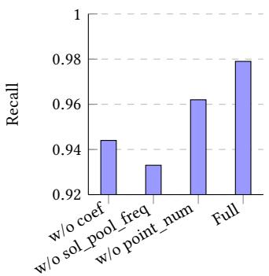

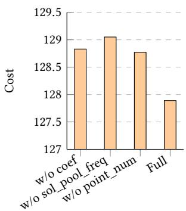  
Figure 8: Ablation study on solver-derived features.

Table 5: GNN performance on 5 nm industrial layouts with diferent training sets.
<table><tr><td>Training Data</td><td>cn</td><td>tn</td><td>cost</td><td>time (s)</td></tr><tr><td>the BOOM core layouts</td><td>44.4</td><td>556.7</td><td>49.967</td><td>97.218</td></tr><tr><td>Synthetic layouts</td><td>39.5</td><td>527.8</td><td>44.778</td><td>103.085</td></tr></table>

## 5.4 Ablation Study

Solver-Derived Features. To assess the impact of each solverderived feature in ��, we conduct an ablation study by removing each feature in turn and evaluating on all layouts listed in Table 1, with all metrics averaged across the test layouts. The results are shown in Figure 8. We report recall and cost as the primary metrics: recall measures the fraction of vias requiring reassignment that are correctly identified by the GNN model. High recall is essential to avoid missing vias that require reassignment, which is critical for achieving optimal solutions. Cost reflects the final solution quality after our local refinement strategy.

Removing any single feature degrades both cost and recall, confirming that all features contribute to model performance. Excluding sol\_pool\_freq results in the largest degradation in both metrics, reducing recall from 0.979 to 0.933 and increasing cost from 127.89 to 129.05, indicating that solution-pool frequency is the most informative feature for capturing solver behavior. Excluding coef and point\_num results in smaller but consistent degradation across both metrics. Overall, the full feature set achieves the best performance.

Training Set. To study the impact of training data source, we construct an alternative training set from the BOOM core layouts described in Section 5.2, extracting a comparable scale of60,000 vias. Apart from the training data source, all model architectures and training settings remain identical. Both models are evaluated on the 5 nm industrial benchmark under the DSA-QPL configuration, and results are summarized in Table 5.

The model trained on synthetic layouts achieves lower cost than the one trained on the BOOM core layouts. This advantage likely stems from the diversity introduced during synthetic generation: randomized wire lengths, spacings, and via placements under design-rule constraints produce conflict graphs with diverse local structures, which in turn yield ILP formulations with varied constraint interaction patterns. Such diversity helps the model learn solver-level behaviors that generalize better to unseen layouts. Furthermore, synthetic layouts can be generated eficiently without relying on proprietary design data, making our approach practical for settings where real-world layouts are unavailable.

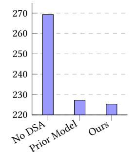

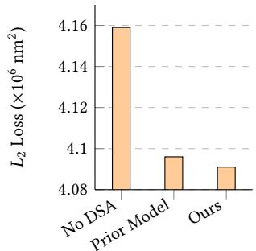  
Figure 9: Manufacturability comparison among no DSA (MPL only), prior conflict graph model, and our proposed conflict graph model.

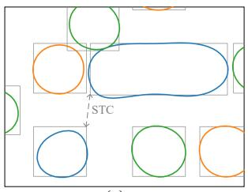  
(a)

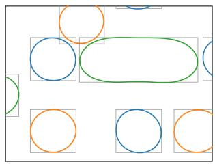  
(b)  
Figure 10: Post-OPC lithography simulation results. Gray rectangles denote targets and colored contours represent simulated printed patterns on diferent masks. (a) Results obtained using the prior conflict graph model. (b) Results obtained using our proposed conflict graph model.

Conflict Graph Model. We evaluate manufacturability under three settings shown in Figure 9. For each setting, we perform OPC and lithography simulation using a commercial tool, measuring average Edge Placement Error (EPE) [20] and $L _ { 2 }$ loss across layouts in Table 1. EPE counts the number of sampled edge points where the deviation between target and printed pattern exceeds a threshold (5 nm in our experiments). $L _ { 2 }$ loss measures the squared diference between the printed and target images. Our proposed conflict graph model (based on edge-to-edge template spacing) achieves the lowest EPE and $L _ { 2 }$ loss among all settings. Figure 10 further shows post-OPC simulation results. The proposed conflict graph model produces more accurate contours for DSA templates, enabling higher-quality via formation through directed self-assembly.

## 6 Conclusion

We propose a new conflict graph model that explicitly accounts for edge-to-edge spacing constraints between DSA templates, which were neglected in prior work. We also present a GNN-guided local refinement framework for DSA-MP layout decomposition, achieving significant speedup over state-of-the-art methods with highquality solutions. Our framework is general and has the potential to be applied to other ILP-based optimization problems in physical design.

## References

[1] Wei Li, Yuzhe Ma, Qi Sun, Lu Zhang, Yibo Lin, Iris Hui-Ru Jiang, Bei Yu, and David Z Pan. 2020. Openmpl: An open-source layout decomposer. IEEE Transactions on Computer-Aided Design ofIntegrated Circuits and Systems 40, 11 (2020), 2331–2344.

[2] Wynand Lambrechts, Saurabh Sinha, Jassem Ahmed Abdallah, and Jaco Prinsloo. 2018. Extending Moore’s law through advanced semiconductordesign andprocessing techniques. CRC Press.

[3] Kuei-Lin Wu and Shao-Yun Fang. 2023. Lamellar DSA-aware detailed routing considering double patterning and short template minimization. In 2023 60th ACM/IEEE Design Automation Conference (DAC). IEEE, 1–6.

[4] Bei Yu, Kun Yuan, Duo Ding, and David Z Pan. 2015. Layout decomposition for triple patterning lithography. tcad 34, 3 (2015), 433–446.

[5] Yasmine Badr, Andres Torres, and Puneet Gupta. 2016. Mask assignment and DSA grouping for DSA-MP hybrid lithography for sub-7 nm contact/via holes. IEEE Transactions on Computer-Aided Design ofIntegrated Circuits and Systems 36, 6 (2016), 913–926.

[6] Yi-Ting Lin and Iris Hui-Ru Jiang. 2019. Novel guiding template and mask assignment for DSA-MP hybrid lithography using multiple BCP materials. In Proceedings ofthe 56th Annual Design Automation Conference 2019. 1–6.

[7] Yunfeng Yang, Wai-Shing Luk, Hai Zhou, David Z Pan, Dian Zhou, Changhao Yan, and Xuan Zeng. 2017. An efective layout decomposition method for DSA with multiple patterning in contact-hole generation. ACM Transactions on Design Automation ofElectronic Systems 23, 1 (2017), 1–27.

[8] Jian Kuang, Junjie Ye, and Evangeline FY Young. 2016. Simultaneous template optimization and mask assignment for DSA with multiple patterning. In 2016 21st Asia and South Pacific Design Automation Conference. 75–82.

[9] Donald E Knuth. 2000. Dancing links. arXiv preprint cs/0011047 (2000).

[10] TN Kipf. 2016. Semi-supervised classification with graph convolutional networks. arXiv preprint arXiv:1609.02907 (2016).

[11] Jiaojiao Ou, Bei Yu, and David Z Pan. 2016. Concurrent guiding template assignment and redundant via insertion for DSA-MP hybrid lithography. In Proceedings ofthe 2016 on International Symposium on Physical Design. 39–46.

[12] Joost Bekaert, Jan Doise, Roel Gronheid, Julien Ryckaert, Geert Vandenberghe, Germain Fenger, YoungJun Her, and Yi Cao. 2015. N7 logic via patterning using templated DSA: implementation aspects. In Photomask Japan 2015: Photomask and Next-Generation Lithography Mask Technology XXII, Vol. 9658. SPIE, 13–23.

[13] Inc. Synopsys. [Online]. S-Litho: Predictive Lithography Simulation. https: //www.synopsys.com/manufacturing/mask-solutions/s-litho.html.

[14] Maxime Gasse, Didier Chételat, Nicola Ferroni, Laurent Charlin, and Andrea Lodi. 2019. Exact combinatorial optimization with graph convolutional neural networks. Advances in neural information processing systems 32 (2019).

[15] Haoyu Yang, Wen Chen, Piyush Pathak, Frank Gennari, Ya-Chieh Lai, and Bei Yu. 2019. Automatic layout generation with applications in machine learning engine evaluation. In 2019 ACM/IEEE 1st Workshop on Machine Learning for CAD (MLCAD). IEEE, 1–6.

[16] Lawrence T Clark, Vinay Vashishtha, Lucian Shifren, Aditya Gujja, Saurabh Sinha, Brian Cline, Chandarasekaran Ramamurthy, and Greg Yeric. 2016. ASAP7: A 7-nm finFET predictive process design kit. Microelectronics Journal 53 (2016), 105–115.

[17] LLC Gurobi Optimization et al. 2020. Gurobi optimizer reference manual, 2020. URL http://www. gurobi. com 12 (2020).

[18] Christopher Celio, Pi-Feng Chiu, Borivoje Nikolic, David A Patterson, and Krste Asanovic. 2017. BOOMv2: an open-source out-of-order RISC-V core. In First Workshop on Computer Architecture Research with RISC-V (CARRV).

[19] Alon Amid, David Biancolin, Abraham Gonzalez, Daniel Grubb, Sagar Karandikar, Harrison Liew, Albert Magyar, Howard Mao, Albert Ou, Nathan Pemberton, et al. 2020. Chipyard: Integrated design, simulation, and implementation framework for custom socs. Ieee Micro 40, 4 (2020), 10–21.

[20] Shayak Banerjee, Zhuo Li, and Sani R Nassif. 2013. ICCAD-2013 CAD contest in mask optimization and benchmark suite. In 2013 IEEE/ACM International Conference on Computer-Aided Design (ICCAD). IEEE, 271–274.