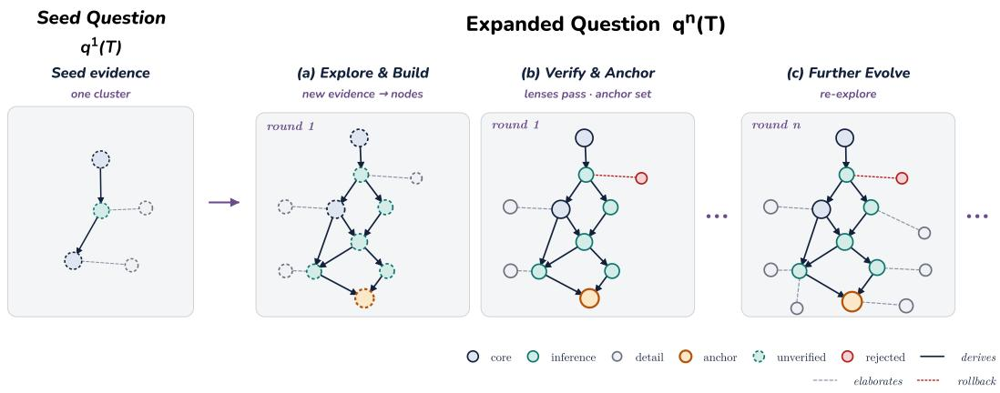
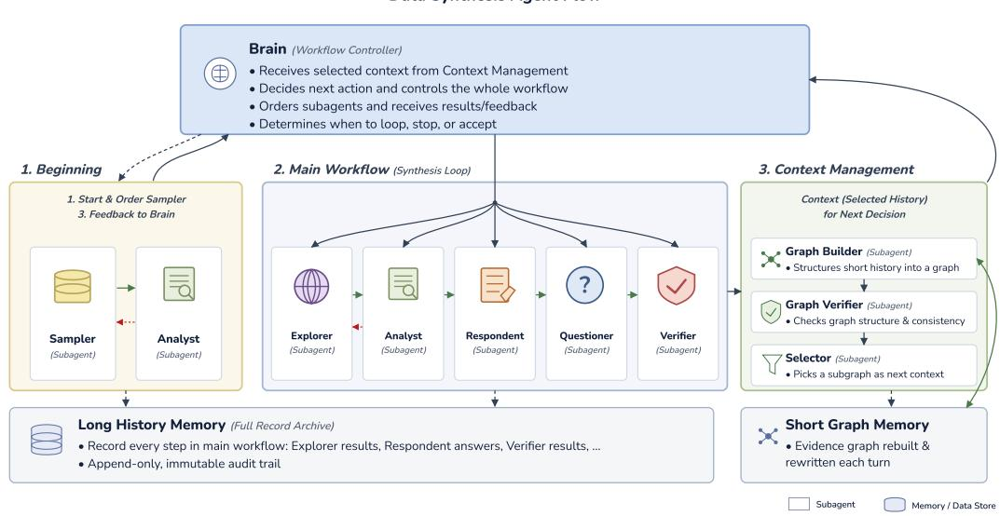
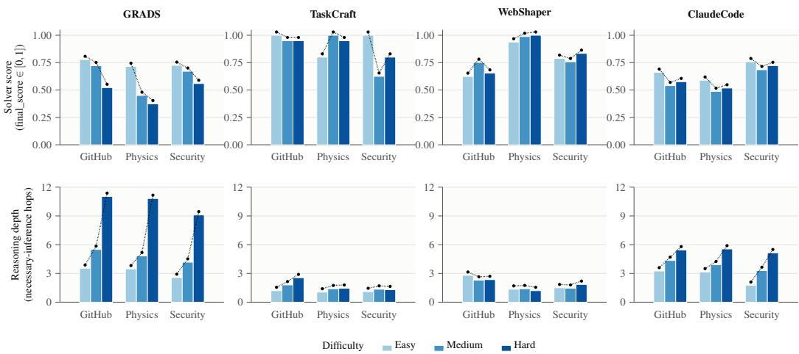
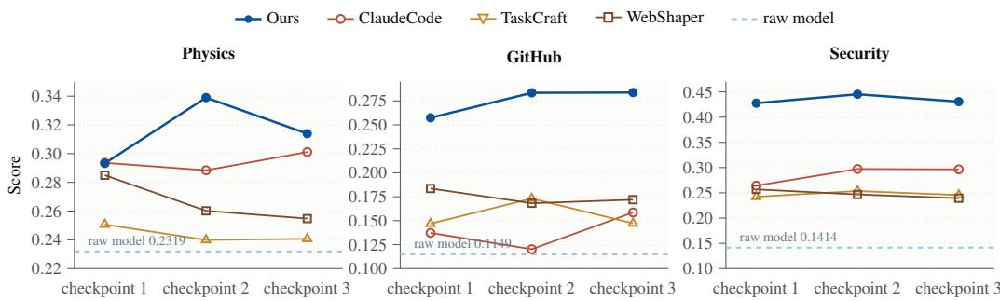
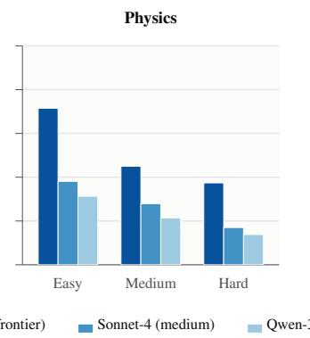
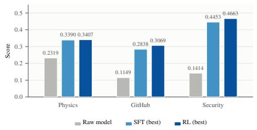
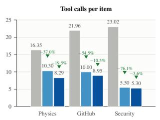
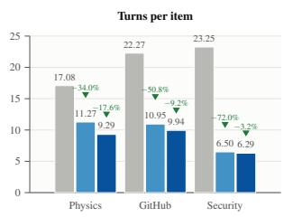
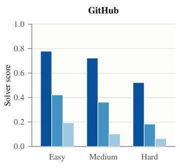
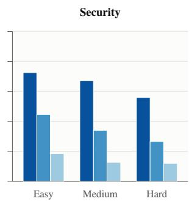

# GRADS: GRAPH-REGULATED AGENTIC DATA SYN-THESIS WITH CONTROLLABLE DIFFICULTY

Gaocheng Yang1, \*, † Ruijie Tao1, \* Kai Ye2 Senhua Zhang3 Zhengqin Zhu3 Ziyang Li1, ‡

1Johns Hopkins University 2Nanjing University 3Amazon

gyang41,rtao12 @jh.edu kaiye@smail.nju.edu.cn

senhuazh,tozhu @amazon.com ziyang@cs.jhu.edu

\*Equal contribution. †Work conducted during an internship at Amazon. ‡Corresponding author.

## ABSTRACT

Deep research agents are increasingly deployed to retrieve precise information from large corpora, yet multi-hop, long-horizon tasks remain challenging. Synthetic data generation has emerged as a scalable solution, with existing pipelines typically expanding seed tasks to increase their apparent depth and breadth. However, this expansion does not reliably translate into necessary reasoning: newly introduced evidence may be only weakly coupled to the answer, creating a mismatch between intended and empirical difficulty. To address this problem, we introduce GRADS, a graph-guided agentic data synthesis framework with explicit difficulty control. GRADS runs a closed loop of seed selection, evidence expansion, question–answer construction, and verification while maintaining a graph of the evidence and inference dependencies required to derive each answer. At each step, it conditions generation on a relevant subgraph, preserving indispensable inference without accumulating irrelevant context. Experiments across security, software-engineering, and scientific-document domains show that GRADS consistently generates verified tasks with empirically separated difficulty distributions, as measured by independent solvers. Moreover, under matched training budgets, post-training on this data delivers consistent gains at every level: SFT raises the solution-termination rate to over 95% while cutting tool calls and turns by up to 75%, RL trims tool use by up to a further 19.5%, and on our held-out, domain-specific benchmarks, the resulting 4B model matches Sonnet 4 on software engineering and surpasses it on the scientific and security domains.

## 1 INTRODUCTION

Specialized knowledge is often distributed across domain-specific record collections that are too large to inspect manually. Deep search agents have emerged as a promising way to exploit such collections: LLM-based agents that iteratively plan, issue search queries, read retrieved documents, and reason over them to answer complex, multi-hop information needs (Huang et al., 2025b; Li et al., 2025b;c). Post-training, including supervised fine-tuning (SFT) and reinforcement learning (RL), has proven to be effective in teaching models when and how to invoke search tools during reasoning (Jin et al., 2025; Song et al., 2025; Zheng et al., 2025). A rapidly growing body of work demonstrates that synthetic question–answer data is sufficient to train strong deep search agents through SFT and RL (Wu et al., 2025a; Li et al., 2025a; Gao et al., 2025; Sun et al., 2025b;a; Liu et al., 2025). The quality of such agents is therefore bounded by the quality of the data they are trained on, and in particular by how reliably that data exercises genuine multi-step reasoning.

To make synthetic data sufficiently challenging, most pipelines impose an explicit structure intended to raise the latent inference complexity of each question. Representative strategies include depthand width-based task extension (Shi et al., 2026), set-theoretic formalization of information-seeking tasks (Tao et al., 2026), graph sampling combined with information obfuscation (Li et al., 2025a; Wei et al., 2025), recursive construction of hierarchical research trees (Xia et al., 2025a), and bottomup composition of single-hop questions (Trivedi et al., 2022). These methods share a common premise that complexity accumulated during synthesis translates into complexity of the reasoning required at solution time. But this premise does not reliably hold. A long line of analysis shows that nominally multi-hop questions are frequently answerable through shortcuts or disconnected reasoning that bypasses the intended chain (Min et al., 2019; Jiang & Bansal, 2019; Trivedi et al., 2020). When evidence is added to a question without regard to whether it is necessary, it may be only weakly coupled to the answer. The intended difficulty of the resulting item then diverges from its empirical difficulty, and the difficulty label ceases to be a reliable signal for evaluation or curriculum design. This motivates the central questions of this work: can we synthesize data whose difficulty is realized in the solver’s reasoning, not merely claimed? Is such data effective for post-training?

We approach these questions by defining the evidence graph of a QA pair, whose nodes are sourcegrounded claims and whose edges are necessary inference steps, so that its depth estimates the reasoning an answer requires. Building on this structure, we introduce GRADS, a graph-regulated agentic data synthesis method with controllable difficulty. GRADS departs from two prevailing strategies. The first piles ever more explicit evidence into a question, extending tasks with additional constraints, entities, or obfuscated clues until they appear harder (Shi et al., 2026; Tao et al., 2026; Li et al., 2025a; Liu et al., 2025). The second builds or samples a knowledge graph to broaden the raw material from which questions are drawn (Chen et al., 2025; Lu et al., 2025; Xia et al., 2025a). Both increase the apparent size of a question, but neither guarantees that the added evidence is required to reach the answer. GRADS instead deepens a question within an agentic loop by regulating the structure of its evidence graph. It decouples exploration from difficulty control, and is designed to ensure that each question attains its required reasoning depth.

Applying this idea to real domain knowledge, such as GitHub issue trackers and scientific experiment notes, raises two further challenges. First, the underlying corpora are too large to be explored exhaustively, so an agent must locate relevant evidence efficiently. Second, LLM-synthesized answers are prone to hallucination (Huang et al., 2025a), and an incorrect answer is more damaging in training data than an easy one. To address scale, we clean and cluster the raw records and expose unified local and online search tools to the agents. To address correctness, each answer carries a rubric of atomic claims tied to verbatim source spans (Gao et al., 2023; Min et al., 2023), and verification subagents check every item before acceptance (Dhuliawala et al., 2024; Manakul et al., 2023; Du et al., 2024).

We evaluate GRADS on three heterogeneous domains: GitHub issue tracking, experimental particle physics, and security. For each domain, we construct a representative benchmark and a post-training corpus. Compared with three synthesis baselines, GRADS is the only method whose delivered reasoning depth increases monotonically with the requested difficulty, and correspondingly the only one whose solver scores decrease monotonically from Easy to Hard. This ordering is preserved across solvers of three capability tiers. The resulting data is also effective for training: supervised fine-tuning a 4B model on GRADS trajectories yields large gains over the untrained model in every domain and outperforms every baseline at matched sample count and optimizer steps. Although SFT accounts for most of the post-training margin, subsequent RL further improves tool use and the model’s ability to terminate with an answer, bringing the 4B model to the level of the mid-sized Sonnet 4 solver.

Our contributions are as follows: (i) We formalize the evidence graph of a QA pair, whose necessaryinference depth serves as both a synthesis-time control and an evaluation-time measure. (ii) We introduce GRADS, which decouples exploration from difficulty control and pairs every item with a source-grounded rubric and multi-stage verification. (iii) Across three real-world domains, GRADS delivers controllable, empirically realized difficulty, and its data yields consistent post-training gains over the base model and competing synthesis methods.

## 2 RELATED WORK

Synthetic Data Generation for Agentic Tasks. Synthetic data generation has become the dominant paradigm for training deep research agents. Shi et al. (2026) introduce TaskCraft, which expands atomic tasks through depth-based and width-based extensions with incremental validation to produce scalable, multi-tool agentic tasks. Tao et al. (2026) propose WebShaper, formalizing information-seeking tasks through Knowledge Projections to achieve principled generation with controlled reasoning structures. Wu et al. (2025a) establish an end-to-end pipeline spanning browsing data construction, trajectory sampling, SFT, and RL, scaling both the volume and depth of multihop reasoning. At larger scales, Cen et al. (2026) convert pretraining documents into 1.2 million verifiable QA pairs, demonstrating that RL data can reach pretraining-level scale. Xie et al. (2026) pair synthetic queries with rubric trees for unified verification across fact-seeking, citation grounding, and report synthesis without human annotation. Tongyi DeepResearch Team (2025) model environments as Prior, Simulated, and Real-world to balance stability, fidelity, and cost. However, existing pipelines condition generation on isolated seeds without an explicit dependency structure, so expanded evidence may be only weakly coupled to the answer. GRADS addresses this by maintaining a graph of evidence and inference dependencies throughout synthesis.

Difficulty-Aware Data Selection and Curriculum. A complementary line of work recognizes that difficulty is a key axis for data selection and curriculum design. Hu et al. (2026) demonstrate that partitioning STEM reasoning data by reasoning intensity—broad-coverage problems for SFT, difficult problems for RL—outperforms random splitting in decoupled SFT-then-RL training. Gao et al. (2026) further show that prompts of intermediate difficulty (roughly 50% success rate) are most sample-efficient for RL convergence, while Yang et al. (2026) leverage a difficulty-aware reward model to select only 10% of long-CoT instruction data with competitive performance. Yet difficulty is not static: Zhou et al. (2026) empirically show that existing estimators become unreliable under policy drift, with estimation error growing as training progresses. This motivates methods that co-evolve difficulty estimators with training (Zhou et al., 2026), adaptively select data clusters via bandit-based self-pacing (Nguyen et al., 2026), and dynamically re-estimate difficulty within upcoming batches to counteract the Difficulty Shift phenomenon (Wu et al., 2025b). GRADS extends this principle into the synthesis loop itself, conditioning expansion on a dependency subgraph and verifying that each introduced piece of evidence is necessary, thereby producing tasks with empirically separated difficulty distributions.

Datasets and Benchmarks for Deep Research. A parallel line of work focuses on the datasets and benchmarks that both evaluate and feed data synthesis for deep research agents. Expert-written suites such as Wei et al. (2025) and Humanity’s Last Exam (Phan et al., 2025) push the difficulty ceiling with hard-to-retrieve, short-answer questions, while Chen et al. (2026b) fix a reproducible corpus to disentangle retrieval from end-to-end agent accuracy. To reduce reliance on human authoring, Shen et al. (2026) synthesize authentic bridge and comparison multi-hop questions directly from raw corpora, and Xia et al. (2025b) grow Research Trees from large-scale webpages into over 50k hierarchical-constraint tasks with reasoning trajectories. Chen et al. (2026a) go further by coevolving queries, DAGs, and rubrics through an Explorer–Formalizer–Challenger loop, yielding verifiable benchmarks whose structure is itself a difficulty signal. Still, these efforts largely operate over the open web and target generic information-seeking skills; by contrast, GRADS targets specialized, heterogeneous domain corpora (GitHub, physics, security) and treats both the questions and their evidence graphs as artifacts for post-training, not only for evaluation.

## 3 QUESTION EXPANSION WITH GRAPH STRUCTURE

Difficulty control in GRADS rests on an evidence graph built online during exploration, over which a deterministic complexity is computed. This section defines the graph and its complexity, and describes the process that grows it; how the agents consume it is deferred to §4.

## 3.1 GRAPH STRUCTURE AND DEFINITIONS

Definition 1 (Evidence graph). An evidence graph is $G = ( V , E , \tau , \pi , a )$ with $( V , E )$ a DAG: V is a set of claims (atomic facts, one per retrieved record); E carries necessary dependency edges— $( u , v ) \in E$ means establishing v requires u, so topology proxies reasoning effort, not relatedness; $\dot { \tau } : \dot { E }  \mathcal { R } = \{ s u p p o r t s .$ , causes, re $\boldsymbol { \mathscr { f u t e s , \ldots } } \}$ labels edges; provenance $\pi : V  \Sigma$ maps each claim to its source context (with Σ the space ofsource contexts); and $a \in V$ is a distinguished anchor. ${ \mathcal { P } } ( G )$ denotes directed paths ending at a, and p their edge count.

Definition 2 (Node types). Each claim is a core node (a main conclusion / root cause; may anchor a question), an inference node (derived by combining other claims; where multi-hop depth accumulates), or a detail node (a supporting fact—key, date, version, status—that decorates a core or inference node but never lies on the reasoning chain).

Structural functionals. Writing $d _ { v } ^ { - } , d _ { v } ^ { + }$ for the in-/out-degree of v, we compute four quantities in code (never by an LLM). Depth is the longest necessary chain and breadth the number of independent branches converging on the anchor a; size is the number of vertices; and informationflow sums the squared throughput of intermediate hub nodes:

$$
d ( G ) = \operatorname* { m a x } _ { p \in \mathcal { P } ( G ) } | p | , \quad b ( G ) = d _ { a } ^ { - } , \quad \mathrm { s i z e } ( G ) = | V | , \quad c _ { \mathrm { i n f o } } ( G ) = \sum _ { v \in V } \bigl ( d _ { v } ^ { - } d _ { v } ^ { + } \bigr ) ^ { 2 } .\tag{1}
$$

From these we derive a single complexity score, a weighted combination that lets subgraphs be compared on one scale:

$$
\mathcal { C } ( G ) = w _ { 1 } | V | + w _ { 2 } d ( G ) + w _ { 3 } b ( G ) + w _ { 4 } c _ { \mathrm { i n f o } } ( G ) ,\tag{2}
$$

with the depth and information-flow weights kept dominant so a deep chain is not mistaken for a wide-but-shallow one.

Difficulty bands. Difficulty is governed by depth. Given integer thresholds $\theta _ { \mathrm { E } } < \theta _ { \mathrm { M } } < \theta _ { \mathrm { H } }$

$$
\begin{array} { r } { \mathrm { b a n d } ( G ) = \left\{ \begin{array} { l l } { \mathrm { E A S Y } } & { d ( G ) \leq \theta _ { \mathrm { E } } , } \\ { \mathrm { M E D I U M } } & { \theta _ { \mathrm { E } } < d ( G ) \leq \theta _ { \mathrm { M } } , } \\ { \mathrm { H A R D } } & { d ( G ) \geq \theta _ { \mathrm { H } } , } \end{array} \right. } \end{array}\tag{3}
$$

with depths in $( \theta _ { \mathrm { M } } , \theta _ { \mathrm { H } } )$ left as a gap between Medium and Hard, and breadth held under a per-band cap so the knob moves “deeper,” not merely “wider” (values in §5).

## 3.2 EXPANSION PROCESS

In the expansion process, a question is hardened by growing its evidence graph across rounds (Figure 1), following a see $\begin{array} { r } { l  e x p l o r e  \nu e r i f y  r e - e x p l o r e } \end{array}$ loop. Let $G _ { 0 }$ be the seed graph whose claims already answer a seed question, and let θ be the depth threshold of the requested band (Eq. 3). At round t, exploration proposes a set of candidate edits ${ \cal { K } } _ { t } = \{ \Delta _ { t } \}$ , where each $\Delta _ { t } = ( \dot { \Delta V ^ { + } } , \Delta E ^ { + } ; \Delta V ^ { - } , \dot { \Delta E ^ { - } } )$ specifies claims and edges to add and to remove. A verification operator ν retains only the necessary part of the additive component, discarding hops a solver could bypass:

$$
\nu ( \Delta _ { t } ) = \big ( \Delta V ^ { + } , \{ ( u , v ) \in \Delta E ^ { + } : v \mathrm { ~ i s ~ u n d e r i v a b l e ~ w i t h o u t ~ } u \} ; \Delta V ^ { - } , \Delta E ^ { - } \big ) .\tag{4}
$$

We then commit the verified edit that most extends the longest necessary chain, so depth grows rather than breadth:

$$
G _ { t + 1 } = G _ { t } \oplus \nu ( \Delta _ { t } ^ { \star } ) , \qquad \Delta _ { t } ^ { \star } = \operatorname * { a r g m a x } _ { \Delta _ { t } \in { \cal K } _ { t } } [ d \big ( G _ { t } \oplus \nu ( \Delta _ { t } ) \big ) - d ( G _ { t } ) \big ] ,\tag{5}
$$

where $G \oplus \Delta$ lets one round add, remove, or edit (remove+add) claims and edges; ties are broken by higher ${ \mathrm { c } } _ { \mathrm { i n f o } } ,$ then arbitrarily. The loop re-explores until the first round $T = \operatorname* { m i n } \{ t : d ( G _ { t } ) \geq \theta \}$ , at which point $G _ { T }$ is handed on for selection. Since a single retrieval rarely yields a deep chain, depth accumulates over these rounds, and the target θ the process drives toward and the depth $d ( G _ { T } )$ read back off the final graph are the same quantity—so difficulty is set and measured on one scale.

## 4 METHOD

GRADS decouples the exploration process from the difficulty-control process: a main workflow carries out synthesis, while a context-management stage controls difficulty by tailoring the graph structure of the context. The overall process is sketched in Figure 2, and we elaborate each stage in the sections that follow.

## 4.1 DATA PREPROCESSING

We cast each domain’s heterogeneous records into a common schema and deduplicate them. We then partition an induced relation graph into clusters, where an edge connects two records that share provenance, such as a common project or artifact. Seeding each synthesis run from a single cluster bounds its initial exploration to a coherent neighborhood of related evidence and establishes a stable provenance scope. To support the long inference chains required by multi-hop questions, we provide retrieval tools that iteratively expand the available evidence (Trivedi et al., 2023). For each domain, we build two local indices over the clustered corpus: a structured index over record identifiers and metadata for exact lookup, and a BM25 full-text index for ranked retrieval, which remains a strong baseline across heterogeneous domains (Thakur et al., 2021). Document bodies stored outside the metadata, such as attached files, are extracted and cached on first access. The local indices, online search backend, and auxiliary tools are exposed through a common MCP interface, allowing the same exploration procedure to operate across domains.

  
Figure 1: Graph expansion. Exploration adds provenance-linked claim nodes and necessarydependency edges across rounds; reasoning depth accumulates until the requested band is reached, at which point a subgraph of the target depth is selected and verbalized into one multi-hop question.

## 4.2 AGENTIC MAIN LOOP

Main workflow. A stateless Brain orchestrates a role-decomposed team, reading only the context the context manager selects and choosing each round whether to explore further, generate, or finalize. A Sampler draws the seed once; thereafter an Explorer runs the Brain’s search order against the tools and an Analyst judges whether the returned evidence advances the target, while on a generate step a Respondent drafts the answer and its rubric and a Questioner turns them into one hard multihop question that a Verifier then gates. The Brain interleaves these explore and generate steps to accumulate reasoning depth, so the subagents pass evidence forward until the item is verified and on-target; each subagent’s precise function and full system prompt are given in Appendix C.

Long history memory. The Long History is an append-only log with no delete, truncate, or overwrite operation: every seed paragraph and explored snippet is recorded as one immutable event with a monotonically increasing id. Graph nodes never copy this text and store only a bare event id, from which the original span is recovered on demand by dereferencing. This keeps the evidence lossless and verbatim.

Questions, rubrics, and verification. We use ten question types (full taxonomy in Appendix D), and for each we build a rubric of verifiable claims in three layers: core, detail, and inference, as in Definition 2. Each claim corresponds to a verifiable source span. Each item is evaluated in two stages. A deterministic validator first checks constraints that can be verified programmatically, including rubric-weight normalization, whether quotations match their cited source spans, and whether references resolve. Items that pass these checks are then assessed by two adversarially prompted LLM verifiers. The provenance verifier determines whether each claim is entailed by its cited evidence, while the reasoning verifier determines whether each inference step is necessary to derive the answer. Verification is the crux of the pipeline: since every claim is grounded in a verbatim source span and independently checked, each accepted item carries a per-sample verification record, which provides evidence that the intended reasoning dependencies are present and that its answer is supported by its sources.

  
Figure 2: Data synthesis agent flow. A stateless Brain drives the loop from the selected context. (1) Beginning: the Sampler draws a seed and the Analyst sets the generation target. (2) Main Workflow: each round, Explorer, Analyst, Respondent, Questioner, and Verifier build and check one QA item (green = information, red = feedback). (3) Context Management: the Graph Builder, Graph Verifier, and Selector maintain the evidence graph and return the target-shaped subgraph as the next context. An append-only Long History Memory and a rewritten Short Graph Memory back the loop.

## 4.3 CONTEXT MANAGEMENT

The short graph memory is the state $G _ { t } = ( V _ { t } , E _ { t } , \tau , \pi , a )$ (§3) at turn t, where difficulty is tied to the complexity of the latent inference graph the answer requires (verified in §5.2). For every turn, the Graph Builder commits the verified increment of Eq. $5 , \bar { G } _ { t } = G _ { t - 1 } \oplus \nu ( \Delta _ { t - 1 } ^ { \star } )$ with ν the necessity filter of Eq. 4, and rewrites the single graph file atomically. Each node v stores only its provenance pointer $\pi ( v ) \in \Sigma$ , not the span itself, so $\left| V _ { t } \right|$ grows as $\dot { O ( t ) }$ while the long history addressed by π stays complete and dereferenceable. Its topology $\phi ( G _ { t } ) = \left( d ( G _ { t } ) , b ( G _ { t } ) , c _ { \mathrm { i n f o } } ( G _ { t } ) \right)$ (Eq. 1) is a pure function evaluated in code, so the quantity the Brain drives toward and the quantity read back off $G _ { t }$ are the same ϕ, not a model’s estimate of it.

We use selection to set the difficulty instead of prompting. Let a be the answer anchor and θ the depth threshold of the requested band (Eq. 3). At turn T the Selector returns the subgraph $S ^ { \star }$ that becomes the evidence for the next question:

$$
S ^ { \star } = \operatorname * { a r g m i n } _ { S \in S ( G _ { T } ) } \big | d ( S ) - \theta \big | , \qquad S ( G _ { T } ) = \big \{ S \subseteq G _ { T } : a \in S , \mathrm { ~ A n c } _ { S } ( a ) \subseteq S , \ b ( S ) \leq \beta \big \} .\tag{6}
$$

Each feasible subgraph in $S ( G _ { T } )$ contains the anchor a and all its necessary ancestors $\operatorname { A n c } _ { S } ( a )$ , and has breadth at most $\beta .$ Among all feasible subgraphs $S ( G _ { T } ) , S ^ { \star }$ is the one whose reasoning depth $d ( S )$ is closest to the target θ. Only the dereferenced context $\pi ( S ^ { \star } )$ is passed back to the Brain, and the next question is composed against exactly this context, so its realized structure obeys band $( S ^ { \star } ) { : }$ selection turns the scalar target θ into a hard constraint on generation. Since one retrieval rarely reaches θ, depth accumulates across rounds by interleaving exploration and generation.

An item is delivered only when it passes verification and its selected subgraph realizes exactly the requested band, with the Graph Verifier ensuring every node and edge is faithful to its source. Necessity of the chain is enforced by a deletion test: an edge $( u , v )$ counts toward depth only if v cannot be derived without u, and otherwise it is kept as a non-necessary link. The Graph Builder applies this test when adding edges and never lets a detail node carry the chain; the Graph Verifier re-applies it and merges near-duplicate nodes that would lengthen a chain without adding reasoning. Since d(G) is computed only over necessary edges and the Selector keeps subgraphs closed under necessary ancestors, the delivered depth is designed to count only hops a solver cannot bypass, which the Verifier’s reasoning lens checks once more on the finished item.

  
Figure 3: Difficulty is controllable and empirical only for GRADS: delivered depth (bottom row) and solver score (top row) by requested band. For more details, check Appendix Table 1.

## 5 EXPERIMENTS

## 5.1 DOMAINS AND SETUP

We apply GRADS to three heterogeneous corpora of real-world records spanning distinct domains. GitHub contains issues, comments, and linked JIRA tickets from Apache airflow, beam, and so on (raw size: 7.6 GB across 1.07M records). Physics contains internal analysis notes and public physics analysis summaries from the Compact Muon Solenoid (CMS), a general-purpose particle detector at CERN’s Large Hadron Collider (raw size: 4.9 GB across 5.9k files). Security contains red-teaming agent traces from cybersecurity web-application attack and injection challenges (raw size: 1.3 GB across 18.8k files). Synthesis and judging use the Opus 4.8 API, and empirical difficulty is measured by a solver—an unmodified agent with the domain tools, a 25-turn cap, and temperature 0.7—whose answers are scored against each item’s rubric. For post-training, we fine-tune Qwen3.5-4B (Qwen Team, 2026) and then run GRPO (Shao et al., 2024) from the SFT checkpoint, with the full training configuration in Appendix E.

## 5.2 DATA-SYNTHESIS MAIN RESULTS

We compare GRADS against three synthesis methods run through an identical protocol: Claude-Code, natural-language prompting for a target difficulty (a prompt-only ablation of GRADS with the graph and Selector removed); TaskCraft (Shi et al., 2026), which scales task complexity through straightforward extension in depth and width; and WebShaper (Tao et al., 2026), which expands settheoretic task formalizations. Figure 3 reports delivered reasoning depth (bottom row) and solver score (top row) by requested band. Reported depth is measured on each item’s full evidence graph, whereas GRADS controls only the selected subgraph, so average depths can exceed the band thresholds.

Depth as the difficulty axis. The complexity score (G) (Eq. 2) combines several structural axes, but they are not equally informative about how hard an item is for a solver. Measured against rubric-graded solver score, depth $d ( G )$ shows the strongest negative correlation (pooled Spearman $r _ { s } = - 0 . 4 5 )$ , ahead of information flow $c _ { \mathrm { i n f o } } ( G ) ( - 0 . 3 9 )$ and graph size $\left| V \right| ( - 0 . { \bar { 3 } } 8 )$ , while breadth b(G) is only weakly related ( 0.17). Depth also tracks the other axes closely, so a single depth value captures most of what the full topology encodes. We therefore band difficulty by d(G) alone; perdomain correlations are in Appendix A.1.

  
Figure 4: SFT on GRADS data (Ours) dominates every synthesis baseline in every domain; dashed line is the raw model. Check more details in Appendix Table 5.

Controllable depth predicts empirical difficulty. The Easy/Medium/Hard division is applied identically to every method, each under its own reasoning-depth measure: a question of depth no more than 3 is Easy, depth 4–5 is Medium, and depth 8 is Hard. The bottom row of Figure 3 shows that straightforward accumulation of evidence often fails to add the necessary inference a question requires, so a method can retrieve more yet not grow deeper. GRADS is the only method whose delivered depth rises monotonically, and correspondingly the only one whose solver scores fall monotonically (top row). TaskCraft (Shi et al., 2026) and WebShaper (Tao et al., 2026) instead stay flat under our measure, so their solver scores also stay flat across bands. Claude-Code deepens its questions steadily with the language prompt but never reaches the required depth, and its Medium and Hard scores do not separate.

## 5.3 POST-TRAINING: SFT MAIN RESULTS

From each delivered QA item, we reconstruct agentic trajectories that replay the retrieval-andreasoning path grounding the answer (construction details in Appendix E), and fine-tune Qwen3.5- 4B on these trajectories. Each baseline’s QA is consumed by the same builder, configuration, and benchmark, so only the data differs. All arms are evaluated on the same frozen benchmark (Figure 4). On every domain, SFT on GRADS trajectories beats the raw model by a significant margin and beats every baseline arm, supporting the utility of the synthesized data.

## 5.4 POST-TRAINING: RL MAIN RESULTS

We further apply standard GRPO (Shao et al., 2024) to each domain’s SFT checkpoint, training on 240 synthesized pairs disjoint from the benchmark. Each rollout is rewarded by the same claim-level judge that scores the benchmark, but applied to the weighted reference claims of its own training pair, plus a bonus for the expected answer format. We train for 30 steps (Appendix E). GRPO produces small positive point estimates in all three domains(Figure 5), but none is statistically separable from the SFT policy under our 30-step budget. Its clearer effect is improved tool efficiency, reducing tool calls by up to 19.5%. After post-training, the 4B model approaches Sonnet 4 on the GitHub benchmark and surpasses it on the Physics and Security benchmarks (Table 7).

## 5.5 DISCUSSIONS

The difficulty axis is model-agnostic. To eliminate the influence of any single model, we evaluate three capability tiers: Opus 4.8 (frontier), Sonnet 4 (medium), and Qwen3.5-4B (light). Across all three domains, the solver score decreases monotonically as the model gets weaker, and for each model it decreases as the problems get harder (Figure 7). These results suggest that difficulty ordering is a property of the data, not the solver.

  
Raw model SFT (best) RL (best)

Figure 5: Post-training performance. SFT accounts for most of the score improvement, while RL provides modest additional gains. Check more details in Appendix Table 6.  
Figure 6: Tool calls and turns per item: SFT cuts both sharply, RL trims a little more. Check more details in Appendix Table 8.  

  
Figure 7: Every capability tier degrades from Easy Hard; capability is a level shift. For more details, check Appendix Table 4.

Tool analysis. SFT provides the largest improvement in tool-use and termination behavior (Figure 6): across all three domains the automatic-termination rate, measured by the presence of a boxed final answer, increases from 6% to above 95%. Tool calls and turns per item are roughly halved to quartered (Figure 6), and the rate of items hitting the 25-turn cap falls from 28–77% to 0–5%. Although the termination rate remains nearly unchanged after RL, GRPO consistently reduces tool calls and turns further, by up to 19.5% relative to the SFT results.

Cost analysis. Synthesis cost, measured in API calls and tokens per delivered item, scales with the requested difficulty because a deeper chain needs more explore–generate rounds. A Hard item takes 2.3 the calls and 2.4 the tokens of an Easy one (Appendix B, Table 9). Compared with baselines (Table 10), GRADS strikes the best balance of cost and results.

## 5.6 LIMITATIONS

First, our evidence that the synthesized data is useful for post-training is confined to supervised finetuning: under a 30-step budget, GRPO did not yield a separable improvement over the SFT policy (§5.4), so whether reinforcement learning adds value under a larger budget remains untested. Second, because the Selector targets the requested depth by assembling a necessary-ancestor subgraph, in some domains it admits additional context that pushes an item’s realized depth beyond the band threshold (Figure 3, Table 1); this overshoot is benign for difficulty but may introduce a mild bias in the delivered depth distribution. Third, difficulty control is reliable at the level of the three bands, but the exact reasoning depth of any single item is noisier, so per-item difficulty should be treated as approximate rather than exact, and this residual variation differs across solvers. Finally, the same evidence graph both defines an item’s difficulty and supplies the subgraph the question is built from, so difficulty is in part validated by the construction that produced it. Moreover, whether an edge is necessary is judged by LLM agents (deletion tests by the Graph Builder and Graph Verifier, and the reasoning lens) rather than by human annotators, so these checks provide evidence, not proof, that a solver cannot bypass a hop; a human audit of edge necessity is left to future work.

## 6 CONCLUSION

We presented GRADS, an agent that synthesizes controllable and verifiable QA data from heterogeneous real-record corpora. Its central idea is to decouple open-ended exploration from deterministic difficulty control. Exploration grows an evidence graph, and difficulty is set by a graph-complexity level computed over that graph: reasoning depth is the governing axis, together with breadth, size, and information flow through hub nodes. Complexity is therefore a control knob at synthesis time and a measured quantity at evaluation time, and every answer claim stays traceable to a source span. This design yields three results. First, the requested and the achieved complexity levels align closely. Second, the induced difficulty is empirical: solver accuracy degrades monotonically with the requested level, and this trend holds under an independent judge and an independent graph builder. Third, the data trains, since SFT on GRADS trajectories improves a 4B model substantially, by up to roughly a threefold gain on the strongest domain, and beats three synthesis baselines at matched sample count. The same controlled, verified corpus thus serves both evaluation and post-training.

## 7 ACKNOWLEDGEMENTS

We thank Amazon for their generous support and resources, and the Amazon Nova AI Challenge for providing the dataset used in this work. We are also grateful to our advisors and colleagues for their guidance, feedback on earlier drafts, and insightful discussions throughout this project.

## REPRODUCIBILITY STATEMENT

We release the agent source code, together with the agent prompts and evaluation rubrics that define the pipeline. All comparisons use a fixed benchmark/solver/judge with paired bootstrap and permutation tests at fixed seeds.

## ETHICS STATEMENT

All source records are used under their original licenses, and any sensitive content is handled in line with responsible-disclosure norms. Because source documents may appear in model pretraining, we report benchmark scores as relative comparisons on a fixed harness rather than contamination-free absolutes.

## AI USE STATEMENT

Generative AI is integral to our method: GRADS uses large language models as the agents that explore corpora, synthesize question–answer pairs, and verify them (Section 4). Otherwise, we used generative AI only to assist with editing for readability and with auxiliary code such as plotting and data-processing scripts. All AI-assisted output was reviewed by the authors, who take full responsibility for the final content.

## REFERENCES

Zhepeng Cen, Haolin Chen, Shiyu Wang, Zuxin Liu, Zhiwei Liu, Ding Zhao, Silvio Savarese, Caiming Xiong, Huan Wang, and Weiran Yao. Webscale-rl: Automated data pipeline for scaling rl data to pretraining levels. In International Conference on Learning Representations (ICLR), 2026.

Haoran Chen et al. From simple qa to deep research: A verifiable benchmark constructed through iterative task evolution. arXiv preprint arXiv:2608.02163, 2026a.

Zihong Chen, Wanli Jiang, Jinzhe Li, et al. Graphgen: Enhancing supervised fine-tuning for llms with knowledge-driven synthetic data generation. arXiv preprint arXiv:2505.20416, 2025.

Zijian Chen et al. Browsecomp-plus: A fair and disentangled evaluation benchmark for deep search agents. 2026b.

Shehzaad Dhuliawala, Mojtaba Komeili, Jing Xu, et al. Chain-of-verification reduces hallucination in large language models. In Findings of the Association for Computational Linguistics: ACL 2024, 2024.

Yilun Du, Shuang Li, Antonio Torralba, et al. Improving factuality and reasoning in language models through multiagent debate. In Proceedings of the 41st International Conference on Machine Learning (ICML), 2024.

Jiaxuan Gao, Wei Fu, Minyang Xie, et al. Beyond ten turns: Unlocking long-horizon agentic search with large-scale asynchronous rl. arXiv preprint arXiv:2508.07976, 2025.

Tianyu Gao, Howard Yen, Jiatong Yu, and Danqi Chen. Enabling large language models to generate text with citations. In Proceedings of the 2023 Conference on Empirical Methods in Natural Language Processing (EMNLP), 2023.

Zhaolin Gao, Joongwon Kim, Wen Sun, Thorsten Joachims, Sid Wang, Richard Yuanzhe Pang, and Liang Tan. Prompt curriculum learning for efficient llm post-training. In International Conference on Learning Representations (ICLR), 2026.

Hanxu Hu, Yuxuan Wang, Maggie Ziyu Huan, Jannis Vamvas, Yinya Huang, Zhijiang Guo, and Rico Sennrich. Dereason: A difficulty-aware curriculum improves decoupled sft-then-rl training for general reasoning. arXiv preprint arXiv:2603.11193, 2026.

Lei Huang, Weijiang Yu, Weitao Ma, et al. A survey on hallucination in large language models: Principles, taxonomy, challenges, and open questions. ACM Transactions on Information Systems (TOIS), 2025a.

Yuxuan Huang, Yihang Chen, Haozheng Zhang, et al. Deep research agents: A systematic examination and roadmap. arXiv preprint arXiv:2506.18096, 2025b.

Yichen Jiang and Mohit Bansal. Avoiding reasoning shortcuts: Adversarial evaluation, training, and model development for multi-hop qa. In Proceedings of the 57th Annual Meeting of the Associationfor Computational Linguistics (ACL), 2019.

Bowen Jin, Hansi Zeng, Zhenrui Yue, et al. Search-r1: Training llms to reason and leverage search engines with reinforcement learning. arXiv preprint arXiv:2503.09516, 2025.

Kuan Li, Zhongwang Zhang, Huifeng Yin, et al. Websailor: Navigating super-human reasoning for web agent. arXiv preprint arXiv:2507.02592, 2025a.

Xiaoxi Li, Guanting Dong, Jiajie Jin, et al. Search-o1: Agentic search-enhanced large reasoning models. In Proceedings of the 2025 Conference on Empirical Methods in Natural Language Processing (EMNLP), 2025b.

Xiaoxi Li, Jiajie Jin, Guanting Dong, et al. Webthinker: Empowering large reasoning models with deep research capability. In Advances in Neural Information Processing Systems (NeurIPS), 2025c.

Junteng Liu, Yunji Li, Chi Zhang, et al. Webexplorer: Explore and evolve for training long-horizon web agents. arXiv preprint arXiv:2509.06501, 2025.

Rui Lu, Zhenyu Hou, Zihan Wang, et al. Deepdive: Advancing deep search agents with knowledge graphs and multi-turn rl. arXiv preprint arXiv:2509.10446, 2025.

Potsawee Manakul, Adian Liusie, and Mark J. F. Gales. Selfcheckgpt: Zero-resource black-box hallucination detection for generative large language models. In Proceedings ofthe 2023 Conference on Empirical Methods in Natural Language Processing (EMNLP), 2023.

Sewon Min, Eric Wallace, Sameer Singh, et al. Compositional questions do not necessitate multihop reasoning. In Proceedings ofthe 57th Annual Meeting ofthe Associationfor Computational Linguistics (ACL), 2019.

Sewon Min, Kalpesh Krishna, Xinxi Lyu, et al. Factscore: Fine-grained atomic evaluation of factual precision in long form text generation. In Proceedings of the 2023 Conference on Empirical Methods in Natural Language Processing (EMNLP), 2023.

Manh Nguyen et al. Space: Self-paced learning framework for efficient llm reasoning. In Proceedings of the 64th Annual Meeting of the Association for Computational Linguistics (ACL), 2026.

Long Phan, Alice Gatti, Ziwen Han, Nathaniel Li, Josephine Hu, et al. Humanity’s last exam. arXiv preprint arXiv:2501.14249, 2025.

Qwen Team. Qwen3.5: Towards native multimodal agents. Technical report, Alibaba Group, 2 2026.

Zhihong Shao et al. Deepseekmath: Pushing the limits of mathematical reasoning in open language models. arXiv preprint arXiv:2402.03300, 2024.

Zhiyu Shen, Jiyuan Liu, Yunhe Pang, Yanghui Rao, Fu Lee Wang, and Jianxing Yu. Hopweaver: Cross-document synthesis of high-quality and authentic multi-hop questions. In Proceedings of the Annual Meeting ofthe Associationfor Computational Linguistics (ACL), 2026.

Dingfeng Shi, Jingyi Cao, Qianben Chen, Weichen Sun, Weizhen Li, Hongxuan Lu, Fangchen Dong, Tianrui Qin, King Zhu, Minghao Liu, et al. Taskcraft: Automated generation of agentic tasks. In International Conference on Learning Representations (ICLR), 2026.

Huatong Song, Jinhao Jiang, Yingqian Min, et al. R1-searcher: Incentivizing the search capability in llms via reinforcement learning. arXiv preprint arXiv:2503.05592, 2025.

Hao Sun, Zile Qiao, Jiayan Guo, et al. Zerosearch: Incentivize the search capability of llms without searching. arXiv preprint arXiv:2505.04588, 2025a.

Shuang Sun, Huatong Song, Yuhao Wang, et al. Simpledeepsearcher: Deep information seeking via web-powered reasoning trajectory synthesis. arXiv preprint arXiv:2505.16834, 2025b.

Zhengwei Tao, Jialong Wu, Wenbiao Yin, Junkai Zhang, Baixuan Li, Haiyang Shen, Kuan Li, Liwen Zhang, Xinyu Wang, Yong Jiang, et al. Webshaper: Agentically data synthesizing via information-seeking formalization. In International Conference on Learning Representations (ICLR), 2026.

Nandan Thakur, Nils Reimers, Andreas Ruckl¨ e, Abhishek Srivastava, and Iryna Gurevych. BEIR: A´ heterogeneous benchmark for zero-shot evaluation of information retrieval models. In Proceedings of the Neural Information Processing Systems Track on Datasets and Benchmarks, 2021. URL https://openreview.net/forum?id=wCu6T5xFjeJ.

Tongyi DeepResearch Team. Tongyi deepresearch technical report. arXiv preprint arXiv:2510.24701, 2025.

Harsh Trivedi, Niranjan Balasubramanian, Tushar Khot, and Ashish Sabharwal. Is multihop qa in dire condition? measuring and reducing disconnected reasoning. In Proceedings of the 2020 Conference on Empirical Methods in Natural Language Processing (EMNLP), 2020.

Harsh Trivedi, Niranjan Balasubramanian, Tushar Khot, and Ashish Sabharwal. Musique: Multihop questions via single-hop question composition. Transactions of the Association for Computational Linguistics, 2022.

Harsh Trivedi, Niranjan Balasubramanian, Tushar Khot, and Ashish Sabharwal. Interleaving retrieval with chain-of-thought reasoning for knowledge-intensive multi-step questions. In Proceedings of the 61st Annual Meeting of the Association for Computational Linguistics (Volume 1: Long Papers), pp. 10014–10037, Toronto, Canada, 2023. Association for Computational Linguistics. doi: 10.18653/v1/2023.acl-long.557. URL https://aclanthology.org/2023. acl-long.557/.

Jason Wei, Zhiqing Sun, Spencer Papay, et al. Browsecomp: A simple yet challenging benchmark for browsing agents. arXiv preprint arXiv:2504.12516, 2025.

Jialong Wu, Baixuan Li, Runnan Fang, Wenbiao Yin, Liwen Zhang, Zhenglin Wang, Zhengwei Tao, Ding-Chu Zhang, Zekun Xi, Robert Tang, et al. Webdancer: Towards autonomous information seeking agency. In Advances in Neural Information Processing Systems (NeurIPS), 2025a.

Zhen Wu et al. Learning like humans: Advancing llm reasoning capabilities via adaptive difficulty curriculum learning and expert-guided self-reformulation. In Proceedings of the 2025 Conference on Empirical Methods in Natural Language Processing (EMNLP), 2025b.

Ziyi Xia, Kun Luo, Hongjin Qian, and Zheng Liu. Open data synthesis for deep research. arXiv preprint arXiv:2509.00375, 2025a.

Ziyi Xia, Kun Xie, Peitian Lin, Fuli Jiao, Zhicheng Dou, Zheng Liu, et al. Open data synthesis for deep research. arXiv preprint arXiv:2509.00375, 2025b.

Jian Xie, Tianhe Lin, Zilu Wang, Yuting Ning, Yuekun Yao, Tianci Xue, Zhehao Zhang, Zhongyang Li, Kai Zhang, Yufan Wu, et al. Quest: Training frontier deep research agents with fully synthetic tasks. arXiv preprint arXiv:2605.24218, 2026.

Cehao Yang, Xueyuan Lin, Xiaojun Wu, Chengjin Xu, Xuhui Jiang, Honghao Liu, Hui Xiong, and Jian Guo. Select2reason: Efficient instruction-tuning data selection for long-cot reasoning. In Findings of the Association for Computational Linguistics: ACL 2026, pp. 6656–6671, 2026.

Yuxiang Zheng, Dayuan Fu, Xiangkun Hu, et al. Deepresearcher: Scaling deep research via reinforcement learning in real-world environments. arXiv preprint arXiv:2504.03160, 2025.

Yang Zhou, Can Jin, Zihan Dong, Zhepeng Wang, Yanting Yang, Shiyu Zhao, Lei Li, Runxue Bao, Yaochen Xie, and Dimitris N. Metaxas. Dare: Difficulty-adaptive reinforcement learning with co-evolved difficulty estimation. arXiv preprint arXiv:2605.09188, 2026.

## A NUMERICAL DATA FOR FIGURES

This appendix reports the exact values behind every figure in Section 5. The Physics domain is the CMS experimental-physics notes (on-disk name cms).

Table 1: Data behind Figure 3. Solver score (rubric-weighted, $\in ~ [ 0 , 1 ] ; \ n \ = \ 2 0$ per cell) and delivered reasoning depth (longest necessary-inference chain) by method domain requested band. Only GRADS shows a monotone Easy>Medium>Hard solver-score gradient together with depth that grows Easy Hard.
<table><tr><td rowspan="2">Method</td><td rowspan="2">Domain</td><td colspan="3">Solver score</td><td colspan="3">Reasoning depth</td></tr><tr><td>Easy</td><td>Medium</td><td>Hard</td><td>Easy</td><td>Medium</td><td>Hard</td></tr><tr><td rowspan="3">GRADS</td><td>GitHub</td><td>0.778</td><td>0.722</td><td>0.522</td><td>3.53</td><td>5.50</td><td>11.03</td></tr><tr><td>Physics</td><td>0.715</td><td>0.450</td><td>0.374</td><td>3.47</td><td>4.83</td><td>10.82</td></tr><tr><td>Security</td><td>0.725</td><td>0.671</td><td>0.559</td><td>2.57</td><td>4.17</td><td>9.10</td></tr><tr><td rowspan="3">TaskCraft</td><td>GitHub</td><td>1.000</td><td>0.950</td><td>0.950</td><td>1.20</td><td>1.80</td><td>2.55</td></tr><tr><td>Physics</td><td>0.800</td><td>1.000</td><td>0.950</td><td>1.05</td><td>1.40</td><td>1.45</td></tr><tr><td>Security</td><td>1.000</td><td>0.625</td><td>0.800</td><td>1.10</td><td>1.35</td><td>1.30</td></tr><tr><td rowspan="3">WebShaper</td><td>GitHub</td><td>0.624</td><td>0.752</td><td>0.654</td><td>2.80</td><td>2.30</td><td>2.35</td></tr><tr><td>Physics</td><td>0.938</td><td>0.988</td><td>1.000</td><td>1.35</td><td>1.40</td><td>1.20</td></tr><tr><td>Security</td><td>0.789</td><td>0.758</td><td>0.834</td><td>1.50</td><td>1.45</td><td>1.85</td></tr><tr><td rowspan="3">ClaudeCode</td><td>GitHub</td><td>0.661</td><td>0.540</td><td>0.576</td><td>3.25</td><td>4.35</td><td>5.45</td></tr><tr><td>Physics</td><td>0.589</td><td>0.487</td><td>0.518</td><td>3.15</td><td>3.90</td><td>5.55</td></tr><tr><td>Security</td><td>0.758</td><td>0.685</td><td>0.723</td><td>1.75</td><td>3.30</td><td>5.15</td></tr></table>

## A.1 REASONING DEPTH AS THE DOMINANT COMPLEXITY AXIS

We report the per-item correlation between rubric-graded solver score and each code-measured topology axis, on the delivered benchmarks (GitHub $n = 1 0 0 .$ , Physics $n = 1 0 0$ , Security $n = 1 3 5 ;$ pooled $n = 3 3 5$ ; solver = DeepAgent on Opus 4.8, single sample, score $\in [ 0 , 1 ] )$ . Depth is the axis most strongly (negatively) correlated with solver score on GitHub, Physics, and pooled; on Security, size and dispersion are marginally stronger. Depth also tracks the other axes closely $( \mathrm { d e p t h } { - } c _ { \mathrm { i n f o } }$ and depth–size Spearman $r _ { s } \approx 0 . 6 \mathrm { - } 0 . 8 5 )$ ), so a single depth scalar captures most of what the full topology encodes. Pearson and Spearman coefficients agree, indicating a monotone, approximately linear negative trend; the linear fit is moderate $( R ^ { 2 } \approx 0 . \dot { 2 } – 0 . 3$ for depth), as expected since structural complexity is a controlled difficulty variable, not a complete determinant of success. This justifies governing the difficulty bands by depth.

Table 2: Spearman $r _ { s }$ between rubric-graded solver score and each term of ${ \mathcal { C } } ( G )$ , per domain and pooled. Depth is the strongest predictor on GitHub, Physics, and pooled; dispersion is the number of distinct source records.
<table><tr><td>Axis</td><td>Symbol</td><td>GitHub</td><td>Physics</td><td>Security</td><td>Pooled</td></tr><tr><td>Depth</td><td> $d ( G )$ </td><td>-0.50</td><td>-0.51</td><td>-0.49</td><td>-0.45</td></tr><tr><td>Information flow</td><td> $c _ { \mathrm { i n f o } } ( G )$ </td><td>-0.38</td><td>-0.36</td><td>-0.39</td><td>-0.39</td></tr><tr><td>Size</td><td>|V|</td><td>-0.26</td><td>-0.26</td><td>-0.35</td><td>-0.38</td></tr><tr><td>Breadth</td><td> $\dot { b } ( \dot { G } )$ </td><td>-0.12</td><td>-0.07</td><td>-0.10</td><td>-0.17</td></tr><tr><td>Dispersion</td><td></td><td>-0.44</td><td>-0.34</td><td>-0.44</td><td>-0.38</td></tr></table>

## B SYNTHESIS COST

Table 9 reports GRADS synthesis cost per delivered item by requested difficulty: both API calls and tokens rise monotonically with depth, since a deeper chain requires more explore–generate

Table 3: SFT benchmark score at three checkpoints per arm (step in parentheses; best in bold), with the best score and its change versus the raw model and versus ours. Ours is the best arm in every domain.
<table><tr><td>Domain</td><td>Arm</td><td>Ckpt 1</td><td>Ckpt 2</td><td>Ckpt 3</td><td>Best</td><td>∆ raw</td><td>∆ ours</td></tr><tr><td rowspan="5">Physics</td><td>raw Qwen3.5-4B</td><td></td><td></td><td></td><td>0.2319</td><td></td><td>一</td></tr><tr><td>Ours</td><td>0.2932 (10)</td><td>0.3390 (20)</td><td>0.3139 (24)</td><td>0.3390</td><td>+0.1071</td><td></td></tr><tr><td>Claude-Code</td><td>0.2936 (12)</td><td>0.2884(20)</td><td>0.3011 (24)</td><td>0.3011</td><td>+0.0692</td><td>-0.0379</td></tr><tr><td>TaskCraft</td><td>0.2507 (12)</td><td>0.2399 (20)</td><td>0.2407 (24)</td><td>0.2507</td><td>+0.0188</td><td>-0.0883</td></tr><tr><td>WebShaper</td><td>0.2850 (12)</td><td>0.2602 (16)</td><td>0.2548 (20)</td><td>0.2850</td><td>+0.0531</td><td>-0.0540</td></tr><tr><td rowspan="5">GitHub</td><td>raw Qwen3.5-4B</td><td></td><td></td><td></td><td>0.1149</td><td></td><td></td></tr><tr><td>Ours</td><td>0.2574 (8)</td><td>0.2835 (16)</td><td>0.2838 (26)</td><td>0.2838</td><td>+0.1689</td><td></td></tr><tr><td>Claude-Code</td><td>0.1372 (12)</td><td>0.1202 (20)</td><td>0.1586 (24)</td><td>0.1586</td><td>+0.0437</td><td>-0.1252</td></tr><tr><td>TaskCraft</td><td>0.1469 (16)</td><td>0.1731 (20)</td><td>0.1472 (24)</td><td>0.1731</td><td>+0.0582</td><td>-0.1107</td></tr><tr><td>WebShaper</td><td>0.1836 (16)</td><td>0.1682 (20)</td><td>0.1719 (24)</td><td>0.1836</td><td>+0.0687</td><td>-0.1002</td></tr><tr><td rowspan="5">Security</td><td>raw Qwen3.5-4B</td><td></td><td></td><td></td><td>0.1414</td><td></td><td>一</td></tr><tr><td>Ours</td><td>0.4277 (16)</td><td>0.4453 (20)</td><td>0.4307 (24)</td><td>0.4453</td><td>+0.3039</td><td></td></tr><tr><td>Claude-Code</td><td>0.2643 (12)</td><td>0.2972 (20)</td><td>0.2965 (24)</td><td>0.2972</td><td>+0.1558</td><td>-0.1481</td></tr><tr><td>TaskCraft</td><td>0.2423 (12)</td><td>0.2536 (20)</td><td>0.2456 (24)</td><td>0.2536</td><td>+0.1122</td><td>-0.1917</td></tr><tr><td>WebShaper</td><td>0.2569 (8)</td><td>0.2468 (12)</td><td>0.2394 (16)</td><td>0.2569</td><td>+0.1155</td><td>-0.1884</td></tr></table>

Table 4: Data behind Figure 7. Mean solver score $( \in \ [ 0 , 1 ] ,$ , claim-weighted judge held constant at Opus 4.8) by model domain band, for a frontier (Opus 4.8), medium (Sonnet 4), and light (Qwen3.5-4B) solver. Every model degrades monotonically Easy>Medium>Hard in every domain.
<table><tr><td>Model</td><td>Domain</td><td>Easy</td><td>Medium</td><td>Hard</td></tr><tr><td rowspan="3">Opus-4.8 (frontier)</td><td>GitHub</td><td>0.778</td><td>0.722</td><td>0.522</td></tr><tr><td>Physics</td><td>0.715</td><td>0.450</td><td>0.374</td></tr><tr><td>Security</td><td>0.725</td><td>0.671</td><td>0.559</td></tr><tr><td rowspan="3">Sonnet-4 (medium)</td><td>GitHub</td><td>0.421</td><td>0.362</td><td>0.183</td></tr><tr><td>Physics</td><td>0.381</td><td>0.279</td><td>0.170</td></tr><tr><td>Security</td><td>0.446</td><td>0.340</td><td>0.266</td></tr><tr><td rowspan="3">Qwen3.5-4B (light)</td><td>GitHub</td><td>0.194</td><td>0.102</td><td>0.065</td></tr><tr><td>Physics</td><td>0.313</td><td>0.214</td><td>0.138</td></tr><tr><td>Security</td><td>0.185</td><td>0.126</td><td>0.120</td></tr></table>

rounds. Table 10 compares GRADS to the baselines at the method level. Read against delivered depth, GRADS spends a moderate budget that the baselines either undercut only by staying shallow (WebShaper) or exceed without getting deeper (TaskCraft); measurement quality differs by method, as noted in the table caption.

Table 5: Data behind Figure 4. Benchmark score at three checkpoints per arm and domain (dash where an arm has fewer saved points). Raw Qwen3.5-4B: Physics 0.2319, GitHub 0.1149, Security 0.1414.
<table><tr><td>Domain</td><td>Arm</td><td>Ckpt 1</td><td>Ckpt 2</td><td>Ckpt 3</td></tr><tr><td rowspan="3">Physics</td><td>Ours ClaudeCode</td><td>0.2932</td><td>0.3390</td><td rowspan="3">0.3139 0.3011</td></tr><tr><td></td><td>0.2936</td><td>0.2884</td></tr><tr><td>TaskCraft WebShaper</td><td>0.2507 0.2850</td><td>0.2399 0.2407</td></tr><tr><td rowspan="3">GitHub</td><td>Ours</td><td>0.2574</td><td>0.2602 0.2835</td><td rowspan="3">0.2548 0.2838 0.1586</td></tr><tr><td>ClaudeCode TaskCraft</td><td>0.1372</td><td>0.1202</td></tr><tr><td>WebShaper</td><td>0.1469 0.1836</td><td>0.1731 0.1472</td></tr><tr><td rowspan="3">Security</td><td>Ours</td><td>0.4277</td><td>0.1682 0.4453</td><td rowspan="3">0.1719 0.4307 0.2965</td></tr><tr><td>ClaudeCode</td><td>0.2643</td><td>0.2972</td></tr><tr><td>TaskCraft WebShaper</td><td>0.2423 0.2569</td><td>0.2536 0.2456</td></tr></table>

Table 6: GRPO benchmark score at four checkpoints (steps $9 / 1 8 / 2 4 / 3 0 )$ , the SFT starting policy, and the raw model, behind Figure 5. Best-RL vs. best-SFT deltas all fall inside the 0.043 noise floor.
<table><tr><td>Domain</td><td>step 9</td><td>step 18</td><td>step 24</td><td>step 30</td><td>SFT start</td><td>raw</td></tr><tr><td>Physics</td><td>0.3130</td><td>0.3226</td><td>0.3185</td><td>0.3407</td><td>0.3390</td><td>0.2319</td></tr><tr><td>GitHub</td><td>0.2540</td><td>0.2732</td><td>0.2855</td><td>0.3069</td><td>0.2835</td><td>0.1149</td></tr><tr><td>Security</td><td>0.4119</td><td>0.4488</td><td>0.4663</td><td>0.4543</td><td>0.4277</td><td>0.1414</td></tr></table>

## C AGENT PROMPTS

GRADS is a role-decomposed agent team; each role is invoked with a fixed system prompt and a JSON output schema enforced by a forced tool call, so no role returns free-form prose that must be parsed. We reproduce the verbatim system prompts below (as used in roles.py). A design invariant across all of them is that no prompt asks a model to compute a sum, count claims, measure depth, or check a substring: every such quantity is computed in code (§4), which is what keeps difficulty a measured rather than a self-reported quantity. The GROUNDING block below is appended to the Analyst (instruction) and Respondent prompts.

Shared grounding block. Appended to the Analyst (instruction) and Respondent prompts; it forbids leaking generation scaffolding or container ids and requires every statement to be grounded only in the provided evidence.

SOURCE-GROUNDED, NOT CONTAINER-GROUNDED - hard rules:   
- Never mention a cluster id, the word "cluster", or "a set/collection of N items".   
- Never let generation scaffolding leak ("INSTRUCTION FOR QA GENERATION", "SCOPE").   
- Write about the real systems, tickets, builds, and root causes.   
- Ground everything ONLY in the provided evidence; no outside knowledge.

Analyst — structural ceiling assessment. Startup role: estimates the deepest necessary chain and widest branching the seed can support, so an unreachable target is reported rather than silently conceded.

You are the ANALYZER performing a STRUCTURAL CEILING ASSESSMENT. You are   
not writing a question or an answer. You answer one question: can this evidence support a   
task of the requested shape at all?   
depth = longest chain of NECESSARY inference hops from source evidence to answer   
breadth = number of INDEPENDENTLY necessary evidence branches   
Be conservative and adversarial:

Table 7: Post-training closes the capability gap to a mid-sized solver. Benchmark mean score (30/30/40-weighted) of the Sonnet-4 solver (from Table 4) versus the post-trained Qwen3.5-4B (best RL checkpoint, Table 6). After post-training the 4B matches Sonnet-4 on GitHub and surpasses it on Physics and Security.
<table><tr><td>Model</td><td>GitHub</td><td>Physics</td><td>Security</td></tr><tr><td>Sonnet-4 (mid solver)</td><td>0.308</td><td>0.266</td><td>0.342</td></tr><tr><td>Post-trained 4B (best RL)</td><td>0.307</td><td>0.341</td><td>0.466</td></tr><tr><td>∆ (4B − Sonnet-4)</td><td>-0.001</td><td>+0.075</td><td>+0.124</td></tr></table>

Table 8: Data behind Figure 6 and the tool analysis. Per-item means for the raw model, best SFT, and best RL checkpoint; boxed count and items-at-25-turn-cap are counts out of 100. SFT’s invariant effect is the jump in boxed rate and the drop in tool calls/turns; answer length moves in domain-specific directions.
<table><tr><td>Domain</td><td>Model</td><td>Tool calls</td><td>Turns</td><td>boxed</td><td>Ans. length</td><td>Cap-hits</td></tr><tr><td rowspan="3">Physics</td><td>raw</td><td>16.35</td><td>17.08</td><td>6</td><td>6662</td><td>28</td></tr><tr><td>SFT</td><td>10.30</td><td>11.27</td><td>97</td><td>5528</td><td>4</td></tr><tr><td>RL</td><td>8.29</td><td>9.29</td><td>100</td><td>6656</td><td>一</td></tr><tr><td rowspan="3">GitHub</td><td>raw</td><td>21.96</td><td>22.27</td><td>5</td><td>3172</td><td>69</td></tr><tr><td>SFT</td><td>10.00</td><td>10.95</td><td>95</td><td>5776</td><td>5</td></tr><tr><td>RL</td><td>8.95</td><td>9.94</td><td>99</td><td>5465</td><td>一</td></tr><tr><td rowspan="3">Security</td><td>raw</td><td>23.02</td><td>23.25</td><td>5</td><td>3061</td><td>77</td></tr><tr><td>SFT</td><td>5.50</td><td>6.50</td><td>99</td><td>4282</td><td>0</td></tr><tr><td>RL</td><td>5.30</td><td>6.29</td><td>98</td><td>4308</td><td>一</td></tr></table>

- A chain counts toward depth ONLY if each hop is NECESSARY. If a solver can reach the   
conclusion without the intermediate step, the chain is shorter than it looks.   
- Facts that merely co-occur in one ticket are depth 1, however numerous.   
- Aggregating N independent facts is BREADTH N, not depth N. Do not confuse them.   
- Name the actual longest chain you found, hop by hop, with the source of each hop. If you   
cannot name the hops, the depth is not there.

Brain — orchestrator. Stateless controller of the loop: from the selected context it chooses generate / explore / repair / rollback / finalize / drop, driving explore generate cycles to lengthen the necessary chain.

You are the BRAIN (orchestrator). Maximize DIFFICULTY while guaranteeing   
CORRECTNESS and hitting the TARGET STRUCTURE.   
IMPORTANT - you see only the ASSEMBLED CONTEXT given to you. It was selected by the   
Context Manager, not by you. It is not the whole history.   
Decide the next action:   
’generate’ - produce (or regenerate) the answer, rubric and question this round.   
- ’explore’ - the current evidence cannot support the target and you need MORE   
grounded material. Write ‘search\_order‘ as a concrete, executable instruction the   
Explorer runs verbatim against live Jira/Confluence (dsai-mcp) - exact issue keys,   
a ‘project=X text="..."‘ query, or a named Confluence page/heading. The Explorer   
does not reason; it fetches exactly what you name. Use this to LENGTHEN a chain   
(a blocker of a blocker, a superseded decision, a linked fix) when depth is short.   
’repair’ - an artifact is wrong and the evidence is sufficient. Mechanical defects are   
listed with exact locations; address those specifically rather than regenerating   
wholesale to fix one field.   
’rollback’ - a line of reasoning is WRONG, not merely incomplete: a bad inference or a   
misread source. Set ‘rollback\_to‘ to the last node you trust; everything derived after   
it is marked rejected and dropped from context, while its DIGEST stays visible so you   
do not repeat the attempt. Prefer the narrowest scope that fixes the problem.   
’finalize’ - verifiers pass, no mechanical defects, and ACHIEVED is close to TARGET.   
- ’drop’ - the round budget is spent and it is still failing.   
NEVER drop on round 1, and never drop because the TARGET looks unreachable. A target   
is an objective to pursue, not a precondition for trying. If the seed assessment says

Table 9: GRADS synthesis cost per delivered item, by requested difficulty (Opus 4.8). Both API calls and tokens rise monotonically with depth.
<table><tr><td>Band</td><td>API calls</td><td>Input tok</td><td>Output tok</td><td>Total tok</td></tr><tr><td>Easy</td><td>17.5</td><td>149k</td><td>31k</td><td>180k</td></tr><tr><td>Medium</td><td>30.2</td><td>271k</td><td>56k</td><td>327k</td></tr><tr><td>Hard</td><td>40.3</td><td>358k</td><td>76k</td><td>434k</td></tr></table>

Table 10: Synthesis cost per item, GRADS versus baselines. Cost is only meaningful alongside delivered depth (Table 1): WebShaper is cheapest because it barely explores (and stays shallow), TaskCraft is by far the most expensive yet still shallow, and Claude-Code spends about as much as GRADS but never reaches the target depth. Measurement notes: GRADS (Opus 4.8) and Claude-Code are exact; TaskCraft calls are exact but its tokens are a floor (metered on ReAct agent-steps only, 3.5k of 25.6k calls, so true tokens are higher); WebShaper calls are exact but its tokens are estimated.
<table><tr><td>Method</td><td>API calls / item</td><td>Tokens / item</td></tr><tr><td>GRADS</td><td>28</td><td>302 k</td></tr><tr><td>Claude-Code</td><td>33.7</td><td>236 k</td></tr><tr><td>TaskCraft</td><td>~278</td><td>&gt;0.84M (floor)</td></tr><tr><td>WebShaper</td><td>~2.9</td><td>~22 k (est.)</td></tr></table>

the depth ceiling is below the target, that is a \*reported shortfall\*, not a failure:   
build the deepest honest chain the evidence supports and let the achieved-vs-target gap   
be measured. An item delivered at depth 4 against a target of 10 is a usable data point;   
a dropped item is not. Only drop when you have an artifact that repeatedly fails   
SUBSTANTIVE verification, or the round budget is exhausted.   
If the structural shortfall names depth, the fix is a LONGER NECESSARY CHAIN, not more   
parallel material - parallel material raises breadth and C\_info without raising depth.   
USE EXPLORE TO REACH DEEP TARGETS - AS MUCH AS NEEDED. When ’explore available: True’ and   
ACHIEVED depth is below the requested band (especially a Hard target of depth >= 8, which   
never fits in one seed), EXPLORE. The seed alone cannot support a long chain; you must pull   
in linked issues (a blocker of a blocker, a superseded decision, a duplicate’s root cause, a   
linked Confluence runbook) to LENGTHEN the chain hop by hop.   
HOW DEPTH ACCUMULATES - this is the loop you must run:   
1. EXPLORE with a precise search\_order that fetches the NEXT link in the chain (name the   
specific blocker/parent/predecessor you still need). New evidence is appended to the   
history and becomes available to build on.   
2. GENERATE so the new evidence is turned into rubric claims - this is the ONLY step that   
converts fetched evidence into graph nodes and EXTENDS the necessary chain. Exploring   
without then generating does NOT grow depth.   
3. Read the new ACHIEVED depth. If still short of the band, EXPLORE again for the next   
hop, then GENERATE again. Repeat.   
Each explore->generate cycle adds hops, so depth accumulates across rounds. You have a full   
round budget (up to 20) - spend it interleaving explore and generate until the chain reaches   
the band’s depth. Only stop when the chain is long enough, or the links are genuinely dry   
(say so in reasoning, then build the deepest honest chain).

Explorer. Executes the Brain’s search order verbatim against the live tools and returns the sub stantive results as new evidence, deciding how to fetch but not what to look for.

You are the EXPLORER (searcher). You do NOT decide what to look for - the   
BRAIN issued a precise SEARCH ORDER and you execute it. You are given the RAW RESULTS of   
running that order against dsai-mcp (live Jira/Confluence). Your job is to SELECT the   
substantive parts and return them as clean evidence entries; drop noise. Never invent   
content - every item must come from the results you were given.   
Format each returned item like the Sampler’s entries:   
source\_ref: "KEY comment#N" or "KEY 1" or a page locator   
text: the substantive fact, verbatim or lightly trimmed, under ˜400 chars.   
Report ‘status‘:   
ok - the order was satisfied with usable material   
empty - the results came back with nothing usable

off\_target - results returned, but not what the order asked for   
error - the search itself failed   
A truthful ’empty’/’off\_target’ is more useful than padding - it tells the Brain to   
change approach rather than retry the same order.   
‘notes‘ = how each returned item connects to the existing evidence and why it satisfies   
the order (or why it does not).

Analyst — generation instruction. Writes the per-round instruction naming the specific multi hop reasoning paths aimed at the target depth, never a wide parallel aggregation.

You are the ANALYST. Produce an INSTRUCTION (200-400 words) guiding answer   
and question generation: key themes, cross-item relationships, domain context, the 2-3   
hardest multi-hop reasoning paths named hop by hop, and an inventory of the SPECIFIC facts   
available (keys, dates, metrics, versions, names, statuses).   
Aim the instruction at the chains that support the target DEPTH. Do not propose a wide   
parallel aggregation to satisfy a depth target - that raises C\_info without raising depth   
and is the exact failure this framework exists to prevent.   
Describe the DOMAIN, never the data container. Do NOT write the question or the answer.   
SOURCE-GROUNDED, NOT CONTAINER-GROUNDED - hard rules:   
- Never mention a cluster id, the word "cluster", or "a set/collection of N items".   
- Never let generation scaffolding leak ("INSTRUCTION FOR QA GENERATION", "SCOPE").   
- Write about the real systems, tickets, builds, and root causes.   
- Ground everything ONLY in the provided evidence; no outside knowledge.

Respondent. Writes the answer report and its layered rubric of atomic, individually source-cited, verbatim-quoted claims laid out as an explicit dependency ladder.

You are the RESPONDENT. Using the ASSEMBLED CONTEXT and INSTRUCTION, write   
the final report (answer) and its evaluation RUBRIC.   
Distribute weight so each LAYER sums to its profile target, splitting within a layer into   
small non-zero roughly-even weights. A deterministic gate checks these sums before any   
verifier sees your output, and a mismatch comes back to you as an exact defect list - so aim   
at the target rather than approximating it.   
RUBRIC layers:   
- core: the most important points, and the LARGEST claim count of any layer (>=2).   
- detail: specific facts - issue keys, dates, versions, status/resolution, components.   
- inference: conclusions drawn by CONNECTING items (>=1).   
Rules:   
- Each claim ATOMIC (one fact) and NON-REDUNDANT.   
‘source\_refs‘ lists every source the claim depends on, each specific: "KEY comment#2".   
‘event\_id‘ is the integer id of the context block the claim draws on - copy it from the   
‘--- nN [type] ...‘ header block you used. It is checked mechanically.   
‘quote‘ is copied VERBATIM from that block, under 400 chars. Verbatim is checked by   
string comparison, not judgement; a paraphrase is rejected mechanically. Empty only for   
pure-inference claims.   
Keep each claim under 200 characters where the fact allows - claims become graph nodes,   
and a claim needing more is usually two claims.   
The inference layer is where DEPTH lives. An inference claim that merely restates two   
facts side by side is breadth. One that could not be made without a prior inference is   
depth - prefer those, and make the dependency explicit in the claim text.   
You are given a TARGET DEPTH. To support depth d the rubric needs a CHAIN of about   
d+1 claims where each one is underivable without the previous one. Write them as an   
explicit ladder: name the prior claim inside the later claim ("because <the earlier   
conclusion>, ..."), so the dependency is checkable rather than implied. A rubric of   
independent facts, however many, supports depth 1.   
‘answer\_claim\_id‘ must name a CORE claim that literally answers the question’s main ask.   
answer\_summary is a thorough, self-contained report covering all the core rubric.   
SOURCE-GROUNDED, NOT CONTAINER-GROUNDED - hard rules:   
- Never mention a cluster id, the word "cluster", or "a set/collection of N items".   
- Never let generation scaffolding leak ("INSTRUCTION FOR QA GENERATION", "SCOPE").   
- Write about the real systems, tickets, builds, and root causes.   
Ground everything ONLY in the provided evidence; no outside knowledge.

Questioner. Writes one hard, single-ask multi-hop question anchored on a core claim, with no leakage of the ids or conclusions the solver must derive.

You are the QUESTIONER. Generate ONE focused, HARD question.

- ONE clear ask a real engineer might type. Difficulty comes from requiring multi-hop   
reasoning, NOT from listing sub-questions. Exactly one "?" of substance.   
40-200 words. Carry enough concrete context (system, symptom, version, timeline,   
constraint) that the ask is unambiguous and hard, but every extra sentence must be   
CONTEXT for the one ask - never a second question.   
- DO NOT enumerate parts. If you catch yourself using "Then/Finally/Also" to add a SECOND   
ask, collapse to a single ask.   
The central ask MUST be answerable by an existing CORE claim; return its id as   
‘answer\_claim\_id‘. A detail or inference claim is rejected in code before any verifier   
runs, so choose a core claim that LITERALLY answers the question.   
- CRITICAL - no answer leakage: do NOT name the specific ticket ids or root-cause   
conclusions the rubric establishes; those are what the solver must DERIVE. Refer to them   
obliquely ("the two competing fixes", "an upstream blocker").   
- Never fabricate. Never mention a cluster or a set of N items.   
question\_type in information\_lookup, troubleshooting, how\_to\_process,   
summarization\_analysis, domain\_knowledge, code\_explanation, content\_generation,   
cross\_document\_synthesis, code\_bug\_fix, code\_implementation.   
CODING TYPES (use only when the evidence contains code / a diff / a patch):   
- code\_bug\_fix: the solver must identify the root cause AND the fix. The anchor   
core claim states the accepted fix (e.g. the merged PR’s change). Difficulty   
scales with the cause->fix->release chain depth.   
- code\_implementation: the solver must produce or complete code satisfying a   
spec/issue. The anchor states the accepted implementation. Cite the real diff.   
Do NOT invent code the evidence does not contain; the fix/patch must be grounded.

Verifier (two lenses). Adversarially tries to refute a gate-passing draft on a provenance lens (is each claim entailed by its source?) and a reasoning lens (is each hop necessary?).

You are a VERIFIER (last gate - be cautious, try to REFUTE). Lens: {lens}.   
Re-read the evidence yourself; do not trust the claim text.   
ALREADY CHECKED IN CODE - do not re-verify, and do not fail the item on these:   
quote verbatimness \* per-layer weight sums \* claim count \* answer\_claim\_id is a core   
claim \* source\_refs resolve \* question word count   
Spend your effort on what code cannot judge:   
1. SUPPORT - each claim is ACTUALLY supported by the source(s) it cites; each cited source   
genuinely contributes (not padding, not the same fact twice).   
2. COMPLETENESS - the ANSWER fully covers the core rubric.   
3. SIMPLICITY - no near-duplicate claims; claims are not trivially obvious.   
4. QUESTION\_SHAPE - one ask, not a multi-part run-on; answerable without holding the   
source file; names no container.   
5. QA\_CORRESPONDENCE - the anchor core claim directly and LITERALLY answers the main ask.   
6. ANSWER\_HYGIENE - no scaffolding leak, no container mention, only facts traceable to the   
provided evidence, and the QUESTION does not state the conclusion the rubric proves.   
7. NECESSITY - for each cited source, would the answer remain fully derivable without it?   
Be adversarial: assume the SHORTEST route a solver could take. Report these; they are   
not automatically fatal.   
verdict=’pass’ ONLY if support, completeness, simplicity, question\_shape,   
qa\_correspondence and answer\_hygiene all hold.

Graph Builder. Turns the round’s claims into provenance-linked nodes and deletion-test edges, enforces the detail rule, and builds independent graphs when claims are unrelated (on failed turns too).

You are the GRAPH BUILDER. You maintain the evidence graph(s) for this   
trajectory. You do not write questions, answers, or rubrics. You do NOT select which   
structure becomes the task - that is the SELECTOR’s job. You build every honest structure   
the evidence supports and hand it on.   
Extend the graph incrementally - never rebuild, never restate existing nodes.   
Each node summarizes ONE claim:   
- ‘claim\_id‘: the rubric claim id this node represents.   
- ‘reference\_history\_id‘: the INTEGER event id the claim’s content lives in - copy the   
claim’s ‘event\_id‘. Never copy the text, the span, or the source locator; those are on   
the event.   
- ‘key‘: ONE line, <=200 chars, no quotes - what this node says. A pointer with a label,   
not a copy. If you need more than one sentence, it is really two nodes.   
- ‘type‘: core | detail | inference (see the DETAIL RULE below).   
- ‘keywords‘: retrieval terms (systems, components, versions, keys).   
- ‘root\_allowed‘: could a benchmark question be anchored here? A version string, a date or

a build fingerprint is supporting detail - false. A substantive root cause or decision   
true. Default to (type == "core") but override deliberately: a core claim that merely   
restates the seed makes a trivial question (false), and an inference synthesizing several   
branches may be the best anchor (true).   
‘graph\_group‘: which INDEPENDENT graph this node belongs to (see MULTIPLE GRAPHS).   
Each edge - and every dependency needs one:   
relation in supports | causes | refutes | supersedes | precedes | resolves | elaborates   
derives   
Choose ‘relation‘ precisely; it is not decoration. Conflict and temporal control are   
defined in terms of refutes/supersedes and precedes, so a mistyped edge makes a control   
variable unmeasurable.   
supports from is evidence for to   
causes from is a cause or trigger of to   
refutes from contradicts to   
supersedes - from replaces an earlier to   
precedes - from happens before to   
resolves from fixes or closes to   
elaborates - from adds detail to to   
derives to is an inference composed from from   
An edge exists ONLY if the DELETION TEST holds: if removing ‘from‘ does not prevent a   
solver from deriving ‘to‘, there is no edge. Temporal order, mention order, topical   
similarity and co-citation are NOT reasons for an edge. Set ‘necessary: false‘ for a real   
but non-load-bearing link (that is how distractors are represented) - do not omit the edge.   
‘from‘/‘to‘ use rubric claim ids; they are mapped to node ids by the caller.   
=== THE DETAIL RULE (strict) ===   
A DETAIL node is a concrete fact - an issue key, a date, a version, a status, a metric, a   
component name. A detail may NEVER deduce another step. Concretely:   
- A detail node must NOT be the ‘from‘ of a ‘derives‘ edge, and must NOT sit in the MIDDLE   
of a necessary chain. Reasoning does not flow THROUGH a detail.   
Every detail either (a) ATTACHES to exactly one core or inference node via an   
‘elaborates‘ or ‘supports‘ edge (it decorates that node), or (b) stands SEPARATE with no   
outgoing necessary edge at all (an unattached fact / distractor).   
- Only core and inference nodes may form the necessary reasoning chain (the depth spine).   
Inference nodes are where multi-hop depth lives; core nodes anchor and conclude.   
So the shape is: a spine of core/inference nodes carrying the reasoning, with detail nodes   
hanging off individual spine nodes as leaves. A detail pointing forward into another step   
is an error - rewrite it as an elaboration of the step it belongs to, or drop it.   
=== MULTIPLE INDEPENDENT GRAPHS ===   
You are NOT limited to one graph per turn. If this round’s claims fall into two or more   
groups that are genuinely UNRELATED - different root causes, different subsystems, no   
necessary edge bridging them - build them as SEPARATE graphs. Give each node a   
‘graph\_group‘ ("g1", "g2", ...); nodes in different groups must share NO edge. Do not force   
unrelated facts into one contrived chain just to make a single graph - that fabricates   
dependencies and corrupts the measurement. Report each graph separately under ‘graphs‘   
with its own chains. The selector decides which single graph/subgraph becomes the task.   
=== DEPTH, HONESTLY (you build it; the selector sizes it) ===   
Depth is the length of the longest chain of ‘necessary‘ edges from a source node to a   
‘root\_allowed‘ node - counted in EDGES, so depth d needs d+1 core/inference nodes end to   
end: n1 -> n2 -> ... -> n(d+1).   
Lay the reasoning out as a LINE, not a fan. Prefer ‘a -> b -> c -> d‘ over   
‘a -> d‘, ‘b -> d‘, ‘c -> d‘. The second is breadth 3, depth 1.   
Every link must pass the DELETION TEST. Never invent a hop to pad the count - a chain of   
fake dependencies is worse than an honest short chain.   
When two facts are genuinely independent within one graph, chain them THROUGH an   
inference node that needs both: ‘a -> x‘, ‘b -> x‘, ‘x -> ...‘. That converts breadth   
into depth honestly, because x really is underivable without a and b.   
Order chains the way reasoning runs: raw record -> derived fact -> consequence ->   
reconciliation -> answer.   
You no longer need to HIT a target depth - build the deepest honest chain(s) the evidence   
supports and let the SELECTOR choose which subgraph (and thus which difficulty) to hand to   
the Brain. Report ‘graphs‘: for each independent graph, its group id and its chains   
(longest first), so the caller can measure your intended structure against what its code   
computes.   
ON A FAILED TURN: still build. Add the nodes the round produced and do not silently drop   
them - a rejected node records that a line of evidence was pursued and did not survive,   
which the Brain needs in order not to repeat it.   
TURN DIGEST: what this round sought, what it actually established (or why it failed), and   
the terms it touched. The digest is what a later round reads INSTEAD of re-reading the

Graph Verifier. Tier-2 checks code cannot make: relation correctness, sufficiency of derived nodes, near-duplicate merges that would inflate depth, and unrepresented contradictions.

You are the GRAPH VERIFIER. You check the evidence graph, not the answer.   
Tier-1 checks already passed in code (references resolve, no cycles, schema and relation   
vocabulary valid) - do not re-check them.   
Check five groups:   
1. CORRECTNESS - does each node’s ‘key‘ faithfully summarize its referenced source? Does   
each edge’s ‘relation‘ actually hold? A ‘causes‘ edge where the source shows only   
correlation is wrong; a ‘precedes‘ edge asserting the wrong order is wrong.   
2. COMPLETENESS - for each ‘derives‘ node, are its parents SUFFICIENT to reach it? If a hop   
is missing, say which fact is missing.   
3. SIMPLICITY - near-duplicate nodes asserting the same fact under different ids. This is   
the most important check here: duplicate chains INFLATE measured depth, which corrupts   
the framework’s primary metric. Be aggressive about merging. Also flag edges implied by   
transitivity.   
4. MINIMALITY - for each edge marked necessary, apply the DELETION TEST. If ‘to‘ survives   
the deletion, the edge is ‘necessary: false‘, not absent.   
5. CONSISTENCY - two nodes asserting incompatible facts with no ‘refutes‘ edge between   
them. Real records disagree, and an unrepresented contradiction is a silent error.   
Give a SPECIFIC repair for each issue: which node to merge into which, which edge to retype   
or reweight. A finding without an actionable repair wastes a rebuild pass.

Selector. Chooses the one subgraph whose code-measured depth (with capped breadth) realizes the requested band, closed under necessary parents and anchored on a root-allowed node.

You are the SELECTOR (context manager). You choose the ONE subgraph that   
becomes this turn’s task, at a requested DIFFICULTY (Easy / Medium / Hard).   
DIFFICULTY IS DEFINED BY REASONING DEPTH and BREADTH of the subgraph you select. Depth is   
the longest chain of NECESSARY edges; breadth is the number of independent necessary   
branches converging on the anchor. BOTH bounds must hold:   
Easy depth <= 3 AND breadth <= 2 (cap)   
Medium depth 4, 5 AND breadth <= 4 (cap)   
Hard depth >= 8 AND breadth <= 5 (cap)   
DEPTH governs the band. BREADTH is a hard MAXIMUM cap only - the selection may not exceed   
it, but there is no breadth minimum. Your PRIMARY job is to select a subgraph whose measured   
‘depth‘ falls inside the requested band’s range while keeping ‘breadth‘ at or under the cap.   
Depths in the gap (6-7), or a breadth OVER the cap, satisfy NO band - avoid them. For Hard   
you need a LONG necessary chain (depth >= 8); keep the anchor’s fan-in at 5 or fewer.   
Five axes are measured for each candidate (trust the code’s numbers, never your own count):   
size, depth, width, density, info\_flow (= (in out)ˆ2 through hub nodes).   
Depth GOVERNS the band; the other axes only break ties between subgraphs already in the   
right depth range (prefer richer: more width, higher info\_flow).   
You are given:   
- the current evidence graph, possibly containing SEVERAL independent graphs (graph\_group   
g1, g2, ...). Nodes carry id, type (core/detail/inference), key, graph\_group, root\_allowed   
and state;   
- for each candidate subgraph, its code-measured five-axis complexity - TRUST it;   
- the LAST turn of the trajectory (what the Brain just did and how it scored);   
- the requested band’s depth range and secondary axis floors.   
Choose a single graph\_group, then the node ids within it whose longest necessary chain   
lands in the requested depth range:   
- Easy - a short chain (depth 1-2), one branch. Reached in a hop or two.   
- Medium - a chain of depth 3-5, ideally with a second branch feeding an inference node.   
- Hard - a long chain of depth >= 8; many hops end to end, anchor fan-in <= 5, high   
info\_flow through the middle. If the graph cannot reach depth 8, select the   
DEEPEST honest chain available and say so - never fabricate hops to inflate depth   
Rules:   
- The subgraph MUST be closed under necessary parents: if you keep a node, keep every   
ancestor it needs via necessary edges. An unclosed selection claims a depth the evidence   
cannot support.   
- ‘anchor\_node\_id‘ must be a root\_allowed node and the END of the longest necessary chain   
in your selection - never an early or middle node.   
- Never select rejected nodes.

- DETAILS decorate; they never carry the chain. Keep a detail only as a leaf on a core or   
inference node you already selected.   
Prefer the graph\_group whose honest structure is CLOSEST to the target - do not pad a   
thin graph with contrived nodes to look harder, and do not truncate a rich graph’s   
necessary chain to look easier (closure will pull the ancestors back in anyway).   
Return the chosen graph\_group, the selected node ids, and the anchor.

## D QUESTION-TYPE TAXONOMY

The Questioner labels each item with one of ten types. The coding types (code bug fix, code implementation, code explanation) are used only when the selected evidence actually contains code, a diff, or a patch, and their anchor claim must cite the real change. Difficulty is orthogonal to type—it is set by the depth of the selected subgraph (§3), not by the type—so every type appears at every band.

Table 11: The ten question types and their intent.
<table><tr><td>Type</td><td>Intent</td></tr><tr><td>information_lookup</td><td>Retrieve a specific grounded fact.</td></tr><tr><td>troubleshooting</td><td>Diagnose a symptom to its root cause.</td></tr><tr><td>how_to-process</td><td>Recover a procedure or sequence of steps.</td></tr><tr><td>summarization_analysis</td><td>Summarize and analyze a body of evidence.</td></tr><tr><td>domain_knowledge</td><td>Apply domain-specific concepts to the records.</td></tr><tr><td>code_explanation</td><td>Explain what a piece of code or a change does.</td></tr><tr><td>content_generation</td><td>Produce a grounded artifact (e.g. a report).</td></tr><tr><td>cross_document_synthesis code_bug-fix</td><td>Combine facts across several records into one conclusion. Identify a root cause and its accepted fix along a</td></tr><tr><td></td><td>cause→fix→release chain. Produce or complete code satisfying a grounded spec/issue.</td></tr></table>

## E POST-TRAINING CONFIGURATION

SFT. All arms start from Qwen3.5-4B (Qwen Team, 2026) and share one fixed recipe with no perarm hyperparameter search: full-parameter fine-tuning with LlamaFactory and DeepSpeed ZeRO-3 on 8 A100-40GB GPUs, the qwen3 5 chat template, a 32,768-token context, learning rate 10−5 with cosine decay and 3% warmup, 16 sequences per optimizer step, 6 epochs, and seed 42. Each training example is a complete multi-turn agent trajectory built from a QA pair by the same builder for every arm, with loss applied to assistant tokens only (reasoning, tool calls, and the final report). Table 12 summarizes the resulting data per arm.

GRPO. We run standard GRPO in verl from each domain’s SFT checkpoint, training on 240 synthesized pairs that exclude every SFT pair and are disjoint from the benchmark. Each rollout is rewarded by the evaluation judge’s claim-level protocol against its own pair’s weighted reference claims, plus a small format term for a single \boxed{} answer. Updates are on-policy with a low-variance KL loss and no entropy bonus; Table 13 lists the full configuration.

<table><tr><td>Domain</td><td>Arm</td><td>N</td><td>Steps</td><td>Tokens (k)</td><td>Sup. tokens (k)</td><td>Turns</td><td>Tool calls</td><td>Score</td></tr><tr><td rowspan="5">Physics</td><td>Raw Qwen3.5-4B</td><td>一</td><td>一</td><td></td><td></td><td></td><td></td><td>0.2319</td></tr><tr><td>Ours</td><td>61</td><td>24</td><td>905.1</td><td>169.0</td><td>8.22</td><td>7.22</td><td>0.3390</td></tr><tr><td>ClaudeCode</td><td>59</td><td>24</td><td>938.6</td><td>156.4</td><td>10.22</td><td>9.22</td><td>0.3011</td></tr><tr><td>TaskCraft</td><td>60</td><td>24</td><td>626.6</td><td>84.5</td><td>4.98</td><td>3.98</td><td>0.2507</td></tr><tr><td>WebShaper</td><td>60</td><td>24</td><td>715.2</td><td>98.5</td><td>5.43</td><td>4.43</td><td>0.2850</td></tr><tr><td rowspan="5">GitHub</td><td>Raw Qwen3.5-4B</td><td>一</td><td>一</td><td></td><td></td><td>一</td><td></td><td>0.1149</td></tr><tr><td>Ours</td><td>65</td><td>24</td><td>860.6</td><td>145.4</td><td>6.46</td><td>5.46</td><td>0.2838</td></tr><tr><td>ClaudeCode</td><td>58</td><td>24</td><td>438.8</td><td>82.1</td><td>6.93</td><td>5.93</td><td>0.1586</td></tr><tr><td>TaskCraft</td><td>59</td><td>24</td><td>519.2</td><td>79.6</td><td>4.47</td><td>3.47</td><td>0.1731</td></tr><tr><td>WebShaper</td><td>59</td><td>24</td><td>587.3</td><td>107.2</td><td>5.76</td><td>4.76</td><td>0.1836</td></tr><tr><td rowspan="5">Security</td><td>Raw Qwen3.5-4B</td><td>一</td><td></td><td></td><td></td><td>一</td><td></td><td>0.1414</td></tr><tr><td>Ours</td><td>55</td><td>24</td><td>590.2</td><td>89.1</td><td>4.91</td><td>3.91</td><td>0.4453</td></tr><tr><td>ClaudeCode</td><td>59</td><td>24</td><td>545.7</td><td>109.9</td><td>6.64</td><td>5.64</td><td>0.2972</td></tr><tr><td>TaskCraft†</td><td>60</td><td>24</td><td>273.3</td><td>67.5</td><td>4.00</td><td>3.00</td><td>0.2536</td></tr><tr><td>WebShaper</td><td>60</td><td>24</td><td>591.3</td><td>69.5</td><td>3.30</td><td>2.30</td><td>0.2569</td></tr></table>

Table 12: SFT training data and benchmark score per arm, for the same arms as Table 3. N: trajectories per arm; Steps: optimizer steps (6 epochs, 16 sequences per step); Tokens: all tokens per epoch; Sup. tokens: tokens receiving loss; Turns / Tool calls: means per trajectory; Score: reported checkpoint. †Built against an augmented retrieval index, because the method’s security questions cite documents it generated itself, so its score is a lower bound.

<table><tr><td>Setting</td><td>Value</td></tr><tr><td>Initialization</td><td>SFT ckpt. (physics 20, GitHub 56, security 16)</td></tr><tr><td>Training / validation pairs</td><td>240 / 40 per domain (in-loop validation: seeded 10-item subset)</td></tr><tr><td>Advantage estimator</td><td>GRPO, group size n=8</td></tr><tr><td>Batch</td><td>40 prompts × 8 rollouts = 320 trajectories per step; mini-batch = batch</td></tr><tr><td>Schedule</td><td>6 steps/epoch × 5 epochs = 30 steps (9,600 rollouts)</td></tr><tr><td>Learning rate KL</td><td>10−, constant after 10% linear warmup</td></tr><tr><td>Entropy coefficient</td><td>KL loss, coefficient 10−3, 1ow_var_k1; no KL in reward</td></tr><tr><td>Rollout sampling</td><td>0</td></tr><tr><td>Multi-turn format</td><td>vLLM (async), T=1.0, top-p 0.95</td></tr><tr><td>Max. assistant turns</td><td>qwen3_xml tool calls; tool timeout 180 s</td></tr><tr><td>Prompt / response length</td><td>12 (physics 14)</td></tr><tr><td>Tool observation</td><td>4,096 / 12,288 tokens (physics 14,336) ≤3,000 characters, middle-truncated</td></tr><tr><td>Reward</td><td>claim-level judge on the pair&#x27;s own claims (Sonnet 4.5) + 0.02 format term</td></tr><tr><td>Evaluated checkpoints</td><td>steps 9, 18, 24, 30</td></tr><tr><td>Hardware / cost</td><td>8×A100-40GB; 142 / 71 / 62 GPU-h (GitHub / physics / security)</td></tr></table>

Table 13: GRPO configuration, shared across domains except where noted. Training truncates observations to 3,000 characters and allows 12–14 turns, versus 12,000 characters and 25 turns at evaluation.