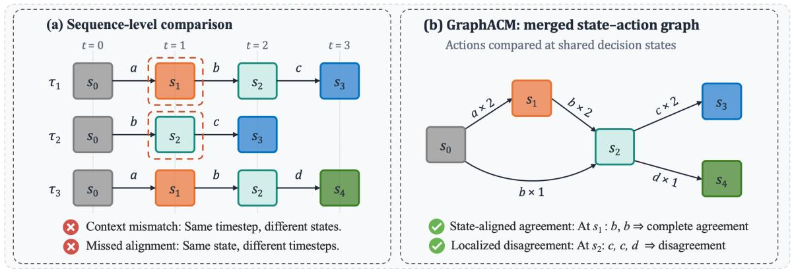
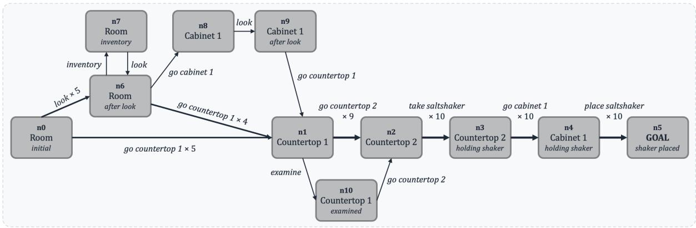
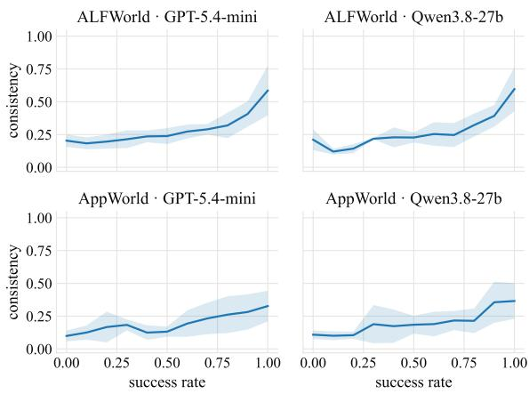
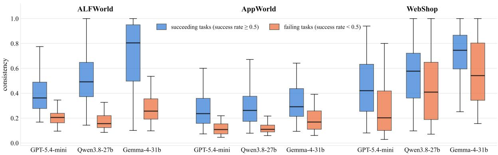
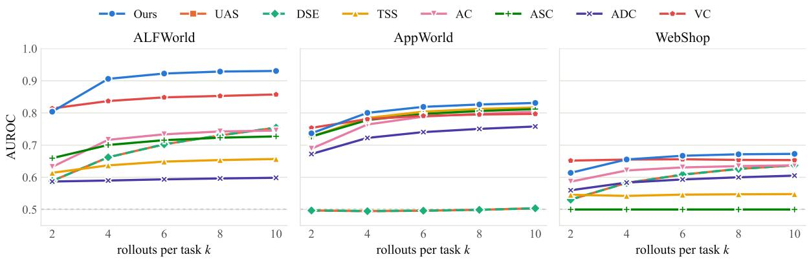
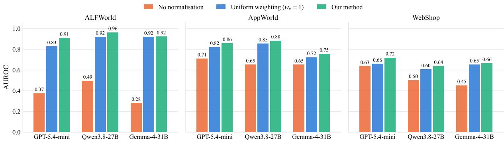
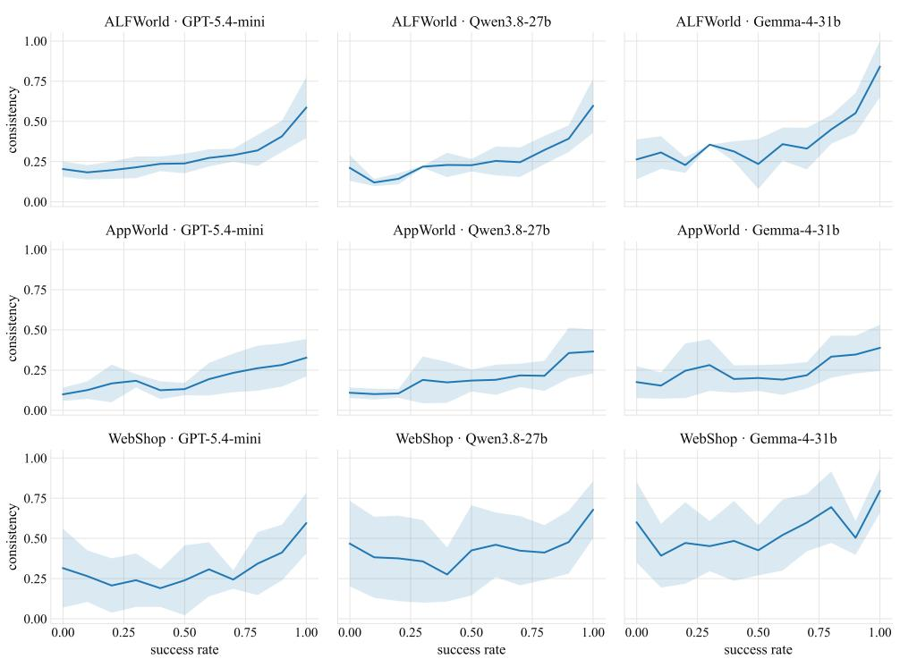

# GraphACM: Graph-based Action Consistency Measurement for Uncertainty Quantification in LLM Agents

Yaxin Ma1, Wenbo Zhang2, Satya Krishna Pothapragada1, Alina Zare1

1University of Florida, Gainesville, FL, USA 2University of California, Irvine, CA, USA Correspondence: yaxinma@ufl.edu

## Abstract

Behavioral consistency across repeated executions provides an informative signal for assessing the reliability of large language model (LLM) agents. However, existing approaches typically summarize consistency with a single task-level score, without identifying where behavioral differences occur or whether actions are compared under equivalent decision contexts. We propose a graph-based framework for fine-grained behavioral consistency measurement and uncertainty quantification. Given multiple rollouts of the same task, we merge equivalent states into a directed, action-labeled graph, enabling action comparisons at shared decision states. We introduce node-level and global measures of action consistency, using the global consistency score as a proxy for uncertainty to predict task success or failure. Experiments across three LLMs on ALFWorld, AppWorld, and WebShop demonstrate that our measure is positively associated with task success and achieves an average AUROC of 0.811 for task-success prediction, outperforming the strongest behavioral-consistency baseline (0.729) and verbalized confidence (0.769). These results highlight the effectiveness of state-conditioned behavioral consistency and pinpoint where agent actions agree.

## 1 Introduction

Large language model agents extend text generation to multi-step interaction with external environments (Wang et al., 2024). Frameworks such as ReAct interleave reasoning, actions, and environmental observations to execute tasks (Yao et al., 2023). These capabilities support applications ranging from software development (Yang et al., 2024) to personal-assistant tasks (Trivedi et al., 2024) and scientific research (Lu et al., 2024).

As agents move toward real-world deployment, how to evaluate them and when to trust them remain open challenges (Kapoor et al., 2025; Kirchhof et al., 2025). Evaluating task success based on the final outcome is a standard approach, but it reveals little about the intermediate action behavior or whether the agent would succeed again on the same task. Recent work therefore studies behavioral consistency, which measures the degree to which an agent behaves similarly across repeated executions of the same task. Behavioral consistency has been used as a signal of reliability (Rabanser et al., 2026), with higher consistency indicating greater reliability. It can also be used for uncertainty quantification (Mehta, 2026): the more the executions agree, the more confidence the agent’s behavior warrants.

Existing approaches typically compare behavioral consistency at the outcome or sequence level. Outcome-level consistency assess agreement among final outputs without characterizing intermediate decisions (Yao et al., 2025). Sequencelevel consistency quantify agreement across complete action sequences, such as counting the number of unique sequences (Mehta, 2026) or computing Discrete Semantic Entropy (DSE) over clusters of identical sequences (Ye et al., 2026). Such exact-match measures treat sequences differing by even a single inserted action as distinct, making them sensitive to minor shifts in action sequences. Other methods allow partial agreement: Tool Sequence Similarity (TSS) uses edit-based similarity between tool-name sequences, while Argument Consistency (AC) compares arguments of stepaligned tool calls (Yagubyan, 2026). Action-Set Consistency (ASC) and Action-Distribution Consistency (ADC) discard temporal order by comparing action-type sets and frequency distributions, respectively (Bouchard and Chauhan, 2026).

Despite these differences, existing approaches leave two important gaps. First, they primarily summarize behavioral consistency with a single tasklevel score, without identifying the intermediate decisions at which executions agree or diverge. Second, they establish action correspondence through sequence position or aggregate statistics, rather than the decision contexts in which actions were selected. Actions at the same step may respond to different situations, while equivalent situations may arise at different steps. Although repeated executions begin from the same initial environment, once trajectories diverge, their subsequent actions are no longer taken under the same conditions. Consequently, comparing actions without accounting for their source states can conflate differences in encountered situations with differences in the agent’s decision-making behavior.

  
Figure 1: Illustration of sequence-based and graph-based behavioral consistency measurement. (a) Position-wise comparison may align actions originating from different decision states, while equivalent states can occur at different timesteps. (b) GraphACM merges equivalent states across rollouts and compares actions at shared decision states, identifying consistent decisions and localized behavioral disagreement.

Recent graph-based reinforcement learning (RL) methods have demonstrated the value of aggregating agent trajectories through shared states. GraphGPO (Cheng et al., 2026) and G2PO (Wang et al., 2026) construct state-transition graphs by merging equivalent states across rollouts, with actions represented as transitions. These graphs support fine-grained credit assignment and advantage estimation for policy optimization. Although these methods also leverage multiple sampled trajectories, their objective is to optimize agent policies through training, whereas ours is to measure the behavioral consistency of a fixed agent at inference time without requiring outcome labels.

Motivated by these graph-based representations, we propose GraphACM (Graph-based Action Consistency Measurement), a framework for finegrained behavioral consistency measurement and uncertainty quantification in LLM agents. Given multiple rollouts of the same task, we construct a directed, action-labeled graph by merging equivalent states into shared nodes and representing actions as transitions, enabling action comparisons under equivalent decision contexts. At each shared node, we measure action agreement across rollouts and aggregate these local measurements into a tasklevel consistency score. As illustrated in Figure 1, GraphACM addresses both limitations by aligning actions based on their source states and localizing behavioral agreement and divergence at intermediate decision points.

## Our contributions are threefold:

1. We propose GraphACM, a graph-based framework for behavioral consistency analysis that aggregates trajectories through shared states, enabling context-conditioned action comparisons.

2. We formulate node-level action-consistency measures that quantify agreement at shared states and aggregate these local measurements into a task-level score, supporting fine-grained behavioral analysis and uncertainty estimation.

3. We evaluate GraphACM across three LLMs and three agent benchmarks; our method outperforms existing baselines in most settings, demonstrating its superior performance in tasksuccess discrimination.

## 2 GraphACM: Graph-based Action Consistency Measurement

## 2.1 Problem Formulation

We consider an LLM agent with policy π interacting with an environment E to complete a task g under a ReAct-style protocol (Yao et al., 2023). For a fixed task with same initial condition, we independently sample $k \geq 2$ rollouts. Rollout i is

$$
\begin{array} { r l } & { \tau ^ { ( i ) } = \big ( o _ { 0 } ^ { ( i ) } , a _ { 0 } ^ { ( i ) } , o _ { 1 } ^ { ( i ) } , \dots , a _ { T _ { i } - 1 } ^ { ( i ) } , o _ { T _ { i } } ^ { ( i ) } \big ) , } \\ & { \qquad i \in \{ 1 , \dots , k \} , } \end{array}
$$

where $o _ { t } ^ { ( i ) }$ is the observation available before action $a _ { t } ^ { ( i ) }$ , and $o _ { t + 1 } ^ { ( i ) }$ is the resulting observation. $T _ { i }$ is the number of recorded actions before termination or the step limit; intermediate reasoning is not included. Our goal is to measure behavioral consistency across these rollouts without using their success labels.

## 2.2 Proposed Method: GraphACM

Our method provides a fine-grained, state-aligned measure of behavioral consistency by comparing actions taken from equivalent states across repeated rollouts. A graph naturally supports this comparison by merging equivalent states into shared nodes and representing actions as labeled edges, revealing where trajectories share states and where their actions diverge. We first describe the graph construction, then introduce node-level and task-level action consistency measures, followed by uncertainty quantification and theoretical analysis.

## 2.2.1 Graph Construction

We merge the k rollouts of each task into a directed, action-labeled graph, where nodes represent abstract states and edges represent actions, enabling actions to be aligned by their source states.

Abstract states. The observation $o _ { t } ^ { ( i ) }$ alone may not fully characterize the agent’s decision context, as the same environment can be encountered with different information acquired from previous interactions. We therefore define an abstract state

$$
z _ { t } ^ { ( i ) } = \phi ( e _ { t } ^ { ( i ) } , h _ { t } ^ { ( i ) } ) ,
$$

where $e _ { t } ^ { ( i ) }$ represents the execution-relevant environment context and $h _ { t } ^ { ( i ) }$ summarizes information from history not captured by the current environment context. States are considered equivalent when their canonical representations match under $\phi .$ Benchmark-specific definitions and canonicalization procedures are provided in Appendix B.

Node and edge. We represent each state as a node and each action as a directed transition to the subsequent state. Identical states across k different rollouts are merged into shared nodes. The resulting vertex set is $\begin{array} { r } { \mathcal { V } = \bigcup _ { i = 1 } ^ { k } \{ z _ { t } ^ { ( i ) } \mid 0 \leq t \leq T _ { i } \} } \end{array}$ . For each node $v \in \mathcal V$ , we define $I _ { v } = \{ i \in \{ 1 , \ldots , k \} $ $\exists t < T _ { i } , \ z _ { t } ^ { ( i ) } = v \}$ as the rollouts that visit state v and $n _ { v } = | I _ { v } |$ as their number. For each $i \in I _ { v }$ $a _ { i } ( v )$ denotes the action taken from v. Each transition is an action-labeled edge, with edge set $\mathcal { E } _ { G } =$ $\{ ( z _ { t } ^ { ( i ) } , a _ { t } ^ { ( i ) } , z _ { t + 1 } ^ { ( i ) } ) \mid 1 \leq i \leq k , 0 \leq t < T _ { i } \}$

Merged rollout graph. The resulting graph $\mathcal { G } =$ $( \nu , \mathcal { E } _ { G } )$ is directed and action-labeled, with each rollout corresponding to a walk through it. By merging equivalent states, the graph reveals where rollouts converge or diverge and enables comparison of actions taken under equivalent abstract decision contexts.

## 2.2.2 Consistency Measurement

Given the constructed graph, actions originating from the same node are comparable under the chosen state abstraction. We measure action consistency at each node and aggregate these local measures to obtain task-level consistency.

Node-level action consistency. For a node v visited by $n _ { v } \geq 2$ rollouts, we define the node-level consistency $S _ { v }$ as the average pairwise action agreement:

$$
S _ { v } = \frac { 1 } { { \binom { n _ { v } } { 2 } } } \sum _ { { i < j } \atop { i , j \in I _ { v } } } \sin \bigl ( a _ { i } ( v ) , a _ { j } ( v ) \bigr ) ,\tag{1}
$$

where $I _ { v }$ is the set of rollouts that take an action from node $v , n _ { v } = \left| I _ { v } \right|$ , and $a _ { i } ( v )$ denotes the representative action taken by rollout i at v. We use exact action matching:

$$
\mathrm { s i m } \big ( a _ { i } ( v ) , a _ { j } ( v ) \big ) = \mathbf { 1 } \big [ a _ { i } ( v ) = a _ { j } ( v ) \big ] ,
$$

where equality requires both the action name and arguments to match. Thus, $S _ { v } \in [ 0 , 1 ]$ with higher values indicating greater action agreement. For nodes visited by only one rollout, we set $S _ { v } = 0$ as no cross-rollout comparison is available.

Task-level action consistency. We aggregate node-level consistency into a global score:

$$
{ \cal S } _ { G } = { \frac { 1 } { k \bar { T } } } \sum _ { v } w _ { v } { \cal S } _ { v } ,\tag{2}
$$

where $w _ { v } = n _ { v }$ is the number of rollouts visiting node v, and $\begin{array} { r } { \bar { T } = \frac { 1 } { k } \sum _ { i = 1 } ^ { k } T _ { i } } \end{array}$ is the average rollout length, with $T _ { i }$ denoting the number of actions in rollout i. Weighting each node by the number of visiting rollouts gives greater importance to states shared across more executions, while normalization by the total number of actions accounts for differences in trajectory length. The resulting score satisfies $S _ { G } \in [ 0 , 1 ]$ , as proved in Appendix A.1.

## 2.2.3 Uncertainty Quantification

Motivated by prior work using behavioral consistency as a signal of uncertainty for failure prediction (Mehta, 2026), we define task-level uncertainty as $U = 1 - S _ { G }$ . Here, $U \in [ 0 , 1 ]$ ]. Higher action consistency reflects more stable decision-making across repeated executions, suggesting lower uncertainty. Conversely, lower consistency indicates greater behavioral variability and thus higher uncertainty. The overall algorithm is summarized in Algorithm 1.

Algorithm 1 GraphACM   
1: Input: Task g, policy π, environment $\mathcal { E } ,$ num  
ber of rollouts k, state abstraction $\phi .$   
2: Output: Task-level uncertainty U.   
3: Sample k independent rollouts $\{ \tau ^ { ( i ) } \} _ { i = 1 } ^ { k }$ using   
π on task $g .$   
4: Construct abstract states $z _ { t } ^ { ( i ) } = \phi ( e _ { t } ^ { ( i ) } , h _ { t } ^ { ( i ) } )$   
for all rollouts.   
5: Construct $\mathcal { G } = ( \nu , \mathcal { E } _ { G } )$ by merging equivalent   
states and identical action-labeled transitions.   
6: for $v \in \mathcal V$ do   
7: Compute rollout support $I _ { v }$ and $n _ { v } = | I _ { v } | .$   
8: For each $i \in I _ { v } ,$ let $a _ { i } ( v )$ be the action from   
v in rollout i.   
9: Compute $S _ { v }$ using Eq. 1 if $n _ { v } \geq 2 ;$ other  
wise set $S _ { v } = 0 .$   
10: end for   
11: Compute global consistency $S _ { G }$ using Eq. 2.   
12: return $U = 1 - S _ { G } .$

## 2.3 Theoretical Analysis

Lemma 1 (Unbiasedness of local consistency). For a shared state v with $n _ { v } \geq 2 ,$ , let $p _ { v } ( a )$ denote the probability that a rollout visiting v selects representative action a. Assume the representative actions across rollouts are independently and identically distributed according to $p _ { \tau }$ . Then $S _ { v }$ is an unbiased estimator ofthe probability that two independent actions $A , A ^ { \prime } \sim p _ { v }$ agree:

$$
\mathbb { E } [ S _ { v } ] = \operatorname* { P r } ( A = A ^ { \prime } ) = \sum _ { a } p _ { v } ( a ) ^ { 2 } ,\tag{3}
$$

This result connects local consistency to Rényi entropy of order two (Rényi, 1961), $H _ { 2 } ( p _ { v } ) =$ − log $\textstyle \sum _ { a } p _ { v } ( a ) ^ { 2 }$ since $\mathbb { E } [ S _ { v } ] \ : = \ : \exp ( - H _ { 2 } ( p _ { v } ) )$ Thus, higher expected local consistency corresponds to lower entropy in the conditional action distribution. The proof is provided in Appendix A.2.

## 3 Experiments

## 3.1 Experiment Settings

Benchmarks and LLM Models. We evaluate our method on three agent benchmarks: ALF-World (Shridhar et al., 2021), a text-based household environment; AppWorld (Trivedi et al., 2024), a Python-based API interaction environment; and WebShop (Yao et al., 2022), a text-based shopping environment. We use Qwen3.8-27B (Qwen Team, 2026), Gemma-4-31B-IT (Google Deep-Mind, 2026), and GPT-5.4-mini (OpenAI, 2026) with the verl-agent harness (Feng et al., 2026). For each task–model pair, we independently sample $k ~ = ~ 1 0$ rollouts from the same initial state at temperature 1.0, without using hidden reasoning. Episodes are limited to 50 steps for ALFWorld and AppWorld and 30 for WebShop. Dataset subsets and implementation details appear in Appendix C. Table 4 in Appendix D.1 reports success rates and mean trajectory lengths.

Labels and metrics. For each task–policy pair, we compute a task-level consistency score from k = 10 rollouts without using outcome labels. A task is labeled successful if at least half of its rollouts succeed, and failed otherwise. We report AU-ROC with success as the positive class, and Spearman’s rank correlation $\rho$ between the consistency score and the empirical task success rate.

Baselines. We compare against six black-box behavioral-consistency baselines that require no access to model internals: Unique Action Sequences (UAS) (Mehta, 2026), Discrete Semantic Entropy (DSE) (Ye et al., 2026), Tool Sequence Similarity (TSS) and Argument Consistency (AC) (Yagubyan, 2026), and Action-Set Consistency (ASC) and Action-Distribution Consistency (ADC) (Bouchard and Chauhan, 2026). We additionally include Verbalized Confidence (VC) as a non-consistency baseline, where the agent assesses the success of each rollout through a binary Yes/No judgment and a confidence probability (Tian et al., 2023).

  
Figure 2: Merged state–action graph for an ALFWorld task (“put some saltshaker on cabinet”) using Qwen3.8-27B with k = 10 successful rollouts. Nodes represent states, and directed edges represent actions, with × indicating the number of rollouts taking each action.

  
Figure 3: Global action consistency versus empirical task success rate. Lines show mean consistency across tasks at each success-rate level; shaded bands indicate ±1 standard deviation.

## 3.2 Constructed graph and Local Analysis

Figure 2 illustrates the merged graph for an ALF-World task, where 60 actions across ten successful rollouts are merged into 11 unique states and 14 distinct edges. At the initial state, five rollouts choose look, while the remaining five navigate directly to countertop 1. When a rollout revisits a node, we use its last action from that node as its representative action. Node-level consistency reveals that behavioral disagreement is concentrated in the exploration phase: $S _ { n _ { 0 } } = 0 . 4$ 4 at the initial state, $S _ { n 6 } = 0 . 6 0$ after look, and $S _ { n _ { 1 } } = 0 . 8 0$ at countertop 1. All ten rollouts then reconverge at countertop 2 and follow identical actions thereafter, yielding $S _ { v } = 1$ at each shared decision state. This example demonstrates how state alignment captures shared decision contexts across different trajectory lengths and localizes behavioral agreement and divergence at intermediate states.

## 3.3 Consistency and task success rate

We examine the relationship between global action consistency and task success rate. For each task– model pair, we sample k = 10 trajectories and define the success rate as the fraction that succeed. Figure 3 presents results for four model–benchmark pairs; all nine are reported in Figure 7 in Appendix. On ALFWorld and AppWorld, consistency is positively associated with success rate across all six pairs (Spearman’s $\rho = 0 . 8 0 \mathrm { - } 0 . 8 3$ on ALFWorld and 0.57–0.74 on AppWorld). The increase is most pronounced at high success rates, suggesting that consistency is particularly informative for distinguishing reliably solved tasks from those solved less consistently. On WebShop, the association is weaker $( \rho = 0 . 2 5 – 0 . 4 0 )$ , with some zero-success tasks exhibiting high consistency, as analyzed in Appendix D.2. Overall, the positive associations across all nine pairs support consistency as a behavioral indicator of empirical task reliability.

## 3.4 Consistency predicts success

We next evaluate whether consistency predicts the task outcome. A task is labeled successful if its success rate over $k = 1 0$ rollouts is at least 0.5, and a failure otherwise. Figure 4 compares the global action consistency scores of the two groups. On ALFWorld and AppWorld the interquartile ranges of succeeding and failing tasks do not overlap on five of the six pairs; on WebShop the medians are ordered but the boxes overlap on all three pairs, indicating weaker separation.

Table 1 compares the AUROC of our consistency measure with all baselines. Our method achieves the highest average AUROC, 0.811, exceeding verbalized confidence (VC, 0.769) and the strongest consistency baseline (AC, 0.729). It ranks first or tied-first in six of the nine settings and second in the remaining three. Besides, the results show that no consistency-based baseline performs uniformly strong. The sequence-based measures (TSS, AC, ASC, ADC) perform best overall on AppWorld but vary widely on ALFWorld and are weaker on Web-Shop, where TSS performs near chance and ASC is at chance. The count-based measures (UAS and DSE) exhibit the opposite pattern: relatively strong performance on ALFWorld and WebShop but nearchance performance on AppWorld. In contrast, our method achieves the highest or second-highest AUROC in every setting, maintaining consistently strong performance across all settings.

<table><tr><td rowspan="2">Methods</td><td colspan="3">ALFWorld</td><td colspan="3">AppWorld</td><td colspan="3">WebShop</td><td rowspan="2">Average</td></tr><tr><td>GPT</td><td>Qwen</td><td>Gemma</td><td>GPT</td><td>Qwen</td><td>Gemma</td><td>GPT</td><td>Qwen</td><td>Gemma</td></tr><tr><td>UAS</td><td>0.655</td><td>0.741</td><td>0.866</td><td>0.476</td><td>0.504</td><td>0.531</td><td>0.702</td><td>0.592</td><td>0.618</td><td>0.632</td></tr><tr><td>DSE</td><td>0.655</td><td>0.741</td><td>0.866</td><td>0.476</td><td>0.504</td><td>0.531</td><td>0.703</td><td>0.596</td><td>0.613</td><td>0.632</td></tr><tr><td>TSS</td><td>0.523</td><td>0.777</td><td>0.670</td><td>0.847</td><td>0.849</td><td>0.754</td><td>0.519</td><td>0.553</td><td>0.571</td><td>0.674</td></tr><tr><td>AC</td><td>0.730</td><td>0.728</td><td>0.777</td><td>0.819</td><td>0.888</td><td>0.704</td><td>0.683</td><td>0.611</td><td>0.618</td><td>0.729</td></tr><tr><td>ASC</td><td>0.509</td><td>0.900</td><td>0.773</td><td>0.878</td><td>0.835</td><td>0.722</td><td>0.500</td><td>0.500</td><td>0.500</td><td>0.680</td></tr><tr><td>ADC</td><td>0.439</td><td>0.677</td><td>0.679</td><td>0.841</td><td>0.746</td><td>0.687</td><td>0.630</td><td>0.594</td><td>0.592</td><td>0.654</td></tr><tr><td>VC</td><td>0.829</td><td>0.853</td><td>0.890</td><td>0.791</td><td>0.873</td><td>0.727</td><td>0.633</td><td>0.667</td><td>0.660</td><td>0.769</td></tr><tr><td>Ours</td><td>0.907</td><td>0.962</td><td>0.922</td><td>0.857</td><td>0.883</td><td>0.754</td><td>0.718</td><td>0.636</td><td>0.664</td><td>0.811</td></tr></table>

Table 1: AUROC comparison of our method and baselines for task-success prediction across ALFWorld, AppWorld, and WebShop using GPT-5.4-mini, Qwen3.8-27B, and Gemma-4-31B. Best results are shown in bold and secondbest results are underlined.

  
Figure 4: Consistency scores of successful and failed tasks across benchmarks and LLMs. Boxes show the median and interquartile range; whiskers extend to the furthest task within 1.5 IQR of the box.

Overall scores are lower on WebShop than on the other benchmarks, suggesting that WebShop is the most challenging benchmark for predicting success from consistency, align our findings in Section 3.3 and Figure 4. One possible reason could be that its episodes are short and follow a fixed skeleton: search, click a product, select options, buy. This means even unsuccessful rollouts may traverse similar steps and exhibit high consistency.

## 3.5 Effect of Action-Equivalence Granularity

The preceding experiments use fine-grained action equivalence: two actions agree if they call the same API or command with the same arguments. Here, we consider a coarser name-only variant that ignores arguments. Table 2 reports average AUROCs of 0.811 and 0.794 with and without arguments, respectively. Retaining arguments improves average performance on ALFWorld and WebShop, where the command vocabularies are small and relatively generic. For example, go to accounts for 41–60% of the observed ALFWorld steps, but its destination argument specifies which location to visit. Ignoring arguments can therefore conceal decision differences. On AppWorld, name-only matching performs slightly better. The policies invoke 173– 227 distinct APIs, whose names already distinguish a broad range of operations. For APIs with multiple arguments, strict matching may unnecessarily distinguish minor parameter variations. Thus, the appropriate granularity depends on whether action names alone are sufficiently informative or arguments are essential for distinguishing decisions.

<table><tr><td rowspan="2">Methods</td><td colspan="3">ALFWorld</td><td colspan="3">AppWorld</td><td colspan="3">WebShop</td><td rowspan="2">Average</td></tr><tr><td>GPT</td><td>Qwen</td><td>Gemma</td><td>GPT</td><td>Qwen</td><td>Gemma</td><td>GPT</td><td>Qwen</td><td>Gemma</td></tr><tr><td>Name only</td><td>0.807</td><td>0.948</td><td>0.883</td><td>0.860</td><td>0.894</td><td>0.756</td><td>0.701</td><td>0.627</td><td>0.672</td><td>0.794</td></tr><tr><td>Name + arguments</td><td>0.907</td><td>0.962</td><td>0.922</td><td>0.857</td><td>0.883</td><td>0.754</td><td>0.718</td><td>0.636</td><td>0.664</td><td>0.811</td></tr></table>

Table 2: AUROC of our method under two action-equivalence criteria: matching action types only (name only) or matching both action types and arguments (name + arguments).

  
Figure 5: Effect of the number of sampled rollouts k on task-success prediction AUROC across three benchmarks, averaged over three LLMs.

## 3.6 Effect of the Number of Rollouts

We investigate the sensitivity of consistency measures to the number of sampled rollouts $k \in$ {2, 4, 6, 8, 10}. For $k < 1 0$ , we randomly sample k rollouts without replacement from the ten recorded rollouts per task, repeating this 100 times. All methods use the same sampled rollouts, while task labels remain fixed based on all ten rollouts. Figure 5 reports the mean task prediction AUROC across draws, averaged over three LLMs for each benchmark. Our method generally outperforms the baselines across different rollout budgets.

## 3.7 Ablation Study

We ablate two design choices in the global consistency score (Eq. 2): normalisation by total episode length and visitor-based node weights $w _ { v } = n _ { v }$ Figure 6 reports the AUROC of each variant across all nine model–benchmark pairs. Length normalization is important because the unnormalized numerator $\textstyle \sum _ { v } n _ { v } S _ { v }$ tends to increase with episode length. In ALFWorld, failed tasks have trajectories two to three times longer than successful ones (46–48 vs. 15–23 steps), causing the unnormalized score to rank failed tasks higher. Node weighting provides a smaller but consistent benefit. Uniform weights assign equal importance to states visited by two or ten rollouts. Removing visitor-based weights decreased the average AUROC by 0.037, with statistically significant decreases in five of the nine model–benchmark pairs. Together, these results support the effectiveness of both length normalisation and visitor-based weighting in the proposed consistency measure.

## 4 Related Work

Graph Construction for Agentic Reinforcement Learning. Recent RL methods leverage shared states and transitions across rollouts to improve step-level credit assignment. GiGPO groups actions from repeated environment states for relativeadvantage estimation (Feng et al., 2026). Graphbased methods further organize rollouts into shared structures. GraphGPO constructs a unified statetransition graph and assigns edge credit based on estimated progress toward the goal (Cheng et al., 2026), while G2PO merges identical observations into shared nodes and estimates edge advantages using aggregated state values (Wang et al., 2026). GEPO merges semantically similar observations using sentence embeddings for graph-based credit assignment (Yuan et al., 2025). SALT incorporates recent action–observation history into state representations and merges transitions sharing the same source state, action, and successor state (Li et al., 2026). While these methods use shared state structures for reward-based policy optimization, our work constructs graphs to measure the behavioral consistency of fixed agents across rollouts, without requiring outcome labels at inference time.

  
Figure 6: Ablation of episode-length normalization and node weighting. We compare the full method against variants without length normalization or with uniform node weights $( w _ { v } = 1$ instead of $w _ { v } = n _ { v } )$

Uncertainty Quantification for LLM Agents. UQ for LLM agents have built on approaches developed for LLMs, including probability-based scores, verbalized confidence, and sample consistency (Kuhn et al., 2023; Zhang et al., 2025; Oh et al., 2026). Agentic settings introduce additional challenges from function calls and multi-step interactions. UProp separates uncertainty intrinsic to a decision from uncertainty inherited from earlier decisions (Duan et al., 2025), while SAUP aggregates step-level uncertainty using situationaware weights (Zhao et al., 2025). UOPD utilize model confidence to identify intervention turns (Zhang et al., 2026). TRACER combines token surprisal with behavioral signals to identify high-risk episodes (Tayebati et al., 2026). Oh et al. (2026) represent trajectories as a dynamic Bayesian network over actions, states, and observations. RUPA propagates uncertainty along temporal and semantic dependencies in a trajectory graph (Ma et al., 2026), while PropUQ-MAS combines local uncertainty with uncertainty inherited through interagent communication (Liu et al., 2026). Rather than propagating uncertainty through execution dependencies, we quantify uncertainty using action agreement across repeated rollouts.

Behavioral Consistency for LLM Agents. Behavioral consistency has gained attention as an important dimension of agent reliability and uncertainty quantification. Rabanser et al. (2026)

distinguish outcome, trajectory, and consistency within a broader reliability framework. Existing methods measure consistency across repeated executions through action sequence diversity (Mehta, 2026), discrete semantic entropy over sequence clusters (Farquhar et al., 2024; Ye et al., 2026), tool-call sequences (Yagubyan, 2026), or trajectorylevel comparisons (Bouchard and Chauhan, 2026). MATU further examines recurring interaction patterns in multi-agent systems using tensor decomposition (Chen et al., 2026). While these methods provide valuable insights into agent behavior, existing consistency measures largely rely on sequencelevel or aggregate comparisons. In contrast, our work constructs state-action graphs to compare decisions made under equivalent contexts, enabling fine-grained consistency measurements.

## 5 Conclusion

We presented GraphACM, a graph-based framework for measuring behavioral consistency and quantifying uncertainty in LLM agents. By merging repeated executions into a shared statetransition graph, our method enables action comparisons under comparable decision contexts. We introduced node-level and global action consistency measures, supporting both fine-grained behavioral analysis and task-level uncertainty estimation. Experiments across three LLMs and three agent benchmarks demonstrate a positive association between behavioral consistency and task success. Our method also outperforms existing behavioral-consistency baselines and verbalized confidence in average task-success prediction performance. These findings highlight the effectiveness of state-conditioned behavioral consistency as an interpretable, training-free signal for assessing agent reliability and quantifying uncertainty.

## Limitations

Our framework has several limitations. First, behavioral consistency serves as an indirect indicator of reliability rather than a guarantee of correctness. Agents may consistently repeat incorrect decisions, as observed in some WebShop tasks. This is an inherent limitation shared by consistency-based approaches rather than a limitation specific to our method. Second, the effectiveness of state-aligned comparisons depends on the quality of state abstraction. Incorrectly merging distinct decision contexts or failing to identify equivalent states may affect consistency estimates. Third, our method requires multiple rollouts of the same task, introducing additional inference costs compared with single-execution approaches. Finally, our evaluation is limited to three LLMs and three agent benchmarks. Future work could investigate the sensitivity of our method to the state representations, as well as its generalization to more diverse agent environments.

## Ethical Considerations

High behavioral consistency does not guarantee correct or safe behavior and should not be used alone to authorize consequential agent actions. Repeated rollouts also increase computational demands and may increase environmental costs.

## References

Dylan Bouchard and Mohit Singh Chauhan. 2026. Beyond single-turn confidence: Trajectory-adapted uncertainty quantification for LLM agents. arXiv preprint arXiv:2608.11552.

Tiejin Chen, Huaiyuan Yao, Jia Chen, Evangelos E Papalexakis, and Hua Wei. 2026. Every response counts: Quantifying uncertainty of LLM-based multiagent systems through tensor decomposition. In Proceedings ofthe 64th Annual Meeting ofthe Association for Computational Linguistics (Volume 1: Long Papers).

Xin Cheng, Shuo He, Lang Feng, Haiyang Xu, Ming Yan, Lei Feng, and Bo An. 2026. Beyond trajectorylevel attribution: Graph-based credit assignment for agentic reinforcement learning. In Proceedings of the 43rd International Conference on Machine Learning, volume 306 of Proceedings of Machine Learning Research, pages 18861–18886. PMLR.

Jinhao Duan, James Diffenderfer, Sandeep Madireddy, Tianlong Chen, Bhavya Kailkhura, and Kaidi Xu. 2025. UProp: Investigating the uncertainty propagation of LLMs in multi-step agentic decision-making. arXiv preprint arXiv:2506.17419.

Sebastian Farquhar, Jannik Kossen, Lorenz Kuhn, and Yarin Gal. 2024. Detecting hallucinations in large language models using semantic entropy. Nature, 630(8017):625–630.

Lang Feng, Zhenghai Xue, Tingcong Liu, and Bo An. 2026. Group-in-group policy optimization for llm agent training. Advances in Neural Information Processing Systems, 38:46375–46408.

Google DeepMind. 2026. Gemma 4 31B IT model card. https://huggingface.co/google/ gemma-4-31B-it.

Sayash Kapoor, Benedikt Stroebl, Zachary S Siegel, Nitya Nadgir, and Arvind Narayanan. 2025. AI agents that matter. Transactions on Machine Learning Research.

Michael Kirchhof, Gjergji Kasneci, and Enkelejda Kasneci. 2025. Position: Uncertainty quantification needs reassessment for large language model agents. In Forty-second International Conference on Machine Learning Position Paper Track.

Lorenz Kuhn, Yarin Gal, and Sebastian Farquhar. 2023. Semantic uncertainty: Linguistic invariances for uncertainty estimation in natural language generation. In International Conference on Learning Representations.

Jiazheng Li, Yawei Wang, Qiaojing Yan, Yijun Tian, Zhichao Xu, Huan Song, Panpan Xu, and Lin Lee Cheong. 2026. SALT: Step-level advantage assignment for long-horizon agents via trajectory graph. In Findings of the Association for Computational Linguistics: EACL 2026, pages 4709–4725.

Yaokun Liu, Yifan Liu, Daniel Yue Zhang, Ruichen Yao, Zelin Li, and Dong Wang. 2026. Propuqmas: Propagation-aware uncertainty quantification for llm multi-agent systems. arXiv preprint arXiv:2608.22130.

Chris Lu, Cong Lu, Robert Tjarko Lange, Jakob Foerster, Jeff Clune, and David Ha. 2024. The AI scientist: Towards fully automated open-ended scientific discovery. arXiv preprint arXiv:2408.06292.

Zhengzhao Ma, Boxi Cao, Yaojie Lu, Hongyu Lin, Xianpei Han, and Le Sun. 2026. From sequence to structure: Relational uncertainty propagation for LLM agents. arXiv preprint arXiv:2608.16002.

Aman Mehta. 2026. When agents disagree with themselves: Behavioral consistency as an uncertainty signal for LLM agents. In ICML 2026 Workshop on Statistical Frameworks for Uncertainty in Agentic Systems. ArXiv:2602.11619.

Changdae Oh, Seongheon Park, To Eun Kim, Jiatong Li, Wendi Li, Samuel Yeh, Xuefeng Du, Hamed Hassani, Paul Bogdan, Dawn Song, and Sharon Li. 2026. Uncertainty quantification in LLM agents: Foundations, emerging challenges, and opportunities. In

Proceedings of the 64th Annual Meeting of the Associationfor Computational Linguistics (Volume 1: Long Papers), pages 16219–16250.

OpenAI. 2026. Introducing GPT-5.4 mini and nano. https://openai.com/index/ introducing-gpt-5-4-mini-and-nano/.

Qwen Team. 2026. Qwen3.8-Max: A new bar for coding and cowork. https://qwen.ai/blog?id= qwen3.8.

Stephan Rabanser, Sayash Kapoor, Peter Kirgis, Kangheng Liu, Saiteja Utpala, and Arvind Narayanan. 2026. Towards a science of AI agent reliability. In Proceedings ofthe 43rd International Conference on Machine Learning, volume 306 of Proceedings ofMachine Learning Research, pages 102769–102820. PMLR.

Alfréd Rényi. 1961. On measures of entropy and information. In Proceedings ofthe Fourth Berkeley Symposium on Mathematical Statistics and Probability, Volume 1: Contributions to the Theory of Statistics, pages 547–561. University of California Press.

Mohit Shridhar, Xingdi Yuan, Marc-Alexandre Côté, Yonatan Bisk, Adam Trischler, and Matthew Hausknecht. 2021. ALFWorld: Aligning text and embodied environments for interactive learning. In International Conference on Learning Representations.

Sina Tayebati, Divake Kumar, Nastaran Darabi, Davide Ettori, Ranganath Krishnan, and Amit Ranjan Trivedi. 2026. TRACER: Trajectory risk aggregation for critical episodes in agentic reasoning. In Proceedings of the 43rd International Conference on Machine Learning. ArXiv:2602.11409.

Katherine Tian, Eric Mitchell, Allan Zhou, Archit Sharma, Rafael Rafailov, Huaxiu Yao, Chelsea Finn, and Christopher D Manning. 2023. Just ask for calibration: Strategies for eliciting calibrated confidence scores from language models fine-tuned with human feedback. In Proceedings ofthe 2023 Conference on Empirical Methods in Natural Language Processing, pages 5433–5442.

Harsh Trivedi, Tushar Khot, Mareike Hartmann, Ruskin Manku, Vinty Dong, Edward Li, Shashank Gupta, Ashish Sabharwal, and Niranjan Balasubramanian. 2024. AppWorld: A controllable world of apps and people for benchmarking interactive coding agents. In Proceedings of the 62nd Annual Meeting of the Association for Computational Linguistics (Volume 1: Long Papers), pages 16022–16076.

Lei Wang, Chen Ma, Xueyang Feng, Zeyu Zhang, Hao Yang, Jingsen Zhang, Zhiyuan Chen, Jiakai Tang, Xu Chen, Yankai Lin, Wayne Xin Zhao, Zhewei Wei, and Jirong Wen. 2024. A survey on large language model based autonomous agents. Frontiers ofComputer Science, 18(6):186345.

Yunan Wang, Minghui Song, Zihan Zhang, Shaohan Huang, Haizhen Huang, Furu Wei, Weiwei Deng, Feng Sun, and Qi Zhang. 2026. Group-graph policy optimization for long-horizon agentic reinforcement learning. arXiv preprint arXiv:2606.22995.

Abel Yagubyan. 2026. How consistent are LLM agents? measuring behavioral reproducibility in multi-step tool-calling pipelines. arXiv preprint arXiv:2605.28840.

John Yang, Carlos E Jimenez, Alexander Wettig, Kilian Lieret, Shunyu Yao, Karthik Narasimhan, and Ofir Press. 2024. SWE-agent: Agent-computer interfaces enable automated software engineering. Advances in Neural Information Processing Systems, 37:50528– 50652.

Shunyu Yao, Howard Chen, John Yang, and Karthik Narasimhan. 2022. Webshop: Towards scalable realworld web interaction with grounded language agents. Advances in Neural Information Processing Systems, 35:20744–20757.

Shunyu Yao, Noah Shinn, Pedram Razavi, and Karthik Narasimhan. 2025. τ-bench: A benchmark for toolagent-user interaction in real-world domains. In International Conference on Learning Representations.

Shunyu Yao, Jeffrey Zhao, Dian Yu, Nan Du, Izhak Shafran, Karthik Narasimhan, and Yuan Cao. 2023. ReAct: Synergizing reasoning and acting in language models. In International Conference on Learning Representations.

Zihuiwen Ye, Lukas Aichberger, Michael Kirchhof, Sinead Williamson, Luca Zappella, Yarin Gal, Arno Blaas, and Adam Golinski. 2026. Uncertainty quantification for llm function-calling. arXiv preprint arXiv:2604.22985.

Jiazhen Yuan, Zhike Gong, Jinquan Hang, Zhengbiao Bai, and Wei Zhao. 2025. Graph-enhanced policy optimization in LLM agent training. arXiv preprint arXiv:2510.26270.

Wenbo Zhang, Pengcheng Xu, Weizhi Du, Jing Zhang, and Hengrui Cai. 2026. Uopd: Uncertainty-aware intervention for on-policy distillation of multi-turn agents. arXiv preprint arXiv:2609.34036.

Wenbo Zhang, Zihang Xu, and Hengrui Cai. 2025. Recognizing limits: Investigating infeasibility in large language models. In Findings of the Association for Computational Linguistics: EMNLP 2025, pages 10092–10112, Suzhou, China. Association for Computational Linguistics.

Qiwei Zhao, Dong Li, Yanchi Liu, Wei Cheng, Yiyou Sun, Mika Oishi, Takao Osaki, Katsushi Matsuda, Huaxiu Yao, Chen Zhao, Haifeng Chen, and Xujiang Zhao. 2025. Uncertainty propagation on LLM agent. In Proceedings of the 63rd Annual Meeting of the Association for Computational Linguistics (Volume 1: Long Papers), pages 6064–6073.

## A Consistency Measurement

A.1 Boundedness of Task-Level Consistency Proposition 1. For k rollouts with $\begin{array} { r } { \sum _ { i = 1 } ^ { k } T _ { i } > 0 , } \end{array}$ the task-level consistency score satisfies $0 \leq S _ { G } \leq$ 1.

Proof. By definition, $0 \leq S _ { v } \leq 1$ and $w _ { v } = n _ { v } \geq$ 0. Since $n _ { v }$ counts the number of distinct rollouts visiting node v, each rollout contributes at most $T _ { i }$ to the sum of node weights. Therefore,

$$
\sum _ { v \in \mathcal { V } } n _ { v } \le \sum _ { i = 1 } ^ { k } T _ { i } = k \bar { T } .
$$

It follows that

$$
0 \leq S _ { G } = \frac { \sum _ { v \in \mathcal { V } } n _ { v } S _ { v } } { k \bar { T } } \leq \frac { \sum _ { v \in \mathcal { V } } n _ { v } } { k \bar { T } } \leq 1 .
$$

Thus, $S _ { G } \in [ 0 , 1 ]$

## A.2 Proof of Local Consistency and Its Entropy Interpretation

Consider a shared state v with $n _ { v } \ \geq \ 2$ supporting rollouts. Let $A _ { 1 } , \ldots , A _ { n _ { \tau } }$ denote their representative actions, assumed to be i.i.d. from the conditional action distribution $p _ { v } ,$ where $p _ { v } ( a ) =$ $\operatorname* { P r } ( A _ { i } = a )$ . All expectations and probabilities are conditioned on fixed v and $n _ { v }$

Local consistency measures the average pairwise action agreement:

$$
S _ { v } = \frac { 1 } { \binom { n _ { v } } { 2 } } \sum _ { i < j } \mathbf { 1 } [ A _ { i } = A _ { j } ] .
$$

Proof of Lemma 1. By linearity of expectation and independence,

$$
\begin{array} { r l } { \mathbb { E } [ S _ { v } ] = \displaystyle \frac { 1 } { \binom { n _ { s } } { 2 } } \sum _ { i < j } \mathbb { E } [ \mathbf { 1 } [ A _ { i } = A _ { j } ] ] } \\ & { = \displaystyle \frac { 1 } { \binom { n _ { s } } { 2 } } \sum _ { i < j } \mathbb { P } \mathbf { r } ( A _ { i } = A _ { j } ) } \\ & { = \displaystyle \frac { 1 } { \binom { n _ { s } } { 2 } } \sum _ { i < j } \sum _ { a } \mathbb { P } \mathbf { r } ( A _ { i } = a , A _ { j } = a ) } \\ & { = \displaystyle \frac { 1 } { \binom { n _ { s } } { 2 } } \sum _ { i < j } \sum _ { a } p _ { v } ( a ) ^ { 2 } } \\ & { = \displaystyle \sum _ { a } p _ { v } ( a ) ^ { 2 } . } \end{array}
$$

The final expression equals the probability that two independent actions drawn from $p _ { v }$ agree. Thus,

<table><tr><td> $e _ { t }$ </td><td colspan="2">Benchmark Environment context</td><td colspan="2">Accumulated knowledge  $h _ { t }$ </td></tr><tr><td>ALFWorld</td><td>Observation, tion, held admissible mands</td><td>loca- object, com-</td><td colspan="2">Moved-object his- tory</td></tr><tr><td>AppWorld</td><td colspan="2">Successful state- changing API calls</td><td colspan="2">Answered read calls</td></tr><tr><td>WebShop</td><td colspan="2">Page, product, view, selected options</td><td colspan="2">Opened product pages and sections</td></tr></table>

Table 3: Benchmark-specific components of the abstract state $\boldsymbol { z } _ { t } = \phi ( \boldsymbol { e } _ { t } , h _ { t } )$

$S _ { v }$ is an unbiased estimator of the pairwise actionagreement probability.

Furthermore, the Rényi entropy of order two is defined as

$$
H _ { 2 } ( p _ { v } ) = - \log \sum _ { a } p _ { v } ( a ) ^ { 2 } .
$$

It follows that

$$
\mathbb { E } [ S _ { v } ] = \sum _ { a } p _ { v } ( a ) ^ { 2 } = \exp ( - H _ { 2 } ( p _ { v } ) ) .
$$

Therefore, expected local consistency is monotonically decreasing in the Rényi entropy of the conditional action distribution. □

## B Graph Construction

Table 3 summarizes the components of the abstract state $\boldsymbol { z } _ { t } ~ = ~ \boldsymbol { \phi } ( \boldsymbol { e } _ { t } , h _ { t } )$ for each benchmark. For ALFWorld, we adopt the state representation of GraphGPO (Cheng et al., 2026), where $e _ { t }$ includes the observation, agent location, held object and its status, and admissible commands, while $h _ { t }$ records the history of moved objects using GraphGPO’s rule-based tracker. For AppWorld, we classify API calls as state-changing or read-only based on the benchmark’s OpenAPI specifications. The environment component $e _ { t }$ consists of the sequence of successful state-changing calls, representing database updates, while $h _ { t }$ records answered read calls as a proxy for previously acquired information. For WebShop, $e _ { t }$ captures the current page, product, view, and selected options, while $h _ { t }$ records previously opened product pages and sections, reflecting the agent’s exploration history. Together, these abstractions enable actions to be compared under equivalent abstract decision contexts across rollouts.

  
Figure 7: Global action consistency versus task success rate across three benchmarks and three models. Success rate is computed from k = 10 rollouts per task–model pair.

## C Experiment Settings

Benchmark and Agent Configuration. We use all 134 ALFWorld tasks from the valid\_unseen split, covering six household task categories; 168 AppWorld tasks from the test\_normal split; and the first 200 WebShop test instructions. All tasks are in English. Generation is capped at 512 tokens per response for ALFWorld and 1,024 for AppWorld and WebShop. Rollout success follows ALFWorld’s goal check, requires all AppWorld unit tests to pass, and requires a terminal reward of 1 in WebShop.

Computing Infrastructure and Artifact Use. Qwen runs locally on four NVIDIA RTX A6000 GPUs requiring approximately 125 GPU-hours for final runs, while Gemma and GPT-5.4-mini are accessed via APIs with total budgets of about \$45 and \$245, respectively. Parameter counts of the open-weight models are given by their names (27B, 31B); that of GPT-5.4-mini is not public. We use ALFWorld, WebShop, and AppWorld for their intended research purposes.

## D Experimental Results

## D.1 Basic Trajectory Statistics

Table 4 reports success rates and mean trajectory lengths for three models across ALFWorld, App-

<table><tr><td>Dataset</td><td>Model</td><td>Success (%)</td><td>Mean steps</td></tr><tr><td rowspan="3">ALFWorld</td><td>Qwen3.8-27B</td><td>80.52</td><td>21.66</td></tr><tr><td>Gemma-4-31B-IT</td><td>67.01</td><td>25.27</td></tr><tr><td>GPT-5.4-mini</td><td>53.88</td><td>33.23</td></tr><tr><td rowspan="3">AppWorld</td><td>Qwen3.8-27B</td><td>63.33</td><td>28.36</td></tr><tr><td>Gemma-4-31B-IT</td><td>56.43</td><td>22.82</td></tr><tr><td>GPT-5.4-mini</td><td>65.30</td><td>15.90</td></tr><tr><td rowspan="3">WebShop</td><td>Qwen3.8-27B</td><td>42.35</td><td>10.52</td></tr><tr><td>Gemma-4-31B</td><td>40.10</td><td>11.54</td></tr><tr><td>GPT-5.4-mini</td><td>43.60</td><td>13.08</td></tr></table>

Table 4: Basic trajectory statistics across ALFWorld, AppWorld, and WebShop.

World, and WebShop. On ALFWorld, Qwen3.8- 27B achieves the highest success rate (80.52%) and the shortest mean trajectory length (21.66 steps). On AppWorld, GPT-5.4-mini achieves the highest success rate (65.30%) with the fewest steps on average (15.90). Across all three models, WebShop exhibits lower success rates (40.10%–43.60%) and shorter mean trajectories (10.52–13.08 steps) than the other benchmarks.

## D.2 Consistency and Task Success Rate

Figure 7 extends the analysis in Section 3.3 to all nine model–benchmark pairs. On ALFWorld and AppWorld, consistency generally increases with success rate across all three models. These patterns suggest that tasks solved successfully in more rollouts also tend to elicit more consistent decisions, supporting the positive associations reported in the main text. WebShop exhibits a similar but weaker positive trend. Notably, some zero-success tasks exhibit high consistency, reflecting consistent but unsuccessful behavior.

<table><tr><td rowspan="2">Methods</td><td colspan="3">ALFWorld</td><td colspan="3">AppWorld</td><td colspan="3">WebShop</td><td rowspan="2">Average</td></tr><tr><td>GPT</td><td>Qwen</td><td>Gemma</td><td>GPT</td><td>Qwen</td><td>Gemma</td><td>GPT</td><td>Qwen</td><td>Gemma</td></tr><tr><td>UAS</td><td>0.655 [.60, .71]</td><td>0.741 [.70, .79]</td><td>0.866 [.82, 91]</td><td>0.476 [.43, .51]</td><td>0.504 [.50, .51]</td><td>0.531 [.50, .56]</td><td>0.702 [.63, .77]</td><td>0.592 [.51, .67]</td><td>0.618 [.54, .70]</td><td>0.632 [.61, .66]</td></tr><tr><td>DSE</td><td>0.655 [.60, .71]</td><td>0.741 [.70, .79]</td><td>0.866 [.82, 91]</td><td>0.476 [.43, .51]</td><td>0.504 [.50, .51]</td><td>0.531 [.50, .56]</td><td>0.703 [.64, .77]</td><td>0.596 [.52, .67]</td><td>0.613 [.54, .69]</td><td>0.632 [.61, .66]</td></tr><tr><td>TSS</td><td>0.523 [.42, .63]</td><td>0.777 [.67, .87]</td><td>0.670 [.58, .76]</td><td>0.847 [.78, .91]</td><td>0.849 [.77, .92]</td><td>0.754 [.68, .83]</td><td>0.519 [.44, .60]</td><td>0.553 [.47, .64]</td><td>0.571 [.49, .65]</td><td>0.674 [.64, .71]</td></tr><tr><td>AC</td><td>0.730 [.65, .81]</td><td>0.728 [.62, .83]</td><td>0.777 [.69, .86]</td><td>0.819 [.75, .89]</td><td>0.888 [.82, .95]</td><td>0.704 [.62, .78]</td><td>0.683 [.61, .75]</td><td>0.611 [.53, .69]</td><td>0.618 [.54, .69]</td><td>0.729 [.70, .76]</td></tr><tr><td>ASC</td><td>0.509 [.40, .61]</td><td>0.900 [.83, .95]</td><td>0.773 [.67, .86]</td><td>0.878 [.82, .93]</td><td>0.835 [.76, 90]</td><td>0.722 [.64, .80]</td><td>0.500 [.50, .50]</td><td>0.500 [.50, .50]</td><td>0.500 [.50, .50]</td><td>0.680 [.66, .70]</td></tr><tr><td>ADC</td><td>0.439 [.34, .54]</td><td>0.677 [.52, .81]</td><td>0.679 [.58, .77]</td><td>0.841 [.77, .90]</td><td>0.746 [.66, .83]</td><td>0.687 [.60, .77]</td><td>0.630 [.55, .70]</td><td>0.594 [.51, .67]</td><td>0.592 [.51, .67]</td><td>0.654 [.62, .69]</td></tr><tr><td>VC</td><td>0.829 [.76, .89]</td><td>0.853 [.78, .92]</td><td>0.890 [.83, .94]</td><td>0.791 [.70, .87]</td><td>0.873 [.80, .94]</td><td>0.727 [.65, .81]</td><td>0.633 [.56, .71]</td><td>0.667 [.59, .74]</td><td>0.660 [.60, .72]</td><td>0.769 [.74, .80]</td></tr><tr><td>Ours</td><td>0.907 [.85, .95]</td><td>0.962 [.93, .99]</td><td>0.922 [.87, .96]</td><td>0.857 [.79, .91]</td><td>0.883 [.82, .94]</td><td>0.754 [.68, .83]</td><td>0.718 [.65, .78]</td><td>0.636 [.56, .71]</td><td>0.664 [.59, .74]</td><td>0.811 [.79, .84]</td></tr></table>

Table 5: AUROC for predicting task success across nine model–benchmark pairs. Higher is better. Brackets show 95% confidence intervals from 2,000 task-level bootstrap resamples, shared by all methods within each column. For the average AUROC, each benchmark’s task resample is shared across its three models. Best results are shown in bold and second-best results are underlined.

## D.3 Consistency Predicts Success

Table 5 supplements Table 1 with 95% confidence intervals from 2,000 task-level bootstrap resamples. Resamples are shared across methods within each setting and across models within each benchmark when computing the average AUROC, preserving task-level dependencies. Our method achieves the highest average AUROC (0.811, [0.79, 0.84]), with its lower bound exceeding the upper bound of every consistency-based baseline, including AC (0.729, [0.70, 0.76]). These results support our method’s effectiveness in predicting task success and its advantage over existing consistency-based baselines.