# PriorityFEC: Deadline-Aware Streaming FEC for KV-Cache Handof in Edge Multi-Agent Systems

Han Shen, Qifu Tyler Sun, Member, IEEE, Fanyang Meng, Member, IEEE, Ye Wang and Yongsheng Liang

Abstract—Multi-agent large language model (LLM) systems are increasingly deployed at the edge to support complex tasks that require collaboration and information exchange among multiple agents. However, when task contexts are passed across agents, shared context that has already been processed by upstream agents often needs to be prefilled again, resulting in substantial redundant computation. Reusing an already prefilled key–value (KV) cache can avoid this recomputation, but requires the reusable KV state to be transferred across the network before the receiving agent can begin generation. Under strict time-tofirst-token (TTFT) deadlines and unreliable edge links, delivering the complete KV cache may be infeasible, making it necessary to prioritize and protect the most valuable KV information within a limited transmission budget. This paper proposes PriorityFEC, a utility-aware KV-cache handof scheme that jointly exploits model-side KV importance and transport-side reliability. PriorityFEC first constructs a utility-aware source stream by placing high-utility KV blocks at earlier transmission positions. It then protects the ordered stream using a feedback-adaptive Streaming Forward Erasure Correction (FEC) mechanism, which schedules repair packets according to receiver feedback before the TTFT deadline. We implement PriorityFEC on a distributed edge LLM serving prototype and evaluate it with Qwen2.5-7B-Instruct and Llama-3.1-8B-Instruct across multiple datasets. Results show that PriorityFEC achieves superior task quality over the compared transport schemes, with its advantages becoming particularly pronounced under stringent deadline constraints. These results demonstrate the importance of jointly optimizing KV-cache utility and deadline-aware transport reliability when reusable LLM state must be handed of across unreliable edge networks.

Index Terms—Large language model serving, KV cache, collaborative inference, KV-cache handof, Streaming FEC, deadlineaware transport.

## I. Introduction

The growing complexity of LLM-based applications is increasingly driving inference toward distributed and collab- orative architectures, where multiple LLM workers or agents jointly execute tasks while maintaining a shared and continuously evolving context [1], [2]. In such systems, diferent agents may be dynamically activated or assigned to distinct stages of a long-running task, resulting in computation and model states being distributed across multiple edge nodes. To ensure seamless task continuation, the accumulated inference context must therefore be eficiently transferred between agents as execution proceeds, allowing newly activated agents to resume inference without reconstructing the task state from scratch.

To generate the first output token, an LLM agent must first perform a prefill stage that processes the input context and materializes the corresponding key–value (KV) cache, which constitutes a major component of the time-to-firsttoken (TTFT). During agent handof, a newly activated agent would conventionally need to prefill the entire accumulated context before decoding can proceed. Yet, most of this context has already been processed by the upstream agent, making the repeated prefill computation largely redundant. Instead of reconstructing the same inference state from the original to- kens, the upstream agent can directly transfer the materialized KV cache to the receiving agent for reuse. Such KV cache handof eliminates redundant prefill computation and enables the receiving agent to resume inference from the existing context with substantially lower handof latency.

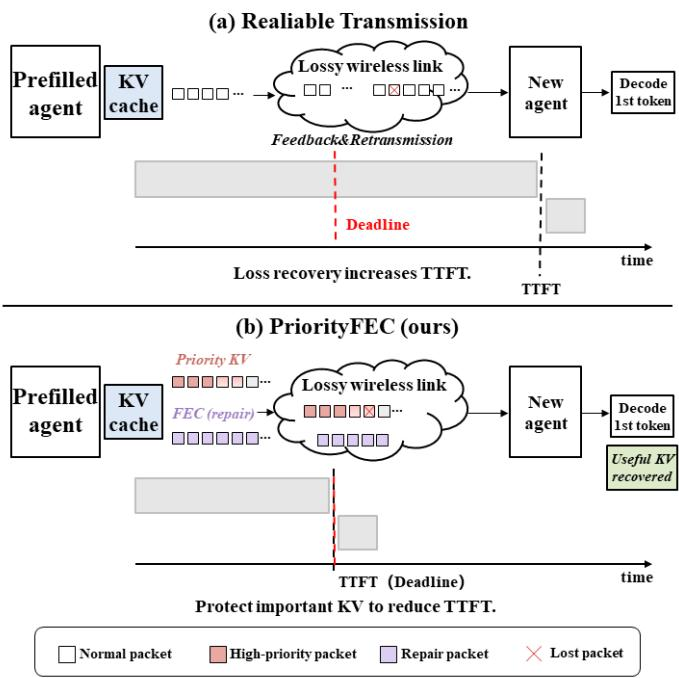  
Fig. 1. Motivation for deadline-constrained KV-cache handof. (a) Reliable transport waits for loss recovery before the receiving agent can use the com- plete reusable KV state, delaying agent activation and TTFT. (b) PriorityFEC places high-utility KV blocks earlier in the source stream and uses FEC, allowing useful KV state to be reconstructed before the TTFT deadline.

KV cache reuse can eliminate redundant context recompu- tation only when the cached state is delivered to the receiving agent within the required time budget [3]. This condition is particularly dificult to satisfy in collaborative edge multi-agent systems, where KV states produced by an upstream agent may reside on a diferent edge node and must traverse bandwidth- constrained and potentially unreliable links before they can be exploited by downstream agents. The challenge is further amplified for long-context inference, which can generate large KV states whose communication delay may dominate the over- all handof latency under limited network capacity. Moreover, congestion, user mobility, wireless interference, and handovers can induce bursty and temporally correlated packet losses, making timely and reliable KV delivery increasingly dificult to guarantee.

Existing KV-cache systems have largely focused on cache storage, reuse, compression, placement, and high-throughput data movement within centralized computing environments, such as data centers and GPU clusters [4], [5]. These tech-niques improve how reusable KV states are represented, man- aged, and accessed, but typically assume that the underlying interconnect can deliver the required state with suficiently high and stable throughput. Such an assumption becomes frag- ile in collaborative edge inference, where reusable KV states may reside on remote agents connected through bandwidth- constrained and lossy links.

In collaborative multi-agent applications, agents are often required to make decisions and respond within stringent la- tency constraints. When a task is handed of to a newly activated agent, the reusable KV cache must be made available in time to support subsequent inference; otherwise, delayed state transfer can directly slow down agent activation and disrupt task coordination. Under a tight TTFT budget, waiting for the complete KV cache to be reliably delivered can be overly restrictive, especially when the cache is large, and the underlying network is lossy or bandwidth-constrained. This motivates a diferent transport objective: rather than insisting on eventual delivery of the entire KV cache, the transport layer should make the most useful KV state available within the limited TTFT budget. A deadline-aware and loss-tolerant KV-cache transport mechanism can therefore provide a more flexible solution by trading completeness for timely availability of task-relevant model state.

Conventional transport mechanisms are poorly matched to this deadline-aware objective. As illustrated in Fig. 1, reliable protocols such as TCP [6] and QUIC [7] ensure eventual deliv-ery through retransmissions, but loss recovery may consume a substantial fraction of the handof budget. Unreliable transport such as UDP avoids retransmission-induced delay, yet directly exposes the receiving agent to missing KV state. Packet- level forward erasure correction (FEC) ofers an attractive alternative by recovering losses without waiting for retransmis- sions [8]. However, under a strict deadline, redundancy itself competes with source transmission for scarce transmission opportunities: sending more repair packets improves robust- ness but leaves fewer opportunities to deliver additional KV state. Moreover, conventional fixed-rate or fixed-schedule FEC treats packets largely uniformly and does not adapt redundancy to either time-varying network conditions or the receiver’s decoding progress. As a result, redundancy may be wasted when delivery proceeds smoothly, while becoming insuficient during burst losses precisely when timely recovery is most critical.

The above observations expose two coupled challenges for deadline-constrained KV-cache handof.

• First, which KV blocks should receive the earliest trans- mission opportunities? When the complete KV cache cannot be delivered before decode startup, diferent source positions have diferent opportunities to become available by the deadline. Treating all KV blocks uni- formly can therefore waste favorable source positions on model state with limited downstream utility.

• Second, when should the limited repair budget be con- sumed? A fixed FEC schedule injects redundancy inde-pendently of decoding progress. Such a schedule may waste repair opportunities when transmission proceeds normally, while reacting too slowly when correlated losses cause the unresolved coding window to grow.

Motivated by these challenges, we develop PriorityFEC around two complementary mechanisms. First, a utility-aware source ordering maps model-derived KV utility to equal-size transport blocks and places high-utility blocks earlier in the transmission stream, while preserving all KV blocks for pos- sible reconstruction. Second, a feedback-adaptive Streaming FEC mechanism protects the resulting stream by adjusting repair transmissions according to decoding progress under a predefined repair budget.

These two mechanisms address diferent aspects of deadline-constrained KV handof: utility-aware ordering deter- mines which KV states receive earlier delivery opportunities, whereas adaptive Streaming FEC determines when recovery opportunities should be introduced. Together, they improve the utility of the reconstructed KV state before the TTFT deadline without requiring packet-level retransmissions.

The main contributions of this work are summarized as follows.

• Deadline-aware KV-cache handof. We formulate KV-cache handof over bandwidth-constrained and unreliable edge links as a deadline-constrained transport problem, with the objective of maximizing the utility of the KV state available at decode startup rather than eventual byte completeness. Controlled KV-perturbation experiments show that equal amounts of recovered KV data can preserve substantially diferent levels of model-relevant information, establishing the need for utility-aware state delivery under tight latency budgets.

• Utility-Aware Source Ordering and Queue Design. We propose PriorityFEC, which maps ofline model-derived KV importance scores to equal-sized transport blocks and organizes them into a utility-aware transmission queue, placing higher-utility blocks at earlier and more favorable source positions for stronger pre-deadline protection.

• Deadline-aware source–repair optimization. We for-mulate adaptive KV-cache protection as a finite-horizon source–repair scheduling problem under hard deadline and repair-budget constraints. Unlike fixed FEC sched- ules, the proposed formulation explicitly captures the op- portunity cost between transmitting additional high-utility source packets and consuming transmission opportunities for loss recovery. We formulate the sequential decision process as an MDP and instantiate the scheduler using a lightweight Double DQN that adapts repair decisions to causal transport feedback and KV utility. Experimental results demonstrate that adaptive source–repair alloca- tion is particularly beneficial in the target regime where complete KV-cache delivery is infeasible before decode startup.

## II. Related Work

## A. KV-Cache Reuse and Movement in Distributed LLM Serv- ing

Modern LLM serving systems increasingly treat KV-cache management and movement as first-class system operations. Disaggregated serving systems such as DistServe [9] and Splitwise [10] separate prompt prefill from autoregressive decoding and transfer the resulting state between GPU workers. Moon- cake [11] adopts a KV-cache-centric architecture in which serving workers access a shared KV-cache substrate. These systems demonstrate that moving previously materialized KV state across workers can be preferable to recomputing it when computation and serving roles are distributed.

A complementary line of work enables KV states to persist beyond a single inference invocation. PagedAttention [12] im-proves GPU memory utilization through eficient KV paging, while LMCache [4] externalizes KV states from the inference engine and supports cache reuse, ofloading, and transfer across devices and serving instances. Such mechanisms make it possible for a worker to reuse an already processed context instead of repeatedly executing the same prefill computation.

Recent approaches further optimize the cost of moving KV state. KVDirect [3] provides tensor-aware communication for distributed KV transfer. CacheGen [5] encodes KV tensors into compact bitstreams and adapts compression according to avail- able bandwidth, while KVServe [13] introduces service-aware compression profiles under workload and resource constraints.

These studies primarily optimize whether, where, or how compactly reusable KV state is stored and transferred. Our work addresses a complementary transport problem. Once a compatible reusable KV state has been identified on another node, we consider how to deliver its most valuable regions over a bandwidth-constrained and lossy edge path when the receiving worker must begin generation before a prescribed deadline.

## B. FEC for Deadline-Constrained and Lossy Transport

Under strict latency deadlines, distributed inference over unreliable wireless and IoT links has shown that timely partial state delivery can be preferable to delayed complete state recovery [14]–[16]. This observation motivates the use of loss-tolerant transport mechanisms that prioritize deadline completion rather than eventual full recovery. Packet-level FEC provides loss recovery without waiting for per-packet retransmissions and is therefore attractive for delay-sensitive communication. Classical block FEC partitions source packets into disjoint coding blocks and generates a prescribed number of repair packets for each block using fixed-rate or rateless codes [17], [18]. Although efective for bounded data objects, block coding introduces explicit coding boundaries, and losses exceeding the redundancy allocated to one block cannot be compensated by repair packets generated for subsequent blocks. Streaming FEC instead protects a continuously evolv- ing source stream using overlapping sliding or elastic coding windows [19]–[21]. In such schemes, an unresolved source packet can remain in the coding window and benefit from subsequent repair packets, making Streaming FEC particularly suitable for bursty-loss and deadline-constrained transport.

In addition to the coding-window design, adaptive FEC schemes dynamically adjust redundancy or repair scheduling according to network feedback. DeepRS [22] predicts nearfuture packet losses using an LSTM and accordingly selects the FEC redundancy ratio, while RL-AFEC [23] employs reinforcement learning to choose frame-level Reed–Solomon redundancy for real-time video under varying network condi- tions. At the transport layer, QUIC-FEC [8] integrates several erasure codes into QUIC for proactive loss recovery, and AC-RLNC [24] uses delayed acknowledgments to causally adapt coding decisions to the observed erasure process. FlEC [25] further exposes application-aware reliability and repairscheduling mechanisms within QUIC. These studies demon-strate that both the amount and timing of redundancy can be adapted to network conditions. Our design instead considers a fixed maximum repair budget under a TTFT deadline and uses cumulative decoding stalls and coding-window growth to concentrate catch-up repairs when unresolved source DoFs are likely to accumulate.

A related line of work provides unequal error protection (UEP) by embedding source importance into the coding pro-cess. Priority Encoding Transmission assigns diferent recov- ery guarantees to source components [26], while expanding- window fountain codes [27] protect more important classes through nested coding windows. UEP random linear coding similarly forms non-overlapping or expanding coding windows for packets with diferent importance levels [28], while prioritized RLNC jointly adapts coding and scheduling for layered data delivery [29]. In these schemes, importance generally changes the coding window, protection level, or scheduling policy itself. In PriorityFEC, by contrast, model-derived KV utility afects the source ordering, while the repair scheduler operates on transport state augmented with compact utility- aware features.

## C. Positioning of This Work

As shown in Table I, prior work has separately made KV movement a first-class serving operation, reduced the storage or communication volume of KV state, and enabled neural inference from incomplete intermediate representations. The transport problem studied here is distinct. We assume that a compatible reusable KV state has already been identified by the serving or agent framework. Given this state, a bounded repair budget, and a fixed TTFT deadline, we ask which KV blocks should receive the most favorable delivery and recovery opportunities over a burst-loss path.

PriorityFEC formulates the problem in terms of deadline- available KV utility, prioritizing model-relevant KV states rather than eventual byte completeness. It preserves the pre- trained LLM and aligns model-derived KV utility with the temporal recovery opportunities of full-window Streaming FEC.

TABLE I  
Positioning of PriorityFEC relative to representative related work.
<table><tr><td>Work</td><td>Target object</td><td>Primary mechanism</td><td>Loss-aware</td><td>Model changes</td><td>Objective</td></tr><tr><td>DistServe [9]</td><td>Serving phases</td><td>Resource placement</td><td></td><td></td><td>TTFT/TPOT SLOs</td></tr><tr><td>Splitwise [10]</td><td>Phase-split state</td><td>Phase placement</td><td></td><td></td><td>Service latency</td></tr><tr><td>Mooncake [11]</td><td>KV cache</td><td>Disaggregated KV store</td><td></td><td></td><td>Serving SLOs</td></tr><tr><td>vLLM [12]</td><td>GPU KV cache</td><td>Memory management</td><td></td><td></td><td>Runtime efficiency</td></tr><tr><td>LMCache [4]</td><td>KV cache</td><td>Offloading and reuse</td><td></td><td></td><td>Transfer efficiency</td></tr><tr><td>KVDirect [3]</td><td>KV cache</td><td>Tensor-aware transfer</td><td></td><td></td><td>Transfer latency</td></tr><tr><td>CacheGen [5]</td><td>KV cache</td><td>Compression</td><td></td><td></td><td>Bandwidth adaptation</td></tr><tr><td>KVServe [13]</td><td>KV cache</td><td>Service-aware compression</td><td></td><td></td><td>Service constraints</td></tr><tr><td>SI-NR [14]</td><td>Intermediate activation</td><td>Loss-tolerant inference</td><td></td><td>Retraining</td><td>Avoid retransmission</td></tr><tr><td>Loss-Adapter [16]</td><td>Intermediate activation</td><td>Feature adaptation</td><td>√</td><td>Adapter training</td><td>Loss robustness</td></tr><tr><td>FIEC [25]</td><td>Application data</td><td>QUIC-integrated FEC</td><td>√</td><td></td><td>Delay-constrained delivery</td></tr><tr><td>RL-AFEC [23]</td><td>Video frames</td><td>Adaptive RS coding</td><td></td><td>RL controller</td><td>Quality-aware redundancy</td></tr><tr><td>Adaptive RLNC [29]</td><td>Layered multimedia</td><td>Prioritized coding/scheduling</td><td>√</td><td></td><td>Playback quality</td></tr><tr><td>PriorityFEC</td><td>Reusable LLM KV cache</td><td>Utility-aware Streaming FEC</td><td>√</td><td></td><td>Deadline-available utility</td></tr></table>

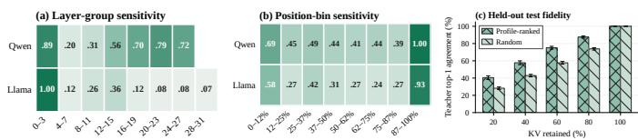  
Fig. 2. Characterization of non-uniform KV-cache utility. (a) Normalized sensitivity across layer groups. (b) Normalized sensitivity across relative token-position bins. (c) Teacher-forced top-1 agreement under partial KV retention on held-out prompts. Profile-ranked retention consistently outperforms random retention; error bars denote 95% confidence intervals.

## III. Utility-Aware Source Ordering for Deadline-Constrained KV Handoff

We consider a collaborative edge LLM serving scenario in which a source agent has already computed reusable KV state for an accumulated task context, while a receiving agent is activated to continue subsequent inference. The KV cache is transferred over an inter-edge network link and must be made available before the receiving agent begins decoding. This handof is subject to a stringent TTFT budget and to time-varying network conditions, including fluctuations in available bandwidth and RTT.

## A. Transport-Oriented KV-Utility Validation

Prior studies on KV-cache compression and eviction have shown that diferent KV regions contribute unequally to model inference [30]–[32]. Our objective is therefore not to introduce a new universal KV-importance estimator. Instead, we ask a transport-oriented question: When only part of the KV cache can be made available before decode startup, does the identity of the recovered state materially afect model fidelity?

We evaluate Qwen2.5-7B-Instruct [33] and Llama-3.1-8B-Instruct [34] through controlled KV-zeroing experiments. For each profiling prompt, we first record the next-token dis- tribution obtained using the full KV cache. We then zero both key and value tensors associated with one layer group or one relative-position region and measure the resulting distributional change. The perturbation scores are averaged over the profiling set and normalized within each model. They are used only as relative transport utilities.

Fig. 2(a) shows substantial layer-wise heterogeneity. Both models contain a sensitive early-layer region, while their remaining profiles difer noticeably. Hence, a fixed shallow- to-deep transmission order is not suficient across models. Fig. 2(b) shows a similarly non-uniform position profile: the prompt prefix and recent context are more sensitive than most intermediate positions.

We further examine whether the resulting profile remains informative on prompts disjoint from the profiling set. For each retention ratio, we retain the highest-ranked layer–position cells and compare them with random retention. As shown in Fig. 2(c), profile-ranked retention consistently preserves higher teacher-forced top-1 agreement with intact-KV execution. At 40% retention, the agreement improves from 44.0% under random retention to 55.2% under profile-ranked retention.

These experiments establish the transport-side property re- quired by our design: equal amounts of recovered KV state can preserve substantially diferent amounts of model-relevant information. Consequently, a deadline-constrained transport mechanism should account for which KV regions become available, rather than only the number of bytes delivered.

## B. Mapping KV Utility to Transport Blocks

Let the packetized KV cache contain the transport-block set

$$
B = \{ 1 , \ldots , B \} .\tag{1}
$$

Each block contains m fixed-size source packets,

$$
\begin{array} { r } { \mathcal { P } _ { b } = \{ \mathbf { s } _ { b , 1 } , \dotsc , \mathbf { s } _ { b , m } \} , \qquad b \in \mathcal { B } . } \end{array}\tag{2}
$$

The final block is padded when necessary so that all transport blocks have equal size. Padding symbols carry zero utility.

Let C denote the set of profiled layer–position cells and let $\widehat { u } _ { c } \geq 0$ denote the measured sensitivity of $c \in { \mathcal { C } } .$ . Because profiling-cell and packet boundaries need not coincide, let

$\alpha _ { i , c } \in [ 0 , 1 ]$ denote the fraction of cell c carried by source packet $i ,$ with

$$
\sum _ { i } \alpha _ { i , c } = 1 , \qquad \forall c \in { \mathcal { C } } .\tag{3}
$$

The packet-level utility is

$$
v _ { i } = \sum _ { c \in \mathcal { C } } \alpha _ { i , c } \widehat { u } _ { c } ,\tag{4}
$$

and the corresponding block utility is

$$
U _ { b } = \sum _ { i \in \mathcal { P } _ { b } } v _ { i } .\tag{5}
$$

The utility $U _ { b }$ is a transport-oriented surrogate rather than an exact additive decomposition of downstream LLM quality. Missing KV regions may interact nonlinearly during attention computation. Accordingly, the analytical results below concern deadline-complete transport utility, whereas Sec. V evaluates the resulting downstream task quality directly.

## C. Utility-Aware Source Queue Construction

Given the block utilities derived in Sec. III-B, the remaining source-side decision is how to map KV blocks to positions in the transport stream. Let

$$
U _ { [ 1 ] } \geq U _ { [ 2 ] } \geq \cdot \cdot \cdot \geq U _ { [ B ] }\tag{6}
$$

denote the transport blocks sorted in nonincreasing order of utility, where [j] denotes the block assigned to the j-th source position. Since all transport blocks contain the same number of equal-size source packets, no additional normalization by block size is required.

We construct the source queue as

$$
\begin{array} { r } { \boldsymbol { S } ^ { \star } = \left( \mathcal { P } _ { [ 1 ] } , \mathcal { P } _ { [ 2 ] } , \ldots , \mathcal { P } _ { [ B ] } \right) , } \end{array}\tag{7}
$$

where the original packet order within each transport block is preserved. Hence, high-utility KV blocks enter the transport stream earlier, while low-utility blocks remain in the queue at later source positions.

The utility-aware ordering in (7) can also be interpreted through the deadline-completion probability associated with each source position. Consider a fixed transport policy and let $q _ { j } ( D )$ denote the probability that a block assigned to the jth source position is completely available at the receiver by deadline D. Under a common deadline and sequential source transmission, earlier positions have no fewer transmission and recovery opportunities than later positions. We therefore consider the natural condition

$$
q _ { 1 } ( D ) \geq q _ { 2 } ( D ) \geq \cdot \cdot \cdot \geq q _ { B } ( D ) .\tag{8}
$$

For an assignment π of blocks to source positions, the expected deadline-complete transport utility is

$$
\mathbb { E } [ J _ { \pi } ( D ) ] = \sum _ { j = 1 } ^ { B } U _ { \pi ( j ) } q _ { j } ( D ) .\tag{9}
$$

Proposition 1. Under (8), assigning blocks in nonincreasing utility order, $U _ { [ 1 ] } \geq U _ { [ 2 ] } \geq \cdot \cdot \cdot \geq U _ { [ B ] }$ , maximizes (9).

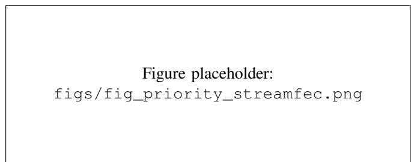  
Fig. 3. ACK-sliding Streaming FEC. Source packets are transmitted systemat- ically, while each repair packet is generated over the current unacknowledged source window. Once cumulative decoding progresses, the recovered prefix is removed from subsequent coding windows; unresolved packets remain protected by future repairs.

Proof: Consider two positions $i < j$ with $q _ { i } ( D ) \geq q _ { j } ( D )$ and two blocks a and b satisfying $U _ { a } \geq U _ { b }$ . Assigning a to i and b to $j$ instead of the reverse changes the expected utility by

$$
\begin{array} { c } { \Delta = U _ { a } q _ { i } + U _ { b } q _ { j } - U _ { a } q _ { j } - U _ { b } q _ { i } } \\ { = ( U _ { a } - U _ { b } ) ( q _ { i } - q _ { j } ) \geq 0 . } \end{array}\tag{10}
$$

Thus, every inversion in which a lower-utility block precedes a higher-utility block can be removed without decreasing expected deadline-complete utility. Repeatedly removing such inversions yields the descending-utility ordering in (7). □

This result concerns the source-ordering subproblem un- der fixed position-dependent completion probabilities. In the complete PriorityFEC design, the adaptive repair controller further changes these completion probabilities according to the observed transport state. The proposition therefore provides a structural motivation for the source queue rather than an optimality claim for the complete learning-based transport policy.

## IV. Adaptive Streaming FEC

The utility-aware source queue determines which KV blocks should be transmitted first, but cannot by itself recover packet losses over unreliable edge links. Under a strict decode-start deadline, source and repair packets share a limited transmis- sion budget, creating a tradeof between delivering new KV state and recovering lost packets.

To address this, we combine the utility-ordered source queue with ACK-sliding Streaming FEC and an adaptive repair scheduler. The queue determines what to transmit first, Stream- ing FEC provides loss recovery, and the scheduler determines when repair packets should be transmitted.

## A. ACK-Sliding Streaming FEC

Let $\mathbf { s } _ { 1 } , \mathbf { s } _ { 2 } , \ldots , \mathbf { s } _ { N }$ denote the equal-size source packets after utility-aware ordering. Source packets are transmitted sequentially according to this fixed order.

At decision epoch t, let $n _ { t }$ denote the latest transmitted source index and let $a _ { t }$ denote the largest source index known by the sender to have been cumulatively decoded. The active coding window is therefore

$$
\mathcal { W } _ { t } = \{ \mathbf { s } _ { a _ { t } + 1 } , . . . , \mathbf { s } _ { n _ { t } } \} .\tag{11}
$$

Thus, ${ \ w } _ { t }$ contains all transmitted source packets that have not yet been removed by cumulative ACK progress.

To reduce encoding and decoding complexity, we employ sparse random linear coding over the active window. Specifi- cally, each repair packet combines only a subset of the packets in $\mathcal { W } _ { t }$ . Let $\bar { K }$ denote the maximum coding degree and define

$$
K _ { t } = \operatorname* { m i n } \left\{ K , | \mathcal { W } _ { t } | \right\} .\tag{12}
$$

For the ℓth repair packet generated at decision epoch $t ,$ a sparse coding support $\mathcal { C } _ { t , \ell } \subseteq \mathcal { W } _ { t }$ is selected such that

$$
| { \mathcal { C } } _ { t , \ell } | = K _ { t } .\tag{13}
$$

The corresponding repair packet is

$$
\mathbf { r } _ { t , \ell } = \sum _ { \mathbf { s } _ { i } \in \mathcal { C } _ { t , \ell } } \alpha _ { t , \ell , i } \mathbf { s } _ { i } , \qquad \alpha _ { t , \ell , i } \in \mathrm { G F } ( 2 ^ { 8 } ) \setminus \{ 0 \} ,\tag{14}
$$

where the coding coeficients are independently generated for diferent repair packets. In our implementation, the maximum sparse coding degree is set to $K = 4 8$

When a source packet is erased, it remains in the active window and can therefore participate in subsequent sparse repair combinations. Once the receiver accumulates suficient independent degrees of freedom (DoFs) to advance cumulative decoding, the corresponding decoded prefix is reported through ACK feedback and removed from ${ \mathcal { W } } _ { t }$ . Consequently, the coding window continuously tracks the unresolved portion of the transmitted source stream.

This ACK-sliding mechanism separates the coding scope from the repair schedule. The active window determines which unresolved packets remain eligible for protection, whereas the adaptive scheduler determines when repair packets should be transmitted. Importantly, the scheduler neither changes the utility-derived source order nor the sparse Streaming FEC coding rule; it only controls the temporal allocation of source and repair transmission opportunities.

## B. Adaptive Repair-Scheduling Problem

Let Tmax denote the number of packet-transmission opportunities available before the decode-start deadline and let $B ^ { \mathrm { r e p } }$ denote the maximum repair budget. Since one scheduling de- cision may transmit multiple packets, we distinguish a decision epoch from an individual packet-transmission opportunity.

At each decision epoch, the scheduler selects an action from

$$
{ \mathcal { A } } = \{ a ^ { \mathrm { s } } \} \cup \{ a ^ { \mathrm { r } } ( k ) : k \in K \} ,\tag{15}
$$

where $a ^ { \mathrm { s } }$ continues source transmission, K is a set of discrete numbers and $a ^ { \mathrm { r } } ( k )$ transmits a burst of k repair packets. A source action transmits up to $M _ { \mathrm { s } }$ consecutive source packets without crossing the current KV-block boundary.

Let B denote the set of KV blocks, $U _ { b }$ the utility of block $b ,$ and $Z _ { b } ( t ) \ \in \ \{ 0 , 1 \}$ indicate whether block b has been completely recovered by epoch t. The normalized utility available at the receiver is

$$
J _ { t } ^ { \mathrm { K V } } = \frac { \displaystyle \sum _ { b \in \mathcal { B } } U _ { b } Z _ { b } ( t ) } { \displaystyle \sum _ { b \in \mathcal { B } } U _ { b } } .\tag{16}
$$

The scheduling objective is therefore

$$
\operatorname* { m a x } _ { \pi } \quad \mathbb { E } _ { \pi } \left[ J _ { t _ { \mathrm { e n d } } } ^ { \mathrm { K V } } \right] ,\tag{17a}
$$

$$
\mathrm { s . t . } \quad u _ { t } \in \mathcal { A } _ { t } ,\tag{17b}
$$

$$
\sum _ { t } c _ { \mathrm { r e p } } ( u _ { t } ) \leq B ^ { \mathrm { r e p } } ,\tag{17c}
$$

$$
\sum _ { t } c _ { \mathrm { s l o t } } ( u _ { t } ) \leq T ^ { \mathrm { m a x } } ,\tag{17d}
$$

where $\pi$ denotes the scheduling policy and $\mathcal { A } _ { t } \subseteq \mathcal { A }$ is the feasible action set. The functions $c _ { \mathrm { r e p } } ( \cdot )$ and $c _ { \mathrm { s l o t } } ( \cdot )$ denote repair-budget and transmission-slot consumption, respectively.

Problem (17) is a finite-horizon stochastic scheduling problem because the efect of a repair decision depends on future packet losses, delayed feedback, decoding progress, and the remaining deadline. We therefore formulate it as a compact MDP and learn the scheduling policy using Double DQN.

## C. MDP Formulation

The repair-scheduling problem involves sequential decisions under uncertain packet losses and delayed feedback. A re- pair decision that is beneficial at the current epoch may consume transmission opportunities needed for future source delivery, while postponing repair may allow the decoding deficit to grow. We therefore formulate the scheduling process as a finite-horizon MDP ⟨S, A, P, R⟩, where S denotes the transport-state space, A is the action space defined in (15), P captures the stochastic transport dynamics, and R denotes the reward function.

1) State Representation: The scheduler does not require the complete packet-transmission history. Instead, we construct a compact state that summarizes the information most relevant to the source–repair tradeof. Specifically, the normalized state vector is

$$
\begin{array} { r l } & { \mathbf { x } _ { t } = [ b _ { t } , \tau _ { t } , p _ { t } ^ { \mathrm { s r c } } , s _ { t } ^ { \mathrm { d d l } } , \hat { \epsilon } _ { t } , \beta _ { t } , \delta _ { t } , \chi _ { t } , } \\ & { \quad \quad \quad w _ { t } , w _ { t } ^ { \mathrm { f b } } , h _ { t } ^ { \mathrm { a c k } } , g _ { t } , \bar { U } _ { t } , \bar { U } _ { t } ^ { + } , p _ { t } ^ { \mathrm { e f f } } ] . } \end{array}\tag{18}
$$

The 15 features can be grouped into six types. First, $b _ { t }$ and $\tau _ { t }$ describe the remaining repair budget and transmission time, while $p _ { t } ^ { \mathrm { s r c } }$ and $s _ { t } ^ { \mathrm { d d l } }$ characterize the pressure to continue source delivery before the deadline. Second, $\hat { \epsilon } _ { t }$ and $\beta _ { t }$ capture the estimated packet-loss condition and burst-loss tendency of the Gilbert–Elliott channel. Third, $\delta _ { t } , \chi _ { t } , w _ { t }$ , and $w _ { t } ^ { \mathrm { f b } }$ describe the severity of the current decoding deficit and the scale of the unresolved coding window. The feedback feature $h _ { t } ^ { \mathrm { a c k } }$ records the lack of recent cumulative decoding progress.

The remaining features introduce application awareness into the repair decision. Specifically, $g _ { t }$ represents the transmission progress of the current KV block, $\bar { U } _ { t }$ denotes its normalized utility, and $\bar { U } _ { t } ^ { + }$ summarizes the utility of the upcoming blocks. Finally, $p _ { t } ^ { \mathrm { e f f } }$ estimates the efectiveness of a repair packet under the current sparse coding window. These features allow two otherwise similar network states to result in diferent repair decisions when the KV state currently at risk has diferent utility.

A key decoding quantity is the DoF deficit. Let $W _ { t }$ denote the number of source packets in the current unresolved coding window and let $D _ { t }$ denote the number of independent DoFs available for this window. We define

$$
d _ { t } = [ W _ { t } - D _ { t } ] ^ { + } .\tag{19}
$$

A larger $d _ { t }$ indicates that more innovative repair information is required before cumulative decoding can advance. The quantities used by the scheduler are reconstructed from sender- side transmission history and the latest feedback, rather than requiring instantaneous receiver-side state. All state features are normalized to [0, 1] before being fed into the Q-network.

2) Action and Feasibility: At each decision epoch, the scheduler chooses between continuing source delivery and transmitting one of the repair bursts defined in (15). The source action preserves the utility-derived packet order, whereas the repair actions trade a number of future source opportunities for immediate loss recovery.

Not every action is valid under every transport state. In particular, a repair action $a ^ { \mathrm { r } } ( k )$ is enabled only if

$$
d _ { t } > 0 , \qquad B _ { t } ^ { \mathrm { r e m } } \geq k , \qquad T _ { t } ^ { \mathrm { r e m } } \geq k ,\tag{20}
$$

where $B _ { t } ^ { \mathrm { r e m } }$ and $T _ { t } ^ { \mathrm { r e m } }$ denote the remaining repair budget and transmission opportunities, respectively. Thus, repair is con- sidered only when unresolved information exists and suficient resources remain to execute the selected burst. The source action is disabled once the source queue is exhausted, or the deadline is reached.

This state-dependent action mask explicitly enforces the hard transmission constraints. Consequently, the learned policy focuses on deciding when repair is worthwhile, rather than learning deadline or repair-budget feasibility through reward penalties.

3) Reward Design: The final objective is to maximize the utility of KV blocks recovered before the decode-start deadline. However, block completion is relatively sparse: many intermediate transmissions may improve the decoding con- dition without immediately completing a KV block. Using only the terminal application utility therefore provides weak feedback during training.

To expose such intermediate progress, we introduce an auxiliary potential

$$
\begin{array} { c } { F ( \mathbf { x } _ { t } ) = \lambda _ { \mathrm { p } } \displaystyle \frac { k _ { t } ^ { \mathrm { d e c } } } { N } - \lambda _ { \mathrm { d } } \displaystyle \frac { d _ { t } } { \operatorname* { m a x } \{ 1 , d _ { t } + B _ { t } ^ { \mathrm { r e m } } \} } } \\ { - \lambda _ { \mathrm { w } } \displaystyle \frac { \log ( 1 + W _ { t } ) } { \log ( 1 + N ) } , } \end{array}\tag{21}
$$

where $k _ { t } ^ { \mathrm { d e c } }$ denotes the cumulative decoding progress. The first term rewards advancement of the decodable source prefix, the second penalizes a large deficit relative to the remaining repair budget, and the third discourages excessive growth of the unresolved coding window. We use $\lambda _ { \mathrm { p } } = 0 . 2 0 , \lambda _ { \mathrm { d } } = 0 . 1 5 .$ and $\lambda _ { \mathrm { w } } = 0 . 0 5$

The immediate reward combines the newly recovered KV utility with the change in this auxiliary potential:

$$
\begin{array} { r } { r _ { t } = J _ { t + 1 } ^ { \mathrm { K V } } - J _ { t } ^ { \mathrm { K V } } } \\ { + \widetilde { F } ( \mathbf { x } _ { t + 1 } ) - \widetilde { F } ( \mathbf { x } _ { t } ) , } \end{array}\tag{22}
$$

where $\widetilde { F }$ equals $F$ for intermediate states and is set to zero at the terminal state. With $\gamma = 1$ , the shaping terms tele- scope over an episode. Therefore, they provide denser training feedback without changing the deadline-level optimization objective in (17a).

## D. Double-DQN-Based Repair Scheduling

The MDP formulated above has a discrete action space but continuous transport-state features, making tabular value-based methods impractical. We therefore employ Double DQN to learn the repair-scheduling policy. As illustrated in Fig. $^ { 4 , }$ the training procedure maintains an online Q-network $Q _ { \theta }$ for action selection and value prediction, together with a target Q-network $Q _ { \bar { \theta } }$ for stable target evaluation.

Both networks share the same lightweight architecture. Given the 15-dimensional normalized state, the Q-network consists of two fully connected hidden layers with 64 ReLU units each, followed by a four-dimensional linear output layer corresponding to the candidate scheduling actions.

During ofline training, the scheduler interacts with the Streaming FEC environment using an ϵ-greedy policy over the feasible action set. Each observed transition is stored in the replay memory as

$$
e _ { t } = ( { \bf x } _ { t } , u _ { t } , r _ { t } , { \bf x } _ { t + 1 } , \mathcal { A } _ { t + 1 } , z _ { t } ) ,\tag{23}
$$

where $z _ { t } \in \{ 0 , 1 \}$ indicates whether the transition reaches the terminal state. Mini-batches are randomly sampled from the replay memory for network updates.

For each sampled transition, Double DQN decouples next-action selection from its value evaluation. Specifically, the online network selects the best feasible action at the next state,

$$
u _ { t + 1 } ^ { \ast } = \arg \operatorname* { m a x } _ { u \in \boldsymbol { A } _ { t + 1 } } Q _ { \theta } \left( \mathbf { x } _ { t + 1 } , u \right) ,\tag{24}
$$

whereas the target network evaluates the selected action to construct

$$
y _ { t } = r _ { t } + ( 1 - z _ { t } ) \gamma Q _ { \bar { \theta } } \left( \mathbf { x } _ { t + 1 } , u _ { t + 1 } ^ { * } \right) .\tag{25}
$$

In our finite-horizon formulation, $\gamma = 1$ . The factor $1 - z _ { t }$ removes bootstrapping for terminal transitions.

The online network is trained by minimizing the Huber loss between the predicted action value and the DDQN target:

$$
\mathcal { L } ( \boldsymbol { \theta } ) = \frac { 1 } { \left| \mathcal { M } \right| } \sum _ { i \in \mathcal { M } } \ell _ { \mathrm { H u b e r } } \left( Q _ { \theta } ( \mathbf { x } _ { i } , u _ { i } ) - y _ { i } \right) ,\tag{26}
$$

where M denotes a mini-batch sampled from the replay memory. The parameters θ are updated using Adam, while the target-network parameters ¯θ are periodically synchronized with the online network.

To improve early-stage exploration, the replay memory is initialized with a small number of trajectories generated by a deficit-based heuristic. These trajectories only provide initial transition samples; no imitation loss is introduced, and the learned policy is free to deviate from the heuristic during subsequent training.

After ofline training, only the online network is retained for deployment. At each decision epoch, the sender constructs the current state $\mathbf { x } _ { t } ,$ , masks infeasible actions according to (20), and selects

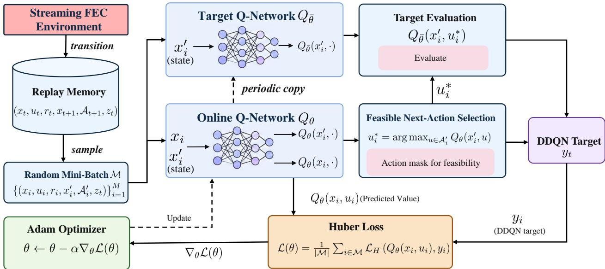  
Fig. 4. Double-DQN training framework for adaptive repair scheduling. The online network evaluates the executed action and selects the feasible next action, while the target network evaluates this selected action to construct the DDQN target.

$$
u _ { t } ^ { \ast } = \arg \operatorname* { m a x } _ { u \in \mathcal { A } _ { t } } Q _ { \theta } \left( \mathbf { x } _ { t } , u \right) .\tag{27}
$$

If $u _ { t } ^ { * } ~ = ~ a ^ { \mathrm { s } }$ , transmission proceeds along the utility-ordered source queue. If $\boldsymbol { u } _ { t } ^ { * } = \boldsymbol { a } ^ { \mathrm { r } } ( \boldsymbol { k } )$ , the encoder generates a burst of k sparse repair packets over the current ACK-sliding coding window. Hence, online scheduling requires only a single lightweight network inference at each decision epoch, without gradient computation or finite-horizon optimization.

## V. Evaluation

We evaluate PriorityFEC to answer two questions: (i) whether utility-aware ordering enables more model-relevant KV state to become available before decode startup; (ii) whether this transport-level utility gain translates into higher downstream LLM task quality;

We first describe the prototype, workloads, network config- urations, and compared transport schemes. We then evaluate deadline-available KV utility and end-to-end task quality un- der controlled burst-loss conditions, followed by component ablation and runtime analysis.

## A. Experimental Setup

Models and workloads. We evaluate two representative open-source LLMs, Qwen2.5-7B-Instruct and Llama-3.1-8B-Instruct. The evaluation uses three question-answering work- loads from LongBench-E: 2WikiMultiHopQA, HotpotQA, and TriviaQA. These workloads require retrieving and inte-grating information from a long input context, making their outputs sensitive to the KV state available when decoding begins. The input context is truncated to 1,536 tokens using the same preprocessing configuration across all compared transport schemes. Task quality is measured using token-level F1.

For every model–dataset pair, we evaluate 48 examples under five paired network realizations. Hence, each operating point contains 240 example–network realizations. All transport schemes are evaluated using the same workload inputs and paired loss realizations.

Network and deadline configuration. Unless otherwise stated, experiments use a 100-Mbps bottleneck link with a 20-ms RTT and a bursty Gilbert–Elliott (GE) loss pro-cess. The main GE configuration is $\left( \epsilon _ { G } , \epsilon _ { B } , p _ { G B } , p _ { B G } \right) \ =$ (0.001, 0.50, 0.02, 0.10), corresponding to an average packetloss ratio of approximately 8.42%.

We express the decode-start deadline using the normalized deadline ratio

$$
\rho \triangleq { \frac { D - T _ { \mathrm { o w } } } { T _ { \mathrm { s e r } } } } , \qquad T _ { \mathrm { s e r } } = { \frac { S _ { \mathrm { K V } } } { C } } ,\tag{28}
$$

where $S _ { \mathrm { K V } }$ is the complete KV-cache size, C is the bottleneck rate, $T _ { \mathrm { s e r } }$ is the corresponding loss-free serialization time, and $T _ { \mathrm { o w } }$ is the forward propagation delay. We consider $\rho ~ \in ~ \{ 0 . 8 , 1 . 0 \}$ . At $\rho \ = \ 0 . 8 .$ , even loss-free transmission cannot serialize the complete KV state before decode startup. At $\rho \mathrm { ~  ~ { ~ = ~ } ~ } 1 . 0$ , the deadline provides exactly one loss-free serialization interval and therefore leaves no additional trans- mission time for packet losses or repair trafic. The former represents the target deadline-constrained regime, whereas the latter examines how the schemes behave as the transmission constraint is relaxed.

## B. Implementation and Training Details

Prototype. We implement the LLM execution path using PyTorch and Hugging Face Transformers, and the Streaming FEC codec in native C over $\mathrm { G F } ( 2 ^ { 8 } )$ . The prototype runs on two servers with NVIDIA RTX 4090 GPUs. For batch size one, each layer’s key and value tensors have shape [1, $H _ { \mathrm { K V } } , T , d _ { h } ]$ and use BF16. The current transport unit groups one layer and

16 consecutive tokens. Each 1,400-B application frame carries at most 1,368 B of KV payload, with the remaining bytes used for codec metadata, causal watermarks, and the protected frag- ment identifier. The repeatable evaluation executes the native codec and downstream LLM decoding under paired channel realizations. Controller and codec wall-clock overhead are measured separately from the simulated transmission deadline. A complementary socket prototype transfers real KV bytes over TCP or UDP and performs receiver-side decode-only inference. Its existing validation uses a single-host loopback path.

Partial-KV reconstruction. The receiver maps recovered fragments to their original layer, token interval, and byte ofsets. In the main evaluation, a BF16 element is retained only when both of its serialized bytes are available; otherwise, the complete element is set to zero. The reconstructed cache preserves its original shape and token positions, and the receiving model does not repeat full-prompt prefill.

We additionally implement an explicit partial-KV attention mask. A KV head–token row is usable only when all bytes of both its key and value vectors have been recovered. Unavail- able rows are excluded through a per-layer attention mask, repeated over the corresponding query heads for grouped- query attention. Original RoPE positions are retained, and newly generated KV rows remain valid. This receiver can use intact head–token rows within an otherwise incomplete block. The existing main results use zero-fill; mask-based decoding is a separate receiver condition and must be held constant when comparing repair schedulers.

Ofline scheduler training. The scheduler uses a 15–64– 64–4 Double-DQN network with ReLU activations and 5,444 parameters. Its normalized observations summarize remaining budget and time, source pressure, channel estimates, decoder deficit, coding-window size, ACK staleness, block progress and utility, and sparse-repair coverage. Actions select a source burst of at most eight packets or a repair burst of 1, 4, or 16 packets. Hard masks enforce source availability, repair feasibility, remaining budget, and the deadline.

Training uses synthetic utility-ranked blocks and random- ized GE channels, without QA examples, reference answers, or task-F1 rewards. The reward is the change in a transport po- tential that rewards completed-block utility and prefix progress while penalizing decoder deficit and coding-window backlog. The training decoder uses a sparse-coverage surrogate; evalu- ation uses the actual GF(28) codec.

The final scheduler is initialized from a pretraining stage us- ing randomized transport trajectories, after which it is trained for 120 additional episodes. Adam uses a learning rate of 10−4, discount factor γ = 1, and gradient-norm clipping at five. Exploration decreases from 0.25 to 0.05 over the first 80% of this phase. Learning occurs every 16 decision transitions, and the target network is synchronized every 500 updates. The retained log records 321,032 decision transitions and 16,550 gradient updates. The final checkpoint is frozen during task evaluation, without QA-based checkpoint selection.

Scaling and transfer scope. Training covers link rates of 50, 100, and 200 Mbps and nominal RTTs of 14–26 ms; these rates therefore constitute trained conditions. The synthetic training blocks contain more fragments than the current one-layer-by-16-token blocks, so deployment also in- volves a packetization-scale transfer. Although each Q-network inference has fixed dimensionality, total scheduling and coding work grows with the transmitted cache. Furthermore, the current eager profiler constructs full attention tensors before selecting the last 64 query positions. The present task-quality results therefore do not establish 4K/8K-context scalability.

The existing 5G trace replay evaluates the frozen policy under a recorded loss process and a 20.48-Mbps ofered-rate service assumption. It provides conditional transfer evidence on the selected trace. Dedicated context-length sweeps and held-out tests of burst persistence, RTT, bandwidth, and non- stationary conditions remain necessary to establish broader generalization.

Compared schemes. We compare PriorityFEC with the following transport policies:

• TCP and QUIC: reliable transport baselines that recover packet losses through retransmission;

• UDP: transmits the packetized KV stream in its original FIFO order without retransmission or FEC;

• Uniform FEC: applies a fixed repair budget to the FIFO source stream without considering KV utility;

• FlEC-RT: a real-time variant of FlEC [25] that retains the original source order and uses GF(28) random linear coding over a moving coding window. Repair transmissions are adaptively triggered according to receiver feedback, estimated packet-loss and burst statistics, and the remain- ing delivery deadline, without exploiting model-derived KV utility;

• PriorityFEC: our complete design, which combines utility-aware source ordering with the learned adaptive Streaming-FEC repair scheduler.

The dashed Full KV line reports model performance when the intact KV cache is available at the decoder and serves as the no-transport-loss reference. Because token-level F1 is determined by the generated sequence rather than by a continuous model-distance metric, a partially reconstructed KV state may occasionally obtain a slightly higher F1 than the Full-KV execution. Therefore, Full-KV is used as a reference rather than as a strict mathematical upper bound.

We report two complementary metrics. First, recovered util- ity is the normalized utility of KV blocks that are completely available before the deadline. Second, task score measures the token-level F1 obtained when the LLM starts decoding from the reconstructed KV state. The former characterizes the transport mechanism, while the latter directly measures its impact on downstream inference.

## C. Deadline-Available KV Utility

We first examine whether PriorityFEC actually changes which KV information becomes available before decode startup. Fig. 5 reports the normalized utility of KV blocks re- covered by the deadline. This metric should not be interpreted as the fraction of KV bytes delivered: A value close to 100% indicates that most of the utility defined by the ofline profile has been preserved, even though lower-utility KV blocks may still be unavailable.

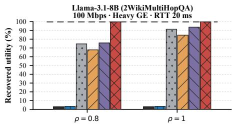

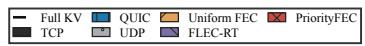

(a) Llama-3.1-8B, 2WikiMultiHopQA.  
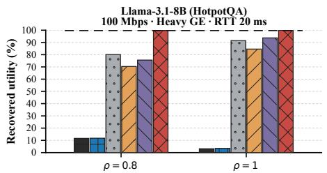  
(b) Llama-3.1-8B, HotpotQA.

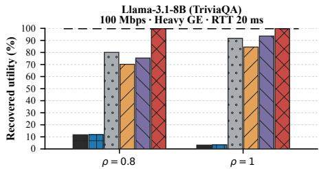  
(c) Llama-3.1-8B, TriviaQA.

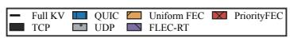

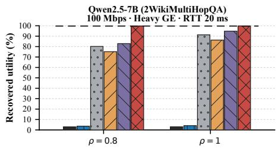

(d) Qwen2.5-7B, 2WikiMultiHopQA.  
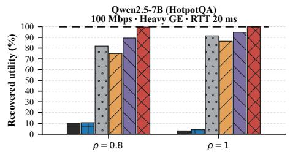  
(e) Qwen2.5-7B, HotpotQA.

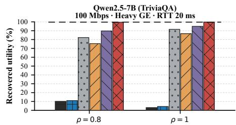  
(f) Qwen2.5-7B, TriviaQA.  
Fig. 5. Normalized KV utility recovered before the decode-start deadline on the 100-Mbps burst-loss GE link. PriorityFEC consistently preserves the highest- utility KV regions, with its advantage being most pronounced under the tight ρ = 0.8 deadline.

The diference is most pronounced under the tight deadline ρ = 0.8. Across all six model–workload combinations, PriorityFEC preserves approximately 99% of the normalized KV utility. In comparison, the strongest non-PriorityFEC baseline preserves between approximately 75% and 89%, depending on the model and workload. Averaged descriptively across the six cases, PriorityFEC retains 99.1% of the KV utility, compared with 82.3% for the strongest per-case baseline, corresponding to an average improvement of 16.8 percentage points.

This result highlights an important distinction between byte delivery and useful-state delivery. Since $\rho ~ = ~ 0 . 8$ does not even permit loss-free transmission of the complete KV cache, PriorityFEC cannot simply recover more state by extending the transmission interval. Instead, utility-aware ordering places the most valuable KV blocks at favorable source positions, while adaptive repair scheduling protects these blocks when burst losses create a decoding deficit. Consequently, the KV state available at the deadline contains a disproportionately large fraction of the model-relevant information.

When the deadline is relaxed to $\rho = 1 . 0 { : }$ , all loss-tolerant schemes recover more useful state and the diference becomes smaller. PriorityFEC still preserves approximately 99.2% of the normalized utility, whereas FLEC-RT reaches roughly 93– 94%. The average PriorityFEC advantage over the strongest baseline decreases to approximately 5.6 percentage points. This convergence is expected: as more transmission oppor- tunities become available, later source positions can also be recovered and the importance of source ordering naturally

decreases.

These results provide transport-level evidence for the design principle behind PriorityFEC. The proposed scheme does not merely increase the amount of recovered KV data; it preferentially makes high-utility model state available before the receiving agent must begin decoding. We next examine whether this utility advantage translates into higher end-to-end task quality.

## D. End-to-End Task Quality

Fig. 6 evaluates the downstream token-level F1 obtained when decoding starts from the KV state available at the deadline. The results closely follow the recovered-utility trend: the advantage of PriorityFEC is largest when the deadline forces the receiver to operate with substantially incomplete KV state.

At the target operating point $\rho \ = \ 0 . 8 ,$ PriorityFEC sub- stantially outperforms all transport baselines for every model– workload pair. For Llama-3.1-8B, PriorityFEC achieves token F1 scores of approximately 27.5%, 53.7%, and 75.2% on 2WikiMultiHopQA, HotpotQA, and TriviaQA, respectively. The corresponding FLEC-RT scores are only about 8.1%, 12.7%, and 16.8%. Thus, even an adaptive FEC mechanism cannot preserve comparable task quality when the source stream itself is unaware of KV importance.

The same trend holds for Qwen2.5-7B. PriorityFEC reaches approximately 22.3%, 25.1%, and 56.6% on the three workloads, whereas the competing schemes remain substantially lower. The diference is particularly large on TriviaQA, where PriorityFEC retains more than half of the Full-KV task score despite the fact that the deadline permits only 80% of the loss-free KV serialization time.

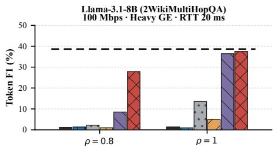

(a) Llama-3.1-8B, 2WikiMultiHopQA.  
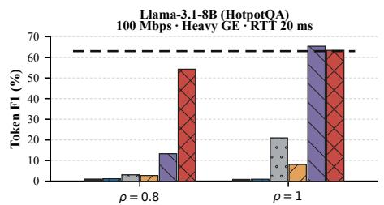  
(b) Llama-3.1-8B, HotpotQA.

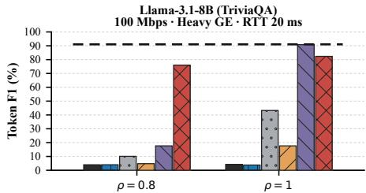  
(c) Llama-3.1-8B, TriviaQA.

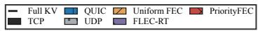

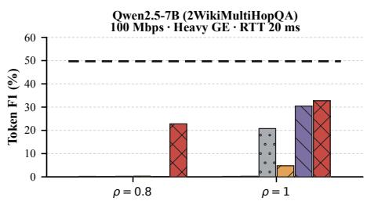  
(d) Qwen2.5-7B, 2WikiMultiHopQA.

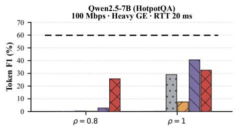  
(e) Qwen2.5-7B, HotpotQA.

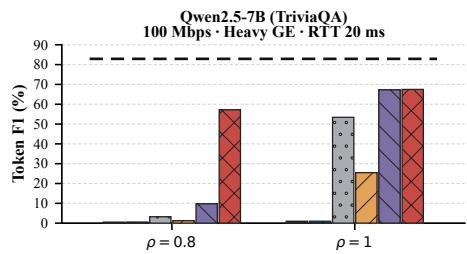  
(f) Qwen2.5-7B, TriviaQA.  
Fig. 6. End-to-end token-level F1 under diferent decode-start deadlines on the 100-Mbps burst-loss GE link. PriorityFEC provides substantial gains under $\rho = 0 . 8 ,$ , where com lete loss-free KV serialization is infeasible. As the deadline is relaxed to $\rho = 1 . 0 ;$ , the performance gap decreases because more KV state can be recovered regardless of source position.

Across all six model–workload combinations at $\rho = 0 . 8 ,$ PriorityFEC obtains an average task score of approximately 43.4%. For comparison, the strongest non-PriorityFEC scheme selected separately for each case averages only about 8.1%, yielding an average absolute advantage of approximately 35.3 percentage points. Together with Fig. 5, this result shows that the high recovered-utility values are not merely an artifact of the profiling metric: they translate into substantial improve- ments in downstream LLM inference.

At ρ = 1.0, all lossy-transport schemes benefit from the additional transmission time. PriorityFEC reaches approximately 37.1% and 62.8% on Llama-3.1-8B 2WikiMultiHopQA and HotpotQA, respectively, approaching their corresponding Full-KV references. FLEC-RT also becomes substantially more competitive and exceeds PriorityFEC in several cases, such as Llama-3.1-8B TriviaQA and Qwen2.5-7B HotpotQA.

This behavior is consistent with the intended operating regime of PriorityFEC rather than indicating that utility or- dering is universally beneficial. When the deadline is tight, source position determines which KV blocks can possibly become available before decoding starts, and prioritizing high- utility blocks is therefore critical. As ρ approaches one, a much larger portion of the source stream can be transmitted and repaired before the deadline, reducing the marginal im- portance of source ordering. In this less constrained regime, the performance diference is increasingly determined by the repair scheduler itself. Hence, PriorityFEC provides its largest gain precisely in the regime for which it is designed: deadline- constrained KV handof where the complete model state cannot be delivered in time.

## E. Component Ablation

We next disentangle the contributions of utility-aware source ordering and adaptive repair scheduling. To avoid duplicating the full evaluation across both models, we conduct the ablation on Qwen2.5-7B-Instruct as a representative model and use the same three workloads, paired loss realizations, deadline set- tings, and maximum repair budget as in the main experiments.

We consider four variants:

• Priority-only: the KV blocks are transmitted according to the proposed utility-aware order, but no repair packets are used;

• RL StreamingFEC-only: the original FIFO source order is retained, while the proposed RL-based adaptive Streaming FEC scheduler determines the source–repair transmission decisions;

• Priority+Fixed FEC: utility-aware source ordering is combined with a fixed repair schedule, thereby retaining the proposed ordering while removing adaptive repair control;

• PriorityFEC: the complete scheme combining utility-aware source ordering and RL-based adaptive Streaming FEC.

Fig. 7 reports both the downstream token-level F1 and the normalized KV utility recovered before the decode-start deadline. The results reveal that the two components address diferent limitations of deadline-constrained KV handof and are complementary rather than interchangeable.

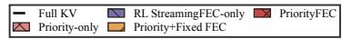

Qwen2.5-7B (2WikiMultiHopQA) 100 Mbps · Heavy GE · RTT 20 ms  
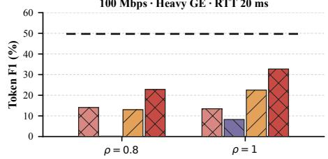  
(a) 2WikiMultiHopQA, task score.

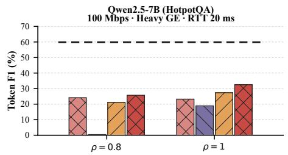  
(b) HotpotQA, task score.

Qwen2.5-7B (TriviaQA) 100 Mbps · Heavy GE · RTT 20 ms  
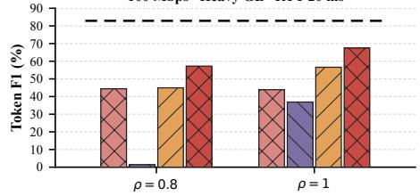  
(c) TriviaQA, task score.

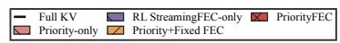

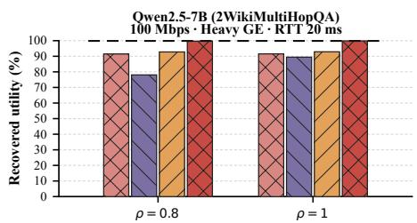

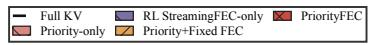

(d) 2WikiMultiHopQA, recovered utility.  
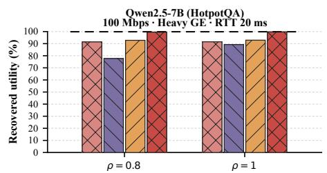  
(e) HotpotQA, recovered utility.

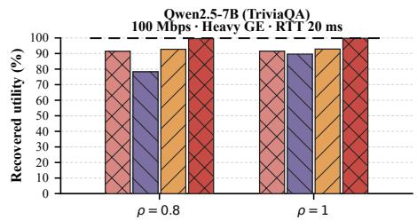  
(f) TriviaQA, recovered utility.  
Fig. 7. Ablation of utility-aware source ordering and adaptive Streaming FEC on Qwen2.5-7B-Instruct under the 100-Mbps heavy-GE channel. The first row reports downstream token-level F1, while the second row reports normalized KV utility recovered before the decode-start deadline. PriorityFEC consistently achieves the best performance by combining favorable source ordering with adaptive repair scheduling

Under the tight deadline of $\rho \ = \ 0 . 8 .$ source ordering is particularly important. The Priority-only variant maintains substantial task quality on all three workloads, whereas RL StreamingFEC-only performs poorly despite actively adapting its repair transmissions. This diference shows that loss re- covery alone cannot resolve deadline truncation: when only a limited portion of the source stream can be made available before decode startup, protecting a FIFO-ordered stream does not ensure that the recovered packets correspond to the most valuable KV regions.

Interestingly, simply adding fixed repair packets to the priority-ordered stream is also insuficient under a tight dead- line. On 2WikiMultiHopQA and HotpotQA at $\rho \quad = \quad 0 . 8 .$ Priority+Fixed FEC slightly underperforms Priority-only. The reason is that every repair packet consumes a transmission op- portunity that could otherwise be used to deliver an additional high-utility source packet. When repair is inserted regardless of the current decoding deficit, such redundancy can therefore reduce source progress before the deadline. This observation directly motivates adaptive repair scheduling: repair should be transmitted only when its expected recovery benefit outweighs the opportunity cost of delaying subsequent source packets.

PriorityFEC achieves the highest task score in all three workloads and under both deadline settings. At $\rho \ = \ 0 . 8 .$ its average token-level F1 across the three workloads is ap- proximately 34.8%, compared with 27.0% for Priority-only and 25.8% for Priority+Fixed FEC. Thus, neither source prioritization nor fixed protection alone accounts for the gain of the complete design. The learned scheduler complements utility-aware ordering by concentrating repair transmissions on transport states in which accumulated losses threaten the recovery of high-value KV blocks.

The recovered-utility results provide a transport-level ex- planation for this behavior. At $\rho \ = \ 0 . 8 .$ , PriorityFEC pre- serves approximately 99% of the profile-derived KV utility across all three workloads, compared with about 91% for Priority-only, 92% for Priority+Fixed FEC, and 77–78% for RL StreamingFEC-only. Hence, priority ordering determines which information is exposed to the most favorable source positions, while adaptive repair increases the probability that these valuable blocks become complete before the deadline.

When the deadline is relaxed to $\rho = 1 . 0 { \ : } $ , FEC becomes more beneficial because additional transmission opportunities reduce the opportunity cost of repair. Accordingly, Prior- ity+Fixed FEC now consistently improves upon Priority-only, and RL StreamingFEC-only also recovers substantially from its performance under $\rho \ = \ 0 . 8 .$ . Nevertheless, PriorityFEC remains the strongest variant, achieving an average token-level F1 of approximately 43.8%, compared with 35.0% for Pri-ority+Fixed FEC. This confirms that adaptive repair remains useful even when the deadline is less restrictive.

We emphasize that the recovered-utility metric is a transport-oriented surrogate rather than an exact predictor of downstream task quality. KV regions interact nonlinearly during attention computation, and missing a small set of critical states may therefore cause a disproportionate change in the generated output. Consequently, the utility results are used to explain which KV state is preferentially preserved by the transport mechanism, whereas the token-level F1 directly evaluates the resulting application-level quality.

TABLE II  
Measured online computation overhead of PriorityFEC. Component-wise overhead is normalized by the number of transmitted packets. The control latency measures the online decision path from transport-state construction to scheduling output.
<table><tr><td>Model</td><td> $\rho$ </td><td>State/FB</td><td> $\mathrm { R L }$  (ms per 1k packets)</td><td>Enc.</td><td>Dec.</td><td>Total</td><td>Control Mean/P99 (µs)</td><td>Overrun (%)</td></tr><tr><td>Qwen2.5-7B</td><td>0.8</td><td>9.42</td><td>3.41</td><td>10.31</td><td>7.19</td><td>30.34</td><td> $7 5 . 9 8 \mathrm { ~ / ~ } 9 4 . 3 5$ </td><td>0.009</td></tr><tr><td>Qwen2.5-7B</td><td>1.0</td><td>9.28</td><td>3.36</td><td>11.14</td><td>8.76</td><td>32.53</td><td> $7 6 . 9 9 \ : / \ : 9 5 . 6 7$ </td><td>0.011</td></tr><tr><td>Llama-3.1-8B</td><td>0.8</td><td>9.38</td><td>3.43</td><td>10.32</td><td>7.29</td><td>30.41</td><td> $7 6 . 5 3 \mathrm { ~ / ~ } 9 5 . 1 8$ </td><td>0.019</td></tr><tr><td>Llama-3.1-8B</td><td>1.0</td><td>9.28</td><td>3.33</td><td>11.34</td><td>9.46</td><td>33.41</td><td> $7 8 . 0 0 \mathrm { ~ / ~ } 9 7 . 5 8 $ </td><td>0.016</td></tr></table>

Overall, the ablation confirms two complementary design principles: utility-aware ordering is essential for deciding which KV state should receive the limited pre-deadline trans- mission opportunities, whereas adaptive Streaming FEC de- termines when those opportunities should be spent on loss recovery. Their combination is necessary to obtain the largest deadline-available KV utility and the highest downstream task quality.

## F. Runtime Overhead and Computational Feasibility

PriorityFEC operates under a prescribed decode-start dead- line and therefore requires its online control and coding operations to keep pace with packet transmission. Unlike reliable transport, the proposed scheme does not wait for complete KV-cache delivery before activating the decoder. Hence, the relevant implementation question is not whether PriorityFEC reduces the prescribed TTFT, but whether its additional computation introduces suficient processing delay to interfere with the pre-deadline packet stream.

We instrument the implementation and separately measure four sources of online computation: state construction and feedback processing, Double-DQN inference, $\mathrm { G F } ( 2 ^ { 8 } )$ encod- ing, and $\mathrm { G F } ( 2 ^ { 8 } )$ decoding. The measurements are aggregated over the three evaluation workloads, 48 examples per work- load, and five paired network realizations. Table II reports the computation normalized by the number of transmitted packets together with the latency of the online controller critical path.

The measured computation remains stable across the two LLMs and deadline settings. The total online processing de- mand ranges from only 30.34 to 33.41 ms per $1 0 ^ { 3 }$ transmitted packets. For comparison, with 1400-B packets and the 100- Mbps link used in the main experiments, one packet occupies approximately 112 $\mu \mathrm { s }$ of serialization time, corresponding to 112 ms per $1 0 ^ { 3 }$ packets. Thus, the aggregate measured com- putation corresponds to approximately 27–30% of the packet-serialization interval and does not become the bottleneck of the evaluated transport path.

More importantly, the latency of the online repair controller remains below the packet pacing interval in almost all de- cisions. Its mean latency is approximately $7 6 - 7 8 \mu \mathrm { s } ,$ while the P99 latency ranges from 94.35 to 97.58 $\mu \mathrm { s } ,$ remaining below the 112 $\mu \mathrm { s }$ packet slot in all four settings. The measured rate of controller decisions exceeding one packet slot is only

0.009–0.019%. Hence, the Double-DQN scheduler can make source–repair decisions at the granularity required by the packet transmission process without introducing systematic transmission stalls.

The component breakdown further shows that RL infer- ence itself constitutes only a small fraction of the runtime cost, requiring approximately 3.3–3.4 ms per $1 0 ^ { 3 }$ packets. The dominant costs arise from GF(28) packet construction and decoding, while state and feedback processing remain comparable across all operating points. This confirms that the lightweight 15-64-64-4 Q-network is not a computational bottleneck and that introducing learned repair scheduling adds only limited overhead beyond the underlying Streaming FEC operations.

Finally, the similar runtime observed for Qwen2.5-7B and Llama-3.1-8B indicates that the transport-side computation is largely independent of the LLM architecture. PriorityFEC operates on packetized KV blocks and transport feedback rather than executing additional model inference on the critical transmission path. Therefore, its online computational cost scales primarily with packet processing and coding operations rather than with the parameter count of the underlying LLM.

## G. Measured 5G Trace Replay

We complement the controlled GE experiments with a trace- driven evaluation using the public 5G Campus Networks: Measurement Traces dataset [35]. We select a 300-s standalone (SA) uplink UDP-Ping segment with a packet-loss ratio of 11.65% and set the replay service rate to its recorded ofered rate, $C = 2 0 . 4 8$ Mbps. Each KV packet uses the measured loss state at its simulated transmission time. The first 30 s are reserved for historical loss and delay calibration; evalua- tion windows are sampled from the remaining segment. The forward and reverse propagation delays are held at 9.36 and 13.20 ms, respectively, yielding a 22.55-ms RTT. The reverse feedback channel is reliable and per-packet delay jitter is not replayed. Because the capture uses 256-B packets while the KV transport uses 1,400-B packets, time-based loss sampling assumes that the captured loss state applies across these packet sizes.

We retain the two LLMs, the three 1,536-token QA workloads, and the normalized deadlines $\rho \in \{ 0 . 8 , 1 . 0 \}$ . For this supplementary experiment, each model–workload pair uses eight examples and two paired replay windows per example, giving 16 example–window realizations per operating point. All compared schemes share the same workload input, replay window, and forward deadline and packet-slot limit within a paired realization. The policies are evaluated in the common transport simulator, including the FLEC-RT simulation adapter used in the main comparison. The windows come from one measured segment rather than independent measurement cam- paigns.

Llama-3.1-8B (TriviaQA) 5G SA replay · 20.48 Mbps · RTT 22.55 ms  

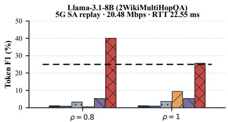  
(a) Llama-3.1-8B, 2WikiMultiHopQA.

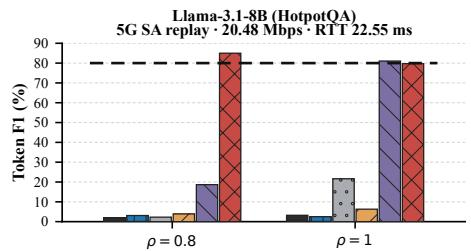  
(b) Llama-3.1-8B, HotpotQA.

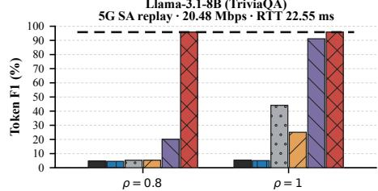  
(c) Llama-3.1-8B, TriviaQA.

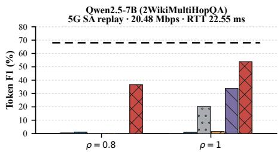

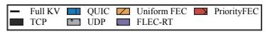

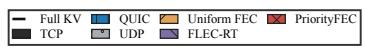

(d) Qwen2.5-7B, 2WikiMultiHopQA.  
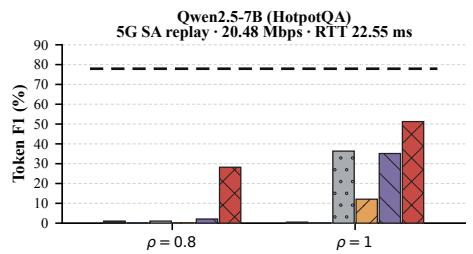  
(e) Qwen2.5-7B, HotpotQA.

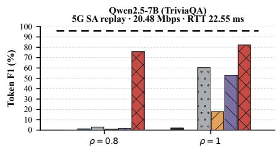  
(f) Qwen2.5-7B, TriviaQA.  
Fig. 8. Token-level F1 under measured 5G SA uplink loss replay. Bars average eight examples and two paired replay windows per example; the dashed line is the clean Full-KV reference.

Fig. 8 examines whether this utility gain translates into downstream token-level F1. At $\rho = 0 . 8 ,$ PriorityFEC achieves 36.6%, 28.2%, and 75.8% on Qwen2.5-7B for 2WikiMultiHopQA, HotpotQA, and TriviaQA, respectively; FLEC-RT obtains 0.0%, 2.1%, and 1.8%. For Llama-3.1-8B, the corresponding PriorityFEC scores are 40.0%, 85.0%, and 95.8%, compared with 5.3%, 18.7%, and 20.1% for FLEC-RT. Pri-orityFEC has the highest observed mean F1 when compared with the five main transport baselines in all six tight-deadline cases of this replay experiment.

At $\rho \ : \ : = \ : \ : 1 . 0 ,$ PriorityFEC obtains 53.9%, 51.3%, and 82.3% on the three Qwen workloads and 25.7%, 79.7%, and 95.8% on the three Llama workloads. FLEC-RT is competitive on Llama HotpotQA, where its 81.0% F1 slightly exceeds PriorityFEC’s 79.7%. The separately recorded Priority+Fixed FEC control also exceeds PriorityFEC on Qwen HotpotQA at $\rho = 0 . 8$ (37.5% versus 28.2%). Thus, high recovered utility does not establish universal superiority of the learned repair schedule. The Llama 2WikiMultiHopQA result also decreases from 40.0% to 25.7% as the deadline is relaxed, despite near-complete utility recovery. As in the main evaluation, Full KV is a clean reference rather than a strict F1 upper bound; sequence- level scoring and the small workload subset do not establish monotonic task quality in $\rho .$

These results support PriorityFEC’s ability to preserve high utility KV state under a measured burst-loss pattern and show substantial task-quality gains in the tight-deadline regime. The scope is limited to this selected trace and the replay assumptions above. The eight-example sample and dependent windows warrant descriptive comparisons rather than claims of statistical significance or performance across all 5G operating conditions.

## VI. Conclusion

This paper studied deadline-constrained KV-cache handof for collaborative edge LLM serving over bandwidth-limited and unreliable networks. When reusable KV state resides on another node, transferring the state can avoid redundant prefill computation, but strict decode-start deadlines may prevent the complete cache from arriving in time. Our profiling exper- iments show that the consequence of such partial delivery depends strongly on which KV regions become available: diferent layer–position regions contribute unequally to down- stream model execution. Motivated by this observation, we proposed PriorityFEC, which changes the transport objective from eventual byte completeness to deadline-available KV utility. PriorityFEC first maps model-derived KV importance to equal-size transport blocks and places high-utility blocks at earlier source positions. The resulting stream is then protected by ACK-sliding Streaming FEC, while a lightweight DDQN controller adaptively decides when the limited repair budget should be consumed. The coding rule remains independent of KV importance, whereas the scheduler combines transport state with compact utility information to evaluate the oppor- tunity cost of repair relative to continued source delivery.

Experiments with Qwen2.5-7B-Instruct and Llama-3.1-8B-Instruct show that the proposed design provides its largest gains when the decode-start deadline is too tight to permit complete KV transfer. In this regime, utility-aware order- ing determines which model state can realistically become available, while adaptive repair scheduling protects that state against burst losses. As the deadline is relaxed and most KV blocks become recoverable regardless of their source positions, the advantage of prioritization naturally decreases. The runtime measurements further show that the lightweight repair controller and sparse finite-field coding can operate within the packet-transmission timescale of the evaluated link.

These results suggest a broader design principle for dis- tributed LLM systems: when reusable model state must cross a constrained network before a downstream computation dead- line, the transport layer should optimize the utility of the state available at that deadline, rather than treating every transmitted byte as equally valuable.

## References

[1] M. Zhang, X. Shen, J. Cao, Z. Cui, and S. Jiang, “EdgeShard: Eficient LLM inference via collaborative edge computing,” IEEE Internet of Things Journal, vol. 12, no. 10, pp. 13 119–13 131, May 2025.

[2] X. Feng, H. Yang, Z. Chen, C. Luo, Y. Wang, Z. Zhou, W. Xu, and V. C. Leung, “E2 LLM: Structure-guided eficient inference for LLMs in distributed Edge-IoT environments,” IEEE Transactions on Mobile Computing, 2026.

[3] S. Chen, R. Jiang, D. Yu, J. Xu, M. Chao, F. Meng, C. Jiang, W. Xu, and H. Liu, “KVDirect: Distributed disaggregated LLM inference,” arXiv preprint arXiv:2501.14743, 2025.

[4] Y. Liu, Y. Cheng, J. Yao, Y. An, X. Chen, S. Feng, Y. Huang, S. Shen, R. Zhang, K. Du et al., “Lmcache: An eficient KV cache layer for enterprise-scale LLM inference,” arXiv preprint arXiv:2510.09665, 2025.

[5] Y. Liu, H. Li, Y. Cheng, S. Ray, Y. Huang, Q. Zhang, K. Du, J. Yao, S. Lu, G. Ananthanarayanan, M. Maire, H. Hofmann, A. Holtzman, and J. Jiang, “CacheGen: KV cache compression and streaming for fast large language model serving,” in Proceedings of the ACM SIGCOMM Conference, 2024, pp. 38–56.

[6] C. Hunt, TCP/IP network administration. ” O’Reilly Media, Inc.”, 2002, vol. 2.

[7] A. Langley, A. Riddoch, A. Wilk, A. Vicente, C. Krasic, D. Zhang, F. Yang, F. Kouranov, I. Swett, J. Iyengar et al., “The QUIC transport protocol: Design and internet-scale deployment,” in Proceedings of the conference of the ACM special interest group on data communication, 2017, pp. 183–196.

[8] F. Michel, Q. De Coninck, and O. Bonaventure, “QUIC-FEC: Bringing the benefits of forward erasure correction to QUIC,” in 2019 IFIP Networking Conference (IFIP Networking), 2019, pp. 1–9.

[9] Y. Zhong, S. Liu, J. Chen, J. Hu, Y. Zhu, X. Liu, X. Jin, and H. Zhang, “DistServe: Disaggregating prefill and decoding for goodput-optimized large language model serving,” in Proceedings of the 18th USENIX Symposium on Operating Systems Design and Implementation (OSDI). Santa Clara, CA, USA: USENIX Association, Jul. 2024, pp. 193–210.

[10] P. Patel, E. Choukse, C. Zhang, A. Shah, ´I. Goiri, S. Maleki, and R. Bianchini, “Splitwise: Eficient generative LLM inference using phase splitting,” in Proceedings of the 51st Annual International Symposium on Computer Architecture (ISCA), 2024.

[11] R. Qin, Z. Li, W. He, J. Cui, H. Tang, F. Ren, T. Ma, S. Cai, Y. Zhang, M. Zhang et al., “Mooncake: A KVcache-centric disaggregated archi- tecture for LLM serving,” ACM Transactions on Storage, 2024.

[12] W. Kwon, Z. Li, S. Zhuang, Y. Sheng, L. Zheng, C. H. Yu, J. E. Gonzalez, H. Zhang, and I. Stoica, “Eficient memory management for large language model serving with PagedAttention,” in Proceedings of the 29th ACM Symposium on Operating Systems Principles (SOSP), 2023.

[13] Z. Liu, X. Ma, D. Luo, H. Zhao, B. Lu, W. Huang, Y. Gu, X. Liu, Z. Wei, J. Liu, D. Tao, and G. Tan, “KVServe: Service-aware KV cache compression for communication-eficient disaggregated LLM serving,” arXiv preprint arXiv:2605.13734, 2026.

[14] S. Itahara, T. Nishio, and K. Yamamoto, “Packet-loss-tolerant split inference for delay-sensitive deep learning in lossy wireless networks,” in Proceedings of the IEEE Global Communications Conference (GLOBE-COM), 2021, pp. 1–6.

[15] S. Itahara, T. Nishio, Y. Koda, and K. Yamamoto, “Communication-oriented model fine-tuning for packet-loss resilient distributed inference under highly lossy IoT networks,” IEEE Access, vol. 10, pp. 14 969– 14 979, 2022.

[16] Z. Hou and T. Ohtsuki, “Loss-adapter: Addressing network packet loss in distributed inference for lossy iot environments,” IEEE Internet of Things Journal, vol. 12, no. 12, pp. 22 048–22 057, Jun. 2025.

[17] T. Ho, M. Medard, R. Koetter, D. R. Karger, M. Efros, J. Shi, and´ B. Leong, “A random linear network coding approach to multicast,” IEEE Transactions on Information Theory, vol. 52, no. 10, pp. 4413– 4430, Oct. 2006.

[18] S. B. Wicker and V. K. Bhargava, Reed-Solomon codes and their applications. John Wiley & Sons, 1999.

[19] P.-U. Tournoux, E. Lochin, J. Lacan, A. Bouabdallah, and V. Roca, “On-the-fly erasure coding for real-time video applications,” IEEE Transactions on Multimedia, vol. 13, no. 4, pp. 797–812, Aug. 2011.

[20] A. Badr, A. Khisti, W.-T. Tan, and J. G. Apostolopoulos, “Streaming codes for channels with burst and isolated erasures,” in Proceedings of IEEE INFOCOM, 2013, pp. 2850–2858.

[21] Y. Li, X. Chen, Y. Hu, R. Gao, J. Wang, and S. Wu, “Low-complexity streaming forward erasure correction for non-terrestrial networks,” IEEE Transactions on Communications, vol. 71, no. 12, pp. 6870–6883, 2023.

[22] S. Cheng, H. Hu, X. Zhang, and Z. Guo, “Deeprs: Deep-learning based network-adaptive fec for real-time video communications,” in 2020 IEEE International Symposium on Circuits and Systems (ISCAS), 2020, pp. 1– 5.

[23] K. Chen, H. Wang, S. Fang, X. Li, M. Ye, and H. J. Chao, “RL-AFEC: Adaptive forward error correction for real-time video communication based on reinforcement learning,” in Proceedings of the 13th ACM Multimedia Systems Conference, 2022, pp. 96–108.

[24] A. Cohen, G. Thiran, V. B. Bracha, and M. Medard, “Adaptive causal´ network coding with feedback for multipath multi-hop communications,” IEEE Transactions on Communications, vol. 69, no. 2, pp. 766–785, 2021.

[25] F. Michel, A. Cohen, D. Malak, Q. D. Coninck, M. Medard, and´ O. Bonaventure, “FlEC: Enhancing QUIC with application-tailored reliability mechanisms,” IEEE/ACM Transactions on Networking, vol. 31, no. 2, pp. 606–619, Apr. 2023.

[26] A. Albanese, J. Blomer, J. Edmonds, M. Luby, and M. Sudan, “Priority¨ encoding transmission,” IEEE Transactions on Information Theory, vol. 42, no. 6, pp. 1737–1744, Nov. 1996.

[27] D. Sejdinovic, D. Vukobratovi´ c, A. Doufexi, V.´ Senk, and R. J.ˇ Piechocki, “Expanding window fountain codes for unequal error pro- tection,” IEEE Transactions on Communications, vol. 57, no. 9, pp. 2510–2516, Sep. 2009.

[28] D. Vukobratovic and V. Stankovi´ c, “Unequal error protection random´ linear coding strategies for erasure channels,” IEEE Transactions on Communications, vol. 60, no. 5, pp. 1243–1252, May 2012.

[29] N. Thomos, E. Kurdoglu, P. Frossard, and M. van der Schaar, “Adaptive prioritized random linear coding and scheduling for layered data delivery from multiple servers,” IEEE Transactions on Multimedia, vol. 17, no. 6, pp. 893–906, Jun. 2015.

[30] Z. Zhang, Y. Sheng, T. Zhou, T. Chen, L. Zheng, R. Cai, Z. Song, Y. Tian, C. Re, C. Barrett, Z. Wang, and B. Chen, “´ H2O: Heavy-hitter oracle for eficient generative inference of large language models,” in Advances in Neural Information Processing Systems, vol. 36, 2023.

[31] Y. Li, Y. Huang, B. Yang, B. Venkitesh, A. Locatelli, H. Ye, T. Cai, P. Lewis, and D. Chen, “SnapKV: LLM knows what you are looking for before generation,” in Advances in Neural Information Processing Systems, vol. 37, 2024.

[32] Z. Cai, Y. Zhang, B. Gao, Y. Liu, T. Liu, K. Lu, W. Xiong, Y. Dong, B. Chang, J. Hu, and W. Xiao, “PyramidKV: Dynamic KV cache compression based on pyramidal information funneling,” arXiv preprint arXiv:2406.02069, 2024.

[33] Qwen Team, “Qwen2.5 technical report,” arXiv preprint arXiv:2412.15115, 2024.

[34] A. Grattafiori, A. Dubey, A. Jauhri, A. Pandey, A. Kadian, A. Al-Dahle, A. Letman, A. Mathur, A. Schelten, A. Vaughan et al., “The Llama 3 herd of models,” arXiv preprint arXiv:2407.21783, 2024.

[35] J. Rischke, P. Sossalla, S. Itting, F. H. P. Fitzek, and M. Reisslein, “5g campus networks: A first measurement study,” IEEE Access, vol. 9, pp. 121 786–121 803, 2021.