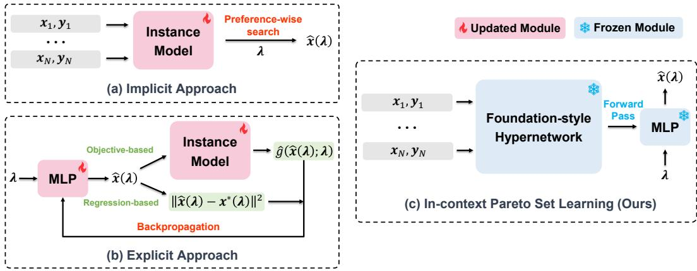
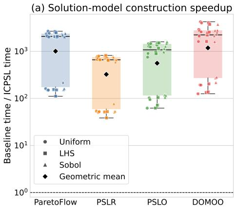
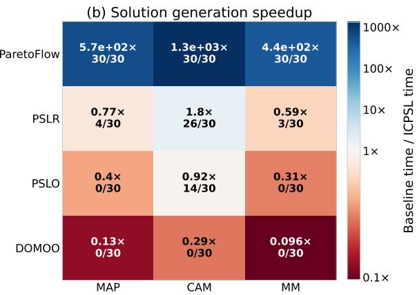
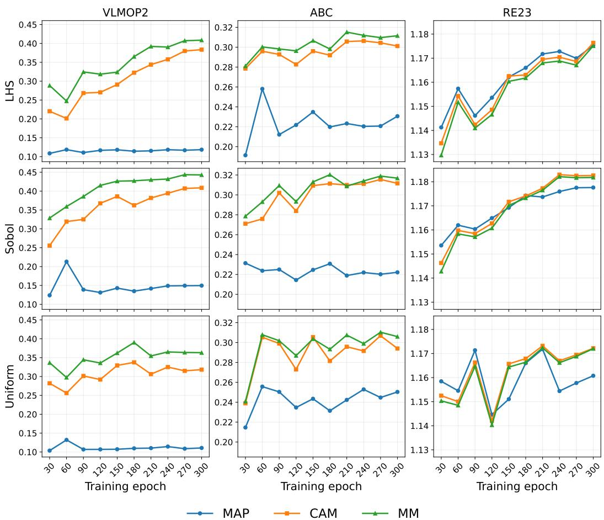
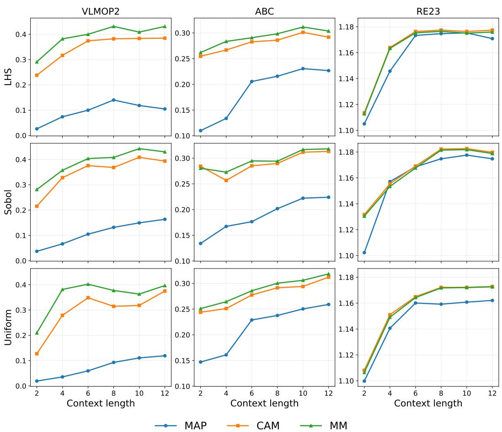

# IN-CONTEXT PREFERENCE-CONDITIONED PARETOSET LEARNING FROM LIMITED OFFLINE DATA

Yiming Yao1, Liang Zhao1 & Qingfu Zhang1

1City University of Hong Kong

yimingyao3-c@my.cityu.edu.hk, liazhao5-c@my.cityu.edu.hk qingfu.zhang@cityu.edu.hk

## ABSTRACT

Multi-objective optimization involves diverse preferences over conflicting objectives. Rather than returning a finite set of trade-off solutions, preferenceconditioned Pareto set learning seeks to map a specified preference directly to a corresponding Pareto optimal solution. Yet in many real-world scenarios, optimization must proceed offline without further objective evaluations, leaving only a limited static dataset that sparsely covers the decision and objective spaces. Existing methods either optimize separately for each preference or train a problemspecific Pareto solution model, requiring repeated search across preferences or repeated training across problems. We introduce in-context preference-conditioned Pareto set learning (ICPSL), a framework that amortizes both preference-wise solution search and problem-specific model construction. ICPSL pretrains a foundation-style hypernetwork on a large and diverse set of synthetic prior data. Given the offline observations of an unseen problem, the pretrained hypernetwork learns to generate a problem-specific, preference-conditioned Pareto solution model in a single forward pass. The generated model can then be reused to predict solutions for arbitrary preferences without problem-specific training or preference-wise search. Experiments on synthetic and real-world problems show that ICPSL produces high-quality Pareto solutions while providing substantial speedups in problem-specific solution-model construction.

## 1 INTRODUCTION

Many real-world optimization problems involve multiple conflicting objectives, where improving one objective may necessarily compromise another (Ying et al., 2019; Tanabe & Ishibuchi, 2020; Dara et al., 2022). Consequently, there is generally no single optimal solution, the goal is to identify a Pareto set that characterizes the possible trade-offs among objectives. Conventional methods approximate this set with a finite collection of solutions, which may not include the solution that best matches a decision-maker’s preferred trade-off (Deb et al., 2002; Beume et al., 2007). Preferenceconditioned Pareto set learning (PSL) instead represents the trade-off structure as a model that maps an arbitrary preference λ to the corresponding optimal solution x⋆(λ) (Navon et al., 2021; Lin et al., 2022). By varying the specified preference, decision-makers can readily explore different trade-off regions of the approximate Pareto set, enabling flexible decision-making.

However, in many practical scenarios, this task becomes more challenging when optimization must proceed offline using only a limited, fixed dataset of previous observations without further queries to the true evaluations (Trabucco et al., 2021; Yu et al., 2021; Chen et al., 2023). As such datasets typically cover only a small portion of the decision and objective spaces, they provide limited information about promising designs for query preferences (Xue et al., 2024; Yuan et al., 2025; Zhu et al., 2026). The key challenge is therefore how to use the transferable and integrable information in the limited observations to infer high-quality Pareto optimal solutions for arbitrary unseen preferences.

Existing methods follow two main paradigms for producing preference-conditioned solutions. The distinction is whether the predicted solution xˆ(λ) is induced implicitly or represented explicitly as a solution model. Implicit method such as ParetoFlow learns a flow model of offline deci sions and objective predictors, then uses the predictors to guide generation for all queried preferences (Yuan et al., 2025). This paradigm focuses how well each preference-conditioned solution can be optimized given a reliable instance-specific model. However, this procedure still requires test-time search for each query preference, and makes the final solution sensitive to surrogate error when data are limited. By contrast, explicit methods exploit regularity across preferences to directly learn a solution model (Navon et al., 2021), typically a multilayer perceptron (MLP), that approximates the preference-to-solution mapping $\lambda \mapsto \bar { \mathscr { x } } ( \lambda ) \overset { \cdot } { \approx } \mathscr { x } ^ { \star } ( \lambda )$ . Representative approaches include regression-based Pareto set learning (PSLR), developed from regression-based amortized optimization (Amos, 2023), as well as classic objective-based Pareto set learning (PSLO) (Lin et al., 2022) and the recently proposed DOMOO (Zhu et al., 2026). Although these methods avoid repeated test-time search across preferences, they typically require training a solution model from scratch for each new problem instance. This motivates a general mechanism for explicitly learning a high-quality solution model from a limited offline static dataset, while avoiding both per-problem retraining and per-preference test-time search.

To this end, we propose in-context preference-conditioned Pareto set learning (ICPSL). The core component is a Transformer-based, foundation-style hypernetwork pretrained on extensive synthetic prior data. Given the offline observations of a new problem instance, the hypernetwork performs incontext inference and directly generates an problem-specific solution model in a single forward pass. The generated MLP solution model explicitly represents the preference-to-solution mapping and returns a solution for any query preference through a single MLP forward pass. The framework therefore realizes two levels of amortization: the generated solution model amortizes solution search across query preferences for a given problem, while the pretrained hypernetwork amortizes solution-model construction across various problem instances. In this view, ICPSL moves beyond per-preference solution search and per-problem model training, shifting toward a foundation-style paradigm in which a pretrained model learns to use offline observations in context to construct solution models for arbitrary query preferences.

## Our contributions are summarized as follows:

• We introduce ICPSL, a framework in which a foundation-style hypernetwork is pretrained on extensive synthetic prior data to generate a reusable problem-specific solution model from limited offline observations in one forward pass, thereby amortizing both solution search across preferences and model construction across problems.

• To accommodate potential discontinuities in the optimal preference-to-solution mapping, we model a preference-conditioned solution distribution through latent-conditioned components and develop three inference strategies to predict solutions.

• Compared with representative baselines, the proposed framework produces high-quality Pareto solutions on synthetic problems and real-world engineering applications, while providing substantial speedups in problem-specific solution-model construction.

## 2 PRELIMINARIES AND RELATED WORK

## 2.1 PRELIMINARIES

Problem Definition. In this paper, we consider the following multi-objective optimization problem (MOP):

$$
\operatorname* { m i n } _ { { \pmb x } \in \mathcal { X } } { \pmb f } ( { \pmb x } ) = ( f _ { 1 } ( { \pmb x } ) , f _ { 2 } ( { \pmb x } ) , \cdot \cdot \cdot , f _ { m } ( { \pmb x } ) ) ,\tag{1}
$$

where $\pmb { x } = ( x _ { 1 } , x _ { 2 } , \ldots , x _ { d } ) ^ { T }$ is the feature vector in the decision space $\mathcal { X } \subset \mathbb { R } ^ { d }$ , and $\pmb { f } : \mathcal { X }  \mathbb { R } ^ { m }$ is the objective vector containing m continuous objective functions. Typically, there is no single solution that can simultaneously achieve the optimal for all objectives. Instead, the goal is to find a set of solutions with Pareto optimal objective trade-offs. We say an objective vector f(x) Pareto dominates another ${ \pmb f } ( { \pmb x } ^ { \prime } )$ , denoted as $\pmb { f } ( \pmb { x } ) \prec \pmb { f } ( \pmb { x } ^ { \prime } ) \mathrm { i f } \enspace f _ { i } ( \pmb { x } ) \leq \bar { f } _ { i } ( \pmb { x } ^ { \prime } ) , \bar { \forall } i \in \{ 1 , \dots , \bar { m } \}$ and there exists $j \in \{ 1 , \dots , m \}$ such that $f _ { j } ( { \pmb x } ) < \dot { f } _ { j } ( { \pmb x } ^ { \prime } )$ . A solution $\pmb { x } ^ { * } \in \mathcal { X }$ is Pareto optimal if there is no x such that $\mathbf { \tilde { \mathbf { f } } } ( \mathbf { \mathbf { x } } ) \prec \mathbf { \tilde { \mathbf { f } } } ( \mathbf { \mathbf { \mathbf { x } } } ^ { * } )$ . The set of all Pareto optimal solutions is called the Pareto set (PS), and the image of PS in the objective space is called the Pareto front (PF).

Tchebycheff Scalarization. Given the preference vector $\lambda \in \Delta ^ { m - 1 }$ , where $\Delta ^ { m - 1 } = \{ \lambda \in \mathbb { R } _ { + } ^ { m }$ $\begin{array} { r } { \sum _ { j = 1 } ^ { m } \lambda _ { j } = 1 \} } \end{array}$ , Tchebycheff scalarization measures the largest weighted deviation from the ideal objective vector $f ^ { \mathrm { i d e a l } }$ , with $f _ { j } ^ { \mathrm { i d e a l } } = \operatorname* { i n f } _ { \pmb { x } \in \mathcal { X } } f _ { j } ( \pmb { x } ) ;$

$$
s _ { \lambda } ( { \pmb x } ) = \operatorname* { m a x } _ { j \in \{ 1 , . . . , m \} } \lambda _ { j } \big ( f _ { j } ( { \pmb x } ) - f _ { j } ^ { \mathrm { i d e a l } } \big ) .\tag{2}
$$

With a suitable ideal point, each Pareto optimal solution can be obtained by optimizing the Tchebycheff scalarization with a specific but unknown preference (Choo & Atkins, 1983):

$$
\pmb { x } ^ { \star } ( \pmb { \lambda } ) = \arg \operatorname* { m i n } _ { \pmb { x } \in \pmb { \mathcal { X } } } s _ { \pmb { \lambda } } ( \pmb { x } ) .\tag{3}
$$

We study the problem when the objectives are unknown and the sole source of information is a fixed offline dataset $\mathcal { D } = \{ ( \pmb { x } _ { i } , \pmb { y } _ { i } ) \} _ { i = 1 } ^ { N _ { c } }$ , with $\pmb { y } _ { i } = \pmb { f } ( \pmb { x } _ { i } )$ . No additional objective evaluation is allowed during training or inference. Our goal is to use D to infer all preference-conditioned Pareto optimal approximates $\hat { { \pmb x } } ( \lambda ) \approx { \pmb x } ^ { \star } ( \lambda )$ for arbitrary preferences.

## 2.2 RELATED WORK

Pareto Set Learning. Pareto set learning (PSL) amortizes solution search across preferences by learning a preference-to-solution mapping for a given problem. Pareto HyperNetworks use a hypernetwork to generate preference-conditioned target-network weights (Navon et al., 2021), while PSL-MOBO applies preference-conditioned modeling to expensive black-box optimization (Lin et al., 2022). Subsequent work addresses different challenges in learning this mapping. EPS adapts preference sampling to the shape of the Pareto front (Ye et al., 2024), whereas CDM-PSL uses diffusion models to capture complex solution distributions in multi-objective Bayesian optimization (Li et al., 2025). These advances improve preference coverage or solution generation within a target problem, but still rely on problem-specific training rather than constructing a reusable model directly from a fixed offline context.

Offline Multi-objective Optimization. Offline model-based optimization seeks improved designs from fixed observations without further objective evaluations. Earlier work addresses challenges of this setting through conservative modeling, robust adaptation, and parallel mentoring (Trabucco et al., 2021; Yu et al., 2021; Chen et al., 2023). The benchmark of Xue et al. (2024) extends this setting to multiple objectives. Within offline MOO, ParetoFlow guides samples from a learned flow using objective predictors (Yuan et al., 2025), whereas DOMOO combines objective surrogates and out-of-distribution risk modeling with nested PSL (Zhu et al., 2026). These methods respectively improve preference-conditioned generation and mitigate out-of-distribution extrapolation, but still rely on problem-specific training or preference-wise search rather than constructing a reusable solu tion model in one forward pass.

Amortized Multi-objective Optimization. Amortized optimization learns to predict solutions across related problem instances instead of solving each instance from scratch (Amos, 2023). Re cent work extends this principle to MOO through pretrained foundation-style models that transfer across problem instances. BOFormer uses Transformer and non-Markovian reinforcement learning to learn a multi-objective Bayesian-optimization policy (Hung et al., 2025), while TAMO pretrains a task-agnostic policy that proposes the next design from an optimization history in a single forward pass (Zhang et al., 2026). Both methods amortize candidate generation, but operate in an online setting in which proposed designs receive further objective evaluations. Moreover, they do not provide preference-conditioned solutions and thus cannot explore different trade-off regions by adjusting queried preferences.

## 3 METHODOLOGY

## 3.1 FRAMEWORK OVERVIEW

As shown in Figure 1, ICPSL learns to directly construct a problem-specific Pareto solution model from the offline observations D of a new multi-objective optimization problem. To this end, we pretrain a foundation-style hypernetwork $H _ { \pmb { \theta } }$ on a large and diverse collection of synthetic multiobjective problems. At inference, the pretrained hypernetwork remains fixed and maps the offline observations D from an unseen target problem to the parameters $\phi _ { \mathcal { D } } ~ = ~ H _ { \theta } ( \mathcal { D } )$ of a problemspecific Pareto solution model. The resulting model $h _ { \phi _ { \mathcal { D } } }$ is a lightweight MLP instantiated directly from the hypernetwork output. Without separate training or fine-tuning, it serves as a reusable Pareto solution model that maps an arbitrary preference λ to the corresponding predicted solution as $\hat { \pmb { x } } _ { \mathcal { D } } ( \pmb { \lambda } ) = h _ { \phi _ { \mathcal { D } } } ( \pmb { \lambda } )$ .

  
Figure 1: Comparison of offline preference-conditioned Pareto set learning paradigms. (a) The implicit approach performs preference-wise search over a problem-specific instance model. (b) The explicit approach trains a problem-specific MLP as the Pareto solution model through objectiveor regression-based learning. (c) ICPSL uses a frozen foundation-style hypernetwork to generate an problem-specific MLP from offline observations in a single forward pass, which maps arbitrary preferences to solutions without problem-specific training or preference-wise search.

Consequently, ICPSL requires neither problem-specific training nor test-time optimization over the queried preferences. This efficiency stems from two complementary levels of amortization. The pretrained hypernetwork first amortizes Pareto solution-model construction across problem instances, while the generated MLP subsequently amortizes solution search across preferences within each problem.

## 3.2 SYNTHETIC PRIOR AND TRAINING DATA

To generalize across multi-objective problems, the hypernetwork should be exposed to a large corpus of offline observations spanning diverse multi-objective problems during pretraining. However, obtaining observations at this scale from real-world systems is often impractical due to high evaluation costs, potential safety risks, privacy or proprietary restrictions. We therefore adopt prior-data pretraining (Nguyen et al., 2023; Hollmann et al., 2025; Zhang et al., 2026), synthesizing a large and diverse collection of training data from a designed generative prior that varies the decision and objective dimensionalities, context size, and objective-landscape geometry, thereby exposing the hypernetwork to a broad range of problem structures that may arise in practice.

## 3.2.1 SYNTHETIC PRIOR

We adopt a Gaussian process (GP) prior to synthesize objective functions because it provides a costeffective and flexible mechanism for generating a large collection of diverse problem landscapes. Moreover, the kernel family and its hyperparameters provide direct control over the distribution of the sampled objective functions. For every objective, we independently draw a latent function from the GP prior,

$$
f _ { j } \sim { \mathcal { G P } } ( 0 , k _ { j } ) , \qquad k _ { j } \sim \operatorname { U n i f o r m } ( K ) , \qquad j = 1 , \ldots , m ,\tag{4}
$$

where K contains the RBF, Matern-´ 3/2, and Matern-´ 5/2 kernels. The RBF kernel is a universal approximator (Micchelli et al., 2006) to allow the prior to encompass a broad range of unknown objective functions, whereas the Matern kernels complement it with rougher sample paths and different´ degrees of regularity. In addition, the automatic relevance determination (ARD) length scales are sampled independently to induce variation in characteristic scales and anisotropy. Together, these choices enable the synthetic prior to generate objectives with diverse landscape properties.

## 3.2.2 TRAINING DATA GENERATION

At each pretraining step, we construct a synthetic training episode in three steps. (i) Prior configuration. We sample the decision dimensionality d, the number of objectives m, the context size $\breve { N } _ { c } .$ as well as the kernel choice and ARD length scales associated with each objective. (ii) Function realization. Given this configuration, we instantiate a multi-objective function $\pmb { f } = ( f _ { 1 } , \ldots , f _ { m } )$ from the GP prior. Each objective is represented as a reusable approximate GP path using random Fourier features (RFFs), allowing the same function realization to be evaluated consistently at the predicted solutions when computing the pretraining loss. (iii) Context and query construction. We sample decisions $\{ \pmb { x } _ { i } \} _ { i = 1 } ^ { N _ { c } }$ uniformly from the decision space $\mathcal { X } = [ 0 , 1 ] ^ { d }$ and collect their observations to form the offline context $\mathcal { D } = \{ ( \boldsymbol { { \boldsymbol { x } } } _ { i } , \boldsymbol { { \boldsymbol { y } } } _ { i } ) \} _ { i = 1 } ^ { N _ { c } }$ . We further sample a set of query preferences $\pmb { \Lambda } = \{ \lambda _ { q } \} _ { q = 1 } ^ { Q }$ from the simplex $\Delta ^ { m - 1 } = \{ \pmb { \lambda } \in \mathbb { R } _ { + } ^ { m } \ | \ \| \pmb { \lambda } \| _ { 1 } = 1 \}$ to evaluate the generated Pareto solution model during pretraining. Collectively, $f , { \dot { \mathcal { D } } }$ , and Λ define a complete synthetic training episode.

## 3.3 MODEL ARCHITECTURE

The hypernetwork $H _ { \theta }$ transforms a variable-sized offline context D into a problem-specific Pareto solution model through three modules: a fixed-width context embedding, a permutation-equivariant Transformer encoder, and a low-rank parameter decoder. Together, these modules encode the offline observations into a problem-level representation and produce instance-specific parameters, which instantiate a lightweight MLP to generate a preference-conditioned solution distribution.

## 3.3.1 CONTEXT EMBEDDING

Given the offline context $\boldsymbol { \mathcal { D } } = \{ ( \boldsymbol { { x } } _ { i } , \boldsymbol { { y } } _ { i } ) \} _ { i = 1 } ^ { N _ { c } }$ , directly embedding each objective observation y would not explicitly characterize its quality under different trade-offs. We therefore construct a fixed-width representation using a bank of reference preferences $\{ \overline { { \lambda } } _ { j } \} _ { j = 1 } ^ { J } \subseteq \Delta ^ { m - 1 }$ that covers both the vertices and the interior of the preference simplex. For each observation $( { \pmb x } _ { i } , { \pmb y } _ { i } )$ , its Tchebycheff scalarization signature is $\pmb { g } _ { i } = ( g _ { i 1 } , \dots , g _ { i J } )$ , where $g _ { i j } = \operatorname* { m a x } _ { \ell \in \{ 1 , . . . , m \} } \lambda _ { j \ell } y _ { i \ell }$ . The resulting signature maps observations of different objective dimensionalities into a common space while exposing their quality across a shared collection of trade-offs. To accommodate different decision dimensionalities, each decision is zero-padded to $d _ { \mathrm { m a x } }$ dimensions. Separate linear encoders then project the padded decision and its scalarization signature into a shared latent space, and their sum forms the corresponding context token:

$$
\begin{array} { r } { e _ { i } = E _ { x } ( \mathrm { p a d } ( { \pmb x } _ { i } ) ) + E _ { g } ( { \pmb g } _ { i } ) . } \end{array}\tag{5}
$$

This construction produces one token for each offline observation rather than expanding the context over all observation–preference pairs. Consequently, the number of tokens remains $| \mathcal D |$ , while each token summarizes the corresponding observation across the reference trade-offs.

## 3.3.2 TRANSFORMER ENCODER

After embedding, the context tokens are jointly processed by a Transformer encoder $T _ { \tau }$ composed of multi-head self-attention, position-wise feed-forward transformations and layer normalization. Self-attention captures dependencies among the offline observations, allowing each token to be interpreted in relation to the full context. Since D has no canonical ordering, no positional encoding is introduced. The encoded tokens are aggregated by average pooling to obtain a problem-level representation:

$$
\left\{ z _ { i } \right\} _ { i = 1 } ^ { N _ { c } } = T _ { \tau } \left( \left\{ e _ { i } \right\} _ { i = 1 } ^ { N _ { c } } \right) , \qquad { \overline { { z } } } _ { \mathcal { D } } = { \frac { 1 } { N _ { c } } } \sum _ { i = 1 } ^ { N _ { c } } z _ { i } .\tag{6}
$$

Together, position-free encoding and symmetric pooling make $\overline { { z } } _ { D }$ invariant to the ordering of the offline observations.

## 3.3.3 LOW-RANK PARAMETER DECODER

Given the pooled problem representation $\overline { { z } } _ { \mathcal { D } } .$ , a feed-forward parameter decoder $D _ { \eta }$ produces the instance-dependent parameters $\phi _ { D }$ used to instantiate a problem-specific two-hidden-layer MLP:

$$
\begin{array} { l } { { \phi _ { \mathcal { D } } = D _ { \eta } ( \overline { { { z } } } _ { \mathcal { D } } ) } } \\ { { \ ~ = \{ A _ { 1 } ( \mathcal { D } ) , A _ { 2 } ( \mathcal { D } ) , W _ { o } ( \mathcal { D } ) , b _ { 1 } ( \mathcal { D } ) , b _ { 2 } ( \mathcal { D } ) , b _ { o } ( \mathcal { D } ) \} . } } \end{array}\tag{7}
$$

Generating the hidden-layer weight matrices densely would make the decoder output unnecessarily large. Instead, the decoder predicts the problem-dependent low-rank factors $\bar { A _ { 1 } ( \mathcal { D } ) }$ and $A _ { 2 } ( \mathcal { D } )$ which are combined with the globally learned projections $S _ { 1 }$ and $S _ { 2 }$ to construct the hidden-layer weight matrices $W _ { 1 } ( \mathcal { D } )$ and $W _ { 2 } ( \mathscr { D } )$

$$
W _ { 1 } ( { \mathcal { D } } ) = A _ { 1 } ( { \mathcal { D } } ) S _ { 1 } , \qquad W _ { 2 } ( { \mathcal { D } } ) = A _ { 2 } ( { \mathcal { D } } ) S _ { 2 } .\tag{8}
$$

The factors $A _ { 1 } ( \mathcal { D } )$ and $A _ { 2 } ( \mathcal { D } )$ , the full output matrix $W _ { o } ( \mathcal { D } )$ , and all biases are generated directly from the current context. In contrast, $S _ { 1 }$ and $S _ { 2 }$ are global parameters learned during pretraining and shared across problem instances.

## 3.3.4 SOLUTION MODEL INSTANTIATION

To accommodate potential discontinuities in the optimal preference-to-solution mapping $\lambda \ \mapsto$ $x ^ { \star } ( \lambda )$ , ICPSL models a preference-conditioned solution distribution $q _ { \phi _ { \mathcal { D } } } ( \pmb { x } \mid \lambda )$ . We represent this distribution using a family of latent-conditioned component $q _ { \phi _ { \mathcal { D } } } ( \pmb { x } \mid \lambda , \overset { . } { z } )$ indexed by $z \stackrel { \cdot } { \sim } U ( [ 0 , 1 ] )$ allowing probability mass to be assigned to multiple high-quality solution regions associated with the same preference. To parameterize each component, the k-th realization $z _ { k }$ of the latent variable z is concatenated with a preference zero-padded to $m _ { \mathrm { m a x } }$ dimensions, yielding ${ \pmb v } _ { k } ( \pmb { \lambda } ) = [ \mathrm { p a d } ( \pmb { \lambda } ) ; z _ { k } ]$ The decoded parameters $\phi _ { D }$ instantiate a problem-specific MLP $h _ { \phi _ { \mathcal { D } } }$ that processes this input as

$$
\pmb { u } _ { 1 k } = \rho ( \pmb { v } _ { k } ( \pmb { \lambda } ) W _ { 1 } ( \pmb { \mathcal { D } } ) + \pmb { b } _ { 1 } ( \pmb { \mathcal { D } } ) ) ,\tag{9}
$$

$$
{ \pmb u } _ { 2 k } = \rho ( { \pmb u } _ { 1 k } W _ { 2 } ( { \mathcal D } ) + { \pmb b } _ { 2 } ( { \mathcal D } ) ) ,\tag{10}
$$

$$
[ \pmb { \mu } _ { k } , \pmb { \ell } _ { k } ] = \pmb { u } _ { 2 k } W _ { o } ( \pmb { \mathcal { D } } ) + \pmb { b } _ { o } ( \pmb { \mathcal { D } } ) ,\tag{11}
$$

where $\rho$ denotes ReLU. The outputs $\pmb { \mu } _ { k }$ and $\ell _ { k }$ parameterize the Gaussian mean and lower-triangular scale matrix, respectively. After converting $\ell _ { k }$ into a valid Cholesky factor $L _ { k }$ , these outputs define the latent-conditioned component

$$
q _ { \phi _ { \mathcal { D } } } ( \pmb { x } \mid \lambda , z _ { k } ) = \mathrm { L o g i t N o r m a l } \big ( \pmb { x } ; \pmb { \mu } _ { k } , L _ { k } L _ { k } ^ { \top } \big ) .\tag{12}
$$

Finally, the preference-conditioned solution distribution is obtained by marginalizing these components over z. In practice, we approximate this integral using K randomized Sobol points $\{ z _ { k } \} _ { k = 1 } ^ { K ^ { ^ { \perp } } } \colon$

$$
q _ { \phi _ { \mathcal D } } ( \boldsymbol x \mid \lambda ) = \int q _ { \phi _ { \mathcal D } } ( \boldsymbol x \mid \lambda , z ) p ( z ) \mathrm d z \approx \frac { 1 } { K } \sum _ { k = 1 } ^ { K } q _ { \phi _ { \mathcal D } } ( \boldsymbol x \mid \lambda , z _ { k } ) .\tag{13}
$$

The resulting distribution can allocate probability mass to multiple disconnected low-energy regions, thereby accommodating discontinuities in the optimal preference-to-solution mapping that may be difficult for a deterministic continuous solution model to represent. Appendix B further details the construction of the latent-conditioned components and their marginalization.

## 3.4 OBJECTIVE-BASED PRETRAINING

ICPSL is pretrained directly using evaluations of the sampled synthetic objective functions, without requiring precomputed Pareto-optimal solutions as supervision. For a query preference λ, we define the Tchebycheff energy in the normalized objective space

$$
s _ { \lambda } ( \pmb { x } ) = \operatorname* { m a x } _ { j \in \{ 1 , . . . , m \} } \lambda _ { j } f _ { j } ( \pmb { x } ) .\tag{14}
$$

Ideally, the preference-conditioned solution distribution should concentrate its probability mass on high-quality solutions under the queried preference. We therefore define the target preferenceconditioned solution distribution as the Gibbs distribution induced by this energy,

$$
p _ { \tau } ^ { \star } ( x \mid \lambda , f ) = \frac { \exp ( - s _ { \lambda } ( x ) / \tau ) } { Z ( \lambda , f ) } , \qquad Z ( \lambda , f ) = \int _ { \chi } \exp ( - s _ { \lambda } ( u ) / \tau ) \mathrm { d } u .\tag{15}
$$

The temperature $\tau > 0$ controls its concentration, with smaller values placing more probability mass around low-energy solutions. Given the learned preference-conditioned solution distribution $q _ { \phi _ { \mathcal { D } } } ( { \pmb x } \mid { \pmb \lambda } )$ , ICPSL minimizes the free-energy loss

$$
\mathcal { L } = \mathbb { E } _ { { \pmb x } \sim { \boldsymbol q } _ { \phi _ { \mathcal { D } } } ( { \pmb x } | \lambda ) } [ s _ { \lambda } ( { \pmb x } ) ] + \tau \mathbb { E } _ { { \pmb x } \sim { \boldsymbol q } _ { \phi _ { \mathcal { D } } } ( { \pmb x } | \lambda ) } [ \log { q _ { \phi _ { \mathcal { D } } } ( { \pmb x } \mid \lambda ) } ] .\tag{16}
$$

The first expectation shifts probability mass toward solutions with low Tchebycheff energy, whereas the second is the temperature-weighted negative differential entropy of the preference-conditioned solution distribution and discourages premature concentration. As derived in Appendix C.1, minimizing L is equivalent to minimizing the KL divergence between the learned preference-conditioned solution distribution and the Tchebycheff-energy-induced target distribution.

During pretraining, we estimate both expectations using reparameterized samples, evaluate their Tchebycheff energies through the synthetic objective paths, and compute the marginal log density by aggregating each sample’s density across all latent-conditioned components. This objective requires neither Pareto-optimal solution labels nor a separate optimizer for the sampled training problems. Appendix C.2 provides the complete Monte Carlo estimator.

## 3.5 IN-CONTEXT INFERENCE

Once hypernetwork pretraining is complete, inference for a target problem operates directly on the generated problem-specific solution model $h _ { \phi _ { \mathcal { D } } }$ . For each queried preference, the model defines a preference-conditioned solution distribution from which a single predicted solution is produced for decision making. We consider three inference strategies: maximum a posteriori (ICPSL-MAP), component-averaged mean (ICPSL-CAM), and mixture mean (ICPSL-MM).

ICPSL-MAP. This strategy draws one reparameterized candidate $\scriptstyle { \mathbf { { \mathit { x } } } } _ { k }$ from every latent-conditioned component and evaluates each candidate under the full preference-conditioned solution density. It then selects

$$
{ \hat { \pmb x } } _ { \mathrm { M A P } } ( { \pmb \lambda } ) = \operatorname * { a r g m a x } _ { { \pmb x } \in \{ { \pmb x } _ { 1 } , . . . , { \pmb x } _ { K } \} } q _ { \phi _ { \mathcal { D } } } ( { \pmb x } \mid { \pmb \lambda } ) .\tag{17}
$$

This sample-based approximate MAP rule favors a locally high-density solution while accounting for overlap among all mixture components.

ICPSL-CAM. This strategy averages the sigmoid-transformed component means. Specifically, it applies the sigmoid directly to each pre-sigmoid mean and computes

$$
\hat { \pmb { x } } _ { \mathrm { C A M } } ( \pmb { \lambda } ) = \frac { 1 } { K } \sum _ { k = 1 } ^ { K } \sigma ( \pmb { \mu } _ { k } ( \pmb { \lambda } ) ) .\tag{18}
$$

This deterministic rule avoids Gaussian sampling and density evaluation, making it the least expensive way to aggregate all mixture components into one prediction.

ICPSL-MM. This strategy estimates the mean of the complete preference-conditioned solution distribution. It draws R Gaussian samples from each latent-conditioned component and averages the corresponding bounded decisions:

$$
\hat { x } _ { \mathrm { M M } } ( \lambda ) = \frac { 1 } { K R } \sum _ { k = 1 } ^ { K } \sum _ { r = 1 } ^ { R } \sigma ( \mu _ { k } ( \lambda ) + L _ { k } ( \lambda ) \epsilon _ { k r } ) , \qquad \epsilon _ { k r } \sim \mathcal { N } ( \mathbf { 0 } , I ) .\tag{19}
$$

Unlike ICPSL-CAM, this Monte Carlo estimate incorporates each component’s covariance after the nonlinear sigmoid transformation. All three inference strategies operate solely on the generated solution model and require no parameter updates, preference-wise optimization, or additional evaluations of the true objectives.

## 4 EXPERIMENTS

## 4.1 EXPERIMENTAL SETTING

Baselines. We compare ICPSL with representative baselines, including the implicit method ParetoFlow (Yuan et al., 2025), the regression-based explicit method PSLR (Amos, 2023), and the objective-based explicit methods PSLO (Lin et al., 2022) and DOMOO (Zhu et al., 2026). Detailed baseline configurations are provided in Appendix D.1.

Benchmarks. We evaluate all methods on a diverse suite of benchmarks covering synthetic functions (Blank & Deb, 2020) and real-world engineering design problems (Tanabe & Ishibuchi, 2020). For each problem, we construct an offline context of 10 observations using Latin hypercube sampling (LHS), scrambled Sobol sampling, or uniform random sampling. We conduct 10 independent runs for each sampling method, giving all algorithms the same context within each run. Further benchmark details are provided in Appendix D.3.

Evaluation Protocol. We evaluate the true objectives after inference and measure solution quality by hypervolume (HV) in the normalized objective space with reference point $r = [ 1 . 1 , . . . , 1 . { \overset { . } { 1 } } ] ^ { T } \overset { \cdot } { \in }$ $\bar { \mathbb { R } ^ { m } }$ , where higher values are better. Over 10 independent runs, we report the mean HV and the halfwidth of its 95% confidence interval, together with wall-clock times for problem-specific model construction and solution generation across all query preferences. Further details are provided in Appendix D.4.

Implementation. For ParetoFlow, PSLO, and DOMOO, we use the authors’ official implementations. ICPSL and PSLR are implemented in PyTorch. Baseline code sources and further implementation details are provided in Appendix D.

## 4.2 MAIN RESULTS

## 4.2.1 OPTIMIZATION PERFORMANCE

We evaluate all methods under offline contexts generated by LHS, Sobol, and uniform sampling, with lower average ranks indicating better optimization performance. As shown in Table 1, ICPSL-MM achieves the best overall average rank and the most wins, ranking first in 15 of the 30 cases.

For each sampling method, ICPSL-MM obtains the best average rank under the uniform context distribution and shares the best rank under both LHS and Sobol, demonstrating consistent performance across different offline observation patterns. ICPSL-CAM is also competitive, sharing the best LHS rank and achieving the highest top-3 count of 23/30. These results indicate that amortizing Pareto

Table 1: Average ranks, wins, and top-3 counts across all benchmark instances with LHS, Sobol, and uniform context distributions.
<table><tr><td>Algorithm LHS</td><td>Sobol</td><td>Uniform</td><td>Overall</td><td>Wins</td><td>Top-3 cases</td></tr><tr><td rowspan="3">ParetoFlow PSLR PSLO</td><td>4.50 4.50</td><td>4.20</td><td>4.40</td><td>5/30</td><td>9/30</td></tr><tr><td>3.70 3.40</td><td>3.80</td><td>3.63</td><td>2/30</td><td>18/30</td></tr><tr><td>5.10 5.20</td><td>5.80</td><td>5.37</td><td>2/30</td><td>5/30</td></tr><tr><td rowspan="3">DOMOO ICPSL-MAP</td><td>4.30 3.20</td><td>5.10</td><td>4.20</td><td>5/30</td><td>10/30</td></tr><tr><td>5.00 4.80</td><td>4.20</td><td>4.67</td><td></td><td></td></tr><tr><td>3.70</td><td></td><td></td><td>1/30</td><td>7/30</td></tr><tr><td>ICPSL-CAM ICPSL-MM</td><td>2.70 2.70 3.20</td><td>2.60 2.30</td><td>3.00 2.73</td><td>0/30 15/30</td><td>23/30 18/30</td></tr></table>

solution-model construction across problems does not compromise optimization quality. Complete performance results are provided in Appendix E.

## 4.2.2 COMPUTATIONAL EFFICIENCY

Beyond solution quality, we record the wall-clock times required for problem-specific Pareto solution-model construction and preference-conditioned solution generation. Figure 2 reports baseline-to-ICPSL runtime ratios, where values above one indicate that ICPSL is faster. For model construction, ICPSL provides orders-of-magnitude speedups over all four baselines across all 30 cases because a single hypernetwork forward pass replaces problem-specific training. At inference, ICPSL-CAM offers the best trade-off among the three variants, it achieves a averaged speedup of $1 . 3 \times 1 0 ^ { 3 }$ over ParetoFlow in 30/30 cases and 1.8× over PSLR in 26/30 cases. ParetoFlow has the longest inference time because it has to perform solution search for all queried preferences. Complete timing results are provided in Appendix E.

  
Figure 2: Runtime speedups of ICPSL over the baselines for problem-specific Pareto solution-model construction and preference-conditioned solution generation.

## 4.3 ADDITIONAL ANALYSIS

Evolution of Solution-Model Quality. We track solution-model quality across checkpoints saved every 30 epochs on three unseen problems during pretraining (Figure 3 in Appendix F.1). The results show that the solution quality generally increases with pretraining, although the trajectories are not monotonic. On VLMOP2 and ABC, ICPSL-CAM and ICPSL-MM consistently outperform ICPSL-MAP, and their improvement is particularly pronounced on VLMOP2. This pattern suggests that aggregating across latent-conditioned components helps convert the learned distribution into a more effective point prediction. The less stable RE23 trajectories under uniform contexts indicate that these gains are not uniform across offline observation patterns.

Sensitivity to Context Size. We examine how solution quality varies with different context sizes (Figure 4 in Appendix F.2). The results indicate that solution quality generally improves as the context grows, but the gains vary across benchmarks and inference strategies, with some trajectories rising gradually and others fluctuating or leveling off. This suggests that additional observations can provide useful problem-specific information, although their benefits are not uniformly concentrated at small context sizes. The smallest evaluation contexts also contain fewer observations than those used during pretraining, probing adaptation to greater data scarcity. Continued gains with larger contexts indicate that additional observations can still refine the generated model.

Generalization to OOD Dimensions. We evaluate generalization beyond the dimensionalities sampled during pretraining. As reported in Appendix F.3, ICPSL-MM achieves the highest hypervol ume on all three five-dimensional problems under every context distribution, whereas ParetoFlow is strongest on DTLZ4. This contrast suggests that transferring learned trade-off structure to an unseen number of objectives is more challenging in these tests than extending to an additional decision variable, even though the architecture accommodates both dimensions. ICPSL nonetheless retains the fastest model construction across all OOD settings, achieving a substantial computational advantage while delivering leading or competitive solution quality.

## 5 CONCLUSION

We introduced ICPSL, which pretrains a foundation-style hypernetwork on a large and diverse set of synthetic prior data to generate a reusable and problem-specific solution model from limited offline context in one forward pass, amortizing both model construction across problems and solution search across preferences. Across synthetic and engineering benchmarks, ICPSL achieves highquality Pareto solutions while providing substantial speedups in solution-model construction.

Our current evaluation primarily covers low-dimensional problems, leaving broader dimensional settings for future study. Marginal-density evaluation also becomes more costly as the number of latent components grows. Future work could diversify synthetic pretraining problems and develop more efficient marginal-density estimators to extend ICPSL to larger-scale settings.

## AI USE STATEMENT

In this work, we used generative AI tools for helping implementing baseline methods and interpreting experimental results. We have not used generative AI tools for generating synthetic data sets, helping develop theoretical models or conceptual frameworks, formulating mathematical claims, providing critical ingredients for proving mathematical claims, assisting in the writing of proofs, designing or providing feedback on research methodology or experiments, and proposing or refining hypotheses, assisting with translation, cleaning and reformating dataset, supporting qualitative and thematic data analysis are not applicable to this work. Additionally, we used generative AI tools for creating or modifying scientific figures, summarizing or analyzing existing literature, drafting parts of the paper, improving its readability, and suggesting its structure. We manually reviewed all AI-assisted work, checked baseline implementations against experimental outputs, and verified figures, literature summaries, and result interpretations against their underlying materials. We take responsibility for the final content of this work, including text, claims, and artifacts produced with the aid of generative AI.

## REPRODUCIBILITY STATEMENT

Appendix D documents the implementation details used in our experiments. Table 2 identifies the baseline code sources, Appendix D.3 specifies the benchmark configurations and implementations, and Appendix D.4 describes the evaluation protocol.

## REFERENCES

Brandon Amos. Tutorial on amortized optimization. Foundations and Trends in Machine Learning, 16(5):592–732, 2023. doi: 10.1561/2200000102.

Nicola Beume, Boris Naujoks, and Michael Emmerich. Sms-emoa: Multiobjective selection based on dominated hypervolume. Europeanjournal ofoperational research, 181(3):1653–1669, 2007.

Julian Blank and Kalyanmoy Deb. Pymoo: Multi-objective optimization in python. Ieee access, 8: 89497–89509, 2020.

Andrew Brock, Theodore Lim, J. M. Ritchie, and Nick Weston. SMASH: One-shot model architecture search through hypernetworks. In International Conference on Learning Representations, 2018. URL https://openreview.net/forum?id=rydeCEhs-.

Can Sam Chen, Christopher Beckham, Zixuan Liu, Xue Steve Liu, and Chris Pal. Parallel-mentoring for offline model-based optimization. Advances in Neural Information Processing Systems, 36: 76619–76636, 2023.

Yutian Chen, Xingyou Song, Chansoo Lee, Zi Wang, Richard Zhang, David Dohan, Kazuya Kawakami, Greg Kochanski, Arnaud Doucet, Marc’Aurelio Ranzato, Sagi Perel, and Nando de Freitas. Towards learning universal hyperparameter optimizers with transformers. In Advances in Neural Information Processing Systems, volume 35, pp. 32053–32068, 2022. URL https://proceedings.neurips.cc/paper\_files/paper/2022/ hash/cf6501108fced72ee5c47e2151c4e153-Abstract-Conference.html.

Eng Ung Choo and Derek R Atkins. Proper efficiency in nonconvex multicriteria programming. Mathematics ofOperations Research, 8(3):467–470, 1983. doi: 10.1287/moor.8.3.467.

Suresh Dara, Swetha Dhamercherla, Surender Singh Jadav, CH Madhu Babu, and Mohamed Jawed Ahsan. Machine learning in drug discovery: a review. Artificial intelligence review, 55(3):1947– 1999, 2022.

Kalyanmoy Deb, Amrit Pratap, Sameer Agarwal, and TAMT Meyarivan. A fast and elitist multiobjective genetic algorithm: Nsga-ii. IEEE transactions on evolutionary computation, 6(2): 182–197, 2002.

Samuel Dooley, Gurnoor Singh Khurana, Chirag Mohapatra, Siddartha V. Naidu, and Colin White. ForecastPFN: Synthetically-trained zero-shot forecasting. In Advances

in Neural Information Processing Systems, volume 36, pp. 2403–2426, 2023. URL https://proceedings.neurips.cc/paper\_files/paper/2023/hash/ 0731f0e65559059eb9cd9d6f44ce2dd8-Abstract-Conference.html.

Marta Garnelo, Dan Rosenbaum, Christopher Maddison, Tiago Ramalho, David Saxton, Murray Shanahan, Yee Whye Teh, Danilo Rezende, and S. M. Ali Eslami. Conditional neural processes. In Proceedings of the 35th International Conference on Machine Learning, volume 80 of Proceedings of Machine Learning Research, pp. 1704–1713. PMLR, 2018. URL https://proceedings.mlr.press/v80/garnelo18a.html.

David Ha, Andrew M. Dai, and Quoc V. Le. HyperNetworks. In International Conference on Learning Representations, 2017. URL https://openreview.net/forum?id=rkpACe1lx.

Noah Hollmann, Samuel Muller, Lennart Purucker, Arjun Krishnakumar, Max K¨ orfer, Shi Bin Hoo,¨ Robin Tibor Schirrmeister, and Frank Hutter. Accurate predictions on small data with a tabular foundation model. Nature, 637:319–326, 2025. doi: 10.1038/s41586-024-08328-6. URL https://www.nature.com/articles/s41586-024-08328-6.

Yu-Heng Hung, Kai-Jie Lin, Yu-Heng Lin, Chien-Yi Wang, Cheng Sun, and Ping-Chun Hsieh. BOFormer: Learning to solve multi-objective bayesian optimization via non-markovian reinforcement learning. In International Conference on Learning Representations, 2025. URL https://openreview.net/forum?id=UnCKU8pZVe.

Rabeeh Karimi Mahabadi, Sebastian Ruder, Mostafa Dehghani, and James Henderson. Parameterefficient multi-task fine-tuning for transformers via shared hypernetworks. In Proceedings of the 59th Annual Meeting ofthe Associationfor Computational Linguistics and the 11th International Joint Conference on Natural Language Processing, pp. 565–576. Association for Computational Linguistics, 2021. doi: 10.18653/v1/2021.acl-long.47. URL https://aclanthology. org/2021.acl-long.47/.

Bingdong Li, Zixiang Di, Yongfan Lu, Hong Qian, Feng Wang, Peng Yang, Ke Tang, and Aimin Zhou. Expensive multi-objective bayesian optimization based on diffusion models. In Proceedings of the AAAI Conference on Artificial Intelligence, volume 39, pp. 27063–27071, 2025. doi: 10.1609/aaai.v39i25.34913.

Xi Lin, Zhiyuan Yang, Xiaoyuan Zhang, and Qingfu Zhang. Pareto set learning for expensive multiobjective optimization. In Advances in Neural Information Processing Systems, volume 35, pp. 19231–19247, 2022. doi: 10.52202/068431-1398.

Alexandre Maraval, Matthieu Zimmer, Antoine Grosnit, and Haitham Bou Ammar. Endto-end meta-bayesian optimisation with transformer neural processes. In Advances in Neural Information Processing Systems, volume 36, pp. 11246–11260, 2023. URL https://proceedings.neurips.cc/paper\_files/paper/2023/hash/ 2561721d0ca69bab22b749cfc4f48f6c-Abstract-Conference.html.

Charles A Micchelli, Yuesheng Xu, and Haizhang Zhang. Universal kernels. Journal of Machine Learning Research, 7(12), 2006.

Andreas C. Muller, Carlo Curino, and Raghu Ramakrishnan. MotherNet: Fast training and infer-¨ ence via hyper-network transformers. In International Conference on Learning Representations, 2025. URL https://proceedings.iclr.cc/paper\_files/paper/2025/hash/ bed8e95c6a99df485a6fc8b973e2d6cb-Abstract-Conference.html.

Samuel Muller, Noah Hollmann, Sebastian Pineda Arango, Josif Grabocka, and Frank Hutter. Trans-¨ formers can do bayesian inference. In International Conference on Learning Representations, 2022. URL https://openreview.net/forum?id=KSugKcbNf9.

Samuel Muller, Matthias Feurer, Noah Hollmann, and Frank Hutter. PFNs4BO: In-context learning¨ for Bayesian optimization. In Proceedings of the 40th International Conference on Machine Learning, volume 202 of Proceedings of Machine Learning Research, pp. 25444–25470. PMLR, 2023. URL https://proceedings.mlr.press/v202/muller23a.html.

Aviv Navon, Aviv Shamsian, Gal Chechik, and Ethan Fetaya. Learning the pareto front with hypernetworks. In International Conference on Learning Representations, 2021. URL https: //openreview.net/forum?id=NjF772F4ZZR.

Tung Nguyen and Aditya Grover. Transformer neural processes: Uncertainty-aware meta learning via sequence modeling. In Proceedings ofthe 39th International Conference on Machine Learning, volume 162 of Proceedings ofMachine Learning Research, pp. 16569–16594. PMLR, 2022. URL https://proceedings.mlr.press/v162/nguyen22b.html.

Tung Nguyen, Sudhanshu Agrawal, and Aditya Grover. ExPT: Synthetic pretraining for few-shot experimental design. In Advances in Neural Information Processing Systems, volume 36, pp. 45856–45869, 2023. URL https://proceedings.neurips.cc/paper\_files/paper/2023/hash/ 8fab4407e1fe9006b39180525c0d323c-Abstract-Conference.html.

Xingyou Song, Oscar Li, Chansoo Lee, Bangding Yang, Daiyi Peng, Sagi Perel, and Yutian Chen. OmniPred: Language models as universal regressors. Transactions on Machine Learning Research, 2024. URL https://openreview.net/forum?id=t9c3pfrR1X.

Ryoji Tanabe and Hisao Ishibuchi. An easy-to-use real-world multi-objective optimization problem suite. Applied Soft Computing, 89:106078, 2020.

Brandon Trabucco, Aviral Kumar, Xinyang Geng, and Sergey Levine. Conservative objective models for effective offline model-based optimization. In International Conference on Machine Learning, pp. 10358–10368. PMLR, 2021.

Ke Xue, Rongxi Tan, Xiaobin Huang, and Chao Qian. Offline multi-objective optimization. In Proceedings of the 41st International Conference on Machine Learning, volume 235 of Proceedings of Machine Learning Research, pp. 55595–55624. PMLR, 2024. URL https: //proceedings.mlr.press/v235/xue24b.html.

Rongguang Ye, Longcan Chen, Jinyuan Zhang, and Hisao Ishibuchi. Evolutionary preference sampling for pareto set learning. In Proceedings ofthe Genetic and Evolutionary Computation Conference, pp. 630–638, 2024. doi: 10.1145/3638529.3654024.

Chris Ying, Aaron Klein, Eric Christiansen, Esteban Real, Kevin Murphy, and Frank Hutter. Nasbench-101: Towards reproducible neural architecture search. In International conference on machine learning, pp. 7105–7114. PMLR, 2019.

Sihyun Yu, Sungsoo Ahn, Le Song, and Jinwoo Shin. Roma: Robust model adaptation for offline model-based optimization. Advances in Neural Information Processing Systems, 34:4619–4631, 2021.

Ye Yuan, Can Chen, Christopher Pal, and Xue Liu. ParetoFlow: Guided flows in multi-objective optimization. In International Conference on Learning Representations, 2025. URL https: //openreview.net/forum?id=mLyyB4le5u.

Xinyu Zhang, Conor Hassan, Julien Martinelli, Daolang Huang, and Samuel Kaski. In-context multi-objective optimization. In International Conference on Learning Representations, 2026. URL https://openreview.net/forum?id=odmeUlWta8.

Andrey Zhmoginov, Mark Sandler, and Maksym Vladymyrov. HyperTransformer: Model generation for supervised and semi-supervised few-shot learning. In Proceedings of the 39th International Conference on Machine Learning, volume 162 of Proceedings of Machine Learning Research, pp. 27075–27098. PMLR, 2022. URL https://proceedings.mlr.press/ v162/zhmoginov22a.html.

Yiyi Zhu, Yaolin Wen, Xiang Xia, Xin An, Hanyi Si, Xiang Shu, Yangde Fu, Liang Dou, and Hong Qian. Diversity-driven offline multi-objective optimization via nested pareto set learning. arXiv preprint arXiv:2606.15115, 2026. URL https://arxiv.org/abs/2606.15115.

## APPENDIX

A ADDITIONAL RELATED WORK

A.1 UNIVERSAL REGRESSION MODELS

Universal regression models seek to transfer function inference across tasks rather than fit a new predictor from scratch for every function. Conditional Neural Processes (CNPs) encode an unordered set of input–output observations into a representation used to predict target values (Garnelo et al., 2018), while Transformer Neural Processes (TNPs) formulate uncertainty-aware meta-regression as sequence modeling (Nguyen & Grover, 2022). Prior-Data Fitted Networks (PFNs) instead pretrain a Transformer on datasets sampled from a prior to approximate Bayesian posterior prediction in context (Muller et al., 2022). TabPFN develops this paradigm into a foundation model for small ¨ tabular datasets (Hollmann et al., 2025). Subsequent work extends broadly pretrained regression to zero-shot forecasting with ForecastPFN (Dooley et al., 2023) and to heterogeneous numerical tasks represented as text with OmniPred (Song et al., 2024). These models predict responses or predictive distributions, so their use in optimization generally requires a subsequent search procedure. ICPSL instead constructs a preference-conditioned solution model directly from offline observations.

## A.2 HYPERNETWORKS

Hypernetworks generate the parameters of another neural network, providing a mechanism for conditioning an entire model on auxiliary information (Ha et al., 2017). SMASH conditions a hypernetwork on candidate architectures to generate their weights, thereby amortizing the cost of evaluating architectures during neural architecture search (Brock et al., 2018). HyperFormer instead uses shared hypernetworks conditioned on the task, Transformer layer, and adapter position to generate adapter parameters for parameter-efficient multi-task adaptation (Karimi Mahabadi et al., 2021). Be yond conditioning on architecture or task identifiers, hypernetworks can also generate model parameters directly from observed examples. HyperTransformer produces few-shot convolutional-network weights from support examples (Zhmoginov et al., 2022), while MotherNet combines prior-data pretraining with a Transformer hypernetwork to generate a compact classifier for a new tabular dataset in a single forward pass without dataset-specific gradient descent (Muller et al., 2025). Unlike¨ prior hypernetwork approaches, ICPSL targets offline multi-objective optimization by generating a problem-specific solution model from offline observations to predict solutions for queried preferences. ICPSL further differs in its objective-based pretraining, which evaluates sampled solutions on synthetic objectives without requiring Pareto-optimal solution labels.

## A.3 FOUNDATION-STYLE OPTIMIZATION

Several methods transfer optimization experience across problem instances through pretrained sequence models. OptFormer learns function prediction and optimization-policy behavior from heterogeneous hyperparameter-optimization trajectories (Chen et al., 2022). PFNs4BO performs incontext Bayesian inference from a synthetic prior for Bayesian optimization (Muller et al., 2023).¨ ExPT pretrains a few-shot experimental-design policy on synthetic functions (Nguyen et al., 2023). End-to-end meta-BO jointly learns a Transformer Neural Process surrogate and acquisition mecha nism through reinforcement learning (Maraval et al., 2023). This direction has also been extended to multiple objectives. BOFormer uses non-Markovian deep Q-learning and Transformer sequence modeling to learn a non-myopic acquisition policy for multi-objective Bayesian optimization (Hung et al., 2025). TAMO pretrains a fully amortized policy that proposes the next design from the query history in a single forward pass across varying input and objective dimensions (Zhang et al., 2026). These approaches primarily target sequential candidate selection or experimental design. In contrast, ICPSL addresses offline multi-objective optimization without additional objective evaluations and directly constructs a reusable solution model for arbitrary queried preferences.

## B DETAILS OF PREFERENCE-CONDITIONED SOLUTION DISTRIBUTIONMODELING

This section provides further details on preference-conditioned solution distribution modeling in ICPSL. We first describe how the problem-specific MLP parameterizes the latent-conditioned components. We then explain how component marginalization yields the preference-conditioned solution distribution and enables it to represent multiple solution modes. Finally, we discuss the main challenges associated with marginal-density evaluation and latent collapse.

## B.1 LATENT-CONDITIONED COMPONENT MODELING

Given the offline context D from the target problem, the hypernetwork first produces the problemdependent parameters $\phi _ { \mathcal { D } } ~ = ~ H _ { \pmb { \theta } } ( \mathcal { D } )$ ), which instantiates the problem-specific MLP $h _ { \phi _ { \mathcal { D } } }$ . For a preference λ and a scalar latent variable $z ,$ this MLP outputs

$$
h _ { \phi _ { \mathcal { D } } } ( \lambda , z ) = \Big ( \mu ( \lambda , z ) , \widetilde { L } ( \lambda , z ) \Big ) ,\tag{20}
$$

where $\mu ( \lambda , z ) \in \mathbb { R } ^ { d }$ is a Gaussian mean and $\widetilde { L } ( \lambda , z ) \in \mathbb { R } ^ { d \times d }$ is a raw lower-triangular scale matrix. We obtain the numerically stable Cholesky factor $L ( \lambda , z )$ by retaining the strictly lower-triangular entries of $\widetilde L ( \boldsymbol { \lambda } , z )$ and parameterizing its diagonal as

$$
L _ { r r } ( \lambda , z ) = \mathrm { s o f t p l u s } \Big ( \widetilde { L } _ { r r } ( \lambda , z ) \Big ) + \delta , \qquad r = 1 , \ldots , d ,\tag{21}
$$

where $\delta > 0$ is a small constant to ensure that $\Sigma ( \lambda , z ) = L ( \lambda , z ) L ( \lambda , z ) ^ { \top }$ is a valid and numerically stable covariance matrix. A reparameterized sample is generated as

$$
\mathbf { \delta } \mathbf { a } = \mu ( \lambda , z ) + L ( \lambda , z ) \boldsymbol { \epsilon } , \qquad \ \epsilon \sim \mathcal { N } ( \mathbf { 0 } , I ) , \qquad \mathbf { \delta } x = \sigma ( a ) ,\tag{22}
$$

where the element-wise sigmoid maps the unconstrained Gaussian sample to the normalized decision domain $( 0 , 1 ) ^ { d }$ , inducing the latent-conditioned logit-normal component

$$
q _ { \phi _ { \mathcal { D } } } ( \pmb { x } \mid \lambda , z ) = \mathrm { L o g i t N o r m a l } ( \pmb { x } ; \pmb { \mu } ( \lambda , z ) , \pmb { \Sigma } ( \pmb { \lambda } , z ) ) .\tag{23}
$$

This distribution forms a latent-conditioned component of the preference-conditioned solution distribution. Its location and local geometry depend jointly on the queried preference and latent variable.

## B.2 COMPONENT MARGINALIZATION AND ITS ROLE

ICPSL places a uniform prior over the latent variable $z \sim U ( [ 0 , 1 ] )$ , and defines its preferenceconditioned solution distribution by marginalization:

$$
q _ { \phi _ { \mathcal { D } } } ( \pmb { x } \mid \pmb { \lambda } ) = \int _ { 0 } ^ { 1 } q _ { \phi _ { \mathcal { D } } } ( \pmb { x } \mid \pmb { \lambda } , z ) \mathrm { d } z .\tag{24}
$$

This preference-conditioned solution distribution can be viewed as a continuous mixture of logisticnormal components. Different regions of the latent domain may correspond to distinct solution modes, and the probability mass assigned to each mode is determined by the proportion of latent values mapped to that mode. In practice, we approximate the integral using a randomized onedimensional Sobol design $\{ z _ { k } \} _ { k = 1 } ^ { K } \dot { . }$

$$
q _ { \phi _ { \mathcal { D } } } ( \pmb { x } \mid \pmb { \lambda } ) \approx \frac { 1 } { K } \sum _ { k = 1 } ^ { K } q _ { \phi _ { \mathcal { D } } } ( \pmb { x } \mid \pmb { \lambda } , z _ { k } ) .\tag{25}
$$

For notational simplicity, we use $q$ to denote this finite-mixture approximation hereafter. The same latent design is shared across the query preferences of a problem, so each $z _ { k }$ retains a consistent component identity as λ varies.

The latent variable is essential when nearby preferences correspond to well-separated low-energy solution regions. A deterministic continuous model that maps each preference directly to a single solution may interpolate between these regions, potentially yielding decisions with high Tchebycheff values. By contrast, distinct subsets of the latent domain can allocate probability mass to different regions and smoothly transfer that mass as the preference changes. ICPSL therefore models a preference-conditioned solution distribution over low-Tchebycheff solutions rather than forcing a continuous network to reproduce a single-valued optimal solution mapping $\lambda \mapsto x ^ { \star } ( \lambda )$ that may be discontinuous.

## B.3 MARGINALIZATION CHALLENGES

The main technical challenge lies in evaluating the density of the preference-conditioned solution distribution, as the continuous marginalization in Equation 24 generally has no closed-form solution. ICPSL addresses this challenge using the finite mixture in Equation 25, which approximates the continuous marginal with an explicit average over K latent-conditioned components. The marginal density of each generated sample is therefore computed by evaluating it under all K components and aggregating the resulting densities. With one sample drawn from each component, this procedure requires $K ^ { \overline { { 2 } } }$ pairwise density evaluations for every problem–preference pair, which are computed in chunks to control memory usage. The complete Monte Carlo computation is detailed in Section C.2.

The second challenge is latent collapse when a preference admits multiple separated low-energy solution regions. If different values of z produce nearly identical distribution parameters, the resulting components may concentrate on the same region rather than represent distinct modes. However, when the optimal solution mapping is unique and continuous, component overlap is natural because there are no distinct solution modes to represent. The marginal-entropy regularization described in Appendix C mitigates harmful collapse by discouraging premature concentration of the preferenceconditioned solution distribution.

## C DETAILS OF THE TCHEBYCHEFF FREE-ENERGY LOSS

This section derives the free-energy loss based on Tchebycheff aggregation for training the preference-conditioned solution distribution model and describes its Monte Carlo implementation.

## C.1 FREE-ENERGY LOSS AND KL INTERPRETATION

For a preference $\lambda \in \Delta ^ { m - 1 }$ and a synthetic multi-objective function f, ICPSL aggregates the objectives into the hard Tchebycheff energy

$$
s _ { \lambda } ( \pmb { x } ) = \operatorname* { m a x } _ { j \in \{ 1 , . . . , m \} } \lambda _ { j } f _ { j } ( \pmb { x } ) .\tag{26}
$$

Ideally, a preference-conditioned solution distribution should concentrate its probability mass on high-quality solutions under the queried preference. We therefore define the target preferenceconditioned solution distribution as the Gibbs distribution induced by this energy:

$$
p _ { \tau } ^ { \star } ( x \mid \lambda , f ) = \frac { \exp ( - s _ { \lambda } ( x ) / \tau ) } { Z ( \lambda , f ) } , \qquad Z ( \lambda , f ) = \int _ { \chi } \exp ( - s _ { \lambda } ( u ) / \tau ) \mathrm { d } u .\tag{27}
$$

The temperature $\tau > 0$ controls the concentration of this distribution. As τ decreases, probability mass concentrates around the global minimizers of the Tchebycheff energy, while larger values preserve broader coverage of near-optimal regions.

Given the learned preference-conditioned solution distribution $q _ { \phi _ { \mathcal { D } } } ( { \pmb x } \mid { \pmb \lambda } )$ , ICPSL minimizes the loss

$$
\mathcal { L } = \mathbb { E } _ { { \pmb x } \sim { \boldsymbol q } _ { \phi _ { \mathcal { D } } } ( { \pmb x } | \lambda ) } [ s _ { \lambda } ( { \pmb x } ) ] + \tau \mathbb { E } _ { { \pmb x } \sim { \boldsymbol q } _ { \phi _ { \mathcal { D } } } ( { \pmb x } | \lambda ) } [ \log { q _ { \phi _ { \mathcal { D } } } ( { \pmb x } \mid \lambda ) } ] .\tag{28}
$$

To characterize how this loss aligns the learned preference-conditioned solution distribution with the target distribution, we express their discrepancy using the KL divergence. Starting from its definition and substituting the target density in Equation 27, we obtain

$$
\begin{array} { r l } & { { \mathrm { K L } } ( q _ { \phi _ { \mathcal { D } } } ( \cdot \ \vert \ \lambda ) \ \Vert p _ { \tau } ^ { \star } ( \cdot \ \vert \ \lambda , f ) ) } \\ & { \ = \mathbb { E } _ { x \sim q _ { \phi _ { \mathcal { D } } } ( x \vert \lambda ) } [ \log q _ { \phi _ { \mathcal { D } } } ( x \ \vert \ \lambda ) - \log p _ { \tau } ^ { \star } ( x \ \vert \ \lambda , f ) ] } \\ & { \ = \mathbb { E } _ { x \sim q _ { \phi _ { \mathcal { D } } } ( x \vert \lambda ) } \biggl [ \log q _ { \phi _ { \mathcal { D } } } ( x \ \vert \ \lambda ) + \frac { s _ { \lambda } ( x ) } { \tau } + \log Z ( \lambda , f ) \biggr ] } \\ & { \ = \mathbb { E } _ { x \sim q _ { \phi _ { \mathcal { D } } } ( x \vert \lambda ) } [ \log q _ { \phi _ { \mathcal { D } } } ( x \ \vert \ \lambda ) ] } \\ & { \quad + \frac { 1 } { \tau } \mathbb { E } _ { x \sim q _ { \phi _ { \mathcal { D } } } ( x \vert \lambda ) } [ s _ { \lambda } ( x ) ] + \log Z ( \lambda , f ) . } \end{array}\tag{29}
$$

Multiplying Equation 29 by τ and using Equation 28, we have

$$
\begin{array} { r }  \tau \operatorname { K L } ( q _ { \phi _ { \mathcal { D } } } ( \cdot  { | \lambda \rangle }  { | \} p _ { \tau } ^ { \star } ( \cdot  { | \lambda , f \rangle } ) = \mathcal { L } + \tau \log Z ( \lambda , f ) , } \\  \mathcal { L } = \tau \operatorname { K L } ( q _ { \phi _ { \mathcal { D } } } ( \cdot  { | \lambda \rangle }  { | \} p _ { \tau } ^ { \star } ( \cdot  { | \lambda , f \rangle } ) - \tau \log Z ( \lambda , f ) . } \end{array}\tag{30}
$$

Because $\tau > 0$ and the partition function is independent of the model parameters, Equation 30 shows that minimizing L is exactly equivalent to minimizing the KL divergence between the learned preference-conditioned solution distribution and the Tchebycheff free-energy target distribution. The first expectation in Equation 28 shifts probability mass toward low-Tchebycheff solutions, while the second is the temperature-weighted negative differential entropy of the preference-conditioned solution distribution and discourages premature concentration. Section C.2 details the corresponding Monte Carlo implementation.

## C.2 MONTE CARLO ESTIMATION OF THE FREE-ENERGY LOSS

Consider a minibatch containing problem instances indexed by $b ,$ query preferences indexed by $q ,$ latent-conditioned components indexed by $k ,$ and Gaussian samples within each latent-conditioned component indexed by r. We use j to index the latent-conditioned component under which a generated sample is evaluated. For each synthetic problem, ICPSL generates K randomized Sobol latent points $\{ \dot { z } _ { b k } \} _ { k = 1 } ^ { K }$ and shares the same set across its query preferences. The generated MLP produces

$$
\left( \mu _ { b q k } , L _ { b q k } \right) = h _ { \phi _ { \mathcal { D } _ { b } } } \left( \lambda _ { b q } , z _ { b k } \right) , \qquad \pmb { x } _ { b q k r } = \sigma ( \mu _ { b q k } + L _ { b q k } \epsilon _ { b k r } ) ,\tag{31}
$$

where $\epsilon _ { b k r } \sim \mathcal { N } ( \mathbf { 0 } , I )$ is also shared across the preferences of a problem. The synthetic GP paths are then evaluated for all generated samples to compute their Tchebycheff energies

$$
s _ { b q k r } = \operatorname* { m a x } _ { \ell \in \{ 1 , \dots , m _ { b } \} } \lambda _ { b q \ell } f _ { b \ell } ( \pmb { x } _ { b q k r } ) .\tag{32}
$$

The reparameterization in Equation 31 allows the energy gradient to propagate through the synthetic objectives and generated decisions to the hypernetwork parameters.

The critical computation is the marginal density of each sample. Using the finite set of Sobol latent points, the marginal density of each sample is approximated as

$$
q _ { \phi _ { \mathcal { D } _ { b } } } \left( \pmb { x } _ { b q k r } \mid \lambda _ { b q } \right) \approx \frac { 1 } { K } \sum _ { j = 1 } ^ { K } q _ { \phi _ { \mathcal { D } _ { b } } } \left( \pmb { x } _ { b q k r } \mid \lambda _ { b q } , z _ { b j } \right) ,\tag{33}
$$

so every ${ \pmb x } _ { b q k r }$ must be evaluated under all K latent-conditioned components. For numerical stability, the aggregation is performed in the log domain:

$$
\log q _ { \phi _ { \mathcal { D } _ { b } } } ( x _ { b q k r } \mid \lambda _ { b q } ) = \log \mathrm { s u m e x p } _ { j } \left[ \log q _ { \phi _ { \mathcal { D } _ { b } } } ( x _ { b q k r } \mid \lambda _ { b q } , z _ { b j } ) \right] - \log K .\tag{34}
$$

This all-sample-to-all-component evaluation requires $O ( B Q K ^ { 2 } R )$ density computations.

Because the Gaussian is defined in the unconstrained variable a while the loss uses the bounded decision ${ \pmb x } = { \pmb \sigma } ( { \pmb a } )$ , each latent-conditioned component density includes the sigmoid change of variables:

$$
\begin{array} { r l } { \log q _ { \phi _ { \mathcal { D } _ { b } } } ( x _ { b q k r } \mid \lambda _ { b q } , z _ { b j } ) = \log \mathcal { N } \big ( \log \mathrm { i t } ( x _ { b q k r } ) ; \mu _ { b q j } , L _ { b q j } L _ { b q j } ^ { \top } \big ) } & { { } } \\ { \displaystyle } & { { } - \sum _ { u = 1 } ^ { d _ { b } } \log [ x _ { b q k r , u } ( 1 - x _ { b q k r , u } ) ] . } \end{array}\tag{35}
$$

The inverse-Jacobian correction, corresponding to the second term in Equation 35, is evaluated from the pre-sigmoid sample as $\begin{array} { r } { \sum _ { u = 1 } ^ { d _ { b } } [ \mathrm { s o f t p l u s } ( - a _ { b q k r , u } ) + \mathrm { s o f t p l u s } ( a _ { b q k r , u } ) ] } \end{array}$ , which avoids unstable evaluations of log 0 near the boundary.

Finally, combining the sampled Tchebycheff energy in Equation 32 with the marginal log-density approximation in Equation 34 yields the Monte Carlo objective

$$
\widehat { \mathcal { L } } = \frac { 1 } { B Q K R } \sum _ { b = 1 } ^ { B } \sum _ { q = 1 } ^ { Q } \sum _ { k = 1 } ^ { K } \sum _ { r = 1 } ^ { R } \left[ s _ { b q k r } + \tau \log q _ { \phi _ { \mathcal { D } _ { b } } } ( { \pmb x } _ { b q k r } \mid \lambda _ { b q } ) \right] .\tag{36}
$$

The final model uses minibatches of $B = 1 2 8$ problem instances, with $Q = 1 2 8$ query preferences per instance, $K = 1 2 8$ latent-conditioned components per preference, and $R = 1$ Gaussian sample per component, while the temperature is set to $\tau = 0 . 0 1 5$

## D IMPLEMENTATION DETAILS

## D.1 BASELINE DETAILS

We summarize the configurations and implementations of each baseline below. All methods receive identical offline contexts for a given benchmark, sampling scheme, and random seed, and use the same objective normalization, query preferences, and evaluation protocol. Method-specific hyperparameters follow the official implementations.

ParetoFlow. ParetoFlow fits a flow-matching model to the offline decisions and a separate objective predictor for each objective, and then guides the learned flow with the predictors to generate preference-conditioned solutions (Yuan et al., 2025). The flow-matching network has a hidden dimension of 512 and is trained for 500 epochs with batch size 64 and learning rate $1 0 ^ { - 3 }$ . Each objective predictor comprises two hidden layers of width 2,048 and is trained for 100 epochs with batch size 32, an initial learning rate of $1 0 ^ { - 3 }$ , and a multiplicative decay factor of 0.98. During solution generation, ParetoFlow integrates the guided dynamics over 500 steps, using 5 offspring per preference, cosine-based neighborhoods, and a guidance coefficient of 2.

PSLR. PSLR selects the offline design with the lowest augmented Tchebycheff value for each preference and uses it as the corresponding amortized regression target (Amos, 2023). It then trains a preference-to-solution MLP by minimizing the mean-squared error between its predictions and the regression targets. The MLP comprises two hidden layers of width 256 followed by a sigmoid output layer. Optimization is performed for 500 updates using Adam with learning rate $1 0 ^ { - 3 }$ , 10 randomly sampled preferences per update, and a Tchebycheff augmentation coefficient of 0.01.

PSLO. PSLO adopts the objective-based loss (Lin et al., 2022). It fits an independent Gaussian process to each normalized objective and trains a preference-to-solution MLP by directly minimizing the augmented Tchebycheff scalarization of the corresponding lower confidence bounds. The confidence coefficient is set to 0.1, and the solution MLP uses the same two-hidden-layer, width-256 architecture and sigmoid output as PSLR. The MLP is optimized for 500 updates using Adam with learning rate $1 0 ^ { - 3 }$ , 10 preferences per update, and a Tchebycheff augmentation coefficient of 0.01.

DOMOO. DOMOO integrates objective surrogates, energy-based modeling of out-of-distribution risk, and nested Pareto set learning technique (Zhu et al., 2026). Each objective surrogate contains two hidden layers of width 2,048 and is trained for 100 epochs with batch size 256, an initial learning rate of $1 0 ^ { - 3 }$ , and a multiplicative decay factor of 0.98. The energy model comprises two width-512 hidden layers and is trained for 50 epochs with learning rate $1 0 ^ { - 3 }$ . The two-hidden-layer, width-256 Pareto solution MLP is first pretrained for 200 epochs on the nondominated context designs and subsequently refined for 300 updates using batches of 256 preferences. The solution model is optimized with Adam at a learning rate of $1 0 ^ { - 3 }$ , with preferences sampled afresh from a Dirichlet distribution during the first 200 refinement updates.

Table 2: Code sources used to implement the baseline methods.
<table><tr><td>Method</td><td>Implementation source</td><td>Code repository</td></tr><tr><td>ParetoFlow</td><td>Official ParetoFlow implementa- tion</td><td>https://github.com/mila-iqia/ ParetoFlow</td></tr><tr><td>PSLR</td><td>Implementation in PyTorch</td><td>https://github.com/pytorch/ pytorch</td></tr><tr><td>PSLO</td><td>Official PSL-MOBO implementa- tion</td><td>https://github.com/Xi-L/PSL-MOBO</td></tr><tr><td>DOMOO</td><td>Official DOMOO implementation</td><td>https://github.com/YaolinWen/ DOMOO</td></tr></table>

## D.2 ICPSL IMPLEMENTATION DETAILS

We detail the implementation of ICPSL, covering synthetic data generation, the hypernetwork architecture, objective-based pretraining, and in-context inference. Table 3 summarizes the corresponding numerical settings.

Table 3: Key configurations of the reported ICPSL model.
<table><tr><td>Component</td><td>Configuration</td><td>Setting</td></tr><tr><td rowspan="9">Synthetic data</td><td>Objectives dimension</td><td> $m \sim \mathcal { U } \{ 2 , 3 \}$ </td></tr><tr><td>Context size</td><td> $N _ { c } \sim \mathcal { U } \{ 8 , \dots , 6 4 \}$ </td></tr><tr><td></td><td> $Q = 1 2 8$ </td></tr><tr><td>Query preferences Sobol latent points</td><td> $K = 1 2 8$ </td></tr><tr><td></td><td>RBF, Matérn-3/2, or Matérn-5/2</td></tr><tr><td>Kernel family</td></tr><tr><td>ARD length scale</td></tr><tr><td>Random Fourier features</td></tr><tr><td>2,048 Objective sigmoid scale 1.5</td></tr><tr><td rowspan="9">Architecture</td><td>Maximum decision dimension</td><td> $d _ { \operatorname* { m a x } } = 5$ </td></tr><tr><td>Maximum objective dimension</td><td> $m _ { \operatorname* { m a x } } = 4$ </td></tr><tr><td>Context reference preferences</td><td> $J = 1 2 8$ </td></tr><tr><td>Transformer layers</td><td>12</td></tr><tr><td>Embedding dimension</td><td>512</td></tr><tr><td>Attention heads</td><td>4</td></tr><tr><td>Feed-forward dimension</td><td>1,024</td></tr><tr><td>Context pooling</td><td>Average</td></tr><tr><td>Parameter decoder hidden layers</td><td>One layer of width 2,048</td></tr><tr><td rowspan="10"></td><td>Parameter decoder activation</td><td></td></tr><tr><td></td><td>GELU</td></tr><tr><td>Low-rank dimension</td><td>32</td></tr><tr><td></td><td></td></tr><tr><td>Solution MLP hidden layers</td><td>Two layers of width 256</td></tr><tr><td>Solution MLP activation Cholesky diagonal floor</td><td>ReLU  $\delta = 1 0 ^ { - 3 }$ </td></tr><tr><td>Optimizer</td><td> $\mathrm { A d a m W }$ </td></tr><tr><td></td><td> $3 \times 1 0 ^ { - 5 }$ </td></tr><tr><td>Learning rate</td><td></td></tr><tr><td>Training epochs</td><td></td></tr><tr><td></td><td>256</td></tr><tr><td rowspan="9">Pretraining</td><td>Steps per epoch</td><td>300</td></tr><tr><td>Warmup epochs</td><td></td></tr><tr><td></td><td>5</td></tr><tr><td>Learning-rate schedule</td><td>Cosine decay</td></tr><tr><td>Effective batch size</td><td>128</td></tr><tr><td></td><td></td></tr><tr><td>Temperature</td><td></td></tr><tr><td></td><td> $\tau = 0 . 0 1 5$ </td></tr><tr><td>Samples per component</td><td> $R = 1$ </td></tr></table>

## D.2.1 SYNTHETIC PRIOR AND DATA GENERATION

For every optimization step, the decision dimension, number of objectives, and GP configurations are resampled before independent objective functions are instantiated. Each GP path uses one of the three kernel families in Table 3, independently sampled coordinate-wise ARD length scales, and 2,048 random Fourier features. Applying a sigmoid maps the sampled objectives to the unit interval while preserving repeatable evaluations of each realization.

Each synthetic problem is evaluated with the context size drawn uniformly between 8 and 64. Pretraining uses 128 query preferences drawn from the simplex, and 128 randomized one-dimensional Sobol latent values shared across those preferences. Entirely new objective functions, observations, preferences, and latent values are generated online for every training step rather than retrieved from a fixed dataset.

## D.2.2 HYPERNETWORK ARCHITECTURE

The context encoder uses 128 fixed reference preferences, consisting of the simplex vertices and reproducible interior points, to construct a fixed-width Tchebycheff scalarization representation for each observation. Decisions are padded to $d _ { \operatorname* { m a x } } = 5$ and embedded together with the scalarization signatures in a 512-dimensional token space. Twelve Transformer layers with four attention heads and width-1,024 feed-forward blocks process the tokens without positional encoding. Average pooling then produces the permutation-invariant problem representation.

The pooled representation is passed through a parameter decoder with a single hidden layer of width 2,048 and GELU activation. This decoder generates the problem-dependent low-rank factors, output matrix, and biases of the solution MLP, while rank-32 projections are shared across problems. The instantiated MLP has two hidden layers of width 256 with ReLU activations and maps each padded preference–latent pair to a Gaussian mean and a lower-triangular scale factor. A softplus transformation with a floor of $1 0 ^ { - 3 }$ ensures positive Cholesky diagonals, and only coordinates associated with the active decision dimensions are retained.

## D.2.3 OBJECTIVE-BASED PRETRAINING

ICPSL is pretrained using the Tchebycheff free-energy objective described in Section 3.4. At each optimization step, the model processes an effective batch of 128 independently sampled synthetic problems. For every problem and query preference, one reparameterized sample is drawn from each of the 128 latent-conditioned components, evaluated on the corresponding synthetic objectives, and scored using temperature 0.015.

We pretrain the hypernetwork for 300 epochs, with 256 updates per epoch, using AdamW with zero weight decay and an initial learning rate of $3 \times 1 0 ^ { - 5 }$ The learning rate is warmed up linearly over the first five epochs and follows a cosine schedule thereafter. This pretraining jointly updates the context embeddings, Transformer encoder, parameter decoder, and shared low-rank projections. The complete pretraining process took approximately 21 hours on four NVIDIA L20 GPUs.

## D.2.4 IN-CONTEXT INFERENCE

At inference stage, the frozen hypernetwork generates the parameters of a problem-specific solution MLP model from the normalized offline context in a single forward pass. We use 128 randomized Sobol latent values shared across query preferences. ICPSL-MAP draws one sample from each latent-conditioned component and selects the candidate with the highest marginal density. ICPSL-CAM averages the sigmoid-transformed component centers, whereas ICPSL-MM estimates the mixture mean using 64 samples per component. The same generated MLP is used for every query preference without parameter updates and preference-wise optimization.

## D.3 BENCHMARK DETAILS

Our main benchmark suite comprises seven continuous synthetic functions implemented in Pymoo (Blank & Deb, 2020), and three engineering design problems implemented in RE test suit (Tanabe & Ishibuchi, 2020). Their detailed configurations are summarized in Table 4.

Table 4: Benchmark configurations for main experiments.
<table><tr><td>Benchmark</td><td>Category</td><td>Objective construction or design task d</td><td></td><td>m</td></tr><tr><td>VLMOP1</td><td>Classical synthetic</td><td>VLMOP test function</td><td>1</td><td>2</td></tr><tr><td>VLMOP2</td><td>Classical synthetic</td><td>VLMOP test function</td><td>3</td><td>2</td></tr><tr><td>VLMOP3</td><td>Classical synthetic</td><td>VLMOP test function</td><td>2</td><td>3</td></tr><tr><td>AR</td><td>Composite synthetic</td><td>Ackley and Rosenbrock</td><td>2</td><td>2</td></tr><tr><td>DR</td><td>Composite synthetic</td><td>Dixon-Price and Rastrigin</td><td>2</td><td>2</td></tr><tr><td>ARA</td><td>Composite synthetic</td><td>Ackley and Rastrigin</td><td>2</td><td>2</td></tr><tr><td>ABC</td><td>Composite synthetic</td><td>Ackley, Branin, and Currin</td><td>2</td><td>3</td></tr><tr><td>RE23</td><td>Engineering design</td><td>Pressure-vessel design</td><td>4</td><td>2</td></tr><tr><td>RE24</td><td>Engineering design</td><td>Hatch-cover design</td><td>2</td><td>2</td></tr><tr><td>RE32</td><td>Engineering design</td><td>Welded-beam design</td><td>4</td><td>3</td></tr></table>

## D.4 EVALUATION PROTOCOL DETAILS

All algorithms operate in the normalized decision domain $[ 0 , 1 ] ^ { d } .$ . Before evaluating the objectives, each benchmark maps the proposed decisions to its original domain. Each run uses 10 offline observations generated by LHS, scrambled Sobol, or uniform sampling, and all methods receive the same context for each of the 10 random seeds. For bi-objective problems, query preferences partition the unit interval into 200 equal segments and include both endpoints, yielding 201 preferences. For problems with $m > 2$ objectives, the fixed design also contains 201 preferences, including all m simplex vertices and $2 0 1 - m$ interior preferences sampled uniformly from the preference simplex. All methods use the same preference design for a given problem.

To determine objective-wise normalization ranges, we evaluate the objectives at a large set of sampled designs, using 10,000 points from a fixed unscrambled Sobol sequence. After inference, the true objectives are evaluated at the predicted solutions to form the objective set Y. We measure solution quality by hypervolume (HV) in the normalized objective space,

$$
\mathrm { H V } ( { \mathcal { V } } ; { \pmb r } ) = \mathrm { v o l } \left( \bigcup _ { { \pmb y } \in \mathcal { V } } [ { \pmb y } , { \pmb r } ] \right) ,\tag{37}
$$

where $r = [ 1 . 1 , . . . , 1 . 1 ] ^ { T } \in \mathbb { R } ^ { m }$ is the reference point and higher values indicate better Paretofront approximation. Over 10 independent runs, we report mean HV with the half-width of its 95% confidence interval. We also record the wall-clock times for problem-specific model construction and solution generation across all query preferences, excluding the time spent on context sampling, objective evaluation, and model loading.

## E DETAILED RESULTS FOR MAIN EXPERIMENTS

We report the complete per-benchmark results for solution quality and computational efficiency under LHS, Sobol, and uniform context distributions. Overall, ICPSL achieves competitive hypervolume across the benchmark suite while requiring substantially less problem-specific training time than the baselines.

## E.1 SOLUTION QUALITY

Table 5: Mean hypervolume (↑) with 95% confidence intervals using LHS context over 10 independent runs.
<table><tr><td>Algorithm</td><td>VLMOP1</td><td>VLMOP2</td><td>VLMOP3</td><td>AR</td><td>DR</td><td>ARA</td><td>ABC</td><td>RE23</td><td>RE24</td><td>RE32</td></tr><tr><td>ParetoFlow</td><td>1.195e+00(1.2e-03)</td><td>1.412e-01(2.6e-02)</td><td>9.452e-01(1.9e-01)</td><td>6.669e-01(1.2e-01)</td><td>1.084e+00(5.7e-02)</td><td>5.181e-01(1.2e-01)</td><td>1.854e-01(2.8e-02)</td><td>1.190e+00(1.0e-02)</td><td>1.179e+00(2.0e-02)</td><td>1.316e+00(1.1e-02)</td></tr><tr><td>PSLR</td><td>1.194e+00(2.6e-03)</td><td>2.015e-01(4.3e-02)</td><td>1.134e+00(1.5e-01)</td><td>6.608e-01(1.3e-01)</td><td>1.117e+00(5.5e-02)</td><td>5.560e-01(1.7e-01)</td><td>2.925e-01(2.9e-02)</td><td>1.182e+00(7.7e-03)</td><td>1.155e+00(1.9e-02)</td><td>1.302e+00(1.4e-02)</td></tr><tr><td>PSLO</td><td>1.199e+00(1.1e-06)</td><td>1.040e-01(4.8e-02)</td><td>9.881e-01(2.1e-01)</td><td>7.005e-01(1.3e-01)</td><td>1.090e+00(5.3e-02)</td><td>5.328e-01(1.9e-01)</td><td>2.624e-01(5.7e-02)</td><td>8.673e-01(3.1e-01)</td><td>9.071e-01(2.5e-01)</td><td>1.160e+00(2.4e-01)</td></tr><tr><td>DOMOO</td><td>1.199e+00(9.8e-06)</td><td>1.571e-01(6.7e-02)</td><td>9.928e-01(2.3e-01)</td><td>6.813e-01(1.4e-01)</td><td>9.841e-01(1.3e-01)</td><td>4.631e-01(1.2e-01)</td><td>2.803e-01(3.9e-02)</td><td>1.072e+00(2.0e-01)</td><td>1.161e+00(5.5e-02)</td><td>1.317e+00(2.0e-02)</td></tr><tr><td>ICPSL-MAP</td><td>1.197e+00(1.5e-03)</td><td>1.185e-01(3.4e-02)</td><td>9.683e-01(2.0e-01)</td><td>6.461e-01(1.3e-01)</td><td>1.073e+00(6.4e-02)</td><td>5.426e-01(1.3e-01)</td><td>2.306e-01(4.6e-02)</td><td>1.175e+00(1.2e-02)</td><td>1.166e+00(2.2e-02)</td><td>1.286e+00(2.0e-02)</td></tr><tr><td>ICPSL-CAM</td><td>1.197e+00(1.2e-03)</td><td>3.835e-01(5.0e-02)</td><td>1.054e+00(1.7e-01)</td><td>7.706e-01(1.2e-01)</td><td>1.135e+00(5.3e-02)</td><td>6.371e-01(1.3e-01)</td><td>3.012e-01(2.3e-02)</td><td>1.176e+00(1.1e-02)</td><td>1.162e+00(1.5e-02)</td><td>1.281e+00(1.9e-02)</td></tr><tr><td>ICPSL-MM</td><td>1.197e+00(1.2e-03)</td><td>4.087e-01(4.9e-02)</td><td>1.078e+00(1.4e-01)</td><td>7.745e-01(1.2e-01)</td><td>1.137e+00(5.8e-02)</td><td>6.601e-01(1.4e-01)</td><td>3.115e-01(1.8e-02)</td><td>1.175e+00(1.1e-02)</td><td>1.156e+00(1.5e-02)</td><td>1.277e+00(2.1e-02)</td></tr></table>

Table 6: Mean hypervolume (↑) with 95% confidence intervals using Sobol context over 10 independent runs.
<table><tr><td>Algorithm</td><td>VLMOP1</td><td>VLMOP2</td><td>VLMOP3</td><td>AR</td><td>DR</td><td>ARA</td><td>ABC</td><td>RE23</td><td>RE24</td><td>RE32</td></tr><tr><td>ParetoFlow</td><td>1.192e+00(3.2e-03)</td><td>1.672e-01(4.7e-02)</td><td>9.878e-01(1.9e-01)</td><td>5.787e-01(1.3e-01)</td><td>1.089e+00(4.0e-02)</td><td>4.686e-01(1.0e-01)</td><td>1.859e-01(2.2e-02)</td><td>1.196e+00(5.5e-03)</td><td>1.197e+00(7.4e-03)</td><td>1.318e+00(5.1e-03)</td></tr><tr><td>PSLR</td><td>1.197e+00(1.6e-03)</td><td>3.334e-01(4.8e-02)</td><td>1.196e+00(1.3e-01)</td><td>5.584e-01(1.2e-01)</td><td>1.117e+00(4.2e-02)</td><td>5.889e-01(1.3e-01)</td><td>3.116e-01(2.7e-02)</td><td>1.187e+00(3.9e-03)</td><td>1.115e+00(2.4e-02)</td><td>1.310e+00(1.2e-02)</td></tr><tr><td>PSLO</td><td>1.199e+00(8.3e-07)</td><td>1.771e-01(1.1e-01)</td><td>1.014e+00(1.9e-01)</td><td>5.500e-01(1.5e-01)</td><td>1.038e+00(6.4e-02)</td><td>5.425e-01(1.3e-01)</td><td>2.608e-01(4.5e-02)</td><td>1.005e+00(2.1e-01)</td><td>7.207e-01(2.7e-01)</td><td>1.054e+00(2.8e-01)</td></tr><tr><td>DOMOO</td><td>1.199e+00(8.7e-06)</td><td>3.293e-01(8.3e-02)</td><td>1.186e+00(8.6e-02)</td><td>6.968e-01(8.5e-02)</td><td>8.080e-01(2.3e-01)</td><td>5.148e-01(1.0e-01)</td><td>2.869e-01(2.8e-02)</td><td>1.205e+00(4.2e-03)</td><td>1.132e+00(6.9e-02)</td><td>1.327e+00(3.5e-03)</td></tr><tr><td>ICPSL-MAP</td><td>1.198e+00(2.4e-03)</td><td>1.496e-01(4.7e-02)</td><td>8.693e-01(2.2e-01)</td><td>6.083e-01(1.5e-01)</td><td>1.122e+00(3.0e-02)</td><td>5.377e-01(1.2e-01)</td><td>2.222e-01(4.4e-02)</td><td>1.178e+00(6.3e-03)</td><td>1.130e+00(2.5e-02)</td><td>1.304e+00(8.7e-03)</td></tr><tr><td>ICPSL-CAM</td><td>1.199e+00(3.6e-04)</td><td>4.087e-01(3.0e-02)</td><td>9.261e-01(2.0e-01)</td><td>7.639e-01(1.0e-01)</td><td>1.087e+00(6.1e-02)</td><td>5.710e-01(9.4e-02)</td><td>3.116e-01(2.4e-02)</td><td>1.183e+00(5.8e-03)</td><td>1.126e+00(1.8e-02)</td><td>1.301e+00(9.2e-03)</td></tr><tr><td>ICPSL-MM</td><td>1.199e+00(3.8e-04)</td><td>4.429e-01(2.3e-02)</td><td>9.818e-01(1.8e-01)</td><td>7.793e-01(1.0e-01)</td><td>1.089e+00(5.7e-02)</td><td>5.932e-01(9.1e-02)</td><td>3.168e-01(1.7e-02)</td><td>1.182e+00(5.8e-03)</td><td>1.118e+00(1.8e-02)</td><td>1.299e+00(9.3e-03)</td></tr></table>

Table 7: Mean hypervolume (↑) with 95% confidence intervals using uniform context over 10 independent runs.
<table><tr><td>Algorithm</td><td>VLMOP1</td><td>VLMOP2</td><td>VLMOP3</td><td>AR</td><td>DR</td><td>ARA</td><td>ABC</td><td>RE23</td><td>RE24</td><td>RE32</td></tr><tr><td>ParetoFlow</td><td>1.185e+00(9.5e-03)</td><td>1.679e-01(4.3e-02)</td><td>9.592e-01(1.9e-01)</td><td>6.662e-01(1.3e-01)</td><td>1.003e+00(5.5e-02)</td><td>6.411e-01(1.4e-01)</td><td>2.439e-01(2.8e-02)</td><td>1.190e+00(1.1e-02)</td><td>1.169e+00(4.3e-02)</td><td>1.312e+00(1.0e-02)</td></tr><tr><td>PSLR</td><td>1.196e+00(2.9e-03)</td><td>3.301e-01(3.7e-02)</td><td>1.043e+00(1.7e-01)</td><td>6.447e-01(1.4e-01)</td><td>1.081e+00(5.3e-02)</td><td>6.002e-01(1.5e-01)</td><td>2.794e-01(3.1e-02)</td><td>1.184e+00(8.6e-03)</td><td>1.089e+00(5.5e-02)</td><td>1.297e+00(1.6e-02)</td></tr><tr><td>PSLO</td><td>1.196e+00(6.0e-03)</td><td>6.835e-02(2.3e-02)</td><td>1.037e+00(1.7e-01)</td><td>7.567e-01(1.2e-01)</td><td>9.210e-01(9.2e-02)</td><td>5.642e-01(1.3e-01)</td><td>2.773e-01(3.2e-02)</td><td>8.950e-01(2.5e-01)</td><td>7.684e-01(2.7e-01)</td><td>1.045e+00(3.1e-01)</td></tr><tr><td>DOMOO</td><td>1.199e+00(3.3e-05)</td><td>2.162e-01(9.0e-02)</td><td>1.011e+00(1.9e-01)</td><td>5.823e-01(1.3e-01)</td><td>9.521e-01(1.7e-01)</td><td>4.719e-01(1.3e-01)</td><td>2.037e-01(4.6e-02)</td><td>1.114e+00(1.7e-01)</td><td>1.015e+00(2.0e-01)</td><td>1.330e+00(8.1e-04)</td></tr><tr><td>ICPSL-MAP</td><td>1.175e+00(3.4e-02)</td><td>1.107e-01(4.1e-02)</td><td>1.060e+00(1.6e-01)</td><td>7.417e-01(1.4e-01)</td><td>1.085e+00(3.7e-02)</td><td>6.496e-01(1.5e-01)</td><td>2.504e-01(3.3e-02)</td><td>1.161e+00(1.3e-02)</td><td>1.104e+00(5.3e-02)</td><td>1.289e+00(2.4e-02)</td></tr><tr><td>ICPSL-CAM</td><td>1.198e+00(1.2e-03)</td><td>3.182e-01(6.9e-02)</td><td>1.084e+00(1.5e-01)</td><td>7.952e-01(1.3e-01)</td><td>1.087e+00(2.8e-02)</td><td>6.646e-01(1.3e-01)</td><td>2.940e-01(2.3e-02)</td><td>1.172e+00(1.2e-02)</td><td>1.099e+00(5.1e-02)</td><td>1.288e+00(2.1e-02)</td></tr><tr><td>ICPSL-MM</td><td>1.198e+00(1.3e-03)</td><td>3.631e-01(5.0e-02)</td><td>1.101e+00(1.3e-01)</td><td>8.081e-01(1.2e-01)</td><td>1.090e+00(2.7e-02)</td><td>6.714e-01(1.3e-01)</td><td>3.060e-01(2.2e-02)</td><td>1.172e+00(1.2e-02)</td><td>1.090e+00(5.0e-02)</td><td>1.286e+00(2.1e-02)</td></tr></table>

## E.2 COMPUTATIONAL EFFICIENCY

Table 8: Mean training / inference time in seconds (↓) using LHS context over 10 independent runs.
<table><tr><td>Algorithm</td><td>VLMOP1</td><td>VLMOP2</td><td>VLMOP3</td><td>AR</td><td>DR</td><td>ARA</td><td>ABC</td><td>RE23</td><td>RE24</td><td>RE32</td></tr><tr><td>ParetoFlow</td><td>7.60e+00/8.89e-01</td><td>7.25e+00/8.84e-01</td><td>7.24e+00/9.33e-01</td><td>8.47e+00/9.33e-01</td><td>7.19e+00/8.92e-01</td><td>7.14e+00/8.84e-01</td><td>8.63e+00/1.05e+00</td><td>7.19e+00/8.90e-01</td><td>7.15e+00/8.85e-01</td><td>7.25e+00/9.42e-01</td></tr><tr><td>PSLR</td><td>2.54e+00/8.53e-04</td><td>2.64e+00/5.57e-04</td><td>2.45e+00/6.17e-04</td><td>2.63e+00/8.67e-04</td><td>2.48e+00/1.23e-03</td><td>2.47e+00/1.36e-03</td><td>2.44e+00/1.28e-03</td><td>2.49e+00/8.12e-04</td><td>2.35e+00/1.25e-03</td><td>2.24e+00/1.84e-02</td></tr><tr><td>PSLO</td><td>3.07e+00/4.62e-04</td><td>3.36e+00/7.12e-04</td><td>3.12e+00/4.81e-04</td><td>4.58e+00/1.06e-03</td><td>4.83e+00/8.63e-04</td><td>4.62e+00/7.92e-04</td><td>5.20e+00/1.08e-03</td><td>4.95e+00/6.29e-04</td><td>4.19e+00/4.99e-04</td><td>5.23e+00/9.04e-04</td></tr><tr><td>DOMOO</td><td>6.53e+00/1.98e-04</td><td>5.63e+00/1.90e-04</td><td>7.89e+00/1.83e-04</td><td>7.13e+00/2.04e-04</td><td>8.69e+00/1.94e-04</td><td>8.83e+00/2.18e-04</td><td>1.39e+01/2.22e-04</td><td>9.63e+00/2.11e-04</td><td>9.22e+00/1.82e-04</td><td>1.30e+01/1.90e-04</td></tr><tr><td>ICPSL-MAP</td><td>4.91e-02/1.17e-03</td><td>3.48e-03/1.84e-03</td><td>3.51e-03/1.42e-03</td><td>3.21e-03/1.38e-03</td><td>3.53e-03/1.41e-03</td><td>6.42e-02/1.38e-03</td><td>3.47e-03/1.42e-03</td><td>4.75e-02/2.25e-03</td><td>3.60e-03/2.81e-03</td><td>3.48e-03/2.30e-03</td></tr><tr><td>ICPSL-CAM</td><td>4.91e-02/6.74e-04</td><td>3.48e-03/6.62e-04</td><td>3.51e-03/6.66e-04</td><td>3.21e-03/6.29e-04</td><td>3.53e-03/6.55e-04</td><td>6.42e-02/6.77e-04</td><td>3.47e-03/6.55e-04</td><td>4.75e-02/6.55e-04</td><td>3.60e-03/6.53e-04</td><td>3.48e-03/1.62e-03</td></tr><tr><td>ICPSL-MM</td><td>4.91e-02/3.38e-03</td><td>3.48e-03/1.91e-03</td><td>3.51e-03/1.71e-03</td><td>3.21e-03/1.73e-03</td><td>3.53e-03/1.73e-03</td><td>6.42e-02/3.12e-03</td><td>3.47e-03/1.74e-03</td><td>4.75e-02/2.03e-03</td><td>3.60e-03/1.69e-03</td><td>3.48e-03/2.10e-03</td></tr></table>

Table 9: Mean training / inference time in seconds (↓) using Sobol context over 10 independent runs.
<table><tr><td>Algorithm</td><td>VLMOP1</td><td>VLMOP2</td><td>VLMOP3</td><td>AR</td><td>DR</td><td>ARA</td><td>ABC</td><td>RE23</td><td>RE24</td><td>RE32</td></tr><tr><td>ParetoFlow</td><td>7.75e+00/9.20e-01</td><td>8.40e+00/9.00e-01</td><td>7.28e+00/9.39e-01</td><td>7.30e+00/8.97e-01</td><td>7.16e+00/8.86e-01</td><td>7.27e+00/8.98e-01</td><td>7.77e+00/1.02e+00</td><td>7.29e+00/9.17e-01</td><td>8.33e+00/9.01e-01</td><td>8.36e+00/9.68e-01</td></tr><tr><td>PSLR</td><td>2.49e+00/1.32e-03</td><td>2.73e+00/4.17e-04</td><td>2.43e+00/6.01e-04</td><td>2.57e+00/9.40e-04</td><td>2.38e+00/9.86e-04</td><td>2.31e+00/1.32e-03</td><td>2.57e+00/1.09e-03</td><td>2.12e+00/9.25e-04</td><td>2.41e+00/8.07e-04</td><td>2.30e+00/9.56e-03</td></tr><tr><td>PSLO</td><td>3.24e+00/9.60e-04</td><td>3.51e+00/2.68e-04</td><td>3.73e+00/8.59e-04</td><td>3.93e+00/5.54e-04</td><td>4.91e+00/8.45e-04</td><td>4.48e+00/5.25e-04</td><td>5.59e+00/5.07e-04</td><td>5.23e+00/4.74e-04</td><td>5.24e+00/5.66e-04</td><td>5.56e+00/6.58e-04</td></tr><tr><td>DOMOO</td><td>6.91e+00/2.04e-04</td><td>5.80e+00/2.01e-04</td><td>8.99e+00/2.00e-04</td><td>9.00e+00/2.29e-04</td><td>1.01e+01/2.05e-04</td><td>8.11e+00/2.21e-04</td><td>1.36e+01/1.83e-04</td><td>9.15e+00/3.54e-04</td><td>9.85e+00/1.99e-04</td><td>1.30e+01/1.85e-04</td></tr><tr><td>ICPSL-MAP</td><td>3.24e-03/1.22e-03</td><td>3.62e-03/1.85e-03</td><td>3.25e-03/1.38e-03</td><td>3.32e-02/1.43e-03</td><td>4.66e-02/1.48e-03</td><td>3.51e-03/1.43e-03</td><td>4.81e-02/1.43e-03</td><td>3.59e-03/2.25e-03</td><td>3.52e-03/1.44e-03</td><td>3.49e-03/2.22e-03</td></tr><tr><td>ICPSL-CAM</td><td>3.24e-03/6.60e-04</td><td>3.62e-03/2.79e-03</td><td>3.25e-03/6.39e-04</td><td>3.32e-02/6.71e-04</td><td>4.66e-02/6.31e-04</td><td>3.51e-03/6.81e-04</td><td>4.81e-02/6.67e-04</td><td>3.59e-03/6.58e-04</td><td>3.52e-03/6.36e-04</td><td>3.49e-03/6.77e-04</td></tr><tr><td>ICPSL-MM</td><td>3.24e-03/2.25e-03</td><td>3.62e-03/1.86e-03</td><td>3.25e-03/1.74e-03</td><td>3.32e-02/1.73e-03</td><td>4.66e-02/4.48e-03</td><td>3.51e-03/1.77e-03</td><td>4.81e-02/1.73e-03</td><td>3.59e-03/2.01e-03</td><td>3.52e-03/1.90e-03</td><td>3.49e-03/3.67e-03</td></tr></table>

Table 10: Mean training / inference time in seconds (↓) using uniform context over 10 independent
<table><tr><td>Algorithm</td><td>VLMOP1</td><td>VLMOP2</td><td>VLMOP3</td><td>AR</td><td>DR</td><td>ARA</td><td>ABC</td><td>RE23</td><td>RE24</td><td>RE32</td></tr><tr><td>ParetoFlow</td><td>7.71e+00/9.27e-01</td><td>8.57e+00/9.36e-01</td><td>8.40e+00/1.01e+00</td><td>7.23e+00/9.14e-01</td><td>7.32e+00/9.24e-01</td><td>7.24e+00/9.10e-01</td><td>8.63e+00/1.01e+00</td><td>7.16e+00/8.82e-01</td><td>7.22e+00/8.81e-01</td><td>8.51e+00/9.53e-01</td></tr><tr><td>PSLR</td><td>2.57e+00/7.19e-04</td><td>2.75e+00/7.95e-04</td><td>2.44e+00/1.07e-02</td><td>2.59e+00/1.41e-03</td><td>2.53e+00/1.21e-03</td><td>2.43e+00/1.20e-03</td><td>2.55e+00/1.24e-03</td><td>2.50e+00/1.24e-03</td><td>2.37e+00/9.88e-04</td><td>2.33e+00/1.28e-03</td></tr><tr><td>PSLO</td><td>2.97e+00/7.03e-04</td><td>2.74e+00/4.93e-04</td><td>3.27e+00/8.91e-04</td><td>4.80e+00/7.41e-04</td><td>4.48e+00/8.14e-04</td><td>4.93e+00/4.09e-04</td><td>4.49e+00/4.96e-04</td><td>4.50e+00/7.83e-04</td><td>4.42e+00/7.95e-04</td><td>5.15e+00/5.95e-04</td></tr><tr><td>DOMOO</td><td>5.99e+00/2.56e-04</td><td>5.89e+00/2.02e-04</td><td>1.06e+01/1.96e-04</td><td>6.97e+00/1.85e-04</td><td>9.57e+00/1.93e-04</td><td>9.29e+00/1.79e-04</td><td>1.37e+01/1.83e-04</td><td>9.16e+00/2.02e-04</td><td>9.28e+00/1.80e-04</td><td>1.41e+01/2.16e-04</td></tr><tr><td>ICPSL-MAP</td><td>4.78e-02/1.12e-03</td><td>3.65e-03/1.78e-03</td><td>3.63e-03/1.40e-03</td><td>3.31e-03/1.44e-03</td><td>3.51e-03/1.42e-03</td><td>4.81e-02/1.47e-03</td><td>3.23e-03/1.42e-03</td><td>4.77e-02/3.52e-03</td><td>3.59e-03/1.38e-03</td><td>3.52e-03/2.26e-03</td></tr><tr><td>ICPSL-CAM</td><td>4.78e-02/6.60e-04</td><td>3.65e-03/6.85e-04</td><td>3.63e-03/6.43e-04</td><td>3.31e-03/6.71e-04</td><td>3.51e-03/6.19e-04</td><td>4.81e-02/6.37e-04</td><td>3.23e-03/6.57e-04</td><td>4.77e-02/6.17e-04</td><td>3.59e-03/6.42e-04</td><td>3.52e-03/6.62e-04</td></tr><tr><td>ICPSL-MM</td><td>4.78e-02/2.22e-03</td><td>3.65e-03/2.84e-03</td><td>3.63e-03/1.73e-03</td><td>3.31e-03/1.73e-03</td><td>3.51e-03/1.75e-03</td><td>4.81e-02/1.70e-03</td><td>3.23e-03/1.73e-03</td><td>4.77e-02/5.71e-03</td><td>3.59e-03/1.73e-03</td><td>3.52e-03/2.00e-03</td></tr></table>

## F DETAILED RESULTS FOR ADDITIONAL ANALYSES

## F.1 EVOLUTION OF SOLUTION-MODEL QUALITY

  
Figure 3: Evolution of hypervolume (higher is better) for ICPSL-MAP, ICPSL-CAM, and ICPSL-MM throughout pretraining under LHS, Sobol, and uniform context distributions.

## F.2 SENSITIVITY TO CONTEXT SIZE

  
Figure 4: Hypervolume (higher is better) of ICPSL-MAP, ICPSL-CAM, and ICPSL-MM with varying context sizes under LHS, Sobol, and uniform context distributions.

## F.3 GENERALIZATION TO OOD DIMENSIONS

Table 11: Mean hypervolume (↑) with 95% confidence intervals on OOD-dimensional benchmarks using LHS context over 10 independent runs.
<table><tr><td>Algorithm</td><td>AR (5d2m)</td><td>DR (5d2m)</td><td> $\mathbf { A R A } \left( 5 \mathrm { d } 2 \mathrm { m } \right)$ </td><td> $\mathrm { D T L Z 4 } \ ( 4 \mathrm { d } 4 \mathrm { m } )$ </td></tr><tr><td>ParetoFlow</td><td> $2 . 3 9 9 \mathrm { e } { - } 0 1 ( 2 . 5 \mathrm { e } { - } 0 2 )$ </td><td> $8 . 3 0 6 \mathrm { e } { - 0 1 } ( 4 . 3 \mathrm { e } { - 0 2 } )$ </td><td> $1 . 6 8 7 \mathrm { e } { - } 0 1 ( 1 . 3 \mathrm { e } { - } 0 2 )$ </td><td> $\mathbf { 6 . 3 5 6 e { – 0 1 } ( 1 . 1 e { - 0 1 } ) }$ </td></tr><tr><td>PSLR</td><td> $2 . 8 5 2 \mathrm { e } { - } 0 1 ( 4 . 9 \mathrm { e } { - } 0 2 )$ </td><td> $9 . 7 0 3 \mathrm { e } . 0 1 ( 6 . 8 \mathrm { e } . 0 2 )$ </td><td> $2 . 3 6 7 \mathrm { e } { - } 0 1 ( 4 . 0 \mathrm { e } { - } 0 2 )$ </td><td> $4 . 8 7 3 \mathrm { e } { - } 0 1 ( 8 . 3 \mathrm { e } { - } 0 2 )$ </td></tr><tr><td>PSLO</td><td> $2 . 3 9 7 \mathrm { e } { - } 0 1 ( 3 . 0 \mathrm { e } { - } 0 2 )$ </td><td> $6 . 4 0 3 \mathrm { e } { - } 0 1 ( 1 . 0 \mathrm { e } { - } 0 1 )$ </td><td> $1 . 4 4 1 \mathrm { e } { - } 0 1 ( 3 . 1 \mathrm { e } { - } 0 2 )$ </td><td> $3 . 9 5 8 \mathrm { e } { - } 0 1 ( 5 . 5 \mathrm { e } { - } 0 3 )$ </td></tr><tr><td>DOMOO</td><td> $2 . 1 9 3 \mathrm { e } { - } 0 1 ( 6 . 2 \mathrm { e } { - } 0 2 )$ </td><td> $7 . 1 2 5 \mathrm { e } { - } 0 1 ( 1 . 3 \mathrm { e } { - } 0 1 )$ </td><td> $1 . 3 1 2 \mathrm { e } { - } 0 1 ( 2 . 3 \mathrm { e } { - } 0 2 )$ </td><td> $3 . 9 2 2 \mathrm { e } { - } 0 1 ( 6 . 0 \mathrm { e } { - } 0 2 )$ </td></tr><tr><td>ICPSL-MAP</td><td> $3 . 0 6 5 \mathrm { e } { - } 0 1 ( 3 . 8 \mathrm { e } { - } 0 2 )$ </td><td> $9 . 2 1 4 \mathrm { e } { - } 0 1 ( 3 . 7 \mathrm { e } { - } 0 2 )$ </td><td> $1 . 7 3 6 \mathrm { e } { - 0 1 ( 3 . 3 \mathrm { e } { - } 0 2 ) }$ </td><td> $4 . 5 3 8 \mathrm { e } { - } 0 1 ( 4 . 7 \mathrm { e } { - } 0 2 )$ </td></tr><tr><td>ICPSL-CAM</td><td> $4 . 9 4 5 \mathrm { e } { - } 0 1 ( 7 . 9 \mathrm { e } { - } 0 2 )$ </td><td> $9 . 8 7 5 \mathrm { e } { - } 0 1 ( 4 . 2 \mathrm { e } { - } 0 2 )$ </td><td> $4 . 5 9 3 \mathrm { e } { - } 0 1 ( 9 . 7 \mathrm { e } { - } 0 2 )$ </td><td> $4 . 0 3 2 \mathrm { e } . 0 1 ( 3 . 9 \mathrm { e } . 0 4 )$ </td></tr><tr><td>ICPSL-MM</td><td> ${ \bf 5 . 5 7 4 e - 0 1 ( 7 . 5 e - 0 2 ) }$ </td><td> $\mathbf { 1 . 0 2 5  e + 0 0 } ( 3 . 4 \mathrm { e - } 0 2 )$ </td><td> $\mathbf { 5 . 4 5 7 e { \mathbf { - 0 1 } } ( 8 . 1 e { \mathbf { - 0 } } 2 ) }$ </td><td> $4 . 0 3 0 \mathrm { e } { - } 0 1 ( 5 . 7 \mathrm { e } { - } 0 4 )$ </td></tr></table>

Table 12: Mean hypervolume (↑) with 95% confidence intervals on OOD-dimensional benchmarks using Sobol context over 10 independent runs.
<table><tr><td>Algorithm</td><td>AR (5d2m)</td><td>DR (5d2m)</td><td> $\mathbf { A R A } \left( 5 \mathrm { d } 2 \mathrm { m } \right)$ </td><td> $\mathrm { D T L Z 4 } \ ( 4 \mathrm { d } 4 \mathrm { m } )$ </td></tr><tr><td>ParetoFlow</td><td> $2 . 4 8 9 \mathrm { e } { - } 0 1 ( 2 . 2 \mathrm { e } { - } 0 2 )$ </td><td> $8 . 6 7 1 \mathrm { e } { - } 0 1 ( 3 . 9 \mathrm { e } { - } 0 2 )$ </td><td> $1 . 8 7 1 \mathrm { e } { - } 0 1 ( 2 . 3 \mathrm { e } { - } 0 2 )$ </td><td> ${ \bf 6 . 4 8 1 e - 0 1 ( 8 . 8 e - 0 2 ) }$ </td></tr><tr><td>PSLR</td><td> $3 . 0 8 1 \mathrm { e } { - } 0 1 ( 3 . 2 \mathrm { e } { - } 0 2 )$ </td><td> $9 . 5 2 8 \mathrm { e } { - } 0 1 ( 5 . 0 \mathrm { e } { - } 0 2 )$ </td><td> $2 . 8 0 3 \mathrm { e } { - } 0 1 ( 5 . 1 \mathrm { e } { - } 0 2 )$ </td><td> $4 . 1 9 9 \mathrm { e } { - } 0 1 ( 3 . 1 \mathrm { e } { - } 0 2 )$ </td></tr><tr><td>PSLO</td><td> $2 . 4 0 4 \mathrm { e } { - } 0 1 ( 5 . 6 \mathrm { e } { - } 0 2 )$ </td><td> $7 . 1 6 0 \mathrm { { e } } { \mathrm { - } } 0 1 ( 1 . 4 \mathrm { { e } } { \mathrm { - } } 0 1 )$ </td><td> $1 . 7 9 8 \mathrm { e } { - } 0 1 ( 3 . 1 \mathrm { e } { - } 0 2 )$ </td><td> $3 . 5 3 5 \mathrm { e } { - } 0 1 ( 6 . 9 \mathrm { e } { - } 0 2 )$ </td></tr><tr><td>DOMOO</td><td> $2 . 3 6 0 \mathrm { e } { - } 0 1 ( 5 . 2 \mathrm { e } { - } 0 2 )$ </td><td> $5 . 1 6 9 \mathrm { e } { - } 0 1 ( 1 . 6 \mathrm { e } { - } 0 1 )$ </td><td> $1 . 2 5 7 \mathrm { e } { - } 0 1 ( 1 . 6 \mathrm { e } { - } 0 2 )$ </td><td> $3 . 5 3 7 \mathrm { e } { - } 0 1 ( 6 . 9 \mathrm { e } { - } 0 2 )$ </td></tr><tr><td>ICPSL-MAP</td><td> $3 . 4 5 5 \mathrm { e } { - } 0 1 ( 6 . 4 \mathrm { e } { - } 0 2 )$ </td><td> $9 . 2 1 9 \mathrm { e } \mathrm { - } 0 1 ( 4 . 9 \mathrm { e } \mathrm { - } 0 2 )$ </td><td> $2 . 4 8 4 \mathrm { e } { - } 0 1 ( 5 . 4 \mathrm { e } { - } 0 2 )$ </td><td> $4 . 3 4 9 \mathrm { e } { - } 0 1 ( 5 . 9 \mathrm { e } { - } 0 2 )$ </td></tr><tr><td>ICPSL-CAM</td><td> $5 . 4 8 3 \mathrm { e } { - } 0 1 ( 9 . 0 \mathrm { e } { - } 0 2 )$ </td><td> $9 . 8 8 3 \mathrm { e } { - } 0 1 ( 5 . 2 \mathrm { e } { - } 0 2 )$ </td><td> $4 . 6 5 9 \mathrm { e } { - } 0 1 ( 5 . 1 \mathrm { e } { - } 0 2 )$ </td><td> $4 . 0 3 1 \mathrm { e } . 0 1 ( 4 . 6 \mathrm { e } . 0 4 )$ </td></tr><tr><td>ICPSL-MM</td><td> ${ \bf 6 . 1 5 1 e - 0 1 ( 9 . 8 e - 0 2 ) }$ </td><td> $\mathbf { 9 . 8 9 7 e - 0 1 } ( 4 . 4 \mathrm { e } . \mathbf { 0 } 2 )$ </td><td> $\mathbf { 5 . 5 4 9 e - 0 1 } ( \mathbf { 5 . 7 e - 0 2 } )$ </td><td> $4 . 0 2 9 \mathrm { e } { - } 0 1 ( 6 . 8 \mathrm { e } { - } 0 4 )$ </td></tr></table>

Table 13: Mean hypervolume (↑) with 95% confidence intervals on OOD-dimensional benchmarks using uniform context over 10 independent runs.
<table><tr><td>Algorithm</td><td>AR (5d2m)</td><td> $\mathrm { D R } \left( 5 \mathrm { d } 2 \mathrm { m } \right)$ </td><td> $\mathbf { A R A } \left( 5 \mathrm { d } 2 \mathrm { m } \right)$ </td><td> $\mathrm { D T L Z 4 } \ ( 4 \mathrm { d } 4 \mathrm { m } )$ </td></tr><tr><td>ParetoFlow</td><td> $2 . 9 6 9 \mathrm { e } { - } 0 1 ( 4 . 8 \mathrm { e } { - } 0 2 )$ </td><td> $8 . 6 8 4 \mathrm { e } { - } 0 1 ( 3 . 1 \mathrm { e } { - } 0 2 )$ </td><td> $2 . 1 0 4 \mathrm { e } { - } 0 1 ( 4 . 2 \mathrm { e } { - } 0 2 )$ </td><td> ${ \bf 6 . 2 3 1 e - 0 1 ( 1 . 0 e - 0 1 ) }$ </td></tr><tr><td>PSLR</td><td> $3 . 5 3 7 \mathrm { e } { - } 0 1 ( 7 . 5 \mathrm { e } { - } 0 2 )$ </td><td> $9 . 3 0 2 \mathrm { e } { - } 0 1 ( 6 . 1 \mathrm { e } { - } 0 2 )$ </td><td> $2 . 8 0 9 \mathrm { e } { - } 0 1 ( 5 . 6 \mathrm { e } { - } 0 2 )$ </td><td> $4 . 8 8 8 \mathrm { e } { - } 0 1 ( 8 . 9 \mathrm { e } { - } 0 2 )$ </td></tr><tr><td>PSLO</td><td> $2 . 3 6 5 \mathrm { e } { - } 0 1 ( 4 . 0 \mathrm { e } { - } 0 2 )$ </td><td> $6 . 4 1 6 \mathrm { e } { - } 0 1 ( 1 . 1 \mathrm { e } { - } 0 1 )$ </td><td> $1 . 5 6 2 \mathrm { e } { - } 0 1 ( 3 . 5 \mathrm { e } { - } 0 2 )$ </td><td> $4 . 0 1 7 \mathrm { e } { - } 0 1 ( 1 . 6 \mathrm { e } { - } 0 2 )$ </td></tr><tr><td>DOMOO</td><td> $1 . 4 4 1 \mathrm { e } { - } 0 1 ( 3 . 5 \mathrm { e } { - } 0 2 )$ </td><td> $5 . 2 3 9 \mathrm { e } { - } 0 1 ( 1 . 7 \mathrm { e } { - } 0 1 )$ </td><td> $1 . 3 1 0 \mathrm { { e } } { - } 0 1 ( 4 . 5 \mathrm { { e } } { - } 0 2 )$ </td><td> $3 . 7 1 1 { \mathrm { e } } { \mathrm { - } } 0 1 ( 7 . 6 { \mathrm { e } } { \mathrm { - } } 0 2 )$ </td></tr><tr><td>ICPSL-MAP</td><td> $3 . 3 6 4 \mathrm { e } { - } 0 1 ( 5 . 9 \mathrm { e } { - } 0 2 )$ </td><td> $9 . 2 3 5 \mathrm { e } { - } 0 1 ( 5 . 3 \mathrm { e } { - } 0 2 )$ </td><td> $2 . 1 8 5 \mathrm { e } { - } 0 1 ( 6 . 0 \mathrm { e } { - } 0 2 )$ </td><td> $4 . 2 9 2 \mathrm { e } { - } 0 1 ( 2 . 8 \mathrm { e } { - } 0 2 )$ </td></tr><tr><td>ICPSL-CAM</td><td> $5 . 0 0 1 \mathrm { e } { - } 0 1 ( 5 . 1 \mathrm { e } { - } 0 2 )$ </td><td> $9 . 7 4 6 \mathrm { e } { - } 0 1 ( 4 . 9 \mathrm { e } { - } 0 2 )$ </td><td> $4 . 2 1 4 \mathrm { e } { - } 0 1 ( 5 . 7 \mathrm { e } { - } 0 2 )$ </td><td> $4 . 0 3 1 \mathrm { e } . 0 1 ( 5 . 3 \mathrm { e } . 0 4 )$ </td></tr><tr><td>ICPSL-MM</td><td> ${ \bf 5 . 6 2 5 e - 0 1 ( 6 . 1 e - 0 2 ) }$ </td><td> $9 . 8 3 4 \mathrm { e } { \bf - 0 1 } ( 4 . 6 \mathrm { e } { \bf - 0 } 2 )$ </td><td> $\mathbf { 5 . 0 8 4 e { - } 0 1 } ( 6 . 5 \mathrm { e - } 0 2 )$ </td><td> $4 . 0 3 1 \mathrm { e } . 0 1 ( 5 . 2 \mathrm { e } . 0 4 )$ </td></tr></table>

Table 14: Mean training / inference time in seconds (↓) on OOD-dimensional benchmarks using LHS context over 10 independent runs.
<table><tr><td>Algorithm</td><td>AR (5d2m)</td><td>DR (5d2m)</td><td>ARA (5d2m)</td><td> $\mathrm { D T L Z 4 } \ ( 4 \mathrm { d } 4 \mathrm { m } )$ </td></tr><tr><td>ParetoFlow</td><td> $9 . 7 1 \mathrm { e } + 0 0 / 5 . 5 6 \mathrm { e } + 0 0$ </td><td> $9 . 3 0 \mathrm { { e } + 0 0 / 5 . 2 7 \mathrm { { e } + 0 0 } }$ </td><td> $8 . 9 4 \mathrm { e } + 0 0 / 4 . 6 4 \mathrm { e } + 0 0$ </td><td> $7 . 3 2 \mathrm { e } + 0 0 / 9 . 8 8 \mathrm { e } { - 0 1 }$ </td></tr><tr><td>PSLR</td><td> $4 . 7 7 \mathrm { e } { - } 0 1 / 1 . 9 9 \mathrm { e } { - } 0 4$ </td><td> $5 . 6 5 \mathrm { e } { - } 0 1 / 1 . 7 1 \mathrm { e } { - } 0 4$ </td><td> $5 . 4 4 \mathrm { e } \mathrm { - } 0 1 / 1 . 8 1 \mathrm { e } \mathrm { - } 0 4$ </td><td> $6 . 2 6 \mathrm { { e } - 0 1 / 1 . 9 3 \mathrm { { e } - 0 4 } }$ </td></tr><tr><td>PSLO</td><td> $1 . 5 8 \mathrm { e } + 0 0 / 1 . 7 6 \mathrm { e } \mathrm { - } 0 4$ </td><td> $1 . 9 9 \mathrm { e } + 0 0 / 1 . 7 8 \mathrm { e } \mathrm { - } 0 4$ </td><td> $2 . 0 2 \mathrm { e } + 0 0 / 1 . 8 7 \mathrm { e } { - } 0 4$ </td><td> $2 . 6 3 \mathrm { e } + 0 0 / 1 . 7 4 \mathrm { e } { - } 0 4$ </td></tr><tr><td>DOMOO</td><td> $3 . 7 6 \mathrm { e } + 0 0 / 1 . 6 3 \mathrm { e } { - } 0 4$ </td><td> $4 . 5 8 \mathrm { e } + 0 0 / 1 . 6 1 \mathrm { e } { - } 0 4$ </td><td> $4 . 9 1 \mathrm { e } + 0 0 / 1 . 7 3 \mathrm { e } { - } 0 4$ </td><td> $9 . 9 9 \mathrm { e } + 0 0 / 1 . 6 4 \mathrm { e } { - } 0 4$ </td></tr><tr><td>ICPSL-MAP</td><td> $3 . 2 8 \mathrm { e } { \cdot } 0 3 / 2 . 9 1 \mathrm { e } { \cdot } 0 3$ </td><td> $3 . 2 2 \mathrm { e } { \mathbf { - } } 0 2 / 5 . 6 7 \mathrm { e } { \mathbf { - } } 0 3$ </td><td> $3 . 7 3 \mathrm { e } { \cdot } 0 3 / 2 . 7 8 \mathrm { e } { \cdot } 0 3$ </td><td> $4 . 6 7 \mathrm { e } { - } 0 2 / 2 . 1 8 \mathrm { e } { - } 0 3$ </td></tr><tr><td>ICPSL-CAM</td><td> $3 . 2 8 \mathrm { e } { \bf - } 0 3 / 6 . 2 9 \mathrm { e } { \bf - } 0 4$ </td><td> $3 . 2 2 \mathrm { e } { \bf - } 0 2 / 6 . 2 7 \mathrm { e } { \bf - } 0 4$ </td><td> $3 . 7 3 \mathrm { e } { \mathrm { - } } 0 3 / 6 . 6 8 \mathrm { e } { \mathrm { - } } 0 4$ </td><td> $4 . 6 7 \mathrm { e } { - } 0 2 / 6 . 6 3 \mathrm { e } { - } 0 4$ </td></tr><tr><td>ICPSL-MM</td><td> $3 . 2 8 \mathrm { e } { \bf - } 0 3 / 2 . 3 3 \mathrm { e } { \bf - } 0 3$ </td><td> $3 . 2 2 \mathrm { e } { \bf - } 0 2 / 3 . 4 5 \mathrm { e } { \bf - } 0 3$ </td><td> $3 . 7 3 \mathrm { e } { \cdot } 0 3 / 2 . 3 7 \mathrm { e } { \cdot } 0 3$ </td><td> $4 . 6 7 \mathrm { e } { - } 0 2 / 2 . 0 2 \mathrm { e } { - } 0 3$ </td></tr></table>

Table 15: Mean training / inference time in seconds (↓) on OOD-dimensional benchmarks using Sobol context over 10 independent runs.
<table><tr><td>Algorithm</td><td>AR (5d2m)</td><td>DR (5d2m)</td><td> $\mathbf { A R A } \left( 5 \mathrm { d } 2 \mathrm { m } \right)$ </td><td> $\mathrm { D T L Z 4 } \ ( 4 \mathrm { d } 4 \mathrm { m } )$ </td></tr><tr><td>ParetoFlow</td><td> $8 . 3 9 \mathrm { e } + 0 0 / 3 . 0 0 \mathrm { e } + 0 0$ </td><td> $9 . 2 6 \mathrm { e } + 0 0 / 4 . 9 2 \mathrm { e } + 0 0$ </td><td> $9 . 1 0 \mathrm { { e } + 0 0 / 5 . 3 7 \mathrm { { e } + 0 0 } }$ </td><td> $9 . 5 0 \mathrm { { e } + 0 0 / 5 . 4 0 \mathrm { { e } + 0 0 } }$ </td></tr><tr><td>PSLR</td><td> $5 . 4 0 \mathrm { e } { - } 0 1 / 1 . 7 2 \mathrm { e } { - } 0 4$ </td><td> $5 . 3 2 \mathrm { e } \mathrm { - } 0 1 / 1 . 8 4 \mathrm { e } \mathrm { - } 0 4$ </td><td> $5 . 5 1 \mathrm { e } \mathrm { - } 0 1 / 1 . 7 8 \mathrm { e } \mathrm { - } 0 4$ </td><td> $5 . 0 9 \mathrm { { e } } \mathrm { { - } } 0 1 / 1 . 9 2 \mathrm { { e } } \mathrm { { - } } 0 4$ </td></tr><tr><td>PSLO</td><td> $1 . 7 8 \mathrm { e } + 0 0 / 2 . 2 4 \mathrm { e } { - } 0 4$ </td><td> $1 . 8 7 \mathrm { e } { + } 0 0 / 1 . 7 6 \mathrm { e } { - } 0 4$ </td><td> $1 . 8 3 \mathrm { e } + 0 0 / 1 . 8 5 \mathrm { e } { - 0 4 }$ </td><td> $2 . 5 6 \mathrm { e } + 0 0 / 2 . 6 7 \mathrm { e } { - } 0 4$ </td></tr><tr><td>DOMOO</td><td> $4 . 8 3 \mathrm { e } + 0 0 / 1 . 9 6 \mathrm { e } - 0 4$ </td><td> $4 . 6 8 \mathrm { e } + 0 0 / 1 . 6 5 \mathrm { e } { - } 0 4$ </td><td> $4 . 7 9 \mathrm { e } + 0 0 / 1 . 6 3 \mathrm { e } { - } 0 4$ </td><td> $1 . 0 6 \mathrm { e } { + } 0 1 / 1 . 7 1 \mathrm { e } { - } 0 4$ </td></tr><tr><td>ICPSL-MAP</td><td> $3 . 7 7 \mathrm { e } { - } 0 3 / 6 . 0 9 \mathrm { e } { - } 0 3$ </td><td> $3 . 2 9 \mathrm { e } { \mathrm { - } } 0 3 / 2 . 8 4 \mathrm { e } { \mathrm { - } } 0 3$ </td><td> ${ \bf 6 . 2 2 e - 0 3 } / 2 . 9 3 \mathrm { e } { \mathrm { - } } 0 3$ </td><td> ${ \bf 3 . 6 1 e - 0 3 } / 2 . 2 2 \mathrm { e } { \mathrm { - } } 0 3$ </td></tr><tr><td>ICPSL-CAM</td><td> $3 . 7 7 \mathrm { e } { \cdot } 0 3 / 5 . 7 8 \mathrm { e } { \cdot } 0 3$ </td><td> $3 . 2 9 \mathrm { e } { - } 0 3 / 6 . 5 6 \mathrm { e } { - } 0 4$ </td><td> ${ \bf 6 . 2 2 e - 0 3 } / 3 . 1 9 \mathrm { e } { \mathrm { - } } 0 3$ </td><td> $3 . 6 1 \mathrm { e } { - } \mathbf { 0 } 3 / 6 . 4 5 \mathrm { e } { - } 0 4$ </td></tr><tr><td>ICPSL-MM</td><td> $3 . 7 7 \mathrm { e } { - } \mathbf { 0 } 3 / 4 . 2 0 \mathrm { e } { - } 0 3$ </td><td> $3 . 2 9 \mathrm { e } { - } \mathbf { 0 } 3 / 2 . 2 6 \mathrm { e } { - } 0 3$ </td><td> ${ \bf 6 . 2 2 e - 0 3 } / 2 . 2 5 \mathrm { e - } 0 3$ </td><td> $\mathbf { 3 . 6 1 e { - } 0 3 / 1 . 9 8 } \mathrm { e - } 0 3$ </td></tr></table>

Table 16: Mean training / inference time in seconds (↓) on OOD-dimensional benchmarks using uniform context over 10 independent runs.
<table><tr><td>Algorithm</td><td> $\mathbf { A } \mathbf { R } \left( 5 \mathrm { d } 2 \mathrm { m } \right)$ </td><td>DR (5d2m)</td><td> $\mathbf { A R A } \left( 5 \mathrm { d } 2 \mathrm { m } \right)$ </td><td>DTLZ4 (4d4m)</td></tr><tr><td>ParetoFlow</td><td> $9 . 2 9 \mathrm { e } + 0 0 / 3 . 1 0 \mathrm { e } + 0 0$ </td><td> $9 . 1 6 \mathrm { { e } + 0 0 / 5 . 2 7 \mathrm { { e } + 0 0 } }$ </td><td> $9 . 4 6 \mathrm { { e } + 0 0 / 5 . 4 6 \mathrm { { e } + 0 0 } }$ </td><td> $9 . 7 0 \mathrm { { e } + 0 0 / 5 . 3 7 \mathrm { { e } + 0 0 } }$ </td></tr><tr><td>PSLR</td><td> $4 . 5 9 \mathrm { e } { - } 0 1 / 1 . 7 5 \mathrm { e } { - } 0 4$ </td><td> $5 . 3 0 \mathrm { { e } } \mathrm { { - } } 0 1 / 1 . 8 2 \mathrm { { e } } \mathrm { { - } } 0 4$ </td><td> $5 . 3 8 \mathrm { e } \mathrm { - } 0 1 / 1 . 8 4 \mathrm { e } \mathrm { - } 0 4$ </td><td> $5 . 1 6 \mathrm { e } \mathrm { - } 0 1 / 1 . 8 4 \mathrm { e } \mathrm { - } 0 4$ </td></tr><tr><td>PSLO</td><td> $2 . 0 1 \mathrm { e } + 0 0 / 1 . 9 6 \mathrm { e } { - 0 4 }$ </td><td> $1 . 9 7 \mathrm { e } { + } 0 0 / 1 . 7 6 \mathrm { e } { - } 0 4$ </td><td> $1 . 8 8 \mathrm { e } + 0 0 / 1 . 7 9 \mathrm { e } \mathrm { - } 0 4$ </td><td> $2 . 5 4 \mathrm { e } + 0 0 / 1 . 7 7 \mathrm { e } { - } 0 4$ </td></tr><tr><td>DOMOO</td><td> $4 . 6 3 \mathrm { e } + 0 0 / 1 . 6 5 \mathrm { e } { - } 0 4$ </td><td> $4 . 6 8 \mathrm { e } + 0 0 / 1 . 8 9 \mathrm { e } - 0 4$ </td><td> $4 . 9 5 \mathrm { e } + 0 0 / 1 . 5 9 \mathrm { e } - 0 4$ </td><td> $9 . 5 5 \mathrm { e } + 0 0 / 1 . 8 2 \mathrm { e } { - } 0 4$ </td></tr><tr><td>ICPSL-MAP</td><td> $3 . 1 7 \mathrm { e } { \mathrm { - } } 0 3 / 2 . 9 5 \mathrm { e } { \mathrm { - } } 0 3$ </td><td> $3 . 0 8 \mathrm { e } { \bf - } 0 3 / 2 . 8 6 \mathrm { e } { \bf - } 0 3$ </td><td> $3 . 3 3 \mathrm { e } { \mathrm { - } } 0 2 / 2 . 8 4 \mathrm { e } { \mathrm { - } } 0 3$ </td><td> $3 . 5 3 \mathrm { e } { \mathrm { - } } 0 3 / 2 . 2 4 \mathrm { e } { \mathrm { - } } 0 3$ </td></tr><tr><td>ICPSL-CAM</td><td> $\mathbf { 3 . 1 7 e { - } 0 3 / 6 . 4 0 } \mathrm { e - } 0 4$ </td><td> $\mathbf { 3 . 0 8 e { - } 0 3 } / 6 . 7 2 \mathrm { { e - } 0 4 }$ </td><td> $3 . 3 3 \mathrm { e } { \bf - } 0 2 / 6 . 3 8 \mathrm { e } { \bf - } 0 4$ </td><td> $3 . 5 3 \mathrm { e } { \mathrm { - } } 0 3 / 6 . 3 9 \mathrm { e } { \mathrm { - } } 0 4$ </td></tr><tr><td>ICPSL-MM</td><td> $3 . 1 7 \mathrm { e } { \mathrm { - } } 0 3 / 2 . 2 5 \mathrm { e } { \mathrm { - } } 0 3$ </td><td> $\mathbf { 3 . 0 8 e { - 0 3 } } / 2 . 2 5 \mathrm { e - } 0 3$ </td><td> $3 . 3 3 \mathrm { e } { \bf - } 0 2 / 2 . 2 7 \mathrm { e } { \bf - } 0 3$ </td><td> $3 . 5 3 \mathrm { e } { \mathrm { - } } 0 3 / 1 . 9 9 \mathrm { e } { \mathrm { - } } 0 3$ </td></tr></table>