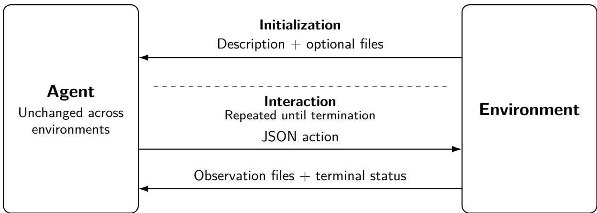
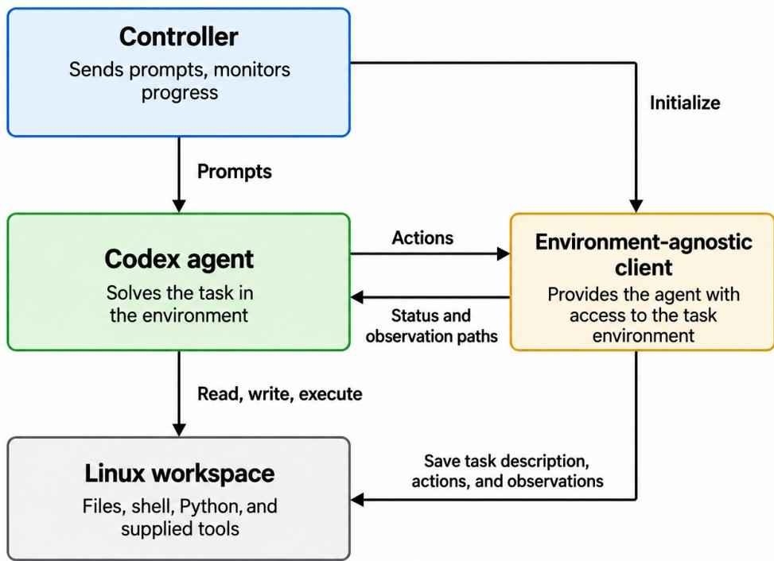
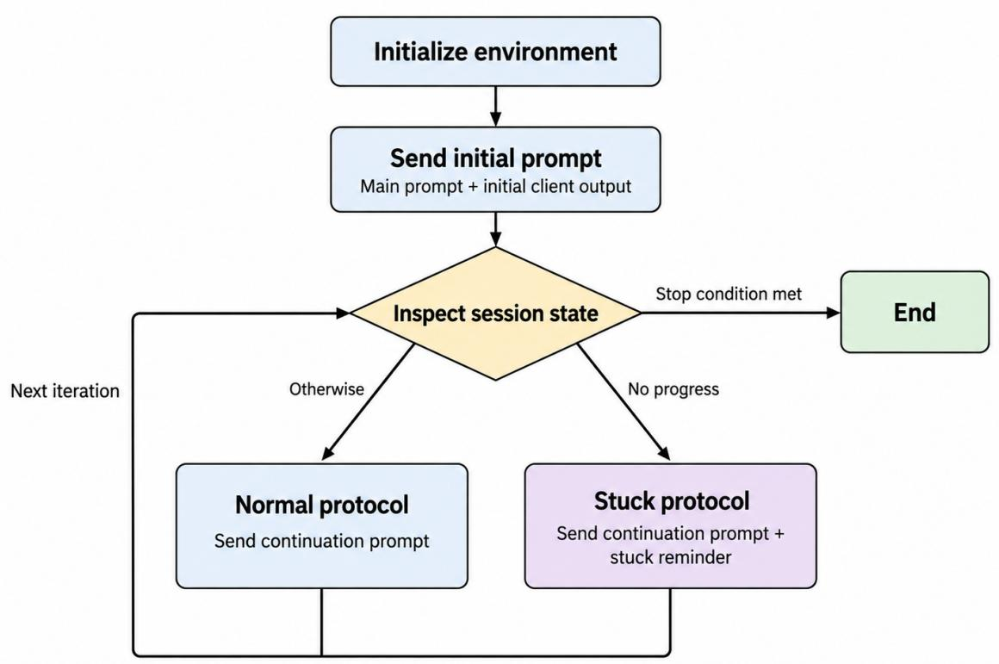
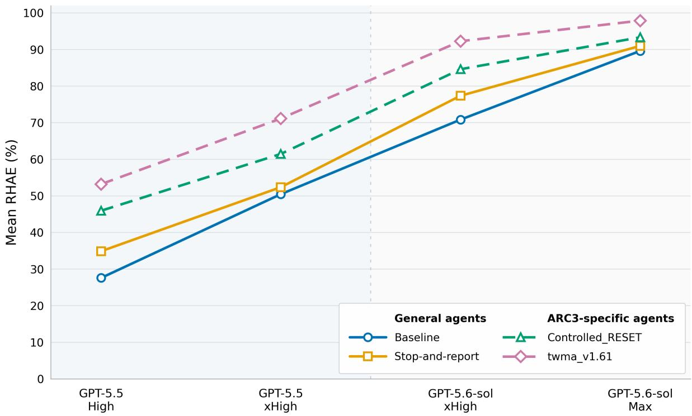
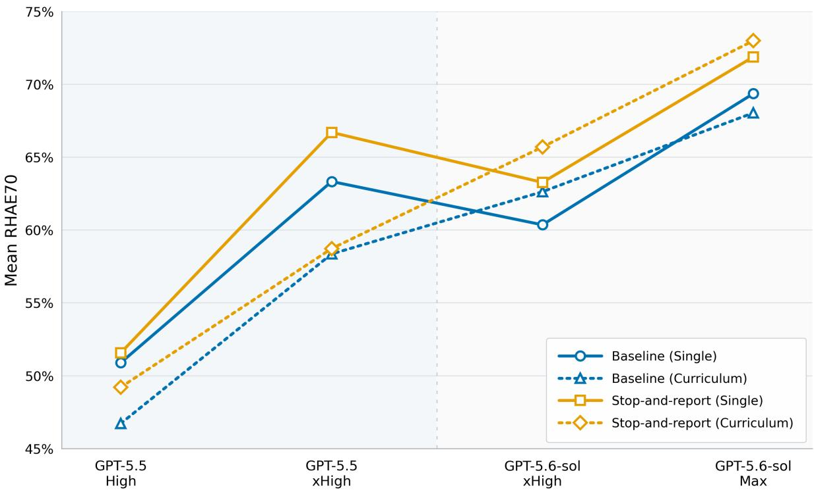

# Improving Environment-Agnostic Coding Agents: The Role of Scafolding

Sergey Rodionov

SingularityNET

## Abstract

Stronger language models may increasingly construct useful procedures for themselves, reducing the advantage of developer-supplied scafolding. We investigate why this advantage persists and whether an environment-agnostic agent can be improved without environmentspecific engineering. We evaluate a Codex-based agent in two nearly identical prompt variants on ARC-AGI-3, AGI Maze, and Terminal-Bench. Each variant is deployed with unchanged code, prompts, and general-purpose tools across environments, receiving environment-specific information as input. Changing only an instruction to encourage reporting dificulties and returning control for automatic continuation improves mean scores on both ARC-AGI-3 and AGI Maze, while Terminal-Bench shows small, mixed changes. Yet the general agent remains below an ARC-AGI-3-specific reference, including with GPT-5.6-sol. The reference prescribes organization and control rather than supplying new game rules or solutions. To investigate this gap, we transfer reset decisions to a scripted controller that follows a convention already given to the agent. This small change recovers part of the specialized agent’s advantage. A complementary AGI Maze experiment shows that additional tutorial experience can reduce performance. Together, these findings highlight the distinction between having information and tools available and using them efectively. Supplied procedures still matter for the models tested here. The performance gains also come with higher token-based cost. The experiments do not separate better use of information and procedures from additional or diferently allocated inference. We provide the EnvTraverse framework and an evaluated baseline agent for testing whether further environment-independent changes improve performance in some environments without degrading it in others.

## 1 Introduction

An LLM-based agent combines a language model with a harness: the prompts, tools, memory mechanisms, and control logic that support its interaction with an environment [1]. For this study, we distinguish three components: the backbone LLM; environment-independent scafolding, such as shell access, a file system, and generic context management; and environment-specific scafolding, such as controllers and observation layouts designed for a particular environment family. These components interact. A capable agent may depend heavily on its harness without requiring that harness to be environment-specific.

Existing research shows that agent performance depends on how models are prompted and connected to tools. CodeAct investigates executable code as an action representation, while SWE-agent examines how agent–computer interface design afects performance [2, 3]. AgentBench and AgentGym provide multi-environment evaluation and learning frameworks, and Exgentic compares general-purpose agent architectures across heterogeneous benchmarks without per-environment task-solving customization [1, 4, 5]. Research on iterative self-refinement and test-time computation further motivates distinguishing the model from the procedures and inference used to apply it [6, 7]. We build on these lines of work by asking which benefits of scafolding can be retained through mechanisms that remain unchanged across environments.

Our earlier ARC-AGI-3 studies motivate this question. The first combined executable world modeling, prompted simplification, and replay verification in a Codex-based agent [8]. The second compared textual and executable-model variants, finding that gains from model capability and reasoning efort often exceeded diferences among those variants [9]. These findings are consistent with the hypothesis that stronger models may increasingly construct useful task-specific procedures themselves, reducing the advantage of developer-supplied scafolding. This possibility is related to Sutton’s emphasis on general methods that exploit increasing computation [10]. However, all variants in our earlier studies retained ARC-AGI-3-specific organization and control, leaving the contribution of that scafolding unclear.

We therefore ask two related questions. First, can an environment-agnostic agent be improved on some environments without material regressions on others? Second, with the underlying model fixed, why can changes in guidance and control improve performance without supplying new task facts or general-purpose tools?

We investigate these questions using one Codex-based agent in two nearly identical prompt variants, each deployed unchanged across ARC-AGI-3, AGI Maze, and Terminal-Bench. A short instruction encouraging the agent to stop and report dificulties improves mean scores on ARC-AGI-3 and AGI Maze, while Terminal-Bench shows small changes with no consistent direction. The focus is on demonstrating and studying a concrete cross-environment improvement, rather than optimizing the agent for the highest possible benchmark scores. ARC-AGI-3-specific control provides further gains, including with GPT-5.6-sol, showing that supplied procedures still matter for the models tested here. A complementary AGI Maze experiment examines whether the agent benefits from tutorial experience. Together, these experiments connect a practical improvement to a broader problem: an agent can have useful information and tools available without reliably using them efectively.

Scope and approach. We use environment-agnostic to describe an unchanged agent implementation, not a guarantee of success in every environment. For a given variant and model–efort configuration, its code, prompts, and initial agent-owned tools remain fixed across environments, with no developer-authored environment-specific control logic. Each environment supplies an environment description and optional files, then accepts JSON actions and returns observation files through a common interaction contract. These environment specifications are held fixed in agent comparisons. The agent may construct specialized tools or strategies during a run; the developer does not supply a diferent scafold for each environment.

Our environment-agnostic Baseline is a simplified version of the ARC-AGI-3-specific textual agent from our earlier study. A small scripted controller and an environment-agnostic client provide access to the task, while Codex performs the reasoning, computation, and action selection. Stop-and-report changes only one instruction, included in both the initial and continuation prompts. It encourages Codex to return control when it encounters dificulty or uncertainty. The controller resumes the same conversation with a reminder of the goal and a suggestion to reread the environment description when needed, but supplies no human feedback or task-specific advice. Both variants have access to the same reminder; the modified instruction changes when Codex is encouraged to return.

We evaluate GPT-5.5 at high and xhigh reasoning efort and GPT-5.6-sol at xhigh and max. The environments span visual rule discovery in ARC-AGI-3, stateful labyrinths in AGI Maze, and practical command-line tasks in Terminal-Bench 2.1 [11–14]. AGI Maze is evaluated both as independent labyrinths and as sequences of seven tutorials followed by a target labyrinth.

Findings and contribution. Stop-and-report increases mean ARC-AGI-3 Relative Human Action Eficiency (RHAE) by 1.37–7.29 percentage points across the four configurations. It also improves mean AGI Maze RHAE70 by 0.37–4.95 points, both with and without tutorials. RHAE70 measures completion and action eficiency against a chosen fraction of the benchmark’s reference action budget; higher is better. Terminal-Bench shows small, mixed changes. The game-score gains come with higher token-based cost. They establish improvements under the tested execution policies, not superior performance at matched inference cost.

To investigate the remaining specialization gap, we use the textual agent from our earlier ARC-AGI-3 study as a reference, updated to twma\_v1.61. Its level-and-attempt organization, reset management, and textual-model instructions prescribe ways of using information already available to the general agent, rather than supplying additional game rules or solutions. We choose it instead of the verification variant to avoid the additional predefined interfaces and programs supplied by that variant. Because twma\_v1.61 still difers in several respects, we also perform a targeted comparison: adding scripted RESET management to Stop-and-report recovers approximately 34–60% of the observed gap. Codex is instructed not to call RESET, and the controller issues it at GAME\_OVER. This tests whether a convention already available in the environment description becomes more useful when implemented explicitly in the controller. Section 6 describes the two ARC-AGI-3-specific agents.

The AGI Maze tutorial experiment provides complementary evidence about the value of prior experience. Tutorials reduce RHAE70 for both GPT-5.5-based variants at both efort settings. With GPT-5.6-sol they help both variants at xhigh, while their efects are smaller and mixed at max.

Together, the prompt comparison, ARC-AGI-3 diagnostics, and tutorial experiment highlight the distinction between having useful information and tools available and using them efectively. The performance gains may reflect more efective information use, more reliable control, or additional or diferently allocated inference. These efects may act together; the experiments do not separate them.

We introduce EnvTraverse, an experimental framework for running and evaluating agents across interactive environments, together with the Baseline agent evaluated in this study. These are intended to support further research on improving environment-agnostic agents through better procedures or additional general capabilities. New agent variants can be compared with Baseline across environments to assess performance gains, possible regressions, and inference cost.

Code and data availability. Source code and documentation are available through the EnvTraverse project page at https://github.com/astroseger/envtraverse. The complete results and run artifacts are available through the same page.

## 2 Related Work

## 2.1 General agents and cross-environment evaluation

General Game Playing studies agents that receive formal descriptions of previously unspecified games and play without algorithms engineered for each game [15]. More recent work evaluates or learns language-model agents across interactive domains: AgentBench provides eight environments, while AgentGym combines a multi-environment framework, interaction trajectories, and methods for agent learning and evolution [4, 5]. Our study examines changes to a Codex-based scafold without additional model training, with each agent variant deployed unchanged across environments.

Exgentic is the closest cross-environment evaluation precedent. Bandel et al. compare five agent architectures and five backbone models across six benchmarks, using protocol wrappers to integrate the original implementations without per-environment task-solving customization [1]. In their closed-source comparison, backbone choice explains more aggregate performance variation than architecture, although architecture remains consequential within a model. The study also includes a controlled tool-shortlisting ablation and behavioral analysis identifying premature termination among its failure patterns. We complement this work by using a small prompt change to demonstrate and study a concrete improvement across environments. The ARC-AGI-3 diagnostics examine the remaining value of supplied procedures when the relevant game information and general-purpose tools are already available. The AGI Maze tutorial comparison tests whether additional relevant experience improves performance.

Standardized interaction is also established infrastructure: Gymnasium exposes an action– observation API, and OpenEnv provides isolated environments with network-accessible interfaces [16, 17]. EnvTraverse uses a common interaction contract to separate agent implementations from environment specifications, which are held fixed when comparing agents.

## 2.2 Coding agents and scafolding

ReAct interleaves reasoning with actions and environmental feedback [18]. CodeAct uses executable Python as an action representation, supporting tool composition and revision in response to execution results [2]. SWE-agent shows that the commands and feedback provided for repository navigation, file editing, and execution can materially afect software-engineering performance [3]. StateM organizes execution through persistent workflow states, runbooks, and checked transitions [19]. These approaches motivate distinguishing access to computational tools from the organization and control of their use.

Programmatic world modeling provides examples of constructing and using task-specific computational aids. WorldCoder builds $\mathrm { P y }$ thon world models from interaction for planning, while GIF-MCTS generates and repairs code world models from descriptions and collected trajectories [20, 21]. In ARC-AGI-3, OPINE-World combines interactive exploration, objectcentric modeling, predictive checks against recorded transitions, and planning [22]. Tycho studies when a coding agent should construct, repair, use, or bypass a programmatic model [23].

Our earlier study compared textual and executable-model scafolds with simplification and verification [9]. In the present study, the environment-agnostic variants leave the choice of tasksolving models and auxiliary tools to Codex. We examine a small change to general guidance across environments and use the ARC-AGI-3 comparisons to study the remaining benefit of supplied organization and control.

## 2.3 Reflection and learning from experience

Self-Refine uses the same language model to generate an output, provide feedback, and revise it without additional training [6]. Reflexion generates verbal reflections from task feedback and retains them in memory for subsequent trials, also without updating model weights [24]. These methods explicitly organize how feedback is produced and reused. Benefits from reconsideration are not automatic: Huang et al. find that self-correction without external feedback can reduce performance on the reasoning tasks and models they examine [25].

Experience can also be retained as executable behavior. Voyager accumulates reusable skills through interaction in Minecraft and retrieves them when solving later tasks [26]. This provides an example of organizing experience into computational tools.

These studies motivate examining how agents revisit information and use prior experience. Our Stop-and-report instruction encourages Codex to return when it encounters dificulty, after which the controller resumes the conversation with a goal reminder, without prescribing a separate critique-and-revision procedure. The AGI Maze comparison separately tests whether preceding tutorial experience benefits the unchanged agent.

## 2.4 Test-time computation

Research on test-time computation examines how model performance depends on the amount and organization of inference. Brown et al. study repeated sampling, showing that generating more candidate solutions increases the fraction of problems for which at least one correct solution is found; benefiting from this increase requires identifying a correct candidate [27]. Snell et al. investigate learned answer revision and verifier-guided search, finding that the relative efectiveness of inference strategies depends on problem dificulty [7].

Computation can also be extended within a single reasoning process. In s1, Muennighof et al. fine-tune a reasoning model and use budget forcing to control generation length, including prolonging a reasoning trace when the model attempts to finish [28]. This provides an example of how an intervention around stopping can change inference expenditure and performance.

These studies motivate considering both how much inference an agent performs and how it is organized. In our study, Stop-and-report changes when Codex returns to an external controller, which resumes the conversation while the environment remains active. Even with the model and reasoning-efort setting fixed, this may change how long the agent continues working and when additional inference is used. We therefore examine inference expenditure as one possible contributor to the observed performance diferences.

## 3 Environment-Agnostic Framework

EnvTraverse connects agents and environments through a common interaction contract. Each environment describes the task and how to interact with it, while the agent determines how to solve the task. The same agent can be connected to diferent environments without modification. New agents and environments can be integrated independently through the framework’s interfaces; agents need not use Codex or an LLM. Figure 1 summarizes the interaction contract.

## 3.1 Interaction contract

Initialization. The environment provides an environment description: text explaining the task, the goal to be achieved, and how the agent can interact with the environment. It may also provide supplementary files, such as documentation, helper programs, or initial observations, which are made available in the agent’s workspace. We treat these files as part of the environment description. The environment determines how much information about its rules and state the description provides.

Actions and observations. At each step, the agent submits an action encoded as JSON. The environment defines the valid action structures and their meaning. In response, it returns an observation consisting of an arbitrary set of named files. The contract does not prescribe their formats: observations may contain text, images, or other data. An action may also reference files in the agent’s designated workspace that are accessible to the server-side infrastructure.

Termination. The environment decides when the interaction session ends and indicates this in its response. Once the session is terminal, no further actions are accepted. Termination does not necessarily indicate success; its meaning and the criteria for accomplishing the task are defined by the environment.

After initialization, interaction follows an agent-initiated request–response pattern: the environment does not send unsolicited observations. This restriction concerns communication, not whether the environment continues to evolve between requests.

The environment description, action semantics, observation formats, and termination rules are part of the environment specification. They are held fixed when comparing agents; changes to them define a new version of the environment specification.

  
Figure 1: Common agent–environment interaction contract. At initialization, the environment supplies a textual description of the task and interaction interface, optionally accompanied by files. The agent then submits JSON actions and receives observation files and terminal status. The agent remains unchanged across environments, while each environment defines its own actions, observations, and termination conditions.

## 3.2 Implementation

The implementation runs the agent and the environment server in separate Docker containers. Actions are JSON objects exchanged over HTTP, and responses carry observation files and terminal status. Initialization delivers the description text and an initial observation; supplementary files are placed in the agent’s workspace before interaction begins.

The server-side infrastructure can access the agent’s designated workspace, while the agent has no reciprocal direct access to the task implementation or task sandbox. Terminal-Bench uses this convention for send\_path: the agent names a source file or directory and a destination, and the environment copies the requested contents (see Appendix A.4).

In the evaluated setup, the agent container accesses the Internet only through an allowlisted proxy that permits connections to the domains needed by the LLM service. This restriction does not apply to the environment. An environment may use the Internet itself or provide Internet access to the agent through its actions. Evaluation-specific access controls are described in Section 7.3. Implementation documentation is available through the EnvTraverse project page.

## 4 Environment-Agnostic Agents

We study one environment-agnostic agent in two prompt variants: Baseline (agent\_v1) and Stop-and-report (agent\_v1\_01\_wstop). They use the same code, controller, and tools; only one short instruction difers. Each variant is deployed unchanged across environments for a given model–efort configuration. The agent simplifies the textual agent described in Section 4, “Architecture and Agent Variants,” of our earlier ARC-AGI-3 study [9]. We retain its Codexbased architecture while removing ARC-AGI-3-specific control and requirements to maintain a world model.

## 4.1 Agent architecture

Figure 2 shows the agent’s four components: a controller, a Codex coding agent, an environmentagnostic client, and a persistent Linux workspace. Codex performs the task-solving work: it reads observations, reasons about the task, writes and executes programs, and selects environment actions. It submits those actions through the provided client, which is part of the agent rather than the environment. The client provides the same interface across environments and contains no environment-specific logic.

  
Figure 2: Architecture shared by the two prompt variants. The scripted controller sends prompts and checks generic session state. Codex performs the task-solving work and uses the provided client to interact with the environment. The client is part of the agent and saves the environment description, actions, and observations. All components remain unchanged across environments.

The main prompt (Appendix B.1.1) asks Codex to read the environment description and accomplish the goal stated there. It explains how to invoke the client with a JSON action and where to find the resulting observations. The client saves the description, submitted actions, and returned files, and prints their locations. Observation records use a generic step-indexed layout rather than an environment-specific organization.

Codex can use files, the shell, Python, and supplied tools in its workspace. The main prompt asks it to use the workspace as it finds most efective and suggests helper indexes, access scripts, or reorganized copies of observations when useful, while prohibiting changes to the original observation records (Appendix B.1.1). It does not require a world model, planner, or verifier; Codex decides which additional files and tools to create. A single Codex invocation can include many model calls, local computations, and environment actions before returning control; it is not a single LLM call or environment step. The workspace and Codex conversation persist across ordinary continuations within a run.

## 4.2 Controller

The controller is a small script that sends prompts and checks basic session state; it contains no task-solving logic. It follows the flow in Figure 3. First, it initializes the environment through the client, then sends the main prompt, the variant-specific continuation instruction, and the initial client output identifying the description and observation files. Appendix B.2.3 gives the exact composition. The instruction distinguishing the variants is therefore present from the first invocation.

When Codex returns, the controller reads the terminal flag and latest environment-step index from saved client state. It does not interpret observations or assess Codex’s reasoning. If the environment is terminal, the controller exits; otherwise, it selects one of two protocols.

  
Figure 3: Scripted controller used by both prompt variants. The initial prompt includes the selected continuation instruction. State is inspected after Codex returns; “No progress” means no new action since the preceding continuation. “End” denotes controller exit after environment termination or a return with no new action following the stuck reminder. The runtime-recovery supervisor is omitted; its handling of controller exits is described in the text.

Normal protocol. The controller resumes the same Codex conversation with a reminder to keep working toward the goal in the environment description (Appendix B.1.2), followed by the variant-specific instruction. The first nonterminal return receives this continuation even if the initial invocation took no action.

Stuck protocol. If a continuation produces no new environment action, the controller adds the no-action reminder (Appendix B.1.3). If Codex again returns without taking an action, the controller exits. If the environment remains nonterminal, this exit triggers recovery, subject to the recovery limit described below. This is a fallback for repeated non-action.

Recovery. In our previous experiments, Codex occasionally exited with a runtime or service error, or appeared to freeze while its process remained alive but stopped producing observable activity [9, Section 4.7, “Runtime recovery”]. Following that work, we use a recovery supervisor to continue execution after such failures.

The supervisor monitors the controller process and its activity log. When the process exits or the log remains inactive beyond the configured threshold, it restarts the controller if saved session state exists and the environment is still active. Recovery preserves the environment, workspace, and recorded observations. It normally resumes the saved Codex conversation, unlike the earlier implementation, which started a new conversation.<sup>1</sup> Implementation details are provided in the source code and documentation available through the EnvTraverse project page.

As a consequence of the same restart rule, the supervisor also restarts the controller after an exit following the stuck reminder. It permits up to ten recovery attempts in total per environment run, after the initial launch. Ordinary Codex returns and normal continuations do not count against this allowance. The repeated opportunities after the stuck protocol are therefore a consequence of the recovery mechanism, whose main purpose is to handle technical Codex failures.

## 4.3 Prompt diference and expected lifecycle

The sole diference between the variants is the text of continuation\_string.txt, included at initialization and in every continuation. For Baseline, this instruction is:

Continue working until you have completed your task.

For Stop-and-report, it is:

Continue working on the task as long as you can proceed confidently. If you encounter a problem, ambiguity, unexpected issue, or anything that makes you unsure how to proceed, stop and report it back to me before taking further action.

The complete source strings are reproduced in Appendices B.2.1 and B.2.2.

Baseline lifecycle. Consider a successful run in which Codex follows the Baseline instruction. The controller sends the initial message, and Codex carries out the task until the environment becomes terminal. Codex then returns and the controller exits. Neither the normal nor the stuck protocol is entered in this successful path: all task-solving work occurs within the initial Codex invocation. If Codex returns before termination despite this instruction, the controller prompts it to continue.

Stop-and-report lifecycle. The initial message instead asks Codex to return when it encounters a dificulty or uncertainty. If this happens before termination, the controller proceeds directly to the normal protocol and tells Codex to continue using the continuation text and the same Stop-and-report instruction. The conversation and workspace are retained. Here, “report it back to me” refers to the automated controller, not a human: the controller does not answer the report or supply a task-specific suggestion. Further returns follow the normal or stuck protocol described above. This variant can also finish the task without returning early.

The intended diference is therefore when the same task-solving process returns control, not a change in its tools or environment-specific capabilities. The instructions request these behaviors rather than enforcing them; their efects on performance and resource use must be evaluated from the runs.

## 5 Implemented Environments

We build environments from three existing benchmarks: ARC-AGI-3, a collection of interactive visual puzzles [11]; AGI Maze, a framework of stateful grid labyrinths [12]; and Terminal-Bench 2.1, a suite of practical command-line tasks [13, 14].<sup>2</sup> Terminal-Bench provides a substantially diferent setting from the two game families: the agent works on files and programs in a task sandbox, and processes can continue executing between actions.

The broad contract in Section 3 allows these diferent tasks to be exposed through the same interface. We distinguish the underlying benchmark from the environment defined for our experiments. An environment includes its environment description, comprising text and optional files; the dynamics that accept JSON actions, reject invalid requests, and return observation files; and its termination conditions. These choices define the environment, rather than merely documenting its implementation. Changing the ARC-AGI-3 description, omitting its PNG observations, or adding a direct exec action to Terminal-Bench would therefore produce a diferent environment specification, even with the same underlying task. Comparisons between agents keep the specification fixed.

The following subsections describe these three elements for each setting. Appendix A reproduces the information supplied to the agent; we refer to those descriptions for the full instructions and action syntax rather than repeat them here.

## 5.1 ARC-AGI-3

One environment contains a single ARC-AGI-3 game, including its successive levels and attempts.

Environment description. The same general description is supplied for every game. It explains the objective, action conventions, observation files, and reset behavior, but provides no game-specific mechanics or solution. It also encourages visual inspection of the observations. Appendix A.1 gives the complete description and identifies the supplied rendering helper.

Dynamics and observations. The agent selects among the available game actions and receives the resulting visual frames and metadata. The full file inventory is given under “Provided Artifacts” in Appendix A.1. The important representational choice is to provide each frame both as exact ASCII color-index data and as a corresponding PNG image, including intermediate frames when present. This lets the agent process the frame numerically or inspect it visually, consistent with the visual nature of the task. The initialization files also include ascii\_to\_png.py, which the agent can use to render reconstructed or transformed frames. Supplying only ASCII, with or without a rendering helper, would be another environment version; we do not compare those representations here.

Termination. The environment ends at WIN or when the current-level action counter exceeds 1,500. The counter includes RESET actions, spans all attempts at the same level, and is cleared when a new level is reached. We use the 1,500-action threshold discussed in Section 5.4, “Interaction rules and stopping conditions,” of our earlier study [9]. That budget is an evaluation choice, not a native ARC-AGI-3 limit, and may restrict games requiring longer exploration. A larger budget could be used in an evaluation aimed at maximizing performance, but would change the environment specification.

## 5.2 AGI Maze: single labyrinth

One environment contains a single labyrinth. AGI Maze already supplies rules, task information, action identifiers, and textual feedback, so only a thin interface layer is needed.

Environment description. The environment description combines AGI Maze’s own rule description with the labyrinth’s public task information, available actions, and public map. All of this information is provided by AGI Maze. Appendix A.2 gives the full template and a rendered example.

For tutorial labyrinths, the public map reveals all internal walls and features, including the positions of keys, treasure, rivers, and pits. We use tutorial labyrinths only in the curriculumlearning experiments with the labyrinth-set environment. For non-tutorial labyrinths, the public map shows only the external boundary and the player’s initial position, visualizing information already provided in the text.

Dynamics and observations. Actions encode the labyrinth-defined choices as JSON objects. After each action, the environment returns state.txt, containing textual feedback and inventory information.

Termination. The environment ends when the labyrinth is solved or the agent uses five times the max\_steps reference budget provided by AGI Maze.

## 5.3 AGI Maze: labyrinth set

One environment contains an ordered sequence of labyrinths. The agent remains in the same run throughout the sequence, allowing it to use experience from earlier labyrinths when solving later ones.

Environment description. The environment description asks the agent to solve all labyrinths eficiently and states that the first few are tutorials with an open map showing the player’s position; later maps are hidden. Appendix A.3.1 reproduces it verbatim.

Dynamics and observations. The agent starts each labyrinth with {"id":"start"}. The response includes labyrinth\_description.md, containing the environment description used in the single-labyrinth setting, and state.txt, containing the same state information as in the single-labyrinth environment with the labyrinth index added. Tutorial labyrinths additionally return the current map and player position as map.txt; non-tutorial labyrinths omit this file. This map is also supplied by AGI Maze.

Each labyrinth receives the same fivefold action budget as in the single-labyrinth setting. Solving it or exhausting that budget produces message.md, reporting the outcome. When another labyrinth remains, the environment then waits for the next start action. This separates feedback about the previous labyrinth from initialization of the next. In particular, the failure message asks the agent to consider what went wrong before continuing. These messages are fixed environment inputs, and Appendix A.3.3 presents their exact text by the situation in which each is sent.

Termination. The set ends only when the final labyrinth is solved or reaches its action limit. Failure on an earlier labyrinth does not terminate the set: the agent proceeds to the next one. A terminal set therefore means that the sequence is complete, not that every labyrinth was solved.

## 5.4 Terminal-Bench 2.1

One environment contains a single Terminal-Bench task. Unlike the turn-based game settings, it can evolve while the agent deliberates. The task specifies a wall-clock time limit for solving.

Environment description. The environment description is generated from the template in Appendix A.4, inserting the public task instruction as {instruction} and the solving budget in seconds as {budget}. The template gives the complete action interface and timing conventions. The environment description also explains that the task sandbox has a separate filesystem from the agent’s workspace and that task files are accessed through environment actions.

Dynamics and observations. The interface exposes six action categories. terminal\_send submits literal text and named keys to an interactive terminal; terminal\_read captures its screen or a bounded portion of its history; and terminal\_new opens another independent shell on the same task filesystem. get\_file retrieves a regular file, while send\_path transfers a file or directory from the agent’s workspace to the task sandbox. Finally, finish submits the current task state and ends solving. Responses contain terminal snapshots, metadata, transfer acknowledgments, or retrieved file contents, depending on the action. Appendix A.4.1 lists the returned files.

Terminal input does not wait for command completion. Processes continue between actions, and an empty or unchanged screen does not imply that a command has finished. A read may include a short fixed wait before capturing output, but it does not wait for a process to terminate. The agent must decide when to inspect output, send further input, interrupt a process, or work elsewhere. Thus, command execution is nonblocking with respect to completion, while observations are still delivered only in response to requests.

We do not expose a dedicated execute-and-wait action. This is an interface choice, not a restriction of Terminal-Bench: its evaluation infrastructure supports direct command execution by custom agents [29]. An exec action with a short waiting limit would also fit our contract, but would define another environment version. Whether it helps is outside this study. Here Terminal-Bench tests the unchanged agent in a setting markedly diferent from the games, rather than serving as an interface-optimization exercise.

Termination. Calling finish or reaching the task’s external timeout ends the solving phase and prevents further actions. In both cases, the verifier is run and its reward determines the task score; successful verification can therefore receive reward 1 after an agent timeout. If the verifier itself times out, the score is zero. Termination and task success remain distinct: calling finish is not itself evidence that the task was solved.

## 6 ARC-AGI-3-Specific Diagnostic Variants

These experiments investigate why an ARC-AGI-3-specific scafold can outperform the general agent when the relevant environment information is already available to both. We first compare against twma\_v1.61, the updated textual agent from our earlier study, whose specialization primarily concerns how information is organized and how the interaction is controlled. Because that comparison involves several diferences, we also evaluate a separate variant, Controlled\_RESET, which adds an ARC-AGI-3-specific reset policy to Stop-and-report. Both diagnostic systems are evaluated only on ARC-AGI-3, at the same model–efort configurations as the environment-agnostic variants.

## 6.1 Specialized reference: twma\_v1.61

twma\_v1.61 retains the textual agent, twma\_v1.6, described in Section 4, “Architecture and Agent Variants,” of our earlier study [9]. Its task-solving prompts and controller logic are unchanged. We update Codex to version 0.154.0 and use the same runtime memory safeguards as the environment-agnostic agents in this study.<sup>3</sup> The reference is rerun in the present campaign rather than represented by historical scores.

Two principal structural adaptations are its organization of observations by level and attempt and its controller-managed RESET policy. The general agent already receives a description of levels, attempts, and the reset convention (Appendix A.1). Its main prompt explicitly permits creating indexes, scripts, and alternative organizations of observations in its workspace (Appendix B.1.1). These adaptations therefore supply organization and control around available information rather than additional facts about the game.

Other diferences concern how Codex is instructed to work. In particular, twma\_v1.61 requires a persistent textual world model and uses a more structured prompt sequence. The general agent can also create and maintain such a description, but is left to decide whether and how to do so. Our motivation is to examine the value of prescribing useful procedures instead of leaving the agent to construct them. The claim that twma\_v1.61 supplies no additional game rules or solutions is a qualitative comparison of the supplied game information, not a claim of identical prompts or control logic.

We choose the textual rather than the verification variant from the earlier study because the latter additionally supplies predefined model interfaces, templates, and verification programs [9]. These are ready-made procedures, not hidden game solutions, but they introduce further diferences in the tools initially supplied to the agent. twma\_v1.61 makes the distinction between available task information and prescribed organization easier to examine. Nevertheless, its diferences from the general agent remain bundled, so this comparison does not identify the contribution of any single component.

## 6.2 Targeted specialization: Controlled\_RESET

To obtain a more controlled comparison, we start from Stop-and-report and add only the ARC-AGI-3-specific reset-management intervention. We call this variant Controlled\_RESET (test\_arc3\_agent\_v1\_02\_wstop\_wreset). Its main prompt adds:

If the game is in the GAME\_OVER state, you should report it, and I will give you another attempt on the same level. You are forbidden to call RESET by yourself.

The prohibition is a prompt instruction; the client’s action interface remains unchanged.

When Codex returns in GAME\_OVER and the evaluation stopping conditions have not been met, the controller issues RESET through the client. It then resumes the same Codex conversation with the normal continuation prompt, a short reset notice, and the resulting client output. The reset observation is therefore available before Codex continues. This branch adds RESET before ordinary continuation; unlike the earlier textual agent’s reset protocol, it adds no separate failure-analysis stage.

The Stop-and-report instruction, tools, and step-indexed observation layout are retained. In particular, the intervention does not introduce twma\_v1.61’s level-and-attempt organization or its textual-model requirement. It tests the efect of transferring reset management from the coding agent to a script, using a convention already stated in the environment description. It is environment-specific because the controller interprets GAME\_OVER and applies ARC-AGI-3 reset semantics.

Restricting reset decisions is not claimed to be optimal. If an agent recognizes that an attempt has become unrecoverable before GAME\_OVER, an early RESET could save actions otherwise spent reaching the failure state. This is a possible benefit of agent-managed resets, not an efect evaluated here; the current description advises avoiding RESET outside GAME\_OVER. The experiment asks whether explicitly implementing the stated convention improves the present agent. Performance and resource-use diferences are reported in Section 8.1.

## 7 Evaluation Setup and Protocol

This section specifies the task collections, scoring rules, execution conditions, and evaluation-block replacement policy.

## 7.1 Evaluation design

We compare Baseline and Stop-and-report using GPT-5.5 at high and xhigh reasoning efort and GPT-5.6-sol at xhigh and max. Controlled\_RESET and twma\_v1.61 are additionally evaluated on ARC-AGI-3 at the same four configurations. Within each benchmark, the environment specification and configured execution conditions are held fixed across the compared agents.

The Stop-and-report modification was developed through ARC-AGI-3 experimentation, while preserving the environment-agnostic implementation. AGI Maze performance was not used to select this instruction; its benefit on AGI Maze was identified in the analysis reported here.

Following our earlier study [9], an evaluation block is one complete task collection evaluated with a specified agent, model, and reasoning efort. Each condition has three retained block repetitions. Individual tasks within a block use separate environment runs, with fresh workspaces and no conversation or task artifacts carried over between them. Persistence within an AGI Maze curriculum set is intentional. Repetition indices identify runs, not matched random seeds across agents.

ARC-AGI-3. A block contains the 25 public games, with one independent playthrough per game.

AGI Maze. A block contains all labyrinths with identifiers 0005 or 0009 in AGI Maze’s CLASSIC and EXTENDED collections [12], giving 106 targets. Each identifier contributes 53 labyrinths. The evaluation budget allowed two such batches with three repetitions each; we chose the two identifiers arbitrarily. In the single-labyrinth setting, each target is evaluated alone. In the curriculum setting, each independent run contains the seven tutorials TUTORIAL/S TAGE-01/0000.json through TUTORIAL/STAGE-07/0000.json, in that order, followed by one target. Only the target contributes to the score and completion count; resource use includes the tutorials. Each block is executed as separate 53-target 0005 and 0009 batches and paired by repetition index for analysis. Individual results for both batches are reported in Appendix C.2.

Terminal-Bench. A block contains all 89 Terminal-Bench 2.1 tasks, with an independent task sandbox for each run. All 24 retained blocks contain the same task collection.

## 7.2 Performance measures and resource use

For each setting, we report the mean block score and cost over the three repetitions. Appendix C provides the individual runs. Contrasts are descriptive diferences between means; their direction alone does not establish statistical significance or non-inferiority.

ARC-AGI-3. The block score is the mean benchmark-reported Relative Human Action Eficiency (RHAE) across all 25 games. RHAE combines level completion with action eficiency relative to the benchmark’s reference action counts [9, 11].

AGI Maze. We use RHAE70, an RHAE-inspired score with a reference action count equal to 70% of AGI Maze’s max\_steps. For target i, let $m _ { i }$ be its benchmark-provided max\_steps value and $a _ { i }$ the number of actions used. Its score is

$$
s _ { i } = \left\{ \begin{array} { l l } { 0 , } & { \mathrm { i f ~ t h e ~ t a r g e t ~ i s ~ n o t ~ s o l v e d , } } \\ { 1 0 0 \operatorname* { m i n } \Biggl \{ 1 , \left( \frac { 0 . 7 m _ { i } } { a _ { i } } \right) ^ { 2 } \Biggr \} , } & { \mathrm { o t h e r w i s e . } } \end{array} \right.\tag{1}
$$

The block score is the mean of the per-target scores over all 106 targets. Higher is better. According to the AGI Maze team, the benchmark-provided max\_steps budgets include some slack. We chose the factor 0.7 based on the team’s internal playthrough results, summarized in Appendix D. This is a pragmatic reference threshold, not a calibrated human baseline. Tables also report x1 solved, the number of targets solved within $m _ { i }$ actions, as descriptive completion information. The individual-run appendix additionally retains the mean step fraction, assigning 5 to unsolved targets.

Terminal-Bench. The block score is the mean task-verifier reward over all 89 tasks, shown as a percentage. Verifier timeouts receive zero reward. Appendices C.4 and C.5 report agent timeouts and cybersecurity-related errors.

Cost tokens. We summarize inference expenditure in millions of normalized cost tokens (M), using the same convention as our earlier study [9]:

$$
C = 1 0 ^ { - 6 } { \left( \frac { N _ { \mathrm { c a c h e d } } } { 6 0 } + \frac { N _ { \mathrm { i n p u t } } - N _ { \mathrm { c a c h e d } } } { 6 } + N _ { \mathrm { o u t p u t } } \right) } ,\tag{2}
$$

where $N _ { \mathrm { i n p u t } }$ includes cached input. The pricing-inspired weights are a conventional proxy for inference expenditure, not calibrated ratios of computational work. They are applied consistently and do not incorporate subscription charges or service-tier billing. Reported costs cover retained evaluation blocks, including tutorials and within-run recovery.

## 7.3 Preventing unintended information access

Coding agents can inspect files and execute programs, making unintended information channels relevant to evaluation. Our first article documents such channels in earlier development harnesses, including access to public game identifiers and apparent use of a second local client [8]. The present setup separates the agent from the environment implementation using Docker containers, restricts external connections to an allowlisted model-service proxy, and disables Codex web search. Codex runs with its own sandbox and approval prompts disabled; separation from the task implementation is provided by the surrounding container. Before an independent run, account-local Codex state is cleared apart from authentication and the minimal configuration specifying search and service-tier settings. Concurrent workers used separate local Codex state directories, including workers authenticated through the same subscription.

The launcher replaces the private task identifier with a random public alias accepted by the environment server. For ARC-AGI-3, this removes the explicit public game name from the initialization interface as a cue for lookup or retrieval of memorized information. The server permits only one initialization of its configured environment.

These measures are engineering controls, not a formal security guarantee. A capable agent may seek other channels or recognize a public task from its observations. Agent-side network restrictions are also distinct from capabilities intentionally exposed by a task sandbox.

## 7.4 Computational environment and runtime

The campaign used two identically configured Linux virtual machines, each with 32 vCPUs reported by the guest as AMD EPYC 9454 and 64 GiB RAM, matching the hardware configuration of our earlier study [9]. Docker was version 29.4.3, and all agents used Codex 0.154.0. The reported experiments ran from 21 September to 10 October 2026 using eight subscription-backed Codex accounts; this interval excludes exploratory experiments not reported here.

ARC-AGI-3 and AGI Maze used the default service tier, with at most 16 concurrent agents per server across the two benchmarks combined. They had no additional hard wall-clock or token cap; the task limits and the limit on recovery attempts still applied. Terminal-Bench used at most four concurrent agents per server, with no other experimental workloads on that server, and service $\mathbf { \varepsilon } _ { \mathbf { t } } \mathbf { i } \mathbf { e } \mathbf { r } \ = \ \mathbf { \ " } \mathbf { f } \mathbf { a } \mathbf { s } \mathbf { t } ^ { \prime }$ . These hardware, concurrency, and service-tier settings were fixed within each benchmark comparison. They standardize the configured conditions, not instantaneous remote-service latency. Because Terminal-Bench is wall-clock limited, we report its service tier explicitly; we did not separately measure its efect on scores.

## 7.5 All-or-nothing policy for irrecoverable failures

Technical interruptions can afect trajectories unevenly. On the same task, an agent that struggles may run longer than one that quickly finds a solution, giving it more opportunity to encounter a service interruption or host failure. Replacing only interrupted task runs could therefore preferentially replace dificult trajectories and bias the reported performance upward. Following our earlier study [9, Section 5.5], we use an all-or-nothing policy at the evaluation-unit level.

If an irrecoverable technical failure prevents an evaluation unit from being completed, the entire unit is discarded and rerun from scratch, including any tasks that had already finished. For ARC-AGI-3 and Terminal-Bench, the unit is a complete evaluation block. For AGI Maze, the policy applies separately to the 53-target 0005 and 0009 execution batches. No task result from a discarded unit is reused in its replacement.

During this campaign, we replaced one accidentally interrupted AGI Maze batch, three Terminal-Bench blocks in which a server-container startup timeout prevented some tasks from starting, and one twma\_v1.61 block afected by a model-service capacity error before the first action of a game. For twma\_v1.61, whose inherited runner does not recover failures before the first action, the capacity error was classified as an operational startup failure.

## 8 Results

We examine the cross-environment efects of the prompt modification, the remaining advantage of ARC-AGI-3-specific scafolding, and the efect of tutorial experience in AGI Maze. Evaluation blocks, scores, and execution policies are defined in Section 7. Tables report means over three retained repetitions, with individual runs in Appendix C.

## 8.1 ARC-AGI-3: general improvements and the specialization gap

Table 1 and Figure 4 compare the two environment-agnostic variants with Controlled\_RESET and the twma\_v1.61 reference defined in Section 6. All results are from the present campaign.

Table 1: ARC-AGI-3. Means over three evaluation blocks of 25 independently played games.
<table><tr><td colspan="2"></td><td colspan="2">Baseline</td><td colspan="2">Stop-and-report Controlled_RESET</td><td colspan="2"></td><td colspan="2">twma_v1.61</td></tr><tr><td>Model</td><td>Effort</td><td>RHAE↑</td><td>Cost</td><td>RHAE↑</td><td>Cost</td><td>RHAE↑</td><td>Cost</td><td>RHAE↑</td><td>Cost</td></tr><tr><td rowspan="2">GPT-5.5</td><td>high</td><td>27.57</td><td>9.36</td><td>34.86</td><td>14.19</td><td>45.92</td><td>42.19</td><td>53.19</td><td>64.09</td></tr><tr><td>xhigh</td><td>50.45</td><td>16.08</td><td>52.36</td><td>20.18</td><td>61.44</td><td>45.52</td><td>71.11</td><td>63.64</td></tr><tr><td rowspan="2">GPT-5.6-sol xhigh</td><td></td><td>70.81</td><td>16.30</td><td>77.33</td><td>16.57</td><td>84.59</td><td>18.36</td><td>92.24</td><td>27.03</td></tr><tr><td>max</td><td>89.59</td><td>15.34</td><td>90.96</td><td>18.01</td><td>93.31</td><td>18.86</td><td>97.86</td><td>26.61</td></tr></table>

RHAE is in percent; cost is in millions of normalized cost tokens (M). Baseline and Stop-and-report are environment-agnostic. Controlled\_RESET adds scripted reset management to Stop-and-report; it and twma\_v1.61 are ARC-AGI-3-specific.

  
Figure 4: Mean ARC-AGI-3 RHAE over three runs. Solid lines show the environment-agnostic variants Baseline and Stop-and-report; dashed lines show Controlled\_RESET and twma\_v1.61. The four horizontal positions are discrete model–efort configurations, not a calibrated capability scale; connecting lines only aid comparison. Individual runs are reported in Appendix C.1.

An environment-independent improvement. Stop-and-report has higher mean RHAE than Baseline in all four model–efort configurations, with gains of approximately 1.4–7.3 percentage points. Thus, changing only the return-of-control instruction improves the mean score with both underlying models, although the size of the gain varies across configurations.

A remaining specialization advantage. Mean scores increase from Baseline to Stop-andreport, Controlled\_RESET, and twma\_v1.61 in every configuration. All four agents attain their highest mean scores with GPT-5.6-sol max, but twma\_v1.61 still exceeds Stop-and-report by approximately seven RHAE points. The advantage of specialized scafolding therefore persists in the strongest evaluated configuration.

Adding scripted reset management recovers roughly one-third to three-fifths of the gap between Stop-and-report and twma\_v1.61, without closing it. The reset convention is already stated in the environment description (Appendix A.1); the intervention supplies control around available information rather than a new game rule. The remaining diferences from twma\_v1.61 are not separately ablated.

Performance and resource use. Within every model–efort configuration, the ordering of mean token-based cost matches the ordering of mean RHAE across the four agents. Stop-andreport costs approximately 2–52% more than Baseline, and both specialized agents cost more still. The performance gains are therefore accompanied by greater expenditure, even when the implementation change is small.

## 8.2 AGI Maze: prompt modification and tutorial transfer

Table 2 and Figure 5 separate two comparisons: Baseline versus Stop-and-report within each setting, and single-labyrinth versus curriculum performance for each agent. RHAE70 is the score; the table also retains x1-solved completion counts and token-based costs.

Table 2: AGI Maze. Means over three evaluation blocks of 106 target labyrinths.
<table><tr><td></td><td></td><td></td><td colspan="3">Baseline</td><td colspan="3">Stop-and-report</td></tr><tr><td>Model</td><td></td><td>Effort Setting</td><td>RHAE70 ↑ x1 solved</td><td></td><td>Cost</td><td></td><td>RHAE70 ↑ x1 solved</td><td>Cost</td></tr><tr><td>GPT-5.5</td><td>high</td><td>Single</td><td>50.89</td><td>54.00</td><td>14.08</td><td>51.57</td><td>50.00</td><td>17.31</td></tr><tr><td></td><td></td><td>Curriculum</td><td>46.72</td><td>48.33</td><td>21.67</td><td>49.21</td><td>49.00</td><td>27.95</td></tr><tr><td>GPT-5.5</td><td>xhigh</td><td>Single</td><td>63.32</td><td>67.33</td><td>18.84</td><td>66.69</td><td>72.67</td><td>22.73</td></tr><tr><td></td><td></td><td>Curriculum</td><td>58.35</td><td>65.00</td><td>29.25</td><td>58.72</td><td>60.33</td><td>36.56</td></tr><tr><td>GPT-5.6-sol xhigh</td><td></td><td>Single</td><td>60.35</td><td>62.67</td><td>8.55</td><td>63.26</td><td>69.00</td><td>9.14</td></tr><tr><td></td><td></td><td>Curriculum</td><td>62.62</td><td>67.67</td><td>21.84</td><td>65.69</td><td>74.67</td><td>30.16</td></tr><tr><td>GPT-5.6-sol max</td><td></td><td>Single</td><td>69.35</td><td>74.67</td><td>8.28</td><td>71.87</td><td>81.00</td><td>10.78</td></tr><tr><td></td><td></td><td>Curriculum</td><td>68.03</td><td>74.67</td><td>27.95</td><td>72.98</td><td>82.33</td><td>38.72</td></tr></table>

RHAE70 is reported as a percentage; x1 solved is a descriptive count of targets completed within their original reference budgets. Costs (M) and counts cover 0005+0009. Curriculum cost includes seven tutorials per target; only the final target is scored.

Improvement beyond ARC-AGI-3. Stop-and-report has higher mean RHAE70 in all eight comparisons, covering both settings at every tested model–efort configuration. The gains range from 0.37 to 4.95 percentage points. The instruction was developed through ARC-AGI-3 experimentation, without using AGI Maze performance to select it (Section 7.1). Its benefit therefore extends beyond the environment that motivated the change. Mean token-based cost also increases in every comparison, by approximately 7–39%.

  
Figure 5: AGI Maze mean RHAE70; higher is better. Solid lines show single-labyrinth results, and dotted lines show the tutorial-set curriculum. Blue circles and triangles denote Baseline; orange squares and diamonds denote Stop-and-report. Each point averages three complete 106-target evaluation blocks. Model–efort configurations are discrete. Individual execution batches are given in Appendix C.2.

Tutorial experience is not uniformly beneficial. Preceding tutorials reduce mean RHAE70 for both GPT-5.5-based agents at both efort settings. With GPT-5.6-sol xhigh, tutorials improve both agents. At max, the efects are smaller and mixed: tutorials lower Baseline’s score but raise Stop-and-report’s. The same curriculum can therefore help or hurt depending on the model–efort configuration.

The curriculum also increases total token-based cost in every configuration. Additional interaction and expenditure thus do not consistently translate into better target performance. At xhigh efort, changing from GPT-5.5 to GPT-5.6-sol lowers single-labyrinth RHAE70 for both agents but raises curriculum RHAE70, further illustrating that the efect of a model change depends on the experience setting.

## 8.3 Terminal-Bench: performance beyond game environments

The same two agents also complete practical terminal tasks without a Terminal-Bench-specific agent implementation. Table 3 reports mean verifier reward; the GPT-5.6-sol configurations obtain approximately 84–87%, establishing task completion beyond the game settings.

Table 3: Terminal-Bench 2.1. Means over three complete 89-task evaluation blocks.
<table><tr><td></td><td colspan="3"></td><td colspan="2">Stop-and-report</td></tr><tr><td>Model</td><td>Effort</td><td>Reward ↑</td><td>Cost</td><td>Reward ↑</td><td>Cost</td></tr><tr><td>GPT-5.5</td><td>high</td><td>79.40</td><td>5.80</td><td>80.90</td><td>5.94</td></tr><tr><td></td><td>xhigh</td><td>82.77</td><td>7.43</td><td>82.40</td><td>6.89</td></tr><tr><td>GPT-5.6-sol</td><td> xhigh</td><td>84.27</td><td>5.56</td><td>86.52</td><td>5.62</td></tr><tr><td></td><td>max</td><td>86.89</td><td>6.37</td><td>85.39</td><td>6.59</td></tr></table>

Reward is in percent; cost is in M.

Unlike the two game-score comparisons, Stop-and-report produces small changes of mixed direction. Diferences from Baseline range from −1.50 to +2.25 percentage points across the four configurations. Mean token-based cost is lower for Stop-and-report only with GPT-5.5 xhigh and slightly higher in the other configurations. Agent timeouts and cybersecurity-related interruptions are documented in Appendices C.4 and C.5.

Scope of the comparisons. The results concern the tested model–efort configurations and three environment families. They compare performance under the reported execution policies, not at matched inference cost. The small, mixed diferences in mean Terminal-Bench scores do not establish that Stop-and-report is at least as efective as Baseline.

## 9 Discussion

The first research question concerns improving an environment-agnostic agent across environments. Stop-and-report improves mean ARC-AGI-3 RHAE and AGI Maze RHAE70, with small, mixed changes on Terminal-Bench. These results show that a small change can improve a general agent beyond the environment that motivated it and illustrate how to test its efects elsewhere. The second question concerns why agents using the same underlying LLM, with access to the same task information and general-purpose tools, can nevertheless perform diferently.

One hypothesis is that a suficiently capable LLM could construct useful procedures for itself, leaving little advantage to developer-supplied task-specific scafolding. This expectation is related to Sutton’s The Bitter Lesson, which emphasizes the long-term value of general methods that exploit increasing computation [10]. Exgentic finds that backbone choice explains more aggregate performance variation than architecture in its closed-source comparison, although architecture remains consequential within a model [1]. Our previous ARC-AGI-3 study likewise found that gains from model capability and reasoning efort often exceeded diferences between the tested agent variants [9]. These observations motivate the hypothesis; they do not establish that scafolding will become irrelevant.

The present results show that supplied procedures still matter with GPT-5.6-sol. Even at max reasoning efort, Stop-and-report, Controlled\_RESET, and twma\_v1.61 achieve diferent mean ARC-AGI-3 scores. The specialization advantage therefore remains in the evaluated setting. We consider two possible, complementary explanations: how efectively the agent uses available information and procedures, and how much inference it performs and where it allocates that inference.

## 9.1 Using available information and procedures

One possible explanation is that scafolding helps the agent reconsider relevant information or follow a useful procedure more reliably. When Stop-and-report returns, the controller reminds Codex of the goal and suggests rereading the environment description (Appendix B.1.2). This may help it reconsider an unsuccessful approach or revisit neglected information. The same reminder is available to Baseline; the modification encourages Codex to return when it encounters dificulty. It creates an opportunity for reconsideration rather than enforcing a reflection procedure.

twma\_v1.61 illustrates the distinction between available information and prescribed organization. The general agent receives information about levels and attempts and is explicitly permitted to reorganize observations or create workspace files (Appendices A.1 and B.1.1). It could therefore build level-and-attempt indexes or maintain a textual account of the game. twma\_v1.61 supplies the organization and requires that account. Its advantage need not come from additional game facts; it may come from prescribing useful procedures instead of leaving the agent to devise them. The comparison does not isolate which procedure contributes most.

Controlled\_RESET provides a more focused example. The environment description already tells the agent to reset after GAME\_OVER and avoid unnecessary resets otherwise. Nevertheless, asking Codex to leave this decision to a scripted controller improves mean performance. The intervention adds no new game rule; it changes how an available rule is implemented. This does not mean that the scripted policy is optimal: as discussed in Section 6.2, a capable agent could sometimes save actions by resetting an unrecoverable attempt before GAME\_OVER.

The curriculum experiment provides a complementary example: additional relevant experience is not automatically beneficial. The tutorials give the agent practice applying the maze mechanics, yet they reduce target performance for both GPT-5.5-based variants at both efort settings. With GPT-5.6-sol, they help both variants at xhigh and have smaller, mixed efects at max. The benefit of additional experience therefore depends on the evaluated configuration, rather than following from its availability alone.

## 9.2 The amount and allocation of inference

A second explanation is that the scafold changes how much inference the agent performs and when it performs it. Asking Codex to report a dificulty may prompt additional reasoning while it formulates the report. The subsequent continuation lets it return to the task. Together, these steps may increase inference at points where the agent is uncertain, even with the model and reasoning-efort setting unchanged.

Stop-and-report uses more normalized cost tokens than Baseline in every ARC-AGI-3 and AGI Maze comparison. Within each ARC-AGI-3 configuration, the ordering from Baseline through Stop-and-report and Controlled\_RESET to twma\_v1.61 is the same for mean score and mean cost. This pattern makes additional inference a plausible contributor to the gains, but does not establish that greater expenditure causes the improvement.

Cost tokens include weighted input and output, not only useful reasoning. Better performance can also enable more expenditure: an agent reaching additional ARC-AGI-3 levels can continue working where another run has stopped. Performance and resource use should therefore be considered together when interpreting the efect of scafolding [30]. Better use of information can itself involve additional inference, for example when the agent rereads a description or reasons about how to reorganize its observations.

## 9.3 Implications and future directions

It remains unclear whether further gains should be sought primarily through better use of available information and tools, through additional inference (for example, in a multi-agent system), or through a combination of the two. Further analysis is needed to determine their relative contributions and whether they can be meaningfully separated.

One direction is to improve the environment-agnostic agent through more explicit procedures, including adaptations of the verification and simplification ideas explored in our earlier work [9]. The objective is to obtain further gains on some environments without material regressions on others, while retaining one unchanged agent implementation.

A complementary direction is to expand the general capabilities initially available to the agent. Examples include reusable task-general skills, support for symbolic reasoning through a system such as MeTTa [31], or theorem-proving tools. These additions would supply tools or procedural knowledge, rather than only change the guidance for using existing tools, but could still be provided uniformly across environments.

## 10 Conclusions

We evaluated one Codex-based agent in two nearly identical prompt variants, each deployed unchanged across ARC-AGI-3, AGI Maze, and Terminal-Bench. Stop-and-report improves mean ARC-AGI-3 RHAE and AGI Maze RHAE70 across the tested configurations, while Terminal-Bench shows small, mixed changes. The comparison demonstrates that a small, environment-independent modification can improve performance beyond the environment that motivated it, although the performance gains come with higher token-based cost.

Stronger models may eventually construct useful procedures for themselves and reduce the advantage of developer-supplied scafolding. Our results show that this advantage remains with GPT-5.6-sol. The twma\_v1.61 reference prescribes organization and procedures that the general agent has the information and tools to construct, and Controlled\_RESET recovers part of its advantage by implementing a convention already stated in the environment description. The tutorial experiment adds a complementary observation: access to additional relevant experience does not uniformly improve performance.

The unresolved question is whether scafolding helps mainly through more efective use of information and tools, additional inference, or both. The present experiments do not separate these efects, which may reinforce one another. EnvTraverse allows new agent variants to be evaluated across environments and compared with Baseline. This supports further research on improving environment-agnostic agents through better procedures or additional general capabilities, while assessing performance gains, possible regressions, and changes in inference cost.

## Acknowledgements

The author thanks Alexey Potapov and Vita Potapova for their assistance with AGI Maze, for clarifying the reference action budgets, and for sharing the internal playthrough results that informed the RHAE70 reference factor.

## References

[1] Elron Bandel, Asaf Yehudai, Lilach Eden, Yehoshua Sagron, Yotam Perlitz, Elad Venezian, Natalia Razinkov, Natan Ergas, Shlomit Shachor Ifergan, Segev Shlomov, Michal Jacovi, Leshem Choshen, Liat Ein-Dor, Yoav Katz, and Michal Shmueli-Scheuer. General agent evaluation. arXiv:2602.22953v2, 2026. URL https://arxiv.org/abs/2602.22953v2. Version 2, revised 11 May 2026.

[2] Xingyao Wang, Yangyi Chen, Lifan Yuan, Yizhe Zhang, Yunzhu Li, Hao Peng, and Heng Ji. Executable code actions elicit better LLM agents. arXiv:2402.01030, 2024. URL https://arxiv.org/abs/2402.01030. Published at ICML 2024.

[3] John Yang, Carlos E. Jimenez, Alexander Wettig, Kilian Lieret, Shunyu Yao, Karthik Narasimhan, and Ofir Press. SWE-agent: Agent-computer interfaces enable automated software engineering. arXiv:2405.15793, 2024. URL https://arxiv.org/abs/2405.15793.

[4] Xiao Liu, Hao Yu, Hanchen Zhang, Yifan Xu, Xuanyu Lei, Hanyu Lai, Yu Gu, Hangliang Ding, Kaiwen Men, Kejuan Yang, Shudan Zhang, Xiang Deng, Aohan Zeng, Zhengxiao Du, Chenhui Zhang, Sheng Shen, Tianjun Zhang, Yu Su, Huan Sun, Minlie Huang, Yuxiao Dong, and Jie Tang. AgentBench: Evaluating LLMs as agents. arXiv:2308.03688, 2024. URL https://arxiv.org/abs/2308.03688. Published at ICLR 2024.

[5] Zhiheng Xi, Yiwen Ding, Wenxiang Chen, Boyang Hong, Honglin Guo, Junzhe Wang, Dingwen Yang, Chenyang Liao, Xin Guo, Wei He, Songyang Gao, Lu Chen, Rui Zheng, Yicheng Zou, Tao Gui, Qi Zhang, Xipeng Qiu, Xuanjing Huang, Zuxuan Wu, and Yu-Gang Jiang. AgentGym: Evolving large language model-based agents across diverse environments. arXiv:2406.04151, 2024. URL https://arxiv.org/abs/2406.04151.

[6] Aman Madaan, Niket Tandon, Prakhar Gupta, Skyler Hallinan, Luyu Gao, Sarah Wiegrefe, Uri Alon, Nouha Dziri, Shrimai Prabhumoye, Yiming Yang, Shashank Gupta, Bodhisattwa Prasad Majumder, Katherine Hermann, Sean Welleck, Amir Yazdanbakhsh, and Peter Clark. Self-Refine: Iterative refinement with self-feedback. arXiv:2303.17651, 2023. URL https://arxiv.org/abs/2303.17651.

[7] Charlie Snell, Jaehoon Lee, Kelvin Xu, and Aviral Kumar. Scaling LLM test-time compute optimally can be more efective than scaling model parameters. arXiv:2408.03314, 2024. URL https://arxiv.org/abs/2408.03314.

[8] Sergey Rodionov. Executable world models for ARC-AGI-3 in the era of coding agents. In Matthew Iklé, Arthur Franz, Andrew Kemendo, and Haley Lowy, editors, Artificial General Intelligence. AGI 2026, volume 16855 of Lecture Notes in Computer Science, pages 198–210, Cham, 2026. Springer Nature Switzerland. doi: 10.1007/978-3-032-33195-3\_15.

[9] Sergey Rodionov. Do coding agents need executable world models, simplification, and verification to solve ARC-AGI-3? arXiv:2607.15439, 2026. URL https://arxiv.org/abs/ 2607.15439.

[10] Richard S. Sutton. The bitter lesson, March 2019. URL http://www.incompleteideas. net/IncIdeas/BitterLesson.html. Essay, March 13, 2019.

[11] ARC Prize Foundation. ARC-AGI-3: A new challenge for frontier agentic intelligence. arXiv:2603.24621, 2026. URL https://arxiv.org/abs/2603.24621.

[12] Alexey Potapov. AGI Maze as a benchmark framework for world-modeling agents. arXiv:2607.00627, 2026. URL https://arxiv.org/abs/2607.00627.

[13] Mike A. Merrill, Alexander G. Shaw, Nicholas Carlini, Boxuan Li, Harsh Raj, Ivan Bercovich, Lin Shi, Jeong Yeon Shin, Thomas Walshe, E. Kelly Buchanan, Junhong Shen, Guanghao Ye, Haowei Lin, Jason Poulos, Maoyu Wang, Marianna Nezhurina, Jenia Jitsev, Di Lu, Orfeas Menis Mastromichalakis, Zhiwei Xu, Zizhao Chen, Yue Liu, Robert Zhang, Leon Liangyu Chen, Anurag Kashyap, Jan-Lucas Uslu, Jefrey Li, Jianbo Wu, Minghao Yan, Song Bian, Vedang Sharma, Ke Sun, Steven Dillmann, Akshay Anand, Andrew Lanpouthakoun, Bardia Koopah, Changran Hu, Etash Guha, Gabriel H. S. Dreiman, Jiacheng Zhu, Karl Krauth, Li Zhong, Niklas Muennighof, Robert Amanfu, Shangyin Tan, Shreyas Pimpalgaonkar, Tushar Aggarwal, Xiangning Lin, Xin Lan, Xuandong Zhao, Yiqing Liang, Yuanli Wang, Zilong Wang, Changzhi Zhou, David Heineman, Hange Liu, Harsh Trivedi, John Yang, Junhong Lin, Manish Shetty, Michael Yang, Nabil Omi, Negin Raoof, Shanda Li, Terry Yue Zhuo, Wuwei Lin, Yiwei Dai, Yuxin Wang, Wenhao Chai, Shang Zhou, Dariush Wahdany, Ziyu She, Jiaming Hu, Zhikang Dong, Yuxuan Zhu, Sasha Cui, Ahson Saiyed, Arinbjörn Kolbeinsson, Jesse Hu, Christopher Michael Rytting, Ryan Marten, Yixin Wang, Alex Dimakis, Andy Konwinski, and Ludwig Schmidt. Terminal-Bench: Benchmarking agents on hard, realistic tasks in command line interfaces. arXiv:2601.11868, 2026. URL https://arxiv.org/abs/2601.11868.

[14] Terminal-Bench Team. Terminal-Bench 2.1, May 2026. URL https://www.tbench.ai/ne ws/terminal-bench-2-1. Version-specific release announcement; accessed 2026-09-26.

[15] Michael Genesereth, Nathaniel Love, and Barney Pell. General game playing: Overview of the AAAI competition. AI Magazine, 26(2):62–72, 2005. doi: 10.1609/aimag.v26i2.1813.

[16] Farama Foundation. Env: Gymnasium documentation, 2026. URL https://gymnasium. farama.org/api/env/. Software or documentation; accessed 2026-09-26.

[17] OpenEnv Contributors. OpenEnv: Agentic execution environments, 2026. URL https: //github.com/huggingface/OpenEnv. Software or documentation; accessed 2026-09-26.

[18] Shunyu Yao, Jefrey Zhao, Dian Yu, Nan Du, Izhak Shafran, Karthik Narasimhan, and Yuan Cao. ReAct: Synergizing reasoning and acting in language models. arXiv:2210.03629, 2023. URL https://arxiv.org/abs/2210.03629. Published at ICLR 2023.

[19] Ziheng Qin, Yaxin Lu, Zhangyang Atlas Wang, and Kai Wang. StateM: Reaching 95.3% raw accuracy, or a \$15 frontier run, on Terminal-Bench 2.1 via harness scaling. arXiv:2608.15089, 2026. URL https://arxiv.org/abs/2608.15089.

[20] Hao Tang, Darren Key, and Kevin Ellis. WorldCoder, a model-based LLM agent: Building world models by writing code and interacting with the environment. arXiv:2402.12275, 2024. URL https://arxiv.org/abs/2402.12275.

[21] Nicola Dainese, Matteo Merler, Minttu Alakuijala, and Pekka Marttinen. Generating code world models with large language models guided by Monte Carlo tree search. arXiv:2405.15383, 2024. URL https://arxiv.org/abs/2405.15383.

[22] David Courtis, Wenhao Li, and Scott Sanner. OPINE-World: Programmatic world modeling with ontology-error-prioritized interactive exploration for ARC-AGI-3. arXiv:2607.01531v3, 2026. URL https://arxiv.org/abs/2607.01531v3. Version 3, revised 26 September 2026.

[23] Jens Lehmann, Andrei Aioanei, and Sahar Vahdati. Tycho: Active abstraction with programmatic world models for ARC-AGI-3. arXiv:2607.28287, 2026. URL https://arxi v.org/abs/2607.28287.

[24] Noah Shinn, Federico Cassano, Edward Berman, Ashwin Gopinath, Karthik Narasimhan, and Shunyu Yao. Reflexion: Language agents with verbal reinforcement learning. arXiv:2303.11366, 2023. URL https://arxiv.org/abs/2303.11366.

[25] Jie Huang, Xinyun Chen, Swaroop Mishra, Huaixiu Steven Zheng, Adams Wei Yu, Xinying Song, and Denny Zhou. Large language models cannot self-correct reasoning yet. arXiv:2310.01798v2, 2023. URL https://arxiv.org/abs/2310.01798v2. Version 2, revised 14 March 2024.

[26] Guanzhi Wang, Yuqi Xie, Yunfan Jiang, Ajay Mandlekar, Chaowei Xiao, Yuke Zhu, Linxi Fan, and Anima Anandkumar. Voyager: An open-ended embodied agent with large language models. arXiv:2305.16291, 2023. URL https://arxiv.org/abs/2305.16291.

[27] Bradley Brown, Jordan Juravsky, Ryan Ehrlich, Ronald Clark, Quoc V. Le, Christopher Ré, and Azalia Mirhoseini. Large language monkeys: Scaling inference compute with repeated sampling. arXiv:2407.21787v3, 2024. URL https://arxiv.org/abs/2407.21787v3. Version 3, revised 30 December 2024.

[28] Niklas Muennighof, Zitong Yang, Weijia Shi, Xiang Lisa Li, Li Fei-Fei, Hannaneh Hajishirzi, Luke Zettlemoyer, Percy Liang, Emmanuel Candès, and Tatsunori Hashimoto. s1: Simple test-time scaling. arXiv:2501.19393v3, 2025. URL https://arxiv.org/abs/2501.19393v3. Version 3, revised 1 March 2025.

[29] Harbor Contributors. Custom agents: Harbor documentation, 2026. URL https://docs.h arborframework.com/agents/custom-agents. Oficial documentation for custom agent integration and direct environment command execution; accessed 2026-10-06.

[30] Sayash Kapoor, Benedikt Stroebl, Zachary S. Siegel, Nitya Nadgir, and Arvind Narayanan. AI agents that matter. arXiv:2407.01502, 2024. URL https://arxiv.org/abs/2407.015 02.

[31] OpenCog Hyperon Contributors. MeTTa programming language implementation, 2026. URL https://github.com/trueagi-io/hyperon-experimental. Software and documentation; accessed 2026-10-13.

## A Environment-Provided Information

This appendix reproduces the environment descriptions, templates, and messages from the source code used in the experiments. The source code is available through the EnvTraverse project page. Quoted text is reproduced verbatim, with line wrapping adjusted for typesetting. Template fields and returned observation files are explained where needed.

## A.1 ARC-AGI-3 description

This description is supplied at initialization for every ARC-AGI-3 game. Its “Provided Artifacts” section specifies the observation files, and its “Provided Helper Programs” section describes ascii\_to\_png.py, supplied in the initial workspace.

```jsonl
# Environment Description
## 1. General Description Of The Environment
You are playing a dynamic visual puzzle game. Your objective is to reach `WIN`, avoid
`GAME_OVER`, and use as few actions as possible.
The game consists of levels. Levels usually form a curriculum: later levels often extend
earlier mechanics rather than replacing them. If you reach `GAME_OVER`, use `RESET` to begin
another attempt at the current level. `RESET` counts toward the action budget and does not
reset the current level's action count, so avoid using it unless the state is `GAME_OVER`.
The game is deterministic: every attempt starts from exactly the same state, so the same
action sequence produces exactly the same results. You cannot return to already solved
levels.
The game is shown as a `64 x 64` visual frame made from color indices `0..15`.
A single action may produce multiple frames. When this happens, the last frame is the final
settled state, but the intermediate frames are important evidence. Multiple frames usually
mean something meaningful happened, such as animation, collision, damage, item use, state
transition, level completion, or failure. Explore such animations with your own eyes.
This is a visual puzzle. ASCII frames are exact data, but PNG frames show the game more like
a human would see it. Inspect PNG files with your own eyes.
## 2. Actions
Actions are JSON objects.
Simple actions:
```json
{"id":"ACTION1"}
{"id":"ACTION2"}
{"id":"ACTION3"}
{"id":"ACTION4"}
{"id":"ACTION5"}
{"id":"ACTION7"}
{"id":"RESET"}
Coordinate action:
```json
{"id":"ACTION6","data":{"x":12,"y":34}}
```

General action conventions:   
- \`RESET\`: start or restart play.   
- \`ACTION1\`: usually direction-like, commonly up.   
- \`ACTION2\`: usually direction-like, commonly down.   
- \`ACTION3\`: usually direction-like, commonly left.   
- \`ACTION4\`: usually direction-like, commonly right.   
- \`ACTION5\`: game-specific interaction, such as use, select, rotate, attach, detach, confirm,   
or execute.   
- \`ACTION6\`: coordinate-based interaction; provide \`x\` and \`y\`, with origin at the top-left.   
- \`ACTION7\`: usually undo.   
These are only conventions. Infer the real effect of each action from observations. The valid   
actions can change during play; check \`available\_actions\` in metadata before choosing.   
## 3. Provided Artifacts   
Each observation step may provide:   
- \`metadata.txt\`: JSON metadata with current state, level progress, available actions, and   
the action that produced the observation.   
- \`final.txt\`: the final settled visual frame as a \`64 x 64\` ASCII grid of hexadecimal color   
indices.   
- \`final.png\`: PNG rendering of \`final.txt\`.   
- \`intermediate\_XX.txt\`: optional intermediate visual frame from an animation or transition.   
- \`intermediate\_XX.png\`: PNG rendering of the corresponding \`intermediate\_XX.txt\`.   
ASCII files represent the exact visual frame data. PNG files are generated from the   
corresponding ASCII frames and are provided so you can see the game as humans are meant to   
see it.   
## 4. Provided Helper Programs   
Use \`ascii\_to\_png.py\` to convert any ASCII frame dump into a PNG image:   
The same file also provides reusable functions for scripts and notebooks:   
- \`parse\_ascii\_grid(path)\`: read an ASCII frame dump into a NumPy array.   
- \`frame\_to\_rgb\_array(frame, scale=8)\`: convert a NumPy frame array to an RGB NumPy array.   
- \`convert\_ascii\_to\_png(input\_path, output\_path, scale)\`: convert an ASCII frame file   
directly to PNG.   
Use these helpers for simulated, reconstructed, or extracted ASCII frames when you need to   
inspect them visually. PNG inspection is especially useful for understanding object identity,   
animations, small visual differences, and mismatches between prediction and reality.

## A.2 AGI Maze single-labyrinth description

Template. The environment description is generated from the following template, shown with simple placeholder names. All information substituted into these fields is supplied by AGI Maze, including the public map.

You are playing a grid labyrinth game. Your goal is to win the game by collecting the   
treasure and exiting.   
Rules/description:   
{rules}   
Task info:   
info: rivers={rivers} pits={pit\_cycles}x{pits\_per\_cycle}

board size: n={rows} rows, m={cols} cols   
start position (row,col): ({start\_row},{start\_col})   
Map (public):   
{public\_map}   
Actions are JSON objects. Available actions: {actions}   
Coordinate convention: positions are given as (row, col), where row increases downward and   
col increases to the right.   
You will receive the result of each move as text.   
Choose one action each step. Avoid wasting moves.

Rendered example. The following is a complete environment description for one non-tutorial labyrinth.

You are playing a grid labyrinth game. Your goal is to win the game by collecting the   
treasure and exiting.   
Rules/description:   
You find yourself in a maze made of grid cells. On each step you can only move up, down,   
left, or right. Your goal is to leave the maze with the treasure in as few steps as possible.   
The maze is surrounded by an unbreakable border wall—the monolith. There is exactly one   
opening in the monolith: the exit, but its location is unknown. Inside the maze there are   
also internal walls. You cannot walk through walls or the monolith (though some game   
extensions may introduce items or mechanisms that can destroy, reveal, or move walls). If you   
attempt to move into a wall or the monolith, you stay in place, but the step counter still   
increases.   
The maze may contain items. There is always a treasure chest and a key for it: without the   
key, you cannot take the treasure. Without the treasure, you cannot exit the maze. Larger   
mazes often also include an exit key (whether it exists is stated in the maze description).   
If an exit key exists, you cannot leave without it either. Keys are picked up and used   
automatically—no extra action is required.   
Some mazes include rivers and pits. A river occupies several cells and flows from a source to   
a mouth. When you step onto a river cell, the current carries you two cells downstream (or   
one cell if you stepped onto the last cell before the mouth). If you step onto a pit cell,   
you appear at the next pit in its cycle (from the last pit you go back to the first). A maze   
may contain multiple rivers and multiple pit cycles—this is stated in the maze description.   
There are also game extensions. In extended mazes you may encounter new items (for example, a   
boat, grenades, or a flashlight) or new cell types. Sometimes items grant new actions (for   
example, to blast or to shine the flashlight). In some cases, you have to figure out how new   
items, actions, and cell types work by experimentation.   
Task info:   
info: rivers=0 pits=2x2   
board size: n=4 rows, m=7 cols   
start position (row,col): (2,5)   
Map (public):   
+ . + . + . + . + . + . + . +   
+ . + . + . + . + . + . + . +   
+ . + . + . + . + . + . + . +   
. S   
+ . + . + . + . + . + . + . +

+ . + . + . + . + . + . + . +   
Actions are JSON objects. Available actions: {"id": "up"}, {"id": "down"}, {"id": "left"},   
{"id": "right"}   
Coordinate convention: positions are given as (row, col), where row increases downward and   
col increases to the right.   
You will receive the result of each move as text.   
Choose one action each step. Avoid wasting moves.

## A.3 AGI Maze set description and transition messages

## A.3.1 Environment description

The environment description is:

You are playing a series of labyrinths. Your task is to solve all labyrinths using the   
minimal number of moves.   
You will be given a description of each labyrinth. Please read each description carefully.   
For the first few labyrinths, you will be given an open map with your position shown on it.   
These are tutorial labyrinths designed to help you understand the mechanics.   
For the remaining labyrinths, the map will be hidden. You will only be given your initial   
position in the labyrinth description.

The initial observation is message.md containing:

Please start the first labyrinth by sending the {"id":"start"} action.   
Available actions: {"id":"start"}

The environment waits for {"id":"start"}; it does not begin the first labyrinth automatically.

## A.3.2 When a labyrinth starts

A valid start action returns labyrinth\_description.md, containing the environment description used for that labyrinth in the single-labyrinth setting. It also returns state.txt, containing the same state information as in the single-labyrinth environment, with the labyrinth index added. Tutorial labyrinths additionally provide AGI Maze’s current public map and player position in map.txt. Subsequent actions update the state and, for tutorials, the map; non-tutorial labyrinths omit map.txt.

## A.3.3 Between labyrinths

After a labyrinth is solved and another remains. The response replaces the ordinary observation files with message.md containing:

You have solved the labyrinth. Please start the next labyrinth by sending the {"id":"start"}   
action.   
Available actions: {"id":"start"}

After the action limit is reached and another labyrinth remains. When the current labyrinth is not solved within its budget, message.md instead contains:

```jsonl
You did not solve the labyrinth before reaching the maximum allowed number of actions. You
have used five times as many actions as an average human typically needs to solve it.
Consider what went wrong and what mistakes you made. Please start the next labyrinth by
sending the {"id":"start"} action.
Available actions: {"id":"start"}
```

In both cases the environment remains nonterminal and waits for another start action.

## A.3.4 At the end of the set

After the final labyrinth is solved. The terminal response contains message.md with:

You have solved the final labyrinth. The labyrinth set is complete.

After the final labyrinth reaches its action limit. The terminal response instead contains:

You did not solve the final labyrinth before reaching the maximum allowed number of actions.   
You have used five times as many actions as an average human typically needs to solve it. The   
labyrinth set is complete.

## A.4 Terminal-Bench description template

The following template is supplied at initialization after replacing {budget} with the resolved wall-clock solving budget in seconds and {instruction} with the task’s public instruction. Its file-retrieval limit is 33,554,432 bytes in the supplied configuration. The template explains the six available action categories, terminal timing, and the separation of the task filesystem from the agent’s workspace.

Solve the task below in its sandbox using the actions below.   
The task sandbox has a separate filesystem from your local workspace. All terminals   
opened through these actions share the main container's filesystem and have   
independent shells. The initial terminal is t1. New terminals start in the   
container's initial working directory, not inside another terminal's current   
directory or SSH session.   
Solving time budget: {budget} seconds (wall-clock).   
Actions are JSON objects:   
- {"id":"terminal\_send","terminal\_id":"t1","keys":[{"text":"pwd"},{"key":"Enter"}]}   
Send keyboard input to the selected interactive terminal. This action   
does not wait for command completion; use terminal\_read to inspect output.   
Inputs are sent in order. Each item must contain exactly one of text or key.   
Text is sent literally; no Enter is appended automatically.   
Named keys: Enter, Escape, Tab, BTab, BSpace, Space, Up, Down, Left, Right,   
Home, End, PageUp, PageDown, Delete, Insert, F1-F12, C-a through C-z,   
and M-a through M-z.   
{"key":"C-c"} sends Ctrl+C; {"text":"C-c"} types three characters.   
- {"id":"terminal\_read","terminal\_id":"t1"}   
Read a snapshot of the selected terminal.   
view="screen" (default) returns the entire visible screen and ignores   
the lines parameter.

view="history" returns the most recent terminal lines from retained   
scrollback and the current screen combined. The lines parameter sets   
the maximum number of lines returned (1..2000, default 200).   
Repeated reads may repeat output.   
Use wait\_ms to delay capture, giving running commands more time to produce   
output (0..2000 milliseconds, default 0). This is a fixed delay; reading   
does not wait for a command to finish.   
- {"id":"terminal\_new"}   
Open another independent terminal and return its ID.   
- {"id":"get\_file","path":"/absolute/path/in/main/container"}   
Retrieve a readable regular file, at most 33554432 bytes. This reads   
from the main container, even while a terminal is connected elsewhere by SSH.   
- {"id":"send\_path","path\_local":"solution","path\_sandbox":"/app/solution"}   
Copy a regular file or directory from your local workspace into the main   
container. path\_local is relative to your workspace (/home/user/run/agent\_run/).   
Absolute source paths, '..', symbolic links and special files are rejected.   
For a file, path\_sandbox is the absolute destination filename.   
For a directory, its contents are merged into the absolute destination   
directory path\_sandbox, creating it if needed.   
The destination's parent must already exist. Matching files are overwritten.   
File permissions, including executable bits, are preserved.   
- {"id":"finish"}   
Use this action when you believe you have completed the task. It ends the   
solving phase and runs the task verifier. No further solving actions are accepted.   
A quiet screen does not mean a process has finished. Processes keep running   
between actions. History is bounded and is not a lossless execution log.   
Task instruction:   
--- BEGIN TASK ---   
{instruction}   
--- END TASK ---

## A.4.1 Returned observation files

The following filenames describe the actual responses; they are not additional instructions appended to the template. Reading a terminal returns screen.txt or history.txt, together with terminal.json describing the terminal and capture. Creating a terminal returns its initial screen and metadata. The initial environment observation additionally includes session.json. Sending terminal input returns input.json, acknowledging input delivery rather than command completion.

File retrieval returns the original bytes in file.bin and metadata in file.json. Upload returns transfer.json, acknowledging the source, destination, and copied contents. The workspace-access convention is described in Section 3.2; transfer implementation details are provided in the project documentation. When solving ends, the response contains a terminal flag and message.txt, not verifier scores or test diagnostics. Verification is still run after the solving time limit expires.

## B Agent Prompts and Their Composition

## B.1 Shared main and continuation templates

## B.1.1 Main prompt

The main prompt below is identical in Baseline and Stop-and-report. It gives the location of the environment-owned description, rather than embedding the description of a particular environment into the agent prompt.

# When to stop   
Continue working until you have completed your task.

```markdown
# Introduction
Before doing anything else, read `/observations/environment_description.md`. It describes the
environment and the goal you must accomplish. Your current task is to accomplish the goal
described in `/observations/environment_description.md`.
# Client
You interact with the real environment through `/client/client.py`.
Send an environment action as JSON:
```bash
python3 /client/client.py move '<action-json>'
The resulting observation is written to `/observations/`.
Do not edit, delete, or otherwise modify files in `/observations/`.
# Workspace
You start in `/home/user/run/agent_run`, which is your workspace.
Use your workspace however you find most effective. You may create and modify files and
directories, and write any scripts or utilities you need.
If useful, simplify access to the observation data by creating helper index files, access
scripts, or a separate directory inside your workspace containing copies of observations. You
may automate copying new observations into that directory and modify those copies as needed.
```

## B.1.2 Common continuation text

The common continuation prefix is:

Keep working toward the goal described in \`/observations/environment\_description.md\`. Re-read   
the file whenever you need a reminder.

## B.1.3 No-action reminder

The additional no-action reminder is:

You have not sent any environment actions since the previous continuation request. Continue   
working and send meaningful actions toward completing your task. If you do not make progress,   
the run will stop.

## B.2 Variant strings and prompt composition

## B.2.1 Baseline instruction

For Baseline, the variant string is:

## B.2.2 Stop-and-report instruction

For Stop-and-report, the variant string is:

# When to stop   
Continue working on the task as long as you can proceed confidently. If you encounter a   
problem, ambiguity, unexpected issue, or anything that makes you unsure how to proceed, stop   
and report it back to me before taking further action.

## B.2.3 Prompt composition

The controller composes the initial input from the main prompt, the selected variant string, and the text printed by the client when it starts the session. The latter lists the environmentdescription and observation locations. A normal continuation consists of the common continuation prefix followed by the variant string. The no-action branch appends the shared reminder to that same continuation. Newline separators are preserved in the source templates. Thus, the intervention is present at initialization and on later continuations; it is not applied only after the first return.

## C Individual Runs and Reporting Details

This appendix reports the individual runs underlying the aggregate tables. The implementation identifiers are agent\_v1 for Baseline, agent\_v1\_01\_wstop for Stop-and-report, and test\_arc3\_agent\_v1\_02\_wstop\_wreset for Controlled\_RESET; twma\_v1.61 uses its implementation identifier as its paper name. The first two variants are environment-agnostic. Run indices identify repetitions within a configuration; a matching index across diferent agents does not establish a shared random seed.

The complete results and run artifacts supporting this study are available through the EnvTraverse project page.

## C.1 ARC-AGI-3 individual runs

Table 4: ARC-AGI-3 individual runs. All 48 runs, each containing 25 games.
<table><tr><td></td><td colspan="3">Run 1</td><td colspan="3">Run 2</td><td colspan="3">Run 3</td></tr><tr><td>Agent</td><td>RHAE</td><td>Unsolved</td><td>Cost</td><td>RHAE</td><td>Unsolved</td><td>Cost</td><td>RHAE</td><td>Unsolved</td><td>Cost</td></tr><tr><td colspan="10">GPT-5.5 / high</td></tr><tr><td>Baseline</td><td>29.54</td><td>21</td><td>9.01</td><td>30.26</td><td>19</td><td>10.45</td><td>22.91</td><td>22</td><td>8.62</td></tr><tr><td>Stop-and-report</td><td>33.33</td><td>17</td><td>12.26</td><td>37.06</td><td>17</td><td>16.89</td><td>34.19</td><td>18</td><td>13.41</td></tr><tr><td>Controlled_RESET</td><td>48.57</td><td>14</td><td>41.87</td><td>44.96</td><td>14</td><td>34.95</td><td>44.23</td><td>14</td><td>49.73</td></tr><tr><td>twma_v1.61</td><td>52.44</td><td>13</td><td>66.42</td><td>53.98</td><td>12</td><td>63.12</td><td>53.15</td><td>15</td><td>62.72</td></tr><tr><td colspan="10">GPT-5.5 / xhigh</td></tr><tr><td>Baseline</td><td>50.22</td><td>15</td><td>15.71</td><td>52.52</td><td>15</td><td>15.39</td><td>48.60</td><td>16</td><td>17.13</td></tr><tr><td>Stop-and-report</td><td>58.48</td><td>11</td><td>27.00</td><td>49.48</td><td>15</td><td>17.03</td><td>49.13</td><td>15</td><td>16.52</td></tr><tr><td>Controlled_RESET</td><td>61.77</td><td>9</td><td>52.26</td><td>58.03</td><td>10</td><td>43.73</td><td>64.51</td><td>8</td><td>40.55</td></tr><tr><td>twma_v1.61</td><td>70.09</td><td>7</td><td>56.73</td><td>69.74</td><td>7</td><td>62.47</td><td>73.52</td><td>7</td><td>71.73</td></tr><tr><td colspan="10">GPT-5.6-sol / xhigh</td></tr><tr><td>Baseline</td><td>68.98</td><td>7</td><td>18.24</td><td>76.92</td><td>5</td><td>12.55</td><td>66.53</td><td>6</td><td>18.10</td></tr><tr><td>Stop-and-report</td><td>75.88</td><td>5</td><td>14.88</td><td>81.93</td><td>4</td><td>14.67</td><td>74.19</td><td>4</td><td>20.17</td></tr><tr><td>Controlled_RESET</td><td>87.51</td><td>1</td><td>18.86</td><td>85.65</td><td>2</td><td>18.76</td><td>80.61</td><td>4</td><td>17.46</td></tr><tr><td>twma_v1.61</td><td>93.88</td><td>1</td><td>24.89</td><td>90.94</td><td>1</td><td>30.44</td><td>91.91</td><td>0</td><td>25.76</td></tr><tr><td colspan="10">GPT-5.6-sol / max</td></tr><tr><td>Baseline</td><td>87.68</td><td>3</td><td>16.55</td><td>92.21</td><td>2</td><td>14.35</td><td>88.87</td><td>3</td><td>15.12</td></tr><tr><td>Stop-and-report</td><td>92.35</td><td>2</td><td>17.22</td><td>87.29</td><td>2</td><td>18.80</td><td>93.23</td><td>0</td><td>18.00</td></tr><tr><td>Controlled_RESET</td><td>92.13</td><td>2</td><td>17.81</td><td>94.81</td><td>0</td><td>17.96</td><td>92.99</td><td>0</td><td>20.81</td></tr><tr><td>twma_v1.61</td><td>97.51</td><td>0</td><td>24.20</td><td>98.19</td><td>1</td><td>28.44</td><td>97.88</td><td>0</td><td>27.18</td></tr></table>

RHAE is in percent; cost is in M. Unsolved counts games not fully completed; RHAE still credits partial progress. Run numbers identify independent repetitions, not matched seeds across agents.

## C.2 AGI Maze individual execution batches

The table reports the 0005 and 0009 execution batches separately, each containing 53 target labyrinths. The main analysis combines the two batches at each repetition into a 106-target evaluation block. RHAE70 and x1-solved counts use the definitions in Section 7.2. Only the declared CLASSIC and EXTENDED targets contribute to the reported results and costs.

Table 5: AGI Maze individual execution batches. All 96 batches, each containing 53 targets.
<table><tr><td></td><td></td><td colspan="4">Run 1</td><td colspan="4">Run 2</td><td colspan="4">Run 3</td></tr><tr><td>Agent</td><td>Batch</td><td>RHAE70</td><td>x1 Frac.</td><td></td><td>Cost</td><td>RHAE70</td><td>x1</td><td>Frac.</td><td>Cost</td><td>RHAE70</td><td>x1 Frac.</td><td></td><td>Cost</td></tr><tr><td colspan="10">GPT-5.5 high — Single</td><td></td><td></td><td></td><td></td></tr><tr><td>Baseline</td><td>0005</td><td>57.34</td><td>32 1.49</td><td></td><td>6.71</td><td>54.31</td><td>26 1.58</td><td></td><td>5.39</td><td>53.67</td><td>291.47</td><td></td><td>7.60</td></tr><tr><td rowspan="2">Stop-and-report</td><td>0009</td><td>45.07</td><td>23</td><td>1.71</td><td>6.54</td><td>48.50</td><td>28</td><td>1.58</td><td>7.52</td><td>46.46</td><td>24</td><td>1.79</td><td>8.49</td></tr><tr><td>0005</td><td>52.93 48.02</td><td>27 22 1.53</td><td>1.46</td><td>8.05 7.69</td><td>51.91 44.77</td><td>28</td><td>1.52 18 1.56</td><td>9.75 12.08</td><td>58.24</td><td>32</td><td>1.38</td><td>7.56</td></tr><tr><td colspan="10">0009</td><td>53.51</td><td>231.13</td><td></td><td>6.80</td></tr><tr><td>GPT-5.5 / high —</td><td></td><td>Curriculum</td><td></td><td></td><td></td><td></td><td></td><td></td><td></td><td></td><td></td><td></td><td></td></tr><tr><td rowspan="2">Baseline</td><td>0005</td><td>49.57</td><td></td><td></td><td>25 1.82 11.66</td><td>50.76</td><td></td><td>28 1.89</td><td>11.55</td><td>51.67</td><td></td><td></td><td>26 1.77 10.64</td></tr><tr><td>0009</td><td>40.85</td><td>19</td><td>2.00</td><td>10.35</td><td>43.70</td><td>22</td><td>1.88</td><td>10.69</td><td>43.75</td><td>25</td><td>1.84</td><td>10.12</td></tr><tr><td rowspan="2">Stop-and-report</td><td>0005 0009</td><td>50.70 45.21</td><td>26</td><td>1.70</td><td>13.57</td><td>52.57</td><td>26</td><td>1.57</td><td>14.27</td><td>51.23</td><td>29</td><td>1.63</td><td>15.51</td></tr><tr><td></td><td></td><td>221.73</td><td></td><td>12.12</td><td>44.91</td><td>20</td><td>1.72</td><td>15.00</td><td>50.63</td><td></td><td>24 1.53</td><td>13.37</td></tr><tr><td colspan="10">GPT-5.5 / xhigh — Single</td><td></td><td></td><td></td><td></td></tr><tr><td rowspan="3">Baseline</td><td>0005</td><td>67.67</td><td>37 1.19</td><td></td><td>9.63</td><td>63.60</td><td>35</td><td>1.25</td><td>10.63</td><td>66.51</td><td>341.14</td><td></td><td>7.79</td></tr><tr><td>0009</td><td>61.37</td><td>33 1.11</td><td></td><td>8.83</td><td>60.58</td><td>29</td><td>1.20</td><td>10.50</td><td>60.21</td><td>34 1.10</td><td></td><td>9.13</td></tr><tr><td>0005</td><td>63.66 63.50</td><td>38</td><td>1.21</td><td>15.08 9.53</td><td>68.51 66.15</td><td>37</td><td>1.04 34 1.08</td><td>13.98</td><td>72.84 65.50</td><td>39</td><td>0.89</td><td>9.93</td></tr><tr><td colspan="10">0009</td><td></td><td>34 1.00</td><td>10.76</td></tr><tr><td colspan="10">GPT-5.5 / xhigh —</td><td></td><td></td><td></td></tr><tr><td rowspan="2">Baseline</td><td>0005</td><td>60.99</td><td>34 1.33</td><td></td><td>13.73</td><td>62.37</td><td>35 1.28</td><td></td><td>15.15</td><td>62.58</td><td>34 1.30</td><td></td><td>14.61</td></tr><tr><td>0009</td><td>54.69</td><td>31</td><td>1.51</td><td>14.47</td><td>54.17</td><td></td><td>31 1.50</td><td>15.24</td><td>55.30</td><td>301.51</td><td></td><td>14.56</td></tr><tr><td rowspan="2">Stop-and-report</td><td>0005</td><td>57.77</td><td>31</td><td>1.34</td><td>19.72</td><td>65.49</td><td>37</td><td>1.31</td><td>18.00</td><td>60.22</td><td>31</td><td>1.57</td><td>20.08</td></tr><tr><td>0009</td><td>59.34 Single</td><td>301.26</td><td></td><td>19.09</td><td>54.24</td><td>25</td><td>1.26</td><td>17.13</td><td>55.26</td><td>27</td><td>1.15</td><td>15.66</td></tr><tr><td colspan="10">GPT-5.6-sol / xhigh</td><td colspan="3"></td><td></td><td></td></tr><tr><td rowspan="2">Baseline</td><td>0005</td><td>63.96</td><td>341.18</td><td></td><td>4.21</td><td>62.73</td><td>34 1.28</td><td></td><td>4.48</td><td>60.98</td><td>33 1.30</td><td></td><td>4.24</td></tr><tr><td>0009</td><td>60.15</td><td>30</td><td>1.13</td><td>3.57</td><td>53.08</td><td></td><td>25 1.36</td><td>4.85</td><td>61.20</td><td>32</td><td>1.10</td><td>4.29</td></tr><tr><td rowspan="2">Stop-and-report</td><td>0005</td><td>68.90</td><td>39</td><td>1.05</td><td>4.68</td><td>67.12</td><td>37</td><td>1.09</td><td>4.55</td><td>62.76</td><td>36</td><td>1.07</td><td>4.26</td></tr><tr><td>0009</td><td>59.93</td><td>31 1.08</td><td></td><td>4.72</td><td>60.47</td><td></td><td>29 1.11</td><td>4.56</td><td>60.37</td><td>35 1.01</td><td></td><td>4.64</td></tr><tr><td colspan="10">GPT-5.6-sol / xhigh</td><td colspan="3"></td><td colspan="3"></td></tr><tr><td rowspan="2">Baseline</td><td>0005</td><td>Curriculum 68.34</td><td></td><td></td><td></td><td></td><td></td><td></td><td></td><td>66.12</td><td>33 0.99</td><td></td><td>10.21</td></tr><tr><td>0009</td><td>61.81</td><td>39 1.02 32 1.02</td><td></td><td>9.68 11.02</td><td>67.81 59.96</td><td>30</td><td>381.18 1.04</td><td>11.19 10.28</td><td>51.68</td><td></td><td>31 1.27</td><td>13.13</td></tr><tr><td rowspan="2">Stop-and-report</td><td>0005</td><td>66.01</td><td>1.16</td><td></td><td>16.02</td><td>66.79</td><td>36</td><td></td><td>14.94</td><td>69.46</td><td>41</td><td>0.98</td><td>14.29</td></tr><tr><td>0009</td><td>66.68</td><td>38 40 0.95</td><td></td><td>14.84</td><td>66.46</td><td></td><td>0.94 37 0.98</td><td>13.85</td><td>58.74</td><td>32</td><td>1.22</td><td>16.53</td></tr><tr><td colspan="10">GPT-5.6-sol max</td></table>

RHAE70 is in percent; x1 is the number solved within the original reference budget. Frac. is the mean of steps/max\_steps for solved targets, with 5 assigned to unsolved targets. Cost (M) is per 53-target batch and includes tutorials in curriculum runs; only the final targets are scored. Batch identifiers are retained separately. Run indices do not imply matched seeds across agents.

## C.3 Terminal-Bench individual runs

Table 6: Terminal-Bench individual runs. All 24 runs, each containing 89 tasks.
<table><tr><td></td><td colspan="3">Run 1</td><td colspan="3">Run 2</td><td colspan="3">Run 3</td></tr><tr><td>Agent</td><td>Reward</td><td>Unsolved</td><td>Cost</td><td>Reward</td><td>Unsolved</td><td>Cost</td><td>Reward</td><td>Unsolved</td><td>Cost</td></tr><tr><td colspan="10">GPT-5.5 / high</td></tr><tr><td>Baseline</td><td>77.53</td><td>20</td><td>6.61</td><td>79.78</td><td>18</td><td>5.15</td><td>80.90</td><td>17</td><td>5.65</td></tr><tr><td>Stop-and-report</td><td>82.02</td><td>16</td><td>6.11</td><td>79.78</td><td>18</td><td>5.60</td><td>80.90</td><td>17</td><td>6.10</td></tr><tr><td colspan="10">GPT-5.5 / xhigh</td></tr><tr><td>Baseline</td><td>85.39</td><td>13</td><td>7.41</td><td>82.02</td><td>16</td><td>7.35</td><td>80.90</td><td>17</td><td>7.52</td></tr><tr><td>Stop-and-report</td><td>79.78</td><td>18</td><td>8.09</td><td>79.78</td><td>18</td><td>6.70</td><td>87.64</td><td>11</td><td>5.89</td></tr><tr><td colspan="10">GPT-5.6-sol / xhigh</td></tr><tr><td>Baseline</td><td>85.39</td><td>13</td><td>6.18</td><td>87.64</td><td>11</td><td>5.22</td><td>79.78</td><td>18</td><td>5.28</td></tr><tr><td>Stop-and-report</td><td>85.39</td><td>13</td><td>6.42</td><td>86.52</td><td>12</td><td>4.73</td><td>87.64</td><td>11</td><td>5.70</td></tr><tr><td colspan="10">GPT-5.6-sol / max</td></tr><tr><td>Baseline</td><td>85.39</td><td>13</td><td>6.12</td><td>86.52</td><td>12</td><td>6.74</td><td>88.76</td><td>10</td><td>6.24</td></tr><tr><td>Stop-and-report</td><td>83.15</td><td>15</td><td>6.82</td><td>87.64</td><td>11</td><td>6.52</td><td>85.39</td><td>13</td><td>6.42</td></tr></table>

Reward is in percent; cost is in M. Unsolved counts zero-reward outcomes, including verifier timeouts. Run indices do not imply matched seeds across agents.

## C.4 Terminal-Bench agent timeouts

Across the 24 retained Terminal-Bench evaluation blocks, 22 task executions reached the solving time limit. Verification was run afterward, and all 22 received reward zero.

## C.5 Cybersecurity-related errors and task outcomes

In some GPT-5.6-sol task executions, Codex returned the following cybersecurity-related error:

This content was flagged for possible cybersecurity risk. If this seems wrong, try rephrasing your request. To get authorized for security work, join the Trusted Access for Cyber program: https://chatgpt.com/cyber

The run summaries report 18 task executions encountering such an error and 12 ending with a cybersecurity-related recovery failure. All 12 stopped task executions had used the ten allowed recovery attempts. Table 7 reports the afected evaluation blocks and the resulting verifier outcomes.

Table 7: Cybersecurity-related errors in GPT-5.6-sol runs. Only runs with reported errors are shown. Counts refer to task executions.
<table><tr><td>Agent</td><td></td><td></td><td>Error Effort Run encountered</td><td>Recovery failed</td><td>Stopped tasks</td></tr><tr><td></td><td></td><td></td><td></td><td>Reward 0</td><td>Reward 1</td></tr><tr><td>Baseline</td><td>xhigh</td><td>1</td><td>4</td><td>2</td><td>2 0</td></tr><tr><td>Baseline Baseline</td><td>max</td><td>1</td><td>3</td><td>3</td><td>3 0</td></tr><tr><td></td><td>max</td><td>3 1</td><td>3 3</td><td>2 3</td><td>2 0 1</td></tr><tr><td>Stop-and-report</td><td>xhigh max</td><td>1</td><td>5</td><td>2</td><td>2 2</td></tr><tr><td>Stop-and-report</td><td></td><td></td><td>18</td><td></td><td>0</td></tr><tr><td colspan="4">Total</td><td>12 11</td><td>1</td></tr></table>

The final two columns give verifier outcomes for stopped tasks. Every stopped task in these runs had ten recorded recovery attempts.

## D Motivation for the RHAE70 Reference Factor

According to the AGI Maze team, the benchmark’s max\_steps budgets were defined with some slack. The team shared results from internal playthroughs covering eight labyrinths, conducted by one practiced player who knew the mechanics but had not previously seen those labyrinths. Four labyrinths had an action budget of 180 and four had a budget of 230. The mean per-labyrinth ratio of actions used to budget was approximately 0.617. Seven playthroughs used fewer than 70 percent of the budget; the remaining ratio was $1 6 2 / 2 3 0 \approx 0 . 7 0 4$ . These observations informed our choice of 0.7 as a rounded reference factor for awarding full credit.

These internal tests were not designed to estimate representative human performance or calibrate a reference across all labyrinth types. RHAE70 is an author-defined, RHAE-inspired score using a proxy action reference, not a measured human-baseline score. A value of 100 means that the target was solved within the chosen threshold; it does not establish human-level or superhuman performance. The score saturates at that threshold and does not distinguish faster solutions.

Score selection and sensitivity. RHAE70 was adopted during analysis and manuscript preparation, after examining mean step fractions, to give the reported benchmark scores a consistent higher-is-better direction. The internal playthrough results shared by the AGI Maze team informed the choice of reference factor. We also examined mean step fraction and analogous scores with reference factors of 0.6 and 0.8. The broad comparison favors Stop-and-report, but the ordering is not invariant to normalization: for GPT-5.5 xhigh with curriculum, RHAE80 slightly favors Baseline, at 67.14% versus 66.54%. RHAE70 is the score used in the main comparisons.