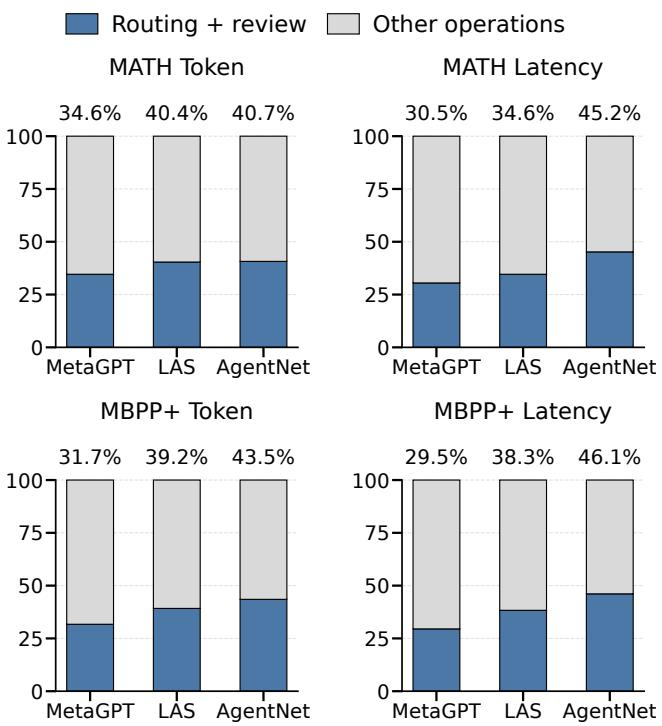
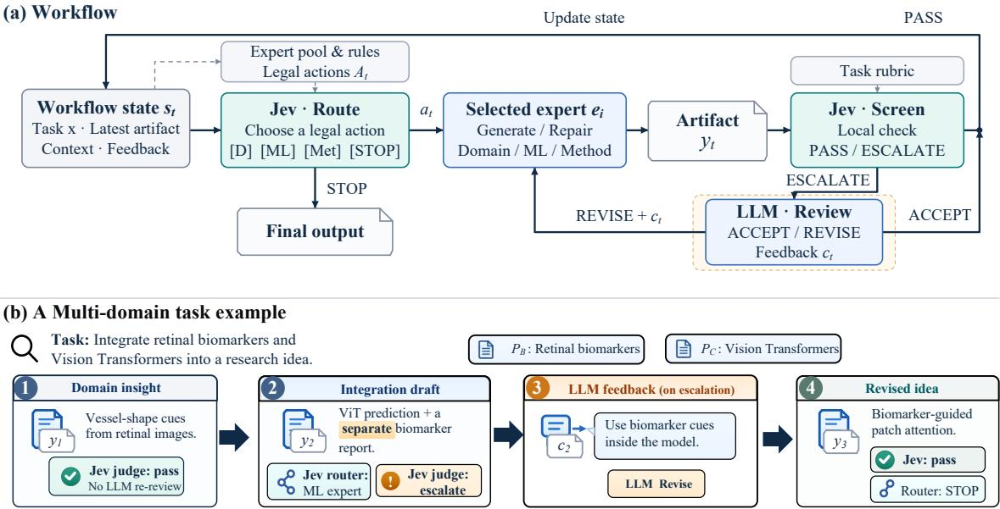
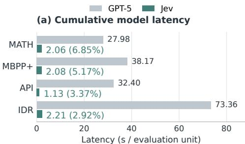
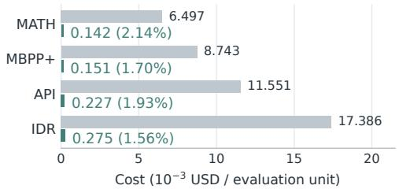

# Jev-LiteMAS: Separating Decisions from Generation in Multi-Agent Workflows

Kaixiang Wang Shanghai Jiao Tong University Shanghai, China

Jiong Lou Shanghai Jiao Tong University Shanghai, China

Jie Li Shanghai Jiao Tong University Shanghai, China

## Abstract

Multi-agent LLM systems rely on generative models for expert execution, workflow planning, and artifact review. Yet many coordination operations require only bounded decisions, such as selecting the next expert or judging artifact quality. Profiling three representative MAS frameworks, we find that routing and review account for 31.7–43.5% of generative-LLM tokens. However, replacing these operations with low-cost decision models introduces two interface gaps: generative planners produce execution plans and handof instructions (planning gap), while reviewers provide actionable feedback for repairing flawed artifacts (review gap)—outputs that bounded decisions alone cannot provide.

We introduce Jev-LiteMAS, a multi-agent framework that bridges both gaps by combining a lightweight decision model (Jev) with generative execution and feedback. To address the planning gap, Jev selects experts dynamically from the task and prior expert outputs, using accumulated context to ground subsequent execution without a pre-generated trajectory. To address the review gap, Jev screens intermediate artifacts against task criteria: passing artifacts proceed directly, whereas flagged ones undergo LLM re-review for acceptance or corrective feedback. Across four benchmarks and two backbones, Jev-LiteMAS reduces generative-LLM tokens by 12.7–54.6% over LAS, maintaining accuracy within 1.34 percentage points and lowering latency in seven of eight settings. Grounding routing in substantive expert outputs prevents up to 18.0 points in accuracy loss.

Zhaojiacheng Zhou Shanghai Jiao Tong University Shanghai, China

## CCS Concepts

• Do Not Use This Code → Generate the Correct Terms for Your Paper; Generate the Correct Terms for Your Paper; Generate the Correct Terms for Your Paper; Generate the Correct Terms for Your Paper.

## Keywords

LLM, Multi-agent, Decision model, jev

## 1 Introduction

LLM-based multi-agent systems (MAS) organize specialist agents through role assignments, communication, and intermediate artifacts [10, 13, 30]. Recent systems further optimize workflow construction and agent communication [36, 38, 39]. These workflows combine expert execution with repeated coordination. Experts gen-erate substantive content, such as code, API-driven solutions, and research proposals. Coordination operations select the next expert and assess whether intermediate artifacts can proceed. Many of these operations produce only bounded outputs, such as an expert identifier or a pass/escalate decision. Using a generative LLM for every such decision adds model calls between expert contributions. This diference in output requirements suggests an opportunity to allocate model capabilities at the level of workflow operations.

To quantify this opportunity, we profile three representative MAS architectures, MetaGPT, AgentNet, and LAS [10, 32, 34], using DeepSeek-V4-Flash as the shared generative backbone on MATH [9] and MBPP+ [1, 17]. Figure 1 shows that routing and review account for 31.7–43.5% of total generative-LLM tokens across the six mea-sured configurations. Their recorded latency shares range from 29.5% to 46.1%. Even in LAS, which dynamically adjusts workflow execution, routing and review consume 40.4% and 39.2% of tokens on MATH and MBPP+, respectively. These results reveal substan- tial coordination overhead across diferent MAS architectures and raise a more specific question: which coordination operations re-quire open-ended generation, and which can be handled through a lower-cost decision interface?

These observations motivate assigning routine routing and re- view decisions to low-cost decision models, while retaining generative models for substantive task execution. Although prior studies have explored cost-aware model routing and eficient MAS coordi- nation [3, 19, 29, 37], integrating choice-based models into conventional multi-agent workflows introduces two interface challenges. First, planning and expert handofs. In planner-driven MAS, a generative planner produces a multi-step plan specifying task decomposition, agent assignments, execution order, and handof instructions [4, 10]. In contrast, a choice-based decision model (e.g., Jev [25]) only selects from predefined expert candidates, leaving plan and instruction generation outside its bounded interface. Second, review and corrective feedback. Generative reviewers assess intermediate artifacts and provide detailed revision guidance when quality issues arise [8, 18]. Conversely, a choice-based judge like Jev only yields a bounded verdict, unable to generate actionable strategies for subsequent repair.

These mismatches raise a central question: how to reorganize multi-agent collaboration around bounded decisions while preserving the planning context and generative feedback required for efective execution and error recovery? This motivates our guiding principle: allocate model capabilities according to each operation’s output requirements. We organize collaboration around feedback-driven decisions—using accumulated artifacts to ground execution—while retaining generative capabilities for task execution and on-demand corrective feedback.

  
Figure 1: Routing and review account of generative-LLM tokens and latency in our measured MAS configurations. Each bar is normalized by the total cost of its framework and across two benchmarks.

We introduce Jev-LiteMAS, a multi-agent framework that leverages the complementary strengths of generative and decision models to reduce coordination overhead while maintaining task quality. To address the planning gap, we develop feedback-driven expert handofs. Instead of generating a complete execution trajectory in advance, Jev selects the next expert at each handof based on the overall task, previous expert outputs, and the current execution state. The selected ex ert receives the accumulated task context and produces its contribution, allowing subsequent routing decisions to adapt to actual execution progress. To address the review gap, we introduce Jev-gated LLM re-review. Jev first judges whether an intermediate artifact satisfies the task-specific quality criteria, allowing qualified artifacts to proceed without invoking a generative reviewer. Artifacts that fail this judgment are escalated to an LLM reviewer, which independently reassesses their quality and either accepts them or generates actionable feedback for revision by the responsible expert. Revised artifacts are evaluated again before proceeding. Together, these mechanisms replace routine generative coordination with lightweight decisions while retaining the contextual information and generative feedback needed for efective collaboration and error recovery.

We evaluate Jev-LiteMAS on four benchmarks spanning mathematical reasoning, code generation, tool use, and interdisciplinary idea integration, using DeepSeek-V4-Flash and GPT-5 expert backbones. Compared with LAS, Jev-LiteMAS reduces generative-LLM token usage by 12.7–54.6%, with accuracy diferences within 1.34 percentage points and lower end-to-end latency in seven of eight configurations. Removing substantive expert feedback from rout- ing decreases accuracy by 18.00 points on IDRBench I3 and 9.02 points on API-Bank [15], with nearly unchanged LLM call counts. Under injected agent errors, Jev screening detects 91.33–95.33% of corrupted cases, while the cascaded configuration consumes 14.6–21.7% fewer generative-LLM tokens than LLM judging. These results connect the end-to-end eficiency gains to feedback-aware coordination and selective generative review.

Our contributions are summarized as follows:

• Coordination-capability insight. We quantify the gener-ative overhead of routine MAS control and characterize the information required for bounded expert selection and action- able recovery.

• Jev-LiteMAS architecture. We develop an information-preserving workflow that seamlessly combines feedback-driven expert handofs, bounded artifact screening, and conditional genera- tive review and expert-guided repair.

• Systematic evaluation. We measure quality and resource use across four benchmarks and two backbones, and analyze work- flow organization, semantic feedback, and review reliability through controlled ablations and error injection.

## 2 Related Work

LLM Multi-Agent Systems. LLM-based multi-agent systems coordinate specialized agents through role assignments, intermedi-ate artifacts, and shared execution context. Recent research im- proves this coordination at several levels. AFlow searches over code-represented workflows, while MetaAgent constructs multi- agent systems using finite-state machines [39, 40]. MaAS learns a distribution of query-dependent architectures, and G-Designer generates task-aware communication topologies [36, 38]. MasRouter jointly considers collaboration modes, agent roles, and model selection [35]. AnyMAC predicts subsequent agents and selects context from prior steps in sequential collaboration [27]. For execution eficiency, AgentDropout removes redundant agents and communication, while LAS uses a lightweight gate followed by LLM scheduling to adjust processing depth [29, 32]. AgentFlow coordinates planning, tool execution, verification, and answer generation through evolving memory, and ReAgent supports recovery by revisiting earlier execution states [16, 33]. Together, these systems illustrate the growing role of adaptive control and intermediate feedback in multi-agent execution. Their varied coordination operations moti-vate examining where bounded model decisions can be used within an expert workflow.

Jev and System-One Decision Models.Jev provides typed choices, rubric scores, and binary judgments for software-controlled decisions [25]. Independent evaluations examine its performance on general decision benchmarks and text annotation, including classifi- cation quality, inference cost, and calibration [6, 11]. Further studies analyze decision stability under changes to option semantics and assess typed decisions across agent-harness tasks [14, 24]. Beyond standalone judgments, Jev-Mem uses a decision layer to manage memory operations [12]. SeLMRoute extracts probabilistic semantic evidence for model routing, and REFLEX explores bounded control with generative fallback in agents [22, 31]. The contemporaneous S1-MAS framework likewise allocates lightweight System-One decisions to multi-agent coordination using an open decision model [41]. This literature provides a basis for studying typed judgments in agent systems, where local decisions afect downstream execution.

Our work Jev-LiteMAS integrates choice-based decisions into multi-agent workflows through feedback-driven expert handofs and Jev-gated artifact review. It preserves generative capabilities for expert reasoning and corrective feedback, enabling selective LLM re-review while balancing task quality, review reliability, and execution eficiency.

## 3 Problem Setting and Design Rationale

This section formalizes the operation-level multi-agent workflow, examines the capability requirements of routing and review, and motivates our design.

## 3.1 Operation-Level Multi-Agent Workflows

We consider a multi-agent workflow with a pool of generative experts $\mathcal { E } = \{ E _ { 1 } , \ldots , E _ { n } \}$ . Given a task �, the experts collaborate through successive execution steps. At step �, the selected expert $\boldsymbol { e } _ { t } ~ \in ~ \mathcal { E }$ produces an intermediate artifact �� from the available execution state $s _ { t - 1 }$ . The workflow then incorporates this artifact into its updated state:

$$
y _ { t } = G _ { e _ { t } } ( s _ { t - 1 } ) , \qquad s _ { t } = U ( s _ { t - 1 } , e _ { t } , y _ { t } ) ,\tag{1}
$$

where $G _ { e _ { t } }$ denotes expert execution and � denotes the workflow’s state u date. The observable state contains the task, intermediate artifacts, and relevant expert information.

We distinguish three operations within this workflow: expert execution, which generates or revises task artifacts; expert routing, which selects the next action; and local review, which evaluates an intermediate artifact. At a routing point, the legal action set $\mathcal { A } _ { t }$ contains eligible experts and, when permitted, a termination action. At a review point, the reviewer determines whether the artifact can proceed:

$$
\begin{array} { r } { \mathcal { A } _ { t } \subseteq \mathcal { E } \cup \{ \mathrm { S T O P } \} , \qquad d _ { t } \in \{ \mathrm { p a s s } , \mathrm { e s c a l a t e } \} . } \end{array}\tag{2}
$$

These operations difer in their output requirements. Expert execution requires open-ended generation, while routing and initial review admit bounded decision interfaces. This distinction creates an opportunity to allocate model capabilities at the level of work- flow operations.

## 3.2 Capability Mismatch in Workflow Control

Planning and expert handofs. Generative controllers can produce task-specific plans and instructions for subsequent experts. A choice-based model operates over a supplied candidate set and returns a selected action:

$$
G _ { \mathrm { p l a n } } ( s _ { t } ) \in \Sigma ^ { * } , \qquad J _ { \mathrm { r o u t e } } ( s _ { t } , \mathcal { A } _ { t } ) \in \mathcal { A } _ { t } ,\tag{3}
$$

where $\Sigma ^ { * }$ denotes the space of generated text sequences. This dif- ference places greater importance on how the workflow provides legal actions and execution context. In particular, expert handofs must remain informed by the latest artifacts, while the information needed for expert execution remains available to the next selected expert throughout subsequent execution.

Review decisions and corrective feedback. Generative re-viewers can assess an artifact and provide task-specific feedback. A choice-based reviewer produces a bounded decision:

$$
G _ { \mathrm { r e v i e w } } ( s _ { t } ) = ( v _ { t } , c _ { t } ) , \qquad J _ { \mathrm { s c r e e n } } ( s _ { t } ) = d _ { t } ,\tag{4}
$$

where $v _ { t }$ is the review verdict and $c _ { t }$ denotes corrective feedback when needed. The screening decision identifies artifacts requiring further attention. Those artifacts still need a generative reviewer to reassess their content and provide actionable guidance for sub- sequent repair.

Together, these two cases highlight the role of information flow in capability allocation: bounded decisions guide workflow exe- cution, while generative operations supply the content needed to complete and revise tasks.

## 3.3 Capability-Matched Workflow Design

The preceding observations motivate an operation-level division of responsibilities. Generative experts retain task execution and artifact revision. A choice-based model handles bounded routing and initial review using the observable execution state.

For coordination, the workflow selects subsequent experts from the legal action set after observing the latest execution results. This enables successive handofs to reflect the evolving task state.

For review, the workflow adopts a conditional generative path. The screening decision $d _ { t }$ determines whether the artifact proceeds or undergoes LLM re-review:

$$
\left( v _ { t } , c _ { t } \right) = \left\{ \begin{array} { l l } { ( \mathrm { p a s s } , \emptyset ) , } & { d _ { t } = \mathrm { p a s s } , } \\ { G _ { \mathrm { r e v i e w } } ( s _ { t } ) , } & { d _ { t } = \mathrm { e s c a l a t e } . } \end{array} \right.\tag{5}
$$

The generative reviewer reassesses escalated artifacts and supplies corrective feedback when needed. Subsequent revisions remain the responsibility of the generative experts.

Follow these principles we present Jev-LiteMAS, which inte-grates feedback-driven expert handofs with Jev-gated LLM re-review. The following section presents the workflow architecture and the detailed execution procedure.

## 4 Jev-LiteMAS

This section presents Jev-LiteMAS, which coordinates generative experts through feedback-driven handofs and Jev-gated LLM re-review. We first describe the shared execution state, then detail how routing, screening, and corrective feedback shape the workflow.

## 4.1 System Overview

Figure 2 illustrates the workflow. The system consists of a pool of generative experts, two decision operations served by Jev, and a generative reviewer for escalated artifacts. Experts create task out-puts and perform revisions. The routing operation chooses the next expert from the legal candidates. The screening operation assesses intermediate artifacts and decides whether they can proceed. When screening requests further examination, the LLM reviewer evaluates the artifact and provides feedback for subsequent execution.

  
Figure 2: Overview of Jev-LiteMAS.

Each expert $e \in { \mathcal { E } }$ has a configured generative backend $L _ { e }$ and role instructions $\mathit { p _ { e } }$ . We write its execution interface as

$$
\begin{array} { r } { G _ { e } ( s ) = \operatorname { E x e c } ( L _ { e } , p _ { e } , s ) , } \end{array}\tag{6}
$$

where � supplies the task, available artifacts, and any feedback relevant to the current execution. Role instructions specify the expert’s responsibility, such as producing an artifact or revising an existing one. The runtime manages model invocation and passes the result back to the workflow. An expert’s role remains associated with its configuration across successive handofs. The state provides the changing part of its input: the user’s request, intermediate work, and feedback generated during execution.

The state also connects the two decision operations. The router uses it to choose the next contributor, while the screener uses it to assess the current artifact. Their prompts and output candidates reflect these separate responsibilities. Both decisions can refer to the same task and execution history, which makes the resulting control actions consistent with the work already performed.

We use the state convention in Section 3: expert $e _ { t }$ produces �� from $s _ { t - 1 } ,$ and � incorporates the result into ��. The updated state is the common input to subsequent control operations. It makes the latest artifact visible alongside the task and prior execution context. At configured review points, screening is resolved before the workflow proceeds with its next ordinary handof. Both Jev operations therefore act on artifacts generated during the current execution, while generative experts retain the context required to continue the task.

## 4.2 Feedback-Driven Expert Handofs

Routing context and candidates. The next expert is selected after the workflow observes an execution result. The runtime constructs the decision input from $s _ { t }$ and the legal set $\mathcal { A } _ { t } .$ The task describes the overall objective; the current artifact records what has been produced; and the expert descriptions indicate what each candidate can contribute. Candidate identifiers connect the decision returned by Jev to executable expert configurations. The set $\mathcal { A } _ { t }$ follows the configured workflow rules and contains eligible experts, with STOP included when termination is an available action. Each candidate has an identifier understood by the runtime and a description of its assigned expertise. This correspondence is maintained across routing steps, so the selected identifier can be used immediately for dispatch. The candidate set determines the available workflow transitions, while the current artifact helps Jev choose among them.

Jev chooses one action from these candidates:

$$
a _ { t } = J _ { \mathrm { r o u t e } } ( s _ { t } , \mathcal { A } _ { t } ) , \qquad a _ { t } \in \mathcal { A } _ { t } .\tag{7}
$$

The routing request asks which expert should contribute next given the task and available progress. As an expert completes its work, the new artifact becomes evidence for later decisions. The router can consequently select diferent experts as the task develops, using the same bounded action interface at each decision point. The decision may reflect the presence of an unfinished artifact, a result requiring further inspection, or suficient progress to finish, depending on the candidates allowed by the workflow. The process repeats after each completed expert execution, so new intermediate results influence later decisions without a separate generated plan for the entire trajectory.

Dispatch and execution context. If $a _ { t }$ identifies an expert, the runtime resolves that identifier to the corresponding model and role instructions and starts the next execution step:

$$
e _ { t + 1 } = a _ { t } , \qquad y _ { t + 1 } = G _ { e _ { t + 1 } } ( s _ { t } ) .\tag{8}
$$

The selected expert receives the original task and the available intermediate results through $s _ { t } .$ Its own role instructions establish the expected contribution. This separation gives the controller a compact decision interface while preserving task context for the model responsible for generating content. The returned $y _ { t + 1 }$ is incorporated through �, making it available to the next routing or review operation. The handof carries the existing artifact forward; the receiving expert can inspect and extend that work within its configured responsibility. This is important when successive ex-perts address diferent aspects of the same task, since their outputs remain connected through the shared state. It also preserves a sim- ple interface between the controller and the expert: the former returns a legal action, and the latter generates the task content.

Successive handofs. Handofs continue as new artifacts change the state. For example, a draft result may lead the router to se- lect an expert responsible for checking or refining it; the resulting feedback can then inform another handof. Such choices use the current trajectory and the experts already configured in the work- flow. If $a _ { t } = S \mathrm { T O P }$ , the runtime invokes the finalization procedure. A local review pass, by comparison, only releases an artifact to the remaining workflow. This distinction keeps artifact acceptance and task completion as separate execution events. At a configured checkpoint, an artifact must complete the local review path be- fore ordinary coordination resumes. Review-triggered revisions are therefore processed using the feedback associated with that artifact, while the next normal handof operates on the updated state. The workflow can combine several expert executions and local checks before finalization.

## 4.3 Jev-Gated LLM Re-review

Artifact screening. At a designated review point, the screening request includes the current task, artifact ��, and the review criteria available in ��. Jev evaluates whether the artifact can proceed under these criteria and returns a bounded decision:

$$
d _ { t } = J _ { \mathrm { s c r e e n } } ( s _ { t } ) \in \{ \mathrm { p a s s } , \mathrm { e s c a l a t e } \} .\tag{9}
$$

A passing artifact is released for continuation. The runtime records �� = pass and $c _ { t } = \emptyset$ for this local decision. An escalation routes the same task and artifact to the LLM reviewer. The escalation decision initiates further examination; the LLM then determines the review outcome for this branch. The screening criteria follow the task setting being evaluated, such as whether a solution satisfies its requirements or an output violates the specified review conditions. The screening result is associated with the current artifact and checkpoint. A later revision is screened as a new artifact at its own review point.

Generative re-review. The generative reviewer examines the es-calated artifact using the available task context and review criteria. Its output contains a verdict $v _ { t }$ and feedback ��:

$$
( v _ { t } , c _ { t } ) = G _ { \mathrm { r e v i e w } } ( s _ { t } ) , \qquad d _ { t } = \mathrm { e s c a l a t e } .\tag{10}
$$

The verdict decides whether the artifact may proceed or requires revision. The feedback records the issues identified during review and, when revision is needed, provides guidance for the next expert execution. For instance, feedback on a program can identify an unhandled input case, whereas feedback on a mathematical solution can locate a questionable derivation step. This information is tied to the submitted artifact so that the next model call can operate on the existing work. The reviewer can also accept an escalated artifact after reconsidering its content. In that case, the outcome allows normal execution to resume, and no repair call is needed. The verdict and feedback have separate uses: the former controls the branch, and the latter informs the revision when requested.

Repair and re-entry. When the review outcome requests revision, the workflow assigns a generative expert $e _ { t + 1 }$ according to its repair protocol. We denote the state with the new review information by e��:

$$
\widetilde { s } _ { t } = s _ { t } \oplus ( v _ { t } , c _ { t } ) , \qquad y _ { t + 1 } = G _ { e _ { t + 1 } } ( \widetilde { s } _ { t } ) .\tag{11}
$$

Here ⊕ means that the runtime makes the review information avail-able to the assigned expert. The expert receives the task, current artifact, and the returned feedback, and produces an updated arti- fact. The runtime incorporates the revision through the state update � and applies the configured review procedure at the next review point. The new artifact is treated as the result of another expert ex- ecution, with its own state update and subsequent screening. This preserves the link between the earlier feedback and the revised content. If another problem is identified, the same review–revision loop may continue within the configured limits.

This execution path also defines the scope of the screening gate. A passing artifact proceeds without an LLM re-review at that check-point. For escalated artifacts, the generative call supplies an additional assessment and, when needed, a correction plan. The result- ing decisions and revisions remain visible in subsequent workflow state, allowing ordinary expert coordination to resume. This separation links the screening decision to the additional content generated for the subsequent expert execution.

## 4.4 Design Benefits

Eficient coordination. Feedback-driven handofs assign each decision to a bounded action interface. Jev selects the next eligible expert using the latest task state, while generative experts remain responsible for producing and refining artifacts. This division keeps routine coordination lightweight and allows expert execution to use the accumulated task context.

Selective generative review. In the common operating regime where most intermediate artifacts satisfy the local review criteria, reviewing every artifact with a generative LLM spends many calls on outputs that already require no change.Jev screens these artifacts first. Passing outputs proceed directly to the next workflow step, and only escalated outputs invoke LLM re-review. When acceptable artifacts dominate and the screening false-escalation rate is low, the workflow avoids a substantial fraction of generative review calls. The LLM remains available to reassess escalated outputs and provide corrective feedback when revision is needed.

The resulting workflow combines low-overhead coordination with selective generative feedback. Appendix D gives the full es- calation protocol and analyzes how artifact quality and screening reliability afect review overhead.

## 5 Experiment

We systematically evaluate Jev-LiteMAS’s task quality and execution cost through its separation of generative execution and bounded decision-making, and assess the contributions of individ- ual components through ablation studies.

Table 1: End-to-end comparison across four benchmarks using DeepSeek-V4-Flash (top) and GPT-5 (bottom). ACC is in percent; Input, Output, and Total denote generative-LLM token counts; E2E is wall-clock latency in seconds; Calls denotes generative LLM API calls per evaluation unit. Arrows indicate preferred directions.
<table><tr><td rowspan="3">Method</td><td colspan="10">DeepSeek-V4-Flash</td></tr><tr><td colspan="5">MATH</td><td colspan="5">MBPP+</td></tr><tr><td>ACC↑</td><td>Input</td><td>Output</td><td>Total↓</td><td>E2E↓</td><td>Calls↓</td><td>ACC↑</td><td>Input</td><td>Output Total↓</td><td>E2E↓</td><td>Calls↓</td></tr><tr><td>Single-agent</td><td>85.33</td><td>1234.8</td><td>944.7</td><td>2179.5</td><td>10.70</td><td>1.00 66.67 4.00</td><td>1257.6</td><td>632.8</td><td>1890.4</td><td>14.70</td><td>1.00</td></tr><tr><td>MetaGPT</td><td>98.67</td><td>6754.1</td><td>3240.9</td><td>9995.0</td><td>36.07</td><td>82.67</td><td>7292.1 2305.5</td><td>5774.8 2906.9</td><td>13066.9 5212.4</td><td>66.36 19.90</td><td>4.00</td></tr><tr><td>AFlow</td><td>86.67</td><td>2248.9</td><td>1667.2</td><td>3916.1</td><td>17.09</td><td>1.00</td><td>73.33</td><td></td><td></td><td></td><td>1.00</td></tr><tr><td>AgentNet</td><td>96.67</td><td>3256.4</td><td>4467.6</td><td>7724.0</td><td>29.03</td><td>2.67 3.03</td><td>78.00</td><td>3610.7 4623.7</td><td>8234.4</td><td>43.91</td><td>3.13</td></tr><tr><td>LAS</td><td>98.00 97.33</td><td>3792.0</td><td>2791.0 1584.8</td><td>6583.0 5433.2</td><td>26.15 22.13</td><td>2.96</td><td>84.67 5132.0 85.33</td><td>3587.0 2767.5</td><td>8719.0 6903.5</td><td>45.60 38.67</td><td>3.09 2.96</td></tr><tr><td>Ours</td><td colspan="5">3848.4</td><td colspan="5">4136.0</td></tr><tr><td>Method</td><td></td><td></td><td>API-Bank</td><td></td><td>E2E↓</td><td></td><td></td><td></td><td>IDRBench I3</td><td></td><td></td></tr><tr><td></td><td>ACC↑</td><td>Input</td><td>Output</td><td>Total↓</td><td>Calls↓</td><td>ACC↑</td><td>Input</td><td>Output 1143.8</td><td>Total↓ 2992.8</td><td>E2E↓ 14.73</td><td>Calls↓</td></tr><tr><td>Single-agent</td><td>35.28 62.47</td><td>4466.8 21514.9</td><td>2543.9</td><td>7010.7</td><td>23.52</td><td>1.00 54.67 82.67</td><td>1849.0 9342.1</td><td>7006.3</td><td>16348.4</td><td>86.61</td><td>1.00 4.00</td></tr><tr><td>MetaGPT AFlow</td><td>45.62</td><td>4691.1</td><td>8579.4 2553.8</td><td>30094.4 7244.9</td><td>50.73 29.76</td><td>9.89 2.74 61.33</td><td>4257.6</td><td>3504.8</td><td>7762.3</td><td>43.79</td><td>2.00</td></tr><tr><td>AgentNet</td><td>59.10</td><td>10206.3</td><td>5724.2</td><td>15930.6</td><td>38.25</td><td>6.38</td><td>77.33 14084.5</td><td>13313.2</td><td>27397.7</td><td>164.45</td><td>6.12</td></tr><tr><td>LAS</td><td>66.52</td><td>11307.0</td><td>4986.0</td><td>16293.0</td><td>41.39</td><td>6.63 4.00</td><td>12700.0</td><td>9856.0</td><td>22556.0</td><td>133.52</td><td>5.56</td></tr><tr><td>Ours</td><td>66.29</td><td>6552.8</td><td>3316.5</td><td>9869.3</td><td>35.34</td><td>76.00 75.33</td><td>4928.3</td><td>5305.5</td><td>10233.8</td><td>72.40</td><td>2.47</td></tr><tr><td></td><td colspan="9"></td><td></td></tr><tr><td>Method</td><td colspan="6">GPT-5</td><td colspan="4">MBPP+</td></tr><tr><td></td><td>ACC↑ Input</td><td>Output</td><td>MATH</td><td>Total↓</td><td>E2E↓</td><td>Calls↓</td><td>Input</td><td>Output</td><td>Total↓</td><td>E2E↓</td><td>Calls↓</td></tr><tr><td>Single-agent</td><td>96.00</td><td>1129.0</td><td>1211.9</td><td>2340.9</td><td></td><td>ACC↑ 74.00</td><td>1162.0</td><td>764.7</td><td>1926.7</td><td>9.32</td><td>1.00</td></tr><tr><td>MetaGPT</td><td>100.00</td><td>6250.7</td><td>5062.7 11313.4</td><td>13.24 64.07</td><td>1.00 4.00</td><td>81.33</td><td>6804.0</td><td>4645.1</td><td>11449.1</td><td>55.05</td><td>4.00</td></tr><tr><td>AFlow</td><td>95.33</td><td>2153.0</td><td>2195.3</td><td>4348.3 16.08</td><td>2.00</td><td>79.33</td><td>2191.1</td><td>2044.5</td><td>4235.6</td><td>24.47</td><td>2.00</td></tr><tr><td>AgentNet</td><td>98.67</td><td>3211.8</td><td>2482.7</td><td>5694.4 27.14</td><td>2.52</td><td>82.00</td><td>3125.9</td><td>3468.8</td><td>7594.7</td><td>40.68</td><td>3.00</td></tr><tr><td>LAS</td><td>98.00</td><td>4209.0</td><td>3454.0</td><td>7663.0 25.91</td><td>3.31</td><td>84.67</td><td>4842.0</td><td>3794.0</td><td>8636.0</td><td>43.60</td><td>3.18</td></tr><tr><td>Ours</td><td>98.00</td><td>3572.0</td><td>2418.0</td><td>5990.0</td><td>30.04 2.98</td><td>83.33</td><td>4028.0</td><td>3514.0</td><td>7542.0</td><td>40.25</td><td>3.03</td></tr><tr><td colspan="9">API-Bank</td><td colspan="2"></td></tr><tr><td>Method</td><td>ACC↑</td><td>Input</td><td>Output</td><td>Total↓</td><td>E2E↓</td><td>Calls↓</td><td>ACC↑</td><td>Input</td><td>IDRBench I3 Output Total↓</td><td>E2E↓</td><td>Calls↓</td></tr><tr><td>Single-agent</td><td>51.46</td><td>4644.9</td><td>2885.9</td><td>7530.8</td><td>30.92</td><td>1.00</td><td>46.67</td><td>1848.9</td><td>2025.7</td><td>3874.5 25.75</td><td>1.00</td></tr><tr><td>MetaGPT</td><td>67.64</td><td>21882.7</td><td>11918.6</td><td>33801.3</td><td>152.63</td><td>10.90</td><td>62.00</td><td>10599.2</td><td>7540.7</td><td>18139.9 90.57</td><td>4.00</td></tr><tr><td>AFlow</td><td>60.67</td><td>4636.4</td><td>2955.1</td><td>7591.5</td><td>36.83</td><td>2.83</td><td>51.33</td><td>6990.5</td><td>5339.8 12330.3</td><td>65.88</td><td>3.00</td></tr><tr><td>AgentNet</td><td>67.19</td><td>13415.4</td><td>7576.8</td><td>20992.2</td><td>133.82</td><td>9.43</td><td>64.67 63.33</td><td>15388.9 9794.3</td><td>25183.2</td><td>127.38</td><td>5.97</td></tr><tr><td>LAS</td><td>69.89</td><td>9637.0</td><td>6756.0</td><td>16393.0</td><td>67.39 33.53</td><td>5.90 3.68</td><td>14357.0</td><td>11083.0</td><td>25440.0</td><td>119.45</td><td>6.04</td></tr><tr><td>Ours</td><td>68.99</td><td>5485.0</td><td>4589.0</td><td>10074.0</td><td></td><td>64.00</td><td>8951.0</td><td>6675.0</td><td>15626.0</td><td>75.57</td><td>3.37</td></tr></table>

## 5.1 Experimental Setup

Benchmarks and baselines. Our evaluation covers four bench marks across diverse domains: MATH [9] for mathematical reasoning, MBPP+ [1, 17] for code generation, API-Bank [15] for tool use, and IDRBench I3 [23] for interdisciplinary research idea integration.

We compare Jev-LiteMAS against five representative baselines covering single-agent execution, multi-agent collaboration, workflow optimization, and adaptive scheduling. Single-Agent directly solves tasks with a single LLM. MetaGPT [10] coordinates special ized agents through standardized workflows. AFlow [39] automatically searches and optimizes agentic workflows. AgentNet [34] enables decentralized agent collaboration through a structured net- work. LAS [32] dynamically schedules workflow execution using a lightweight gate and an LLM scheduler.

Implementation and Metrics. We implement Jev-LiteMAS on top of the AutoGen [30] framework, integrating Jev-based expert routing and cascaded review into multi-agent execution. In our main experiments, we use DeepSeek-V4-Flash [5] and GPT-5 [20] as generative backbones, Jev [25] as the lightweight decision model, and Qwen3-1.7B-Instruct as the SLM baseline. Subsequent analyses primarily use the DeepSeek configuration to investigate the contributions of workflow organization, routing strategies, and selective review. Specifically, we compare diferent MAS structures and routing methods, inject errors into randomly selected agents, and evaluate Jev and LLM judges under clean and corrupted out-puts. We further examine sensitivity to generative-LLM call budgets, heterogeneous expert configurations, and the request-level over- head of GPT-5 and Jev. We measure task accuracy (ACC), LLM token usage (do not include SLM), end-to-end (E2E) latency, and the number of generative-LLM API calls. For error-injection ex-periments, we additionally report attack success rate (ASR) and screening false-positive and true-positive rates (FPR/TPR). Detailed implementation settings, scoring rubrics, and evaluation protocols are provided in Appendix D.3.

## 5.2 End-to-End Quality and Eficiency

Table 1 compares Jev-LiteMAS with five baselines across four benchmarks and two generative backbones. Across tasks, Jev-LiteMAS maintains competitive accuracy with lower generative-LLM us- age. Against LAS, it reduces total LLM tokens by 17.5–54.6% with DeepSeek-V4-Flash and 12.7–38.6% with GPT-5. The corresponding accuracy diferences range from -0.67 to +0.66 percentage points on DeepSeek and from -1.34 to +0.67 on GPT-5. On DeepSeek, our method obtains the highest MBPP+ accuracy (85.33%) and closely matches LAS on MATH, API-Bank, and IDRBench I3. On GPT-5, it matches LAS on MATH, improves IDRBench I3 accuracy by 0.67 points, and incurs modest reductions on MBPP+ and API-Bank. The resource savings also extend to execution time: Jev-LiteMAS reduces end-to-end latency relative to LAS on all four DeepSeek benchmarks and on three GPT-5 benchmarks. The largest reduc- tions occur on IDRBench I3 with DeepSeek (45.8%) and API-Bank with GPT-5 (50.2%). GPT-5 MATH is the exception, with 30.04 s ver-sus LAS’s 25.91 s. MetaGPT achieves higher accuracy on DeepSeek IDRBench I3 (82.67% versus 75.33%) but uses substantially more tokens and API calls. These results demonstrate a favorable quality– eficiency trade-of through operation-level allocation of coordina- tion and generation.

Table 2: Ablations of workflow organization and routing on IDRBench I3 and API-Bank. ACC is accuracy (%); Tok. counts generative-LLM tokens (K), excluding decision-model tokens; E2E is latency (s), and Calls counts generative-LLM API requests. SLM Router uses Qwen3-1.7B-Instruct. Content-Blind masks substantive expert and tool outputs only in the router input while preserving task information, legal actions, execution metadata, and inter-expert communication.  
(a) Workflow organization
<table><tr><td></td><td colspan="4">IDRBench I3</td><td colspan="4">API-Bank</td></tr><tr><td>Method</td><td>ACC</td><td>Tok.</td><td>E2E</td><td>Calls</td><td>ACC</td><td>Tok.</td><td>E2E</td><td>Calls</td></tr><tr><td>Static</td><td>74.00</td><td>14.603</td><td>79.00</td><td>4.00</td><td>61.80</td><td>15.178</td><td>35.71</td><td>4.00</td></tr><tr><td>Heuristic</td><td>58.67</td><td>9.414</td><td>56.34</td><td>2.45</td><td>64.27</td><td>7.564</td><td>31.53</td><td>3.49</td></tr><tr><td>Planner-Replan</td><td>48.00</td><td>28.566</td><td>96.79</td><td>5.54</td><td>53.93</td><td>21.873</td><td>47.65</td><td>8.31</td></tr><tr><td>Jev-LiteMAS</td><td>75.33</td><td>10.233</td><td>72.40</td><td>2.47</td><td>66.29</td><td>9.869</td><td>35.34</td><td>4.00</td></tr></table>

Table 3: Review robustness under injected agent errors on MATH and MBPP+. ACC(%) and ASR(%); Tok. denotes generative-LLM tokens; E2E is end-to-end latency (s). A dash denotes runs without injected errors.
<table><tr><td rowspan="2">Method</td><td colspan="4">MATH</td><td colspan="4">MBPP+</td></tr><tr><td>ACC↑</td><td>Tok.↓</td><td>E2E↓</td><td>ASR↓</td><td>ACC↑</td><td>Tok.↓</td><td>E2E↓</td><td>ASR↓</td></tr><tr><td>Clean-MAS</td><td>96.67</td><td>6,752</td><td>26.77</td><td>1</td><td>86.00</td><td>7,794</td><td>45.92</td><td></td></tr><tr><td>Attack-MAS</td><td>46.67</td><td>6,389</td><td>24.62</td><td>50.00</td><td>39.33</td><td>6,973</td><td>46.84</td><td>48.67</td></tr><tr><td>MAD</td><td>98.00</td><td>20,563</td><td>73.76</td><td>0.00</td><td>85.33</td><td>28,705</td><td>98.76</td><td>1.33</td></tr><tr><td>G-Safe</td><td>69.33</td><td>6,884</td><td>31.33</td><td>27.34</td><td>52.00</td><td>6,996</td><td>55.32</td><td>35.33</td></tr><tr><td>MAS-Shield</td><td>91.33</td><td>9,746</td><td>40.51</td><td>5.33</td><td>78.67</td><td>11,324</td><td>67.76</td><td>8.67</td></tr><tr><td>AgentMon.</td><td>92.67</td><td>13,569</td><td>53.45</td><td>4.00</td><td>81.33</td><td>14,480</td><td>83.86</td><td>6.00</td></tr><tr><td>XG-Guard</td><td>80.00</td><td>7,081</td><td>25.84</td><td>16.67</td><td>76.00</td><td>8,728</td><td>59.67</td><td>12.67</td></tr><tr><td>Clean-Jev</td><td>97.33</td><td>5,433</td><td>22.13</td><td>一</td><td>85.33</td><td>6,903</td><td>38.67</td><td></td></tr><tr><td>Attack-Jev</td><td>38.67</td><td>6,131</td><td>23.52</td><td>58.67</td><td>42.00</td><td>6,542</td><td>34.93</td><td>44.67</td></tr><tr><td>Jev-LLM</td><td>94.67</td><td>10,138</td><td>45.14</td><td>2.67</td><td>84.00</td><td>12,430</td><td>76.32</td><td>2.67</td></tr><tr><td>Ours</td><td>94.00</td><td>8,657</td><td>34.19</td><td>3.33</td><td>84.67</td><td>9,736</td><td>58.35</td><td>4.00</td></tr></table>

## 5.3 Workflow and Routing Ablations

Table 2 examines the efects of workflow organization and routing decisions on IDRBench I3 and API-Bank. Among the four workflow organizations, Jev-LiteMAS achieves the highest accuracy on both tasks, reaching 75.33% and 66.29%. Compared with Static, it im-proves accuracy by 1.33 and 4.49 points while reducing LLM tokens by 29.9% and 35.0%. Heuristic uses fewer tokens and runs faster, but its accuracy is lower, particularly on I3 (58.67%). Planner-Replan incurs the highest token usage and call counts, accompanied by the lowest accuracy in both tasks.

(b) Routing and feedback
<table><tr><td></td><td colspan="4">IDRBench I3</td><td colspan="4">API-Bank</td></tr><tr><td>Method</td><td>ACC</td><td>Tok.</td><td>E2E</td><td>Calls</td><td>ACC</td><td>Tok.</td><td>E2E</td><td>Calls</td></tr><tr><td>LLM Router</td><td>68.67</td><td>27.713</td><td>133.27</td><td>4.88</td><td>65.62</td><td>15.418</td><td>56.13</td><td>7.56</td></tr><tr><td>SLM Router</td><td>64.00</td><td>13.511</td><td>81.74</td><td>3.06</td><td>61.35</td><td>11.764</td><td>39.15</td><td>4.81</td></tr><tr><td>Rule Router</td><td>26.67</td><td>9.592</td><td>62.02</td><td>2.52</td><td>38.43</td><td>8.762</td><td>35.75</td><td>3.87</td></tr><tr><td>Content-Blind</td><td>57.33</td><td>17.437</td><td>98.23</td><td>2.46</td><td>57.30</td><td>11.473</td><td>39.16</td><td>4.13</td></tr><tr><td>Jev Router</td><td>75.33</td><td>10.233</td><td>72.40</td><td>2.47</td><td>66.29</td><td>9.869</td><td>35.34</td><td>4.00</td></tr></table>

The routing ablation highlights the importance of decision back- ends and execution feedback. Jev Router outperforms LLM Router by 6.66 and 0.67 accuracy points on IDRBench I3 and API-Bank, while reducing generative-LLM tokens by 63.1% and 36.0%. Com-pared with Qwen3-1.7B-Instruct (SLM Router), Jev improves accuracy by 11.33 and 4.94 points, with 24.3% and 16.1% fewer generative-LLM tokens and lower end-to-end latency. Rule Router further re- duces token usage but substantially degrades accuracy. Removing semantic feedback lowers accuracy from 75.33% to 57.33% on I3 and from 66.29% to 57.30% on API-Bank, with nearly unchanged LLM call counts. These results highlight the capable bounded decisions and substantive execution feedback for eficient routing.

## 5.4 Jev-Review and Screening Performance

Evaluation protocol and baselines. We evaluate local review on MATH and MBPP+ b injectin task-relevant errors into an intermediate artifact from a randomly selected expert, simulating hallucinations that enter subsequent collaboration. All measure- ments use DeepSeek-V4-Flash and report results at the task level. Clean-MAS and Attack-MAS characterize the underlying MAS before and after corruption; Clean-Jev and Attack-Jev provide corresponding Jev-workflow references. We compare five protective baselines: Multi-agent Debate [7] performs multi-round deliberation, G-Safeguard [28] uses topology-aware anomaly detection, MAS-Shield [26] employs staged auditing, AgentMonitor [2] monitors execution and supports corrections, and XG-Guard [21] detects anomalies through bi-level graph representations. We further include Jev–LLM Judge, which uses a generative judge, and Jev-LiteMAS, which screens with Jev and invokes LLM re-review on escalation. We measure final accuracy (ACC), attack success rate (ASR), generative-LLM tokens, and end-to-end latency; the separate screening experiment reports FPR and TPR.

End-to-end comparison. Table 3 summarizes task-level performance under injected errors. Attack-MAS drops to 46.67% and

Table 4: Jev, LLM, and SLM judging under clean and injectederror conditions. ACC and Rate are percentages; Rate denotes FPR (↓) for clean cases and TPR (↑) for attacks. Tok. counts generative-LLM tokens only; E2E is latency (s). SLM uses Qwen3-1.7B-Instruct.
<table><tr><td>Case</td><td>Judge</td><td>ACC</td><td>Rate</td><td>Tok.</td><td>E2E</td></tr><tr><td rowspan="3">MATH Clean</td><td>Jev</td><td>97.33</td><td>4.00</td><td>5,433</td><td>22.13</td></tr><tr><td>LLM Judge</td><td>96.67</td><td>1.33</td><td>7,691</td><td>35.44</td></tr><tr><td>SLM Judge</td><td>98.00</td><td>0.00</td><td>5,135</td><td>23.32</td></tr><tr><td rowspan="3">MATH Attack</td><td>Jev</td><td>94.00</td><td>95.33</td><td>8,657</td><td>34.19</td></tr><tr><td>LLM Judge</td><td>94.67</td><td>96.67</td><td>10,138</td><td>45.14</td></tr><tr><td>SLM Judge</td><td>68.67</td><td>61.33</td><td>7,149</td><td>42.33</td></tr><tr><td rowspan="3">MBPP+ Clean</td><td>Jev</td><td>85.33</td><td>6.67</td><td>6,903</td><td>38.67</td></tr><tr><td>LLM Judge</td><td>86.67</td><td>5.33</td><td>9,110</td><td>53.71</td></tr><tr><td>SLM Judge</td><td>84.67</td><td>0.67</td><td>7,678</td><td>41.17</td></tr><tr><td rowspan="3">MBPP+ Attack</td><td>Jev</td><td>84.67</td><td>91.33</td><td>9,736</td><td>58.35</td></tr><tr><td>LLM Judge</td><td>84.00</td><td>92.00</td><td>12,430</td><td>76.32</td></tr><tr><td>SLM Judge</td><td>48.00</td><td>44.67</td><td>9,315</td><td>63.18</td></tr></table>

39.33% accuracy on MATH and MBPP+, with attack success rates of 50.00% and 48.67%. Jev-LiteMAS raises accuracy to 94.00% and 84.67% and reduces attack success to 3.33% and 4.00%. Against MAS-Shield, it gains 2.67 and 6.00 accuracy points while using 11.2% and 14.0% fewer tokens. Multi-agent Debate attains the highest accuracy and lowest attack success rates among the protected configurations, accompanied by substantially higher resource use. Relative to Jev– LLM Judge, our method maintains similar task accuracy and reduces latency by 24.3% and 23.5%, respectively.

Table 4 compares Jev, LLM, and SLM judging under clean and corrupted outputs. Jev achieves true-positive rates of 95.33% on MATH and 91.33% on MBPP+, approaching the LLM judge’s 96.67% and 92.00%. In contrast, the SLM Judge achieves only 61.33% and 44.67% TPR, indicatin substantiall weaker detection of injected errors. Interestingly, SLM Judge has lower clean-case false-positive rates (0.00% and 0.67%) than both Jev (4.00% and 6.67%) and LLM Judge (1.33% and 5.33%). This contrast suggests that fewer false alarms do not necessarily indicate reliable error detection. Despite slightly higher false-positive rates than LLM Judge, Jev reduces clean-case generative-LLM tokens by 29.4% and 24.2%, with latency reductions of 37.6% and 28.0%. Under corruption, token savings remain 14.6% and 21.7%, while maintaining detection rates close to those of the LLM judge. These findings demonstrate a favorable bal- ance between screening reliability and generative-review overhead, which is not consistently achieved by a SLM judge.

## 5.5 Decision-Layer Overhead

We analyze the end-to-end latency and estimated model cost of Jev-LiteMAS with GPT-5 experts and Jev across four benchmarks. Figure 3 separates the contributions of generative GPT-5 requests and Jev decisions. GPT-5 accounts for most of the execution time, while Jev adds only 1.13–2.21 seconds per evaluation unit. The Jev share of end-to-end latency ranges from 2.92% on IDRBench I3 to 6.85% on MATH. The monetary breakdown follows a similar pattern. Under the work fees, Jev accounts for 1.56–2.14% of the LLM model cost across the four benchmarks. Overall latency ranges from 30.04 to 75.57 seconds, and the model cost from \$0.00664 to \$0.01766 per evaluation unit. These measurements show that the choice- based model layer introduces little direct overhead compared with generative expert execution, supporting the eficiency of operationlevel capability allocation.

(b) Estimated model cost  
  
Figure 3: Latency and estimated model-cost breakdown of Jev-LiteMAS with GPT-5 experts and Jev routing across four benchmarks. (a) End-to-end latency and its GPT-5/Jev request-time components; (b) GPT-5 and Jev API fees.

## 5.6 Additional Analyses.

We further examine the efect of generative-LLM call limits and het- erogeneous expert backbones on Jev-LiteMAS. These experiments characterize quality–resource trends under diferent execution bud- gets and model assignments across expert handofs; detailed results appear in Appendix C.

## 6 Conclusion

We presented Jev-LiteMAS, a multi-agent framework that leverages the complementary strengths of generative and decision models to reduce coordination overhead. Feedback-driven expert handofs re- place pre-generated execution plans with dynamic routing informed by prior expert outputs, while Jev-gated LLM re-review reserves generative feedback for artifacts requiring further examination or revision. Across four benchmarks and two generative backbones, Jev-LiteMAS reduces generative-LLM token usage by 12.7–54.6% relative to LAS, with accuracy diferences within 1.34 percentage points and lower latency in seven of eight configurations. Ablation studies further highlight the importance of preserving substan- tive execution feedback, demonstrating that lightweight decisions and generative execution can jointly support eficient, high-quality multi-agent collaboration.

## References

[1] Jacob Austin, Augustus Odena, Maxwell Nye, Maarten Bosma, Henryk Michalewski, David Dohan, Ellen Jiang, Carrie Cai, Michael Terry, Quoc Le, and Charles Sutton. 2021. Program Synthesis with Large Language Models. arXiv:2108.07732 https://arxiv.org/abs/2108.07732

[2] Chi-Min Chan, Jianxuan Yu, Weize Chen, Chunyang Jiang, Xinyu Liu, Weijie Shi, Zhiyuan Liu, Wei Xue, and Yike Guo. 2024. AgentMonitor: A Plug-and-Play Framework for Predictive and Secure Multi-Agent Systems. arXiv:2408.14972 https://arxiv.org/abs/2408.14972

[3] Lingjiao Chen, Matei Zaharia, and James Zou. 2024. FrugalGPT: How to Use Large Language Models While Reducing Cost and Improving Performance. Transactions on Machine Learning Research (2024). https://openreview.net/forum?id= cSimKw5p6R

[4] Weize Chen, Yusheng Su, Jingwei Zuo, Cheng Yang, Chenfei Yuan, Chi-Min Chan, Heyang Yu, Yaxi Lu, Yi-Hsin Hung, Chen Qian, Yujia Qin, Xin Cong, Ruobing Xie, Zhiyuan Liu, Maosong Sun, and Jie Zhou. 2024. AgentVerse: Facilitating Multi Agent Collaboration and Exploring Emergent Behaviors. In International Conference on Learning Representations. https://proceedings.iclr.cc/paper\_files/paper/ 2024/hash/578e65cdee35d00c708d4c64bce32971-Abstract-Conference.html

[5] DeepSeek. 2026. DeepSeek API Change Log: DeepSeek-V4-Flash. Oficial API documentation. V4-Flash release and V4.1-Flash compatibility changes. https: //api-docs.deepseek.com/updates

[6] Tobias Deußer, Lorenz Sparrenberg, and Rafet Sifa. 2026. Evaluating and Benchmarking the System One Model Jev. arXiv:2609.37647 [cs.CL] https: //arxiv.org/abs/2609.37647

[7] Yilun Du, Shuang Li, Antonio Torralba, Joshua B. Tenenbaum, and Igor Mordatch. 2024. Improving Factuality and Reasoning in Language Models through Multiagent Debate. In Proceedings of the 41st International Conference on Machine Learning (Proceedings of Machine Learning Research, Vol. 235). 11733–11763. https://proceedings.mlr.press/v235/du24e.html

[8] Zhibin Gou, Zhihong Shao, Yeyun Gong, Yelong Shen, Yujiu Yang, Nan Duan, and Weizhu Chen. 2024. CRITIC: Large Language Models Can Self Correct with Tool-Interactive Critiquing. In International Conference on Learning Representations. https://proceedings.iclr.cc/paper\_files/paper/2024/hash/ fef126561bbf9d4467dbb8d27334b8fe-Abstract-Conference.html

[9] Dan Hendrycks, Collin Burns, Saurav Kadavath, Akul Arora, Steven Basart, Eric Tang, Dawn Song, and Jacob Steinhardt. 2021. Measuring Mathe matical Problem Solving With the MATH Dataset. In Proceedings of the Neural Information Processing Systems Track on Datasets and Benchmarks, Vol. 1. https://datasets-benchmarks-proceedings.neurips.cc/paper\_files/paper/ 2021/hash/be83ab3ecd0db773eb2dc1b0a17836a1-Abstract-round2.html

[10] Sirui Hong, Mingchen Zhuge, Jonathan Chen, Xiawu Zheng, Yuheng Cheng, Jinlin Wang, Ceyao Zhang, Zili Wang, Steven Ka Shing Yau, Zi juan Lin, Liyang Zhou, Chenyu Ran, Lingfeng Xiao, Chenglin Wu, and Jürgen Schmidhuber. 2024. MetaGPT: Meta Programming for a Multi Agent Collaborative Framework. In International Conference on Learning Representations. https://proceedings.iclr.cc/paper\_files/paper/2024/hash 6507b115562bb0 305f1958 87355 Ab t t C f ht l

[11] Hazem Ibrahim and Yasir Zaki. 2026. Evaluating Decision Models for Text Annotation in Computational Social Science. arXiv:2609.24574 [cs.CL] https: //arxiv.org/abs/2609.24574

[12] Dongming Jiang, Yi Li, and Bingzhe Li. 2026. Jev-Mem: System-One-Controlled Agentic Memory for Eficient AI Agents. arXiv:2609.23986 [cs.AI] https://arxiv. org/abs/2609.23986

[13] Guohao Li, Hasan Hammoud, Hani Itani, Dmitrii Khizbullin, and Bernard Ghanem. 2023. CAMEL: Communicative Agents for “Mind” Exploration of Large Language Model Society. In Advances in Neural Information Processing Systems, Vol. 36. https://proceedings.neurips.cc/paper\_files/paper/2023/hash/ a3621ee907def47c1b952ade25c67698-Abstract-Conference.html

[14] Jiawei Li. 2026. Fast Models, Slow Evidence: A Paired and Self-Audited Evaluation of System-1 Decision Models for LLM Agent Harnesses. arXiv:2610.02267 [cs.AI] https://arxiv.org/abs/2610.02267

[15] Minghao Li, Yingxiu Zhao, Bowen Yu, Feifan Song, Hangyu Li, Haiyang Yu, Zhoujun Li, Fei Huang, and Yongbin Li. 2023. API-Bank: A Comprehensive Benchmark for Tool-Augmented LLMs. In Proceedings ofthe 2023 Conference on Empirical Methods in Natural Language Processing. Association for Computational Linguistics, 3102–3116. doi:10.18653/v1/2023.emnlp-main.187

[16] Zhuofeng Li, Haoxiang Zhang, Seungju Han, Sheng Liu, Jianwen Xie, Yu Zhang, Yejin Choi, James Y. Zou, and Pan Lu. 2026. In-the-Flow Agentic System Optimization for Efective Planning and Tool Use. In International Conference on Learning Representations. https://proceedings.iclr.cc/paper\_files/paper/2026/ hash/52c4a736cd63b3c7bf52011a1f66f3f6-Abstract-Conference.html

[17] Jiawei Liu, Chunqiu Steven Xia, Yuyao Wang, and Lingming Zhang. 2023. Is Your Code Generated by ChatGPT Really Correct? Rigorous Evaluation of Large Language Models for Code Generation. In Advances in Neural Information Processing Systems, Vol. 36. https://proceedings.neurips.cc/paper\_files/paper/2023/ hash/43e9d647ccd3e4b7b5baab53f0368686-Abstract-Conference.html

[18] Aman Madaan, Niket Tandon, Prakhar Gupta, Skyler Hallinan, Luyu Gao, Sarah Wiegrefe, Uri Alon, Nouha Dziri, Shrimai Prabhumoye, Yiming Yang, Shashank Gupta, Bodhisattwa Prasad Majumder, Katherine Hermann, Sean Welleck, Amir Yazdanbakhsh, and Peter Clark. 2023. Self-Refine: Iterative Refinement with Self-Feedback. In Advances in Neural Information Processing Systems, Vol. 36. https://papers.nips.cc/paper\_files/paper/2023/hash 91edf07232fb1b55a505a9e9f6c0f3-Abstract-Conference.html

[19] Isaac Ong, Amjad Almahairi, Vincent Wu, Wei-Lin Chiang, Tianhao Wu, Joseph E. Gonzalez, M. Kadous, and Ion Stoica. 2025. RouteLLM: Learning to Route LLMs from Preference Data. In International Conference on Learning Representations. https://proceedings.iclr.cc/paper\_files/paper/2025/hash/ 5503a7c69d48a2f86fc00b3dc09de686-Abstract-Conference.html

[20] OpenAI. 2025. GPT-5 System Card. Technical Report. OpenAI. https://openai. com/index/gpt-5-system-card/

[21] Junjun Pan, Yixin Liu, Rui Miao, Kaize Ding, Yu Zheng, Quoc Viet Hung Nguyen, Alan Wee-Chung Liew, and Shirui Pan. 2026. Explainable and Fine-Grained Safe- guarding of LLM Multi-Agent Systems via Bi-Level Graph Anomaly Detection. In Proceedings ofthe 64th Annual Meeting ofthe Association for Computational Linguistics (Volume 1: Long Papers). 30491–30506. doi:10.18653/v1/2026.acl-long.1407

[22] Vasilis Perifanis, Nikolaos Pavlidis, and Symeon Symeonidis. 2026. SeLM-Route: Probabilistic Semantic Evidence for Large Language Model Routing. arXiv:2609.34736 [cs.AI] https://arxiv.org/abs/2609.34736

[23] Yuanhao Shen, Daniel Xavier de Sousa, Ricardo Marçal, Ali Asad, Hongyu Guo, and Xiaodan Zhu. 2025. Understanding Large Language Models’ Ability on Interdisci linar Research. Introduces IDRBench and its IDR Idea Inte ration (I3) task. arXiv:2507.15736 https://arxiv.org/abs/2507.15736

[24] Yu Sun, Junhao Xu, Jiajia Shi, and Zijin Yang. 2026. Type-Safe Is Not Error-Free: Typed Decision Models Follow the Option Name, Not the Definition Bound to It. arXiv:2609.26758 [cs.AI] htt s://arxiv.or /abs/2609.26758

[25] TypeSafe AI. 2026. Jev: Introduction and Typed Decision Primitives. Product documentation. Accessed 2026-10-12. https://docs.typesafe.ai/introduction

[26] Kaixiang Wang, Zhaojiacheng Zhou, Bunyod Suvonov, Jiong Lou, Zihan Wang, Yuxiang Zheng, Yidan Lin, Wutong Zhang, Xianghan Kong, Chentao Wu, and Jie Li. 2025. MAS-Shield: A Defense Framework for Secure and Eficient LLM MAS. arXiv:2511.22924 https://arxiv.org/abs/2511.22924

[27] Song Wang, Zhen Tan, Zihan Chen, Shuang Zhou, Tianlong Chen, and Jundong Li. 2025. AnyMAC: Cascading Flexible Multi-Agent Collaboration via Next-Agent Prediction. In Proceedings ofthe 2025 Conference on Empirical Methods in Natural Language Processing. Association for Computational Linguistics, 11555–11567. doi:10.18653/v1/2025.emnlp-main.584

[28] Shilong Wang, Guibin Zhang, Miao Yu, Guancheng Wan, Fanci Meng, Chongye Guo, Kun Wang, and Yang Wang. 2025. G-Safeguard: A Topology-Guided Security Lens and Treatment on LLM-based Multi-agent Systems. In Proceedings ofthe 63rd Annual Meeting ofthe Association for Computational Linguistics (Volume 1: Long Papers). 7261–7276. doi:10.18653/v1/2025.acl-long.359

[29] Zhexuan Wang, Yutong Wang, Xuebo Liu, Liang Ding, Miao Zhang, Jie Liu, and Min Zhang. 2025. AgentDropout: Dynamic Agent Elimination for Token-Eficient and High-Performance LLM-Based Multi-Agent Collaboration. In Proceedings of the 63rd Annual Meeting ofthe Association for Computational Linguistics (Volume 1: Long Papers). Association for Computational Linguistics, 24013–24035. doi:10. 18653/v1/2025.acl-long.1170

[30] Qingyun Wu, Gagan Bansal, Jieyu Zhang, Yiran Wu, Beibin Li, Erkang Zhu, Li Jiang, Xiaoyun Zhang, Shaokun Zhang, Jiale Liu, Ahmed Hassan Awadallah, Ryen W. White, Doug Burger, and Chi Wang. 2024. AutoGen: Enabling Next Gen LLM Applications via Multi-Agent Conversations. In First Conference on Language Modeling. https://openreview.net/forum?id=BAakY1hNKS

[31] Tiantong Wu and Wei Yang Bryan Lim. 2026. REFLEX with Jev for Eficient Selective Control in LLM Agents. arXiv:2609.26532 [cs.AI] https://arxiv.org/abs/ 2609.26532

[32] Dawei Xiang, Kexin Chu, Wenyan Xu, Wenhui Zhang, and Wei Zhang. 2026. LLM-as-Scheduler: Agentic Workflow Dynamic Scheduling. In Proceedings ofthe 64th Annual Meeting ofthe Association for Computational Linguistics (Volume 1: Long Papers). Association for Computational Linguistics, 12752–12763. doi:10. 18653/v1/2026.acl-long.581

[33] Zhao Xinjie, Fan Gao, Xingyu Song, Yingjian Chen, Rui Yang, Yanran Fu, Yuyang Wang, Yusuke Iwasawa, Yutaka Matsuo, and Irene Li. 2025. ReAgent: Reversible Multi-Agent Reasoning for Knowledge-Enhanced Multi-Hop QA. In Proceedings ofthe 2025 Conference on Empirical Methods in Natural Language Processing. Association for Computational Linguistics, 4067–4089. doi:10.18653/v1/2025. emnlp-main.202

[34] Yingxuan Yang, Huacan Chai, Shuai Shao, Yuanyi Song, Siyuan Qi, Renting Rui, and Weinan Zhang. 2025. AgentNet: Decentralized Evolutionary Coordination for LLM-based Multi-Agent Systems. In Advances in Neural Information Processing Systems, Vol. 38. doi:10.52202/085713-3578

[35] Yanwei Yue, Guibin Zhang, Boyang Liu, Guancheng Wan, Kun Wang, Dawei Cheng, and Yiyan Qi. 2025. MasRouter: Learning to Route LLMs for Multi-Agent Systems. In Proceedings ofthe 63rd Annual Meeting ofthe Association for Computational Linguistics (Volume 1: Long Papers). Association for Computational

Linguistics, 15549–15572. doi:10.18653/v1/2025.acl-long.757

[36] Guibin Zhang, Luyang Niu, Junfeng Fang, Kun Wang, Lei Bai, and Xiang Wang. 2025. Multi-agent Architecture Search via Agentic Supernet. In Proceedings of the 42nd International Conference on Machine Learning (Proceedings of Machine Learning Research, Vol. 267). PMLR, 75834–75852. https://proceedings.mlr.press/ v267/zhang25bi.html

[37] Guibin Zhang, Yanwei Yue, Zhixun Li, Sukwon Yun, Guancheng Wan, Kun Wang, Dawei Cheng, Jefrey Xu Yu, and Tianlong Chen. 2025. Cut the Crap: An Economical Communication Pipeline for LLM-based Multi-Agent Systems. In International Conference on Learning Representations. https://proceedings.iclr.cc/paper\_files/paper/2025/hash/ bbc461518c59a2a8d64e70e2c38c4a0e-Abstract-Conference.html

[38] Guibin Zhang, Yanwei Yue, Xiangguo Sun, Guancheng Wan, Miao Yu, Junfeng Fang, Kun Wang, Tianlong Chen, and Dawei Cheng. 2025. G-Designer: Architecting Multi-agent Communication Topologies via Graph Neural Networks. In Proceedings ofthe 42nd International Conference on Machine Learning (Proceedings ofMachine Learning Research, Vol. 267). PMLR, 76678–76692. https://proceedings.mlr.press/v267/zhang25cu.html

[39] Jiayi Zhang, Jinyu Xiang, Zhaoyang Yu, Fengwei Teng, XiongHui Chen, Jiaqi Chen, Mingchen Zhuge, Xin Cheng, Sirui Hong, Jinlin Wang, Bing- nan Zheng, Bang Liu, Yuyu Luo, and Chenglin Wu. 2025. AFlow: Au- tomating Agentic Workflow Generation. In International Conference on Learning Representations. https://proceedings.iclr.cc/paper\_files/paper/2025/hash/ 5492 b 4439401798d d2 90b 94 d Ab t t C f ht

[40] Yaolun Zhang, Xiaogeng Liu, and Chaowei Xiao. 2025. MetaAgent: Automatically Constructing Multi-Agent Systems Based on Finite State Machines. In Proceedings ofthe 42nd International Conference on Machine Learning (Proceedings ofMachine Learning Research, Vol. 267). PMLR, 75667–75694. https://proceedings.mlr.press/ v267/zhan 25bc.html

[41] Zihan Zhou, Xinzhe Hu, Hanxu Yang, Liangjian Wen, and Zhao Kang. 2026. Token-Eficient Multi-Agent Collaboration via System One-Guided Computa- tional Division of Labor. arXiv:2610.08155 [cs.MA] https://arxiv.org/abs/2610. 08155

## A Reproducibility Statement

We provide the experimental configurations, dataset sampling pro-cedures, and evaluation protocols in the main text and appendices to support reproducibility. Due to space limitations, the complete im-plementation details and prompt templates cannot be fully included in the paper. To facilitate independent verification and reproduction of our results, we provide an anonymous repository containing the full implementation, workflow configurations, and prompt tem- plates, available at https://anonymous.4open.science/status/jevlitemas-2312.

## B Limitations and Future Work

Jev-LiteMAS has two limitations. First, feedback-driven routing operates over a predefined pool of expert roles and legal actions. Although this supports lightweight and structured coordination, the framework does not dynamically create new experts or recon- figure their roles for previously unseen task requirements. Extend- ing expert selection to more adaptive collaboration structures is a promising direction. Second, the eficiency ofJev-gated LLM rereview depends on the distribution of intermediate artifact quality. When a larger proportion of artifacts requires generative review or revision, the achievable token and latency savings may decrease. Future work could explore adaptive review policies that account for task dificulty and varying artifact quality.

## C Additional Experimental Analyses

We analyze the efects of generative-LLM call limits and heterogeneous expert assignment on execution quality and resource use.

## C.1 Sensitivity to Generative-LLM Call Budgets

We study how the maximum number ofgenerative-LLM calls afects execution quality and resource consumption on IDRBench I3 and API-Bank. Table 5 reports accuracy, token usage, latency, and actual LLM calls under budgets of two, three, four, and six calls.

On I3, accuracy rises from 46.67% at a budget of two to 70.00% at four, then reaches 73.33% at six. The corresponding average number of calls increases from 2.00 to only 2.64, indicating that the workflow does not exhaust the larger allowance on every task. API-Bank follows a similar quality trend: accuracy increases from 56.18% to 64.72% between budgets two and four, and reaches 65.84% at six. Its average call count rises from 2.00 to 4.46.

Larger budgets also increase the opportunities for further expert contributions, together with additional token and latency costs. On API-Bank, token usage and latency fluctuate across intermediate budgets, reflecting changes in the executed trajectories. Overall, the strongest quality gains occur when moving beyond the tightest call limits.

## C.2 Heterogeneous Expert Backbones

We evaluate heterogeneous expert execution by assigning two generative backbones (Deepseek V4-flash and GPT5), denoted A and B, to successive expert steps. AAA keeps the same backbone through out the trajectory. ABB switches from A to B at the first handof and then continues with B, while ABA switches backbone at every hand- of. All three configurations use the same Jev-based coordination workflow.

Table 5: Sensitivity to generative-LLM call budgets and heterogeneous expert backbones on IDRBench I3 and API-Bank. ACC is in percent; Tok. denotes total generative-LLM tokens in thousands; E2E denotes end-to-end latency in seconds; Calls denotes average generative-LLM API calls. In (b), AAA uses one backbone throughout, ABB switches backbone at the first expert handof, and ABA switches at every handof.
<table><tr><td></td><td colspan="4">IDRBench I3</td><td colspan="4">API-Bank</td></tr><tr><td>Setting</td><td>ACC↑</td><td>Tok.↓</td><td>E2E↓</td><td>Calls↓</td><td>ACC↑</td><td>Tok.↓</td><td>E2E↓</td><td>Calls↓</td></tr><tr><td colspan="9">(a) Generative-LLM call budget</td></tr><tr><td>B = 2</td><td>46.67</td><td>7.637</td><td>43.86</td><td>2.00</td><td>56.18</td><td>10.713</td><td>16.12</td><td>2.00</td></tr><tr><td>B = 3</td><td>62.67</td><td>9.496</td><td>56.01</td><td>2.26</td><td>57.08</td><td>12.040</td><td>20.63</td><td>2.93</td></tr><tr><td>B = 4</td><td>70.00</td><td>10.514</td><td>68.19</td><td>2.48</td><td>64.72</td><td>14.553</td><td>18.34</td><td>3.96</td></tr><tr><td>B = 6</td><td>73.33</td><td>11.298</td><td>71.88</td><td>2.64</td><td>65.84</td><td>12.817</td><td>20.16</td><td>4.46</td></tr><tr><td colspan="9">(b) Heterogeneous expert backbones</td></tr><tr><td>AAA</td><td>75.33</td><td>10.233</td><td>72.40</td><td>2.47</td><td>66.29</td><td>9.869</td><td>35.34</td><td>4.00</td></tr><tr><td>ABB</td><td>76.67</td><td>11.387</td><td>75.97</td><td>2.49</td><td>66.07</td><td>12.924</td><td>37.50</td><td>4.23</td></tr><tr><td>ABA</td><td>78.00</td><td>14.536</td><td>78.62</td><td>2.52</td><td>64.49</td><td>13.518</td><td>36.99</td><td>4.39</td></tr></table>

As shown in Table 5, IDRBench I3 accuracy increases from 75.33% with AAA to 76.67% with ABB and 78.00% with ABA. The higher I3 scores are accompanied by increased token consumption, from 10.233K to 11.387K and 14.536K, respectively, and modestly longer execution times.

On API-Bank, accuracy is 66.29%, 66.07%, and 64.49% for AAA, ABB, and ABA. Token usage rises from 9.869K to 12.924K and 13.518K, while average calls increase from 4.00 to 4.23 and 4.39.

The results demonstrate that the workflow supports switching expert backbones across handofs. They also reveal task-dependent trade-ofs between heterogeneous expert allocation, execution qual- ity, and model usage.

## D Cascaded Review: Protocol and Analysis

This section details the escalation and revision workflow, and an- alyzes how artifact quality and screening reliability jointly afect generative review overhead and error propagation.

## D.1 Escalation and Re-entry

At a review checkpoint, Jev screens artifact �� using the context and review criteria in ��. A pass releases the artifact to ordinary routing. An escalate forwards the same information to $G _ { \mathrm { r e v i e w } }$ , which returns verdict $v _ { t }$ and feedback $c _ { t } .$ . If the LLM accepts the artifact, routing resumes. If revision is required, the runtime attaches $\left( { { v _ { t } } , { c _ { t } } } \right)$ to the state and invokes the assigned expert, as formalized in Eq. 11. The revised artifact enters the configured screening procedure at its next checkpoint. Repeated review and repair consume workflow budget. Local acceptance and the STOP action remain separate: only the latter enters task finalization.

## D.2 Escalation, Savings, and Reliability

Let R be the completed screening operations, including repeated checks after revision. Every escalation triggers one LLM re-review,

giving the observed escalation fraction

$$
\widehat { \rho } _ { \mathrm { e s c } } = \frac { \sum _ { t \in \mathcal { R } } 1 \{ d _ { t } = \mathrm { e s c a l a t e } \} } { | \mathcal { R } | } .\tag{12}
$$

Let � denote the fraction of artifacts requiring correction, � the detection rate Pr(escalate | error), and � the false-escalation rate Pr(escalate | acceptable). The expected fraction of artifacts forwarded to the LLM is

$$
\rho _ { \mathrm { e s c } } = \pi r + { \left( 1 - \pi \right) } f .\tag{13}
$$

When most artifacts are acceptable (� is small), a low � allows the majority to bypass generative review. Thus, review-call savings follow directly from the prevalence of acceptable outputs and the screen’s ability to release them.

For a simplified fixed per-call screening cost $C _ { J }$ and LLM review cost $C _ { L } ,$ , the expected review-stage cost per checkpoint is

$$
C _ { \mathrm { c a s c a d e } } = C _ { J } + \rho _ { \mathrm { e s c } } C _ { L } .\tag{14}
$$

Relative to LLM review at every checkpoint, this stage saves cost when $C _ { J } < \big ( 1 - \rho _ { \mathrm { e s c } } \big ) C _ { I }$ . Full-workflow accounting also includes routing, expert generation, revisions, and repeated checks.

The main reliability risk is erroneous release. Its unconditional probability is

$$
\operatorname* { P r } ( { \mathrm { e r r o r } } , { \mathrm { p a s s } } ) = \pi ( 1 - r ) .\tag{15}
$$

These errors do not enter the LLM re-review branch. Consequently, detection and false-escalation rates must be assessed alongside final task quality and resource use. The prevalence � comes from natural workflow traces; controlled error-injection class ratios do not estimate it.

## D.3 Experimental Protocol

Dataset sampling. We evaluate all methods on identical, fixed subsets of four benchmarks to ensure comparable experimental conditions. For MATH [9], MBPP+ [1, 17], and IDRBench I3 [23], we use stratified random sampling with seed 42, preserving the proportions of task categories in each benchmark. We sample 150 instances from each benchmark. For API-Bank [15], we sample 150 episodes using the same random seed, comprising 445 API-call prediction points in total. All compared methods are evaluated on the same sampled instances.

Task-specific evaluation. We evaluate the final task outputs using the native evaluation criteria of each benchmark. For MATH, we extract the final answer and compute accuracy using mathemati- cal equivalence checking, without requiring exact textual matching. For MBPP+, we execute generated programs using EvalPlus and report pass@1, counting an instance as successful only when it passes both the base and extended test suites. For API-Bank, given the interaction history, the model predicts the next API invocation. A prediction is counted as correct only when the API name is cor-rect and the oficial checker validates the arguments and execution result. We report strict accuracy over the 445 API-call prediction points. For IDRBench I3, accuracy is the proportion of evaluation instances whose predicted integrable/non-integrable labels match the dataset ground truth, with invalid outputs counted as incorrect.

Resource accounting. For each evaluation instance, we collect provider-reported input and output token usage across the corresponding generative-LLM requests and aggregate them at the task level. We report the average input, output, and total generative-LLM tokens per instance. Dollar-denominated model costs are calculated from the recorded token usage and the corresponding model pricing, then averaged over the evaluation instances. End-to-end latency and the number of generative-LLM API calls are recorded from local execution logs for each complete task and averaged over the sampled instances. For API-Bank, these resource metrics are aggre-gated per episode rather than per API-call prediction point. This accounting separates final task accuracy from the computational resources consumed by the complete multi-agent workflow.

## E Workflow Pseudocode

Algorithm 1 summarizes the complete Jev-LiteMAS workflow, including feedback-driven expert handofs, Jev-gated LLM re-review, and corrective revision.

Algorithm 1 Jev-LiteMAS Workflow   
Require: Task �, expert pool E, configuration Γ   
Ensure: Final task output   
1: (�, �) ← Initialize(�, Γ)   
2: while BudgetAvailable(s) do   
3: � ← � (�)   
4: � ← � (�, �, �)   
⊲ Jev-gated LLM re-review   
5: if ReviewPoint(s) then   
6: while BudgetAvailable(s) do   
7: $d \gets J _ { \mathrm { s c r e e n } } ( s )$   
8: if � = ass then   
9: break   
10: end if   
11: (�, � ) ← �review (� )   
12: if � = accept then   
13: break   
14: end if   
15: �� ← AssignRepairExpert(� )   
16: �˜ ← � ⊕ (�, � )   
17: � ← ��� (�˜)   
18: � ← � (�, � ˜ �, � )   
19: end while   
20: end if   
21: if not BudgetAvailable(s) then   
22: break   
23: end if   
⊲ Feedback-driven ex ert handof   
24: A ← LegalActions(� )   
25: � ← �route (�, A )   
26: if � = STOP then   
27: return Finalize(s)   
28: end if   
29: � ← �   
30: end while   
31: return HandleBudgetExhaustion(�, Γ)