# JevAgentHarness: Benchmarking, Deploying and Training Decision Models That Share Control with LLMs

Kunlun Zhu<sup>1</sup>, Tao Feng<sup>1</sup>, Xu Han<sup>1</sup>, Heng Wang<sup>1</sup>, Ling Yang<sup>2</sup>, Xiangru Tang<sup>3</sup>, Jiaxuan You<sup>1</sup>, Heng Ji<sup>1</sup> <sup>1</sup>University of Illinois Urbana-Champaign <sup>2</sup>Princeton University <sup>3</sup>Google

## Abstract

Large language model (LLM) agents now fix software, operate computers and serve customers, but their harnesses, the programs that run them, call a large LLM at every step, which makes long tasks slow and costly. Most of these calls end in a multiple-choice decision, such as which tool to call next. Decision mod els such as JEV answer these questions directly, at a fraction of an LLM call’s time and price. We ask how a harness can delegate these decisions to a decision model with little loss of success. To evaluate decision models in agentic tasks, we build AGENTDECISIONBENCH, which tests them from isolated questions up to control of a running agent, on public bench marks and our DECISIONGYM environment. The decision model most accurate on isolated questions solved only 69.5% of agent tasks, and without a fitted confidence threshold, delegating tool choices lowered success by 19.0 points. Building on these findings, we then design JEVAGENTHARNESS, which fits this threshold for each choice on the agent’s own trajectories and lets the LLM decide below it. Because existing decision models never see the states an agent reaches after its own mistakes, we train AGENTDECISION-4B, an open 4B model, on such states with JEV’s answers as labels. On tasks unlike its training data, the agent solved 91.5% of them with AGENTDECISION-4B and 82.0% with JEV. On tasks like their training data, 4B models trained this way made agents 81.1–89.0% cheaper and up to 2.5 times faster, without losing 3 or more points of task success. The models, data, and harness will be released at https://github.com/ JevAgentHarness/JevAgentHarness.

## 1 Introduction

Large language models have become capable agents. Recent frontier models such as GPT-6 Astra (OpenAI, 2026c) and Claude Opus 5.5 (Anthropic, 2026) report their largest gains on agentic work: they resolve issues in real code repositories (Jimenez et al., 2024), operate desktop and web applications (Xie et al., 2024), complete tasks in a terminal (Merrill et al., 2026) and serve customers under domain policies (Barres et al., 2026). The length of the software tasks that frontier models can complete has doubled about every seven months since 2019 (Kwa et al., 2026). These capabilities are put to use through agent harnesses such as Claude Code, Codex and OpenHands (Anthropic, 2025; OpenAI, 2026a; Wang et al., 2025c), programs that give the model tools, manage its context and memory, and decide when to stop (Yao et al., 2023; Yang et al., 2024; Guo et al., 2026a).

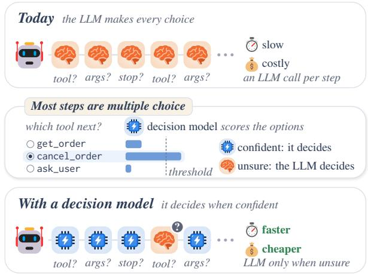  
Figure 1: Intuition of JEVAGENTHARNESS. Most of an agent’s LLM calls end in a multiple-choice decision, and a small decision model can make the routine ones in a fraction of the time and price. The LLM makes the choices the decision model is unsure of.

Yet agents remain slow and costly on long tasks, because most harnesses call the large model at every step (Kapoor et al., 2025; Wang et al., 2025b). Evaluating agents for one public leaderboard cost about \$40,000 (Kapoor et al., 2026). Most of these calls, however, end in a multiple-choice decision. In Figure 1, a customer-service agent must either look up an order, cancel it or ask the customer.

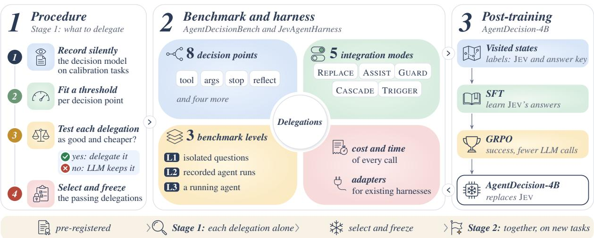  
Figure 2: Overview of our pipeline. Stage 1 tests each kind of choice alone, and Stage 2 tests the passing delegations together on new tasks. These were the tool and argument cascades and a reflection trigger.

Decision models such as JEV (Almeida, 2026) and its open counterparts (InternLM, 2026; StartLuxLabs, 2026; razorback16, 2026) make such choices directly. Given the task, the history and one multiple-choice question, a decision model returns a probability for each listed option instead of generating text, much like the fast, intuitive System 1 rather than the slow, deliberate System 2 (Kahneman, 2011). In one recorded episode, a call to JEV took 28% of an LLM call’s time and 2.6% of its price. Existing systems use decision models for game actions, memory, escalation and judging (Ma et al., 2026; Jiang et al., 2026; Wu and Lim, 2026b; Li et al., 2026). Because a harness lists the actions at each step, it can delegate a choice to a decision model when that model is confident and otherwise defer to the LLM (Figure 1). We call this decision modeling for agents (Chen et al., 2025).

Decision models, however, are built and tested on fixed questions and do not adapt to the agent they serve. Whether one works inside an agent has not been tested. Routers and cascades (Chen et al., 2024; Ong et al., 2025), small function-calling models (Zhang et al., 2025c; Lin et al., 2025) and fast– slow agents (Lin et al., 2023; Christakopoulou et al., 2024) also move work away from the large model, and they too have been tested on fixed questions or on a single kind of choice, and agent benchmarks score only whole tasks. Inside an agent, a decision model’s mistakes carry over to later steps (Zhu et al., 2025), and one choice changes the next. It also faces states that follow the agent’s own errors, which fixed question sets rarely contain, and every query to it adds latency. We therefore ask:

## How can an agent harness delegate routine choices to a fast, cheap decision model when the model is reliable, so that agentic tasks become faster and cheaper with little loss of success?

Our hypothesis is that a decision model helps an agent when it is chosen by tests inside the agent, used only when it is confident, and trained on the states that the agent itself reaches. We build one part for each of these three conditions (Figure 2). AGENTDECISIONBENCH tests decision models at three levels, each closer to real use: on isolated questions with no agent around, at each step of recorded agent runs, where answers are scored but not carried out (step level), and in control of a running agent, where each choice changes what comes next (task level). We use public benchmarks and DECISIONGYM, an environment we built that knows the acceptable next steps at every state, so that each choice can be scored. JEVAGEN-THARNESS lets an existing harness put each routine choice to a decision model as a typed multiplechoice question and uses the answer only when the model’s confidence clears a threshold fitted on the agent’s own trajectories. AGENTDECISION-4B is an open 4B decision model that learns from JEV’s answers on the states the agent visits. We will release all three. AGENTDECISION-4B chooses better than JEV inside the agent: on tasks unlike its training data, the agent solved 91.5% of them when AGENTDECISION-4B made its tool choices and 82.0% when JEV made them. JEVAGENTHAR-NESS makes agents cheaper and faster: with 4B models trained on each agent’s states, customerservice and household agents were 81.1–89.0% cheaper and up to 2.5 times faster, without losing 3 or more points of success.

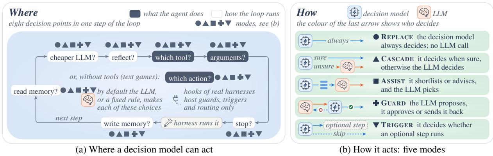  
Figure 3: A decision model can act at eight points of the agent loop, in five modes. In (a), filled boxes choose the agent’s action, outlined boxes control the loop, and markers show the modes we implement at each point.

## 2 Where and How to Delegate

Whether a choice is worth handing to the decision model depends on which choice it is and on how the decision model’s answer is combined with the LLM’s. We define the task (Figure 3) and derive a rule for what to delegate (§2.1). The setup applies to any harness that can list its options at a step.

Decision points. An episode is one agent run on a task, and its state s holds what the agent knows at a step. A decision point d is a kind of choice that recurs across steps and whose options $O _ { d } ( s )$ the harness can list. We study eight decision points (Figure 3a). Three choose what the agent does: the tool, its arguments and, without tools, the next action. Five control the loop: whether to write memory, reflect after a failure, stop, or route the step to a cheaper LLM, and which stored notes to read back.

Decision models. A decision model reads s as text with one question and its options (App. B.3) and returns a probability $p ( o \mid s )$ for each option. Its answer is the likeliest option, and its confidence c(s) is that option’s probability (JEV (Almeida, 2026) returns this probability directly). Open models like Intern-Decision and AGENTDECISION-4B score all options in one forward pass.

Who decides. An integration mode fixes who proposes an answer and who has the last word (Figure 3b). We mostly use the cascade ( CASCADE): the decision model answers first, and the harness uses it when its confidence clears a threshold, $c ( s ) \geq \tau _ { d } .$ Otherwise the LLM decides as usual. In the other modes, the decision model always decides ( REPLACE), shortlists options for the LLM ( ASSIST), approves or rejects the LLM’s choice ( GUARD), or decides whether an optional step such as reflection runs ( TRIGGER). We implement all 40 point–mode combinations (App. A). A decision point with its mode and threshold is a delegation, such as the tool-choice cascade. We seek the cheapest set of delegations whose success stays within 3 points of the LLM alone.

A decision-making example. Consider a customer-service agent asked to cancel an order (App. Figure 6). At each step, the harness asks which of 69 tools to call. At step 3, JEV split its vote between asking the customer (0.63) and cancelling (0.37), so the LLM decided and asked. At step 4, JEV was confident about cancelling the order. JEV then chose the order from options copied from the chat and the reason from a fixed list. Both answers were confident, so the call ran without the LLM. An unsure answer or a free-text argument would cost one LLM call.

## 2.1 Deciding what to delegate

A threshold rule. Handing a choice to the decision model can save an LLM call but may lead to a wrong choice. If its confidence equals its chance of being right (App. A), handing over is worth it exactly when $c ( s ) \geq q _ { L } - \Delta C / V$ , where $q _ { L }$ is how often the LLM gets this choice right, ∆C the price of the saved call and V the cost of a wrong choice. This value is the best threshold $\tau _ { d } .$ . The decision model may thus be a little less accurate than the LLM as long as the saving covers the extra risk.

Fitting thresholds. We first run the agent on separate tasks (150 per agent LLM) while the decision model answers every question silently (shadow mode). From these trajectories we estimate, per decision point, how often the LLM was right $( q _ { L } ) .$ a call’s price (∆C) and V , the drop in task success after one wrong choice, valued at \$1 per solved task. The trajectories also give the decision model’s accuracy at each confidence, so the threshold is the lowest confidence above which accepting is worth it, and the confidence need not match its exact chance of being right (App. A). If none qualifies, the LLM keeps deciding. With JEV and Flash, the fitted thresholds were 1.00 for tools and 0.99 for arguments, so only near-certain answers are used.

## 3 AGENTDECISIONBENCH

A decision model can score well on a test and still fail inside an agent. Existing tests ask single questions with fixed answers, so a wrong answer never affects what happens next. Agent benchmarks run whole tasks but report only whether a task succeeded, without showing which choice went wrong. AGENTDECISIONBENCH tests decision models at three levels on public data and on DECISIONGYM, with every call priced and timed (App. F, Table 5).

L1: isolated questions. The decision model answers single questions with no agent around it. We turn the 1,114 tool-choice and 1,949 argument items of BFCL v4 (Patil et al., 2025) and the 928 When2Call items (Ross et al., 2025) into multiplechoice questions.

L2: step level, on recorded agent runs. The decision model answers at each step of recorded agent runs, but its answer is only scored, so the run continues as recorded and one mistake cannot cause the next, as when driving policies are tested on recorded drives. Each answer is checked against an answer key of acceptable next steps. All models answer the same 5,314 states of 200 new DECISIONGYM tasks (the common states).

L3: task level, in control of the agent. The decision model now makes every tool choice of a running agent (every action in ALFWorld) with no threshold, while the LLM writes the arguments, and each choice is carried out. A wrong choice changes what the agent sees next, so mistakes can pile up. This level measures task success. It is the hardest level and the closest to deployment. Our agent loop runs $\tau ^ { 2 } .$ -bench (Barres et al.,

2026), ALFWorld (Shridhar et al., 2021) and DE-CISIONGYM tasks, and hooks let us test existing harnesses without changing their code: mini-SWE-agent and SWE-agent on SWE-bench Verified (Jimenez et al., 2024), and the pi terminal agent on Terminal-Bench 2.0 and Terminal-Bench-Science (Merrill et al., 2026; Terminal-Bench-Science Team, 2026).

Levels 2 and 3 need an environment that knows which next steps are acceptable at every state an agent can reach, including after its own mistakes. Public agent benchmarks check only the final state or the progress of a run (Lu et al., 2025; Ma et al., 2024), have a fixed set of tasks and are slow and costly to rerun. We therefore built DECISIONGYM, a simulated customer service desk for a small shop, with typed tools over a small database as in τ-bench (Yao et al., 2025) and requests from templates as in TextWorld (Côté et al., 2019). Every task offers the same 68 tools plusfinish in shuffled order: seven core tools, one that asks the customer, 31 near-duplicates of core tools and 29 unrelated ones. Because each task comes from a scripted plan, DE-CISIONGYM derives an answer key at every reachable state from which the task can still be solved, even after detours. Training, threshold fitting and testing use disjoint random seeds. Near-duplicate distractor tools and must-ask states, where the right move is to ask the customer, make the tasks hard. The answer key is hidden from all models, and in strict mode any change to the shop’s data that is not in the plan ends the episode (App. B). Two further task sets, added after the main study, test the models beyond their training data. Shifted tasks (DECISIONGYM-Shift, App. G.9) rename the tools and change the wording and kinds of requests. Hard tasks (DECISIONGYM-Hard, App. D.6) have 10 or 12 customers each and a new rule for cancelling or shipping.

## 4 JEVAGENTHARNESS

JEVAGENTHARNESS moves a harness’s routine choices to a decision model. It poses each listed choice as a multiple-choice question and uses the answer only when the model is confident enough. Otherwise the LLM decides as usual. The harness has three parts (App. Figure 8).

A typed decision interface. Every choice uses JEV’s input format, whose options are the tools, fixed-list or yes/no argument values, or text spans to copy from the context. A tool call is split into a tool choice and one choice per such argument, so the decision model can pick both while the LLM writes only free text. Any model that accepts this format can be used (App. C).

A confidence threshold fitted on trajectories. Each decision point gets the threshold of §2.1, fitted on shadow-mode trajectories, so the decision model takes only choices it makes reliably. Below the threshold the LLM decides, so an unsure answer wastes one cheap decision-model call but does not risk the task. Thresholds are refitted when the LLM, decision model or task rules change.

Adapters, serving and accounting. Adapters ask the same questions inside existing harnesses through their hooks: strong-or-fast LLM routing in mini-SWE-agent, guards and triggers in pi, and command hooks for Codex CLI and Claude Code. If an adapter or the decision model fails, the harness runs as before (App. Table 9).

## 5 AGENTDECISION-4B

We train our own decision model for two reasons. An API model such as JEV is billed per call and cannot learn a harness’s own rules, and off-the-shelf models learn from fixed questions and successful demonstrations. Such data rarely contain the states an agent reaches after its own mistakes, where a decision model must also answer (App. D.2). We therefore post-train a small open model, Qwen3-4B with LoRA (Yang et al., 2025; Hu et al., 2022), on states the harness visits: first by supervised finetuning (SFT), then by RL in the agent loop.

Supervised fine-tuning. We run the harness on 587 training tasks and record every decision state s, 15,694 in all. To include states after errors, a scripted policy repeats mistakes seen during development (Ross et al., 2011; Laskey et al., 2017), and 30.9% of the states follow a mistake (App. D). Where the teacher, JEV, ranks the correct answer $a ^ { \star }$ first, the target mixes the one-hot label of $a ^ { \star }$ with the teacher’s probabilities, $y _ { a } = \alpha \mathcal { H } [ a =$ $a ^ { \star } ] + ( 1 - \alpha ) p _ { \mathrm { J E V } } ( a \mid s )$ with $\alpha = 0 . 3 .$ . Otherwise the target is the one-hot label alone. SFT fits this target with cross-entropy plus a squared-error (Brier) term that keeps the probabilities calibrated:

$$
\begin{array} { r } { \mathcal { L } _ { \mathrm { S F T } } = \mathbb { E } _ { s } \sum _ { a } \left[ - y _ { a } \log p _ { a } + \mu ( p _ { a } - y _ { a } ) ^ { 2 } \right] , } \end{array}\tag{1}
$$

with $p _ { a } = p _ { \theta } ( a \mid s )$ and $\mu = 0 . 5$ . We use LoRA $( r { = } 3 2 ) , 2$ epochs and learning rate $1 0 ^ { - 4 }$

GRPO inside the agent loop. The SFT model then decides on training tasks while a fixed agent LLM does the rest, so it learns from the consequences of its own choices. For each task we run a group of $G = 8$ episodes. Episode i earns a reward for success, $S _ { i } \in \{ 0 , 1 \}$ , reduced for the $N _ { i }$ LLM calls it used, minus a penalty when it made an irreversible wrong call $( E _ { i } = 1 )$ ):

$$
R _ { i } = S _ { i } \big ( 1 - \lambda \operatorname* { m i n } ( 1 , N _ { i } / N _ { 0 } ) \big ) - \eta E _ { i } ,\tag{2}
$$

with $\lambda = 0 . 5 , N _ { 0 } = 1 0$ and $\eta = 0 . 2 ,$ , so a solved task with ten or more LLM calls earns half. Each episode’s advantage is its reward relative to the group, $\begin{array} { r } { \hat { A } _ { i } = ( R _ { i } - \bar { R } ) / \sigma _ { R } , } \end{array}$ and every decision $a _ { t }$ in the episode shares it in the GRPO objective (Shao et al., 2024), plus a step-level term at states that recur within the group (Feng et al., 2025a), with a KL penalty to the SFT model (App. D). Flash-Lite is the agent LLM, and iteration 15 is kept.

Evaluation. Stage 2 swaps JEV for the frozen AGENTDECISION-4B and refits the thresholds. We later trained it further on public tool-use data.

## 6 Experimental Protocol

Stage 1 tests each delegation alone and keeps those that are cheaper and non-inferior to the LLM alone. Non-inferior means that a one-sided test at the 5% level, on the same tasks run both ways, shows a loss of less than 3 points in task success (5 on $\tau ^ { 2 } .$ -bench; App. E). Stage 2 tests the passing delegations together on new tasks, because delegations can interact. We pre-registered the models, tasks and tests, and registered the Stage-2 plan before reading any Stage-1 result, so that choosing the combination could not bias its test.

Stage 1: each delegation alone. The decision model is JEV (and Intern-Decision-4B for three delegations). The agent LLM is Gemini 3.5 Flash (Flash) with native tool calls. The cheaper, weaker Gemini 3.5 Flash-Lite (Flash-Lite) receives routed steps, simulates the $\tau ^ { 2 } .$ -bench user and is a second agent LLM on DECISIONGYM (App. F). The LLM alone and simple controls without a decision model run on the same tasks as each delegation (App. B.5). With eleven registered tests, a few could pass by chance, so Holm’s method (Holm, 1979) makes each test stricter and keeps the chance of any wrong pass at 5%. Other results are descriptive.

Stage 2: the delegations together. A script chose the combination by a rule fixed in advance. At each decision point it took the delegation that passed Stage 1 with the largest saving, or kept the LLM if none passed (App. E). We ran the combination on 500 new DECISIONGYM tasks and on τ<sup>2</sup>-bench telecom tasks. Four Holm-corrected tests check two things. The first two check that the combination still works. It should be non-inferior to the LLM alone at lower cost, and cheaper than its best single delegation without losing success, or combining would not be worth it. The other two check that a model we train can take JEV’s place. On the common states, AGENTDECISION-4B should beat Intern-Decision-4B, a model of its size that never saw the agent’s states, and be non-inferior to its teacher JEV. The combination should also stay non-inferior to the LLM alone when AGENTDECISION-4B replaces JEV.

## 7 Results

The LLM alone solved 99.4% of the DECI-SIONGYM tasks, so Table 1 reports harder settings. Table 1, Figure 4 and the shifted tasks come from experiments added after Stage 1.

## 7.1 RQ1: Do isolated scores predict success?

On isolated questions (Figure 4a), JEV was 1.7 points less accurate than Flash at 1/50 of its cost (App. G.6). On one L4 GPU, AGENTDECISION-4B and AGENTDECISION-0.8B cost about 4 and 9 times less per decision than JEV (App. G.7). At the task level, the ranking differed from the isolated one (Figure 4b). StartLux-9B was the most accurate model on BFCL tool choice (92.2%), yet it solved only 69.5% of tasks. AGENTDECISION-4B was less accurate on BFCL (89.3%) but solved 91.5% of tasks, and JEV solved 82.0%. Step-level accuracy ranked the models nearly as task success did (Kendall correlation 0.84). The gap lies at mustask states, where AGENTDECISION-4B answered 67.4% correctly and JEV answered 58.3%.

Finding 1. Isolated scores misrank decision models.   
The best decision model on isolated questions solved   
only 69.5% of agent tasks, while AGENTDECISION-  
4B solved 91.5%.

## 7.2 RQ2: Which decisions can be delegated?

Stage 1 tested each delegation alone (Figure 5). The cascade, which uses an answer only above its threshold, saved cost at tool and argument choices. With Flash as the agent LLM, JEV made 27.2% of the tool choices and 20.8% of the argument choices, which cut cost by 14.2% without changing the outcome of any of the 500 tasks, and it passed its registered test. With Flash-Lite, the fitted threshold left every tool choice to the LLM, so the cascade saved nothing. Modes without a threshold lost success. Letting JEV make every tool choice lost 19.0 points, and a three-tool shortlist from JEV lost 7.8 points while cutting cost by 53.7%, though it beat a keyword shortlist by far (92.0% of tasks solved against 18.8%). A guard on stopping kept success but cost 6.2% more, and letting JEV send Flash-Lite’s steps to Flash cost 36.2% more than Flash-Lite alone without a clear gain in success. Refitted on τ<sup>2</sup>-bench, the cheapest delegation that passed lost 8.1 points, so we could not show it transfers.

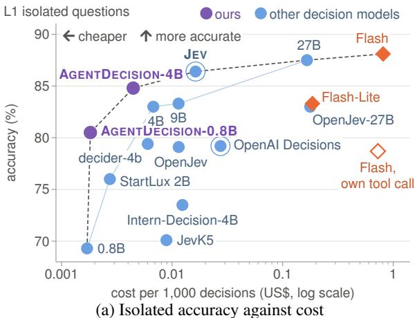

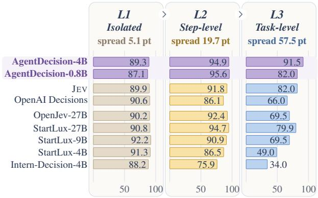  
(b) The same decision models inside the agent  
Figure 4: Isolated scores do not rank decision models for agents. In (a), the cost is per 1,000 decisions, each open model is at its cheapest deployment, and the cost– accuracy frontier is dashed. In (b), the models run on shifted DECISIONGYM tasks. Details: App. G.5.

Finding 2. A fitted threshold protects success. It cut   
cost by 14.2% without losing a single task. A fixed   
threshold lost 21.5 points.

## 7.3 RQ3: What changes in deployment?

<table><tr><td></td><td colspan="3">Success (%)</td><td></td><td>Cost</td><td colspan="2">Time (s)</td></tr><tr><td>Delegation</td><td>n</td><td>ref.</td><td>with</td><td></td><td>∆ pt saved %</td><td>ref.</td><td>with</td></tr><tr><td colspan="8">Hard DECISIONGYM tasks: new tasks, 12 customers each, a rule no decision model was trained on</td></tr><tr><td>Chosen combination (tool and argument cascades + reflection trigger), JEV</td><td>200</td><td>66.0</td><td>69.5</td><td>+3.5</td><td></td><td>4.6 41.6</td><td>71.5</td></tr><tr><td>Tool cascade refitted on the rule, JEV</td><td>100</td><td>87.0</td><td>89.0</td><td>+2.0</td><td>30.5</td><td>63.5</td><td>104.1</td></tr><tr><td>GPT-6-Luna as agent LLM: tool cascade refitted, JEV</td><td>100</td><td>45.0</td><td>83.0</td><td>+38.0</td><td>×8.4</td><td>53.9</td><td>67.4</td></tr><tr><td colspan="8">Coding agents: JEV sends each step to a strong or a fast LLM (ref.: always strong)</td></tr><tr><td>mini-SWE-agent, SWE-bench Verified: DeepSeek-V4-Pro or -Flash</td><td>300</td><td>77.3</td><td>76.3</td><td>-1.0</td><td>10.5</td><td>457</td><td>436</td></tr><tr><td>mini-SWE-agent: Gemini 3.8 Flash, high or low thinking</td><td>100</td><td>70.0</td><td>75.0</td><td>+5</td><td>7.0</td><td>886</td><td>728</td></tr><tr><td>SWE-agent, SWE-bench Verified: Gemini 3.5 Flash or Flash-Lite</td><td>100</td><td>63.0</td><td>57.0</td><td>-6.0</td><td>7.7</td><td>110</td><td>124</td></tr><tr><td>pi, Terminal-Bench 2.0: Gemini 3.5 Flash or Flash-Lite</td><td>89</td><td>42.7</td><td>50.6</td><td>+7.9</td><td>9.6</td><td>257</td><td>260</td></tr><tr><td colspan="8">ALFWorld text games</td></tr><tr><td>ALFWorld: action cascade, JEV</td><td>14091.4</td><td></td><td>91.4</td><td>+0.0</td><td></td><td>14.0 24.1</td><td>22.3</td></tr><tr><td> ALFWorld: action cascade, 4B trained on its states</td><td>140</td><td>90.7</td><td>95.0</td><td>+4.3</td><td>89.0</td><td>37.0</td><td>18.2</td></tr><tr><td> ALFWorld, unseen rooms: same model and threshold</td><td>134</td><td>88.8</td><td>89.6</td><td>+0.7</td><td>92.0</td><td>35.1</td><td>18.2</td></tr></table>

Table 1: Delegating choices to a decision model in harder settings. Task success (%) of the LLM alone (ref.) and with the delegation on the same n tasks, the change ∆ (points), the share of cost saved (×: cost as a multiple of the reference’s) and the mean seconds per task. Bold marks the better result and savings that kept success, red a loss of 3 points or more or a higher cost. All rows come from experiments added after Stage 1. Row notes: App. G.5.

<table><tr><td>∆pt| saved % REPLACE</td><td></td><td>CASCADE</td><td>ASSIST</td><td>GUARD</td><td>TRIGGER</td></tr><tr><td>Tool choice</td><td>−19.0|67</td><td>+0.0|14</td><td>-7.8|54</td><td>+0.0|0</td><td>+0.0|-14</td></tr><tr><td>Tool args.</td><td>−20.0|88</td><td>+0.0|14</td><td>+0.0|9</td><td>+0.0|-7</td><td>+0.0|-1</td></tr><tr><td>Memory write</td><td>+0.5|-47</td><td>-1.0|-48</td><td>+0.0|-74</td><td>+0.0|-60</td><td>-1.0|-39</td></tr><tr><td>Memory read</td><td>+0.5|-11</td><td>+0.0|-21</td><td>+0.0|-5</td><td>+0.0|-140</td><td>+0.0|-1</td></tr><tr><td>Reflection</td><td>-0.5|-7</td><td>+0.5|-25</td><td>−0.5|-66</td><td>+0.0|-61</td><td>+0.0|1</td></tr><tr><td>Stop</td><td>+0.5|-7</td><td>+0.0|-1</td><td>+0.0|-17</td><td>−0.6|-6</td><td>+0.0|0</td></tr><tr><td>Routing</td><td>+4.0|-7</td><td>-4.0|-113</td><td>-2.0|-31</td><td>+0.0|-23</td><td>+0.6|-36</td></tr><tr><td>Action</td><td>-64.3|91</td><td>+0.0|14</td><td>−40.7|-182</td><td>-0.7|-87</td><td>−2.1|−111</td></tr><tr><td colspan="2">kept success, cheaper</td><td colspan="2">small loss or no saving</td><td colspan="2">lost 3+ points</td></tr></table>

Figure 5: Delegating tool and argument choices in a cascade saved cost without losing success. Each cell: change in task success against the LLM alone (points) | cost saved (%, negative when costlier), with JEV and Gemini 3.5 Flash. Full map: App. G.2.

JEVAGENTHARNESS cut cost and time on DECI-SIONGYM, ALFWorld and mini-SWE-agent. With AGENTDECISION-4B on its own GPU, the DE-CISIONGYM agent was 86.3% cheaper and 2.5 times faster, without losing 3 or more points of success, and on ALFWorld a 4B model trained there made the agent 89.0% cheaper and about twice as fast, with higher success (Table 1). Coding agents gained less. When JEV sent each step to a strong or fast LLM, cost fell by 7.0–10.5% and success varied by harness (App. C.3). On hard DECISIONGYM tasks, delegation kept or raised success but saved only 4.6–30.5% and ran slower. The agent was also slower on a GPU shared by about four runs.

<table><tr><td>Part</td><td>Without, then with</td><td></td><td>∆ pt Saved %: cost, time</td><td></td></tr><tr><td></td><td>Threshold fixed at 0.5</td><td>-21.5 84.5</td><td></td><td></td></tr><tr><td></td><td>fitted in shadow mode</td><td>+0.014.2</td><td></td><td>一</td></tr><tr><td>Check†</td><td>own confidence</td><td></td><td>59</td><td>一</td></tr><tr><td></td><td>+ re-ask if unsure</td><td>一</td><td>81</td><td>1</td></tr><tr><td></td><td>LLM check instead</td><td></td><td>-49</td><td></td></tr><tr><td></td><td>Combined tool cascade alone</td><td></td><td>+0.4 18.8</td><td>-11.4</td></tr><tr><td></td><td>+ reflection trigger</td><td></td><td>-2.240.7</td><td>-34.8</td></tr><tr><td>Serving</td><td>4B, shared GPU</td><td></td><td>+0.6 81.1</td><td>-49.5</td></tr><tr><td></td><td>4B, batched, own GPU†</td><td></td><td>+0.5 76.3</td><td>29.4</td></tr><tr><td></td><td>4B + public data, own GPU†</td><td></td><td>+0.5 86.3</td><td>60.3</td></tr><tr><td></td><td>0.8B, learns to defer†</td><td></td><td>+0.5 89.3</td><td>77.9</td></tr></table>

Table 2: What each part of JEVAGENTHARNESS contributes. Each row compares the agent without and with one part: the change in success (points) and the cost and time saved (%) vs. the LLM alone. Bold green marks savings that kept success, red a loss or an added cost. <sup>†</sup>Added after Stage 1. Row notes: App. G.5.

Finding 3. Delegation cut cost and time without losing success. With AGENTDECISION-4B the agent ran 86.3% cheaper and 2.5× faster. A 4B model trained on ALFWorld made the ALFWorld agent 89.0% cheaper.

On 500 new tasks, AGENTDECISION-4B made 99.9% of the tool choices and 75.0% of the argument choices, saving 4.5 LLM calls per task. On one L4 GPU, it took a median 31 ms per answer, while a Flash call took 809 ms.

## 7.4 RQ4: Can a 4B model learn the decisions?

SFT on the agent’s own states raised step-level accuracy on shifted states from 52.9% to 98.4% (Table 3), while isolated accuracy rose by only 7 points. Most of the gain comes from SFT. It took 2.2 GPU-hours. GRPO added 4.5 GPU-hours and \$26.53 of LLM calls without a measurable gain. Run without SFT, GRPO did not improve the untrained model, which solved 11.5% of shifted tasks after GRPO and 13.5% before (App. D.4, Table 15). With JEV, the chosen combination lost 2.2 points and failed the non-inferiority test. With AGENTDECISION-4B in place of JEV, it passed at 81.1% lower cost on 500 new tasks. On the common states, AGENTDECISION-4B beat Intern-Decision-4B and was non-inferior to JEV. Further training on public tool-use data raised its isolated accuracy from 78.8% to 85.1%, while tasklevel success on shifted tasks fell from 96.0% to 91.5% (App. D.9). Our recipe turned StartLux-0.8B into AGENTDECISION-0.8B (Table 3). On ALFWorld, a 4B model trained there answered 92.8% of recorded states correctly, and the best off-the-shelf model answered 72.8% (App. D.8).

<table><tr><td></td><td>L1</td><td>L2 step level L3 task</td><td></td><td></td></tr><tr><td>Model</td><td>isolated</td><td>all must-ask success Saved</td><td></td><td></td></tr><tr><td colspan="5">Shifted tasks† : AGENTDECISION-4B, step by step from Qwen3-4B</td></tr><tr><td>Untrained</td><td>71.4 52.9</td><td></td><td>27.6</td><td>13.5</td></tr><tr><td>+ SFT</td><td>78.4 98.4</td><td></td><td>95.0</td><td>96.0</td></tr><tr><td>+ GRPO (Stage 2)</td><td>78.8 98.6</td><td></td><td>90.8</td><td>96.0 81.1</td></tr><tr><td>+ public data</td><td>85.1 94.9</td><td>67.4</td><td>91.5</td><td>86.3</td></tr><tr><td colspan="5">Shifted tasks†: off-the-shelf decision models</td></tr><tr><td>JEV (teacher)</td><td>86.4 91.8</td><td></td><td>58.3</td><td>82.0 40.7</td></tr><tr><td>Intern-Decision-4B</td><td>73.4 75.9</td><td>33.9</td><td></td><td>34.0</td></tr><tr><td>StartLux-4B</td><td>83.1 86.5</td><td>36.7</td><td>49.0</td><td>=</td></tr><tr><td>+ our recipe</td><td>85.5 98.5</td><td>100.0</td><td>98.0</td><td>=</td></tr><tr><td>StartLux-0.8B</td><td>70.0 51.7</td><td>27.2</td><td>13.0</td><td>-</td></tr><tr><td>+ our recipe = AGENTDECISION-0.8B</td><td>80.5 95.6</td><td>93.5</td><td>82.0</td><td></td></tr><tr><td colspan="5">ALFWorld† : SFT on states of its training games</td></tr><tr><td>+ SFT</td><td>- 92.8</td><td></td><td></td><td>95.7 89.0</td></tr></table>

Table 3: Training on the agent’s own states made a 4B model accurate, even on shifted tasks. Accuracy on isolated questions (L1), step-level accuracy (all states and must-ask states) and task-level success on shifted tasks (L2, L3), and the cost saved when the model is deployed. <sup>†</sup>Added after Stage 1. Column notes: App. G.5.

Finding 4. Training on agent states raised success.   
Qwen3-4B’s success on shifted tasks rose from 13.5%   
to 96.0%, and StartLux-4B’s from 49.0% to 98.0%.

## 7.5 Where delegation fails

Three failure modes recur. A confident wrong choice at an irreversible step ends the task. All 34 of JEV’s failed tasks began with an irreversible wrong tool choice, usually cancelling where the agent should have asked. Models trained on agent states made no such error (App. G.7). The decision model can also face a new rule. On hard tasks with 10 customers, AGENTDECISION-4B, trained without this rule, made most cancel-or-ship decisions but got only 81.6% of them right, and the agent solved 3.0% of tasks against 88.0% for the LLM alone. Refitting the threshold restored success with

JEV (Table 1), and retraining AGENTDECISION-4B on the rule raised its held-out accuracy from 76.5% to 95.3% (App. D.6). Finally, modes that still call the LLM, such as guards, save little.

## 8 Related Work

Decision models. JEV and open models like Intern-Decision, StartLux-Decision and OpenJev (Almeida, 2026; InternLM, 2026; StartLuxLabs, 2026; razorback16, 2026) score listed options, while DecisionFlow (Chen et al., 2025) structures LLM decisions. REFLEX hands an action to the LLM when its confidence falls below one global threshold (Wu and Lim, 2026b), and we fit one per decision point.

Decision evaluation. Decision and tool-use benchmarks score fixed questions (Benchmark Heaven, 2026; Ling et al., 2026; Patil et al., 2025; Ross et al., 2025), and agent environments score whole episodes (Yao et al., 2025; Trivedi et al., 2024; Lu et al., 2025). Models with equal scores can still decide differently (Zhang et al., 2026). AGENTDECISIONBENCH adds step- and tasklevel tests.

Routing, deferral and training. Routers and cascades choose the model for a call (Chen et al., 2024; Ong et al., 2025; Aggarwal et al., 2024). Learned routers, compared in LLMRouter (Feng et al., 2026a), use query–LLM graphs, multi-LLM logs or multi-round RL (Feng et al., 2025b, 2026b; Zhang et al., 2025a). A decision model instead scores listed options and defers if unsure, like learning to defer (Geifman and El-Yaniv, 2017; Mozannar and Sontag, 2020). Agentic RL trains the LLM (Jin et al., 2025; Wang et al., 2025d), while we train the decision model (App. H).

## 9 Conclusion

Our results support the hypothesis that decision models help agents when tested, used and trained inside the agent. Only tests inside the agent (AGENTDECISIONBENCH) showed which decision models work there. Trained on the agent’s states, AGENTDECISION-4B beat JEV inside the agent and, with thresholds fitted on agent trajectories (JEVAGENTHARNESS), made most routine choices. Models trained this way made the agent 81.1–89.0% cheaper and up to 2.5 times faster, without losing 3 or more points of success.

## Limitations

All tasks and prompts are in English, and most runs use Gemini agent LLMs, with DeepSeek and OpenAI models in a few. With other languages or agent LLMs, other kinds of choices may be worth delegating. Our main tests are non-inferiority tests. They show that task success drops by less than a fixed margin (3 points, 5 on τ<sup>2</sup>-bench), and showing equal success would need an equivalence test. The thresholds and the trained decision model are fitted to an agent’s own runs, so a new agent, new tools or a new task family call for refitting the thresholds and, for the best accuracy, training on that agent’s states, as we did for ALFWorld. In coding agents, whose actions are free text, the decision model can only choose which LLM writes a step. There the savings were small (7.0–10.5%), and sending the steps that only read files to a fast LLM gave no reliable saving, because the decision model could hardly tell those steps from the others (App. C.3). Prices and latencies are those we recorded, and they change with providers, hardware and how the decision model is served (App. F). We did not compare with learned routers such as RouteLLM on the same tasks, and GRPO added no measurable gain over SFT in our runs. In deployment, the share of answers above the threshold could be tracked to notice when the tasks drift and the thresholds need refitting.

## Ethical Considerations

We will release the benchmark, harness, recipes, trained models and data (App. F). Training on JEV outputs and redistributing derived weights depend on the provider’s terms, and StartLux-Decision weights are licensed CC BY-NC 4.0. All benchmarks are public, and we collect no personal data: DECISIONGYM customers, orders and e-mail addresses are generated from templates. Lower cost can make a fast model’s failures on safety-relevant decisions easy to overlook. With the cheaper Flash-Lite as agent LLM, the stop guard accepted 40.7% of the LLM’s own wrong attempts to end the task (App. Table 7), so a decision-model guard should never be the only control on an irreversible action. If an adapter fails, the step runs without it (§4). Adapters therefore control only cost and speed and should not be used as security boundaries. We did not test adversarial observations or policy injection, which can flip a decision model’s typed answers (Xu et al., 2026; Hu et al., 2026; Wu and

Lim, 2026a), so our results hold for benign states only. Cheaper agent control also lowers the cost of misuse at scale.

## References

Rishabh Agarwal, Nino Vieillard, Yongchao Zhou, Piotr Stanczyk, Sabela Ramos Garea, Matthieu Geist, and Olivier Bachem. 2024. On-policy distillation of language models: Learning from self-generated mistakes. In The Twelfth International Conference on Learning Representations.

Pranjal Aggarwal, Aman Madaan, Ankit Anand, Srividya Pranavi Potharaju, Swaroop Mishra, Pei Zhou, Aditya Gupta, Dheeraj Rajagopal, Karthik Kappaganthu, Yiming Yang, Shyam Upadhyay, Manaal Faruqui, and Mausam Mausam. 2024. Automix: Automatically mixing language models. In Advances in Neural Information Processing Systems, volume 37, pages 131000–131034. Curran Associates, Inc.

alibiserikbay. 2026. JevK5: open-weight Jev alternative. https://huggingface.co/alibiserikbay/ JevK5.

Diogo Almeida. 2026. Introducing System One models & Jev. https://typesafe.ai/blog/ introducing-system-one-models-and-jev.

Anastasios Nikolas Angelopoulos, Stephen Bates, Adam Fisch, Lihua Lei, and Tal Schuster. 2024. Conformal risk control. In The Twelfth International Conference on Learning Representations.

Anthropic. 2025. Claude Code. https://github. com/anthropics/claude-code.

Anthropic. 2026. Introducing Claude Opus 5.5. https: //www.anthropic.com/news/claude-opus-5-5.

Victor Barres, Honghua Dong, Soham Ray, Xujie Si, and Karthik R Narasimhan. 2026. τ<sup>2</sup>-bench: Evaluating conversational agents in a dual-control environment. In Proceedings of the 43rd International Conference on Machine Learning, volume 306 of Proceedings ofMachine Learning Research, pages 6736–6782. PMLR.

Peter Belcak, Greg Heinrich, Shizhe Diao, Yonggan Fu, Xin Dong, Saurav Muralidharan, Yingyan Celine Lin, and Pavlo Molchanov. 2026. Small language models are the future of agentic ai. Preprint, arXiv:2506.02153.

Benchmark Heaven. 2026. JevBench: A benchmark for Jev-class decision models. https://github.com/ fstandhartinger/jevbench.

Roger L. Berger and Dennis D. Boos. 1994. P values maximized over a confidence set for the nuisance parameter. Journal ofthe American Statistical Association, 89(427):1012–1016.

Lingjiao Chen, Matei Zaharia, and James Zou. 2024. FrugalGPT: How to use large language models while reducing cost and improving performance. Transactions on Machine Learning Research. Featured Certification.

Xiusi Chen, Shanyong Wang, Cheng Qian, Hongru Wang, Peixuan Han, and Heng Ji. 2025. Decision-Flow: Advancing large language model as principled decision maker. In Findings of the Association for Computational Linguistics: EMNLP 2025, pages 16668–16692, Suzhou, China. Association for Computational Linguistics.

Zehua Cheng, Wei Dai, and Jiahao Sun. 2026. thisthat-model-1.0: A typed decision model that decides in 30 ms, for a millionth of a cent. Preprint, arXiv:2609.23886.

Konstantina Christakopoulou, Shibl Mourad, and Maja Mataric. 2024. ´ Agents thinking fast and slow: A talker-reasoner architecture. Preprint, arXiv:2410.08328.

Cloudflare. 2026. Clef. https://huggingface.co/ Cloudflare/clef.

Convai Innovations. 2026. Laya typed-decisions. https://huggingface.co/convaiinnovations/ laya-typed-decisions.

Marc-Alexandre Côté, Ákos Kádár, Xingdi Yuan, Ben Kybartas, Tavian Barnes, Emery Fine, James Moore, Matthew Hausknecht, Layla El Asri, Mahmoud Adada, Wendy Tay, and Adam Trischler. 2019. TextWorld: A Learning Environmentfor Text-Based Games, page 41–75. Springer International Publishing.

Mehul Damani, Isha Puri, Stewart Slocum, Idan Shenfeld, Leshem Choshen, Yoon Kim, and Jacob Andreas. 2026. Beyond binary rewards: Training LMs to reason about their uncertainty. In The Fourteenth International Conference on Learning Representations.

DeepSeek-AI. 2026. Deepseek harness: Everything is a plugin. https://github.com/deepseek-ai/ deepseek-harness.

Jasper Dekoninck, Maximilian Baader, and Martin Vechev. 2025. A unified approach to routing and cascading for LLMs. In Proceedings of the 42nd International Conference on Machine Learning, volume 267 of Proceedings of Machine Learning Research, pages 12987–13010. PMLR.

Tobias Deußer, Lorenz Sparrenberg, and Rafet Sifa. 2026. Evaluating and benchmarking the system one model jev. Preprint, arXiv:2609.37647.

earendil-works. 2026. Pi: Ai agent toolkit: unified LLM API, agent loop, TUI, coding agent CLI. https: //github.com/earendil-works/pi.

Bradley Efron and Robert J. Tibshirani. 1993. An Introduction to the Bootstrap. Springer US.

Lang Feng, Zhenghai Xue, Tingcong Liu, and Bo An. 2025a. Group-in-group policy optimization for LLM agent training. In The Thirty-ninth Annual Conference on Neural Information Processing Systems.

Tao Feng, Yanzhen Shen, and Jiaxuan You. 2025b. Graphrouter: A graph-based router for LLM selections. In The Thirteenth International Conference on Learning Representations.

Tao Feng, Fangxu Yu, Haozhen Zhang, Zhongjie Dai, Liangqi Yuan, Zijie Lei, Weizhi Zhang, Kunlun Zhu, Haodong Yue, Keyang Xuan, Ge Liu, and Jiaxuan You. 2026a. Llmrouter: Unified infrastructure for developing, evaluating, and deploying llm routers. Preprint, arXiv:2608.06867.

Tao Feng, Haozhen Zhang, Zijie Lei, Pengrui Han, Mostofa Patwary, Mohammad Shoeybi, Bryan Catanzaro, and Jiaxuan You. 2026b. Fusionfactory: Fusing llm capabilities with multi-llm log data. Preprint, arXiv:2507.10540.

Mohit Garg. 2026. imajev: an open Jev-style decision model for images and text.

Yonatan Geifman and Ran El-Yaniv. 2017. Selective classification for deep neural networks. In Advances in Neural Information Processing Systems, volume 30. Curran Associates, Inc.

Yonatan Geifman, Guy Uziel, and Ran El-Yaniv. 2019. Bias-reduced uncertainty estimation for deep neural classifiers. In International Conference on Learning Representations.

Yuxian Gu, Li Dong, Furu Wei, and Minlie Huang. 2024. MiniLLM: Knowledge distillation of large language models. In The Twelfth International Conference on Learning Representations.

Chuan Guo, Geoff Pleiss, Yu Sun, and Kilian Q. Weinberger. 2017. On calibration of modern neural networks. In Proceedings ofthe 34th International Conference on Machine Learning, volume 70 of Proceedings of Machine Learning Research, pages 1321– 1330. PMLR.

Jianyuan Guo, Zhiwei Hao, Chengcheng Wang, Cheng Fan, Tingzhang Luo, Hongguang Li, Ying Gao, Hefei Mei, Jiankun Peng, Rongjian Xu, Minjing Dong, Han Wu, Mengyu Zheng, Kai Han, Shiqi Wang, Chang Xu, and Yunhe Wang. 2026a. From question answering to task completion: A survey on agent system and harness design. Preprint, arXiv:2606.20683.

Ruoqi Guo, Yi Liu, Gelei Deng, Yuekang Li, Lida Zhao, Yutao Wu, Simin Chen, Ying Zhang, and Leo Yu Zhang. 2026b. Just ask jev: Reinforcement learning for calibrated decisions as a zero-shot detector of ai alignment failures. Preprint, arXiv:2609.29429.

Hanno Labs. 2026. Bosun 3.1 1.7b: A small, calibrated model for typed decisions. https://huggingface. co/Hanno-Labs/bosun-v3.1-1.7b.

Harbor Framework Team. 2026. Harbor: A framework for evaluating and optimizing agents and models in container environments.

Heman10x. 2026. OpenJev (Verdict): Nonautoregressive decision engine (151m). https:// github.com/Heman10x-NGU/Verdict-open-jev.

Geoffrey Hinton, Oriol Vinyals, and Jeff Dean. 2015. Distilling the knowledge in a neural network. Preprint, arXiv:1503.02531.

Sture Holm. 1979. A simple sequentially rejective multiple test procedure. Scandinavian Journal ofStatistics, 6(2):65–70.

Edward J Hu, yelong shen, Phillip Wallis, Zeyuan Allen-Zhu, Yuanzhi Li, Shean Wang, Lu Wang, and Weizhu Chen. 2022. LoRA: Low-rank adaptation of large language models. In International Conference on Learning Representations.

Jianyi Hu, Hangtao Zhang, Yi Liu, Yeqi Zeng, Li Zeng, Xianlong Wang, Rui Wang, and Leo Yu Zhang. 2026. Jevadvbench: A benchmark and black-box attacks for reinforcement learning for calibrated decisions models. Preprint, arXiv:2609.31142.

InternLM. 2026. Intern-Decision. https: //huggingface.co/collections/internlm/ intern-decision.

Dongming Jiang, Yi Li, and Bingzhe Li. 2026. Jevmem: System-one-controlled agentic memory for efficient ai agents. Preprint, arXiv:2609.23986.

Carlos E Jimenez, John Yang, Alexander Wettig, Shunyu Yao, Kexin Pei, Ofir Press, and Karthik R Narasimhan. 2024. SWE-bench: Can language models resolve real-world github issues? In The Twelfth International Conference on Learning Representations.

Bowen Jin, Hansi Zeng, Zhenrui Yue, Jinsung Yoon, Sercan O Arik, Dong Wang, Hamed Zamani, and Jiawei Han. 2025. Search-r1: Training LLMs to reason and leverage search engines with reinforcement learning. In Second Conference on Language Modeling.

D. Kahneman. 2011. Thinking, Fast and Slow. Farrar, Straus and Giroux.

Minki Kang, Jongwon Jeong, Seanie Lee, Jaewoong Cho, and Sung Ju Hwang. 2025. Distilling LLM agent into small models with retrieval and code tools. In The Thirty-ninth Annual Conference on Neural Information Processing Systems.

Sayash Kapoor, Benedikt Stroebl, Peter Kirgis, Nitya Nadgir, Zachary S Siegel, Boyi Wei, Tianci Xue, Ziru Chen, Felix Chen, Saiteja Utpala, Franck Ndzomga, Dheeraj Oruganty, Sophie Luskin, Kangheng Liu, Botao Yu, Amit Arora, Dongyoon Hahm, Harsh Trivedi, Huan Sun, and 12 others. 2026. Holistic agent leaderboard: The missing infrastructure for AI agent evaluation. In The Fourteenth International Conference on Learning Representations.

Sayash Kapoor, Benedikt Stroebl, Zachary S Siegel, Nitya Nadgir, and Arvind Narayanan. 2025. AI agents that matter. Transactions on Machine Learning Research.

Philipp Koehn. 2004. Statistical significance tests for machine translation evaluation. In Proceedings ofthe 2004 Conference on Empirical Methods in Natural Language Processing, pages 388–395, Barcelona, Spain. Association for Computational Linguistics.

Thomas Kwa, Ben West, Joel Becker, Amy Deng, Katharyn Garcia, Max Hasin, Sami Jawhar, Megan Kinniment, Nate Rush, Sydney Von Arx, Ryan Bloom, Thomas Broadley, Haoxing Du, Brian Goodrich, Nikola Jurkovic, Luke Harold Miles, Seraphina Nix, Tao Lin, Chris Painter, and 7 others. 2026. Measuring ai ability to complete long software tasks. Preprint, arXiv:2503.14499.

Ted Kwartler, Alan Aqrawi, and Arian Abbasi. 2026. Harness tokenomics: A router for the enterprise agentic control plane. Preprint, arXiv:2609.28919.

Jacky Kwok, Hangoo Kang, Tarun Suresh, Jon Saad-Falcon, Marco Pavone, Christopher Ré, and Azalia Mirhoseini. 2026. Contrastive language models. Notion Blog.

Woosuk Kwon, Zhuohan Li, Siyuan Zhuang, Ying Sheng, Lianmin Zheng, Cody Hao Yu, Joseph Gonzalez, Hao Zhang, and Ion Stoica. 2023. Efficient memory management for large language model serving with pagedattention. In Proceedings ofthe 29th Symposium on Operating Systems Principles, SOSP ’23, page 611–626. ACM.

Michael Laskey, Jonathan Lee, Roy Fox, Anca Dragan, and Ken Goldberg. 2017. Dart: Noise injection for robust imitation learning. Preprint, arXiv:1703.09327.

lexmount. 2026. WebJev: Jev-like decision models specialized for browser use. https://github.com/ lexmount/WebJev.

Yubo Li, Yidi Miao, Ramayya Krishnan, and Rema Padman. 2026. Jev-as-a-judge: Accept when confident, escalate when unsure. Preprint, arXiv:2609.26550.

Bill Yuchen Lin, Yicheng Fu, Karina Yang, Faeze Brahman, Shiyu Huang, Chandra Bhagavatula, Prithviraj Ammanabrolu, Yejin Choi, and Xiang Ren. 2023. Swiftsage: A generative agent with fast and slow thinking for complex interactive tasks. In Advances in Neural Information Processing Systems, volume 36, pages 23813–23825. Curran Associates, Inc.

Qiqiang Lin, Muning Wen, Qiuying Peng, Guanyu Nie, Junwei Liao, Jun Wang, Xiaoyun Mo, Jiamu Zhou, Cheng Cheng, Yin Zhao, Jun Wang, and Weinan Zhang. 2025. Robust function-calling for on-device language model via function masking. In The Thirteenth International Conference on Learning Representations.

Guoming Ling, Muen Xue, and Zijian Ye. 2026. Jev in the wild: A data-driven analysis of the jev model’s functionality, applications and ecosystem. Preprint, arXiv:2609.30216.

Xinchen Liu, Hang Zhou, Yingjie Zong, Yuchuan Tian, Liuyang Song, Shuo Zhang, Yulong Li, Wei He, Mengyu Zheng, Runke Liu, Siyang Cheng, Xiang Kuang, Hailin Hu, Kai Han, and Yunhe Wang. 2026. Agentic routing: The harness-native data flywheel. Preprint, arXiv:2607.11399.

Jiarui Lu, Thomas Holleis, Yizhe Zhang, Bernhard Aumayer, Feng Nan, Haoping Bai, Shuang Ma, Shen Ma, Mengyu Li, Guoli Yin, Zirui Wang, and Ruoming Pang. 2025. ToolSandbox: A stateful, conversational, interactive evaluation benchmark for LLM tool use capabilities. In Findings ofthe Association for Computational Linguistics: NAACL 2025, pages 1160–1183, Albuquerque, New Mexico. Association for Computational Linguistics.

Chang Ma, Junlei Zhang, Zhihao Zhu, Cheng Yang, Yujiu Yang, Yaohui Jin, Zhenzhong Lan, Lingpeng Kong, and Junxian He. 2024. Agentboard: An analytical evaluation board of multi-turn llm agents. In Advances in Neural Information Processing Systems, volume 37, pages 74325–74362. Curran Associates, Inc.

Weiyu Ma, Liangbing Zhao, Yongcheng Zeng, and Jian Zhao. 2026. Jev-star: Fast, low-cost starcraft ii control with language-model planning. Preprint, arXiv:2609.27331.

Mapika. 2026. decider-4b: typed decisions with calibrated probabilities in one forward pass, 4b dense. https://huggingface.co/Mapika/decider-4b.

Mike A Merrill, Alexander Glenn Shaw, Nicholas Carlini, Boxuan Li, Harsh Raj, Ivan Bercovich, Lin Shi, Jeong Yeon Shin, Thomas Walshe, E. Kelly Buchanan, Junhong Shen, Guanghao Ye, Haowei Lin, Jason Poulos, Maoyu Wang, Marianna Nezhurina, Di Lu, Orfeas Menis Mastromichalakis, Zhiwei Xu, and 65 others. 2026. Terminal-bench: Benchmarking agents on hard, realistic tasks in command line interfaces. In The Fourteenth International Conference on Learning Representations.

Hussein Mozannar and David Sontag. 2020. Consistent estimators for learning to defer to an expert. In Proceedings of the 37th International Conference on Machine Learning, volume 119 of Proceedings of Machine Learning Research, pages 7076–7087. PMLR.

multimodalart. 2026. Jev Decision Index. https: //huggingface.co/spaces/multimodalart/jevdecision-index.

Isaac Ong, Amjad Almahairi, Vincent Wu, Wei-Lin Chiang, Tianhao Wu, Joseph E. Gonzalez, M Waleed Kadous, and Ion Stoica. 2025. RouteLLM: Learning to route LLMs from preference data. In The Thirteenth International Conference on Learning Representations.

OpenAI. 2026a. Codex CLI: Lightweight coding agent that runs in your terminal. https://github.com/ openai/codex.

OpenAI. 2026b. Decisions. https://developers. openai.com/api/docs/guides/decisions.

OpenAI. 2026c. GPT-6 Astra system card. https: //deploymentsafety.openai.com/gpt-6-astra.

openjev. 2026. OpenJev: Typed decisions about text, web pages and screenshots. https://huggingface. co/openjev/openjev.

Charles Packer, Sarah Wooders, Kevin Lin, Vivian Fang, Shishir G. Patil, Ion Stoica, and Joseph E. Gonzalez. 2024. Memgpt: Towards llms as operating systems. Preprint, arXiv:2310.08560.

Mahdi Pakdaman Naeini, Gregory Cooper, and Milos Hauskrecht. 2015. Obtaining well calibrated probabilities using bayesian binning. Proceedings of the AAAI Conference on Artificial Intelligence, 29(1).

Shishir G Patil, Huanzhi Mao, Fanjia Yan, Charlie Cheng-Jie Ji, Vishnu Suresh, Ion Stoica, and Joseph E. Gonzalez. 2025. The berkeley function calling leaderboard (BFCL): From tool use to agentic evaluation of large language models. In Proceedings of the 42nd International Conference on Machine Learning, volume 267 of Proceedings of Machine Learning Research, pages 48371–48392. PMLR.

Shishir G Patil, Tianjun Zhang, Xin Wang, and Joseph E. Gonzalez. 2024. Gorilla: Large language model connected with massive APIs. In The Thirty-eighth Annual Conference on Neural Information Processing Systems.

Dzianis Piatrashyn, Nikita Kotelevskii, Kirill Grishchenkov, Nikita Glazkov, Ivan Nasonov, Ilya Makarov, Timothy Baldwin, Preslav Nakov, Roman Vashurin, and Maxim Panov. 2026. Redact: Uncertainty-aware deferral for llm agents. Preprint, arXiv:2604.07036.

Cheng Qian, Emre Can Acikgoz, Qi He, Hongru WANG, Xiusi Chen, Dilek Hakkani-Tür, Gokhan Tur, and Heng Ji. 2025. ToolRL: Reward is all tool learning needs. In The Thirty-ninth Annual Conference on Neural Information Processing Systems.

Delip Rao and Chris Callison-Burch. 2026. Jev vs. llms as rubric judges: Cheaper, faster, and wrong in the same places. Preprint, arXiv:2609.29769.

razorback16. 2026. OpenJev: Open, Jev-compatible System One decision server on DiffusionGemma. https://github.com/razorback16/openjev.

Allen Z. Ren, Anushri Dixit, Alexandra Bodrova, Sumeet Singh, Stephen Tu, Noah Brown, Peng Xu, Leila Takayama, Fei Xia, Jake Varley, Zhenjia Xu, Dorsa Sadigh, Andy Zeng, and Anirudha Majumdar. 2023. Robots that ask for help: Uncertainty

alignment for large language model planners. In Proceedings of The 7th Conference on Robot Learning, volume 229 of Proceedings of Machine Learning Research, pages 661–682. PMLR.

Stephen Robertson and Hugo Zaragoza. 2009. The probabilistic relevance framework: Bm25 and beyond. Foundations and Trends® in Information Retrieval, 4:1–174.

Hayley Ross, Ameya Sunil Mahabaleshwarkar, and Yoshi Suhara. 2025. When2Call: When (not) to call tools. In Proceedings ofthe 2025 Conference ofthe Nations of the Americas Chapter of the Association for Computational Linguistics: Human Language Technologies (Volume 1: Long Papers), pages 3391– 3409, Albuquerque, New Mexico. Association for Computational Linguistics.

Stephane Ross, Geoffrey Gordon, and Drew Bagnell. 2011. A reduction of imitation learning and structured prediction to no-regret online learning. In Proceedings ofthe Fourteenth International Conference on Artificial Intelligence and Statistics, volume 15 of Proceedings ofMachine Learning Research, pages 627–635, Fort Lauderdale, FL, USA. PMLR.

John Schulman, Filip Wolski, Prafulla Dhariwal, Alec Radford, and Oleg Klimov. 2017. Proximal policy optimization algorithms. Preprint, arXiv:1707.06347.

Zhihong Shao, Peiyi Wang, Qihao Zhu, Runxin Xu, Junxiao Song, Xiao Bi, Haowei Zhang, Mingchuan Zhang, Y. K. Li, Y. Wu, and Daya Guo. 2024. Deepseekmath: Pushing the limits of mathematical reasoning in open language models. Preprint, arXiv:2402.03300.

Noah Shinn, Federico Cassano, Ashwin Gopinath, Karthik R Narasimhan, and Shunyu Yao. 2023. Reflexion: language agents with verbal reinforcement learning. In Thirty-seventh Conference on Neural Information Processing Systems.

Mohit Shridhar, Xingdi Yuan, Marc-Alexandre Cote, Yonatan Bisk, Adam Trischler, and Matthew Hausknecht. 2021. ALFWorld: Aligning text and embodied environments for interactive learning. In International Conference on Learning Representations.

Yifan Song, Da Yin, Xiang Yue, Jie Huang, Sujian Li, and Bill Yuchen Lin. 2024. Trial and error: Exploration-based trajectory optimization of LLM agents. In Proceedings of the 62nd Annual Meeting ofthe Associationfor Computational Linguistics (Volume 1: Long Papers), pages 7584–7600, Bangkok, Thailand. Association for Computational Linguistics.

StartLuxLabs. 2026. StartLux-Decision: Typed decision models from 0.8b to 35b-a3b. https://github. com/StartLuxLabs/startlux-decision.

Samy Suissa and Jonathan J. Shuster. 1985. Exact unconditional sample sizes for the 2 × 2 binomial trial.

Journal ofthe Royal Statistical Society. Series A (General), 148(4):317.

Toshiro Tango. 1998. Equivalence test and confidence interval for the difference in proportions for the paired-sample design. Statistics in Medicine, 17(8):891–908.

Terminal-Bench-Science Team. 2026. Terminal-Bench-Science: Evaluating AI agents on research workflows across scientific domains.

Harsh Trivedi, Tushar Khot, Mareike Hartmann, Ruskin Manku, Vinty Dong, Edward Li, Shashank Gupta, Ashish Sabharwal, and Niranjan Balasubramanian. 2024. AppWorld: A controllable world of apps and people for benchmarking interactive coding agents. In Proceedings of the 62nd Annual Meeting of the Associationfor Computational Linguistics (Volume 1: Long Papers), pages 16022–16076, Bangkok, Thailand. Association for Computational Linguistics.

Unsloth AI. 2026. Train your own decision model with Unsloth. https://unsloth.ai/docs/ basics/train-your-own-decision-modelwith-unsloth.

Hongru Wang, Cheng Qian, Wanjun Zhong, Xiusi Chen, Jiahao Qiu, Shijue Huang, Bowen Jin, Mengdi Wang, Kam-Fai Wong, and Heng Ji. 2025a. Acting less is reasoning more! teaching model to act efficiently. Preprint, arXiv:2504.14870.

Ningning Wang, Xavier Hu, Pai Liu, He Zhu, Yue Hou, Heyuan Huang, Shengyu Zhang, Jian Yang, Jiaheng Liu, Ge Zhang, Changwang Zhang, Jun Wang, Yuchen Eleanor Jiang, and Wangchunshu Zhou. 2025b. Efficient agents: Building effective agents while reducing cost. Preprint, arXiv:2508.02694.

Xingyao Wang, Boxuan Li, Yufan Song, Frank F. Xu, Xiangru Tang, Mingchen Zhuge, Jiayi Pan, Yueqi Song, Bowen Li, Jaskirat Singh, Hoang H. Tran, Fuqiang Li, Ren Ma, Mingzhang Zheng, Bill Qian, Daniel Shao, Niklas Muennighoff, Yizhe Zhang, Binyuan Hui, and 5 others. 2025c. Openhands: An open platform for AI software developers as generalist agents. In The Thirteenth International Conference on Learning Representations.

Zihan Wang, Kangrui Wang, Qineng Wang, Pingyue Zhang, Linjie Li, Zhengyuan Yang, Xing Jin, Kefan Yu, Minh Nhat Nguyen, Licheng Liu, Eli Gottlieb, Yiping Lu, Kyunghyun Cho, Jiajun Wu, Li Fei-Fei, Lijuan Wang, Yejin Choi, and Manling Li. 2025d. Ragen: Understanding self-evolution in llm agents via multi-turn reinforcement learning. Preprint, arXiv:2504.20073.

Tiantong Wu and Wei Yang Bryan Lim. 2026a. Decision hijacking: Prompt injection attacks on jev’s typed probabilistic decisions. Preprint, arXiv:2609.28613.

Tiantong Wu and Wei Yang Bryan Lim. 2026b. Reflex with jev for efficient selective control in llm agents. Preprint, arXiv:2609.26532.

Zhiheng Xi, Chenyang Liao, Guanyu Li, Zhihao Zhang, Wenxiang Chen, Binghai Wang, Senjie Jin, Yuhao Zhou, Jian Guan, Wei Wu, Tao Ji, Tao Gui, Qi Zhang, and Xuanjing Huang. 2026. Agentprm: Process reward models for llm agents via step-wise promise and progress. In Proceedings ofthe ACM Web Conference 2026, page 4184–4195. ACM.

Tianbao Xie, Danyang Zhang, Jixuan Chen, Xiaochuan Li, Siheng Zhao, Ruisheng Cao, Toh Jing Hua, Zhoujun Cheng, Dongchan Shin, Fangyu Lei, Yitao Liu, Yiheng Xu, Shuyan Zhou, Silvio Savarese, Caiming Xiong, Victor Zhong, and Tao Yu. 2024. Osworld: Benchmarking multimodal agents for open-ended tasks in real computer environments. In Advances in Neural Information Processing Systems, volume 37, pages 52040–52094. Curran Associates, Inc.

Zixiang Xu, Zirui Song, Chiyu Zhang, Xiuying Chen, Xi Liu, Xiyang Hu, and Yue Zhao. 2026. Jevout: Natural context can flip decision models. Preprint, arXiv:2609.30243.

An Yang, Anfeng Li, Baosong Yang, Beichen Zhang, Binyuan Hui, Bo Zheng, Bowen Yu, Chang Gao, Chengen Huang, Chenxu Lv, Chujie Zheng, Dayiheng Liu, Fan Zhou, Fei Huang, Feng Hu, Hao Ge, Haoran Wei, Huan Lin, Jialong Tang, and 41 others. 2025. Qwen3 technical report. Preprint, arXiv:2505.09388.

John Yang, Carlos Jimenez, Alexander Wettig, Kilian Lieret, Shunyu Yao, Karthik Narasimhan, and Ofir Press. 2024. Swe-agent: Agent-computer interfaces enable automated software engineering. In Advances in Neural Information Processing Systems, volume 37, pages 50528–50652. Curran Associates, Inc.

Ruihan Yang, Fanghua Ye, Xiang Wei, Ruoqing Zhao, Kang Luo, Xinbo Xu, Bo Zhao, Ruotian Ma, Shanyi Wang, Zhaopeng Tu, Xiaolong Li, Deqing Yang, and Liefeng Bo. 2026. Think fast and slow: Step-level cognitive depth adaptation for LLM agents. In Proceedings of the 43rd International Conference on Machine Learning, volume 306 of Proceedings of Machine Learning Research, pages 146766–146790. PMLR.

Shunyu Yao, Noah Shinn, Pedram Razavi, and Karthik R Narasimhan. 2025. τ-bench: A benchmark for tool-agent-user interaction in real-world domains. In The Thirteenth International Conference on Learning Representations.

Shunyu Yao, Jeffrey Zhao, Dian Yu, Nan Du, Izhak Shafran, Karthik R Narasimhan, and Yuan Cao. 2023. React: Synergizing reasoning and acting in language models. In The Eleventh International Conference on Learning Representations.

Fan Zhang, Yankai Chen, Zhuohan Xie, Yixi Zhou, Sijia Peng, Lei Fan, Xinhua Ji, Cunyuan Zheng, Huangyong Shan, Philip S. Yu, Xue Liu, Yu Chen, Preslav Nakov, and Songwei He. 2026. Same scores,

different decisions: Evaluating jev and language models for legal document understanding. Preprint, arXiv:2609.27678.

Haozhen Zhang, Tao Feng, and Jiaxuan You. 2025a. Router-r1: Teaching LLMs multi-round routing and aggregation via reinforcement learning. In The Thirty-ninth Annual Conference on Neural Information Processing Systems.

Jiajie Zhang, Nianyi Lin, Lei Hou, Ling Feng, and Juanzi Li. 2025b. AdaptThink: Reasoning models can learn when to think. In Proceedings ofthe 2025 Conference on Empirical Methods in Natural Language Processing, pages 3716–3730, Suzhou, China. Association for Computational Linguistics.

Jianguo Zhang, Tian Lan, Ming Zhu, Zuxin Liu, Thai Hoang, Shirley Kokane, Weiran Yao, Juntao Tan, Zhiwei Liu, Yihao Feng, Juan Carlos Niebles, Shelby Heinecke, Huan Wang, Silvio Savarese, and Caiming Xiong. 2025c. xLAM: A family of large action models to empower AI agent systems. In Proceedings ofthe 2025 Conference ofthe Nations ofthe Americas Chapter of the Association for Computational Linguistics: Human Language Technologies (Volume 1: Long Papers), pages 11583–11597, Albuquerque, New Mexico. Association for Computational Linguistics.

Chujie Zheng, Hao Zhou, Fandong Meng, Jie Zhou, and Minlie Huang. 2024. Large language models are not robust multiple choice selectors. In The Twelfth International Conference on Learning Representations.

Andy Zhou, Kai Yan, Michal Shlapentokh-Rothman, Haohan Wang, and Yu-Xiong Wang. 2024a. Language agent tree search unifies reasoning, acting, and planning in language models. In Proceedings ofthe 41st International Conference on Machine Learning, volume 235 of Proceedings of Machine Learning Research, pages 62138–62160. PMLR.

Yifei Zhou, Andrea Zanette, Jiayi Pan, Sergey Levine, and Aviral Kumar. 2024b. ArCHer: Training language model agents via hierarchical multi-turn RL. In Proceedings of the 41st International Conference on Machine Learning, volume 235 of Proceedings ofMachine Learning Research, pages 62178–62209. PMLR.

Kunlun Zhu, Zijia Liu, Bingxuan Li, Muxin Tian, Yingxuan Yang, Jiaxun Zhang, Pengrui Han, Qipeng Xie, Fuyang Cui, Weijia Zhang, Xiaoteng Ma, Xiaodong Yu, Gowtham Ramesh, Jialian Wu, Zicheng Liu, Pan Lu, James Zou, and Jiaxuan You. 2025. Where llm agents fail and how they can learn from failures. Preprint, arXiv:2509.25370.

zilliztech. 2025. DeepSearcher: Open source deep research alternative to reason and search on private data. https://github.com/zilliztech/deepsearcher.

## Appendix Contents

The first, unnumbered part gives compute, data and AI use. Sections A–E follow §§2–6 of the paper, F gives models, costs and licences, G the result tables of §7, H further related work and I three recorded trajectories as case studies. AGENTDECISION-4B V1 is AGENTDECISION-4B as frozen after SFT and GRPO for Stage 2, before its training on public tool-use data.

Compute, Data and AI Use . . . . 15   
A Delegation Theory . . . 15   
B AGENTDECISIONBENCH . 17   
B.1 Suites and the DECISIONGYM Environment 17   
B.2 Example Tasks . 17   
B.3 Typed Questions and Decider Prompts 18   
B.4 Prompts . 18   
B.5 Gold Labels, Probes and Measurement Arms 24   
B.6 Benchmark Difficulty: Hard States 24   
C JEVAGENTHARNESS . . . . . . 25   
C.1 The Final Harness (Exploratory) . 25   
C.2 JEVAGENTHARNESS in mini-SWE-agent   
(Exploratory) . . . 26   
C.3 Routing in Two More Open-Source Harnesses 26   
C.4 Roles of a Decision Model in a Harness 26   
D Post-Training AGENTDECISION-4B 27   
D.1 Readout, Labels and Recipes 27   
D.2 The Training Chain 27   
D.3 Recipe Takeaways by Stage . 28   
D.4 Which Parts of the Recipe Matter 29   
D.5 A Sub-1B Decision Model with a Scoring Head 29   
D.6 DECISIONGYM-Hard . 29   
D.7 The Training Recipe on ALFWorld . 29   
D.8 Agent-State Accuracy on Public Benchmarks 30   
D.9 More Training on Public Tool-Use Data . 31   
D.10 Train/Evaluation Hygiene 31   
E Protocol and Statistics . . 32   
F Models, Cost and Licences . 33   
G Result Tables . . 33   
G.1 All Registered Tests . . 33   
G.2 Stage 1: The Module Map . 34   
G.3 More Stage-1 and Stage-2 Results 34   
G.4 Results Near the Ceiling 34   
G.5 Notes on Figure 4 and Tables 1–3 34   
G.6 Evaluation Levels and Reach . . 37   
G.7 More Decision Models as Baselines 38   
G.8 Variants of the Decision Model 39   
G.9 A Shifted DecisionGym Split 40   
G.10 Hard Tasks (Exploratory) 41   
H Extended Related Work . . . 41   
Case Studies . . 42

## Compute, Data and AI Use

Compute, software and runs. The open decision models have 0.8B to 27B parameters, as their names state, and the API models (JEV, Gemini, GPT, DeepSeek) are used through their providers. We trained and served the open models on cloud hosts with one NVIDIA L40S, A10G or L4 GPU. Table 16 gives the GPU hours of each training stage. Training used PyTorch, Hugging Face Transformers, TRL and PEFT (the StartLux track used Miles), and serving used vLLM or llama.cpp. Unless a table states attempts, each arm ran each task once at temperature 0, and every number comes from that single run.

Data and annotation. DECISIONGYM tasks, customers, orders and e-mail addresses are generated from templates, so the tasks and agent states we release contain no personal information and no offensive text. Public benchmark items are used as distributed. Labels come from DECISIONGYM’s answer key and the benchmarks’ own answers and checkers, and the $\tau ^ { 2 }$ -bench user is an LLM simulator, so no human annotators or study participants took part.

Use of AI assistants. LLMs play three roles in this work. They are the objects of study, called through their APIs in every experiment (agent LLMs and decision models). JEV and Gemini also answered agent states to build the training data of AGENTDECISION-4B (§5). Finally, AI assistants helped write and test code, check references and revise the writing, under the authors’ direction. The paper was not generated automatically. The authors designed the study, checked every result and every sentence, and take full responsibility for the content.

## A Delegation Theory

Objective. A combination of delegations ϕ gives each decision point that the decision model handles a mode and a threshold, and the LLM keeps the rest. With expected cost $C ( \phi )$ per episode and task success $S ( \phi )$ , we seek mi $\mathrm { n } _ { \phi } C ( \phi )$ subject to $S ( \phi ) \geq S ( \phi _ { \emptyset } ) - \delta$ , where $\phi _ { \mathcal { O } }$ is LLM-only and δ $= 3$ points on DECISIONGYM (§6).

Notation. At step t the harness holds the history $h _ { t }$ . Decision point d has options $\textstyle A _ { d } ,$ , possibly with an extra option $\perp$ (none of them, or end the task). By default the LLM decides, $a \sim$ $\pi _ { L } ( \cdot \mathrm { ~ \bf ~ | ~ } h _ { t } )$ . A decision model $f$ reads a text rendering $s _ { t }$ of $h _ { t }$ and returns $p _ { f } ( \cdot \mathrm { ~ \bf ~ \vert ~ } s _ { t } )$ Its answer is $\hat { a } \ = \ \arg \operatorname* { m a x } _ { a } p _ { f } ( a \ | \ s _ { t } )$ with confidence $c = p _ { f } ( \hat { a } \mid s _ { t } )$ , and it is calibrated at d if $g _ { d } ( c ) : = P ( \hat { a }$ correct $| \ c ) = c$ . With threshold $\tau _ { \ast }$

width k and LLM proposal $a _ { L } \colon$   
REPLACE: a = ˆa   
CASCADE: a = ˆa if $c \geq \tau ,$ else $a \sim \pi _ { L } ( \cdot \mid h _ { t } )$   
ASSIST: $a \sim \pi _ { L } { \big ( } \cdot \mid h _ { t } , \operatorname { t o p } { - } k ( p _ { f } ) \cup \{ \perp \} { \big ) }$   
GUARD: accept $a _ { L }$ iff $p _ { f } ( \mathbf { y } \mathbf { e s } \mid s _ { t } , a _ { L } ) \geq \tau$   
TRIGGER: invoke module M iff $p _ { f } ( \mathrm { y e s } \mid s _ { t } ) \geq \tau$

<table><tr><td>Decision point</td><td>Q</td><td>Rep</td><td>Cas</td><td>Ass</td><td>Gua</td><td>Tri</td></tr><tr><td>Tool selection</td><td>CHOICE</td><td>√</td><td>√</td><td>L</td><td>√</td><td>O</td></tr><tr><td>Tool arguments</td><td>CHOICE</td><td>√</td><td>√</td><td>o</td><td>o</td><td>o</td></tr><tr><td>Memory write</td><td>NOUL</td><td>0</td><td>0</td><td>o</td><td>0</td><td>√</td></tr><tr><td>Memory read</td><td>CHOICE</td><td>o</td><td>O</td><td>√</td><td>o</td><td>o</td></tr><tr><td>Reflection</td><td>NOUL</td><td>o</td><td>o</td><td>o</td><td>o</td><td>√</td></tr><tr><td>Stopping</td><td>NOUL</td><td>0</td><td>0</td><td>o</td><td>√</td><td>√</td></tr><tr><td>Routing</td><td>NOUL</td><td>o</td><td>o</td><td>o</td><td>o</td><td>√</td></tr><tr><td>Action-only</td><td>CHOICE</td><td>了</td><td>√</td><td>√</td><td>o</td><td>O</td></tr></table>

Table 4: Implemented pairs of decision point and mode. ✓: a Stage-1 configuration. ◦: added later as an exploratory row (App. G.2). CASCADE with $\tau = 0$ is REPLACE, and LLM-only is ASSIST with $k = | \mathcal { A } _ { d } |$ or GUARD with $\tau = 0$

Proposition 1. Under CASCADE, each query to the decision model costs κ and returns aˆ with confidence c. A rule ψ accepts aˆ with probability $\psi ( c )$ and otherwise defers to the LLM at extra cost $\Delta C .$ Let $q _ { L } ( c ) = P ( \mathrm { L L M c o r r e c t } \mid c )$ , and let an error cost V whatever the wrong option, with losses adding across decisions. Among rules that see the state only through c, expected loss is minimised by

$$
\begin{array} { r } { \mathrm { a c c e p t } \hat { a } \iff g _ { d } ( c ) - q _ { L } ( c ) \geq - \Delta C / V , } \end{array}\tag{3}
$$

and, if the decision model is calibrated $( g _ { d } ( c ) = c )$ and the LLM’s accuracy $q _ { L }$ does not depend on $^ { c , }$ by the threshold rule

$$
c \ge \tau ^ { \star } = \operatorname* { m a x } \bigl ( 0 , q _ { L } - \Delta C / V \bigr ) .\tag{4}
$$

Proofsketch. Let $A ( c ) = g _ { d } ( c ) - q _ { L } ( c ) + \Delta C / V$ Accepting costs $( 1 ~ - ~ g _ { d } ( c ) ) V$ in expected errors, deferring costs $( 1 - q _ { L } ( c ) ) V + \Delta C ,$ and κ is paid either way, so the expected loss is $\kappa + \mathbb { E } _ { c } [ ( 1 - q _ { L } ( c ) ) V + \Delta C ] - V \mathbb { E } _ { c } [ \psi ( c ) A ( c ) ]$ Since $\psi ( c ) A ( c ) \leq A ( c ) ^ { + }$ , with equality iff ψ accepts where $A ( c ) > 0$ and defers where $A ( c ) < 0$ Eq. 3 is optimal. Under calibration and a constant $q _ { L } , A ( c ) = c - q _ { L } + \Delta C / V$ increases in c, which gives Eq. 4. □ An over-confident model $( g _ { d } ( c ) = c - \xi )$ needs a threshold higher by $\xi ,$ so we fit $g _ { d }$ on held-out decisions.

Triggers and guards. A trigger that invokes module M at calibrated need probability p pays iff $p \ge ( C _ { M } + H _ { M } ) / ( B _ { M } + H _ { M } )$ , for benefit $B _ { M }$ when needed, harm $H _ { M }$ when not and cost $C _ { M }$ A guard follows the same rule with $B _ { M } = \eta V$ $H _ { M } = \delta V$ and $C _ { M } = \Delta C$ , where $\eta$ and δ are the chances that a rejection fixes a wrong proposal or breaks a right one.

Proposition 2. Take a gate with need prevalence π, resolution $J = \mathrm { T P R } - \mathrm { F P R }$ , n opportunities, query price $\kappa ,$ and benefit $B _ { M }$ or harm $H _ { M }$ of firing when needed or not. Under additive effects, common opportunities and a need-independent firing cost, its expected gain over a random gate that fires at the same rate is

$$
\Delta U = n \big [ ( B _ { M } + H _ { M } ) \pi ( 1 - \pi ) J - \kappa \big ] ,\tag{5}
$$

which grows with the resolution J whatever the accuracy. Proof sketch. The gate fires at rate $\nu = \pi \mathrm { T P R } + ( 1 - \pi )$ FPR and the random gate at ν independently of need. The difference per opportunity is π $B _ { M } ( \mathrm { T P R } - \nu ) - ( 1 - \pi ) H _ { M } ( \mathrm { F P R } - \nu ) - \kappa ,$ with $\mathrm { T P R } - \nu = ( 1 - \pi ) J$ and FPR $- \nu = - \pi J$ □ An always-no gate is $1 - \pi$ accurate but gains nothing $( J = 0 )$ . On DECISIONGYM, $B _ { M } = W e$ and $H _ { M } = W h \left( \mathbf { A p p . } \mathbf { B . } 5 \right)$

Deployed thresholds. The registered cascade tests plug estimates of $g _ { d } , q _ { L } , \Delta C$ and V from shadow-mode trajectories into Eq. 3. We sort paired decisions into equal-mass confidence bins of at least 20 each. $\hat { \tau } ^ { \star }$ is the lowest confidence from which every higher bin has a non-negative estimated advantage, and the harness always defers if there is none. We set $\lambda = 0$ and estimate $\hat { V }$ as the success difference between calibration episodes with every decision at d right and those with one wrong. For tool selection and arguments the fits are 1.00 and 0.99 for JEV with Flash (other fits in results/calibration/).

Registered hypotheses. H1 says that the plug-in threshold has lower held-out regret than a fixed default and that recalibration returns over-confident models to the cost–success front. H2 says that at a matched firing rate a gate’s gain over a random gate is proportional to J (Eq. 5). H3 says that among configurations non-inferior to LLM-only, those delegating bounded, recoverable, meta-level decisions dominate the front, and those delegating copy-dependent arguments or irreversible actions do not. H4 says that Monte-Carlo targets beat teacher distillation. H1 and H3 were falsified, and H2 could not be estimated (App. B.5). H4 was not tested at matched accuracy, because Stage 1 ended without a Monte-Carlo checkpoint. Fitted thresholds beat the default τ = 0.8 in 70 of 72 cells. After temperature scaling, 0 of the 3 over-confident cells returned to the cost–success front. In the toolcascade test with Flash, JEV’s cascade delegates irreversible, copy-dependent, bounded-recoverable decisions yet was non-inferior (∆ = +0.0 points) at 14.2% savings, a registered counterexample to H3.

## B AGENTDECISIONBENCH

## B.1 Suites and the DECISIONGYM Environment

Table 5 lists every suite of AGENTDECISION-BENCH.

<table><tr><td>Suite</td><td></td><td>Size Decision points</td></tr><tr><td colspan="3">L1: isolated</td></tr><tr><td>BFCL v4 (6 categories)</td><td></td><td>1,114 tool, args, none</td></tr><tr><td>When2Call (test)</td><td></td><td>928 call/ask/refuse/answer</td></tr><tr><td colspan="3">L2: step-level, recorded states with an answer key</td></tr><tr><td>DECISIONGYM common states</td><td>200 tool</td><td></td></tr><tr><td colspan="3">L3: task-level, our own agent loop</td></tr><tr><td>DECISIONGYM</td><td></td><td>500 seven (no action-only)</td></tr><tr><td>τ2 airline + retail</td><td></td><td>164×3‡ tool, args, guard, route</td></tr><tr><td colspan="3">L3: hard tasks, real harnesses§</td></tr><tr><td>SWE-bench Verified</td><td></td><td>100×1 guard, stop, route, reflect</td></tr><tr><td>Terminal-Bench-Science</td><td></td><td>15×3 guard, stop, reflect</td></tr><tr><td colspan="3">Stage 2: fresh suites</td></tr><tr><td>DECISIONGYM, new seeds</td><td></td><td>500 chosen combination</td></tr><tr><td>τ2 telecom (sample)</td><td></td><td>560×1 chosen combination</td></tr></table>

Table 5: Suites (size × attempts, L1 without development items). Sizes are registered except for the hard tasks. <sup>‡</sup>149 tested (15 airline tasks refit τˆ<sup>⋆</sup>). <sup>§</sup>Exploratory: 15 of 37 Terminal-Bench-Science tasks qualified under a registered rule. ALFWorld and Terminal-Bench 2.0 (budget) were registered but not run. ALFWorld later ran as exploratory rows (App. G.2).

World, tasks and success. Each DECISIONGYM task samples a world with 12 users, 2–4 orders per user and stock for 10 items. At the evaluation settings every task offers the same 68 tools in shuffled order, plus finish. Seven are core tools (find a user, list orders, cancel, refund, check stock, ship, send a message), one asks the user, 31 are near-duplicates of core tools that read or write, and 29 are unrelated tools such as a weather lookup. The evaluation set uses the two hardest of seven task families. In clarify a needed detail is missing, so the agent must ask a scripted customer before any state-changing call. In multi, 2–12 customers each make a cancel or ship request, and the task asks for the total amount of the processed orders. Canonical plans have a median of 5.0 steps on clarify and 10.0 on multi. In strict mode, used in evaluation, a state-changing call that deviates from every gold call or precedes a required question fails the episode. Success is checked on the final world state and, where the task asks for a number, on the final answer.

## From the design principles to the generator. (i)

An answer key at every state. A task is generated with its plan, and from a copy of any solvable state, also after the agent’s own detours, the answer key finishes the task and counts the steps it needs (App. B.5). (ii) Disjoint seeds. A task is a deterministic function of its seed, and training, threshold fitting, both test stages and the later experiments use separate seed ranges (App. D.10). (iii) Difficulty. Switches set the distractor tools, a missing detail the agent must ask for, the number of customers, renamed tools with new task kinds (App. G.9) and a new business rule (DECISIONGYM-Hard, App. D.6). (iv) Cost. A scripted customer answers the agent, so an episode costs only the model calls (App. F).

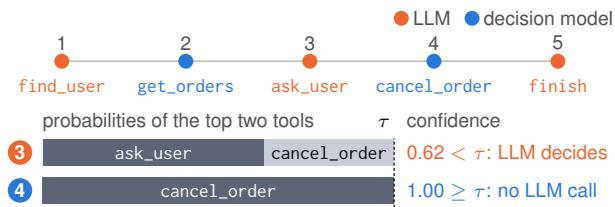  
one call: LLM \$0.0042, 809 ms; decision model \$0.00011, 223 ms  
Figure 6: In one recorded trajectory on a new DE-CISIONGYM task, the decision model answered only when it was confident. At step 3, JEV’s confidence was below the fitted threshold τ, so the LLM chose the tool; at step 4 it reached τ, and the tool ran without an LLM call. Bars: JEV’s probabilities for the top two of the 69 offered tools (JEV reports its confidence separately).

A worked episode. Figure 6 follows one recorded trajectory of the chosen combination on a new task, picked by a fixed rule (threshold $\hat { \tau } ^ { \star } ~ = ~ 1 . 0 0 )$ . A deferred step pays for both the decision-model call and the LLM call.

## B.2 Example Tasks

Table 6 shows two tasks generated at development seeds, which no evaluation uses, with the evaluation settings. The answer key accepts every open plan step that makes progress and uses only values the agent has seen. A near-duplicate tool that only reads returns a plausible result that does not advance the task.

TASK: ⟨task instruction⟩  
MEMORY:  
⟨recalled memories, one per line⟩  
LATEST REFLECTION:  
⟨the agent LLM’s latest reflection⟩  
HISTORY:  
[⟨step⟩] ⟨tool(arguments)⟩ -> ⟨result⟩

## B.3 Typed Questions and Decider Prompts

Figure 7 places the eight decision points in the harness loop. App. B.4 gives the question asked at each point, the state text and every prompt. An LLM decider read through log-probabilities sums the probabilities of tokens equal to an option label (after stripping whitespace and trailing punctuation), gives absent labels 10<sup>−6</sup> and renormalises. Without log-probabilities the generated token takes all the mass, and a verbalised confidence goes to the answer with the rest spread uniformly. Trained models use the full-logit readout of App. D.

## B.4 Prompts

This subsection lists every prompt our code sends to a model in the experiments, generated from the code by scripts/paper\_prompts.py. Examples come from development seed 600, which no evaluation uses. ⟨name⟩ marks a value filled in at run time, an italic [note] marks our shortening, and a hook marks a line we wrapped. No prompt contains the label of the decision it asks about. The answer key and every label stay in the decision log. Training data and teacher labels add no prompt of their own, since teachers answer the same requests and training rows use the trained-model format.

Decision-model inputs. Every decision model reads the same state text and one typed question, a choice among options or a yes/no question. The reference loop builds the state below. The questions come next, then the request that carries them.

P1. Decision-model state (reference loop). Source: src/ jevharness/harness/agent.py: JevAgent.\_s1\_state, src/jevharness/harness/config.py. MEMORY and LATEST REFLECTION appear only when the arm has them. The history keeps the last 8 steps and cuts each result to 400 characters. The current observation is cut to 2,000 characters and the whole state to 12,000. A cut keeps the head and the tail around ...[truncated]....

CURRENT OBSERVATION:   
⟨latest tool result⟩

P2. State at development seed 600, step 2. Source: src/ jevharness/harness/agent.py, src/jevharness/ bench/suites/jevgym.py. A DECISIONGYM clarify task in the evaluation settings (60 look-alike tools, 20 log lines per lookup), after the agent looked the customer up and listed the pending orders. Our shortening of the log lines is marked in italics. The model sees all of them.

TASK: The customer Lena Wang asked us to cancel their   
,→pending order. Please do it.   
HISTORY:   
[0] find\_user({"name": "Lena Wang"}) -> {"user\_id":   
,→"U2883", "name": "Lena Wang", "tier": "basic"}   
log: heartbeat ok #911760   
[4 more log lines]   
log: heartb   
...[truncated]...   
artbeat ok #777025   
[6 more log lines]   
log: heartbeat ok #417838   
[1] get\_orders({"user\_id": "U2883", "status": "pending"})   
,→-> [{"order\_id": "ORD-3872", "user\_id": "U2883", "item":   
,→"monitor", "status": "pending", "amount": 817.57},   
,→{"order\_id": "ORD-4002", "user\_id": "U2883", "item":   
,→"mouse", "status": "pending", "amount": 27   
...[truncated]...   
heartbeat ok #885494   
log: heartbeat ok #605733   
[5 more log lines]   
log: heartbeat ok #947812   
CURRENT OBSERVATION:   
[{"order\_id": "ORD-3872", "user\_id": "U2883", "item":   
,→"monitor", "status": "pending", "amount": 817.57},   
,→{"order\_id": "ORD-4002", "user\_id": "U2883", "item":   
,→"mouse", "status": "pending", "amount": 278.07}]   
log: heartbeat ok #149716   
[18 more log lines]   
log: heartbeat ok #947812

P3. Questions at tool calls. Source: src/jevharness/ harness/prompts.py, src/jevharness/harness/ agent.py, src/jevharness/harness/tools.py. Options carry the first line of each tool description. The decision model fills an argument only when its values are bounded, as with an enum or a boolean, or can be copied from the state. The copy options are the spans the code extracts. Free text always goes to the LLM.

[Tool choice: one of 69 options]   
Which tool should the agent call next?   
get\_orders\_archive -- List a customer's orders from the   
,→archive of a past calendar year (orders older than 12   
,→months only).   
set\_reminder -- Set a reminder.   
ship\_replacement -- Ship a free replacement for a damaged,   
,→already delivered order.   
[65 more tools]   
finish -- Call when the task is complete. Provide the final   
,→answer (or a short summary).   
[Tool arguments: one question per argument]   
Which value should the argument \`⟨argument⟩\` of tool   
,→\`⟨tool⟩\` take? (⟨description in the schema⟩)   
Example: Which value should the argument \`name\` of tool   
,→\`find\_user\` take? (customer full name)   
Options: the 3 values copied from the state (Lena Wang,   
,→Lena, Wang), then   
<OTHER: none of these / needs generation>   
Example: Which value should the argument \`status\` of tool   
,→\`get\_orders\` take? ()   
Options: the enum all, pending, shipped, delivered,   
,→cancelled   
[Tool guard: yes/no]   
The agent proposes to call \`⟨tool⟩\` with arguments

<table><tr><td colspan="2">(a) Ask before acting (clarify, which order is missing; development seed 600)</td></tr><tr><td>Request Hidden state</td><td>“The customer Lena Wang asked us to cancel their pending order. Please do it.&quot; Lena Wang (U2883, basic tier) has two pending orders, ORD-3872 (monitor, $817.57) and ORD-4002 (mouse, $278.07). Asked which one, the scripted customer replies “please cancel order ORD-4002 (the mouse).&quot;</td></tr><tr><td>Plan</td><td>find_user(Lena Wang) → get_orders(U2883, pending) → ask_user(order_id) →</td></tr><tr><td>Answer key</td><td>cancel_order(ORD-4002, customer_request) → finish(done) At the start: find_user or ask_user. After the two lookups: only ask_user for the order (three steps to go).</td></tr><tr><td>Fails the task</td><td>There, get_order(ORD-4002) and a question about the refund method are detours, and finish is premature. cancel_order(ORD-4002, customer_request) before asking, although it names the right order; cancelling</td></tr><tr><td></td><td>ORD-3872; cancel_order_item(ORD-4002, mouse, customer_request). Each ends the episode.</td></tr><tr><td colspan="2">(b) A rule instead of named operations (DECISIONGYM-Hard, tier rule, ten customers; development seed 7003) Request “Handle the pending order of each of these customers, in order: (1) Dana Ali; (2) Rosa Silva; . . . ; (10) Priya</td></tr><tr><td></td><td>Garcia. For each customer, look up their pending order and cancel it if the customer is basic tier and the amount is above $300.00, or silver tier and the amount is above $600.00 (never cancel a gold-tier customer&#x27;s order); otherwise ship it. . . . ,</td></tr><tr><td>Hidden state</td><td>Close calls among the ten: Rosa Silva (gold, $583.10) ship; Jia Ali (basic, $310.70) cancel; Priya Garcia (silver, $601.53) cancel; Hana Garcia (silver, $120.61) ship. The correct total is 3552.19.</td></tr><tr><td>Plan</td><td>The same three steps per customer, the operation set by the rule, then finish: 31 steps within a budget of 45.</td></tr><tr><td>Answer key</td><td>After each customer&#x27;s two lookups, the operation the rule gives, or looking up the next customer; the other operation ends the episode</td></tr></table>

Table 6: Two tasks generated at development seeds with the evaluation settings. “Answer key” lists the acceptable next steps at one state. Detours are allowed but cost a step.  
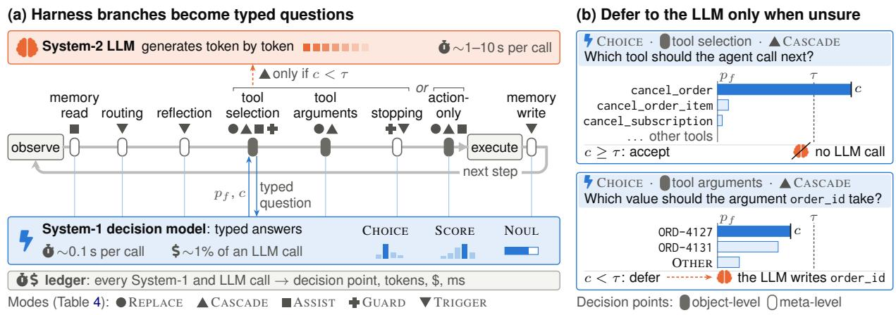  
Figure 7: Each harness branch over a computable option set becomes a typed question to a fast decision model, whose answer decides when and how the LLM is called. (a) The eight decision points in harness order (WHERE) and the modes implemented at each (HOW). (b) Two CASCADE decisions (illustrative distributions; Eq. 4 sets τ): System-1 is sure of the tool but not of the copied order\_id; in this factorised path the accepted tool skips tool generation and only the deferred argument needs an LLM call. ∼: indicative (JEV: vendor-reported; measured ratios vary with state length, backend and reads).

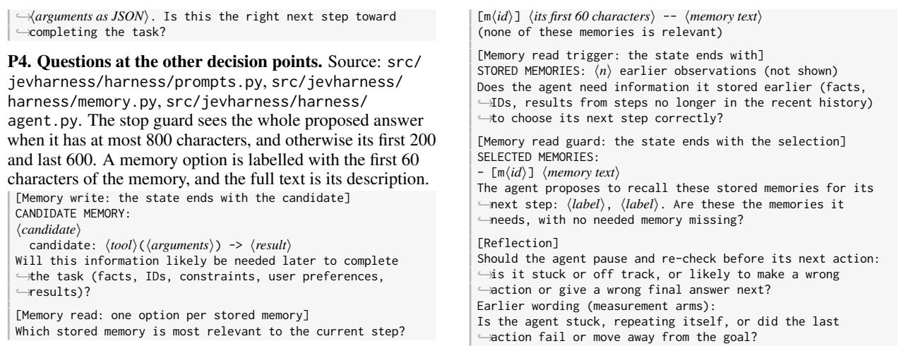

```ini
[system]
You are a careful decision assistant. Use the state and
```

[Stop guard, when the LLM calls finish]   
The agent wants to stop and submit the final answer   
,→⟨answer, JSON-quoted⟩. Is the task actually complete, and   
,→is this answer correct?   
[Stop trigger, at every other step]   
Has the task already been fully completed, so the agent   
,→should stop now?   
[Routing]   
Does the next step require careful multi-step reasoning,   
,→planning, or recovery from an error (i.e., a strong   
,→model) rather than a routine action?   
[Action-only environments: choice and guard]   
Which action should the agent take next?   
Options: the admissible actions   
The agent proposes to take the action \`⟨action⟩\`. Is this   
,→the right next step toward completing the task?   
[Verification triggers: does the LLM's proposal need a   
,→second look?]   
The agent proposes to call \`⟨tool⟩\` with arguments   
,→⟨arguments⟩. Should the agent re-check this choice of   
,→tool before the call runs: could another tool be the   
,→right next step?   
The agent proposes to call \`⟨tool⟩\` with arguments   
,→⟨arguments⟩. Should the agent re-check these argument   
,→values before the call runs: could a value be wrong or   
,→missing?   
The agent proposes to take the action \`⟨action⟩\`. Should   
,→the agent re-check this action before it runs: could   
,→another action be the right next step?

P5. JEV request (wire format). Source: src/jevharness/ decision/jev.py: question\_to\_wire. The example keeps 2 of the 69 tool options and finish. In the reference loop each decision point is one request. A Noul (yes/no) question carries criteria only when the harness gives them, as mini-SWE-agent and pi do. JEV, OpenJev, StartLux-Decision and our trained models all receive this request.

"state": "[the state shown above]",   
"model": "typesafe/jev-1.13",   
"questions": {   
"q0": {   
"type": "choice",   
"instructions": "Which tool should the agent call next?",   
"criteria": {   
"get\_orders\_archive": "List a customer's orders from   
,→the archive of a past calendar year (orders older than 12   
,→months only).",   
"set\_reminder": "Set a reminder.",   
"finish": "Call when the task is complete. Provide the   
,→final answer (or a short summary)."   
}   
},   
"q1": {   
"type": "noul",   
"instructions": "Has the task already been fully   
,→completed, so the agent should stop now?"   
}   
}   
}

How each decision model reads a question. JEV, OpenJev and StartLux-Decision receive the request above and build their prompts inside their own servers (Almeida, 2026; razorback16, 2026; StartLuxLabs, 2026). Every other decision model gets one of the prompts below, where ⟨state⟩ is the state text shown above.

P6. Intern-Decision (one pass for all questions). Source: src/jevharness/decision/intern\_decision.py: compile\_row. The vendor’s prompt compiler, copied with its licence. The state is JSON-encoded. Each field’s answer is read at its <decision> placeholder, so k questions cost one forward pass.

,→decision schema in the user message to make the requested   
,→decisions. For every field, choose exactly one answer   
,→symbol (e.g. A, B, C, ...) from its listed options and   
,→return one valid JSON object mapping each field name to   
,→its chosen symbol. Use the field names and symbols   
,→exactly as given. Do not include explanations, Markdown,   
,→or extra text.   
[user]   
Return one answer for every field using the supplied answer   
,→symbols.   
## State   
"⟨state⟩"   
## Decision schema   
tool\_select: Which tool should the agent call next?   
A = get\_orders\_archive: List a customer's orders from   
,→the archive of a past calendar year (orders older than 12   
,→months only).   
B = set\_reminder: Set a reminder.   
C = finish: Call when the task is complete. Provide the   
,→final answer (or a short summary).   
stop: Has the task already been fully completed, so the   
,→agent should stop now?   
A = no: The answer is no (negative, or disagree with   
,→the claim).   
B = yes: The answer is yes (affirmative, or align with   
,→the claim).   
[assistant]   
{   
"tool\_select": "<decision>",   
"stop": "<decision>"   
}

P7. AGENTDECISION-4B and the other trained models. Source: src/jevharness/training/data.py: SYSTEM, render, src/jevharness/training/serve\_jev.py. Each question gets its own prompt in the checkpoint’s chat template, with thinking off and the assistant turn opened. The answer is read from the next-token logits of the option codes. Training rows use this exact format.

```ini
[system]
You are a fast decision module inside an AI agent. Read the
,→state and answer the question with exactly one token: the
,→label of your answer.
[user]
STATE:
⟨state⟩
QUESTION: Which tool should the agent call next?
OPTIONS:
A. get_orders_archive -- List a customer's orders from the
,→archive of a past calendar year (orders older than 12
,→months only).
B. set_reminder -- Set a reminder.
C. finish -- Call when the task is complete. Provide the
,→final answer (or a short summary).
Answer with the option label only.
[user, a yes/no question]
STATE:
⟨state⟩
QUESTION: Has the task already been fully completed, so the
,→agent should stop now?
OPTIONS:
A. yes
B. no
Answer with the option label only.
```

P8. LLM decider read through log-probabilities. Source: src/jevharness/decision/llm\_logprob.py. The model generates one token at temperature 0 and returns the top 20 log-probabilities. The probabilities of tokens that equal an option label are summed per label.

[system]   
You are a fast decision module inside an AI agent. Read the   
,→state and answer the question with exactly one token: the   
,→label of your answer. Do not explain.   
[user]   
STATE:   
⟨state⟩   
QUESTION: Which tool should the agent call next?   
OPTIONS:   
A. get\_orders\_archive -- List a customer's orders from the   
,→archive of a past calendar year (orders older than 12

```ini

[system]
You are a capable autonomous agent. Solve the user's task
,→by calling the available tools. Call one tool per turn.
,→When the task is complete, call `finish` with the final
,→answer.
```

,→months only).   
B. set\_reminder -- Set a reminder.   
C. finish -- Call when the task is complete. Provide the   
,→final answer (or a short summary).   
Answer with the option label only.   
[user, a yes/no question]   
STATE:   
⟨state⟩   
QUESTION: Has the task already been fully completed, so the   
,→agent should stop now?   
Answer Yes or No.

P9. LLM decider with verbalised probabilities. Source: src/jevharness/decision/llm\_generative.py. The Gemini stand-in and the control in which the agent LLM answers its own questions use this prompt. All questions about one state go in one call.

```jsonl
[system]
You are a fast decision module inside an AI agent. Read the
,→state and answer each typed question independently. Be
,→calibrated: probabilities must reflect how likely each
,→option is correct. Reply with ONLY one JSON object, no
,→prose, no code fences.
[user]
STATE:
⟨state⟩
QUESTIONS:
Q1 (choose one option): Which tool should the agent call
,→next?
OPTIONS:
A. get_orders_archive -- List a customer's orders from the
,→archive of a past calendar year (orders older than 12
,→months only).
B. set_reminder -- Set a reminder.
C. finish -- Call when the task is complete. Provide the
,→final answer (or a short summary).
Q2 (yes/no): Has the task already been fully completed, so
,→the agent should stop now?
For EACH question give a probability for EVERY option key
,→(they must sum to 1), reflecting how likely each option
,→is the correct answer.
Reply with JSON exactly in this shape:
{"Q1": {"A": "<prob>", "B": "<prob>", "C": "<prob>"}, "Q2":
,→{"yes": "<prob>", "no": "<prob>"}}
[last block in the label variant]
For EACH question give your answer key and the probability
,→that it is correct.
Reply with JSON exactly in this shape:
{"Q1": {"answer": "<one of ['A', 'B', 'C']>", "confidence":
,→"<prob that the answer is correct>"}}
```

P10. Embedding baseline (L1 only). Source: src/ jevharness/decision/embedding.py. The score of an option is the cosine similarity of the two embeddings.

The agent LLM on DECISIONGYM. The agent LLM sees a short system prompt, the task and the tool results, plus the notes below when a decision point acts on its turn.

P11. Agent LLM: system prompt and first message on DECISIONGYM. Source: src/jevharness/harness/ agent.py, src/jevharness/bench/suites/jevgym.py, src/jevharness/harness/tools.py. The task’s tools (68 at these settings, shuffled per task) are passed as function declarations, and the LLM sees every tool result as a tool message.

[user]   
⟨task instruction⟩   
⟨first observation⟩   
[first observation]   
You have access to the customer-operations tools. Policy:   
,→never guess -- if a detail you need to act (who the   
,→customer is, which order, the refund method, the shipping   
,→speed) is not given or is ambiguous, ask the customer   
,→with ask\_user before taking any action.   
[tool \`finish\`, offered with the task's tools]   
Call when the task is complete. Provide the final answer   
,→(or a short summary).

P12. DECISIONGYM task instructions. Source: src/   
jevharness/bench/suites/jevgym.py:   
JevGymEnv.\_build\*, \_ask. The first five replies give a   
clarify task’s missing detail. A question about another detail   
gets the sixth reply in a clarify task and the seventh in every   
other task.   
[cancel] The customer ⟨customer⟩ asked us to cancel their   
,→pending order. Please do it.   
[refund] Refund the full amount of ⟨customer⟩'s most recent   
,→delivered order (highest order id) as store credit.   
[stock] How many units of '⟨item⟩' do we have in stock?   
,→Answer with the number.   
[ship] Ship ⟨customer⟩'s pending order. Use express   
,→shipping if the customer is gold tier, otherwise standard.   
[total] What is the total amount of all of ⟨customer⟩'s   
,→delivered orders? Answer with the number rounded to 2   
,→decimals.   
[clarify: order missing] The customer ⟨customer⟩ asked us   
,→to cancel their pending order. Please do it.   
[clarify: method missing] Refund the full amount of   
,→⟨customer⟩'s most recent delivered order (highest order   
,→id).   
[clarify: speed missing] Ship ⟨customer⟩'s pending order.   
[clarify: name missing] A customer wrote in asking us to   
,→ship their pending order (express if they are gold tier,   
,→otherwise standard), but did not say who they are.   
[multi] Process these requests in order:   
,→⟨numbered requests⟩.⟨shipping rule⟩ When all are done,   
,→answer with the total amount of the orders you processed,   
,→rounded to 2 decimals.   
numbered requests, joined by "; ": (⟨i⟩) ⟨request⟩   
request: cancel ⟨customer⟩'s pending order (the customer   
,→requested it)   
or: ship ⟨customer⟩'s pending order   
shipping rule (if any request ships): Use express   
,→shipping for gold-tier customers and standard shipping   
,→otherwise.   
[customer replies to ask\_user]   
Customer: Sorry for the confusion -- please cancel order   
,→⟨order id⟩ (the ⟨item⟩).   
Customer: Please refund it as store credit.   
Customer: Please refund it to my original payment method.   
Customer: ⟨Speed⟩ shipping, please.   
Customer: Oh, sorry -- my name is ⟨customer⟩.   
Customer: I think I already gave you everything you need on   
,→that point.   
Customer: I have nothing to add -- please go ahead with the   
,→request as described.

P13. DECISIONGYM-Hard instruction. Source: src/   
jevharness/bench/suites/jevgym\_hard.py:   
\_build\_multi, policy\_text, answer\_text. The runs   
used ten or twelve customers per task. Each customer’s tier   
and amount appear only in the lookup results. The code also   
has a rule on the amount alone, which no run used.   
Handle the pending order of each of these customers, in   
,→order: (1) ⟨customer 1⟩; (2) ⟨customer 2⟩;   
,→[one per customer]. For each customer, look up their   
,→pending order and ⟨rule⟩. Cancellations use the reason   
,→customer\_request; use express shipping for gold-tier   
,→customers and standard shipping otherwise.   
,→⟨answer sentence⟩   
[rule]   
cancel it if the customer is basic tier and the amount is   
,→above \$300.00, or silver tier and the amount is above   
,→\$600.00 (never cancel a gold-tier customer's order);   
,→otherwise ship it   
[answer sentence: total, first runs]   
When all are done, answer with the total amount of the

,→orders you processed, rounded to 2 decimals.   
[answer sentence: itemized, from E7e]   
When all are done, answer with one line per customer giving   
,→the action you took and the order amount, then the total   
,→amount of the orders you processed, rounded to 2 decimals.

P14. Messages the harness adds to the LLM’s context. Source: src/jevharness/harness/prompts.py, src/ jevharness/harness/agent.py. The reflection reply and the stop-guard rejection stay in the context. They are appended to the last tool message when one precedes them, because Gemini 3 returns an empty reply after a user turn there. The other notes go with one call only. Tool assist adds no text and offers the LLM only the model’s top tools and finish. Routing adds no text either. It sends the step to the cheaper LLM with the same messages. cheaper LLM with the same messages.

[Reflection: asked as a user turn, the reply kept]   
Pause. In <=4 sentences: assess progress toward the task,   
,→identify any mistake so far, and state the best next   
,→step. Do not call tools.   
[Reflection] ⟨the LLM’s reply⟩   
[Recalled memories, before the LLM's turn]   
[Memory]   
- [m⟨id⟩] ⟨memory text⟩   
- [m⟨id⟩] ⟨memory text⟩   
[Stop guard rejected a finish]   
[Verifier] The task may not be complete yet, or the final   
,→answer may be wrong. Re-check the requests and recompute   
,→the answer before calling finish.   
[Stop trigger fired: a forced finish call]   
The task appears complete. Call finish with the final   
,→answer.   
[Tool guard rejected the call]   
[Verifier] Your proposed call \`⟨tool⟩(⟨arguments⟩)\` was   
,→judged likely wrong. Reconsider and choose the correct   
,→next tool call.   
[Argument guard rejected one argument]   
[Verifier] In your proposed call \`⟨tool⟩(⟨arguments⟩)\`, the   
,→value of the argument \`⟨argument⟩\` was judged likely   
,→wrong. Reconsider and choose the correct next tool call.   
[Verification pass at tool choice: every tool offered]   
[Check] Before your proposed call \`⟨tool⟩(⟨arguments⟩)\`   
,→runs, re-read the task and the observations so far and   
,→check that this is the right tool to call now. If it is,   
,→make the same call again; if not, make the right call   
,→instead.   
[Verification pass at tool arguments: the call forced to   
,→the proposed tool]   
[Check] Before your proposed call \`⟨tool⟩(⟨arguments⟩)\`   
,→runs, re-read the task and the observations so far and   
,→check every argument value. Call \`⟨tool⟩\` again, with the   
,→same arguments if they are right or with corrected   
,→arguments if not.   
[Decision model chose the tool and the LLM fills the rest]   
You must now call \`⟨tool⟩\`. Already-determined arguments:   
,→⟨the model’s arguments⟩. Provide the remaining arguments.   
[Argument assist: the model's shortlists]   
You must now call \`⟨tool⟩\`. Choose these arguments from the   
,→shortlists:   
- \`⟨argument⟩\`: one of [⟨value⟩, ⟨value⟩]   
- \`⟨argument⟩\`: one of [⟨value⟩] (or another value)   
Already-determined arguments: {"⟨argument⟩": ⟨value⟩}.   
Provide all arguments.

P15. Yes/no questions the agent LLM answers itself.   
Source: src/jevharness/harness/memory.py, src/   
jevharness/harness/prompts.py, src/jevharness/   
harness/agent.py. Each gate is one call without tools, read   
as yes when the reply starts with y. With advice, the memory   
gate puts the advice line between the state and its question.   
[Memory-write gate (LLM decides, or the model defers)]   
⟨state⟩   
Should this be stored in long-term memory because it will   
,→likely be needed later? Answer yes or no.   
[Reflection and routing gates (the model defers)]   
⟨state⟩   
⟨question⟩ Answer yes or no.   
[Advise variants: the advice comes before the question]   
⟨state⟩

⟨advice⟩   
⟨question⟩ Answer yes or no.   
[Advisor] A fast decision model answered the question   
,→below: ⟨yes|no⟩ (confidence ⟨p⟩). It can be wrong; decide   
,→yourself.   
[Stop advise, added to the LLM's turn]   
[Advisor] A fast decision model's answer to "Has the task   
,→already been fully completed, so the agent should stop   
,→now?": ⟨yes|no⟩ (confidence ⟨p⟩). It can be wrong; decide   
,→yourself whether to call finish now.   
[Memory-read guard: the LLM selects]   
⟨state⟩   
STORED MEMORIES:   
- [m⟨id⟩] ⟨text⟩   
⟨rejection note, after a veto⟩   
Which of the stored memories above does the agent's next   
,→step need? Answer with their ids separated by commas (for   
,→example: m3, m7), or with none.   
[rejection note]   
[Verifier] Your memory selection was judged likely wrong (a   
,→needed memory missing, or the wrong ones). Reconsider and   
,→select again.

P16. Action-only environments (ALFWorld). Source: src/ jevharness/harness/agent.py, src/jevharness/ bench/suites/alfworld.py. The task sentence and the observations are ALFWorld’s own (Shridhar et al., 2021). The reply’s last Action: line is matched to the closest The reply's last Action: line is matched to the closest admissible action. admissible action.

```ini
[system]
You are an agent acting in a text environment. At each turn
,→choose exactly one action from the list of admissible
,→actions. Think briefly if needed, then end with a line
,→`Action: <action>` copied verbatim from the list.
[user]
⟨task instruction
⟨first observation⟩
[each turn, appended to the history]
Admissible actions:
- ⟨action⟩
- ⟨action⟩
[after each action]
Observation: ⟨observation⟩
[action guard rejected the proposal]
[Verifier] Your proposed action `⟨action⟩` was judged
,→likely wrong. Reconsider and choose the correct next
,→action.
[verification pass, after the admissible list]
[Check] Before your proposed action `⟨action⟩` runs,
,→re-read the task and the observations so far and check
,→that it is the right next action. If it is, repeat it; if
,→not, choose the right action instead. End with a line
,→`Action: <action>` copied verbatim from the list.
```

Other harnesses and the static suites. Each integration renders its own state and asks its own questions. We list only the parts we wrote.

P17. τ<sup>2</sup>-bench: state and questions. Source: src/ jevharness/bench/suites/tau2.py. The policy question drops the confirmation clause when the domain policy does not require explicit confirmation. The agent’s system prompt and the user simulator are τ<sup>2</sup>-bench’s own (Barres et al., 2026).

```ini
[state]
DOMAIN POLICY (excerpt):
⟨policy excerpt⟩
CONVERSATION SO FAR (oldest first):
⟨earlier messages⟩
LATEST MESSAGE TO THE AGENT:
⟨latest message⟩
[each message of the conversation, one line]
[⟨user|agent⟩] ⟨text
[agent -> tool] ⟨tool(arguments)⟩; ...
[⟨tool|tool ERROR⟩] ⟨result⟩
[Tool choice]
What should the customer-service agent do next? Choose the
,→tool to call, or `respond_to_user` to send a message to
```

,→the user.   
Options: the domain's tools, then   
respond\_to\_user -- Send a text message to the user instead ,→of calling a tool (ask for missing details or explicit ,→confirmation, report a result, or refuse).   
[Tool arguments: the reference loop's question]   
[Tool guard]   
The agent proposes to ⟨proposal⟩. Is this the right next ,→step, consistent with the domain policy?   
proposal: call \`⟨tool⟩\` with arguments ⟨arguments as JSON⟩ or: reply to the user: "⟨message⟩"   
[Policy guard, at state-changing calls]   
The agent is about to call the state-changing tool \`⟨tool⟩\` ,→with arguments ⟨arguments as JSON⟩. Does this action   
,→comply with the domain policy, and has the user   
,→explicitly confirmed exactly this action (answered yes) ,→in the conversation?   
[Transfer guard]   
The agent wants to transfer the user to a human agent ,→(\`transfer\_to\_human\_agents\`). Per the policy, transfer ,→only if the request cannot be handled within the scope of ,→the agent's tools and policy (or the user asks for a ,→human where that is allowed). Is transferring now   
,→justified?   
[Routing]   
Does the next step require careful multi-step reasoning, ,→policy interpretation or recovery from an error (i.e., a ,→strong model) rather than a routine reply or lookup?

## P18. τ<sup>2</sup>-bench: messages to the agent LLM. Source: src/ jevharness/bench/suites/tau2.py. A rejected proposal is not executed. The LLM answers again, with the note as a final user turn.

[Decision model chose the tool and the LLM fills the rest] You must now call \`⟨tool⟩\`. Already-determined arguments: ,→⟨the model’s arguments⟩. Provide the remaining arguments. [Transfer guard rejected]   
[Verifier] Transferring to a human agent does not look ,→justified yet. Try to resolve the request with the   
,→available tools and the policy, or explain to the user ,→what you can and cannot do.   
[Policy guard rejected]   
[Policy check] Your proposed action \`⟨tool⟩(⟨arguments⟩)\` ,→was judged likely to violate the domain policy or to lack ,→the user's explicit confirmation. Re-read the policy. If ,→confirmation is required, list the action details and ask ,→the user to confirm (yes) before acting. Decide again: ,→respond to the user or call a tool.   
[Tool guard rejected]   
[Verifier] Your proposed next step (⟨proposal⟩) was judged ,→likely wrong. Reconsider and choose the correct next ,→action (a tool call or a message to the user).   
P19. mini-SWE-agent: decision-model state. Source: src/   
jevharness/adapters/mini\_swe.py: \_s1\_state,   
adapters/mini\_swe/swebench\_jev.yaml. The history   
keeps the last 8 commands and cuts each output to 400   
characters. Only a blocked command carries the [NOT   
EXECUTED] tag. The questions of one step share this state and   
go out in one request.   
TASK (issue to resolve): ⟨issue text⟩ HISTORY (most recent last): [⟨step⟩] \$ ⟨command⟩ [NOT EXECUTED] -> rc=⟨exit code⟩: ,→⟨output⟩ CURRENT OBSERVATION: ⟨last output⟩ STEP: ⟨step⟩ [guard only] AGENT'S REASONING FOR THIS STEP: ⟨the agent’s reasoning⟩ [stop guard only] The agent is now issuing the submit ,→command.

P20. mini-SWE-agent: questions and messages. Source: src/jevharness/adapters/mini\_swe.py. The agent’s prompts are mini-SWE-agent’s SWE-bench configuration, unchanged (Yang et al., 2024). The reflection, action-type and stop-trigger hooks are implemented but were not run. [Routing: deep or fast path (E4, E4b and the H5 route)] Does the next step require careful multi-step reasoning, ,→planning, debugging, or recovery from an error (i.e., a

,→strong model) rather than a routine action such as   
,→reading a file, searching, or re-running a command? [Command guard (H5)]   
The coding agent proposes to run the bash command below in ,→the repository. Is this command reasonable, on-track ,→toward resolving the issue, and non-destructive (it does ,→not delete or reset the repository, its tests, git   
,→history or the environment)?   
COMMAND:   
⟨command⟩   
criteria: yes = The command is safe and a sensible next ,→step for fixing the issue.   
no = The command is destructive, violates the task   
,→boundaries (e.g. edits or deletes tests), or is   
,→unproductive / off-track. [Submit guard (H5)]   
The coding agent now wants to submit its patch and end the ,→task. Has the fix been verified: was the issue   
,→reproduced, and were the modified code and the relevant ,→tests actually run after the last source edit, with   
,→results showing that the issue is fixed?   
criteria: yes = Verified: a reproduction and/or relevant ,→tests were run after the final edit and pass.   
no = Unverified: nothing was run after the final change, or ,→the runs still show the bug/errors. [blocked command, as its observation]   
[Guard] This command was NOT executed: an automatic   
,→safety/progress check judged it likely destructive, ,→off-track or unproductive (p\_ok=⟨p⟩ < ⟨threshold⟩).   
,→Reconsider your approach and issue a different command. ,→If you are certain this exact command is necessary, ,→re-issue it unchanged and it will run.   
[deferred submission]   
[Verifier] Submission deferred: the fix does not appear to ,→be verified yet. Before submitting, (1) make sure you ,→have reproduced the issue, (2) re-run your reproduction ,→script and the most relevant existing tests against your ,→modified code, and (3) fix any failures. Then create the ,→patch and submit again with the exact submit command.

P21. pi on Terminal-Bench-Science (H5). Source: adapters/pi/jev-tool-gate.ts, adapters/pi/ jev-stop-verify.ts, adapters/pi/jev-reflect.ts, adapters/pi/jev-common.ts. The agent’s prompts are pi’s own (earendil-works, 2026), and the tasks are Terminal-Bench-Science’s (Terminal-Bench-Science Team, 2026). The router, memory, tool-pruning and compaction

[state: a JSON object]   
{"task": ⟨latest user message⟩, "summary":   
,→⟨compaction summary, ifany⟩,   
"history": ["[⟨i⟩] ⟨tool(arguments)⟩ -> ⟨result⟩", ...],   
"current\_observation": ⟨latest tool result⟩,   
"proposed\_call" (guard) | "final\_response" (stop): ⟨value⟩} [Tool guard]   
The agent proposes to call \`⟨tool⟩\` with arguments   
,→⟨arguments as JSON⟩. Is this the right next step toward ,→completing the task?   
criteria: yes = The call is a correct and useful next step no = The call is wrong, premature, unsafe, or off-task [rejected: the tool result]   
[Verifier] Your proposed call \`⟨tool(arguments)⟩\` was   
,→judged likely wrong. Reconsider and choose the correct ,→next tool call.   
[Stop guard, when the agent settles]   
The agent wants to stop and submit. Is the task actually ,→complete?   
criteria: yes = Every requirement of the task is met, and ,→the result was checked   
no = Work remains, or the result is wrong or unverified [rejected: a message, then one more turn]   
[Verifier] The task does not look complete yet. Re-read the ,→task, check every requirement against the current state ,→(run the tests or inspect the outputs), and continue ,→working before you finish.   
[Reflection, after a failed or repeated call]   
Is the agent stuck, repeating itself, or did the last   
,→action fail or move away from the goal?   
criteria: yes = Stuck, looping, failing, or drifting from ,→the goal   
no = Making steady progress toward the goal   
[fired: a message]   
[Reflection] Pause before your next tool call. In at most 4

,→sentences: assess progress toward the task, identify any   
,→mistake so far, and state the best next step. Then   
,→continue working.

P22. L1 static decisions (BFCL, When2Call). Source: src/ jevharness/bench/suites/static.py, src/ jevharness/bench/decision\_eval.py. The argument question names the reference function on purpose, so that it measures argument filling given the right function. The native function-calling baseline sees each benchmark’s own

[BFCL state, one line per message]   
⟨ROLE⟩: ⟨message⟩   
[BFCL tool choice]   
Which function should be called to handle the user's   
,→request?   
Options: the functions, then   
none (no available function fits the request) -- Use when   
,→no function applies.   
[BFCL argument, given the reference function]   
The function \`⟨referencefunction⟩\` will be called. Which   
,→value should its argument \`⟨argument⟩\` take?   
,→(⟨argument description⟩)   
Options: enum or boolean values, or spans copied from the   
,→request, then <OTHER: none of these / needs generation>   
[When2Call state]   
AVAILABLE TOOLS:   
- ⟨name⟩: ⟨description⟩   
\* ⟨argument⟩ (⟨type⟩, ⟨required|optional⟩):   
,→⟨description⟩   
[one block per tool]   
USER: ⟨question⟩   
[When2Call]   
How should the assistant respond to the user's message?   
- call one of the available tools   
- ask the user for missing required information   
- say it cannot help: no available tool fits and the   
,→question needs one   
- answer directly without any tool   
[Judge of the native function-calling baseline's text   
,→replies]   
You classify an AI assistant's reply to a user's request.   
,→The assistant had these tools:   
⟨tools⟩   
USER: ⟨request⟩   
ASSISTANT REPLY (it did not call a tool): ⟨reply   
Which kind of reply is it?   
- request\_for\_info: it asks the user for missing   
,→information or clarification it needs to proceed   
- cannot\_answer: it says it cannot help / does not have a   
,→suitable tool or ability   
- direct: it answers or acts on the request directly (gives   
,→an answer, or claims to have done it)   
Reply with ONLY a JSON object: {"label":   
,→"<request\_for\_info|cannot\_answer|direct>"}

## B.5 Gold Labels, Probes and Measurement Arms

These definitions were fixed before the main runs. Labels are computed on a copy of the environment after the decision model’s answer is recorded and go only to the decision records. A canary test plants a gold value and checks that no request contains it.

Verdicts and gold labels. Let D(s) be the number of steps the answer key needs from a copy of s to finish successfully (∞ if it cannot within the step budget, and such doomed states are excluded). We label an attempt to finish progress if it succeeds, a wrong answer if everything but the answer is done, and premature otherwise. Any other call is fatal if it makes D infinite, progress if it lowers

D, and a detour otherwise. Fatal, premature and wrong-answer actions arefailing. A tool choice is right if it is an undone plan step that is progress and whose inputs are visible. An argument is right if it matches the canonical value (up to case, whitespace and 0.01 in amounts), and a guard verdict if it matches whether the proposal is progress. A reflection or routing trigger is right if the next action without it is failing, a stop trigger if only the answer remains, and a memory write if the text holds a value a remaining plan step consumes. From its JSON schema alone, each argument is bounded (enum, boolean, integer range of at most 20 values), copyable (numbers, and strings with a format or pattern or named like an identifier or a quantity) or free. The copy-dependent arguments of H3 (App. A) are the copyable ones.

Measurement arms and probes. Two measurement arms, Flash on 200 tasks and Flash-Lite on 500, act like LLM-only while every gate runs in shadow, so its label is observed at every state. On Flash-Lite, one-step branches replay states with the intervention and with a placebo that only resamples the default call. Relative to the placebo, e is the gain in the chance of progress when the trigger fires before a failing action, and h is the gain in the chance of failure when it fires before a progress action. A probe is a proposal the guard scores but that is never executed (Table 7), and probes enter no reported success, cost, test or training data. A gate cell is estimable for H2 when its arm has at least 30 positive and 30 negative labels and a live and a matched-rate random arm exist. The reflectiontrigger test has no headroom when, at W = \$1, the 95% CI of its one-step perfect-information ceiling (Eq. 5 with J = 1 and the measured e + h) lies within ±3.3 points, the registered minimum detectable effect.

## B.6 Benchmark Difficulty: Hard States

Using stored answers only, Table 8 shows which models find DECISIONGYM hard. Acting alone, Flash solved 99.4% of the 500 fresh Stage-2 tasks, so a decision model can lower cost but has little success to add. The seven off-the-shelf decision models chose an acceptable tool at 48.3–93.9% of all common states and at 42.7–82.7% of the hard ones. The generator-trained rows are near ceiling on every subset (App. D.10).

<table><tr><td>Guard</td><td>Rate (%) [95% CI] (proposals)</td><td>System-2 Flash</td><td>System-2 Flash-Lite</td></tr><tr><td>Stop</td><td>FAR, model-generated wrong finishes</td><td>3.7 [1.7, 6.1] (241)</td><td>12.3 [9.4, 15.2] (689)</td></tr><tr><td></td><td>FAR, the LLM&#x27;s own wrong finishes FRR, the LLM&#x27;s own right finishes</td><td>- (0) 8.0 [4.5, 12.0] (200)</td><td>40.7 [30.8, 50.5] (91) 1.2 [0.2, 2.2] (409)</td></tr><tr><td></td><td></td><td>7.7 [4.2, 11.7] (181)</td><td>5.7 [3.7, 8.0] (470)</td></tr><tr><td>Tool</td><td>FAR, fatal proposals (edits, transplants)</td><td></td><td></td></tr><tr><td></td><td>FAR against progress (own, transplanted)</td><td>0.0 (2)</td><td>67.4 [51.3, 82.6] (43)</td></tr><tr><td></td><td>FRR against progress (own, transplanted)</td><td>1.3 [0.7, 2.0] (1631)</td><td>1.3 [0.9, 1.7] (4078)</td></tr></table>

Table 7: Error rates of the JEV guards on DECISIONGYM probes labelled by the answer key (Stage-1 measurement arms at $\tau = 0 . 5 ,$ , task-clustered bootstrap intervals, descriptive). FAR: share of wrong proposals accepted. FRR: share of right proposals rejected. Model-generated wrong finishes pool the LLM’s own, forced-premature and transplanted ones. Flash made no wrong finish of its own (–).

<table><tr><td></td><td>All states</td><td>Hard (union)</td><td>After off-plan</td><td>ask_user next</td><td>Flash states</td></tr><tr><td>States n</td><td>5,314</td><td>957</td><td>386</td><td>582</td><td>1,498</td></tr><tr><td>Tasks</td><td>200</td><td>135</td><td>57</td><td>100</td><td>200</td></tr><tr><td>Agent LLM (Flash)a</td><td>99.9</td><td>100.0</td><td>一</td><td>100.0</td><td>99.9</td></tr><tr><td>JEV</td><td>91.5</td><td>69.4</td><td>81.5</td><td>64.4</td><td>92.0</td></tr><tr><td>Intern-Decision-4B</td><td>75.2</td><td>55.7</td><td>47.6</td><td>59.6</td><td>76.3</td></tr><tr><td>StartLux-27B</td><td>93.9</td><td>71.2</td><td>85.1</td><td>63.4</td><td>92.6</td></tr><tr><td>StartLux-9B‡</td><td>91.8</td><td>82.7</td><td>74.3</td><td>87.1</td><td>92.9</td></tr><tr><td>StartLux-4B</td><td>89.1</td><td>81.7</td><td>76.8</td><td>84.1</td><td>89.6</td></tr><tr><td>StartLux-2B‡</td><td>68.4</td><td>56.2</td><td>47.2</td><td>61.8</td><td>73.7</td></tr><tr><td>StartLux-0.8B‡</td><td>48.3</td><td>42.7</td><td>31.5</td><td>49.4</td><td>52.1</td></tr><tr><td>Qwen3-4B (untrained)</td><td>50.1</td><td>39.9</td><td>26.7</td><td>47.3</td><td>54.4</td></tr><tr><td>SFT v1*</td><td>99.2</td><td>98.0</td><td>93.8</td><td>100.0</td><td>100.0</td></tr><tr><td>AGENTDECISION-4B V1*</td><td>99.2</td><td>98.2</td><td>94.7</td><td>100.0</td><td>100.0</td></tr><tr><td>StartLux-4B SFT (track 2) *‡</td><td>99.4</td><td>98.2</td><td>95.0</td><td>100.0</td><td>100.0</td></tr><tr><td>Spread (points)b</td><td>50.9</td><td>55.5</td><td>63.2</td><td>50.6</td><td>47.9</td></tr></table>

Table 8: Tool-choice accuracy (task-weighted %) on the common states and on subsets defined by a rule after the main study (post hoc) but before any accuracy on them was computed. Hard: after an off-plan step, or the next tool is ask\_user. Flash states: the LLM-only trajectories. <sup>a</sup>Its own choice on its own trajectories. <sup>b</sup>Over the eight models of Figure 4. <sup>∗</sup>Trained on DECISIONGYM’s generator. <sup>‡</sup>Exploratory.

## C JEVAGENTHARNESS

Combinations, call graph and serving. A YAML file defines each combination of delegations (Figure 8) by setting mode, τ and k per decision point for each agent LLM, and every episode records the file’s hash. Under CASCADE, below the tool threshold the LLM makes the whole tool call. Otherwise each bounded or copyable argument of the accepted tool is its own question with its own threshold, and the LLM fills the other arguments in one forced call. Any service that answers JEV’s request format can be the decision model. Decision-model cache hits replay the original cost and latency, and LLM calls are never cached.

Integrations. Table 9 lists the modes that the adapters for mini-SWE-agent (Yang et al., 2024), pi (earendil-works, 2026) via Harbor (Harbor Frame-

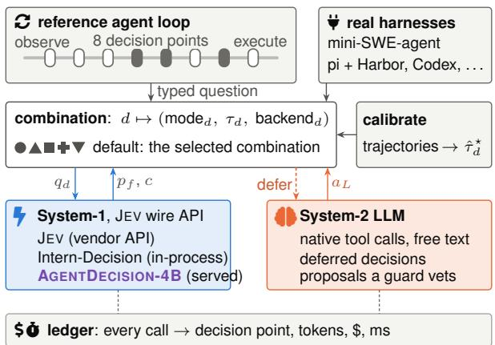  
Figure 8: Architecture of JEVAGENTHARNESS. A typed question from the reference loop, or from a hook of an existing harness, goes to the point’s entry in the combination (mode, threshold, System-1 backend), whose mode executes, narrows, vets or defers System-1’s answer. One ledger meters every call.

work Team, 2026), Codex CLI (OpenAI, 2026a) and the DeepSeek Harness (DeepSeek-AI, 2026) can express. REPLACE and CASCADE would need a hook that returns the next action before the LLM is called.
<table><tr><td>Mode</td><td>Own loop</td><td>pi</td><td>Codex</td><td></td><td>DSH mini-SWE</td></tr><tr><td>REPLACE/CASCADE tool</td><td>√</td><td>一</td><td></td><td></td><td></td></tr><tr><td>AsSIST (prune tools)</td><td>√</td><td>√</td><td></td><td></td><td>n/a</td></tr><tr><td>GUARD (approve)</td><td>√</td><td>√</td><td>deny only</td><td>√</td><td>√</td></tr><tr><td>TRIGGER stop</td><td>√</td><td>√</td><td></td><td>√</td><td>√</td></tr><tr><td>TRIGGER routing</td><td>√</td><td>√</td><td>record only</td><td>√</td><td>√</td></tr><tr><td>TRIGGER memory/reflect</td><td>√</td><td>√</td><td>√</td><td>√</td><td>√</td></tr><tr><td>Status</td><td>E</td><td>S, E</td><td>I</td><td>I</td><td>S, E</td></tr></table>

Table 9: Modes each harness can express without forking. DSH: DeepSeek Harness, also serving Claude Code. –: not expressible. n/a: mini-SWE-agent’s action is one bash command. Status: I = implemented and unit-tested, S = smoke-tested end to end, E = evaluated.

## C.1 The Final Harness (Exploratory)

Table 10 compares the final harness (§7.3) with LLM-only on the same 200 fresh tasks, with the

GPU shared by about four episodes, as in Stage 2, or dedicated to one. Cost includes the GPU at \$1.624 per hour. With four episodes per GPU, queueing for the decision model took 66.1% of the episode time.

<table><tr><td></td><td>shared GPU</td><td>dedicated GPU</td></tr><tr><td>Success, LLM-only (%)</td><td>99.5</td><td>99.5</td></tr><tr><td>Success, final harness (%)</td><td>100.0</td><td>100.0</td></tr><tr><td>difference [95% CI]</td><td>+0.5 [+0.0, +1.5]</td><td>+0.5 [+0.0, +1.5]</td></tr><tr><td>$ / episode, LLM-only</td><td>0.0434</td><td>0.0431</td></tr><tr><td>$ / episode, final harness</td><td>0.0078</td><td>0.0102</td></tr><tr><td>of which GPU</td><td>0.00192</td><td>0.00438</td></tr><tr><td>saving (%) [95% CI]</td><td>82.1 [81.5, 82.7]</td><td>76.3 [75.6, 77.1]</td></tr><tr><td>s / episode, LLM-only</td><td>8.70 (8.94)</td><td>13.59 (8.87)</td></tr><tr><td>s / episode, final harness</td><td>22.39 (20.72)</td><td>9.59 (7.89)</td></tr><tr><td>difference [95% CI]</td><td>+13.69 [+12.08, +15.13] -4.00 [-7.98, -0.61]</td><td></td></tr></table>

Table 10: The final harness against LLM-only on 200 fresh DECISIONGYM tasks on one A10G, with the GPU shared or dedicated (exploratory). Success in %, its difference in points. Time: mean (median) s per episode, with the difference of means.

## C.2 JEVAGENTHARNESS in mini-SWE-agent (Exploratory)

In these registered exploratory runs, JEV routes steps in an unmodified mini-SWE-agent (Table 11). Before each step JEV is asked whether the step needs careful reasoning, planning, debugging or error recovery. The strong LLM takes the step if JEV says yes with probability at least τ = 0.50 or gives no answer, and the fast LLM takes it otherwise. On 300 instances (the first 100 and 200 more in a registered extension), routing resolved 229 against 232 for the strong LLM alone at 10.5% lower cost, without establishing non-inferiority (Table 30). The new instances alone saved 4.8%. With Gemini 3.8 Flash in both roles, the fast LLM alone resolved more than both other arms.

## C.3 Routing in Two More Open-Source Harnesses

We added the routing of App. C.2 to pi on all 89 tasks of Terminal-Bench 2.0 and to SWE-agent on 100 held-out SWE-bench Verified instances, with Gemini 3.5 Flash as the strong and Flash-Lite as the fast LLM and nothing tuned (Table 12). In both harnesses most requests stayed with the strong LLM, so routing saved little cost and no time. It kept success in pi. In SWE-agent the routed agent needed more steps per instance (33.4 against 29.3).

The decision layer as a proxy. We then placed the decision layer in a proxy between an unmodified harness and its LLM provider. The proxy sent a step to the fast LLM only when the confidence fell in a range fitted on calibration tasks. In pi no range qualified (AUROC 0.52), and in mini-SWE-agent the gate routed 0.7 % of the requests on 30 pilot instances without changing success. A follow-up sent the steps that JEV predicted would only read to the fast LLM and discarded any fast-LLM response that would write, run code or submit. JEV’s answers hardly separated the steps that only read from the others (AUROC 0.56 in pi and 0.70 in mini-SWE-agent). No fast-LLM action that would write, run code or submit reached a task, and none of these pilots met the criterion for a full run, so none followed.

<table><tr><td></td><td></td><td></td><td></td><td></td><td>Saved</td><td colspan="2">Time (s)</td><td>Fast</td><td></td></tr><tr><td>Arm</td><td>n Res. W/L</td><td></td><td></td><td>$/inst.</td><td>(%)</td><td>med. mean</td><td></td><td>(%) Limit</td><td></td></tr><tr><td>DeepSeek-V4: strong = V4-Pro with thinking, fast = V4-Flash without</td><td></td><td></td><td></td><td></td><td></td><td></td><td></td><td></td><td></td></tr><tr><td>Strong alone</td><td>100</td><td>81</td><td></td><td>0.0411</td><td></td><td>238</td><td>399</td><td>0.0</td><td>0</td></tr><tr><td>Routing (τ 0.50)</td><td>100</td><td>81</td><td>3/3</td><td>0.0324</td><td>21.3</td><td>219</td><td>354</td><td>23.5</td><td>0</td></tr><tr><td>Fast alone</td><td>100</td><td>78</td><td>3/6</td><td>0.0108</td><td>73.7</td><td>187</td><td>272</td><td>100.0</td><td>0</td></tr><tr><td>Gemini 3.8 Flash: strong g = thinking high, fast = low (no development run)</td><td></td><td></td><td></td><td></td><td></td><td></td><td></td><td></td><td></td></tr><tr><td>Strong alone</td><td>100</td><td>70</td><td></td><td>1.0164</td><td></td><td>907</td><td>886</td><td>0.0</td><td>24</td></tr><tr><td>Routing (τ 0.50)</td><td>100</td><td>75</td><td>8/3</td><td>0.9448</td><td>7.0</td><td>721</td><td>728</td><td>21.6</td><td>17</td></tr><tr><td>Fast alone*</td><td>50</td><td>40</td><td>6/2</td><td>0.6597</td><td>36.2</td><td>537</td><td>558</td><td>100.0</td><td>3</td></tr></table>

Table 11: Step routing by JEV in mini-SWE-agent on the same 100 fresh SWE-bench Verified instances (exploratory, one run per instance). Res.: resolved. W/L: resolved only by the arm / only by the strong LLM alone. \$/inst.: API cost per instance, JEV included. Fast: share of LLM calls to the fast LLM. Limit: stopped by the step or cost limit. <sup>∗</sup>First 50 instances only, compared with the strong LLM on the same ones.
<table><tr><td>Arm</td><td>n Succ. (%)</td><td></td><td>∆ pt [95 %] NI</td><td></td><td></td><td>$/task Cost (%)</td><td>Time (s) Time (%) Fast (%)</td><td></td><td></td></tr><tr><td colspan="2">pi on Terminal-Bench 2.0</td><td></td><td></td><td></td><td></td><td></td><td></td><td></td><td></td></tr><tr><td>Strong LLM alone</td><td>89</td><td>42.7</td><td></td><td></td><td>0.5103</td><td></td><td>- 257 / 121</td><td></td><td>0.0</td></tr><tr><td>Routing by JEV</td><td>89</td><td>50.6</td><td>+7.9 [-1.1, +16.9]</td><td></td><td>yes 0.4611</td><td></td><td>-9.6 260 / 120</td><td>+1.0</td><td>12.4</td></tr><tr><td>Fast LLM alone</td><td>89</td><td>36.0</td><td>-6.7 [-16.9, +3.4]</td><td></td><td>no 0.1484</td><td></td><td>-70.9 336 / 150</td><td>+30.5</td><td>100.0</td></tr><tr><td colspan="2">SWE-agent on SWE-bench Verified</td><td></td><td></td><td></td><td></td><td></td><td></td><td></td><td></td></tr><tr><td>Strong LLM alone 100</td><td></td><td>63.0</td><td></td><td></td><td>0.2605</td><td></td><td>110 / 98</td><td></td><td>0.0</td></tr><tr><td>Routing by JEV</td><td>100</td><td>57.0</td><td>-6.0 [-12.0, +0.0]</td><td></td><td>no 0.2403</td><td></td><td>-7.7 124 / 106</td><td>+12.7</td><td>23.2</td></tr><tr><td>Fast LLM alone</td><td>100</td><td></td><td>28.0 -35.0 [-45.0, -25.0]</td><td></td><td>no 0.0813</td><td>-68.8</td><td>102 / 98</td><td>-7.5</td><td>100.0</td></tr></table>

Table 12: Step routing in pi and SWE-agent (exploratory, one attempt per task, the same tasks in every arm). ∆: success difference to the strong LLM alone with a 95 % task-bootstrap interval. NI: non-inferior at a margin of 3 points. Cost (%) and Time (%): change of the mean against the strong LLM alone. Time (s): mean / median agent seconds per task. Fast: share of LLM requests sent to the fast LLM. Infrastructure failures count as failures. For pi the table reports the second routed run, after a fix for Gemini’s signed reasoning traces.

## C.4 Roles of a Decision Model in a Harness

A decision model can take any recurring choice in an agent loop that has a short list of answers. Table 13 lists such roles, drawn from the hook points of Codex CLI, OpenHands and mini-SWE-agent (OpenAI, 2026a; Wang et al., 2025c; Yang et al., 2024) and from work on cascades, routing, asking, reflection, memory and tree search (Chen et al., 2024; Ong et al., 2025; Ross et al., 2025; Shinn et al., 2023; Packer et al., 2024; Zhou et al., 2024a), and how far we tested each.

Ask or act, and approval gates. At the 582 common states where the right move was to ask, AGENTDECISION-4B V1 chose correctly in 100.0%, JEV in 64.4% and Intern-Decision-4B in 59.6%, and most errors were actions taken too early. As a stop guard on Flash-Lite, JEV rejected 52 of the 85 wrong first attempts to finish, but only 4 of those episodes then succeeded.

Who accepts the answer (exploratory). On 1,000 calibration decisions with Flash, the fitted confidence gate ranked right above wrong answers about as well as the gap between the two best options or a second question to the decision model (AUROC 0.74 for tool choice and 0.89 for arguments, Table 2). A check by Flash cost 0.58 (tools) and 0.47 (arguments) times the price of the call it was meant to save, so the net saving was negative. Asking a second question below the threshold was the only check that raised the saving, and only for arguments.

## D Post-Training AGENTDECISION-4B

## D.1 Readout, Labels and Recipes

Readout. The state, question and coded options $( \mathsf { A } . , \mathsf { B } . , \ldots )$ form one prompt. One prefill gives the logits $z _ { k }$ of the option-code tokens, and $p =$ softmax $( z / T )$ . A yes/no question is a choice between two options. A question with more than 52 options is split into groups of 52 that compete in a knockout tournament.

Data and labels. About half of the examples are decision points from harness runs on training seeds (≥10,000, disjoint from all other seeds) and half are When2Call training data, split by task and, from data v1 on, 8-gram decontaminated (App. D.10). Labels are gold (the DECI-SIONGYM answer key or dataset labels), teacher soft labels $y = \alpha { \mathrm { g o l d } } + ( 1 - \alpha ) p _ { \mathrm { t e a c h e r } }$ (Hinton et al., 2015), or counterfactual Monte Carlo values $\hat { Q } ( s , a ) = ( \mathrm { w i n s + 1 } ) / ( n _ { \mathrm { M C } } + 2 )$ from n replays of a recorded state s with a forced.

Recipes. SFT minimises $\begin{array} { r } { \mathcal { L } = - \sum _ { k } y _ { k } \log p _ { k } } \end{array}$ + $\textstyle \mu \sum _ { k } ( p _ { k } - y _ { k } ) ^ { 2 }$ with a fresh option permutation per example (Zheng et al., 2024). GRPO runs the decider in the DECISIONGYM harness with a fixed System-2 executor, G rollouts per task, GiGPO anchor-state groups (Feng et al., 2025a), PPO clipping and an exact KL over the option set. Its reward is 1[success] (1 − 0.5 min(1, $n _ { \mathrm { c a l l s } } / 1 0 ) ) \textrm { - }$ 0.2 1[irreversible wrong call], with $n _ { \mathrm { c a l l s } }$ the episode’s LLM calls. OPD distils on policy (Agarwal et al., 2024). Temperatures are fitted per question type and option-count bucket on held-out tasks (Guo et al., 2017). Only SFT, OPD and GRPO entered the training chain.

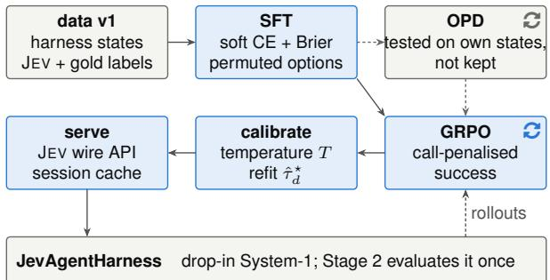  
Figure 9: Post-training AGENTDECISION-4B V1: SFT followed by GRPO. Data v1: decisions at states the harness visits, labelled by JEV and gold. SFT, then GRPO on call-count-penalised success $\mathbf { \eta } ( \mathbf { \pmb { \mu } } \mathbf { \hat { w } } \mathbf { : \qquad } ( \mathbf { \pmb { \mu } }$ rollouts in the harness, training seeds). On-policy distillation (OPD) from JEV at the states the student reaches was tested and not kept by its development gate (grey). Each stage is kept only if it passes development gates.

Hyper-parameters and compute. AdamW, weight decay 0, 3% warm-up, cosine decay, gradient clipping 1.0, bf16, effective batch 64, maximum length 4,096 tokens. LoRA on all linear layers (r=32, α=64) for 4B, full fine-tuning for 0.6B. SFT: lr 10<sup>−4</sup>, 2 epochs, Brier weight 0.5 (the Brier term was not ablated on its own). GRPO, as run for AGENTDECISION-4B V1: 30 iterations × 8 tasks × G=8 on strict DECISIONGYM with the 60 distractor tools of the evaluation setting, 1 inner epoch, 64 decisions per step, clip $\epsilon \in [ 0 . 2 , 0 . 2 8 ]$ (Schulman et al., 2017), KL 0.02, GiGPO ω=1, $\gamma { = } 0 . 9 5$ , lr $1 0 ^ { - 5 }$ , Flash-Lite as executor. We kept the checkpoint of iteration 15. Every recipe fits one 48 GB GPU. The training round of AGENTDECISION-4B V1 ran on one L40S for 15.1 host-hours (\$45.29) plus \$142.36 of API calls.

## D.2 The Training Chain

Figure 9 shows the chain, which uses development and training seeds only.

<table><tr><td>Role</td><td>What it decides</td><td>Our status</td></tr><tr><td>Tool choice</td><td>the next tool, or a shortlist of tools for the LLM</td><td>live, registered</td></tr><tr><td>Tool arguments</td><td>the values of bounded or copied arguments</td><td>live, registered (with tool choice)</td></tr><tr><td>Ask or act</td><td>ask the user now, or act</td><td>live, registered (an option of tool choice); offline by state type</td></tr><tr><td>Stop and verify</td><td>accept a proposed finish, or send the agent back</td><td>live, registered (DECISIONGYM); live, exploratory (mini-SWE-agent, pi); offline as a gate</td></tr><tr><td>Reflection</td><td>stop and rethink now, or go on</td><td>live, registered (DECIsIONGYM); live, exploratory (pi)</td></tr><tr><td>Memory write and read</td><td>store this observation; which notes to show the LLM</td><td>live, exploratory (DECISIONGYM); hooks implemented, not evaluated</td></tr><tr><td>Model and reasoning-depth routing</td><td>strong or cheap LLM, deep or shallow thinking, per step</td><td>live, registered (DECISIONGYM); live, exploratory (mini-SWE-agent)</td></tr><tr><td>Action choice</td><td>the next action of an embodied agent</td><td>live, exploratory (ALFWorld)</td></tr><tr><td>Approval and safety gate</td><td>allow or veto a call the LLM proposed</td><td>live, exploratory (DECIsIONGYM, mini-SWE-agent, pi); irreversible calls</td></tr><tr><td>Context compaction</td><td>which messages to keep, drop or summarise</td><td>offline only; harness hooks implemented, not evaluated implemented (pi), not evaluated</td></tr><tr><td>Retry and backtrack</td><td>retry, undo or abandon a line of work</td><td>not covered</td></tr><tr><td>Sub-agent dispatch and planning</td><td>whether and which sub-agent to start; plan or re-plan</td><td>not covered</td></tr><tr><td>Parallel batching</td><td>which calls can run together</td><td>not covered</td></tr></table>

Table 13: Roles a decision model can play in a harness, and our evidence for each. Live, registered: a pre-registered task-level test, whatever its outcome. Live, exploratory: task-level runs outside the registered tests. Offline: re-scored stored answers or trajectories. Implemented: code and tests, evaluated at most in smoke tests or pilots.

Why visited states. We train on visited states because of the development-only measurements in Table 14. Intern-Decision-4B is close to JEV on isolated items, falls behind on the states that the LLM-only agent visits, and falls further behind on the states that its own choices lead to. Our SFT model trained on recorded states (data v0) reached 0.995 accuracy on the gate set but 0.45 on the states it visited in an on-policy pilot, where JEV reached 0.97.

<table><tr><td>Model</td><td>Gate set</td><td>BFCL dev</td><td>DECISIONGYM shadow</td><td>REPLACE</td></tr><tr><td>JEV</td><td>0.971</td><td>0.965</td><td>0.933</td><td>0.944</td></tr><tr><td>Intern-Dec. 4B</td><td>0.862</td><td>0.953</td><td>0.760</td><td>0.423</td></tr><tr><td>Intern-Dec. 2B</td><td>0.638</td><td>0.906</td><td></td><td>0.162</td></tr><tr><td>Intern-Dec. 0.8B</td><td>0.571</td><td>0.929</td><td></td><td>0.038</td></tr></table>

Table 14: Development diagnostic (small samples, no test): tool-selection accuracy on isolated items (210 gate-set decisions, 85 BFCL dev items) and on a 10-task DECISIONGYM development slice with Flash. Shadow: the states LLM-only visits. REPLACE: the states the decision model reaches itself.

Data v1 and stages. The harness ran on training seeds with Flash-Lite as executor in three behaviour arms: shadow (System-1 is only asked), near-miss replace (a scripted System-1 with injected errors reaches recovery states, as in DAgger Ross et al., 2011) and guard (a noisy answer key guards every tool call and the stop). The target is $0 . 3 \mathrm { g o l d } + 0 . 7 p \mathrm { J e v }$ , or the gold one-hot where JEV’s argmax is wrong. Executed calls outside the acceptable set become guard questions labelled no, so that a guard does not learn to always say yes. SFT v1 trains Qwen3-4B with LoRA on data v1 plus a 0.45× replay share, and SFT v0 is the same recipe on recorded LLM-only states. OPD minimises $\mathbb { E } _ { s \sim d ^ { \pi _ { \theta } } } \mathrm { K L } \big ( p _ { \mathrm { J E V } } ( \cdot \mid s ) \big | \big | p _ { \theta } ( \cdot \mid s ) \big )$ over the student’s own states from SFT v1 for 24 iterations, and GRPO runs for 30 iterations from SFT v1. Each training stage was kept only if it passed registered checks on development data.

Chain decisions. The chain kept SFT v1 + GRPO (iteration 15). OPD was dropped because it lowered development and recovery-state accuracy, and GRPO passed its gates and was frozen as AGENTDECISION-4B V1 (Table 16). The development slice is saturated. SFT v1 already matches AGENTDECISION-4B V1 on common-state accuracy, on task-level success (100.0%) and, after temperature scaling, on ECE, so no result isolates a gain from GRPO.

## D.3 Recipe Takeaways by Stage

Table 15 compares the ways to obtain a decision model. SFT on the agent’s own states gives almost all of the gain for about two GPU-hours, and GRPO on top added no measurable gain. Public tool-use data raises isolated accuracy but lowers task-level success on shifted tasks.

In Table 16, adding the states after an offplan step (30.9% of data v1) raised development accuracy on such states from 92.2% to 99.8% (App. D.4). OPD lowered development accuracy in both tracks, and GRPO kept it and lowered raw ECE, but a fitted temperature of 0.40 gave SFT v1 the same calibration.

Second track (exploratory). A second registered track trained StartLux-Decision-4B (noncommercial licence) with the same losses on the Miles framework. It froze SFT v2 and makes no RL claim, since OPD and GRPO lowered success on a harder stress slice of 200 development tasks. In the Stage-2 combination v2 succeeded in 100.0% of 500 fresh tasks against 99.4% for LLM-only, at 54.8% lower cost with its GPU, the same picture as AGENTDECISION-4B V1.

<table><tr><td></td><td></td><td></td><td colspan="3">Shifted tasks (%)</td></tr><tr><td>Option</td><td>Training cost</td><td>L1</td><td>L2</td><td>must-ask</td><td>L3</td></tr><tr><td>JEV, off the shelf</td><td>none (API)</td><td></td><td>86.4 91.8</td><td></td><td>58.3 82.0</td></tr><tr><td>Qwen3-4B, untrained</td><td>none</td><td></td><td>71.4 52.9</td><td></td><td>27.613.5</td></tr><tr><td>RL only (GRPO)</td><td>1.6 GPU-h, $21.34</td><td>71.4 50.2</td><td></td><td></td><td>27.611.5</td></tr><tr><td>+ SFT on agent states</td><td>2.2 GPU-h, $5.28</td><td>78.4 98.4</td><td></td><td></td><td>95.0 96.0</td></tr><tr><td>+ GRPO (AGENTDECISION-4B V1)</td><td>+4.5 GPU-h, +$26.53</td><td>78.8 98.6</td><td></td><td></td><td>90.8 96.0</td></tr><tr><td>+ public data (AGENTDECISION-4B) +2.4 GPU-h</td><td></td><td>85.1 94.9</td><td></td><td></td><td>67.4 91.5</td></tr><tr><td>StartLux-4B + SFT, public data</td><td>4.5 GPU-h</td><td>85.5 98.5</td><td></td><td></td><td>100.0 98.0</td></tr></table>

Table 15: Ways to obtain a decision model: training cost (GPU-hours, and \$ for the LLM calls that collect data or run GRPO episodes), isolated accuracy (L1, all items of Figure 4a) and accuracy and success on the shifted tasks (Table 3). GPU types differ across rows (App. F).

## D.4 Which Parts of the Recipe Matter

We retrained the SFT step with one ingredient changed at a time (Qwen3-4B with LoRA, one seed per arm, Table 17). On the common states a tenth of the training tasks stayed within 1.3 points of SFT on all of them, and gold labels alone matched the mixed labels. The model trained without offplan states lost 1.9 points on the common states but scored higher on its own off-plan states, so the evidence on which states to train on is mixed.

GRPO without SFT. We ran AGENTDECISION-4B V1’s GRPO stage from the untrained Qwen3- 4B, with a fresh LoRA and everything else unchanged, for 15 iterations. The model made 98.1% of the training decisions itself, yet it stayed at the untrained model’s level on every measure (Table 15), with 48.5% on the common states against 50.1% before and 99.2% after SFT. In 75.0% of its task groups all eight episodes had the same reward and so gave no episode-level signal (60.0% in AGENTDECISION-4B V1’s first 15 iterations).

## D.5 A Sub-1B Decision Model with a Scoring Head

We gave Qwen3.5-0.8B a fresh scoring head of the Clef design (Cloudflare, 2026), which returns one logit per allowed option for every question of a request in one pass, and trained it with LoRA and Unsloth’s recipe (Unsloth AI, 2026) on AGENTDECISION-4B V1’s supervised data (arm

A) or on Unsloth’s public mix of classification and typed-decision data (arm G), or on both (arm AG). Arm A matched AGENTDECISION-4B V1 on the common states (Table 18). Arm G matched arm A on BFCL’s tool choices but scored 75.3 points lower on the common states. Arm A’s confidences sat close to 1, and the registered fit placed both thresholds within $1 0 ^ { - 9 }$ of 1. In the final harness (App. C.1) arm A solved 100.0% of 200 tasks, as the 4B harness did, at 64.2% lower cost than Flash alone. Unsloth’s decision-model code is AGPL-3.0, and we redistribute none of it.

## D.6 DECISIONGYM-Hard

DECISIONGYM-Hard keeps the frozen generator, serves 10 or 12 customers per task and adds a tier rule that decides from the customer’s tier and the order amount whether each order is cancelled or shipped (Table 19). With Stage 2’s combination JEV kept success at a small saving but was slower, and AGENTDECISION-4B V1, which had never seen the tier rule, took nearly every cancel-or-ship decision, was often wrong and lost most tasks. After refitting, the threshold left every tool choice of AGENTDECISION-4B V1 to the LLM, and JEV’s refitted cascade kept success at lower cost once the final answer listed each customer. One more epoch on tier-rule states raised AGENTDECISION-4B V1’s held-out cancel-or-ship accuracy from 76.5% to 95.3% and kept its common-state accuracy (99.1% against 99.2%). In the agent it accepted no wrong cancel-or-ship decision, but the paired test did not establish non-inferiority at the 3-point margin (Table 30). As registered, its last 120 tasks were added after the first 80 had been read.

## D.7 The Training Recipe on ALFWorld

We repeated the SFT step of §5 (a fresh LoRA on Qwen3-4B) at ALFWorld’s action decision point on its training games only, with the environment’s next correct action as the label, and skipped GRPO, since SFT alone matched AGENTDECISION-4B V1 on DECISIONGYM (App. D.3). The registered fit accepted every confidence level, so on 140 valid\_seen games the cascade took every action. It solved 95.0% against 90.7% for Flash alone, at 89.0% lower cost with the GPU charged, and was non-inferior at the 3-point margin, which we report as descriptive (Table 30). Valid\_seen shares its rooms with the training games, and the model comes from a single training run.

<table><tr><td>Checkpoint</td><td>Data and training signal</td><td></td><td>acc.</td><td colspan="2">v1 dev</td><td colspan="3">Common states</td><td></td></tr><tr><td></td><td></td><td>GPU h API$</td><td></td><td>recov.</td><td>ECE</td><td></td><td>acc. off-plan</td><td>ECE</td><td>Dev</td></tr><tr><td colspan="2">Track 1: Qwen3-4B, LoRA (AGENTDECISION-4B V1)</td><td></td><td></td><td></td><td></td><td></td><td></td><td></td><td></td></tr><tr><td>Untrained</td><td></td><td></td><td>70.1</td><td>66.3</td><td>0.278</td><td>50.1</td><td>26.7</td><td>0.160</td><td></td></tr><tr><td>SFT v0 SFT v1</td><td>1,225 recorded success-only states; gold</td><td></td><td>95.2 5.28</td><td>92.2</td><td>0.022</td><td></td><td></td><td></td><td>88.0</td></tr><tr><td></td><td>15,694 visited states (30.9% off-plan); gold + JEV</td><td>2.2 3.7</td><td>99.7</td><td>99.8</td><td>0.029</td><td>99.2</td><td>93.8</td><td>0.011</td><td>100.0</td></tr><tr><td>+ OPD, it. 12 (dropped) + GRPO, it. 15 (AGENTDECISION-4B V1)</td><td>own states, forward KL to JEV</td><td>12.11 4.5</td><td>98.9 99.7</td><td>97.9 99.8</td><td>0.023 0.004</td><td>99.2</td><td>94.7</td><td></td><td>100.0</td></tr><tr><td></td><td>episodes; call- and error-penalised success</td><td>26.53</td><td></td><td></td><td></td><td></td><td></td><td>0.010</td><td>100.0</td></tr><tr><td colspan="2">Track 2: StartLux-Decision-4B, full fine-tuning on Miles (exploratory)</td><td></td><td></td><td></td><td></td><td></td><td></td><td></td><td></td></tr><tr><td>Zero-shot</td><td></td><td></td><td>94.2</td><td></td><td>0.007</td><td>89.1§</td><td>76.8§</td><td>0.078§</td><td></td></tr><tr><td>SFT v2 (kept)</td><td>data v1, as SFT v1</td><td></td><td>99.6</td><td></td><td>99.7 0.027</td><td>99.4</td><td>95.0</td><td>0.010</td><td>71.5</td></tr><tr><td>+ OPD, it. 12</td><td>own states, forward KL to JEV</td><td></td><td>98.7 一</td><td>97.9</td><td>0.017</td><td></td><td></td><td></td><td>66.5</td></tr><tr><td>+ GRPO, it. 15</td><td>episodes; call- and error-penalised success</td><td></td><td>1 99.6</td><td>99.7</td><td>0.006</td><td></td><td></td><td></td><td>62.5</td></tr><tr><td>JEV (teacher)</td><td></td><td></td><td>1 95.8</td><td></td><td>94.4 0.013</td><td>91.5</td><td>81.5</td><td>0.043</td><td>80.0</td></tr><tr><td>Intern-Decision-4B</td><td></td><td></td><td>84.3 1</td><td>82.0</td><td></td><td>75.2</td><td>47.6</td><td>0.049</td><td>26.0</td></tr></table>

Table 16: What each training stage used and bought (%). GPU h: host hours on one L40S. API \$: building data v1, or rollouts, teacher and development evaluations. v1 dev and common states (Stage 2, descriptive): accuracy on all states and after an off-plan step, and ECE (raw on v1 dev). Dev: tool REPLACE success on the 50-task development slice. <sup>¶</sup>Success on track 2’s 200-task stress slice (JEV 49.0%, Intern-Decision-4B 11.5%). <sup>§</sup>Served by the vendor’s server. –: not measured.

<table><tr><td></td><td></td><td></td><td colspan="2">C (%)</td><td colspan="2">Dev. (%)</td></tr><tr><td>Arm</td><td></td><td>Tasks SFT min</td><td></td><td>all off-plan</td><td></td><td>all off-plan</td></tr><tr><td>SFT v1 (all tasks)</td><td></td><td></td><td>99.2</td><td>93.7 99.7</td><td></td><td>99.8</td></tr><tr><td>50% of tasks</td><td>293</td><td></td><td>266 99.1</td><td>92.6 99.6</td><td></td><td>99.5</td></tr><tr><td>25% of tasks</td><td>147</td><td></td><td>136 98.5</td><td>84.9 99.2</td><td></td><td>98.5</td></tr><tr><td>10% of tasks</td><td>59</td><td></td><td>6097.8</td><td>84.6 97.0</td><td></td><td>96.2</td></tr><tr><td>25%, gold labels only</td><td>147</td><td></td><td>136 98.9</td><td></td><td>89.3 99.3</td><td>98.7</td></tr><tr><td>25%, JEV labels only</td><td>147</td><td></td><td>136 93.2</td><td></td><td>76.2 95.5</td><td>94.6</td></tr><tr><td>No off-plan states</td><td>147</td><td></td><td>85 95.5</td><td></td><td>83.1 98.1</td><td>96.0</td></tr><tr><td>Random rows, same size</td><td>146</td><td></td><td>88 97.4</td><td></td><td>79.0 98.7</td><td>97.4</td></tr><tr><td>JEV (teacher)</td><td></td><td></td><td>91.5</td><td>81.5</td><td></td><td></td></tr></table>

Table 17: SFT ablation (exploratory, one seed per arm). C: tool-choice accuracy on the common states of the fresh tasks. Dev.: held-out development decisions. Offplan: after an off-plan step. SFT minutes on one A10G. Smaller arms also get fewer optimizer steps.
<table><tr><td></td><td colspan="2">Isolated (%)</td><td colspan="3">Common states (%)</td><td colspan="2">Closed Serving</td></tr><tr><td>Model</td><td>all</td><td>tools</td><td>all off-plan</td><td></td><td>ask loop %</td><td>ms</td><td>GB</td></tr><tr><td>AGENTDECISION-4B V1 78.8</td><td></td><td>88.4 99.2</td><td></td><td>94.7</td><td>100.0</td><td>100.0319</td><td>22.0</td></tr><tr><td>0.8B, agent states (A)</td><td>67.8</td><td>80.5 99.2</td><td></td><td>94.1</td><td>100.0</td><td>100.0 91</td><td>2.4</td></tr><tr><td>0.8B, generic mix (G)</td><td>52.3</td><td>81.823.9</td><td></td><td>22.4</td><td>25.0</td><td>0.0 91</td><td>2.4</td></tr><tr><td>0.8B, both (AG)</td><td>68.8</td><td>84.8 99.1</td><td></td><td>92.7 100.0</td><td></td><td></td><td></td></tr></table>

Table 18: A 0.8B decision model with a scoring head (exploratory, one seed per arm). Isolated: all 3,991 isolated decisions and their BFCL tool choices. Common states: all, after an off-plan step, and must-ask. Closed loop: success when the model picks every tool on 200 fresh DECISIONGYM tasks. Serving: median ms per request and GPU memory, each model alone on one A10G.

<table><tr><td>Arm</td><td>Succ.</td><td>∆ pt [95% CI] Saved % Took % Acc. % Wrong write</td><td></td><td></td><td></td><td></td></tr><tr><td colspan="7">10 customers, Stage-2 combination</td></tr><tr><td>LLM-only</td><td>88.0</td><td></td><td></td><td></td><td></td><td>0</td></tr><tr><td>Combination, JEV</td><td>86.5</td><td>−1.5[−7.5, +4.5]</td><td>6.2</td><td>56.3</td><td>100.0</td><td>0</td></tr><tr><td>Combination, AGENTDECISION-4B V1</td><td></td><td>3.0 -85.0[-90.0, −79.5]</td><td>69.4</td><td>99.9</td><td>81.7</td><td>152</td></tr><tr><td colspan="7">12 customers, Stage-2 combination</td></tr><tr><td>LLM-only</td><td>66.0</td><td></td><td></td><td></td><td></td><td>0</td></tr><tr><td>Combination, JEV</td><td>69.5</td><td>+3.5[−4.5, +11.5]</td><td>4.6</td><td>58.1</td><td>100.0</td><td>0</td></tr><tr><td>Combination, AGENTDECISION-4B V1</td><td></td><td>0.5 −65.5[−72.0, −59.0]</td><td>69.5</td><td>100.0</td><td>81.5</td><td>169</td></tr><tr><td colspan="7">12 customers, thresholds refitted on the new rule</td></tr><tr><td>LLM-only</td><td>42.0</td><td></td><td></td><td></td><td></td><td>0</td></tr><tr><td>Cascade, JEV</td><td></td><td>19.0 −23.0[−35.0, −11.0]</td><td>31.0</td><td>99.3</td><td>100.0</td><td>0</td></tr><tr><td colspan="7">The same, final answer given as a list per customer</td></tr><tr><td>LLM-only</td><td>87.0</td><td></td><td></td><td></td><td></td><td>0</td></tr><tr><td>Cascade, JEV</td><td>89.0</td><td>+2.0[−6.0,+10.0]</td><td>30.5</td><td>99.6</td><td>100.0</td><td>0</td></tr><tr><td colspan="7">The same, decision model retrained on the tier rule</td></tr><tr><td>LLM-only</td><td>83.5</td><td></td><td></td><td></td><td></td><td>0</td></tr><tr><td>Combination, retrained 4B</td><td>81.5</td><td>-2.0[−8.5, +4.5]</td><td>4.3</td><td>51.6</td><td>100.0</td><td>0</td></tr><tr><td>Combination, random-rule 4B*</td><td>84.5</td><td>+1.0[−4.5, +7.0]</td><td>-5.0</td><td>33.4</td><td>100.0</td><td>0</td></tr><tr><td colspan="7">List answer, thresholds refitted, agent LLM GPT-6-Luna</td></tr><tr><td>LLM-only</td><td>45.0</td><td></td><td></td><td></td><td></td><td>44</td></tr><tr><td>Cascade, JEV</td><td></td><td>83.0 +38.0[+26.0, +50.0]</td><td>-737.4</td><td>100.0</td><td>100.0</td><td>1</td></tr></table>

Table 19: DECISIONGYM-Hard on fresh tasks (exploratory). The two Stage-2 bands and the retrained band have 200 tasks, the bands with refitted thresholds 100. The agent LLM is Flash unless named, and dollar figures compare only within a band. Took and Acc.: share of the cancel-or-ship decisions the decision model took, and its accuracy on those. Wrong write: episodes ended by a wrong state-changing call. <sup>∗</sup>Trained on random order rules, compared with the same LLM-only arm.

Unseen rooms. On ALFWorld’s valid\_unseen split (134 games in 4 rooms that occur in no training or calibration game), the unchanged cascade took 99.4% of the actions and solved 89.6% of the games against 88.8% for Flash alone, at 92.0% lower cost, and non-inferiority was not shown (p = 0.175). Its actions were right about as often as in seen rooms, but it failed some of the simplest games that Flash alone always solved.

## D.8 Agent-State Accuracy on Public Benchmarks

We replayed every recorded trajectory of Flash alone on ALFWorld’s valid\_seen and valid\_unseen

games (App. D.7), which reproduced all 3,355 states of 274 games, and every model answered the same states offline (Table 20).
<table><tr><td></td><td colspan="2">L2 ALFWorld</td><td>Expert</td><td>L2</td><td>Live alone</td></tr><tr><td>Model</td><td>seen</td><td>unseen</td><td>action</td><td> $\tau ^ { 2 }$ </td><td>seen / unseen</td></tr><tr><td colspan="6">Trained on ALFWorld&#x27;s training games</td></tr><tr><td>Qwen3-4B + SFT Trained on  $\tau ^ { 2 } .$ </td><td>93.9</td><td>91.5</td><td>84.5</td><td></td><td>95.7 / 88.1</td></tr><tr><td colspan="6">bench&#x27;s training tasks 0.8B scoring head + SFT</td></tr><tr><td>Trained on DECISIONGYM (transfer)</td><td></td><td></td><td></td><td>46.6</td><td>一</td></tr><tr><td colspan="6"></td></tr><tr><td>AGENTDECISION-4B 0.8B scoring head</td><td>66.5</td><td>62.9</td><td>46.9</td><td>62.7</td><td>一</td></tr><tr><td></td><td>49.2</td><td>48.4</td><td>30.2</td><td>61.8</td><td>一</td></tr><tr><td colspan="6">Off the shelf</td></tr><tr><td>Qwen3-4B</td><td>64.7</td><td>57.3</td><td>42.5</td><td>59.2</td><td>一</td></tr><tr><td>StartLux-4B</td><td>69.2</td><td>63.6</td><td>47.6</td><td>59.2</td><td>一</td></tr><tr><td>StartLux-9B</td><td>74.9</td><td>70.6</td><td>55.0</td><td>59.3</td><td>一</td></tr><tr><td>StartLux-27B</td><td>73.1</td><td>68.2</td><td>55.2</td><td>51.6</td><td></td></tr><tr><td>JEV</td><td>70.5</td><td>65.3</td><td>49.0</td><td>52.0</td><td>27.1/-</td></tr><tr><td>OpenAI Decisions</td><td>72.0</td><td>64.2</td><td>48.1</td><td>37.7</td><td></td></tr><tr><td>Flash&#x27;s own action</td><td>81.1</td><td>80.8</td><td>58.7</td><td>47.7</td><td>90.7 / 88.8</td></tr></table>

Table 20: Agent-state accuracy (%) on the states of Flash alone (game means). L2 ALFWorld: correct when ALFWorld’s expert takes the action or it shortens the expert’s path. Expert action: agreement with the expert’s single next action (a lower bound). $\ L 2 \tau ^ { 2 } { : }$ share of states where the model chooses the reference write action that is due (task means). Live alone: success when the model takes every action (for Flash, the agent alone). –: not run.

The model trained on ALFWorld’s training games led, also in unseen rooms, though it learned from the expert that defines the labels. The models trained on DECISIONGYM did not transfer to ALF-World (AGENTDECISION-4B was right at 64.7% of states and its untrained base at 61.1%). On $\tau ^ { 2 }$ -bench the ranking did not follow ALFWorld’s (Kendall rank correlation −0.43 over 8 models).

The training recipe on $\tau ^ { 2 } ,$ -bench. We trained the 0.8B scoring head of App. D.5 further on $\tau ^ { 2 } .$ bench’s retail and airline training tasks, on states visited by Flash alone and labelled with Flash’s choice when the episode succeeded or when that call matched a pending action of the reference solution. On the test tasks the harness lost success against Flash alone at its fitted thresholds, so noninferiority was not shown, and at a threshold of 0.5 it saved more and lost less (Table 21). The result rests on one training run.

## D.9 More Training on Public Tool-Use Data

We continued AGENTDECISION-4B V1’s adapter for an epoch on 7,000 public items from When2Call’s training split and ToolACE, mixed one to one with 7,000 of its own SFT states, after a leakage audit against every test pool. The resulting checkpoint, AGENTDECISION-4B, raised isolated accuracy from 78.8% to 85.1%, was non-inferior to AGENTDECISION-4B V1 on the common states at the registered 1-point margin (99.1% against 99.2%) and solved 100.0% of 200 fresh tasks. The same recipe and data on StartLux-Decision-4B (CC BY-NC 4.0 weights) reached 85.5% on the isolated questions, +2.3 points above its base, was noninferior to AGENTDECISION-4B V1 on the common states (99.6%) and solved 100.0% of the same tasks.

<table><tr><td rowspan="2">Test tasks</td><td rowspan="2"></td><td colspan="2">Success (%)</td><td colspan="5"></td></tr><tr><td>n LLM</td><td>with</td><td></td><td></td><td>∆ pt [95 %] NI p LLM-free (%) saved (%)</td><td></td><td>time (s)</td></tr><tr><td colspan="9">Fitted thresholds</td></tr><tr><td>Both domains 60</td><td></td><td>66.2</td><td></td><td>54.2 −12.1 [−19.2, −5.4] 0.979</td><td></td><td>3.9</td><td></td><td>4.6 19.8 / 26.9</td></tr><tr><td>Retail</td><td>40</td><td>64.4</td><td></td><td>52.5 −11.9 [−20.6, −3.8] 0.857</td><td></td><td>5.6</td><td></td><td>5.8 19.6 / 26.7</td></tr><tr><td>Airline</td><td></td><td></td><td></td><td>20 70.0 57.5 −12.5 [−25.0, −1.2] 1.000</td><td></td><td>0.9</td><td></td><td>2.5 20.4 / 27.4</td></tr><tr><td colspan="9">Threshold 0.5 at both decision points</td></tr><tr><td></td><td></td><td></td><td></td><td>Both domains 60 66.2 59.2 −7.1 [−13.8, −0.4] 0.654</td><td></td><td>39.0</td><td></td><td>31.3 19.8 / 28.0</td></tr></table>

Table 21: The recipe on $\tau ^ { 2 } { \mathrm { - } } \mathrm { b e n c h } ^ { \prime } \mathrm { s }$ test tasks (exploratory). n test tasks, each run 4 times per arm, success averaged per task. ∆: paired, with a task-bootstrap interval. NI $p \mathrm { : }$ certified test at the 5-point margin on each task’s majority outcome. LLM-free: agent turns the decision model completed without the LLM. Saved: cost saving with the GPU charged. Time: s per episode (LLM alone / with the model). Retail’s natural-language checks were judged by Gemini 3.5 Flash instead of $\bar { \tau ^ { 2 } } .$ bench’s gpt-4.1.

Reading a rule. Trained instead on DECI-SIONGYM-Hard tasks with an order rule drawn per task (never the evaluated one), the random-rule checkpoint was right at 91.0% of held-out cancelor-ship states of the unseen tier rule, against 76.5% for AGENTDECISION-4B V1 and 95.3% for the model trained on that rule itself (App. D.6).

## D.10 Train/Evaluation Hygiene

An offline audit checked both training tracks against every evaluation set. The training seeds lie between 10,000 and 72,999 and share 0 seeds with the 1,250 evaluation seeds, and no evaluation task repeats a training task’s world or gold plan. 3.3% of the common-state occurrences repeat a training state word for word (early steps whose state is little more than the instruction), and AGENTDECISION-4B V1 scores 99.2% without them and 99.2% with them. The $\tau ^ { 2 }$ questions have no near duplicate among the training rows. Data v1’s When2Call replay shares no 8-gram with a test question. Data v0’s shares one in 15 rows, but it trained only SFT v0, which was never scored on L1. AGENTDECISION-4B V1 was chosen on development inputs only, and every DECISIONGYM threshold was fitted on calibration seeds. We disclose one exposure. Before access to Stage-1 results was blocked, the person training v1 printed the first record of one Stage-1 trajectory file to learn the trajectory format. No aggregate was opened and no pre-fixed rule changed, but a strict reader may treat the two Stage-2 tests of AGENTDECISION-4B V1 (App. E) as exploratory. The code checkout of the exploratory second track contained the selection summary of the registered $\tau ^ { 2 }$ transfer test. Intern-Decision and StartLux-Decision were released before any evaluation task list was frozen, but their training data are closed, so overlap with the public L1 items cannot be excluded.

<table><tr><td></td><td>All states</td><td>Must- ask</td><td>After off-plan</td><td>Seen key</td><td>Unseen key</td></tr><tr><td>States n</td><td>5,314</td><td>267</td><td>386</td><td>4,874</td><td>440</td></tr><tr><td>(a) Prior</td><td>26.6</td><td>0.0</td><td>18.6</td><td>26.5</td><td>20.5</td></tr><tr><td>(c) Last tool</td><td>85.2</td><td>50.0</td><td>50.9</td><td>86.8</td><td>67.4</td></tr><tr><td>(b) Tool sequence</td><td>94.9</td><td>99.3</td><td>39.0</td><td>100.0</td><td>20.5</td></tr><tr><td>(b+) Back-off</td><td>97.5</td><td>99.3</td><td>62.9</td><td>100.0</td><td>67.4</td></tr><tr><td>Best per keyª</td><td>99.9</td><td>100.0</td><td>99.4</td><td>100.0</td><td>99.6</td></tr><tr><td>JEV</td><td>91.5</td><td>27.0</td><td>81.5</td><td>91.8</td><td>90.2</td></tr><tr><td>StartLux-27B</td><td>93.9</td><td>26.0</td><td>85.1</td><td>94.7</td><td>90.8</td></tr><tr><td>Qwen3-4B base</td><td>50.1</td><td>24.0</td><td>26.7</td><td>50.3</td><td>55.6</td></tr><tr><td>SFT v1*</td><td>99.2</td><td>100.0</td><td>93.8</td><td>100.0</td><td>95.6</td></tr><tr><td>AGENTDECISION-4B V1*</td><td>99.2</td><td>100.0</td><td>94.7</td><td>99.9</td><td>96.3</td></tr><tr><td>0.8B head*</td><td>99.2</td><td>100.0</td><td>94.1</td><td>100.0</td><td>95.1</td></tr></table>

Table 22: Template baselines and decision models on the common states, as task-weighted accuracy (%), post hoc and descriptive. The baselines are fitted on the training rows only: (a) the most frequent label, (b) the most frequent label for the key (task family and tools executed so far), (c) the same keyed on the last executed tool, (b+) (b), then (c), then (a). Seen key: the key occurs in the training rows. <sup>a</sup>A bound that picks one tool per key on the common states themselves. <sup>∗</sup>Trained on these rows. 0.8B head: App. D.5.

Template baselines. DECISIONGYM builds every task from a few request templates, so the right tool may follow from the template alone. We fitted lookups on the 4,493 tool-choice rows of the supervised training data (Table 22). One tool per key would get almost every common state right, at the must-ask states too, so on most common states the trained models’ lead over off-the-shelf models reflects the generator’s conventions. The trained models pull ahead on the states whose key never occurs in training, most of which follow an off-plan step. On the shifted split of App. G.9, a lookup by tool name scores 0.0% on the states whose right tool was renamed, while AGENTDECISION-4B V1 scores 98.3%.

## E Protocol and Statistics

Metrics. Every success number comes with dollars, latency (the critical path of model calls) and LLM calls, as in cost-aware evaluation of agents, routers, calibration and selective prediction (Kapoor et al., 2025; Yao et al., 2025; Ong et al., 2025; Pakdaman Naeini et al., 2015; Geifman et al., 2019). Utility is $U = W S - C - \lambda L$ for success $S ,$ cost C, latency $L ,$ task value W and latency price λ, and ECE is the 10-bin top-label calibration error (other metrics in docs/BENCHMARK\_SPEC.md). Paired comparisons resample tasks and keep the trials of one task together (Efron and Tibshirani, 1993; Koehn, 2004). A task that still errors in either arm after two retries leaves that comparison.

Non-inferiority decision rule. For margin m on a paired binary endpoint, $W$ and $L$ count the tasks the arm wins and loses. The outcomes $( W , L )$ are ordered by the monotone hull of the log p-value of Tango’s one-sided score test of $H _ { 0 } \colon \Delta \le - m$ (Tango, 1998). The decisive $p$ is min $\{ 1 , \gamma + U \}$ where $U$ bounds the tail probability under every boundary null whose discordance lies in a $( 1 -$ $\gamma )$ Clopper–Pearson set $( \gamma = 1 0 ^ { - 4 }$ , Suissa and Shuster, 1985; Berger and Boos, 1994). The test is valid at every $n ,$ with exact size at most 0.997α at the registered sizes. At zero discordance we report the exact upper bound $1 - \alpha ^ { 1 / n }$ on the loss rate.

Other tests. The tool cascade, the three-tool shortlist and the stop veto must hold for both JEV and Intern-Decision, so their decisive $p$ is max $( p _ { \mathrm { J E V } } , p _ { \mathrm { I n t e r n } } )$ (Table 25). Superiority primaries use the exact conditional test on discordant pairs and, for the reflection trigger, the onesided paired t-test of the per-task utility difference. Sign-flip tests and the paired task bootstrap (B = 10,000) are descriptive. On $\tau ^ { 2 }$ the per-task endpoint is majority pass over three attempts, and the transfer test refits $\hat { \tau } ^ { \star }$ on 15 held-out airline tasks, counting a decision as right if it matches the next reference action. Pilots on retired seeds fixed the suite settings, and no pilot result is reported as a finding. The Flash-Lite pairs and the $\tau ^ { \dot { 2 } }$ transfer test are underpowered and can end inconclusive (exact power in results/reviews/2026-10-02/ ni\_power\_exact\_r8.md).

Registration and claims. The registration, its dated deviations and the wording of each test are in the supplementary repository (docs/PREREGISTRATION.md, docs/PREREG\_A7\_STAGE2.md and their generated effective versions). Stage 2 was registered before any Stage-1 output was opened, and Table 24 lists every registered test with its result. Holm’s method keeps the family-wise error of the eleven Stage-1 tests at 5% (Holm, 1979), and the four Stage-2 tests form a second family. A registered claim holds when all of its conditions pass. Every other number is descriptive. Experiments added after Stage 1 were each written down before they ran but lie outside both families, and a dagger (<sup>†</sup>) marks them where a display mixes both kinds (paired intervals in Table 30).

Selection and arms. A script chose the combination once from the Stage-1 results, per decisionpoint group and System-2 model, among the registered JEV arms at their registered settings. A candidate qualified when it delegated, was noninferior $( \mathrm { N I } p \le 0 . 0 5$ at 3 points) and was cheaper (one-sided paired t-test, $p \leq 0 . 0 5 )$ . Among qualifiers within 2 points of the largest net saving, the one that leaves most to the LLM won, and a group with no qualifier stayed with the LLM. On 500 new DECISIONGYM seeds one scheduler runs every arm on every task in random order: LLM-only, the combination with JEV, its best single delegation, the combination with AGENTDECISION-4B V1 (thresholds refitted on its own calibration arms) and the development combination. No Flash-Lite delegation qualified. A Stage-2 test rejects when all its conditions reject (Table 27), and the six secondary rows are Holm-adjusted within their table. The common states of the accuracy test are the toolselection questions four frozen policies met on the first 200 new seeds.

Training behind a barrier and a third System-1 family. A manifest fixed the training inputs, recipes, budgets, stage order and checkpointselection rules before evaluation outputs reached model development (App. D.10). An amendment registered before any Stage-1 result was read adds StartLux-Decision (open weights, 0.8B–27B), served without tuning on our data. Its 4B runs the combination as a secondary test.

## F Models, Cost and Licences

Models. The agent LLMs are Gemini 3.5 Flash (gemini-3.5-flash) and the cheaper, weaker Flash-Lite (gemini-3.5-flash-lite), both with minimal thinking, temperature 0 and native tool calls. Gemma 4 (gemma-4-26b-a4b-it) is an L1 baseline. All were accessed September–October 2026 (§6). JEV 1.13 (Almeida, 2026), a closed typed decision API released on 15 September 2026, is pinned as typesafe/jev-1.13 (§2).

Cost and latency. Episode cost is

$$
\begin{array} { r l } & { \sum _ { \mathrm { L L M c a l l s } } ( n _ { \mathrm { i n } } \mathfrak { F } _ { \mathrm { i n } } + n _ { \mathrm { c a c h e d } } \mathfrak { F } _ { \mathrm { c a c h e } } + n _ { \mathrm { o u t } } \mathfrak { F } _ { \mathrm { o u t } } ) } \\ & { + \sum _ { \mathrm { S y s t e m - 1 ~ c a l l s } } n _ { \mathrm { i n } } \mathfrak { F } _ { \mathrm { i n } } ^ { \mathrm { S 1 } } , } \end{array}
$$

with list prices on the run dates applied to measured tokens, and savings compare with a reference run on the same tasks. JEV is billed through OpenRouter at \$0.042/M input tokens and nothing for output. In Stage 1, Intern-Decision carries a GPU price amortised over the model card’s unbatched throughput. In Stage 2, AGENTDECISION-4B V1 and StartLux-Decision are charged a per-episode GPU price $q ,$ the host’s hourly price times a development run’s wall-clock window divided by its completed episodes. For AGENTDECISION-4B V1, $q ~ = ~ \$ 0.00196$ per episode (\$2.24 per host-hour), and the combination with AGENTDECISION-4B V1 saves 81.1% in its Stage-2 test. The saving is 82.1% at the busythroughput price, 83.8% at JEV’s API price and 85.9% at a zero GPU price. Training and calibrating AGENTDECISION-4B V1 cost \$192.93, which this saving pays back after 5,759 episodes. Criticalpath latency sums sequential calls and counts concurrent calls once, at their maximum. The study’s API spend from the run ledgers was \$2,383.27 (by track in results/spend/spend\_ledger.md).

Licences and release. Table 23 lists the licences or terms of the artefacts we use. We release the benchmark code and configurations, JEVAGEN-THARNESS with its adapters, the post-training recipes, seeds and evaluation code. Weights and data derived from JEV or Gemini outputs are released only where the providers’ terms permit. The textless icons in Figures 1–3 were generated with OpenAI’s gpt-image-2.5 from our prompts, except the Microsoft Fluent UI Emoji in Figure 1. Every label and number in the figures is typeset text.

## G Result Tables

## G.1 All Registered Tests

Table 24 lists every registered test with its outcome, and Table 25 splits the primaries that must hold for both decision-model families.

<table><tr><td>Artefact</td><td>Licence or terms</td></tr><tr><td>When2Call Intern-Decision 0.8B / 2B / Apache-2.0 (Qwen licence 4B</td><td>CC BY 4.0 (attribution) preserved) StartLux-Decision (weights; CC BY-NC 4.0; Apache-2.0</td></tr><tr><td>server code) pi, DeepSeek Harness, mini- MIT</td><td></td></tr><tr><td>SWE-agent, τ2-bench, ALF- World BFCL v4 (Gorilla), Harbor, Apache-2.0 Codex CLI (hook schemas)</td><td></td></tr><tr><td>Qwen3, SWE-bench Veri- as stated at the source fied, Terminal-Bench 2.0 / - Science</td><td></td></tr><tr><td></td><td></td></tr><tr><td>LoCoMo; LongMemEval CC BY-NC 4.0; MIT (not reported) Microsoft Fluent UI Emoji MIT (icons in Figure 1) JEV via OpenRouter; Gemini provider terms</td><td></td></tr></table>

Table 23: Licences and terms of the artefacts used.  
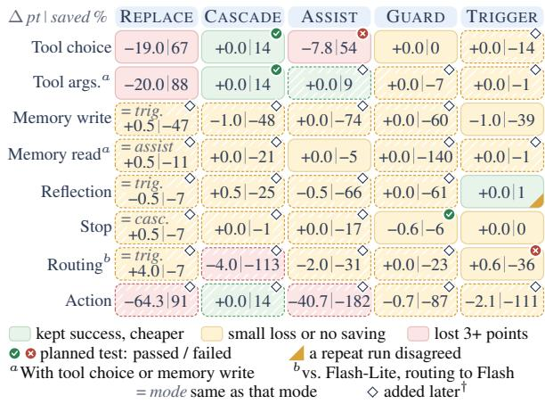  
Figure 10: The module map of Figure 5 with every mark. Each cell shows the change in task success against the LLM alone (points) | cost saved (%), with JEV and Gemini 3.5 Flash.

## G.2 Stage 1: The Module Map

Figure 10 repeats Figure 5 with every mark. A cell is green if success fell by at most 1 point, cost fell, and the decision model changed the harness’s choice at 5% or more of the steps where it could. It is pink if success fell by 3 points or more. This rule was fixed in code before any number was computed. Every Stage-1 configuration is in results/module\_map/module\_map.md.

Exploratory cells. Every remaining defined cell ran after Stage 1, each registered first (diamonds in Figure 10). The action row comes from ALFWorld. Of these cells, only the argument shortlist and the action cascade changed the agent’s choices at lower cost. The second and third DECISIONGYM batches ran on another route to the same model, so their costs compare only with their own LLM-only arm.

## G.3 More Stage-1 and Stage-2 Results

Stage 1. Table 26 gives the isolated decisions. Only 58.9% of the 2091 argument slots have their gold value among the candidates, hence the in-candidate column. The Stage-1 $\tau ^ { 2 }$ arms are in results/tau2/ and the Intern-Decision arms in results/gpu\_round4\_main/ e2a\_intern\_report.md. A registered check compared how DECISIONGYM and the 35 airline tasks rank the 9 configurations run on both (Kendall’s τ<sub>b</sub> +0.66 by success difference, p = 0.008).

Stage 2. Table 27 splits each Stage-2 test into its conditions, and Table 28 gives the secondary tests and descriptive rows (score cards in results/ stage2/stage2.md). With JEV, the reflection trigger fired in all 14 failures of the combination.

## G.4 Results Near the Ceiling

Table 29 holds the registered Stage-2 rows on tasks the LLM alone nearly always solved. For the harder settings of the main text, Table 30 gives the paired counts, the 95% score interval of the success difference (Tango, 1998) and the one-sided non-inferiority p (rows added after Stage 1 apply the registered rule descriptively).

## G.5 Notes on Figure 4 and Tables 1–3

Figure 4. In (b), isolated means BFCL tool choice and spread is best minus worst. (a) 3,991 recorded BFCL and When2Call decisions. AGENTDECISION-0.8B is StartLux-0.8B with our recipe, and a ring marks a hosted API. Orange diamonds: Gemini 3.5 Flash and Flash-Lite asked the same multiple-choice question, and the open diamond is Flash’s own tool call. Open models are priced at their cheapest deployment (App. G.7), APIs and LLMs at list price. Models below 70 % are in App. Table 32. (b) Shifted DE-CISIONGYM tasks (App. G.9). Isolated: BFCL tool choice on 1,114 items. Step level: 1,250 recorded states of 100 tasks. Task level: 200 tasks with the model picking every tool, of which Flash alone solved 100.0% (StartLux-27B: the first 164). AGENTDECISION-4B saw only the unshifted generator.

Table 1. The reference is the LLM alone on the same tasks, Gemini 3.5 Flash unless the row names another LLM. The refitted-cascade and GPT-6- Luna rows use other DECISIONGYM-Hard tasks with list answers and their own LLM-only runs (App. D.6). In the Luna row, “×” is the cost as a multiple of the reference’s, whose run had 95.5% of its input cached (0.9% with the cascade) and stopped 44 episodes early at a wrong write. The mini-SWE-agent row pools 100 earlier with 200 new instances (App. C.2). The ALFWorld 4B model is SFT on ALFWorld’s training games (App. D.7). Paired tests: Table 30.

<table><tr><td>Test</td><td>What is tested</td><td>Success difference, points [95% CI]</td><td>Cost saved (%)</td><td>Decided by the model (%)</td><td>Adjusted p</td><td>Outcome</td></tr><tr><td colspan="7">Stage 1: is each use of the decision model safe and useful? (11 tests; non-inferior to LLM-only on DECISIONGYM with Flash unless stated)</td></tr><tr><td>C1F CIL</td><td>Model picks tool and arguments if confident (CASCADE) the same, with the cheaper Flash-Lite</td><td>+0.0[+0.0, +0.0] +1.0[−1.0, +3.2]</td><td>14.2 0.2</td><td>27.2 0.0</td><td>0.001 0.168</td><td>non-inferior (only JEV delegated) not established (Intern-Decision</td></tr><tr><td></td><td></td><td></td><td></td><td></td><td></td><td>inconclusive)</td></tr><tr><td>C2F</td><td>Model shortlists three tools for the LLM (AsSIST)</td><td>−7.8[−10.2, −5.4]</td><td>53.7</td><td></td><td>1.000</td><td>not established (both models lose)</td></tr><tr><td>C2L</td><td>the same, with Flash-Lite</td><td>-3.4[−7.2, +0.6]</td><td>52.0</td><td></td><td>1.000</td><td>not established (Intern-Decision</td></tr><tr><td>C3</td><td>JEV&#x27;s shortlist is better than a BM25 keyword shortlist</td><td>+73.2[+68.0, +78.2]</td><td></td><td></td><td>&lt;0.001</td><td>loses) better</td></tr><tr><td>C4</td><td>Model decides when Flash-Lite hands a step to Flash (TRIGGER); better than Flash-Lite alone</td><td>+0.6[−1.6, +2.8]</td><td>-36.2</td><td></td><td>1.000</td><td>not established</td></tr><tr><td>C5</td><td>Model decides when to reflect (TRIGGER, Flash-Lite); better</td><td>-0.0233</td><td></td><td></td><td>1.000</td><td>not established</td></tr><tr><td>C6F</td><td>than an equally frequent random trigger</td><td>[−0.0557, +0.0087]</td><td>-6.2</td><td></td><td></td><td></td></tr><tr><td>C6L</td><td>Model can veto the LLM&#x27;s decision to stop (GUARD) the same, with Flash-Lite</td><td>−0.6[−1.4, +0.0] +1.6[−0.8, +4.0]</td><td>-32.1</td><td></td><td>0.002 1.000</td><td>non-inferior not established (Intern-Decision</td></tr><tr><td></td><td></td><td></td><td></td><td></td><td></td><td>loses)</td></tr><tr><td>C7</td><td>Cheapest non-inferior DECISIONGYM setup, refitted, on τ2</td><td>-8.1[−16.1, +0.0]</td><td>-18.1</td><td></td><td>1.000</td><td>not established (inconclusive)</td></tr><tr><td>C8</td><td>JEV against Flash on isolated BFCL tool-choice questions</td><td>−0.4[−1.5, +0.8]</td><td></td><td></td><td>0.001</td><td>non-inferior</td></tr><tr><td></td><td>Stage 2: does the chosen combination hold on fresh tasks? (4 tests: three combinations non-inferior to their reference and cheaper on 500 new DECIsIONGYM tasks, and accuracy on the same recorded states)</td><td></td><td></td><td></td><td></td><td></td></tr><tr><td>S2-1 S2-2</td><td>Combination with JEV</td><td>-2.2[−3.8, −0.8]</td><td>40.7</td><td>52.5</td><td>0.356</td><td>not established</td></tr><tr><td></td><td>Combination against its best single part, the tool cascade</td><td>−2.6[−4.2, −1.2]</td><td>27.0</td><td>52.5</td><td>0.356</td><td>not established</td></tr><tr><td>S2-3</td><td>On the same states, AGENTDECISION-4B v1 beats</td><td>+24.0[+22.1,+25.9]</td><td></td><td></td><td>&lt;0.001</td><td>holds</td></tr><tr><td>S2-4</td><td>Intern-Decision and is at most 5 points below JEv</td><td></td><td></td><td></td><td></td><td></td></tr><tr><td></td><td>Combination with AGENTDECISION-4B V1 as decision model</td><td>+0.6[+0.0, +1.4]</td><td>81.1</td><td>99.9</td><td>&lt;0.001</td><td>holds</td></tr><tr><td></td><td>Stage 2, secondary tests (6 tests; as above unless stated)</td><td></td><td></td><td></td><td></td><td></td></tr><tr><td>S2-1T</td><td>Combination with JEV is faster (seconds saved per episode)</td><td>−2.54[−2.87, −2.21]</td><td></td><td>52.5</td><td>1.000</td><td>not established</td></tr><tr><td>S2-1L</td><td>Combination with Flash-Lite</td><td></td><td></td><td></td><td></td><td>not tested (none qualified)</td></tr><tr><td>S2-L3a S2-L3b</td><td>Combination on τ2 telecom (5-point margin)</td><td>−1.6[−5.0, +1.8]</td><td>-2.6</td><td>8.1</td><td>1.000</td><td>not established</td></tr><tr><td>S2-1X</td><td>Combination on ALFWorld, against a ReAct agent</td><td>+7.2[+3.8, +10.6]</td><td>-20.8</td><td>0.0</td><td>1.000</td><td>not run</td></tr><tr><td></td><td>Combination with DeepSeek-V4-Pro as the agent LLM</td><td></td><td></td><td></td><td></td><td>not established</td></tr><tr><td>S2-4S</td><td>Combination with StartLux-4B as decision model</td><td>+0.0[−0.6, +0.6]</td><td>-1.4</td><td>17.3</td><td>1.000</td><td>not established</td></tr></table>

Table 24: Every registered test. Success difference: setup minus reference in points (reflection trigger: utility in \$ per task, AGENTDECISION-4B V1 on the same states: accuracy against Intern-Decision, speed: seconds saved per episode). Adjusted p: Holm-corrected within the group, and a claim holds at $p \leq 0 . 0 5$ . Non-inferior: at most 3 points (5 on $\tau ^ { 2 } )$ below the reference. For the cascade with Flash, an exact bound puts the share of tasks JEV’s cascade turned into failures below 0.6%.
<table><tr><td>Test</td><td colspan="5">JEV</td><td colspan="5">Intern-Decision-4B</td><td></td><td></td><td></td></tr><tr><td></td><td>∆</td><td>95% CI</td><td></td><td>p</td><td>Cov.</td><td>Sav.</td><td></td><td>95% CI</td><td>p</td><td>Cov.</td><td>Sav.</td><td>pmax</td><td>Registered label</td></tr><tr><td>Cascade, Flash</td><td>+0.0</td><td>[+0.0, +0.0]</td><td>&lt;0.001</td><td></td><td>27.2 14.2</td><td>+0.2</td><td>[+0.0, +0.6]</td><td></td><td>&lt;0.001</td><td>0.0</td><td>-0.2</td><td>&lt;0.001</td><td>NI</td></tr><tr><td>Cascade, Flash-Lite</td><td>+1.0</td><td>[−1.0, +3.2]</td><td></td><td>&lt;0.001</td><td>0.0</td><td>0.2</td><td>-0.6</td><td>[−2.8, +1.6]</td><td>0.024</td><td>0.0</td><td>1.0</td><td>0.024</td><td>not NI (split)</td></tr><tr><td>Shortlist, Flash</td><td>-7.8</td><td>[−10.2,−5.4]</td><td></td><td>1.000</td><td>一</td><td>53.7 -3.6</td><td></td><td>[−5.4, -2.0]</td><td>0.767</td><td></td><td>53.0</td><td>1.000</td><td>not NI (both lose)</td></tr><tr><td>Shortlist, Flash-Lite</td><td>-3.4</td><td>[−7.2, +0.6]</td><td></td><td>0.591</td><td></td><td>52.0 -14.8</td><td></td><td>[-19.0,−10.6]</td><td>1.000</td><td></td><td>53.7</td><td>1.000</td><td>not NI (Intern loses)</td></tr><tr><td>Stop veto, Flash</td><td>-0.6</td><td>[−1.4, +0.0]</td><td></td><td>&lt;0.001</td><td></td><td>-6.2</td><td>-0.4</td><td>[-1.0, +0.0]</td><td>&lt;0.001</td><td></td><td>-3.0</td><td>&lt;0.001</td><td>NI</td></tr><tr><td>Stop veto, Flash-Lite</td><td>+1.6</td><td>[−0.8, +4.0]</td><td></td><td>&lt;0.001</td><td></td><td>-32.1 -6.0</td><td></td><td>[−9.2,-3.0]</td><td>0.975</td><td></td><td>-45.3</td><td>0.975</td><td>not NI (Intern loses)</td></tr></table>

Table 25: DECISIONGYM primaries per decision-model family. ∆: success minus LLM-only (points). p: the family’s non-inferiority p, and $p _ { \mathrm { m a x } }$ the p that enters Holm. Cov.: tool-decision coverage (%). Sav.: net savings. Split: one family passes. <sup>∥</sup>NI with Intern-Decision at zero coverage.

Table 2. “Gate” accepts the decision model’s answer, “4B” is AGENTDECISION-4B V1 and “4B + public data” is AGENTDECISION-4B. The fixedthreshold row covers tool choice on the first 200 tasks. Gate rows are offline, per argument decision (App. C.4). The new-rule row uses other tasks (App. D.6). “Own GPU” rows compare with a reference run in the same session, and the coding row with the strong LLM. The 0.8B row learns when to defer (App. G.8). Negative time savings mean slower.

Table 3. L1: isolated accuracy (%) on the questions of Figure 4a. L2 and L3 use DECISIONGYM-Shift (App. G.9). L2: step-level accuracy on recorded states, with “ask” for the states where the agent must ask (for ALFWorld, the share of acceptable actions). L3: success on 200 shifted tasks with the model making every tool choice. Saved: cost saved when deployed on new tasks of the trained kind. Green marks a non-inferior result and rose one that is not. –: not deployed. “+ GRPO (Stage 2)” is AGENTDECISION-4B V1.

<table><tr><td rowspan="2">Decider</td><td colspan="3">Tool selection (BFCL)</td><td colspan="3">Arguments (BFCL)</td><td colspan="2">When2Call</td><td colspan="2">Efficiency</td></tr><tr><td>Acc</td><td>ECE</td><td>AUROC</td><td>Acc</td><td> $\operatorname { A c c } _ { \operatorname { c a n d } }$ </td><td>ECE</td><td>Acc</td><td>ECE</td><td>p50 ms</td><td>$/1k</td></tr><tr><td>System-2 LLM</td><td></td><td></td><td></td><td></td><td></td><td></td><td></td><td></td><td></td><td></td></tr><tr><td>Gemini 3.5 Flash, native FC</td><td>84.2</td><td></td><td></td><td>96.3</td><td>98.3</td><td></td><td>42.1</td><td></td><td>884</td><td>1.17</td></tr><tr><td>Gemini 3.5 Flash, typed question</td><td>90.3</td><td>0.075</td><td>0.71</td><td>93.6</td><td>95.9</td><td>0.041</td><td>74.0</td><td>0.238</td><td>2551</td><td>0.63</td></tr><tr><td>Typed decision models</td><td></td><td></td><td></td><td></td><td></td><td></td><td></td><td></td><td></td><td></td></tr><tr><td>JEV</td><td>89.9</td><td>0.045</td><td>0.87</td><td>89.6</td><td>95.7</td><td>0.029</td><td>75.4</td><td>0.080</td><td>206</td><td>0.0167</td></tr><tr><td>AGENTDECISION-4B V1</td><td>88.4</td><td>0.098</td><td>0.71</td><td>85.0</td><td>95.0</td><td>0.132</td><td>54.0</td><td>0.458</td><td>228</td><td>0</td></tr><tr><td>Generative deciders (reference)</td><td></td><td></td><td></td><td></td><td></td><td></td><td></td><td></td><td></td><td></td></tr><tr><td>Flash-Lite, verbalised</td><td>90.7</td><td>0.080</td><td>0.65</td><td>89.0</td><td>93.3</td><td>0.088</td><td>62.6</td><td>0.355</td><td>576</td><td>0.147</td></tr><tr><td>Gemma 4 26B-A4B, verbalised</td><td>89.1</td><td>0.094</td><td>0.68</td><td>87.4</td><td>94.3</td><td>0.095</td><td>54.4</td><td>0.392</td><td>1188</td><td>0</td></tr><tr><td>Retrieval controls</td><td></td><td></td><td></td><td></td><td></td><td></td><td></td><td></td><td></td><td></td></tr><tr><td>Embedding</td><td>79.3</td><td>0.049</td><td>0.72</td><td></td><td></td><td></td><td></td><td></td><td>183</td><td>0.0121</td></tr><tr><td>BM25</td><td>61.4</td><td>0.140</td><td>0.82</td><td>31.5</td><td>53.3</td><td>0.182</td><td>29.5</td><td>0.604</td><td>0</td><td>0</td></tr><tr><td>TF-IDF</td><td>62.3</td><td>0.251</td><td>0.82</td><td>31.6</td><td>53.6</td><td>0.440</td><td>30.4</td><td>0.590</td><td>0</td><td>0</td></tr></table>

Table 26: L1 results: accuracy (%), ECE, AUROC, p50 latency and \$ per 1k decisions. Argument Acc credits OTHER (defer) only when no candidate is right, and $\operatorname { A c c } _ { \operatorname { c a n d } }$ covers slots whose gold value is a candidate.
<table><tr><td>Test</td><td>Condition</td><td>Estimate [95% CI]</td><td>Null</td><td>Raw p</td><td>Reading</td></tr><tr><td>With JEV</td><td>NI on success (pt)</td><td>-2.2[-3.8, −0.8]</td><td>-3.0</td><td>0.178</td><td>not NI: loss of 2.2 pt (95 % CI entirely below 0)</td></tr><tr><td>Against cascade</td><td>cost saving ($/ep.)</td><td>0.0168 [0.0157, 0.0179]</td><td>0</td><td>&lt;0.001</td><td>cost saving established</td></tr><tr><td>alone</td><td>NI on success (pt)</td><td>-2.6[−4.2, −1.2]</td><td>-3.0</td><td>0.326</td><td>not NI: loss of 2.6 pt (95 % CI entirely below 0)</td></tr><tr><td></td><td>cost saving ($/ep.)</td><td>0.00907 [0.00805, 0.0101]</td><td>0</td><td>&lt;0.001</td><td>cost saving established</td></tr><tr><td>AGENTDECISION- 4B v1, same states</td><td>acc. vs. Intern (pt)</td><td>+24.0[+22.1,+25.9]</td><td>+0.0&lt;0.001</td><td></td><td>accuracy gain over Intern-Decision-4B established</td></tr><tr><td></td><td>acc. vs. JEV (pt)</td><td>+7.7[+6.3, +9.1]</td><td></td><td></td><td>—5.0 &lt;0.001 non-inferiority to Jev (no more than 5 pt less</td></tr><tr><td>With AGENTDECISION- 4B V1</td><td>NI on success (pt)</td><td> $+ 0 . 6 \left[ + 0 . 0 , + 1 . 4 \right]$ </td><td>-3.0 &lt;0.001 NI</td><td></td><td>accurate) established</td></tr><tr><td></td><td>cost saving ($/ep.)</td><td>0.0335 [0.0325, 0.0345]</td><td>0</td><td>&lt;0.001</td><td>cost saving established</td></tr><tr><td>With JEV</td><td>latency saving (s/ep.)</td><td>-2.54[-2.87, −2.21]</td><td>0</td><td>1.000</td><td>the wrong direction: latency saving reversed (95 % CI entirely below 0)</td></tr><tr><td>With Flash-Lite</td><td></td><td></td><td></td><td></td><td>not tested: no Flash-Lite delegation qualified</td></tr><tr><td>On τ2 telecom</td><td>NI on success (pt)</td><td>-1.6[−5.0, +1.8]</td><td>-5.0</td><td>0.027</td><td>NI</td></tr><tr><td></td><td>cost saving ($/task)</td><td>-0.00336[-0.00677, 0.0000569]</td><td>0</td><td>0.973</td><td>no cost saving established at this n</td></tr><tr><td>On ALFWorld</td><td></td><td></td><td></td><td></td><td>not run: ALFWorld did not run in Stage 1</td></tr><tr><td>With DeepSeek-V4-Pro</td><td>NI on success (pt)</td><td>+7.2[+3.8, +10.6]</td><td></td><td>-3.0 &lt;0.001 NI</td><td></td></tr><tr><td></td><td>cost saving ($/ep.)</td><td>-0.000423[-0.000452, -0.000394]</td><td>0</td><td>1.000</td><td>the wrong direction: cost saving reversed (95 % CI entirely below 0)</td></tr><tr><td>With StartLux-4B</td><td>NI on success (pt)</td><td>+0.0[-0.6, +0.6]</td><td>-3.0</td><td>&lt;0.001</td><td>NI</td></tr><tr><td></td><td>cost saving ($/ep.)</td><td>-0.000594[-0.00101, -0.00018]</td><td>0</td><td>0.997</td><td>the wrong direction: cost saving reversed (95 % CI</td></tr></table>

Table 27: Each Stage-2 condition with its estimate and 95% interval, null boundary, raw one-sided p and reading. Secondary tests are below the line. The rows with AGENTDECISION-4B V1 and StartLux-4B include a GPU price per episode (\$0.00196 and \$0.00217). At JEV’s API price the StartLux-4B combination would save −1.3%, and 3.8% at a zero GPU price.

<table><tr><td>What is compared</td><td>Effect</td><td>Cost pt saved %</td><td>By model %</td><td>Wall- clock s</td><td>Outcome</td></tr><tr><td colspan="6">Secondary tests: 500 fresh DECISIONGYM tasks unless noted, Flash</td></tr><tr><td>Combination with JEV: model-call seconds savedª</td><td>-2.54</td><td></td><td></td><td></td><td>did not hold</td></tr><tr><td>Combination with StartLux-4B as decision modelb</td><td>+0.0</td><td>-1.4</td><td>17.3</td><td>13.99</td><td>did not hold</td></tr><tr><td>Combination with DeepSeek-V4-Pro as agent LLMc</td><td>+7.2</td><td>-20.8</td><td>0.0</td><td>37.82</td><td>did not hold</td></tr><tr><td>Combination on  $\tau ^ { 2 }$  telecomd</td><td>-1.6</td><td>-2.6</td><td>8.1</td><td></td><td>did not hold</td></tr><tr><td colspan="6">Descriptive, fresh DECISIONGYM tasks</td></tr><tr><td>DeepSeek-V4-Flash alonec</td><td>+20.4</td><td>75.3</td><td></td><td>24.04</td><td>descriptive</td></tr><tr><td>Combination on GPT-6.1-Sole</td><td>-0.6</td><td>-19.8</td><td>0.0</td><td>23.37</td><td>descriptive</td></tr><tr><td>GPT-6-Luna alonee</td><td>+0.8</td><td>92.3</td><td></td><td>12.81</td><td>descriptive</td></tr></table>

Table 28: Stage-2 secondary tests and descriptive rows. Effect: success difference to LLM-only Flash unless noted (points). By model: share of tool decisions the decision model took. <sup>a</sup>Model-call seconds per episode, negative when slower. <sup>b</sup>4 instead of 8 parallel episodes. <sup>c</sup>Against V4-Pro alone (33.80 s). <sup>d</sup>5-point margin. <sup>e</sup>Registered optional row, against GPT-6.1-Sol alone (99.0%, 19.16 s).
<table><tr><td rowspan="2"></td><td colspan="2">Success</td><td colspan="2">Cost</td><td>By</td><td>Wall-</td><td></td></tr><tr><td>%</td><td></td><td></td><td>∆ pt $/1k ep. saved %</td><td>model % clock s</td><td></td><td>Outcome</td></tr><tr><td colspan="8">500 fresh DECISIONGYM tasks, agent LLM Flash</td></tr><tr><td>LLM-only</td><td>99.4</td><td></td><td>41.3</td><td></td><td></td><td>6.83</td><td>reference</td></tr><tr><td>Tool cascade alone, JEV</td><td>99.8</td><td>+0.4</td><td>33.5</td><td>18.8</td><td>28.9</td><td>7.61</td><td>descriptive</td></tr><tr><td>Combination (cascade + trigger), JEV</td><td>97.2</td><td>-2.2</td><td>24.5</td><td>40.7</td><td>52.5</td><td>9.21</td><td>did not hold</td></tr><tr><td>the same, vs. the cascade alone</td><td></td><td>-2.6</td><td></td><td>27.0</td><td></td><td></td><td>did not hold</td></tr><tr><td>© Same combination, AGENTDECISION-4B v1 100.0</td><td></td><td>+0.6</td><td>7.8</td><td>81.1</td><td>99.9</td><td> $1 0 . 2 1 ^ { a }$ </td><td>held</td></tr><tr><td colspan="8">Common states (5,314 states of 200 fresh tasks): tool-choice accuracy instead of success</td></tr><tr><td>AGENTDECISION-4B v1 vs. Intern-Decision and vs. JEV (non-inferior, 5-pt margin)</td><td></td><td>99.2 +24.0 +7.7</td><td></td><td></td><td></td><td></td><td>held</td></tr></table>

Table 29: Near the ceiling, delegation cut cost, and whether success held depended on the decision model. Registered Stage-2 tests on DECISIONGYM tasks the LLM alone nearly always solved. $\Delta \colon$ to LLM-only unless the row names another reference. By model: share of tool decisions the decision model took. A claim that did not hold was not established, which does not show a loss beyond the margin. <sup>a</sup>4 instead of 8 parallel episodes.

<table><tr><td>Row of Table 1</td><td>n</td><td>wins</td><td>losses</td><td>∆ pt</td><td>95% interval</td><td>p</td></tr><tr><td>DECISIONGYM-Hard, combination, JEV</td><td>200</td><td>38</td><td>31</td><td>+3.5</td><td>[-4.7, +11.7]</td><td>0.061</td></tr><tr><td>DECISIONGYM-Hard, combination, AGENTDECISION-4B V1</td><td>200</td><td>0</td><td>131</td><td>-65.5</td><td>[-71.7, -58.7]</td><td>1.000</td></tr><tr><td>DECISIONGYM-Hard, AGENTDECISION-4B V1 retrained</td><td>200</td><td>21</td><td>25</td><td>-2.0</td><td>[-8.8, +4.8]</td><td>0.402</td></tr><tr><td>DECISIONGYM-Hard, AGENTDECISION-4B V1 trained on random rules</td><td>200</td><td>18</td><td>16</td><td>+1.0</td><td>[-4.9, +6.9]</td><td>0.091</td></tr><tr><td>DECISIONGYM-Hard, cascade refitted, JEV</td><td>100</td><td>9</td><td>7</td><td>+2.0</td><td>[-6.3, +10.5]</td><td>0.117</td></tr><tr><td>DECISIONGYM-Hard, GPT-6-Luna, cascade refitted</td><td>100</td><td>44</td><td>6</td><td>+38.0</td><td>[+25.8, +49.2]</td><td>0.000</td></tr><tr><td>SWE-bench, DeepSeek-V4</td><td>100</td><td>3</td><td>3</td><td>+0.0</td><td>[-5.9, +5.9]</td><td>0.135</td></tr><tr><td>SWE-bench, Gemini 3.8 Flash (App. C.2)</td><td>100</td><td>8</td><td>3</td><td>+5.0</td><td>[-1.7, +12.5]</td><td>0.012</td></tr><tr><td>SWE-bench, DeepSeek-V4, 100 + 200 new</td><td>300</td><td>9</td><td>12</td><td>-1.0</td><td>[-4.3, +2.2]</td><td>0.108</td></tr><tr><td>ALFWorld, action cascade</td><td>140</td><td>4</td><td>4</td><td>+0.0</td><td>[-4.7, +4.7]</td><td>0.092</td></tr><tr><td>ALFWorld, 4B trained there, cascade</td><td>140</td><td>13</td><td>7</td><td>+4.3</td><td>[-2.1, +11.1]</td><td>0.014</td></tr><tr><td>τ2-bench telecom (registered)</td><td>560</td><td>43</td><td>52</td><td>-1.6</td><td>[−5.0, +1.8]</td><td>0.027</td></tr></table>

Table 30: Paired tests for the rows of Table 1. Wins: tasks only the delegated arm solved. Losses: tasks only the reference solved. p: one-sided non-inferiority test with a 3-point margin (5 points on $\tau ^ { 2 } .$ -bench), noninferior when $p \leq 0 . 0 5$ . 100 + 200 new: the instances of the first routing run pooled with those of its extension (App. C.2).

## G.6 Evaluation Levels and Reach

Table 31 holds the numbers behind Figure 4. Over the five pre-specified models the isolated and tasklevel rankings disagree (Kendall rank correlation −0.200).

External reference agreement on $\tau ^ { 2 } .$ . A registered offline diagnostic scores agreement with $\tau ^ { 2 \cdot } \mathrm { s }$ reference trajectories on the 22,704 questions the Stage-1 $\tau ^ { 2 }$ arms asked JEV. AGENTDECISION-4B V1 agreed more often than Intern-Decision-4B and less often than JEV, but always choosing the reply to the user agrees about as often (54.1 against 53.7%). The reference marks one next step where several can be acceptable, so this agreement says little about $\tau ^ { 2 }$ success.

StartLux size ladder at the task level (exploratory). The StartLux-Decision rows 0.8B, 2B and 9B of Table 31 (<sup>‡</sup>) use the same items, states and tasks as the other rows. Common-state accuracy rose with every size step (Kendall correlation with size 1.00) and task-level success did not (0.60).

Cost–accuracy frontier of isolated decisions. Figure 4 re-plots the recorded answers to the 3,991 isolated decisions (post hoc), with API models at their recorded price and open models at \$2.24 per GPU-hour of recorded serving time, an upper bound (App. G.7). A registered check on the 299- item development prefix found JEV at 91.3%, Flash at 91.6% and Flash-Lite at 86.3%.

<table><tr><td rowspan="2">Decision model</td><td rowspan="2">Isolated acc.</td><td colspan="4">Step-level: common states</td><td rowspan="2">Own states</td><td colspan="2">Task-level, model alone</td><td rowspan="2"></td><td rowspan="2">API $/ep.</td></tr><tr><td>acc.</td><td>∆ vs. JEV [95% CI]</td><td>off-plan</td><td>ECE</td><td>success</td><td>∆ vs. JEV [95% CI]</td></tr><tr><td>JEV</td><td>89.9</td><td>91.5</td><td></td><td>81.5</td><td>0.043</td><td>91.0</td><td>83.0</td><td></td><td>7.0</td><td>0.0144</td></tr><tr><td>Intern-Decision-4B</td><td>88.2</td><td>75.2</td><td> $- 1 6 . 3 \left[ - 1 8 . 1 , - 1 4 . 5 \right]$ </td><td>47.6</td><td>0.049</td><td>62.2</td><td>26.5</td><td> $- 5 6 . 5 [ - 6 2 . 8 , - 4 9 . 0 ]$ </td><td>4.6</td><td>0.0080</td></tr><tr><td>StartLux-0.8B‡</td><td></td><td>88.2 48.3</td><td> $- 4 3 . 1 \left[ - 4 6 . 3 , - 3 9 . 9 \right]$ </td><td>31.5</td><td>0.056</td><td>35.8</td><td></td><td>17.5-65.5[-71.4,-58.1]</td><td>7.0</td><td>0.0143</td></tr><tr><td>StartLux-2B‡</td><td>89.9</td><td>68.4</td><td>-23.0[-25.2,−20.9]</td><td>47.2</td><td>0.177</td><td>59.5</td><td>6.5</td><td> $- 7 6 . 5 [ - 8 1 . 7 , - 6 9 . 4 ]$ </td><td>3.8</td><td>0.0049</td></tr><tr><td>StartLux-4B</td><td>91.3</td><td>89.1</td><td> $- 2 . 4 \left[ - 3 . 5 , - 1 . 3 \right]$ </td><td>76.8</td><td>0.078</td><td>81.6</td><td></td><td>60.0 -23.0[-28.9, -17.0]</td><td>6.2</td><td>0.0116</td></tr><tr><td>StartLux-9B‡</td><td>92.2</td><td>91.8</td><td> $+ 0 . 3 \left[ - 0 . 7 , + 1 . 4 \right]$ </td><td>74.3</td><td>0.071</td><td>91.0</td><td>74.0</td><td> $- 9 . 0 \left[ - 1 3 . 3 , - 4 . 9 \right]$ </td><td>7.1</td><td>0.0142</td></tr><tr><td>StartLux-27B (Q8_0)</td><td>90.8</td><td>93.9</td><td> $+ 2 . 5 [ + 1 . 6 , + 3 . 3 ]$ </td><td>85.1</td><td>0.012</td><td>87.7</td><td>63.0</td><td> $- 2 0 . 0 [ - 2 5 . 7 , - 1 4 . 4 ]$ </td><td>6.8</td><td>0.0133</td></tr><tr><td> $\mathbf { A G E N T D E C I S I O N - 4 B \ v 1 ^ { * } }$ </td><td>88.4 99.2</td><td></td><td>+7.7[+6.4, +9.1]</td><td>94.7</td><td>0.010</td><td>100.0</td><td></td><td>100.0 17.0[12.1, 22.8]</td><td>7.5</td><td>0.0145</td></tr><tr><td>SFT  $\mathrm { \ o n l y ^ { * \ S } }$ </td><td>86.9</td><td>99.2</td><td></td><td>93.8</td><td>0.011</td><td>100.0</td><td>100.0</td><td></td><td>一</td><td></td></tr><tr><td> $\mathrm { Q w e n 3 - 4 B , u n t r a i n e d ^ { \ S } }$ </td><td>87.5</td><td>50.1</td><td></td><td>26.7</td><td>0.160</td><td>38.4</td><td>13.0</td><td></td><td>一</td><td></td></tr></table>

Table 31: Evaluation levels (descriptive except the registered common-state test). Tool-choice accuracy (%) on 1,114 isolated BFCL questions, on the 5,314 common states of 200 new tasks and on each model’s own states. Task level: the model picks every tool on 200 new tasks (API cost, GPU not charged). <sup>‡</sup>Exploratory size ladder (App. G.6). <sup>∗</sup>Trained on DECISIONGYM’s generator. <sup>§</sup>Task level on the first 100 tasks.

## G.7 More Decision Models as Baselines

After Stage 1 we registered a round with every public decision model we could serve, each with its vendor’s defaults on one L40S GPU: Clef-Flash and Clef (Cloudflare, 2026), OpenJev in two forms (razorback16, 2026; openjev, 2026), JevK5 (alibiserikbay, 2026), CLM (Kwok et al., 2026), Laya (Convai Innovations, 2026), Verdict (Heman10x, 2026), Imajev-4B (Garg, 2026), decider-4b (Mapika, 2026), Bosun (Hanno Labs, 2026) and OpenAI’s hosted Decisions API (OpenAI, 2026b), which scores only the allowed options.

Most new models come close to JEV on isolated tool choice, the common states separate them, and the task level reorders them again (Table 32). Over the 10 off-the-shelf models, the Kendall rank correlation with task-level success is 0.18 for isolated tool choice and 0.54 for the common states.

Every open decision model served the cheapest way. We served every open model the same cheap way (Table 33): vLLM with prefix caching and a full queue on one NVIDIA L4 24 GB GPU at \$0.8048 per hour, one forward pass per question, and 8-bit weights unless they lost more than 1 point of accuracy. The cost of 1,000 decisions is the hourly price over the answers per second, a lower bound. Clef-Flash and Imajev-4B were not served this way. For every model, accuracy stayed within 0.7 points of Figure 4a. AGENTDECISION-4B costs \$0.0045 per 1,000 decisions, 31 times less than its point in the figure.

<table><tr><td></td><td></td><td colspan="2">L1: isolated</td><td>tool choice</td><td colspan="2">L2: common states</td><td>L3: task level</td></tr><tr><td>Decision model</td><td>Licence</td><td>acc. (%)</td><td>$/1k</td><td>isolated (%)</td><td>acc. (%)</td><td>ECE</td><td>success (%)</td></tr><tr><td>OpenJev-27B</td><td>CC BY-NC</td><td>82.7</td><td>0.24</td><td>90.2</td><td>92.4</td><td>0.021</td><td>63.0</td></tr><tr><td>OpenJev</td><td>Apache-2.0</td><td>78.8</td><td>0.091</td><td>91.2</td><td>91.1</td><td>0.030</td><td>62.5</td></tr><tr><td>OpenAI Decisions</td><td>API</td><td>79.2</td><td>0.027</td><td>90.6</td><td>90.9</td><td>0.193</td><td>78.5</td></tr><tr><td>Imajev-4B</td><td>Apache-2.0</td><td>78.9</td><td>1.1</td><td>87.9</td><td>76.9</td><td>0.095</td><td></td></tr><tr><td>JevK5</td><td>Apache-2.0</td><td>70.3</td><td>0.048</td><td>86.4</td><td>65.0</td><td>0.228</td><td></td></tr><tr><td>decider-4b</td><td>Apache-2.0</td><td>79.3</td><td>0.054</td><td>90.8</td><td>63.2</td><td>0.261</td><td></td></tr><tr><td>Clef-Flash</td><td>Apache-2.0</td><td>81.4</td><td>0.11</td><td>87.5</td><td>47.7</td><td>0.252</td><td></td></tr><tr><td>Bosun</td><td>Apache-2.0</td><td>63.3</td><td>0.13</td><td>85.8</td><td>36.3</td><td>0.290</td><td></td></tr><tr><td>Verdict</td><td>Apache-2.0</td><td>47.2</td><td>0.022</td><td>78.3</td><td>19.0</td><td>0.148</td><td></td></tr><tr><td>CLM</td><td>Apache-2.0</td><td>46.2</td><td>0.031</td><td>71.0</td><td>11.9</td><td>0.371</td><td></td></tr><tr><td>Laya</td><td>Apache-2.0</td><td>49.4</td><td>0.037</td><td>79.8</td><td>11.0</td><td>0.303</td><td></td></tr></table>

Table 32: Isolated scores do not rank the new decision models either. L1: accuracy and US\$ per 1,000 decisions on the 3,991 isolated questions, then accuracy on their BFCL tool choices. L2: accuracy and calibration error on the common states. L3: task success when the model picks every tool on the first 200 fresh tasks with Flash, run for the API and the two open models best on the common states. The reference models are in Table 31. Clef’s 27B answered the isolated questions only. The Decisions API’s 10 refusals count as wrong.

Why step-level accuracy can miss a task-level loss. OpenJev-27B and StartLux-27B match JEV on the common states yet solve about twenty points fewer tasks (Tables 32 and 31). We traced this in the stored trajectories (post hoc). Each tool-choice state of a model’s own episodes is hashed like the common states, which tells whether it is in the corpus or novel (Table 34).

Serving does not explain the gap (live and offline choices agreed on 100.0% of 736 common states met live by OpenJev-27B), and the novel share hardly tracks success (Kendall 0.13 over 18 models). Every failed task of JEV, OpenJev-27B and StartLux-27B ended at the model’s first wrong tool choice, a cancellation, refund or shipment where a lookup or a question was due. For the two 27B models it always came at a must-ask state. Offline the three models are equally poor at mustask states (27.0, 26.0 and 26.0%), but these are only 5.0% of the corpus, so the average hides them. Counting a task as lost at its first irreversible wrong answer ranks the off-the-shelf models better than the common-state mean (Kendall 0.63 against 0.54) but misses task-level success by 14.0 points on average.

<table><tr><td></td><td></td><td colspan="2">Isolated acc. (%)</td><td>Answers</td><td>$ per</td><td colspan="2">Latency (ms)</td></tr><tr><td>Decision model</td><td>Precision</td><td>here</td><td>Fig. 4a</td><td>per s</td><td>1,000</td><td>median</td><td>p90</td></tr><tr><td>StartLux-0.8B</td><td>FP8</td><td>69.3</td><td>70.0</td><td>131</td><td>0.0017</td><td>32</td><td>34</td></tr><tr><td>StartLux-2B</td><td>FP8</td><td>76.0</td><td>75.7</td><td>81.6</td><td>0.0027</td><td>34</td><td>36</td></tr><tr><td>StartLux-4B</td><td>FP8</td><td>83.0</td><td>83.1</td><td>33.0</td><td>0.0068</td><td>44</td><td>69</td></tr><tr><td>StartLux-9B</td><td>FP8</td><td>83.3</td><td>83.4</td><td>19.5</td><td>0.011</td><td>66</td><td>118</td></tr><tr><td>StartLux-27B*</td><td>Q4_K_M</td><td>87.5</td><td>87.7</td><td>1.3</td><td>0.17</td><td>649</td><td>1,224</td></tr><tr><td>Intern-Decision-4B</td><td>FP8</td><td>73.5</td><td>73.4</td><td>18.0</td><td>0.012</td><td>61</td><td>125</td></tr><tr><td>decider-4b</td><td>FP8</td><td>79.4</td><td>79.3</td><td>37.1</td><td>0.0060</td><td>39</td><td>66</td></tr><tr><td>JevK5 (4B)</td><td>FP8</td><td>70.1</td><td>70.3</td><td>25.1</td><td>0.0089</td><td>46</td><td>105</td></tr><tr><td>OpenJev‡</td><td>FP8</td><td>79.1</td><td>78.8</td><td>45.0</td><td>0.011</td><td>144</td><td>162</td></tr><tr><td>OpenJev-27B*</td><td>Q4_K_M</td><td>83.0</td><td>82.7</td><td>1.3</td><td>0.18</td><td>744</td><td>1,231</td></tr><tr><td>AGENTDECISION-0.8B</td><td>FP8</td><td>80.5</td><td>80.5</td><td>122</td><td>0.0018</td><td>27</td><td>30</td></tr><tr><td>AGENTDECISION-4B</td><td>FP8</td><td>84.8</td><td>85.1</td><td>50.2</td><td>0.0045</td><td>31</td><td>52</td></tr><tr><td>AGENTDECISION-4B V1</td><td>FP8</td><td>78.6</td><td>78.8</td><td>50.2</td><td>0.0045</td><td>31</td><td>52</td></tr><tr><td>StartLux-4B + our recipe</td><td>FP8</td><td>85.5</td><td>85.5</td><td>30.3</td><td>0.0074</td><td>45</td><td>70</td></tr><tr><td>Qwen3.5-0.8B variant{</td><td>BF16</td><td>77.3</td><td>77.2</td><td>26.7</td><td>0.0084</td><td>60</td><td>63</td></tr></table>

Table 33: Open decision models served by vLLM on one GPU, on the 3,991 isolated questions of Figure 4a. Precision: the cheaper of BF16 and FP8 within 1 point of the figure’s accuracy. Latency: one question at a time. <sup>∗</sup>4-bit file on llama.cpp. <sup>§</sup>Scoring head, own server. <sup>‡</sup>Own server on one NVIDIA L40S 48 GB GPU (\$1.861 per hour).
<table><tr><td></td><td>Closed- Com. loop</td><td>states</td><td>acc.</td><td>acc.</td><td>In C Novel Novel share</td><td>Irrev.</td><td>Must-ask first tasks/acc.</td><td>Below 0.9 wrong /right</td></tr><tr><td>JEV</td><td>83.0</td><td>91.5</td><td>95.1</td><td></td><td>0.0</td><td>17.0</td><td>34/73.5</td><td>86.8/18.9</td></tr><tr><td>Intern-Decision-4B</td><td>26.5</td><td>75.2</td><td>65.7</td><td></td><td>0.0</td><td>59.5</td><td>78/31.6</td><td>82.0/60.9</td></tr><tr><td>StartLux-0.8B</td><td>17.5</td><td>48.3</td><td>52.1</td><td>9.2</td><td>75.2</td><td>28.0</td><td>25/100.0</td><td>100.0/94.7</td></tr><tr><td>StartLux-2B</td><td>6.5</td><td>68.4</td><td>73.9</td><td>26.1</td><td>31.9</td><td>83.0</td><td>78/33.3</td><td>97.8/88.9</td></tr><tr><td>StartLux-4B</td><td>60.0</td><td>89.1</td><td>89.0</td><td>96.5</td><td>44.6</td><td>35.0</td><td>90/41.1</td><td>73.4/43.1</td></tr><tr><td>StartLux-9B</td><td>74.0</td><td>91.8</td><td>94.7</td><td>94.4</td><td>47.8</td><td>25.5</td><td>100/50.0</td><td>83.1/35.1</td></tr><tr><td>StartLux-27B</td><td>63.0</td><td>93.9</td><td>92.1</td><td>97.5</td><td>44.8</td><td>37.0</td><td>100/26.0</td><td>62.2/3.4</td></tr><tr><td>OpenAI Decisions</td><td>78.5</td><td>90.9</td><td>92.3</td><td>83.9</td><td>58.2</td><td>17.5</td><td>38/71.1</td><td>92.9/66.6</td></tr><tr><td>OpenJev</td><td>62.5</td><td>91.1</td><td>91.3</td><td>65.3</td><td>59.0</td><td>34.0</td><td>98/49.0</td><td>52.4/31.0</td></tr><tr><td>OpenJev-27B</td><td>63.0</td><td>92.4</td><td>92.0</td><td>97.4</td><td>45.6</td><td>37.0</td><td>100/26.0</td><td>26.7/2.6</td></tr><tr><td>AGENTDECISION-4B V1</td><td>100.0</td><td></td><td>99.2 100.0</td><td></td><td>0.0</td><td>0.0</td><td>54/100.0</td><td>-/0.2</td></tr><tr><td>AGENTDECISION-4B</td><td>100.0</td><td></td><td>99.1 100.0</td><td>100.0</td><td>51.0</td><td>0.0</td><td>50/100.0</td><td>-/6.6</td></tr><tr><td>StartLux-4B + our recipe</td><td>100.0</td><td></td><td>99.6 100.0</td><td>100.0</td><td>51.9</td><td>0.0</td><td>50/100.0</td><td>-/9.1</td></tr><tr><td>0.8B head, agent states</td><td>100.0</td><td></td><td>99.2 100.0</td><td>100.0</td><td>52.3</td><td>0.0</td><td>50/100.0</td><td>-/0.0</td></tr><tr><td>0.8B head, generic mix</td><td>0.0</td><td>23.9</td><td>11.5</td><td>0.0</td><td>3.6 100.0</td><td></td><td>25/100.0</td><td>63.0/100.0</td></tr><tr><td>Qwen3-4B (untrained)a</td><td>13.0</td><td>50.1</td><td>48.6</td><td>16.7</td><td>55.6</td><td>73.0</td><td>12/100.0</td><td>100.0/100.0</td></tr><tr><td>SFT v1a</td><td>100.0</td><td></td><td>99.2 100.0</td><td>100.0</td><td>52.0</td><td>0.0</td><td>25/100.0</td><td>-/0.0</td></tr><tr><td>StartLux-4B SFT (track 2)</td><td>100.0</td><td></td><td>99.4 100.0</td><td>100.0</td><td>50.3</td><td>0.0</td><td>50/100.0</td><td>-/0.0</td></tr></table>

Table 34: The task-level loss comes from a few irreversible tool choices, and unfamiliar states explain little of it. Models picking every tool on the same 200 fresh tasks (%): task-level success, common-state accuracy, own-episode accuracy on corpus and novel states, novel share, tasks whose first wrong choice was irreversible, tasks with a must-ask state and the accuracy there, and wrong and right choices with confidence below 0.9. <sup>a</sup>First 100 tasks. –: not defined.

## G.8 Variants of the Decision Model

Voting decision models. We combined stored answers (post hoc) by majority vote, confidenceweighted vote, or an agreement gate that delegates only when m of k members agree. Members and m were chosen on one half of the states and scored on the other. No vote reaches AGENTDECISION-4B V1 (Table 35). The models make the same mistakes, and every off-the-shelf model fails 39% of the mustask occurrences. In a registered follow-up, fitted thresholds made the OpenAI Decisions API, alone or gated with JEV, defer every tool choice, so as registered neither ran at the task level.

<table><tr><td></td><td>Isolated (%)</td><td>Common states (%)</td><td>Must- ask (%)</td><td>(%)</td><td>Delegated Errors: gate/ best member L3 (%)</td><td>Pred.</td></tr><tr><td>Best single off-the-shelf model</td><td>87.7</td><td>93.9</td><td>25.5</td><td>=</td><td></td><td>78.5</td></tr><tr><td>Off the shelf, majority vote</td><td>86.4</td><td>94.9</td><td>47.3</td><td>=</td><td>=</td><td>81.0</td></tr><tr><td>Off the shelf, weighted vote</td><td>86.4</td><td>94.9</td><td>47.3</td><td>1</td><td>=</td><td>81.0</td></tr><tr><td>Off the shelf, all of 4 agree</td><td></td><td>97.5a</td><td>61b</td><td>88.8</td><td>63/50</td><td>86.1</td></tr><tr><td>Hosted (JEV + Decisions API), weighted vote</td><td>84.1</td><td>92.2</td><td>31.5</td><td></td><td>一</td><td>75.0</td></tr><tr><td>Hosted, both agree</td><td></td><td>95.9a</td><td>72b</td><td>88.2</td><td>103/101</td><td>79.9</td></tr><tr><td>Off the shelf + our trained models, weighted vote</td><td>88.0</td><td>99.6</td><td>100.0</td><td>=</td><td>=</td><td>99.1</td></tr><tr><td>Off the shelf + our trained models, 2 of 2 agree</td><td>=</td><td>99.9a</td><td>0b</td><td>99.0</td><td>3/1</td><td>100.0</td></tr><tr><td>AGENTDECISION-4B v1 at its threshold</td><td>78.2</td><td>99.7</td><td>100.0</td><td>100.0</td><td>12</td><td>100.0</td></tr><tr><td>0.8B scoring head at its threshold</td><td>67.4</td><td>99.5</td><td>100.0</td><td>78.2</td><td>0</td><td>100.0</td></tr></table>

Table 35: Voting does not replace training. Held-out halves. Delegated: share of common-state decisions the gate, or the model at its fitted threshold, takes. Errors: accepted wrong tool choices of the gate, then of its strongest member at the same coverage. <sup>a</sup>Accuracy of the delegated decisions. <sup>b</sup>Accepted errors on must-ask states. Pred. L3: the offline score of App. G.7.

More public data and a larger open base. Arm A continues AGENTDECISION-4B V1’s adapter for two epochs on 13,992 public tool-use items, mixed one to one with its own SFT states. Arm B applies the SFT recipe to StartLux-Decision-9B (CC BY-NC 4.0) on the same mix. Neither arm closed the isolated gap to StartLux-27B, and When2Call stayed the weak part (Table 36). Both arms were non-inferior to AGENTDECISION-4B V1 on the common states at the registered 1-point margin.

<table><tr><td></td><td colspan="4">Isolated (%)</td><td>Step</td><td>Task</td></tr><tr><td>Arm</td><td>tool</td><td>args</td><td>When2Call</td><td>all</td><td>level</td><td>level</td></tr><tr><td>AGENTDECISION-4B V1</td><td>88.4</td><td>85.0</td><td>54.0</td><td>78.8</td><td>99.2</td><td>100.0</td></tr><tr><td>A: AGENTDECISION-4B V1 + more data</td><td>88.8</td><td>90.1</td><td>66.9</td><td>84.3</td><td>99.1</td><td>100.0</td></tr><tr><td>B: StartLux-9B + recipe</td><td>90.0</td><td>91.9</td><td>63.6</td><td>84.8</td><td>99.3</td><td>100.0</td></tr><tr><td>Best untrained open model*</td><td>90.8</td><td>89.1</td><td>81.2</td><td>87.7</td><td>93.9</td><td>74.0</td></tr></table>

Table 36: Two trained open models at the three levels (exploratory). Isolated: the 3,991 decisions and their three parts. Step level: common states. Task level: the model picks every tool on 200 fresh tasks. <sup>∗</sup>Best open model we did not train: StartLux-27B (Q8\_0) (isolated, step level) and StartLux-9B (task level).

Scoring head against one-token read-out. Arm (i) is the 0.8B scoring head of App. D.5, whose fitted thresholds sat within 10<sup>−9</sup> of 1. Arm (ii) reads the next-token probability over option letters from the same backbone and 14,787 records. Accuracy stayed the same (Table 37). Under the registered criterion, the one-token read-out covers more of these near-ceiling states. Its threshold, however, accepted 66 wrong tool choices on the common states, and the head’s threshold accepted none. The head is also 2.7 times faster and needs 2.5 against 4.5 GB of GPU memory.

<table><tr><td></td><td colspan="2">Held-out rows</td><td colspan="2">Common states</td><td colspan="3">Calibration states at î</td><td colspan="2">Serving (ms)</td></tr><tr><td>Read-out</td><td>acc. (%)</td><td>ECE</td><td>acc. (%) off-plan (%)</td><td></td><td>tools (%) args (%)</td><td></td><td>errors</td><td>c=1</td><td>c=4</td></tr><tr><td>(i) scoring head</td><td></td><td>99.7 0.001</td><td>99.2</td><td>94.1</td><td>80.0</td><td>78.8</td><td>0+0</td><td>92</td><td>204</td></tr><tr><td>(ii) one-token read-out</td><td></td><td>99.7 0.001</td><td>99.0</td><td>92.3</td><td>100.0</td><td>88.5</td><td>0+0</td><td>247</td><td>796</td></tr><tr><td>AGENTDECISION-4B V1</td><td>=</td><td>=</td><td>99.2</td><td>=</td><td>100.0</td><td>77.5</td><td>0+1</td><td>318</td><td>875</td></tr></table>

Table 37: One backbone, two read-outs. Held-out rows: SFT v1’s development file. Common states: accuracy, all and after an off-plan step. Calibration states: share of AGENTDECISION-4B V1’s calibration decisions taken at each fitted threshold, and the wrong ones. Serving: median ms per request at one and four concurrent requests on one A10G.

A deferral-aware objective. In the spirit of learning to defer (Mozannar and Sontag, 2020), a defer head learns when to leave a choice to the LLM. It is trained on the 1,125 tool choices and 1,328 argument questions of AGENTDECISION-4B V1’s calibration arm, with target d = 1 where the LLM is right and the head is wrong or its two top probabilities differ by less than the cost margin k of Proposition 1 (k = 0.0058 for tools, 0.0035 for arguments). Because there are only 15 positive examples, the defer head is the registered fallback, a logistic regression on the frozen head’s features. It finds the states where the model errs but still takes most of them (Table 38). On the 200 tasks of the final harness it solved 100.0% (Flash alone 99.5%), took 100.0% of the tool choices and cost 89.3% less than Flash alone. The registered criterion (higher coverage, success within 3 points) holds. Arm F, which trained the target in as an extra option, almost never deferred.

<table><tr><td>Rule on the common states</td><td>coverage (%)</td><td>accepted right (%)</td><td>accepted errors</td><td>deferred right (%)</td></tr><tr><td>arm A + defer head, defer iff P(d=1 | x) &gt; k</td><td>98.5</td><td>99.1</td><td>46</td><td>78.5</td></tr><tr><td>arm A at its fitted threshold</td><td>78.0</td><td>100.0</td><td>0</td><td>94.6</td></tr><tr><td>arm A, every decision taken</td><td>100.0</td><td>98.8</td><td>63</td><td></td></tr><tr><td>AGENTDECISION-4B V1 at its fitted threshold</td><td>99.9</td><td>98.9</td><td>57</td><td>0.0</td></tr><tr><td>arm F (the option trained in), defer iff pdefer &gt; k</td><td>100.0</td><td>98.8</td><td>63</td><td></td></tr></table>

Table 38: The learned deferral rule on the 5,314 toolchoice occurrences of the common states. Arm A: the 0.8B scoring head.

<table><tr><td rowspan="2">Decision model</td><td colspan="4">Common states, accuracy (%)</td><td colspan="2">Live success (%)</td></tr><tr><td>in-domain shift</td><td></td><td>must-ask</td><td>renamed</td><td>in-domain</td><td>shift</td></tr><tr><td>Untrained Qwen3-4B</td><td>50.1</td><td>52.9</td><td>27.6</td><td>44.7</td><td>13.0</td><td>13.5</td></tr><tr><td>+ SFT</td><td>99.2</td><td>98.4</td><td>95.0</td><td>98.1</td><td>100.0</td><td>96.0</td></tr><tr><td>AGENTDECISION-4B V1</td><td>99.2</td><td>98.6</td><td>90.8</td><td>98.3</td><td>100.0</td><td>96.0</td></tr><tr><td>AGENTDECISION-4B (+ public data)</td><td>99.1</td><td>94.9</td><td>67.4</td><td>93.8</td><td>100.0</td><td>91.5</td></tr><tr><td>StartLux-4B + recipe</td><td>99.6</td><td>98.5</td><td>100.0</td><td>98.0</td><td>100.0</td><td>98.0</td></tr><tr><td>0.8B scoring head</td><td>99.2</td><td>73.2</td><td>77.2</td><td>68.1</td><td>100.0</td><td>17.5</td></tr><tr><td>AGENTDECISION-0.8B</td><td>98.5</td><td>95.6</td><td>93.5</td><td>94.8</td><td>100.0</td><td>82.0</td></tr><tr><td>Qwen3.5-0.8B, renamed tools</td><td>98.8</td><td>93.7</td><td>77.2</td><td>93.2</td><td></td><td>72.0</td></tr><tr><td>Qwen3.5-0.8B variant</td><td>99.2</td><td>96.3</td><td>93.9</td><td>95.5</td><td>100.0</td><td>80.0</td></tr><tr><td>JEV</td><td>91.5</td><td>91.8</td><td>58.3</td><td>90.2</td><td>83.0</td><td>82.0</td></tr><tr><td>OpenAI Decisions</td><td>90.9</td><td>86.1</td><td>41.7</td><td>83.4</td><td>78.5</td><td>66.0</td></tr><tr><td>StartLux-27B</td><td>93.9</td><td>94.7</td><td>65.0</td><td>93.8</td><td>63.0</td><td>79.9</td></tr><tr><td>StartLux-9B</td><td>91.8</td><td>90.9</td><td>55.0</td><td>89.6</td><td>74.0</td><td>69.5</td></tr><tr><td>StartLux-4B</td><td>89.1</td><td>86.5</td><td>36.7</td><td>84.1</td><td>60.0</td><td>49.0</td></tr><tr><td>StartLux-0.8B</td><td>48.3</td><td>51.7</td><td>27.2</td><td>46.2</td><td>17.5</td><td>13.0</td></tr><tr><td>OpenJev-27B</td><td>92.4</td><td>92.4</td><td>58.3</td><td>91.1</td><td>63.0</td><td>69.5</td></tr><tr><td>Intern-Decision-4B</td><td>75.2</td><td>75.9</td><td>33.9</td><td>71.4</td><td>26.5</td><td>34.0</td></tr><tr><td>Agent LLM alone</td><td></td><td>一</td><td></td><td>一</td><td>99.5</td><td>100.0</td></tr></table>

Table 39: Decision models on the shifted split<sup>†</sup> beside their in-domain numbers. Common states: accuracy on all, must-ask and renamed-tool states. Live: success when the model picks every tool on 200 shifted tasks (StartLux-27B: the first 164). The in-domain live numbers of the untrained model and of + SFT cover the first 100 tasks. Top: trained on the generator. Second block: 0.8B models trained with renamed tools (App. G.9). Third block: off-the-shelf models. –: not run.

## G.9 A Shifted DecisionGym Split

DECISIONGYM-Shift<sup>†</sup> renames every core tool and the clarification tool, rewords the requests, the policy line and the customer’s replies, and doubles the distractor tools (129 options per tool choice instead of 69). It adds must-ask states and three plan shapes the training generator never produces: asking twice, a request that becomes ambiguous only after a lookup, and a confirmation message after shipping. The common states are 1,250 states of 100 shifted tasks, and live runs use 200 further tasks.

The 4B models trained on the generator lost little and stayed ahead of every off-the-shelf model at both levels (Table 39). The 0.8B head did not carry over. With the old names and wording restored it answered 95.1% of the same states, so it had learned the generator’s names more than the decisions.

The confidence gate under shift. We ran the final harness<sup>†</sup>, which takes a decision only when the model’s confidence clears its threshold, on the same 200 shifted tasks with each model’s in-domain thresholds (Table 40). The two 4B models stayed confident and kept taking most tool choices, so success fell. Only the 0.8B head’s learned deferral handed choices back, and non-inferiority was shown for none of the three.

A 0.8B model trained on renamed tools. The 0.8B scoring head of App. D.5 failed on the shifted tasks. We retrained it<sup>†</sup> for one epoch on agent states whose surface we varied. In a random half of them the core tools got new names, the text was reworded, and near-copies of the renamed tools were added as distractors. A variant kept by a rule fixed before training also mixed in public tool-use data (the Qwen3.5-0.8B variant). Renaming in training closed the step-level gap, while the new task shapes still cost task-level success (Table 39). The registered claim had two conditions under shift. Step-level accuracy stayed within 3 points of AGENTDECISION-4B, but the tasklevel gap to AGENTDECISION-4B (−11.5 points, lower confidence bound −18.6) missed the −5- point bound. In the final harness on 200 in-domain tasks the variant took 48.5% of the tool choices without a wrong one at 30.3% lower cost, but noninferiority was not shown (p = 0.059). On shifted tasks it handed 72.3% of the tool choices back, every must-ask state among them, and the agent stayed non-inferior to the LLM alone at a 6.0% saving.

<table><tr><td></td><td></td><td></td><td colspan="2">Taken (%)</td><td>Wrong Saved Every</td><td></td><td></td></tr><tr><td>Decision model</td><td>Succ.</td><td>∆</td><td>tools</td><td>args</td><td>taken</td><td>(%)</td><td>tool</td></tr><tr><td>AGENTDECISION-4B V1</td><td>94.0</td><td>-6.0</td><td>99.6 (100.0)</td><td>58.9 (85.5)</td><td>62</td><td>64.8</td><td>96.0</td></tr><tr><td>AGENTDECISION-4B</td><td>92.5</td><td>-7.5</td><td>100.0 (100.0)</td><td>62.2 (92.3)</td><td>22</td><td>69.7</td><td>91.5</td></tr><tr><td>0.8B head + deferral</td><td>64.5</td><td>-35.5</td><td>67.2 (100.0)</td><td>56.6 (98.7)</td><td>383</td><td>24.8</td><td>17.5</td></tr><tr><td>LLM alone</td><td>100.0</td><td></td><td>一</td><td>一</td><td>一</td><td>一</td><td></td></tr></table>

Table 40: The final harness<sup>†</sup> on 200 shifted tasks at indomain thresholds: success (%), difference to the LLM alone (points), share of decisions taken (in-domain in parentheses), wrong tool choices accepted, cost saved with the GPU, and success when the model makes every tool choice (Table 39).

Our recipe on a decision-tuned 0.8B base. AGENTDECISION-0.8B is StartLux-Decision-0.8B<sup>†</sup> trained with the recipe of App. D.9 on 7,000 agent states and 7,000 public tool-use items, with the tools renamed in a random half of the states. Its CC BY-NC 4.0 licence carries over. Training improved the base model at every level (Table 39), and the trained model costs \$0.010 per 1,000 decisions on the base model’s own engine. As with the Qwen3.5-0.8B variant, step-level accuracy held under shift but task-level success did not (96.4% of the shifted tasks of the generator’s kinds, 48.3% of the new shapes). In the final harness on 200 in-domain tasks it took 35.9% of the tool choices without a wrong one and was non-inferior to the LLM alone (100.0% against 99.5%, p = 0.002). It saved 9.6% of the API cost, but our slow serving stack made the run 6.0% more expensive once GPU time is counted. On the shifted tasks its gate did not hand control back. It took 61.7% of the tool choices, 6 of them wrong, and non-inferiority was not shown (98.0% against 100.0%).

## G.10 Hard Tasks (Exploratory)

SWE-bench Verified allows at most 250 steps and \$3 per attempt, and Terminal-Bench-Science (Terminal-Bench-Science Team, 2026) runs pi in Harbor sandboxes for at most 1 h per attempt. No arm reaches the registered verdict. The later steprouting runs (App. C.2) supersede the routing row.

## H Extended Related Work

Decision models. Beyond §8, JEV has served as REPLACE for action-only and memory control (Ma et al., 2026; Jiang et al., 2026) and as a judge or monitor (Guo et al., 2026b; Kwartler et al., 2026). Studies examine its calibration and robustness (Deußer et al., 2026; Wu and Lim, 2026a). Closest to us, JEV-as-a-Judge fits an acceptance threshold on about 100 local labels (Li et al., 2026), and REFLEX escalates agent actions below one global threshold, an action-level CASCADE (Wu and Lim, 2026b). We compare decision points and modes under one cost ledger, set thresholds by price, and test the chosen combination and a post-trained model on new tasks.

Routers, cascades and deferral. Cascade routing (Dekoninck et al., 2025), agentic routers (Liu et al., 2026) and fast–slow controllers (Yang et al., 2026; Zhang et al., 2025b) decide which model or how much thinking a step gets. JEV and LLM judges err on the same items, so a cascade between them mainly saves cost (Rao and Callison-Burch, 2026). Agents also ask for help through uncertainty-aware deferral (Piatrashyn et al., 2026) or conformal prediction (Ren et al., 2023), and finite-sample risk control (Angelopoulos et al., 2024) could replace our plug-in thresholds, and serving systems such as vLLM (Kwon et al., 2023) lower the price of each call. Tool retrieval (Patil et al., 2024) is ASSIST with a similarity scorer, as in our BM25 control (Robertson and Zaragoza, 2009), and reflection (Shinn et al., 2023) is a TRIGGER decision in our terms.

Agent benchmarks and step-level evaluation. Static parity that hides in-loop differences was reported for browser agents (lexmount, 2026) and legal documents (Zhang et al., 2026), and a public decision index reports mixed interactive results for JEV alone (multimodalart, 2026). Paired replay of recorded states has precedent in search stopping (zilliztech, 2025), and process reward models score agent steps (Xi et al., 2026). AGENTDECISION-BENCH measures the gap directly by scoring the same models on isolated questions, recorded states and live tasks.

<table><tr><td>Configuration</td><td>Succ.</td><td>∆ (LB90)</td><td>W/L</td><td>p50s</td><td>p90 s</td><td>$/task</td><td>Steps</td><td>Screen</td><td>Faster</td></tr><tr><td colspan="10">SWE-bench Verified (100 instances, k=1), mini-SWE-agent</td></tr><tr><td>Unmodified harness</td><td>75.0</td><td></td><td></td><td>111</td><td>435</td><td>0.563</td><td>60.6</td><td></td><td></td></tr><tr><td>+ command GUARD</td><td>76.0</td><td>+1.0(−4.0)</td><td>7/6</td><td>132</td><td>425</td><td>0.554</td><td>58.5</td><td>pass</td><td>no</td></tr><tr><td>+ submit GUARD</td><td>74.0</td><td>-1.0(−6.0)</td><td>6/7</td><td>125</td><td>556</td><td>0.619</td><td>63.5</td><td>fail</td><td>no</td></tr><tr><td>+ routing TRIGGER</td><td>77.0</td><td>+2.0(−3.0)</td><td>8/6</td><td>116</td><td>326</td><td>0.464</td><td>54.1</td><td>pass</td><td>no</td></tr><tr><td colspan="10">Terminal-Bench-Science (15 hard tasks, k=3), pi + Harbor</td></tr><tr><td>Unmodified harness</td><td>0.0</td><td></td><td></td><td>350</td><td>1287</td><td>1.13</td><td>72.3</td><td></td><td>一</td></tr><tr><td>+ stop GUARD &amp; refl. TRIGGER*</td><td>0.0</td><td>+0.0(+0.0)</td><td>0/0</td><td>311</td><td>948</td><td>0.95</td><td>59.1</td><td>pass</td><td>n.e.</td></tr><tr><td>+ tool &amp; stop GUARD Terminal-Bench 2.0 (89 tasks): not run (budget)</td><td>2.2</td><td>+2.2(+0.0)</td><td>1/0</td><td>352</td><td>995</td><td>1.31</td><td>82.0</td><td>pass</td><td>n.e.</td></tr></table>

Table 41: Hard tasks (exploratory) with Gemini 3.5 Flash: success (%), paired $\Delta$ to the unmodified harness (points, one-sided 90% lower bound), task wins/losses, agent time (s), cost per task (\$) and steps. Screen: lower bound above −5 points and at least as many wins as losses. Faster: less agent time on jointly solved tasks (sign test, p < 0.05), n.e. when no task was solved by both. Terminal-Bench-Science sits at a floor (0 of 45 attempts solved), so its screen passes trivially. <sup>∗</sup>Primary arm, fixed in advance.

Training small models on agent states. Agentic RL trains the generating LLM on multi-turn trajectories (Zhou et al., 2024b; Song et al., 2024; Wang et al., 2025d), tool use (Qian et al., 2025; Jin et al., 2025) or tool-call efficiency (Wang et al., 2025a). We train the decision model. Open decision models trained on a target loop have beaten JEV there (lexmount, 2026) or on a static set without transferring (Cheng et al., 2026), and small models are argued to suffice for most agentic calls (Belcak et al., 2026). We compare on-policy distillation (Agarwal et al., 2024; Gu et al., 2024) with distillation on fixed states (Hinton et al., 2015; Kang et al., 2025) and use group-relative RL (Shao et al., 2024; Feng et al., 2025a) with calibration-aware rewards (Damani et al., 2026).

## I Case Studies

The three figures below show recorded trajectories step by step, one row per step from top to bottom. Blue marks the choices the decision model made and orange those the LLM made, so each figure shows who decided at every step. Each case is the first task, in a fixed order, that meets the rule stated in its caption.

Where the decision model makes the choice. On the DECISIONGYM task of Figure 11, AGENTDECISION-4B chose all 5 tools and 5 of the 6 arguments that are not free text. The LLM wrote the question to the customer and the final message, and it set the one argument whose confidence fell just below its threshold. The task took 2 LLM calls instead of 5.

A confident irreversible choice. In Figure 12, JEV and AGENTDECISION-4B each picked every tool of a task that does not say how the customer wants to be refunded. JEV looked up the customer and the order and then chose the refund with confidence 0.98, where asking was the only acceptable choice, and the LLM filled in a refund method the customer had never given. AGENTDECISION-4B asked first and solved the task, as did Gemini 3.5 Flash alone, which asked at step 3. Every failed task of JEV ends at its first wrong tool choice, an irreversible action like this one (App. G.7).

ALFWorld. In Figure 13, the 4B model trained on ALFWorld states (App. D.7) chose every action of a household game, because its fitted threshold of 0.12 let every confidence through. It solved the game in 4 steps without an LLM call, as many steps as Gemini 3.5 Flash alone took.

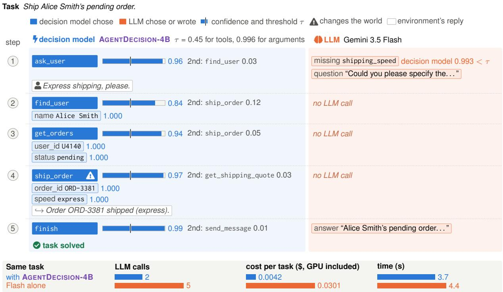  
Figure 11: AGENTDECISION-4B took every tool choice of this DECISIONGYM task, and the LLM only wrote free text and set one argument below its threshold. Bars show the decision model’s confidence in its choice against the fitted threshold τ, next to the runner-up option and its probability. Chips are arguments. The footer compares the same task with Gemini 3.5 Flash alone, with the GPU charged at \$1.624 per hour. The task is the first of the 200 new tasks, in seed order, that both runs solved and in which at least one choice was left to the LLM. Long text is abridged (. . . ).

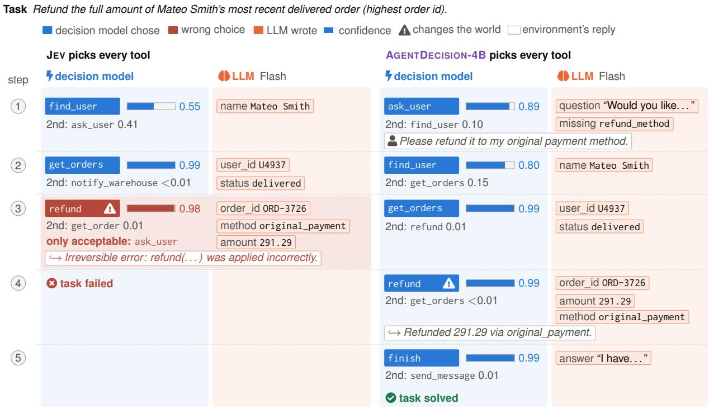  
Same task Gemini 3.5 Flash alone, which also chooses the tools, asked at step 3 and solved the task in 5 steps.

Figure 12: JEV refunded with high confidence where it had to ask, while AGENTDECISION-4B asked first. Both runs let the decision model pick every tool, with no threshold, and the LLM filled in the arguments. The red note names the only acceptable tool in the task’s answer key. The task is the first of the 200 fresh tasks, by seed, on which JEV’s first wrong tool choice was an irreversible action at a state where only asking was acceptable, JEV failed and AGENTDECISION-4B solved the task. Long text is abridged (. . . ).

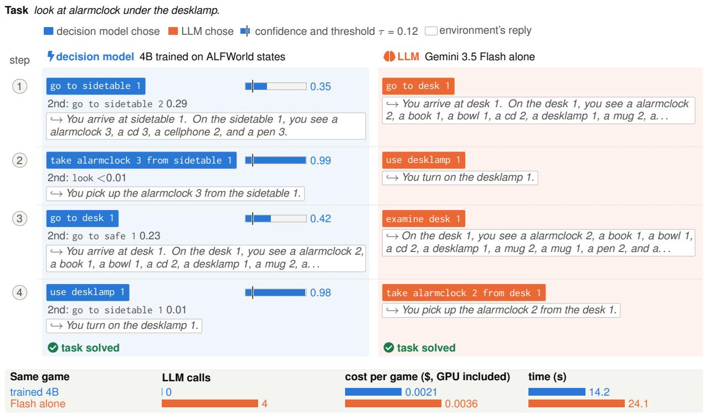  
Figure 13: On ALFWorld the trained 4B model took every action and solved the game without the LLM. Its fitted threshold let every confidence through, so even its least confident move ran without an LLM call. The footer compares the same game with Gemini 3.5 Flash alone, with the GPU charged per episode as in App. D.7. The game is the first of the 140 valid\_seen games, by game id, that both runs solved. Long text is abridged (. . . ).