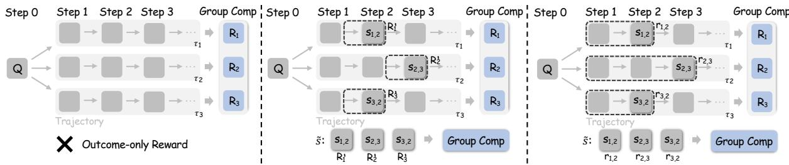
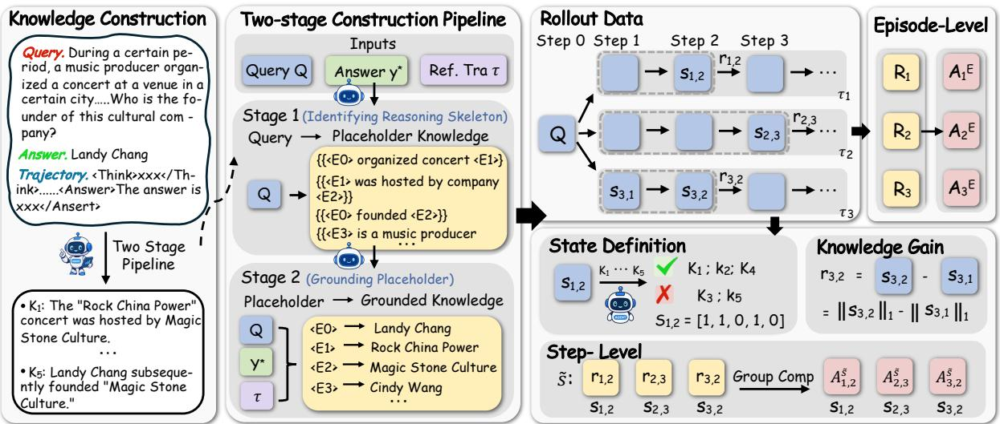
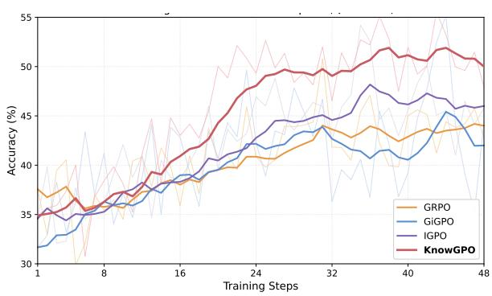
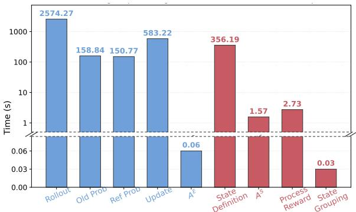
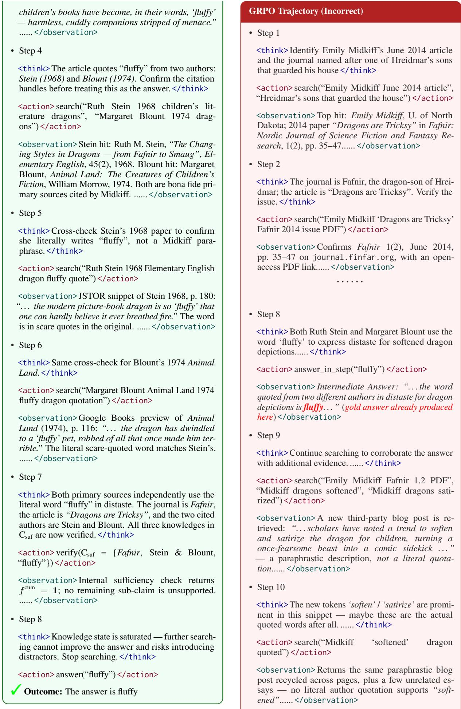

# KnowGPO: Knowledge-Grouped Policy Optimization for Search Agents

Siqi Chen<sup>1,2</sup>, Zhengxi Lu<sup>1</sup>, Yuchen Yan<sup>1</sup>, Xingyu Wu<sup>1,2</sup>, Qipeng Chen<sup>1</sup>, Xin Zhang<sup>2</sup>, Aiting Liu<sup>2</sup>, Chao Deng<sup>2</sup>, Jie Liu<sup>2</sup>, Jin Ma<sup>2</sup>, Weiming Lu<sup>1</sup>,

Jun Xiao<sup>1</sup>, Yongliang Shen<sup>1</sup>\*

<sup>1</sup>Zhejiang University, <sup>2</sup>Tencent.

{siqichen,syl}@zju.edu.cn, daniellwang@tencent.com

## Abstract

Deep search agents solve knowledge-intensive tasks through long-horizon, multi-turn interactions, where assigning credit to individual search decisions is fundamentally difficult. Outcome-based reinforcement learning provides only a single terminal reward shared across an entire trajectory. Recent processsupervision methods aim to assign credit at finer granularity, but they typically anchor credit to either surface-level trajectory states or model-internal signals, both of which become unreliable in deep search where observations are heterogeneous and retrieved contexts are long and noisy. We propose KnowGPO, a reinforcement learning framework that aligns trajectories by the task-relevant knowledge they have acquired rather than by their surface observations. For each query, KnowGPO decomposes the information required to derive the answer into atomic knowledge conditions, and represents the state of a trajectory at each step by the subset of conditions it has satisfied. Trajectories sharing the same knowledge state are grouped for within-group comparison, and the incremental knowledge gain between consecutive steps serves as an environmentgrounded process reward. Experiments on Xbench, BrowseComp-ZH, and GAIA show KnowGPO consistently outperforms outcomeonly (GRPO) and process-supervision baselines (GiGPO, IGPO) by 3.8 to 4.2 points, with our 8B model rivaling or exceeding most 32B open-source systems. Our code is available at https://github.com/ZJU-REAL/KnowGPO.

## 1 Introduction

LLM-based deep search agents have become a powerful paradigm for knowledge-intensive problem solving, coordinating multi-turn search, evidence inspection, query reformulation, and termination decisions through language-model reasoning (Yao et al., 2022; Zhang et al., 2026a). Unlike conventional retrieval-augmented generation (RAG), which typically follows a one-pass retrieve-thenread pipeline (Lewis et al., 2021; Gao et al., 2024; Zhao et al., 2024), deep search agents iteratively formulate queries, inspect evidence, update beliefs, and decide when to stop (Nakano et al., 2021; Li et al., 2025c). This makes deep search a longhorizon sequential decision problem, where success depends on adaptive decisions about what to search, what evidence to keep, and when to terminate. Because supervised fine-tuning mainly imitates surface behavior (Nakano et al., 2021; Schick et al., 2023) and cannot optimize such strategic decisions, reinforcement learning has become central to training competitive deep search agents (Guo et al., 2025; Jin et al., 2025; Song et al., 2025).

However, applying reinforcement learning to deep search agents encounters three coupled difficulties in credit assignment (Figure 1). First, terminal outcome rewards used by group-relative methods such as GRPO (Shao et al., 2024; Jin et al., 2025; Song et al., 2025; Lu et al., 2025; Li et al., 2025b; Liu et al., 2025) are uniformly broadcast to every action, so a single final reward cannot reveal which intermediate decisions were useful, redundant, or harmful. Second, recent processsupervision methods such as GiGPO (Feng et al., 2025) that align trajectories by their intermediate states require state recurrence across trajectories, yet deep search rollouts seldom revisit the same observable state even when they acquire the same evidence. Third, dense process rewards derived from changes in the model’s predicted answer probability, as in IGPO (Wang et al., 2026), or from learned critics and rubric-based reward models (Shi et al., 2025; Lee et al., 2025; Zhang et al., 2025, 2026b; Lu et al., 2026), provide denser signals but are driven by model-internal beliefs or learned proxies rather than by externally verified knowledge.

Deep search trajectories vary widely at the level of queries, pages, and reasoning traces, but converge on the same underlying quantity: the taskrelevant knowledge they have accumulated toward the correct answer. This knowledge, not observations or model confidence, provides the natural signal for credit assignment in long-horizon search.

  
Figure 1: Comparison of credit assignment in deep search agents. Left: GRPO uses episode-level advantages from terminal rewards $( R _ { 1 } , R _ { 2 } , R _ { 3 } )$ without intermediate feedback. Middle: GiGPO matches environment states (˜s) but suffers from severe fragmentation under heterogeneous observations. Right: KnowGPO abstracts heterogeneous states into knowledge states $( \mathbf { s } _ { i , t } )$ and computes step-level advantages from incremental knowledge gains $( r _ { i , t } )$

We propose Knowledge-Grouped Policy Optimization (KnowGPO), a RL framework that aligns trajectories by the task-relevant knowledge they have acquired rather than by their surface observations. For each query, we decompose the information required to derive the correct answer into a set of atomic knowledge conditions. At every step of a trajectory, we represent its state by the subset of conditions it has satisfied, called its knowledge state. We further define incremental knowledge gain, the increase in satisfied conditions between consecutive steps, as a process reward that scores each action’s immediate contribution. While knowledge-state grouping ensures only semantically comparable steps are contrasted, incremental gain provides the dense signal within each group, enabling fine-grained credit assignment without a learned critic. Trajectories sharing the same knowledge state are grouped for withingroup comparison, yielding step-level advantages that combine with episode-level outcome advantages through a single mixing coefficient. The result is fine-grained credit assignment for longhorizon deep search without observation matching, without dependence on the model’s own confidence, and without a learned reward model.

We train Qwen3-8B with KnowGPO on three challenging deep search benchmarks: Xbench, BrowseComp-ZH, and GAIA. KnowGPO improves over outcome-only GRPO by 2.0% to 5.9% and consistently outperforms recent processsupervision baselines including GiGPO and IGPO, with the resulting 8B agent matching or surpassing open-source systems of up to 32B parameters. In summary, our contributions are threefold:

• We propose KnowGPO, a reinforcement learning framework that performs credit assignment in a query-specific knowledge state space rather than over surface observations, enabling within-group comparison across semantically equivalent trajectories.

• We introduce incremental knowledge gain as a process reward grounded in the environment, providing dense step-level supervision without observation matching, learned critics, or reliance on model-internal probabilities.

• We demonstrate that KnowGPO outperforms outcome-based and recent processsupervision baselines by 3.8% to 4.2% across three deep search benchmarks, with an 8B agent matching or surpassing open-source systems of up to 32B parameters.

## 2 Related Work

## 2.1 Reinforcement Learning for Search Agent

Reinforcement learning with verifiable outcome rewards has become the dominant paradigm for post-training deep search agents. Early systems train models to interleave search and reasoning through outcome-based optimization on multi-hop QA (Jin et al., 2025; Chen et al., 2025; Wang et al., 2025; Zheng et al., 2025; Wu et al., 2025), showing that group-relative methods such as GRPO scale to multi-turn tool use without learned value functions. Subsequent work scales this paradigm along two axes: harder data through knowledge graphs, web exploration, and synthetic multi-hop generation (Lu et al., 2025; Li et al., 2025b; Liu et al., 2025; Li et al., 2025a; Du et al., 2026; Gao et al., 2025; Chu et al., 2026; Team et al., $2 0 2 6 \mathrm { e } , \mathrm { d } )$ , and refined reward shaping and policy gradient stability for long-horizon rollouts (Wu et al., 2026; Dong et al., 2025; Luo et al., 2025; Tang et al., 2025). Despite these advances, the supervisory signal in most systems remains a binary reward at the end of each trajectory, leaving the contribution of search decisions inside long rollouts unidentified.

## 2.2 Credit Assignment for Search Agents

A growing line of work aims to address longhorizon credit assignment through process-level supervision. GiGPO (Feng et al., 2025) extends GRPO with anchor-state grouping, computing steplevel advantages by matching trajectories that revisit the same environment state; this mechanism requires reliable state recurrence, which is rare in deep search where retrieved contents and reasoning histories are open-ended. IGPO (Wang et al., 2026) instead derives dense step rewards from the model’s own probability of producing the correct answer, sidestepping state matching but anchoring the signal to internal confidence that can be biased by long, noisy retrieved contexts. A parallel direction introduces externally grounded supervision through learned reward models or rubric decompositions (Zhang et al., 2026b, 2025; Lee et al., 2025; Shi et al., 2025), providing denser feedback than outcome rewards but relying on learned proxies whose calibration is itself a research question, and without producing step groupings that make semantically equivalent decisions directly comparable across trajectories. KnowGPO instead anchors credit assignment to an externally verifiable representation of progress, the set of satisfied atomic knowledge conditions, and uses this representation as both the grouping criterion for withingroup comparison and the basis of a process reward grounded in the environment.

## 3 Method

## 3.1 Problem Formulation

We formulate deep search as a multi-turn sequential decision process. Given a query Q and a reference answer $y ^ { * }$ , an agent interacts with a retrieval environment over time steps $t \in \{ 1 , \ldots , T \}$ . At each step the agent produces a reasoning trace and an action $a _ { t } \in \{ \mathsf { s e a r c h } , \mathsf { a n s w e r } \}$ from its policy $\pi _ { \theta } ( \cdot \mid h _ { t } , Q )$ , where $h _ { t } = ( a _ { 1 } , o _ { 1 } , \ldots , a _ { t - 1 } , o _ { t - 1 } )$ is the interaction history and $o _ { t }$ is the observation returned by the environment (e.g., retrieved documents for search, or a terminal signal for answer). A complete trajectory is denoted $\tau =$ $( a _ { 1 } , o _ { 1 } , \dots , a _ { T } , o _ { T } )$ and terminates with a binary outcome reward $R ( \tau ) = \mathbb { I } ( \mathrm { a n s } ( \tau ) = y ^ { * } )$ . We build on group-relative policy optimization, which estimates advantages from a group of N trajectories sampled for the same $Q$ and avoids learning a separate value network. The challenge addressed throughout this section is that $R ( \tau )$ alone provides no signal for distinguishing useful, redundant, or harmful steps inside a long-horizon trajectory.

## 3.2 Knowledge State

A central design choice in KnowGPO is to abstract the progress of a search trajectory through the task-relevant knowledge it has acquired, rather than through its surface observations. We realize this abstraction in two steps: constructing a queryspecific set of atomic knowledge conditions, and representing each trajectory step by the subset of conditions it has satisfied.

Knowledge conditions. For each query $Q$ with reference answer $y ^ { \ast }$ , we construct a finite set of atomic knowledge conditions

$$
{ \cal K } ( Q ) = \{ k _ { 1 } , \ldots , k _ { K } \} ,\tag{1}
$$

where each $k _ { j }$ is a single-hop factual constraint needed to derive $y ^ { \ast }$ . Intuitively, $\mathcal { K } ( Q )$ encodes the answer’s logical skeleton: a trajectory cannot reliably produce $y ^ { * }$ without acquiring every $k _ { j }$ . We construct $\mathcal { K } ( Q )$ through a two-stage pipeline that first identifies the reasoning skeleton implied by $Q$ (with placeholders for unknown entities) and then grounds each placeholder using $y ^ { \ast }$ and a successful reference trajectory. This decoupling produces a trajectory-agnostic knowledge space and ensures three properties: each condition encodes a single fact (atomicity), the conditions jointly support the full reasoning chain to $y ^ { \ast }$ (completeness), and entity references remain consistent across the query, the answer, and the search trajectories (grounding consistency). Construction details and the prompts used at each stage are deferred to $\mathbf { A } _ { \mathbf { l } }$ ppendix B.

Knowledge state. Given $\mathcal { K } ( Q )$ , we represent the state of a trajectory $\tau _ { i }$ at step t by the subset of conditions it has satisfied so far. At each step, an LLM-based verifier inspects the new observation $o _ { i , t }$ and outputs a binary vector $\Delta \mathbf { s } _ { i , t } \in \{ 0 , 1 \} ^ { K }$ indicating the set of conditions newly verifiable from $o _ { i , t } \colon$

$$
[ \Delta { \bf s } _ { i , t } ] _ { j } = \mathbb { I } ( h _ { i , t } \Vdash  k _ { j } ) .\tag{2}
$$

  
Figure 2: Overview of the KnowGPO framework. Left: Knowledge condition construction via a two-stage pipeline, illustrated with an example. Right: Rollout trajectories are grouped by matched knowledge states; step-level advantages are computed from incremental knowledge gains via group-relative comparisons.

We then monotonically accumulate these increments to obtain the cumulative knowledge state:

$$
\begin{array} { r } { { \bf s } _ { i , t } = { \bf s } _ { i , t - 1 } \vee \Delta { \bf s } _ { i , t } , \qquad { \bf s } _ { i , 0 } = { \bf 0 } _ { K } , } \end{array}\tag{3}
$$

where ∨ denotes element-wise OR. Monotonic accumulation reflects the fact that acquired knowledge cannot be unacquired, and absorbs transient verifier noise across nearby steps. The knowledge state ${ \bf s } _ { i , t }$ defines a shared semantic space across episodes: two steps with the same s have, by construction, acquired the same set of taskrelevant facts, regardless of which queries were issued, which pages were visited, or how reasoning was phrased in between. This is the property that surface observations fail to provide and that KnowGPO exploits in the next subsection.

## 3.3 Knowledge-Grouped Policy Optimization

Given the knowledge state representation, Know-GPO assigns credit at two levels. Episode-level advantages align the policy with the final task objective, and step-level advantages, computed by grouping steps under matched knowledge states, attribute credit to individual search decisions.

Episode-level advantage. For each query $Q ,$ we sample N episodes $\{ \tau _ { i } \} _ { i = 1 } ^ { N }$ from the current policy and compute the group-normalized advantage of episode i as

$$
A _ { i } ^ { E } = \frac { R ( \tau _ { i } ) - \mu } { \sigma + \varepsilon } ,\tag{4}
$$

where $\mu$ and $\sigma$ are the empirical mean and standard deviation of $\{ R ( \tau _ { i } ) \} _ { i = 1 } ^ { N }$ , and ε is a small constant for numerical stability. This is the standard outcome-based group advantage of GRPO.

Step-level advantage via knowledge-grouped comparison. To attribute credit at the step-level, we exploit the fact that the knowledge state ˜s partitions the space of intermediate steps into semantically equivalent classes. Let U denote the set of distinct knowledge states observed across all N episodes for query $Q .$ . For each ${ \tilde { \mathbf { s } } } \in { \mathcal { U } } .$ , we form a knowledge group

$$
\mathcal { G } ( \tilde { \mathbf { s } } ) = \{ ( i , t ) ~ | ~ \mathbf { s } _ { i , t } = \tilde { \mathbf { s } } , ~ a _ { i , t } \neq \mathsf { a n s w e r } \}\tag{5}
$$

containing every non-terminal step that starts from state ˜s. We then define the step-level reward as the incremental knowledge gain,

$$
r _ { i , t } = \lVert \mathbf { s } _ { i , t } \rVert _ { 1 } - \lVert \mathbf { s } _ { i , t - 1 } \rVert _ { 1 } ,\tag{6}
$$

which counts the number of new knowledge conditions satisfied by step $( i , t )$ . The step-level advantage is the group-normalized incremental gain within G(˜s):

$$
A _ { i , t } ^ { S } = \frac { r _ { i , t } - \mu _ { \tilde { \mathbf { s } } } } { \sigma _ { \tilde { \mathbf { s } } } + \varepsilon } ,\tag{7}
$$

where $\mu _ { \mathbf { s } }$ and $\sigma _ { \mathbf { s } } ^ { \sim }$ are computed over $\mathcal { G } ( \tilde { \mathbf { s } } )$ . Two features of this construction are important. First, all steps compared within a group share the same prior knowledge state, so $A _ { i , t } ^ { S }$ measures how much more (or less) a step contributes to knowledge acquisition than alternative actions taken from the same epistemic position. Second, the step-level signal is anchored to the environment through the verifier’s checks against $\mathcal { \kappa } ( Q )$ , rather than to surface observations or the policy’s own answer probabilities.

Combined objective. For each step $( i , t )$ , we combine the two advantages with a single mixing coefficient $\omega \in [ 0 , 1 ]$

$$
A _ { i , t } = \left( 1 - \omega \right) A _ { i } ^ { E } + \omega A _ { i , t } ^ { S } .\tag{8}
$$

The episode-level term keeps optimization aligned with the final outcome and prevents the policy from collapsing onto local information-gathering behaviors. The step-level term provides dense, semantically grounded supervision that distinguishes between informative and redundant decisions sharing the same starting knowledge.

We optimize the policy with a PPO-style clipped objective (Schulman et al., 2017):

$$
\begin{array} { r l } & { \mathcal { L } _ { \mathrm { K n o w G P O } } ( \theta ) = \mathbb { E } \left[ \displaystyle \sum _ { i , t } \operatorname* { m i n } \Bigl ( \rho _ { i , t } A _ { i , t } , } \\ & { ~ \mathrm { c l i p } ( \rho _ { i , t } , 1 - \epsilon , 1 + \epsilon ) A _ { i , t } \Bigr ) \right] } \\ & { ~ - ~ \beta D _ { \mathrm { K L } } ( \pi _ { \theta } \parallel \pi _ { \mathrm { r e f } } ) , } \end{array}\tag{9}
$$

The full procedure, including knowledge state verification and group construction, is summarized in Algorithm 1 (Appendix A).

## 4 Experiments

We evaluate KnowGPO on four research questions. First, does knowledge-grouped credit assignment yield consistent gains over outcome-only and process-supervision baselines (Section 4.2)? Second, are knowledge-state grouping and incremental knowledge gain each individually necessary (Section 4.3)? Third, does the knowledge state genuinely provide a better grouping anchor than surface observations (Section 4.4)? Fourth, how does KnowGPO change search behavior, and at what training cost (Section 4.5)?

## 4.1 Experimental Setup

Benchmarks. We evaluate KnowGPO on three challenging deep search benchmarks that cover diverse question distributions and difficulty levels: Xbench (Xbench-Team, 2025) (covering the 2505 and 2510 splits), BrowseComp-ZH (Zhou et al., 2025), and the text-only subset of GAIA (Mialon et al., 2023). Following standard LLM-as-judge protocols, GPT-4o (OpenAI et al., 2024) judges whether the agent’s final response matches the ground truth. All evaluations follow each benchmark’s official protocol; we report the mean accuracy over 3 independent runs.

Baselines. We compare KnowGPO against three representative reinforcement learning approaches, all trained from the same SFT checkpoint with identical data and tool environments. GRPO (Shao et al., 2024) uses only the binary outcome reward and is the dominant baseline in current open-source systems. GiGPO (Feng et al., 2025) introduces step-level credit assignment by grouping steps that revisit the same intermediate state and computing within-group advantages from discounted future returns. IGPO (Wang et al., 2026) assigns each step a dense reward equal to the increase in the model’s predicted probability of the correct answer. In addition, we report numbers from several stateof-the-art open-source and proprietary deep search agents for context; differences in training data, context length, and tool stacks limit direct comparison, and we mark such systems separately.

Implementation details. All trained models use Qwen3-8B (Yang et al., 2025) as the base model, with context extended to 128K tokens via YaRN (Peng et al., 2026). SFT is conducted with LlamaFactory (Zheng et al., 2024); RL training uses verl (Sheng et al., 2025). All baselines share the same SFT initialization, training data, learning rate, batch size, and rollout configuration as KnowGPO; only the advantage estimator and reward design differ. Knowledge state verification uses DeepSeek-v3.2 as the LLM verifier; the choice and its quality analysis are reported in Appendix C. Full hyperparameters are in Appendix E.

## 4.2 Main Results

Tables 1 and 2 report performance on all three benchmarks. We make two observations.

KnowGPO consistently outperforms both outcome-only and step-level baselines. All RL approaches improve over SFT, confirming that explicit policy optimization is necessary for deep search agents. However, existing step-level methods show considerable cross-dataset variability: GiGPO degrades by 2.0% on Xbench-2505 relative to GRPO despite winning on BrowseComp-ZH, and IGPO matches GRPO on Xbench-2505 but barely improves on BrowseComp-ZH. KnowGPO is the only method that improves on every split, gaining 5.9% on BrowseComp-ZH and 5.2% on GAIA over GRPO, and exceeding the strongest step-level baseline by 1.5% and 2.3% on these two benchmarks. The averaged gain over the SFT initialization is 8.5%. We attribute this consistency to the fact that knowledge-grouped credit signals do not depend on either surface state recurrence or stable model confidence, both of which are particularly fragile on noisier benchmarks.

<table><tr><td>Model</td><td>BrowseComp-ZH</td><td>GAIA</td></tr><tr><td>Advanced Agents with Proprietary Data</td><td></td><td></td></tr><tr><td>MiniMax-M2.1</td><td>47.8</td><td>64.3</td></tr><tr><td>DeepSeek-V3.1</td><td>49.2</td><td>63.1</td></tr><tr><td>DeepSeek-R1</td><td>26.3</td><td>16.5</td></tr><tr><td>GLM-4.5</td><td>37.5</td><td>66.0</td></tr><tr><td>Kimi-K2.5</td><td>62.3</td><td></td></tr><tr><td>Claude-4-Sonnet</td><td>29.1</td><td>68.3</td></tr><tr><td>Agents with Open-source Data</td><td></td><td></td></tr><tr><td>WebExplorer-8B</td><td>32.0</td><td>50.0</td></tr><tr><td>WebSailor-7B</td><td>14.2</td><td>37.9</td></tr><tr><td>WebSailor-32B</td><td>25.5</td><td>51.5</td></tr><tr><td>ASearcher-Web-32B</td><td>15.6</td><td>52.8</td></tr><tr><td>DeepMiner-32B-RL</td><td>40.1</td><td>58.7</td></tr><tr><td>DeepDive-9B</td><td>15.1</td><td></td></tr><tr><td>DeepDive-32B</td><td>29.7</td><td>一</td></tr><tr><td>Our Agents</td><td></td><td></td></tr><tr><td>Qwen3-8B-SFT</td><td>30.1</td><td>31.1</td></tr><tr><td>+ GRPO</td><td>32.9</td><td>35.0</td></tr><tr><td>+ GiGPO</td><td>37.3</td><td>35.0</td></tr><tr><td>+ IGPO</td><td>32.2</td><td>37.9</td></tr><tr><td>+ KnowGPO</td><td>38.8</td><td>40.2</td></tr></table>

Table 1: Performance comparison on BrowseComp-ZH and GAIA. Among RL-based methods, best results are in bold, and second-best are underlined.

KnowGPO closes the gap to 32B open-source deep search agents at 8B scale. On BrowseComp-ZH, KnowGPO reaches 38.8%, surpassing the same-scale WebExplorer-8B by 6.8% and the 32B WebSailor-32B and DeepDive-32B by 13.3% and 9.1% respectively, and trailing the strongest open-source system DeepMiner-32B-RL by only 1.3%. On Xbench-2505 it reaches 48.0%, outperforming the 8B MiroThinker-v1.0 by 12.6%. These results show that knowledge-grouped credit assignment narrows the gap to substantially larger open-source systems without proprietary data or larger backbones. A gap to proprietary systems remains, for example 23.5% to Kimi-K2.5 on BrowseComp-ZH and 28.1% to Claude-4-Sonnet on GAIA, which we attribute to training data scale, model capacity, and inference-time optimization beyond our scope.

<table><tr><td>Model</td><td>Xbench-2505</td><td>Xbench-2510</td></tr><tr><td>Advanced Agents with Proprietary Data</td><td></td><td></td></tr><tr><td>MiniMax-M2.1</td><td>68.7</td><td>43.0</td></tr><tr><td>DeepSeek-V3.2</td><td>78.0</td><td>55.7</td></tr><tr><td>GLM-4.7</td><td>72.0</td><td>52.3</td></tr><tr><td>Kimi-K2.5</td><td></td><td>46.0</td></tr><tr><td>Claude-4-Sonnet</td><td>64.6</td><td></td></tr><tr><td>OpenAI-o3</td><td>67.0</td><td></td></tr><tr><td>OpenAI GPT-5-High</td><td>77.8</td><td>75.0</td></tr><tr><td>Gemini-3.0-Pro</td><td></td><td>53.0</td></tr><tr><td>Agents with Open-source Data</td><td></td><td></td></tr><tr><td>WebExplorer-8B</td><td>53.7</td><td>23.0</td></tr><tr><td>MiroThinker-v1.0-8b</td><td>60.6</td><td>34.0</td></tr><tr><td>MiroThinker-v1.0-30B</td><td>70.6</td><td></td></tr><tr><td>MiroThinker-v1.5-30B</td><td>73.1</td><td></td></tr><tr><td>MiroThinker-v1.7-mini</td><td></td><td>57.2</td></tr><tr><td>Our Agents</td><td></td><td></td></tr><tr><td>Qwen3-8B-SFT</td><td>39.0</td><td>29.0</td></tr><tr><td>+ GRPO</td><td>46.0</td><td>34.0</td></tr><tr><td>+ GiGPO</td><td>44.0</td><td>35.0</td></tr><tr><td>+ IGPO</td><td>46.0</td><td>34.0</td></tr><tr><td>+ KnowGPO</td><td>48.0</td><td>36.0</td></tr></table>

Table 2: Performance comparison on Xbench-2505 and Xbench-2510. Among RL-based methods, best results are in bold, and second-best are underlined.
<table><tr><td>Model</td><td>|Xben05</td><td>Xben10</td><td>BC-ZH</td><td>GAIA</td></tr><tr><td>Qwen3-8b-SFT</td><td>39.0</td><td>29.0</td><td>30.1</td><td>31.1</td></tr><tr><td>+KnowGPO (ω=0)</td><td>45.0</td><td>28.0</td><td>34.0</td><td>34.0</td></tr><tr><td>+KnowGPO (ω=0.3)</td><td>48.0</td><td>36.0</td><td>38.8</td><td>40.2</td></tr><tr><td>+KnowGPO (ω=0.5)</td><td>47.0</td><td>35.0</td><td>36.3</td><td>37.9</td></tr></table>

Table 3: Performance of KnowGPO with different ω.

Training dynamics across baselines. Figure 3 tracks validation accuracy on Xbench-2505 in RL training. All four methods start from the same SFT checkpoint and follow comparable trajectories during the first 16 steps, after which they diverge. KnowGPO opens a clear gap by around step 20 and plateaus near step 32 at roughly 50%, while GRPO, GiGPO, and IGPO settle below 46%. The gap is consistent across the second half of training, suggesting that knowledge-grouped credit assignment provides a denser signal throughout rather than a small final-stage advantage.

## 4.3 Ablation Study

We next ablate the components of KnowGPO. The first ablation studies the mixing coefficient ω; the second isolates the contributions of incremental knowledge gain and knowledge-state grouping; the third compares incremental gain against discounted future returns as a process reward. All ablations use the same SFT initialization and training setup as the main experiments.

  
Figure 3: Training curves comparing GRPO, GiGPO, IGPO, and KnowGPO on our Qwen3-8B-SFT.

<table><tr><td>Method</td><td>Xben05</td><td>Xben10</td><td>BC-ZH</td><td>GAIA</td></tr><tr><td>GRPO (Base)</td><td>46.0</td><td>34.0</td><td>32.9</td><td>35.0</td></tr><tr><td>+∆KG</td><td>47.0</td><td>34.0</td><td>34.6</td><td>37.8</td></tr><tr><td>KnowGPO  $\left( \mathbf { w } / G _ { t } \right)$ </td><td>45.0</td><td>35.0</td><td>32.8</td><td>36.8</td></tr><tr><td>KnowGPO</td><td>48.0</td><td>36.0</td><td>38.8</td><td>40.2</td></tr></table>

Table 4: Ablation study on reward design and grouping mechanisms. (1) GRPO with outcome rewards, (2) GRPO with incremental knowledge gain, (3) KnowGPO with discounted future returns, and (4) KnowGPO.

The mixing coefficient $\omega$ balances outcome and process supervision. Table 3 sweeps $\omega \in$ {0, 0.3, 0.5}. Performance peaks at $\omega ~ = ~ 0 . 3$ across all four splits. Setting $\omega ~ = ~ 0$ disables step-level supervision yet still outperforms GRPO on BrowseComp-ZH and GAIA, suggesting that grouping by knowledge state implicitly regularizes learning even before any step reward is applied. Setting $\omega = 0 . 5$ overweights process supervision and degrades on three of four splits, reflecting that excessive local optimization can pull the policy away from the terminal objective. We use $\omega = 0 . 3$ throughout the rest of the paper.

Both incremental gain and knowledge-state grouping are individually necessary. Table 4 decomposes KnowGPO against GRPO. Adding incremental knowledge gain to GRPO (+∆KG, applied without knowledge-state grouping) improves over GRPO by 1.0% to 2.8% across benchmarks, confirming that knowledge-grounded step rewards are useful even without proper grouping. Further introducing knowledge-state grouping (KnowGPO, full) yields an additional 1.0% to 4.2%, with the largest gain (+4.2%) on BrowseComp-ZH. The role of grouping is to restrict normalization to steps that share the same prior knowledge state, so that within-group comparison contrasts decisions made from the same epistemic position rather than across mixed positions; the ablation isolates this effect from the choice of process reward.

Incremental knowledge gain outperforms discounted future returns as a process reward. Within the same knowledge-grouped framework, replacing incremental gain with the discounted future return $G _ { t }$ used by GiGPO drops accuracy by 3.0%, 6.0%, and 3.4% on Xbench-2505, BrowseComp-ZH, and GAIA respectively (Table 4, row "KnowGPO w/ $G _ { t } " )$ . The two rewards differ in how much downstream stochasticity they absorb: $G _ { t }$ couples a step’s credit to all subsequent decisions and is sensitive to long-horizon noise, while incremental knowledge gain is a local, immediate signal that does not require waiting for the trajectory to end. The gap shows that, even when grouping is fixed, the choice of step reward materially matters for long-horizon credit assignment.

## 4.4 Why Knowledge-Based Grouping Works

The ablation shows that knowledge-state grouping matters in aggregate. We now examine why it works by directly measuring the grouping behavior of three candidate anchors on real rollouts.

Setup. We sample 500 queries from Xbench and BrowseComp (Wei et al., 2025) and rollout the SFT checkpoint up to 16 times per query, producing 5,922 valid trajectories with 55,571 steps after filtering. We compare three grouping anchors: observation-anchored, matching steps by BGE-large cosine similarity over retrieved contents at threshold 0.9 (the protocol used by GiGPO); action-anchored, matching steps by similarity of generated queries; and knowledge-anchored (ours), matching steps by exact equality of accumulated knowledge state. Grouping quality is measured by the effective step ratio (ESR, fraction of steps in non-singleton groups), the singleton ratio, the mean non-singleton group size, and the cross-rollout coverage (average number of distinct rollouts per nonsingleton group). Formal definitions are in Appendix D.

Knowledge state aligns far more steps than observation or action. Table 5 reports the five metrics. Observation-based grouping, the anchor used by GiGPO, leaves only 51.8% of steps inside nonsingleton groups and produces 79.4% singletons, which means most intended step-level comparisons cannot be executed: the within-group advantage degenerates to comparing a step with itself, providing no learning signal. Action-based grouping improves ESR to 79.4% but its singleton ratio is still 72.0%, indicating that even when two trajectories issue similar queries, the evidence they end up acquiring is rarely comparable. Knowledgebased grouping raises ESR to 97.8% and reduces singletons to 19.0%, while keeping cross-rollout coverage (4.66) close to the highest value across anchors. This last metric is important: it confirms that the gain is not an artifact of merging adjacent steps within the same rollout, but reflects alignment of semantically equivalent steps across independent trajectories. A qualitative case in Appendix D shows two steps with 0.987 retrieval similarity that are correctly separated by the knowledge anchor (one has acquired 0 of 12 conditions, the other 8 of 12), illustrating that surface similarity can hide drastic differences in actual search progress.

<table><tr><td>Metric</td><td>Obs</td><td>Act</td><td>Know</td></tr><tr><td>ESR↑(%)</td><td>51.8</td><td>79.4</td><td>97.8</td></tr><tr><td>SR↓(%)</td><td>79.4</td><td>72.0</td><td>19.0</td></tr><tr><td>MeanNG</td><td>4.85</td><td>24.62</td><td>21.28</td></tr><tr><td>Cross ↑</td><td>3.83</td><td>4.85</td><td>4.66</td></tr><tr><td>Ngroups</td><td>32,267</td><td>14,902</td><td>4,872</td></tr></table>

Table 5: Comparison of grouping quality across three state anchors.

<table><tr><td>Method</td><td>Both Fail</td><td>Both Pass</td><td>GRPO-only</td><td>Know-only</td></tr><tr><td>GRPO</td><td>11.39</td><td>7.03</td><td>9.51</td><td>11.55</td></tr><tr><td>KnowGPO</td><td>10.85</td><td>6.33</td><td>10.36</td><td>9.83</td></tr></table>

Table 6: Average search turns across outcome subsets. Both Fail: queries where both methods fail; Both Pass: both succeed; GRPO-only: only GRPO succeeds; KnowGPO-only: only KnowGPO succeeds.

## 4.5 Search Behavior and Training Efficiency

KnowGPO learns to search adaptively, not just less. Reducing redundant search is easy if the policy simply stops earlier on every query, but this would harm hard cases. To test for this failure mode, we partition 500 test queries by joint solving outcome and compare average search turns (Table 6). On queries solved exclusively by KnowGPO, KnowGPO uses 9.83 turns versus 11.55 for GRPO, a clear reduction in redundant exploration. On queries solved only by GRPO, KnowGPO still uses 10.36 turns, and on queries where both methods fail, it uses 10.85, the longest of all subsets. The agent does not uniformly shorten search; it shortens search when evidence becomes sufficient and continues searching when evidence remains scarce. A representative trajectory comparison in Appendix G shows GRPO overshooting a correct intermediate answer by four additional turns and overwriting it with a wrong one, a failure mode KnowGPO avoids.

  
Note: KnowGPO uses per-trajectory pipeline parallelism between Rollout and judgeFigure 4: Per-iteration training time breakdown. Blue bars represent shared RL operations common to both GRPO and KnowGPO; red bars represent KnowGPO-specific components.

Knowledge-grouped credit adds negligible training cost. A natural concern with structured process supervision is overhead. We profile periteration time over three training epochs (Figure 4). The training budget is dominated by operations shared with GRPO: trajectory generation (2,574s), policy update (583s), and probability computation (310s). KnowGPO-specific operations are knowledge verification (356s), incremental gain computation (2.73s), and group construction (0.03s). Verification runs asynchronously and overlaps with the next rollout, so its wall-clock cost is hidden behind generation; the two pure-bookkeeping operations together account for less than 0.08% of the budget. Knowledge-grouped credit assignment is therefore essentially free compared to GRPO.

## 5 Conclusion

We presented KnowGPO, a reinforcement learning framework that assigns credit by aligning deep search trajectories through the task-relevant knowledge they have acquired, rather than through their surface observations. KnowGPO groups steps under matched knowledge states and uses incremental knowledge gain as a process reward grounded in the environment. Across Xbench, BrowseComp-ZH, and GAIA, KnowGPO improves over outcomeonly and process-supervision baselines by 3.8% to 4.2%, with an 8B agent matching 32B open-source systems at training cost comparable to GRPO.

## Limitations

KnowGPO assumes that progress in the target task can be characterized by a finite set of verifiable knowledge conditions, which fits knowledgeintensive search but not more open-ended agentic tasks whose progress is harder to discretize. The fidelity of the knowledge state also depends on an LLM verifier, and although we use a strong external model with monotonic accumulation to suppress transient noise, residual errors can still propagate into step-level advantages. Our construction pipeline additionally requires at least one successful reference trajectory per query to ground entity placeholders, which limits applicability to settings where successful rollouts are reachable at reasonable cost. Finally, all experiments use Qwen3-8B; whether the effects we observe transfer to substantially smaller or larger backbones, or to reasoning-trained initializations, remains to be verified.

## Acknowledgment

This work was supported by the Fundamental and Interdisciplinary Disciplines Breakthrough Plan of the Ministry of Education of China (JYB2025XDXM103), National Natural Science Foundation of China (No. 62506332) , the Key Research and Development Program of Zhejiang Province, China (No. 2026C02A1240) and CCF-Tencent Rhino-Bird Open Research Fund.

## References

Anthropic. 2025. Introducing claude sonnet 4.5.

Siqi Chen, Xinyu Dong, Haolei Xu, Xingyu Wu, Fei Tang, Hang Zhang, Yuchen Yan, Linjuan Wu, Wenqi Zhang, Guiyang Hou, and 1 others. 2025. Svgenius: Benchmarking llms in svg understanding, editing and generation. In Proceedings of the 33rd ACM International Conference on Multimedia, pages 13289– 13296.

Zheng Chu, Xiao Wang, Jack Hong, Huiming Fan, Yuqi Huang, Yue Yang, Guohai Xu, Chenxiao Zhao, Cheng Xiang, Shengchao Hu, and 1 others. 2026. Redsearcher: A scalable and cost-efficient framework for long-horizon search agents. arXiv preprint arXiv:2602.14234.

Gheorghe Comanici, Eric Bieber, Mike Schaekermann, Ice Pasupat, Noveen Sachdeva, Inderjit Dhillon, Marcel Blistein, Ori Ram, Dan Zhang, Evan Rosen, Luke Marris, Sam Petulla, Colin Gaffney, Asaf Aharoni,

Nathan Lintz, Tiago Cardal Pais, Henrik Jacobsson, Idan Szpektor, Nan-Jiang Jiang, and 3416 others. 2025. Gemini 2.5: Pushing the frontier with advanced reasoning, multimodality, long context, and next generation agentic capabilities. Preprint, arXiv:2507.06261.

DeepSeek. 2025a. Deepseek-v3.1.

DeepSeek. 2025b. Deepseek-v3.1-terminus.

DeepSeek-AI, Aixin Liu, Aoxue Mei, Bangcai Lin, Bing Xue, Bingxuan Wang, Bingzheng Xu, Bochao Wu, Bowei Zhang, Chaofan Lin, Chen Dong, Chengda Lu, Chenggang Zhao, Chengqi Deng, Chenhao Xu, Chong Ruan, Damai Dai, Daya Guo, Dejian Yang, and 245 others. 2025. Deepseek-v3.2: Pushing the frontier of open large language models. Preprint, arXiv:2512.02556.

Guanting Dong, Hangyu Mao, Kai Ma, Licheng Bao, Yifei Chen, Zhongyuan Wang, Zhongxia Chen, Jiazhen Du, Huiyang Wang, Fuzheng Zhang, Guorui Zhou, Yutao Zhu, Ji-Rong Wen, and Zhicheng Dou. 2025. Agentic reinforced policy optimization. Preprint, arXiv:2507.19849.

Yuwen Du, Rui Ye, Shuo Tang, Xinyu Zhu, Yijun Lu, Yuzhu Cai, and Siheng Chen. 2026. Openseeker: Democratizing frontier search agents by fully opensourcing training data. Preprint, arXiv:2603.15594.

Lang Feng, Zhenghai Xue, Tingcong Liu, and Bo An. 2025. Group-in-group policy optimization for llm agent training. Preprint, arXiv:2505.10978.

Jiaxuan Gao, Wei Fu, Minyang Xie, Shusheng Xu, Chuyi He, Zhiyu Mei, Banghua Zhu, and Yi Wu. 2025. Beyond ten turns: Unlocking long-horizon agentic search with large-scale asynchronous rl. Preprint, arXiv:2508.07976.

Yunfan Gao, Yun Xiong, Xinyu Gao, Kangxiang Jia, Jinliu Pan, Yuxi Bi, Yi Dai, Jiawei Sun, Meng Wang, and Haofen Wang. 2024. Retrieval-augmented generation for large language models: A survey. Preprint, arXiv:2312.10997.

GLM-5-Team, :, Aohan Zeng, Xin Lv, Zhenyu Hou, Zhengxiao Du, Qinkai Zheng, Bin Chen, Da Yin, Chendi Ge, Chenghua Huang, Chengxing Xie, Chenzheng Zhu, Congfeng Yin, Cunxiang Wang, Gengzheng Pan, Hao Zeng, Haoke Zhang, Haoran Wang, and 168 others. 2026. Glm-5: from vibe coding to agentic engineering. Preprint, arXiv:2602.15763.

Daya Guo, Dejian Yang, Haowei Zhang, Junxiao Song, Peiyi Wang, Qihao Zhu, Runxin Xu, Ruoyu Zhang, Shirong Ma, Xiao Bi, Xiaokang Zhang, Xingkai Yu, Yu Wu, Z. F. Wu, Zhibin Gou, Zhihong Shao, Zhuoshu Li, Ziyi Gao, Aixin Liu, and 175 others. 2025. Deepseek-r1 incentivizes reasoning in llms through reinforcement learning. Nature, 645(8081):633–638.

Bowen Jin, Hansi Zeng, Zhenrui Yue, Jinsung Yoon, Sercan Arik, Dong Wang, Hamed Zamani, and Jiawei Han. 2025. Search-r1: Training llms to reason and leverage search engines with reinforcement learning. arXiv preprint arXiv:2503.09516.

Jaewoo Lee, Archiki Prasad, Justin Chih-Yao Chen, Zaid Khan, Elias Stengel-Eskin, and Mohit Bansal. 2025. Prints: Reward modeling for long-horizon information seeking. Preprint, arXiv:2511.19314.

Patrick Lewis, Ethan Perez, Aleksandra Piktus, Fabio Petroni, Vladimir Karpukhin, Naman Goyal, Heinrich Küttler, Mike Lewis, Wen tau Yih, Tim Rocktäschel, Sebastian Riedel, and Douwe Kiela. 2021. Retrieval-augmented generation for knowledgeintensive nlp tasks. Preprint, arXiv:2005.11401.

Kuan Li, Zhongwang Zhang, Huifeng Yin, Rui Ye, Yida Zhao, Liwen Zhang, Litu Ou, Dingchu Zhang, Xixi Wu, Jialong Wu, Xinyu Wang, Zile Qiao, Zhen Zhang, Yong Jiang, Pengjun Xie, Fei Huang, and Jingren Zhou. 2025a. Websailor-v2: Bridging the chasm to proprietary agents via synthetic data and scalable reinforcement learning. Preprint, arXiv:2509.13305.

Kuan Li, Zhongwang Zhang, Huifeng Yin, Liwen Zhang, Litu Ou, Jialong Wu, Wenbiao Yin, Baixuan Li, Zhengwei Tao, Xinyu Wang, Weizhou Shen, Junkai Zhang, Dingchu Zhang, Xixi Wu, Yong Jiang, Ming Yan, Pengjun Xie, Fei Huang, and Jingren Zhou. 2025b. Websailor: Navigating super-human reasoning for web agent. Preprint, arXiv:2507.02592.

Xiaoxi Li, Guanting Dong, Jiajie Jin, Yuyao Zhang, Yujia Zhou, Yutao Zhu, Peitian Zhang, and Zhicheng Dou. 2025c. Search-o1: Agentic search-enhanced large reasoning models. Preprint, arXiv:2501.05366.

Junteng Liu, Yunji Li, Chi Zhang, Jingyang Li, Aili Chen, Ke Ji, Weiyu Cheng, Zijia Wu, Chengyu Du, Qidi Xu, Jiayuan Song, Zhengmao Zhu, Wenhu Chen, Pengyu Zhao, and Junxian He. 2025. Webexplorer: Explore and evolve for training long-horizon web agents. Preprint, arXiv:2509.06501.

Rui Lu, Zhenyu Hou, Zihan Wang, Hanchen Zhang, Xiao Liu, Yujiang Li, Shi Feng, Jie Tang, and Yuxiao Dong. 2025. Deepdive: Advancing deep search agents with knowledge graphs and multi-turn rl. arXiv preprint arXiv:2509.10446.

Zhengxi Lu, Zhiyuan Yao, Zhuowen Han, Zi-Han Wang, Jinyang Wu, Qi Gu, Xunliang Cai, Weiming Lu, Jun Xiao, Yueting Zhuang, and 1 others. 2026. Self-Distilled Agentic Reinforcement Learning. arXiv preprint arXiv:2605.15155.

Kun Luo, Hongjin Qian, Zheng Liu, Ziyi Xia, Shitao Xiao, Siqi Bao, Jun Zhao, and Kang Liu. 2025. Infoflow: Reinforcing search agent via reward density optimization. Preprint, arXiv:2510.26575.

Grégoire Mialon, Clémentine Fourrier, Craig Swift, Thomas Wolf, Yann LeCun, and Thomas Scialom.

2023. Gaia: a benchmark for general ai assistants. Preprint, arXiv:2311.12983.

MiniMax. 2026. MiniMax M2.1: Post-Training Experience and Insights for Agent Models.

Reiichiro Nakano, Jacob Hilton, Suchir Balaji, Jeff Wu, Long Ouyang, Christina Kim, Christopher Hesse, Shantanu Jain, Vineet Kosaraju, William Saunders, and 1 others. 2021. Webgpt: Browser-assisted question-answering with human feedback. arXiv preprint arXiv:2112.09332.

OpenAI, :, Aaron Hurst, Adam Lerer, Adam P. Goucher, Adam Perelman, Aditya Ramesh, Aidan Clark, AJ Ostrow, Akila Welihinda, Alan Hayes, Alec Radford, Aleksander M ˛adry, Alex Baker-Whitcomb, Alex Beutel, Alex Borzunov, Alex Carney, Alex Chow, Alex Kirillov, and 401 others. 2024. Gpt-4o system card. Preprint, arXiv:2410.21276.

OpenAI. 2025b. Introducing openai o3 and o4-mini.

Bowen Peng, Jeffrey Quesnelle, Honglu Fan, and Enrico Shippole. 2026. Yarn: Efficient context window extension of large language models. Preprint, arXiv:2309.00071.

Timo Schick, Jane Dwivedi-Yu, Roberto Dessì, Roberta Raileanu, Maria Lomeli, Luke Zettlemoyer, Nicola Cancedda, and Thomas Scialom. 2023. Toolformer: Language models can teach themselves to use tools. Preprint, arXiv:2302.04761.

John Schulman, Filip Wolski, Prafulla Dhariwal, Alec Radford, and Oleg Klimov. 2017. Proximal policy optimization algorithms. Preprint, arXiv:1707.06347.

Zhihong Shao, Peiyi Wang, Qihao Zhu, Runxin Xu, Junxiao Song, Xiao Bi, Haowei Zhang, Mingchuan Zhang, Y. K. Li, Y. Wu, and Daya Guo. 2024. Deepseekmath: Pushing the limits of mathematical reasoning in open language models. Preprint, arXiv:2402.03300.

Guangming Sheng, Chi Zhang, Zilingfeng Ye, Xibin Wu, Wang Zhang, Ru Zhang, Yanghua Peng, Haibin Lin, and Chuan Wu. 2025. Hybridflow: A flexible and efficient rlhf framework. In Proceedings of the Twentieth European Conference on Computer Systems, EuroSys ’25, page 1279–1297. ACM.

Yaorui Shi, Sihang Li, Chang Wu, Zhiyuan Liu, Junfeng Fang, Hengxing Cai, An Zhang, and Xiang Wang. 2025. Search and refine during think: Facilitating knowledge refinement for improved retrievalaugmented reasoning. Preprint, arXiv:2505.11277.

Huatong Song, Jinhao Jiang, Yingqian Min, Jie Chen, Zhipeng Chen, Wayne Xin Zhao, Lei Fang, and Ji-Rong Wen. 2025. R1-searcher: Incentivizing the search capability in llms via reinforcement learning. arXiv preprint arXiv:2503.05592.

Qiaoyu Tang, Hao Xiang, Le Yu, Bowen Yu, Yaojie Lu, Xianpei Han, Le Sun, WenJuan Zhang, Pengbo Wang, Shixuan Liu, Zhenru Zhang, Jianhong Tu, Hongyu Lin, and Junyang Lin. 2025. Beyond turn limits: Training deep search agents with dynamic context window. Preprint, arXiv:2510.08276.

5 Team, Aohan Zeng, Xin Lv, Qinkai Zheng, Zhenyu Hou, Bin Chen, Chengxing Xie, Cunxiang Wang, Da Yin, Hao Zeng, Jiajie Zhang, Kedong Wang, Lucen Zhong, Mingdao Liu, Rui Lu, Shulin Cao, Xiaohan Zhang, Xuancheng Huang, Yao Wei, and 152 others. 2025. Glm-4.5: Agentic, reasoning, and coding (arc) foundation models. Preprint, arXiv:2508.06471.

Kimi Team, Tongtong Bai, Yifan Bai, Yiping Bao, S. H. Cai, Yuan Cao, Y. Charles, H. S. Che, Cheng Chen, Guanduo Chen, Huarong Chen, Jia Chen, Jiahao Chen, Jianlong Chen, Jun Chen, Kefan Chen, Liang Chen, Ruijue Chen, Xinhao Chen, and 307 others. 2026a. Kimi k2.5: Visual agentic intelligence. Preprint, arXiv:2602.02276.

Meituan LongCat Team, Anchun Gui, Bei Li, Bingyang Tao, Bole Zhou, Borun Chen, Chao Zhang, Chao Zhang, Chen Gao, Chen Zhang, Chengcheng Han, Chenhui Yang, Chuyu Zhang, Cong Chen, Cunguang Wang, Daoru Pan, Defei Bu, Dengchang Zhao, Di Xiu, and 147 others. 2026b. Longcatflash-thinking-2601 technical report. Preprint, arXiv:2601.16725.

MiroMind Team, S. Bai, L. Bing, L. Lei, R. Li, X. Li, X. Lin, E. Min, L. Su, B. Wang, L. Wang, L. Wang, S. Wang, X. Wang, Y. Zhang, Z. Zhang, G. Chen, L. Chen, Z. Cheng, and 25 others. 2026c. Mirothinker-1.7 & h1: Towards heavy-duty research agents via verification. Preprint, arXiv:2603.15726.

MiroMind Team, Song Bai, Lidong Bing, Carson Chen, Guanzheng Chen, Yuntao Chen, Zhe Chen, Ziyi Chen, Jifeng Dai, Xuan Dong, Wenhan Dou, Yue Deng, Yunjie Fu, Junqi Ge, Chenxia Han, Tammy Huang, Zhenhang Huang, Jerry Jiao, Shilei Jiang, and 36 others. 2026d. Mirothinker: Pushing the performance boundaries of open-source research agents via model, context, and interactive scaling. Preprint, arXiv:2511.11793.

Tongyi DeepResearch Team, Baixuan Li, Bo Zhang, Dingchu Zhang, Fei Huang, Guangyu Li, Guoxin Chen, Huifeng Yin, Jialong Wu, Jingren Zhou, Kuan Li, Liangcai Su, Litu Ou, Liwen Zhang, Pengjun Xie, Rui Ye, Wenbiao Yin, Xinmiao Yu, Xinyu Wang, and 38 others. 2026e. Tongyi deepresearch technical report. Preprint, arXiv:2510.24701.

Guoqing Wang, Sunhao Dai, Guangze Ye, Zeyu Gan, Wei Yao, Yong Deng, Xiaofeng Wu, and Zhenzhe Ying. 2026. Information gain-based policy optimization: A simple and effective approach for multi-turn search agents. Preprint, arXiv:2510.14967.

Zihan Wang, Kangrui Wang, Qineng Wang, Pingyue Zhang, Linjie Li, Zhengyuan Yang, Xing Jin, Kefan Yu, Minh Nhat Nguyen, Licheng Liu, Eli Gottlieb, Yiping Lu, Kyunghyun Cho, Jiajun Wu, Li Fei-Fei, Lijuan Wang, Yejin Choi, and Manling Li. 2025. Ragen: Understanding self-evolution in llm agents via multi-turn reinforcement learning. Preprint, arXiv:2504.20073.

Jason Wei, Zhiqing Sun, Spencer Papay, Scott McKinney, Jeffrey Han, Isa Fulford, Hyung Won Chung, Alex Tachard Passos, William Fedus, and Amelia Glaese. 2025. Browsecomp: A simple yet challenging benchmark for browsing agents. Preprint, arXiv:2504.12516.

Fang Wu, Weihao Xuan, Heli Qi, Ximing Lu, Aaron Tu, Li Erran Li, and Yejin Choi. 2026. Deepsearch: Overcome the bottleneck of reinforcement learning with verifiable rewards via monte carlo tree search. Preprint, arXiv:2509.25454.

Jialong Wu, Baixuan Li, Runnan Fang, Wenbiao Yin, Liwen Zhang, Zhengwei Tao, Dingchu Zhang, Zekun Xi, Gang Fu, Yong Jiang, Pengjun Xie, Fei Huang, and Jingren Zhou. 2025. Webdancer: Towards autonomous information seeking agency. Preprint, arXiv:2505.22648.

Xbench-Team. 2025. Xbench-deepsearch.

An Yang, Anfeng Li, Baosong Yang, Beichen Zhang, Binyuan Hui, Bo Zheng, Bowen Yu, Chang Gao, Chengen Huang, Chenxu Lv, Chujie Zheng, Dayiheng Liu, Fan Zhou, Fei Huang, Feng Hu, Hao Ge, Haoran Wei, Huan Lin, Jialong Tang, and 41 others. 2025. Qwen3 technical report. Preprint, arXiv:2505.09388.

Shunyu Yao, Jeffrey Zhao, Dian Yu, Nan Du, Izhak Shafran, Karthik Narasimhan, and Yuan Cao. 2022. React: Synergizing reasoning and acting in language models. arXiv preprint arXiv:2210.03629.

Guibin Zhang, Hejia Geng, Xiaohang Yu, Zhenfei Yin, Zaibin Zhang, Zelin Tan, Heng Zhou, Zhongzhi Li, Xiangyuan Xue, Yijiang Li, Yifan Zhou, Yang Chen, Chen Zhang, Yutao Fan, Zihu Wang, Songtao Huang, Francisco Piedrahita-Velez, Yue Liao, Hongru Wang, and 6 others. 2026a. The landscape of agentic reinforcement learning for llms: A survey. Preprint, arXiv:2509.02547.

Jiajie Zhang, Xin Lv, Ling Feng, Lei Hou, and Juanzi Li. 2026b. Chaining the evidence: Robust reinforcement learning for deep search agents with citation-aware rubric rewards. Preprint, arXiv:2601.06021.

Yaocheng Zhang, Haohuan Huang, Zijun Song, Yuanheng Zhu, Qichao Zhang, Zijie Zhao, and Dongbin Zhao. 2025. Criticsearch: Fine-grained credit assignment for search agents via a retrospective critic. Preprint, arXiv:2511.12159.

Penghao Zhao, Hailin Zhang, Qinhan Yu, Zhengren Wang, Yunteng Geng, Fangcheng Fu, Ling

Yang, Wentao Zhang, Jie Jiang, and Bin Cui. 2024. Retrieval-augmented generation for ai-generated content: A survey. Preprint, arXiv:2402.19473.

Yaowei Zheng, Richong Zhang, Junhao Zhang, Yanhan Ye, Zheyan Luo, Zhangchi Feng, and Yongqiang Ma. 2024. Llamafactory: Unified efficient fine-tuning of 100+ language models. Preprint, arXiv:2403.13372.

Yuxiang Zheng, Dayuan Fu, Xiangkun Hu, Xiaojie Cai, Lyumanshan Ye, Pengrui Lu, and Pengfei Liu. 2025. Deepresearcher: Scaling deep research via reinforcement learning in real-world environments. Preprint, arXiv:2504.03160.

Peilin Zhou, Bruce Leon, Xiang Ying, Can Zhang, Yifan Shao, Qichen Ye, Dading Chong, Zhiling Jin, Chenxuan Xie, Meng Cao, Yuxin Gu, Sixin Hong, Jing Ren, Jian Chen, Chao Liu, and Yining Hua. 2025. Browsecomp-zh: Benchmarking web browsing ability of large language models in chinese. Preprint, arXiv:2504.19314.

## A Algorithm Details

This appendix provides the full pseudocode of KnowGPO and the explicit training objective used for parameter updates. The procedure begins by sampling N trajectories for each query and running the LLM verifier at every step to construct the knowledge state ${ \bf s } _ { i , t }$ . Trajectories are then grouped by their preceding knowledge state, and step-level advantages are computed by within-group normalization of incremental knowledge gain. The episode-level outcome advantage and the step-level knowledge-grouped advantage are combined with a single mixing coefficient ω and used as the pertoken advantage in a PPO-style clipped objective.

Algorithm 1 Knowledge-Grouped Policy Opti  
mization (KnowGPO)   
Require: Query $Q ,$ reference $y ^ { * } ,$ , conditions   
K(Q),policy π<sub>θ</sub>, group size N, mixing ω   
▷ Roll out and accumulate knowledge state   
1: Sample N trajectories $\{ \tau _ { i } \} _ { i = 1 } ^ { N } \sim \pi _ { \theta } ( \cdot \mid Q )$   
2: for each trajectory $\tau _ { i }$ and step t do   
3: $\Delta { \bf s } _ { i , t } \gets$ Verifier $( o _ { i , t } ) , \mathcal { K } ( Q ) )$   
4: $\mathbf { s } _ { i , t } = \mathbf { s } _ { i , t - 1 } \vee \Delta \mathbf { s } _ { i , t }$   
5: end for   
▷ Episode-level advantagefrom outcome   
6: $A _ { i } ^ { \mathrm { E } } \gets$ Normalize $\left( R ( \tau _ { i } ) \right)$   
over $\{ R ( \tau _ { j } ) \} _ { j = 1 } ^ { \dot { N } }$   
▷ Group steps by matched knowledge state   
7: for each distinct ˜s observed do   
8: $\mathcal { G } ( \tilde { \mathbf { s } } )  \{ ( i , t ) : \mathbf { s } _ { i , t - 1 } = \tilde { \mathbf { s } } ,$   
$a _ { i , t } \neq$ answer}   
▷ Incremental gain as step reward   
9: $r _ { i , t } \gets \| \mathbf s _ { i , t } \| _ { 1 } - \| \mathbf s _ { i , t - 1 } \|$ 1   
10: $A _ { i , t } ^ { \mathrm { S } } \gets$ Normalize $( r _ { i , t } )$ over G(˜s)   
11: end for   
▷ Combine advantages and update policy   
12: $A _ { i , t } \gets ( 1 - \omega ) A _ { i } ^ { \mathrm { E } } + \omega A _ { i , t } ^ { \mathrm { S } }$   
13: Update θ by maximizing ${ \dot { \mathcal { L } } } _ { \mathrm { K n o w G P O } } ( \theta )$

Token-level advantage broadcast. Within each step (i, t), the advantage $A _ { i , t }$ is broadcast uniformly across all tokens that compose the action ${ a } _ { i , t }$ and its preceding reasoning trace, following standard practice in GRPO-style training. The clipping ratio $\epsilon ,$ KL coefficient $\beta ,$ and reference policy $\pi _ { \mathrm { r e f } }$ are inherited from the SFT checkpoint and are shared across all baselines we compare against.

Asynchronous verifier execution. The verifier call on line 4 of Algorithm 1 is the heaviest operation introduced by KnowGPO. We run it asynchronously, in parallel with the next rollout batch, so that its wall-clock cost is hidden behind trajectory generation. Empirical timing in Section 4.5 confirms this overlap makes verification effectively free relative to GRPO.

## B Knowledge Condition Construction

This appendix details the two-stage pipeline introduced in Section 3.2 for constructing the knowledge condition set K(Q).

Three design principles. We require $\mathcal { K } ( Q )$ to satisfy three properties. (i) Atomicity: each $k _ { j }$ encodes a single-hop factual constraint, avoiding compound multi-hop statements inside a single condition. (ii) Completeness: the set jointly supports the full reasoning chain from $Q$ to $y ^ { \ast }$ , so that omitting any $k _ { j }$ renders $y ^ { * }$ non-derivable. (iii) Grounding consistency: entities in each condition use consistent referential forms across $Q , y ^ { * }$ , and search trajectories, so that hit determination is not destabilized by entity ambiguity.

Bipartite graph view. We represent $\kappa ( Q )$ as a constraint-entity bipartite graph

$$
\begin{array} { c } { G = ( V _ { C } \cup V _ { E } , E ) , } \\ { V _ { C } = \{ C _ { 1 } , . . . , C _ { m } \} , } \\ { V _ { E } = \{ \langle E _ { 0 } \rangle , \langle E _ { 1 } \rangle , . . . \} , } \end{array}\tag{10}
$$

where $\left. E _ { 0 } \right.$ is the target answer entity and an edge connects $C _ { i }$ to $\langle E _ { j } \rangle$ whenever $C _ { i }$ explicitly contains $\langle E _ { j } \rangle$ . We require G to be connected under BFS from $\left. E _ { 0 } \right.$ , which ensures every entity in $\mathcal { K } ( Q )$ traces back to the answer through factual constraints and rules out isolated knowledge.

Two-stage construction. Stage 1 (Query → Placeholder Knowledge). The first stage takes only $Q$ as input and outputs placeholder conditions that capture the reasoning skeleton implicit in the query. Entities are denoted by placeholders $\langle E _ { 0 } \rangle , \langle E _ { 1 } \rangle , \dots ,$ where $\left. E _ { 0 } \right.$ is fixed as the target answer entity. This stage is trajectory-agnostic and does not require access to $y ^ { * }$

Stage 2 (Placeholder Knowledge → Grounded Knowledge). The second stage takes $Q , y ^ { * }$ , the Stage 1 placeholders, and a successful reference trajectory obtained via rejection sampling. The model grounds each placeholder $\langle E _ { j } \rangle$ to its realworld entity, producing the fully grounded $\mathcal { K } ( Q )$ used at training time.

Decoupling structural decomposition (Stage 1) from entity grounding (Stage 2) yields a trajectoryagnostic knowledge space whose structure does not depend on which particular rollout happens to succeed. The prompts used at each stage are shown below.

## Prompt Template for Stage 1

You are an expert in logical reasoning and knowledge decomposition. You will receive a complex \*\*Deep Search question\*\*. Let <E0> be the final \*\*answer entity\*\* to the question.   
Your task is to break down the question into a list of \*\*knowledge conditions\*\* that <E0> should satisfy. ## Requirements for the Knowledge Conditions   
1. Each knowledge condition must be a \*\*single-hop factual statement\*\*, where the intermediate entities should be denoted as <E1>, <E2>, <E3>, and so on.   
2. Each knowledge condition must contain \*\*at least one entity placeholder\*\*.   
3. Each statement must be \*\*clear, coherent, and grammatically correct\*\*.   
4. Do \*\*NOT\*\* attempt to infer or guess the actual identities of any entities.   
5. \*\*<E0> MUST appear\*\* in at least one knowledge condition.   
6. The entity graph formed by the knowledge conditions must be \*\*connected\*\*: starting from <E0>, you must be able to reach every other entity through the knowledge relationships (BFS/traversal from <E0> can visit all entity nodes).   
7. Use the \*\*same language\*\* as the question.   
## Output Format   
Your output must follow this format exactly:   
“   
[Begin of Knowledge Conditions]   
{{knowledge condition 1}}   
{{knowledge condition 2}}   
{{knowledge condition 3}}   
[End of Knowledge Conditions]   
“6   
### Example   
\*\*Question:\*\*   
Identify the populated locale defined by the simultaneous satisfaction of these constraints: It exists within a jurisdiction whose seat of governance is an urban entity named for a major settlement in the northern third of a certain European island nation. This containing jurisdiction is itself entirely within a larger contiguous socio-economic zone. The name of that zone when all such zones in its overarching political division are ordered by the number of human inhabitants occupies the fifth position. The locale’s common designation is the answer.   
\*\*Knowledge Conditions:\*\*   
“   
[Begin of Knowledge Conditions]   
<E0> is a populated locale.   
<E0> exists within a jurisdiction <E1>.   
<E1> has a seat of governance that is an urban entity <E2>.   
<E2> is named for a major settlement in the northern third of a certain European island nation <E3>.   
<E1> is entirely within a larger contiguous socio economic zone <E4>.   
<E4> is one of multiple such zones in an overarching political division <E5>.   
When all such zones in <E5> are ordered by the number of human inhabitants, <E4> occupies the fifth position. [End of Knowledge Conditions]   
  
## Now, list the knowledge conditions for the following question:   
[Begin of Question]   
{question}   
[End of Question]

## Prompt Template for Stage 2

You are an expert entity extractor. You will receive: 1. A complex multi-hop \*\*question\*\*   
2. The correct \*\*answer\*\*   
3. A set of \*\*knowledge conditions\*\* (with entity placeholders like <E0>, <E1>, <E2>, ...)   
4. \*\*Thinking\*\* traces and \*\*retrieved documents\*\* from a search agent’s trajectory   
Your task is to identify the real-world entities corresponding to each placeholder in the knowledge conditions. ## Instructions   
1. <E0> is always the \*\*final answer entity\*\*.   
2. For each other placeholder (<E1>, <E2>, ...), determine the actual entity based on the question text, the answer, the thinking traces, and retrieved documents. 3. If an entity cannot be confidently determined, use "UNKNOWN" as its value.   
4. Return ALL entities mentioned in the knowledge conditions, not just the ones you are confident about.   
## Output Format   
Return a JSON object exactly like this:   
“‘json   
"entities": {   
"<E0>": "the final answer",   
"<E1>": "entity 1 name",   
"<E2>": "entity 2 name",   
### Example   
\*\*Question:\*\* Start with a rural settlement in an Asian province, birthplace of a notable female activist. An educational facility in the same administrative division, which transitioned to a secondary school level during a period of widespread international conflict, educated a male activist. This male activist, an early prominent member of a political movement, later entered into matrimony with the aforementioned female activist while both were in a European nation. The female activist, herself an early adherent to this movement and a leader in its female-focused section, eventually engaged in information dissemination work for associated labor bodies in a significant urban center. This political movement’s central institution for ideological guidance and information control, founded in the fifth month of a year in the early 1920s, initially included five specific operational units. What was the name of the unit dedicated to managing current affairs and media reports?   
\*\*Answer:\*\* News and Public Opinion Unit   
\*\*Knowledge Conditions:\*\*   
- <E1> is a rural settlement in an Asian province, <E2>. - <E1> is the birthplace of a notable female activist <E3>. - <E6> married <E3> while both were in a European nation <E8>.   
<E7> had a central institution <E12> for ideological

guidance and information control.   
- <E12> initially included five specific operational units,   
including <E0>.   
- <E0> was a unit dedicated to managing current affairs   
and media reports.   
\*\*Thinking trace:\*\*<Think>xxxxx</Think>   
\*\*Retrieved Docu  
ments:\*\*<Observation>xxxxx</Observation>   
\*\*Output:\*\*   
“‘json   
"entities": {   
"<E0>": "News and Public Opinion Unit",   
"<E1>": "Yiwu",   
"<E2>": "Zhejiang Province",   
"<E3>": "Xiang Jingyu",   
"<E6>": "Cai Hesen",   
"<E7>": "Communist Party of China",   
"<E8>": "France",   
"<E12>": "Publicity Department of the CPC Central   
Committee"   
“   
## Now extract entities for the following:   
[Begin of Question]   
{question}   
[End of Question]   
[Begin of Answer]   
{answer}   
[End of Answer]   
[Begin of Knowledge Conditions]   
{knowledges}   
[End of Knowledge Conditions]   
[Begin of Thinking Traces]   
{thinking}   
[End of Thinking Traces]   
[Begin of Retrieved Documents]   
{docs}   
[End of Retrieved Documents]

## C Knowledge State Verifier

This appendix justifies our choice of LLM verifier and shows representative behavior. We compared five candidate verifiers on 200 held-out querytrajectory pairs with manually annotated ground truth: DeepSeek-v3.2 (DeepSeek-AI et al., 2025), DeepSeek-v3.1 (DeepSeek, 2025a), DeepSeekv3.1-Terminus (DeepSeek, 2025b), Gemini-2.5- Flash-Lite (Comanici et al., 2025), and GPT-4omini. Each verifier inspects the cumulative interaction history and outputs, for every condition $k _ { j } \in \mathcal { K } ( Q )$ , whether it is supported by the trajectory so far.

Selection metrics. We report three metrics: Regression rate, the fraction of state updates that violate monotonicity (a knowledge condition flips from satisfied back to unsatisfied at a later step); Parse rate, the fraction of verifier outputs that successfully parse as valid JSON; and Agreement, the fraction of per-condition judgments that match human annotation. Table 7 shows DeepSeek-v3.2 leading on all three metrics, with 94.7% agreement and a 5.2% regression rate. We adopt it as the verifier throughout the paper.

<table><tr><td>Model</td><td>Regr.↓</td><td>Parse</td><td>Agree.</td></tr><tr><td>DeepSeek-v3.2</td><td>0.052</td><td>0.987</td><td>0.947</td></tr><tr><td>Gemini-2.5-Flash-Lite</td><td>0.057</td><td>0.971</td><td>0.746</td></tr><tr><td>DeepSeek-v3.1-Terminus</td><td>0.057</td><td>0.924</td><td>0.835</td></tr><tr><td>DeepSeek-v3.1</td><td>0.052</td><td>0.921</td><td>0.911</td></tr><tr><td>GPT-4o-mini</td><td>0.065</td><td>0.896</td><td>0.614</td></tr></table>

Table 7: Verifier comparison on 200 held-out pairs. Best in bold. Regression measures monotonicity violations; Parse measures valid JSON output rate; Agreement measures consistency with manual annotations.

Qualitative behavior. The accuracy gap between verifiers is largely driven by how they handle multistep evidence integration. DeepSeek-v3.2 synthesizes evidence across distant search steps, while weaker verifiers tend to focus narrowly on the most recent observation and miss earlier critical evidence. The following example illustrates this pattern.

## Verifier Judgment Comparison Example

Query: A group thatparticipated in constructing a major railway held an anti-discrimination rally at a government building. The rally related to a historic discriminatory law. This group has two major urban settlements in the country. Where did the final spike ceremony of that railway take place?

Knowledge Condition (C1): The Canadian Chinese community participated in the construction of the Canadian Pacific Railway.

Analysis: DeepSeek-v3.2 synthesizes evidence across Steps 1, 3, and 4, establishing a comprehensive causal chain linking laborers to the community. Gemini-2.5- Flash-Lite focuses narrowly on Step 2, missing earlier critical evidence. This pattern consistently contributes to DeepSeek-v3.2’s lower regression rate and higher agreement with annotations.

## DeepSeek-v3.2 Judgment

## DeepSeek-v3.2 Judgment (Status: 1):

rationale: The knowledge requires ’Canadian Chinese Community participated in the construction of Canadian Pacific Railway’. Evidence confirms: (1) Chinese laborers participated in building the CPR; (2) The community organizing the rally is the Canadian Chinese Community. Webpages explicitly state Chinese laborers built the CPR, and the rally was organized by Canadian Chinese community organizations. Chinese laborers are a subset of the Chinese community, and their construction participation is attributed to the community.

• Evidence Chain: [Step 1-Webpage 47] "In the late 19th century, a large number of Chinese laborers par-

```yaml
ticipated in the construction of the Canadian Pacific
Railway" → [Step 3-Webpage 77] → [Step 4-Webpage
120] "Approximately 17,000 Chinese laborers partici
pated in the construction of the Canadian Pacific Rail
way"
Gemini-2.5-Flash-Lite Judgment
Gemini-2.5-Flash-Lite Judgment (Status: 1):
rationale: Search results confirm Chinese laborers
participated. Webpage 30: ’On November 7, 1885, the
last spike was driven into the railway tie’. Webpage 32:
’Without Chinese laborers, the Pacific Railway could
not have been completed on schedule’.
• Evidence Chain: [Step 2-Webpage 30] → [Step 2-
Webpage 32]
```

## Verification Prompt Template. The judge prompt used by all five verifiers is shown below. prompt used by all five verifiers is shown below.

Judge Prompt for Knowledge State Verification   
You are an expert evaluator assessing the multi-step in  
formation retrieval and reasoning progress of an AI As  
sistant.   
You will be provided with:   
1. [Question]: The original complex question.   
2. [Knowledges]: A list of factual criteria (K1, K2, etc.).   
Each Knowledge is constructed as strict Entity-Relation-  
Entity statements (e.g., [Subject Entity] + [Action/Rela  
tion] + [Object Entity/Location]).   
3. [Cumulative Context]: The Assistant’s historical trajec  
tory, including search queries, retrieved web documents   
(<tool\_response>), and internal reasoning (<think>).   
Your task is to act as a PEDANTIC and ULTRA-STRICT   
judge. Determine the satisfaction status of EACH Knowl  
edge based SOLELY on the [Cumulative Context].   
### CRITICAL EVALUATION RULES:   
1. Entity-Level Granularity (Zero Semantic Drift):   
You must strictly distinguish between different entity   
scopes and types. Do NOT substitute entities with loose   
semantic approximations.   
- Example: "Chinese Community" is an organization/-   
collective entity. It is strictly NOT equal to "Chinese   
laborers". If the knowledge requires "Community" but   
the text only mentions "laborers", it is a MISMATCH   
(Status 0).   
2. Strict "AND" Logic for Triples: Break down the   
knowledge into sub-constraints (Subject, Action/Relation,   
Object/Location, Time). If even a single sub-constraint   
or entity is missing or generalized, the entire knowledge   
MUST be marked as 0.   
3. Constrained Jigsaw Rule (No Forced Associations):   
You can combine evidence across different steps or web  
pages, BUT there MUST be an explicit logical bridge   
in the text. You CANNOT stitch together disconnected   
facts based on your own assumptions.   
4. Validating <think> (Parametric Knowledge): The   
Assistant’s <think> block is a valid source of truth, pro  
vided the statement is a definitive, affirmative factual   
claim. Guesses or questions in <think> are invalid.   
5. Zero Inference & Anti-Hallucination: Do NOT use   
your own external knowledge to fill in blanks. If you   
cannot quote the exact text proving the specific entity and   
relation, mark it as 0.

6. Minimal Sufficient Evidence Chain (No Redun  
dancy): When a knowledge is marked as 1, you MUST   
extract the exact quotes that form the complete logical   
chain. DO NOT output multiple redundant quotes that   
prove the same point from different webpages. Only ex  
tract the MINIMAL but COMPLETE text segments nec  
essary to verify all constraints in the knowledge, showing   
the logical flow.   
7. Evidence-Action Alignment (Action-Evidence   
Alignment): This is the most crucial point. If a knowl  
edge is rated as 1, its evidence must be derived from   
the current or historical <tool\_response>. If the fact ex  
ists only in the Assistant’s <think> and lacks external   
retrieval evidence support, it must be rated as 0, unless   
the fact is common knowledge. This is to prevent the   
model from bypassing the search step by using parameter   
knowledge (Shortcut).   
### OUTPUT FORMAT (JSON ONLY)   
You must output a strictly valid JSON object. Do not   
include markdown formatting like “‘json. The JSON   
must follow this exact structure:   
"evaluations": {   
"K1": {   
"status": 0 or 1,   
"rationale": "Verify constraints step-by-step. Example:   
’The text mentions Chinese laborers , which is a mismatch   
for the required entity Chinese Community. Due to entity   
mismatch, status is 0.’",   
ëvidence\_chain": "Provide the minimal, non  
redundant exact quotes forming the complete logical   
chain (e.g., ’[Step 1 - Webpage 2] quote A -> [Step 3   
- <think>] quote B’). Leave empty "" if status is 0."   
},   
"K2": {   
"status": 0 or 1,   
"rationale": "...",   
"evidence\_chain": "...   
}   
}   
[Question] {question}   
[Knowledges] {knowledges}   
[Cumulative Context] {cumulative\_text}

## D Grouping Quality: Extended Results

This appendix expands the analysis of Section 4.4. We formally define the four grouping-quality metrics used in Table 5 and present a representative case where observation-based and knowledgebased grouping disagree.

Setup recap. We sample 500 queries from Xbench and BrowseComp, rollout the SFT checkpoint up to 16 times per query, and obtain 5,922 valid trajectories and 55,571 steps after filtering. Three anchors are compared: observationanchored, using GiGPO’s original protocol (BGElarge cosine similarity over retrieved contents, threshold $\tau = 0 . 9 )$ ; action-anchored, using the same similarity protocol over generated queries; and knowledge-anchored (ours), requiring exact equality of accumulated knowledge state.

Metric definitions. Let $\mathcal { G }$ denote the set of all groups produced by an anchor. We report:

• Effective step ratio (ESR): the fraction of steps in non-singleton groups,

$$
{ \mathrm { E S R } } = { \frac { \sum _ { g \in { \mathcal { G } } } \left| g \right| \cdot \mathbb { I } ( \left| g \right| \geq 2 ) } { \sum _ { g \in { \mathcal { G } } } \left| g \right| } } .\tag{11}
$$

• Singleton ratio (SR): the fraction of groups containing only one step,

$$
\mathrm { S R } = { \frac { | \{ g \in { \mathcal { G } } : | g | = 1 \} | } { | { \mathcal { G } } | } } .\tag{12}
$$

• Mean non-singleton size (MeanNG): the average size of non-singleton groups,

$$
\mathrm { M e a n N G } = { \frac { \sum _ { g \in { \mathcal { G } } , | g | \geq 2 } | g | } { | \{ g \in { \mathcal { G } } : | g | \geq 2 \} | } } .\tag{13}
$$

• Cross-rollout coverage (Cross): the average number of distinct rollouts contributing to each non-singleton group. This metric distinguishes genuine cross-trajectory alignment from local within-trajectory smoothing.

$n _ { \mathrm { g r o u p s } } { \mathrm { . } }$ : The size of the sample group associated with each grouping anchor.

Qualitative case. The following example illustrates why surface similarity is unreliable. Trajectory 6 has acquired 0 of 12 knowledge conditions (still in exploration), while Trajectory 10 has acquired 8 of 12 (the target entity has been identified). Yet the retrieved-content embeddings of the two trajectories’ steps reach cosine similarity 0.987 because both happen to mention similar generic terms (Chinese fir, forest research, research laboratory). Observation-anchored grouping clusters the two steps together and ends up comparing an exploration step with a verification step. Knowledgeanchored grouping correctly separates them because their knowledge states differ.

## Example

Question: A forester from a specific country studied under a scholar who graduatedfrom a now-defunct university in a certain city. This mentor served as the dean ofagriculture at a regional national university, authored a monograph on a local island’s forestry, and passed away in the mid-20th century. The forester dedicated his career to researching a specific plant, established a national research lab for it, and proposed an ecological theory. He also collaborated with a researcher who advocatedforforest road construction and led a plant introduction survey. Theforester eventually received an international award. In what year was thisforester born? Ground Truth: 1915

## Knowledge conditions:

K1. Xiong Wenyu is from China in East Asia and studied under the scholar Cheng Fuxin.

K2. Cheng Fuxin graduated from Yenching University, a Christian university in the capital city that was later dissolved and merged.

K3. Cheng Fuxin served as the dean of the College of Agriculture at National Sichuan University, a national university in Southwestern China.

K4. Cheng Fuxin authored a monograph on the forestry of Taiwan, China’s largest southeastern island.

K5. Cheng Fuxin passed away in the mid-1950s.

K6. Xiong Wenyu dedicated his career to researching bamboo, a plant described as humble and principled.

K7. Xiong Wenyu established China’s first bamboo research lab, the Bamboo Research Laboratory.

K8. Xiong Wenyu proposed the ecological boundary layer theory, the Ecological Boundary Layer Theory.

K9. Xiong Wenyu collaborated with researcher Zhou Fangchun, who advocated for forest road construction.

K10. Zhou Fangchun led the bamboo introducing southern species to the north survey project, the Southern Bamboo Moving North Survey Project.

K11. Xiong Wenyu received the International Bamboo Pioneer Award, the International Bamboo Pioneer Award.

K12. Xiong Wenyu was born in 1915.

## Trajectory 6, Step 2:

<think> I need to match the eligible mentors and foresters more precisely. Let’s review the key points and try a more targeted search... </think> <tool\_call> {name: "search", arguments: {query\_list: ["founder of Chinese fir research laboratory China", "founder of ginkgo research laboratory China", ...]} }</tool\_call> <observation> A search for "founder of the Chinese fir research laboratory" found the following results...</observation>

## Trajectory 10, Step 8:

<think> Based on the search results, there is no explicit mention of "recommending the construction of forest roads" among Xiong Wenyu’s collaborators. Therefore, I need to search more information to judge...</think>

<tool\_call> {name: "search", arguments: {query\_list: ["founder of Chinese fir research laboratory China", ...]} } </tool\_call> <observation> A search for "forester who recommended forest road construction" found the following results... </observation>

## Observation-Anchored Grouping

Tra6\_Step2\_state: [0,0,0,0,0,0,0,0,0,0,0,0] Tra10\_Step8\_state: [1,1,1,1,1,0,1,1,1,1,0,0] Conclusion: Due to the discrepancy in their state vectors, Tra6\_Step2 and Tra10\_Step8 are not clustered into the same group.

## Knowledge-Anchored Grouping

Similarity: 0.9868339896202087.

Conclusion: With the similarity greater than the threshold, tra6\_step3 and tra10\_step8 are clustered into a single

group.

## E Implementation Details

This appendix provides the full implementation details of KnowGPO and its baselines, organized into three subsections: tool environment, training configuration, and prompt formats.

## E.1 Tool Environment

The interactive environment exposes a single search action that routes queries to Xhub Search for Chinese queries or Google Search for English queries, with language detected via Unicode character ranges. The engine accepts batch inputs and returns the top-10 results per query, each comprising a title, URL, and snippet. To bound the context length consumed by retrieved evidence, snippets are compressed to an average of 300 tokens by a fine-tuned Qwen3-8B summarization model that preserves entities and key claims while removing boilerplate. Temporal sensitivity detection biases retrieval toward recent content for time-sensitive queries.

## E.2 Training Configuration

Supervised fine-tuning. We first SFT Qwen3-8B on a corpus of approximately 8,100 deep search trajectories, constructed by combining human demonstrations with model-assisted annotation. SFT runs on 8 A100 GPUs using LLaMAFactory with standard causal language modeling, for 3 epochs at learning rate $2 \times 1 0 ^ { - 5 }$ and effective batch size 64. The resulting checkpoint achieves over 98.5% format accuracy on ReAct-style tool invocations and is the shared initialization for all RL methods we compare.

Reinforcement learning. Following SFT, we apply KnowGPO and the three RL baselines. Training data is selected from the same source distribution as SFT but filtered to the zone of proximal development, defined as queries with pass@5 $\in \ [ 0 . 4 , 0 . 6 ]$ on the SFT checkpoint. This yields 649 high-quality training queries. RL runs on 64 NVIDIA H20 GPUs using verl at learning rate $1 \times 1 0 ^ { - 6 }$ , batch size 32 prompts with 16 rollouts each, KL penalty $\beta = 0 . 0 1$ , for 3 training epochs. All RL methods share these settings; they differ only in the advantage estimator and reward design.

## E.3 Prompt Formats

The system prompt defines the available tools and tool-calling format. The user prompt enforces language consistency and structured answer formatting.

System Prompt for Training and Inference   
You are a helpful and harmless assistant.   
# Tools   
You may call one or more functions to assist with the user   
query.   
You are provided with function signatures within   
<tools></tools> XML tags:   
<tools>   
{"type": "function", "function": {"name": "search",   
"description": "Search the web for information. The   
result will be a string.",   
"parameters": {"type": "object",   
"properties": {"query\_list": {"type": "array",   
"description": "Generate up to 5 search queries based   
on the requirements below:   
- All queries should use generalized, search engine  
friendly keywords.   
- Avoid relative terms (e.g., ’third author’); use   
universal terms (e.g., ’author list’).   
- Keep queries short (≤15 chars). Remove auxiliary   
words.   
- For non-English sources, search in the original   
language.   
- Search 1-5 queries in parallel. Split multi-entity   
questions.   
- Do not re-search previous queries.",   
"item": {"type": "string"}   
}},   
"required": ["query\_list"]   
}   
}}}   
</tools>   
For each function call, return a json object with func  
tion name and arguments within <tool\_call></tool\_call>   
XML tags:   
<tool\_call>   
{"name": <function-name>, "arguments": <args-json  
object>}   
</tool\_call>

## User Prompt Template

Your primary task is to solve the user’s questions, lever  
aging the appropriate tools as needed.   
[Core Instruction: Language Consistency]   
You MUST write your entire response in the same lan  
guage as the user’s question.   
- If the user asks in Chinese, you must think and write in   
Chinese.   
- If the user asks in French, you must think and write in   
French.   
- Do not switch to English unless the user’s question was   
in English.   
This applies to your reasoning, explanations, and the final   
answer.   
[Core Instruction: Answer Formatting]   
You MUST format your final answer using the following   
tags:   
<answer>

[Your answer content here]   
</answer>   
[Core Instruction: Citation Formatting]   
If the search tool was used and you are referencing a specific webpage in your final answer (between the <answer> tags), you must use the format "[citation:x]", where x is the corresponding webpage number.   
You must first engage in step-by-step, rigorous thinking and reasoning before using the appropriate tool or providing the final answer.   
# The user’s message is: {QUERY}

## F Referenced Deep Search Agents

The scores reported for external deep search agents in Tables 1 and 2 are taken from their official technical reports or earlier publications: MiniMax-M2.1 (MiniMax, 2026), DeepSeek-V3.1/V3.2/R1 (DeepSeek, 2025a; DeepSeek-AI et al., 2025; Guo et al., 2025), GLM-4.5/4.7 (Team et al., 2025; GLM-5-Team et al., 2026), Kimi-K2.5 (Team et al., 2026a), Claude-4-Sonnet (Anthropic, 2025), OpenAI o3 (OpenAI, 2025b), WebExplorer-8B (Liu et al., 2025), WebSailor-7B/32B (Li et al., 2025b), ASearcher-Web-32B (Gao et al., 2025), DeepMiner-32B-RL (Du et al., 2026), DeepDive-9B/32B (Lu et al., 2025), and MiroThinker-v1.0/v1.5/v1.7 (Team et al., 2026d,c,b). We were unable to locate official references for GPT-5-High and Gemini-3.0-Pro at the time of writing and report numbers as released by their providers.

## G Search Behavior: Case Study

This appendix expands the search-behavior analysis in Section 4.5 with the experimental setup of the search-turn statistics and a representative failure mode of GRPO that KnowGPO avoids.

Sampling. We randomly sample 500 test instances spanning BrowseComp-ZH, Xbench-2505, Xbench-2510, and GAIA, and partition them by joint solving outcome between KnowGPO and GRPO: KnowGPO-only (127), GRPO-only (89), both pass (103), and both fail (181). Average search turns per subset are reported in Table 6.

Failure mode: over-search erases the answer. The case below is typical of the GRPO-only failure region and illustrates a behavior KnowGPO avoids. The query asks for a specific word quoted in an academic article. Both methods recover the correct word by step 8. KnowGPO terminates because its knowledge state is saturated; GRPO continues for four more turns, retrieves paraphrastic snippets containing competing surface tokens (soften, satirize), and overwrites its earlier correct answer. The example shows that absent a stopping signal grounded in actual evidence, additional search can actively destroy a correct intermediate answer.

## Over-Search Hurts: A Reasoning Reversal under Redundant Exploration

Query: In Emily Midkiff’s June 2014 article in a journal namedfor one ofHreidmar’s sons that guarded his house, what word was quotedfrom two different authors in distastefor the nature ofdragon depictions?

Analysis: Both methods found the gold answer fluffy by step 8. KnowGPO correctly halted. Lacking a stopping signal, GRPO executed 4 redundant turns, retrieved misleading paraphrases (soften/satirize), and overwrote its correct answer with softened. Thus, GRPO’s extra steps actively destroyed an already-formed correct answer.

## KnowGPO Trajectory (Correct)

• Step 1

<think> Identify Emily Midkiff and her June 2014 article. The journal is named after one of Hreidmar’s sons that guarded his house. In Norse myth those sons are Fafnir, Ot´r and Regin — so the journal is most likely Fafnir. </think>

<action> search(“Emily Midkiff June 2014 article”, “Hreidmar’s sons that guarded the house”) </action>

<observation> Top hit is the U. of North Dakota faculty page for Emily Midkiff, listing a 2014 article “Dragons are Tricksy: The Pragmatic Trickster and the Appearance of Dragons in Children’s Literature” in Fafnir: Nordic Journal of Science Fiction and Fantasy Research, vol. 1, no. 2 (June 2014), pp. 35–47. ...... </observation>

## • Step 2

<think> The journal must therefore be Fafnir, the dragon-son of Hreidmar who guarded the family treasure; the article is “Dragons are Tricksy”. Verify the issue and date before reading the body text. </think>

<action> search(“Emily Midkiff ‘Dragons are Tricksy’ Fafnir 2014 issue PDF”) </action>

<observation> Returns the official Fafnir 1(2) 2014 issue page on journal.finfar.org, table of contents lists “Dragons are Tricksy” on pp. 35–47, alongside an open-access PDF link....... </observation>

## • Step 3

<think> Fetch the open-access PDF so the literal quoted word can be located in the article body. </think>

<action> fetch(“https://journal.finfar.org/.../dragonsare-tricksy.pdf”) </action>

<observation> The full PDF loads. The relevant paragraph (p. 38) reads: “Both Stein (1968) and Blount (1974) complain about the way dragons in modern



## • Step 11

<think> The new snippets foreground the words ‘soften’ / ‘satirize’; perhaps these are the quoted words after all. ...... </think>

<action> search(. . . “softened dragons”, “satirized dragons”) </action>

<observation> More paraphrastic results; no source contains a literal scare-quoted “softened” attributed to either Stein or Blount...... </observation>

## • Step 12

<think> The quoted word should be ‘softened’, used to describe the weakening of dragon imagery. ...... </think>

<action> final\_answer(“softened”) </action>

✗ <sub>Outcome:</sub> <sub>The</sub> <sub>answer</sub> <sub>is</sub> <sub>soften.</sub>