# LEARNING FROM INTERACTION EXPERIENCE VIA LOCALIZED CONTEXT DISTILLATION

Zhezheng Hao<sup>1</sup> <sup>\*</sup>, Yongkang Yang<sup>2</sup> <sup>\*</sup>, Xilin Xia<sup>2</sup> <sup>\*</sup>, Jiarui Yu<sup>2</sup>, Yi Liu<sup>3</sup>, Fanjunduo Wei<sup>1</sup>, Peijie Dong<sup>4</sup>, Tianfu Wang<sup>4</sup>, Qiang Lin<sup>2</sup>, Can Wang<sup>1</sup>, Hande Dong<sup>2</sup> <sup>‡</sup>, Jiawei Chen<sup>1</sup> <sup>†</sup> <sup>‡</sup>

<sup>1</sup>Zhejiang University <sup>2</sup>Workbuddy Team, Tencent <sup>3</sup>The Chinese University of Hong Kong <sup>4</sup>The Hong Kong University of Science and Technology

## ABSTRACT

Learning from interaction experience is essential for enabling large language models to continually improve during deployment. Context distillation offers a promising path: privileged information extracted from experience is provided to a teacher, whose behavior is then distilled into a student model that has no access to it. However, both existing forms of context distillation have limitations. Off-policy context distillation trains the student on teacher-generated trajectories and thus suffers from exposure bias; whereas on-policy context distillation trains on the student’s own rollouts, whose states are often uninformative and fail to convey behaviors the student cannot yet produce. To resolve this dilemma, we introduce Localized Context Distillation (LoCD). LoCD first localizes the critical spans of a student trajectory that require revision. The teacher then regenerates only these spans from the student’s own prefix, and the student is trained on the regenerated segments. LoCD thereby concentrates learning on the most informative states while keeping exposure bias low. Extensive experiments across math reasoning, code generation, and agent tasks demonstrate that LoCD consistently outperforms strong baselines and achieves more stable training with smaller and sparser parameter updates.

## 1 INTRODUCTION

Large language models (LLMs) acquire most of their capabilities before deployment, through supervised fine-tuning on curated demonstrations and reinforcement learning with verifiable rewards (Ouyang et al., 2022; Guo et al., 2025). Once deployed, however, a model inevitably meets situations its training never covered and makes mistakes, creating a persistent need for further learning. Fortunately, each such mistake leaves behind an interaction experience, i.e., the model’s own trajectory together with feedback from the environment or the user, which reveals where the behavior went wrong and how it can be revised (Chen et al., 2025; Wang et al., 2026b; Zhang et al., 2025). This raises a central research question: how can LLMs learn from interaction experience so that they continually improve during deployment?

To tackle this, a broad line of work stores experience in external memory and retrieves it as additional context when similar situations recur (Zhao et al., 2024; Chhikara et al., 2025; Hao et al., 2026). However, as interaction experience continues to accumulate, retrieving relevant experience becomes increasingly difficult, and noisy or mismatched experience may interfere with model behavior (Salama et al., 2025; Chao et al., 2026). In contrast, Context Distillation offers a parametric alternative that internalizes useful knowledge from experience directly into model parameters: the experience-derived context is treated as privileged context, available to a teacher during training but absent at inference; the same model without the context acts as the student and is trained to match the teacher’s behavior (Askell et al., 2021; Snell et al., 2022; Hu et al., 2024). Existing context distillation methods mainly fall into two categories.

Off-policy context distillation allows the privileged teacher to generate a revised trajectory and trains the student to reproduce it (Scheurer et al., 2023; Bai et al., 2022). This provides direct supervision on the revised behavior, but it creates a mismatch between training and inference known as exposure bias: the student is only ever supervised on states visited by the teacher, yet at inference it must condition on states produced by its own policy. Such exposure bias can make it difficult to reproduce teacher behavior over long trajectories and may further exacerbate catastrophic forgetting (Wang et al., 2026a; Shenfeld et al., 2026).

On-policy context distillation addresses this mismatch by training on the student’s trajectories instead (Zhao et al., 2026a; Shenfeld et al., 2026; Ye et al., 2026b; Wang et al., 2026d): the student samples a trajectory on its own, and the privileged teacher provides token-level supervision at each student-generated prefix. Training and inference thus share the same state distribution. However, we find that restricting supervision entirely to student-generated trajectories introduces another bottle neck: on-policy context distillation readily reinforces behaviors that already appear in the student’s own rollouts, but struggles to directly internalize new behaviors induced by privileged context. Empirically, as the student’s initial accuracy decreases, on-policy context distillation becomes substantially less effective. On cases where the student fails across all sampled rollouts, off-policy distillation still learns substantially from the privileged context, whereas on-policy context distillation yields only marginal improvement. To probe the learning mechanism behind this limitation, we further conduct a controlled knowledge-injection experiment in which we vary the length of the answer to be learned. We observe a progressive learning pattern: longer answers require progressively more training to learn. This pattern is consistent with a sequential learning bottleneck: supervision for later parts becomes more informative as prefixes compatible with the target behavior appear more frequently in student rollouts. Such bottleneck of on-policy context distillation makes behaviors that deviate from the student’s current distribution difficult to learn.

Given the weaknesses of the two paradigms, we propose a new strategy, called Localized Context Distillation (LoCD). Its core idea is to introduce a short segment of teacher-generated behavior only where the student-generated trajectory requires revision. Specifically, LoCD first localizes a critical span of the student trajectory that requires revision and attributes the corresponding privileged context to that span. It then performs localized distillation: starting from the student’s own prefix, the privileged teacher regenerates only this span, and the student is trained on the teacher-generated segment. This design places supervision on the most useful states: the span starts at the critical point where the student trajectory begins to go wrong, and the states within it are generated by the teacher, so the supervision is informative. At the same time, the teacher continues from the student’s own prefix and intervenes only within this short span, so the training states stay close to the student’s distribution and exposure bias remains low.

Extensive experiments across math reasoning, code generation, interactive decision-making, and software-engineering tasks show that LoCD consistently outperforms strong baselines for learning from interaction experience. Compared with the strongest baselines, LoCD improves performance by 5.65% on math reasoning, 2.65% on code generation, 5.60% on WebShop, and 7.46% on ALF-World. Beyond final performance, LoCD exhibits more stable training dynamics and avoids the sustained policy-entropy collapse observed in on-policy and off-policy context distillation. Further analysis shows that these gains are achieved with substantially smaller and sparser parameter updates, supporting the effectiveness of restricting supervision to critical spans.

## 2 PRELIMINARIES

## 2.1 INTERACTION EXPERIENCE AND PRIVILEGED CONTEXT

We consider a language model that is given a task x and produces an interaction trajectory

$$
\tau = ( a _ { 1 } , f _ { 1 } , \dots , a _ { K } , f _ { K } ) ,
$$

where $a _ { k }$ denotes the model output at step k, such as a reasoning step, an action, or a response, and $f _ { k }$ denotes the feedback provided after that output. We refer to $( x , \tau )$ as an interaction experience. In interactive environments, the feedback $f _ { k }$ can take the form of execution results, tool responses, or environment observations. For single-step reasoning and coding tasks without native interaction feedback, we construct an analogous interaction experience by using a reference solution as feedback for the model output, following prior work (Kara & Ersoy, 2026; Zhao et al., 2026b; Wang et al., 2026c).

The feedback contained in an interaction experience can provide information about errors in the model’s reasoning or actions and how its behavior should be improved (Scheurer et al., 2023; Hao et al., 2026; Wang et al., 2026e). Following prior work (Ye et al., 2026a; Liu et al., 2026), we use the model itself to extract a compact context from each interaction experience:

$$
c \sim \mathcal { E } ( \cdot \mid x , \tau ) ,
$$

where $\mathcal { E }$ denotes the experience extractor and c is the resulting privileged context. We study how to internalize the useful information in the privileged context c into model parameters, so that the model can improve future behavior without accessing the original interaction experience at inference time.

## 2.2 CONTEXT DISTILLATION

Context distillation provides a framework for learning from interaction experience by using a teacher with access to privileged context to supervise a student without access to that context (Askell et al., 2021; Snell et al., 2022). In our setting, the experience-derived context c serves as the privileged context for distillation (Hübotter et al., 2026; Liu et al., 2026; Feng et al., 2026).

Let $y = ( y _ { 1 } , \dots , y _ { T } )$ denote the trajectory used for training. We denote the student and privileged teacher by $\pi _ { S } ( \cdot \mid x , y _ { < t } )$ and $\pi _ { T } ( \cdot \mid x , c , y _ { < t } )$ , respectively. In the self-distillation setting studied in this work, they share the same underlying model and differ only in whether the privileged context c is provided. Formally, given a policy π, context distillation minimizes the token-level divergence between the privileged teacher and the student,

$$
\mathcal { L } _ { \mathrm { C D } } = \mathbb { E } _ { ( x , \tau ) \sim \mathcal { D } , c \sim \mathcal { E } ( \cdot \vert x , \tau ) , y \sim \pi } \left[ \frac { 1 } { \vert y \vert } \sum _ { t = 1 } ^ { \vert y \vert } D ( \mathrm { s g } [ \pi _ { T } ( \cdot \vert x , c , y _ { < t } ) ] , \pi _ { S } ( \cdot \vert x , y _ { < t } ) ) \right] .
$$

Here, D denotes the set of interaction experiences collected online from the current student, sg[·] denotes stop-gradient, and D denotes a distributional divergence, such as forward KL, reverse KL, or Jensen–Shannon divergence (Agarwal et al., 2024; Zhao et al., 2026a). Off-policy and on-policy context distillation differ in the rollout policy π used to generate the distillation trajectory y. For offpolicy context distillation, $\pi = \pi _ { T }$ and $y \sim \pi _ { T } ( \cdot \mid x , c )$ , whereas for on-policy context distillation, $\pi = \pi _ { S }$ and $y \sim \pi _ { S } ( \cdot \mid x )$

## 3 EMPIRICAL STUDY

Recent studies find that on-policy context distillation does not consistently improve performance across a range of settings (Zhu et al., 2026; Shen et al., 2026a; Kaur et al., 2026). This leaves open whether on-policy context distillation can effectively learn behaviors induced by privileged context, especially when those behaviors are rarely or never produced by the student itself. We therefore examine how its ability to learn such behaviors varies with the student’s initial accuracy, using accuracy as a measure of how frequently successful behavior appears in the student’s own rollouts. We further analyze the role of privileged context in Appendix B.

Experimental setup. We conduct this empirical study on the widely-used math reasoning dataset OPENTHOUGHTS (Guha et al., 2026) using three models: Qwen3-4B, Qwen3-8B, and Falcon3- 10B-Instruct. We construct the interaction experiences and privileged context following Section 2, with full details provided in Appendix A.1.

For each problem, we measure the student’s initial accuracy over 128 independent rollouts (avg@128) and partition problems into bins according to this accuracy. We sample 100 problems from each bin and train both methods for 5 epochs, using OPCD (Ye et al., 2026b) for on-policy context distillation and TRD (Jiang et al., 2026) for off-policy context distillation. After training, we evaluate the distilled student without privileged context on the same problems used for training.

Let $P _ { \mathrm { b a s e } }$ and $P _ { T }$ denote the performance of the initial student and the privileged teacher, respectively. We define the additional performance enabled by privileged context as the privileged improvement, $\Delta _ { \mathrm { p r i v } } = P _ { T } - P _ { \mathrm { b a s e } }$ . We compare the distilled student’s improvement over $P _ { \mathrm { b a s e } }$ with $\Delta _ { \mathrm { p r i v } }$ to measure how effectively it learns from the privileged context.

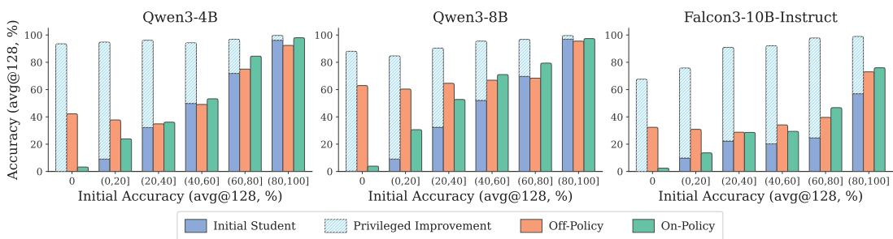

Figure 1: How initial student accuracy affects learning from privileged context.  
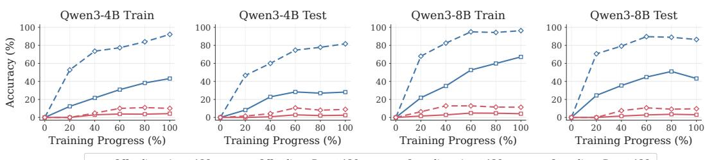  
Figure 2: Training dynamics on problems with zero initial accuracy (avg@128 = 0).

On-policy context distillation becomes less effective at low initial accuracy. As shown in Figure 1, all three models exhibit a consistent pattern: the effectiveness of on-policy context distillation decreases as the student’s initial accuracy becomes lower. When the student’s initial accuracy is above 60%, on-policy context distillation retains a substantial portion of the privileged improvement and outperforms off-policy context distillation. At lower initial accuracy levels, however, this advantage disappears, and on-policy context distillation becomes substantially less effective than off-policy context distillation.

The gap between the two methods is most pronounced for problems with zero initial accuracy (avg@128 = 0). Although the initial student produces no correct output among 128 independent rollouts, the privileged teacher still substantially outperforms the initial student, showing that the privileged context provides useful information for these problems. This provides a clean setting for testing whether the two distillation methods can learn from useful privileged context when the desired behavior is absent from the student’s own rollouts. As shown, off-policy context distillation substantially improves the student, whereas on-policy context distillation yields only marginal improvement.

We further examine whether this gap persists with continued training. Figure 2 tracks avg@128 and pass@128 throughout training on problems with zero initial accuracy. For both models, off-policy context distillation improves rapidly early in training and continues to achieve substantially higher avg@128 and pass@128. In contrast, on-policy context distillation shows only limited improvement, and the gap between the two methods persists throughout training. To examine whether this pattern extends beyond the training problems, we construct a held-out set of 100 problems with zero initial accuracy. The same dynamics emerge on the held-out set: off-policy context distillation improves substantially, whereas on-policy context distillation remains far below it throughout training.

Across these experiments, on-policy context distillation becomes less effective when behaviors in duced by privileged context rarely appear in the student’s own rollouts. This phenomenon points to a simple and important mechanism: on-policy context distillation applies teacher supervision only on student-generated prefixes, which creates a sequential dependency: later parts of a new behavior become effectively learnable only after the preceding parts begin to appear in the student’s own rollouts. Consequently, longer target behaviors should require progressively more training to learn.

On-policy context distillation exhibits length-dependent learning. To further examine this explanation, we construct a controlled knowledge-injection task following prior work (Chang et al., 2024; Zhang et al., 2026b). Each example consists of a synthetic fact and a corresponding question, such as “Sne’s coach is Cour” and “What is Sne’s coach?” The synthetic fact is directly used as privileged context during training.

We vary the length of the answer to be learned, with $L \in$ $\{ 4 , 8 , 1 \dot { 6 } , 3 2 \}$ tokens, and mix all length groups within the same training run. We use the same on-policy and offpolicy context distillation methods as above, training for 200 epochs and evaluating every 5 epochs. Full experimental details are provided in Appendix A.2.

As shown in Figure 3, off-policy context distillation rapidly learns answers of all lengths, with little sensitivity to answer length. In contrast, on-policy context distillation exhibits a clear length-dependent delay: performance begins to improve earliest for $L = 4 .$ , followed by $L = 8 , L = 1 6$ , and $L = 3 2$ . Moreover, the $L = 3 2$ group remains below the shorter-length groups under the same training budget.

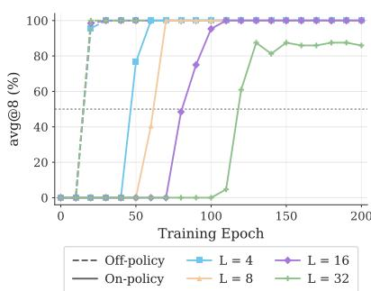  
Figure 3: Knowledge-injection dynamics across answer lengths.

This length-dependent delay supports the sequential dependency described above. Although the complete answer is available to the privileged teacher from the beginning, later parts become effectively learnable only after the preceding parts begin to appear in the student’s own rollouts.

These findings are particularly relevant to learning from failed interaction trajectories. Such trajectories arise precisely when the current policy does not yet produce the desired behavior, making the required correction less likely to appear in the student’s own rollouts. This places learning from failed interactions in the regime where on-policy context distillation is less effective.

## 4 LOCALIZED CONTEXT DISTILLATION

Our empirical study shows that on-policy context distillation becomes much less effective when the behaviors induced by privileged context rarely appear in the student’s own rollouts. The key limitation is that privileged supervision depends on student-generated prefixes, making behaviors that the current policy cannot reliably produce difficult to incorporate into training.

A natural alternative is to let the privileged teacher directly generate a revised trajectory, as in offpolicy context distillation. While this can explicitly introduce behaviors absent from the student’s own rollouts, training on teacher-generated states introduces exposure bias, which may further contribute to catastrophic forgetting or reasoning collapse (Shenfeld et al., 2026; Kim et al., 2026).

To address the limitations of both approaches, we introduce Localized Context Distillation (LoCD). As illustrated in Figure 4, LoCD preserves the student-generated prefix and introduces privileged teacher generation only within an attributed critical span. Specifically, LoCD consists of two steps: (i) localization and attribution and (ii) localized distillation. After each update, the resulting student policy is used to collect the next round of interaction experience.

Localization and attribution. Given an interaction experience $( x , \tau )$ , LoCD localizes the spans that require revision and extracts their corresponding privileged contexts:

$$
( [ \alpha , \beta ) , c ) \sim { \mathcal { A } } ( \cdot \mid x , \tau ) .
$$

Here, A is a prompt-based localization and attribution procedure implemented by prompting the same model as the student, leveraging its own reasoning capabilities. The indices α and β denote the start and end indices of an attributed critical span along the student trajectory, and c denotes its corresponding privileged context. For example, a critical span can correspond to a contiguous reasoning segment or a specific interaction step in an agent trajectory. When multiple critical spans are identified from the same interaction, we treat each attributed span as a separate training instance.

Localized distillation. Given an attributed critical span $( [ \alpha , \beta ) , c )$ , LoCD samples a local sequence $y ^ { T }$ from the privileged teacher starting from the student-generated prefix $y _ { < \alpha } ^ { S ^ { ^ { \smash { \prime } } } }$ . We optimize

$$
\mathcal { L } = \mathbb { E } _ { ( x , \tau ) \sim \mathcal { P } , ( [ \alpha , \beta ) , c ) \sim A ( \cdot | x , \tau ) } \left[ \frac { 1 } { \beta - \alpha } \sum _ { t = 1 } ^ { \beta - \alpha } D \big ( \mathrm { s g } \big [ \pi _ { T } ( \cdot \mid x , c , y _ { < \alpha } ^ { s } , y _ { < t } ^ { T } ) \big ] , \pi _ { S } ( \cdot \mid x , y _ { < \alpha } ^ { s } , y _ { < t } ^ { T } ) \big ) \right] .
$$

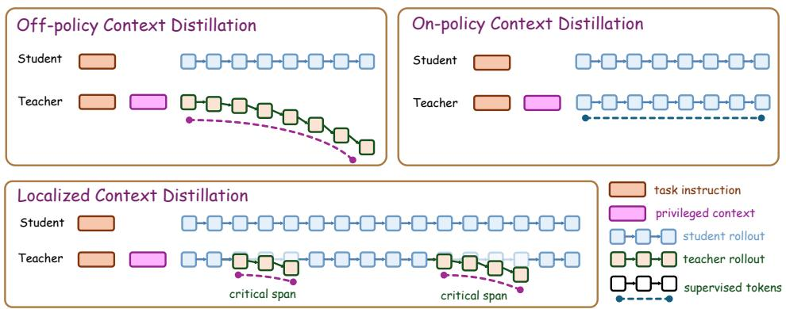  
Figure 4: Illustrative comparison of off-policy, on-policy, and localized context distillation.

Here, teacher sampling is truncated after position β, restricting privileged generation to the attributed critical span. The divergence D can be forward KL, reverse KL, or Jensen–Shannon divergence (Agarwal et al., 2024; Zhao et al., 2026a). Following prior work (Zhao et al., 2026a; Yang et al., 2026b), we clip excessively large token-level divergences to stabilize training.

Unlike off-policy context distillation, which supervises teacher-generated trajectories, and on-policy context distillation, which supervises student-generated prefixes, LoCD restricts privileged supervision to localized teacher-generated segments. This design offers several advantages as follows.

Advantages of LoCD. First, LoCD anchors each correction at a state actually visited by the current student, while allowing the privileged teacher to directly supervise behaviors that the student cannot yet produce. This enables corrective supervision directly where the student requires revision. Second, by restricting teacher-generated prefixes to the critical span, LoCD confines teacher-induced deviation to the region that requires correction, thereby limiting exposure bias. Third, through localization and attribution, LoCD matches each critical span with its corresponding privileged context. This allows the supervision induced by each privileged context to be applied to the student states where that context is semantically relevant.

## 5 EXPERIMENTS

We evaluate LoCD from three main perspectives. First, we compare it with strong baselines across reasoning, coding, and agent tasks. Second, we examine its training dynamics, including downstream performance, policy entropy, and parameter updates throughout training. Third, we study key design choices and robustness to different distillation objectives.

## 5.1 EXPERIMENTAL SETUP

Tasks and models. We evaluate LoCD across four settings: math reasoning, code generation, interactive decision-making, and software-engineering agents. For math reasoning, we train on a 28.8K subset of OpenThoughts (Guha et al., 2026); for code generation, we use Codeforces problems following the competitive-programming setting of CodeContests (Li et al., 2022); for interactive decision-making, we consider WebShop (Yao et al., 2022) and ALFWorld (Shridhar et al., 2020); and for software engineering, we train on SWE-Gym instances (Pan et al., 2024) and evaluate on a held-out subset of SWE-Gym and SWE-bench Verified (Jimenez et al., 2024) using mini-sweagent (Yang et al., 2024).

Our main experiments use Qwen3-8B (Yang et al., 2025a) in non-thinking mode. To examine generalization across model families, we additionally evaluate Falcon3-10B-Instruct (Team, 2024) on math reasoning. For software-engineering tasks, we use Qwen3-Coder-30B-A3B-Instruct (Yang et al., 2025a).

Baselines. We compare LoCD with representative approaches for learning from interaction experience. Text2Grad (Wang et al., 2026b) converts free-form language feedback into span-level learning signals for policy optimization. TRD (Jiang et al., 2026) uses teacher guidance to revise student-generated trajectories before distillation, providing a strong off-policy alternative. For onpolicy context distillation, OPCD (Ye et al., 2026b) distills a context-conditioned teacher on studentgenerated trajectories; ROSD (Zhao et al., 2026b) identifies the first erroneous region and restricts distillation to the affected suffix; and $\mathrm { O P ^ { 2 } S D }$ (Ichihara et al., 2026) uses shuffled privileged solutions to induce alternative teacher behavior while retaining student-generated rollouts (requiring reference solutions unavailable in our agent tasks). For multi-step agent tasks, we additionally compare with Hint-SD (Yeo et al., 2026), which applies targeted hindsight supervision to failure-relevant parts of an agent trajectory. All methods use the same training datasets, feedback sources, and experienceconstruction protocols, while collecting trajectories from their respective evolving policies. For each task, we use the same number of training steps and batch size across methods.

<table><tr><td>Method</td><td>AIME24</td><td>AIME25</td><td>HMMT25-Feb</td><td>HMMT25-Nov</td><td></td><td>Olympiad MATH-500</td><td>Minerva</td><td>AMO</td><td>Avg.</td></tr><tr><td colspan="10">Qwen3-8B</td></tr><tr><td>Base</td><td>28.06</td><td>20.83</td><td> $1 1 . 1 1$ </td><td> $1 1 . 6 7$ </td><td> $5 5 . 3 4$ </td><td>85.80</td><td> $3 9 . 3 4$ </td><td>2.33</td><td>31.81</td></tr><tr><td>Text2Grad</td><td> $4 6 . 3 0 \pm 3 . 7$ </td><td> $3 3 . 5 2 \pm 2 . 4$ </td><td> $2 1 . 1 1 \pm 1 . 2$ </td><td> $2 8 . 5 2 \pm 1 . 9$ </td><td> $6 0 . 2 4 \pm 2 . 6$ </td><td> $9 1 . 0 7 \pm 1 . 1$ </td><td> $3 8 . 7 3 \pm 0 . 9$ </td><td> $4 . 2 8 _ { \pm 0 . 6 }$ </td><td>40.47</td></tr><tr><td>TRD</td><td> $4 7 . 9 6 \pm 4 . 1$ </td><td> $3 7 . 5 0 _ { \pm 1 . 2 }$ </td><td> $2 1 . 3 9 _ { \pm 1 . 3 }$ </td><td> $2 6 . 7 6 \pm 1 . 0$ </td><td> $6 0 . 6 8 \pm 3 . 1$ </td><td> $8 9 . 3 3 \pm 0 . 7 $ </td><td> $4 0 . 3 2 \pm 0 . 8$ </td><td> $4 . 7 2 \pm 0 . 4$ </td><td>41.08</td></tr><tr><td>OPCD</td><td> $5 4 . 2 6 \pm 2 . 8$ </td><td> $3 8 . 1 5 \pm 1 . 8$ </td><td> $2 1 . 3 9 _ { \pm 1 . 6 }$ </td><td> $\underline { { 2 9 . 1 7 \pm 4 . 3 } }$ </td><td> $6 0 . 9 3 \pm 1 . 7$ </td><td> $8 9 . 3 3 \pm 1 . 8$ </td><td> $4 0 . 8 1 \pm 1 . 6$ </td><td> $5 . 0 6 _ { \pm 0 . 6 }$ </td><td>42.39</td></tr><tr><td> $\mathrm { O P ^ { 2 } S D }$ </td><td> $\underline { { 5 6 . 8 5 \pm 2 . 7 } }$ </td><td> $3 8 . 9 8 \pm 2 . 4$ </td><td> $2 0 . 2 8 \pm 1 . 4$ </td><td> $2 6 . 9 4 \pm 2 . 0$ </td><td> $6 0 . 4 4 \pm 2 . 6 $ </td><td> $9 0 . 0 7 \pm 1 . 1$ </td><td> $\overline { { 4 0 . 0 7 \pm 2 . 2 } }$ </td><td> $\overline { { 4 . 7 2 \pm 0 . 7 } }$ </td><td>42.29</td></tr><tr><td>ROSD</td><td> $4 8 . 7 0 \pm 4 . 4$ </td><td> $\overline { { 3 6 . 5 7 \pm 2 . 0 } }$ </td><td> $2 3 . 2 4 \pm 1 . 6$ </td><td> $2 4 . 6 3 \pm 1 . 4$ </td><td> $\underline { { 6 1 . 9 7 \pm 2 . 2 } }$ </td><td> $8 7 . 8 7 _ { \pm 0 . 8 }$ </td><td> $3 9 . 0 9 \pm 1 . 2$ </td><td> $4 . 5 6 \pm 0 . 4$ </td><td>40.83</td></tr><tr><td>LoCD</td><td> $6 1 . 3 0 \pm 3 . 6 $ </td><td> $4 7 . 8 7 \pm 4 . 6$ </td><td> $2 5 . 2 8 \pm 2 . 5$ </td><td> $3 8 . 4 3 _ { \pm 3 . 0 }$ </td><td> $6 6 . 3 2 \pm { 3 . 0 }$ </td><td> $9 3 . 8 0 { \scriptstyle \pm 1 . 5 }$ </td><td> $4 4 . 6 1 \pm 2 . 6 $ </td><td> $6 . 6 7 \pm 1 . 0$ </td><td>48.04</td></tr><tr><td colspan="10">Falcon3-10B-Instruct</td></tr><tr><td>Base</td><td>4.44</td><td>3.06</td><td>0.56</td><td>4.44</td><td>22.55</td><td>51.40</td><td>32.35</td><td>2.33</td><td>15.14</td></tr><tr><td>Text2Grad</td><td> $9 . 0 7 \pm 1 . 4$ </td><td> $3 . 3 3 \pm 0 . 7$ </td><td> $1 . 3 9 _ { \pm 0 . 6 }$ </td><td> $5 . 0 0 \pm 0 . 7$ </td><td> $3 5 . 3 1 \pm 1 . 7$ </td><td> $6 4 . 8 0 \pm 0 . 8$ </td><td> $3 4 . 5 6 \pm 2 . 4$ </td><td> $3 . 0 0 _ { \pm 0 . 5 }$ </td><td>19.56</td></tr><tr><td>TRD</td><td> $\underline { { 1 1 . 1 1 \pm 1 . 6 } }$ </td><td> $5 . 5 6 _ { \pm 0 . 8 }$ </td><td> $2 . 5 0 \pm 0 . 7$ </td><td> $4 . 4 4 \pm 0 . 6$ </td><td> $\underline { { 3 7 . 6 9 \pm 1 . 8 } }$ </td><td> $\underline { { 7 2 . 1 3 \pm 0 . 9 } }$ </td><td> $3 8 . 6 0 \pm 2 . 5$ </td><td> $3 . 3 3 \pm 0 . 6$ </td><td>21.92</td></tr><tr><td>OPCD</td><td> $\overline { { 1 0 . 8 3 \pm 1 . 4 } }$ </td><td> $\underline { { 6 . 3 9 \pm 0 . 7 } }$ </td><td> $1 . 6 7 _ { \pm 0 . 6 }$ </td><td> $5 . 2 8 \pm 0 . 7$ </td><td> $3 5 . 3 1 \pm 1 . 7$ </td><td> $6 9 . 6 7 \pm 0 . 9$ </td><td> $3 8 . 6 0 \pm 2 . 3 $ </td><td> $\overline { { 2 . 8 3 \pm 0 . 6 } }$ </td><td>21.32</td></tr><tr><td>OP2SD</td><td> $1 0 . 5 6 \pm 1 . 5$ </td><td> $5 . 2 8 \pm 0 . 7$ </td><td> $2 . 2 2 _ { \pm 0 . 6 }$ </td><td> $5 . 0 0 _ { \pm 0 . 7 }$ </td><td> $3 6 . 3 5 \pm 1 . 7$ </td><td> $7 0 . 5 3 { \scriptstyle \pm 0 . 9 }$ </td><td> $3 7 . 7 5 \pm 2 . 3$ </td><td> $3 . 1 7 \pm 0 . 5$ </td><td>21.36</td></tr><tr><td>ROSD</td><td> $1 0 . 7 4 \pm 1 . 3$ </td><td> $6 . 3 0 { \scriptstyle \pm 0 . 6 }$ </td><td> $1 . 3 9 _ { \pm 0 . 5 }$ </td><td> $4 . 0 7 \pm 0 . 6$ </td><td> $3 3 . 2 3 \pm 1 . 7$ </td><td> $6 8 . 7 3 \pm 0 . 8$ </td><td> $\underline { { 3 9 . 3 4 \pm 2 . 1 } }$ </td><td> $3 . 1 7 \pm 0 . 5$ </td><td>20.87</td></tr><tr><td>LoCD</td><td> $1 2 . 4 1 \pm { 1 . 7 }$ </td><td> $7 . 2 2 \pm 0 . 9$ </td><td> $3 . 1 5 \pm 0 . 7$ </td><td> $5 . 5 6 _ { \pm 0 . 8 }$ </td><td> $3 9 . 9 1 \pm 1 . 8$ </td><td> $7 3 . 4 7 _ { \pm 1 . 0 }$ </td><td> $4 0 . 4 4 \pm 2 . 6$ </td><td> $3 . 8 3 _ { \pm 0 . 6 }$ </td><td>23.25</td></tr></table>

<table><tr><td>Method</td><td> $\bf { C F } _ { 8 0 0 - 1 2 0 0 }$ </td><td> $\mathbf { C F } _ { 1 2 0 0 - 1 6 0 0 }$ </td><td> $\mathbf { C F _ { 1 6 0 0 + } }$ </td><td>LCB</td><td> $\mathbf { A v g . }$ </td></tr><tr><td>Base</td><td> $2 6 . 4 7$ </td><td>8.20</td><td>0.55</td><td> $1 6 . 7 1$ </td><td>12.98</td></tr><tr><td>Text2Grad</td><td> $2 4 . 0 2 _ { \pm 1 . 2 }$ </td><td> $8 . 0 3 \pm 1 . 0$ </td><td> $0 . 3 7 \pm 0 . 1$ </td><td> $1 6 . 7 2 _ { \pm 0 . 8 }$ </td><td>12.28</td></tr><tr><td>TRD</td><td> $2 8 . 6 6 \pm 1 . 6$ </td><td> $1 0 . 6 9 \pm 1 . 3$  一</td><td> $0 . 6 5 \pm 0 . 1$ </td><td> $1 8 . 1 9 \pm 0 . 8$ </td><td>14.55</td></tr><tr><td>ROSD</td><td> $\overline { { 2 8 . 0 9 \pm 1 . 5 } }$ </td><td> $\overline { { 9 . 6 8 \pm 2 . 1 } }$ </td><td> $0 . 6 2 \pm 0 . 2$ </td><td> $\overline { { 1 7 . 1 0 \pm 1 . 1 } }$ </td><td>13.87</td></tr><tr><td>OPCD</td><td> $2 7 . 2 0 \pm 1 . 8$ </td><td> $9 . 8 8 \pm 0 . 5$ </td><td> $\underline { { 0 . 7 0 \pm 0 . 2 } }$ </td><td> $1 7 . 0 6 _ { \pm 0 . 2 }$ </td><td>13.71</td></tr><tr><td> $\mathrm { O P ^ { 2 } S D }$ </td><td> $2 5 . 3 6 \pm 1 . 4$ </td><td> $8 . 9 2 \pm 0 . 6$ </td><td> $0 . 7 0 \pm 0 . 2$ </td><td> $1 6 . 8 4 \pm 0 . 2$ </td><td>12.96</td></tr><tr><td>LoCD</td><td> $3 0 . 9 4 \pm 1 . 1$ </td><td> $1 2 . 9 1 { \scriptstyle \pm 1 . 5 }$ </td><td> $0 . 7 9 \pm 0 . 2$ </td><td> $2 4 . 1 4 \pm 2 . 1$ </td><td>17.20</td></tr></table>

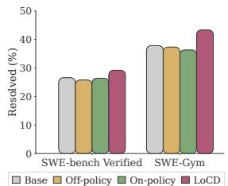  
Table 1: Performance on math reasoning benchmarks. Results for train-based methods are reported as mean ± standard deviation over three independent runs.  
Table 2: Performance on code-generation benchmarks.  
Figure 5: Performance on SWE.

Training and evaluation. For math reasoning, we use reference solutions as feedback; for code generation, we use official editorials and execution feedback. For agent tasks, feedback is derived from environment observations, execution results, and task outcomes, without relying on expert demonstrations. LoCD iteratively collects new trajectories from the updated student and performs feedback-guided localized distillation. We use reverse KL as the default distillation objective for LoCD and on-policy context-distillation baselines.

For evaluation, we report avg@12 on AIME, HMMT, and AMO, and avg@1 on MATH-500, OlympiadBench, and Minerva. For code generation, we report average success rates over 12 sam ples per problem on Codeforces and LiveCodeBench. For interactive agents, we report task success rates using avg@1 on WebShop and avg@3 on ALFWorld. For software engineering, we report resolved rates using avg@4 on SWE-Gym and pass@1 on SWE-bench Verified. Additional details on dataset construction, feedback generation, training configurations, and evaluation protocols are provided in Appendix C.

## 5.2 MAIN RESULTS

Tables 1 and 2 show that LoCD consistently outperforms strong baselines on both math reasoning and code generation. On Qwen3-8B, LoCD achieves the best results across all eight math benchmarks, improving the average score from 42.39 to 48.04, with consistent improvements also observed on Falcon3-10B-Instruct. For code generation, LoCD achieves an average solve rate of 17.20%, compared with 14.55% for the strongest baseline. Notably, the gains are particularly pronounced on challenging benchmarks such as AIME25, HMMT25-Nov, and LiveCodeBench, consistent with our motivation to introduce corrective behaviors that are difficult for the student to generate.

<table><tr><td rowspan="2"></td><td colspan="4">WebShop (official test)</td><td colspan="7">ALFWorld (valid_unseen)</td></tr><tr><td>Method  $C _ { 1 }$ </td><td> $C _ { 2 }$ </td><td> $C _ { 3 + }$ </td><td>All</td><td>Pick</td><td>Look</td><td>Clean</td><td>Heat</td><td>Cool</td><td>Pick2</td><td>All</td></tr><tr><td>Base</td><td>58.24</td><td>8.96</td><td>9.22</td><td>18.00</td><td>27.78</td><td>27.78</td><td>18.28</td><td>31.88</td><td>26.98</td><td>1.96</td><td>22.89</td></tr><tr><td>TRD</td><td>63.74</td><td>43.28</td><td>30.50</td><td>43.40</td><td>15.28</td><td>20.37</td><td>19.35</td><td>21.74</td><td>22.22</td><td>9.80</td><td>18.41</td></tr><tr><td>OPCD</td><td>62.64</td><td>15.67</td><td>12.77</td><td>23.40</td><td>29.17</td><td>24.07</td><td>20.43</td><td>28.99</td><td>28.57</td><td>13.73</td><td>24.38</td></tr><tr><td>ROSD</td><td>62.64</td><td>47.39</td><td>26.95</td><td>44.40</td><td>26.39</td><td>25.93</td><td>23.66</td><td>31.88</td><td>30.16</td><td>13.73</td><td>25.62</td></tr><tr><td>Hint-SD</td><td>65.93</td><td>48.88</td><td>30.50</td><td>46.80</td><td>25.00</td><td>24.07</td><td>23.66</td><td>18.84</td><td>28.57</td><td>15.69</td><td>22.89</td></tr><tr><td>LoCD</td><td>69.23</td><td>56.72</td><td>33.33</td><td>52.40</td><td>33.33</td><td>35.19</td><td>26.88</td><td>49.28</td><td>36.51</td><td>15.69</td><td>33.08</td></tr></table>

Table 3: Performance on interactive decision-making benchmarks.

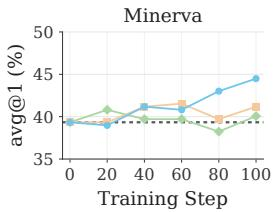

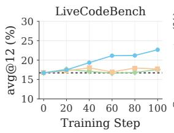

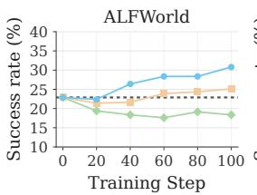

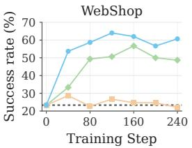

Figure 6: Training dynamics across four representative tasks.  
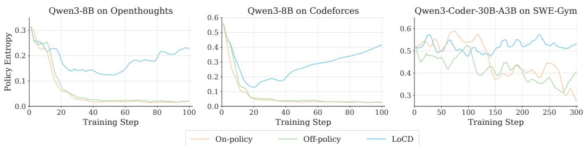  
Figure 7: Policy entropy during training on OpenThoughts, Codeforces, and SWE-Gym.

Beyond single-step reasoning and coding tasks, LoCD also demonstrates strong performance on multi-step agent tasks. As shown in Table 3, LoCD outperforms the strongest baselines by 5.60 and 7.46 percentage points on WebShop and ALFWorld, respectively. Figure 5 shows similar improvements on SWE-bench Verified and SWE-Gym, where LoCD achieves the highest resolved rates among the compared methods. These results further demonstrate the effectiveness of LoCD across different forms of interaction feedback, including environment observations and execution failures, without requiring reference solution. We further examine whether these improvements persist under larger sampling budgets, detailed in Appendix D.

## 5.3 TRAINING DYNAMICS

We then study how task performance, policy entropy, and model parameters evolve during training. In the following analyses, we use TRD and OPCD as the off-policy and on-policy context-distillation baselines, respectively.

Performance over training. Figure 6 compares LoCD with on-policy and off-policy context distillation throughout training. Across all four representative tasks, LoCD continues to improve as training progresses, whereas the two baselines tend to plateau or fluctuate. The separation is particularly pronounced on WebShop and ALFWorld, where LoCD continues to gain performance after the baselines have largely saturated.

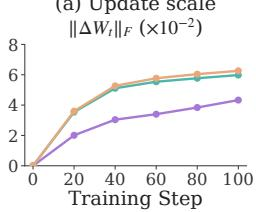

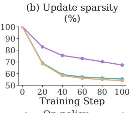

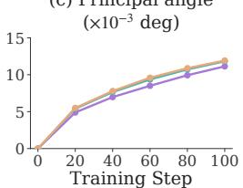


Figure 8: Parameter-update geometry during math reasoning training.  
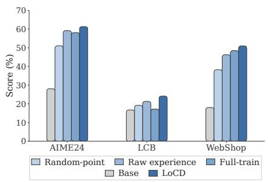  
Figure 9: Ablation of LoCD.

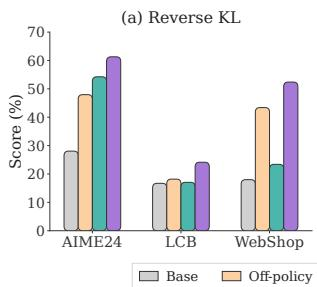

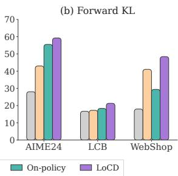  
Figure 10: Robustness to divergence choice.

Policy entropy. We measure policy entropy as the average token-level entropy over training rollouts. Figure 7 records how the output distribution evolves during training. Across OpenThoughts, Codeforces, and SWE-Gym, both on-policy and off-policy context distillation progressively reduce policy entropy. In contrast, LoCD avoids this sustained entropy collapse and maintains a more stable entropy level throughout training. Together with its stronger downstream performance, this indicates that LoCD can improve task behavior without excessively concentrating the model’s output distribution.

Parameter-update geometry. We further examine how different distillation objectives modify model parameters during training. As shown in Figure 8, LoCD exhibits smaller cumulative parameter changes and higher visible update sparsity than on-policy and off-policy context distillation. Similar patterns are observed on code generation and ALFWorld, with detailed analyses provided in Appendix E.

## 5.4 ABLATION STUDY

Ablation of LoCD. We examine three key design choices in LoCD. Random Point replaces feedback-guided localization with a randomly selected correction point. Raw Experience uses the complete interaction experience as privileged context instead of extracting a targeted hint. Full-Train retains the original student prefix but extends teacher generation and distillation to the entire remaining trajectory rather than a localized span.

As shown in Figure 9, all three variants consistently underperform LoCD across the evaluated benchmarks. The degradation from Random Point and Raw Experience suggests that effective supervision requires both identifying failure-relevant states and extracting targeted corrective information. Notably, Full-Train also performs worse despite providing supervision over a longer teacher-generated continuation, highlighting the importance of restricting distillation to critical spans.

Robustness to divergence choice. We further examine whether the effectiveness of LoCD depends on the choice of distillation divergence. Figure 10 compares forward and reverse KL on AIME24, LiveCodeBench v6, and WebShop. Although the relative performance of the onpolicy and off-policy baselines varies with the divergence direction, LoCD consistently achieves the strongest performance under both choices. Forward and reverse KL weight next-token discrepancies by teacher and student probabilities, respectively. LoCD provides informative teacher-generated correction states anchored to student prefixes under either objective, which may explain its consistent gains across both weighting schemes.

## 6 RELATED WORKS

Non-Parametric Learning from Experience. A broad line of work reuses past interaction experience without updating model parameters. Some methods directly store and retrieve past trajectories, feedback, or reflections as in-context examples (Shinn et al., 2023; Zhao et al., 2024; Liu et al., 2025). More recent methods abstract accumulated interactions into reusable insights, guidelines, skills, or workflows that generalize across related tasks (Wang et al., 2023; Fu et al., 2024; Wang et al., 2024; Yang et al., 2025b). These methods rely on retrieving and reintroducing relevant experience at inference time, whereas we study how to internalize such experience directly into model parameters (Liu et al., 2025; Wang et al., 2024; Cao et al., 2026).

Reinforcement Learning from Interaction Experience. Reinforcement learning has become a central paradigm for improving large language models, typically optimizing scalar rewards derived from preference models or outcome verifiers (Ouyang et al., 2022; Shao et al., 2024). However, interaction feedback often contains richer diagnostic and corrective information expressed in natural language than scalar rewards can capture (Wang et al., 2026b; Zhou et al., 2025; Wang et al., 2026f). Recent work therefore incorporates language feedback into reinforcement learning by converting critiques into token-, span-, or process-level rewards, or by using feedback to guide refinement and exploration (Cao et al., 2024; Wang et al., 2026b; Zhang et al., 2025; Li et al., 2025). Related approaches improve credit assignment by localizing optimization to critical steps or error regions, or introducing localized interventions during policy optimization (Li et al., 2026a; Liang et al., 2026; Li et al., 2026b; Huang et al., 2026; Chen et al., 2026). Despite these advances, natural-language feedback is still largely mediated through reward or credit-assignment signals, requiring the model to discover the corresponding corrective behavior through policy optimization.

Context Distillation. Context distillation internalizes behaviors induced by additional context into model parameters by training a student without that context to match a context-conditioned teacher (Askell et al., 2021; Snell et al., 2022). In learning from interaction feedback, off-policy approaches typically use privileged information to construct improved responses and then train the student on these corrections (Scheurer et al., 2023). InT (Yang et al., 2026a) constructs targeted corrections offline and uses SFT to improve reasoning before subsequent reinforcement learning, whereas LoCD dynamically generates corrections from the current student’s prefixes throughout training. Recent on-policy methods instead sample trajectories from the current student and provide privileged teacher supervision on student-generated prefixes, allowing reference solutions, demonstrations, or textual feedback to be internalized while remaining aligned with the student’s state distribution (Zhao et al., 2026a; Shenfeld et al., 2026; Hübotter et al., 2026; Ye et al., 2026b). More recent work extends this paradigm toward self-evolving models by deriving privileged context from interaction experience, including transferable insights, hindsight skills, and learnable latent contexts (Ren et al., 2026; Wu et al., 2026; Zhang et al., 2026a). Other work further improves the alignment between privileged feedback and student states by constructing locally relevant hindsight feedback or targeting failure-relevant actions for distillation (Liu et al., 2026; Yeo et al., 2026; Feng et al., 2026). Relay-OPD (Xu et al., 2026) triggers temporary teacher takeovers based on disagreements over predefined reflection tokens and distills the resulting mixed trajectories using a separate stronger teacher. Despite these advances, effectively introducing corrective behaviors beyond the student’s own rollouts while limiting off-policy distribution shift remains challenging. LoCD addresses this challenge by using interaction feedback to localize critical spans, regenerating them from student prefixes with a context-conditioned version of the same model, and restricting distillation to the corrected spans.

## 7 CONCLUSION

We study how language models can internalize interaction experience through context distillation. We find that on-policy context distillation becomes inefficient when the required behavior is difficult for the student to produce. Motivated by this limitation, LoCD introduces localized teacher corrections from student-generated prefixes, enabling effective learning of new behaviors while limiting off-policy distribution shift. Extensive experiments across math reasoning, code generation, and agent tasks demonstrate that LoCD shows consistent improvements over strong baselines and maintains more stable policy entropy with smaller and sparser parameter updates.

## REFERENCES

Rishabh Agarwal, Nino Vieillard, Yongchao Zhou, Piotr Stanczyk, Sabela Ramos Garea, Matthieu Geist, and Olivier Bachem. On-policy distillation of language models: Learning from selfgenerated mistakes. In International Conference on Learning Representations, volume 2024, pp. 21246–21263, 2024.

Amanda Askell, Yuntao Bai, Anna Chen, Dawn Drain, Deep Ganguli, Tom Henighan, Andy Jones, Nicholas Joseph, Ben Mann, Nova DasSarma, et al. A general language assistant as a laboratory for alignment. arXiv preprint arXiv:2112.00861, 2021.

Yuntao Bai, Saurav Kadavath, Sandipan Kundu, Amanda Askell, Jackson Kernion, Andy Jones, Anna Chen, Anna Goldie, Azalia Mirhoseini, Cameron McKinnon, et al. Constitutional ai: Harmlessness from ai feedback. arXiv preprint arXiv:2212.08073, 2022.

Meng Cao, Lei Shu, Lei Yu, Yun Zhu, Nevan Wichers, Yinxiao Liu, and Lei Meng. Enhancing reinforcement learning with dense rewards from language model critic. In Proceedings of the 2024 Conference on Empirical Methods in Natural Language Processing, pp. 9119–9138, 2024.

Zouying Cao, Jiaji Deng, Li Yu, Weikang Zhou, Zhaoyang Liu, Bolin Ding, and Hai Zhao. Remember me, refine me: A dynamic procedural memory framework for experience-driven agent evolution. In Findings of the Association for Computational Linguistics: ACL 2026, pp. 16803– 16822, 2026.

Hoyeon Chang, Jinho Park, Seonghyeon Ye, Sohee Yang, Youngkyung Seo, Du-Seong Chang, and Minjoon Seo. How do large language models acquire factual knowledge during pretraining? Advances in neural information processing systems, 37:60626–60668, 2024.

Hanxiang Chao, Yihan Bai, Rui Sheng, Tianle Li, and Yushi Sun. Stale: Can llm agents know when their memories are no longer valid? arXiv preprint arXiv:2605.06527, 2026.

Mingyu Chen, Yefan Tao, Gerald Friedland, Xuezhou Zhang, and Chris Kong. Mintrl: Off-policy intervention can boost on-policy rl. arXiv preprint arXiv:2609.12419, 2026.

Zizhao Chen, Mustafa Omer Gul, Yiwei Chen, Gloria Geng, Anne Wu, and Yoav Artzi. Retrospective learning from interactions. In Proceedings ofthe 63rd Annual Meeting ofthe Associationfor Computational Linguistics (Volume 1: Long Papers), pp. 24580–24606, 2025.

Prateek Chhikara, Dev Khant, Saket Aryan, Taranjeet Singh, and Deshraj Yadav. Mem0: Building production-ready ai agents with scalable long-term memory. arXiv preprint arXiv:2504.19413, 2025.

Yangyang Feng, Zhuoyan Feng, and Junlan Chen. Past: Privileged adaptation from complete student trajectories for on-policy self-distillation. arXiv preprint arXiv:2608.08726, 2026.

Yao Fu, Dong-Ki Kim, Jaekyeom Kim, Sungryull Sohn, Lajanugen Logeswaran, Kyunghoon Bae, and Honglak Lee. Autoguide: Automated generation and selection of context-aware guidelines for large language model agents. Advances in Neural Information Processing Systems, 37: 119919–119948, 2024.

Etash Guha, Ryan Marten, Sedrick Keh, Negin Raoof, Georgios Smyrnis, Hritik Bansal, Marianna Nezhurina, Jean Mercat, Trung Vu, Zayne Sprague, et al. Openthoughts: Data recipes for reasoning models. In International Conference on Learning Representations, volume 2026, pp. 108059–108130, 2026.

Daya Guo, Dejian Yang, Haowei Zhang, Junxiao Song, Peiyi Wang, Qihao Zhu, Runxin Xu, Ruoyu Zhang, Shirong Ma, Xiao Bi, et al. Deepseek-r1 incentivizes reasoning in llms through reinforcement learning. Nature, 645(8081):633–638, 2025.

Zhezheng Hao, Hong Wang, Jian Luo, Jianqing Zhang, Yuyan Zhou, Qiang Lin, Can Wang, Hande Dong, and Jiawei Chen. Recreate: Reasoning and creating domain agents driven by experience. In Proceedings of the 64th Annual Meeting of the Association for Computational Linguistics (Volume 1: Long Papers), pp. 31018–31046, 2026.

Chi Hu, Yimin Hu, Hang Cao, Tong Xiao, and Jingbo Zhu. Teaching language models to selfimprove by learning from language feedback. In Findings of the Association for Computational Linguistics: ACL 2024, pp. 6090–6101, 2024.

Zhilin Huang, Hang Gao, Ziqiang Dong, Yuan Chen, Yifeng Luo, Chujun Qin, Jingyi Wang, Yang Yang, and Guanjun Jiang. Learning from your own mistakes: Constructing learnable microreflective trajectories for self-distillation. arXiv preprint arXiv:2606.18844, 2026.

Jonas Hübotter, Frederike Lübeck, Lejs Behric, Anton Baumann, Marco Bagatella, Daniel Marta, Ido Hakimi, Idan Shenfeld, Thomas Kleine Buening, Carlos Guestrin, et al. Reinforcement learning via self-distillation. arXiv preprint arXiv:2601.20802, 2026.

Yuki Ichihara, Naoto Iwase, Mohammad Atif Quamar, and Junpei Komiyama. Privileged solutions or context-induced teacher behavior? dissecting on-policy self-distillation. arXiv preprint arXiv:2608.09228, 2026.

Li Jiang, Haoran Xu, Yichuan Ding, and Amy Zhang. Trajectory-refined distillation. arXiv preprint arXiv:2606.08432, 2026.

Carlos E Jimenez, John Yang, Alexander Wettig, Shunyu Yao, Kexin Pei, Ofir Press, and Karthik Narasimhan. Swe-bench: Can language models resolve real-world github issues? In International Conference on Learning Representations, volume 2024, pp. 54107–54157, 2024.

Semih Kara and Oguzhan Ersoy. The role of feedback alignment in self-distillation. ˘ arXiv preprint arXiv:2606.11173, 2026.

Simran Kaur, Narutatsu Ri, Yinghui He, Liam Fowl, and Sanjeev Arora. Rethinking on-policy self-distillation for thinking models. arXiv preprint arXiv:2607.05184, 2026.

Jeonghye Kim, Xufang Luo, Minbeom Kim, Sangmook Lee, Dohyung Kim, Jiwon Jeon, Dongsheng Li, and Yuqing Yang. Why does self-distillation (sometimes) degrade the reasoning capability of llms? arXiv preprint arXiv:2603.24472, 2026.

Ang Li, Yifei Wang, Zhihang Yuan, Stefanie Jegelka, and Yisen Wang. Lanpo: Bootstrapping language and numerical feedback for reinforcement learning in llms. arXiv preprint arXiv:2510.16552, 2025.

Mukai Li, Qingcheng Zeng, Tianqing Fang, Zhenwen Liang, Linfeng Song, Qi Liu, Haitao Mi, and Dong Yu. Verified critical step optimization for llm agents. In Findings of the Association for Computational Linguistics: ACL 2026, pp. 39627–39639, 2026a.

Yugu Li, Zehong Cao, Jianglin Qiao, and Siyi Hu. Ssvpo: Effective step-level credit assignment for rl training of language models. In The Fourteenth International Conference on Learning Representations, 2026b.

Yujia Li, David Choi, Junyoung Chung, Nate Kushman, Julian Schrittwieser, Rémi Leblond, Tom Eccles, James Keeling, Felix Gimeno, Agustin Dal Lago, et al. Competition-level code generation with alphacode. Science, 378(6624):1092–1097, 2022.

Qiao Liang, Yuke Zhu, Chao Ge, Lei Yang, Ying Shen, Bo Zheng, and Sheng Guo. Learning from the irrecoverable: Error-localized policy optimization for tool-integrated llm reasoning. In Proceedings of the 64th Annual Meeting of the Association for Computational Linguistics (Volume 1: Long Papers), pp. 11008–11028, 2026.

Haoran Liu, Yuwei Zhang, Xiyao Li, Bohan Lyu, and Jingbo Shang. Hero: Hindsightenhanced reflection from environment observations for agentic self-distillation. arXiv preprint arXiv:2606.11559, 2026.

Yitao Liu, Chenglei Si, Karthik R Narasimhan, and Shunyu Yao. Contextual experience replay for self-improvement of language agents. In Proceedings of the 63rd Annual Meeting of the Association for Computational Linguistics (Volume 1: Long Papers), pp. 14179–14198, 2025.

Long Ouyang, Jeffrey Wu, Xu Jiang, Diogo Almeida, Carroll Wainwright, Pamela Mishkin, Chong Zhang, Sandhini Agarwal, Katarina Slama, Alex Ray, et al. Training language models to follow instructions with human feedback. Advances in neural information processing systems, 35: 27730–27744, 2022.

Jiayi Pan, Xingyao Wang, Graham Neubig, Navdeep Jaitly, Heng Ji, Alane Suhr, and Yizhe Zhang. Training software engineering agents and verifiers with swe-gym. arXiv preprint arXiv:2412.21139, 2024.

Shijie Ren, Xiting Wang, Meng Li, Yujie Guo, Yunhang Yao, Ziheng Peng, Xunlong Wang, Yuetan Chen, Haoyang Zhou, Yunlong Liang, et al. Self-improving large language models via progressive experience evolution. arXiv preprint arXiv:2608.02139, 2026.

Rana Salama, Jason Cai, Michelle Yuan, Anna Currey, Monica Sunkara, Yi Zhang, and Yassine Benajiba. Meminsight: Autonomous memory augmentation for llm agents. In Proceedings of the 2025 Conference on Empirical Methods in Natural Language Processing, pp. 33124–33140, 2025.

Jérémy Scheurer, Jon Ander Campos, Tomasz Korbak, Jun Shern Chan, Angelica Chen, Kyunghyun Cho, and Ethan Perez. Training language models with language feedback at scale. arXiv preprint arXiv:2303.16755, 2023.

Zhihong Shao, Peiyi Wang, Qihao Zhu, Runxin Xu, Junxiao Song, Xiao Bi, Haowei Zhang, Mingchuan Zhang, YK Li, Yang Wu, et al. Deepseekmath: Pushing the limits of mathematical reasoning in open language models. arXiv preprint arXiv:2402.03300, 2024.

Zhanming Shen, Jintao Tong, Shaotian Yan, Chen Shen, Hao Chen, Wentao Ye, Xiaomeng Hu, Rui Miao, Haobo Wang, Junbo Zhao, et al. Purified opsd: On-policy self-distillation without losing how to think. arXiv preprint arXiv:2607.02234, 2026a.

Zhennan Shen, Yanshu Li, Qingyu Yin, Chak Tou Leong, Zhilin Wang, Yanxu Chen, Rongduo Han, Sunbowen Lee, and Yi R Fung. On the geometry of on-policy distillation. arXiv preprint arXiv:2606.07082, 2026b.

Idan Shenfeld, Mehul Damani, Jonas Hübotter, and Pulkit Agrawal. Self-distillation enables continual learning. arXiv preprint arXiv:2601.19897, 2026.

Noah Shinn, Federico Cassano, Ashwin Gopinath, Karthik Narasimhan, and Shunyu Yao. Reflexion: Language agents with verbal reinforcement learning. Advances in neural information processing systems, 36:8634–8652, 2023.

Mohit Shridhar, Xingdi Yuan, Marc-Alexandre Côté, Yonatan Bisk, Adam Trischler, and Matthew Hausknecht. Alfworld: Aligning text and embodied environments for interactive learning. arXiv preprint arXiv:2010.03768, 2020.

Charlie Snell, Dan Klein, and Ruiqi Zhong. Learning by distilling context. arXiv preprint arXiv:2209.15189, 2022.

TII Team. The falcon 3 family of open models, December 2024.

Bing Wang, Shaotian Yan, Chen Shen, Sinan Fan, Ximing Li, Rui Miao, Xiaosong Yuan, Zhanming Shen, Jieping Ye, et al. Backtracking when it strays: Mitigating dual exposure biases in llm reasoning distillation. arXiv preprint arXiv:2605.19433, 2026a.

Guanzhi Wang, Yuqi Xie, Yunfan Jiang, Ajay Mandlekar, Chaowei Xiao, Yuke Zhu, Linxi Fan, and Anima Anandkumar. Voyager: An open-ended embodied agent with large language models. arXiv preprint arXiv:2305.16291, 2023.

Hanyang Wang, Lu Wang, Chaoyun Zhang, Tianjun Mao, Si Qin, Qingwei Lin, Saravan Rajmohan, and Dongmei Zhang. Text2grad: Reinforcement learning from natural language feedback. In International Conference on Learning Representations, volume 2026, pp. 50627–50664, 2026b.

Shengjie Wang, Guanghe Li, Zonghan Yang, and Yang Gao. Hindsight hint distillation: Scaffolded reasoning for swe agents from cot-free answers. arXiv preprint arXiv:2605.11556, 2026c.

Yinjie Wang, Xuyang Chen, Xiaolong Jin, Mengdi Wang, and Ling Yang. Openclaw-rl: Train any agent simply by talking. arXiv preprint arXiv:2603.10165, 2026d.

Zhitong Wang, Songze Li, Hao Peng, Shuzheng Si, Yi Wang, Maosong Sun, and Juanzi Li. Envrl: Learn from environment dynamics in agentic reinforcement learning. arXiv preprint arXiv:2606.17680, 2026e.

Zongqi Wang, Rui Wang, Yuchuan Wu, Yiyao Yu, Pinyi Zhang, Shaoning Sun, Yujiu Yang, and Yongbin Li. Reward modeling from natural language human feedback. arXiv preprint arXiv:2601.07349, 2026f.

Zora Zhiruo Wang, Jiayuan Mao, Daniel Fried, and Graham Neubig. Agent workflow memory. arXiv preprint arXiv:2409.07429, 2024.

Jinyang Wu, Shuo Yang, Zhengxi Lu, Fan Zhang, Yuhao Shen, Lang Feng, Haoran Luo, Zheng Lian, Shuai Zhang, Zhengqi Wen, et al. Seed: Self-evolving on-policy distillation for agentic reinforcement learning. arXiv preprint arXiv:2607.14777, 2026.

Haolei Xu, Xiaowen Xu, Haiwen Hong, Zixuan Ni, Hongxing Li, Yiwen Qiu, Weiming Lu, and Yongliang Shen. Pass the baton: Trajectory-relayed on-policy distillation. arXiv preprint arXiv:2607.26057, 2026.

An Yang, Anfeng Li, Baosong Yang, Beichen Zhang, Binyuan Hui, Bo Zheng, Bowen Yu, Chang Gao, Chengen Huang, Chenxu Lv, Chujie Zheng, Dayiheng Liu, Fan Zhou, Fei Huang, Feng Hu, Hao Ge, Haoran Wei, Huan Lin, Jialong Tang, Jian Yang, Jianhong Tu, Jianwei Zhang, Jianxin Yang, Jiaxi Yang, Jing Zhou, Jingren Zhou, Junyang Lin, Kai Dang, Keqin Bao, Kexin Yang, Le Yu, Lianghao Deng, Mei Li, Mingfeng Xue, Mingze Li, Pei Zhang, Peng Wang, Qin Zhu, Rui Men, Ruize Gao, Shixuan Liu, Shuang Luo, Tianhao Li, Tianyi Tang, Wenbiao Yin, Xingzhang Ren, Xinyu Wang, Xinyu Zhang, Xuancheng Ren, Yang Fan, Yang Su, Yichang Zhang, Yinger Zhang, Yu Wan, Yuqiong Liu, Zekun Wang, Zeyu Cui, Zhenru Zhang, Zhipeng Zhou, and Zihan Qiu. Qwen3 technical report, 2025a. URL https://arxiv.org/abs/2505.09388.

Cheng Yang, Xuemeng Yang, Licheng Wen, Daocheng Fu, Jianbiao Mei, Rong Wu, Pinlong Cai, Yufan Shen, Nianchen Deng, Botian Shi, et al. Learning on the job: An experience-driven selfevolving agent for long-horizon tasks. arXiv preprint arXiv:2510.08002, 2025b.

John Yang, Carlos Jimenez, Alexander Wettig, Kilian Lieret, Shunyu Yao, Karthik Narasimhan, and Ofir Press. Swe-agent: Agent-computer interfaces enable automated software engineering. Advances in Neural Information Processing Systems, 37:50528–50652, 2024.

Matthew Yang, Hao Bai, Ian Wu, Gene Yang, Amrith Setlur, and Aviral Kumar. Int: Self-proposed interventions enable credit assignment in llm reasoning. In International Conference on Learning Representations, volume 2026, pp. 85054–85091, 2026a.

Yongkang Yang, Zhezheng Hao, Hong Zhang, Yi Liu, Xiankun Lin, Wence Ji, Fanjunduo Wei, Jiarui Yu, Qiang Lin, Xiaoyun Liang, et al. Matching supervision to the student’s learning capacity: A unified framework for on-policy self-distillation. arXiv preprint arXiv:2608.08176, 2026b.

Shunyu Yao, Howard Chen, John Yang, and Karthik Narasimhan. Webshop: Towards scalable real-world web interaction with grounded language agents. Advances in Neural Information Processing Systems, 35:20744–20757, 2022.

Tianzhu Ye, Li Dong, Qingxiu Dong, Xun Wu, Shaohan Huang, and Furu Wei. Online experiential learning for language models. arXiv preprint arXiv:2603.16856, 2026a.

Tianzhu Ye, Li Dong, Xun Wu, Shaohan Huang, and Furu Wei. On-policy context distillation for language models. arXiv preprint arXiv:2602.12275, 2026b.

Woongyeng Yeo, Yumin Choi, Taekyung Ki, and Sung Ju Hwang. Hint-sd: Targeted hindsight self-distillation for long-horizon agents. arXiv preprint arXiv:2605.17873, 2026.

Guibin Zhang, Jiayang Lyu, Ran Sun, Xinlei Yu, Haoyu Zhao, Qibing Ren, and Shuicheng Yan. Latent on-policy self-distillation. arXiv preprint arXiv:2608.13040, 2026a.

Xiaoying Zhang, Yipeng Zhang, Hao Sun, Kaituo Feng, Chaochao Lu, Chao Yang, and Helen Meng. Critique-grpo: Advancing llm reasoning with natural language and numerical feedback. arXiv preprint arXiv:2506.03106, 2025.

Yuwei Zhang, Wenhao Yu, Shangbin Feng, Yifan Zhu, Letian Peng, Jayanth Srinivasa, Gaowen Liu, and Jingbo Shang. Bidirectional lms are better knowledge memorizers? a benchmark for realworld knowledge injection. In Proceedings of the 64th Annual Meeting of the Association for Computational Linguistics (Volume 1: Long Papers), pp. 16964–16980, 2026b.

Andrew Zhao, Daniel Huang, Quentin Xu, Matthieu Lin, Yong-Jin Liu, and Gao Huang. Expel: Llm agents are experiential learners. In Proceedings ofthe AAAI Conference on Artificial Intelligence, volume 38, pp. 19632–19642, 2024.

Siyan Zhao, Zhihui Xie, Mengchen Liu, Jing Huang, Guan Pang, Feiyu Chen, and Aditya Grover. Self-distilled reasoner: On-policy self-distillation for large language models. arXiv preprint arXiv:2601.18734, 2026a.

Ziqi Zhao, Xinyu Ma, Liu Yang, Yujie Feng, Daiting Shi, Jingzhou He, Xin Xin, Zhaochun Ren, and Xiao-Ming Wu. Rosd: Reflective on-policy self-distillation for language model reasoning across domains. arXiv preprint arXiv:2605.28014, 2026b.

Jiayi Zhou, Jiaming Ji, Josef Dai, and Yaodong Yang. Sequence to sequence reward modeling: Improving rlhf by language feedback. In Proceedings of the AAAI Conference on Artificial Intelligence, volume 39, pp. 27765–27773, 2025.

Siqi Zhu, Xuyan Ye, Hongyu Lu, Weiye Shi, and Ge Liu. The many faces of on-policy distillation: Pitfalls, mechanisms, and fixes. arXiv preprint arXiv:2605.11182, 2026.

## APPENDIX CONTENTS

A Details of Empirical Study 17   
A.1 Details of the Initial-Accuracy Study . 17   
A.2 Details of the Controlled Knowledge-Injection Study 17   
B What Does On-Policy Context Distillation Really Learn? 17   
B.1 Performance Gains with Task-Irrelevant Privileged Context . . 17   
B.2 Generic Instructions and Entropy Reduction 18   
C Experimental Details 19   
C.1 Datasets and Benchmarks . 19   
C.2 Feedback Construction 20   
C.3 Training Configurations . 21   
C.4 Evaluation Protocols 21   
D Pass@K Results. 22   
E Parameter-Update Geometry 23   
E.1 Analysis Protocol . 23   
E.2 Metric Definitions 23   
E.3 Results Across Tasks 24   
F Localization and Attribution Prompts 25

## A DETAILS OF EMPIRICAL STUDY

## A.1 DETAILS OF THE INITIAL-ACCURACY STUDY

For each model, we construct a single-step interaction experience for each OPENTHOUGHTS problem. Specifically, we sample a student output $a _ { 1 }$ , use the reference solution as feedback $f _ { 1 }$ , and form the interaction trajectory ${ \boldsymbol { \tau } } = ( a _ { 1 } , f _ { 1 } )$ . We then use the same model as the experience extractor E to obtain the privileged context $c \sim \mathcal { E } ( \cdot \mid x , \tau )$ . For each problem, we estimate the student’s initial accuracy using 128 independent rollouts and assign it to one of six bins: {0}, (0, 20], (20, 40], (40, 60], (60, 80], and (80, 100]. The three models are grouped independently according to their own initial accuracy, and we sample 100 problems from each bin for training.

For each model and accuracy bin, we train OPCD and TRD for 5 epochs as the on-policy and off-policy context-distillation methods, respectively. Both methods are trained on the same sampled problems and their corresponding privileged context. After training, we evaluate the distilled student without privileged context on the same problems using avg@128. All other training and evaluation settings follow those used in our main experiments.

## A.2 DETAILS OF THE CONTROLLED KNOWLEDGE-INJECTION STUDY

We construct a synthetic knowledge-injection task to isolate the learning dynamics of context distillation from other factors. Each example follows a single factual template, $^ { * } X ^ { \prime } s R i s Y , ^ { * }$ with the corresponding query “What is $X ^ { \prime } s R ? ^ { \prime }$ Both the subject X and the words composing the answer Y are randomly generated pseudo-words and R is a random relationship. We generate these pseudowords using a syllable-based grammar and filter out real English words to minimize overlap with the model’s prior knowledge. We use a single relation and query template throughout the dataset to avoid variation in relation difficulty. In addition, every pseudo-word appears only once across the entire dataset, so different facts share no subject or answer words. The synthetic fact is directly provided to the privileged teacher as context, while the student receives only the query.

To control the length of the behavior to be learned, we construct answers whose tokenized lengths are exactly $L \in \{ \bar { 4 } , 8 , 1 6 , 3 2 \}$ . Specifically, each answer is formed by concatenating pseudo-words and retaining only combinations whose tokenization contains exactly L tokens at the generation position. No padding or rewriting is used. All length groups are generated from the same pseudoword distribution and are mixed within the same training run, making answer length the primary controlled variable. We conduct this study with Qwen3-4B using the same on-policy and off-policy context distillation procedures as above, training for 200 epochs and evaluating every 5 epochs. Each length group contains eight facts. At evaluation time, the student receives no privileged context and independently generates eight responses for each fact. We report exact-match accuracy averaged first over the eight generations for each fact and then over all facts in the corresponding length group. All other training and evaluation settings follow the main experiments.

## B WHAT DOES ON-POLICY CONTEXT DISTILLATION REALLY LEARN?

On-policy context distillation improves student performance by distilling behaviors induced by privileged context. However, does such improvement necessarily indicate that the student has internal ized the task-specific knowledge provided by that context? To investigate this question, we conduct two complementary experiments examining the role of privileged context in on-policy context distillation.

## B.1 PERFORMANCE GAINS WITH TASK-IRRELEVANT PRIVILEGED CONTEXT

Experimental setup. We investigate whether the benefits of on-policy context distillation depend on the task-specific correctness of privileged context. Using Qwen3-8B, we replace the correct reference solution with three alternative forms of privileged context: (1) Shuffled Solutions, randomly sampled solutions to other problems; (2) Few-shot Exemplars, high-quality reasoning demonstrations; and (3) Wrong Solutions, solutions that do not correctly solve the current problem. We evaluate the resulting models on AIME24, AIME25, and HMMT25.

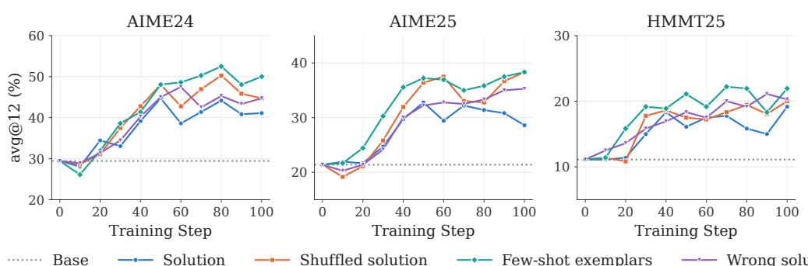  
Figure 11: On-policy context distillation with different forms of privileged context on Qwen3. Substantial performance improvements persist even when the privileged context does not provide the correct solution to the current problem.

Results. As shown in Figure 11, on-policy context distillation still yields substantial performance improvements even when privileged context does not contain the correct solution to the current problem. In some settings, shuffled solutions or few-shot exemplars even outperform the correct reference solutions. These results suggest that performance gains from on-policy context distillation do not necessarily reflect the internalization of task-specific knowledge.

## B.2 GENERIC INSTRUCTIONS AND ENTROPY REDUCTION

Experimental setup. We further examine whether on-policy context distillation can improve performance without additional task-specific knowledge. We replace reference solutions with three generic behavioral instructions: Brief, Decisive, and Critical. These instructions contain no taskspecific answers or additional factual knowledge.

Prompt templates. All three settings share the same prompt template, differing only in the in struction provided.

Problem: {problem}   
=== Instruction Begin ===   
{instruction}   
=== Instruction End ===   
Now solve the problem above, following the instruction. Reason step by   
step, and put your final answer within \boxed{}.

The instructions are defined as follows:

Brief: Please reduce unnecessary reasoning and give your final answer as quickly as possible.

Decisive: Commit to a single approach and carry it through to the end. Do not backtrack or restart.

Critical: Question every step. Consider alternative approaches and revisit earlier steps before continuing.

Results. As shown in Figure 12, these generic instructions yield substantial performance improvements, sometimes surpassing those obtained with correct reference solutions. Figure 13(a) further shows that Brief and Decisive improve mean accuracy (AIME24, AIME25, HMMT25) by 17.5 and 16.9 percentage points, respectively, compared with 10.6 points using correct reference solutions and only 1.7 points with Critical.

To better understand these differences, we examine how privileged context affects the teacher’s output entropy under two state distributions. For paired student states, we compare the output entropy with and without privileged context at the same student-generated prefixes. For teacher rollouts, we perform the comparison at prefixes generated by the context-conditioned teacher. We report the entropy reduction ∆H, where positive values indicate lower entropy when conditioning on privileged context.

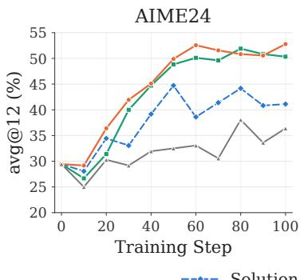

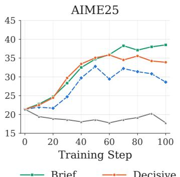

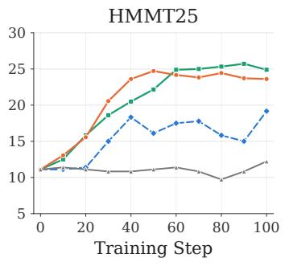

Figure 12: Performance of on-policy context distillation with different generic behavioral instructions. Simple instructions can yield substantial improvements without providing task-specific knowledge.  
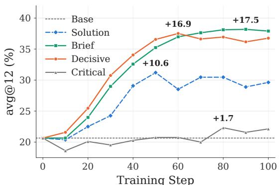  
(a) Performance across steps

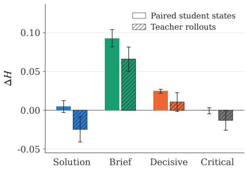  
(b) Uncertainty reduction  
Figure 13: Mean performance gains and entropy reduction under different privileged contexts. (a) Accuracy throughout training. (b) Entropy reduction evaluated on student-generated prefixes (paired student states) and teacher-generated prefixes (teacher rollouts). Larger entropy reductions are generally associated with greater performance improvements.

As shown in Figure 13(b), Brief and Decisive induce substantial entropy reductions under both state distributions. In contrast, correct reference solutions produce little entropy reduction, while Critical shows little or no reduction. The correspondence between entropy reduction and performance improvement suggests that reducing the teacher’s output uncertainty may be an important source of gains in on-policy context distillation, beyond the transfer of task-specific knowledge.

Takeaway. Together, these findings suggest that performance gains from on-policy context distillation do not necessarily reflect the internalization of task-specific privileged knowledge. Such gains may also be associated with changes in the teacher’s output distribution, particularly entropy reduction. This motivates the central question examined in Section 3: whether on-policy context distillation can effectively internalize new knowledge that the student does not already possess.

## C EXPERIMENTAL DETAILS

In this section, we provide the data preparation, feedback construction, training configurations, and evaluation protocols for the main experiments in Section 5.

## C.1 DATASETS AND BENCHMARKS

Math reasoning. We train on a 28.8K-example subset of OpenThoughts (Guha et al., 2026). We evaluate on eight benchmarks: AIME24, AIME25, HMMT25-Feb, HMMT25-Nov, Olympiad-

Bench, MATH-500, Minerva, and AMO. The evaluation sizes and sampling protocols are specified in Appendix C.4.

Code generation. We construct the training set from open-r1/codeforces. We first retain problems with difficulty ratings in [800, 1600), non-empty official editorials, and standard-input (stdio) interfaces, yielding 2120 candidates. We further retain only problems for which R1- generated reference solutions pass our execution-based judge, resulting in 1793 training problems. We evaluate on CF-422, comprising 422 Codeforces problems disjoint from the training set, and on LiveCodeBench v6. The CF-422 evaluation set includes nine problems without difficulty ratings; the remaining problems are organized into difficulty groups for reporting.

WebShop. We use the official WebShop (Yao et al., 2022) splits, comprising 9,464 training tasks, 886 development tasks, and 500 test tasks. A subset of 150 development tasks is used for checkpoint selection, and the complete 500-task test set is used for final evaluation.

ALFWorld. We construct separate training and development subsets from the official ALF-World (Shridhar et al., 2020) training directory, containing 1842 and 404 tasks, respectively. We use 150 development tasks for checkpoint selection. The official valid\_seen and valid\_unseen evaluation sets contain 140 and 134 tasks, respectively; the main results are reported on valid\_unseen.

Software engineering. We train on 1293 instances selected from the official SWE-Gym (Pan et al., 2024) training set. Our SWE-Gym evaluation includes 265 instances: 148 in-domain in stances drawn from eight repositories represented in training, and 117 out-of-distribution instances from three other repositories (modin: 55; hydra: 39; bokeh: 23). The in-domain and out-ofdistribution designations refer to repository overlap, not instance overlap: evaluation instances are disjoint from the training instances. We additionally evaluate on all 500 instances of the official SWE-bench Verified benchmark. Both software-engineering evaluations use Mini-SWE-agent as the agent scaffold.

## C.2 FEEDBACK CONSTRUCTION

For each task, the current student produces a trajectory and receives task-specific feedback. We use this interaction experience to identify a failure-relevant span or step and produce a corresponding privileged hint. The localization and hint-generation procedure uses the current model with greedy decoding. The resulting hint is provided only in the privileged context for corrective generation and distillation, not to the student at inference time.

Math reasoning. For mathematical reasoning, the attribution procedure receives the student’s original solution together with the reference solution. The model compares the two to identify an erroneous reasoning span and generate a corresponding corrective hint.

Code generation. For Codeforces, we use the official problem editorial as reference feedback. We additionally execute student-generated programs against the problem’s tests and checker, obtaining a correctness verdict and, for unsuccessful submissions, a failure category such as wrong answer, runtime error, or timeout. This information is provided for error localization and hint generation.

WebShop. For each failed episode, the attribution procedure is invoked once with the customer instruction, the complete numbered observation–action trajectory, and terminal feedback. The instruction specifies the requested product type, attributes, options, and price limit. Terminal feedback includes the reason for termination (e.g., purchase, missing action, context truncation, or step limit) and, if a purchase was made, the simulator’s score and an itemized requirement check derived from its built-in reward function. This check indicates whether the purchased item meets the requested type, price constraint, attributes, and selected options, but does not provide the correct product or action. The hint identifies unmet requirements without directly supplying a revised action. No expert demonstrations are used.

Table 4: Training configurations for the main experiments. The sampling temperature is shared by the initial student rollout and hint-conditioned correction generation.
<table><tr><td>Task</td><td>Steps</td><td>Batch</td><td>Temp.</td><td>Ckpt. interval</td></tr><tr><td>Math</td><td>100</td><td>32</td><td>1.1</td><td>20</td></tr><tr><td>Codeforces</td><td>100</td><td>32</td><td>1.1</td><td>20</td></tr><tr><td>WebShop</td><td>240</td><td>32</td><td>1.0</td><td>40</td></tr><tr><td>ALFWorld</td><td>100</td><td>32</td><td>1.0</td><td>20</td></tr><tr><td>SWE-Gym</td><td>300</td><td>16</td><td>1.0</td><td>50</td></tr></table>

ALFWorld. For each failed episode, the attribution procedure receives the task description, complete observation–action trajectory, and episode outcome. The trajectory contains simulator observations, including feedback on invalid actions (e.g., “Nothing happens.”), and the terminal information identifies unsuccessful completion and invalid-action steps. Unlike WebShop, ALFWorld does not provide an itemized reward breakdown. The hint is restricted to objects and receptacles already observed in the trajectory; no expert trajectory or reference action is supplied.

Software engineering. For SWE-Gym, the interaction experience includes the agent’s tool-call trajectory, tool execution results, test outcomes, and concrete error messages. These execution traces and test feedback are used for localization and corrective hint generation.

## C.3 TRAINING CONFIGURATIONS

All methods use full-parameter fine-tuning with PyTorch AdamW and FSDP. We use a constant learning rate of $1 \times \bar { 1 0 } ^ { - 6 }$ without warmup or decay, Adam coefficients $( \beta _ { 1 } , \beta _ { 2 } ) \ : = \ : ( 0 . 9 , 0 . 9 9 9 )$ weight decay 0.01, numerical stability parameter $\epsilon = 1 0 ^ { - 8 }$ , and global gradient-norm clipping at 0.5. For a given task, LoCD and all baselines use the same batch size and number of optimization steps, as well as the same task data and feedback-construction protocol. The methods collect trajectories from their respective evolving policies, so their sampled trajectories need not be identical. These controls do not imply identical total compute across methods.

During training, the student rollout is limited to 4096 new tokens for mathematics and 2048 for Codeforces. WebShop and ALFWorld use a per-step generation limit of 512 tokens. For mathematical reasoning, each batch contains 32 prompts with one student rollout per prompt. After each optimization update, LoCD collects new student trajectories and repeats the attribution, correctiongeneration, and distillation procedure. Successful rollouts are supervised with SFT over the entire original generated trajectory, while failed rollouts undergo method-specific feedback-based learning; this treatment is shared by LoCD and the baselines. Reverse KL is the default distillation objective for LoCD and the on-policy context-distillation baselines. In single-step reasoning and coding tasks, a correction is limited to the length of the attributed original span. In multi-step agent tasks, the corrected step is used only for localized distillation; it is not executed in the environment and no continuation is collected from that correction. A representative localization and attribution prompt is provided in Appendix F.

## C.4 EVALUATION PROTOCOLS

For reasoning and coding, avg@K denotes the average fraction of correct responses across K independently sampled generations per problem. For LiveCodeBench, the corresponding score is also reported as a pass@1 estimate based on 12 samples. All mathematical-reasoning and codegeneration evaluations use a sampling temperature of 0.7. Table 5 summarizes the dataset sizes and decoding limits.

Interactive agents. We report task success rates using avg@1 on the complete 500-task WebShop test set and avg@3 on ALFWorld. Each WebShop episode is limited to 10 interaction steps, with up to 512 generated tokens per step during training and 256 at evaluation time; the interaction history is retained while earlier page observations are compressed. Each ALFWorld episode is limited to 50 steps, with up to 512 generated tokens per step in both training and evaluation; the model conditions on the two most recent observations. For ALFWorld, the main text reports performance on the 134-task valid\_unseen split.

Table 5: Evaluation protocols for mathematical reasoning and code generation. The maximum number of new tokens is specified per sampled response.
<table><tr><td>Benchmark</td><td>Problems</td><td>Metric</td><td>Max. new tokens</td></tr><tr><td>AIME24</td><td>30</td><td>avg@12</td><td>38912</td></tr><tr><td>AIME25</td><td>30</td><td>avg@12</td><td>38912</td></tr><tr><td>HMMT25-Feb</td><td>30</td><td>avg@12</td><td>38912</td></tr><tr><td>HMMT25-Nov</td><td>30</td><td>avg@12</td><td>38912</td></tr><tr><td>AMO</td><td>50</td><td>avg@12</td><td>38912</td></tr><tr><td>MATH-500</td><td>500</td><td>avg@1</td><td>38912</td></tr><tr><td>OlympiadBench</td><td>674</td><td>avg@1</td><td>38912</td></tr><tr><td>Minerva</td><td>272</td><td>avg@1</td><td>38912</td></tr><tr><td>CF-422</td><td>422</td><td>avg@12</td><td>16384</td></tr><tr><td>LiveCodeBench v6</td><td>175</td><td>avg@12</td><td>16384</td></tr></table>

Software-engineering agents. We report avg@4 for SWE-Gym, averaging success over four independent Mini-SWE-agent rollouts per instance on both the in-domain and out-of-distribution evaluation sets. On SWE-bench Verified, we report pass@1 over the full official 500-instance benchmark. We limit Mini-SWE-agent to 80 interaction steps per issue in both evaluations.

Model selection and reporting. For math reasoning and code generation, we evaluate all saved checkpoints and report the best observed performance. For WebShop, ALFWorld, and softwareengineering tasks, where evaluation is substantially more expensive due to multi-step agent interactions, we instead select the best-performing checkpoint on a held-out validation set for final evaluation. Specifically, WebShop and ALFWorld use 150-task subsets of their development splits for checkpoint selection. Results for math reasoning and code generation are reported as mean ± standard deviation over three independent training runs, while agent results are obtained from a single training run per method.

## D PASS@K RESULTS.

Figure 14 evaluates whether the gains of LoCD persist under larger sampling budgets. LoCD achieves the highest pass@64 and pass@128 across all five mathematics and code benchmarks, consistently outperforming both off-policy and on-policy distillation. The advantage remains vis ible as the number of samples increases, indicating that LoCD improves not only single-sample accuracy but also the likelihood of producing a successful solution under repeated sampling.

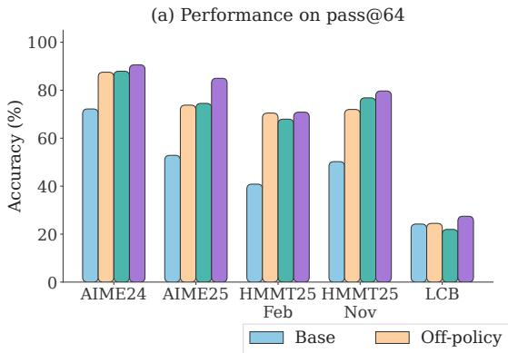

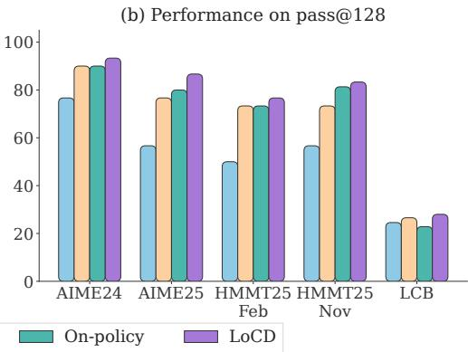  
Figure 14: Pass@K results on math and code: pass@64 (left) and pass@128 (right).

## E PARAMETER-UPDATE GEOMETRY

We provide additional details for the parameter-update analysis in Section 5.3. Following the diagnostics of Shen et al. (2026b), we examine how different context-distillation objectives modify the pretrained parameters over training. We consider both the scale and support of parameter changes and their effect on the singular structure of the pretrained weights. In addition to math reasoning reported in the main text, we conduct the same analysis on code generation and ALFWorld.

## E.1 ANALYSIS PROTOCOL

All analyses use Qwen3-8B and measure parameter changes relative to the shared initial checkpoint. For each weight matrix W, we denote its initialization by $W _ { 0 }$ and its value at training step t by $W _ { t }$ We analyze checkpoints at $t \in \{ 2 0 , 4 0 , 6 0 , 8 0 , 1 0 0 \}$ . For ALFWorld, we use the same 100-step window to enable direct comparison with the reasoning and coding runs.

To cover different model depths while keeping the analysis tractable, we analyze the query, key, value, and output projection matrices from every fourth transformer layer, $i \in \{ 0 , 4 , 8 , \ldots , 3 2 \}$ yielding 36 matrices in total. Each diagnostic is computed independently for every matrix and then averaged equally across the 36 matrices; thus, larger matrices do not receive additional weight.

Stored weights are converted to FP32 before computing parameter differences. Singular-value decompositions are computed in FP64 for numerical stability. The same matrices, checkpoints, and aggregation procedure are used for all methods and tasks.

## E.2 METRIC DEFINITIONS

We use four complementary diagnostics. Update magnitude and visible update sparsity characterize how much and where the parameters change, while principal angle and normalized spectral shift characterize changes in the singular geometry of the pretrained weights.

Cumulative update magnitude. For each matrix, we measure its displacement from initialization as

$$
\Delta W _ { t } = W _ { t } - W _ { 0 } , \qquad d _ { t } ( W ) = \lVert \Delta W _ { t } \rVert _ { F } .\tag{1}
$$

This quantity measures the net displacement at step $t ,$ rather than the sum of successive update norms. We do not normalize it by matrix size or by $\bar { | | } \boldsymbol { W _ { 0 } } \| _ { F }$ . The reported update scale is the mean of $d _ { t } ( W )$ over the analyzed matrices.

Visible update sparsity. To distinguish substantial parameter movement from small numerical changes, we mark an entry as visibly changed when

$$
M _ { t , i j } = \mathbb { I } [ | W _ { t , i j } - W _ { 0 , i j } | > \eta \operatorname* { m a x } ( | W _ { 0 , i j } | , | W _ { t , i j } | ) ] , \qquad \eta = 1 0 ^ { - 3 } .\tag{2}
$$

For a matrix containing $n _ { W }$ entries, we define

$$
\mathrm { S p } _ { t } ( W ) = 1 - \frac { 1 } { n _ { W } } \sum _ { i , j } M _ { t , i j } .\tag{3}
$$

Higher values therefore indicate that a larger fraction of coordinates remain within the relativechange threshold. Equivalently, $1 - \operatorname { S p } _ { t } ( \bar { W } )$ is the visibly changed-coordinate fraction reported in our analysis.

This diagnostic follows the relative-change criterion used in prior geometric analyses of distillation, but our implementation applies the criterion directly to the stored weights after FP32 conversion and does not perform an additional bf16 round trip. We therefore interpret it as visible update sparsity, rather than as an indicator of whether a parameter received gradients.

Principal-subspace rotation. We next measure how much training rotates the dominant singular subspace. Let

$$
\begin{array} { r } { W _ { 0 } = U _ { 0 } \Sigma _ { 0 } { V _ { 0 } ^ { \top } } , \qquad W _ { t } = U _ { t } \Sigma _ { t } { V _ { t } ^ { \top } } . } \end{array}\tag{4}
$$

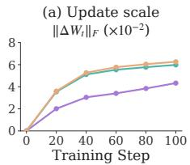

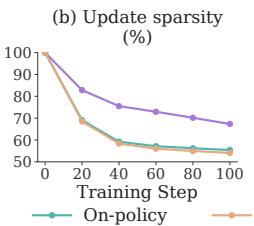

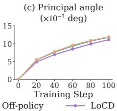

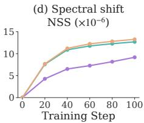

(a) Math reasoning.  
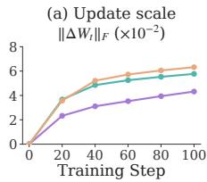

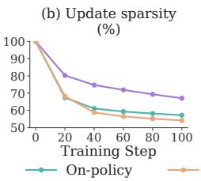

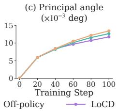

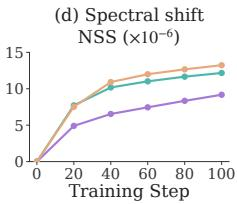

(b) Code generation.  
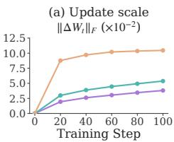

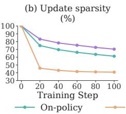

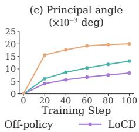  
(c) ALFWorld.

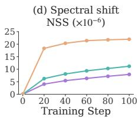  
Figure 15: Parameter-update geometry across three datasets.

We retain the leading $k = 5 1 2$ left singular vectors, $U _ { 0 , k }$ and $U _ { t , k }$ . Their principal angles are

$$
\theta _ { t , i } = \operatorname { a r c c o s } \left( \sigma _ { i } \left( U _ { 0 , k } ^ { \top } U _ { t , k } \right) \right) , \qquad i = 1 , \ldots , k .\tag{5}
$$

The singular values of the overlap matrix are clipped to [0, 1] before applying arccos. For each weight matrix, we use the median principal angle in degrees and then average this statistic across matrices. Smaller values indicate less rotation of the dominant left singular subspace. This metric measures subspace orientation and should not be interpreted as the rank of the parameter update.

Normalized spectral shift. Principal angles characterize changes in singular vectors; we additionally measure changes in the singular values themselves. Let $\bar { \sigma ( W ) }$ denote the complete singularvalue spectrum of W in descending order. We compute

$$
\mathrm { N S S } _ { t } ( W ) = \frac { \| \sigma ( W _ { t } ) - \sigma ( W _ { 0 } ) \| _ { 2 } } { \| \sigma ( W _ { 0 } ) \| _ { 2 } } .\tag{6}
$$

Unlike the principal-angle diagnostic, NSS uses the full singular spectrum. Lower NSS indicates a smaller relative change in the singular values of the pretrained weight matrix. The reported NSS is averaged equally across the analyzed matrices.

## E.3 RESULTS ACROSS TASKS

Across the three settings, the most consistent distinction appears in update magnitude and visible update sparsity: LoCD stays closer to initialization and changes fewer coordinates than either on-policy or off-policy context distillation. The spectral diagnostics show a similar but somewhat weaker pattern.

Math reasoning. Figure 15a reproduces the main-text analysis. LoCD exhibits smaller cumulative displacement throughout training. At step 100, its update magnitude is approximately 28–31% smaller than those of the on-policy and off-policy baselines. The visibly changed-coordinate fraction is 32.66%, compared with 44.60% for on-policy and $4 5 . 9 3 \%$ for off-policy distillation. LoCD also yields a lower NSS $( 9 . 1 7 \times 1 0 ^ { - 6 }$ versus $\phantom { 0 } { 1 2 . 6 \bar { 9 } } \times 1 0 ^ { - 6 }$ and $1 3 . 2 7 \stackrel { . } { \times } 1 0 ^ { - 6 } )$ The principal-angle difference is comparatively modest $( 0 . 0 1 1 1 3 ^ { \circ }$ versus $0 . 0 1 1 8 2 ^ { \circ }$ and 0.01192<sup>◦</sup>), indicating that the clearest separation lies in update magnitude and visible support rather than a substantially differen rotation of the dominant subspace.

Code generation. Figure 15b shows a closely matching pattern on code generation. At step 100, the mean update magnitude is 0.0432 for LoCD, compared with 0.0577 for on-policy and 0.0632 for off-policy distillation. The corresponding visibly changed-coordinate fractions are 32.93%, 42.74%, and 45.80%, respectively. LoCD also exhibits a smaller spectral shift. Principal-angle difference are less pronounced and do not follow a strict ordering at every checkpoint, again suggesting that the main distinction is in the scale and support of the parameter update.

ALFWorld. The separation is even larger on ALFWorld (Figure 15c), particularly relative to offpolicy distillation. At step 100, the mean update magnitude is 0.0381 for LoCD, 0.0537 for on-policy distillation, and 0.1046 for off-policy distillation, making the LoCD displacement 63.6% smaller than the off-policy baseline. The visibly changed-coordinate fractions are 29.70%, 38.75%, and 59.20%, respectively. LoCD also exhibits smaller principal-subspace rotation and NSS throughout the analyzed window.

Overall pattern. Across math reasoning, code generation, and ALFWorld, LoCD consistently induces smaller cumulative displacement and a smaller fraction of visibly changed coordinates in the analyzed attention projections. Spectral changes are also generally smaller, while differences in dominant subspace rotation are more modest on reasoning and coding. Together with the taskperformance results, these analyses show that LoCD achieves stronger performance while modifying the pretrained parameters more locally.

These diagnostics characterize the parameter changes observed in the analyzed attention projections. They do not imply fewer trainable parameters, lower optimization cost, low-rank updates, or that smaller parameter changes are themselves the cause of LoCD’s performance gains.

## F LOCALIZATION AND ATTRIBUTION PROMPTS

We employ task-specific prompts for localization and attribution across all evaluated tasks. Here, we present mathematical reasoning as a representative example to illustrate our prompt design. Given a problem, the student’s attempt, and reference feedback, the model identifies critical reasoning errors and generates corresponding problem-specific corrective hints. The following template summarizes the key instructions used in this process.

```tcl
Localization and Hint Generation in Math Tasks
# Problem
{question}
# Student Attempt
{response}
# Reference Information (Privileged)
{feedback_block}
# Instructions
You are tasked with identifying critical reasoning errors in the
student’s attempt and providing targeted guidance for correcting
them.
1. Error Identification
```

```jsonl
Carefully examine the student attempt against the reference
information, paying particular attention to the correctness
feedback. If the final answer is incorrect, identify the earliest
verifiable reasoning error. Return no attribution only if no
specific error can be reliably identified.
2. Critical Span Localization
Identify at most {max_states} substantive errors or clearly
suboptimal steps that affect the solution. Prioritize the earliest
error and ignore issues related only to wording, formatting, or
presentation.
For each identified error, copy one complete sentence verbatim from
the student attempt to mark the correction point. The selected
sentence should be concise (preferably within 200 characters) and
must exactly match the original text. Do not select a fragment
within a sentence, mathematical expression, or LaTeX block.
3. Corrective Hint Generation
For each identified error, generate a concrete, process-level hint
specific to the current problem. The hint should:
- Describe the relevant mathematical situation, explicitly
referring to the quantities, equations, or relationships involved.
- Specify an actionable direction for correcting the reasoning.
- When helpful, explain which incorrect approach should be avoided
and why.
Avoid vague suggestions or generic mathematical advice. Do not
reveal the final answer or reproduce the reference solution.
4. Correction Context
The selected erroneous sentence and all subsequent content will be
hidden during correction. The hint must therefore be self-contained
and understandable from the preceding student prefix. Do not refer
to deleted content using expressions such as "the above step" or "
this calculation".
# Output Format
Return strict JSON without additional text:
{
"attributions": [
{
"span": "<verbatim sentence marking the error>",
"hint": "<concrete, problem-specific corrective hint>"
}
]
}
```

The returned span serves as a textual anchor for locating the correction point in the student trajectory, while the corresponding hint provides privileged guidance for localized teacher generation. As described in Section 4, distillation is restricted to the corrected segment rather than the entire remaining trajectory.