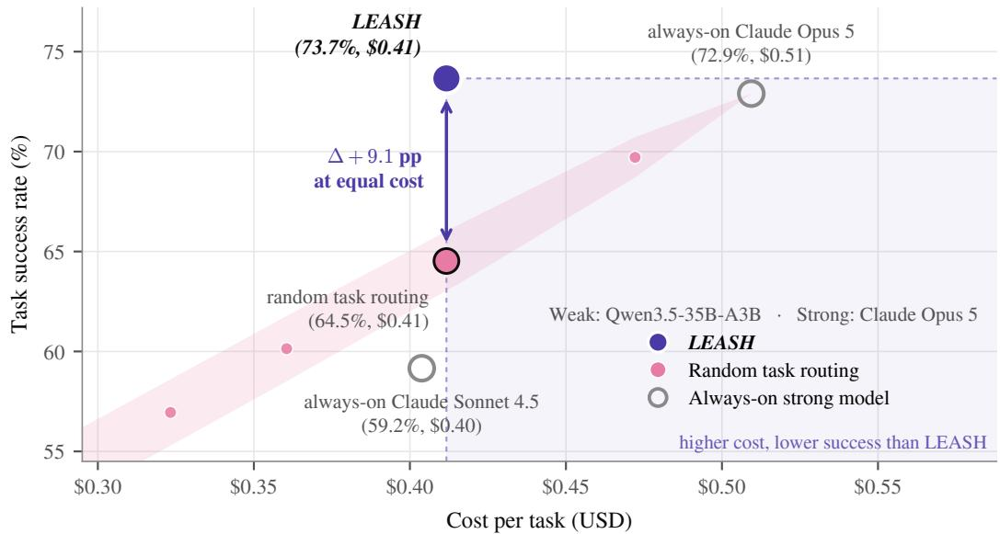
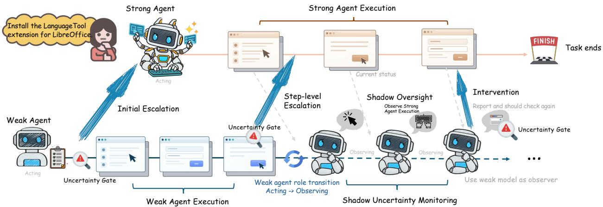
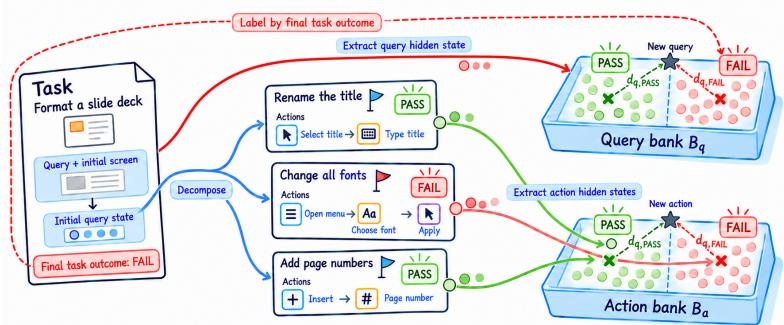
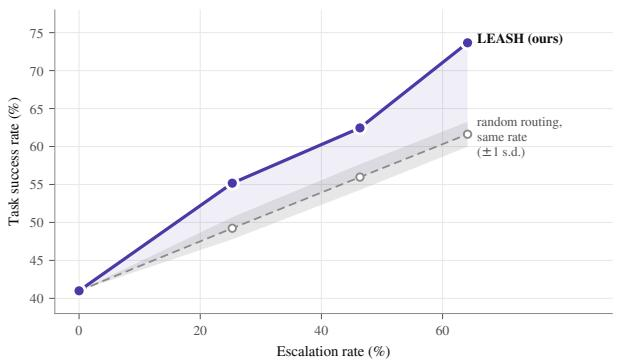
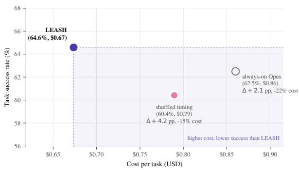
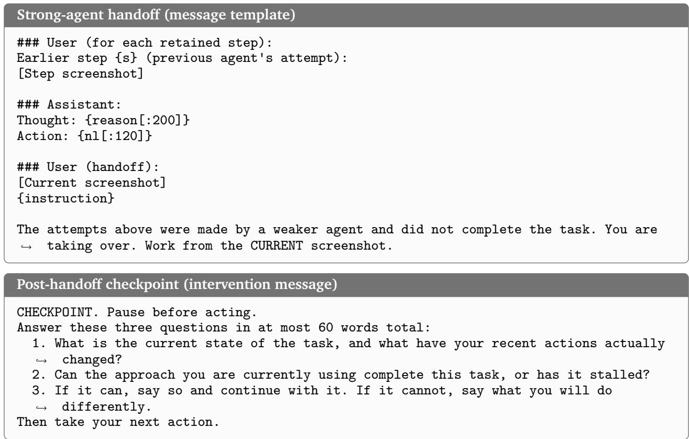
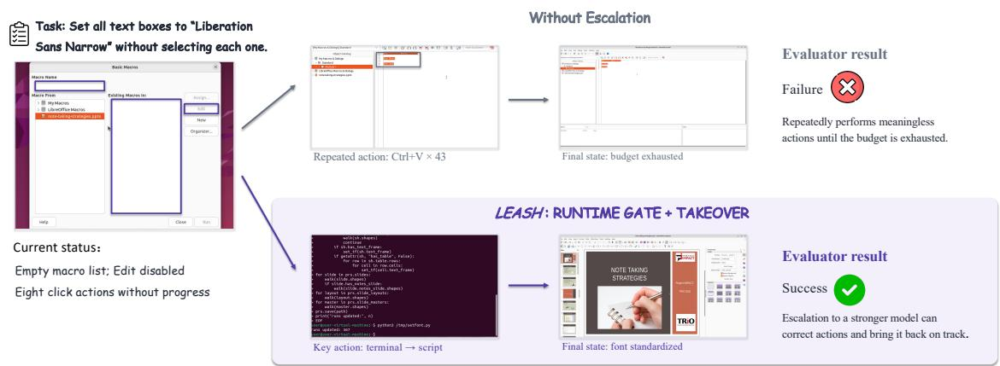
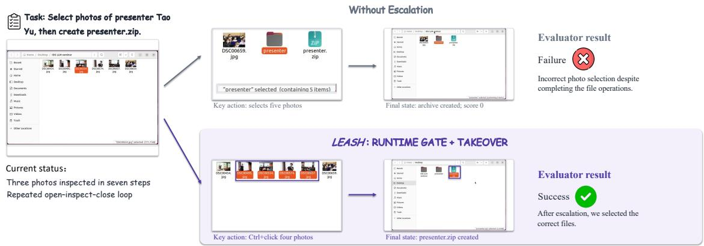

# LEASH: Uncertainty-Aware Weak-to-Strong Escalation and Oversight for Computer-Use Agents

Qingni Wang†1, Changdae Oh2, Yuzhe Yang†1, Sharon Li2, Jiachen Yang1, Ang Li1 and Xin Eric Wang1 1Simular, 2University of Wisconsin–Madison

†Work done while interning at Simular.

Computer-use agents increasingly tackle long-horizon tasks, where running a frontier model at every step is expensive and a small open-weight model alone often fails. Weak-to-strong escalation ofers a middle ground where a weak agent acts by default and hands control to a strong one only when needed. The core challenge is deciding when to escalate, which requires an uncertainty signal cheap enough to check at every step. However, even after handof, the strong agent can still get lost, but a black-box API that the strong agent is usually served exposes no internals to monitor. To this end, we propose LEASH, a training-free framework that unleashes the strong agent only when the weak agent’s latent uncertainty signals it is needed, and keeps it on a leash afterward. LEASH has three layers: (1) initial task uncertainty for early routing, (2) step-level uncertainty for runtime escalation, and, after handof, (3) a shadow observer for continued oversight of the strong black-box agent. Here, we use latent uncertainty as a fuel for all three layers. Specifically, we compare the weak model’s hidden states with those from its past successful and failed trajectories, and a state that looks more like the failures signals higher uncertainty. During weak-agent execution, our uncertainty estimator reuses activations already produced during action generation, so it needs no extra forward pass or dedicated monitor training. Experiments on OSWorld across four contemporary model backbones show that LEASH consistently improves over standalone weak agents and outperforms random escalation by 6.55–11.94 points at matched escalation rates. With Qwen3.5-35B-A3B, LEASH achieves 73.66% task success at \$0.4117 per task, matching always-on Claude Opus 5 (72.90%) while reducing inference cost by 19.2%.

  
Figure 1 | Accuracy–cost comparison between LEASH and random task-level routing on Qwen3.5- 35B-A3B. The area spanned by random routing is obtained from repeated random task allocations across diferent escalation budgets; the band shows ±1 standard deviation over 10,000 allocations. At matched inference cost, LEASH achieves 9.1 percentage points higher task success.

## 1. Introduction

Computer-use agents (CUAs) automate tasks of graphical interfaces by translating natural-language instructions and visual observations into executable actions (Cheng et al., 2024; Xie et al., 2024), and are increasingly deployed for complex, long-horizon automation tasks that can take more than an hour on average (Abhyankar et al., 2026). While frontier proprietary models have been shown to achieve impressive performance leaps (Anthropic, 2026b; OpenAI, 2026), running every single task spanning hundreds of steps with these models raises cost concerns, whereas a light open-weight model alone performs poorly on even much simpler tasks (Xie et al., 2024). This creates a fundamental trade-of between accuracy and cost eficiency, motivating weak-to-strong escalation (W2SE), in which a weak agent serves as the primary executor and hands control to a strong agent only when needed (Lei and Huan , 2026; Wei et al., 2026). W2SE raises two im ortant uestions: (1) When should the weak agent escalate, and (2) who oversees the strong agent after handing over?

Existing work on W2SE primarily focuses on the first question, estimating the weak agent’s failure risk to decide when escalation is needed. Some of them adopt another monitoring agent to verify each step (Wang et al., 2024; Yi et al., 2026), others train an extra monitoring module on the collection of annotated trajectories (Lei and Huang, 2026; Wei et al., 2026). However, the former inevitably adds nontrivial cost to run another heavy agent step-by-step, whereas the latter creates another phase of data annotation and training, hindering direct adoption in real-world applications under varying deployment constraints. While training-free uncertainty estimation-based approaches might avoid the aforementioned bottlenecks (Oh et al., 2026b), prior works still rely on external knowledge base (Liu et al., 2026), another reference model (Oh et al., 2026a), or multiple sampling for each step (Wang et al., 2026) quickly becomes infeasible or impractical in long-horizon tasks in the wild.

Besides, escalation alone does not eliminate execution uncertainty, resulting in the second important question in W2SE which is commonly overlooked. That is, even after a stronger agent takes control, subsequent actions may deviate from the intended task or fail to achieve the desired outcome. However, monitoring a black-box strong agent is challenging because its internal states are inaccessible and verbalized confidence can be unreliable on evolving context of long-horizon task (Han et al., 2024; Kirchhof et al., 2026).

To answer both questions, we formulate W2SE as a budget-constrained sequential stopping problem, and use the weak agent’s failure risk as a proxy for the expected benefit of escalation. We then propose Latent uncertainty for Escalation And SHadow oversight (LEASH), a training-free framework driven by the uncertainty signal in the weak agent’s hidden states. First, we record its hidden states of prompt and action tokens on a small set of held-out tasks and label them with task-level and subgoal-level outcomes to construct a representation bank. This representation bank then serves as a semantic anchor to score the newly faced prompts and actions during test-time by measuring, under a Mahalanobis metric in latent space, how much closer each one lies to past failures than to past successes. LEASH puts this signal on two jobs (Figure 2): For escalation, an initial gate scores uncertainty from the task prompt query, while a runtime gate monitors subsequent execution trace. For oversight, after the weak model hands the control to the strong agent, it switches its role from actor to observer that monitors the strong agent’s trajectory every three steps; when its uncertainty is high, the pending action is rolled back and re-decided once with higher reasoning efort. Importantly, our uncertaint -driven W2SE formulation draws on an easil accessible resource the weak a ent’s own past experience (Silver and Sutton, 2025), removing reliance on an external dataset or additional training without hosting another expensive agent during runtime, while ofering extensibility for recursive self-improvement (Madaan et al., 2023; Schmidhuber, 2007; Shinn et al., 2023; Wang et al., 2023; Zelikman et al., 2022).

  
Figure 2 | Overview of uncertainty-aware weak-to-strong escalation and post-handof oversight. A weak agent goes through the task until its uncertainty scores trigger initial or step-level escalation; otherwise, the weak agent continues. After escalation is triggered, the strong agent retains control while the weak agent changes its role from an actor to a shadow observer for continued monitoring. The feedback path from weak observer to strong actor enables uncertainty-triggered reflection and intervention. In short, LEASH unleashes the strong agent only when the weak agent’s latent uncertainty signals it is needed, and keeps it on a leash afterward.

We evaluate LEASH on OSWorld (Xie et al., 2024) with four open-weight weak agents and Claude Opus 5 (Anthropic, 2026a) as the strong agent. At matched escalation rates, LEASH outperforms random escalation by 6.55–11.94 points. We further measure how much of the performance gap between the weak agent alone and always-on Opus is recovered by escalation, following the performance-gap metric of (Burns et al., 2023). LEASH recovers 75–102% of this gap, against 37–69% for random escalation, while costing 69–81% as much as always-on Opus. With Qwen3.5-35B-A3B (Qwen Team, 2026a), LEASH matches always-on Opus (73.7% vs. 72.9% success) at 19% lower cost, whereas random escalation at equal cost scores about 9 points lower (Figure 1).

Our contributions are summarized as follows:

• We formalize weak-to-strong escalation as a budget-constrained sequential stopping problem and show that one latent uncertainty signal can drive both escalation and oversight.

• We propose a training-free, scalable uncertainty scoring method that measures how much closer a hidden state lies to the weak agent’s own past failures than to its past successes, and provide theoretical justification for using this score for escalation.

• We extend this uncertainty signal to weak-to-strong oversight, in which the white-box weak agent monitors the black-box strong agent through its own hidden states.

• On OSWorld with four open-weight backbones, we show that LEASH outperforms random escalation at matched escalation rates and recovers 75–102% of the escalation gap at 69–81% of the cost of using always strong agent.

## 2. Related Work

Eficient Computer-Use Agents. Model routing and cascading ofer a promising way to balance inference cost and performance, as demonstrated by FrugalGPT and RouteLLM (Chen et al., 2023;

Dekoninck et al., 2025; Ong et al., 2025). Extending this idea to GUI automation, Adaptive VLM Routin selects models based on action dificult and confidence (Liu et al., 2026), while Ste Wise trains lightweight monitors to detect execution stalls and identify milestones for escalation (Wei et al., 2026). Our work instead leverages the backbone agent’s internal representations to guide both task-level routing and step-level escalation, without training a dedicated monitoring network.

Weak-to-Strong Paradigms. Weak-to-strong generalization studies how stronger models learn from weaker supervision (Burns et al., 2023; Jung et al., 2025; Medvedev et al., 2025; Somerstep et al., 2025; Xue et al., 2025). These works primarily concern training-time transfer of supervision or capabilities from a weaker model to a stronger one. Here we study the complementary inference- time setting of weak-to-strong escalation (W2SE), where a weak model executes by default and selectively invokes a stronger model when additional capability is needed. This shifts the weak–strong relationship from supervision transfer to sequential resource allocation. We derive escalation signals from the agent’s own past experience without training an additional monitor.

Uncertainty Estimation and Agent Monitoring. Uncertainty estimation of agentic systems has emerged as one of the most important problems to monitor and guide agent decisions (Chun et al., 2026; Han et al., 2024; Oh et al., 2026b), while SafeGround and Argus investigate uncertainty estimation for GUI grounding, including calibrated predictions and representation-based methods (Kumar et al., 2026; Wang et al., 2026). Sampling-based uncertainty estimation and risk control have also been studied for question answering (Duan et al., 2025; Wang et al., 2025), but repeated generation can be costly when applied at every step of a long-horizon agent trajectory. Meanwhile, another line of work explores weak-to-strong oversight of agent misbehavior and failure monitoring through observable trajectories (Greenblatt et al., 2024; Kale et al., 2026; Pan et al., 2026). Rather than focusin on either escalation or oversi ht alone, we handle both roblem in a sin le unified fueled b a simple uncertainty estimate. That is, we integrate representation-based uncertainty estimation into the execution workflow, reusing the backbone model’s hidden states for escalation and extending the same signal to post-handof oversight of a closed-source strong agent.

## 3. Method

We introduce LEASH, a training-free uncertainty-driven agentic inference framework for W2SE and post-handof oversight (Figure 2). By comparing the weak model’s runtime hidden states with successful and failed reference executions, we estimate uncertainty at task initialization and during execution, which guides both escalation to the strong agent and continued oversight after handof. We first formulate the problem in Section 3.1 and introduce each component in subsequent sections.

## 3.1. Problem Formulation

Given a task query, a computer-use agent generates an action conditioned on the query, the screen, and history. We consider a lightweight, weak agent, e.g., a relatively small open-weight model with accessible hidden states, and a large, strong agent, e.g., a proprietary black-box frontier model, sharing a budget of � actions. In addition to these two actor agents, we also host a Manager agent (with a strong model) who fires at the beginning to decompose the task and subsequently at subgoal boundaries to verify progress, constructing a minimal version of multi-agent workflow (Agashe et al., 2025a,b; Koh et al., 2026). Throughout execution, the Manager decomposes the task query into subgoals with screenshot-verifiable completion criteria and decides whether to advance, keep, or revise each subgoal (Appendix C). This decomposition naturally provides finer-grained supervision (Chun and Russakovsky, 2026), allowing execution steps to inherit subgoal-level outcomes rather than relying solely on the final task-level label.

We adopt the weak model as a starting agent for all tasks until control is transferred to the strong model by hitting some flags. Then, the strong model runs over the remaining action budget until the end of the task. Let $x \sim \mathcal { D }$ denote a task drawn from the task distribution, and let � denote an escalation policy. For each task �, policy � induces a stopping time $t _ { \mathrm { e s c } } ^ { \pi } ( x ) \in \{ 0 , 1 , \ldots , T \}$ , where $t _ { \mathrm { e s c } } ^ { \pi } ( x ) = 0$ denotes the earliest escalation opportunity and $t _ { \mathrm { e s c } } ^ { \pi } ( x ) = T$ denotes no escalation. Since the strong agent dominates per-step cost, we use the total escalation rate, $p _ { \mathrm { e s c } } .$ as a budget proxy and want to maximize task success under limited budget:

$$
\operatorname* { m a x } _ { \pi } ~ \mathbb { E } _ { x \sim \mathcal { D } } \left[ S ^ { \pi } ( x ) \right] \quad \mathrm { s . t . } \quad \operatorname* { P r } _ { x \sim \mathcal { D } } \left( t _ { \mathrm { e s c } } ^ { \pi } ( x ) < T \right) \leq p _ { \mathrm { e s c } } ,\tag{1}
$$

where $S ^ { \pi } ( x ) \in \{ 0 , 1 \}$ indicates task success under escalation policy �. That is, we want to run tasks and each step within them through the weak agent as many times as possible unless it fails, to minimize the cost while achieving a high task success rate, becoming a problem when-toescalate. Unlike existing works that adopt other monitoring agents (Gao et al., 2026; Wang et al., 2024) in-curring additional inference costs or training-based monitors (Wei et al., 2026) requiring annotation costs and an additional training phase, we pro-

  
Figure 3 | Construction of the query and action reference banks for latent space uncertainty estimation.

pose to use simple uncertainty estimates as a signal to determine when-to-escalate, without inducing any training cost.

## 3.2. Reference-Based Latent Uncertainty Estimation

Motivated b well-established observations revealin that LLMs internalize the likelihood of task success or failure in their representations (Azaria and Mitchell, 2023; Kadavath et al., 2022; Kossen et al., 2024; Orgad et al., 2025) even before generating any tokens (Afzal et al., 2025; Cencerrado et al., 2025; Ji et al., 2024), we propose a training-free, representation-distance-based uncertainty estimation technique for agent systems.

Representations and reference banks. For each task from a small held-out set, we run a weak agent to collect some preliminary inference trajectories without escalating anything to a strong agent. During this inference over the held-out set, we extract two final-layer representations, $h _ { 0 } \in \mathbb { R } ^ { d }$ at the last task query prompt token, and $h _ { t } \in \mathbb { R } ^ { d }$ at the last generated action token of each execution step �. The former captures information over the instruction and initial screen before decoding, whereas the latter also incorporates the action executed by the agent. These hidden states build representation banks pairing each hidden state with progress outcome: The query bank $\mathcal { B } _ { q } = \{ ( h _ { i , 0 } , y _ { i } ) \}$ adopts task outcomes $y _ { i } \in \{ \mathrm { P A S S } , \mathrm { F A I L } \}$ , whereas the action bank $\mathcal { B } _ { a } = \{ ( h _ { i , t } , y _ { i , t } ) \}$ assigns each step its corresponding subgoal segment’s outcome (assessed by a Manager agent): Pass if the subgoal is successfully completed, Fail if it should be revised, and otherwise the final task outcome.

Uncertainty score. For each channel of representation banks $c \in \{ q , a \}$ , i.e., query and action, we fit a shared-covariance Gaussian discriminant model (Mukhoti et al., 2023) on $\mathcal { B } _ { c }$ . We first standardize each representation with the bank statistics, $z _ { c } ( h ) = ( h - \bar { h } _ { c } ) / s _ { c } .$ , where $\bar { h } _ { c } , s _ { c } \in \mathbb { R } ^ { d }$ are the feature-wise mean and standard deviation of all hidden states in $\mathcal { B } _ { c }$ (pooled over both outcomes) and the division is element-wise. Let $\mu _ { c , y }$ be the centroid of the standardized representations in $\mathcal { B } _ { c }$ with outcome $y ,$ and $\Sigma _ { c , \lambda } = \widehat { \Sigma } _ { c } + \lambda _ { c } I$ the pooled within-class covariance regularized by $\lambda _ { c } > 0$ . Using the squared Mahalanobis distance,

$$
d _ { c , y } ^ { 2 } ( h ) = \big ( z _ { c } ( h ) - \mu _ { c , y } \big ) ^ { \top } \Sigma _ { c , \lambda } ^ { - 1 } \big ( z _ { c } ( h ) - \mu _ { c , y } \big ) ,\tag{2}
$$

we define uncertainty score through the relative distance to successful and failed references:

$$
u _ { c } ( h ) = d _ { c , \mathrm { P A } s s } ^ { 2 } ( h ) - d _ { c , \mathrm { F A I L } } ^ { 2 } ( h ) .\tag{3}
$$

A larger score indicates greater relative proximity to failed references. We use $u _ { q }$ for initialization and $u _ { a }$ for runtime action monitoring, selecting $\lambda _ { c }$ for each model backbone and channel by task-grouped cross-validated AUROC (detailed in Appendix $\mathsf { A } . 2 )$

Interpretation. The design of our score was largely motivated by distance-based out-of-distribution detection literature (Lee et al., 2018; Müller and Hein, 2025; Ren et al., 2023; Sun et al., 2022), but with careful customization for better fit in step-level agent uncertainty estimation. Unlike the relative Mahalanobis distance of Ren et al. (2021), which subtracts a class-agnostic background distance, we subtract the distance to the opposite outcome to capture a sharp delta signal of failure. Note that the Gaussian fitting only requires per-outcome means and a singular value decomposition, without gradient-based training, and can be iterated as the bank grows through multiple rounds of experience (Lee et al., 2026; Ouyang et al., 2026; Shinn et al., 2023).

## 3.3. Uncertainty-Aware Weak-to-Strong Escalation

Escalation gates. With the measure of uncertainty, we define escalation gates for each uncertainty channel. Two channels address diferent sources of uncertainty: ambiguity in task specification and failure likelihood across stacked interactions (Oh et al., 2026b). The initial query-level routing can identify tasks beyond the weak agent’s capability in advance, but cannot anticipate every dificulty encountered during runtime execution. Therefore, we combine an initial escalation gate, $g _ { 0 } \ =$ $\mathbb { I } \left\{ u _ { q } ( h _ { 0 } ) > \tau _ { q } \right\}$ which routes when $g _ { 0 } = 1$ , with a runtime escalation gate, $g _ { t } = \mathbb { I } \big \{ u _ { a } ( h _ { t } ) > \tau _ { a } \big \}$ for $t \geq 1$ that monitors each action of tasks retained by the initial gate given calibrated thresholds $\tau _ { q }$ and $\tau _ { a }$ . Runtime escalation occurs immediately after the first action with $g _ { t } = 1$ ; The strong agent then receives the instruction, current screenshot, and recent steps run by the weak agent, and keeps control until the task termination (See Appendix C for details).

Calibrating gating threshold to an escalation budget. We set each threshold to a quantile of uncertainty scores on the reference tasks, so that each gate escalates a target fraction of tasks used to construct the representation bank. Let $p _ { q }$ be the target fraction of tasks escalated at initialization and $p _ { \mathrm { e s c } }$ the target overall escalation rate. Since the runtime gate only monitors the tasks that the initial gate leaves to the weak agent, it should escalate a fraction $p _ { a } = ( p _ { \mathrm { e s c } } - p _ { q } ) / ( 1 - p _ { q } )$ of them, so that $p _ { q } + ( 1 - p _ { q } ) p _ { a } = p _ { \mathrm { e s c } }$ . The thresholds are then expressed as follows:

$$
\tau _ { q } = Q _ { 1 - p _ { q } } \big ( \{ u _ { q } ( h _ { i , 0 } ) \} _ { i } \big ) , \qquad \tau _ { a } = Q _ { 1 - p _ { a } } \big ( \{ U _ { i } : u _ { q } ( h _ { i , 0 } ) \leq \tau _ { q } \} \big ) ,\tag{4}
$$

where $Q _ { \alpha }$ is the empirical �-quantile over reference tasks and $U _ { i } = \operatorname* { m a x } _ { 1 \leq t \leq T _ { i } } u _ { a } ( h _ { i , t } )$ is the maximum runtime score of the �-th reference trajectory of length $T _ { i }$ . Intuitively, a fraction $p _ { q }$ of the reference tasks have initial scores above $\tau _ { q } ,$ and among the tasks kept by the initial gate, a fraction $p _ { a }$ have a maximum runtime score above $\tau _ { a }$ . Note that we target escalation rates rather than failure probabilities because the gates only use the ranking of the scores. We compute $\tau _ { a }$ from each task’s maximum score because a single step above $\tau _ { a }$ is enough for handof; a quantile over individual steps would typically escalate more tasks than targeted. All scores in Eq. (4) are obtained out-of-fold from the same held-out reference set. After the thresholds are fixed, we refit one final estimator per uncertainty channel on all tasks in this same reference set for evaluation. Because refittin sli htl chan es the score scale, the target escalation rates are only approximate; we therefore report realized rates and match random baselines to them (Table 1, Appendix A.3).

## 3.4. Post-Handof Oversight and Intervention

We note that the strong agent can also get stuck in repeated action loops or get lost in multi-turn interactions (Laban et al., 2026). However, its hidden states are inaccessible, while verbalized confidence is often highly unreliable as an uncertainty signal (Han et al., 2024; Kirchhof et al., 2026).

Shadow oversight. To handle this challenge, we repurpose the weak agent from an actor as a Shadow observer of strong agent for continued post-handof oversight. We append each executed strong-agent step to the weak model’s history in its own action format and query with the current observation every � steps (� = 3 by default). Given that context, the weak model generates a candidate action, allowing us to extract shadow representation $h _ { t } ^ { \mathrm { s h } }$ at the same action token position as the strong black-box agent. Assuming that a higher uncertainty from the weak model also indicates a greater dificulty for the strong agent on average (Kale et al., 2026; Pan et al., 2026), we can use that representation for the runtime action uncertainty estimation again $u _ { \mathrm { s h } } = u _ { a } \big ( h _ { t } ^ { \mathrm { s h } } \big )$ , to define the Shadow oversight gate $g _ { \mathrm { s h } } = \mathbb { I } \big \{ u _ { \mathrm { s h } } > \tau _ { \mathrm { s h } } \big \}$ given a threshold $\tau _ { \mathrm { s h } }$

Uncertainty-triggered intervention. When $g _ { \mathrm { s h } } = 1$ , we discard the strong agent’s pending action and trigger a reflection-based intervention, which prompts the strong model agent to reassess its own progress toward the task goal and choose a new action using higher reasoning efort. We set the threshold $\tau _ { \mathrm { s h } }$ to the 90th percentile of per-step reference scores of the action representation bank. We allow at most six Shadow interventions per task (Vasudev et al., 2026) and terminate further intervention once two have altered the strong agent’s proposed action (Appendix A.4).

## 4. Experiments

## 4.1. Experimental Setup

Benchmark and agents. We evaluate our framework on OSWorld (Xie et al., 2024). For the weak agent, we use four open-source model backbones: EvoCUA-8B (Xue et al., 2026), Qwen3.5- 35B-A3B (Qwen Team, 2026a), Nemotron-3-Nano-Omni (30B-A3B) (Deshmukh et al., 2026), and Qwen3.8-27B (Qwen Team, 2026b). For the strong agent that takes over the escalated task and the Mana er a ent that decom oses tasks into sub oals and verifies their com letion we use Claude Opus 5 (Anthropic, 2026a). We compare our uncertainty-based W2SE and oversight framework and the baseline against always-on Claude Opus 5 and Claude Sonnet 4.5 (Anthropic, 2025), which use those models for every task and every step. More detailed definitions, execution settings, and model identifiers are provided in Appendix B.1.

Metrics. We report task success rate and mean inference cost per task. Costs are estimated from recorded token usage at fixed reference prices, including weak agent, Manager, strong-executor, and monitoring calls when enabled. These estimates measure the token-priced inference cost of the overall workflow. Cost coverage and accounting details are provided in Appendix B.1.

Table 1 | Task success and estimated inference cost on OSWorld. Random escalation routes a matched fraction of tasks to Opus 5 uniformly at random; success is averaged over 10,000 random allocations. Esc.% denotes the fraction of tasks handed of through the initial or runtime gate and excludes post-handof Shadow monitoring. Δ Success is the absolute improvement over the corresponding standalone agent. Cost is reported in USD per task.
<table><tr><td>Agent</td><td>Escalation Method</td><td>Esc. (%)</td><td>Success (%) ↑ Δ Success Cost ($) ↓</td><td></td><td></td></tr><tr><td rowspan="3">EvoCUA-8B</td><td></td><td>0.0</td><td>42.37</td><td></td><td></td></tr><tr><td>Random</td><td>45.4</td><td>59.98</td><td>+17.61</td><td>0.3031</td></tr><tr><td>LEASH</td><td>45.4</td><td>67.18</td><td>+24.81</td><td>0.3627</td></tr><tr><td rowspan="3">Qwen3.5-35B-A3B</td><td></td><td>0.0</td><td>37.40</td><td></td><td></td></tr><tr><td>Random</td><td>64.4</td><td>61.72</td><td>+24.32</td><td>0.3768</td></tr><tr><td>LEASH</td><td>64.1</td><td>73.66</td><td>+36.26</td><td>0.4117</td></tr><tr><td>Nemotron-3</td><td></td><td>0.0</td><td>45.04</td><td></td><td>0.0132</td></tr><tr><td>(30B-A3B)</td><td>Random</td><td>43.3</td><td>55.41</td><td>+10.37</td><td>0.2782</td></tr><tr><td rowspan="4">Qwen3.8-27B</td><td>LEASH</td><td>43.1</td><td>66.03</td><td>+20.99</td><td>0.3500</td></tr><tr><td></td><td>0.0</td><td>51.91</td><td></td><td></td></tr><tr><td>Random</td><td>51.3</td><td>63.30</td><td>+11.39</td><td>0.3249</td></tr><tr><td>LEASH</td><td>51.1</td><td>69.85</td><td>+17.94</td><td>0.3622</td></tr><tr><td>Claude Opus 5</td><td>Always on</td><td>100.0</td><td>72.90</td><td></td><td>0.5094</td></tr><tr><td>Claude Sonnet 4.5 Always on</td><td></td><td>100.0</td><td>59.16</td><td>一</td><td>0.4038</td></tr></table>

Table 2 | Comparison with existing escalation and uncertainty estimation methods, StepWise (Wei et al., 2026) and Progress Advantage (Oh et al., 2026a), with EvoCUA-8B on OSWorld.
<table><tr><td>Backbone</td><td>Method</td><td>Esc. (%)</td><td>Success (%)↑</td><td>Cost ($) ↓</td></tr><tr><td rowspan="4">EvoCUA-8B</td><td></td><td>0.0</td><td>42.37</td><td></td></tr><tr><td>StepWise (Wei et al., 2026)</td><td>49.6</td><td>58.40</td><td>0.2824</td></tr><tr><td>Progress Advantage (Oh et al., 2026a)</td><td>46.9</td><td>62.98</td><td>0.3533</td></tr><tr><td>LEASH</td><td>45.4</td><td>67.18</td><td>0.3627</td></tr></table>

## 4.2. Task Success and Inference Cost

LEASH consistently improves task success over standalone weak-agent execution across all four backbones (Table 1). At closely matched escalation rates, it also outperforms random task escalation by 6.55–11.94 percentage points, showing that the training-free uncertainty signal provides useful information for selective weak-to-strong escalation rather than merely increasing access to the strong executor. With Qwen3.5-35B-A3B (Qwen Team, 2026a) as the backbone, LEASH achieves 73.66% task success while escalating 64.1% of tasks, compared with 72.90% for always-on Opus (Anthropic, 2026a). Besides, its estimated inference cost is \$0.4117 er task, 19.2% lower than the \$0.5094 cost of always-on Opus. The benefit also persists at lower escalation rates: LEASH improves Nemotron-3 (Deshmukh et al., 2026) from 45.04% to 66.03% success while escalating 43.1% of tasks, and EvoCUA-8B (Xue et al., 2026) from 42.37% to 67.18% while escalating 45.4%. This suggests that LEASH can substantially improve overall performance while limiting reliance on the strong executor, yielding a favorable accuracy–cost trade-of across diverse backbones. The gains are also consistent across weak agents with substantially diferent standalone capabilities. Moreover, all four LEASH configurations outperform the always-on Sonnet, and three of them do so at lower estimated inference cost. That is, for most backbones, selective escalation to a frontier model is both more accurate and chea er than runnin a mid-tier model on ever task.

Table 3 | AUROC of uncertainty estimators. For the probability-based column, we report the best-performing uncertainty statistic in each setting. Initial and runtime AUROC use task outcomes and Manager-assigned subgoal outcomes, respectively.
<table><tr><td>Stage</td><td>Backbone</td><td>Probability-based</td><td>Euclidean</td><td>kNN</td><td>Pooled LDA (Ours)</td></tr><tr><td rowspan="2">Initial</td><td>Nemotron-3 (30B-A3B)</td><td>0.575</td><td>0.692</td><td>0.672</td><td>0.749</td></tr><tr><td>Qwen3.8-27B</td><td>0.671</td><td>0.541</td><td>0.572</td><td>0.600</td></tr><tr><td rowspan="2">Runtime</td><td>Nemotron-3 (30B-A3B)</td><td>0.488</td><td>0.583</td><td>0.489</td><td>0.609</td></tr><tr><td>Qwen3.8-27B</td><td>0.540</td><td>0.564</td><td>0.522</td><td>0.575</td></tr></table>

We also compare against StepWise (Wei et al., 2026) and Progress Advantage (Oh et al., 2026a) in Table 2. We reproduce StepWise using its released monitor, and for Progress Advantage, we use EvoCUA-8B and Qwen3-VL-8B-Instruct as the final and reference policy, respectively, and use its turn-level mean aggregate advantage as negative uncertainty. Both methods use Opus 5 as the strong executor and the same cost accounting as LEASH. We see that LEASH outperforms other methods with a higher success rate at a comparable escalation rate.

## 4.3. Uncertainty Estimation

We compare output probability-based uncertainty estimates with three representation-based alter- natives: Euclidean distance to class centroids, kNN over reference representations, and our pooled LDA usin covariance-aware Mahalanobis distance. The robabilit -based baseline considers several uncertainty metrics, including negative log-probability, chosen-token probability, predictive entropy, and nucleus-set size under diferent aggregation schemes (Gupta et al., 2024), and reports the strongest one in each setting. As shown in Table 3, the efectiveness of each uncertainty estimator (i.e., how well it predicts task or sub-goal failure) varies across both backbones and execution stages. At the initial query-based uncertainty estimation stage, pooled LDA performs best for Nemotron, whereas probability-based baseline is stronger for Qwen3.8-27B. At the runtime step-wise estimation stage, our pooled LDA score achieves the highest AUROC for both backbones, although the overall efectiveness remains moderate. Overall, these results suggest that representation-based uncertainty can provide a training-free signal for runtime monitoring, particularly highlighting the efectiveness of our LDA-based estimation, while its efectiveness remains dependent on the backbone and execution stage. Meanwhile, the uncertainty estimator is modular in LEASH, allowing alternative, better uncertainty signals to be substituted without changing the escalation workflow depending on available resources or data (Park et al., 2026a,b).

## 4.4. Ablation Study

Component-wise ablation. As shown in Table 4, the largest gain comes from enabling uncertainty-guided escalation: task success increases from 41.15% with the Manager to 67.94%, at a higher inference cost. Adding Shadow monitoring and checkpoint intervention further improves success to 73.66% with only a small additional cost, revealing an isolated efectiveness of the post-handof intervention. Additional backbone ablations are provided in Appendix B.3.

Table 4 | Component ablation of LEASH on Qwen3.5-35B-A3B. Checkmarks indicate enabled compo-nents. Shadow includes post-handof oversight and checkpoint intervention.
<table><tr><td>Configuration</td><td>Manager</td><td>Escalation</td><td>Shadow</td><td>Success (%) ↑</td><td>Cost ($) ↓</td></tr><tr><td>Weak agent alone</td><td>X</td><td>X</td><td>X</td><td>37.40</td><td>一</td></tr><tr><td>+ Manager</td><td>√</td><td>X</td><td>X</td><td>41.15</td><td>0.1372</td></tr><tr><td>+ Escalation</td><td>√</td><td>√</td><td>X</td><td>67.94</td><td>0.4050</td></tr><tr><td>LEASH</td><td>√</td><td>√</td><td>√</td><td>73.66</td><td>0.4117</td></tr></table>

Table 5 | Subset analysis of post-handof Shadow monitoring with Qwen3.5-35B-A3B. Both escalated contains tasks handed of by both Shadow and No-Shadow policies. Shadow triggered contains tasks with at least one checkpoint trigger, while Escalated, not triggered contains escalated tasks without a trigger. Opus only reports always-on Opus accuracy on the same task IDs.
<table><tr><td>Subset</td><td>Tasks</td><td>Shadow (%)</td><td>No Shadow (%)</td><td>Opus only (%)</td></tr><tr><td>Both escalated</td><td>131</td><td>69.5</td><td>67.9</td><td>64.9</td></tr><tr><td>Shadow triggered</td><td>31</td><td>64.5</td><td>48.4</td><td>51.6</td></tr><tr><td>Escalated, not triggered</td><td>137</td><td>74.5</td><td>69.3</td><td>74.5</td></tr></table>

What does Shadow oversight detect? We further examine the tasks on which post-handof monitoring fires in Table 5. Shadow observer triggers concentrate on particularly dificult trajectories: always-on Opus succeeds on only 51.6% of triggered tasks, compared with 74.5% of escalated tasks without a trigger. On the triggered subset, the Shadow-enabled policy achieves 64.5% success, com- pared with 48.4% without Shadow. These suggest that the Shadow observer identifies cases where dificulty persists even after escalation, as we expected.

## 4.5. Sensitivity Analysis

Which tasks to escalate. We first examine whether uncertainty helps identify which tasks should receive strong-model assistance. Figure 4 varies the escalation budget and compares LEASH with random task-level routing at matched escalation rates. The random baseline is evaluated at the same operating points, shown by the hollow markers; its near-linear trend follows from uniformly allocating a fixed fraction of tasks to the strong agent. Across varying escalation rates, LEASH consistently achieves higher task success, indicating that its gains come from selectively allocating strong-model computation to more informative tasks rather than simply increasing strong-model usage.

When to escalate. We next examine whether the timing of handof matters once a task is likely to require escalation. We focus on an escalation-prone subset consisting of the tasks most frequently escalated by LEASH and compare LEASH with a shufled-timing baseline. As shown in Figure 5, LEASH achieves 64.6% task success at \$0.67 per task, compared with 60.4% at \$0.79 under shufled timing. This 4.2-point improvement, together with 15% lower cost, suggests that efective weak-to-strong escalation depends not only on selecting the right tasks, but also on transferring control at the right point during execution.

Reference bank size. We examine the efect of reference bank size on initial-stage uncertainty estimation. As shown in Table 6, increasing the bank size from 40 to 99 improves AUROC from 0.701 to 0.770 for Qwen3.5-35B-A3B and from 0.633 to 0.696 for EvoCUA-8B, highlighting its compatibility for recursively self-improving system (Lee et al., 2026; Ouyang et al., 2026; Yin et al., 2025).

  
Figure 4 | Sensitivity to escalation rate on Qwen3.5-35B-A3B. Hollow markers denote the random-routing operating points, each estimated over 4,000 random task allocations.

  
Figure 5 | Efect of escalation timing on escalation-prone tasks. LEASH achieves higher success at lower estimated cost than shufled run- time escalation and always-on Opus.

Table 6 | Sensitivity to reference bank size. Initial-stage AUROC is reported as mean ± standard deviation across subsamples.
<table><tr><td>Bank size</td><td>Qwen3.5-35B-A3B</td><td>EvoCUA-8B</td></tr><tr><td>40</td><td> $0 . 7 0 1 \pm 0 . 1 0 0$ </td><td> $0 . 6 3 3 \pm 0 . 0 9 9$ </td></tr><tr><td>60</td><td> $0 . 7 4 4 \pm 0 . 0 6 0$ </td><td> $0 . 6 5 4 \pm 0 . 0 6 1$ </td></tr><tr><td>80</td><td> $0 . 7 4 9 \pm 0 . 0 3 6$ </td><td> $0 . 6 8 1 \pm 0 . 0 4 9$ </td></tr><tr><td>99</td><td> $0 . 7 7 0 \pm 0 . 0 2 1$ </td><td> $0 . 6 9 6 \pm 0 . 0 2 2$ </td></tr></table>

## 5. Theoretical Analysis

Section 3 introduced the distance-based uncertainty score in Eq. (3), and Section 4 showed that escalating on that score outperforms random escalation at matched rates. In this section, we now explain the empirical success of our uncertainty-based escalation through a simple probabilistic analysis. To keep the analysis simple, we consider a single decision per task: each task is either handed to the strong agent before execution begins $( t _ { \mathrm { e s c } } = 0 )$ or never handed of $\left( t _ { \mathrm { e s c } } = T \right)$ . This isolates the initial gate $g _ { 0 }$ of LEASH (Section 3.3), with no runtime escalation afterward. We also assume the budget in Eq. (1) is used exactly, so a fixed fraction $p$ of tasks is escalated, which is what our quantile thresholds target. Let � be the standardized query representation, $Y \in \{ \mathrm { P A } s s , \mathrm { F A I L } \}$ the outcome if the weak agent completes the task without escalation, and $q _ { \mathrm { w } } ( z ) = \mathrm { P r } ( Y = \mathrm { P A } S S \mid z )$ and $q _ { s } ( z )$ the success probabilities when the weak agent and the strong agent, respectively, completes the task. We analyze �(�), the population version of our initial score $u _ { q }$ in Eq. (3), computed with the true class means and covariance instead of their estimates.

Proposition 1 (Optimality of LEASH’s initial gate at a fixed escalation rate). Suppose $z \mid Y = y \sim$ $\mathcal { N } ( \mu _ { y } , \Sigma )$ with shared covariance $\Sigma \succ 0$ and distinct means, and both outcomes occur with positive probability. Let the initial gate escalate a task when �(�) exceeds the threshold that escalates a fraction $p$ of tasks. Among all escalation rules based on � with the same rate $p \mathrm { : }$

(i) the gate hands of the largest fraction of the tasks the weak agent would fail, i.e., it maximizes Pr(escalated $\mid Y = \operatorname { F A I L } )$ ;

(ii) $i f$ the escalation gain $\Delta ( z ) = q _ { s } ( z ) - q _ { \mathrm { w } } ( z )$ is a nondecreasing function of $u ( z ) _ { . }$ , and when $q _ { s }$ is constant, the gate also maximizes task success rate

Proof sketch. Under this model, our score equals (up to an additive constant) twice the log-odds that the weak agent fails (Lemma 1 in Appendix A.1), which recalls the classical linear discriminant analysis identity (Fisher, 1936). Escalating the highest-scoring tasks thus escalates the tasks most likely to fail, and a Neyman–Pearson exchange argument (Neyman and Pearson, 1933) shows that no other rule at the same rate catches more failures; (ii) follows by the same argument applied to Δ.

Implication. Proposition 1 (i) says that, at any escalation budget, no escalation rule based on the query representation � captures more of the weak agent’s failures than the initial gate of LEASH. For example, random escalation with budget � hands of only a fraction � of these failures, whereas our gate hands of strictly more. Moreover, (ii) shows that our gate spends the strong-agent budget where it pays of most (Jitkrittum et al., 2023), so catching more of the weak agent’s failures directly turns into higher overall task success. Meanwhile, the analysis covers only the initial gate; analyzing the runtime gate would require an optimal-stopping formulation, which we leave to future work.

## 6. Conclusion

We introduced weak to strong escalation as a general inference paradigm for adaptive agent systems, in which inexpensive weak models handle routine execution and stronger models are invoked selectively when additional capability is needed. Under this paradigm, we proposed LEASH, a training-free, uncertainty-aware framework that supports initial routing, runtime escalation, and continued post- handof oversight. Our results suggest that a shared latent uncertainty signal can support both selective escalation and post-handof oversight, providing a practical mechanism for dynamically allocating model capability while retaining continued control over strong-agent execution.

## Limitations

Our current evaluation is limited to computer-use agents on OSWorld, so the generality of weak-to- strong escalation beyond this domain remains to be validated. In addition, our uncertainty score estimates weak-agent failure risk rather than the expected benefit of escalation; Proposition 1 requires a condition that the escalation gain be nondecreasing in the score, which may fail when both weak and strong agents struggle on the same task. Finally, post-handof Shadow monitoring operates under a distribution shift from weak-agent trajectories, and its intervention efect is not causally isolated in our current evaluation.

## References

R. Abhyankar, Q. Qi, and Y. Zhang. Osworld-human: Benchmarking the eficiency of computer-use agents. Proceedings of Machine Learning and Systems, 8:482–494, 2026.

A. Afzal, F. Matthes, G. Chechik, and Y. Ziser. Knowing before saying: LLM representations encode information about chain-of-thought success before completion. In W. Che, J. Nabende, E. Shutova, and M. T. Pilehvar, editors, Findings of the Association for Computational Linguistics: ACL 2025, pages 12791–12806, Vienna, Austria, July 2025. Association for Computational Linguistics. ISBN 979-8-89176-256-5. doi: 10.18653/v1/2025.findings-acl.662. URL https://aclanthology.o rg/2025.findings-acl.662/.

S. Agashe, J. Han, S. Gan, J. Yang, A. Li, and X. Wang. Agent s: An open agentic framework that uses computers like a human. In International Conference on Learning Representations, volume 2025, pages 22924–22946, 2025a.

S. Agashe, K. Wong, V. Tu, J. Yang, A. Li, and X. E. Wang. Agent s2: A compositional generalist-specialist framework for computer use agents. arXiv preprint arXiv:2504.00906, 2025b.

Anthropic. Introducing claude sonnet 4.5, September 2025. URL https://www.anthropic.com/ news/claude-sonnet-4-5.

Anthropic. Introducing claude opus 5, July 2026a. URL https://www.anthropic.com/news/c laude-opus-5.

Anthropic. Introducing Claude Opus 5.5, 2026b. URL https://www.anthropic.com/claude-o pus-5-5.

A. Azaria and T. Mitchell. The internal state of an llm knows when it’s lying. In Findings of the Associationfor Computational Linguistics: EMNLP 2023, pages 967–976, 2023.

C. Burns, P. Izmailov, J. H. Kirchner, B. Baker, L. Gao, L. Aschenbrenner, Y. Chen, A. Ecofet, M. Joglekar, J. Leike, et al. Weak-to-strong generalization: Eliciting strong capabilities with weak supervision. arXiv preprint arXiv:2312.09390, 2023.

I. V. M. Cencerrado, A. P. Masdemont, A. G. Hawthorne, D. D. Africa, and L. Pacchiardi. No answer needed: Predicting llm answer accuracy from question-only linear probes. arXiv preprint arXiv:2509.10625, 2025.

L. Chen, M. Zaharia, and J. Zou. Frugalgpt: How to use large language models while reducing cost and improving performance. arXiv preprint arXiv:2305.05176, 2023.

K. Cheng, Q. Sun, Y. Chu, F. Xu, L. YanTao, J. Zhang, and Z. Wu. Seeclick: Harnessing gui grounding for advanced visual gui agents. In Proceedings of the 62nd Annual Meeting of the Association for Computational Linguistics (Volume 1: Long Papers), pages 9313–9332, 2024.

S. Chun and O. Russakovsky. Position: Multiplicity is an inevitable and inherent challenge in mul- timodal learning. In T. Zhang, M. Dudik, M. Jaggi, A. Agarwal, S. Li, D. Schuurmans, J. Zhu, F. Berkenkamp, H. Dong, and A. Bietti, editors, Proceedings of the 43rd International Conference on Machine Learning, volume 306 of Proceedings of Machine Learning Research, pages 169876–169891. PMLR, 06–11 Jul 2026.

S. Chun, W. Yang, A. Dharmasiri, and O. Russakovsky. CoMet: Context and multiplicity decomposition for multimodal uncertainty estimation. In Neural Information Processing Systems (NeurIPS), 2026.

J. Dekoninck, M. Baader, and M. Vechev. A unified approach to routing and cascading for LLMs. In A. Singh, M. Fazel, D. Hsu, S. Lacoste-Julien, F. Berkenkamp, T. Maharaj, K. Wagstaf, and J. Zhu, editors, Proceedings of the 42nd International Conference on Machine Learning, volume 267 of Proceedings of Machine Learning Research, pages 12987–13010. PMLR, 13–19 Jul 2025.

A. S. Deshmukh, K. Chumachenko, T. Rintamaki, M. Le, T. Poon, D. M. Taheri, I. Karmanov, G. Liu, J. Seppanen, A. Goel, et al. Nemotron 3 nano omni: eficient and open multimodal intelligence. arXiv preprint arXiv:2604.24954, 2026.

J. Duan, J. Difenderfer, S. Madireddy, T. Chen, B. Kailkhura, and K. Xu. Uprop: Investigating the uncertainty propagation of llms in multi-step agentic decision-making. arXiv preprint arXiv:2506.17419, 2025.

R. A. Fisher. The use of multiple measurements in taxonomic problems. Annals of Eugenics, 7(2): 179–188, 1936.

W. Gao, R. Liu, X. Wang, F. Guo, S. Yang, X. Chen, H.-L. Zhen, H. Chen, W. Lin, X. Li, et al. Agentcollab: A self-evaluation-driven collaboration paradigm for eficient llm agents. arXiv preprint arXiv:2603.26034, 2026.

R. Greenblatt, B. Shlegeris, K. Sachan, and F. Roger. AI control: Improving safety despite intentional subversion. In R. Salakhutdinov, Z. Kolter, K. Heller, A. Weller, N. Oliver, J. Scarlett, and F. Berkenkamp, editors, Proceedings of the 41st International Conference on Machine Learning, volume 235 of Proceedings of Machine Learning Research, pages 16295–16336. PMLR, 21–27 Jul 2024.

N. Gupta, H. Narasimhan, W. Jitkrittum, A. S. Rawat, A. K. Menon, and S. Kumar. Language model cascades: Token-level uncertainty and beyond. In B. Kim, Y. Yue, S. Chaudhuri, K. Fragkiadaki, M. Khan, and Y. Sun, editors, International Conference on Learning Representations, volume 2024, pages 4147–4180, 2024. URL https://proceedings.iclr.cc/paper\_files/paper/2024 /file/11f5520daf9132775e8604e89f53925a-Paper-Conference.pdf.

J. Han, W. Buntine, and E. Shareghi. Towards uncertainty-aware language agent. In Findings of the Association for Computational Linguistics: ACL 2024, pages 6662–6685, 2024.

Z. Ji, D. Chen, E. Ishii, S. Cahyawijaya, Y. Bang, B. Wilie, and P. Fung. Llm internal states reveal hallucination risk faced with a query. In Proceedings of the 7th BlackboxNLP Workshop: Analyzing and Interpreting Neural Networksfor NLP, pages 88–104, 2024.

W. Jitkrittum, N. Gupta, A. K. Menon, H. Narasimhan, A. Rawat, and S. Kumar. When does confidencebased cascade deferral sufice? In A. Oh, T. Naumann, A. Globerson, K. Saenko, M. Hardt, and S. Levine, editors, Advances in Neural Information Processing Systems, volume 36, pages 9891–9906. Curran Associates, Inc., 2023. doi: 10.52202/075280-0431.

J. Jung, F. Brahman, and Y. Choi. Trust or escalate: Llm judges with provable guarantees for human agreement. In International Conference on Learning Representations, volume 2025, pages 3101–3125, 2025.

S. Kadavath, T. Conerly, A. Askell, T. Henighan, D. Drain, E. Perez, N. Schiefer, Z. Hatfield-Dodds, N. DasSarma, E. Tran-Johnson, et al. Language models (mostly) know what they know. arXiv preprint arXiv:2207.05221, 2022.

N. Kale, C. B. C. Zhang, K. Zhu, A. Aich, P. Rodriguez, C. Knight, and Z. Wang. Reliable weak-to-strong monitoring of llm agents. In International Conference on Learning Representations, volume 2026, pages 78083–78138, 2026.

M. Kirchhof, L. Füger, A. Golinski, E. G. Dhekane, A. Blaas, S. J. Oh, and S. Williamson. Selfreflect: Can llms communicate their internal answer distribution? In International Conference on Learning Representations, volume 2026, pages 49948–50000, 2026.

J. Y. Koh, R. Salakhutdinov, and D. Fried. Multi-agent computer use. arXiv preprint arXiv:2606.01533, 2026.

J. Kossen, J. Han, M. Razzak, L. Schut, S. Malik, and Y. Gal. Semantic entropy probes: Robust and cheap hallucination detection in llms. arXiv preprint arXiv:2406.15927, 2024.

D. Kumar, S. Tayebati, D. Naik, A. S. Rios, N. Ahuja, O. Tickoo, R. Krishnan, and A. R. Trivedi. Uncertainty quantification for computer-use agents: A benchmark across vision-language models and gui grounding datasets. arXiv preprint arXiv:2606.25760, 2026.

P. Laban, H. Hayashi, Y. Zhou, and J. Neville. LLMs get lost in multi-turn conversation. In The Fourteenth International Conference on Learning Representations, 2026. URL https://openrevi ew.net/forum?id=VKGTGGcwl6.

H. Lee, J. Xu, J. Seely, D. Lee, M. Zaharia, and Y. Tang. Recursive harness self-improvement. arXiv preprint arXiv:2607.15524, 2026.

K. Lee, K. Lee, H. Lee, and J. Shin. A simple unified framework for detecting out-of-distribution samples and adversarial attacks. In Advances in Neural Information Processing Systems, volume 31, 2018.

J. Lei and J. Huang. Tacit-switch: Cost-aware model escalation for llm agents from censored supervi- sion. arXiv preprint arXiv:2608.27911, 2026.

X. Liu, B. He, X. Liu, A. Luo, H. Zhang, and H. Chen. Adaptive vision-language model routing for computer use agents. arXiv preprint arXiv:2603.12823, 2026.

A. Madaan, N. Tandon, P. Gupta, S. Hallinan, L. Gao, S. Wiegrefe, U. Alon, N. Dziri, S. Prabhumoye, Y. Yang, et al. Self-refine: Iterative refinement with self-feedback. Advances in neural information processing systems, 36:46534–46594, 2023.

M. Medvedev, K. Lyu, D. Yu, S. Arora, Z. Li, and N. Srebro. Weak-to-strong generalization even in random feature networks, provably. arXiv preprint arXiv:2503.02877, 2025.

J. Mukhoti, A. Kirsch, J. van Amersfoort, P. H. Torr, and Y. Gal. Deep deterministic uncertainty: A new simple baseline. In Proceedings of the IEEE/CVF Conference on Computer Vision and Pattern Recognition (CVPR), pages 24384–24394, June 2023.

M. Müller and M. Hein. Mahalanobis++: Improving OOD detection via feature normalization. In A. Singh, M. Fazel, D. Hsu, S. Lacoste-Julien, F. Berkenkamp, T. Maharaj, K. Wagstaf, and J. Zhu, editors, Proceedings of the 42nd International Conference on Machine Learning, volume 267 of Proceedings of Machine Learning Research, pages 45151–45184. PMLR, 13–19 Jul 2025.

J. Neyman and E. S. Pearson. On the problem of the most eficient tests of statistical hypotheses. Philosophical Transactions of the Royal Society of London. Series A, 231:289–337, 1933.

C. Oh, W. Li, S. Park, S. Yeh, T. Mallick, and S. Li. Neglected free lunch from post-training: Progress advantage for llm agents. arXiv preprint arXiv:2606.26080, 2026a.

C. Oh, S. Park, T. E. Kim, J. Li, W. Li, S. Yeh, S. Du, H. Hassani, P. Bogdan, D. Song, et al. Uncertainty quantification in llm agents: Foundations, emerging challenges, and opportunities. In Proceedings of the 64th Annual Meeting of the Association for Computational Linguistics (Volume 1: Long Papers), pages 16219–16250, 2026b.

I. Ong, A. Almahairi, V. Wu, W.-L. Chiang, T. Wu, J. E. Gonzalez, M. Kadous, and I. Stoica. Routellm: Learning to route llms from preference data. In International Conference on Learning Representations, volume 2025, pages 34433–34448, 2025.

OpenAI. GPT-6 Astra: A new generation of intelligence, 2026. URL https://openai.com/index /gpt-6-astra/.

H. Orgad, M. Toker, Z. Gekhman, R. Reichart, I. Szpektor, H. Kotek, and Y. Belinkov. Llms know more than they show: On the intrinsic representation of llm hallucinations. In International Conference on Learning Representations, volume 2025, pages 66880–66913, 2025.

S. Ouyang, J. Yan, I. Hsu, Y. Chen, K. Jiang, Z. Wang, R. Han, L. Le, S. Daruki, X. Tang, et al. Reasoningbank: Scaling agent self-evolving with reasoning memory. In International Conference on Learning Representations, volume 2026, pages 94327–94354, 2026.

S. Pan, Y. Shen, Y. Lu, C. Ding, L. Cheng, and Q. Wang. Monitoring web agents without internal signals: Observable trajectories and key-step supervision. arXiv preprint arXiv:2609.02057, 2026.

S. Park, W. Li, C. Oh, S. Yeh, Z. Kira, M. Hagenow, and S. Li. Hide-and-seek in trajectories: Discovering failure signals for vla runtime monitoring. arXiv preprint arXiv:2605.30834, 2026a.

S. Park, C. Oh, H. K. Choi, S. Du, and S. Li. Vauq: Vision-aware uncertainty quantification for lvlm self-evaluation. In Findings of the Association for Computational Linguistics: ACL 2026, pages 26534–26550, 2026b.

Qwen Team. Qwen3.5: Towards native multimodal agents, February 2026a. URL https://qwen.a i/blog?id=qwen3.5.

Qwen Team. Qwen3.8-max: A new bar for coding and cowork, August 2026b. URL https: //qwen.ai/blog?id=qwen3.8.

J. Ren, S. Fort, J. Liu, A. G. Roy, S. Padhy, and B. Lakshminarayanan. A simple fix to mahalanobis distance for improving near-ood detection. arXiv preprint arXiv:2106.09022, 2021.

J. Ren, J. Luo, Y. Zhao, K. Krishna, M. Saleh, B. Lakshminarayanan, and P. J. Liu. Out-of-distribution detection and selective generation for conditional language models. In The Eleventh International Conference on Learning Representations, 2023. URL https://openreview.net/forum?id=kJ US5nD0vPB.

J. Schmidhuber. Gödel machines: Fully self-referential optimal universal self-improvers. In Artificial general intelligence, pages 199–226. Springer, 2007.

N. Shinn, F. Cassano, A. Gopinath, K. Narasimhan, and S. Yao. Reflexion: language agents with verbal reinforcement learning. In A. Oh, T. Naumann, A. Globerson, K. Saenko, M. Hardt, and S. Levine, editors, Advances in Neural Information Processing Systems, volume 36, pages 8634–8652. Curran Associates, Inc., 2023. doi: 10.52202/075280-0377. URL https://proceedings.neurips. cc/paper\_files/paper/2023/file/1b44b878bb782e6954cd888628510e90-Paper-C onference.pdf.

D. Silver and R. S. Sutton. Welcome to the era of experience. Google AI, 1(11):6, 2025.

S. Somerstep, F. Maia Polo, M. Banerjee, Y. Ritov, M. Yurochkin, and Y. Sun. A transfer learning framework for weak to strong generalization. In International Conference on Learning Representations, volume 2025, pages 100714–100748, 2025.

L. Song, Y. Dai, V. Prabhu, J. Zhang, T. Shi, L. Li, J. Li, Z. Chen, J. Zhao, R. Xu, et al. Coact-1: Computer-using multi-agent system with coding actions. In International Conference on Learning Representations, volume 2026, pages 127091–127107, 2026.

Y. Sun, Y. Ming, X. Zhu, and Y. Li. Out-of-distribution detection with deep nearest neighbors. In International conference on machine learning, pages 20827–20840. PMLR, 2022.

R. Vasudev, M. Russak, D. Bikel, and W. Alshikh. Accurate failure prediction in agents does not imply efective failure prevention. arXiv preprint arXiv:2602.03338, 2026.

G. Wang, Y. Xie, Y. Jiang, A. Mandlekar, C. Xiao, Y. Zhu, L. Fan, and A. Anandkumar. Voyager: An open-ended embodied agent with large language models. arXiv preprint arXiv:2305.16291, 2023.

J. Wang, H. Xu, H. Jia, X. Zhang, M. Yan, W. Shen, J. Zhang, F. Huang, and J. Sang. Mobile-agent-v2: Mobile device operation assistant with efective navigation via multi-agent collaboration. Advances in Neural Information Processing Systems, 37:2686–2710, 2024.

Q. Wang, T. Geng, Z. Wang, T. Wang, B. Fu, and F. Zheng. Sample then identify: A general framework for risk control and assessment in multimodal large language models. In International Conference on Learning Representations, volume 2025, pages 64280–64297, 2025.

Q. Wang, Y. Fan, and X. E. Wang. Safeground: Know when to trust gui grounding models via uncertainty calibration. arXiv preprint arXiv:2602.02419, 2026.

J. Wei, K. Ni, Y. Zhao, G. Gan, and A. Cohan. Step-level optimization for eficient computer-use agents. arXiv preprint arXiv:2604.27151, 2026.

T. Xie, D. Zhang, J. Chen, X. Li, S. Zhao, R. Cao, T. J. Hua, Z. Cheng, D. Shin, F. Lei, et al. Osworld: Benchmarking multimodal agents for open-ended tasks in real computer environments. Advances in Neural Information Processing Systems, 37:52040–52094, 2024.

T. Xue, C. Peng, M. Huang, L. Guo, T. Han, H. Wang, J. Wang, X. Zhang, X. Yang, D. Zhao, et al. Evocua: Evolving computer use agents via learning from scalable synthetic experience. arXiv preprint arXiv:2601.15876, 2026.

Y. Xue, J. Li, and B. Mirzasoleiman. Representations shape weak-to-strong generalization: Theoretical insights and empirical predictions. arXiv preprint arXiv:2502.00620, 2025.

B. Yi, X. Hu, Y. Chen, S. Zhang, H. Yang, and F. Wu. EcoAgent: An eficient device-cloud collaborative multi-agent framework for mobile automation. In Proceedings of the AAAI Conference on Artificial Intelligence, 2026.

X. Yin, X. Wang, L. Pan, L. Lin, X. Wan, and W. Y. Wang. Gödel agent: A self-referential agent framework for recursively self-improvement. In W. Che, J. Nabende, E. Shutova, and M. T. Pilehvar, editors, Proceedings of the 63rd Annual Meeting of the Association for Computational Linguistics (Volume 1: Long Papers), pages 27890–27913, Vienna, Austria, July 2025. Association for Computational Linguistics. ISBN 979-8-89176-251-0. doi: 10.18653/v1/2025.acl-long.1354. URL https: //aclanthology.org/2025.acl-long.1354/.

E. Zelikman, Y. Wu, J. Mu, and N. Goodman. Star: Bootstrapping reasoning with reasoning. Advances in Neural Information Processing Systems, 35:15476–15488, 2022.

## A. Method and Formulation Details

## A.1. Routing Details, Analyses and Proofs

Setup and notation. Section 5 analyzes a single routing decision made before execution, i.e., Eq. (1) restricted to $t _ { \mathrm { e s c } } \in \{ 0 , T \}$ . We keep both agents fixed and compare only routing rules. Let $q _ { \mathrm { w } } ( z ) = \mathrm { P r } ( Y = \mathrm { P A } S S \mid z )$ be the success probability if the weak agent completes the task without escalation, and $q _ { s } ( z )$ the success probability if the strong agent completes it. A routing rule $\phi ( z ) \in [ 0 , 1 ]$ escalates a task with probability $\phi ( z )$ , using only �, i.e., without knowing whether the task would actually succeed. Defining $\Delta ( z ) = q _ { s } ( z ) - q _ { \mathrm { w } } ( z )$ for the success gain from escalation, the overall success rate decomposes as

$$
\begin{array} { r } { J ( \phi ) = \mathbb { E } \big [ ( 1 - \phi ( z ) ) q _ { \mathrm { w } } ( z ) + \phi ( z ) q _ { \mathrm { s } } ( z ) \big ] = \mathbb { E } [ q _ { \mathrm { w } } ( z ) ] + \mathbb { E } [ \phi ( z ) \Delta ( z ) ] . } \end{array}\tag{5}
$$

For the proofs, we will use the threshold-exchange argument underlying the Neyman–Pearson lemma (Neyman and Pearson, 1933), with a constraint on the marginal escalation rate rather than a class-conditional false-positive rate.

Relative distance and the fitted score. For either channel, expanding Eq. (3) gives

$$
\begin{array} { r l } & { u _ { c } ( h ) = 2 \left( \mu _ { c , \mathrm { F A I L } } - \mu _ { c , \mathrm { P A S S } } \right) ^ { \top } \Sigma _ { c , \lambda } ^ { - 1 } z _ { c } ( h ) } \\ & { ~ + ~ \mu _ { c , \mathrm { P A S S } } ^ { \top } \Sigma _ { c , \lambda } ^ { - 1 } \mu _ { c , \mathrm { P A S S } } - \mu _ { c , \mathrm { F A I L } } ^ { \top } \Sigma _ { c , \lambda } ^ { - 1 } \mu _ { c , \mathrm { F A I L } } . } \end{array}\tag{6}
$$

Since the shared quadratic term cancels, $u _ { c }$ measures displacement along $\Sigma _ { c , \lambda } ^ { - 1 } ( \mu _ { c , \mathrm { F A I L } } - \mu _ { c , \mathrm { P A S S } } )$ . Note that this identity holds for the fitted score without any distributional assumption, and the Gaussian model is needed only for the population likelihood-ratio interpretation below.

Lemma 1 (Distance score as failure log-odds). Under the Gaussian model of Proposition 1, let $\pi _ { y } =$ $\operatorname* { P r } ( Y = y ) > 0$ be the class priors and $d _ { v } ^ { 2 } ( z ) = ( z - \mu _ { v } ) ^ { \top } \Sigma ^ { - 1 } ( z - \mu _ { y } )$ , so that $u ( z ) = d _ { \mathrm { P A S S } } ^ { 2 } ( z ) - { d _ { \mathrm { F A I L } } ^ { 2 } } ( z )$ Then the weak agent’s failure risk $\eta ( z ) \stackrel { \cdot } { = } \operatorname* { P r } ( Y = \operatorname { F A I L } \mid z )$ satisfies

$$
\log \frac { \eta ( z ) } { 1 - \eta ( z ) } = \frac { 1 } { 2 } u ( z ) + \log \frac { \pi _ { \mathrm { F A I L } } } { \pi _ { \mathrm { P a s s } } } ,\tag{7}
$$

so � is strictly increasing in �.

Proof of Lemma 1. Let $f _ { y }$ denote the class-conditional Gaussian density. The shared covariance cancels the density normalizer terms, resulting in

$$
\begin{array} { r } { \log \frac { f _ { \mathrm { F A I L } } ( z ) } { f _ { \mathrm { P A S S } } ( z ) } = - \frac { 1 } { 2 } d _ { \mathrm { F A I L } } ^ { 2 } ( z ) + \frac { 1 } { 2 } d _ { \mathrm { P A S S } } ^ { 2 } ( z ) = \frac { 1 } { 2 } u ( z ) . } \end{array}
$$

By Bayes’ rule, log $\{ \eta / ( 1 - \eta ) \} = \log ( f _ { \mathrm { F A I L } } / f _ { \mathrm { P a S } } ) + \log ( \pi _ { \mathrm { F A I L } } / \pi _ { \mathrm { P a S } \boldsymbol { S } } )$ , which gives Eq. (7). The log-odds are strictly increasing in �, so � is a strictly increasing function of �. □

Proof of Proposition 1. Denote $\delta = \mu _ { \mathrm { F A I L } } - \mu _ { \mathrm { P A S S } } \neq 0$ . By the expansion in Eq. $( 6 ) , u ( z ) = 2 \delta ^ { \top } \Sigma ^ { - 1 } z + b$ for a constant $^ { b , }$ so within each class � is Gaussian with variance $4 \delta ^ { \top } \Sigma ^ { - 1 } \delta > 0$ . The distribution of � is therefore a mixture of two Gaussians with positive variance, which has a positive density on ℝ, so a unique $\tau _ { p }$ with $\mathrm { P r } ( u > \tau _ { p } ) = p$ exists. The initial gate at rate $p$ is $\phi ^ { \star } ( z ) = \mathbb { I } \{ u ( z ) > \tau _ { p } \}$

(i) Let $\eta _ { p }$ be the failure risk at $u = \tau _ { p } ,$ and let $\phi$ be an rule with $\mathbb { E } [ \phi ] = p$ . Since $\phi$ uses only ${ \mathfrak { z } } ,$ a task with representation � is escalated with probability $\phi ( z )$ regardless of whether it would fail, so Pr(escalated, $Y = \mathrm { F A I L } ) = \mathbb { E } [ \phi \eta ]$ . Because both rules escalate the same fraction of tasks, $\mathbb { E } [ \phi ^ { \star } - \phi ] = 0$ and we may subtract the constant $\eta _ { p } \mathrm { . }$

$$
\begin{array} { r } { \mathbb { E } [ \phi ^ { \star } \eta ] - \mathbb { E } [ \phi \eta ] = \mathbb { E } \big [ ( \phi ^ { \star } - \phi ) ( \eta - \eta _ { p } ) \big ] \ge 0 . } \end{array}
$$

By Lemma $1 , \eta \geq \eta _ { p }$ wherever $\phi ^ { \star } = 1$ , and $\eta \leq \eta _ { p }$ wherever $\phi ^ { \star } = 0$ . For random escalation, $\phi \equiv p ,$ the integrand $( \phi ^ { \star } - p ) ( \eta - \eta _ { p } )$ is strictly positive whenever $u \ne \tau _ { p } ,$ because $\eta$ is strictly increasing in �. Therefore, the inequality is strict, and while random escalation hands of exactly a fraction � of the failures, $\phi ^ { \star }$ hands of strictly more. Dividing by $\pi _ { \mathrm { F A I L } } , \phi ^ { \star }$ also maximizes Pr(escalated $\mid Y = \mathbf { F A I L } )$

(ii) Since � is the weak agent’s outcome, $q _ { \mathrm { w } } ( z ) = 1 - \eta ( z )$ , so $\Delta ( z ) = q _ { s } ( z ) - 1 + \eta ( z )$ . Suppose $\Delta ( z ) = g ( u ( z ) )$ for a nondecreasing $^ { g , }$ and let $\Delta _ { p } = g ( \tau _ { p } )$ . By Eq. (5) and the same subtraction,

$$
J ( \phi ^ { \star } ) - J ( \phi ) = \mathbb { E } \big [ ( \phi ^ { \star } - \phi ) \Delta \big ] = \mathbb { E } \big [ ( \phi ^ { \star } - \phi ) ( \Delta - \Delta _ { p } ) \big ] \geq 0 ,
$$

since $\Delta \geq \Delta _ { p }$ wherever $\phi ^ { \star } = 1$ and $\Delta \le \Delta _ { p }$ wherever $\phi ^ { \star } = 0$ . If $q _ { s }$ is constant, $g$ is strictly increasing, so the condition holds. □

## A.2. Representations and Estimator Fitting

Layer and token. We use the last transformer layer of each weak backbone (Table 7). For the runtime channel, $h _ { t }$ is the hidden state at the last generated token of the action; we apply no pooling within a step and no temporal window across steps, so every step contributes one representation. For the initial channel, we reissue the task’s first request with a one-token generation limit and read the hidden state at the final prompt position, obtained during prefill.

Table 7 | Hidden layer used for each weak backbone (0-indexed layer $/$ number of layers).
<table><tr><td>Backbone Layer</td></tr><tr><td>EvoCUA-8B 35/36</td></tr><tr><td>Qwen3.5-35B-A3B 39/40</td></tr><tr><td>Nemotron-3-Nano-Omni (30B-A3B) 51/52</td></tr><tr><td>Qwen3.8-27B 63/64</td></tr></table>

Standardization and covariance. Standardization uses the feature-wise mean and standard de-viation of the channel’s bank, pooled across both classes. The class centroids are computed in the standardized space, and $\widehat { \Sigma } _ { c }$ is the pooled within-class scatter normalized by $n - 2$ , where � is the number of representations in the bank.

Selecting the ridge parameter. We select $\lambda _ { c }$ from a grid spanning $1 0 ^ { - 2 } \ \mathrm { t o } \ 1 0 ^ { 3 }$ by task-grouped 10-fold cross-validated AUROC, separately for each backbone and channel. Grouping by task is essential: steps from one trajectory share much of their context and, at runtime, their segment label. In a preliminary check, a split that ignored task membership produced a near-perfect AUROC of 0.997, which reflected leakage across steps of the same trajectory rather than genuine discrimination.

## A.3. Reference Banks and Threshold Calibration

Reference banks. For each backbone, we construct a small held-out set of Manager-guided trajectories collected with escalation disabled and disjoint from the evaluation tasks. From this set, we construct the query and action representation banks: initial representations are labeled by task- level outcomes, while runtime representations inherit the outcomes of their corresponding subgoal segments.

Held-out scoring. We use the same held-out reference set for both representation-bank construction and threshold calibration. Specifically, we perform task-grouped 10-fold cross-validation, keeping all steps from the same task in one fold. For each fold, an uncertainty estimator is fitted on the other nine folds and used only to score the held-out fold, yielding one out-of-fold score for every reference task. The fold-specific estimators are used only for calibration and are discarded afterwards.

We then set the escalation thresholds as empirical quantiles of these out-of-fold scores. After calibration, we fit one final estimator per uncertainty channel on all tasks in the same reference set, keep the calibrated thresholds fixed, and use these final estimators to score the evaluation tasks. No evaluation data are used for either estimator fitting or threshold calibration.

Targets and thresholds. All four backbones use the same targets, $p _ { q } = 0 . 2 5$ and $p _ { \mathrm { e s c } } = 0 . 5 0$ , so that $p _ { a } = ( p _ { \mathrm { e s c } } - p _ { q } ) / ( 1 - p _ { q } ) = 1 / 3$ . The thresholds � and $\tau _ { q }$ $\tau _ { a }$ are exact order statistics of the held-out scores in Eq. (4). Because the reference set is finite, the achievable rates are discrete, with a resolution of one reference task.

## A.4. Post-Handof Oversight

Probe schedule and context. Shadow probes run at the first strong-agent step after handof and at every third step thereafter. At every strong-agent step, including steps without a probe, the executed action is appended to the weak model’s history in that model’s own action format, so that each probe conditions on the actual trajectory rather than on the pre-handof context. A probe calls the weak agent’s own action-generation routine, with its usual system prompt, tool schema, and image history, and does not invoke the Manager. The candidate action is logged for analysis but never executed or shown to the strong agent.

Shadow threshold. $\tau _ { \mathrm { s h } }$ is the 90th percentile of the pooled per-step runtime scores over the 99-task reference pool, computed separately for each backbone. It is derived directly from the reference pool rather than from the escalation thresholds. For EvoCUA-8B, the in-sample value (+1.7309) is close to the corresponding out-of-fold value (+1.7106).

Checkpoint budget. At most six check oints can fire in an e isode. In addition, once two check oints have changed the strong agent’s action, further firings are suppressed; checkpoints that leave the action unchanged do not count toward this second limit. Because probes occur every three steps, consecutive checkpoints are at least three steps apart.

Checkpoint mechanics. When a checkpoint fires, the strong agent’s conversation is truncated to its length at the start of the current step, which removes the pending action; the neutral checkpoint message in Figure 7 is appended; and the strong agent re-decides the step with a raised reasoning- efort setting. The weak model’s candidate action is deliberately excluded from the checkpoint message, so the strong agent is never steered toward a specific action proposed by the weaker model.

## B. Additional Experimental Results

## B.1. Experimental Details

Evaluation setting. We evaluate on OSWorld with screenshot observations and a shared budget of 50 actions per task. The lightweight backbones are EvoCUA-8B (Xue et al., 2026), Qwen3.5- 35B-A3B (Qwen Team, 2026a), Nemotron-3-Nano-Omni (30B-A3B) (Deshmukh et al., 2026), and Qwen3.8-27B (Qwen Team, 2026b). Claude Opus 5 (Anthropic, 2026a) serves as both the Manager and strong executor, and Claude Sonnet 4.5 (Anthropic, 2025) is an additional always-on reference. The always-on references run the strong model alone, without the Manager, so they measure strong- model capability without the Manager or escalation framework.

Configurations and evaluation sets. Manager adds subgoal planning and verification; Escalation further enables initial and runtime handof; and LEASH additionally enables post-handof Shadow monitoring and corresponding intervention. These configurations are cumulative. Shared results below follow Tables 1 and 4. The evaluation task pool contains 262 tasks.

Reference banks and calibration. We use a held-out reference set that is disjoint from the 262 evaluation tasks. We obtain task-grouped 10-fold out-of-fold scores, keeping all observations from a task in one fold; preprocessing and estimator fitting use only the training folds. Initial scores use final task outcomes and runtime scores use Manager-assigned subgoal outcomes. Thresholds are order statistics of the held-out scores targeting a 25% initial and 50% overall escalation frequency, with runtime calibration based on per-task maximum scores. Refitting slightly changes the score scale, and diferences between the reference and evaluation sets can further afect the realized escalation rate; hence the observed rates (43–64%) need not exactly match the calibration targets.

Post-handof execution. After handof, Shadow probes query the lightweight model every three strong-agent steps. Probe actions are not executed; their hidden representations provide the monitor- ing scores. Higher scores indicate greater uncertainty and can trigger an intervention that asks the strong agent to reassess its current strategy while retaining control.

Cost estimation. We estimate inference cost from recorded token usage using OpenRouter reference prices, accounting for cached tokens where applicable. Total cost includes lightweight-agent, Manager, strong-executor, and monitoring calls. For locally served models, we report reference inference-cost estimates rather than measured hardware costs.

## B.2. Uncertainty Estimation and Reference-Bank Sensitivity

Estimator comparison. We compare pooled LDA with Euclidean distance, kNN, and probabilitybased baselines. The probability-based baseline considers negative log-probability, chosen-token probability, predictive entropy, and nucleus-set size under several aggregation schemes; we report the strongest statistic in each setting. Performance varies across backbones and execution stages, with pooled LDA providing the strongest overall discrimination in most settings. Runtime AUROC reflects discrimination of Manager-assigned subgoal-segment outcomes rather than individual action correctness.

Reference-bank size. Table 6 reports initial-stage AUROC as the bank is subsampled, it also shows that estimates become more stable as the bank grows: the standard deviation decreases from roughly 0.10 at 40 tasks to about 0.02 at 99 tasks. Because thresholds are quantiles of this same pool, a small bank also gives coarse control of the realized escalation rate.

Table 8 | Gate configurations for Qwen3.5-35B-A3B. Each configuration retains the Manager; the first two disable post-handof Shadow monitoring and checkpoint intervention.
<table><tr><td>Gate configuration</td><td>Success (%) ↑</td><td>Cost ($) ↓</td></tr><tr><td>Initial only</td><td>59.92</td><td>0.3122</td></tr><tr><td>Runtime only</td><td>71.65</td><td>0.4169</td></tr><tr><td>LEASH</td><td>73.66</td><td>0.4117</td></tr></table>

## B.3. Additional Component Ablations

Initial and runtime escalation. Table 8 compares diferent gate configurations for Qwen3.5-35B-A3B. Runtime-only escalation achieves higher success than initial-only escalation, at higher cost, indicating that runtime monitoring provides the stronger escalation signal. The complete framework attains the best overall performance, but it also enables Shadow oversight. Its counterpart without Shadow is the Escalation configuration in Table 4 (67.94% at \$0.4050), which falls below runtime-only escalation, so this ablation does not show a benefit from adding the initial gate to the runtime gate in this setting.

## B.4. Inference Cost

Runtime uncertainty scoring reuses hidden states from the weak agent’s action generation and therefore requires no additional model call. Initial and Shadow probes require lightweight-model inference, while interventions may incur additional strong-model computation. All such costs are already included in the total workflow cost reported in Table 1.

## C. Prompt Templates

Figures 6 and 7 show the core prompts used for planning, verification, handof, and checkpoint intervention. The planning prompt is excerpted, with omissions marked by [...]; braces denote runtime placeholders in the handof template. Escalation gates use statistical scores and require no prompt. Shadow candidate actions are neither executed nor shown to the strong agent.

Execution context. The inherited OSWorld system prompt mentions shell and editor tools, although this harness exposes only the computer tool. A system sufix corrects the sudo password for the Docker environment. The diagnostic state query is logging-only, and the alternative think\_reflect prompt is not used by the hidden-state checkpoint.

## D. Case Study

Runtime escalation case studies. Figure 8–10 present three representative examples of runtime escalation. Across all three cases, the weak agent remains on an unproductive GUI-based trajectory before the runtime gate triggers handof. After takeover, the strong agent changes the execution strategy rather than simply continuing the weak agent’s actions (Song et al., 2026).

In the first case, the weak agent repeatedly interacts with an unresponsive macro interface while attempting to standardize text-box fonts. LEASH hands of at step 11, after which the strong agent switches from the macro GUI to a terminal-based python-pptx solution and completes the task in 27 actions; the Manager-only run instead exhausts the 50-action budget.

Manager: task decomposition (system prompt excerpt)   
You are a planning agent for a SINGLE computer-use agent operating ONE Ubuntu desktop.   
You are a regular LLM — you cannot click or type yourself; a downstream agent↩→   
executes pyautogui actions one step at a time. Your job is to take one desktop task↩→   
and decompose it into a SHORT, ORDERED list of subgoals the agent completes↩→   
sequentially, each with a concrete done-criterion that a verifier can confirm from↩→   
a screenshot.↩→   
[...]   
## Output format   
Respond with VALID JSON only (no markdown code fences, no extra prose). Schema:   
{   
"task\_analysis": "one sentence on the task and how you split it",   
"subgoals": [   
{"id": "subgoal\_1", "description": "what to accomplish", "done": "observable   
↩→ on-screen condition that confirms completion"},   
{"id": "subgoal\_2", "description": "...", "done": "..."}   
]   
}   
Rules: ids are unique and sequential (subgoal\_1, subgoal\_2, ...); 1–6 subgoals is   
↩→ typical; the subgoals array must never be empty.   
Manager: strict verification (appended system instruction)   
## Strict verification (IMPORTANT)   
When you choose \`advance\`, you MUST positively confirm from the CURRENT screenshot that   
the focus sub-goal's completion criterion is CONCRETELY and FULLY satisfied by the↩→   
actual end-state — not merely that the relevant application, window, file, menu, or↩→   
element is present, open, or focused. If you cannot positively verify the required↩→   
end-state from what is visibly on screen, do NOT advance — choose \`no\_change\` or↩→   
↩→ \`revise\` instead. Do not assume an action succeeded just because it was attempted.  
Figure 6 | Manager prompt excerpts. The strict verification instruction is appended to the replanning system prompt; it is not a standalone verifier prompt.

In the second case, the weak agent repeatedly opens, inspects, and closes candidate photos. Handof occurs at step 8, and the strong agent replaces this loop with keyboard navigation and multi-selection, successfully creating the requested archive in 27 actions. The corresponding Manager-only run creates an incorrect archive and receives a score of zero.

In the third case, the weak agent spends 23 steps browsing and searching without installing the requested LibreOfice extension. After handof at step 24, the strong agent switches to a terminal- based installation strategy and successfully installs LanguageTool, whereas the Manager-only run exhausts the action budget without completing the installation.

Together, these examples illustrate that runtime escalation can identify stalled or ineficient execution trajectories and enable a strong agent to adopt qualitatively diferent strategies rather than merely continuing the weak agent’s current path.

  
Figure 7 | Handof and checkpoint prompts. Handof retains up to six recent weak-agent steps by default; bracketed screenshot markers indicate image inputs, not literal prompt text. The neutral checkpoint requests reassessment without asserting that execution has stalled and explicitly permits continuing the current approach.

  
Figure 8 | Runtime escalation case study I: font standardization. The weak agent becomes stuck in repeated macro-interface interactions. After handof at step 11, the strong agent switches to a terminal-based python-pptx strategy and successfully completes the task.

  
Figure 9 | Runtime escalation case study II: photo selection. The weak agent enters a repeated open–inspect–close loop. After handof at step 8, the strong agent changes to keyboard navigation and multi-selection and successfully creates the requested archive.

  
Figure 10 | Runtime escalation case study III: extension installation. The weak agent continues browsing without completing the installation. After handof at step 24, the strong agent switches to a terminal-based installation strategy and successfully installs the requested extension.