# LOADBench: A Large Open Analog Dataset and Benchmark for Machine Learning in IC Design

Markus Leibl∗ TUM / Chair of Electronic Design Automation

Chia-Yu Hsieh SonyAI

Filipe Azevedo∗   
Instituto de   
Telecomunicações   
(IT) / IST-UL

Phuoc Pham TUM / Chair of DA

Stefan Uhlich SonyAI

Lorenzo Servadei SonyAI, TUM

Andrea Bonetti SonyAI

Helmut Graeb TUM

Arun   
Venkitaraman   
SonyAI

Ricardo Martins IT / IST-UL

## Abstract

Machine learning (ML) for analog IC design is constrained by limited open data and the absence of standardized evaluation: results reported in diferent papers are typically obtained on bespoke, often closed, datasets and with ad-hoc metrics, leaving comparisons across methods unreliable. We address both gaps with a large opensource dataset and a suite of standardized benchmarks. The dataset contains more than 100 operational amplifier (opamp) topologies (1-, 2-, and 3-stage) in the SkyWater130 PDK, each shipped with structural and functional annotations, topology-specific sizing constraints (symmetry and sizing rules), an Ngspice testbench, and a multi-objective NSGA-II sizing run producing around 103 Paretooptimal and 106 intermediate sizing-performance pairs per topology. On top of this data we define six benchmark tasks with precise protocols: inverse sizing, topology selection, sub-circuit classification, structural circuit generation, Pareto-membership prediction, and multi-objective optimization. Thus, the data presented here constitutes the most comprehensive dataset for ML development in over four decades of analog IC design automation. The dataset, ground-truth annotations, and reference implementations of the metric-defining routines are released under an open license, enabling reproducible and directly comparable evaluation across heterogeneous analog design automation methods.

## CCS Concepts

• Hardware → Electronic design automation.

## Keywords

Analog integrated circuits, Operational amplifiers, Machine learning for EDA, Benchmark dataset, Inverse sizing, Topology selection, Sub-circuit classification, Circuit generation, Pareto optimization

## ACM Reference Format:

Markus Leibl, Filipe Azevedo, Stefan Uhlich, Andrea Bonetti, Arun Venki taraman, Chia-Yu Hsieh, Phuoc Pham, Lorenzo Servadei, Helmut Graeb, and Ricardo Martins. 2026. LOADBench: A Large Open Analog Dataset and

Benchmark for Machine Learning in IC Design. In 2026 ACM/IEEE International Symposium on Machine Learning for CAD (MLCAD ’26), September 07–09, 2026, Jeju Island, Republic ofKorea. ACM, New York, NY, USA, 9 pages. https://doi.org/10.1145/3831599.3840321

## 1 Introduction

In contrast to the well-automated digital design flow, analog IC design remains a manual, knowledge-intensive, and iterative discipline, relying on the expertise of skilled engineers and lacking automatic design flows [29]. The resulting simulation-bound workflows prolong design cycles even as demand for analog-intensive applications continues to grow.

Machine learning has emerged as a promising tool to address these bottlenecks, but evaluation of ML methods for analog IC design remains fragmented. Unlike ML-dominated fields where benchmarks such as ImageNet [9] and COCO [24] for computer vision, or more recently Humanity’s Last Exam [36] for large language models, provide universally accepted baselines, the analog community has not converged on an analogous evaluation framework. Reported results across papers are obtained on bespoke datasets and with ad-hoc metrics, leaving the field without a common ground for rigorous comparison.

To address this gap, our work introduces:

• An open-source dataset of more than 100 opamp topologies (1-, 2-, and 3-stage) in the SkyWater130 CMOS PDK, generated with the open-source tool FUBOCO [1] and sized with the software AIDA [27], each shipped with an Ngspice [45] testbench and a full NSGA-II sizing run yielding roughly 103 Pareto-optimal and 106 intermediate sizing-performance pairs;

• Per-topology annotations of structural and functional transistor properties together with symmetry and sizing-rule constraints, enabling use across a broad range of design automation tasks;

• A benchmark suite of six tasks (inverse sizing, topology selection, sub-circuit classification, structural circuit generation, Paretomembership prediction, and multi-objective optimization) with precise evaluation protocols, enabling direct comparison across diverse ML methods;

• A simple reference implementation in Python for data retrieval and metric calculation.

The presented benchmark suite [19] enables comparable research activities in the field and constitutes, to the knowledge of the authors, the most comprehensive analog dataset for ML yet.

Table 1: Comparison of open analog IC design benchmarks. “Open tools” indicates a fully open-source workflow (PDK, simulator where applicable); “Struct.” indicates whether structural annotations are shipped. “Sizings” is the total number of sizing–performance pairs.
<table><tr><td>Benchmark</td><td># Top.</td><td></td><td>Sizings Open tools Struct. Scope</td><td></td><td></td></tr><tr><td>AnalogGym [21]</td><td>30</td><td>1</td><td>part.</td><td>no</td><td>any</td></tr><tr><td>AICircuit [32, 33]</td><td>9</td><td>3×10⁵</td><td>no</td><td>no</td><td>any</td></tr><tr><td>AMSBench [39]</td><td>一</td><td>一</td><td>=</td><td>no</td><td>LLM</td></tr><tr><td>AnalogCoder [16]</td><td>24</td><td>-</td><td>1</td><td>no</td><td>LLM</td></tr><tr><td>Ours</td><td>&gt; 100</td><td>~108</td><td>yes</td><td>yes</td><td>any</td></tr></table>

## 1.1 Analog IC Design Automation State-of-the-Art

Machine learning has been applied across the analog design flow. LLM-based methods have been explored for topology selection/sizing and code/netlist generation [16, 35, 44]. Related non-LLM generative approaches include RL-based and evolutionary circuit generation [41, 42], as well as variational autoencoders [37]. For circuit sizing, surrogate models such as artificial neural networks (ANNs) [6, 43, 47] and decision trees [30] replace expensive simulator calls within optimization loops, while [34] targets the Paretooptimal front (POF) directly. The inverse sizing problem, mapping target specifications back to parameters, has been tackled through direct one-shot prediction using regression [4, 28], dense neural networks [20], or generative models such as LLMs [35] and difusion models [3, 8, 25]. Reinforcement learning has also been explored as an optimization-style alternative [7, 40]. Beyond the circuit level, graph neural networks (GNNs) have been applied to placementquality prediction [22], circuit classification [14], topology genera tion [10] and symmetry-constraint identification [11, 15, 46].

## 1.2 Analog IC Design Benchmarks and Datasets State-of-the-Art

ML-based approaches depend on large training sets, a requirement that is especially pronounced for modern generative models: the difusion model of [25] relies on more than 400k datapoints, and the LLM of [44] on more than 800k. However, in the analog domain, non-disclosure agreements (NDAs) around commercial process development kits (PDKs) restrict the sharing of circuit data, limiting dataset availability, reproducibility, and cross-paper comparison [23], leading many researchers to fall back on synthetic data of uncertain fidelity [37].

Open benchmarks and datasets have emerged in response, but each leaves parts of the design space uncovered (Table 1). Analog-Gym [21] ships only two of its five circuit categories in an opensource PDK. AICircuit [32, 33] is built on commercial tools, restricting comparison to predicted-performance metrics on a closed test set. AMSBench [39] and AnalogCoder [16] target LLM schematic perception and code generation respectively, and are therefore confined to LLM-based approaches. The datasets OCB [10], Analog ToBi [17] and the EDA-Opamp-Database [18], although extensive in number of netlists, have no sizing or complete structural annotations, the former two being built on commercial tools as well.

None combines an open-source workflow, broad topology coverage, a benchmark suite spanning multiple stages of the analog IC design flow, and metrics applicable across a broad range of ML methodologies relevant to analog IC design. Furthermore, only AICircuit provides precomputed sizing data, at modest scale and behind a commercial PDK; methods developed against the other benchmarks must still generate their own training set, recreating the data-hunger problem that motivated open benchmarks in the first place. Moreover, when evaluation depends on a fixed dataset as in inverse sizing or classification, leaving its creation to the user undermines cross-method comparability.

## 1.3 Organization of the Paper

The remainder of the paper is organized as follows. Sec. 2 presents the contents and generation pipeline of the proposed dataset. Sec. 3 defines the six benchmark tasks together with their evaluation pro tocols and metrics. Sec. 4.2 and 4.1 report reference implementations for the inverse-sizing and topology-retrieval benchmarks, illustrating how the dataset and protocols are used in practice. Additional examples and evaluations are presented in the Appendix.

## 2 Dataset Overview

The core of the benchmark data consists of >100 netlists of 1-, 2-, and 3-stage opamps (see Appendix A for representative schematics and Pareto-front visualizations) each of which is bundled with the following items:

• an XML file detailing structural information of the circuit, i.e. current mirrors, diferential pairs, etc.;

• an XML file detailing some functional properties of the circuit, e.g. stages, load, bias and transconductance parts;

• topology-implied sizing constraints, including symmetry and the sizing-rule constraints (per-device inversion/saturation margins, matching, etc.) of [12];

• a SPICE-testbench which was used to generate the sizing data and delivers

– performance extractions for the metrics in Table 2;

– necessary measurements for structural constraints: e.g. inversion, saturation, matching, etc.;

• complete set of sizing data for each netlist containing a Pareto optimal front of \~1000 points and all intermediate points amounting to \~106 points in total;

• a trimmed SKY130 library for the used MOSFETs to speed up library loading in Ngspice.

## 2.1 Structural and Functional Blocks

The dataset comes with a structural and functional block classification which is described here. The algorithm is based on an extension of the original ACST software [2, 13]. It is close to the description in [2], but splits the classification into two parts. The first part comprises structural blocks such as various current mirrors and diferential pairs. Those blocks are fully defined by their topological structure. The second part classifies circuit blocks into categories such as bias, transconductance, load or stages, which are not structurally defined, as there are usually several alternatives to their concrete implementation. Examples of structural and functional block decomposition are shown in Figs. 1 and 2 respectively.

Table 2: Performances and constraints used during dataset generation. The Preferred column indicates whether larger or smaller values are preferred. The HV ref. column lists the reference value used for hypervolume computation in Sec. 3.4; units match the Unit column.
<table><tr><td>Metric</td><td>Symbol / name</td><td>Unit</td><td>Preferredª</td><td> $_ \mathrm { H V \ r e f . }$ </td><td>Performance constraints</td></tr><tr><td>Area</td><td>Area</td><td> $\mu \mathrm { m } ^ { 2 }$ </td><td> $\mathrm { s m a l l e r } ^ { \star }$ </td><td>8000</td><td> $\mathrm { A r e a } \leq 8 0 0 0$ </td></tr><tr><td>Common-mode rejection ratio</td><td>CMRR</td><td>dB</td><td>larger</td><td></td><td> $\mathrm { C M R R } \geq 4 0$ </td></tr><tr><td>Low-frequency (DC) gain</td><td> $\mathsf { A } _ { \mathrm { V } , \mathrm { D C } }$ </td><td>dB</td><td> $\mathrm { l a r g e r } ^ { \star }$ </td><td>0</td><td> $\mathrm { A _ { V , D C } } \geq 0$ </td></tr><tr><td>Transit frequency</td><td>Ft</td><td>Hz</td><td> $\mathrm { l a r g e r } ^ { \star }$ </td><td>0</td><td> $\mathrm { F _ { t } } \geq 1 0 0 0$ </td></tr><tr><td>Maximum input common-mode voltage</td><td> $\mathrm { I C M R } _ { \operatorname* { m a x } }$ </td><td>V</td><td> $\mathrm { l a r g e r } ^ { \star }$ </td><td>1.0</td><td> $\mathrm { I C M R } _ { \operatorname* { m a x } } \geq 1 . 0$ </td></tr><tr><td>Minimum input common-mode voltage</td><td> $\mathrm { I C M R } _ { \operatorname* { m i n } }$ </td><td>V</td><td> $\mathrm { s m a l l e r } ^ { \star }$ </td><td>1.1</td><td> $\mathrm { I C M R } _ { \operatorname* { m i n } } \leq 1 . 1$ </td></tr><tr><td>Power</td><td>P</td><td>W</td><td> $\mathrm { s m a l l e r } ^ { \star }$ </td><td>1</td><td> $\mathrm { ~ P ~ } \leq 1$ </td></tr><tr><td>Phase margin</td><td>PM</td><td>deg</td><td> $\mathrm { l a r g e r } ^ { \star }$ </td><td>50</td><td> $5 0 \leq \mathrm { P M } \leq 9 0$ </td></tr><tr><td>Power-supply rejection ratio</td><td> $\mathrm { P S R R }$ </td><td>dB</td><td> $\mathrm { l a r g e r }$ </td><td>=</td><td> $\mathrm { P S R R } \geq 4 0$ </td></tr><tr><td>Negative slew rate</td><td> $\mathrm { S R } _ { \mathrm { n e g } }$ </td><td>V/s</td><td> $\mathrm { s m a l l e r } ^ { \star }$ </td><td>0</td><td> $\mathrm { S R } _ { \mathrm { n e g } } \leq 0$ </td></tr><tr><td>Positive slew rate</td><td> $\mathrm { S R _ { p o s } }$ </td><td>V/s</td><td> $\mathrm { l a r g e r } ^ { \star }$ </td><td>0</td><td> $\mathrm { S R } _ { \mathrm { p o s } } \geq 0$ </td></tr><tr><td>Input offset voltage</td><td> $\mathrm { \bar { V } _ { o f f s e t } }$ </td><td>V</td><td> $\mathrm { s m a l l e r } ^ { \star }$ </td><td>0.1</td><td></td></tr><tr><td>Maximum output voltage</td><td> $\mathrm { V _ { o u t , m a x } }$ </td><td>V</td><td> $\mathrm { l a r g e r } ^ { \star }$ </td><td>1.1</td><td> $\mathrm { V _ { o u t , m a x } } \ge 1 . 1$ </td></tr><tr><td>Minimum output voltage</td><td> $\mathrm { V _ { o u t , m i n } }$ </td><td>V</td><td> $\mathrm { s m a l l e r } ^ { \star }$ </td><td>1.0</td><td> $ { \mathrm { V } _ { \mathrm { o u t , m i n } } } \le 1 . 0$ </td></tr></table>

a Metrics marked with ★ were optimized during the NSGA-II run that produced the dataset.

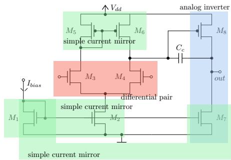  
Figure 1: Example for recognized structural blocks.

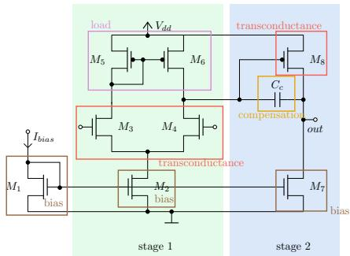  
Figure 2: Example for recognized functional blocks.

## 2.2 Testbenches

The testbenches were written for the Ngspice simulator and include the DUT, i.e. the specific circuit we want to optimize and testbench circuitry for performance measure extraction of low-frequency gain, transit frequency, power, phase margin, slew rate, ICMR, $\mathrm { V _ { o u t } }$ range, PSRR, CMRR, $\mathrm { V _ { o f f s e t } }$ . They further include code to calculate those performances from the simulation data inside Ngspice’s .control interpreter. The testbench includes a trimmed SKY130 library in order to reduce loading time, which is crucial for a fast simulation. Please note that the testbench generation focused on exploration of the performance space as well as execution speed. This is good for benchmarking machine learning tasks, but for concrete analog design the testbench should be optimized towards robustness instead. As a result, the dataset might contain points that are not good choices for an actual analog design, e.g. extreme points of the Pareto set or unwanted behavior in the time domain that was not caught in the short transient simulation.

## 2.3 Sizing data

The sizing data was created using the software AIDA [27], which provides an NSGA-II optimizer that interacts with Ngspice for simulation-based multi-objective optimization. For each circuit, the optimizer was run for 1000 generations with a population of 1024. The optimization goals and the performance constraints applied during optimization are listed in Table 2; performance constraints were set loosely to avoid hindering exploration, which sometimes results in design-irrelevant solutions in the dataset. In addition to the performance constraints, the optimization enforced symmetry constraints (using the per-netlist symmetry information shipped with the dataset) and structural sizing constraints following the sizing-rules method of [12].

## 3 Proposed Benchmarks and Measurements

To allow for consistent and meaningful comparison between diferent implementations, a set of benchmarks and performance indicators for each task enabled by the dataset is presented here.

## 3.1 Circuit Generation

With more than 100 topologies, including universally accepted designs such as the Miller and the folded cascode opamp, the LOAD-Bench topology dataset T represents a set of canonical structures that a general-purpose opamp generator should be able to produce. We evaluate generators as a structural plausibility check: does the generator output topologies that match these canonical designs? To remain applicable across generators that may target diferent PDKs or use simplified device models, the benchmark depends only on the structural representation of the netlist.

Match definition. Two netlists are a structural match if there exists a bijection between their device sets that preserves device class (NMOS, PMOS, R, $\mathrm { C } , \ldots )$ and net connectivity, with terminal types preserved at each connection (gate, source, drain, bulk; drain and source treated as interchangeable for MOSFETs) and external ports preserved by role. Each reference netlist exposes a ground reference, a single supply rail, a bias-current input, a diferential input pair, and a single-ended output, and the bijection must map each role to its counterpart in the candidate netlist. A Python reference implementation of this check is shipped alongside the dataset.

Conventions. The reference netlists use a single supply rail and ground, and include a complete bias network. Generators that use diferent supply or bias conventions can fall back to subgraph isomorphism: the submitter strips bias from their own outputs and checks whether the result is a subgraph of any reference in T, using the structural partitioning shipped with each reference to confirm that all amplification stages are present in the match. Such choices should be reported alongside the result.

Scope and metric. The benchmark applies in two modes: generation from scratch, where the generator is run with no input and its outputs are matched against $\mathcal { T } _ { \mathrm { ~ ; ~ } }$ , and topology extension, where the generator is given a starting netlist $T _ { 0 } \in \mathcal { T }$ and its derivative outputs are matched against ${ \mathcal { T } } \backslash \{ T _ { 0 } \}$ , testing incremental design moves such as adding a stage or introducing cascoding. Define the metric Coverage: the number of distinct dataset topologies generated at least once, optionally normalized by $| \mathcal T |$ (or by $| \mathcal { T } | - 1$ in extension mode). Generation time and hardware should be reported as diagnostic context. In addition to coverage as described here, we recommend reporting the diversity of the generated set by an approximate isomorphism check to discover duplicates.

## 3.2 Topology Selection

Topology selection is an early and highly influential design decision in the analog IC design flow. Identifying suitable topologies before detailed sizing can substantially reduce the design search space and improve the eficiency of automated design flows. Therefore, a topology-selection benchmark should evaluate whether a method can retrieve circuit topologies that are capable of satisfying a given target specification.

Topology selection can be formulated as a ranking problem: given a target performance vector, the goal is to identify the circuit topologies whose sizing solutions contain at least one point that Pareto-dominates, or satisfies, the target specification. A method can therefore be evaluated by ranking all candidate topologies according to their predicted suitability and checking whether feasible topologies appear near the top of the ranking.

For each target performance vector, all candidate topologies are ranked according to the score produced by the evaluated method. A topology is considered a successful hit if at least one sizing solution in its Pareto-optimal set satisfies the target specification, taking into account the optimization direction of each performance metric. Hence, we propose top-1 and top-3 accuracy as primary metrics, which measure how often the first-ranked topology, or one of the three highest-ranked topologies, contains a sizing solution that achieves or exceeds the target performance vector.

In addition to top-� accuracy, we propose the mean first-hit rank (MFHR), which measures the average position of the first feasible topology in the ranked list. For a query $q ,$ let $r _ { q }$ denote the rank of the highest-ranked topology that contains at least one sizing solution satisfying the target specification. The metric is defined as

$$
\mathrm { M F H R } = { \frac { 1 } { | Q | } } \sum _ { q \in Q } r _ { q } ,\tag{1}
$$

where $\boldsymbol { Q }$ is the set of target performance queries. Lower values indicate better retrieval performance, with an ideal value of 1.

## 3.3 Sub-Circuit Classification

The dataset ships per-netlist annotations from the ACST classifier (Sec. 2.1): structural blocks (current-mirror types, diferential-pair $\mathrm { t y p e s , \ . . . ) }$ and functional blocks (stages, bias, transconductance, load). The benchmark evaluates whether a model can recover these annotations from the netlist alone: given a netlist, predict the set of structural and functional blocks present (multi-label). Evaluation uses a cross-circuit hold-out in which 10% of the circuits are held out entirely, testing generalization to unseen topologies. Metrics are macro-averaged accuracy, precision, recall, and F1.

## 3.4 Optimization

For each circuit, the dataset records every sizing simulated by NSGA-II during POF construction (population 1024, 1000 generations, $\mathrm { i . e . } \sim 1 0 ^ { 6 }$ simulations per circuit), together with the resulting POF. This makes NSGA-II a natural reference for benchmarking other multi-objective optimizers on the same circuits, testbench, and PDK.

A candidate optimizer is run with the same budget as the reference dataset, using the same objectives, the performance constraints listed in Table 2, and the symmetry and sizing-rule constraints shipped with each netlist (see Sec. 2.3). It is compared to NSGA-II by the hypervolume ratio $\mathrm { H V _ { o p t } / H V _ { N S G A - I I } }$ . Both hypervolumes are computed in the full 12-dimensional objective space against a fixed reference point chosen at the design-relevant worst on each axis (physical limit or constraint bound, listed in the “HV ref.” column of Table 2). Exact 12D HV is intractable at this dimension, so we use the Bringmann–Friedrich FPRAS (pygmo’s bf\_fpras, [5]) with approximation parameters $\varepsilon = 0 . 0 1 , \delta = 0 . 0 1$ , and a fixed random seed; a Python script applying this configuration is shipped alongside the dataset. A ratio of1 matches NSGA-II, above 1 exceeds it. Submissions with limited compute may use a smaller budget � instead: the dataset includes all intermediate POFs produced by NSGA-II, allowing a fair like-for-like comparison.

## 3.5 Pareto Membership Prediction

For each circuit, the dataset contains $\sim 1 0 ^ { 3 }$ Pareto-optimal sizingperformance pairs together with $1 0 ^ { 6 }$ dominated (intermediate) sizings produced during the NSGA-II run. This pairing supports a binary classification task: given a circuit topology and a candidate sizing �, predict whether � lies on the recorded POF. A reliable predictor can support optimizers by identifying sizings unlikely to be Pareto-optimal or be used in conjunction with inverse sizing as described in Sec. 3.6. Evaluation uses a per-circuit 80/10/10 random split of all sizings (POF and intermediate together), measuring how well a model trained on a dense sample of a circuit’s design space recovers the POF on held-out sizings of the same circuit.

Metrics. $\mathrm { W i t h } \sim 1 0 ^ { 3 }$ positives and $1 0 ^ { 6 }$ negatives per circuit, the positive prior is below $1 0 ^ { - 3 }$ and accuracy is uninformative (a constantzero predictor exceeds 99.9%). Therefore we chose ROC-AUC as the metric, which is threshold- and imbalance-insensitive; F1 at a tuned threshold is reported as a secondary number.

## 3.6 Inverse Sizing

Sizing assigns numerical values to a circuit’s design parameters (transistor widths and lengths, capacitor and resistor values, bias currents) so that simulation yields a target performance. It is the inverse of simulation: simulation maps sizings to performances, sizing maps a desired performance back to a sizing that produces it. This benchmark targets methods that learn this map directly, $\mathrm { e . g . }$ , a neural network that emits a sizing in a single forward pass at inference time, rather than iterative optimizers that search the parameter space through repeated simulator calls.

We split the task into two subtasks: (i) projecting the usersupplied specification onto the circuit’s Pareto-optimal front (POF), and (ii) mapping the resulting Pareto-optimal performance back to a sizing. Subtask (i) admits simple solutions in practice, polynomial fitting over the Pareto points works well [26]. Subtask (ii) is more complicated, since POFs tend to exhibit richer structure in parameter space than in performance space, and is the focus of this benchmark (Fig. 3).

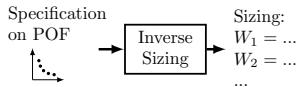  
Figure 3: Benchmarked inverse sizing task.

To evaluate the sizing ability of diferent methods, we choose 15 diferent opamps to be part of the inverse sizing benchmark. These include five 1-stage, five 2-stage and five 3-stage opamps. An evalua tion of more topologies might make the benchmark unattractive for methods that take a longer time to train, like difusion models. Each opamp has around 1024 optimal sizing solutions which are split into training and test in $\mathrm { ~ a ~ } 9 0 \% - 1 0 \%$ split. An approach should be trained on each opamp training set and then target the test set solutions belonging to the POF of each opamp of the benchmark and use the following measures to accurately evaluate their implementation:

• The number of infeasible predicted sizing solutions (infinite val ues, NaNs, etc.);

• Mean absolute percentage error (MAPE) per performance;

• Standard deviation of MAPE per performance;

• Percentage of outliers that fail to satisfy a single specification by 30% or more;

• Spec-satisfaction rate: the fraction of test samples whose predicted performance satisfies the queried target, with the direction taken from the “Preferred” column of Table 2;

$R ^ { 2 }$ score;

• A Figure of Merit (FoM) aggregating prediction quality and simulation cost,

$$
\mathrm { F o M } ~ = ~ \frac { \frac { 1 } { M } \sum _ { m = 1 } ^ { M } \operatorname* { m a x } ( 0 , 1 0 0 - \mathrm { M A P E } _ { m } ) } { \left( 1 + n _ { \mathrm { e x t r a } } / N _ { \mathrm { r e f } } \right) \left( 1 + o \right) } ,\tag{2}
$$

where ${ \mathrm { M A P E } } _ { m }$ is the per-metric MAPE in percent (clipped per metric so a single runaway metric cannot dominate the score); $o \in \left[ 0 , 2 \right]$ sums the outlier and infeasibility fractions; $n _ { \mathrm { e x t r a } } \ge 0$ is the number of simulator calls beyond the provided dataset; and $N _ { \mathrm { r e f } } = 1 0 2 4 \cdot 1 0 0 0$ is the NSGA-II budget per POF (population 1024, 1000 generations). The cost factor $\left( 1 + n _ { \mathrm { e x t r a } } / N _ { \mathrm { r e f } } \right)$ is floored at 1, so using fewer simulations than provided gives no bonus, and replacing the provided POF with simulations from a diferent optimizer is out of scope. Under this convention $\mathrm { F o M } \in \left[ 0 , 1 0 0 \right]$ with 100 attained only by a perfect prediction without extra simulations;

• Training time and hardware used;

• In the case of generative models, the diversity of sampled solutions can be used as well.

To support readability, the per-spec metrics are to be reported as a pooled version for the set of 1-, 2-, and 3-stages.

## 4 Evaluation and Reference Implementation for Two Benchmark Tasks

## 4.1 Topology Retrieval Example

Following the topology-selection benchmark introduced in Sec. 3.2, we evaluate whether a learned embedding model can rank circuit topologies from incomplete performance specifications. This setting targets early-stage analog design, where only a few requirements, such as gain or bandwidth, may be fixed, while the remaining performance objectives are still open. To represent such partial specifications, the metric encoder receives the normalized perfor mance vector together with a binary activity mask. Inactive metric entries are set to zero, and the mask indicates which dimensions are actually part of the query. During training, we randomly mask metric dimensions so that the model is exposed to both complete and partial specifications.

We train a CLIP-style dual encoder [38] that maps topology graphs and Pareto-optimal performance vectors into a shared embedding space. The topology tower is a 3-layer GCN with 128 hidden channels, batch normalization, ReLU activations, dropout, global mean pooling, and a 2-layer projection head to a 64-dimensional L2-normalized embedding. The metric tower is an MLP that takes the metric vector concatenated with its activity mask and produces an embedding of the same dimension. The model is optimized with a symmetric contrastive loss, where Pareto-optimal performance vectors are treated as positives for their corresponding topology.

For evaluation, each Pareto-optimal sizing is used as a query. Candidate topologies are ranked by cosine similarity between the query embedding and the topology embeddings. A retrieval is counted as correct if at least one Pareto-optimal sizing of the retrieved topology satisfies all active query metrics, respecting whether each metric is maximized or minimized. Importantly, each query is evaluated against only the topologies belonging to the same split, i.e., for the test split, both the query sizing and the candidate topologies are unseen during training. Hence, the evaluation reflects generalization to genuinely unknown circuits. We also report an analytic random baseline under the same satisfaction criterion: for each query, we count the number of satisfying topologies and compute the exact probability that a uniformly random top-� ranking contains at least one of them. This baseline is high for weak partial specifications, since many topologies can satisfy a single-metric target. For MFHR, we use the corresponding expected first-hit rank under a uniformly random ranking.

Table 3: Top-� topology selection accuracy and mean first-hit rank (MFHR) for diferent metric-query settings.
<table><tr><td rowspan="2">Method</td><td rowspan="2">Query metrics</td><td colspan="3">Train</td><td colspan="3">Validation</td><td colspan="3">Test</td></tr><tr><td>Top-1</td><td>Top-3</td><td>MFHR</td><td>Top-1</td><td>Top-3</td><td>MFHR</td><td>Top-1</td><td>Top-3</td><td>MFHR</td></tr><tr><td>Random baseline</td><td>DC gain only</td><td>80.4%</td><td>95.4%</td><td>2.07</td><td>81.5%</td><td>94.3%</td><td>1.42</td><td>75.5%</td><td>92.5%</td><td>1.61</td></tr><tr><td></td><td>DC gain + Ft</td><td>53.2%</td><td>82.6%</td><td>3.62</td><td>57.3%</td><td>84.8%</td><td>2.18</td><td>56.3%</td><td>81.9%</td><td>2.43</td></tr><tr><td></td><td>All active metrics</td><td>3.2%</td><td>8.5%</td><td>43.80</td><td>8.0%</td><td>23.6%</td><td>7.22</td><td>7.8%</td><td>22.9%</td><td>7.57</td></tr><tr><td>Learned embedding</td><td>DC gain only</td><td>86.4%</td><td>88.9%</td><td>1.37</td><td>92.1%</td><td>100.0%</td><td>1.08</td><td>91.9%</td><td>100.0%</td><td>1.14</td></tr><tr><td></td><td>DC  $\mathrm { g a i n + F _ { t } }$ </td><td>80.1%</td><td>94.9%</td><td>1.45</td><td>68.6%</td><td>99.0%</td><td>1.43</td><td>86.7%</td><td>92.6%</td><td>1.44</td></tr><tr><td></td><td>All active metrics</td><td>15.7%</td><td>35.0%</td><td>10.56</td><td>44.2%</td><td>74.9%</td><td>2.69</td><td>37.2%</td><td>78.0%</td><td>2.76</td></tr></table>

Table 3 reports top-� accuracy and MFHR for the learned embedding and the random baseline. For DC gain-only queries, the random baseline is already strong, but the learned embedding reaches 91.9% top-1 and 100.0% top-3 accuracy with an MFHR of 1.14 on the test split. Adding F makes the query more selective: the random top-1 baseline drops to 56.3% with MFHR 2.43, while the learned embedding achieves 86.7% top-1 and 92.6% top-3 accuracy with MFHR 1.44. Retrieval using all active metrics is substantially harder. In this setting, the learned embedding improves over the random baseline, reaching 37.2% top-1 and 78.0% top-3 test accuracy with MFHR 2.76 compared to the baseline MFHR of 7.57, but the absolute performance indicates that exact multi-objective topology retrieval remains challenging and should be tackled in future work.

Additional UMAP visualizations of the learned topology–metric embedding space for the query settings are provided in Appendix C.

## 4.2 Inverse Sizing Example

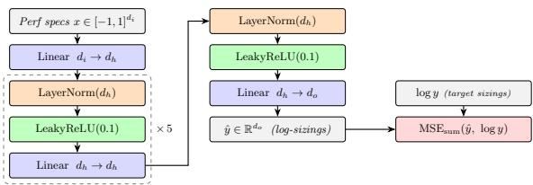  
Figure 4: FCNN and loss for inverse sizing example.

We evaluate a fully-connected neural network (FCNN) reference implementation of the inverse sizing benchmark (Sec. 3.6). The FCNN for a specific circuit topology takes the 12 performance measures that were used as goals for the genetic optimization from Table 2 (marked with a \*) as input and outputs the complete sizing.

The network architecture is depicted in Fig. 4. It uses the input dimension �� as the number of input performances, the hidden dimension $d _ { h } = 4 8 \times d _ { i }$ and the output dimension $d _ { o }$ as the num ber of individual sizing parameters. Performances are normalized to the interval [−1, 1]. Sizings are normalized as follows: Widths are scaled by lengths, $\frac { W _ { j } } { L _ { j } }$ , lengths are scaled to ��, capacitances are scaled to 10��. All sizings are transformed to the log-space using the natural logarithm. We use PyTorch’s NAdam optimizer with $\mathrm { l r } = 2 \cdot 1 0 ^ { - 3 }$ , weight\_decay $= 1 0 ^ { - 5 } , \mathrm { e p s } = 1 0 ^ { - 8 }$ . Gradients are clipped with max\_norm=1.0 after every backward propagation. We employ PyTorch’s ReduceLROnPlateau scheduler with mode=’min’, factor=0.5, patience=10, min $\underline { { \mathbf { l r } } } = 1 0 ^ { - 6 }$ . Early stopping with a window of 20 is used on the validation set. After the optimization stops, a second optimization is started with the LBFGS optimizer, lr=1, line\_search\_fn=’strong\_wolfe’, max\_iter=300, tolerance $\mathrm { g r a d } { = } 1 0 ^ { - 7 }$ tolerance\_ $\mathrm { c h a n g e } { = } 1 0 ^ { - 1 1 }$ , history\_size=20. No scheduler is used for this run, but early stopping is set to 3. The evaluation for the test set of one-stage opamps as described in Sec. 3.6 can be seen in Table 4. For the other two sets, please see Appendix B, Table 5. The aggregate FoM is 57.83, while it is 69.86, 69.80 and 27.81 for 1-, 2-, and 3-stage opamps respectively. Likewise, aggregate infeasible predictions are 2.73%, 8.82% and 61.88%. The average training time per circuit was 109 seconds, on a laptop equipped with an Intel i7-13700H CPU and an NVIDIA GeForce RTX 4060 Ti GPU.

Table 4: Pooled inverse-sizing results for one-stage opamps. Each row reports per-performance MAPE, APE standard deviation, outlier rate, spec-satisfaction rate, and �2.
<table><tr><td></td><td>MAPE (%)</td><td>Std. (%)</td><td>Outl. (%)</td><td>Spec. (%)</td><td>R2</td></tr><tr><td>DC Gain</td><td>1.90</td><td>5.61</td><td>0.20</td><td>46.48</td><td>0.94</td></tr><tr><td>Ft</td><td>13.42</td><td>26.78</td><td>3.32</td><td>49.80</td><td>0.98</td></tr><tr><td>Power</td><td>8.03</td><td>13.68</td><td>2.54</td><td>52.34</td><td>0.99</td></tr><tr><td>Phase Margin</td><td>5.36</td><td>15.82</td><td>1.56</td><td>53.12</td><td>0.04</td></tr><tr><td>SRneg</td><td>26.28</td><td>79.91</td><td>9.57</td><td>50.00</td><td>0.90</td></tr><tr><td>SRpos</td><td>22.55</td><td>50.23</td><td>4.10</td><td>55.02</td><td>0.96</td></tr><tr><td>Voffset</td><td>40.34</td><td>117.92</td><td>16.41</td><td>46.68</td><td>0.92</td></tr><tr><td>CMRR</td><td>6.04</td><td>11.73</td><td>0.78</td><td>51.76</td><td>0.76</td></tr><tr><td>PSRR</td><td>4.13</td><td>11.11</td><td>0.59</td><td>46.48</td><td>0.68</td></tr><tr><td>ICMRmin</td><td>5.84</td><td>10.93</td><td>1.56</td><td>49.80</td><td>0.88</td></tr><tr><td>ICMRmax</td><td>1.65</td><td>4.41</td><td>0.39</td><td>55.08</td><td>0.87</td></tr><tr><td>Vout,min</td><td>1.70</td><td>5.08</td><td>0.00</td><td>48.83</td><td>0.93</td></tr><tr><td>Vout,max</td><td>0.68</td><td>1.68</td><td>0.00</td><td>55.08</td><td>0.96</td></tr><tr><td>Area</td><td>6.08</td><td>7.17</td><td>0.39</td><td>63.09</td><td>0.96</td></tr></table>

## 5 Conclusion

We presented LOADBench, an open dataset [19], of more than 100 annotated opamp topologies in the SkyWater130 PDK, together with six standardized benchmark tasks. By releasing the data, groundtruth annotations, and reference metric implementations under an open license, we provide a common basis for directly comparable evaluation of machine-learning methods for analog IC design. We hope LOADBench lowers the entry barrier for new methods and enables reproducible progress on a problem that has long sufered from fragmented, closed evaluation.

## Acknowledgements

This research is funded by FCT – Fundação para a Ciência e a Tecnologia, I.P., through national funds and, when applicable cofunded European Union (EU) funds under the projects UIDB/50008/2025 (DOI 10.54499/UIDB/50008/2025) and ACTON (DOI 10.54499/2023.1 1981.PEX).

## References

[1] I. Abel and H. Graeb. 2022. FUBOCO: Structure Synthesis of Basic Op-Amps by FUnctiona BlOck COmposition. 27, 6, Article 63 (June 2022), 27 pages. doi:10.1145/3522738

[2] I. Abel, M. Neuner, and H. Graeb. 2022. A functional block decomposition method for automatic op-amp design. Integration 85 (2022), 108–120.

[3] F. Azevedo, M. Leibl, R. Martins, and H. Graeb. 2025. Inverse Analog IC Sizing and Exploration through Difusion Models and Structural Knowledge. In 2025 21st International Conference on Synthesis, Modeling, Analysis and Simulation Methods, and Applications to Circuits Design (SMACD). 1–4. doi:10.1109/SMACD65553.2025.11092111

[4] P.-O. Beaulieu, É. Dumesnil, F. Nabki, and M. Boukadoum. 2023. Analog RF Circuit Sizing by a Cascade of Shallow Neural Networks. IEEE Transactions on Computer-Aided Design of Integrated Circuits and Systems 42, 12 (2023), 4391–4401. doi:10.1109/TCAD.2023.3282570

[5] F. Biscani and D. Izzo. 2020. A parallel global multiobjective framework for optimization: pagmo. Journal ofOpen Source Software 5, 53 (2020), 2338. doi:10.21105/joss.02338

[6] A. F. Budak, M. Gandara, W. Shi, D. Z. Pan, N. Sun, and B. Liu. 2022. An Eficient Analog Circuit Sizing Method Based on Machine Learning Assisted Global Optimization. IEEE Transactions on Computer-Aided Design of Integrated Circuits and Systems 41, 5 (2022), 1209–1221. doi:10.1109/ TCAD.2021.3081405

[7] J. Costa, F. Azevedo, and R. Martins. 2025. A Comparative Study on the Incorporation of PVT Corner Conditions within Reinforcement Learning-based Analog IC Sizing Approaches. In 2025 21st International Conference on Synthesis, Modeling, Analysis and Simulation Methods, and Applications to Circuits Design (SMACD). 1–4. doi:10.1109/SMACD65553.2025.11092187

[8] F. P. de Azevedo, N. C. Correia Lourenço, and R. M. Ferreira Martins. 2025. Comprehensive application of denoising difusion probabilistic models towards the automation of analog integrated circuit sizing. Expert Syst. Appl. 290, C (Sept. 2025), 19 pages. doi:10.1016/j.eswa. 2025.128414

[9] J. Deng, W. Dong, R. Socher, L.-J. Li, K. Li, and L. Fei-Fei. 2009. ImageNet: A large-scale hierarchical image database. In 2009 IEEE Conference on Computer Vision and Pattern Recognition. 248-255. doi:10.1109/CVPR.2009.5206848

[10] Z. Dong, W. Cao, M. Zhang, D. Tao, Y. Chen, and X. Zhang. 2023. CktGNN: Circuit Graph Neural Network for Electronic Design Automation. In International Conference on Learning Representations (ICLR).

[11] X. Gao, C. Deng, M. Liu, Z. Zhang, D. Z. Pan, and Y. Lin. 2021. Layout Symmetry Annotation for Analog Circuits with Graph Neural Networks. In 2021 26th Asia and South Pacific Design Automation Conference (ASP-DAC). 152–157

[12] H. Graeb, S. Zizala, J. Eckmueller, and K. Antreich. 2001. The sizing rules method for analog integrated circuit design. In IEEE/ACM International Conference on Computer Aided Design. ICCAD 2001. IEEE/ACM Digest ofTechnical Papers (Cat. No.01CH37281). 343–349. doi:10.1109/ ICCAD.2001.96864

[13] Inga Abel. 2021. acst - Analog Circuit Synthesis Tool. https://github.com/inga000/acst

[14] K. Kunal, T. Dhar, M. Madhusudan, J. Poojary, A. Sharma, W. Xu, S. M. Burns, J. Hu, R. Harjani, and S. S. Sapatnekar. 2020. GANA: Graph Convolutional Network Based Automated Netlis Annotation for Analog Circuits. In 2020 Design, Automation & Test in Europe Conference & Exhibition (DATE). 55–60. doi:10.23919/DATE48585.2020.9116329

[15] K. Kunal, J. Poojary, T. Dhar, M. Madhusudan, R. Harjani, and S. S. Sapatnekar. 2020. A general approach for identifying hierarchical symmetry constraints for analog circuit layout. In 2020 IEEE/ACM International Conference On Computer Aided Design (ICCAD). 1–8.

[16] Y. Lai, S. Lee, G. Chen, S. Poddar, M. Hu, D. Z. Pan, and P. Luo. 2024. AnalogCoder: Analog Circuit Design via Training-Free Code Generation. arXiv:2405.14918 [cs.LG] https://arxiv.org abs/2405.14918

[17] S. Lee et al. [n. d.]. AnalogToBi: A Dataset of Analog Circuit Schematics. https://github.com/ Seungmin0825/AnalogToBi. MIT License.

[18] M. Leibl. [n. d.]. EDA-OpAmp-Database. https://github.com/markuslei/EDA-OpAmp-Database. Chair of Electronic Design Automation.

[19] M. Leibl, F. Azevedo, S. Uhlich, A. Bonetti, A. Venkitaraman, C.-Y. Hsieh, P. Pham, L. Servadei, H. Graeb, and R. Martins. 2026. LOADBench Dataset. https://zenodo.org/records/21759759 Full release under open license Creative Commons Attribution 4.0 International

[20] M. Leibl and H. Graeb. 2024. Optimizer-Free Sizing of OpAmps Leveraging Structural and Functional Properties. In 2024 20th International Conference on Synthesis, Modeling, Analysis and Simulation Methods and Applications to Circuit Design (SMACD). 1–4. doi:10.1109/SMACD61181. 2024.10745396

[21] J. Li, H. Zhi, R. Lyu, W. Li, Z. Bi, K. Zhu, Y. Zeng, W. Shan, C. Yan, F. Yang, Y. Li, and X. Zeng. 2024. AnalogGym: An Open and Practical Testing Suite for Analog Circuit Synthesis (Invited). In 2024 ACM/IEEE International Conference On Computer Aided Design (ICCAD). 1–9. doi:10.1145/3676536.3697117

[22] Y. Li, Y. Lin, M. Madhusudan, A. Sharma, W. Xu, S. S. Sapatnekar, R. Harjani, and J. Hu. 2020. A Customized Graph Neural Network Model for Guiding Analog IC Placement. In 2020 IEEE/ACM International Conference On Computer Aided Design (ICCAD). 1–9.

[23] Z. Li and A. Chan Carusone. 2024. An Open-Source AMS Circuit Optimization Framework Based on Reinforcement Learning—From Specifications to Layouts. IEEE Access 12 (2024), 150032–150045. doi:10.1109/ACCESS.2024.3478832

[24] T.-Y. Lin, M. Maire, S. Belongie, L. Bourdev, R. Girshick, J. Hays, P. Perona, D. Ramanan, C. L. Zitnick, and P. Dollár. 2015. Microsoft COCO: Common Objects in Context. arXiv:1405.0312 [cs.CV] https://arxiv.org/abs/1405.0312

[25] C. Liu, J. Li, Y. Feng, W. Huang, W. Chen, Y. Du, J. Yang, and L. Du. 2025. DifCkt: A Difusion Model-Based Hybrid Neural Network Framework for Automatic Transistor-Level Generation of Analog Circuits. In 2025 IEEE/ACM International Conference On Computer Aided Design

(ICCAD). 1–9. doi:10.1109/ICCAD66269.2025.11240784

[26] N. Lourenço, E. Afacan, R. Martins, F. Passos, A. Canelas, R. Póvoa, N. Horta, and G. Dundar. 2019. Using Polynomial Regression and Artificial Neural Networks for Reusable Analog IC Sizing. In 2019 16th International Conference on Synthesis, Modeling, Analysis and Simulation Methods and Applications to Circuit Design (SMACD). 13–16. doi:10.1109/SMACD.2019.8795282

[27] N. Lourenço, R. Martins, A. Canelas, R. Póvoa, and N. Horta. 2016. AIDA: Layout-aware analog circuit-level sizing with in-loop layout generation. Integration 55 (2016), 316–329. doi:10.1016/j.vlsi.2016.04.009

[28] N. Lourenço, J. Rosa, R. Martins, H. Aidos, A. Canelas, R. Póvoa, and N. Horta. 2018. On the Exploration of Promising Analog IC Designs via Artificial Neural Networks. In 2018 15th International Conference on Synthesis, Modeling, Analysis and Simulation Methods and Applications to Circuit Design (SMACD). 133–136. doi:10.1109/SMACD.2018.8434896

[29] R. Martins, N. Lourenço, and N. Horta. 2012. LAYGEN II: automatic analog ICs layout generator based on a template approach. In Proceedings ofthe 14th Annual Conference on Genetic and Evolutionary Computation (Philadelphia, Pennsylvania, USA) (GECCO ’12). Association for Computing Machinery, New York, NY, USA, 1127–1134. doi:10.1145/2330163.2330319

[30] R. Martins and N. Lourenço. 2024. An Eficient Performance-Driven Analog IC Placement Optimizer Via Extremely Randomized Tree-Based Post-Layout Performance Regressors. In 2024 IFIP/IEEE 32nd International Conference on Very Large Scale Integration (VLSI-SoC). 1–4. doi:10.1109/VLSI-SoC62099.2024.10869513

[31] L. McInnes, J. Healy, N. Saul, and L. Großberger. 2018. UMAP: Uniform Manifold Approximation and Projection. Journal ofOpen Source Software 3, 29 (2018).

[32] A. Mehradfar, X. Zhao, Y. Niu, S. Babakniya, M. Alesheikh, H. Aghasi, and S. Avestimehr. 2024. AICircuit: A Multi-Level Dataset and Benchmark for AI-Driven Analog Integrated Circuit Design. arXiv:2407.18272 [cs.AR] https://arxiv.org/abs/2407.18272

[33] A. Mehradfar, X. Zhao, Y. Niu, S. Babakniya, M. Alesheikh, H. Aghasi, and S. Avestimehr. 2025. Supervised Learning for Analog and RF Circuit Design: Benchmarks and Comparative Insights. arXiv:2501.11839 [cs.LG] https://arxiv.org/abs/2501.11839

[34] D. Mueller-Gritschneder, H. Graeb, and U. Schlichtmann. 2009. A Successive Approach to Compute the Bounded Pareto Front of Practical Multiobjective Optimization Problems. SIAM Journal on Optimization 20, 2 (2009), 915–934. arXiv:https://doi.org/10.1137/080729013 doi:10. 1137/080729013

[35] A. Nguyen and C.-N. J. Liu. 2025. An LLM-assisted Analog IC Design Tool with Automatic Topology Selection and Circuit Sizing. In 2025 21st International Conference on Synthesis, Modeling, Analysis and Simulation Methods, and Applications to Circuits Design (SMACD). 1–4. doi:10.1109/SMACD65553.2025.11091899

[36] L. Phan, A. Gatti, Z. Han, N. Li, J. Hu, H. Zhang, C. B. C. Zhang, M. Shaaban, J. Ling, S. Shi, et al. 2025. Humanity’s last exam. arXiv preprint arXiv:2501.14249 (2025).

[37] S. Poddar, A. Budak, L. Zhao, C.-H. Hsu, S. Maji, K. Zhu, Y.Jia, and D. Z. Pan. 2024. A Data-Driven Analog Circuit Synthesizer with Automatic Topology Selection and Sizing. In 2024 Design, Automation & Test in Europe Conference & Exhibition (DATE). 1–6. doi:10.23919/DATE58400. 2024.10546840

[38] A. Radford, J. W. Kim, C. Hallacy, A. Ramesh, G. Goh, S. Agarwal, G. Sastry, A. Askell, P. Mishkin, J. Clark, G. Krueger, and I. Sutskever. 2021. Learning Transferable Visual Models From Natural Language Supervision. In Proceedings ofthe 38th International Conference on Machine Learning. 8748–8763

[39] Y. Shi, Z. Zhang, H. Wang, Z. Tao, Z. Li, B. Chen, Y. Wang, Z. Huang, X. Liu, Q. Chen, Z. Yu, T.-J. Lin, and L. He. 2025. AMSbench: A Comprehensive Benchmark for Evaluating MLLM Capabilities in AMS Circuits. arXiv:2505.24138 [cs.LG] https://arxiv.org/abs/2505.24138

[40] H. Taşkıran, E. Sağlıcan, and E. Afacan. 2025. Multi-Objective Optimization of Analog Circuits Using Reinforcement Learning. In 2025 21st International Conference on Synthesis, Modeling, Analysis and Simulation Methods, and Applications to Circuits Design (SMACD). 1–4. doi:10. 1109/SMACD65553.2025.11092100

[41] S. Uhlich, A. Bonetti, A. Venkitaraman, C.-Y. Hsieh, Y. Gençer, M. E. Gürsoy, R. Matsuo, and L. Servadei. 2025. SPICEMixer-Netlist-Level Circuit Evolution. arXiv preprint arXiv:2506.01497 (2025).

[42] S. Uhlich, A. Bonetti, A. Venkitaraman, A. Momeni, R. Matsuo, C.-Y. Hsieh, E. Ohbuchi, and L. Servadei. 2024. GraCo–A Graph Composer for Integrated Circuits. arXiv preprint arXiv:2411.13890 (2024).

[43] P. Vaz, A. Gusmão, N. Horta, N. Lourenço, and R. Martins. 2022. Speeding-Up Complex RF IC Sizing Optimizations with a Process, Voltage and Temperature Corner Performance Estimator based on ANNs. In 2022 IEEE International Symposium on Circuits and Systems (ISCAS). 1570– 1574. doi:10.1109/ISCAS48785.2022.9937911

[44] P. Vijayaraghavan, L. Shi, E. Degan, and X. Zhang. 2024. CircuitSynth: Leveraging Large Language Models for Circuit Topology Synthesis. In 2024 IEEE LLM Aided Design Workshop (LAD). 1–6. doi:10.1109/LAD62341.2024.10691716

[45] H. Vogt and Ngspice Contributors. 2023. ngspice, Version 42. Sourceforge. https://sourceforge. net/projects/ngspice/ Open-source mixed-level/mixed-signal circuit simulator.

[46] Q. Xu, L. Wang, J. Wang, L. Cheng, S. Chen, and Y. Kang. 2024. Graph Attention-Based Symmetry Constraint Extraction for Analog Circuits. IEEE Transactions on Circuits and Systems I: Regular Papers 71, 8 (2024), 3754–3763. doi:10.1109/TCSI.2024.3391187

[47] G. İslamoğlu, T. O. Çakici, E. Afacan, and G. Dündar. 2019. Artificial Neural Network Assisted Analog IC Sizing Tool. In 2019 16th International Conference on Synthesis, Modeling, Analysis and Simulation Methods and Applications to Circuit Design (SMACD). 9–12. doi:10.1109/SMACD. 2019.8795293

## A Example Topologies and Pareto Fronts

As examples of the netlists in the dataset, Fig. 5 shows two opamps and two 3D projections of the POF of the folded-cascode topology.

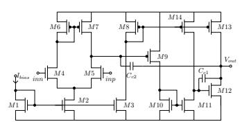  
(a) 3-stage opamp with nested Miller compensation.

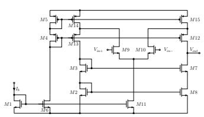  
(b) Folded-cascode opamp.

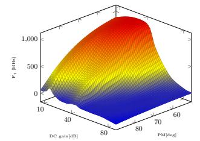  
(c) Projection onto the (phase margin, DC gain, Ft) subspace.

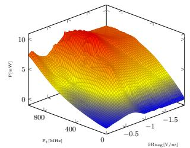  
(d) Projection onto the $( \mathbf { F _ { t } } ,$ negative slew rate, power) subspace.  
Figure 5: Two example opamp topologies from the dataset and interpolated 3D projections of the POF of opamp 5b.

## B Complete Data for Inverse Sizing Example

The pooled metrics for the 2-stage and 3-stage opamps are shown in Tables $5 ( \mathrm { a } )$ and 5(b).

Table 5: Pooled inverse-sizing results. Metrics and performances as in table 4.
<table><tr><td>Gain</td><td colspan="10">(a) 2-stage opamps</td><td colspan="10">(b) 3-stage opamps</td><td colspan="5"></td></tr><tr><td></td><td></td><td>Ft</td><td>P PM</td><td>SR_</td><td>SR+</td><td> $\mathrm { V _ { o f f } }$ </td><td></td><td>CMRR PSRR ICMR_</td><td></td><td>ICMR+</td><td>Vo+  $\mathrm { V _ { 0 ^ { - } } }$ </td><td>Area</td><td>Gain</td><td>Ft</td><td>P</td><td>PM</td><td>SR_</td><td>SR+</td><td> $\mathrm { V _ { o f f } }$ </td><td>CMRR PSRR</td><td></td><td>ICMR_</td><td>ICMR+</td><td>V0+</td><td> $\mathrm { V } _ { 0 ^ { - } }$ </td><td>Area</td></tr><tr><td>MAPE (%)</td><td>3.68</td><td>10.26 6.00</td><td>6.36</td><td>22.25</td><td>14.04</td><td>40.15</td><td>6.00</td><td>8.74</td><td>5.99</td><td>6.14</td><td>4.36 0.99</td><td>3.47</td><td>51.68</td><td>96.33</td><td>10.92</td><td>74.32</td><td>37.82</td><td>37.51 169.96</td><td></td><td>21.85</td><td>71.29</td><td>17.69</td><td>22.87</td><td>81.43</td><td>12.19</td><td>4.35</td></tr><tr><td>Std. (%)</td><td>9.24</td><td>40.57</td><td>10.59 52.49</td><td>88.0851.28</td><td></td><td>138.44</td><td>12.45</td><td>14.37</td><td>10.09</td><td>17.65</td><td>17.31</td><td>1.96 4.72</td><td>133.73</td><td></td><td>3242.4935.88</td><td>146.36</td><td></td><td>134.45 87.91</td><td>341.48</td><td>58.21</td><td>189.67</td><td>26.65</td><td>32.98</td><td>150.27</td><td>22.73</td><td>4.61</td></tr><tr><td>Outl. (%)</td><td>0.78</td><td>3.14</td><td>1.57 0.59</td><td>5.88</td><td>4.12</td><td>10.39</td><td>1.18</td><td>2.35</td><td>1.76</td><td>4.12</td><td>0.78 0.20</td><td>0.20</td><td>12.75</td><td>9.41</td><td>2.16</td><td>29.41</td><td>4.51</td><td>8.63</td><td>26.86</td><td>11.18</td><td>12.75</td><td>2.35</td><td>28.43</td><td>12.35</td><td>7.25</td><td>0.39</td></tr><tr><td>Spec.(%)</td><td></td><td>56.47 50.69</td><td>54.1242.8347.51</td><td></td><td>51.69</td><td>51.37</td><td>49.22</td><td>46.47</td><td>56.57</td><td>42.80</td><td></td><td>55.8044.99 51.37</td><td>44.71</td><td>60.00</td><td>43.73</td><td>23.92</td><td>48.22</td><td>32.99</td><td>48.04</td><td>43.14</td><td>47.65</td><td>72.11</td><td>34.50</td><td>71.97</td><td></td><td>60.24 46.86</td></tr><tr><td>R2</td><td>0.88</td><td>0.99</td><td>0.99 -2e3</td><td>0.99</td><td>0.99</td><td>-3.83</td><td>0.46</td><td>0.35</td><td>0.97</td><td>-0.31</td><td>0.94 0.98</td><td>0.98</td><td>-48.64</td><td>4-25.55</td><td>0.96</td><td>-114.70</td><td>0.83</td><td>0.50</td><td>-213e3</td><td>-18.09</td><td>-99.89</td><td>-0.62</td><td>-1.85</td><td>-3.38</td><td>-5.76 0.84</td><td></td></tr></table>

## C Embedding Visualization

To qualitatively inspect the learned topology-metric embedding space, we visualize the embeddings using UMAP [31] in Figs. 6 using the DC gain and $\mathrm { F _ { t } }$ asa query setting. Circuit topology embeddings are shown as circles, while metric embeddings are shown as crosses. For readability, we subsample the Pareto-optimal metric embeddings shown in the plots, using 5% of the available metric vectors per topology while keeping at least 50 samples whenever available. Colors indicate the topology family, and the three panels separate the train, validation, and test splits.

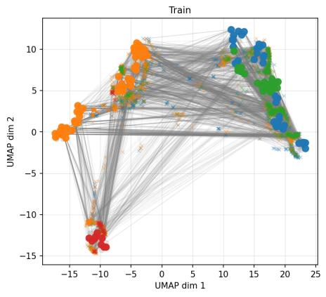

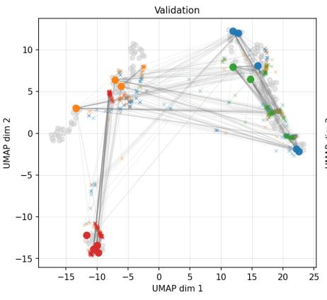

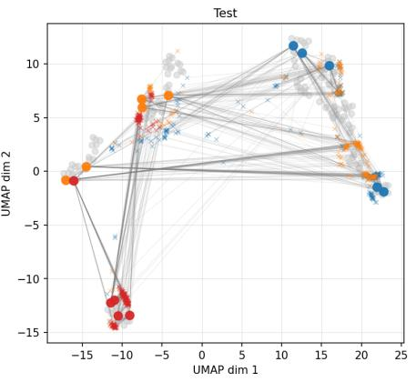  
Figure 6: UMAP visualization of the learned embedding space for queries using DC gain and $\mathbf { F _ { t } } .$

## D Artifact Appendix

## D.1 Abstract

The artifact contains more than 100 1-, 2-, and 3-stage operational amplifier (opamp) topologies in the open-source SkyWater130 PDK, each shipped with structural and functional annotations, topologyspecific sizing constraints (symmetry and sizing rules), an Ngspice testbench, and a multi-objective NSGA-II sizing run producing around 103 Pareto-optimal and 106 intermediate sizing-performance pairs per topology. Additionally, a GitHub repository containing Python scripts to help evaluate the proposed 6 benchmarks described in the paper is provided. Thus, the data presented here constitutes the most comprehensive dataset for ML development in over four decades of analog IC design automation. The dataset, ground-truth annotations, and reference implementations of the metric-defining routines are released under an open license, enabling reproducible and directly comparable evaluation across het erogeneous analog design automation methods.

## D.2 Artifact check-list (meta-information)

• Program: This is a Benchmark

• Compilation: Only Python + Python-libraries needed

• Model: User dependent choice, not part of the benchmark

• Data set: Together with the tasks and metrics, the datasets are the main part of the work. All datasets are included. Size > 100 GB

• Run-time state: Some Benchmark metrics are sensitive to the selection of the test set. To this end, test sets are already provided. They were selected randomly from the full dataset.

• Metrics: For all metrics suggested by the Benchmark, see paper. Code is provided for the evaluation of metrics that are not straight forward like precision or recall are.

• Output: Output of the Benchmark dataset is mostly the dataset itself, including simulation, etc. (See list in paper introduction). Out put expected for the metric evaluation depends on the benchmark. • Expected results and tolerances: Application specific.

• How much disk space required (approximately)?: 110 Gb

• How much time is needed to prepare workflow (approximately)?: Depending on the task, it can take a few minutes to roughly 20 minutes. The latter in the case that an Ngspice installa tion is needed for simulating results.

• Publicly available?: Yes

• Code licenses (if publicly available)?: CC BY 4.0

• Zenodo DOI for archived artifact: 10.5281/zenodo.21759759

## D.3 Description

D.3.1 How to access. The dataset can be accessed at https://zenodo. org/records/21759759 with Zenodo DOI 10.5281/zenodo.21759759. The GitHub repository that includes the evaluation scripts can be accessed in https://github.com/FilipeAz/LOADBench-Scripts. The compressed dataset has an approximate space of 40 Gb. Full dataset after decompression is approximately 110 Gb.

D.3.2 Software dependencies. An Ngspice testbench is included with each opamp. To be able to successfully run this testbench, we recommend the Ngspice version 44.2. Regarding the evaluation scripts, we recommend Python version 3.9 or higher. Then, depending on the benchmark, the following python libraries’ dependencies exist (other versions might also work, but they were not tested):

• Circuit Generation: networkx version 3.2.1;

• Topology Selection: pandas version 2.3.3;

• Optimization: numpy version 2.0.2, pandas version 2.3.3, pygmo version 2.19.5;

• Inverse Sizing: numpy version 2.0.2, pandas version 2.3.3, scikit-learn version 1.6.1.

• Simulation with NGSpice: See ngspice website: https://ngspice.sourceforge.io/download.html

D.3.3 Commercial software and PDK dependencies. The dataset uses the open-source SkyWater130 PDK and Ngspice simulator. However, since only a small amount of transistor’s models are used in the topologies of the dataset, a reduced SkyWater130 PDK is shipped alongside the dataset.

## D.4 Installation

As the dataset is quite large, depending on the goal of the user, download the applicable dataset files from the Zenodo link. For example, for the inverse sizing benchmark, only the reduced PDK folder and the TopologySelectionAndInverseSizingBenchmark. zip are needed.

For a smoke test of the testbench simulation, download the TopologySelectionAndInverseSizingBenchmark.zip and reduced\_ sky130\_combined.zip files. Unzip reduced\_sky130\_combined.zip into a folder named reduced\_sky130\_combined, and extract the opamps in TopologySelectionAndInverseSizingBenchmark.zip into the same parent directory, so both the opamp folders and the reduced PDK folder are at the same level. Then go into SimpleThreeStageOpAmp\_ SimpleOpAmp1\_1\_4/example\_run and run:

\$ cd example\_run

\$ ngspice CombinedTestBench.cir

\$ python3 standalone\_tb\_extract.py ./

Access the TB.extract to see the simulation results. The only requirements are a Ngspice installation and Python installation with the numpy library. Other opamps can be tested but keep in mind that the sizing values in the params.cir file are random and may lead to simulation errors.

## D.5 Evaluation and expected results

For the SimpleThreeStageOpAmp\_SimpleOpAmp1\_1\_4, the simulation results should be the following:

• P = 0.001447018559781998483688667529

• Vofset = 0.0007198916816605338553358706153

• icmr\_min = 0.4216533 and icmr\_max = 1.0113

• vout\_min = 0.957661 and vout\_max = 1.658198

• dc\_gain = 98.47120385038306

• ft = 7798252.781202488

• phaseMargin = 61.6774692653963

• CMRR = 63.336469023814175

• PSRR = 63.45675556689272

• SR\_pos = 32386929.446193527

• SR\_neg = -1078836455.3425071

• area = 7516.946499999999

## D.6 Experiment customization

The dataset is easy to use across many applications since all information is stored in standard XML and CSV files.