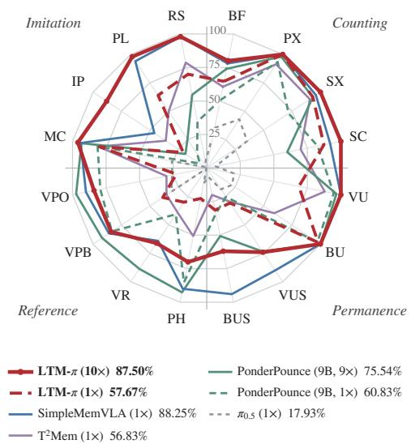
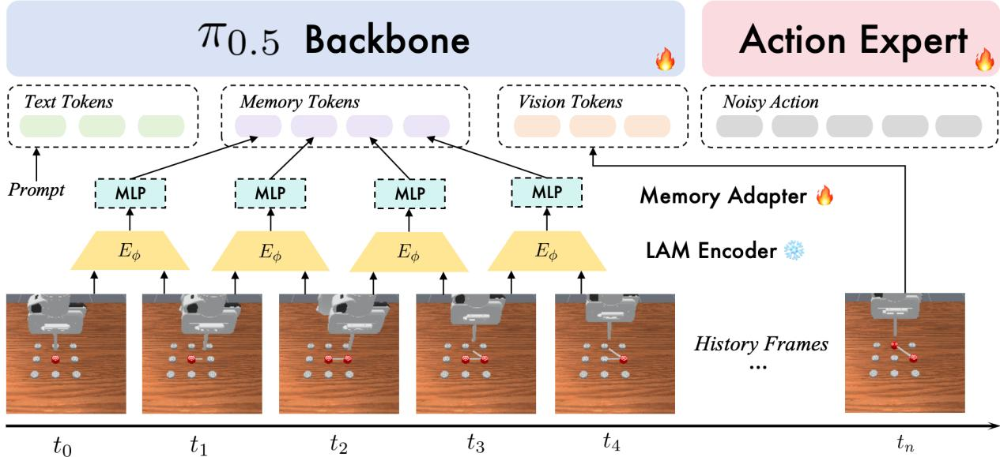
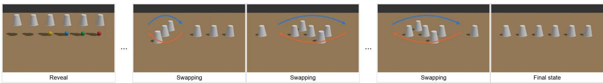
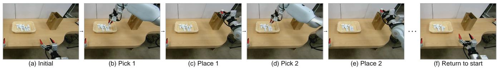

# LTM: Latent Transition Based In-Context Memory for Vision-Language-Action Models

Qixin Sun1,2 WenLong Gao2 Xiansheng Chen2

Zhongyuan Wang2 Si Liu1,∗ Pengwei Wang2,∗

1Beihang University 2BAAI

∗Corresponding authors

Robotic manipulation often requires remembering interactions that are no longer visible. We introduce Latent Transition Memory (LTM), which stores history as compact latent transitions between consecutive observations. Instantiated on � as LTM-�, our method uses a frozen latent action encoder, a lightweight adapter, and causal KV caching for incremental inference without memory-specific semantic annotations or external reasoning-model calls. With DreamDojo transitions, LTM-� achieves 58.54% success on RoboMME and 80.5% on LIBERO-Mem, performing best among baselines without external reasoning models or memory-specific annotations. Ablations support the contribution of transition content beyond temporal cues and the eficiency of delayed memory admission. Scaling RoboMME demonstrations tenfold improves success from 57.67% to 87.50%, while a Cup Swap diagnostic highlights the role of process supervision in temporal composition. Under a 200-token memory budget, success remains 84.00%, versus 87.50% without compression. Finally, real-robot counting success improves from 11.25% to 82.50%. Together, these results demonstrate the efectiveness, scalability, and eficiency of latent transition memory, highlighting its capacity for complex temporal information, boundedcontext operation, and real-world robotic control. Our dataset, training code, and inference code have been publicly released at: https://github.com/buaa-colalab/LTM-pi.

## 1 Introduction

Vision-language-action (VLA) models combine pretrained visual and linguistic representations with action generation to follow diverse manipulation instructions (Brohan et al., 2023; Kim et al., 2024; Black et al., 2024; Physical Intelligence et al., 2025). Yet the current observation may omit information needed for the next action. A robot placing three objects into a bag must remember completed transfers; one tracking an occluded object must retain the efects of earlier interactions. Similar scenes can therefore require diferent actions depending on the preceding history, motivating explicit memory for robotic control (Dai et al., 2026; Chung et al., 2026).

Existing memory designs retain visual observations, summarize experience in language, or update a recurrent state (Shi et al., 2025; Qu et al., 2026; Torne et al., 2026; Cherepanov et al., 2026). Dense visual histories consume substantial context, whereas sparse sampling can omit intermediate interactions. Language summaries abstract away visual detail but may miss fine-grained motion. Recurrent representations support compact updates but must continually decide what to preserve in a bounded state.

  
Figure 1. Success rates (%) on the 16 RoboMME tasks, grouped by track. The legend shows data scales and overall success rates; scores follow Tables 1 and 5.

These trade-ofs raise a representational question: what should a VLA remember about its past interactions? For many manipulation tasks, the relevant history is the sequence of changes induced by robot–environment interac tions. Latent action models encode an observation pair into a compact code from which the later observation can be reconstructed conditioned on the earlier one (Bruce et al., 2024; Ye et al., 2024). This objective encourages the code to capture temporal changes. While latent actions have been used for policy pretraining and world-model control (Ye et al., 2024; Bu et al., 2025; Gao et al., 2026a), we study their use as an ordered episodic memory for action generation. We introduce Latent Transition Memory (LTM), which encodes consecutive observations with a frozen latent action model and projects each code into one memory token. The policy receives a delayed transition prefix alongside the instruction and current observation. Each code depends only on an adjacent observation pair, allowing encoding to overlap action execution. We instantiate LTM on $\pi _ { 0 . 5 }$ as $\mathbf { L T M - } \pi$ , with a lightweight adapter and causal attention that permits persistent KV caching. Sparse initial-frame anchors provide visual grounding for video-conditioned tasks. The policy and adapter learn from robot demonstrations without memory-specific semantic annotations. At inference, the frozen encoder supplies transition codes directly to the policy, without an external reasoning model or intermediate language generation.

We evaluate LTM-� with two frozen latent encoders, CD-LAM and DreamDojo, on RoboMME and LIBERO-Mem With the original benchmark data, the DreamDojo variant reaches 58.54% average success on RoboMME, compared with 17.93% for the reported memory-free $\pi _ { 0 . 5 }$ baseline, and 80.5% on LIBERO-Mem, compared with 42.5% for the strongest baseline included in our comparison. We then isolate the efects of memory content and inference lag. Replacing observation-dependent latent transitions with fixed random representations reduces RoboMME success from 57.67% to 44.50%, supporting the contribution of transition-specific content beyond temporal-progress cues. Using a five-step lag reduces estimated latent-encoder blocking from 114.25 ms to 9.47 ms relative to zero lag, with a small change in success (57.88% to 57.67%).

We next test how LTM benefits from broader demonstration coverage. We expand RoboMME from 100 to 1,000 episodes per task family and increase training from 40K to 120K steps. With the same encoder and policy architecture, success rises from 57.67% to 87.50% (Figure 1). All four tracks improve; Reference, the weakest base-data track, gains 47.50 percentage points. Extending training to 120K steps on the original data alone yields no appreciable gain, supporting the benefit of broader demonstration coverage. LTM-� exceeds the reported PonderPounce result with 9× data by 11.96 points overall, under diferent data budgets and supervision assumptions.

Scaling does not fully resolve the challenge of composing local transitions into persistent object states: VideoUnmaskSwap and ButtonUnmaskSwap reach 74% and 62%, versus 100% for their non-swap counterparts. In a Cup Swap diagnostic, process supervision achieves 97.93% final-state recovery from latent transitions, compared with 2.40% under final-state-only supervision. These results demonstrate that latent transitions preserve recoverable multi-step interaction information and highlight the importance of intermediate supervision, motivating language-guided reasoning and process supervision to address remaining temporal-composition challenges.

To bound execution-memory growth, we merge the most similar adjacent projected tokens under the same quota during training and inference. On RoboMME-10x, a 200-token budget retains 84.00% success versus 87.50% uncompressed and reduces mean transition-token count by at least 38.26% on profiled training queries.

Finally, we evaluate $\mathrm { L T M } – \pi$ on a Galbot G1 robot in a real-world repeated pick-and-place counting task. LTM-� improves average success from 11.25% for the memory-free $\pi _ { 0 . 5 }$ baseline to 82.50%, demonstrating that transition memory also helps track completed interactions during physical manipulation.

## Our contributions are threefold:

∙ We propose Latent Transition Memory (LTM), a memory representation that uses compact latent transitions between consecutive observations as historical context instead of retaining the full visual history. This focuses memory on interaction-induced changes and enables the policy to use past experience without external reasoningmodel calls or memory-specific semantic annotations.

∙ We develop LTM-�, integrating transition memory into $\pi _ { 0 . 5 } ^ { } \mathrm { ' s }$ inference context through a lightweight adapter. Causal attention, persistent KV caching, and asynchronous transition encoding support eficient online control. Experiments on RoboMME and LIBERO-Mem demonstrate strong memory-dependent manipulation performance, with a measured policy inference time of 66.71 ms on an H100.

∙ We characterize transition-memory information, data scaling, and context-budget trade-ofs. Ablations distinguish transition content from temporal cues; tenfold RoboMME data expansion raises success from 57.67% to 87.50%; process-supervised Cup Swap decoding recovers final states with 97.93% accuracy; and a 200-token budget retains 84.00% success. Finally, real-robot counting experiments improve success from 11.25% to 82.50%.

## 2 Related Work

Vision-language-action models. VLA models transfer pretrained visual and linguistic representations to robotic control. RT-2 (Brohan et al., 2023) predicts tokenized actions, and OpenVLA (Kim et al., 2024) provides an open-source generalist policy. $\pi _ { 0 }$ (Black et al., 2024) introduces flow matching for continuous action generation; $\pi _ { 0 . 5 }$ (Physical Intelligence et al., 2025) and LingBot-VLA (Wu et al., 2026) extend generalization through heterogeneous co-training and multi-embodiment data. These advances do not remove partial observability: the appropriate action may depend on events absent from the current observation. RoboMME (Dai et al., 2026) and LIBERO-Mem (Chung et al., 2026) evaluate this need for execution memory.

Memory mechanisms for VLAs. RoboFlamingo (Li et al., 2023) models history through a sequential policy head; HAMLET (Koo et al., 2025) and �VLA (Cherepanov et al., 2026) use learned memory tokens. MemoryVLA (Shi et al., 2025) and LaMem-VLA (Qu et al., 2026) retrieve evidence from explicit memory banks. SAM2Act+ (Fang et al., 2025) extends a multi-view manipulation policy with a spatial memory bank, encoder, and memory attention. Object-centric approaches retain a diferent unit of history: SlotVLA (Hanyu et al., 2025) models object slots and their relations, while E-SlotSSM (Chung et al., 2026) studies the progression of object-centric memory states. GMP (Gao et al., 2026b) learns when to activate cross-attention over cached image and action tokens. RoboMME also compares symbolic, sampled-frame, and recurrent memories with several policy interfaces (Dai et al., 2026). LTM instead retains an ordered sequence of changes between observations, rather than appearance tokens or a recurrent summary of the episode. Temporal prediction also informs memory-based control: HiF-VLA (Lin et al., 2025) incorporates motion representations, MemoryVLA++ (Shi et al., 2026) combines retrieved history with imagined futures, and MemoryVAM (Jiang et al., 2026) injects compressed visual memory into both video prediction and action decoding. MEM (Torne et al., 2026) combines recent video with long-term textual memory, HiMe (Ji et al., 2026) separates working memory from long-term planning, and WeaveLA (Zhu et al., 2026) passes latent summaries of completed segments to subsequent subtasks. MemER (Sridhar et al., 2025) retrieves keyframes for a high-level vision-language model that generates instructions for a low-level policy. PonderPounce (Choi et al., 2026) uses a separate pretrained multimodal context model to asynchronously supply continuous cognition tokens to its action model. Its RoboMME training recipe includes transition, subgoal, and demonstration-reasoning supervision. In 2AM (Hu et al., 2026), an agent maintains episodic memory and guides an episodically stateless action model through subtask language and optional 2D spatial hints. These designs delegate historical interpretation to a higher-level model or interface. LTM instead exposes observed transitions directly to the action policy, without invoking a separate reasoning model or generating intermediate language during control.

SimpleMemVLA (Yin et al., 2026) retains timestamped video in its VLM’s native context and reuses the prefix cache through streaming prefill. Its action head receives representations of generated subtask text, with subtask annotations produced ofline by a cloud VLM. This is a training-time annotation dependency, rather than a requirement for cloud-model calls during control. T2Mem (Liu et al., 2026) places a fast-weight memory between the VLM and action expert and updates it through self-supervised test-time gradients. Like LTM, it learns from action demonstrations without an external reasoning model or memory-specific annotations. Our distinction is therefore the memory representation and update rule: LTM appends frozen pairwise transition codes to a persistent sequence, without test-time gradient updates. Its causal attention and delayed prefix support incremental inference while preserving access to the current observation.

Latent action models. LAMs infer compact transition codes from observation pairs, typically using reconstruction without action labels (Bruce et al., 2024; Ye et al., 2024). Genie (Bruce et al., 2024) uses discrete codes for controllable video generation, LAPA (Ye et al., 2024) uses them for policy pretraining, and CLAM (Liang et al., 2025) and UniVLA (Bu et al., 2025) extend latent actions to continuous and cross-embodiment control. DreamDojo (Gao et al., 2026a) uses latent actions for world-model pretraining; CD-LAM (Wei et al., 2026) reduces visual confounding in such codes. We use pretrained LAMs only to encode observed transitions into episodic memory; the deployed policy does not need to reconstruct past frames or generate future videos.

## 3 Method

  
Figure 2. LTM-� encodes consecutive observations with a frozen latent action model and maps each transition to a memory token. The trainable policy conditions on the instruction, transition history, and current observation. The schematic omits the fixed lag and the visual anchors used for video demonstrations.

## 3.1 Latent-Transition-Based In-Context Memory for VLAs

We represent interaction history using compact latent transitions between consecutive observations. A latent action model (LAM) encodes each transition from $o _ { i - 1 }$ to $o _ { i }$ into a latent code $z _ { i } ,$ from which a decoder reconstructs $o _ { i }$ conditioned on $o _ { i - 1 } { : }$

$$
\begin{array} { r } { z _ { i } = E _ { \phi } ( o _ { i - 1 } , o _ { i } ) , \qquad \hat { o } _ { i } = D _ { \psi } ( o _ { i - 1 } , z _ { i } ) , \qquad \mathcal { L } _ { \mathrm { L A M } } = d ( \hat { o } _ { i } , o _ { i } ) , } \end{array}
$$

where $E _ { \phi }$ and $D _ { \psi }$ are the transition encoder and decoder, respectively, and � is a reconstruction distance. Conditioning the decoder on the preceding observation encourages the compact latent bottleneck to capture temporal changes rather than redundant appearance information.

Two properties make these representations useful for VLA memory: (i) Compactness. Each transition is represented by a low-dimensional vector, reducing the context budget required to retain interaction history. (ii) Locality. Each code depends only on two consecutive observations, allowing incremental memory construction without re-encoding earlier frames.

Let $\mathbf { A } _ { t }$ denote an action chunk, $s _ { t }$ the robot state, and � the language instruction. A current-observation policy predicts $\mathbf { A } _ { t } \sim \pi _ { \theta } ( \cdot \mid o _ { t } , s _ { t } , \ell )$ . Existing memory mechanisms augment this policy in diferent ways: frame-based memory uses sampled observations, $\mathbf { A } _ { t } \sim \pi _ { \boldsymbol \theta } ( \cdot \mid o _ { t } , s _ { t } , \ell , \{ o _ { i } \} _ { i \in \boldsymbol { I } _ { t } } )$ , where $T _ { t } \subseteq \{ 0 , \ldots , t - 1 \}$ ; language-based memory uses a summary $m _ { t } ^ { \mathrm { l a n g } } = f _ { \mathrm { L L M } } ( o _ { < t } )$ , giving $\mathbf { A } _ { t } \sim \pi _ { \theta } ( \cdot \mid o _ { t } , s _ { t } , \ell , m _ { t } ^ { \mathrm { l a n g } } )$ ; and recurrent memory updates $h _ { t } = f _ { \mathrm { r e c } } ( h _ { t - 1 } , o _ { t } )$ , giving $\mathbf { A } _ { t } \sim \pi _ { \theta } ( \cdot \mid o _ { t } , s _ { t } , \ell , h _ { t } )$

Our approach instead conditions the policy on an ordered sequence of latent transitions:

$$
\mathcal { M } _ { t } ^ { \mathrm { L A M } } = ( z _ { i } ) _ { 1 \leq i \leq \tau _ { t } } , \qquad \mathbf { A } _ { t } \sim \pi _ { \theta } ( \cdot \mid o _ { t } , s _ { t } , \ell , \mathcal { M } _ { t } ^ { \mathrm { L A M } } ) .
$$

Here, $\tau _ { t } = \operatorname* { m a x } ( 0 , t - k )$ excludes the latest � transitions, while $o _ { t }$ remains the current visual input. This representation retains transition-level information without dense historical RGB tokens or recurrent compression; video-conditioned tasks additionally use the sparse anchors described below.

## 3.2 LTM-�

We instantiate this memory mechanism on $\pi _ { 0 . 5 }$ and refer to the resulting model as LTM-π. The policy and memory projector are trained on demonstration data using a frozen LAM encoder, without requiring language summaries or intermediate semantic supervision. The architecture of LTM-π is shown in Figure 2.

Training Phase. For each training sample, we use a fixed lag $k ,$ shared with inference, and set $\tau _ { t } = \operatorname* { m a x } ( 0 , t - k )$ Frozen DreamDojo (Gao et al., 2026a) or CD-LAM (Wei et al., 2026) encodes the retained observation pairs into 32-dimensional transition vectors:

$$
z _ { i } = E _ { \phi } ( o _ { i - 1 } , o _ { i } ) \in \mathbb { R } ^ { 3 2 } , \qquad \tilde { z } _ { i } = \mathrm { s t o p g r a d } \left( \frac { z _ { i } - \mu _ { D } } { \sigma _ { D } } \right) , \quad 1 \leq i \leq \tau _ { t } ,
$$

where $E _ { \phi }$ denotes the LAM encoder, and $\mu _ { D }$ and $\sigma _ { D }$ are dataset-level normalization statistics.

We use a lightweight memory adapter to align latent actions with the semantic space of the VLM. A two-layer MLP projector maps each normalized transition into a memory token in the 2048-dimensional hidden space of the PaliGemma-3B backbone of $\pi _ { 0 . 5 }$ :

$$
m _ { i } = \mathrm { L N } \big ( W _ { 2 } \mathrm { G E L U } ( W _ { 1 } \tilde { z } _ { i } + b _ { 1 } ) + b _ { 2 } \big ) , \qquad W _ { 1 } \in \mathbb { R } ^ { 5 1 2 \times 3 2 } , \quad W _ { 2 } \in \mathbb { R } ^ { 2 0 4 8 \times 5 1 2 } .
$$

We insert these tokens between the language and current visual tokens:

$$
X _ { t } = \left[ X ^ { \mathrm { l a n g } } ( \ell ) ; m _ { 1 } , \ldots , m _ { \tau _ { t } } ; X ^ { \mathrm { v i s } } ( o _ { t } ) \right] .
$$

The resulting context conditions the action expert. We apply causal attention within the language–memory prefix and allow the current visual tokens to attend to this prefix. Each prefix token therefore depends only on itself and preceding prefix tokens, enabling its KV representations to be reused when new memory tokens and visual inputs arrive.

Inference Phase. Algorithm 1 summarizes online inference. At decision step $t ,$ the policy consumes transitions only through $\tau _ { t } = \operatorname* { m a x } ( 0 , t - k )$ . Each transition is encoded once, asynchronously after its observation pair becomes available, and stored in a latent bufer; the lag delays only when it is admitted to policy memory. Thus, a transition has up to � observation steps of computation slack before it is required. At each decision, newly eligible latents are appended to the persistent language–memory KV cache, after which $o _ { t }$ is processed and an action chunk is generated. This overlaps LAM computation with action execution and reduces critical-path blocking.

For � cached prefix tokens and � newly processed memory and visual tokens, caching reduces the per-chunk backbone self-attention cost from $\mathcal { O } ( ( n + b ) ^ { 2 } )$ to $\mathcal { O } ( n b + b ^ { 2 } )$ . For fixed �, this cost is linear in the cached history length. In the append-only variant, the cache itself also grows linearly with the number of retained transitions. Section 4.1.6 evaluates an optional compression rule that bounds execution-memory length; merging existing tokens requires refreshing the afected cache entries.

Visual Anchors for Video Demonstrations. For tasks conditioned on video demonstrations, the initial scene layout may difer between the demonstration and execution environments. To improve visual–semantic alignment, we complement latent transitions with sparse visual features from both sequences, inspired by frame-based memory sampling. A minimal choice uses the first frame of each sequence as a visual anchor:

$$
X _ { t } = \big [ X ^ { \mathrm { l a n g } } ( \ell ) ; X ^ { \mathrm { v i s } } ( o _ { 0 } ^ { \mathrm { d e m o } } ) ; m _ { 1 } ^ { \mathrm { d e m o } } , \ldots , m _ { T _ { \mathrm { d e m o } } } ^ { \mathrm { d e m o } } ; X ^ { \mathrm { v i s } } ( o _ { 0 } ) ; m _ { 1 } , \ldots , m _ { \tau _ { t } } ; X ^ { \mathrm { v i s } } ( o _ { t } ) \big ] .
$$

Here, $o _ { 0 } ^ { \mathrm { d e m o } }$ and $o _ { 0 }$ are the initial demonstration and execution observations, respectively, and $m _ { i } ^ { \mathrm { { d e m o } } }$ encodes the transition from $o _ { i - 1 } ^ { \mathrm { d e m o } }$ to $o _ { i } ^ { \mathrm { { d e m o } } }$ . We add distinct learnable type embeddings to the demonstration and execution segments to distinguish their roles; these embeddings are omitted from the formula for clarity. The fixed visual anchors and demonstration tokens are retained in the persistent KV cache alongside the language and execution memory tokens.

Algorithm 1 Online Inference of LTM-�   
Require: Instruction $\ell ,$ frozen encoder $E _ { \mathrm { L A M } } ,$ projector $P ,$ policy $\pi _ { \theta } ,$ statistics $( \mu _ { D } , \sigma _ { D } ) ,$ lag $k ,$ replanning interval ℎ   
1: $\overline { { j } } , c \gets 0 ; C \gets \mathrm { P r e f i l l } ( X ^ { \mathrm { l a n g } } ( \ell ) )$   
2: Receive �0   
3: while task is not terminated do   
4: $t \gets j ; \tau _ { t } \gets \operatorname* { m a x } ( 0 , t - k ) ;$ receive state $s _ { t }$   
5: Wait only for unfinished $z _ { i }$ with $c < i \leq \tau _ { t }$   
6: for $i = c + 1 , \ldots , \tau _ { t }$ do   
7: $m _ { i }  P ( ( z _ { i } - \mu _ { D } ) / \sigma _ { D } ) ; c$ ← AppendKV(, ��); � ← �   
8: end for   
9: $\boldsymbol { C } _ { t } \gets \mathrm { A p p e n d K V } ( \boldsymbol { C } , X ^ { \mathrm { v i s } } ( o _ { t } ) )$   
10: $\mathbf { A } _ { t } \sim \pi _ { \theta } ( \cdot \mid C _ { t } , s _ { t } )$   
11: while executing the first ℎ actions of $\mathbf { A } _ { t }$ do   
12: Receive $o _ { j + 1 } ; j \gets j + 1$   
13: LaunchAsync $z _ { j } \gets E _ { \mathrm { L A M } } ( o _ { j - 1 } , o _ { j } )$ ⊳ store in latent bufer   
14: end while   
15: Discard temporary visual KV entries; retain    
16: end while   
The algorithm shows the execution-memory path without a video demonstration. For video-conditioned tasks, the   
fixed demonstration tokens and initial-frame anchors are included in the persistent prefix as described in the method.   
We use ℎ = 10 on RoboMME and ℎ = 5 on LIBERO-Mem; $s _ { t }$ is omitted on RoboMME.

## 4 Experiment

Our experiments examine the efectiveness, information content, and memory cost of LTM-�. In simulation (Section 4.1), we introduce the benchmarks and evaluation protocol (Section 4.1.1), report results on RoboMME and LIBERO-Mem (Section 4.1.2), and isolate the efects of memory components and lag (Section 4.1.3). We then examine demonstration scaling (Section 4.1.4), probe whether latent transitions encode swap information (Section 4.1.5), and test manipulation under a fixed token budget (Section 4.1.6). Finally, Section 4.2 presents the real-robot setup and repeated pick-and-place evaluation.

## 4.1 Evaluation in Simulation

## 4.1.1 Settings

Benchmarks. We evaluate memory-dependent robotic control on two complementary benchmarks, RoboMME (Dai et al., 2026) and LIBERO-Mem (Chung et al., 2026). RoboMME contains 16 history-dependent manipulation tasks organized into four suites: Counting, Permanence, Reference, and Imitation, targeting temporal, spatial, object, and procedural memory, respectively. These tasks require the policy to retain information from earlier observations or demonstrations that may no longer be recoverable from the current observation. LIBERO-Mem further evaluates long-horizon memory under object-level partial observability. It contains 10 tasks spanning four object-centric memory dimensions: Object Motion (OM), Object Sequence (OS), Object Relations (OR), and Object Occlusion (OO). The benchmark introduces temporally dependent subgoals and visually ambiguous objects, requiring the policy to track object identities, interactions, and state changes over trajectories of up to several hundred frames.

Training and Evaluation Configuration. We train the model on 8 H100 GPUs with a batch size of 128, using 40K steps on the original RoboMME data and 30K steps on LIBERO-Mem. The RoboMME-10x experiment uses 120K steps (Section 4.1.4). The learning rate decays from $2 . 5 \times 1 0 ^ { - 5 }$ to $2 . 5 \times 1 0 ^ { - 6 }$ , with 1K warm-up steps. Unless otherwise specified, we use a fixed lag � = 5 during training and inference. For the RoboMME data-scaling and token-compression experiments, we use � = 10. The policy predicts action chunks of 50 steps on RoboMME and 10 steps on LIBERO-Mem, and replans after executing the first 10 and 5 steps, respectively. We do not use proprioceptive inputs on RoboMME. Following the oficial evaluation protocols, we evaluate each task on 20 layouts in LIBERO-Mem and over 50 rollouts in RoboMME. For the base-data RoboMME results in Table 1, we evaluate with three random

seeds and report mean success rates. The Full and � = 5 rows in the ablation tables reproduce these reference scores;   
the remaining ablations use a single seed.

Baselines. For RoboMME, we compare against DP-Unet, OpenVLA-OFT, $\pi _ { 0 . 5 }$ with and without past actions, and its symbolic, perceptual, and recurrent memory variants (Dai et al., 2026). We also include MemoryVLA (Shi et al., 2025), SAM2Act+ (Fang et al., 2025), and MemER (Sridhar et al., 2025) as reported in RoboMME, alongside WeaveLA (Zhu et al., 2026), PonderPounce (9B) (Choi et al., 2026), SimpleMemVLA (Yin et al., 2026), and T2Mem (Liu et al., 2026). To make the resource assumptions explicit, Table 1 separates methods that use neither an external reasoning model nor memory-specific annotations from methods that use either resource. All baseline results are taken directly from published reports, with oracle-assisted methods and human performance listed separately for reference. Table 1 uses the original data scale; Table 5 additionally includes PonderPounce with 9× data. These comparisons retain the reported methods’ diferent training and supervision resources. For LIBERO-Mem, we compare against $\pi _ { 0 . 5 } ,$ SlotVLA (Hanyu et al., 2025), and Naive E-SlotSSM as reported by Chung et al. (2026), MemoryVLA (Shi et al., 2025), GMP (Gao et al., 2026b), MemoryVAM with UNet and DiT backbones (Jiang et al., 2026), and 2AM together with its $\pi _ { 0 }$ reimplementation (Hu et al., 2026).

## 4.1.2 Main Results

Table 1. Success rates (%, ↑) on all 16 RoboMME tasks. Deployable methods are divided into two blocks according to whether they avoid both external reasoning-model calls and memory-specific annotations. Within each block, bold and underline indicate the best and second-best results, respectively. Oracle and human references are excluded from ranking.
<table><tr><td rowspan=1 colspan=17>Method                       Counting                Permanence                Reference                Imitation       Avg.BF  PX  SX  SC  VU  BUVUSBUS  PH VR VPB VPO MC  IP PL  RS</td></tr><tr><td rowspan=1 colspan=17>Privileged-information and human references (not ranked)</td></tr><tr><td rowspan=1 colspan=17>SimpleSG+Oracle    85.7899.78100.00 44.67  33.11 22.0015.5615.5644.0027.7831.3326.0087.3310.0095.3355.11 49.58</td></tr><tr><td rowspan=1 colspan=6>GroundSG+Oracle    85.78100.00100.00 49.67 98.7895.00</td><td rowspan=1 colspan=11>99.2280.22 83.3397.33100.00100.0087.7815.5697.0055.5684.08</td></tr><tr><td rowspan=1 colspan=6>WeaveLA (oracle)    28.0034.00 50.00 12.00 24.0028.00</td><td rowspan=1 colspan=11>22.004.00 12.00 2.00 22.00 14.0016.002.00 8.0012.0018.12</td></tr><tr><td rowspan=1 colspan=17>Human              96.00100.00 80.00 78.00 90.0092.0092.0090.0092.0092.00 98.00 90.0090.0098.0084.0086.0090.50</td></tr><tr><td rowspan=1 colspan=17>External reasoning model and/or memory-specific annotations</td></tr><tr><td rowspan=1 colspan=17>SimpleSG+Gemini    46.0063.00 45.00 2.00 29.00 9.0014.002.0020.0015.00 26.00 29.0061.004.007.000.0023.25</td></tr><tr><td rowspan=1 colspan=3>SimpleSG+QwenVL  77.5695.33</td><td rowspan=1 colspan=3>5.11  0.44 34.2219.33</td><td rowspan=1 colspan=2>15.339.56</td><td rowspan=1 colspan=1>17.11</td><td rowspan=1 colspan=3>25.33 33.33 25.11</td><td rowspan=1 colspan=4>82.003.7812.677.78</td><td rowspan=1 colspan=1>29.00</td></tr><tr><td rowspan=1 colspan=3>GroundSG+Gemini   26.00 18.00</td><td rowspan=1 colspan=3>4.00 3.00 36.00 14.00</td><td rowspan=1 colspan=1>13.00</td><td rowspan=1 colspan=1>0.00</td><td rowspan=1 colspan=1>9.00</td><td rowspan=1 colspan=1>17.00</td><td rowspan=1 colspan=2>12.00 7.00</td><td rowspan=1 colspan=4>17.00 0.007.00 2.00</td><td rowspan=1 colspan=1>11.56</td></tr><tr><td rowspan=1 colspan=3>GroundSG+QwenVL 52.0092.67</td><td rowspan=1 colspan=3>7.33  0.00 88.67 24.00</td><td rowspan=1 colspan=1>30.67</td><td rowspan=1 colspan=1>14.00</td><td rowspan=1 colspan=1>15.11</td><td rowspan=1 colspan=1>25.33</td><td rowspan=1 colspan=2>54.00 31.78</td><td rowspan=1 colspan=4>71.563.336.676.00</td><td rowspan=1 colspan=1>32.70</td></tr><tr><td rowspan=1 colspan=3>MemER             56.6779.33</td><td rowspan=1 colspan=3>59.33  0.00 81.3372.00</td><td rowspan=1 colspan=1>38.00</td><td rowspan=1 colspan=1>21.33</td><td rowspan=1 colspan=1>70.67</td><td rowspan=1 colspan=1>25.33</td><td rowspan=1 colspan=2>30.00 26.00</td><td rowspan=1 colspan=4>82.67 6.6716.6712.00</td><td rowspan=1 colspan=1>42.38</td></tr><tr><td rowspan=1 colspan=3>WeaveLA            26.0044.00</td><td rowspan=1 colspan=3>46.00  2.00 28.0014.00</td><td rowspan=1 colspan=2>14.004.00</td><td rowspan=1 colspan=1>10.00</td><td rowspan=1 colspan=1>4.00</td><td rowspan=1 colspan=2>26.00 18.00</td><td rowspan=1 colspan=4>22.00 4.008.008.00</td><td rowspan=1 colspan=1>17.38</td></tr><tr><td rowspan=1 colspan=6>PonderPounce (9B)    50.6793.33 72.00 82.67 94.6797.33</td><td rowspan=1 colspan=2>25.3334.00</td><td rowspan=1 colspan=1>85.33</td><td rowspan=1 colspan=3>40.67 83.33 79.33</td><td rowspan=1 colspan=4>81.336.0012.6734.67</td><td rowspan=1 colspan=1>60.83</td></tr><tr><td rowspan=1 colspan=6>SimpleMemVLA     78.00100.00 96.00 92.00100.00100.00</td><td rowspan=1 colspan=10>90.0094.0090.0064.00 86.00 90.0094.0046.0094.0098.00</td><td rowspan=1 colspan=1>88.25</td></tr><tr><td rowspan=1 colspan=6>No external reasoning model; no memory-specific annotations</td><td rowspan=1 colspan=1></td><td rowspan=1 colspan=2></td><td rowspan=1 colspan=3></td><td rowspan=1 colspan=3></td><td rowspan=1 colspan=1></td><td rowspan=1 colspan=1></td></tr><tr><td rowspan=1 colspan=1>DP-Unet</td><td rowspan=1 colspan=1>32.00</td><td rowspan=1 colspan=1>2.67</td><td rowspan=1 colspan=1>6.67  0.00</td><td rowspan=1 colspan=1>16.00</td><td rowspan=1 colspan=1>4.00</td><td rowspan=1 colspan=1>4.00</td><td rowspan=1 colspan=1>0.00</td><td rowspan=1 colspan=1>0.00</td><td rowspan=1 colspan=1>0.00</td><td rowspan=1 colspan=1>22.00</td><td rowspan=1 colspan=1>5.67</td><td rowspan=1 colspan=1>8.67</td><td rowspan=1 colspan=2>0.002.00</td><td rowspan=1 colspan=1>10.00</td><td rowspan=1 colspan=1>7.11</td></tr><tr><td rowspan=1 colspan=1>OpenVLA-OFT</td><td rowspan=1 colspan=1>8.00</td><td rowspan=1 colspan=1>8.00</td><td rowspan=1 colspan=1>2.00 2.00</td><td rowspan=1 colspan=1>16.00</td><td rowspan=1 colspan=1>0.00</td><td rowspan=1 colspan=1>18.00</td><td rowspan=1 colspan=1>0.00</td><td rowspan=1 colspan=1>10.00</td><td rowspan=1 colspan=1>0.00</td><td rowspan=1 colspan=1>28.00</td><td rowspan=1 colspan=1>20.00</td><td rowspan=1 colspan=1>18.00</td><td rowspan=1 colspan=2>4.006.00</td><td rowspan=1 colspan=1>8.00</td><td rowspan=1 colspan=1>9.25</td></tr><tr><td rowspan=1 colspan=1>π0.5</td><td rowspan=1 colspan=1>30.00</td><td rowspan=1 colspan=1>42.89</td><td rowspan=1 colspan=1>35.56  6.67</td><td rowspan=1 colspan=1>20.44</td><td rowspan=1 colspan=1>22.22</td><td rowspan=1 colspan=1>18.67</td><td rowspan=1 colspan=1>6.67</td><td rowspan=1 colspan=1>11.33</td><td rowspan=1 colspan=1>0.44</td><td rowspan=1 colspan=1>31.11</td><td rowspan=1 colspan=1>25.78</td><td rowspan=1 colspan=1>26.00</td><td rowspan=1 colspan=2>1.562.89</td><td rowspan=1 colspan=1>4.67</td><td rowspan=1 colspan=1>17.93</td></tr><tr><td rowspan=1 colspan=1>π0.5 w/ past actions</td><td rowspan=1 colspan=1>26.67</td><td rowspan=1 colspan=1>58.33</td><td rowspan=1 colspan=1>26.67  4.67</td><td rowspan=1 colspan=1>30.67</td><td rowspan=1 colspan=1>23.67</td><td rowspan=1 colspan=1>20.67</td><td rowspan=1 colspan=1>16.00</td><td rowspan=1 colspan=1>12.33</td><td rowspan=1 colspan=1>8.67</td><td rowspan=1 colspan=1>24.00</td><td rowspan=1 colspan=1>18.67</td><td rowspan=1 colspan=1>34.00</td><td rowspan=1 colspan=2>1.004.00</td><td rowspan=1 colspan=1>5.67</td><td rowspan=1 colspan=1>19.73</td></tr><tr><td rowspan=1 colspan=1>TokenDrop+Context</td><td rowspan=1 colspan=1>48.67</td><td rowspan=1 colspan=1>85.11</td><td rowspan=1 colspan=1>94.67  3.11</td><td rowspan=1 colspan=2>33.7831.56</td><td rowspan=1 colspan=1>26.22</td><td rowspan=1 colspan=1>16.00</td><td rowspan=1 colspan=1>20.67</td><td rowspan=1 colspan=1>17.78</td><td rowspan=1 colspan=1>31.11</td><td rowspan=1 colspan=1>25.33</td><td rowspan=1 colspan=1>81.33</td><td rowspan=1 colspan=2>4.0012.67</td><td rowspan=1 colspan=1>20.00</td><td rowspan=1 colspan=1>34.50</td></tr><tr><td rowspan=1 colspan=1>TokenDrop+Modul</td><td rowspan=1 colspan=1>34.44</td><td rowspan=1 colspan=1>83.56</td><td rowspan=1 colspan=1>86.00  5.33</td><td rowspan=1 colspan=2>28.2229.33</td><td rowspan=1 colspan=1>28.44</td><td rowspan=1 colspan=1>21.33</td><td rowspan=1 colspan=1>21.33</td><td rowspan=1 colspan=2>22.00 59.56</td><td rowspan=1 colspan=1>36.00</td><td rowspan=1 colspan=1>62.00</td><td rowspan=1 colspan=2>7.1132.44</td><td rowspan=1 colspan=1>51.56</td><td rowspan=1 colspan=1>38.04</td></tr><tr><td rowspan=1 colspan=1>TokenDrop+Expert</td><td rowspan=1 colspan=1>54.22</td><td rowspan=1 colspan=1>87.56</td><td rowspan=1 colspan=1>91.78  4.22</td><td rowspan=1 colspan=2>26.6730.44</td><td rowspan=1 colspan=1>18.44</td><td rowspan=1 colspan=1>18.89</td><td rowspan=1 colspan=1>19.33</td><td rowspan=1 colspan=1>20.89</td><td rowspan=1 colspan=1>36.44</td><td rowspan=1 colspan=1>24.67</td><td rowspan=1 colspan=1>87.56</td><td rowspan=1 colspan=2>2.2216.22</td><td rowspan=1 colspan=1>18.22</td><td rowspan=1 colspan=1>34.86</td></tr><tr><td rowspan=1 colspan=1>FrameSamp+Context</td><td rowspan=1 colspan=1>41.22</td><td rowspan=1 colspan=1>72.00</td><td rowspan=1 colspan=1>73.67 13.67</td><td rowspan=1 colspan=1>26.89</td><td rowspan=1 colspan=1>30.22</td><td rowspan=1 colspan=1>20.89</td><td rowspan=1 colspan=1>15.22</td><td rowspan=1 colspan=1>17.67</td><td rowspan=1 colspan=1>15.22</td><td rowspan=1 colspan=1>30.00</td><td rowspan=1 colspan=1>20.89</td><td rowspan=1 colspan=1>77.22</td><td rowspan=1 colspan=2>1.2215.22</td><td rowspan=1 colspan=1>19.67</td><td rowspan=1 colspan=1>30.68</td></tr><tr><td rowspan=1 colspan=1>FrameSamp+Modul</td><td rowspan=1 colspan=1>39.56</td><td rowspan=1 colspan=1>87.33</td><td rowspan=1 colspan=1>92.00 42.00</td><td rowspan=1 colspan=1>32.67</td><td rowspan=1 colspan=1>25.11</td><td rowspan=1 colspan=1>24.44</td><td rowspan=1 colspan=1>18.22</td><td rowspan=1 colspan=1>22.89</td><td rowspan=1 colspan=1>30.44</td><td rowspan=1 colspan=1>60.00</td><td rowspan=1 colspan=1>32.00</td><td rowspan=1 colspan=1>77.78</td><td rowspan=1 colspan=2>7.5653.56</td><td rowspan=1 colspan=1>66.67</td><td rowspan=1 colspan=1>44.51</td></tr><tr><td rowspan=1 colspan=1>FrameSamp+Expert</td><td rowspan=1 colspan=1>57.33</td><td rowspan=1 colspan=1>86.22</td><td rowspan=1 colspan=1>94.67 28.89</td><td rowspan=1 colspan=1>31.78</td><td rowspan=1 colspan=1>25.78</td><td rowspan=1 colspan=1>22.89</td><td rowspan=1 colspan=1>20.22</td><td rowspan=1 colspan=1>19.11</td><td rowspan=1 colspan=1>23.11</td><td rowspan=1 colspan=1>30.00</td><td rowspan=1 colspan=1>24.22</td><td rowspan=1 colspan=1>83.11</td><td rowspan=1 colspan=2>2.0013.56</td><td rowspan=1 colspan=1>17.11</td><td rowspan=1 colspan=1>36.25</td></tr><tr><td rowspan=1 colspan=1>TTT+Context</td><td rowspan=1 colspan=1>35.56</td><td rowspan=1 colspan=1>62.89</td><td rowspan=1 colspan=1>42.44  3.33</td><td rowspan=1 colspan=1>29.78</td><td rowspan=1 colspan=1>22.89</td><td rowspan=1 colspan=1>18.44</td><td rowspan=1 colspan=1>14.44</td><td rowspan=1 colspan=1>20.44</td><td rowspan=1 colspan=1>13.11</td><td rowspan=1 colspan=1>34.22</td><td rowspan=1 colspan=1>20.22</td><td rowspan=1 colspan=1>32.44</td><td rowspan=1 colspan=2>1.11 1.56</td><td rowspan=1 colspan=1>3.56</td><td rowspan=1 colspan=1>22.28</td></tr><tr><td rowspan=1 colspan=1>TTT+Modul</td><td rowspan=1 colspan=1>34.22</td><td rowspan=1 colspan=1>65.11</td><td rowspan=1 colspan=1>36.67  2.11</td><td rowspan=1 colspan=1>27.22</td><td rowspan=1 colspan=1>22.11</td><td rowspan=1 colspan=1>25.22</td><td rowspan=1 colspan=2>14.11 14.56</td><td rowspan=1 colspan=1>12.11</td><td rowspan=1 colspan=1>32.67</td><td rowspan=1 colspan=1>22.33</td><td rowspan=1 colspan=1>31.22</td><td rowspan=1 colspan=2>1.113.56</td><td rowspan=1 colspan=1>7.00</td><td rowspan=1 colspan=1>21.96</td></tr><tr><td rowspan=1 colspan=1>TTT+Expert</td><td rowspan=1 colspan=1>34.89</td><td rowspan=1 colspan=1>63.78</td><td rowspan=1 colspan=1>41.33  4.00</td><td rowspan=1 colspan=1>31.78</td><td rowspan=1 colspan=1>22.44</td><td rowspan=1 colspan=1>19.56</td><td rowspan=1 colspan=1>18.00</td><td rowspan=1 colspan=1>12.22</td><td rowspan=1 colspan=1>9.56</td><td rowspan=1 colspan=1>34.00</td><td rowspan=1 colspan=1>22.89</td><td rowspan=1 colspan=1>33.56</td><td rowspan=1 colspan=2>0.893.11</td><td rowspan=1 colspan=1>5.56</td><td rowspan=1 colspan=1>22.35</td></tr><tr><td rowspan=1 colspan=1>RMT+Context</td><td rowspan=1 colspan=1>32.44</td><td rowspan=1 colspan=1>56.89</td><td rowspan=1 colspan=1>33.56 5.78</td><td rowspan=1 colspan=1>31.33</td><td rowspan=1 colspan=1>10.89</td><td rowspan=1 colspan=1>17.33</td><td rowspan=1 colspan=1>2.00</td><td rowspan=1 colspan=1>14.00</td><td rowspan=1 colspan=1>3.78</td><td rowspan=1 colspan=1>32.00</td><td rowspan=1 colspan=1>29.11</td><td rowspan=1 colspan=1>25.78</td><td rowspan=1 colspan=2>2.005.56</td><td rowspan=1 colspan=1>8.89</td><td rowspan=1 colspan=1>19.46</td></tr><tr><td rowspan=1 colspan=1>RMT+Modul</td><td rowspan=1 colspan=1>33.33</td><td rowspan=1 colspan=1>60.78</td><td rowspan=1 colspan=1>37.78 4.67</td><td rowspan=1 colspan=1>31.11</td><td rowspan=1 colspan=1>11.78</td><td rowspan=1 colspan=1>17.78</td><td rowspan=1 colspan=1>2.44</td><td rowspan=1 colspan=1>17.11</td><td rowspan=1 colspan=1>4.22</td><td rowspan=1 colspan=1>32.003</td><td rowspan=1 colspan=1>1.11</td><td rowspan=1 colspan=1>24.67</td><td rowspan=1 colspan=2>2.21 3.78</td><td rowspan=1 colspan=1>8.00</td><td rowspan=1 colspan=1>20.17</td></tr><tr><td rowspan=1 colspan=1>RMT+Expert</td><td rowspan=1 colspan=1>35.78</td><td rowspan=1 colspan=1>60.22</td><td rowspan=1 colspan=1>36.00 5.56</td><td rowspan=1 colspan=1>28.00</td><td rowspan=1 colspan=1>17.11</td><td rowspan=1 colspan=1>15.78</td><td rowspan=1 colspan=1>2.00</td><td rowspan=1 colspan=1>11.78</td><td rowspan=1 colspan=1>0.22</td><td rowspan=1 colspan=1>24.22</td><td rowspan=1 colspan=1>22.67</td><td rowspan=1 colspan=1>20.00</td><td rowspan=1 colspan=2>1.894.22</td><td rowspan=1 colspan=1>4.89</td><td rowspan=1 colspan=1>18.15</td></tr><tr><td rowspan=1 colspan=1>MemoryVLA</td><td rowspan=1 colspan=1>10.00</td><td rowspan=1 colspan=1>17.33</td><td rowspan=1 colspan=1>1.33 0.00</td><td rowspan=1 colspan=1>16.00</td><td rowspan=1 colspan=1>8.00</td><td rowspan=1 colspan=1>4.67</td><td rowspan=1 colspan=1>4.67</td><td rowspan=1 colspan=1>7.33</td><td rowspan=1 colspan=1>0.00</td><td rowspan=1 colspan=1>13.33</td><td rowspan=1 colspan=1>4.00</td><td rowspan=1 colspan=1>14.00</td><td rowspan=1 colspan=2>0.0012.00</td><td rowspan=1 colspan=1>1.33</td><td rowspan=1 colspan=1>7.12</td></tr><tr><td rowspan=1 colspan=1>SAM2Act+†</td><td rowspan=1 colspan=2>40.0076.00</td><td rowspan=1 colspan=1>25.33 0.00</td><td rowspan=1 colspan=2>27.3332.00</td><td rowspan=1 colspan=1>18.00</td><td rowspan=1 colspan=2>26.6717.33</td><td rowspan=1 colspan=1>5.33</td><td rowspan=1 colspan=1>24.67</td><td rowspan=1 colspan=2>20.0029.33</td><td rowspan=1 colspan=2>0.000.00</td><td rowspan=1 colspan=1>0.00</td><td rowspan=1 colspan=1>21.37</td></tr><tr><td rowspan=1 colspan=1>T2Mem</td><td rowspan=1 colspan=1>60.67</td><td rowspan=1 colspan=1>91.33</td><td rowspan=1 colspan=1>90.6770.00</td><td rowspan=1 colspan=2>88.0059.33</td><td rowspan=1 colspan=1>29.33</td><td rowspan=1 colspan=2>20.00 50.67</td><td rowspan=1 colspan=2>38.67 35.33</td><td rowspan=1 colspan=2>30.0080.67</td><td rowspan=1 colspan=1>36.00</td><td rowspan=1 colspan=1>50.00</td><td rowspan=1 colspan=1>78.67</td><td rowspan=1 colspan=1>56.83</td></tr><tr><td rowspan=1 colspan=1>LTM-π (CD-LAM)</td><td rowspan=1 colspan=1>64.67</td><td rowspan=1 colspan=1>100.00</td><td rowspan=1 colspan=3>93.3387.33 68.6798.00</td><td rowspan=1 colspan=1>30.67</td><td rowspan=1 colspan=2>31.3322.67</td><td rowspan=1 colspan=2>30.00 38.67</td><td rowspan=1 colspan=2>22.6780.00</td><td rowspan=1 colspan=1>20.67</td><td rowspan=1 colspan=1>64.00</td><td rowspan=1 colspan=1>70.00</td><td rowspan=1 colspan=1>57.67</td></tr><tr><td rowspan=1 colspan=2>LTM-π (DreamDojo) 66.00</td><td rowspan=1 colspan=1>99.33</td><td rowspan=1 colspan=3>96.00100.00 72.67 86.67</td><td rowspan=1 colspan=1>34.00</td><td rowspan=1 colspan=2>36.0038.67</td><td rowspan=1 colspan=4>42.67 38.00 30.6777.33</td><td rowspan=1 colspan=4>20.0060.0038.67 58.54</td></tr></table>

BF: BinFill; PX: PickXtimes; SX: SwingXtimes; SC: StopCube; VU/BU: Video/ButtonUnmask; VUS/BUS: Video/ButtonUnmaskSwap; PH: PickHighlight; VR: VideoRepick; VPB/VPO: VideoPlaceButton/Order; MC: MoveCube; IP: InsertPeg; PL: PatternLock; RS: RouteStick. †SAM2Act+ uses an external motion planner, but not an external reasoning model; its keyframe actions are control targets rather than memory-specific semantic annotations. An integrated VLM backbone is treated as part of a single policy, whereas a separate inference-time planner or reasoner is treated as an external reasoning model.

Results on RoboMME. As shown in Table 1, LTM-� achieves average success rates of 57.67% with CD-LAM and 58.54% with DreamDojo, improving over $\pi _ { 0 . 5 }$ by 39.74 and 40.61 percentage points, respectively. Within the block that uses neither external reasoning-model calls nor memory-specific annotations, the DreamDojo and CD-LAM variants rank first and second overall; DreamDojo exceeds the strongest baseline in this block, T2Mem (56.83%), by 1.71 percentage points. Both variants also outperform baselines, suggesting that compact transition representations provide an efective alternative to sampled-frame memory. The DreamDojo variant is particularly strong on Counting, achieving 90.33% on average and solving StopCube with 100% success. For context, SimpleMemVLA reaches 88.25% using cloud-VLM-generated sub-task annotations, while PonderPounce reaches 60.83% using a separate 9B context model and additional grounding and demonstration-reasoning supervision. LTM-� achieves its results without external reasoning-model calls or memory-specific annotations. Reference tasks remain a target for improving fine-grained object identity and visual correspondence. In terms of inference eficiency, the average latency of a LTM-� policy inference on an H100 is 66.71 ms. Figure 1 compares task-level success rates.

Table 2. Success rates (SR, %) on LIBERO-Mem. Bold indicates the best result in each column.
<table><tr><td>Method</td><td>TO</td><td>T1</td><td>T2</td><td>T3</td><td>T4</td><td>T5</td><td>T6</td><td>T7</td><td>T8</td><td>T9</td><td>Avg.</td></tr><tr><td>π0.5 (original)</td><td>0.0</td><td>0.0</td><td>0.0</td><td>0.0</td><td>0.0</td><td>0.0</td><td>0.0</td><td>0.0</td><td>0.0</td><td>0.0</td><td>0.0</td></tr><tr><td>SlotVLA (h = 8)</td><td>0.0</td><td>0.0</td><td>0.0</td><td>0.0</td><td>0.0</td><td>0.0</td><td>0.0</td><td>0.0</td><td>0.0</td><td>0.0</td><td>0.0</td></tr><tr><td>Naive E-SlotSSM (oracle)</td><td>0.0</td><td>0.0</td><td>0.0</td><td>0.0</td><td>0.0</td><td>0.0</td><td>0.0</td><td>0.0</td><td>0.0</td><td>0.0</td><td>0.0</td></tr><tr><td>MemoryVLA</td><td>55.0</td><td>0.0</td><td>35.0</td><td>0.0</td><td>5.0</td><td>0.0</td><td>0.0</td><td>0.0</td><td>0.0</td><td>0.0</td><td>9.5</td></tr><tr><td>GMP</td><td>85.0</td><td>45.0</td><td>20.0</td><td>5.0</td><td>40.0</td><td>0.0</td><td>0.0</td><td>0.0</td><td>0.0</td><td>0.0</td><td>19.5</td></tr><tr><td>MemoryVAM (Pathway 1 only)</td><td>85.0</td><td>40.0</td><td>35.0</td><td>10.0</td><td>15.0</td><td>0.0</td><td>5.0</td><td>0.0</td><td>30.0</td><td>65.0</td><td>28.5</td></tr><tr><td>MemoryVAM (Pathway 2 only)</td><td>45.0</td><td>10.0</td><td>5.0</td><td>0.0</td><td>5.0</td><td>5.0</td><td>0.0</td><td>0.0</td><td>5.0</td><td>0.0</td><td>7.5</td></tr><tr><td>MemoryVAM (UNet)</td><td>85.0</td><td>65.0</td><td>90.0</td><td>10.0</td><td>35.0</td><td>0.0</td><td>25.0</td><td>5.0</td><td>40.0</td><td>70.0</td><td>42.5</td></tr><tr><td>MemoryVAM (DiT)</td><td>75.0</td><td>65.0</td><td>65.0</td><td>15.0</td><td>55.0</td><td>35.0</td><td>10.0</td><td>10.0</td><td>25.0</td><td>50.0</td><td>40.5</td></tr><tr><td>π0(2AM reimplementation)†</td><td>30.83</td><td>13.33</td><td>14.17</td><td>21.67</td><td>11.67</td><td>10.00</td><td>6.67</td><td>8.33</td><td>0.00</td><td>5.83</td><td>12.25</td></tr><tr><td>2AM†</td><td>1.67</td><td>5.00</td><td>5.00</td><td>6.67</td><td>6.67</td><td>2.50</td><td>7.50</td><td>10.00</td><td>47.50</td><td>25.83</td><td>11.83</td></tr><tr><td>LTM-π (Ours)</td><td></td><td></td><td></td><td></td><td></td><td></td><td></td><td></td><td></td><td></td><td></td></tr><tr><td>CD-LAM</td><td>95.0</td><td>75.0</td><td>90.0</td><td>70.0</td><td>70.0</td><td>45.0 80.0</td><td></td><td>20.0</td><td>100.0</td><td>100.0</td><td>74.5</td></tr><tr><td>DreamDojo</td><td>95.0</td><td>75.0</td><td>100.0</td><td>90.0</td><td>90.0</td><td>65.065.0</td><td></td><td>25.0</td><td>100.0</td><td>100.0</td><td>80.5</td></tr></table>

T0: Bowl back on plate; T1: Bottle back on plate; T2: Bowl ×3; T3: Bottle ×3; T4: Bowl ×5; T5: Bowl ×7; T6: Swap 2 bowls; T7: Rotate 3 bowls; T8: Cheese + basket center; T9: Cheese + empty basket center.  
† Their �0 reimplementation uses Qwen3-VL-4B; the rollout count is unspecified in the cited report, so a matched evaluation budget cannot be established.

Results on LIBERO-Mem. As shown in Table 2, LTM-� achieves average success rates of 74.5% with CD-LAM and 80.5% with DreamDojo, exceeding the strongest baseline included in this comparison, MemoryVAM (UNet), by 32.0 and 38.0 percentage points, respectively. DreamDojo improves over CD-LAM by 6.0 points overall, with particularly large gains on repeated-interaction tasks T3–T5, while both variants achieve 100% success on T8 and T9. These results support the efectiveness of latent-transition memory for history-dependent manipulation across diferent LAM encoders. The encoder choice nevertheless afects individual tasks: CD-LAM performs better on swapping two bowls (T6), achieving 80.0% versus 65.0%. Rotating three bowls (T7) remains challenging for both variants (20.0% and 25.0%), suggesting that tracking multiple objects through sequential interactions remains a limitation.

## 4.1.3 Ablations

We first isolate the contributions of transition content and visual anchors, then test how delaying memory admission afects success and online computation.

Efect of Latent Transitions and Visual Anchors. In Table 3, we ablate the two sources of historical information in LTM-�: latent-transition memory and sparse visual anchors. We compare the full model with LT-only, which removes visual anchors; Anchor-only, which removes latent transitions; and Fixed Random LT, which replaces observation-dependent latent transitions with fixed random representations while preserving the temporal structure of the memory sequence.

Removing latent transitions reduces average success from 57.67% to 23.13%, while LT-only retains 49.13%, showing that the transition sequence is the stronger historical component and anchors mainly provide complementary visual grounding.

Table 3. Ablation study on the effect of latent transitions and visual anchors on RoboMME. Success rates (%, ↑) are reported on all 16 tasks. Fixed Random LT removes transition-specific semantics while retaining temporal information from the memory sequence.
<table><tr><td>Method</td><td colspan="4">Counting</td><td colspan="4">Permanence</td><td colspan="4">Reference</td><td colspan="4">Imitation</td><td>Avg.</td></tr><tr><td></td><td>BF</td><td>PX</td><td>SX</td><td>SC</td><td>VU</td><td>BU</td><td>VUS</td><td>BUS</td><td>PH</td><td>VR</td><td>VPB</td><td>VPO</td><td>MC</td><td>IP</td><td>PL</td><td>RS</td><td></td></tr><tr><td>Full</td><td>64.67</td><td>100.00</td><td>93.33</td><td>87.33</td><td>68.67</td><td>98.00</td><td>30.67</td><td>31.33</td><td>22.67</td><td>30.00</td><td>38.67</td><td>22.67</td><td>80.00</td><td>20.67</td><td>64.00</td><td>70.00</td><td>57.67</td></tr><tr><td>LT-only</td><td>66.00</td><td>100.00</td><td>94.00</td><td>90.00</td><td>24.00</td><td>44.00</td><td>30.00</td><td>16.00</td><td>26.00</td><td>30.00</td><td>40.00</td><td>36.00</td><td>90.00</td><td>14.00</td><td>46.00</td><td>40.00</td><td>49.13</td></tr><tr><td>Anchor-only</td><td>34.00</td><td>32.00</td><td>42.00</td><td>0.00</td><td>66.00</td><td>58.00</td><td>24.00</td><td>8.00</td><td>12.00</td><td>2.00</td><td>26.00</td><td>10.00</td><td>32.00</td><td>2.00</td><td>12.00</td><td>10.00</td><td>23.13</td></tr><tr><td>Fixed Random LT</td><td>72.00</td><td>74.00</td><td>98.00</td><td>58.00</td><td>82.00</td><td>94.00</td><td>30.00</td><td>38.00</td><td>18.00</td><td>26.00</td><td>26.00</td><td>20.00</td><td>60.00</td><td>2.00</td><td>10.00</td><td>4.00</td><td>44.50</td></tr></table>

Fixed Random LT still reaches 44.50%, indicating that the ordered memory sequence itself provides useful cues about elapsed time and trajectory progress. Replacing these random tokens with observation-dependent latent transitions further improves performance to 57.67%, demonstrating that transition-specific content contributes beyond temporal cues. This gain is limited on swap-dependent tasks, motivating the diagnostic study below.

Table 4. Ablation study on lag � on RoboMME. Success rates (%, ↑) are reported on all 16 tasks. Reported LAM blocking is an estimated critical-path cost, max(0, �LAM − � l ).
<table><tr><td rowspan="2">k</td><td colspan="3">Counting</td><td colspan="3">Permanence</td><td colspan="3"></td><td colspan="3">Reference</td><td colspan="3">Imitation</td><td rowspan="2"> $\operatorname { A v g } .$ </td><td colspan="3">Runtime (ms, ↓)</td></tr><tr><td>BF</td><td>PX</td><td>SX</td><td>SC</td><td>VU BU</td><td>VUS</td><td>BUS</td><td>PH</td><td>VR</td><td>VPB VPO</td><td>MC</td><td></td><td>IP PL</td><td>RS</td><td></td><td>Policy Sim.</td><td></td><td>LAM update LAM block</td></tr><tr><td>0</td><td>62.00</td><td>98.00 94.00</td><td>90.00</td><td>70.00</td><td>94.00</td><td>30.00</td><td>34.00</td><td>28.00</td><td>26.00 38.00</td><td>24.00</td><td>82.00</td><td>20.00</td><td>66.00</td><td>70.00</td><td>57.88</td><td>66.71</td><td>117.01</td><td>114.25 (10p, sync.)</td><td>114.25</td></tr><tr><td>5</td><td>64.67 100.00</td><td>93.33</td><td>87.33</td><td>68.67</td><td>98.00</td><td>30.67</td><td>31.33</td><td>22.67 30.00</td><td>38.67</td><td>22.67</td><td>80.00</td><td>20.67</td><td>64.00</td><td>70.00</td><td>57.67</td><td>66.71</td><td>117.01</td><td>67.97 (5p, async.)</td><td>9.47</td></tr><tr><td>10</td><td>58.00</td><td>98.00</td><td>90.00 86.00</td><td>68.00</td><td>96.00</td><td>28.00</td><td>32.00</td><td>20.00</td><td>30.00</td><td>36.00 24.00</td><td>76.00</td><td>24.00</td><td>64.00</td><td>72.00</td><td>56.38</td><td>66.71</td><td>117.01</td><td>114.25 (10p, async.)</td><td>0.00</td></tr></table>

Efect of Lag �. On RoboMME, we replan every 10 execution steps and use the same � for training and inference. As shown in Table 4, lag creates computation slack between observing a transition and admitting it to policy memory. Increasing � from 0 to 5 changes average success only from 57.88% to 57.67%, while reducing the estimated LAM blocking cost from 114.25 ms to 9.47 ms. At � = 10, the measured LAM update fits within the available execution overlap, giving an estimated zero blocking cost, with 56.38% success. These point estimates indicate that a small non-zero lag can reduce blocking with a small change in success. The 66.71 ms policy time excludes LAM work; the blocking column is an overlap estimate, not a measured end-to-end control latency.

## 4.1.4 Data Scaling on RoboMME

The ablations support the contribution of transition content beyond temporal cues. We next ask whether broader demonstration coverage helps the policy use this information across diverse task families. RoboMME provides 100 episodes per task family, each spanning multiple scenes and language instructions. Following the data-expansion setting explored by PonderPounce (Choi et al., 2026), we use RoboMME’s generation pipeline to increase this to 1,000 episodes per family, yielding RoboMME-10x. Training-generation seeds are kept disjoint from validation and test seeds. We increase training from 40K to 120K steps and use a fixed lag � = 10 during both training and inference. To assess whether longer training alone explains the improvement, we also train on the original data for 120K steps under the same configuration.

Table 5. Task-level data-scaling results on RoboMME (success rate, %, ↑). We report PonderPounce (9B) with 1 and 9 data and LTMwith 1× and 10× data. Gain ratio is the increase in average success rate divided by the additional data multiple relative to 1×, measured in percentage points per additional 1× data. The data, training, and supervision budgets differ between methods; gain ratio is descriptive, not a controlled estimate of sample efficiency.
<table><tr><td rowspan="3">Method</td><td rowspan="3">Data scale</td><td colspan="4">Counting</td><td colspan="4">Permanence</td><td colspan="4">Reference</td><td colspan="4">Imitation</td><td rowspan="2">Avg. Gain ratio (pp/×)</td></tr><tr><td>BF</td><td>PX</td><td>SX</td><td>SC</td><td>VU</td><td>BU</td><td>VUS</td><td>BUS</td><td>PH</td><td>VR</td><td>VPB VPO</td><td>MC</td><td>IP</td><td>PL</td><td>RS</td><td></td></tr><tr><td>PonderPounce (9B)</td><td>1×</td><td>50.67</td><td>93.33</td><td>72.00</td><td>82.67</td><td>94.67</td><td>97.33</td><td>25.33</td><td>34.00</td><td>85.33</td><td>40.67</td><td>83.33 79.33</td><td>81.33</td><td>6.00</td><td>12.67</td><td>34.67</td><td>60.83</td><td></td></tr><tr><td>PonderPounce (9B)</td><td>9x</td><td>74.00</td><td>98.00</td><td>93.33</td><td>60.00</td><td>96.67</td><td>100.00</td><td>73.33</td><td>50.67</td><td>92.67</td><td>88.67 92.00</td><td>97.33</td><td>93.33</td><td>18.67</td><td>25.33</td><td>54.67</td><td>75.54</td><td>1.84</td></tr><tr><td>LTM-π (ours)</td><td>1x</td><td>64.67</td><td>100.00</td><td>93.33</td><td>87.33</td><td>68.67</td><td>98.00</td><td>30.67</td><td>31.33</td><td>22.67 30.00</td><td>38.67</td><td>22.67</td><td>80.00</td><td>20.67</td><td>64.00</td><td>70.00</td><td>57.67</td><td></td></tr><tr><td>LTM-π (ours)</td><td>10×</td><td>80.00</td><td>100.00</td><td>100.00</td><td>100.00</td><td>100.00</td><td>100.00</td><td>74.00</td><td>62.00</td><td>70.00</td><td>66.00</td><td>84.00 84.00</td><td>96.00</td><td>88.00</td><td>98.00</td><td>98.00</td><td>87.50</td><td>3.31</td></tr></table>

Table 5 shows that LTM-� improves from 57.67% to 87.50%, a gain of 29.83 percentage points. Counting, Permanence, Reference, and Imitation rise from 86.33%, 57.17%, 28.50%, and 58.67% to 95%, 84%, 76%, and 95%, respectively.

Reference gains the most (+47.50 points), showing that the weakest base-data track benefits substantially from the expanded training set. The scaled model reaches at least 88% on every Imitation task and 100% on three of four Counting tasks. At the original 1× data scale, extending training from 40K to 120K steps yields no appreciable improvement. This control indicates that longer training alone does not account for the gain at 10× data, supporting the contribution of additional demonstrations.

For comparison, PonderPounce improves from 60.83% to 75.54% with 9× data (+14.71 points). At 10× data, LTM-� is 11.96 points higher overall, leading on 11 tasks and tying on ButtonUnmask; PonderPounce remains higher on the four Reference tasks. The descriptive gain ratios are 3.31 versus 1.84 percentage points per additional data multiple, respectively, under diferent training and supervision budgets. LTM-� also comes within 0.75 points of SimpleMemVLA’s reported 88.25%, without memory-specific annotations but using more demonstrations (Table 1). Despite the broad gains, VideoUnmaskSwap and ButtonUnmaskSwap reach only 74% and 62%, compared with 100% on both non-swap counterparts. Expanded demonstration coverage therefore reduces, but does not remove, the dificulty of tracking state through swaps. We therefore turn to a controlled diagnostic to test whether the required swap information can be recovered from the transition sequence (Section 4.1.5).

## 4.1.5 Diagnostic Study: Can Latent Transitions Represent “Swap”?

Problem. The scaling results show that broader demonstration coverage improves overall performance, yet swapdependent state tracking remains dificult. At 10× data, the non-swap Video/ButtonUnmask tasks reach 100%, while their swap counterparts reach 74% and 62% (Table 5). Our qualitative inspection also finds swap-related failures in VideoRepick. These results motivate a narrower question: is information needed to track swaps recoverable from the latent sequence under controlled conditions?

  
Input: There are 6 cups numbered 0 through 5. Initially, balls are under cups 2, 3, 4 and 5. The latent actions encode only motion after that reveal. <LT\_0><LT\_1><LT\_2> ... <LT\_N>  
(a) Vanilla supervision (final state only) Output: 0, 2, 3, 4

(b) Process supervision (CoT-like) Output: NO.1: [ SWAP(0, 2), CUP(0, 3, 4, 5) ] NO.2: [ SWAP(1, 5), CUP(0, 1, 3, 4) ] ... FINAL: CUP(1, 2, 3, 5)

Figure 3. Our Cup Swap diagnostic benchmark and two supervision methods. The arrows are for illustration only and are not included in the actual dataset. <LT\_i> denotes a latent transition; the illustration uses zero-indexed latent labels.

Cup Swap Test. To test recoverability separately from robotic control, we construct the Cup Swap diagnostic shown in Figure 3. Each sequence contains six cups and one to five hidden balls, followed by 5–20 randomly generated cup swaps. The initial ball locations are provided explicitly, while only the post-reveal motion history is represented by latent transitions. We inject these transitions into a Qwen3-VL-2B backbone and compare two supervision schemes: Vanilla, which directly predicts the final cup occupancy without intermediate supervision, and Process supervision (CoT-like), which explicitly supervises swap tracking and the resulting intermediate/final state. The initial state is supplied as text, and this diagnostic uses a separate latent-fusion architecture rather than the LTM-� policy. Details are provided in Appendix A.

As shown in Table 6, the process-supervised model recognizes individual swaps with 99.78% accuracy and recovers final states with 97.93% accuracy using a frozen VLM backbone, while the final-state-only model reaches 2.40% best exact accuracy. These results demonstrate that latent transitions contain recoverable multi-step swap information and that structured intermediate supervision enables accurate temporal-state recovery in the diagnostic. The final-state only model also has low training accuracy (approximately 12.5%; Appendix A), so optimization diferences may contribute to the observed gap. The findings motivate process-guided temporal reasoning in future transition-memory control policies.

Table 6. Diagnostic results (%) on the six-cup, multi-ball Cup Swap task. Final-state accuracy requires exact cup occupancy. The Vanilla value is its best reported checkpoint result; its final checkpoint reaches 1.75%.
<table><tr><td>Supervision</td><td>Individual Swap Acc. Final-state Acc.</td><td></td></tr><tr><td>Vanilla supervision (final state only)</td><td></td><td>2.40</td></tr><tr><td>Process supervision (CoT-like)</td><td>99.78</td><td>97.93</td></tr></table>

## 4.1.6 Token Compression: Can Transition Memory Remain Effective Under a Fixed Budget?

The diagnostic demonstrates that process-supervised decoding recovers multi-swap state from the latent-transition sequence. We now return to LTM-� control and ask whether a bounded context can retain enough information for efective manipulation. Although each transition occupies only one token, append-only execution memory still grows with episode duration. We evaluate DreamDojo-based LTM-� on RoboMME-10x with a quota of � = 200 executiontransition tokens and a fixed lag � = 10, using the same quota and compression rule during training and inference. The quota applies to execution transitions only; language, current visual inputs, and any fixed demonstration context are outside this count.

Online adjacent-token merging. Let $\mathcal { V } = \left( u _ { 1 } , \ldots , u _ { n } \right)$ denote the ordered list of retained tokens in the projector output space. When a new eligible transition token $m = P ( \tilde { z } )$ arrives, we append it to  . If the length exceeds �, we select the most similar adjacent pair and replace it with its arithmetic mean:

$$
j ^ { \ast } = \underset { 1 \leq j < n } { \arg \operatorname* { m a x } } \ \cos ( u _ { j } , u _ { j + 1 } ) , \quad \quad \bar { u } = \frac { u _ { j ^ { \ast } } + u _ { j ^ { \ast } + 1 } } { 2 } .
$$

Here, � is the length after appending, and cos is cosine similarity. The merged token occupies the earlier position and the later token is removed. We repeat this operation until the budget is satisfied (Algorithm 2). Restricting merges to adjacent tokens preserves the order of the remaining temporal segments, while similarity guides compression toward locally redundant representations. The rule operates after projection and before the policy backbone, without an additional learned compressor. During training, each eligible history prefix is constructed by replaying these updates in chronological order; inference applies the same updates as transitions become eligible under the lag.

Algorithm 2 Online Adjacent-Token Compression   
Require: Ordered projector-output tokens  with $| \mathcal { V } | \leq Q ,$ new projected token �, quota $Q \geq 1$   
1: V ← U |[m] ⊳ append in temporal order   
2: while $\vert \mathscr { V } \vert > Q$ do   
3: for � = 1, … , || − 1 do   
4: �� ← cos(��, ��+1)   
5: end for   
6: �∗ ← arg max� ��   
7: $u _ { j ^ { \star } }  ( u _ { j ^ { \star } } + u _ { j ^ { \star } + 1 } ) / 2$   
8: Delete $u _ { j ^ { \star } + 1 }$ from    
9: end while   
10: return 

Each update preserves a representative of every temporal segment instead of discarding the oldest tokens. However, the merge is lossy: it removes an event boundary and replaces two vectors with one. Repeated merges use equal weights for the two current representatives, without tracking their constituent transition counts, so the result is generally not the uniform mean of all original transitions in a segment. For a stream that is already within budget, appending one token triggers at most one merge; a direct scan costs (��) per update for projector dimension $d ,$ and retained projected-token storage is (��).

Token budget. We profile uncompressed execution memory at policy queries under the execution-only, fixed-� = 10 training convention. The mean is 323.93 transition tokens/query, the median is 265, and the P90/P95 values are 747/893; the maximum is 1,789. In total, 61.98% of queries exceed 200 tokens. After applying the rule, a prefix containing � eligible transitions has exactly min(� , �) retained tokens. Table 7 gives the resulting bounds for the same query population. The compressed mean is at most 200, implying a reduction of at least $1 - 2 0 0 / 3 2 3 . 9 3 = 3 8 . 2 6 \%$ in mean execution-memory length; its exact value requires the full count distribution.

Table 7. Execution-transition tokens per query (� = 10). Uncompressed values are measured; compressed counts follow min(�, 200). The compressed mean is an upper bound.
<table><tr><td>Statistic</td><td>Uncompressed</td><td>Compressed (Q = 200)</td></tr><tr><td>Mean</td><td>323.93</td><td>≤ 200</td></tr><tr><td>Median</td><td>265</td><td>200</td></tr><tr><td>P90</td><td>747</td><td>200</td></tr><tr><td>P95</td><td>893</td><td>200</td></tr><tr><td>Maximum</td><td>1,789</td><td>200</td></tr><tr><td>Queries &gt; 200 (%)</td><td>61.98</td><td>0.00</td></tr></table>

At the uncompressed P95 and maximum, the counts fall from 893 and 1,789 to 200, reductions of 77.60% and 88.82%, respectively. These are token-count reductions, rather than measured inference speedups.

Manipulation results. Table 8 compares the compressed model with the uncompressed RoboMME-10x reference from Table 5. Compression achieves 672 successes over 800 rollouts, or 84.00% average success, compared with 87.50% without compression. This is a decrease of 3.50 percentage points, retaining 96.00% of the reference success rate. Counting, Permanence, Reference, and Imitation average 91.50%, 80.00%, 74.00%, and 90.50%, respectively, versus 95.00%, 84.00%, 76.00%, and 95.00% without compression.

Table 8. DreamDojo-based LTM-� on RoboMME-10x with and without execution-token compression (success rate, %). The uncompressed row reproduces the 10× reference in Table 5; the compressed model uses � = 200 during training and inference and is evaluated over 50 rollouts per task. Δ is compressed minus uncompressed success in percentage points. Task abbreviations follow Table 1.
<table><tr><td>Memory</td><td colspan="4">Counting</td><td colspan="4">Permanence</td><td colspan="4">Reference</td><td colspan="4">Imitation</td><td>Avg.</td></tr><tr><td></td><td>BF</td><td>PX</td><td>SX</td><td>SC</td><td>VU</td><td>BU</td><td>VUS</td><td>BUS</td><td>PH</td><td>VR</td><td>VPB</td><td>VPO</td><td>MC</td><td>IP</td><td>PL</td><td>RS</td><td></td></tr><tr><td>Uncompressed</td><td>80.00</td><td>100.00</td><td>100.00</td><td>100.00</td><td>100.00</td><td>100.00</td><td>74.00</td><td>62.00</td><td>70.00</td><td>66.00</td><td>84.00</td><td>84.00</td><td>96.00</td><td>88.00</td><td>98.00</td><td>98.00</td><td>87.50</td></tr><tr><td>Compressed (Q = 200)</td><td>84.00</td><td>100.00</td><td>100.00</td><td>82.00</td><td>100.00</td><td>100.00</td><td>62.00</td><td>58.00</td><td>74.00</td><td>56.00</td><td>86.00</td><td>80.00</td><td>94.00</td><td>76.00</td><td>96.00</td><td>96.00</td><td>84.00</td></tr><tr><td>∆(pp)</td><td>+4.00</td><td>0.00</td><td>0.00</td><td>-18.00</td><td>0.00</td><td>0.00</td><td>-12.00</td><td>-4.00</td><td>+4.00</td><td>-10.00</td><td>+2.00</td><td>-4.00</td><td>-2.00</td><td>-12.00</td><td>-2.00</td><td>-2.00</td><td>-3.50</td></tr></table>

PickXtimes, SwingXtimes, VideoUnmask, and ButtonUnmask remain at 100%, indicating that a bounded context can support these tasks despite substantial compression. The largest decreases occur on StopCube (−18 points), VideoUnmaskSwap and InsertPeg (−12 each), and VideoRepick (−10). This pattern is consistent with sensitivity to precise temporal boundaries or interaction details that averaging may weaken. In particular, the two swap tasks decline while their non-swap counterparts remain saturated. Cosine similarity measures representation similarity, rather than task relevance, so a locally similar pair can still contain an important state change. BinFill and PickHighlight improve by 4 points and VideoPlaceButton by 2, although single-seed evaluation does not resolve these smaller diferences. Overall, a 200-token budget retains 96.00% of the uncompressed success rate. Together with the swap diagnostic, they motivate preserving informative event boundaries through event-aware merging or explicit segment-duration information.

Compatibility with KV caching. The fixed token budget bounds execution-memory length independently of episode duration, making persistent KV caching less critical for computational eficiency. Although merging modifies existing prefix tokens and invalidates subsequent cached entries under causal attention, the bounded context allows these entries to be recomputed at a limited cost. Therefore, our compression strategy prioritizes bounded memory and context length over KV-cache reuse, which remains an optional optimization rather than a necessity.

## 4.2 Real-World Evaluation

## 4.2.1 Settings

Platform. We use the Galbot G1 humanoid robot as the physical platform for real-world evaluation. During all experiments, only the two arms and grippers are actuated, while the remaining joints and body components are kept fixed.

  
Figure 4. Task and environment for real-world experiments.

Task and Data. We consider a pick-and-place � times task shown in Figure 4, where the robot is required to sequentially pick up � objects and place them into a packaging bag. We collect teleoperated demonstrations for $x \in \{ 1 , 2 , 3 , 4 \} .$ , with 50 trajectories for each setting, resulting in 200 trajectories in total. The dataset contains 222,834 frames recorded at 30 FPS, corresponding to 2.06 hours of real-world data

Implementation Details. We run inference on a single RTX 4090 GPU. The robot is controlled with a control interval of $\Delta t = 0 . 0 5 s$ per step. For real-world evaluation, we do not use anchor frames. A trial is considered successful only if the robot transfers exactly the instructed number of objects, returns to its initial pose, and remains stationary for at least 10 s.

## 4.2.2 Results

Table 9. Real-world success rate (%, ↑) for picking and placing � objects. Avg. is the unweighted mean across the four target quantities.
<table><tr><td>Method</td><td> $x = 1$ </td><td> $x = 2$ </td><td> $x = 3$ </td><td> $x = 4$ </td><td> $\operatorname { A v g } .$ </td></tr><tr><td>π0.5 (no memory)</td><td>5.0</td><td>20.0</td><td>20.0</td><td>0.0</td><td>11.25</td></tr><tr><td> $\operatorname { L T M - } \pi \ ( \mathrm { o u r s } )$ </td><td>95.0</td><td>90.0</td><td>70.0</td><td>75.0</td><td>82.50</td></tr></table>

Table 9 shows that LTM-� improves success rate across all four target quantities, achieving a success rate of 82.50% compared with 11.25% for the memory-free �0 5, a gain of 71.25 percentage points. Qualitatively, the memory-free policy tends to continue picking until approximately � objects remain in the source box, where � is the mean remaining-object count observed during data collection, suggesting reliance on a familiar scene configuration rather than tracking completed transfers. By retaining interaction history, LTM-� more reliably executes the requested number of transfers and stops accordingly. Per-trial transferred-object counts and a link to representative real-robot videos are provided in Appendix B.

Additional Findings. We also observe shorter motion-onset delays for LTM-� than for the memory-free policy in trials with long static segments at the start of demonstrations. This qualitative pattern is consistent with temporal progress cues from the memory sequence; onset latency was not measured separately.

## 5 Limitation

Our method relies on a pretrained latent action model (LAM) to provide transition representations, making memory quality dependent on the information preserved by the encoder. While latent transitions efectively capture local interaction dynamics, they may not adequately represent substantial changes in scene content, such as the appearance of new objects, where visual appearance and semantic information become important. Although sparse visual anchors provide complementary information, they may not fully address this limitation. A promising direction is to combine latent transition memory with visual memory, exploring how to efectively integrate dynamic changes and visual context for more robust long-horizon manipulation.

## 6 Conclusion

We introduced Latent Transition Memory, which retains observed interactions as an ordered sequence of compact transition tokens. LTM-� combines frozen latent action encoders with a lightweight adapter and cache-compatible causal attention, learning from action demonstrations without memory-specific semantic annotations or an external reasoning model during control. With DreamDojo transitions, it reaches 58.54% success on RoboMME and 80.5% on LIBERO-Mem at the original data scale. Ablations support the value of observation-dependent transition content beyond temporal-progress cues, with sparse visual anchors providing complementary grounding. Delayed memory admission also reduces estimated encoder blocking while largely preserving success.

We then examined the efect of demonstration scaling. Increasing RoboMME data tenfold and training from 40K to 120K steps raises success from 57.67% to 87.50%, with gains across all four tracks and the largest improvement on Reference. Extending training on the original data to 120K steps yields no appreciable gain, indicating that the improvement is not explained by longer training alone. These results support the benefit of broader demonstration coverage for learning to use compact transition memory.

Swap-dependent state tracking remains challenging after data scaling. The Cup Swap diagnostic shows that process supervised decoding recovers final states from latent transitions with 97.93% accuracy, compared with 2.40% under final-state-only supervision. This demonstrates the recoverability of complex interaction information from transition memory and highlights intermediate supervision as a promising direction for temporal composition.

We next addressed execution-memory growth. Merging similar adjacent projected tokens with the same rule during training and inference caps execution memory at 200 tokens. This retains 84.00% success on RoboMME-10x versus 87.50% without compression, a decrease of 3.50 percentage points, while reducing mean transition-token count by at least 38.26% on profiled training queries. These results demonstrate a trade-of between bounded context and manipulation performance. Cache refresh costs must also be considered when translating token-count reductions into runtime gains.

Finally, real-world experiments on a repeated pick-and-place counting task improve average success from 11.25% with memory-free $\pi _ { 0 . 5 }$ to 82.50% with LTM-�. Together, these results establish compact latent transitions as an efective form of episodic memory for the evaluated history-dependent manipulation tasks. Improving temporal composition and preserving informative event boundaries are promising directions for further development.

## References

Kevin Black, Noah Brown, Danny Driess, Adnan Esmail, Michael Equi, Chelsea Finn, Niccolo Fusai, Lachy Groom, Karol Hausman, Brian Ichter, Szymon Jakubczak, Tim Jones, Liyiming Ke, Sergey Levine, Adrian Li-Bell, Mohith Mothukuri, Suraj Nair, Karl Pertsch, Lucy Xiaoyang Shi, James Tanner, Quan Vuong, Anna Walling, Haohuan Wang, and Ury Zhilinsky. �0: A Vision-Language-Action Flow Model for General Robot Control. arXiv preprint arXiv:2410.24164, 2024. doi: 10.48550/arXiv.2410.24164. URL https://arxiv.org/abs/2410.24164.

Anthony Brohan, Noah Brown, Justice Carbajal, Yevgen Chebotar, Xi Chen, Krzysztof Choromanski, Tianli Ding, Danny Driess, Avinava Dubey, Chelsea Finn, Pete Florence, Chuyuan Fu, Montse Gonzalez Arenas, Keerthana Gopalakrishnan, Kehang Han, Karol Hausman, Alexander Herzog, Jasmine Hsu, Brian Ichter, Alex Irpan, Nikhil Joshi, Ryan Julian, Dmitry Kalashnikov, Yuheng Kuang, Isabel Leal, Lisa Lee, Tsang-Wei Edward Lee, Sergey Levine, Yao Lu, Henryk Michalewski, Igor Mordatch, Karl Pertsch, Kanishka Rao, Krista Reymann, Michael Ryoo, Grecia Salazar, Pannag Sanketi, Pierre Sermanet, Jaspiar Singh, Anikait Singh, Radu Soricut, Huong Tran, Vincent Vanhoucke, Quan Vuong, Ayzaan Wahid, Stefan Welker, Paul Wohlhart, Jialin Wu, Fei Xia, Ted Xiao, Peng Xu, Sichun Xu, Tianhe Yu, and Brianna Zitkovich. RT-2: Vision-Language-Action Models Transfer Web Knowledge to Robotic Control. arXiv preprint arXiv:2307.15818, 2023. doi: 10.48550/arXiv.2307.15818. URL https://arxiv.org/abs/2307.15818.

Jake Bruce, Michael Dennis, Ashley Edwards, Jack Parker-Holder, Yuge Shi, Edward Hughes, Matthew Lai, Adit Mavalankar, Richie Steigerwald, Chris Apps, Yusuf Aytar, Sarah Bechtle, Feryal Behbahani, Stephanie Chan, Nicolas Heess, Lucy Gonzalez, Simon Osindero, Sherjil Ozair, Scott Reed, Jingwei Zhang, Konrad Zolna, Jef Clune, Nando de Freitas, Satinder Singh, and Tim Rocktäschel. Genie: Generative Interactive Environments. arXiv preprint arXiv:2402.15391, 2024. doi: 10.48550/arXiv.2402.15391. URL https://arxiv.org/abs/2402.15391.

Qingwen Bu, Yanting Yang, Jisong Cai, Shenyuan Gao, Guanghui Ren, Maoqing Yao, Ping Luo, and Hongyang Li. UniVLA: Learning to Act Anywhere with Task-centric Latent Actions. arXiv preprint arXiv:2505.06111, 2025. doi: 10.48550/arXiv.2505.06111. URL https://arxiv.org/abs/2505.06111.

Egor Cherepanov, Nikita Kachaev, Daniil Zelezetsky, Aydar Bulatov, Artem Pshenitsyn, Yuri Kuratov, Alexey Skrynnik, Aleksandr I. Panov, and Alexey K. Kovalev. �VLA: On Recurrent Memory for Partially Observable Manipulation in VLA Models. arXiv preprint arXiv:2606.12497, 2026. doi: 10.48550/arXiv.2606.12497. URL https://arxiv.org/ abs/2606.12497.

Suhwan Choi, Jaeyoon Jung, Sungkyung Kim, Yunsung Lee, and Youngjae Yu. Ponderpounce: A pretrained mllm as an episode context engine for robot control. arXiv preprint arXiv:2608.24115, 2026. doi: 10.48550/arXiv.2608.24115. URL https://arxiv.org/abs/2608.24115.

Nhat Chung, Taisei Hanyu, Toan Nguyen, Huy Le, Frederick Bumgarner, Duy Minh Ho Nguyen, Khoa Vo, Kashu Yamazaki, Chase Rainwater, Tung Kieu, Anh Nguyen, and Ngan Le. Rethinking progression of memory state in robotic manipulation: An object-centric perspective. In Proceedings of the AAAI Conference on Artificial Intelligence, volume 40, pages 3407–3415, 2026. doi: 10.1609/aaai.v40i5.37337.

Yinpei Dai, Hongze Fu, Jayjun Lee, Yuejiang Liu, Haoran Zhang, Jianing Yang, Chelsea Finn, Nima Fazeli, and Joyce Chai. RoboMME: Benchmarking and Understanding Memory for Robotic Generalist Policies. arXiv preprint arXiv:2603.04639, 2026. doi: 10.48550/arXiv.2603.04639. URL https://arxiv.org/abs/2603.04639.

Haoquan Fang, Markus Grotz, Wilbert Pumacay, Yi Ru Wang, Dieter Fox, Ranjay Krishna, and Jiafei Duan. SAM2Act: Integrating Visual Foundation Model with A Memory Architecture for Robotic Manipulation. In Proceedings ofthe 42nd International Conference on Machine Learning, volume 267 of Proceedings of Machine Learning Research, pages 15925–15942. PMLR, 2025. URL https://proceedings.mlr.press/v267/fang25c.html.

Shenyuan Gao, William Liang, Kaiyuan Zheng, Ayaan Malik, Seonghyeon Ye, Sihyun Yu, Wei-Cheng Tseng, Yuzhu Dong, Kaichun Mo, Chen-Hsuan Lin, Qianli Ma, Seungjun Nah, Loic Magne, Jiannan Xiang, Yuqi Xie, Ruijie Zheng, Dantong Niu, You Liang Tan, K. R. Zentner, George Kurian, Suneel Indupuru, Pooya Jannaty, Jinwei Gu, Jun Zhang, Jitendra Malik, Pieter Abbeel, Ming-Yu Liu, Yuke Zhu, Joel Jang, and Linxi "Jim" Fan. DreamDojo: A Generalist Robot World Model from Large-Scale Human Videos. arXiv preprint arXiv:2602.06949, 2026a. doi: 10.48550/arXiv.2602.06949. URL https://arxiv.org/abs/2602.06949.

Yihuai Gao, Jef Jinyun Liu, Shuang Li, and Shuran Song. Gated memory policy: In-context memorization and adaptation. arXiv preprint arXiv:2604.18933, 2026b. URL https://arxiv.org/abs/2604.18933.

Taisei Hanyu, Nhat Chung, Huy Le, Toan Nguyen, Yuki Ikebe, Anthony Gunderman, Duy Nguyen Ho Minh, Khoa Vo, Tung Kieu, Kashu Yamazaki, Chase Rainwater, Anh Nguyen, and Ngan Le. SlotVLA: Towards Modeling of Object-Relation Representations in Robotic Manipulation. arXiv preprint arXiv:2511.06754, 2025. doi: 10.48550/ arXiv.2511.06754. URL https://arxiv.org/abs/2511.06754.

Yutong Hu, Fengjiao Chen, Xuezhi Cao, and Renaud Detry. 2AM: Grounding agent-side memory as guidance for steerable action models in long-horizon manipulation. arXiv preprint arXiv:2609.11308, 2026. URL https: //arxiv.org/abs/2609.11308.

Li Ji, Siyin Wang, Pengfang Qian, Xiaopeng Yu, Yihai Tian, Zhaoye Fei, Jingjing Gong, and Xipeng Qiu. HiMe: Hierarchical Embodied Memory for Long-Horizon Vision-Language-Action Control. arXiv preprint arXiv:2607.03449, 2026. doi: 10.48550/arXiv.2607.03449. URL https://arxiv.org/abs/2607.03449.

Yuxin Jiang, Chang Yu, Yunuo Chen, Xiang Feng, Yin Yang, Nishank Gite, and Chenfanfu Jiang. MemoryVAM: Integrating memory into video action model for robot manipulation. arXiv preprint arXiv:2606.20679, 2026. URL https://arxiv.org/abs/2606.20679.

Moo Jin Kim, Karl Pertsch, Siddharth Karamcheti, Ted Xiao, Ashwin Balakrishna, Suraj Nair, Rafael Rafailov, Ethan Foster, Grace Lam, Pannag Sanketi, Quan Vuong, Thomas Kollar, Benjamin Burchfiel, Russ Tedrake, Dorsa Sadigh, Sergey Levine, Percy Liang, and Chelsea Finn. OpenVLA: An Open-Source Vision-Language-Action Model. arXiv preprint arXiv:2406.09246, 2024. doi: 10.48550/arXiv.2406.09246. URL https://arxiv.org/abs/2406.09246.

Myungkyu Koo, Daewon Choi, Taeyoung Kim, Kyungmin Lee, Changyeon Kim, Younggyo Seo, and Jinwoo Shin. HAMLET: Switch your Vision-Language-Action Model into a History-Aware Policy. arXiv preprint arXiv:2510.00695,

2025. doi: 10.48550/arXiv.2510.00695. URL https://arxiv.org/abs/2510.00695.

Xinghang Li, Minghuan Liu, Hanbo Zhang, Cunjun Yu, Jie Xu, Hongtao Wu, Chilam Cheang, Ya Jing, Weinan Zhang, Huaping Liu, Hang Li, and Tao Kong. Vision-Language Foundation Models as Efective Robot Imitators. arXiv preprint arXiv:2311.01378, 2023. doi: 10.48550/arXiv.2311.01378. URL https://arxiv.org/abs/2311.01378.

Anthony Liang, Pavel Czempin, Matthew M. Hong, Yutai Zhou, Jingzhen Wang, Erdem Biyik, and Stephen Tu. CLAM: Continuous Latent Action Models for Robot Learning from Unlabeled Demonstrations. arXiv preprint arXiv:2505.04999, 2025. doi: 10.48550/arXiv.2505.04999. URL https://arxiv.org/abs/2505.04999.

Minghui Lin, Pengxiang Ding, Shu Wang, Zifeng Zhuang, Yang Liu, Xinyang Tong, Wenxuan Song, Shangke Lyu, Siteng Huang, and Donglin Wang. HiF-VLA: Hindsight, Insight and Foresight through Motion Representation for Vision-Language-Action Models. arXiv preprint arXiv:2512.09928, 2025. doi: 10.48550/arXiv.2512.09928. URL https://arxiv.org/abs/2512.09928.

Yize Liu, Huang Huang, Yining Hong, Zijian Du, Zhi Cao, Fei-Fei Li, and Jiajun Wu. T2Mem: Learning test-time memory for robotics. arXiv preprint arXiv:2609.36720, 2026. URL https://arxiv.org/abs/2609.36720.

Physical Intelligence, Kevin Black, Noah Brown, James Darpinian, Karan Dhabalia, Danny Driess, Adnan Esmail, Michael Equi, Chelsea Finn, Niccolo Fusai, Manuel Y. Galliker, Dibya Ghosh, Lachy Groom, Karol Hausman, Brian Ichter, Szymon Jakubczak, Tim Jones, Liyiming Ke, Devin LeBlanc, Sergey Levine, Adrian Li-Bell, Mohith Mothukuri, Suraj Nair, Karl Pertsch, Allen Z. Ren, Lucy Xiaoyang Shi, Laura Smith, Jost Tobias Springenberg, Kyle Stachowicz, James Tanner, Quan Vuong, Homer Walke, Anna Walling, Haohuan Wang, Lili Yu, and Ury Zhilinsky. �0.5: a Vision-Language-Action Model with Open-World Generalization. arXiv preprint arXiv:2504.16054, 2025. doi: 10.48550/arXiv.2504.16054. URL https://arxiv.org/abs/2504.16054.

Hongyu Qu, Jianzhe Gao, Xiaobin Hu, Shaohuan Yang, Xinlei Yu, Rui Yan, Wenguan Wang, Xiangbo Shu, and Shuicheng Yan. Dual Latent Memory in Vision-Language-Action Models for Robotic Manipulation. arXiv preprint arXiv:2607.07608, 2026. doi: 10.48550/arXiv.2607.07608. URL https://arxiv.org/abs/2607.07608.

Hao Shi, Bin Xie, Yingfei Liu, Lin Sun, Fengrong Liu, Tiancai Wang, Erjin Zhou, Haoqiang Fan, Xiangyu Zhang, and Gao Huang. MemoryVLA: Perceptual-Cognitive Memory in Vision-Language-Action Models for Robotic Manipulation. arXiv preprint arXiv:2508.19236, 2025. doi: 10.48550/arXiv.2508.19236. URL https://arxiv.org/ abs/2508.19236.

Hao Shi, Weiye Li, Bin Xie, Yulin Wang, Renping Zhou, Tiancai Wang, Xiangyu Zhang, Ping Luo, and Gao Huang. MemoryVLA++: Temporal Modeling via Memory and Imagination in Vision-Language-Action Models. arXiv preprint arXiv:2606.09827, 2026. doi: 10.48550/arXiv.2606.09827. URL https://arxiv.org/abs/2606.09827.

Ajay Sridhar, Jennifer Pan, Satvik Sharma, and Chelsea Finn. MemER: Scaling Up Memory for Robot Control via Experience Retrieval. arXiv preprint arXiv:2510.20328, 2025. doi: 10.48550/arXiv.2510.20328. URL https: //arxiv.org/abs/2510.20328.

Marcel Torne, Karl Pertsch, Homer Walke, Kyle Vedder, Suraj Nair, Brian Ichter, Allen Z. Ren, Haohuan Wang, Jiaming Tang, Kyle Stachowicz, Karan Dhabalia, Michael Equi, Quan Vuong, Jost Tobias Springenberg, Sergey Levine, Chelsea Finn, and Danny Driess. MEM: Multi-Scale Embodied Memory for Vision Language Action Models. arXiv preprint arXiv:2603.03596, 2026. doi: 10.48550/arXiv.2603.03596. URL https://arxiv.org/abs/2603.03596.

Yufan Wei, Kun Zhou, Lingjun Mao, Ziming Xu, Shuang Liang, Zijun Zhang, Ziqiao Xi, Ruobing Han, Yuchen Yan, Xinyue Wang, Fan Feng, and Biwei Huang. Causally Debiased Latent Action Model for Embodied Action-Conditioned World Models. arXiv preprint arXiv:2607.09185, 2026. doi: 10.48550/arXiv.2607.09185. URL https: //arxiv.org/abs/2607.09185.

Wei Wu, Fan Lu, Yunnan Wang, Shuai Yang, Shi Liu, Fangjing Wang, Qian Zhu, He Sun, Yong Wang, Shuailei Ma, Yiyu Ren, Kejia Zhang, Hui Yu, Jingmei Zhao, Shuai Zhou, Zhenqi Qiu, Houlong Xiong, Ziyu Wang, Zechen Wang, Ran Cheng, Yong-Lu Li, Yongtao Huang, Xing Zhu, Yujun Shen, and Kecheng Zheng. A Pragmatic VLA Foundation Model. arXiv preprint arXiv:2601.18692, 2026. doi: 10.48550/arXiv.2601.18692. URL https: //arxiv.org/abs/2601.18692.

Seonghyeon Ye, Joel Jang, Byeongguk Jeon, Sejune Joo, Jianwei Yang, Baolin Peng, Ajay Mandlekar, Reuben Tan, Yu-Wei Chao, Bill Yuchen Lin, Lars Liden, Kimin Lee, Jianfeng Gao, Luke Zettlemoyer, Dieter Fox, and Minjoon

Seo. Latent Action Pretraining from Videos. arXiv preprint arXiv:2410.11758, 2024. doi: 10.48550/arXiv.2410.11758. URL https://arxiv.org/abs/2410.11758.

Cheng Yin, Wang Xu, Junpeng Yang, Sikyuen Tam, Hanyu Liu, Yuan Yao, Xiangrui Zeng, Junbo Cui, Yequan Wang, Zhouping Yin, and Yankai Lin. SimpleMemVLA: A simple but efective native-video memory for vision-language action models. arXiv preprint arXiv:2609.05533, 2026. URL https://arxiv.org/abs/2609.05533.

Shoujing Zhu, Zhenyang Liu, Fungmiu Wang, Jiafeng Wang, Bo Yue, Guiliang Liu, Simo Wu, Xiangyang Xue, and Taiping Zeng. WeaveLA: Event Driven Cross-Subtask Latent Memory Weaving for Repetitive Robot Manipulation. arXiv preprint arXiv:2606.17463, 2026. doi: 10.48550/arXiv.2606.17463. URL https://arxiv.org/abs/2606. 17463.

## A Cup Swap Diagnostic Experiment Details

Task and dataset. We construct a synthetic Cup Swap task to isolate motion-memory and temporal state-tracking ability from robotic control. Each video contains six cups and between one and five balls, with the initial balls placed under distinct cups. The initial configuration is revealed at frame $^ { 4 2 , }$ after which the sequence contains 5–20 randomly generated swaps. Videos are rendered at 30 FPS. The dataset contains 14,000 videos, split into 11,176 training, 1,375 validation, and 1,449 test examples using a fixed random seed of 42. The task is to recover the final ball occupancy after composing the complete swap sequence.

Latent-transition extraction. We use the same frozen encoder family as in LTM-�. Each adjacent frame pair is encoded into a 32-dimensional latent transition with stride 1. To prevent the reveal event itself from leaking the initial state into the motion representation, we retain only transitions whose source frame is at or after the reveal frame. Letting � = 42 denote the reveal-frame index, we keep a transition �� only when its source-frame index satisfies $\operatorname { s r c } ( z _ { i } ) \geq r$ . Thus, the latent stream excludes the reveal transition; the initial occupancy is supplied separately as text.

Input and latent-memory fusion. To isolate motion reasoning from visual recognition of the reveal frame, the initial cup occupancy is provided as text (reveal\_mode=text). The base model is Qwen3-VL-2B-Instruct. Every four consecutive latents are compressed into one memory token and directly projected to the Qwen hidden dimension. We add sinusoidal temporal embeddings, process the latent stream with 8 layers of latent self-attention (16 heads), and let the language states read the latent memory through 8 layers of cross-attention (16 heads). Attention dropout is set to zero. Training uses bfloat16 and gradient checkpointing.

Supervision variants. We distinguish two objectives. Vanilla (final-state only) uses a cup-occupancy classification target and directly predicts whether each of the six cups contains a ball; it receives no supervision on the swap sequence or intermediate states. Process supervision (CoT-like) uses a process-query-tracking objective that supervises recovery of the swap process and the evolving state before predicting the final state. Although this objective does not generate a natural-language chain of thought, it explicitly supervises intermediate reasoning and is therefore CoT-like in function.

Training configuration. For the process-supervised run, we train on 8 H100 80GB GPUs with a per-GPU batch size of 4 (global batch size 32). The main learning rate is $1 \times 1 0 ^ { - 4 }$ , the classification-head learning rate is $3 \times 1 0 ^ { - 4 }$ , weight decay is $1 \times 1 0 ^ { - 2 } .$ , and gradient clipping is 1.0. The Qwen backbone is frozen.

Additional metrics. For the process-supervised model, token accuracy is 99.67%, swap accuracy is 99.78%, swapcount accuracy is 100.00%, final-state accuracy is 97.93%, and full exact accuracy is 97.52%. For the Vanilla six-cup objective, the best exact accuracy is 2.40% (1.75% at the final checkpoint), with training exact accuracy of approximately 12.5%. A separate, substantially simpler three-cup, single-ball, fixed-five-swap classifier reaches 99.40% exact accuracy without process supervision, but we do not compare it directly because its state space and task dificulty are much smaller.

## B Real-World Evaluation

Raw Results. We report the actual number of objects transferred into the packaging bag in every trial in Table 10. A trial is counted as correct if this number exactly matches the instructed quantity �, and the robot subsequently returns to its initial pose and remains stationary for at least 10 s. Each model is evaluated for 20 trials per target quantity, except the memory-free $\pi _ { 0 . 5 }$ at � = 3 and $x = 4 \div$ we conducted only 10 trials each because the policy repeatedly failed to stop after the requested number of transfers and continued picking, making individual trials excessively long. Unperformed trials are marked as “–” and excluded from the accuracy denominator.

Table 10. Per-trial transferred-object counts in real-world evaluation. Bold entries match the instructed quantity; “–” denotes an unperformed trial. Trial indices are local to each model–quantity setting.
<table><tr><td></td><td colspan="4"> $\pi _ { 0 . 5 }$  (no memory)</td><td colspan="4">LTM-π (ours)</td></tr><tr><td>Trial</td><td>x = 1</td><td>x = 2</td><td>x = 3</td><td>x = 4</td><td>x = 1</td><td>x = 2</td><td>x = 3</td><td> $x = 4$ </td></tr><tr><td>1</td><td>0</td><td>1</td><td>4</td><td>5</td><td>1</td><td>2</td><td>3</td><td>4</td></tr><tr><td>2</td><td>2</td><td>1</td><td>5</td><td>7</td><td>1</td><td>2</td><td>3</td><td>3</td></tr><tr><td>3</td><td>2</td><td>2</td><td>5</td><td>8</td><td>1</td><td>1</td><td>3</td><td>3</td></tr><tr><td>4</td><td>2</td><td>3</td><td>4</td><td>6</td><td>1</td><td>2</td><td>4</td><td>4</td></tr><tr><td>5</td><td>3</td><td>3</td><td>6</td><td>8</td><td>1</td><td>2</td><td>4</td><td>4</td></tr><tr><td>6</td><td>4</td><td>3</td><td>3</td><td>5</td><td>1</td><td>2</td><td>3</td><td>4</td></tr><tr><td>7</td><td>4</td><td>5</td><td>4</td><td>7</td><td>1</td><td>2</td><td>3</td><td>4</td></tr><tr><td>8</td><td>3</td><td>4</td><td>3</td><td>6</td><td>1</td><td>2</td><td>2</td><td>4</td></tr><tr><td>9</td><td>3</td><td>3</td><td>6</td><td>6</td><td>2</td><td>2</td><td>3</td><td>3</td></tr><tr><td>10</td><td>4</td><td>3</td><td>4</td><td>8</td><td>1</td><td>2</td><td>3</td><td>3</td></tr><tr><td>11</td><td>3</td><td>2</td><td>一</td><td>一</td><td>1</td><td>2</td><td>3</td><td>4</td></tr><tr><td>12</td><td>2</td><td>3</td><td>一</td><td>一</td><td>1</td><td>2</td><td>3</td><td>4</td></tr><tr><td>13</td><td>3</td><td>1</td><td>一</td><td>一</td><td>1</td><td>2</td><td>2</td><td>4</td></tr><tr><td>14</td><td>1</td><td>1</td><td>一</td><td>一</td><td>1</td><td>2</td><td>4</td><td>4</td></tr><tr><td>15</td><td>2</td><td>2</td><td>一</td><td>一</td><td>1</td><td>2</td><td>3</td><td>4</td></tr><tr><td>16</td><td>3</td><td>3</td><td>一</td><td>一</td><td>1</td><td>2</td><td>3</td><td>4</td></tr><tr><td>17</td><td>3</td><td>3</td><td>一</td><td>一</td><td>1</td><td>2</td><td>3</td><td>4</td></tr><tr><td>18</td><td>5</td><td>4</td><td>一</td><td>一</td><td>1</td><td>2</td><td>3</td><td>4</td></tr><tr><td>19</td><td>4</td><td>2</td><td>一</td><td>一</td><td>1</td><td>1</td><td>3</td><td>3</td></tr><tr><td>20</td><td>3</td><td>3</td><td>一</td><td>一</td><td>1</td><td>2</td><td>4</td><td>4</td></tr><tr><td>Correct / Trials</td><td>1/20</td><td>4/20</td><td>2/10</td><td>0/10</td><td>19/20</td><td>18/20</td><td>14/20</td><td>15/20</td></tr><tr><td>Acc. (%)</td><td>5.0</td><td>20.0</td><td>20.0</td><td>0.0</td><td>95.0</td><td>90.0</td><td>70.0</td><td>75.0</td></tr></table>

Representative Real-Robot Videos. Representative videos of our real-robot experiments, including successful LTM-� pick-and-place trials and a representative failure of the memory-free $\pi _ { 0 . 5 }$ baseline, are available in our project repository: https://github.com/buaa-colalab/LTM-pi.