# Learning to Reason with Selective Internal Feedback

Xun Lu1,2\*, Shumeng Yang1,2\*, Xinrui Wang1,2, Songjun Tu1,2,3, Linjing Li1†, Daniel Dajun Zeng1

1State Key Laboratory of Multimodal Artificial Intelligence Systems,   
Institute of Automation, Chinese Academy of Sciences, Beijing, China 2School of Artificial Intelligence, University of Chinese Academy of Sciences, Beijing, China 3Pengcheng Laboratory {luxun2025,linjing.li}@ia.ac.cn

## Abstract

Reinforcement learning from internal feedback can improve language models without groundtruth answers or external verifiers. However, confidence and correctness can diverge during training, and continued optimization of average self-certainty can increase confidence while degrading reasoning accuracy. We introduce SIF, a reinforcement learning method that combines comparative reward construction with selective policy updates. SIF compares ranked tokenlevel self-certainty profiles across multiple windows and peers, assigning positive rewards only when both levels of voting provide sufficient support. Sample and group level filtering determines which responses contribute to policy optimization. Experiments on three backbones across 12 mathematical and scientific reasoning benchmarks show that SIF’s final checkpoints achieve higher average accuracy than the bestvalidation checkpoints of Intuitor and Vigor, with a gain of 4.71 percentage points over Intuitor on Qwen2.5-Math-1.5B. Further analyses show better retention of accuracy during continued optimization, while test-time training experiments demonstrate sustained improvements with as few as four rollouts per prompt.

## 1 Introduction

Reinforcement learning (RL) has substantially improved the reasoning capabilities of large language models (LLMs) (Shao et al., 2024; Guo et al., 2025). However, extending these gains remains constrained by the availability of suitable rewards. Verifiable rewards often depend on reference answers, task-specific verifiers, or execution environments (Su et al., 2025). Reinforcement learning from internal feedback (RLIF) reduces this dependence by deriving rewards from the model’s own outputs and predictive distributions (Zhang et al., 2025a). Test-Time Reinforcement Learning (TTRL), for example, uses agreement among sampled answers, requiring enough responses with extractable final answers to estimate meaningful consensus (Zuo et al., 2025). This motivates signals obtained directly from token distributions, such as self-certainty, which has shown promise for response selection (Kang et al., 2025). Intuitor takes further by optimizing mean token-level selfcertainty as its sole reward (Zhao et al., 2026). Using a selection statistic as training reward, however, implicitly assumes its usefulness persists as the policy evolves. Does optimizing mean self-certainty lead to sustained reasoning improvements?

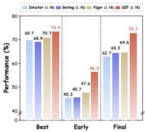

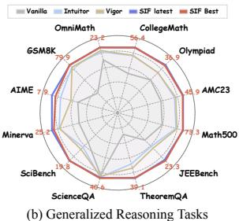  
Figure 1: Performance overview of SIF algorithm.

This assumption does not always hold during training. High certainty in some segments can mask uncertainty elsewhere in sequence mean, and incorrect response may still receive a higher reward than a correct one. Policy updates can then reinforce these misleading preferences. Prior studies have reported early accuracy gains followed by degradation under continued optimization of internal rewards (Zhang et al., 2025b; Ghimire et al., 2026; Joarder et al., 2026). Self-certainty optimization can also lead to entropy collapse (Jang et al., 2026). Figure 4 shows that Intuitor’s training-batch accuracy initially improves but later declines substantially, accompanied by decreasing policy entropy. These observations raise a key question: How can we construct and selectively use self-certaintyfeedback to sustain performance gains during training?

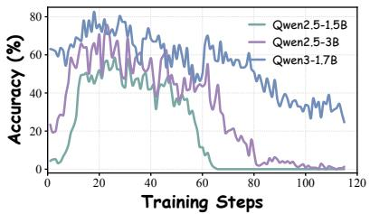  
(a) Intuitor Training Dynamics

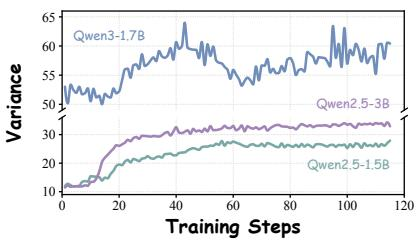  
(b) Intuitor Variance Dynamics

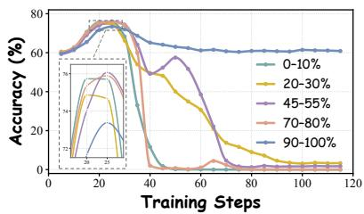  
(c) Reward Segment Selection  
Figure 2: Training dynamics and diagnostic experiments for Intuitor. (a) Training set accuracy across three backbones. (b) Variance of token-level self-certainty during training. (c) Validation accuracy of training variants using mean self-certainty within different rank intervals as rewards, with token scores sorted in descending order.

To address this question, we propose Selective Internal Feedback (SIF), which builds comparative feedback from self-certainty profiles and selectively uses it for policy optimization. SIF assigns positive rewards only when comparisons across multiple ranked certainty levels and peer responses provide sufficient support. Response-level eligibility determines which responses participate in optimization, while groups with identical rewards are excluded from policy updates. All rewards are derived from model distributions, without finalanswer extraction or answer-level pseudo-labels.

We evaluate SIF through training on MATH with three backbones and evaluation across 12 mathematical and scientific reasoning benchmarks, as well as through test-time adaptation using unlabeled inputs. Following MATH training, $\mathbf { S I F } ^ { \prime } \mathbf { s }$ final checkpoints achieve higher average accuracy than the best-validation checkpoints of Intuitor and Vigor (Wen et al., 2026) on all three backbones. Training diagnostics show reduced late-stage deterioration, while test-time adaptation experiments show improvements over the initial models persist to the final checkpoint. Figure 1 highlights SIF’s performance gains over existing internal-feedback methods. The main contributions are as follows:

1. We propose two-level self-certainty voting, which constructs binary internal rewards through comparisons across ranked certainty levels and peer responses.

2. We develop selective policy updates within SIF, integrating voting-based rewards with response and group level filtering under GRPO to jointly control reward construction and participation in policy optimization.

3. We evaluate SIF under MATH training and test-time adaptation. Across 12 benchmarks, its final checkpoints after MATH training achieve higher average accuracy than the best-validation checkpoints of Intuitor and Vigor on all three backbones, with gains of 4.71% and 4.31%, respectively, on Qwen2.5-Math-1.5B.

## 2 Observation

To better understand the performance degradation discussed in the introduction, we examine the dynamics of continued self-certainty optimization and the factors that affect performance retention.

Notation and self-certainty. Let D be prompt dataset and $\pi \theta$ trainable policy. For each prompt $x \in { \mathcal { D } } ,$ , we sample a group of responses $y _ { i } \sim \pi _ { \theta } ( \cdot \mid x )$ $i = 1 , \ldots , N$ . Let $L _ { i }$ denote valid token length of response $y _ { i } ,$ and let $p _ { \theta } ( \cdot \mid x , y _ { i , < t } )$ denote predictive distribution at its t-th token position. We quantify self-certainty using KL divergence from uniform vocabulary distribution to predictive distribution:

$$
\begin{array} { l } { \displaystyle { c _ { i , t } = D _ { \mathrm { K L } } ( U \| p _ { \theta } ( \cdot \mid x , y _ { i , < t } ) ) } } \\ { \displaystyle { \quad = - \frac { 1 } { | \mathcal { V } | } \sum _ { v \in \mathcal { V } } \log ( | \mathcal { V } | p _ { \theta } ( v \mid x , y _ { i , < t } ) ) , } } \end{array}\tag{1}
$$

where V is the vocabulary and U is the uniform distribution over V. The mean self-certainty and variance within a response are

$$
\begin{array} { l } { \displaystyle \bar { c } _ { i } = \frac { 1 } { L _ { i } } \sum _ { t = 1 } ^ { L _ { i } } c _ { i , t } , } \\ { \displaystyle v _ { i } = \frac { 1 } { L _ { i } } \sum _ { t = 1 } ^ { L _ { i } } ( c _ { i , t } - \bar { c } _ { i } ) ^ { 2 } . } \end{array}\tag{2}
$$

This variance is computed over valid tokens within each complete response, not across different responses to the same prompt.

(1) Early gains give way to deterioration. Intuitor uses mean token-level self-certainty as its sole training reward. Figure 2(a) shows that all three models achieve early accuracy gains, followed by varying degrees of deterioration as training continues. Table 10 further illustrates the divergence between the internal reward and correctness: logged self-certainty increases while MATH validation accuracy falls to zero in the reported runs on Qwen3- 1.7B and Llama-3.2-3B-Instruct. These observations demonstrate that increasing self-certainty can coexist with sharply declining accuracy, limiting its reliability as an objective for sustained policy improvement. One possible explanation is that averaging over the entire response obscures differences within the certainty distribution. A preference based only on this mean may therefore lack consistent support across different parts of the response. To investigate this possibility, we examine the variance of self-certainty within responses.

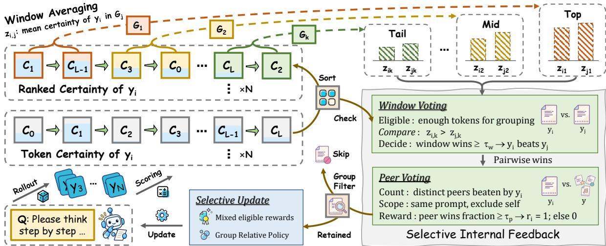  
Figure 3: Overview of SIF. Token-level self-certainty scores are ranked and summarized across multiple windows. Window-level and peer-level voting jointly construct binary rewards, while response eligibility and group-level filtering determine participation in group-relative policy updates.

(2) Certainty becomes more dispersed. Figure 2(b) shows that the variance within responses increases relative to the beginning of training across all three models, subsequently remaining elevated or fluctuating. This observation suggests that a single mean does not adequately characterize the certainty information within a complete response. Greater variance indicates a more dispersed distribution, so an increase in the overall mean therefore does not imply that all certainty levels strengthen together. These observations motivate a further question: do different certainty levels provide feedback with different training value?

(3) Certainty levels play distinct roles. For each response, we sort token-level self-certainty scores in descending order and replace the mean over the entire response with the mean within a selected ranked band. Each band defines a separate training variant, evaluated by validation accuracy in Figure 2(c). The figure 2(c) compares the 0– 10%, 20–30%, 45–55%, 70–80%, and 90–100% bands, spanning the highest to the lowest certainty levels. These bands refer to positions in the certainty ranking, not contiguous spans of the original response.

The variants exhibit different training characteristics. The highest-certainty band yields rapid early gains but deteriorates substantially later; the intermediate band supports a high peak accuracy; and the lowest-certainty band retains more of its early improvement, ending at approximately 60% validation accuracy. These differences suggest that different certainty levels serve distinct roles during training. A single response mean obscures these distinctions, while selecting only one band leaves information from other levels unused.

Implication for SIF. These observations motivate comparative feedback that requires support across multiple certainty levels and multiple responses to the same prompt. The following section introduces SIF, which implements this through voting over self-certainty profiles and selective policy updates.

## 3 Method

SIF constructs selective training feedback through pairwise comparisons of the model’s self-certainty profiles. Its central operation tests whether a relative preference persists across multiple portions of a response’s confidence ranking and across multiple peers. The procedure comprises four steps: sampling responses and computing self-certainty, constructing eligible ranked profiles, assigning twolevel voting rewards, and selectively optimizing the policy. The policy reward is derived entirely from model distributions, without reference answers or an external verifier. Algorithm 1 provides the complete training procedure.

We follow the notation introduced in Section 2. Let $\pi _ { \mathrm { o l d } }$ denote the policy snapshot before the current rollout batch and $\pi _ { \mathrm { r e f } }$ the fixed reference policy. For each prompt x in a batch B sampled from D, we generate N responses $y _ { i } \sim \pi _ { \mathrm { o l d } } ( \cdot \mid x ) , i = 1 , \ldots , N $ These responses form the comparison group from which SIF constructs its internal feedback.

## 3.1 Response Eligibility and Ranked Profile

Length-based eligibility. A ranked profile requires enough valid tokens to support the configured windows. We use K windows of width w, with s specifying the minimum stride between window starts. The resulting response-length threshold, eligibility indicator, and eligible index set are

$$
\begin{array} { r c l } { { } } & { { } } & { { L _ { \mathrm { m i n } } = w + ( K - 1 ) s , } } \\ { { } } & { { } } & { { } } \\ { { } } & { { } } & { { e _ { i } = \mathbf { 1 } [ L _ { i } \geq L _ { \mathrm { m i n } } ] , } } \\ { { } } & { { } } & { { } } \\ { { } } & { { } } & { { \mathcal { E } _ { x } = \{ i : e _ { i } = 1 \} . } } \end{array}\tag{3}
$$

The indicator ei determines whether response i can participate in profile comparisons. Throughout, 1[·] equals one when its condition holds and zero otherwise. The set $\mathcal { E } _ { x }$ collects the eligible responses associated with prompt x. For $K > 1$ , the threshold provides sufficient space for K windows whose starts are separated by at least s positions.

Constructing ranked profiles. For each eligible response, we sort its valid token-level selfcertainties in descending order:

$$
c _ { i , 1 } \geq c _ { i , 2 } \geq \cdot \cdot \cdot \geq c _ { i , L _ { i } } .\tag{4}
$$

Sorting makes the profile describe the distribution of self-certainty within a response.

We place windows across this ranking to summarize different portions of the self-certainty distribution. The k-th window starts at

$$
a _ { i , k } = \left\{ \begin{array} { l l } { 1 , \quad } & { K = 1 , } \\ { 1 + \left\lfloor \frac { ( k - 1 ) ( L _ { i } - w ) } { K - 1 } \right\rfloor , } & { K > 1 , } \end{array} \right.\tag{5}
$$

for $k = 1 , \ldots , K .$ . The floor operation maps each start to an integer position. For $K > 1$ , the starts span the ranking from its highest-certainty region to its lowest-certainty region. For $K = 1$ , the single window begins at the highest-ranked position.

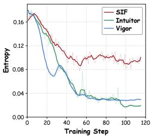

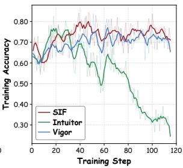  
Figure 4: Training dynamics of SIF, Intuitor, and Vigor on Qwen3-1.7B: policy entropy (left) and training-batch accuracy (right).

Each window is summarized by its mean selfcertainty, yielding the profile vector

$$
\begin{array} { l } { { \displaystyle z _ { i , k } = \frac 1 w \sum _ { u = a _ { i , k } } ^ { a _ { i , k } + w - 1 } c _ { i , u } } , } \\ { { \displaystyle { \bf z } _ { i } = ( z _ { i , 1 } , \ldots , z _ { i , K } ) } . } \end{array}\tag{6}
$$

The scalar $z _ { i , k }$ summarizes the k-th ranked window, and z contains all K window summaries for response i. For $K > 1$ , the first and last windows contain the highest and lowest w certainties, respectively. This supplies multiple comparison criteria while retaining the same profile dimension across responses of different eligible lengths.

## 3.2 Two-Level Voting Reward

Window-level pairwise comparisons. SIF compares responses only within the same prompt group. For distinct eligible responses i and $j ,$ it counts windows in which i has higher mean self-certainty:

$$
v _ { i j } = \sum _ { k = 1 } ^ { K } \mathbf { 1 } [ z _ { i , k } > z _ { j , k } ] .\tag{7}
$$

The count $v _ { i j }$ measures the support for preferring response i over response $j$ across their ranked profiles. With window-win threshold $\tau _ { w }$ , we define the pairwise decision as

$$
b _ { i j } = \left\{ \begin{array} { l l } { { \bf 1 } [ v _ { i j } \geq \tau _ { w } ] , } & { i , j \in \mathscr { E } _ { x } , i \neq j , } \\ { 0 , } & { \mathrm { o t h e r w i s e } . } \end{array} \right.\tag{8}
$$

Threshold $\tau _ { w }$ specifies how many window comparisons support pairwise win. Tied window means contribute to no vote, and self comparisons are excluded. $b _ { i j }$ records whether profile of response i receives sufficient support against response j.

Peer-level reward assignment. A pairwise win provides support against one peer. We aggregate these decisions across the other eligible responses to obtain the peer-win count and binary reward:

Table 1: Accuracy (%) on 12 reasoning benchmarks across three backbones. All methods are trained and evaluated under identical settings within each backbone. Baseline results use checkpoint achieving the highest validation accuracy during training, while SIF reports final (last) and best-validation (best) checkpoints. Avg. denotes the unweighted mean across benchmarks. The best and second-best distinct scores within each backbone, excluding GRPO, are bolded and underlined, with ties highlighted equally. GRPO uses ground-truth (GT) answers.
<table><tr><td rowspan="2">Method</td><td colspan="8">Mathematical Reasoning</td><td colspan="4">Scientific Reasoning</td><td rowspan="2">Avg.</td></tr><tr><td>AIME</td><td>AMC23</td><td>Math500</td><td>Minerva</td><td>Olympiad</td><td>GSM8K</td><td>Omni</td><td>College</td><td>JEEBench</td><td>Theorem</td><td>Science</td><td>SciBench</td></tr><tr><td>Llama-3.2-3B-Instruct</td><td>3.12</td><td>17.39</td><td>41.20</td><td>15.26</td><td>13.67</td><td>72.86</td><td>12.15</td><td>33.06</td><td>13.77</td><td>23.39</td><td>42.95</td><td>7.31</td><td>24.68</td></tr><tr><td>+ TTRL</td><td>2.08</td><td>19.84</td><td>47.55</td><td>17.78</td><td>16.34</td><td>78.91</td><td>13.72</td><td>33.91</td><td>14.60</td><td>26.41</td><td>44.01</td><td>9.64</td><td>27.07</td></tr><tr><td>+ SCOPE</td><td>1.67</td><td>20.38</td><td>44.33</td><td>16.82</td><td>14.61</td><td>74.85</td><td>13.02</td><td>34.69</td><td>13.30</td><td>23.91</td><td>43.18</td><td>8.19</td><td>25.75</td></tr><tr><td>+ Intuitor</td><td>2.71</td><td>17.93</td><td>41.48</td><td>16.18</td><td>14.73</td><td>72.34</td><td>12.34</td><td>33.92</td><td>13.76</td><td>22.57</td><td>43.13</td><td>7.83</td><td>24.91</td></tr><tr><td>+ Vigor</td><td>1.25</td><td>11.14</td><td>39.30</td><td>10.06</td><td>12.22</td><td>67.67</td><td>9.74</td><td>26.32</td><td>9.94</td><td>20.05</td><td>44.38</td><td>7.16</td><td>21.60</td></tr><tr><td>+ SIF (last)</td><td>2.71</td><td>19.84</td><td>45.00</td><td>16.13</td><td>15.37</td><td>78.23</td><td>13.41</td><td>33.28</td><td>14.15</td><td>23.26</td><td>43.89</td><td>8.81</td><td>26.17</td></tr><tr><td>+ SIF (best)</td><td>1.67</td><td>21.74</td><td>46.73</td><td>17.65</td><td>15.91</td><td>77.72</td><td>14.10</td><td>35.10</td><td>14.72</td><td>24.41</td><td>43.99</td><td>8.92</td><td>26.89</td></tr><tr><td>+ GRPO (with GT)</td><td>6.05</td><td>19.84</td><td>47.02</td><td>17.92</td><td>15.97</td><td>79.23</td><td>14.51</td><td>35.59</td><td>14.84</td><td>26.49</td><td>43.91</td><td>9.28</td><td>27.55</td></tr><tr><td>Qwen2.5-Math-1.5B</td><td>4.79</td><td>30.43</td><td>50.00</td><td>14.80</td><td>25.40</td><td>32.97</td><td>18.78</td><td>33.92</td><td>13.29</td><td>12.90</td><td>38.83</td><td>12.14</td><td>24.02</td></tr><tr><td>+ TTRL</td><td>7.50</td><td>42.39</td><td>66.48</td><td>22.75</td><td>31.64</td><td>77.61</td><td>22.55</td><td>50.83</td><td>17.79</td><td>33.90</td><td>38.03</td><td>15.25</td><td>35.56</td></tr><tr><td>+ SCOPE</td><td>5.83</td><td>41.58</td><td>65.35</td><td>22.79</td><td>31.45</td><td>77.24</td><td>22.12</td><td>50.57</td><td>19.22</td><td>35.24</td><td>38.35</td><td>15.47</td><td>35.43</td></tr><tr><td>+ Intuitor</td><td>6.88</td><td>39.95</td><td>65.25</td><td>22.47</td><td>31.06</td><td>76.10</td><td>21.61</td><td>49.26</td><td>16.36</td><td>30.59</td><td>39.92</td><td>14.27</td><td>34.48</td></tr><tr><td>+ Vigor</td><td>5.62</td><td>40.76</td><td>66.45</td><td>22.29</td><td>31.05</td><td>75.92</td><td>22.09</td><td>49.53</td><td>17.26</td><td>33.10</td><td>39.32</td><td>15.12</td><td>34.88</td></tr><tr><td>+ SIF (last)</td><td>7.92</td><td>45.92</td><td>73.28</td><td>25.23</td><td>36.91</td><td>79.60</td><td>23.17</td><td>56.14</td><td>22.91</td><td>39.11</td><td>40.24</td><td>19.83</td><td>39.19</td></tr><tr><td>+ SIF (best)</td><td>7.50</td><td>45.65</td><td>72.97</td><td>24.49</td><td>36.46</td><td>79.92</td><td>23.17</td><td>56.36</td><td>23.33</td><td>38.81</td><td>40.57</td><td>19.83</td><td>39.09</td></tr><tr><td>+ GRPO (with GT)</td><td>6.88</td><td>44.57</td><td>67.75</td><td>22.79</td><td>32.33</td><td>77.71</td><td>22.68</td><td>51.21</td><td>19.06</td><td>34.67</td><td>38.46</td><td>14.94</td><td>36.09</td></tr><tr><td>Qwen3-1.7B</td><td>10.00</td><td>33.97</td><td>68.47</td><td>32.67</td><td>32.86</td><td>88.09</td><td>18.50</td><td>51.16</td><td>26.89</td><td>40.86</td><td>42.57</td><td>24.11</td><td>39.18</td></tr><tr><td>+ TTRL</td><td>12.08</td><td>45.65</td><td>76.90</td><td>35.25</td><td>40.78</td><td>88.13</td><td>22.26</td><td>55.53</td><td>31.37</td><td>46.17</td><td>42.67</td><td>27.84</td><td>43.72</td></tr><tr><td>+ SCOPE</td><td>12.08</td><td>46.74</td><td>77.08</td><td>34.83</td><td>41.39</td><td>88.37</td><td>22.26</td><td>55.74</td><td>31.60</td><td>47.19</td><td>42.92</td><td>27.51</td><td>43.98</td></tr><tr><td>+ Intuitor</td><td>15.21</td><td>47.83</td><td>75.88</td><td>30.19</td><td>44.34</td><td>82.93</td><td>26.78</td><td>50.67</td><td>36.04</td><td>47.82</td><td>41.57</td><td>22.29</td><td>43.46</td></tr><tr><td>+ Vigor</td><td>10.62</td><td>45.11</td><td>74.52</td><td>30.93</td><td>41.65</td><td>82.12</td><td>24.90</td><td>53.49</td><td>33.16</td><td>43.66</td><td>43.64</td><td>19.03</td><td>41.90</td></tr><tr><td>+ SIF (last)</td><td>17.29</td><td>50.00</td><td>78.85</td><td>32.81</td><td>46.74</td><td>83.58</td><td>27.21</td><td>52.75</td><td>37.28</td><td>49.48</td><td>41.73</td><td>25.71</td><td>45.29</td></tr><tr><td>+ SIF (best)</td><td>18.54</td><td>49.73</td><td>79.28</td><td>35.29</td><td>48.79</td><td>85.52</td><td>26.69</td><td>54.60</td><td>40.16</td><td>51.09</td><td>41.63</td><td>28.02</td><td>46.61</td></tr><tr><td>+ GRPO (with GT)</td><td>14.59</td><td>44.29</td><td>76.48</td><td>35.71</td><td>40.49</td><td>88.19</td><td>22.02</td><td>55.35</td><td>31.95</td><td>46.62</td><td>42.70</td><td>27.33</td><td>43.81</td></tr></table>

$$
\begin{array} { l } { q _ { i } = \displaystyle \sum _ { j \in \mathcal { E } _ { x } \setminus \{ i \} } b _ { i j } , } \\ { r _ { i } = e _ { i } \mathop { \bf 1 } \left[ q _ { i } \geq \tau _ { p } \left( \left| \mathcal { E } _ { x } \right| - 1 \right) \right] . } \end{array}\tag{9}
$$

Here, $q _ { i }$ counts the other eligible peers defeated by response i, and $\tau _ { p }$ specifies the minimum peerwin fraction required for a positive reward. We set $\tau _ { p } = 3 / 4$ by default. The two thresholds operate at distinct levels: $\tau _ { w }$ governs each pairwise comparison across ranked windows, while $\tau _ { p }$ governs the final response-level reward. The reward reflects relative profile support within the sampled group, rather than verified correctness.

## 3.3 Selective Policy Optimization

Constructing group-relative advantages. We convert the binary response rewards into GRPOstyle advantages. $q , o _ { i }$ , and $G$ denote the prompt, sampled responses, and rollout group size. The response reward and token-level advantage are

$$
\begin{array} { r l } & { r _ { i } = e _ { i } \mathbf { 1 } \big [ q _ { i } \geq \tau _ { p } ( | \mathcal { E } _ { x } | - 1 ) \big ] , } \\ & { \hat { A } _ { i , t } = \frac { r _ { i } - \operatorname* { m e a n } ( \{ r _ { j } : j \in \mathcal { E } _ { x } \} ) } { \operatorname* { s t d } ( \{ r _ { j } : j \in \mathcal { E } _ { x } \} ) + \epsilon _ { \mathrm { n u m } } } , \quad i \in \mathcal { E } _ { x } . } \end{array}\tag{10}
$$

Updating the policy. For each query $q \sim P ( Q )$ where $P ( Q )$ is the training query distribution, the behavior policy $\pi _ { \mathrm { o l d } } = \pi \theta _ { \mathrm { o l d } }$ generates a group of G responses $o _ { 1 } , \ldots , o _ { G }$ . SIF updates the target policy πθ using a clipped group-relative objective. The importance ratio $\begin{array} { r } { \rho _ { i , t } ( \theta ) = { \frac { \pi _ { \theta } ( o _ { i , t } | q , o _ { i , < t } ) } { \pi _ { \mathrm { o l d } } ( o _ { i , t } | q , o _ { i , < t } ) } } } \end{array}$ compares the target and behavior policies, and clip clips this ratio to $[ 1 - \varepsilon , 1 + \varepsilon ]$ . The coefficient $\beta$ controls the KL penalty relative to the fixed reference policy $\pi _ { \mathrm { r e f } }$ . The resulting optimization objective is

$$
\begin{array} { r l } & { \mathcal { I } _ { \mathrm { G R P O } } ( \boldsymbol { \theta } ) = \mathbb { E } \Bigg [ \cfrac { 1 } { G } \sum _ { i = 1 } ^ { G } \cfrac { 1 } { | o _ { i } | } \displaystyle \sum _ { t = 1 } ^ { | o _ { i } | } } \\ & { \quad \bigg ( \operatorname* { m i n } \Big [ \rho _ { i , t } ( \boldsymbol { \theta } ) \hat { A } _ { i , t } , \exp _ { \varepsilon } ( \rho _ { i , t } ( \boldsymbol { \theta } ) ) \hat { A } _ { i , t } \Big ] } \\ & { \quad \quad - \beta \mathbb { D } _ { \mathrm { K L } } \big ( \pi _ { \boldsymbol { \theta } } \big \| \pi _ { \mathrm { r e f } } \big ) \bigg ) \Bigg ] . } \end{array}\tag{11}
$$

SIF applies the response- and group-level selection rules described above to determine which actor contributions enter policy optimization.

## 4 Experiment

## 4.1 Training Setup

Baselines and Models. We compare SIF with Intuitor, Vigor, TTRL, and SCOPE, alongside GRPO with ground-truth rewards. We consider two settings. (1) Validation Base: we train Llama-3.2-

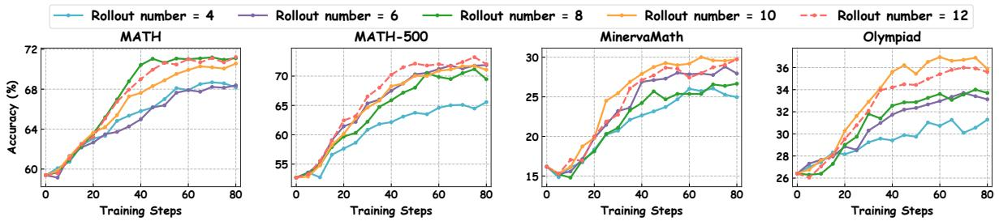  
Figure 5: Sustained improvements during Test-Time Training across four datasets with five rollout counts.

3B-Instruct (Touvron et al., 2023), Qwen2.5-Math-1.5B (Yang et al., 2024), and Qwen3-1.7B (Bai et al., 2023) on MATH, select checkpoints using validation performance, and evaluate them on other reasoning benchmarks. (2) Test-time training: we adapt Qwen2.5-Math-1.5B and DeepSeek-R1- Distill-Qwen-1.5B (DeepSeek-AI, 2025) to unlabeled benchmark inputs for 80 steps. Checkpoints are evaluated at predefined steps, without using reference answers for optimization or checkpoint selection. Implementation and evaluation details are provided in Appendices B.2, B.1, and D.

Evaluation Benchmarks. We evaluate on 12 benchmarks covering two domains: mathematical reasoning on AIME (Zhang and Math-AI, 2025, 2026), AMC23, MATH500 (Hendrycks et al., 2021), Minerva (Lewkowycz et al., 2022), Olympiad (He et al., 2024), GSM8K (Cobbe et al., 2021), Omni (Gao et al., 2024), and College (Tang et al., 2024); and scientific reasoning on JEEBench (Arora et al., 2023), TheoremQA (Chen et al., 2023), ScienceQA (Lu et al., 2022), and SciBench (Wang et al., 2024). Assess both mathematical problem and scientific knowledge.

## 4.2 Main Results

Overall reasoning performance. Figure 4 shows that SIF achieves higher training set accuracy than Intuitor throughout training and generally outperforms Vigor. Table 1 further evaluates SIF across 12 reasoning benchmarks. At final checkpoint, SIF achieves average accuracies of 26.17%, 39.19%, and 45.29% on Llama-3.2-3B-Instruct, Qwen2.5- Math-1.5B, and Qwen3-1.7B, respectively, yielding gains of 1.49, 15.17, and 6.11 percentage points over the initial models. SIF outperforms Intuitor and Vigor on all three backbones and surpasses TTRL and SCOPE on both Qwen backbones. These gains extend beyond mathematics: on Qwen2.5-Math-1.5B, SIF improves accuracy over initial model by 9.62%, 26.21%, and 7.69% points on JEEBench, TheoremQA, and SciBench. Test-time training performance. Figure 5 examines SIF with 4–12 rollouts per prompt over 80 adaptation steps on four mathematical benchmarks. All configurations improve over their initial performance. Across the entire dataset, larger rollout groups generally yield stronger performance, although the relationship is not strictly monotonic across datasets and checkpoints. Appendix B.1, Table 5, further reports checkpoint-level results on seven benchmarks. At step 80, both Pass@1 and Pass@8 exceed their initial values on every benchmark for Qwen2.5-Math-1.5B and DeepSeek-R1-Distill-Qwen-1.5B, showing that the gains persist to the predefined endpoint without correctnessbased checkpoint selection.

Table 2: Ablation results (%) on five benchmarks using Qwen3-1.7B test time trained for 40 steps. Mid and Last denote the intermediate and final training checkpoints.
<table><tr><td>Method</td><td></td><td></td><td></td><td>Step Math500 Minerva Olympiad College JEEBench</td><td></td><td></td></tr><tr><td rowspan="2">SIF</td><td>mid</td><td>80.50</td><td>37.27</td><td>37.35</td><td>58.33</td><td>24.81</td></tr><tr><td>last</td><td>80.30</td><td>36.53</td><td>37.24</td><td>57.68</td><td>24.47</td></tr><tr><td rowspan="2">SIF w/o Peer</td><td>mid</td><td>79.45</td><td>36.17</td><td>34.11</td><td>57.13</td><td>23.11</td></tr><tr><td>last</td><td>79.20</td><td>35.85</td><td>33.17</td><td>55.86</td><td>23.11</td></tr><tr><td rowspan="2">SIF w/o Window</td><td>mid</td><td>79.40</td><td>36.26</td><td>38.58</td><td>57.42</td><td>23.54</td></tr><tr><td>last</td><td>79.40</td><td>35.98</td><td>37.87</td><td>56.95</td><td>23.57</td></tr><tr><td rowspan="2">Intuitor</td><td>mid</td><td>78.20</td><td>35.48</td><td>33.44</td><td>57.10</td><td>22.69</td></tr><tr><td>last</td><td>75.28</td><td>32.22</td><td>30.41</td><td>54.95</td><td>20.66</td></tr><tr><td>Vanilla</td><td>base</td><td>73.02</td><td>33.18</td><td>32.91</td><td>54.84</td><td>19.22</td></tr></table>

## 4.3 Ablation Study

Component ablation. Table 2 examines the contributions of window-level and peer-level voting during test-time training. Removing either component reduces the average accuracy across the five benchmarks: at the final checkpoint, removing peer-level voting lowers accuracy from 47.24% to 45.44%, while removing window-level voting lowers it to 46.75%. Both variants nevertheless outperform Intuitor, which achieves 42.70%. Full

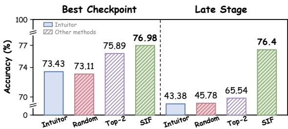  
Figure 6: Additional ablation on Qwen3-1.7B.

SIF achieves the highest accuracy on four of the five benchmarks at both the intermediate and final checkpoints, although the variant without windowlevel voting performs better on Olympiad. These results support the complementary contributions of the two voting components, with peer-level voting yielding a larger aggregate benefit in this setting. Key changes to Intuitor. We examine whether reward binarization or fixed-rate random filtering can reproduce SIF’s gains. Top-2 assigns reward one to two responses with the highest mean self-certainty per group and zero to others, without filtering updates. Figure 6 shows Top-2 improves peak accuracy over Intuitor from 73.43% to 75.89%, but falls to 65.54% at step 40, versus 76.40% for SIF. Table 11 reports further decline to 6.14% at final checkpoint. Retaining Intuitor’s reward while ran domly discarding 10%, 20%, or 40% of responses yields similar peaks (72.74%–73.11%) but final accuracies of 0%, 3.12%, and 15.14%, respectively. Comparison of gating strategies. Table 3 compares SIF with alternative gating strategies. Random filtering discards responses uniformly at random, matching SIF’s filtering rate at each training step. Self-certainty, variance, and entropy thresh olds are set away from the values observed when accuracy begins to decline in a preliminary run. Length gating adopts SIF’s 550-token threshold to isolate the effect of length-based filtering. Ran dom filtering underperforms Intuitor, while selfcertainty, variance, and length gating improve final accuracy but lower peak accuracy. SIF achieves the highest peak and final accuracies (73.4% and 72.7%), with a peak-to-final decline of only 0.7 percentage points versus 7.0 for Intuitor. Matching filtering rates or applying length-based filtering alone is insufficient to reproduce SIF’s gains.

## 5 Analysis

## 5.1 Why Does Intuitor’s Deteriorate?

Proxy accuracy divergence. Self-certainty reward in Intuitor can increase even as reasoning accuracy declines. Table 10 in Appendix C shows that Qwen3-1.7B’s mean response self-certainty increases from 55.03 to 61.54 between steps 30 and 80, while validation accuracy decreases from 73.43% to zero. Self-certainty measures the divergence of token distributions from the uniform vocabulary distribution, without directly assessing reasoning correctness. Moreover, averaging token-level self-certainty can yield a high responselevel score even when some tokens have low selfcertainty. Under group-relative normalization, an incorrect response with a score above the group mean can therefore receive a positive advantage.

Table 3: Accuracy under different gating strategies, where Early denotes accuracy after a few training steps.
<table><tr><td>Method</td><td>Early</td><td>Best</td><td>Last</td></tr><tr><td>Intuitor</td><td>0.453</td><td>0.697</td><td>0.627</td></tr><tr><td>Random filtering</td><td>0.448</td><td>0.676</td><td>0.618</td></tr><tr><td>Self-certainty gating (≤ 56)</td><td>0.457</td><td>0.689</td><td>0.643</td></tr><tr><td>Variance gating (≤ 58)</td><td>0.451</td><td>0.681</td><td>0.656</td></tr><tr><td>Length gating (≥ 550)</td><td>0.461</td><td>0.692</td><td>0.652</td></tr><tr><td>Entropy gating (≥ 0.08)</td><td>0.288</td><td>0.667</td><td>0.614</td></tr><tr><td>SIF</td><td>0.563</td><td>0.734</td><td>0.727</td></tr></table>

Self-certainty dispersion. Figure 8 shows that Intuitor exhibits greater within-response variance in token-level self-certainty during late-stage training on both backbones. The maximum gaps between the smoothed Intuitor and SIF curves are 10.25 on Qwen3-1.7B and 6.46 on Llama-3.2-3B-Instruct. These results complement the differing effects of ranked-band rewards observed in Section 2, highlighting the limitations of summarizing token-level self-certainty with a single response mean. An increasing mean need not imply a uniform increase in self-certainty across tokens.

Lexical concentration. Figure 7 shows that, from Best to Last, Intuitor’s mean highest-frequencyword proportion increases from 9.07% to 11.53%, compared with 9.35% to 10.05% for SIF. The word clouds in Figure 9 provide qualitative context. The case study in Figure 10 illustrates how repetitive checking can coexist with an uncorrected error: Intuitor’s final response repeatedly enumerates and verifies divisors but omits 142, despite explicitly computing 284/2 = 142 earlier. Its mean self-certainty nevertheless increases from 93.74 at the best checkpoint to 101.60 at the final checkpoint. In this example, increased self-certainty and repeated checking fail to prevent incorrect answer.

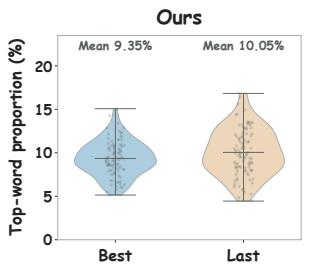

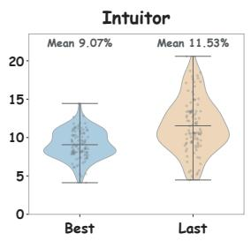  
Figure 7: Most frequent word proportion for SIF (left) and Intuitor (right). Gray dots represent individual responses; horizontal lines indicate means.

Table 4: Response accuracy (%) before and after SIF filtering at early, mid, and final checkpoints.
<table><tr><td>Responses</td><td>Early</td><td>Mid</td><td>Last</td></tr><tr><td>Intuitor (full batch)</td><td>62.30</td><td>68.55</td><td>24.61</td></tr><tr><td>Vigor (full batch)</td><td>60.74</td><td>73.24</td><td>65.43</td></tr><tr><td>SIF (full batch)</td><td>60.55</td><td>75.20</td><td>71.09</td></tr><tr><td>SIF (retained responses)</td><td>65.27</td><td>77.62</td><td>73.27</td></tr></table>

## 5.2 How does SIF improve stability?

Preferences across certainty bands. SIF constructs pairwise preferences by comparing responses across multiple ranked self-certainty windows. Each window contributes one vote, irrespective of the winning margin. Under the default configuration, a response must win at least eight of ten windows against a peer. Consequently, large score advantages in only a few windows cannot by themselves establish a pairwise preference. Motivated by the differing training effects of certainty bands observed in Section 2, this design requires comparative support across multiple bands rather than relying solely on the response mean.

Selective updates. SIF does not force a winner in every group. Groups with identical rewards across eligible responses are excluded from policy updates, avoiding forced preferences based on relative rank alone. Table 4 shows that retained responses exceed full-batch accuracy by 4.72, 2.42, and 2.18 percentage points at Early, Mid, and Last, respectively. Thus, filtering selects a more accurate subset even late in training, without using correctness labels. SIF also exhibits a smaller Mid-to-Last decline in full-batch accuracy: 4.11 percentage points, compared with 43.94 for Intuitor and 7.81 for Vigor. These are consistent with better performance retention under selective internal feedback.

SIF combines multi-window and peer-level comparisons with selective updates, requiring broader comparative support before internal feedback is used for policy optimization.

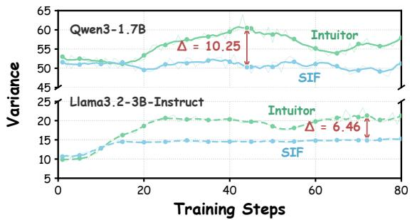  
Figure 8: Variance dynamics of Intuitor and SIF on Qwen3-1.7B and Llama3.2-3B-Instruct. Arrows indicate the maximum gap between each model.

## 6 Related Work

Reinforcement learning for reasoning. RLHF aligns language models with human preferences through learned reward models (Christiano et al., 2023; Ouyang et al., 2022). For reasoning, RLVR uses verifiable outcomes, as demonstrated by Tülu 3 (Lambert et al., 2025), DeepSeek-R1 (Guo et al., 2025), and software engineering agents (Da et al., 2025). GRPO, introduced in DeepSeek-Math (Shao et al., 2024), estimates advantages relative to responses to the same prompt.

Internal feedback. Self-certainty supports best-of-N selection (Kang et al., 2025) and serves as Intuitor’s training reward, although continued optimization can degrade reasoning performance (Zhang et al., 2025b). Vigor instead uses gradient norm of response negative log-likelihood with length correction and group-relative reward shaping. Answer agreement provides another feedback source: self-consistency aggregates sampled answers at inference (Wang et al., 2023), TTRL uses majority answers as pseudo-labels for test-time training (Zuo et al., 2025), and SCOPE constructs subgroup-specific rewards through step wise confidence weighted voting (Wang et al., 2026).

Selection and filtering. Confidence guides inference time compute allocation (Taubenfeld et al., 2025; Yang et al., 2025); DeepConf uses confidence statistics to filter traces and terminate unpromising generations (Fu et al., 2025). During training, DAPO filters groups with uniform correctness rewards and resamples informative batches (Yu et al., 2025), related work studies training efficiency and difficulty based filtering (Zheng et al., 2025; Bae et al., 2026). Excluding zeroadvantage groups is thus an established technique.

## 7 Conclusion

We introduced Selective Internal Feedback to mitigate performance deterioration during continued self-certainty optimization. SIF constructs binary rewards through two-level voting over ranked token-level self-certainty profiles and selectively updates the policy using eligible responses and informative groups. Experiments across three backbones and 12 reasoning benchmarks demonstrate improved reasoning performance and better retention of training gains, while test-time training yields sustained improvements with as few as four rollouts per prompt. Ablations further support the complementary contributions of voting-based rewards and selective updates. These results highlight the value of requiring broader comparative support for internal feedback and controlling its use in policy optimization.

## Limitations

Due to hardware resource limitations, we were unable to conduct full-scale experiments on models with larger parameter counts. Our training dataset was relatively small; future work should involve experimentation on larger datasets. Additionally, our benchmark was primarily focused on mathematical and scientific reasoning; if conditions permit, future efforts should extend the scope to areas such as multi-hop reasoning and code generation.

## Acknowledgments

All datasets used in this work are publicly available and contain no personal or sensitive information. Our experiments only involve open-source language models and do not collect any human subjects data. Throughout this study, we have strictly followed established ethical guidelines, ensuring that our findings are reported honestly, transparently, and with full accuracy. The proposed method, SIF, aims to optimize the model’s inference performance during a self-evolving training process that does not rely on ground-truth answers, a task that is inherently constructive and low-risk. We do not foresee direct negative societal impacts introduced by this work. We plan to release our code and training configurations under open-source licenses to facilitate reproducibility.

## References

Ekin Akyürek, Mehul Damani, Adam Zweiger, Linlu Qiu, Han Guo, Jyothish Pari, Yoon Kim, and Jacob Andreas. 2025. The surprising effectiveness of test-time training for few-shot learning. Preprint, arXiv:2411.07279.

Daman Arora, Himanshu Gaurav Singh, and Mausam. 2023. Have llms advanced enough? a challenging problem solving benchmark for large language models. Preprint, arXiv:2305.15074.

Sanghwan Bae, Jiwoo Hong, Min Young Lee, Hanbyul Kim, JeongYeon Nam, and Donghyun Kwak. 2026. Online difficulty filtering for reasoning oriented reinforcement learning. Preprint, arXiv:2504.03380.

Jinze Bai, Shuai Bai, Yunfei Chu, Zeyu Cui, Kai Dang, Xiaodong Deng, Yang Fan, Wenbin Ge, Yu Han, Fei Huang, Binyuan Hui, Luo Ji, Mei Li, Junyang Lin, Runji Lin, Dayiheng Liu, Gao Liu, Chengqiang Lu, Keming Lu, and 29 others. 2023. Qwen technical report. Preprint, arXiv:2309.16609.

Ali Behrouz, Peilin Zhong, and Vahab Mirrokni. 2024. Titans: Learning to memorize at test time. Preprint, arXiv:2501.00663.

Wenhu Chen, Ming Yin, Max Ku, Pan Lu, Yixin Wan, Xueguang Ma, Jianyu Xu, Xinyi Wang, and Tony Xia. 2023. TheoremQA: A theorem-driven question answering dataset. In Proceedings ofthe 2023 Conference on Empirical Methods in Natural Language Processing, pages 7889–7901, Singapore. Association for Computational Linguistics.

Paul Christiano, Jan Leike, Tom B. Brown, Miljan Martic, Shane Legg, and Dario Amodei. 2023. Deep reinforcement learning from human preferences. Preprint, arXiv:1706.03741.

Karl Cobbe, Vineet Kosaraju, Mohammad Bavarian, Mark Chen, Heewoo Jun, Lukasz Kaiser, Matthias Plappert, Jerry Tworek, Jacob Hilton, Reiichiro Nakano, Christopher Hesse, and John Schulman. 2021. Training verifiers to solve math word problems. Preprint, arXiv:2110.14168.

Ganqu Cui, Lifan Yuan, Zefan Wang, Hanbin Wang, Yuchen Zhang, Jiacheng Chen, Wendi Li, Bingxiang He, Yuchen Fan, Tianyu Yu, Qixin Xu, Weize Chen, Jiarui Yuan, Huayu Chen, Kaiyan Zhang, Xingtai Lv, Shuo Wang, Yuan Yao, Xu Han, and 6 others. 2025a. Process reinforcement through implicit rewards. Preprint, arXiv:2502.01456.

Ganqu Cui, Yuchen Zhang, Jiacheng Chen, Lifan Yuan, Zhi Wang, Yuxin Zuo, Haozhan Li, Yuchen Fan, Huayu Chen, Weize Chen, Zhiyuan Liu, Hao Peng, Lei Bai, Wanli Ouyang, Yu Cheng, Bowen Zhou, and Ning Ding. 2025b. The entropy mechanism of reinforcement learning for reasoning language models. Preprint, arXiv:2505.22617.

Jeff Da, Clinton Wang, Xiang Deng, Yuntao Ma, Nikhil Barhate, and Sean Hendryx. 2025. Agent-rlvr: Training software engineering agents via guidance and environment rewards. Preprint, arXiv:2506.11425.

DeepSeek-AI. 2025. Deepseek-r1: Incentivizing reasoning capability in llms via reinforcement learning. Preprint, arXiv:2501.12948.

Yunzhen Feng, Parag Jain, Anthony Hartshorn, Yaqi Duan, and Julia Kempe. 2025. Don’t waste mistakes: Leveraging negative rl-groups via confidence reweighting. Preprint, arXiv:2510.08696.

Yichao Fu, Xuewei Wang, Yuandong Tian, and Jiawei Zhao. 2025. Deep think with confidence. Preprint, arXiv:2508.15260.

Bofei Gao, Feifan Song, Zhe Yang, Zefan Cai, Yibo Miao, Qingxiu Dong, Lei Li, Chenghao Ma, Liang Chen, Runxin Xu, Zhengyang Tang, Benyou Wang, Daoguang Zan, Shanghaoran Quan, Ge Zhang, Lei Sha, Yichang Zhang, Xuancheng Ren, Tianyu Liu, and Baobao Chang. 2024. Omni-math: A universal olympiad level mathematic benchmark for large language models. Preprint, arXiv:2410.07985.

Mukesh Ghimire, Aosong Feng, Liwen You, Youzhi Luo, Fang Liu, and Xuan Zhu. 2026. Prism: A unified framework for post-training llms without verifiable rewards. Preprint, arXiv:2601.04700.

Daya Guo, Dejian Yang, Haowei Zhang, Junxiao Song, Peiyi Wang, Qihao Zhu, Runxin Xu, Ruoyu Zhang, Shirong Ma, Xiao Bi, Xiaokang Zhang, Xingkai Yu, Yu Wu, Z. F. Wu, Zhibin Gou, Zhihong Shao, Zhuoshu Li, Ziyi Gao, Aixin Liu, and 175 others. 2025. Deepseek-r1 incentivizes reasoning in llms through reinforcement learning. Nature, 645(8081):633–638.

Bingxiang He, Yuxin Zuo, Zeyuan Liu, Shangziqi Zhao, Zixuan Fu, Junlin Yang, Cheng Qian, Kaiyan Zhang, Yuchen Fan, Ganqu Cui, Xiusi Chen, Youbang Sun, Xingtai Lv, Xuekai Zhu, Li Sheng, Ran Li, Huan ang Gao, Yuchen Zhang, Bowen Zhou, and 2 others. 2026. How far can unsupervised rlvr scale llm training? Preprint, arXiv:2603.08660.

Chaoqun He, Renjie Luo, Yuzhuo Bai, Shengding Hu, Zhen Leng Thai, Junhao Shen, Jinyi Hu, Xu Han, Yujie Huang, Yuxiang Zhang, Jie Liu, Lei Qi, Zhiyuan Liu, and Maosong Sun. 2024. Olympiadbench: A challenging benchmark for promoting agi with olympiad-level bilingual multimodal scientific problems. Preprint, arXiv:2402.14008.

Dan Hendrycks, Collin Burns, Saurav Kadavath, Akul Arora, Steven Basart, Eric Tang, Dawn Song, and Jacob Steinhardt. 2021. Measuring mathematical problem solving with the math dataset. Preprint, arXiv:2103.03874.

Jaeeun Jang, Hansle Lee, and Sangmin Kim. 2026. A few bad apples spoil the bunch: Preventing global entropy collapse driven by a small set of tokens in LLM

reasoning. In Findings ofthe Associationfor Computational Linguistics: ACL 2026, pages 13134–13154, San Diego, California, United States. Association for Computational Linguistics.

Shourov Joarder, Diganta Sikdar, Ahsan Habib Akash, Binod Bhattarai, and Prashnna Gyawali. 2026. Two is better than one: A collapse-free multi-reward rlif training framework. Preprint, arXiv:2605.22620.

Zhewei Kang, Xuandong Zhao, and Dawn Song. 2025. Scalable best-of-n selection for large language models via self-certainty. Preprint, arXiv:2502.18581.

Nathan Lambert, Jacob Morrison, Valentina Pyatkin, Shengyi Huang, Hamish Ivison, Faeze Brahman, Lester James V. Miranda, Alisa Liu, Nouha Dziri, Shane Lyu, Yuling Gu, Saumya Malik, Victoria Graf, Jena D. Hwang, Jiangjiang Yang, Ronan Le Bras, Oyvind Tafjord, Chris Wilhelm, Luca Soldaini, and 4 others. 2025. Tulu 3: Pushing frontiers in open language model post-training. Preprint, arXiv:2411.15124.

Thanh-Long V. Le, Myeongho Jeon, Kim Vu, Viet Lai, and Eunho Yang. 2026. No prompt left behind: Exploiting zero-variance prompts in llm reinforcement learning via entropy-guided advantage shaping. Preprint, arXiv:2509.21880.

Aitor Lewkowycz, Anders Andreassen, David Dohan, Ethan Dyer, Henryk Michalewski, Vinay Ramasesh, Ambrose Slone, Cem Anil, Imanol Schlag, Theo Gutman-Solo, Yuhuai Wu, Behnam Neyshabur, Guy Gur-Ari, and Vedant Misra. 2022. Solving quantitative reasoning problems with language models. Preprint, arXiv:2206.14858.

Hunter Lightman, Vineet Kosaraju, Yura Burda, Harri Edwards, Bowen Baker, Teddy Lee, Jan Leike, John Schulman, Ilya Sutskever, and Karl Cobbe. 2023. Let’s verify step by step. Preprint, arXiv:2305.20050.

Pan Lu, Swaroop Mishra, Tony Xia, Liang Qiu, Kai-Wei Chang, Song-Chun Zhu, Oyvind Tafjord, Peter Clark, and Ashwin Kalyan. 2022. Learn to explain: Multimodal reasoning via thought chains for science question answering. Preprint, arXiv:2209.09513.

Team Olmo, :, Allyson Ettinger, Amanda Bertsch, Bailey Kuehl, David Graham, David Heineman, Dirk Groeneveld, Faeze Brahman, Finbarr Timbers, Hamish Ivison, Jacob Morrison, Jake Poznanski, Kyle Lo, Luca Soldaini, Matt Jordan, Mayee Chen, Michael Noukhovitch, Nathan Lambert, and 50 others. 2026. Olmo 3. Preprint, arXiv:2512.13961.

OpenAI. 2024. OpenAI o1 System Card. Preprint, arXiv:2412.16720.

Long Ouyang, Jeff Wu, Xu Jiang, Diogo Almeida, Carroll L. Wainwright, Pamela Mishkin, Chong Zhang, Sandhini Agarwal, Katarina Slama, Alex Ray, John Schulman, Jacob Hilton, Fraser Kelton, Luke Miller, Maddie Simens, Amanda Askell, Peter Welinder,

Paul Christiano, Jan Leike, and Ryan Lowe. 2022. Training language models to follow instructions with human feedback. Preprint, arXiv:2203.02155.

Zhihong Shao, Peiyi Wang, Qihao Zhu, Runxin Xu, Junxiao Song, Xiao Bi, Haowei Zhang, Mingchuan Zhang, Y. K. Li, Y. Wu, and Daya Guo. 2024. Deepseekmath: Pushing the limits of mathematical reasoning in open language models. Preprint, arXiv:2402.03300.

Guangming Sheng, Chi Zhang, Zilingfeng Ye, Xibin Wu, Wang Zhang, Ru Zhang, Yanghua Peng, Haibin Lin, and Chuan Wu. 2025. Hybridflow: A flexible and efficient rlhf framework. In Proceedings ofthe Twentieth European Conference on Computer Systems, EuroSys ’25, page 1279–1297. ACM.

Nisan Stiennon, Long Ouyang, Jeff Wu, Daniel M. Ziegler, Ryan Lowe, Chelsea Voss, Alec Radford, Dario Amodei, and Paul Christiano. 2022. Learning to summarize from human feedback. Preprint, arXiv:2009.01325.

Yi Su, Dian Yu, Linfeng Song, Juntao Li, Haitao Mi, Zhaopeng Tu, Min Zhang, and Dong Yu. 2025. Crossing the reward bridge: Expanding rl with verifiable rewards across diverse domains. Preprint, arXiv:2503.23829.

Zhengyang Tang, Xingxing Zhang, Benyou Wang, and Furu Wei. 2024. Mathscale: Scaling instruction tuning for mathematical reasoning. Preprint, arXiv:2403.02884.

Amir Taubenfeld, Tom Sheffer, Eran Ofek, Amir Feder, Ariel Goldstein, Zorik Gekhman, and Gal Yona. 2025. Confidence improves self-consistency in llms. In Findings ofthe Associationfor Computational Linguistics: ACL 2025, page 20090–20111. Association for Computational Linguistics.

Hugo Touvron, Thibaut Lavril, Gautier Izacard, Xavier Martinet, Marie-Anne Lachaux, Timothée Lacroix, Baptiste Rozière, Naman Goyal, Eric Hambro, Faisal Azhar, Aurelien Rodriguez, Armand Joulin, Edouard Grave, and Guillaume Lample. 2023. Llama: Open and efficient foundation language models. Preprint, arXiv:2302.13971.

Weiqin Wang, Yile Wang, Kehao Chen, and Hui Huang. 2026. Beyond majority voting: Towards fine-grained and more reliable reward signal for test-time reinforcement learning. Preprint, arXiv:2512.15146.

Xiaoxuan Wang, Ziniu Hu, Pan Lu, Yanqiao Zhu, Jieyu Zhang, Satyen Subramaniam, Arjun R. Loomba, Shichang Zhang, Yizhou Sun, and Wei Wang. 2024. Scibench: Evaluating college-level scientific problem-solving abilities of large language models. Preprint, arXiv:2307.10635.

Xuezhi Wang, Jason Wei, Dale Schuurmans, Quoc Le, Ed Chi, Sharan Narang, Aakanksha Chowdhery, and Denny Zhou. 2023. Self-consistency improves chain of thought reasoning in language models. Preprint, arXiv:2203.11171.

Xuexiang Wen, Hang Yu, Linchao Zhu, and Gaoang Wang. 2026. Verifier-free rl for llms via intrinsic gradient-norm reward. Preprint, arXiv:2605.09920.

An Yang, Beichen Zhang, Binyuan Hui, Bofei Gao, Bowen Yu, Chengpeng Li, Dayiheng Liu, Jianhong Tu, Jingren Zhou, Junyang Lin, Keming Lu, Mingfeng Xue, Runji Lin, Tianyu Liu, Xingzhang Ren, and Zhenru Zhang. 2024. Qwen2.5-math technical report: Toward mathematical expert model via self-improvement. Preprint, arXiv:2409.12122.

Chenxu Yang, Qingyi Si, Yongjie Duan, Zheliang Zhu, Chenyu Zhu, Qiaowei Li, Minghui Chen, Zheng Lin, and Weiping Wang. 2025. Dynamic early exit in reasoning models. Preprint, arXiv:2504.15895.

Qiying Yu, Zheng Zhang, Ruofei Zhu, Yufeng Yuan, Xiaochen Zuo, Yu Yue, Weinan Dai, Tiantian Fan, Gaohong Liu, Lingjun Liu, Xin Liu, Haibin Lin, Zhiqi Lin, Bole Ma, Guangming Sheng, Yuxuan Tong, Chi Zhang, Mofan Zhang, Wang Zhang, and 16 others. 2025. Dapo: An open-source llm reinforcement learning system at scale. Preprint, arXiv:2503.14476.

Qingyang Zhang, Haitao Wu, Changqing Zhang, Peilin Zhao, and Yatao Bian. 2025a. Right question is already half the answer: Fully unsupervised llm reasoning incentivization. Preprint, arXiv:2504.05812.

Yanzhi Zhang, Zhaoxi Zhang, Haoxiang Guan, Yilin Cheng, Yitong Duan, Chen Wang, Yue Wang, Shuxin Zheng, and Jiyan He. 2025b. No free lunch: Rethinking internal feedback for llm reasoning. Preprint, arXiv:2506.17219.

Yifan Zhang and Team Math-AI. 2025. American invitational mathematics examination (aime) 2025.

Yifan Zhang and Team Math-AI. 2026. American invitational mathematics examination (aime) 2026.

Xuandong Zhao, Zhewei Kang, Aosong Feng, Sergey Levine, and Dawn Song. 2026. Learning to reason without external rewards. Preprint, arXiv:2505.19590.

Haizhong Zheng, Yang Zhou, Brian R. Bartoldson, Bhavya Kailkhura, Fan Lai, Jiawei Zhao, and Beidi Chen. 2025. Act only when it pays: Efficient reinforcement learning for llm reasoning via selective rollouts. Preprint, arXiv:2506.02177.

Yuxin Zuo, Kaiyan Zhang, Li Sheng, Shang Qu, Ganqu Cui, Xuekai Zhu, Haozhan Li, Yuchen Zhang, Xinwei Long, Ermo Hua, Biqing Qi, Youbang Sun, Zhiyuan Ma, Lifan Yuan, Ning Ding, and Bowen Zhou. 2025. Ttrl: Test-time reinforcement learning. Preprint, arXiv:2504.16084.

## A Algorithm and Theoretical Analysis

## A.1 SIF Algorithm

Algorithm 1 summarizes the SIF training procedure. The peer-voting threshold $\tau _ { p } \in ( 0 , 1 ]$ specifies the minimum win fraction against other eligible responses, with $\tau _ { p } = 3 / 4$ by default.

Algorithm 1 Selective Internal Feedback (SIF)   
Require: Prompts D; policies $\pi _ { \theta } , \pi _ { \mathrm { r e f } }$   
Require: $N , T , K , w , s , \tau _ { w } , \tau _ { p } , \beta , \varepsilon ; \epsilon _ { \mathrm { { n u m } } } > 0$   
Ensure: Trained policy π   
1: Set Lmin by Eq. (3)   
2: for $\ell = 1 , \ldots , \overset { \cdot } { T }$ do   
3: πold ← πθ; sample $B \subset D$   
4: Sample $\{ y _ { i } \} _ { i = 1 } ^ { N } \tilde { \mathbf { \Omega } } \sim \pi _ { \mathrm { o l d } } ( \cdot \mid x )$ for each $x \in B$   
5: Initialize token advantages $\hat { A } \gets 0$ and masks $M \gets 0$   
6: for x ∈ B do   
7: Obtain Ex by Eq. (3)   
8: if $| \mathcal { E } _ { x } | < 2$ then   
9: continue   
10: end if   
11: Construct $\{ \mathbf { z } _ { i } \} _ { i \in \mathcal { E } _ { x } }$ under $\pi _ { \mathrm { o l d } }$   
using Eqs. $( 2 ) - ( 6 )$   
12: Compute $v _ { i j } , b _ { i j }$ using   
Eqs. (7)–(11)   
13: $\begin{array} { r } { q _ { i }  \sum _ { j \in \mathcal { E } _ { x } \backslash \{ i \} } b _ { i j } } \end{array}$ for $i \in \mathcal { E } _ { x }$   
14: $r _ { i } \gets \mathbf { 1 } [ q _ { i } \geq \dot { \tau _ { p } } ( | \mathcal { E } _ { x } | - 1 ) ]$ for $i \in \mathcal { E } _ { x }$   
15: if all $\{ r _ { i } : i \in \mathcal { E } _ { x } \}$ are equal then   
16: continue   
17: end if   
18: µx ← meani∈E ri; σx ← stdi∈E ri   
19: $\begin{array} { r } { \hat { A } _ { x , i , t } \gets \frac { r _ { i } - \mu _ { x } } { \sigma _ { x } + \epsilon _ { \mathrm { n u m } } } ; M _ { x , i , t } \gets 1 } \end{array}$   
for $i \in \mathcal { E } _ { x }$ and $i = 1 , \ldots , L _ { i }$   
20: end for   
21: $\begin{array} { r } { \mathbf { i f } \sum _ { x , i , t } M _ { x , i , t } > 0 } \end{array}$ then   
22: Optimize J (θ) with fixed Aˆ   
and apply M to both policy and KL terms   
23: end if   
24: end for   
25: return πθ

## A.2 Theoretical Analysis

We examine the limitation of mean self-certainty identified in Sections 1 and 2 through a constructive example. The analysis establishes that bounded, group-normalized updates can produce transient accuracy gains followed by deterioration under continued self-certainty optimization.

Setting and scope. For a fixed prompt q, let $\mathcal { G } ~ = ~ \left( o _ { 1 } , \ldots , o _ { G } \right)$ contain $G \ \geq \ 2$ responses sampled independently from the current policy. We write $c _ { \theta } ( q , o )$ for the response-level self-certainty in Eq. (2) and use $r _ { i } = c _ { \theta } ( q , o _ { i } )$ as the reward. SIF’s voting rewards are defined separately in Eq. (11).

Following the group-relative normalization in

Eq. (10), define

$$
\begin{array} { c } { \displaystyle \bar { r } = \frac { 1 } { G } \sum _ { i = 1 } ^ { G } { r _ { i } } , } \\ { \displaystyle \sigma _ { r } ^ { 2 } = \frac { 1 } { G - 1 } \sum _ { i = 1 } ^ { G } ( r _ { i } - \bar { r } ) ^ { 2 } , } \\ { \displaystyle \hat { A } _ { i , t } = \hat { A } _ { i } = \frac { r _ { i } - \bar { r } } { \sigma _ { r } + \epsilon _ { \mathrm { n u m } } } . } \end{array}\tag{12}
$$

Here, $\sigma _ { r }$ is the sample standard deviation, and $\epsilon _ { \mathrm { { n u m } } } > 0$ is a numerical stabilizer. The responselevel advantage is shared across its token positions. Rewards and normalization statistics are held fixed when differentiating the policy surrogate.

We analyze continuous-time expected gradient ascent with $\beta = 0$ . For $\varepsilon > 0 .$ , the clipping operation is locally inactive at $\pi _ { \theta } = \pi _ { \mathrm { o l d } }$ , where every importance ratio equals one. The instantaneous gradient of the length-averaged GRPO surrogate is therefore

$$
g ( \theta ; \mathcal { G } ) = \frac { 1 } { G } \sum _ { i = 1 } ^ { G } \frac { \hat { A } _ { i } } { | o _ { i } | } \nabla _ { \theta } \log \pi _ { \theta } ( o _ { i } \mid q ) .\tag{13}
$$

The behavior policy is refreshed continuously, giving the dynamics

$$
\begin{array} { l } { \displaystyle \frac { d \theta ( \boldsymbol { u } ) } { d \boldsymbol { u } } = h ( \theta ( \boldsymbol { u } ) ) , } \\ { \displaystyle h ( \theta ) = \mathbb { E } _ { \boldsymbol { \mathcal { G } } \sim \pi _ { \boldsymbol { \theta } } ^ { \otimes G } } [ g ( \theta ; \mathcal { G } ) ] , } \end{array}\tag{14}
$$

where u denotes optimization time and the sampling distribution is conditioned on the fixed prompt q.

Lemma 1 (Bounded group-relative advantages). For any finite rewards $r _ { 1 } , \ldots , r _ { G }$ with $G \geq 2 ,$ , the advantages in Eq. (12) satisfy

$$
\begin{array} { c } { { \displaystyle \left| \hat { A } _ { i } \right| \le \frac { G - 1 } { \sqrt { G } } \le \sqrt { G - 1 } , } } \\ { { \displaystyle \frac { 1 } { G } \sum _ { i = 1 } ^ { G } \hat { A } _ { i } ^ { 2 } \le \frac { G - 1 } { G } \le 1 . } } \end{array}\tag{15}
$$

Proof. Let $v _ { i } = r _ { i } - { \bar { r } } ,$ so that $\textstyle \sum _ { i } v _ { i } = 0$ and $\textstyle \sum _ { i } v _ { i } ^ { 2 } =$ $( G - 1 ) \sigma _ { r } ^ { 2 }$ . By the Cauchy–Schwarz inequality,

$$
\begin{array} { c } { { v _ { i } ^ { 2 } = \displaystyle \left( \sum _ { j \neq i } v _ { j } \right) ^ { 2 } \leq ( G - 1 ) \sum _ { j \neq i } v _ { j } ^ { 2 } } } \\ { { = ( G - 1 ) \big ( ( G - 1 ) \sigma _ { r } ^ { 2 } - v _ { i } ^ { 2 } \big ) . } } \end{array}\tag{16}
$$

Hence $| v _ { i } | \leq ( G - 1 ) \sigma _ { r } / \sqrt { G }$ . Since $\epsilon _ { \mathrm { { n u m } } } > 0 ;$ we obtain

$$
\begin{array} { r l r } & { } & { | \hat { A } _ { i } | \le \displaystyle \frac { G - 1 } { \sqrt { G } } \frac { \sigma _ { r } } { \sigma _ { r } + \epsilon _ { \mathrm { n u m } } } \le \frac { G - 1 } { \sqrt { G } } , } \\ & { } & { \displaystyle \frac { 1 } { G } \sum _ { i = 1 } ^ { G } \hat { A } _ { i } ^ { 2 } = \frac { G - 1 } { G } \frac { \sigma _ { r } ^ { 2 } } { ( \sigma _ { r } + \epsilon _ { \mathrm { n u m } } ) ^ { 2 } } \le \frac { G - 1 } { G } . } \end{array}\tag{17}
$$

When $\sigma _ { r } = 0 .$ , all rewards are equal and every advantage is zero, so the same bounds apply.

The lemma bounds normalized advantages independently of reward magnitude. The following construction additionally bounds the policy gradient itself while exhibiting a divergence between self-certainty and correctness.

Theorem 1 (Transient accuracy gains and collapse). Fix $G \geq 2 \ a n d \ \epsilon _ { \mathrm { n u m } } > 0 .$ . There exists a two-token autoregressive policy with a scalar parameter θ, initialized at $\theta ( 0 ) = 0 ,$ for which the dynamics in Eq. (14) have the following properties:

1. Greedy accuracy on a single-prompt taskfollows $a \mathrm { ~ 0 ~ } {  } 1  0$ transition.

2. The probability ofsampling a correct response first increases to a unique maximum and then strictly decreases to zero.

3. After this maximum, expected mean selfcertainty strictly increases and diverges to infinity.

Throughout the process, every sampled group sat-$i s f i e s \ 0 \le g ( \theta ; \mathcal { G } ) \le 1 / 2 ,$ , and all second-token conditional distributions remainfixed.

Proof. Policy and reward construction. Take $\nu =$ $\{ B , C , W \}$ and let U be uniform on this vocabulary. For the fixed prompt q, a response $o = \left( o _ { 1 } , o _ { 2 } \right)$ is correct exactly when $o _ { 1 } = C$ . Thus, the first token selects a correct or incorrect branch, and correctness is independent of the second token.

Assign branch constants $( d _ { B } , d _ { C } , d _ { W } ) = ( 0 , 1 , 2 )$ and choose fixed, full-support distributions $\nu _ { b }$ satisfying

$$
\begin{array} { r } { \mathrm { K L } ( U \| \nu _ { b } ) = 2 d _ { b } , \qquad b \in \mathcal { V } . } \end{array}\tag{18}
$$

These distributions exist because $\nu ( a ) = ( a , ( 1 -$ $a ) / 2 , ( 1 - a ) / 2 )$ has full support for $a ~ \in ~ [ 1 / 3 , 1 )$ Along this path, $\mathrm { K L } ( U \| \nu ( a ) )$ is continuous, equals zero at $a = 1 / 3$ , and tends to infinity as $a \to 1$

Let $p _ { 0 } ( B ) = 0 . 8 0 , p _ { 0 } ( C ) = 0 . 1 9$ , and $p _ { 0 } ( W ) = 0 . 0 1$ and define

$$
\begin{array} { l } { { \displaystyle p _ { \theta } ( b ) = \frac { p _ { 0 } ( b ) e ^ { d _ { b } \theta } } { Z ( \theta ) } , } } \\ { { \displaystyle Z ( \theta ) = \sum _ { b \in \mathcal { V } } p _ { 0 } ( b ) e ^ { d _ { b } \theta } . } } \end{array}\tag{19}
$$

The complete response policy is $\pi _ { \theta } ( o | q ) =$ $p _ { \theta } ( o _ { 1 } ) \nu _ { o _ { 1 } } ( o _ { 2 } )$ . By Eq. (2), its response-level reward:

$$
c _ { \theta } ( q , o ) = \frac { 1 } { 2 } \mathrm { K L } ( U \| p _ { \theta } ) + d _ { o _ { 1 } } .\tag{20}
$$

This reward uses only the policy’s token distributions; the correctness indicator is used solely to evaluate the construction.

Bounded updates and the parameter trajectory. Write $b _ { i } = o _ { i , 1 }$ and $\begin{array} { r } { \bar { d } = G ^ { - 1 } \sum _ { i = 1 } ^ { G } d _ { b _ { i } } } \end{array}$ for a sampled group. The shared first-token contribution cancels under reward centering:

$$
\begin{array} { l } { r _ { i } - \bar { r } = d _ { b _ { i } } - \bar { d } , } \\ { \displaystyle \sigma _ { r } ^ { 2 } = \frac { 1 } { G - 1 } \sum _ { i = 1 } ^ { G } ( d _ { b _ { i } } - \bar { d } ) ^ { 2 } . } \end{array}\tag{21}
$$

Let $\mu ( \theta ) = \mathbb { E } _ { b \sim p _ { \theta } } [ d _ { b } ]$ . Since the second-token distributions are fixed,

$$
\nabla _ { \theta } \log \pi _ { \theta } ( o _ { i } \mid q ) = d _ { b _ { i } } - \mu ( \theta ) .\tag{22}
$$

Substituting into Eq. (13) gives

$$
\begin{array} { l } { { g ( \theta ; \mathcal { G } ) = \displaystyle \frac { 1 } { 2 G } \sum _ { i = 1 } ^ { G } \frac { ( d _ { b _ { i } } - \bar { d } ) ( d _ { b _ { i } } - \mu ( \theta ) ) } { \sigma _ { r } + \epsilon _ { \mathrm { { n u m } } } } } } \\ { { = \displaystyle \frac { ( G - 1 ) \sigma _ { r } ^ { 2 } } { 2 G ( \sigma _ { r } + \epsilon _ { \mathrm { { n u m } } } ) } . } } \end{array}\tag{23}
$$

The second equality uses $\textstyle \sum _ { i } ( d _ { b _ { i } } - { \bar { d } } ) = 0$ . Because $d _ { b } \in [ 0 , 2 ]$

$$
\begin{array} { l } { \displaystyle \frac { G - 1 } { G } \sigma _ { r } ^ { 2 } = \displaystyle \frac { 1 } { G } \sum _ { i = 1 } ^ { G } ( d _ { b _ { i } } - 1 ) ^ { 2 } - ( \bar { d } - 1 ) ^ { 2 } } \\ { \leq 1 . } \end{array}\tag{24}
$$

Consequently,

$$
0 \leq g ( \theta ; \mathcal { G } ) \leq \frac { G - 1 } { 2 G } \sigma _ { r } \leq \frac { 1 } { 2 } \sqrt { \frac { G - 1 } { G } } \leq \frac { 1 } { 2 } .\tag{25}
$$

Every branch has positive probability at each finite θ. Since $G \geq 2 .$ , groups containing different branches occur with positive probability and have $\sigma _ { r } > 0$ . Thus $h ( \theta ) > 0$ at every finite θ. For each fixed branch configuration, Eq. (23) gives a constant group gradient. Thus h is a finite weighted sum of constants with smooth sampling probabilities. It is smooth and bounded, so the scalar flow has a unique solution for all $u \geq 0$ , and $\theta ( u )$ strictly increases.

If $\theta ( u )$ converged to a finite value L, continuity would give $h ( \theta ( u ) )  h ( L ) > 0$ , contradicting convergence. Hence

$$
\operatorname* { l i m } _ { u  \infty } \theta ( u ) = + \infty .\tag{26}
$$

Greedy and sampled correctness. The comparisons $p _ { \theta } ( B ) = p _ { \theta } ( C )$ and $p _ { \theta } ( C ) = p _ { \theta } ( W )$ give

$$
\begin{array} { r } { \theta _ { 1 } = \log ( 0 . 8 0 / 0 . 1 9 ) \approx 1 . 4 3 8 , } \\ { \theta _ { 2 } = \log ( 0 . 1 9 / 0 . 0 1 ) \approx 2 . 9 4 4 . } \end{array}\tag{27}
$$

Break first-token ties according to the fixed priority $B , C , W$ . The greedy first token is then

$$
\operatorname { G r e e d y } _ { 1 } ( \theta ) = { \left\{ \begin{array} { l l } { B , \quad 0 \leq \theta \leq \theta _ { 1 } , } \\ { C , \quad \theta _ { 1 } < \theta \leq \theta _ { 2 } , } \\ { W , \quad \theta > \theta _ { 2 } . } \end{array} \right. }\tag{28}
$$

Because $\theta ( u )$ increases from zero to infinity, greedy accuracy follows the claimed $0  1  0$ transition.

The probability of sampling a correct response is $p _ { \theta } ( C )$ , with

$$
\begin{array} { c } { { \displaystyle \frac { d } { d \theta } p _ { \theta } ( C ) = p _ { \theta } ( C ) \big ( 1 - \mu ( \theta ) \big ) , } } \\ { { \mu ^ { \prime } ( \theta ) = \mathrm { V a r } _ { p _ { \theta } } ( d ) > 0 . } } \end{array}\tag{29}
$$

Here, $\mu ( 0 ) ~ = ~ 0 . 2 1$ , and $\mu ( \theta ) ~ = ~ 1$ exactly when $p _ { \theta } ( B ) = p _ { \theta } ( W )$ . This occurs at

$$
\theta ^ { * } = \frac { 1 } { 2 } \log ( 0 . 8 0 / 0 . 0 1 ) \approx 2 . 1 9 1 .\tag{30}
$$

Therefore, $p _ { \theta } ( C )$ strictly increases up to $\theta ^ { * }$ and strictly decreases thereafter, attaining

$$
p _ { \theta ^ { * } } ( C ) = \frac { 0 . 1 9 } { 0 . 1 9 + 2 \sqrt { 0 . 8 0 \cdot 0 . 0 1 } } \approx 0 . 5 1 5 1 .\tag{31}
$$

Finally,

$$
p _ { \theta } ( C ) = \frac { 0 . 1 9 e ^ { \theta } } { 0 . 8 0 + 0 . 1 9 e ^ { \theta } + 0 . 0 1 e ^ { 2 \theta } } \longrightarrow 0\tag{32}
$$

as $\theta \to + \infty$ , and therefore as $u \to \infty$

Increasing self-certainty during deterioration. Define the expected response-level self-certainty by

$$
\begin{array} { r l } & { R ( \theta ) = \mathbb { E } _ { o \sim \pi _ { \theta } ( . \cdot \| q ) } \big [ c _ { \theta } ( q , o ) \big ] } \\ & { \quad \quad = \frac { 1 } { 2 } \mathrm { K L } ( U \| p _ { \theta } ) + \mu ( \theta ) . } \end{array}\tag{33}
$$

Since U is uniform and $( d _ { B } + d _ { C } + d _ { W } ) / 3 = 1$

$$
\mathrm { K L } ( U \| p _ { \theta } ) = \mathrm { K L } ( U \| p _ { 0 } ) + \log Z ( \theta ) - \theta .\tag{34}
$$

Using $( \log Z ) ^ { \prime } = \mu$ yields

$$
R ^ { \prime } ( \theta ) = \frac { 1 } { 2 } \big ( \mu ( \theta ) - 1 \big ) + \operatorname { V a r } _ { p _ { \theta } } ( d ) > 0\tag{35}
$$

for $\theta \geq \theta ^ { * }$ . Thus expected self-certainty strictly increases throughout the decline in correct sampling probability. Furthermore, $Z ( \theta ) \geq 0 . 0 1 e ^ { 2 \theta }$ implies that KL $( U \| p _ { \theta } ) \to \infty$ , so $R ( \theta ) \to \infty$ . All conditional distributions νb remain fixed by construction, which completes the proof. □

Implications for internal feedback. It must be acknowledged that, given the high complexity inherent in the actual sampling and generation processes of large language models, we have significantly simplified this process to derive an illustrative, simplified model. This example formalizes a possible divergence between mean self-certainty and correctness under continued optimization. The fixed conditional distributions isolate a change in branch selection as the source of deterioration in this constructed policy.

The result supports the motivation for examining reward granularity and update participation in Section 2. SIF addresses these design choices through ranked-profile comparisons, two-level voting, and selective updates. The benefits of these components are evaluated empirically. The theoretical result concerns the specified continuous-time dynamics with $\beta = 0$ . Analyzing finite-step updates with KL regularization, or establishing stability guarantees for SIF, requires separate analysis.

## B Experimental Setup and Reproducibility

The main experiments in our paper fall into two categories: one involves training at test time, while the other entails RLIF training on the MATH dataset followed by evaluation on benchmarks.

## B.1 Test-Time Training

We performed dataset-level test-time training using the internal voting rewards of SIF. Each run was initialized from the selected pretrained model. Training used the test split of each mathematical or scientific benchmark. The training budget was fixed at 80 steps. Each step sampled 64 prompts and generated eight responses per prompt, yielding 512 candidate responses before masking. Table 5 presents the performance of SIF using test-time training on the Qwen2.5-Math-1.5B and DeepSeek-R1-Distill-Qwen-1.5B models across various benchmarks. Table 6 summarizes the optimization settings, and Table 7 reports the voting and generation settings.

Test-time performance across training checkpoints. Table 5 further evaluates SIF checkpoints using Pass@1 and Pass@8. From the initial model to training step 80, both metrics improve on all seven evaluated benchmarks for Qwen2.5-Math-1.5B and DeepSeek-R1-Distill-Qwen-1.5B. Averaged across these benchmarks, Qwen2.5-Math gains 13.18 points in Pass@1 and 4.80 points in Pass@8, while the distilled DeepSeek model gains 6.27 and 3.90 points, respectively. For Qwen2.5- Math, the largest Pass@1 gain occurs on College-Math (+23.01 points), whereas the largest Pass@8 gain occurs on TheoremQA (+9.12 points). For the distilled model, Pass@8 improves by 7.57 points on Olympiad and 7.96 points on JEEBench. Although individual trajectories fluctuate, the positive endpoint gains under both evaluation measures show that SIF training improves test-time performance beyond the initial checkpoints.

Table 5: Pass@1 and Pass@8 performance across training steps. ∆ denotes the improvement from Base to Step 80 in percentage points.
<table><tr><td rowspan="2">Checkpiont</td><td colspan="2">MATH</td><td colspan="2">MATH500</td><td colspan="2">Minerva</td><td colspan="2">Olympiad</td><td colspan="2">CollegeMath</td><td colspan="2">JEEBench</td><td colspan="2">TheoremQA</td></tr><tr><td>Pass@1</td><td>Pass@8</td><td>Pass@1</td><td>Pass@8</td><td>Pass@1</td><td>Pass@8</td><td></td><td>Pass@1 Pass@8</td><td>Pass@1 Pass@8</td><td></td><td>Pass@1</td><td>Pass@8</td><td>Pass@1 Pass@8</td><td></td></tr><tr><td colspan="9">Backbone Model: Qwen2.5-Math-1.5B</td><td></td><td></td><td></td><td></td><td></td><td></td></tr><tr><td>Vanilla</td><td>55.35</td><td>85.88</td><td>50.00</td><td>85.20</td><td>14.84</td><td>39.34</td><td>25.43</td><td>52.08</td><td>31.96</td><td>63.17</td><td>12.11</td><td>46.60</td><td>13.91</td><td>37.88</td></tr><tr><td>Global Step 10</td><td>57.09</td><td>86.12</td><td>52.20</td><td>86.60</td><td>15.95</td><td>40.44</td><td>26.63</td><td>52.37</td><td>34.92</td><td>64.30</td><td>12.74</td><td>47.96</td><td>15.62</td><td>40.75</td></tr><tr><td>Global Step 20</td><td>60.50</td><td>86.36</td><td>58.70</td><td>88.20</td><td>17.92</td><td>43.38</td><td>28.23</td><td>53.41</td><td>40.60</td><td>66.54</td><td>16.12</td><td>51.65</td><td>20.97</td><td>44.75</td></tr><tr><td>Global Step 30</td><td>64.22</td><td>87.36</td><td>62.62</td><td>89.60</td><td>20.36</td><td>42.65</td><td>29.45</td><td>55.04</td><td>47.40</td><td>67.00</td><td>17.26</td><td>51.65</td><td>24.39</td><td>46.75</td></tr><tr><td>Global Step 40</td><td>67.56</td><td>88.74</td><td>65.10</td><td>88.20</td><td>21.55</td><td>43.75</td><td>31.82</td><td>54.60</td><td>51.96</td><td>67.21</td><td>16.89</td><td>50.29</td><td>25.50</td><td>45.50</td></tr><tr><td>Global Step 80</td><td>71.45</td><td>88.90</td><td>69.25</td><td>88.60</td><td>23.81</td><td>44.49</td><td>33.72</td><td>56.82</td><td>54.97</td><td>67.10</td><td>15.51</td><td>50.87</td><td>27.17</td><td>47.00</td></tr><tr><td>Δ</td><td>+16.10</td><td>+3.02</td><td>+19.25</td><td>+3.40</td><td>+8.97</td><td>+5.15</td><td>+8.29</td><td>+4.74</td><td>+23.01</td><td>+3.93</td><td>+3.40</td><td>+4.27</td><td>+13.26</td><td>+9.12</td></tr><tr><td colspan="9">Backbone Model: DeepSeek-R1-Distill-Qwen-1.5B</td><td></td><td></td><td></td><td></td><td></td><td></td></tr><tr><td>Vanilla</td><td>69.99</td><td>90.06</td><td>67.27</td><td>88.60</td><td>28.03</td><td>48.53</td><td>32.72</td><td>55.93</td><td>51.73</td><td>67.32</td><td>16.99</td><td>45.24</td><td>25.50</td><td>45.75</td></tr><tr><td>Global Step 10</td><td>72.47</td><td>90.58</td><td>69.85</td><td>88.40</td><td>29.69</td><td>52.21</td><td>34.27</td><td>57.27</td><td>52.35</td><td>68.24</td><td>18.93</td><td>48.35</td><td>25.86</td><td>47.38</td></tr><tr><td>Global Step 20</td><td>75.85</td><td>92.54</td><td>73.15</td><td>90.40</td><td>28.77</td><td>50.00</td><td>37.50</td><td>59.35</td><td>53.55</td><td>68.10</td><td>20.68</td><td>50.49</td><td>26.66</td><td>46.50</td></tr><tr><td>Global Step 30</td><td>77.95</td><td>93.48</td><td>74.52</td><td>89.80</td><td>27.94</td><td>47.06</td><td>39.37</td><td>59.50</td><td>55.84</td><td>69.16</td><td>21.24</td><td>52.04</td><td>27.77</td><td>47.12</td></tr><tr><td>Global Step 40</td><td>78.14</td><td>92.86</td><td>76.80</td><td>92.00</td><td>29.78</td><td>48.90</td><td>40.39</td><td>60.83</td><td>56.75</td><td>69.62</td><td>21.38</td><td>51.65</td><td>28.03</td><td>47.38</td></tr><tr><td>Global Step 80</td><td>79.08</td><td>93.30</td><td>76.62</td><td>91.20</td><td>30.84</td><td>49.26</td><td>40.93</td><td>63.50</td><td>57.40</td><td>69.87</td><td>22.65</td><td>53.20</td><td>28.59</td><td>48.38</td></tr><tr><td>Δ</td><td>+9.09</td><td>+3.24</td><td>+9.35</td><td>+2.60</td><td>+2.81</td><td>+0.73</td><td>+8.21</td><td>+7.57</td><td>+5.67</td><td>+2.55</td><td>+5.66</td><td>+7.96</td><td>+3.09</td><td>+2.63</td></tr></table>

Internal voting rewards. For each response, valid tokens were sorted in descending order of selfcertainty. We computed mean self-certainty within ten windows of 100 tokens each. The windows spanned the sorted sequence from the highest- to the lowest-certainty tokens, with starting positions distributed evenly between the two endpoints. A response won a pairwise comparison when its window mean was strictly higher in at least eight of the ten windows. A response received a binary reward of one when its win fraction against the other eligible responses to the same prompt reached the peer-voting threshold $\tau _ { p } = 3 / 4$ , and zero otherwise. These rewards were normalized within each prompt group using the GRPO mean and standard deviation.

The minimum eligible response length was 100 + 50 × (10 − 1) = 550 tokens. At this length, consecutive windows had a stride of 50 tokens; for longer responses, the spacing increased with sequence length. Responses shorter than 550 tokens were excluded from updates. Prompt groups with identical rewards across all eligible responses were also excluded. The resulting mask was applied to both the policy-gradient and KL losses.

## B.2 MATH Training

This appendix documents all models training run used in the method comparison. We trained SIF on the MATH training split for one epoch, with checkpoint resumption disabled. Prompts exceeding 512 tokens were filtered, leaving 7,420 of the original 7,500 training examples. The MATH test split served as the online validation set; 4,965 of its 5,000 examples remained after filtering. With a prompt batch size of 64 and the final incomplete batch dropped, the run completed 115 training steps.

Table 8 summarizes the optimization settings. Each training step sampled eight responses for each of 64 prompts, producing 512 candidate responses before the update mask was applied.

Internal voting rewards. For each response, valid tokens were sorted in descending order of selfcertainty. Ten windows of 100 tokens were placed across the sorted sequence, with starting positions distributed evenly between the first and last possible windows. Each window was represented by its mean self-certainty.

A response won a pairwise comparison when its window mean was strictly higher in at least eight of the ten windows. A response received a binary reward of one when its win fraction against the other eligible responses to the same prompt reached the peer-voting threshold $\tau _ { p } = 3 / 4$ , and zero otherwise. Advantages were computed by normalizing these rewards within each prompt group using the group mean and standard deviation.

Table 6: Optimization settings for test-time training. The PPO mini-batch size is expressed in prompts; each prompt contributes eight sampled responses before masking. Run-specific exceptions are described in the text.
<table><tr><td>Parameter</td><td>Value</td></tr><tr><td>Training budget</td><td>80 steps</td></tr><tr><td>Prompt batch size</td><td>64</td></tr><tr><td>Responses per prompt</td><td>8</td></tr><tr><td>PPO mini-batch size</td><td>64</td></tr><tr><td>Micro-batch per GPU</td><td>4</td></tr><tr><td>PPO epochs per batch</td><td>1</td></tr><tr><td>Optimizer</td><td>AdamW</td></tr><tr><td>Adam coefficients</td><td> $( 0 . 9 , 0 . 9 9 9 )$ </td></tr><tr><td>Peak learning rate</td><td> $3 \times 1 0 ^ { - 6 }$ </td></tr><tr><td>Learning-rate schedule</td><td>Cosine decay</td></tr><tr><td>Warmup</td><td>8 steps (10%)</td></tr><tr><td>Weight decay</td><td>0.01</td></tr><tr><td>PPO clipping range</td><td>[0.8, 1.2]</td></tr><tr><td>Gradient clipping norm</td><td>1.0</td></tr><tr><td>KL loss coefficient</td><td>0.005</td></tr><tr><td>KL estimator</td><td>low_var_kl</td></tr><tr><td>KL penalty in reward</td><td>Disabled</td></tr><tr><td>Entropy coefficient</td><td>0</td></tr><tr><td>Parameter updates</td><td>Full-model fine-tuning</td></tr><tr><td>Gradient checkpointing</td><td>Enabled</td></tr><tr><td>Distributed strategy</td><td>FSDP</td></tr><tr><td>Hardware allocation</td><td>1 node, 8 A100 40G</td></tr><tr><td>Random seed</td><td>GPUs 123</td></tr><tr><td>Checkpoint steps</td><td>10, 20, 30, 40, 80</td></tr></table>

The minimum eligible response length was 100 + $5 0 \times ( 1 0 - 1 ) = 5 5 0$ tokens. At this length, adjacent windows had a stride of 50 tokens; for longer responses, their spacing increased with length. Responses shorter than 550 tokens and prompt groups with identical rewards across eligible responses were excluded from updates. The update mask was applied to both the policy-gradient and KL losses.

Online validation and checkpointing. Online validation used the MATH test split, with one greedily decoded response per prompt and a temperature of zero. Validation and checkpoint checks were scheduled every ten training steps. The checkpoint policy retained the best and last checkpoints. Validation before training was disabled.

## Independent method-comparison evaluation.

The downstream comparison evaluator sampled eight responses per prompt with a temperature of 0.6, top-p of 1.0, and random seed 123. It used maximum prompt and response lengths of 1,024 and 3,072 tokens, respectively. Evaluation ran with vLLM on two GPUs, using a tensor parallel size of two and a GPU memory utilization of 0.85.

Table 7: Voting and generation settings. †The DeepSeek-R1-Distill-Qwen-1.5B uses a maximum prompt length of 4,096 tokens.
<table><tr><td>Parameter</td><td>Value</td></tr><tr><td>Internal voting</td><td></td></tr><tr><td>Number of windows</td><td>10</td></tr><tr><td>Tokens per window</td><td>100</td></tr><tr><td>Minimum-length stride</td><td>50 tokens</td></tr><tr><td>Window wins required</td><td>8 of 10</td></tr><tr><td>Peer-voting threshold  $\tau _ { p }$ </td><td>3/4</td></tr><tr><td>Reward values</td><td>{0, 1}</td></tr><tr><td>Advantage normalization</td><td>Group mean and std.</td></tr><tr><td>Response generation</td><td></td></tr><tr><td>Rollout engine</td><td>vLLM</td></tr><tr><td>Rollout precision</td><td>bfloat16</td></tr><tr><td>Tensor parallel size</td><td>1</td></tr><tr><td>GPU memory utilization</td><td>0.6</td></tr><tr><td>Maximum prompt length</td><td>1,024 tokens†</td></tr><tr><td>Maximum response length</td><td>3,072 tokens</td></tr><tr><td>Training temperature</td><td>1.0</td></tr><tr><td>Training top-p</td><td>1.0</td></tr><tr><td>Training top-k</td><td>Disabled</td></tr><tr><td>Evaluation decoding</td><td>Sampling, eight responses</td></tr><tr><td>Accuracy aggregation</td><td>per prompt Mean accuracy over eight</td></tr><tr><td>Evaluation steps</td><td>responses 10, 20, 30, 40, 80</td></tr></table>

## B.3 Ablation study configurations.

Table 2 compares full SIF with variants that remove peer-level or window-level voting. Full SIF constructs binary rewards through both voting levels. SIF w/o Peer retains window-level pairwise comparisons and length-based eligibility, but uses the fraction of eligible peers defeated as a continuous reward without applying the peer-voting threshold. SIF w/o Window removes both window-level comparisons and the minimum response-length requirement. All sampled responses participate in pairwise comparisons based on their mean token-level selfcertainty. A response receives a binary reward of one when its mean self-certainty exceeds that of at least three quarters of the other sampled responses to the same prompt, and zero otherwise. Both variants retain group-level filtering and GRPO-style advantage normalization over their respective comparison groups. Intuitor uses mean token-level selfcertainty over each complete response as its continuous reward. All configurations use Qwen3-1.7B and undergo 40 steps of test-time training.

Table 8: Optimization settings for all models MATH training run. The PPO mini-batch size is expressed in prompts; each prompt contributes eight sampled responses.
<table><tr><td>Parameter</td><td>Value</td></tr><tr><td>Initial model</td><td></td></tr><tr><td>Training split</td><td>MATH train</td></tr><tr><td>Online validation split</td><td>MATH test</td></tr><tr><td>Training epochs</td><td>1</td></tr><tr><td>Training steps</td><td>115</td></tr><tr><td>Prompt batch size</td><td>64</td></tr><tr><td>Responses per prompt</td><td>8</td></tr><tr><td>PPO mini-batch size</td><td>64</td></tr><tr><td>Micro-batch per GPU</td><td>4</td></tr><tr><td>PPO epochs per batch</td><td>1</td></tr><tr><td>Optimizer</td><td>AdamW</td></tr><tr><td>Adam coefficients</td><td>(0.9,0.999)</td></tr><tr><td>Peak learning rate</td><td> $3 \times 1 0 ^ { - 6 }$ </td></tr><tr><td>Learning-rate schedule</td><td>Cosine decay</td></tr><tr><td>Warmup</td><td>11 steps (ratio 0.1)</td></tr><tr><td>Weight decay</td><td>0.01</td></tr><tr><td>PPO clipping range</td><td>[0.8, 1.2]</td></tr><tr><td>Gradient clipping norm</td><td>1.0</td></tr><tr><td>KL loss coefficient</td><td>0.005</td></tr><tr><td>KL estimator</td><td>low_var_kl</td></tr><tr><td>KL penalty in reward</td><td>Disabled</td></tr><tr><td>Entropy coefficient</td><td>0</td></tr><tr><td>Parameter updates</td><td>Full-model fine-tuning</td></tr><tr><td>Distributed strategy</td><td>FSDP</td></tr><tr><td>Gradient checkpointing</td><td>Enabled</td></tr><tr><td>Hardware allocation</td><td>1 node, 8 A100 40G</td></tr><tr><td>Random seed</td><td>GPUs 123</td></tr></table>

## C Ablations of Random Filtering and Reward Discretization

We examine whether reducing the number of training responses or discretizing mean self-certainty rewards is sufficient to prevent performance collapse. We evaluate three fixed-rate random-filtering variants of Intuitor and a top-2 reward baseline on Qwen3-1.7B. Table 11 reports their validation trajectories and peak-to-final accuracy drops.

## C.1 Experimental Protocol

All four configurations were trained for one epoch on MATH, with one run per configuration. Each rollout step sampled 64 prompts and generated eight responses per prompt, yielding 512 responses before filtering. Dropping the final incomplete batch resulted in 115 rollout steps per run.

The sampling temperature was 1.0, with maximum prompt and response lengths of 512 and 3,072 tokens, respectively. The actor used a peak learning rate of $3 \times 1 0 ^ { - 6 }$ , a cosine schedule with 11 warmup steps, one PPO epoch per batch, a clipping parameter of 0.2, and a KL loss coefficient of 0.005. Policy optimization used GRPO group-relative advantages. Reference answers were used only for monitoring and evaluation, not for reward construction.

Table 9: Internal voting and training generation settings for all models MATH run.
<table><tr><td>Parameter</td><td>Value</td></tr><tr><td>Internal voting</td><td></td></tr><tr><td>Number of windows</td><td>10</td></tr><tr><td>Tokens per window</td><td>100</td></tr><tr><td>Minimum-length stride</td><td>50 tokens</td></tr><tr><td>Window wins required</td><td>8 of 10</td></tr><tr><td>Peer-voting threshold  $\tau _ { p }$ </td><td>3/4</td></tr><tr><td>Reward values</td><td>{0, 1}</td></tr><tr><td>Training generation</td><td></td></tr><tr><td>Rollout engine</td><td>vLLM</td></tr><tr><td>Rollout precision</td><td>bfloat16</td></tr><tr><td>Tensor parallel size</td><td>1</td></tr><tr><td>GPU memory utilization</td><td>0.6</td></tr><tr><td>Maximum prompt length</td><td>512 tokens</td></tr><tr><td>Maximum response length</td><td>3,072 tokens</td></tr><tr><td>Temperature</td><td>1.0</td></tr><tr><td>Top-p</td><td>1.0</td></tr><tr><td>Top-k</td><td>Disabled</td></tr></table>

Table 10: Diagnostics for INTUITOR. Acc. is MATH validation accuracy; SC and entropy are the logged training-batch means. These snapshots illustrate proxy– accuracy divergence.
<table><tr><td>Backbone</td><td>Step</td><td>Acc. (%)</td><td>SC</td><td>Entropy</td></tr><tr><td>Qwen3-1.7B</td><td>30</td><td>73.43</td><td>55.03</td><td>0.0957</td></tr><tr><td></td><td>80</td><td>0.00</td><td>61.54</td><td>0.0280</td></tr><tr><td>Llama-3.2-3B</td><td>20</td><td>41.86</td><td>33.29</td><td>0.0721</td></tr><tr><td>(Instruct)</td><td>40</td><td>0.00</td><td>35.98</td><td>0.0161</td></tr></table>

Validation used greedy decoding with one response per prompt on the MATH test split. Accuracy was recorded at rollout steps $1 0 , 2 0 , \ldots , \qquad $ 110 and at the final step, 115. Peak accuracy denotes the highest value among these checkpoints, and Drop is the peak-to-final decrease in percentage points.

## C.2 Ablation Definitions

For each prompt x, let $\{ y _ { i } \} _ { i = 1 } ^ { N }$ denote the sampled responses, where $N = 8$ . Let $\bar { c } _ { i }$ be the mean tokenlevel self-certainty of $y _ { i }$ , as defined in Equation 2. Intuitor with random response filtering. We retain Intuitor’s continuous reward $r _ { i } ^ { \mathrm { S C } } = \bar { c } _ { i }$ and randomly discard $\rho \in \{ 1 0 \% , 2 0 \% , 4 0 \% \}$ of the sampled responses from each training batch. Only retained responses contribute to policy optimization.

Table 11: Validation accuracy of Intuitor with random response filtering and a top-2 reward baseline on Qwen3-1.7B trained on MATH, with one run per configuration. Random filtering excludes the indicated percentage of sampled responses from each training batch. The top-2 baseline assigns binary rewards according to mean self-certainty rankings without response filtering. Peak denotes the highest accuracy among the reported checkpoints; Drop is Peak minus Final in percentage points, calculated from the displayed values.
<table><tr><td>Metric / rollout step</td><td>Filter responses Random 40%</td><td>Filter responses Random 20%</td><td>Filter responses Random 10%</td><td>Top-2 no ilter</td></tr><tr><td>Validation accuracy (%)</td><td></td><td></td><td></td><td></td></tr><tr><td>Global Step 10</td><td>62.20</td><td>63.04</td><td>59.68</td><td>60.18</td></tr><tr><td>Global Step 20</td><td>67.65</td><td>72.80</td><td>73.11</td><td>75.89</td></tr><tr><td>Global Step 30</td><td>72.74</td><td>69.33</td><td>63.11</td><td>68.98</td></tr><tr><td>Global Step 40</td><td>52.55</td><td>54.87</td><td>45.78</td><td>65.54</td></tr><tr><td>Global Step 50</td><td>43.46</td><td>41.66</td><td>30.07</td><td>65.78</td></tr><tr><td>Global Step 60</td><td>39.19</td><td>33.78</td><td>15.67</td><td>64.69</td></tr><tr><td>Global Step 70</td><td>32.44</td><td>13.76</td><td>11.45</td><td>54.48</td></tr><tr><td>Global Step 80</td><td>29.47</td><td>15.79</td><td>7.14</td><td>21.83</td></tr><tr><td>Global Step 90</td><td>25.49</td><td>8.52</td><td>0</td><td>10.21</td></tr><tr><td>Global Step 100</td><td>19.30</td><td>6.21</td><td>0</td><td>7.23</td></tr><tr><td>Global Step 110</td><td>17.74</td><td>4.82</td><td>0</td><td>6.67</td></tr><tr><td>Global Step 115 (Final)</td><td>15.14</td><td>3.12</td><td>0</td><td>6.14</td></tr><tr><td>Peak and retained performance</td><td></td><td></td><td></td><td></td></tr><tr><td>Peak accuracy (%)</td><td>72.74</td><td>72.80</td><td>73.11</td><td>75.89</td></tr><tr><td>Peak step</td><td>30</td><td>20</td><td>20</td><td>20</td></tr><tr><td>Drop (pp)</td><td>57.60</td><td>69.68</td><td>73.11</td><td>69.75</td></tr></table>

Selection operates at the response level and does not depend on response length, self-certainty, or correctness. Each run uses a fixed filtering rate throughout training.

Top-2 rewards without filtering. Within each prompt group, we rank responses by mean selfcertainty and assign binary rewards:

$$
r _ { i } ^ { \mathrm { t o p 2 } } = \mathbf { 1 } \Big [ i \in \mathrm { T o p 2 } \big ( \{ \bar { c } _ { j } \} _ { j = 1 } ^ { N } \big ) \Big ] .\tag{36}
$$

Exactly two responses receive reward one and the remaining six receive reward zero. All eight responses participate in group-relative advantage computation and policy optimization, including those with zero reward. This baseline tests reward discretization while preserving the underlying mean self-certainty ranking.

## C.3 Results and Training Diagnostics

Table 11 shows substantial late-stage degradation in all four configurations.

Random filtering does not prevent collapse. The three filtering rates yield similar peak accuracies, ranging from 72.74% to 73.11%, but substantially different final accuracies. Discarding 10%, 20%, and 40% of responses results in final accuracies of 0.00%, 3.12%, and 15.14%, with corresponding drops of 73.11, 69.68, and 57.60 percentage points. The 10% variant reaches zero accuracy at step 90 and remains there through step 115. Increasing the filtering rate to 40% shifts the peak from step 20 to step 30 and leaves more performance at the endpoint, but accuracy still falls from 72.74% to 15.14%. Thus, stronger random filtering moderates the observed deterioration without sustaining the early gains.

Reward discretization does not preserve performance. Top-2 achieves the highest peak among these configurations, reaching 75.89% at step 20. However, accuracy declines to 64.69% at step 60, 21.83% at step 80, and 6.14% at the final checkpoint, a drop of 69.75 percentage points. Binary rewards therefore remain susceptible to collapse when positive feedback is determined solely by the mean self-certainty ranking.

## C.4 Interpretation and Scope

The similar peaks but divergent endpoints distinguish initial learning from sustained performance retention. Random filtering reduces the number of responses used for optimization without correcting the preference encoded by the reward. It provides no criterion for selectively excluding responses whose self-certainty is uninformative about correctness. Likewise, top-2 discretization removes reward-magnitude differences but continues to favor the same highest-ranked response means. Neither intervention addresses the information lost when an entire certainty profile is reduced to a single scalar. These findings motivate SIF’s comparisons across ranked certainty windows and multiple peers, together with selective policy updates.

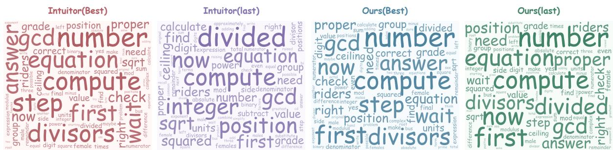  
Figure 9: Word clouds of generated responses from the best and last checkpoints of Intuitor and our method on the same ten MATH500 problems. Larger words indicate higher average within-response frequencies within each panel; common stopwords are omitted.

These experiments establish the insufficiency of the tested fixed-rate filtering and top-2 reward schemes in the observed runs; they do not isolate the contribution of each SIF component. Each configuration was evaluated once, and equal rollout steps do not imply equal numbers of responses contributing to optimization. The fixed-rate experiments also differ from the control in Table 3, which matches SIF’s filtering rate at each training step. Together, these comparisons support the importance of how feedback and training responses are selected, beyond simply reducing batch size or binarizing mean self-certainty.

## D Baseline Reproduction Configurations

Shared training setup. We implement GRPO, Intuitor, Vigor, TTRL, and SCOPE within the verl framework (Sheng et al., 2025), using Llama-3.2-3B-Instruct, Qwen2.5-Math-1.5B, and Qwen3- 1.7B as backbones. These runs use the MATH training split for policy optimization and the MATH test split for periodic validation, followed by evaluation on the reasoning benchmarks. Table 12 summarizes the common optimization settings; methodspecific and run-specific differences are described below.

GRPO. We use adv\_estimator=grpo and binary outcome rewards obtained by comparing extracted answers with MATH reference answers. Rewards are centered and divided by the sample standard deviation within each eight-response group, with a numerical stabilizer of 10−6. Policy optimization uses the clipped objective and KL regularization specified in Table 12, without a learned critic or reward model.

Table 12: Common baseline training settings. The configured PPO mini-batch size is expressed in prompts and expands to 512 sampled responses before distribution across GPUs.
<table><tr><td>Parameter</td><td>Value</td></tr><tr><td>Training budget</td><td>1 epoch</td></tr><tr><td>Prompt batch size</td><td>64</td></tr><tr><td>Responses per prompt</td><td>8</td></tr><tr><td>PPO mini-batch size</td><td>64</td></tr><tr><td>Micro-batch per GPU</td><td>4</td></tr><tr><td>PPO epochs per batch</td><td>1</td></tr><tr><td>Optimizer</td><td>AdamW</td></tr><tr><td>Adam coefficients</td><td>(0.9, 0.999)</td></tr><tr><td>Peak learning rate</td><td>3 × 10−6</td></tr><tr><td>Learning-rate schedule</td><td>Cosine decay</td></tr><tr><td>Warmup ratio</td><td>0.1</td></tr><tr><td>Weight decay</td><td>0.01</td></tr><tr><td>PPO clipping range</td><td>[0.8, 1.2]</td></tr><tr><td>Gradient clipping norm</td><td>1.0</td></tr><tr><td>KL loss coefficient</td><td>0.005</td></tr><tr><td>KL estimator</td><td>low_var_kl</td></tr><tr><td>KL penalty in reward</td><td>Disabled</td></tr><tr><td>Entropy coefficient</td><td>0</td></tr><tr><td>Maximum response length</td><td>3072 tokens</td></tr><tr><td>Rollout temperature</td><td>1.0</td></tr><tr><td>Rollout top-p / top-k</td><td>1.0 / disabled</td></tr><tr><td>Parameter updates</td><td>Full-model fine-tuning</td></tr><tr><td>Gradient checkpointing</td><td>Enabled</td></tr><tr><td>Distributed strategy</td><td>FSDP</td></tr><tr><td>Generation backend</td><td>vLLM, bfloat16</td></tr><tr><td>Hardware allocation</td><td>1 node, 8 A100 40G</td></tr><tr><td>Validation/save interval</td><td>GPUs Every 10 steps</td></tr></table>

Intuitor. We use adv\_estimator=Intuitor. Each response receives its mean token-level selfcertainty as the reward, followed by the same group normalization as GRPO. Reference-answer correctness is recorded for evaluation and diagnostics but does not determine the intrinsic reward. Intuitor uses all valid response tokens without SIF’s minimum-length eligibility rule or voting-based reward construction.

Vigor. We enable use\_Vigor=True, which selects the dedicated Vigor reward and advantage implementation. For each response, intrinsic score is

$$
r _ { i } ^ { \mathrm { V i g o r } } = - \sqrt { \left| \boldsymbol { o } _ { i } \right| } \left\| \nabla _ { \theta } \ell _ { i } ^ { \mathrm { N L L } } \right\| _ { 2 } ,\tag{37}
$$

where $\ell _ { i } ^ { \mathrm { { N L L } } }$ is the mean negative log-likelihood over valid response tokens. The norm is computed over all trainable model parameters separately for each response, with FP32 norm accumulation. Scores are ranked within each prompt group and mapped linearly to [−1, 1]. The resulting rewards are normalized using the sample standard deviation and a stabilizer of $1 0 ^ { - 4 }$ . Scoring gradients are discarded before policy optimization. Neither self-certainty nor reference-answer correctness enters this reward.

TTRL. We enable ttrl.enable=True and set both n\_votes\_per\_prompt and n\_samples\_per\_prompt to eight. Extracted and normalized final answers from the eight sampled responses determine a majority pseudo-label. All eight responses are retained for training and scored against that pseudo-label using the migrated TTRL answer grader. The resulting outcome rewards use GRPO advantages with the 10−6 stabilizer.

SCOPE. We enable scope.enable=True and scope\_confidence=True, with eight generated responses, eight voting candidates, four voters per pseudo-label subgroup, and $\lambda ~ = ~ 0 . 7$ . Stepwise confidence is computed from rollout logprobabilities using the migrated SCOPE procedure, with steps separated by the tokenizer’s representation of a blank line. Candidate subgroup sizes are {1, 2, 4, 8}. For each subgroup, four voters are sampled without replacement from the full eightresponse pool. Confidence-weighted votes produce subgroup pseudo-labels, and the subgroup size is selected using the reward–diversity Pareto criterion. Voting is repeated after selection to construct the final labels. GRPO advantage normalization remains over full eight-response prompt group, rather than separately within each subgroup. Original reference answers are used for validation and diagnostics, while optimization uses pseudo-label rewards.

## E Case Study

To illustrate more intuitively the performance collapse observed during Intuitor’s training, we selected the best checkpoint saved during training (before collapse) and the final checkpoint (after collapse) to generate responses to the same problem. For this comparison, we increased the maximum generation length to 8,192 tokens. A specific example is shown in Figure 10.

Problem. A proper divisor of an integer N is a positive divisor of N that is less than N. What is the sum of the proper divisors of the sum of the proper divisors of 284?

Reference answer: 284.

Ours

Best (Step 40) — Correct   
Full response: 1,870 tokens.   
Mean self-certainty: 92.07.   
[...]   
So the proper divisors are 1, 2, 4, 71, 142.   
[...]   
Calculating that: 1 + 2 is 3, plus 4 is 7, plus 71 is   
78, plus 142 is 220. So the sum of the proper   
divisors of 284 is 220.   
[...]   
But proper divisors are those less than 220. So   
exclude 220 itself. So the proper divisors are 1, 2,   
4, 5, 10, 20, 11, 22, 44, 55, 110.   
[...]   
So the sum of the proper divisors of 220 is 284.   
Therefore, the answer is 284.   
[...]   
284

Intuitor

Best (Step 20) — Correct   
Full response: 2,691 tokens.   
Mean self-certainty: 93.74.   
[...]   
So the divisors of 284 are 1, 2, 4, 71, 142, 284.   
But since we need proper divisors, which are less   
than 284, we exclude 284. So the proper divisors are   
1, 2, 4, 71, 142.   
[...]   
1 + 2 is 3, plus 4 is 7, plus 71 is 78, plus 142 is   
220.   
So the sum of the proper divisors of 284 is 220.   
[...]   
Now, proper divisors are those less than 220, so we   
exclude 220. Therefore, the proper divisors are 1, 2,   
4, 5, 10, 11, 20, 22, 44, 55, 110.   
[...]   
So the sum of the proper divisors of 220 is 284.   
Therefore, the answer is 284.   
[...]   
The sum of the proper divisors of the sum of the   
proper divisors of 284 is 284

Last (Step 115) — Correct   
Full response: 2,093 tokens.   
Mean self-certainty: 94.81.   
[...]   
So the divisors are 1, 2, 4, 71, 142, 284. Now,   
proper divisors are those less than 284. So excluding   
284 itself, the proper divisors are 1, 2, 4, 71, 142.   
[...]   
1 + 2 is 3. 3 + 4 is 7. 7 + 71 is 78. 78 + 142 is 220.   
So the sum of the proper divisors of 284 is 220.   
[...]   
Therefore, the proper divisors are 1, 2, 4, 5, 10,   
20, 11, 22, 44, 55, 110.   
[...]   
So the sum of the proper divisors of 220 is 284.   
Therefore, the answer is 284.   
[...]   
284

Last (Step 115) — Incorrect   
Full response: 3,641 tokens.   
Mean self-certainty: 101.60.   
[...]   
284 divided by 1 is 284, so 1 is a divisor. Then 284   
divided by 2 is 142, so 2 is a divisor.   
[...]   
From the above, we saw that 1, 2, 4, and then 71?   
Wait, 284 ÷ 4 is 71. So 4 and 71. Then check if 71 is   
a divisor. 71 × 4 is 284. So 71 is a divisor. Then   
check if there are any others. Let’s check 71:   
71 × 1 = 71, 71 × 2 = 142, 71 × 3 = 213, 71 × 4 = 284.   
So the divisors are 1, 2, 4, 71, and 284. But 284 is   
not a proper divisor, so proper divisors are 1, 2, 4,   
71. Let me confirm:   
1 × 284 = 284   
2 × 142 = 284   
4 × 71 = 284   
71 × 4 = 284   
So the divisors are 1, 2, 4, 71, and 284. Therefore,   
proper divisors are 1, 2, 4, 71.   
[...]   
So the sum of the proper divisors of 284 is 78.   
[...]   
So the proper divisors of 78 are 1, 2, 3, 6, 13, 26,   
39. Let me check: 1 × 78 = 78, 2 × 39 = 78,   
3 × 26 = 78, 6 × 13 = 78, 13 × 6 = 78, 26 × 3 = 78,   
39 × 2 = 78. So the proper divisors are 1, 2, 3, 6,   
13, 26, 39.   
[...]   
Final answer: 90

Figure 10: Qualitative comparison on the same MATH500 problem. Top: Ours, best checkpoint (step 40) and last checkpoint (step 115). Bottom: Intuitor, checkpoints at steps 20 and 115. Both responses from our method are correct, whereas Intuitor’s last response produces verbose and repetitive reasoning and gives an incorrect answer. Authentic excerpts are shown; [...] marks omissions. Bold emphasis, colors, and correctness labels are added. Token counts and mean self-certainty refer to the full responses, with temperature T = 0.6.