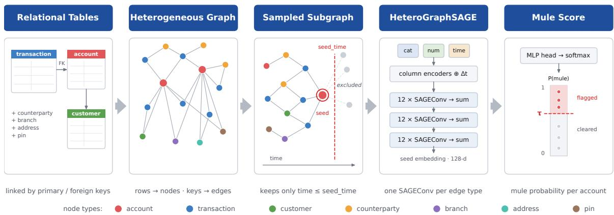
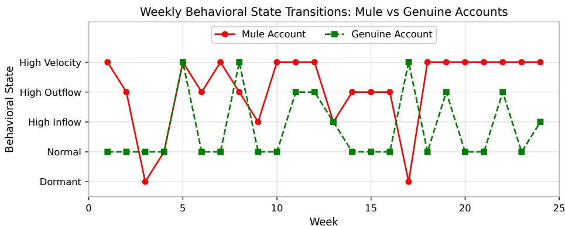
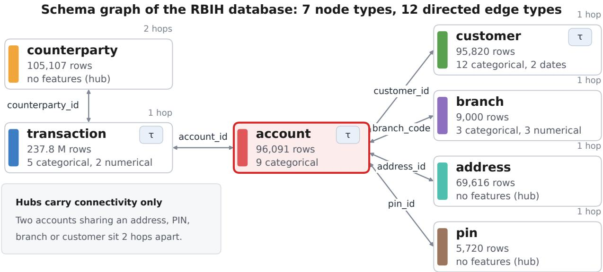
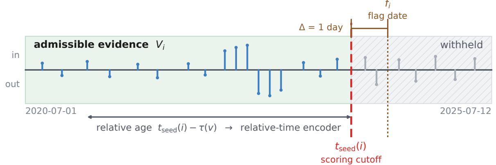
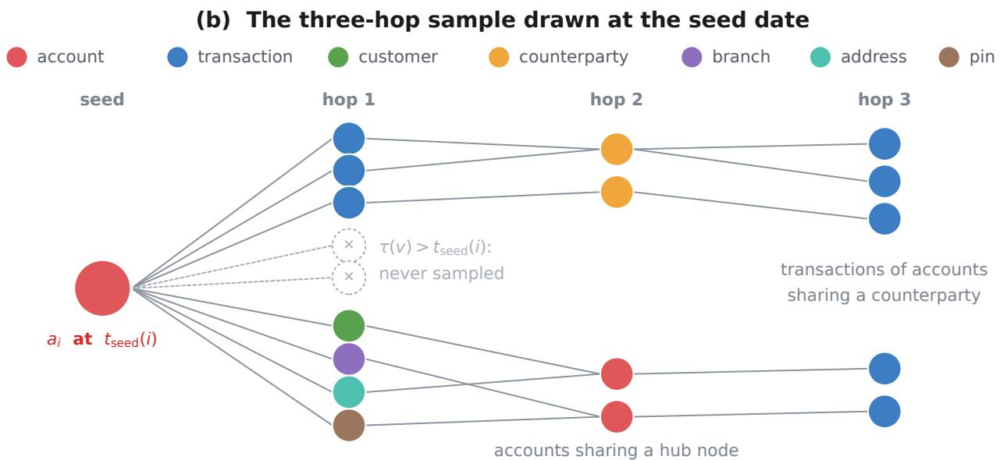
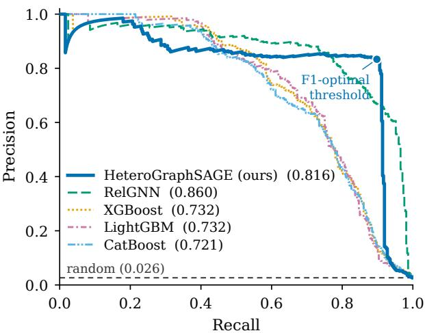

# MONEY-MULE DETECTION AS A RELATIONAL LEARNINGPROBLEM: A STUDY ON THE RBIH NFPC DATASET

Owais Ahmad

Applied Research, Quantiphi Marlborough, MA 01752, USA owais.ahmad@quantiphi.com

Anirudh Deodhar

Applied Research, Quantiphi Marlborough, MA 01752, USA anirudh.deodhar@quantiphi.com

## ABSTRACT

Money-mule networks move criminal funds through many small transfers, each of which looks ordinary on its own. What marks an account as a mule lies outside any single transfer: in the counterparties and addresses its network shares, and in the shape of its activity over time. Production systems remain largely rule-based and see neither, while most research classifies transactions rather than accounts, recovering account-level risk only by aggregating afterwards. We instead score the account directly, reading the bank’s relational schema as a heterogeneous graph in which rows are nodes and foreign keys are edges. Each account is scored from a multi-hop neighbourhood using per-column encoders, a relative-time encoding and HeteroGraphSAGE message passing, with that neighbourhood restricted to rows predating the account’s own pre-flag cutoff so that no model sees evidence recorded only after the account was flagged. On a five-year Reserve Bank Innovation Hub (RBIH) retail-banking dataset of 400 million transactions and 94,063 labelled accounts, 2.6% of them confirmed mules, we compare against RelGNN, XGBoost, LightGBM and CatBoost trained on identical labels, splits and cutoffs. Our detector recovers nine in ten held-out mules at 83% precision and a 0.5% false-alarm rate, finding 115 more mules than the strongest tree ensemble given the same evidence. At the tuned thresholds the gap is mostly in recall: XGBoost and LightGBM lead across the first hundred alerts, but only the graph models hold their precision deep into the queue. Since the graph is the schema itself and every score is dated per account, the approach deploys on a bank’s existing database without a custom feature graph build.

Keywords: money-mule detection, anti-money-laundering, relational deep learning, heterogeneous graph neural networks, graph neural network

## 1 Introduction

Context. Money laundering is what lets criminals use the proceeds of crime, and it operates at scale: the United Nations Office on Drugs and Crime puts the sums cycled through it at two to five percent of world output every year (between USD 0.8 and 2 trillion), of which less than one percent is ever seized or frozen [1]. Almost none of that money moves in a single transaction. It is broken into pieces, walked through accounts that appear ordinary, and reassembled somewhere. The account in the middle belongs to a money mule: a retail customer who receives funds they did not earn and forwards them or withdraws them as cash, some are paid a cut, many are recruited through a job advertisement, a relationship, or a message promising commission for a favor while few never learn what their account was used for.

Digital payments have made that account easier to use and harder to catch. India’s Unified Payments Interface settled roughly 228 billion transactions in 2025 [2], an average of 19 billion a month. Layering that once waited on clearing cycles now finishes in seconds, through accounts that are cheap to open and disposable once burned. India’s response has been institutional as much as analytical: the Indian Cyber Crime Coordination Centre’s Suspect Registry has circulated more than two million first-layer mule accounts to participating institutions [3], and the Reserve Bank has urged banks to adopt AI models [4]. To support that effort, the Reserve Bank Innovation Hub (RBIH) has publicly released five years of retail banking activity, comprising about 400 million transactions and 96,091 labelled accounts, 2,683 of them confirmed mules.

  
Figure 1: Overview of the pipeline, left to right. The released relational tables, linked by primary–foreign keys, are converted into a heterogeneous graph in which each row becomes a node typed by its table and each key reference becomes an edge. The seven node types are account, transaction, customer, counterparty, branch, address and pin. For each account to be scored (the seed), a subgraph is sampled around it that keeps only nodes timestamped at or before the seed time; later nodes are excluded. Column encoders embed each node’s categorical, numerical and time attributes, combined with a relative time encoding ∆t. A HeteroGraphSAGE network then propagates messages through three layers, each applying one SAGEConv per edge type (12 in total) and summing the results. The resulting 128-dimensional seed embedding is passed to an MLP head with softmax, which outputs the account’s mule probability; a tuned threshold τ then flags or clears the account.

Motivation. Operational monitoring remains largely a matter of rules and thresholds; a systematic review of network analytics for anti-money laundering finds expert-written rules and hand-built features to be the norm rather than the exception [5]. Two limits of that arrangement are structural, and neither is repaired by substituting a stronger classifier. Rules fire on transfers, whereas the decision a fraud programme actually makes concerns an account: which customers are worth an investigator’s day, and whose access should be suspended. A mule’s transfers, taken one at a time, are indistinguishable from normal activity: a salary-sized credit, a same-day debit, a cash withdrawal. Often no single transfer is anomalous at all.

What distinguishes a mule lies beyond any individual transfer, in two places. The first is relational: mules rarely operate alone, and a recruited network leaves fingerprints in the counterparties, addresses and postal codes that its accounts share. The second is temporal: an account’s history has a shape (a quiet stretch, a burst of inflow, a matching burst outward, silence again), and that shape says more than any single transfer within it. Summarising each account as a fixed set of aggregate statistics destroys both signals: the links to related accounts disappear entirely, and the temporal ordering collapses into means and counts. This is the case for modelling the data as a graph and retaining every relational and structural feature.

Our approach. Rather than designing a graph, we read the one the database already defines. Following relational deep learning [6, 7], every row becomes a node typed by its table, every primary–foreign key reference becomes an edge in both directions, and every timed row retains its own timestamp. The schema itself therefore supplies the graph, and no bespoke construction step is needed beyond assembling the released tables. Each account is then scored from a temporal sample of its own neighbourhood, taken as of that account’s scoring time, and the resulting embedding is read out as a mule probability that a tuned threshold converts into an alert.

## 2 Related Work

The default detector for tabular risk has long been the gradient-boosted decision tree [8–10], and on tabular data these ensembles remain competitive with deep alternatives [11]. The concerns that accompany them are equally long-standing, chief among them leakage introduced when a feature is computed over all labels rather than over training labels alone [12]. Their persistence is not only inertia: GADBench later showed that tree ensembles supplied with simple neighbourhood aggregates match purpose-built graph detectors across ten datasets [13], which is why gradient boosting appears below as a serious baseline rather than a formality.

In parallel, the graph literature developed its own vocabulary for aggregating over a node’s neighbourhood: sampled mean-and-concatenate updates [14], attention over neighbours [15, 16], and per-relation parameterisations for typed graphs [17, 18]. Financial applications followed. Transaction classification on labelled blockchain data [19] was joined by aggregators designed to resist camouflaged neighbourhoods [20, 21], by risk-aware propagation schemes [22, 23], and by laundering detection at production scale [24, 25]. More recent operators read a node’s time-ordered edge sequence directly [26] or bias attention using edge attributes [27]. Two properties of this work shaped our design. First, most of it operates at the transaction or edge level and implicates the account only afterwards, through aggregation, whereas our labels attach directly to account holders. Second, its public datasets are synthetic, drawn from cryptocurrency, or concerned with a different financial crime [19, 28, 29].

Work aimed specifically at mule accounts arrived later, is limited in volume, and relies throughout on proprietary data. DELATOR [30] learns client-level embeddings on a Brazilian bank’s temporal transaction graph, but does not condition each client on its own as-of date. The model architecturally closest to ours, Johannessen and Jullum [31], trains a heterogeneous message-passing network on a Norwegian bank’s graph of customers and counterparties at well under one percent prevalence. It classifies nodes transductively over the full graph, splitting only the labels. We also keep one shared graph, but score every account only from its own cutoff-bounded neighbourhood. MuleTrack [32] takes a behavioural route, fitting a lightweight Markov model over hand-specified weekly states, which we borrow only to characterise accounts (Figure 2). Zhang et al. [33] detect mule customers with gradient-boosted trees under a single global temporal split.

Two of these settings locate the exposure in the evaluation protocol rather than in any individual feature: transductive inference [31] and a global temporal split [25, 33] both give every account the same cutoff regardless of when its label was decided. A related question concerns what is reported. Because analyst capacity, not accuracy, is the operational constraint, we report queue-based metrics alongside threshold-free ones.

The framing we adopt comes from a separate line of work. Relational deep learning treats a database as a graph already: rows are nodes, foreign-key references are edges, and a task is defined per entity at a given timestamp [6, 7]. The graph then needs no bespoke construction step, and temporal neighbour sampling provides a single auditable point at which to enforce a per-account cutoff. Within this setting, RelGNN composes messages along atomic routes derived from the schema and reports the strongest current results among relational graph models [34]; we run it as our second graph model.

## 3 Problem Formulation

The database as a graph. Following Fey et al. [6], we read the institution’s relational database directly as a heterogeneous graph $G = ( V , E , \tau )$ . Every row becomes a node, typed by the table it comes from; every primary– foreign key reference becomes an edge, materialised in both directions; and $\tau ( v )$ is the timestamp of the row behind node v. Some rows have no time of their own, a shared identifier, for instance and for these we set $\tau ( v ) = \bot$

Labels. Let $A \subset V$ be the set of account nodes and ${ \mathcal { L } } \subseteq A$ the labelled subset, where $y _ { i } \in \{ 0 , 1 \}$ records whether account $a _ { i }$ was confirmed to be a money mule. Each positive account also carries aflag date $f _ { i }$ , the date on which the investigation concluded.

Scoring cutoffs. The flag date is an output of an investigation, so anything recorded as a result of that investigation falls on or after $f _ { i }$ . A model that claims to detect the account beforehand must not see any of it. We therefore give every labelled account its own scoring cutoff,

$$
t _ { \mathrm { s e e d } } ( i ) = \left\{ \begin{array} { l l } { \operatorname* { m i n } \big ( f _ { i } - \Delta , ~ T _ { \mathrm { e n d } } \big ) , } & { y _ { i } = 1 , } \\ { \rho ( a _ { i } ) , } & { y _ { i } = 0 , } \end{array} \right.\tag{1}
$$

where $\Delta$ is one day, $T _ { \mathrm { e n d } }$ is the end of the modelling window, and $\rho ( a _ { i } ) = t _ { i } ^ { \mathrm { l a s t } } - \Delta$ with $t _ { i } ^ { \mathrm { l a s t } }$ the date of the account’s last transaction. A mule is thus scored on its history up to one day before its flag date, and a non-mule on its history up to one day before its last transaction; non-mule accounts with no transactions are dropped. The positive case is dictated by the data. The negative case is not: a non-mule account carries no flag date and hence no natural as of date, so the cutoff rule $\rho$ is a modelling choice.

Admissible evidence. Given a cutoff, the evidence admissible for $a _ { i }$ is whatever existed in the graph at that time:

$$
V _ { i } ~ = ~ \big \{ ~ v \in V ~ : ~ \tau ( v ) = \bot ~ \mathrm { o r } ~ \tau ( v ) \leq t _ { \mathrm { s e e d } } ( i ) ~ \big \} ,\tag{2}
$$

and $G _ { i }$ is the $L .$ -hop neighbourhood of $a _ { i }$ in the subgraph induced by $V _ { i }$ . Untimestamped nodes are admissible because they carry no time-dependent information: a shared counterparty, address or PIN is only a routing device, branch attributes carry no timestamp and are treated as static, and every timestamped attribute reached through them is itself filtered by Equation (2).

Table 1: The seven tables of the assembled RBIH database, the node type each becomes, and the columns each contributes as features. Hub tables are deliberately featureless: they carry connectivity only. Row counts are after restriction to labelled accounts and their transactions.
<table><tr><td>Table</td><td>Node type</td><td>Rows</td><td>Feature columns</td></tr><tr><td>transaction</td><td>TRANSACTION</td><td>237,785,028</td><td>5 categorical, 2 numerical, timestamp</td></tr><tr><td>counterparty</td><td>COUNTERPARTY</td><td>105,107</td><td>— (hub)</td></tr><tr><td>account</td><td>ACCOUNT</td><td>96,091</td><td>9 categorical, opening date</td></tr><tr><td>customer</td><td>CUSTOMER</td><td>95,820</td><td>12 categorical, 2 dates</td></tr><tr><td>address</td><td>ADDRESS</td><td>69,616</td><td>— (hub)</td></tr><tr><td>branch</td><td>BRANCH</td><td>9,000</td><td>3 categorical, 3 numerical</td></tr><tr><td>pin</td><td>PIN</td><td>5,720</td><td>— (hub)</td></tr></table>

A model is then any function $f _ { \theta }$ that depends on $a _ { i }$ only through $G _ { i }$

$$
s _ { i } ~ = ~ f _ { \theta } ( G _ { i } ) ~ \approx ~ \mathrm { P r } \bigl ( y _ { i } = 1 ~ | ~ G _ { i } \bigr ) ,\tag{3}
$$

and we impose Equations (2) to (3) on every model we report, graph or tabular. Two properties follow. Each account is cut at its own date, so this is not a global temporal split. Nothing outside $G _ { i }$ enters the computation, so scoring is inductive.

Data and metrics. Equations (1) to (3) are stated for any labelled entity table in any schema; what follows binds them to our dataset, which carries labels for 96,091 accounts. Of these, |L| = 94,063 admit a well-defined cutoff under Equation (1), and 2,488 are mules—a prevalence of 2.6%. At that rate a model that answers “not a mule” everywhere is 97.4% accurate, so accuracy carries no information. We report ROC-AUC and PR-AUC for ranking quality, together with the queue quantities an analyst actually experiences,

$$
\mathrm { P @ } k = \frac { 1 } { k } \sum _ { i \in { \cal S } _ { k } } y _ { i } , \qquad \mathrm { R @ } k = \frac { \sum _ { i \in { \cal S } _ { k } } y _ { i } } { \sum _ { i } y _ { i } } ,\tag{4}
$$

where $\boldsymbol { S } _ { k }$ is the set of the k highest-scoring held-out accounts. At a fixed operating point we also report precision, recall, $F _ { 1 }$ and the false-alarm rate, along with the confusion counts behind them. Every threshold is selected on validation data and applied unchanged; whether it survives out of sample turns out to be one of the more informative differences between the models (Section 7.1). Throughout, the unit of prediction is the account, not the ring.

## 4 Dataset

The data comes from the Reserve Bank Innovation Hub (RBIH)1 and covers five years of retail banking activity at Indian institutions, from 2020-07-01 to 2025-07-12. It comprises the seven tables of Table 1, and is restricted to the labelled accounts and their transactions, which reduces the roughly 400 million released transactions to the 237.8 million rows of the transaction table. Columns recording the aftermath of an investigation—account status, freeze and unfreeze dates, alert reason, flagging branch—are removed when the database is written, as are reporting-time balances and the IP field, which at 66% null and nearly unique per transaction carries identifiers rather than structure. Of the 96,091 labelled accounts (2,683 mules), 94,063 admit a well-defined cutoff under Equation (1). The rest are 46 mules flagged before the window opens, 1,809 non-mules with no transactions, and 173 accounts (149 of them mules) whose cutoff precedes account opening. This leaves 2,488 mules, a prevalence of 2.6%. A class-stratified 70/15/15 holdout with a fixed seed separates entities rather than time, temporal safety being carried per account by the cutoff. Visible history differs by class—mules have a median of 1,196 transactions against 1,987 for non-mules—and so does its shape: Figure 2 shows the weekly trajectory of a mule and a genuine account over the 24 weeks before their cutoffs, the mule spending most weeks in high-velocity or high-outflow states while the genuine account mostly stays normal.

## 5 Method

## 5.1 From relational schema to heterogeneous graph

We read the graph directly off the assembled schema. Six foreign-key references—transaction to account and to counterparty, and account to customer, branch, address and PIN, the last two carried onto the account from its customer record when the database is assembled—connect the seven node types of Table 1. Each is materialised in both directions, so that messages travel from a transaction up to the account that owns it and back down [6], giving twelve directed edge types. The rule doing this work is schema-agnostic—one node type per table, one bidirectional edge type per foreign key—so the graph an institution gets is whatever its own schema already encodes. Figure 3 draws the graph the instance evaluated here yields: which tables become which node types, which references connect them, and which of those types carry a timestamp for the cutoff of Equation (2) to act on.

  
Figure 2: Weekly behavioural state of one flagged mule and one genuine account over the 24 weeks before their cutoffs. States come from each account’s own pre-cutoff transactions via population deciles of weekly relative velocity and credit share; none is derived from labels. The mule alternates high-velocity and directional-flow weeks, with brief dormant spells, and ends in a sustained high-velocity run; the genuine account returns to NORMAL between occasional excursions.

Node features are the table’s own columns, typed once and left alone. COUNTERPARTY, ADDRESS and PIN carry none: they exist purely as shared endpoints, so two accounts sharing an address or PIN code sit two hops apart, and two accounts paying the same counterparty sit four hops apart, in each case without any clique between them. This keeps the graph linear rather than quadratic in the number of accounts sharing an identifier, and it is where the fanout budget of Section 5.2 is spent. Relational context must therefore be obtained by message passing, which leaves the cutoff of Equation (2) as the only point at which post-cutoff information could enter.

## 5.2 Leakage-safe temporal neighbour sampling

For the graph models, the cutoff is enforced in exactly one place: the sampler. For a batch of seed accounts we draw a three-hop neighbourhood with a temporal neighbour loader [35], configured with each seed’s own $t _ { \mathrm { s e e d } } ( i )$ as its input time. A candidate node joins the subgraph only if its timestamp satisfies Equation (2), so one graph sits on disk with no per-split copies and a single place to audit. The per-hop fanout is [4096, 512, 128]. The wide first hop is forced rather than chosen: with a median of 1,987 visible transactions per non-mule, a small hop-one budget would subsample precisely the history the task is about. At batch size 192 this admits up to 786,432 hop-one transaction nodes per step; training runs 343 steps per epoch and peaks at 51.88 GiB on an 80 GB A100. Sampling is stochastic and we do not average over draws, so a fresh pass differs slightly from the training-time scores. Figure 4 shows the two halves of this together: the per-account cutoff that decides what counts as admissible, and the three-hop sample the loader returns once that cutoff has been applied.

## 5.3 Column encoders and relative-time encoding

Every node type is encoded into a shared 128-dimensional space by a per-column encoder bank [7]: embeddings for categorical fields, a linear map for numerical ones, and cyclical features for timestamps, followed by a four-layer ResNet table encoder per node type. Two departures from the default recipe follow from wanting a model that can score tomorrow’s rows without re-reading yesterday’s.

First, rather than standardising each numerical column by its dataset mean and standard deviation, we squash it rowlocally inside the forward pass with $x \mapsto \mathrm { s i g n } ( x ) \log ( 1 + | x | )$ . A value therefore maps to the same number in any future batch, and the transform travels with the checkpoint. For consistency we also neutralise the dataset-derived statistics the encoders would otherwise use—the mean and standard deviation on the eight numerical columns (the five of Table 1 plus a constant placeholder on each featureless hub), and the year range on the four timestamp columns—retaining only the categorical cardinalities.

  
Every foreign key is materialised in both directions, giving 12 directed edge types.  
τ marks a table with a time column; the unbadged types are untimed (τ = ⊥) and are always admissible.  
Figure 3: The heterogeneous graph that the schema of Table 1 yields under the rule above—read off the database rather than designed. Every row is a node typed by its table and every primary–foreign key reference is an edge materialised in both directions, giving twelve directed edge types over seven node types. A τ badge marks a table carrying a time column; the unbadged types are untimed, $\tau ( v ) = \perp$ , and so are always admissible under Equation (2). COUNTERPARTY, ADDRESS and PIN hold no features of their own: they exist as shared endpoints, which places accounts that share one of them within a short path of each other without a clique between them.

Second, a relative-time encoder maps $t _ { \mathrm { s e e d } } ( i ) - \tau ( v )$ , in days, to a vector added to every timestamped node’s embedding. The model therefore sees each row’s age with respect to the account’s own cutoff, in addition to the calendar features of the timestamp encoder, which is what makes a per-account cutoff meaningful at all. It is also the channel through which any regularity in how cutoffs were assigned would reach the model.

## 5.4 Message passing, readout and training

The message-passing block is deliberately standard. Each of three layers holds one SAGECONV [14] per edge type— thirty-six in total—whose outputs are summed across relations at every destination node, followed by per-node-type layer normalisation and a ReLU. Three hops are what the task needs: an account’s own transactions, address and PIN, then the counterparties its transactions touch and the other accounts sharing its address or PIN, then the wider activity around them. Readout passes the seed account rows through a single linear layer to two logits, whose softmax gives $s _ { i } = P ( { \mathrm { m u l e } } )$ . The two-class head keeps the loss an ordinary weighted cross-entropy and the score a directly thresholdable probability.

Training up-weights the positive class by min $( n _ { \mathrm { n e g } } / n _ { \mathrm { p o s } } , 1 0 0 ) = 3 6 . 8 0$ and uses AdamW [36] at learning rate $1 0 ^ { - 3 }$ and weight decay $1 0 ^ { - 4 }$ , with gradient-norm clipping at 1.0. We early-stop on validation ROC-AUC with patience 20; the run reported below stopped at epoch 29 having selected epoch 9. Selecting on ROC-AUC while reporting PR-AUC is a mismatch, and since the selected epoch was not the best-PR-AUC epoch, our PR-AUC is pessimistic by an unmeasured amount. Because probabilities at this prevalence are not calibrated around 0.5, the operating point is a separate decision made on validation only: we take the $F _ { 1 }$ -optimal threshold there and apply it unchanged to the held-out split. Scoring is inductive, so a newly opened account needs no rebuild and no retraining.

## 6 Experimental Setup

Baselines. We compare against four systems. One is a stronger graph architecture given the identical relational input, which asks whether a more expressive message-passing scheme pays off here. The other three are the standard tabular models, given the same underlying evidence flattened into per-account rows, which asks how much the graph structure contributes at all. RelGNN [34] is the first of these: it replaces our message-passing block and leaves everything else in place—fourteen composite atomic routes derived from our schema, two layers of eight heads at 128 channels, summed across routes. Only the batch size differs. At this fanout a batch of 192 exhausts 80 GB, so RelGNN is trained at 96, a real asymmetry that should be kept in mind when comparing the two graph models.

Leakage-safe temporal sampling: one cutoff per account (a) Every account has its own subgraph sampling date  

  
Figure 4: Leakage-safe temporal neighbour sampling. (a) One seed account’s transactions on a time axis, credits above the line and debits below. Rows at or before that account’s own cutoff $t _ { \mathrm { s e e d } } ( i )$ make up the admissible evidence $V _ { i }$ of Equation (2); the hatched region, running through the flag date $f _ { i }$ and beyond, is withheld from every model we report; $f _ { i } = t _ { \mathrm { s e e d } } \bar { ( } i ) + \Delta$ unless $f _ { i } - \Delta$ exceeds $T _ { \mathrm { e n d } }$ . The arrow beneath the axis is the quantity the relative-time encoder of Section 5.3 consumes: a row’s age measured against that account’s own cutoff rather than against any absolute date. (b) The three-hop sample drawn at that date. Hollow dashed nodes are candidates whose timestamp fails the cutoff; they never enter the subgraph, so nothing reachable only through them enters either. Untimed rows have no timestamp to test and are admitted unconditionally.

The three gradient-boosted models—XGBoost [8], LightGBM [9] and CatBoost [10]—receive the same evidence flattened into 58 per-account features: static attributes of the account, its customer and its branch, three age quantities measured against the cutoff, and twenty-eight aggregates of the account’s own visible transactions (counts, amount moments, debit/credit splits, distinct counterparties, channels, MCCs, sub-types, recency and span). Every aggregate obeys the same $\tau ( v ) \leq \dot { t } _ { \mathrm { s e e d } } ( i )$ filter the sampler applies, so the trees see no later history than the graph models do, and in fact all of it, where the sampler caps hop one at 4,096 transactions. What they do not see is structure. XGBoost and CatBoost run to 3,000 rounds with early stopping on validation AUC (patience 50); LightGBM uses a fixed 400 rounds, since on this imbalance early stopping halts it at the first or second iteration and leaves a stump. All three are run over three seeds and selected on validation PR-AUC. Across all five systems the label tables, split masks, cutoffs, class weighting of 36.80 and threshold-selection protocol are identical, and none receives a label-derived feature.

Table 2: Threshold-free quality on the held-out split (373 mules / 14,110 accounts, base rate 0.0264). Both graph models are single-seed; the gradient-boosted rows are the seed selected on validation PR-AUC out of three. Best per column in bold.
<table><tr><td>Model</td><td>Family</td><td>ROC-AUC</td><td>PR-AUC</td></tr><tr><td>HeteroGraphSAGE (ours)</td><td>GNN</td><td>0.9592</td><td>0.8154</td></tr><tr><td>RelGNN</td><td>GNN</td><td>0.9848</td><td>0.8598</td></tr><tr><td>XGBoost</td><td>GBM</td><td>0.9541</td><td>0.7324</td></tr><tr><td>LightGBM</td><td>GBM</td><td>0.9479</td><td>0.7325</td></tr><tr><td>CatBoost</td><td>GBM</td><td>0.9538</td><td>0.7213</td></tr></table>

Implementation. The pipeline is built on PyTorch Geometric [35], with RelBench [7] providing graph construction and the column and temporal encoders. Each run occupies one 80 GB A100, and the graph is cached once. Cost is dominated by neighbour sampling: our model ran 343 steps per epoch at 5–6 minutes an epoch, while RelGNN at batch 96 ran 686 steps at roughly 11 minutes an epoch and early-stopped at epoch 93—about three hours of wall clock end to end for ours against eighteen for RelGNN. For the curves of Section 7.1 the gradient-boosted models reproduce their recorded metrics exactly, while the graph models are re-run in inference mode, where stochastic sampling matches the recorded ROC-AUC and PR-AUC to within 0.003.

## 7 Results

## 7.1 Ranking quality and fixed thresholds

Table 2 reports threshold-free quality on the held-out split: 373 mules among 14,110 accounts, a base rate of 0.0264. All five models rank far above chance, so the comparisons that matter are between them. RelGNN ranks best, exceeding our model by 0.026 ROC-AUC and 0.044 PR-AUC. The three trees cluster at 0.721–0.733 PR-AUC, about 0.08–0.09 below our model and 0.13 below RelGNN, and are separated from one another by 0.011, comparable to the seed-to-seed spread of a single tree ensemble. Figure 5 shows where the graph models earn the margin: the trees match or exceed them up to roughly 0.4 recall, and the graph models pull ahead sharply after it.

  
Figure 5: Precision-recall on the held-out split, PR-AUC in the legend; the dashed line is the prevalence-random baseline (0.026) and the dot our $F _ { 1 }$ -optimal operating point. Graph-model scores come from a re-inference pass, exact to within 0.003.

Ranking quality shows what a model could deliver, while a fixed threshold shows what it does deliver, and the ordering of the two graph models reverses once a threshold is fixed. Table 3 reports the $F _ { 1 }$ -optimal operating point of Section $5 . 4 ,$ selected on validation and applied unchanged. Our model attains $\dot { F } _ { 1 } = 0 . 8 6 \dot { 6 } 3$ at 83.2% precision and 90.3% recall, catching 337 of 373 mules against 68 false alarms. RelGNN, the better ranker, drops to $\begin{array} { r } { \bar { F } _ { 1 } = 0 . 7 9 3 0 \colon } \end{array}$ : its validationoptimal threshold of 0.980 sits in the extreme tail of its score distribution, where a small validation-to-test shift costs a large amount of recall, whereas ours sits at 0.640 in a flatter region. The trees land between 0.654 and 0.680 $F _ { 1 }$ limited by recall rather than precision. The reading is not that one model is better but that the two suit different products: RelGNN threshold-free ranking, ours a fixed-threshold decision rule.

Table 3: The $F _ { 1 }$ -optimal operating point on the held-out split. Each model’s threshold is selected on validation and applied unchanged; FA is the false-alarm rate on the 13,737 non-mules. Best per column in bold.
<table><tr><td>Model</td><td>Thr.</td><td> $F _ { 1 }$ </td><td>P</td><td>R</td><td>FA</td><td>TP</td><td>FP</td><td>FN</td><td>TN</td></tr><tr><td>HeteroGraphSAGE (ours)</td><td>0.640</td><td>0.8663</td><td>0.832</td><td>0.903</td><td>0.50%</td><td>337</td><td>68</td><td>36</td><td>13,669</td></tr><tr><td>RelGNN</td><td>0.980</td><td>0.7930</td><td>0.795</td><td>0.791</td><td>0.55%</td><td>295</td><td>76</td><td>78</td><td>13,661</td></tr><tr><td>XGBoost</td><td>0.905</td><td>0.6772</td><td>0.728</td><td>0.633</td><td>0.64%</td><td>236</td><td>88</td><td>137</td><td>13,649</td></tr><tr><td>LightGBM</td><td>0.810</td><td>0.6799</td><td>0.793</td><td>0.595</td><td>0.42%</td><td>222</td><td>58</td><td>151</td><td>13,679</td></tr><tr><td>CatBoost</td><td>0.905</td><td>0.6543</td><td>0.700</td><td>0.614</td><td>0.71%</td><td>229</td><td>98</td><td>144</td><td>13,639</td></tr></table>

Table 4: Queue behaviour on the held-out split: precision and recall among the top k scored accounts. Best per column in bold.
<table><tr><td rowspan="2">Model</td><td colspan="2">Precision@k</td><td colspan="2">Recall@k</td></tr><tr><td>100</td><td>500</td><td>100</td><td>500</td></tr><tr><td>HeteroGraphSAGE (ours)</td><td>0.920</td><td>0.680</td><td>0.247</td><td>0.912</td></tr><tr><td>RelGNN</td><td>0.960</td><td>0.676</td><td>0.257</td><td>0.906</td></tr><tr><td>XGBoost</td><td>0.990</td><td>0.562</td><td>0.265</td><td>0.753</td></tr><tr><td>LightGBM</td><td>0.980</td><td>0.564</td><td>0.263</td><td>0.756</td></tr><tr><td>CatBoost</td><td>0.960</td><td>0.562</td><td>0.257</td><td>0.753</td></tr></table>

## 7.2 Analyst-queue behaviour

In practice, analysts work through a queue of fixed length rather than apply a threshold. Table 4 therefore reports precision and recall among the top k scored accounts, and it holds the sharpest contrast in this study. $\mathbf { A } \mathbf { t } ~ k = 1 0 0$ the trees match or beat both graph models: XGBoost places 99 mules in its first hundred alerts, LightGBM 98 and CatBoost 96, against 92 for our model and 96 for RelGNN. A hundred alerts is a plausible daily budget for a small review team, and on that budget a well-featurised tree is the better tool. By $k = 5 0 0$ the ordering has reversed and the margin is wide: the graph models hold 0.676–0.680 precision while all three trees fall to 0.562–0.564. The trees are excellent at the very top of their ranking and poor across the rest of it, which is their weak thresholded recall in Table 3 seen from the operational side.

At their $F _ { 1 }$ -optimal points the two families nearly meet on precision—0.700–0.793 for the trees against 0.795–0.832 for the graph models—and stay far apart on recall, 0.595–0.633 against 0.791–0.903. The best tree, LightGBM, finds 222 of 373 mules and ours finds 337, so the 0.19 $F _ { 1 }$ gap between them comes almost entirely from those 115 accounts. Since the trees receive the same admissible history aggregated over the same cutoff but no neighbourhood features, the difference most likely comes from what they cannot see: the identifiers an account shares, the activity reachable through them, and the temporal ordering that aggregation discards. Two things bound how much of this to credit to architecture. Widening the per-hop fanout from [4096, 32, 32] to [4096, 512, 128] under an otherwise identical recipe moved our validation PR-AUC from 0.695 to 0.762 (test: 0.746 to 0.815)—a change comparable to the entire graph-versus-tree margin, so a comparison run at a narrow fanout would measure the fanout instead. And the trees’ three-seed validation PR-AUC spreads (0.7393–0.7404, 0.7267–0.7369 and 0.6857–0.7116) give an informal noise floor on the tabular side and none on the graph side, so the 0.044 PR-AUC between the two graph models should be read with that in mind.

## 8 Limitations and Future Work

The labels mark confirmed mules, and every other account is treated as a negative, so an undetected mule ring is not merely absent from the positives, it is taught to the model as normal. Our evaluation cannot measure this, because the only ground truth available is the same investigative record the model is fitted to—every precision figure we report is bounded by what that process happened to reach. The response is to stop treating unlabelled accounts as confirmed negatives: positive–unlabelled training, or an anomaly objective over the same graph, would let unusual structure surface without a prior label. Scoring connected structures rather than individual accounts would put the unit of detection where the behaviour actually lives; we leave this to future work.

## 9 Conclusion

The question we set out to answer was whether a faithful reading of a bank’s own schema, with time respected per account, is enough to detect mule accounts well, and our results suggest that it is. The RBIH database is read directly as a heterogeneous graph, each account is cut at its own pre-flag date, and the sampler admits only rows recorded at or before that cut—so nothing knowable only after an investigation reaches the model. On held-out accounts the detector reaches ROC-AUC 0.959 and PR-AUC 0.815, and at its tuned threshold recovers 337 of 373 mules at 83.2% precision and a 0.50% false-alarm rate, which is 115 more mules than the best tree given the same evidence.

We draw four further conclusions. At a fixed threshold, relational structure buys recall more than precision: the two families nearly agree on how clean their alerts are and disagree on how many mules they find at all. A better ranker is not automatically a better detector, as RelGNN shows by ranking above us and still losing 0.073 $F _ { 1 }$ once a threshold is fixed. And the choice of metric depends on the review team’s capacity, since XGBoost and LightGBM lead in the first hundred alerts but all three trees fall well behind by five hundred. Finally, the cutoff for non-mule accounts is a modelling choice rather than a fact in the data, so it has to be stated explicitly, and is better tied to an event independent of the account’s own activity.

## References

[1] United Nations Office on Drugs and Crime. Money laundering: Overview. https://www.unodc.org/unodc/en/ money-laundering/overview.html, 2024. Estimates the annual laundered flow at 2–5% of global GDP, of which under 1% is seized.

[2] National Payments Corporation of India. UPI product statistics. https://www.npci.org.in/what-we-do/upi/ product-statistics, 2026. Approximately 228 billion UPI transactions in calendar year 2025.

[3] Indian Cyber Crime Coordination Centre, Ministry of Home Affairs, Government of India. Suspect registry: Reporting of first-layer mule accounts. Figures as reported in replies to Parliament, December 2025, 2025.

[4] Reserve Bank of India. Statement on developmental and regulatory policies. 6 December 2024, 2024. Announces Mule-Hunter.AI, a mule-account detection model developed by the Reserve Bank Innovation Hub.

[5] Bruno Deprez, Toon Vanderschueren, Bart Baesens, Tim Verdonck, and Wouter Verbeke. Network analytics for anti-money laundering: A systematic literature review and experimental evaluation. INFORMS Journal on Data Science, 5(2):119–154, 2025. doi: 10.1287/ijds.2024.0042.

[6] Matthias Fey, Weihua Hu, Kexin Huang, Jan Eric Lenssen, Rishabh Ranjan, Joshua Robinson, Rex Ying, Jiaxuan You, and Jure Leskovec. Position: Relational deep learning – graph representation learning on relational databases. In International Conference on Machine Learning (ICML), 2024.

[7] Joshua Robinson, Rishabh Ranjan, Weihua Hu, Kexin Huang, Jiaqi Han, Alejandro Dobles, Matthias Fey, Jan E. Lenssen, Yiwen Yuan, Zecheng Zhang, Xinwei He, and Jure Leskovec. Relbench: A benchmark for deep learning on relational databases. arXiv:2407.20060, 2024.

[8] Tianqi Chen and Carlos Guestrin. Xgboost: A scalable tree boosting system. In ACM SIGKDD Conference on Knowledge Discovery and Data Mining (KDD), pages 785–794, 2016. doi: 10.1145/2939672.2939785.

[9] Guolin Ke, Qi Meng, Thomas Finley, Taifeng Wang, Wei Chen, Weidong Ma, Qiwei Ye, and Tie-Yan Liu. Lightgbm: A highly efficient gradient boosting decision tree. In Advances in Neural Information Processing Systems (NeurIPS), 2017.

[10] Liudmila Prokhorenkova, Gleb Gusev, Aleksandr Vorobev, Anna Veronika Dorogush, and Andrey Gulin. Catboost: Unbiased boosting with categorical features. In Advances in Neural Information Processing Systems (NeurIPS), 2018.

[11] Léo Grinsztajn, Edouard Oyallon, and Gaël Varoquaux. Why do tree-based models still outperform deep learning on typical tabular data? In Advances in Neural Information Processing Systems (NeurIPS), 2022.

[12] Shachar Kaufman, Saharon Rosset, Claudia Perlich, and Ori Stitelman. Leakage in data mining: Formulation, detection, and avoidance. ACM Transactions on Knowledge Discoveryfrom Data, 6(4), 2012. doi: 10.1145/2382577.2382579.

[13] Jianheng Tang, Fengrui Hua, Ziqi Gao, Peilin Zhao, and Jia Li. Gadbench: Revisiting and benchmarking supervised graph anomaly detection. In Advances in Neural Information Processing Systems (NeurIPS), pages 29628–29653, 2023.

[14] William L. Hamilton, Rex Ying, and Jure Leskovec. Inductive representation learning on large graphs. In Advances in Neural Information Processing Systems (NeurIPS), pages 1025–1035, 2017.

[15] Petar Velickoviˇ c, Guillem Cucurull, Arantxa Casanova, Adriana Romero, Pietro Liò, and Yoshua Bengio. Graph attention´ networks. In International Conference on Learning Representations (ICLR), 2018.

[16] Shaked Brody, Uri Alon, and Eran Yahav. How attentive are graph attention networks? In International Conference on Learning Representations (ICLR), 2022.

[17] Michael Schlichtkrull, Thomas N. Kipf, Peter Bloem, Rianne van den Berg, Ivan Titov, and Max Welling. Modeling relational data with graph convolutional networks. In European Semantic Web Conference (ESWC), volume 10843, pages 593–607, 2018. doi: 10.1007/978-3-319-93417-4\_38.

[18] Ziniu Hu, Yuxiao Dong, Kuansan Wang, and Yizhou Sun. Heterogeneous graph transformer. In The Web Conference (WWW), pages 2704–2710, 2020. doi: 10.1145/3366423.3380027.

[19] Mark Weber, Giacomo Domeniconi, Jie Chen, Daniel Karl I. Weidele, Claudio Bellei, Tom Robinson, and Charles E. Leiserson. Anti-money laundering in bitcoin: Experimenting with graph convolutional networks for financial forensics. In KDD Workshop on Anomaly Detection in Finance, 2019.

[20] Yingtong Dou, Zhiwei Liu, Li Sun, Yutong Deng, Hao Peng, and Philip S. Yu. Enhancing graph neural network-based fraud detectors against camouflaged fraudsters. In ACM International Conference on Information and Knowledge Management (CIKM), pages 315–324, 2020. doi: 10.1145/3340531.3411903.

[21] Yang Liu, Xiang Ao, Zidi Qin, Jianfeng Chi, Jinghua Feng, Hao Yang, and Qing He. Pick and choose: A GNN-based imbalanced learning approach for fraud detection. In The Web Conference (WWW), pages 3168–3177, 2021. doi: 10.1145/3442381.3449989.

[22] Jianheng Tang, Jiajin Li, Ziqi Gao, and Jia Li. Rethinking graph neural networks for anomaly detection. In International Conference on Machine Learning (ICML), 2022.

[23] Sheng Xiang, Guibin Zhang, Dawei Cheng, and Ying Zhang. Enhancing attribute-driven fraud detection with risk-aware graph representation. IEEE Transactions on Knowledge and Data Engineering, pages 1–12, 2025. doi: 10.1109/TKDE.2025.3543887.

[24] Mário Cardoso, Pedro Saleiro, and Pedro Bizarro. LaundroGraph: Self-supervised graph representation learning for anti-money laundering. In ACM International Conference on AI in Finance (ICAIF), 2022. doi: 10.1145/3533271.3561727.

[25] Béni Egressy, Luc von Niederhäusern, Jovan Blanuša, Erik Altman, Roger Wattenhofer, and Kubilay Atasu. Provably powerful graph neural networks for directed multigraphs. In AAAI Conference on Artificial Intelligence (AAAI), 2024.

[26] Stan Verlaan, Ioana Hulpu¸s, and Erik Jan van Leeuwen. LAS-GNN: A graph neural network for temporal money laundering motif detection. In ACM International Conference on AI in Finance (ICAIF), 2025. doi: 10.1145/3768292.3770410.

[27] Junhong Lin, Xiaojie Guo, Yada Zhu, Samuel Mitchell, Erik Altman, and Julian Shun. FraudGT: A simple, effective, and efficient graph transformer for financial fraud detection. In ACM International Conference on AI in Finance (ICAIF), 2024.

[28] Xuanwen Huang, Yang Yang, Yang Wang, Chunping Wang, Zhisheng Zhang, Jiarong Xu, and Lei Chen. Dgraph: A large-scale financial dataset for graph anomaly detection. In Advances in Neural Information Processing Systems (NeurIPS), 2022.

[29] Erik Altman, Jovan Blanuša, Luc von Niederhäusern, Beni Egressy, Andreea Anghel, and Kubilay Atasu. Realistic synthetic financial transactions for anti-money laundering models. In Advances in Neural Information Processing Systems (NeurIPS), 2023.

[30] Henrique S. Assumpção, Fabrício Souza, Leandro Lacerda Campos, Vinícius T. de Castro Pires, Paulo M. Laurentys de Almeida, and Fabricio Murai. Delator: Money laundering detection via multi-task learning on large transaction graphs. In IEEE International Conference on Big Data, 2022. doi: 10.1109/BigData55660.2022.10021010.

[31] Fredrik Johannessen and Martin Jullum. Finding money launderers using heterogeneous graph neural networks. The Journal of Finance and Data Science, 11:100175, 2025.

[32] Gaurav Jambhrunkar, Himanshu Sharma, Sahil Singla, and Thanmayee Kailasam. Muletrack: A lightweight temporal learning framework for money mule detection in digital payments. In Advances in Computational Intelligence (IWANN), 2025. doi: 10.1007/978-3-032-02725-2\_30.

[33] Yuge Zhang, Yuanxing Zhang, Yichao Jin, Khairul Amsyar Mohd Razis, Nicholas Qi An Choo, Kai Yin Anders Wong, Xinyan Tang, Kenneth Zhu Ke, Wee Keong Dennis Lee, and Jingyuan Zhao. Detection, attribution, narration: An end-to-end pipeline for explainable money mule identification. arXiv:2607.17586, 2026.

[34] Tianlang Chen, Charilaos Kanatsoulis, and Jure Leskovec. Relgnn: Composite message passing for relational deep learning. arXiv:2502.06784, 2025.

[35] Matthias Fey and Jan Eric Lenssen. Fast graph representation learning with pytorch geometric. In ICLR Workshop on Representation Learning on Graphs, 2019.

[36] Ilya Loshchilov and Frank Hutter. Decoupled weight decay regularization. In International Conference on Learning Representations (ICLR), 2019.