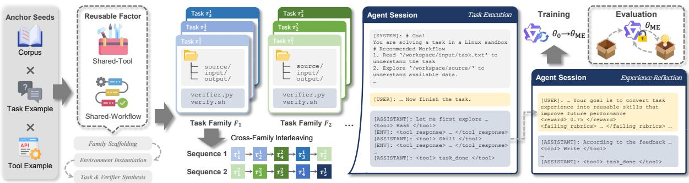
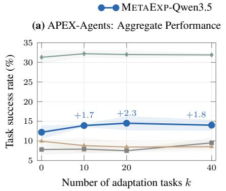
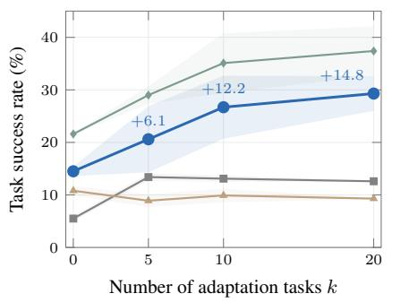
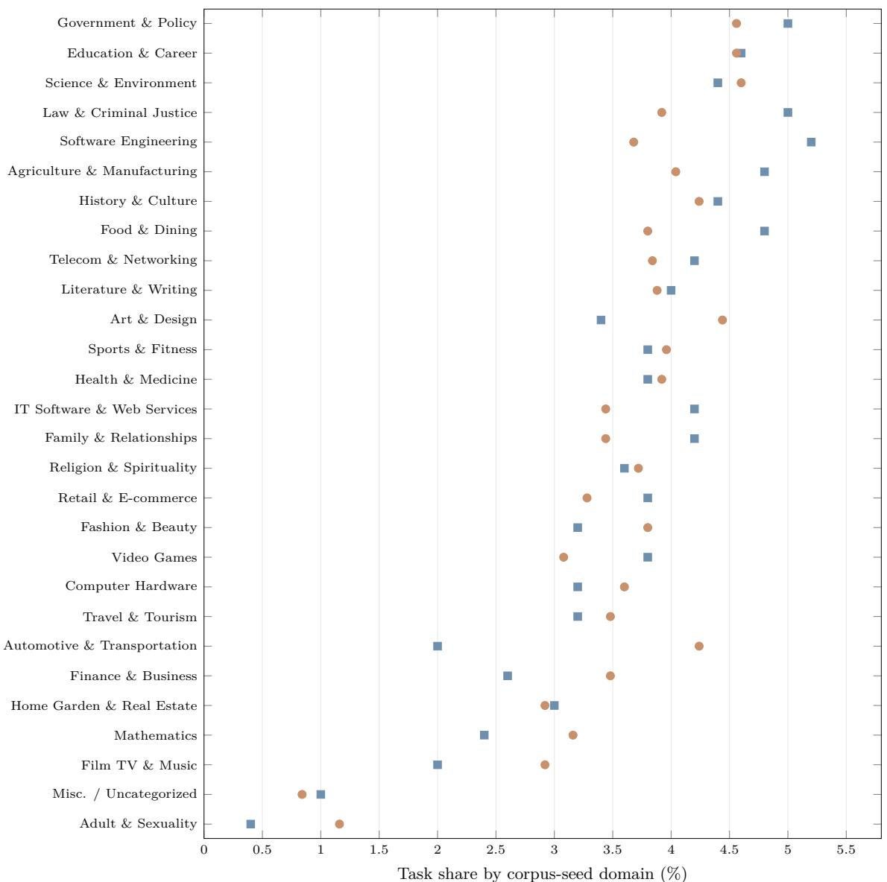
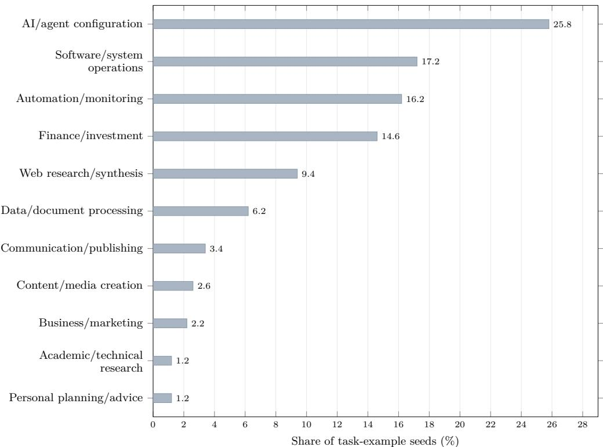
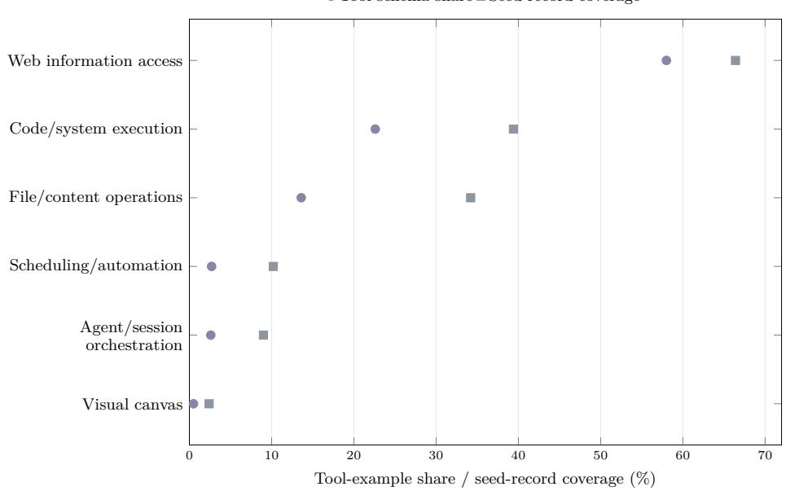

# MetaExp: Learning to Self-Improve through Experience via Verifiable Cross-Task Environment Scaling

Renhao Li<sup>1,4,\*</sup>, Xinjie Shen<sup>2,\*</sup>, Yang Su<sup>3</sup>, Jianhong Tu<sup>3,†</sup> Derek F. Wong<sup>1,†</sup>, Dayiheng Liu<sup>3</sup>, Min Yang<sup>4,†</sup>

<sup>1</sup>University of Macau, <sup>2</sup>Georgia Institute of Technology <sup>3</sup>Alibaba Token Hub, Alibaba Group <sup>4</sup>Shenzhen Institute of Advanced Technology, Chinese Academy of Sciences <sup>B</sup> li.renhao@connect.um.edu.mo

## Abstract

Language-model agents can accumulate interaction feedback, but reliably turning that feedback into reusable experience remains challenging. Existing methods either optimize external experience scafolds or train experience-related behavior on specific task distri butions, leaving open whether experience learning itself can become a transferable model capability. Training such a capability calls for supervision beyond isolated tasks, which mainly support in-episode problem solving rather than revealing what knowledge remains useful across episodes. In this work, we introduce MetaExp, a scalable framework that trains this capability through verifiable task families with controlled cross-task structure. Each family preserves a reusable factor while varying task-specific realizations, enabling transfer without direct solution reuse. We propose two complementary designs: Shared-Tool families keep black-box tools fixed across tasks to elicit operational experience, while Shared-Workflow families preserve latent procedures across changing realizations to elicit procedural experience. We scale environments under both designs, collect and filter sequential interaction trajectories, and fine-tune Qwen3.5-122B-A10B on 4,956 trajectories from 1,000 task families. With parameters frozen during downstream evolution, MetaExp improves by +8.5 points on SpreadsheetBench, peaks at +2.3 on APEX-Agents, and improves by +14.8 on AutomationBench. The gains persist under domain-excluded training, supporting experience learning as a transferable capability for continued non-parametric improvement after deployment.

## 1 Introduction

Large language models (LLMs) increasingly act in interactive environments, using tools to complete long-horizon tasks and respond to execution feedback (Yao et al., 2023). Yet most agents remain largely episodic: solving one task does not by itself make the agent more efective on the next, and useful procedures discovered through interaction are often lost once the episode ends (Zhao et al., 2024; Wang et al., 2025b). Experience-driven self-evolution addresses this limitation by turning past trajectories and feedback into persistent experience that can guide future behavior (Shinn et al., 2023). However, retaining experience is not equivalent to learning from it. An efective agent must identify what caused an outcome, abstract what remains useful, update its experience accordingly, and reuse it in later tasks. This raises a fundamental question: can a model be trained once to acquire, update, and reuse experience more efectively on previously unseen task distributions?

Existing work approaches experience learning at either the system or model level. System-level methods keep the backbone fixed and improve how external experience is represented, extracted, revised, retrieved, or validated (Ni et al., 2026; Yu et al., 2026; Wang et al., 2026a; Yang et al., 2026b). They demonstrate that external experience can support parameter-free adaptation, but its quality still depends on the pretrained model’s ability to diagnose trajectories, abstract reusable knowledge, and apply it appropriately. Model-level approaches instead optimize experience acquisition, maintenance, or skill-conditioned execution through parameter training (Wang et al., 2026b; Xia et al., 2026; Fan et al., 2026a). However, their optimization signals and downstream evaluation are typically tied to the same or closely related task distributions, making general experience-learning ability dificult to separate from task-specific adaptation. It therefore remains unclear whether experience learning itself can be trained as a transferable model capability.

This question is particularly relevant to realistic agent deployment. An agent may encounter a new task distribution without a curated skill library, large collections of verified target-domain trajectories, or the opportunity for benchmark-specific retraining. It must instead improve incrementally from the tasks and feedback it encounters, even when later task variants difer substantially from earlier ones. Motivated by this setting, we study meta experience learning: after a single general training stage, the model parameters remain fixed, and the agent starts each held-out task distribution with an empty experience store. It must construct, revise, and reuse experience solely through sequential interaction and feedback. In this work, we instantiate external experience as structured Agent Skills (Anthropic, 2025). This setting separates learning how to acquire and use experience from pre-acquiring or carrying target-domain experience itself.

Training this capability requires supervision beyond isolated task solving. Independent task trajectories primarily supervise in-episode problem solving, but provide limited evidence about which parts of an interaction will remain useful on later tasks. We therefore organize trajectory collection around structured task families that provide controlled cross-episode supervision. MetaExp operationalizes this idea by constructing verifiable families under the principle of transfer without direct solution reuse: each family preserves a reusable factor across tasks while varying task-specific realizations, so that experience acquired from earlier members can help with later ones without allowing previous solutions to be directly reused. We instantiate this principle through two complementary designs. Shared-Tool families keep black-box tools fixed across tasks while varying their concrete problems, encouraging operational experience about recurring interfaces and tool composition. Shared-Workflow families instead preserve a latent multi-step procedure across changing domains, tools, and data, encouraging higher-level procedural experience across diferent realizations. Sequential trajectories collected from environments scaled under both designs are then used to train the model to acquire, update, and reuse experience.

We fine-tune Qwen3.5-122B-A10B on 4,956 filtered trajectories collected from 1,000 synthetic task families and evaluate it under cold-start sequential evolution on three held-out agent benchmarks: SpreadsheetBench, APEX-Agents, and AutomationBench. As test-time experience accumulates, MetaExp improves by +8.5 points on SpreadsheetBench, peaks at +2.3 points on APEX-Agents, and improves by +14.8 points on AutomationBench. In contrast, the matched Qwen3.5 backbone degrades by 2.2 points on SpreadsheetBench under the same evolution protocol, showing that strong task-solving ability does not necessarily translate into efective experience learning. The gains remain substantial when semantically related training domains are excluded, and MetaExp also makes better use of externally provided skills on SkillsBench. Together, these results support experience learning as a transferable model capability that can drive continued improvement through non-parametric experience accumulation on unseen task distributions.

Our contributions are threefold: (i) We formulate meta experience learning as a transferable model capability: after a single general training stage, an agent should be able to build and reuse external experience from scratch on unseen task distributions without further parameter updates. (ii) We introduce MetaExp, a scalable framework that constructs verifiable task families with controlled cross-task structure to generate cross-episode supervision for experience learning, instantiated through complementary Shared-Tool and Shared-Workflow designs. (iii) We demonstrate transferable cold-start experience learning across heterogeneous held-out agent benchmarks, with substantial gains retained under domain-excluded training and improved utilization of curated skills.

## 2 Related Work

Experience-driven agent self-evolution. Existing approaches improve agents through persistent experience at either the system or model level. System-level methods keep the backbone fixed and externalize experience as verbal memories, codes, or executable skills (Shinn et al., 2023; Zhao et al., 2024; Wang et al., 2024; 2025b;a). Recent work further improves how such experience is extracted, revised, retrieved, and validated (Ni et al., 2026; Qiu et al., 2026; Jiang et al., 2026a; Lin et al., 2026; Yu et al., 2026; Li et al., 2026c; Wang et al., 2026a; Yang et al., 2026b). These approaches enable parameter-free adaptation, but the resulting experience remains dependent on the frozen model’s ability to diagnose trajectories and abstract reusable knowledge, and some rely on substantial target-distribution trials or in-distribution validation (Zhang et al., 2026a; Liu et al., 2026). Model-level methods instead update parameters to optimize experience acquisition, maintenance, or skill-conditioned execution (Lu et al., 2026; Zhu et al., 2026a; Wu et al., 2025; Wang et al., 2026b; Xia et al., 2026; Shi et al., 2026; Yang et al., 2026a; He et al., 2026; Zhang et al., 2026b; Yao et al., 2026; Li et al., 2026b; Vishe et al., 2026; Fan et al., 2026a). However, these methods are often trained and evaluated on the same or closely related task distributions, making transferable experience-learning ability dificult to assess. More recently, Connect the Dots (CoD) (Chen et al., 2026) explicitly investigates cross-domain generalization of experience learning through reinforcement learning with credit assignment across task-solving and context-updating episodes. Its evaluation primarily focuses on controlled game-like and simulated science and engineering environments. In comparison,

MetaExp constructs verifiable task families with controlled cross-task structure to supervise operational and procedural experience learning from execution and reflection trajectories, and evaluates cold-start skill evolution across heterogeneous, work-oriented agent benchmarks.

Environment scaling and evaluation. Agent training data can be scaled through verifiable task and environment synthesis, including task proposal, capability composition, and automated construction of executable environments (Zhou et al., 2025; Xie et al., 2026; Zhu et al., 2026b; Hua et al., 2026; Wei et al., 2026). Some methods organize generation around predefined skills or skill structures (Zheng et al., 2025; Fan et al., 2026b; Cheng et al., 2026; Tan et al., 2026). These approaches primarily scale individual tasks or environments, whereas MetaExp scales task families with controlled cross-task structure so that experience acquired from earlier tasks can remain useful for later ones without enabling direct solution reuse. Complementary benchmarks evaluate either the utility of provided skills (Li et al., 2026a; Han et al., 2026) or continual skill generation and refinement over task streams (Zhong et al., 2026; Zhou et al., 2026b; Zhang et al., 2026c; Lei et al., 2026; Jiang et al., 2026b; Gao et al., 2026; Zhou et al., 2026a). Our evaluation instead focuses on cold-start sequential evolution across heterogeneous held-out task distributions.

## 3 Problem Setup

We study whether a language model can be trained once to better acquire, update, and reuse external experience on previously unseen task distributions. During test-time evolution, the model parameters remain fixed and only the accumulated experience changes. We first define this sequential experiencelearning setting and then introduce the cold-start protocol used for evaluation.

## 3.1 Experience Learning Setting

We consider a sequence of tasks, where each task $\tau _ { i } = ( e _ { i } , q _ { i } , v _ { i } )$ consists of an interactive environment $e _ { i } ,$ a textual task request $q _ { i } ,$ and an evaluator $v _ { i }$ . Given a model with parameters θ and an external experience store $B _ { i - 1 }$ , the agent interacts with the environment and produces a trajectory

$$
h _ { i } \sim \pi _ { \theta } ( \cdot \mid e _ { i } , q _ { i } , B _ { i - 1 } ) .\tag{1}
$$

The evaluator then returns an outcome score $r _ { i }$ together with task-level feedback $f _ { i } ,$

$$
( r _ { i } , f _ { i } ) = v _ { i } ( h _ { i } ) .\tag{2}
$$

The score measures task completion, while the feedback contains richer information about successes and failures. Based on the trajectory and feedback, the agent may update its experience:

$$
B _ { i } = U _ { \theta } ( B _ { i - 1 } , \tau _ { i } , h _ { i } , f _ { i } ) ,\tag{3}
$$

where $U _ { \theta }$ denotes the model’s experience-update behavior. The resulting $B _ { i }$ persists across tasks and can influence subsequent execution. Experience may take diferent forms; in this work, we instantiate $B _ { i }$ as a file-based bank of structured agent skills. Experience learning therefore involves both deciding what skills should be updated according to previous interactions and using the resulting skills appropriately on future tasks.

Our goal is not to learn target-domain experience during parameter training. Instead, we ask whether a single general training stage can improve the model’s ability to acquire and reuse experience under this sequential process on new task distributions. Training produces parameters $\theta _ { \mathrm { M E } }$ from a base model $\theta _ { 0 }$ using only source task families. At evaluation time, neither model receives target-benchmark parameter updates or pre-accumulated target-domain experience. Their parameters remain fixed, and adaptation occurs only through the evolving experience store B. We refer to this property as meta experience learning: the ability to acquire useful experience from interaction feedback and reuse it on subsequent tasks, such that this behavior transfers beyond the task distributions used for parameter training. Operationally, it requires the model to construct experience from scratch, revise it as new feedback arrives, and selectively apply it when solving later tasks.

## 3.2 Cold-Start Sequential Evolution

We introduce a cold-start sequential evolution protocol (SeqEvo) to evaluate experience learning on held-out task distributions. For a fixed evaluation domain, we omit the domain index for clarity. Both the adaptation and target tasks come from a task distribution that is not used for parameter optimization. The agent starts with an empty experience store,

$$
B _ { 0 } = \varnothing ,\tag{4}
$$

and processes K adaptation tasks $\left( \tau _ { 1 } , \dots , \tau _ { K } \right)$ one at a time. Following the update process above, the experience bank obtained after task $\tau _ { i }$ is carried forward to $\tau _ { i + 1 }$ , yielding $B _ { k }$ after the first k tasks. No

future adaptation task or target-set feedback is available when constructing $B _ { k }$ . Here, k denotes the number of test-time adaptation tasks rather than gradient updates.

We evaluate each $B _ { k }$ on a fixed target set E that is disjoint from the adaptation tasks, while keeping the experience bank unchanged during evaluation. We define

$$
S ( k ; \theta ) = \frac { 1 } { | E | } \sum _ { \tau \in E } r _ { \tau } ^ { ( k , \theta ) } ,\tag{5}
$$

where $r _ { \tau } ^ { ( k , \theta ) }$ denotes the outcome score obtained by model θ on task $\tau$ using the accumulated experience bank $B _ { k }$ , and $S ( 0 ; \theta )$ is the performance without accumulated experience. The efect of test-time experience accumulation after k adaptation tasks is

$$
\Delta ( k ; \theta ) = S ( k ; \theta ) - S ( 0 ; \theta ) .\tag{6}
$$

We report both $S ( 0 ; \theta )$ and $\Delta ( k ; \theta )$ . The former reflects zero-experience task-solving ability, while the latter measures how performance changes as test-time experience accumulates. Together, they separate zero-experience task performance from the change induced by accumulated experience.

## 4 MetaExp: Verifiable Cross-Task Environment Scaling

MetaExp trains transferable experience-learning behavior by constructing controlled cross-task supervision. As shown in Figure 1, it builds two complementary types of task families with reusable cross-task structure, realizes them as verifiable executable environments, collects sequential experience-learning trajectories, and uses the resulting data for model training.

## 4.1 Cross-Task Family Design

The key design principle is to preserve a reusable source of commonality across tasks while varying their concrete realizations. We represent a task family as

$$
{ \mathcal F } ( z ) = \{ \tau _ { i } = G ( z , \xi _ { i } ) \} _ { i = 1 } ^ { m } ,\tag{7}
$$

where z denotes the family-level reusable factor and $\xi _ { i }$ captures task-specific variation. We follow the principle of transfer without direct solution reuse: z should make experience acquired from earlier members potentially useful for later ones, while variation in $\xi _ { i }$ prevents previous solutions from being directly reused.

We propose two complementary designs. (i) Shared-Tool families keep a black-box tool library and its documentation fixed across members while varying task data and requests. Here, z corresponds to stable tool semantics and interfaces, encouraging relatively concrete operational experience about tool behavior, argument conventions, and composition. (ii) Shared-Workflow families instead preserve a latent multi-step procedure while varying its concrete realization, including domain, APIs and documentation, data, and request. The latent workflow guides generation but is never exposed to the solver, encouraging more abstract procedural experience that transfers across changing tools and domains. Together, the two designs expose reusable structure at complementary levels, from concrete operational regularities to abstract procedural patterns.

## 4.2 Verifiable Family Scaling

We scale these families from heterogeneous seeds drawn from pretraining-style corpora, task examples, and tool schemas, which provide diverse semantic contexts, procedural patterns, and executable afordances. Each family is then realized through three stages. Family scafolding constructs its shared factor z once per family. For Shared-Tool families, we generate and validate an executable tool library together with its documentation, which are then fixed across members. For Shared-Workflow families, we abstract a domain-independent latent workflow from a seed task example.

Environment instantiation produces multiple family members by varying task-specific factors $\xi _ { i }$ . Shared-Tool members reuse the same tools with independently populated data, whereas Shared-Workflow members instantiate the same latent procedure with new domains, APIs and documentation, and task-specific data. We additionally vary data scale, output structure, and dificulty to increase task diversity while preserving the intended commonality.

Finally, task-and-verifier synthesis uses a propose–solve–confirm loop to generate each task request together with a reference solution and executable checks. The generator explores the instantiated tools and data before proposing and solving the task. The complete package is rerun in a clean sandbox and retained only if the reference solution executes successfully and passes verification. Validation is asymmetric: reference solutions, verifiers, and latent workflows may be used during synthesis but are never exposed to the solver.

  
Figure 1: Overview of MetaExp. Heterogeneous seeds are expanded into verifiable task families with complementary Shared-Tool and Shared-Workflow structure. Family-centered task sequences are used to collect execution and feedback-driven reflection trajectories, which train the model to acquire, update, and reuse experience. At evaluation, model parameters are frozen and experience is accumulated from an empty bank on unseen task distributions.

## 4.3 Sequential Experience Trajectory Collection

For each validated family $\mathcal { F } = \{ \tau _ { 1 } , \dots , \tau _ { m } \}$ , we order its members by increasing dificulty and assign them sequentially to a teacher model starting from an empty skill bank. Each collection sequence is centered on one family but interleaves a small fraction of tasks sampled from other families. These cross-family tasks introduce potentially irrelevant experience into the bank, encouraging the model to learn selective reuse instead of indiscriminately applying accumulated skills. The teacher follows the sequential experience-learning process defined in Section 3: it solves each task conditioned on the current bank, receives executable feedback, and updates the bank before proceeding to the next task.

Each task runs in a fresh sandbox with the current skill bank mounted. The teacher interacts through a general agent harness and invokes a task\_done tool upon completion, after which the task-specific verifier is introduced and executed. An LLM judge reviews only failed rubric items to correct potential false negatives and produces the final score and feedback. The feedback is then injected through a fixed reflection prompt, allowing the teacher to create, revise, or delete skills before the updated bank is carried forward. We retain only trajectories with coherent execution, evaluation, and reflection, verified task completion, and valid skill artifacts.

## 4.4 Meta-Experience Training

The retained trajectories supervise two complementary behaviors: execution-stage actions train experienceconditioned task solving, while reflection-stage actions train feedback-driven experience updating. Let $\mathcal { D } _ { \mathrm { M E } }$ denote records from both stages. We fine-tune the base model with the standard assistant-token objective

$$
\mathcal { L } _ { \mathrm { M E } } ( \theta ) = - \sum _ { x \in \mathcal { D } _ { \mathrm { M E } } } \sum _ { t \in A ( x ) } \log p _ { \theta } ( x _ { t } \mid x _ { < t } ) ,\tag{8}
$$

where $\boldsymbol { \mathcal { A } } ( \boldsymbol { x } )$ denotes assistant-generated token positions; system messages, user messages, and environment observations are masked from the loss.

Optimizing this objective from $\theta _ { 0 }$ yields $\theta _ { \mathrm { M E } }$ . The skill banks accumulated during trajectory collection are discarded after model training; what is retained is the model’s learned behavior for acquiring, updating, and reusing experience. At evaluation time, θ remains frozen and each held-out task distribution starts from an empty bank under SeqEvo, where adaptation occurs solely through newly accumulated experience.

## 5 Experiments

## 5.1 Experimental Setup

Training configuration. Following Section 4, we construct 500 Shared-Tool and 500 Shared-Workflow families, each containing five task instances. We use GLM-5.2 (Zeng et al., 2026) as the teacher model, deployed through a standardized agent harness for trajectory collection, yielding 4,956 trajectories after filtering. We fine-tune Qwen3.5-122B-A10B (Qwen Team, 2026) for two epochs with a 256K context window. The loss is computed only over assistant-generated tokens, while system messages, user messages,

Table 1: Performance and eficiency on SpreadsheetBench. Values are mean ± population standard deviation, with $\Delta _ { k } = S ( k ) - S ( 0 )$ shown in parentheses. Green/red denotes improvement/degradation relative to $k = 0 .$ . EvoSkill and SkillGrad results are taken from Wang et al. (2026a) and follow their originally reported evolution protocols; all other results use our cold-start SeqEvo protocol. “–” denotes an unreported checkpoint.
<table><tr><td>Model</td><td>Protocol</td><td>k = 0</td><td>k = 5</td><td>k = 10</td><td>k = 20</td><td>k = 40</td></tr><tr><td colspan="7">Task success rate (%, ↑)</td></tr><tr><td>GPT-4.1</td><td>EvoSkill</td><td>44.2</td><td></td><td></td><td></td><td> $3 7 . 2 \pm 2 . 6 ( - 7 . 0 )$ </td></tr><tr><td>GPT-5.4</td><td>EvoSkill</td><td>62.5</td><td></td><td></td><td></td><td> $6 8 . 1 \pm 0 . 5 ( + 5 . 6 )$ </td></tr><tr><td>GPT-4.1</td><td>SkillGrad</td><td>44.2</td><td></td><td></td><td></td><td> $5 4 . 2 \pm 3 . 5 ( + 1 0 . 0 )$ </td></tr><tr><td>GPT-5.4</td><td>SkillGrad</td><td>62.5</td><td></td><td></td><td></td><td> $7 1 . 1 \pm 1 . 7 ( + 8 . 6 )$ </td></tr><tr><td>GLM-5.2</td><td>SeqEvo</td><td> $\bar { 8 8 . 3 } \bar { \pm 1 . 2 }$ </td><td> $\bar { 8 8 . 9 } \bar { \pm 0 . 5 } ( \bar { + 0 . 6 ) }$ </td><td> $\bar { 8 9 } . \bar { 5 } \bar { \pm 0 } . \bar { 7 } ( \bar { + } 1 . 2 )$ </td><td> $8 9 . { \overset { - } { 6 } } \equiv { \overset { - } { 0 } } . { \overset { - } { 4 } } ( + 1 . 3 )$ </td><td> $\bar { 8 9 } . \bar { 4 } \bar { \pm 0 } . \bar { 4 } ( \bar { + 1 . 1 } )$ </td></tr><tr><td>Qwen3.6-Plus</td><td>SeqEvo</td><td> $7 6 . 0 \pm 0 . 9$ </td><td> $7 1 . 8 \pm 2 . 5 ( - 4 . 2 )$ </td><td> $7 2 . 9 \pm 3 . 1 ( - 3 . 1 )$ </td><td> $7 3 . 1 \pm 3 . 1 ( - 2 . 9 )$ </td><td> $7 4 . 3 \pm 3 . 1 ( - 1 . 7 )$ </td></tr><tr><td>Qwen3.5-122B-A10B</td><td>SeqEvo</td><td> $6 8 . 9 \pm 1 . 8$ </td><td> $6 7 . 3 \pm 1 . 8 ( - 1 . 6 )$ </td><td> $6 7 . 7 \pm 0 . 5 ( - 1 . 2 )$ </td><td> $6 7 . 0 \pm 0 . 9 ( - 1 . 9 )$ </td><td> $6 6 . 7 \pm 1 . 3 ( - 2 . 2 )$ </td></tr><tr><td>MetaExp-Qwen3.5-122B-A10B SeqEvo</td><td></td><td> $6 5 . 0 \pm 2 . 2$ </td><td> $6 9 . 5 \pm 3 . 3 ( + 4 . 5 )$ </td><td> $7 2 . 9 \pm 3 . 7 ( + 7 . 9 )$ </td><td> $7 3 . 1 \pm 2 . 8 ( + 8 . 1 )$ </td><td>一  $7 3 . 5 \pm 3 . 4 ( + 8 . 5 )$ </td></tr><tr><td colspan="7">Execution turns (↓)</td></tr><tr><td>GLM-5.2</td><td>SeqEvo</td><td> $1 0 . 4 \pm 0 . 4$ </td><td> $1 2 . 3 \pm 0 . 2 ( + 1 . 9 )$ </td><td> $1 2 . 1 \pm 0 . 1 ( + 1 . 7 )$ </td><td> $1 2 . 4 \pm 0 . 5 ( + 2 . 0 )$ </td><td> $1 3 . 1 \pm 0 . 6 ( + 2 . 7 )$ </td></tr><tr><td>Qwen3.6-Plus</td><td>SeqEvo</td><td> $7 . 8 \pm 0 . 1$ </td><td> $8 . 0 \pm 0 . 3 ( + 0 . 2 )$ </td><td> $8 . 0 \pm 0 . 2 ( + 0 . 2 )$ </td><td> $8 . 1 \pm 0 . 2 ( + 0 . 3 )$ </td><td> $7 . 7 \pm 0 . 2 ( - 0 . 1 )$ </td></tr><tr><td> $\mathrm { Q w e n 3 . 5 - 1 2 2 B { - } A 1 0 B }$ </td><td>SeqEvo</td><td> $7 . 6 \pm 0 . 5$ </td><td> $7 . 2 \pm 0 . 1 ( - 0 . 4 )$ </td><td> $7 . 3 \pm 0 . 0 ( - 0 . 3 )$ </td><td> $7 . 4 \pm 0 . 1 ( - 0 . 2 )$ </td><td> $7 . 2 \pm 0 . 0 ( - 0 . 4 )$ </td></tr><tr><td>MetaExp-Qwen3.5-122B-A10B</td><td> $_ { \mathrm { S e q E v o } }$ </td><td> $8 . 1 \pm 0 . 1$ </td><td> $8 . 1 \pm 0 . 2 ( 0 . 0 )$ </td><td> $8 . 2 \pm 0 . 3 ( + 0 . 1 )$ </td><td> $8 . 5 \pm 0 . 9 ( + 0 . 4 )$ </td><td> $8 . 6 \pm 0 . 7 ( + 0 . 5 )$ </td></tr></table>

and environment observations are masked out.

Datasets and evaluation. We evaluate cold-start experience evolution on three challenging benchmarks spanning distinct task distributions. We adapt their original environments and evaluators into executable sandboxes compatible with our agent harness. All models evaluated by us follow the SeqEvo protocol defined in Section 3.2, using the same agent harness as in trajectory collection. For each benchmark, adaptation and target sets are disjoint, and we repeat each experiment three times with independently randomized adaptation orders. Each adaptation task allows up to three reflection retries; if all retries fail, the latest verified skill bank is carried forward. SpreadsheetBench-v1-verified contains 400 real-world spreadsheet manipulation tasks at the cell and sheet levels. We use 40 tasks for adaptation and 350 disjoint tasks for evaluation, with a shared skill bank capped at 10 skills. Verification executes the generated solution on the input workbook, recalculates formulas, and compares annotated output ranges with the golden workbook; a task succeeds only if all required cells match. APEX-Agents contains 480 long-horizon professional tasks across investment banking, law, and management consulting. For each domain, we use 40 tasks for adaptation and 120 disjoint tasks for evaluation, maintaining a separate skill bank capped at 5 skills. An LLM judge evaluates the agent response, generated artifacts, and environment changes against expert-authored binary rubrics; a task succeeds only if all required criteria are satisfied. AutomationBench contains 600 cross-application API workflow tasks across finance, HR, marketing, operations, sales, and support. For each domain, we use 20 tasks for adaptation and 80 disjoint tasks for evaluation, with an independent skill bank capped at 10 skills. Verification compares the final environment state against deterministic assertions. We report average task success rate on all three benchmarks. Each adaptation task is encountered only once per run, preventing repeated optimization against the same verifier feedback. We additionally evaluate the ability to utilize externally provided experience on SkillsBench-v1.1, which contains 87 expert-level tasks across 11 domains, each paired with curated agent skills. All models receive the same skills for each task, and we report average score and pass rate over three runs.

Models and baselines. We denote our trained checkpoint as MetaExp-Qwen3.5-122B-A10B and use the original Qwen3.5-122B-A10B as the matched backbone baseline. We additionally evaluate stronger models, including Qwen3.6-Plus and GLM-5.2, with reasoning enabled at maximum efort. These models are evaluated using the same harness and SeqEvo setup. On SpreadsheetBench, we also report published EvoSkill (Alzubi et al., 2026) and SkillGrad results from Wang et al. (2026a) as representative system-level experience-learning approaches; these follow their originally reported evolution protocols rather than our SeqEvo setup.

## 5.2 Main Results

SpreadsheetBench. Table 1 reports performance and eficiency on SpreadsheetBench across diferent backbones and evolution protocols. Under SeqEvo, MetaExp improves from 65.0 at $k = 0$ to 73.5 at $k = 4 0 \ ( + 8 . 5 )$ , with most gains emerging within the first 10 adaptation tasks. In contrast, Qwen3.5-122B-A10B and Qwen3.6-Plus finish below their zero-experience baselines, while GLM-5.2 remains the strongest absolute solver but improves only marginally, peaking at +1.3 points. The gain is accompanied by only a modest increase in execution turns, from 8.1 at $k = 0$ to 8.6 at k = 40, indicating that the improvement is not simply associated with substantially more interaction. Published EvoSkill and SkillGrad results further show that system-level skill evolution can also yield substantial gains, although they follow diferent evolution protocols and typically use more verified trajectories during adaptation.



(b) APEX-Agents: Domain-wise Performance
<table><tr><td></td><td colspan="4">METAEXP-Qwen3.5</td><td colspan="4">Baseline-Qwen3.5</td></tr><tr><td>Domain</td><td>k = 0</td><td>∆10</td><td>∆20</td><td> $\Delta _ { 4 0 }$ </td><td>k = 0</td><td>∆10</td><td>∆20</td><td>∆40</td></tr><tr><td>Investment banking</td><td>16.1</td><td>-1.9</td><td>-0.5</td><td>-2.5</td><td>4.7</td><td>+3.4</td><td>+2.2</td><td>+3.7</td></tr><tr><td>Law</td><td>11.9</td><td>+3.9</td><td>+3.9</td><td>+2.8</td><td>12.8</td><td>-2.8</td><td>-2.0</td><td>+0.8</td></tr><tr><td>Mgmt. consulting</td><td>8.6</td><td>+3.1</td><td>+3.6</td><td>+5.0</td><td>5.8</td><td>-0.2</td><td>-1.1</td><td>+0.9</td></tr></table>

(c) AutomationBench: Aggregate Performance  


(d) AutomationBench: Domain-wise Performance
<table><tr><td></td><td colspan="4">METAEXP-Qwen3.5</td><td colspan="4">Baseline-Qwen3.5</td></tr><tr><td>Domain</td><td>k = 0</td><td>∆5</td><td> $\Delta _ { 1 0 }$ </td><td> $\Delta _ { 2 0 }$ </td><td>k = 0</td><td>∆5</td><td>∆10</td><td>∆20</td></tr><tr><td>Finance</td><td>17.9</td><td>+1.3</td><td>+25.4</td><td>+32.9</td><td>10.4</td><td>+10.4</td><td>+7.9</td><td>+9.2</td></tr><tr><td>HR</td><td>12.1</td><td>+15.8</td><td>+17.1</td><td>+14.6</td><td>3.8</td><td>+11.2</td><td>+7.4</td><td>+7.4</td></tr><tr><td>Marketing</td><td>14.2</td><td>+15.8</td><td>+18.7</td><td>+16.6</td><td>4.2</td><td>+5.0</td><td>+5.8</td><td>+3.7</td></tr><tr><td>Operations</td><td>17.9</td><td>+3.8</td><td>+6.7</td><td>+10.9</td><td>8.3</td><td>+5.5</td><td>+7.1</td><td>+5.5</td></tr><tr><td>Sales</td><td>13.8</td><td>+0.8</td><td>+3.7</td><td>+0.8</td><td>3.8</td><td>+11.2</td><td>+12.9</td><td>+11.2</td></tr><tr><td>Support</td><td>11.2</td><td>-1.2</td><td>+1.7</td><td>+13.0</td><td>2.5</td><td>+4.2</td><td>+4.6</td><td>+5.8</td></tr></table>

Figure 2: Performance on APEX-Agents and AutomationBench. Left: aggregate success rate over adaptation steps, with shaded population standard deviations over three runs. Right: domain-wise success rate and changes $\Delta _ { k }$ on each adaptation step for MetaExp-Qwen3.5-122B-A10B and Qwen3.5-122B-A10B; green/red denotes improvement/degradation.

APEX-Agents. Figure 2(a,b) shows a more heterogeneous pattern of experience transfer on APEX-Agents. At the aggregate level, MetaExp improves from 12.2 at k = 0 to a peak of 14.5 at $k = 2 0$ , retaining a +1.8-point gain at $k = 4 0 .$ . This modest average masks clear domain diferences: at k = 40, MetaExp gains +2.8 points in law and +5.0 in management consulting, compared with only +0.8 and +0.9 for the matched Qwen3.5 baseline.

Investment banking is the main exception, where MetaExp decreases by 2.5 points while Qwen3.5 improves by 3.7. This reversal is partly amplified by the near-binary exact-value evaluation and diferent cold-start headroom, although some case-specific skills also overgeneralize and interfere with otherwise correct solutions. GLM-5.2 remains the strongest absolute solver but shows little further improvement from accumulated experience. Overall, MetaExp yields positive aggregate evolution, with particularly clear gains in law and management consulting.

AutomationBench. Figure $2 ( \mathrm { c } , \mathrm { d } )$ shows a broader and more sustained evolution trend on Automation Bench. MetaExp improves monotonically from 14.5 to 29.3, yielding a +14.8-point gain, roughly twice that of its matched Qwen3.5 baseline. By $k = 1 0$ , MetaExp already improves over its zero-experience performance in all six domains, and by k = 20 its gain exceeds that of Qwen3.5 in five of them. The strongest improvement appears in finance (+32.9), with substantial gains also observed across HR, marketing, operations, and support. GLM-5.2 remains the strongest absolute solver and also benefits from accumulated experience. Overall, AutomationBench shows that MetaExp substantially increases experience-driven improvement.

Table 2: SpreadsheetBench task success under domain-excluded training. Values are mean ± population standard deviation over three runs, with $\Delta _ { k } = S ( k ) - S ( 0 )$ shown in parentheses.
<table><tr><td>Model</td><td> $k = 0$ </td><td> $k = 5$ </td><td>k = 10</td><td> $k = 2 0$ </td><td> $k = 4 0$ </td></tr><tr><td colspan="6">Task success rate (%, ↑)</td></tr><tr><td>Qwen3.5-122B-A10B</td><td> $6 8 . 9 \pm 1 . 8$ </td><td> $6 7 . 3 \pm 1 . 8 ( - 1 . 6 )$ </td><td> $6 7 . 7 \pm 0 . 5 ( - 1 . 2 )$ </td><td> $6 7 . 0 \pm 0 . 9 ( - 1 . 9 )$ </td><td> $6 6 . 7 \pm 1 . 3 ( - 2 . 2 )$ </td></tr><tr><td>- METAEXP</td><td> $6 5 . 0 \pm 2 . 2$ </td><td> $6 9 . 5 \pm 3 . 3 ( + 4 . 5 )$ </td><td> $7 2 . 9 \pm 3 . 7 ( + 7 . 9 )$ </td><td> $7 3 . 1 \pm 2 . 8 ( + 8 . 1 )$ </td><td> $7 3 . 5 \pm 3 . 4 ( + 8 . 5 )$ </td></tr><tr><td>- Strict-OOD MetaExp</td><td> $6 2 . 7 \pm 1 . 4$ </td><td> $6 6 . 8 \pm 5 . 0 ( + 4 . 1 )$ </td><td> $6 6 . 2 \pm 4 . 0 ( + 3 . 5 )$ </td><td> $7 2 . 5 \pm 3 . 0 ( + 9 . 8 )$ </td><td> $7 2 . 0 \pm 0 . 8 ( + 9 . 3 )$ </td></tr></table>

SkillsBench. Unlike the preceding benchmarks, SkillsBench holds the experience itself fixed: every model receives the same expert-curated skill, allowing us to isolate how efectively provided experience is used during execution. As shown in Table 3, MetaExp improves over its matched backbone from 33.3 to 41.4 in average score and from 47.1% to 62.1% in average pass rate. These results provide complementary evidence that MetaExp improves not only experience acquisition but also the ability to translate available experience into successful task execution.

Table 3: Model performance on SkillsBench. Values are averaged across three runs.
<table><tr><td>Model</td><td>Score (%)</td><td>Pass (%)</td></tr><tr><td>GLM-5.2</td><td>65.1</td><td>74.7</td></tr><tr><td>Baseline</td><td>33.3</td><td>47.1</td></tr><tr><td>MetaExp</td><td>41.4 (+8.1)</td><td>62.1 (+15.0)</td></tr></table>

## 5.3 Domain-Excluded OOD Evaluation

Although the main evaluation benchmarks are excluded from training, the scaled training corpus may still contain semantically related domains. To impose a stricter distribution shift, we remove Software Engineering & Programming, Finance & Business, and IT Software & Web Services from the training data. We apply a strict-prefix filter: a trajectory is excluded if either its current task or any preceding task in the same family belongs to one of these domains, preventing retained trajectories from depending on earlier in-domain experience. This leaves 3,634 trajectories, including 1,939 Shared-Tool and 1,695 Shared Workflow trajectories. Starting from the same Qwen3.5-122B-A10B checkpoint, we train a Strict-OOD variant with the same configuration and evaluate its epoch-2 checkpoint on the same SpreadsheetBench splits under SeqEvo.

Table 2 shows that the experience-learning gains persist even after removing training domains most closely related to SpreadsheetBench. Strict-OOD MetaExp reaches $\Delta _ { 2 0 } ~ = ~ + 9 . 8$ and $\Delta _ { 4 0 } ~ = ~ + 9 . 3$ comparable to the gains of the full MetaExp model. Despite its lower zero-experience performance, it exhibits substantial positive evolution as experience accumulates, whereas the matched untrained backbone consistently degrades under the same SeqEvo setting. This contrast provides stronger evidence that the learned experience-learning behavior transfers across domains and does not depend on training examples from related task domains.

## 5.4 Ablation Study

We ablate the two cross-task family designs by training separate models on Shared-Tool or Shared-Workflow trajectories, starting from the same base checkpoint. Table 4 shows that both designs can induce experience-driven improvement, but with diferent behavioral patterns. Shared-Tool yields the larger gain on SpreadsheetBench (+9.7 vs. +6.1 points), consistent with learning reusable operational experience over stable black-box tools. Shared-Workflow, in contrast, more consistently improves execution eficiency on long-horizon tasks, reducing execution by 2.6 turns on APEX-Agents and 2.4 turns on AutomationBench, consistent with learning higher-level procedural experience across changing tool realizations. Combining both designs yields the broadest improvement across benchmarks. On AutomationBench in particular, full MetaExp reaches a +14.8-point gain, substantially exceeding either Shared-Tool (+7.6) or Shared Workflow (+7.1) alone, while also reducing execution by 7.0 turns. These results suggest that the two family designs provide complementary supervision for transferable experience learning.

## 5.5 Behavioral Analysis

To better understand the source of the experience-learning gains, we analyze how accumulated skills are used and updated on SpreadsheetBench. MetaExp-Qwen3.5 invokes existing skills far more frequently than its matched backbone despite maintaining a smaller bank, and its positive performance changes are concentrated on trajectories where skills are actually invoked. We further find that MetaExp-Qwen3.5 consolidates feedback into fewer, longer skills with more failure- and verification-oriented content and less instance-specific structure. These patterns are consistent with the two behaviors targeted during training. See full analysis in Appendix A.

Table 4: Ablation of cross-family task designs on models. Values are mean ± population standard deviation over three runs, with $\Delta = S _ { \mathrm { f i n a l } } - S _ { \mathrm { i n i t i a l } }$ shown in parentheses.
<table><tr><td rowspan="2">Benchmark</td><td colspan="2">Shared-Tool Only</td><td colspan="2">Shared-Workflow Only</td><td colspan="2">Full MetaExp</td></tr><tr><td>Initial</td><td>Final</td><td>Initial</td><td>Final</td><td>Initial</td><td>Final</td></tr><tr><td colspan="7">Task success rate  $( \% , \uparrow )$ </td></tr><tr><td>SpreadsheetBench</td><td> $6 2 . 7 \pm 1 . 0$ </td><td> $7 2 . 4 \pm 7 . 3 ( + 9 . 7 )$ </td><td></td><td> $6 3 . 6 \pm 1 . 5 6 9 . 7 \pm 2 . 7 ( + 6 . 1 )$ </td><td> $6 5 . 0 \pm 2 . 2$ </td><td> $7 3 . 5 \pm 3 . 4 ( + 8 . 5 )$ </td></tr><tr><td>APEX-Agents</td><td> $1 3 . 2 \pm 1 . 3$ </td><td> $1 2 . 7 \pm 1 . 3 ( - 0 . 5 )$ </td><td></td><td> $1 2 . 2 \pm 0 . 6 1 2 . 6 \pm 0 . 7 ( + 0 . 4 )$ </td><td> $1 2 . 2 \pm 1 . 7$ </td><td> $1 4 . 0 \pm 1 . 4 ( + 1 . 8 )$ </td></tr><tr><td>AutomationBench</td><td> $7 . 2 \pm 0 . 5$ </td><td> $1 4 . 8 \pm 3 . 8 ( + 7 . 6 )$ </td><td></td><td> $8 . 5 \pm 0 . 5 1 5 . 6 \pm 3 . 6 ( + 7 . 1 )$ </td><td> $1 4 . 5 \pm 0 . 9$ </td><td> $2 9 . 3 \pm 3 . 3$  (+14.8)</td></tr><tr><td colspan="7">Execution turns (↓)</td></tr><tr><td>SpreadsheetBench</td><td> $7 . 2 \pm 0 . 3$ </td><td> $1 0 . 5 \pm 1 . 7 \ : ( + 3 . 3 )$ </td><td> $7 . 8 \pm 0 . 2$ </td><td> $9 . 0 \pm 0 . 4 ( + 1 . 2 )$ </td><td> $8 . 1 \pm 0 . 1$ </td><td> $8 . 6 \pm 0 . 7 ( + 0 . 5 )$ </td></tr><tr><td>APEX-Agents</td><td> $2 9 . 0 \pm 0 . 7$ </td><td> $2 6 . 2 \pm 0 . 4 ( - 2 . 8 )$ </td><td> $3 1 . 2 \pm 0 . 5$ </td><td> $2 8 . 6 \pm 0 . 2 ( - 2 . 6 )$ </td><td> $3 3 . 3 \pm 0 . 6$ </td><td> $3 3 . 1 \pm 1 . 6 ( - 0 . 2 )$ </td></tr><tr><td>AutomationBench</td><td> $4 3 . 0 \pm 0 . 7$ </td><td> $4 4 . 5 \pm 6 . 4 ( + 1 . 5 )$ </td><td> $4 5 . 7 \pm 1 . 2$ </td><td> $4 3 . 3 \pm 5 . 2 ( - 2 . 4 )$ </td><td> $4 9 . 4 \pm 1 . 1$ </td><td> $4 2 . 4 \pm 3 . 1 ( - 7 . 0 )$ </td></tr></table>

## 6 Conclusion

We study whether experience learning itself can be trained as a transferable model capability. MetaExp uses verifiable cross-task families to train models to acquire, update, and reuse external experience, while leaving model parameters fixed during downstream evolution. Across heterogeneous held-out benchmarks, the trained model consistently benefits more from accumulated experience than its matched backbone, with the efect persisting under domain-excluded training and extending to the use of externally provided skills. These results suggest that experience learning can be learned and transferred beyond the task distributions used for training.

## Acknowledgments

Min Yang is supported by National Key Research and Development Program of China (2024YFF0908200), National Natural Science Foundation of China (62376262), the Natural Science Foundation of Guangdong Province of China (2024A1515030166, 2025B1515020032). This work was supported in part by the Science and Technology Development Fund of Macau SAR (Grant Nos. FDCT/0007/2024/AKP, EF2024- 00185-FST), the UM and UMDF (Grant Nos. MYRG-GRG2024-00165-FST-UMDF, MYRG-GRG2025- 00236-FST, MYRG-GRG2026-00018-FIC, MYRG-CRG2026-00007-FIC), and the Dr. Stanley Ho Medical Development Foundation (Grant No. SHMDF-AI/2026/001).

This work was supported by Alibaba Research Intern Program. We would like to thank the Qwen Team at Alibaba Token Hub (ATH), Alibaba Group, for providing the computational resources and foundation models (Qwen) used in this research.

## References

Salaheddin Alzubi, Noah Provenzano, Jaydon Bingham, Weiyuan Chen, and Tu Vu. EvoSkill: Automated skill discovery for multi-agent systems. arXiv preprint arXiv:2603.02766, 2026.

Anthropic. Equipping agents for the real world with agent skills. https://www.anthropic.com/engineering/equipping-agents-for-the-real-world-with-agent-skills, 2025.

Yanxi Chen, Weijie Shi, Boyi Hu, Zeyue Zhang, Zhiwei Wang, Yuexiang Xie, Yaliang Li, Bolin Ding, and Jingren Zhou. Connect the dots: Training llms for long-lifecycle agents with cross-domain generalization via reinforcement learning. arXiv preprint arXiv:2606.20002, 2026.

Zihao Cheng, Hongru Wang, Zeming Liu, Xinyi Wang, Xiangrong Zhu, Yuhang Guo, Wei Lin, Jef Z. Pan, and Yunhong Wang. Terminal-World: Scaling terminal-agent environments via agent skills. arXiv preprint arXiv:2605.20876, 2026.

Zhiyuan Fan, Wenwei Jin, Feng Zhang, Bin Li, Yihong Dong, Yao Hu, and Jiawei Li. Evolving-rl: End-to-end optimization of experience-driven self-evolving capability within agents. arXiv preprint arXiv:2605.10663, 2026a.

Zhiyuan Fan, Tinghao Yu, Yuanjun Cai, Jiangtao Guan, Yun Yang, Dingxin Hu, Jiang Zhou, Xing Wu, Zhuo Han, Feng Zhang, and Lilin Wang. Toward scalable terminal task synthesis via skill graphs. arXiv preprint arXiv:2604.25727, 2026b.

Xingze Gao, Chuanrui Hu, Hongda Chen, Pengfei Yao, Zhao Wang, Yi Bai, Zhengwei Wu, Yunyun Han, Xiaofeng Cong, Jie Gui, et al. EvoAgentBench: Benchmarking agent self-evolution via ability transfer. arXiv preprint arXiv:2607.05202, 2026.

Tingxu Han, Yi Zhang, Wei Song, Chunrong Fang, Zhenyu Chen, Youcheng Sun, and Lijie Hu. SWE-Skills Bench: Do agent skills actually help in real-world software engineering? arXiv preprint arXiv:2603.15401, 2026.

Zelin He, Haotian Lin, Boran Han, Wei Zhu, Haoyang Fang, Bernie Wang, Xuan Zhu, Runze Li, and Matthew Reimherr. Reskill: Reconciling skill creation with policy optimization in agentic rl. arXiv preprint arXiv:2606.01619, 2026.

Zhanbo Hua, Yifan Yao, Weihao Xie, Yongchi Zhao, Minghao Liu, Ruizhi Qiu, Zhewei Huang, Zun Wang, Yiyan Ji, Yunhai Ye, Letian Zhu, Xinping Lei, Han Li, Zhiyuan Ma, Zili Wang, Zhaoxiang Zhang, and Jiaheng Liu. CLI-Universe: Towards verifiable task synthesis engine for terminal agents. arXiv preprint arXiv:2606.22883, 2026.

Guanyu Jiang, Zhaochen Su, Xiaoye Qu, and Yi R Fung. XSkill: Continual learning from experience and skills in multimodal agents. arXiv preprint arXiv:2603.12056, 2026a.

Sihang Jiang, Lipeng Ma, Zhonghua Hong, Keyi Wang, Zhiyu Lu, Tengfei Wang, Shisong Chen, Jinghao Zhang, Tianjun Pan, Weijia Li, et al. SEA-Eval: A benchmark for evaluating self-evolving agents beyond episodic assessment. arXiv preprint arXiv:2604.08988, 2026b.

Yingtie Lei, Zhongwei Wan, Jiankun Zhang, Samiul Alam, Zixuan Zhong, Peizhou Huang, Xin Wang, Jingxuan Zhang, Donghao Zhou, Yunta Hsieh, et al. SkillEvolBench: Benchmarking the evolution from episodic experience to procedural skills. arXiv preprint arXiv:2605.24117, 2026.

Xiangyi Li, Yimin Liu, Wenbo Chen, Bingran You, Zonglin Di, Yifeng He, Shenghan Zheng, Kyoung Whan Choe, Jiankai Sun, Shuyi Wang, Chujun Tao, Binxu Li, Xuandong Zhao, Hejia Geng, Xiaojun Wu, Junwei Zhou, Xiaokun Chen, Hanwen Xing, Yubo Li, Qunhong Zeng, Di Wang, Yuanli Wang, Roey Ben Chaim, Penghao Jiang, Haotian Shen, Luyang Kong, Xinyi Liu, Runhui Wang, Xuanqing Liu, Jiachen Li, Xin Lan, Yueqian Lin, Wengao Ye, Junwei He, Songlin Li, Yue Zhang, Yipeng Gao, Yijiang Li, Ze Ma, Liqiang Jing, Tianyu Wang, Kaixin Li, Yiqi Xue, Haoran Lyu, Yizhuo He, Yuchen Tian, Shutong Wu, Bowei Wang, Yixuan Gao, Bo Chen, Litong Liu, Sikai Cheng, Jiajun Bao, Shuaicheng Tong, Shuwen Xu, Terry Yue Zhuo, Tinghan Ye, Qi Qi, Miao Li, Longtai Liao, Zelin Tan, Chang Shi, Xilin Tang, Srinath Tankasala, Boqin Yuan, Yaoyao Qian, Jianhong Tu, Chenguang Wang, Yizhou Sun, Wei Wang, Aaron Taylor, Ziyue Yang, Changkun Guan, Zhikang Dong, Xinyu Zhang, Steven Dillmann, Han-chung Lee, and Dawn Song. SkillsBench: Benchmarking how well agent skills work across diverse tasks. arXiv preprint arXiv:2602.12670, 2026a.

Yanzhou Li, Yiran Zhang, Xiaoyu Zhang, Xiaoxia Liu, and Yang Liu. CodeSkill: Learning self-evolving skills for coding agents. arXiv preprint arXiv:2605.25430, 2026b.

Yixuan Li, Mingshu Cai, Ziyang Xiao, Wanyuan Wang, Yanchen Deng, and Bo An. Mind-skill: Qualityguaranteed skill generation via multi-agent induction and deduction. arXiv preprint arXiv:2605.08670, 2026c.

Huawei Lin, Peng Li, Jie Song, Fuxin Jiang, and Tieying Zhang. Muse-AutoSkill: Self-evolving agents via skill creation, memory, management, and evaluation. arXiv preprint arXiv:2605.27366, 2026.

Yuxuan Liu, Zhaochen Su, Lingyun Xie, Yuhao Zhang, Qing Zong, Jiahe Guo, Zhongwei Xie, Yiyan Ji, Yauwai Yim, Hongyu Luo, et al. SkillRevise: Improving llm-authored agent skills via trace-conditioned skill revision. arXiv preprint arXiv:2606.01139, 2026.

Zhengxi Lu, Zhiyuan Yao, Jinyang Wu, Chengcheng Han, Qi Gu, Xunliang Cai, Weiming Lu, Jun Xiao, Yueting Zhuang, and Yongliang Shen. Skill0: In-context agentic reinforcement learning for skill internalization. arXiv preprint arXiv:2604.02268, 2026.

Jingwei Ni, Yihao Liu, Xinpeng Liu, Yutao Sun, Mengyu Zhou, Pengyu Cheng, Dexin Wang, Erchao Zhao, Xiaoxi Jiang, and Guanjun Jiang. Trace2Skill: Distill trajectory-local lessons into transferable agent skills. arXiv preprint arXiv:2603.25158, 2026.

Libin Qiu, Zhirong Gao, Junfu Chen, Yuhang Ye, Weizhi Huang, Xiaobo Xue, Wenkai Qiu, and Shuo Tang. AutoRefine: From trajectories to reusable expertise for continual llm agent refinement. arXiv preprint arXiv:2601.22758, 2026.

Qwen Team. Qwen3.5: Towards native multimodal agents, February 2026.

Yaorui Shi, Yuxin Chen, Zhengxi Lu, Yuchun Miao, Shugui Liu, Qi Gu, Xunliang Cai, Xiang Wang, and An Zhang. Skill1: Unified evolution of skill-augmented agents via reinforcement learning. arXiv preprint arXiv:2605.06130, 2026.

Noah Shinn, Federico Cassano, Ashwin Gopinath, Karthik Narasimhan, and Shunyu Yao. Reflexion: Language agents with verbal reinforcement learning. In Advances in Neural Information Processing Systems, 2023.

Zelin Tan, Yiqun Zhang, Hao Li, Zhiyao Cui, Hejia Geng, Shao Zhang, Hangfan Zhang, Yang Chen, Xiaosong Wang, Lilong Wang, Zhenfei Yin, Shuyue Hu, Chen Zhang, and Lei Bai. SKT: Skill-use training at scale via verified synthetic data generation. arXiv preprint arXiv:2608.02287, 2026.

Yash Vishe, Rohan Surana, Xunyi Jiang, Zihan Huang, Xintong Li, Nikki Lijing Kuang, Tong Yu, Ryan A Rossi, Jingbo Shang, Julian McAuley, et al. Skill-R1: Agent skill evolution via reinforcement learning. arXiv preprint arXiv:2605.09359, 2026.

Guanzhi Wang, Yuqi Xie, Yunfan Jiang, Ajay Mandlekar, Chaowei Xiao, Yuke Zhu, Linxi Fan, and Anima Anandkumar. Voyager: An open-ended embodied agent with large language models. Transactions on Machine Learning Research, 2024. ISSN 2835-8856.

Hanyu Wang, Yifan Lan, Bochuan Cao, Lu Lin, and Jinghui Chen. SkillGrad: Optimizing agent skills like gradient descent. arXiv preprint arXiv:2605.27760, 2026a.

Jiongxiao Wang, Qiaojing Yan, Yawei Wang, Yijun Tian, Soumya Smruti Mishra, Zhichao Xu, Megha Gandhi, Panpan Xu, and Lin Lee Cheong. Reinforcement learning for self-improving agent with skill library. In Proceedings of the 64th Annual Meeting of the Association for Computational Linguistics (Volume 1: Long Papers), pp. 1529–1550, 2026b.

Zora Zhiruo Wang, Apurva Gandhi, Graham Neubig, and Daniel Fried. Inducing programmatic skills for agentic tasks. In Second Conference on Language Modeling, 2025a.

Zora Zhiruo Wang, Jiayuan Mao, Daniel Fried, and Graham Neubig. Agent workflow memory. In Forty-second International Conference on Machine Learning, 2025b.

Yifan Wei, Li Du, Xiaoyan Yu, Yang Feng, and Angsheng Li. Towards compositional generalization of LLMs via skill taxonomy guided data synthesis. arXiv preprint arXiv:2601.03676, 2026.

Rong Wu, Xiaoman Wang, Jianbiao Mei, Pinlong Cai, Daocheng Fu, Cheng Yang, Licheng Wen, Xuemeng Yang, Yufan Shen, Yuxin Wang, et al. EvolveR: Self-evolving llm agents through an experience-driven lifecycle. arXiv preprint arXiv:2510.16079, 2025.

Peng Xia, Jianwen Chen, Hanyang Wang, Jiaqi Liu, Kaide Zeng, Yu Wang, Siwei Han, Yiyang Zhou, Xujiang Zhao, Haifeng Chen, Zeyu Zheng, Cihang Xie, and Huaxiu Yao. SkillRL: Evolving agents via recursive skill-augmented reinforcement learning. arXiv preprint arXiv:2602.08234, 2026.

Jingxu Xie, Dylan Xu, Xuandong Zhao, and Dawn Song. AgentSynth: Scalable task generation for generalist computer-use agents. In The Fourteenth International Conference on Learning Representations, 2026.

Min Yang, Jinghua Piao, Xu Xia, Xiaochong Lan, Jiaju Chen, Yongshun Gong, and Yong Li. SkillMaster: Toward autonomous skill mastery in llm agents. arXiv preprint arXiv:2605.08693, 2026a.

Yifan Yang, Ziyang Gong, Weiquan Huang, Qihao Yang, Ziwei Zhou, Zisu Huang, Yan Li, Xuemei Gao, Qi Dai, Bei Liu, Kai Qiu, Yuqing Yang, Dongdong Chen, Xue Yang, and Chong Luo. SkillOpt: Executive strategy for self-evolving agent skills. arXiv preprint arXiv:2605.23904, 2026b.

Shunyu Yao, Jefrey Zhao, Dian Yu, Nan Du, Izhak Shafran, Karthik Narasimhan, and Yuan Cao. ReAct: Synergizing reasoning and acting in language models. In International Conference on Learning Representations, 2023.

Zhiyuan Yao, Yuxin Chen, Zhengxi Lu, Zishan Xu, Yueqing Sun, Yifu Guo, Yuquan Lu, Zhengzhou Cai, Kangning Zhang, Zhuowen Han, Zi-Han Wang, Ziang Ye, Qi Gu, Xunliang Cai, Weiwen Liu, and Yongliang Shen. SkillRise: Agentic reinforcement learning for cross-task skill evolution. arXiv preprint arXiv:2607.26784, 2026.

Zhuoyun Yu, Xin Xie, Wuguannan Yao, Chenxi Wang, Lei Liang, Xiang Qi, and Shumin Deng. SkillAdaptor: Self-adapting skills for llm agents from trajectories. arXiv preprint arXiv:2606.01311, 2026.

Aohan Zeng, Xin Lv, Zhenyu Hou, Zhengxiao Du, Qinkai Zheng, Bin Chen, Da Yin, Chendi Ge, Chenghua Huang, Chengxing Xie, et al. GLM-5: From vibe coding to agentic engineering. arXiv preprint arXiv:2602.15763, 2026.

Hanrong Zhang, Shicheng Fan, Henry Peng Zou, Yankai Chen, Zhenting Wang, Jiayu Zhou, Chengze Li, Wei-Chieh Huang, Yifei Yao, Kening Zheng, Xue Liu, Xiaoxiao Li, and Philip S. Yu. CoEvoSkills: Self-evolving agent skills via co-evolutionary verification. In Third Conference on Language Modeling, 2026a.

Qi Zhang, Zhaopeng Feng, Xiaonan Shi, Xiaomeng Hu, Chu Liu, Pengjun Xie, Xiaobin Wang, Jieping Ye, Bryan Hooi, Haobo Wang, et al. Skillcomposer: Learning to evolve agent skills for specification and generalization. arXiv preprint arXiv:2606.06079, 2026b.

Ziao Zhang, Kou Shi, Shiting Huang, Avery Nie, Yu Zeng, Yiming Zhao, Zhen Fang, Qishen Su, Haibo Qiu, Wei Yang, et al. SkillFlow: Benchmarking lifelong skill discovery and evolution for autonomous agents. arXiv preprint arXiv:2604.17308, 2026c.

Andrew Zhao, Daniel Huang, Quentin Xu, Matthieu Lin, Yong-Jin Liu, and Gao Huang. ExpeL: LLM agents are experiential learners. In Proceedings of the AAAI Conference on Artificial Intelligence, volume 38, pp. 19632–19642, 2024.

Boyuan Zheng, Michael Y Fatemi, Xiaolong Jin, Zora Zhiruo Wang, Apurva Gandhi, Yueqi Song, Yu Gu, Jayanth Srinivasa, Gaowen Liu, Graham Neubig, et al. SkillWeaver: Web agents can self-improve by discovering and honing skills. arXiv preprint arXiv:2504.07079, 2025.

Shanshan Zhong, Yi Lu, Jingjie Ning, Yibing Wan, Lihan Feng, Yuyi Ao, Leonardo FR Ribeiro, Markus Dreyer, Sean Ammirati, and Chenyan Xiong. SkillLearnBench: Benchmarking continual learning methods for agent skill generation on real-world tasks. arXiv preprint arXiv:2604.20087, 2026.

Leijun Zhou, Zhihao Liu, Xiang Qu, Chenxu Liu, Yifei Liu, Yanke Yu, Jingzhe Xu, Xuejun Wu, Buyue Qian, Xi Chen, et al. GDPevo: Evaluating agent self-evolution on real business tasks. arXiv preprint arXiv:2608.03764, 2026a.

Yifan Zhou, Zhentao Zhang, Ziming Cheng, Shuo Zhang, Qizhen Lan, Zhangquan Chen, Zhi Yang, Ronghao Chen, Huacan Wang, Sen Hu, et al. SkillGenBench: Benchmarking skill generation pipelines for llm agents. arXiv preprint arXiv:2605.18693, 2026b.

Yifei Zhou, Qianlan Yang, Kaixiang Lin, Min Bai, Xiong Zhou, Yu-Xiong Wang, Sergey Levine, and Li Erran Li. Proposer-agent-evaluator (PAE): Autonomous skill discovery for foundation model internet agents. In Forty-second International Conference on Machine Learning, 2025.

Jiapeng Zhu, Jianxiang Yu, Yibo Zhao, Chengcheng Han, Qi Gu, Xunliang Cai, Xiang Li, and Weining Qian. Skill0.5: Joint skill internalization and utilization for out-of-distribution generalization in agentic reinforcement learning. arXiv preprint arXiv:2605.28424, 2026a.

Kaijie Zhu, Yuzhou Nie, Yijiang Li, Yiming Huang, Jialian Wu, Jiang Liu, Ximeng Sun, Zhenfei Yin, Lun Wang, Zicheng Liu, Emad Barsoum, William Yang Wang, and Wenbo Guo. TermiGen: High-fidelity environment and robust trajectory synthesis for terminal agents. arXiv preprint arXiv:2602.07274, 2026b.

## A Further Analysis

The main results show that MetaExp-Qwen3.5 benefits substantially more from accumulated experience than its matched backbone. We further examine how this diference manifests in the two behaviors targeted during training: using accumulated experience during task execution and updating that experience from feedback. Our analysis focuses on SpreadsheetBench and compares MetaExp-Qwen3.5-122B-A10B with its matched Qwen3.5-122B-A10B backbone, referred to below as MetaExp-Qwen3.5 and Baseline-Qwen3.5.

## A.1 Experience-Conditioned Execution

We analyze 8,399 valid SpreadsheetBench evaluation trajectories across both models, three seeds, and k ∈ {5, 10, 20, 40}. A skill invocation is counted only when the model calls a generated skill available in the current bank; built-in harness skills and invalid skill names are excluded. Table 5 summarizes how often and how early each model accesses its accumulated skills during execution. Across the four conditions, Baseline-Qwen3.5 invokes a skill on 14.1% of tasks, compared with 79.6% for MetaExp-Qwen3.5. The diference is even larger for early use: a skill is the first tool invoked on 4.8% of tasks for the baseline and 67.1% for MetaExp-Qwen3.5. This behavior cannot be attributed to a larger skill bank, since MetaExp-Qwen3.5 maintains fewer skills throughout adaptation. Instead, the trained model consults its accumulated experience much more consistently and earlier in the execution process.

More frequent invocation does not by itself indicate that the retrieved experience is beneficial. We therefore pair each task with the corresponding run from the same model and seed under an empty-bank condition. Table 6 reports the change in success rate relative to this matched run. For MetaExp-Qwen3.5, tasks on which a skill is invoked improve by +9.5 points on average relative to their matched empty-bank runs. By contrast, the invoked subset of Baseline-Qwen3.5 performs 4.2 points below its empty-bank counterpart. The gains of MetaExp-Qwen3.5 are therefore closely associated with trajectories in which accumulated experience is actually used during execution.

## A.2 Feedback-Driven Experience Updating

We next examine the skill banks produced through repeated feedback-driven updates. Because these banks reflect the model’s decisions about what to retain, revise, or discard over adaptation, their final structure ofers a complementary view of the learned experience-update behavior. Table 7 compares the banks after 40 adaptation tasks. Although the two models produce similar total text volume, they organize that content quite diferently. MetaExp-Qwen3.5 stores substantially fewer skills, resulting in considerably longer skills on average. Its banks also contain more language related to failures and verification, no detected opaque identifiers, and a larger share of total invocations concentrated on a small number of skills. This pattern suggests stronger consolidation around reusable diagnostic and validation-oriented knowledge, with less fragmentation into narrowly scoped or instance-specific records.

Because greater length or concentration can also introduce risks such as overgeneralization, we emphasize that these statistics characterize bank structure rather than skill quality directly. Table 8 provides qualitative examples of how these structural diferences appear in the skill contents. Baseline-Qwen3.5 tends to record direct procedures or local recipes for completing specific operations. By contrast, MetaExp-Qwen3.5 more often organizes experience around applicability conditions, possible causes, corrective actions, and subsequent verification. These examples align with the quantitative bank-level patterns above and suggest that meta-experience training encourages feedback to be consolidated into more structured and broadly reusable guidance, while reducing reliance on task-local procedures.

Taken together, the analyses indicate that meta-experience training changes both sides of the experiencelearning process. MetaExp-Qwen3.5 makes accumulated skills a more active part of subsequent task execution and organizes interaction feedback into a more consolidated form for future reuse.

## B Seed Diversity for Environment Scaling

The family-scaling pipeline draws on heterogeneous seeds from pretraining-style corpora, task examples, and tool schemas. These sources provide complementary starting points for construction: corpus passages supply semantic contexts, task examples provide procedural patterns for workflow abstraction, and tool schemas provide executable afordances for tool-based interaction. We characterize their diversity below to illustrate the breadth of the substrate available for scaling controlled task families.

Corpus seeds. Corpus passages provide the semantic context used during environment construction. Shared-Tool uses 500 independently sampled passages, each reused across the five members of one family, whereas Shared-Workflow independently samples passages for all 2,500 task instances. As shown in

Table 5: SpreadsheetBench experience-access behavior. Values are means ± population standard deviations over three seeds.
<table><tr><td>Model</td><td>Condition</td><td>Skills in bank</td><td>Any invocation (%)</td><td>Skill as first tool (%)</td><td>Calls/task</td></tr><tr><td rowspan="4">Baseline-Qwen3.5</td><td> $k = 5$ </td><td> $3 . 0 \pm 0 . 0$ </td><td> $9 . 3 \pm 2 . 0$ </td><td> $2 . 4 \pm 1 . 3$ </td><td> $0 . 0 9 4 \pm 0 . 0 2 1$ </td></tr><tr><td> $k = 1 0$ </td><td> $5 . 3 \pm 0 . 5$ </td><td> $1 1 . 3 \pm 2 . 5$ </td><td> $4 . 2 \pm 1 . 5$ </td><td> $0 . 1 1 3 \pm 0 . 0 2 5$ </td></tr><tr><td> $k = 2 0$ </td><td> $1 0 . 0 \pm 0 . 0$ </td><td> $1 8 . 6 \pm 4 . 7$ </td><td> $7 . 8 \pm 0 . 1$ </td><td> $0 . 1 8 8 \pm 0 . 0 4 9$ </td></tr><tr><td> $k = 4 0$ </td><td> $1 0 . 0 \pm 0 . 0$ </td><td> $1 7 . 0 \pm 8 . 2$ </td><td> $5 . 0 \pm 2 . 6$ </td><td> $0 . 1 7 2 \pm 0 . 0 8 4$ </td></tr><tr><td rowspan="4">METAEXP-Qwen3.5</td><td> $k = 5$ </td><td> $2 . 0 \pm 0 . 8$ </td><td> $7 6 . 4 \pm 1 6 . 4$ </td><td> $6 3 . 1 \pm 2 3 . 2$ </td><td> $0 . 7 6 5 \pm 0 . 1 6 2$ </td></tr><tr><td> $k = 1 0$ </td><td> $3 . 3 \pm 2 . 6$ </td><td> $7 9 . 5 \pm 1 6 . 9$ </td><td> $6 7 . 0 \pm 2 3 . 0$ </td><td> $0 . 8 0 0 \pm 0 . 1 6 4$ </td></tr><tr><td> $k = 2 0$ </td><td> $4 . 3 \pm 4 . 0$ </td><td> $8 1 . 0 \pm 1 2 . 3$ </td><td> $6 7 . 8 \pm 1 5 . 4$ </td><td> $0 . 8 1 1 \pm 0 . 1 2 1$ </td></tr><tr><td> $k = 4 0$ </td><td> $4 . 7 \pm 3 . 9$ </td><td> $8 1 . 5 \pm 1 0 . 0$ </td><td> $7 0 . 6 \pm 1 5 . 0$ </td><td> $0 . 8 1 9 \pm 0 . 0 9 4$ </td></tr></table>

Table 6: Paired success-rate change relative to the same task under an empty-bank condition (%).
<table><tr><td>Model</td><td>Conditions</td><td>Invoked skill</td><td>Did not invoke</td></tr><tr><td>Baseline-Qwen3.5</td><td>All k pooled</td><td> $- 4 . 2$ </td><td> $- 1 . 2$ </td></tr><tr><td>METAEXP-Qwen3.5</td><td>All k pooled</td><td> $+ 9 . 5$ </td><td> $- 1 . 9$ </td></tr><tr><td>METAEXP-Qwen3.5</td><td> $k = 2 0$ </td><td> $+ 1 0 . 8 \pm 4 . 7$ </td><td> $- 0 . 3 \pm 4 . 8$ </td></tr><tr><td>METAEXP-Qwen3.5</td><td> $k = 4 0$ </td><td> $+ 1 0 . 2 \pm 6 . 4$ </td><td> $- 4 . 7 \pm 6 . 7$ </td></tr></table>

Table 7: Structure of the final SpreadsheetBench skill banks at $k = 4 0 ,$ pooled over three seeds.
<table><tr><td>Metric</td><td>Baseline-Qwen3.5</td><td>METAEXP-Qwen3.5</td></tr><tr><td>Skills</td><td>30</td><td>14</td></tr><tr><td>Lexical tokens</td><td>29,679</td><td>31,155</td></tr><tr><td>Tokens per skill</td><td>989.3</td><td>2,225.4</td></tr><tr><td>Failure terms / 1K tokens</td><td>1.42</td><td>5.42</td></tr><tr><td>Verification terms / 1K tokens</td><td>3.13</td><td>4.56</td></tr><tr><td>Opaque IDs / 1K tokens</td><td>2.26</td><td>0.00</td></tr><tr><td>Top-2 invocation share</td><td>32.2%</td><td>74.5%</td></tr></table>

Table 8: Case study on how diferent models encode experiences on SpreadsheetBench.
<table><tr><td>Case</td><td>Baseline-Qwen3.5</td><td>METAEXP-Qwen3.5</td></tr><tr><td>Cross-sheet lookup</td><td>A local VLOOKUP/INDEX- MATCH recipe with several for- mula variants and a recommen- dation to write static values.</td><td>A symptom-cause-repair-verification - taxonomy covering truncated ranges, wrong-sheet references, hidden whites- pace, cached formula values, and cell- level validation.</td></tr><tr><td>Boundary- sensitive edit- ing</td><td>A generic checklist: preserve val- ues, use absolute references, han- dle missing keys, and verify the output.</td><td>Conditional diagnostic rules for in- flated worksheet bounds and locale- dependent formula separators, tied to observable failure signals and correc- tive checks.</td></tr></table>

Figure 3, both construction modes cover all 28 domains, while independent sampling yields a slightly more even task-level distribution for Shared-Workflow.

Task-example seeds. The 500 task examples provide candidate procedural patterns from which Shared-Workflow families can be abstracted. For analysis, each example is assigned one primary intent using a reproducible researcher annotation rather than a source-provided label. Figure 4 shows that the seed set emphasizes agent configuration, software and system operations, automation, and finance, while retaining a long tail of other intents.

Tool-example seeds. The 500 seed records contain 2,338 tool-use examples, each pairing an interface schema with a corresponding usage example. These examples span 16 top-level tool names, which we deterministically group into six capability categories for analysis. Each seed record contains between 1 and 10 tool examples, with 4.676 examples on average. Figure 5 reports two complementary statistics. Tool-example share measures the fraction of the 2,338 examples assigned to each capability category, while seed-record coverage measures the fraction of the 500 seed records containing at least one example from that category.

  
Figure 3: Domain distribution of corpus seeds under Shared-Tool and Shared-Workflow construction.

Together, the three sources provide heterogeneous semantic contexts, procedural patterns, and executable afordances, giving the family-scaling pipeline diverse starting points without tying construction to a narrow set of manually specified environments. These statistics characterize the breadth of the scaling seeds rather than the final training distribution.

## C Discussion

Our current training strategy uses verified teacher trajectories to supervise experience-conditioned execution and feedback-driven experience updating. While this provides an eficient way to bootstrap transferable experience-learning behavior, it does not explicitly optimize the downstream utility of each experience update. A natural next question is therefore how future task performance can be incorporated more directly into training.

Why supervised fine-tuning? The environments, tasks, and executable verifiers constructed by MetaExp readily support reinforcement learning. However, experience learning introduces a delayed cross-episode objective that is more dificult to optimize than task-level reward. An update to the skill bank may appear reasonable on the task that produced it, yet its true utility is only revealed when that experience is reused on subsequent tasks. Reinforcement learning would therefore require attributing future performance changes back to earlier execution and reflection decisions, creating a nontrivial credit-assignment problem. It would also require rolling out multiple downstream tasks to evaluate earlier updates, substantially increasing the cost of optimization over long sequential task streams.

Tool-schema share Seed-record coverage  
  
Figure 4: Primary-intent distribution of the task-example seeds used in MetaExp.

  
Figure 5: Capability distribution of tool examples and their coverage across seed records.

For this reason, we use rejection sampling followed by supervised fine-tuning as a practical first step. Executable verification allows us to filter reliable teacher trajectories at substantially lower cost, providing the base model with an initial capability for acquiring and reusing experience before introducing more expensive cross-episode optimization.

Filtering by downstream experience utility. The task-family structure of MetaExp also supports an intermediate approach between local trajectory filtering and full reinforcement learning. Because a family can contain many related but non-identical tasks, some members can be reserved as held-out validation tasks while the remaining members are used for sequential experience collection. After an update from $B _ { i - 1 }$ to $B _ { i }$ , the two banks can be evaluated on the same held-out family members, yielding

$$
\Delta _ { i } ^ { \mathrm { e x p } } = S _ { \mathrm { v a l } } ( B _ { i } ) - S _ { \mathrm { v a l } } ( B _ { i - 1 } ) .\tag{9}
$$

Unlike the task verifier, which measures whether the current task was solved correctly, $\Delta _ { i } ^ { \mathrm { e x p } }$ measures whether the resulting experience improves performance on related tasks that were not used to construct the bank. It can therefore provide a stronger rejection criterion for selecting teacher trajectories whose experience updates exhibit positive downstream transfer.

This strategy aligns trajectory selection more directly with the objective of experience learning, but requires additional evaluation rollouts for each candidate bank update and is consequently more expensive than the filtering used in this work. We leave downstream-utility-based filtering and reinforcement learning with cross-episode reward signals as promising directions for further improving meta-experience learning.

## D Prompt Templates for Experience Learning

As described in Section 4, an agent trajectory consists of task execution followed by feedback-driven reflection. We use fixed harness-level templates for these two stages during both training-trajectory collection and experience-learning evaluation. The templates shown below are shared across models; runtime-provided context, such as the underlying agent system message, available-skill inventory, and execution reminders, are supplied separately by the specific agent harness.

Task execution. The execution template initializes each task, specifies the sandbox layout, and instructs the agent to consult relevant accumulated skills when available.

```markdown
# Goal
You are solving a task in a linux sandbox.
# Environment
- `/workspace/source/`: Data, tool packages, and README.md file
- `/workspace/input/`: Read-only task description and sub-task files
- `/workspace/output/`: Write ALL output files here (do not write elsewhere)
# Recommended Workflow
1. Read `/workspace/input/task.txt` to understand the task.
2. Explore `/workspace/source/` to understand available data.
3. If any available skill covers the task or a sub-step, invoke it first.
4. Write and execute bash/Python scripts to produce the required output.
5. Verify that all output files are in `/workspace/output/`.
6. Call `task_done` when finished.
```

Experience reflection. After task evaluation, feedback is injected into the same interaction session using the following template. The agent can therefore inspect its preceding execution trajectory together with the evaluation outcome before deciding whether to create, revise, or retain skills in the current bank.

You are a reflective learning agent. Your goal is to convert task experience into reusable   
skills that improve future performance.   
### Evaluation Result   
Your performance on the previously assigned task has been evaluated. The reward score is:   
<reward>   
{reward}   
</reward>   
The score ranges from 0 (complete failure) to 1 (complete success).   
<failing\_rubrics>   
{failing\_rubrics}   
</failing\_rubrics>   
### Objective   
Based on this outcome, distill your experience into a reusable skill that will help you or   
another AI assistant perform better on similar tasks in the future. You may access and save   
skills to the following directory:   
<skills\_dir>   
{skills\_dir}   
</skills\_dir>   
Each skill is a directory containing a SKILL.md file with YAML frontmatter (name, description)   
and markdown instructions. Use the skill-creator skill for guidance on creating or updating   
skills.   
### Workflow

1. Analyze your task trajectory in light of the reward signal.   
2. Check existing skills and decide whether to create a new one, update an existing one, or   
leave them unchanged.   
3. Call \`task\_done\` when complete.   
### Rules   
- Always use the skill-creator skill to create or update skills.   
- DO NOT modify the \`skill-creator\` skill itself.   
- The total number of available skills must not exceed \*\*{max\_skill\_num}\*\*. Only create a new   
skill when no existing skill adequately covers the scenario.

At runtime, reward contains the final task score, while failing\_rubrics contains either unsatisfied verifier criteria or error assertions, depending on the verifier type. skills\_dir specifies the mounted skill bank, and max\_skill\_num controls its capacity.