# PROBE-AND-RESUME: WHEN AND HOW TO EVALUATE AGENT EXECUTION

Jiakai Xu\* Tiancheng Ge\* Tujie Guan Yusheng Li

Rohan Timmaraju Eugene Wu Kostis Kaffes

Columbia University

{ax2155,tg2985,tg2988,yl6009,rt2970}@columbia.edu {ewu,kkaffes}@cs.columbia.edu

## ABSTRACT

Test-time search can improve agent performance by exploring alternative actions and using a critic to select promising branches. We study this approach in terminalbased computer-use environments, which expose only a partial view of a large underlying state, and find that the Monte Carlo tree search (MCTS) configuration we evaluate does not significantly improve task success. We identify two sources of poor critic performance: the agent’s observations omit environment state needed for evaluation, and intermediate states offer limited evidence of whether a trajectory will succeed. At intermediate states, critics rank continuations only modestly better than chance, and environment access improves this little. We study when to invoke a critic and what access to give it to evaluate a node. Our findings motivate a policy that invokes the critic only at nodes the agent believes are final, rather than during partial progress. Further, the policy gives the critic read, write, and execute access to a fork of the computer’s current and initial state, allowing it to probe and perform potentially destructive actions to surface any hidden state the trajectory omits. We call the resulting design Probe-and-Resume: when the agent claims to be done, the critic probes a fork of its state, and a rejected agent resumes where it stopped. On Terminal-Bench 2.1, this raises success by 8.4 percentage points over MCTS with conventional critics, and approaches the success rate of the Codex CLI agent with the same underlying model at less than half its cost.

## 1 INTRODUCTION

Terminal agents accomplish tasks by changing a computer’s state: editing files, installing packages, running programs, and configuring services. These tasks often require long sequences of actions, and a mistaken command can destroy useful state or send subsequent work down an unsuccessful path. Recently developed branchable execution environments (Xu et al., 2025; Dong et al., 2026; Wu et al., 2026) allow an agent to snapshot a running environment, restore earlier states, and explore alternatives in isolated forks. This makes test-time search practical for agents.

Unfortunately, branching alone does not tell an agent which execution trajectories to pursue. Search also needs an evaluation signal: which states are promising, which require further work, and which satisfy the task? In most automation settings, the task’s ground-truth verifier is unavailable during execution, and search must rely on a critic to evaluate candidate states to guide which executions to continue and when the task is done.

This setting places importance on critic design, namely: when should the critic evaluate an execution, and what access does it need to produce a useful judgment? An intermediate state asks the critic to assess its promise and whether continuing is likely to succeed, whereas a state the actor declares is done requires the critic to assess whether the task’s requirements have been met. Both are challenging in terminal environments because the actor typically only records its reasoning, the tool calls, and the outputs it observed. In contrast, the search state also includes that of the computer, which encapsulates files, running processes, memory, installed packages, and databases, which may be changing as side-effects of agent actions or concurrent processes, and are not visible to the actor or the critic.

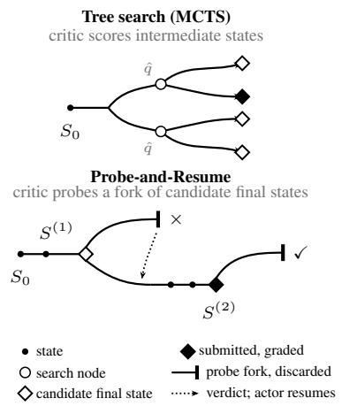

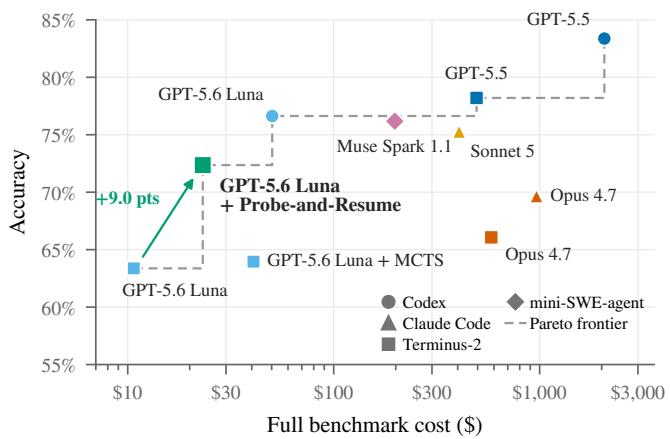  
Figure 1: Left: tree search scores partial states with a critic and submits a leaf; Probe-and-Resume calls the critic only when the actor claims to be done, lets it probe a fork of that state, and resumes the actor on a rejection. Right: accuracy against the cost of running all of Terminal-Bench 2.1 (89 tasks, five trials each); the shape is the agent harness. The GPT-5.6 Luna squares are our three configurations (no search, MCTS, Probe-and-Resume), priced at the AWS Bedrock rate like GPT-5.6 Luna + Codex; the other points and their costs are from Harbor Hub (Appendix C).

We investigate these questions on Terminal-Bench 2.1 (Marten et al., 2026). We find that merely making branching available does not improve task success because the actor rarely uses snapshot and restore capabilities, and a Monte Carlo tree search (MCTS) search policy guided by a trajectory-only critic produces little improvement. One reason for the latter is that the critics we test are poor value estimators of intermediate states, and access to a fork of the environment helps little. However, when the actor signals completion, execute access to a fork of the environment substantially improves their ability to distinguish successful from unsuccessful outcomes. These findings motivate concentrating critic computation at candidate final states, where it can test the actor’s claim against the environment.

Our main observation is that evaluating a terminal task is itself a terminal task. Thus, neither the interaction history alone nor simply inspecting the environment is always sufficient to assess that a script, program, configuration change, or service is correct. The critic must obtain evidence by running programs and constructing checks. Branchable environments make such evaluation, which may modify or destroy state, possible by using a disposable fork. A fork of the initial environment additionally provides a reference for requirements about what must be preserved or changed.

We therefore design Probe-and-Resume (Figure 1(left)): when the actor signals completion, the critic assesses the candidate with terminal access to forks of that state and of the initial environment. If it accepts, the candidate is submitted; otherwise the actor receives its findings and resumes from the unmodified state. Unlike MCTS, the critic judges completions, not intermediate states.

On all 89 tasks of Terminal-Bench 2.1, with five trials per task and GPT-5.6 Luna as the actor and the basic Terminus-2 harness, Probe-and-Resume increases success from 63.4% at the actor’s first completion claim to 72.4% at submission, expanding the accuracy–cost Pareto frontier without the need for new models nor new harnesses (Figure 1(right)). The resulting accuracy is higher than Opus 4.7 using Claude Code, and over an order of magnitude cheaper. On SWE-bench Pro, the gain is similar. Together, these results highlight the unique characteristics of critics in computer environment tasks, and how critics can turn branchable execution into useful feedback for terminal agents when ground-truth verification is unavailable.

## 2 BACKGROUND AND RELATED WORK

Test-time search and evaluation. Search uses additional inference compute to explore candidate solutions. Policy- and value-guided search has improved performance in games (Silver et al., 2016;

2018), mathematical reasoning (Hao et al., 2023; Guan et al., 2025), and software and web tasks (Zhou et al., 2024; Koh et al., 2024; Antoniades et al., 2024). Sampling-based methods evaluate completed candidates or aggregate their answers (Cobbe et al., 2021; Wang et al., 2023; Brown et al., 2024); beam search, best-first search, and MCTS also use evaluations to allocate computation among partial solutions (Xie et al., 2023; Yao et al., 2023; Kocsis & Szepesvári, 2006; Coulom, 2007; Browne et al., 2012). Process evaluation has proved useful in mathematical reasoning (Lightman et al., 2024; Wang et al., 2024), but imperfect assessments can cause search to discard useful candidates (Stroebl et al., 2026; Yu et al., 2025). We examine intermediate predictions and completion judgments separately, because they ask different questions about an execution state.

Feedback and iterative refinement. Self-Refine uses the same model to generate an output, critique it, and revise it (Madaan et al., 2023). Reflexion stores verbal reflections from previous trials to guide subsequent attempts (Shinn et al., 2023). Its evaluator can use environmental feedback, heuristics, model judgments, or generated tests; an evaluator and a feedback loop are therefore established components. Our method also uses feedback to revise an attempt. It preserves both the actor’s environment state and trajectory when it claims the task is done, runs the critic in forks, and resumes the actor from that same candidate after rejection. This differs from resetting the environment for another trial, as in Reflexion’s ALFWorld experiments (Shinn et al., 2023).

External evidence for critics. Huang et al. (2023) find that intrinsic self-correction, without external feedback, can fail to improve reasoning and can reduce accuracy in the settings they study. CRITIC obtains external evidence through tool interaction before revising an output (Gou et al., 2023), including evidence from search and code execution. Other work executes tests against candidate programs or patches (Li et al., 2022; Jain et al., 2025; Ehrlich et al., 2025; Li et al., 2025), or gives judges tools to inspect and interact with an environment (Zhuge et al., 2024; Shi et al., 2026). These methods establish the value of tool-based feedback. We study the additional choices required when the object being judged is a live environment: whether the critic should inspect intermediate or completed states, which operations it needs, and whether the current state contains the evidence required by the task. The benchmark verifier and its output are not available during search.

Judging agent trajectories. Web-agent search uses model assessments of interaction histories (Koh et al., 2024); software-agent discriminators and reward models also use trajectories and patches (Antoniades et al., 2024; Shum et al., 2025). On Terminal-Bench 2, pairwise judgments select among completed trials and recover part of the gap between a single attempt and oracle selection over five samples (Kwok et al., 2026). Judge performance varies across web-agent benchmarks (Lù et al., 2025), and execution-free patch judgments can rely on stylistic features (Jain et al., 2025). These findings motivate measuring critic errors directly, alongside task success.

Critics in branchable environments. Terminal tasks can depend on files, running processes, memory, and changes made during execution, only part of which appears in the interaction history. Revisiting a state can require replaying actions (Koh et al., 2024). Waypoint (Xu et al., 2026) instead supports snapshots, restores, and isolated forks of the filesystem, processes, memory, and terminal session. We use this capability to let a critic execute checks on a disposable fork of the candidate final state, including checks that modify or destroy state. A second fork of the initial environment provides a reference for preservation and recovery requirements. Only the critic’s feedback returns to the actor; its mutations are discarded, and the actor resumes from the candidate state. Our contribution combines this evaluation procedure with an empirical analysis of when critics make useful judgment and which errors arise from missing execution access or initial-state evidence (§3).

## 3 CRITIC DESIGN FOR SEARCH IN TERMINAL ENVIRONMENTS

We first compare branching tools and MCTS with the no-search baseline (§3.1). We then examine three critic design choices: when to evaluate a state and what operations the critic may perform (§3.2), and whether it needs the initial state as a reference (§3.3).

Agent setup. Following policy- and value-guided search, we separate action generation, state evaluation, and search (Silver et al., 2016; Zhou et al., 2024). The actor chooses and executes actions, the critic evaluates states, and the search algorithm selects which states to continue and when to stop. Each search node stores environment state $S _ { t }$ and the trajectory prefix $\tau _ { \leq t }$ that produced it. The environment supports SNAPSHOT(S) → i, RESTORE(i), and FORK(i), where i identifies a saved state and the fork is an isolated live copy.

Experimental setup. We use all 89 tasks in Terminal-Bench 2.1 (Marten et al., 2026), run through Harbor (Harbor Framework Team, 2026) with the Terminus-2 agent and GPT-5.6 Luna. The branchable environment uses Waypoint (Xu et al., 2026), which creates, restores, and forks a Docker-like container’s state. By default, the critic uses the same model as the actor and receives the task instruction and $\tau _ { \leq t }$ . Once search submits a final state, we run the verifier. Each task runs five times and we report pass@1 with 95% bootstrap intervals over tasks (Appendix D). Each trial gets the task’s time limit T (Appendix B), and T covers everything the trial does: the actor’s turns, every critic call, and every snapshot, restore and fork. Only the verifier’s grading is not charged. A trial that ends with no state to submit counts as a failure. We drop the 18 trials that could not be graded, all from the two search baselines (Appendix E). Costs are model tokens only, priced at the AWS Bedrock rate (Appendix C). The configuration of each search arm is in Appendix E.

## 3.1 SEARCH BASELINES

We compare two search baselines. The first gives the actor SNAPSHOT and RESTORE tools, without a separate critic. The second uses MCTS with a trajectory-only critic: it calls SNAPSHOT every five turns, expands at most two children, and selects nodes using UCT (Kocsis & Szepesvári, 2006).

Table 1 shows that branching tools change pass@1 from 63.4% → 61.0%, while MCTS changes it $6 3 . 4 \%  6 4 . 0 \%$ at 3.81× the model cost. Branching tools are rarely used, and the evaluated MCTS configuration provides little improvement: the actor called branching tools in 3 of 445 trials: it saved 1 snapshot and restored 3 times (twice to $S _ { 0 } )$ . For instance, in the DB-WAL-RECOVERY task, restoring $S _ { 0 }$ recovers a write-ahead log removed after the actor opens the database. In PATH-TRACING, the actor saves a state, tries a change, and restores the saved state when the change worsens the result.

These results motivate measuring critic assessments directly; they do not by themselves establish why search fails to improve performance.

Table 1: Branching tools and MCTS don’t improve pass@1 on Terminal-Bench 2.1 (GPT-5.6 Luna).
<table><tr><td></td><td>Pass@1 63.4%</td><td>∆ vs. baseline [95% CI]</td><td>Total model cost $10.70</td></tr><tr><td>Baseline Actor + branching tools</td><td>61.0%</td><td> $- 2 . 4 \left[ - 6 . 7 , + 2 . 0 \right]$ </td><td>$11.40</td></tr><tr><td>MCTS with trajectory-only critic</td><td>64.0%</td><td> $+ 0 . 6 \left[ - 4 . 5 , + 5 . 5 \right]$ </td><td>$40.79</td></tr></table>

## 3.2 WHAT THE CRITIC CAN DO AND WHEN TO INVOKE IT

We now vary the critic’s environment access and the intermediate state it evaluates. We find that environment access improves the critics’ predictions at intermediate states only slightly, but improves their judgments at candidate final states considerably. These results motivate concentrating executionbased assessment at candidate final states in our proposed search algorithm. These measurements do not rule out search with a stronger value estimator or another search policy, and do not show that completion is the optimal time to intervene.

Critic variants. $C ^ { \mathrm { t r a j } }$ receives no environment tools. $C ^ { \mathrm { r e a d } }$ can inspect a fork of the state using read-only commands such as cat, ls, grep, and diff. Cact can execute arbitrary commands in the fork, including installing packages, writing files, running tests, and taking destructive actions (prompts in Appendix A). Comparing these variants distinguishes evidence in $\tau _ { \leq t }$ from evidence obtained by inspection or execution. The two tool-enabled critics issue commands until they return an assessment or reach their limits (Appendix B).

Evaluation positions and metrics. We evaluate each critic at 25%, 50%, and 75% of the actor’s trajectory and at its candidate final state. At intermediate states, the critic estimates continuation success, $\hat { q } ( S _ { t } )$ . We compare this estimate with the pass rate of 5 rollouts from $S _ { t }$ , using the same actor and remaining task budget. At a candidate final state, the critic returns a verdict vˆ, which is compared with the verifier’s output. Critics do not observe the sampled continuations or verifier outcomes. We evaluate 1111 intermediate and 406 candidate final states.

Intermediate and candidate final states have different targets. We score each kind of state by the decision search makes there, and we do not compare scores between these two states (Figure 2). At an intermediate state, search chooses which state to continue, so the critic’s ranking of states matters. We report within-task pairwise accuracy: among pairs of states from the same task and depth, the fraction that the critic orders the same way as their pass rates. A critic that guesses at random scores 50%. Each pass rate is estimated from only 5 rollouts, so sampling noise also pulls the measured accuracy towards 50% and understates the critic’s ranking ability (Appendix F). At a candidate final state, search accepts or rejects, so we report the false-reject and false-accept rates.

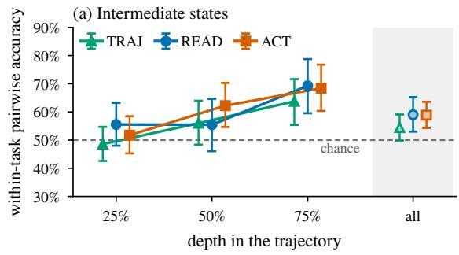

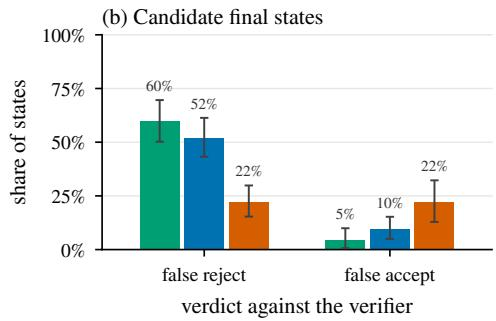  
Figure 2: Critics by position in the actor’s trajectory, on 89 Terminal-Bench 2.1 tasks (numbers in Appendix F); TRAJ, READ, ACT are $C ^ { \mathrm { t r a j } }$ Cread $C ^ { \mathrm { { \acute { a c t } } } }$ (§3.2), TRAJ with the plain prompt (variants in Appendix H). (a) Share of same-task, same-depth pairs that qˆ orders like the pass rates of their 5 continuations; all pools the depths; the dashed line marks chance (50%). (b) Passing states that vˆ rejects and failing states it accepts.

Results by position. At intermediate states, the critics rank states better than chance late in the trajectory (64%–69% at 75% depth), but not early (49%–56% at 25%; Figure 2a). At 25% depth, we do not detect a statistically significant selection gain over random choice (Appendix F). Environment access changes this little: pooled over the depths, the gain of $C ^ { \mathrm { a c t } }$ over $\dot { C } ^ { \mathrm { t r a j } }$ is +4.4 points [−0.9, +9.9]. At candidate final states, $C ^ { \mathrm { a c t } }$ reduces the misclassification rate from 36%–39% to 22%. Most of the gap is in false rejects: over 50% for $C ^ { \mathrm { t r a j } }$ and $C ^ { \mathrm { r e a d } }$ , around 20% for $C ^ { \mathrm { a c t } }$ (Figure 2b).

Completion errors by verifier type. Table 2 groups tasks by what their verifier uses to evaluate: reading files in the environment, executing an artifact or probing a service, or comparing against a reference value unavailable from the environment (Appendix B). A false reject is a correct state incorrectly rejected, and a false accept is the opposite.

Table 2: Verdicts at candidate final states against the verifier, over 406 states of 89 tasks, grouped by what the verifier does to decide a task: it reads files and compares them with a value or format it stores (22 tasks), runs the artifact or probes a service (48), or holds the answer, a value that cannot be recovered from the environment (19). FR: share of passing states rejected. FA: share of failing states accepted. Model cost per state in Appendix G.
<table><tr><td rowspan="2"></td><td colspan="2">reads</td><td colspan="2">runs</td><td colspan="2">holds the answer</td><td colspan="2">all</td></tr><tr><td>FR↓</td><td>FA↓</td><td>FR↓</td><td>FA↓</td><td>FR↓</td><td> $\mathrm { F A \downarrow }$ </td><td> $\mathrm { F R \downarrow }$ </td><td>FA↓</td></tr><tr><td> $C ^ { \mathrm { t r a j } }$ </td><td>46%</td><td>5%</td><td>64%</td><td>3%</td><td>68%</td><td>7%</td><td>60%</td><td>5%</td></tr><tr><td> $C ^ { \mathrm { r e a d } }$ </td><td>42%</td><td>16%</td><td>54%</td><td>5%</td><td>62%</td><td>12%</td><td>52%</td><td>10%</td></tr><tr><td> $C ^ { \mathrm { a c t } }$ </td><td>9%</td><td>19%</td><td>24%</td><td>19%</td><td>38%</td><td>31%</td><td>22%</td><td>22%</td></tr></table>

Even when the verifier only reads files, $C ^ { \mathrm { r e a d } }$ rejects 42% of passing states, compared with 9% for $C ^ { \mathrm { a c t } }$ . In 93% of these read-only false rejects, the critic reports insufficient evidence rather than a violation of a requirement. The critic may need to compute a check even when the verifier can compare the result against a known reference.

When the verifier relies on a reference value that cannot be derived from the environment, Cact falsely accepts 31% of failing states, compared to 19% on tasks whose verifier executes the artifact or probes a service. The critic tends to agree with the actor’s interpretation of the task completion and cannot reach the verifier’s (hidden) reference.

## 3.3 WHAT INFORMATION TO GIVE THE CRITIC

Some requirements refer to the initial state: a file must remain unchanged, a deleted input must be recovered, a program must keep its original behavior. The candidate final state alone cannot settle them, and in §3.2 such requirements account for 15 of $C ^ { \mathrm { a c t } } \mathbf { \bar { s } }$ 56 false rejects. We therefore compare $C ^ { \mathrm { a c t } }$ with $C ^ { \mathrm { a c t } } { + } S _ { 0 }$ , which receives a live fork of the initial state. We rebuild the candidate final states of 89 tasks and let each critic judge every state twice from the same snapshot (Appendix I). The two verdicts per state also measure a critic’s self-consistency.

Over all 404 states (Figure 3), the fork raises accuracy from 76% to 80% (+4.0 points $[ + 0 . 6 , + 7 . 5 ] )$ The gain comes from false rejects, which fall from 24% to 17% (−6.5 points $[ - 1 1 . 3 , - 2 . 2 ] )$ ; false accepts do not move (+0.3 points $[ - 4 . 4 , + 5 . 0 ] )$ , and disagreement between a critic’s two verdicts on a state drops from 18% to 9% (−9.4 points [−15.4, −3.8]).

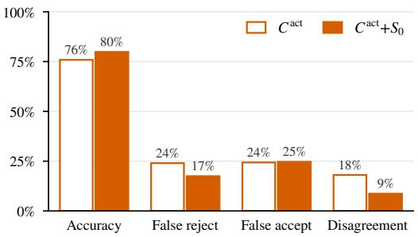

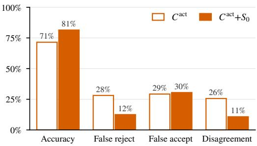  
Figure 3: $C ^ { \mathrm { a c t } }$ against $C ^ { \mathrm { a c t } } { + } S _ { 0 }$ on all 404 candidate final states. Each critic judged every state twice, and every rate counts both verdicts. Disagreement is the share of states on which one critic’s own two verdicts differ.  
Figure 4: The same comparison on the 121 states on which $C ^ { \mathrm { a c t } } { + } S _ { 0 }$ inspected the fork of the initial state in at least one of its two evaluations.

$C ^ { \mathrm { a c t } } { + } S _ { 0 }$ uses the fork in 25% of its evaluations, on 121 states. The critic chose these states itself, so they show where the gain arises, not the effect of the fork on an average state. On them (Figure 4), accuracy rises from 71% to 81% (+9.9 points $[ + 2 . 0 , + 1 8 . 2 ] )$ and false rejects fall from 28% to 12%; on the other 283 states, accuracy changes by +1.4 points [−1.3, +4.1]. In MODERNIZE-SCIENTIFIC-STACK, for example, $C ^ { \mathrm { a c t } }$ rejects because it cannot check whether a legacy file was preserved; $C ^ { \mathrm { a c t } } { + } S _ { 0 }$ compares the file’s hash in both states and accepts. The initial state thus gives the critic more evidence for its checks: its verdicts become more accurate and consistent, not stricter.

## 4 PROBE-AND-RESUME

The previous section identified a number of unique design decisions for critics operating in branchable terminal environments. We found that their value estimates for intermediate states are no better than chance early in a trajectory and improve little with execution access, while unrestricted execution in a fork of the current state and of the initial state helps them judge candidate final states. Based on these findings, we introduce the Probe-and-Resume test-time search policy for terminal agents, and report on its end-to-end evaluations on terminal benchmarks.

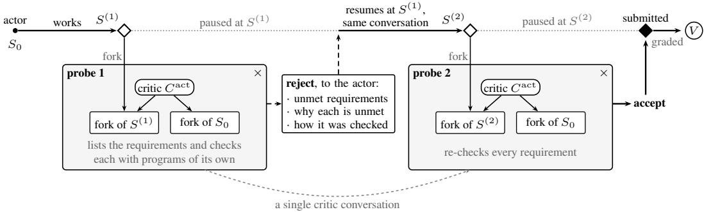  
Figure 5: Probe-and-Resume. When the actor claims to be done, the critic uses forks of $S ^ { ( r ) }$ and $S _ { 0 }$ and can freely execute actions to evaluate the state; they are then discarded (× symbol). If the critic rejects, the actor resumes at $S ^ { ( r ) }$ with the critic’s feedback. Otherwise, $S ^ { ( r ) }$ goes to the verifier V.

## 4.1 HOW PROBE-AND-RESUME WORKS

Figure 5 shows the search policy. The actor starts in $S _ { 0 }$ and executes as normal without knowledge of the critic. When it decides to call task\_complete at $S ^ { ( 1 ) }$ , we use $C ^ { \mathrm { a c t } } { + } S _ { 0 }$ (§3.3) to evaluate the proposal. The critic lists the requirements in the task and executes in the disposable forks of $S ^ { ( 1 ) }$ and $S _ { 0 }$ to check each requirement. Thus, the critic can delete files, regenerate files, copy data between forks, install interpreters, start or kill processes, and take other potentially destructive actions.

If any requirements fail, the actor receives the failures, the rationale for why they failed, and how the critic checked. The actor resumes from $S ^ { ( 1 ) }$ , and observes from the $\pm \mathsf { a s k \_ }$ complete call that the state was rejected, the critic’s feedback, and a request to either address the issues or submit a command that proves a failed requirement actually holds. The actor works until it calls task\_complete again and then submits another proposal. We write $S ^ { ( r ) }$ for the $r ^ { \mathrm { t h } }$ proposed state.

When the actor submits $S ^ { ( 2 ) }$ , the critic continues its conversation from when it assessed $S ^ { ( 1 ) }$ . It is told that the actor has revised its work, is shown the commands the actor ran, and is given fresh forks. It resumes from its previous requirements list and checks the entire list again. If the critic accepts the state, it is submitted to the verifier as the final result.

We execute search until the critic accepts a state, until six critic rounds have passed, or until a budget runs out. The task has a total time limit of T, shared by the actor’s turns, the critic’s evaluations and every snapshot, restore and fork; only the verifier’s grading is not charged. After the first rejection, the actor also has at most 50 more turns. If the critic did not accept any state, the last proposed state is submitted to the verifier; if no such state exists, it is considered a failure.

## 4.2 TERMINAL-BENCH 2.1

We run all 89 Terminal-Bench 2.1 tasks 5 times each, using GPT-5.6 Luna as the model in all settings. We compare with a baseline that submits the first proposed final state, the Codex CLI harness, and Probe-and-Resume. Codex results are drawn from Harbor Hub’s public leaderboard: Codex CLI with GPT-5.6 Luna on the same 89 tasks, five trials each, under the same per-task time limits. Two differences favor Codex. Its T covers only the agent, while ours also covers the critic, and a Codex trial that reaches $T$ is graded on the state it left, while ours fails unless it has proposed a state. It also uses its own harness and sandboxes and calls the model through OpenAI’s API rather than Bedrock. We count one Codex trial whose verifier timed out as a failure, and price its tokens at our rate.

Table 3 shows that Probe-and-Resume improves by 9 percentage points (63% → 72%) over the baseline, and is close to Codex CLI’s performance. It improves the pass rate on 30/89 tasks and regresses on 1. The improvements are comparable when using Claude Sonnet 5 (9.9 points) or GLM-5 (7.2 points) as the critic’s model (Appendix J). While Probe-and-Resume increases the cost to 2.2× the baseline’s (\$10.70 → \$23.14), it remains half the cost of Codex and only 4.2 points lower in accuracy. This is because the critic is only called when the actor believes it is done, rather than during many intermediate turns. To separate resuming from the extra round of feedback, we also restart

the actor from $S _ { 0 }$ after each rejection, with the same critic, feedback and time limit (Appendix K).   
Restarting costs 1.6× as much as resuming and takes longer, and its pass rate is not higher (Table 3).

Table 3: Pass@1 on Terminal-Bench 2.1 over 5 trials per task; cost is the model cost of one trial of every task at the AWS Bedrock rate (Appendix C). Restart from $S _ { 0 }$ restarts the actor from $S _ { 0 }$ after each rejection (Appendix $\mathrm { K } ) ;$ Codex CLI is Harbor Hub’s job (§4.2), priced at the same rate.
<table><tr><td></td><td>Pass@1</td><td> $\Delta$  vs. baseline [95% CI]</td><td>Total model cost</td></tr><tr><td>Baseline</td><td>63.4%</td><td></td><td>$10.70</td></tr><tr><td>Probe-and-Resume</td><td>72.4%</td><td> $+ 9 . 0 [ + 5 . 6 , + 1 2 . 6 ]$ </td><td>$23.14</td></tr><tr><td>Restart from  $S _ { 0 }$ </td><td>66.3%</td><td></td><td>$38.12</td></tr><tr><td>Codex CLI (reference)</td><td>76.6%</td><td></td><td>$50.29</td></tr></table>

Detailed Analysis. To understand why the critic improves the pass rate, Figure 6a depicts a flow chart between the true pass rate of the first state the actor proposes to the critic, the critic’s assessment of it, and the true pass rate of the final submitted state. Of the 136 proposals that fail, the critic correctly rejects 103 (76%), and the actor eventually is able to fix and “rescue” 43 of them (42%). Of the 282 passing proposals, the critic falsely rejects 60 (21%) and the actor eventually “rescues” 57.

(a)  
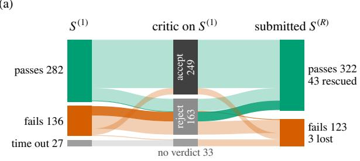

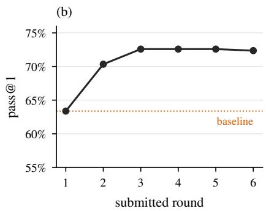  
Figure 6: (a) Flow diagram that describes the true pass rate of the first state the actor proposes to the critic $S ^ { ( 1 ) }$ , the critic’s assessment of it, and the true pass rate of the final state submitted to the verifier. Trials that exceed the time limit count as failures. (b) Pass@1 if stopped after K rounds.

Of the 123 submissions that fail, 29 were the critic’s false accepts, the critic timed out on $^ { 4 , }$ and 3 were falsely rejected. The other 60 were correctly rejected by the critic, but the actor was not able to improve them. The remaining 27 ran out of time before the actor’s first claim, so the critic never saw them. Of the trials that claim to be finished, 64% end after one round. Allowing a second claim raises the submitted pass rate from 63% to 70%, 78% of the loop’s gain, and a third to 73%; further rounds add nothing measurable (Figure 6b), so a cap of three claims would lose nothing.

The critic’s false accept and reject rates (21%, 21%) are comparable to those measured in §3.2 for $C ^ { \mathrm { a c t } }$ at candidate final states (22%, 22%). A benefit of Probe-and-Resume is that after a false rejection the actor does not need to start over from the initial state, and can resume immediately.

## 4.3 SWE-BENCH PRO

To study whether Probe-and-Resume generalizes to non-Terminal-Bench tasks, we then evaluate Probe-and-Resume (unchanged) with GPT-5.6 Luna on SWE-bench Pro (Deng et al., 2025), using the public split of its second release, V2.0.0 (642 tasks from 11 open-source repositories). We use two task sets, both defined by data released with the benchmark: Hard, its HARD-51 subset, and Medium, tasks that none of its runs of 2025 models solved. We report one trial of each of the 227 tasks we can grade offline (41 hard, 186 medium) under the 50-minute limit; Appendix M gives the exact sets and four more trials of each hard task.

V2’s locked protocol runs the agent offline except for the model endpoint, as we do, but grades the agent’s git diff applied to a fresh image. We instead run the same, unchanged verifier on a fork of the proposed state, as on Terminal-Bench. The verifier first resets the repository’s test code. The hidden tests enter only that fork, and neither the actor nor the critic sees them or the grade. Since the sandbox had no network, no trial could download packages.

Figure 7 shows that while the baseline that submits the first proposed state has a pass rate of 80%, Probe-and-Resume increases the pass rate to 88%, comparable to the improvements on Terminal-Bench; the gain comes from the medium tasks, and on the hard tasks it cannot be told apart from zero (Appendix M). The benefits are similar because the critic rejects 36 of the 45 failing first proposals (80%) and the actor turns 22 of them into passing states. The critic also falsely rejects 46 of the 182 passing first proposals (25%), and the actor is able to rescue 41 of them. It costs 2.2× as much.

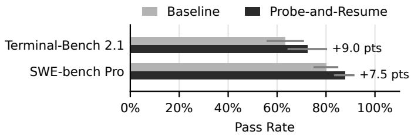  
Figure 7: Probe-and-Resume on Terminal-Bench 2.1 and Medium/Hard tasks in SWE-bench Pro.

## 4.4 DISCUSSION AND LIMITATIONS

Branching for assessment and repair. This work shows that branching is not only useful for exploring alternative actions, but also for critics to evaluate a candidate without changing the state the actor may resume from. It also allows the critic to compare with other states as a reference (such as the initial state). We find that critics need not be fully correct, as the actor and critic pair can “rescue” seemingly failing states. The actor also avoids restarting from the beginning after a critic rejection, which lowers success by 6.1 points and increases model cost (Appendix K).

Scope and model dependence. Critics help when actors can repair mistakes they fail to identify themselves; easy tasks the actor can solve leave little room for critics to help, while tasks that are too hard may not be solvable by the actor. As weak evidence, we find no statistically significant gains using Astra and Opus as actor or critic on even hard Terminal-Bench tasks (Appendix L). Our evaluation manages environment state using Waypoint’s terminal-oriented container. Other settings require branching support for their state, such as TClone for GUI workspaces (Huang et al., 2026). Forks do not isolate writes to external databases or shared services, so destructive checks require isolating those dependencies or restricting critic actions.

Sequential and parallel search. Probe-and-Resume spends test-time compute sequentially. Parallel search spends compute on breadth instead, drawing k independent trials and selecting one of them. The two are complementary as each of the k trials can itself be a Probe-and-Resume loop, and the acting critic’s final verdicts can evaluate on forks of each trial’s environment state to select a winner. We found that pass rates converge after three rounds (§4.2), so compute may be better spent on parallel trials. We leave studying this interaction to future work.

Towards Complex Computer Tasks. As computer tasks involve richer data and interacting systems, correctness will increasingly encompass the entire environment state and how it changes. Existing benchmarks already point towards this: AppWorld checks for unintended database changes (Trivedi et al., 2024), ToolSandbox evaluates dependencies and required events throughout execution (Lu et al., 2025), and STRATUS checks whether interventions worsen system health and relies on undoing them (Chen et al., 2025). Even as models increase in capability, they will likely benefit from branchable environments, as well as the critic’s ability to effectively use branching capabilities to execute checks within and across intermediate and final environment states.

## 5 CONCLUSION

We studied when terminal-agent critics provide useful assessments and what access they need. The tested critics make weak predictions of success from intermediate states, even with execution access.

Once the actor claims to be done, a critic that runs checks in a fork of that state judges it far more accurately. A fork of the initial state also lets it check what must be preserved or recovered. These findings motivate Probe-and-Resume: the critic checks candidate completions in disposable forks, and the actor resumes from the unchanged candidate with feedback after rejection. On Terminal-Bench 2.1, Probe-and-Resume raises pass@1 from 63.4% to 72.4%, at less than half the cost of Codex CLI with the same model. These results show that branching alone does not make search effective; it helps when a critic uses it to check completed work, because evaluating a terminal task is itself a terminal task.

## AI USE STATEMENT

In this work, we used generative AI tools to provide feedback on experiment results, and implement methods. We have not used generative AI tools to help develop theoretical models or conceptual frameworks, assist in the writing of proofs, propose or refine hypotheses, clean and reformat dataset, support qualitative and thematic data analysis, interpret results, and generate synthetic data sets, formulate mathematical claims, provide critical ingredients for proving mathematical claims, assist with translation are not applicable to this work. Additionally, we used generative AI tools to create or modify scientific figures or images, sourcing/searching for information, identify relevant literature. We have reviewed all AI-assisted work. LLM-generated code was verified and tested for correctness by authors. We take responsibility for the final content of this work, including text, claims or artifacts produced with the aid of generative AI.

## ETHICS STATEMENT

We take research ethics seriously and have reviewed this work against the ICLR Code of Ethics. This work does not involve human subjects, personal data, or the release of a new dataset. All experiments run on the public verified benchmarks and the models we evaluate are used through their providers’ APIs under their terms of service. We are not aware of ethical concerns specific to this work. We remain committed to conducting and reporting our research responsibly, and to releasing our code and logs so that the community can examine and build on it.

## REPRODUCIBILITY STATEMENT

The framework and the semantics of its directives are given in §3, and the search policy of Probeand-Resume in §4.1. The full text of the actor’s and every critic’s prompts is in our repository (Appendix A). The task corpus, the per-task timeouts, and the verifier annotation are listed in Appendix B. The statistical procedure behind every interval and paired comparison is described in Appendix D. Configurations and the search baselines are in Appendix E, and the protocol of the reference-state critic is in Appendix I. We have made every effort to make the results reproducible. Every trial was run on a fresh AWS EC2 instance, and every number in the paper is generated by scripts from the raw trial logs. Our repository (https://github.com/Alex-XJK/harbor-StateFork/ tree/arxiv-v1) provides the code, the prompts, the full configuration of every arm, and a CLI that launches each experiment and regenerates every table and figure from the logs.

## ACKNOWLEDGMENTS

This research received DAPLab corporate support in the form of funding and/or compute from Amazon, IntellectAI, Infosys, Tidalwave, Veris, Shopify, Microsoft, Thinking Machines, Dandy, Perplexity, and Daytona. The views and conclusions presented here are those of the authors and should not be interpreted as representing the official positions of the funding organizations.

## REFERENCES

Antonis Antoniades, Albert Örwall, Kexun Zhang, Yuxi Xie, Anirudh Goyal, and William Wang. SWE-Search: Enhancing software agents with Monte Carlo tree search and iterative refinement. arXiv preprint arXiv:2410.20285, 2024. URL https://arxiv.org/abs/2410.20285.

Bradley Brown, Jordan Juravsky, Ryan Ehrlich, Ronald Clark, Quoc V. Le, Christopher Ré, and Azalia Mirhoseini. Large language monkeys: Scaling inference compute with repeated sampling, 2024. URL https://arxiv.org/abs/2407.21787.

Cameron B. Browne, Edward Powley, Daniel Whitehouse, Simon M. Lucas, Peter I. Cowling, Philipp Rohlfshagen, Stephen Tavener, Diego Perez, Spyridon Samothrakis, and Simon Colton. A survey of Monte Carlo tree search methods. IEEE Transactions on Computational Intelligence and AI in Games, 4(1):1–43, 2012. doi: 10.1109/TCIAIG.2012.2186810.

Yinfang Chen, Jiaqi Pan, Jackson Clark, Yiming Su, Noah Zheutlin, Bhavya Bhavya, Rohan R. Arora, Yu Deng, Saurabh Jha, and Tianyin Xu. STRATUS: A multiagent system for autonomous reliability engineering of modern clouds. In Advances in Neural Information Processing Systems, volume 38, 2025. doi: 10.52202/ 085713-1671. URL https://papers.nips.cc/paper\_files/paper/2025/hash/ 47a6e9e2c3019f13ad94a0f259fe4970-Abstract-Conference.html.

Karl Cobbe, Vineet Kosaraju, Mohammad Bavarian, Mark Chen, Heewoo Jun, Lukasz Kaiser, Matthias Plappert, Jerry Tworek, Jacob Hilton, Reiichiro Nakano, Christopher Hesse, and John Schulman. Training verifiers to solve math word problems, 2021. URL https://arxiv.org/ abs/2110.14168.

Rémi Coulom. Efficient selectivity and backup operators in Monte-Carlo tree search. In H. Jaap van den Herik, Paolo Ciancarini, and H. H. L. M. (Jeroen) Donkers (eds.), Computers and Games, pp. 72–83, Berlin, Heidelberg, 2007. Springer Berlin Heidelberg. ISBN 978-3-540-75538-8.

Xiang Deng, Jeff Da, Edwin Pan, Yannis Yiming Sun, Chen Bo Calvin Wu, Sanyam Bhutani, et al. SWE-Bench Pro: Can AI agents solve long-horizon software engineering tasks?, 2025. URL https://arxiv.org/abs/2509.16941.

Yunpeng Dong, Jingkai He, Shiqi Liu, Yuze Hou, Dong Du, Zhonghu Xu, Si Yu, Baochuan Yang, Yubin Xia, and Haibo Chen. DeltaBox: Scaling stateful AI agents with millisecond-level sandbox checkpoint/rollback. arXiv preprint arXiv:2605.22781, 2026. URL https://arxiv.org/ abs/2605.22781.

Ryan Ehrlich, Bradley Brown, Jordan Juravsky, Ronald Clark, Christopher Ré, and Azalia Mirhoseini. CodeMonkeys: Scaling test-time compute for software engineering. arXiv preprint arXiv:2501.14723, 2025. URL https://arxiv.org/abs/2501.14723.

Zhibin Gou, Zhihong Shao, Yeyun Gong, Yelong Shen, Yujiu Yang, Nan Duan, and Weizhu Chen. CRITIC: Large language models can self-correct with tool-interactive critiquing, 2023. URL https://arxiv.org/abs/2305.11738.

Xinyu Guan, Li Lyna Zhang, Yifei Liu, Ning Shang, Youran Sun, Yi Zhu, Fan Yang, and Mao Yang. rStar-math: Small LLMs can master math reasoning with self-evolved deep thinking. In Aarti Singh, Maryam Fazel, Daniel Hsu, Simon Lacoste-Julien, Felix Berkenkamp, Tegan Maharaj, Kiri Wagstaff, and Jerry Zhu (eds.), Proceedings of the 42nd International Conference on Machine Learning, volume 267 of Proceedings ofMachine Learning Research, pp. 20640–20661. PMLR, 13–19 Jul 2025. URL https://proceedings.mlr.press/v267/guan25f.html.

Shibo Hao, Yi Gu, Haodi Ma, Joshua Jiahua Hong, Zhen Wang, Daisy Zhe Wang, and Zhiting Hu. Reasoning with language model is planning with world model, 2023. URL https://arxiv. org/abs/2305.14992.

Harbor Framework Team. Harbor: A framework for evaluating and optimizing agents and models in container environments, 2026. URL https://github.com/harbor-framework/ harbor.

Jie Huang, Xinyun Chen, Swaroop Mishra, Huaixiu Steven Zheng, Adams Wei Yu, Xinying Song, and Denny Zhou. Large language models cannot self-correct reasoning yet, 2023. URL https: //arxiv.org/abs/2310.01798.

Yutong Huang, Vikranth Srivatsa, Alex Asch, Hansin Tushar Patwa, and Yiying Zhang. TClone: Low-latency forking of live GUI environments for computer-use agents. arXiv preprint arXiv:2605.17320, 2026. URL https://arxiv.org/abs/2605.17320.

Naman Jain, Jaskirat Singh, Manish Shetty, Liang Zheng, Koushik Sen, and Ion Stoica. R2E-Gym: Procedural environments and hybrid verifiers for scaling open-weights SWE agents. In Conference on Language Modeling (COLM), 2025. URL https://arxiv.org/abs/2504.07164.

Levente Kocsis and Csaba Szepesvári. Bandit based Monte-Carlo planning. In Machine Learning: ECML 2006, volume 4212 of Lecture Notes in Computer Science, pp. 282–293. Springer, 2006.

Jing Yu Koh, Stephen McAleer, Daniel Fried, and Ruslan Salakhutdinov. Tree search for language model agents. arXiv preprint arXiv:2407.01476, 2024. URL https://arxiv.org/abs/ 2407.01476.

Jacky Kwok, Shulu Li, Pranav Atreya, Yuejiang Liu, Yixing Jiang, Chelsea Finn, Marco Pavone, Ion Stoica, and Azalia Mirhoseini. LLM-as-a-Verifier: A general-purpose verification framework, 2026. URL https://arxiv.org/abs/2607.05391.

Dacheng Li, Shiyi Cao, Chengkun Cao, Xiuyu Li, Shangyin Tan, Kurt Keutzer, Jiarong Xing, Joseph E. Gonzalez, and Ion Stoica. S\*: Test time scaling for code generation, 2025. URL https://arxiv.org/abs/2502.14382.

Yujia Li, David Choi, Junyoung Chung, Nate Kushman, Julian Schrittwieser, Rémi Leblond, Tom Eccles, James Keeling, Felix Gimeno, Agustin Dal Lago, Thomas Hubert, Peter Choy, Cyprien de Masson d’Autume, Igor Babuschkin, Xinyun Chen, Po-Sen Huang, Johannes Welbl, Sven Gowal, Alexey Cherepanov, James Molloy, Daniel J. Mankowitz, Esme Sutherland Robson, Pushmeet Kohli, Nando de Freitas, Koray Kavukcuoglu, and Oriol Vinyals. Competition-level code generation with AlphaCode. Science, 378(6624):1092–1097, 2022. doi: 10.1126/science.abq1158. URL https://doi.org/10.1126/science.abq1158.

Hunter Lightman, Vineet Kosaraju, Yuri Burda, Harrison Edwards, Bowen Baker, Teddy Lee, Jan Leike, John Schulman, Ilya Sutskever, and Karl Cobbe. Let’s verify step by step. In The Twelfth International Conference on Learning Representations, 2024. URL https://proceedings.iclr.cc/paper\_files/paper/2024/file/ aca97732e30bcf1303bc22ac3924fd16-Paper-Conference.pdf.

Jiarui Lu, Thomas Holleis, Yizhe Zhang, Bernhard Aumayer, Feng Nan, Haoping Bai, Shuang Ma, Shen Ma, Mengyu Li, Guoli Yin, Zirui Wang, and Ruoming Pang. ToolSandbox: A stateful, conversational, interactive evaluation benchmark for LLM tool use capabilities. In Luis Chiruzzo, Alan Ritter, and Lu Wang (eds.), Findings of the Association for Computational Linguistics: NAACL 2025, pp. 1160–1183, Albuquerque, New Mexico, April 2025. Association for Computational Linguistics. ISBN 979-8-89176-195-7. doi: 10.18653/v1/2025.findings-naacl.65. URL https: //aclanthology.org/2025.findings-naacl.65/.

Xing Han Lù, Amirhossein Kazemnejad, Nicholas Meade, Arkil Patel, Dongchan Shin, Alejandra Zambrano, Karolina Stanczak, Peter Shaw, Christopher Pal, and Siva Reddy. AgentRewardBench: Evaluating automatic evaluations of web agent trajectories. In Second Conference on Language Modeling, 2025. URL https://openreview.net/forum?id=fQcUZMPIvu.

Aman Madaan, Niket Tandon, Prakhar Gupta, Skyler Hallinan, Luyu Gao, Sarah Wiegreffe, Uri Alon, Nouha Dziri, Shrimai Prabhumoye, Yiming Yang, Shashank Gupta, Bodhisattwa Prasad Majumder, Katherine Hermann, Sean Welleck, Amir Yazdanbakhsh, and Peter Clark. Self-Refine: Iterative refinement with self-feedback, 2023. URL https://arxiv.org/abs/2303.17651.

Ryan Marten, Alex Shaw, Ivan Bercovich, Benedikt Droste, Tommaso Cerruti, Steven Dillmann, Ruiyang Wang, Dariush Wahdany, Allen Hart, Karl Krauth, ScaleAI, Snorkel AI, Turing, gNucleus AI, Boolean AI, Nicholas Carlini, Shengrui Lyu, Anjiang Wei, Arpandeep Khatua, Björn Plüster, Chaitanya Dwivedi, Christine Sutcliffe, Yuming, David Tivris, Di Wang, Hui Wen Goh, Hanwen Xing, Haowei Lin, Irakli Salia, Jaejung Seol, Jiajun Bao, Jialin Ouyang, Junha Park, Liam Walsh, Luyang Kong, Maksim Ivanov, Malte Ubl, Mikhail Liamets, Orfeas Menis, Piotr Migdal, Qingquan Bao, Raj Movva, Roey Ben Chaim, Namburi Srinath, Sergey Bogdanik, Shubham Yadav, Stephen Benjamin, Tony Kung, Walker Hughes, Xin Lan, Himanshu Gupta, Swaroop Mishra, Chenguang Wang, Hao He, Jianhong Tu, Kyle Montgomery, Zengji Tu, Atharva Naik, David Mortensen, Ivan Zhang, Yash Mathur, Emmy Liu, Karanpartap Singh, Michael Yu, Steven Feng, Varun Gangal, Zhuofu Tao, Sherry Ruan, Jonas Mueller, Joan Cabezas, Justin Bauer, Kevin Xiang Li, Robert

Zhang, Aaron Feller, Alec Madayan, Leon Chen, Ben Feuer, Xiangyi Li, Boxuan Li, Harsh Raj, Samuel Galler, Lin Shi, Ivgeni Segal, Kelly Buchanan, Shreyas P., Rishi Desai, Aaron Schneider, Chris Settles, Xiangning Lin, Marianna Nezhurina, Andrew Wang, Michał Kowalczyk, Jin-Xiang Zhao, Sanyam Satia, Jessie Hu, Sherif Atef, Kobe Chen, Sam Vance, Gian Segato, Jenia Jitsev, Alex Dimakis, Mike Merrill, Andy Konwinski, and Ludwig Schmidt. Terminal-Bench, August 2026. URL https://github.com/harbor-framework/terminal-bench.

Wentao Shi, Yu Wang, Yuyang Zhao, Yuxin Chen, Fuli Feng, Xueyuan Hao, Xi Su, Qi GU, Hui Su, Xunliang Cai, and Xiangnan He. AJ-bench: Benchmarking agent-as-a-judge for environmentaware evaluation. In Maria Liakata, Viviane P. Moreira, Jiajun Zhang, and David Jurgens (eds.), Findings of the Association for Computational Linguistics: ACL 2026, pp. 25371–25413, San Diego, California, United States, July 2026. Association for Computational Linguistics. ISBN 979- 8-89176-395-1. doi: 10.18653/v1/2026.findings-acl.1269. URL https://aclanthology. org/2026.findings-acl.1269/.

Noah Shinn, Federico Cassano, Ashwin Gopinath, Karthik Narasimhan, and Shunyu Yao. Reflexion: Language agents with verbal reinforcement learning. In Advances in Neural Information Processing Systems, volume 36. Curran Associates, Inc., 2023.

KaShun Shum, Binyuan Hui, Jiawei Chen, Lei Zhang, X. W., Jiaxi Yang, Yuzhen Huang, Junyang Lin, and Junxian He. SWE-RM: Execution-free feedback for software engineering agents. arXiv preprint arXiv:2512.21919, 2025. URL https://arxiv.org/abs/2512.21919.

David Silver, Aja Huang, Chris J. Maddison, Arthur Guez, Laurent Sifre, George van den Driessche, Julian Schrittwieser, Ioannis Antonoglou, Veda Panneershelvam, Marc Lanctot, Sander Dieleman, Dominik Grewe, John Nham, Nal Kalchbrenner, Ilya Sutskever, Timothy Lillicrap, Madeleine Leach, Koray Kavukcuoglu, Thore Graepel, and Demis Hassabis. Mastering the game of Go with deep neural networks and tree search. Nature, 529(7587):484–489, 2016. doi: 10.1038/ nature16961.

David Silver, Thomas Hubert, Julian Schrittwieser, Ioannis Antonoglou, Matthew Lai, Arthur Guez, Marc Lanctot, Laurent Sifre, Dharshan Kumaran, Thore Graepel, Timothy Lillicrap, Karen Simonyan, and Demis Hassabis. A general reinforcement learning algorithm that masters chess, shogi, and Go through self-play. Science, 362(6419):1140–1144, 2018. doi: 10.1126/science. aar6404.

Benedikt Stroebl, Sayash Kapoor, and Arvind Narayanan. The limits of inference scaling through resampling. In The Fourteenth International Conference on Learning Representations, 2026. URL https://openreview.net/forum?id=j8H84v6AZ1.

Harsh Trivedi, Tushar Khot, Mareike Hartmann, Ruskin Manku, Vinty Dong, Edward Li, Shashank Gupta, Ashish Sabharwal, and Niranjan Balasubramanian. AppWorld: A controllable world of apps and people for benchmarking interactive coding agents. In Proceedings ofthe 62nd Annual Meeting ofthe Associationfor Computational Linguistics (Volume 1: Long Papers). ACL, 2024. URL https://aclanthology.org/2024.acl-long.850/.

Peiyi Wang, Lei Li, Zhihong Shao, Runxin Xu, Damai Dai, Yifei Li, Deli Chen, Yu Wu, and Zhifang Sui. Math-Shepherd: Verify and reinforce LLMs step-by-step without human annotations. In Lun-Wei Ku, Andre Martins, and Vivek Srikumar (eds.), Proceedings of the 62nd Annual Meeting of the Association for Computational Linguistics (Volume 1: Long Papers), pp. 9426–9439, Bangkok, Thailand, August 2024. Association for Computational Linguistics. doi: 10.18653/v1 2024.acl-long.510. URL https://aclanthology.org/2024.acl-long.510/.

Xuezhi Wang, Jason Wei, Dale Schuurmans, Quoc V Le, Ed H. Chi, Sharan Narang, Aakanksha Chowdhery, and Denny Zhou. Self-consistency improves chain of thought reasoning in language models. In The Eleventh International Conference on Learning Representations, 2023. URL https://openreview.net/forum?id=1PL1NIMMrw.

Tianyuan Wu, Chaokun Chang, Lunxi Cao, Wei Gao, and Wei Wang. Crab: A semantics-aware checkpoint/restore runtime for agent sandboxes. arXiv preprint arXiv:2604.28138, 2026. URL https://arxiv.org/abs/2604.28138.

Yuxi Xie, Kenji Kawaguchi, Yiran Zhao, James Xu Zhao, Min-Yen Kan, Junxian He, and Michael Xie. Self-evaluation guided beam search for reasoning. In A. Oh, T. Naumann, A. Globerson, K. Saenko, M. Hardt, and S. Levine (eds.), Advances in Neural Information Processing Systems, volume 36, pp. 41618–41650. Curran Associates, Inc., 2023. doi: 10.52202/ 075280-1802. URL https://proceedings.neurips.cc/paper\_files/paper/ 2023/file/81fde95c4dc79188a69ce5b24d63010b-Paper-Conference.pdf.

Jiakai Xu, Tianle Zhou, Eugene Wu, and Kostis Kaffes. Toward systems foundations for agentic exploration. arXiv preprint arXiv:2510.05556, 2025. URL https://arxiv.org/abs/2510. 05556.

Jiakai Xu, Tiancheng Ge, Rohan Timmaraju, Georgios Liargkovas, Eugene Wu, and Kostis Kaffes. Waypoint, September 2026. URL https://github.com/Alex-XJK/waypoint.

Shunyu Yao, Dian Yu, Jeffrey Zhao, Izhak Shafran, Tom Griffiths, Yuan Cao, and Karthik Narasimhan. Tree of thoughts: Deliberate problem solving with large language models. In A. Oh, T. Naumann, A. Globerson, K. Saenko, M. Hardt, and S. Levine (eds.), Advances in Neural Information Processing Systems, volume 36, pp. 11809–11822. Curran Associates, Inc., 2023. doi: 10.52202/ 075280-0517. URL https://proceedings.neurips.cc/paper\_files/paper/ 2023/file/271db9922b8d1f4dd7aaef84ed5ac703-Paper-Conference.pdf.

Fei Yu, Yingru Li, and Benyou Wang. Scaling flaws of verifier-guided search in mathematical reasoning, 2025. URL https://arxiv.org/abs/2502.00271.

Andy Zhou, Kai Yan, Michal Shlapentokh-Rothman, Haohan Wang, and Yu-Xiong Wang. Language agent tree search unifies reasoning, acting, and planning in language models. In Proceedings of the 41st International Conference on Machine Learning (ICML), volume 235 of PMLR, 2024. URL https://proceedings.mlr.press/v235/zhou24r.html.

Mingchen Zhuge, Changsheng Zhao, Dylan Ashley, Wenyi Wang, Dmitrii Khizbullin, Yunyang Xiong, Zechun Liu, Ernie Chang, Raghuraman Krishnamoorthi, Yuandong Tian, Yangyang Shi, Vikas Chandra, and Jürgen Schmidhuber. Agent-as-a-judge: Evaluate agents with agents. arXiv preprint arXiv:2410.10934, 2024. URL https://arxiv.org/abs/2410.10934.

## A PROMPTS

All prompts used in this paper are in our repository at https://github.com/ Alex-XJK/harbor-StateFork/tree/arxiv-v1. The actor’s prompts are under src/harbor/search/templates/, whereas the critics’ prompts and the feedback template are under src/harbor/search/critics/templates/. The code in the same directories shows how each prompt is built from its template, the task and the trajectory.

## B TASK LIST, VERIFIER ANNOTATION AND TIMEOUTS

Table 4 lists the 89 tasks of Terminal-Bench 2.1, the time limit T each task gives the actor, and what each task’s verifier does to grade it.

We read every verifier by hand. For each assertion it makes, we asked what a checker must do, at minimum, to settle it: read something that already exists in the environment (R), run something to produce a new observation (X), or compare against a value that only the verifier holds (O). R and X have finer codes. R1: file content, such as a file that exists or whose content or hash matches. R2: filesystem metadata, such as permissions, owners, timestamps or git objects. R3: runtime state, such as a live process, a listening port or an environment variable. X1: run a binary, a test or a computation and check its output. X2: probe a service, such as connecting to a port or sending a request. A task carries every code its assertions need.

§3.2 groups tasks by their strongest code: holds the answer if any assertion is O (19 tasks), otherwise runs if any is X (48), otherwise reads (22). The last column marks the 47 tasks whose instruction states a requirement relative to the initial state $S _ { 0 }$ , such as a file that must stay unchanged or an output that must match the original program’s.

Table 4: The 89 tasks of Terminal-Bench 2.1. T: the task’s time limit for the actor. Verifier: every code its assertions need (R1–R3 read, X1–X2 run, O compares with a value only the verifier holds); §3.2 groups tasks by the strongest one. S0: the task states a requirement relative to the initial state (§3.3).
<table><tr><td>Task</td><td>T (min)</td><td>Verifier</td><td>S0</td><td>Task</td><td>T (min)</td><td>Verifier</td><td>S0</td></tr><tr><td>adaptive-rejection-sampler</td><td>15</td><td>R1, X1</td><td></td><td>make-mips-interpreter</td><td>30</td><td>R1, X1</td><td>V</td></tr><tr><td>bn-fit-modify</td><td>60</td><td>R1,0</td><td></td><td>mcmc-sampling-stan</td><td>30</td><td>R1, X1</td><td>√</td></tr><tr><td>break-filter-js-from-html</td><td>20</td><td>R1, X1</td><td>√</td><td>merge-diff-arc-agi-task</td><td>15</td><td>R1, X1, O</td><td>√</td></tr><tr><td>build-cython-ext</td><td>15</td><td>R1, X1, O</td><td></td><td>model-extraction-relu-logits</td><td>15</td><td>R1, X1</td><td></td></tr><tr><td>build-pmars</td><td>15</td><td>R1, X1</td><td></td><td>modernize-scientific-stack</td><td>10</td><td>X1</td><td>√</td></tr><tr><td>build-pov-ray</td><td>200</td><td>R1, X1, O</td><td>√</td><td>mteb-leaderboard</td><td>60</td><td>R1, O</td><td></td></tr><tr><td>caffe-cifar-10</td><td>60</td><td>R1, R2, X1</td><td></td><td>mteb-retrieve</td><td>30</td><td>R1</td><td>√</td></tr><tr><td>cancel-async-tasks</td><td>15</td><td>R1, X1</td><td></td><td>multi-source-data-merger</td><td>15</td><td>R1</td><td>√</td></tr><tr><td>chess-best-move</td><td>15</td><td>R1</td><td>√</td><td>nginx-request-logging</td><td>15</td><td>R1. X1, X2</td><td></td></tr><tr><td>circuit-fibsqrt</td><td>60</td><td>R1, X1</td><td>√</td><td>openssl-selfsigned-cert</td><td>15</td><td>R1, R2, X1</td><td></td></tr><tr><td>cobol-modernization</td><td>15</td><td>R1, X1</td><td>V</td><td>overfull-hbox</td><td>12.5</td><td>R1, X1</td><td>√</td></tr><tr><td>code-from-image</td><td>20</td><td>R1</td><td></td><td>password-recovery</td><td>15</td><td>R1</td><td>√</td></tr><tr><td>compile-compcert</td><td>40</td><td>R1, R2, X1</td><td></td><td>path-tracing</td><td>30</td><td>R1, X1</td><td>√</td></tr><tr><td>configure-git-webserver</td><td>15</td><td>X1, X2</td><td></td><td>path-tracing-reverse</td><td>30</td><td>R1, X1</td><td>√</td></tr><tr><td>constraints-scheduling</td><td>20</td><td>R1</td><td>V</td><td>polyglot-c-py</td><td>15</td><td>X1</td><td></td></tr><tr><td>count-dataset-tokens</td><td>15</td><td>R1,O</td><td></td><td>polyglot-rust-c</td><td>15</td><td>R1, X1</td><td></td></tr><tr><td>crack-7z-hash</td><td>30</td><td>R1</td><td>√</td><td>portfolio-optimization</td><td>60</td><td>R1, X1</td><td>√</td></tr><tr><td>custom-memory-heap-crash</td><td>30</td><td>R1, X1</td><td>√</td><td>protein-assembly</td><td>30</td><td>R1, O</td><td>√</td></tr><tr><td>db-wal-recovery</td><td>15</td><td>R1</td><td>√</td><td>prove-plus-comm</td><td>15</td><td>R1, X1</td><td></td></tr><tr><td>distribution-search</td><td>60</td><td>R1</td><td></td><td>pypi-server</td><td>15</td><td>R1, X1, X2</td><td></td></tr><tr><td>dna-assembly</td><td>30</td><td>R1, X1</td><td>√</td><td>pytorch-model-cli</td><td>15</td><td>R1, X1, O</td><td></td></tr><tr><td>dna-insert extract-elf</td><td>30</td><td>R1, X1</td><td>√</td><td>pytorch-model-recovery</td><td>15</td><td>R1, X1</td><td>√</td></tr><tr><td></td><td>15</td><td>R1, X1, O</td><td>√</td><td>qemu-alpine-ssh</td><td>15</td><td>R3, X2</td><td></td></tr><tr><td>extract-moves-from-video</td><td>30</td><td>R1</td><td></td><td>qemu-startup</td><td>15</td><td>R3, X2</td><td></td></tr><tr><td>feal-differential-cryptanalysis</td><td>30</td><td>X1, 0</td><td>√</td><td>query-optimize</td><td>15</td><td>R1, X1, O</td><td>√</td></tr><tr><td>feal-linear-cryptanalysis</td><td>30</td><td>R1</td><td></td><td>raman-fitting</td><td>15</td><td>R1</td><td>√</td></tr><tr><td>filter-js-from-html</td><td>30</td><td>R1, X1, X2, O</td><td></td><td>regex-chess</td><td>60</td><td>R1, X1</td><td></td></tr><tr><td>financial-document-processor</td><td>20</td><td>R1</td><td></td><td>regex-log</td><td>15</td><td>R1, X1, O</td><td></td></tr><tr><td>fix-code-vulnerability</td><td>15</td><td>R1, X1</td><td>V</td><td>reshard-c4-data</td><td>60</td><td>R1, R2, X1, O</td><td></td></tr><tr><td>fix-git</td><td>15</td><td>R1</td><td>√</td><td>rstan-to-pystan</td><td>30</td><td>R1</td><td>√</td></tr><tr><td>fix-ocaml-gc</td><td>60</td><td>R1, X1, X2, O</td><td></td><td>sam-cell-seg</td><td>120</td><td>R1, X1, O</td><td></td></tr><tr><td>gcode-to-text</td><td>15</td><td>R1</td><td>V</td><td>sanitize-git-repo</td><td>15</td><td>R1, R2</td><td>√</td></tr><tr><td>git-leak-recovery</td><td>15</td><td>R1, R2</td><td>√</td><td>schemelike-metacircular-eval</td><td>40</td><td>R1, X1</td><td></td></tr><tr><td>git-multibranch</td><td>15</td><td>X2</td><td></td><td>sparql-university</td><td>15</td><td>R1, X1, O</td><td></td></tr><tr><td>gpt2-codegolf</td><td>15</td><td>R2, X1</td><td>√</td><td>sqlite-db-truncate</td><td>15</td><td>R1</td><td></td></tr><tr><td>headless-terminal</td><td>15</td><td>R1, X1, X2</td><td></td><td>sqlite-with-gcov</td><td>15</td><td>R1, R2, X1</td><td>√</td></tr><tr><td>hf-model-inference</td><td>15</td><td>R1, X1, X2</td><td></td><td>torch-pipeline-parallelism</td><td>15</td><td>R1, X1</td><td></td></tr><tr><td>install-windows-3.11</td><td>60</td><td>R1, R3, X2</td><td>√</td><td>torch-tensor-parallelism</td><td>15</td><td>R1, X1</td><td></td></tr><tr><td>kv-store-grpc</td><td>15</td><td>R1, R3, X2</td><td></td><td>train-fasttext</td><td>60</td><td>R1, X1, O</td><td></td></tr><tr><td>large-scale-text-editing</td><td>20</td><td>R1, X1</td><td>√</td><td>tune-mjcf</td><td>15</td><td>R1,X1</td><td>√</td></tr><tr><td>largest-eigenval</td><td>15</td><td>X1</td><td></td><td>video-processing</td><td>60</td><td>R1, X1, O</td><td></td></tr><tr><td>llm-inference-batching-scheduler</td><td>30</td><td>R1</td><td>√</td><td>vulnerable-secret</td><td>15</td><td>R1</td><td>√</td></tr><tr><td>log-summary-date-ranges</td><td>15</td><td>R1</td><td>√</td><td>winning-avg-corewars</td><td>60</td><td>R1, X1</td><td>√</td></tr><tr><td>mailman</td><td>30</td><td>R1, X2</td><td></td><td>write-compressor</td><td>15</td><td>R1, X1</td><td>√</td></tr><tr><td>make-doom-for-mips</td><td>15</td><td>R1, X1</td><td>√</td><td></td><td></td><td></td><td></td></tr></table>

## C MODEL PRICES

Every dollar figure in the paper is model cost: the tokens a trial consumed, priced at the rates in Table 5. Machine time is not counted. Prices are in dollars per million tokens as of September 2026.

Our own trials are priced at the AWS Bedrock rate of the model, read from its Bedrock model card (OpenAI models) or the public Bedrock price list (Claude, GLM). For GPT-5.6 Luna, Bedrock bills every uncached input token as a cache write, at 1.25 times the input rate; we do the same. The GPT-5.6 Luna + Codex CLI point of Figure 1 and Table 3 is priced at the AWS rate based on the token counts from Harbor Hub reports. We do not use the hub’s own price for GPT-5.6 Luna, which is the rate before July 2026 (\$1.00 / \$0.10 / \$6.00) and five times higher than AWS.

Every other point of Figure 1 uses the cost Harbor Hub reports for that job. The hub’s rates match the vendor’s list price for GPT-5.5 + Codex, Opus 4.7 and Muse Spark 1.1; for Sonnet 5 + Claude Code the hub bills at Sonnet 4.6’s rate, 1.5 times Sonnet 5’s list price; for GPT-5.5 + Terminus-2 no fixed rate reproduces the hub’s figure, which we use as reported. Claude Code trials that hit the time limit have no hub cost; we price their tokens at the rate the hub used for the rest of that arm.

Table 5: Prices in dollars per million tokens. Input: uncached input; cached: cache read; a dash means the price list has no cached rate and cached tokens are billed as input.
<table><tr><td>Model</td><td>Used in</td><td>Input</td><td>Cached</td><td>Output</td><td>Source</td></tr><tr><td>GPT-5.6 Luna</td><td>all Luna arms; Luna + Codex</td><td>0.20 (0.25 as a cache write)</td><td>0.02</td><td>1.20</td><td>Bedrock model card, global</td></tr><tr><td>Claude Sonnet 5</td><td>critic, Appendix J</td><td>2.00</td><td>0.20</td><td>10.00</td><td>Anthropic list price</td></tr><tr><td>GLM-5</td><td>critic, Appendix J</td><td>1.00</td><td></td><td>3.20</td><td>Bedrock price list, us-east-1</td></tr><tr><td>GPT-6 Astra</td><td>Appendix L</td><td>13.75 (as cache write)</td><td>1.10</td><td>55.00</td><td>Bedrock model card, in-region</td></tr><tr><td>Claude Fable 5.1</td><td>Appendix L</td><td>13.75 (as cache write)</td><td>0.275</td><td>55.00</td><td>Bedrock price list, in-region</td></tr><tr><td>Claude Opus 5.5</td><td>Appendix L</td><td>5.50 (as cache write)</td><td>0.22</td><td>22.00</td><td>Bedrock price list, in-region</td></tr><tr><td>GPT-5.5 + Codex</td><td>Figure 1</td><td>5.00</td><td>0.50</td><td>30.00</td><td>Harbor Hub</td></tr><tr><td>Claude Opus 4.7</td><td>Figure 1</td><td>6.25 (as cache write)</td><td>0.50</td><td>25.00</td><td>Harbor Hub</td></tr><tr><td>Muse Spark 1.1</td><td>Figure 1</td><td>1.25</td><td>0.15</td><td>4.25</td><td>Harbor Hub</td></tr><tr><td>Claude Sonnet 5 + Claude Code</td><td>Figure 1</td><td>3.75</td><td>0.30</td><td>15.00</td><td>Harbor Hub (Sonnet 4.6 rate)</td></tr><tr><td>GPT-5.5 + Terminus-2</td><td>Figure 1</td><td colspan="3">hub total, no fixed rate</td><td>Harbor Hub</td></tr></table>

## D STATISTICAL METHODOLOGY

Every interval in the paper is a 95% percentile bootstrap over tasks. Tasks are resampled with replacement 5000 times with a fixed seed; all trials, states and probes of a drawn task move together, and the statistic is recomputed on each resample. Differences between two arms are paired before resampling: by trial when both arms are read off the same trials (the baseline and the submitted state of Table 3), and by state when two critics judge the same state (§3.2, §3.3). Sample sizes are given with each table and figure.

## E SEARCH BASELINES IN DETAIL

This appendix describes the two search baselines of §3.1. Both use the actor of Table 1: GPT-5.6 Luna in the same harness with the same prompt, on all 89 tasks, five trials each, under the task’s clock T. The baseline is that actor with no search: it runs until it first claims the task is done, and the verifier grades that state. Intervals are 95% bootstrap intervals over tasks (Appendix D).

## E.1 BRANCHING TOOLS WITHOUT A SEARCH POLICY (SEQ\_FORK)

This arm gives the actor the tool to branch. Its reply has two optional fields: snapshot saves the current environment under a label, and restore returns to a saved one. A restore replaces files, processes and shell state and keeps the conversation. The prompt says the tools may be used whenever the actor judges they help; it does not say when. There is no critic and no score. The trial ends when the actor claims completion or the clock runs out, and the verifier grades the live environment.

Pass@1 is 61.0% against 63.4% for the baseline (∆ = −2.4 [−6.7, +2.0]; Table 6). The actor touched the tools in only 3 of 445 trials: it saved 1 snapshot and restored 3 times. Two restores, in DB-WAL-RECOVERY, went back to S to recover a write-ahead log the actor had destroyed by opening the database. The third, in PATH-TRACING, returned to a saved renderer after a change made it worse. Given the tools without a policy, the actor does not explore alternatives or protect its progress before a risky step; it restores only to undo damage already done. (4 trials in which the actor’s commands destroyed the sandbox before grading are dropped.)

Table 6: The actor with and without snapshot and restore tools, 89 tasks of Terminal-Bench 2.1, five trials per task.
<table><tr><td></td><td>Baseline</td><td>+ snapshot and restore tools</td></tr><tr><td>Pass @ 1 (passed / graded trials)</td><td>63.4% (282/445)</td><td>61.0% (269/441)</td></tr><tr><td>Trials using a tool</td><td></td><td>3</td></tr><tr><td>Snapshots saved by the actor</td><td></td><td>1</td></tr><tr><td>Restores (to S0)</td><td></td><td>3 (2)</td></tr><tr><td>Model cost / sweep</td><td>$10.70</td><td>$11.40</td></tr></table>

## E.2 TREE SEARCH WITH A TRAJECTORY-ONLY CRITIC (MCTS)

This arm adds a search policy and a critic to the actor. It builds one search tree per trial, and each node of the tree is a snapshot of the environment.

To expand a node, the search restores the node’s snapshot, lets the actor run five turns, and saves the result as a new child node. A node has at most two children.

The critic is the trajectory-only critic Ctraj (Appendix A). It sees the task and the actor’s turns on the path to a node. It scores each new node once, from 0 to 100. A node’s value is the mean score of all nodes in its subtree.

To choose the next node to expand, the search starts at the root. If the current node has fewer than two children, the search expands it. Otherwise it moves to the child with the highest UCT score (Kocsis & Szepesvári, 2006), with $c _ { p } = 0 . 1 2$ , and repeats. A node at which the actor declared the task finished is a candidate for submission, and the search never expands it.

The search stops when no node can be expanded or when the clock T runs out. Snapshots, restores and critic calls all count against T. The search then submits the candidate with the highest value, or the node with the highest value if there is no candidate. The verifier grades the submitted state.

Pass@1 is 64.0% for MCTS and 63.4% for the baseline $( \Delta = + 0 . 6 [ - 4 . 5 , + 5 . 5 ] ;$ Table 7). The interval contains zero. MCTS costs 3.81× as much as the baseline, and the critic accounts for 31.3% of that cost.

Table 7: Pass@1 of the baseline and MCTS, five trials per task. MCTS has no graded trial on KV-STORE-GRPC, so its pass@1 is over 88 tasks and the baseline’s over 89. ∆ is MCTS minus the baseline; its interval is a bootstrap over tasks that draws the same tasks for both arms (Appendix D).

<table><tr><td></td><td>Pass@1</td><td>Model cost / sweep</td></tr><tr><td>Baseline</td><td>63.4%</td><td>$10.70</td></tr><tr><td>MCTS</td><td>64.0%</td><td>$40.79</td></tr><tr><td>∆ [95% CI]</td><td>+0.6[−4.5, +5.5]</td><td>3.81×</td></tr></table>

The search did choose between paths. It opened a second branch in 99.3% of trials. In 70.9% of trials, the submitted state came from a branch opened after the first path. In 68.3% of trials, the search ended before the clock ran out, because every leaf was a state the actor had declared finished.

We drop 9 trials lost to a failed snapshot, and the 5 trials of KV-STORE-GRPC, whose verifier could not run.

## F CRITIC METRICS BY POSITION

Table 8 gives the numbers behind Figure 2. It also gives the false-accept and false-reject rates at the intermediate depths, two checks of the ranking, and the mean absolute error (MAE).

All critics see the same task, the same trajectory and the same remaining budget. READ and ACT can also run commands in a fork of the state: READ only read-only commands, ACT any command (§3.2).

At an intermediate state, the outcome is the pass rate of the 5 continuations from that state. A continuation that the verifier could not grade is left out of this rate. We exclude 7 intermediate and 4 final states that have no graded outcome. As in Table 2, we also exclude the 1 final state on which the verdict of $C ^ { \mathrm { r e a d } }$ could not be parsed.

Label noise. A pass rate from 5 continuations is a noisy label. Its standard error is at most 22 points, and 10 points in root mean square over the intermediate states. The critics never see the continuations, so this noise can flip the order of a pair but favors no critic: it pulls pairwise accuracy towards 50%. For 79% of the intermediate states, the continuations all pass or all fail. On the 117 decided pairs, where one state’s continuations all pass and the other’s all fail, the critics order 68%–74% of the pairs correctly. The gain of $C ^ { \mathrm { a c t } }$ over $\dot { C } ^ { \mathrm { t r a j } }$ on these pairs is +3.4 points [−5.4, +12.2].

Choosing a state. Search uses the critic to choose among states. Among the states of a task at one depth, the state the critic rates highest has a continuation pass rate $_ { 4 - 6 }$ points above the mean of those states, which is what a random choice gets. This gain appears only late in the trajectory: at 25% depth it is −1.6 points $[ - 6 . 7 , + 3 . 7 ]$ for $\mathrm { T R } \bar { \mathrm { A J } } , + 2 . 8 [ \bar { - } 1 . 4 , \bar { + } 6 . 9 ]$ for READ and $+ 0 . \dot { 2 } [ - \bar { 5 } . 3 , + 5 . 4 ]$ for ACT, every interval including zero; at 75% depth it $\mathrm { i s } + 1 1 . 0 \mathrm { t o } + 1 3 . 6$ points, every interval above zero (Table 8). The critics therefore carry some signal at intermediate states, but access adds little to it: the gain of $C ^ { \mathrm { a c t } }$ over $C ^ { \mathrm { t r a j } }$ is $+ 1 . 8$ points $[ - 2 . 5 , + 6 . 3 ]$

Access at the two positions. Each gain from access compares two critics on the same states and outcomes. In pairwise accuracy, the gain of $C ^ { \mathrm { a c t } }$ over $C ^ { \mathrm { t r a j } }$ is +11.5 points $[ + 2 . 7 , + 2 0 . 2 ]$ at the final state and +4.4 points $[ - 0 . 9 , + \dot { 9 } . 9 ]$ at the intermediate depths pooled. The difference between the two gains is not significant (+7.1 points [−1.7, +15.5]).

The intervals in Figure 2 are 95% bootstrap intervals over tasks (Appendix D).

Table 8: The numbers behind Figure 2. At the intermediate depths, the critic’s output is its estimate qˆ and the outcome is the pass rate of 5 continuations. At the final state, the output is the verdict $\bar { \hat { v } } \in \{ 0 , 1 \}$ and the outcome is the verifier’s judgment. A pair is two states of the same task at the same depth (at the final state: two final states of the same task) whose outcomes differ; pairwise accuracy is the share of pairs that the output orders like the outcome, with tied outputs counting one half. A decided pair has outcomes 0 and 1. The selection gain is the outcome of the state with the highest output among a task’s states at one depth, minus the mean outcome of those states. A false accept is a failing state with output $\geq 5 0 \% ;$ a false reject is a passing state with output $< 5 0 \%$ . At intermediate depths, these two rates use only the states from which all continuations pass or all fail. MAE is the mean of |output − outcome| (at the final state, the misclassification rate); best constant is the MAE of the best single answer. Rows X − Y are differences between two critics. The column all pools the three depths.
<table><tr><td rowspan="2" colspan="2"></td><td colspan="4">intermediate state, depth</td><td></td></tr><tr><td>25%</td><td>50%</td><td>75%</td><td>all</td><td>final state</td></tr><tr><td rowspan="3">Pairwise accuracy (%) ↑</td><td>TRAJ</td><td>49</td><td>56</td><td>64</td><td>54</td><td>65</td></tr><tr><td>READ</td><td>56</td><td>55</td><td>69</td><td>59</td><td>61</td></tr><tr><td>ACT</td><td>52</td><td>62</td><td>68</td><td>59</td><td>76</td></tr><tr><td rowspan="3">Pairwise, decided pairs (%) ↑</td><td>TRAJ</td><td>56</td><td>73</td><td>68</td><td>68</td><td>65</td></tr><tr><td>READ</td><td>67</td><td>70</td><td>78</td><td>74</td><td>61</td></tr><tr><td>ACT</td><td>53</td><td>62</td><td>80</td><td>71</td><td>76</td></tr><tr><td rowspan="3">Selection gain (points) ↑</td><td>TRAJ</td><td>-2</td><td>+7</td><td>+11</td><td>+4</td><td>+14</td></tr><tr><td>READ</td><td>+3</td><td>+3</td><td>+14</td><td>+6</td><td>+8</td></tr><tr><td>ACT</td><td>0</td><td>+8</td><td>+13</td><td>+6</td><td>+22</td></tr><tr><td rowspan="3">False reject (%) ↓</td><td>TRAJ</td><td>2</td><td>1</td><td>1</td><td>1</td><td>60</td></tr><tr><td>READ</td><td>28</td><td>11</td><td>4</td><td>14</td><td>52</td></tr><tr><td>ACT</td><td>8</td><td>6</td><td>2</td><td>5</td><td>22</td></tr><tr><td rowspan="3">False accept (%) ↓</td><td>TRAJ</td><td>91</td><td>81</td><td>80</td><td>84</td><td>5</td></tr><tr><td>READ</td><td>54</td><td>54</td><td>61</td><td>57</td><td>10</td></tr><tr><td>ACT</td><td>75</td><td>66</td><td>59</td><td>66</td><td>22</td></tr><tr><td rowspan="9">MAE (%) ↓</td><td>TRAJ</td><td>34</td><td>32</td><td>30</td><td>32</td><td>39</td></tr><tr><td>READ</td><td>34</td><td>32</td><td>28</td><td>32</td><td>36</td></tr><tr><td>ACT</td><td>32</td><td>31</td><td>26</td><td>30</td><td>22</td></tr><tr><td>READ-TRAJ</td><td>0</td><td>0</td><td>-1</td><td>0</td><td>-3</td></tr><tr><td>ACT-TRAJ</td><td>-2</td><td>-1</td><td>-4</td><td>-2</td><td>-17</td></tr><tr><td>ACT-READ</td><td>-2</td><td>-1</td><td>-2</td><td>-2</td><td>-14</td></tr><tr><td>best constant</td><td>36</td><td>38</td><td>37</td><td>38</td><td>38</td></tr><tr><td>TRAJ, summary + ledger</td><td>34</td><td>32</td><td>30</td><td>32</td><td>37</td></tr><tr><td>TRAJ, checklist</td><td>33</td><td>33</td><td>30</td><td>32</td><td>41</td></tr><tr><td colspan="2">States</td><td>404</td><td>333</td><td>374</td><td>1111</td><td>406</td></tr><tr><td colspan="2">Tasks</td><td>88</td><td>83</td><td>85</td><td>88</td><td>89</td></tr><tr><td colspan="2">Pairs</td><td>317</td><td>184</td><td>171</td><td>672</td><td>144</td></tr><tr><td colspan="2">Decided pairs</td><td>18</td><td>30</td><td>69</td><td>117</td><td>144</td></tr></table>

## G CRITIC COST

Figure 8 gives the model cost of each critic per state, at the prices of Appendix C.

At intermediate states, $C ^ { \mathrm { t r a j } }$ costs 0.32 cents per state, $C ^ { \mathrm { r e a d } } 0 . 5 1$ cents and $C ^ { \mathrm { a c t } } 0 . 5 9$ cents.

At candidate final states, $C ^ { \mathrm { a c t } }$ costs 1.11 cents per state. This is 3.1× the cost of $C ^ { \mathrm { t r a j } }$ and $1 . 3 \times$ the cost of $C ^ { \mathrm { r e a d } }$

$C ^ { \mathrm { a c t } }$ costs 1.9× as much at a final state as at an intermediate state, because it takes more turns there: 4.6 on average, against 3.5.

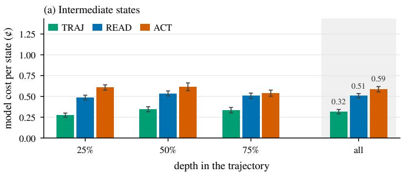

(b) Final states  
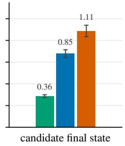  
Figure 8: Model cost per state of the critics of Figure 2, on the same states. (a) Intermediate states at 25/50/75% depth; all pools the three depths. (b) Candidate final states. Intervals are 95% bootstrap intervals over tasks.

## H TRAJECTORY-ONLY CRITIC PROMPTS

Figure 9 compares three prompts for the trajectory-only critic (Appendix A) on the states of Figure 2.   
None of these critics runs commands.

The plain prompt is the one that TRAJ uses in the main text. Summary + ledger adds a summary of the trajectory and a per-step ledger of facts. Checklist adds a list of failure modes to look for.

No variant differs significantly from TRAJ at any position. At every intermediate depth, the three are within 1 point of one another in MAE.

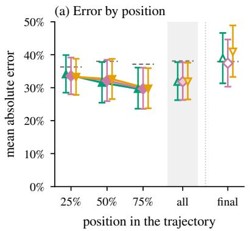  
plain (TRAJ)

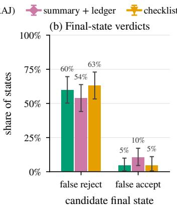

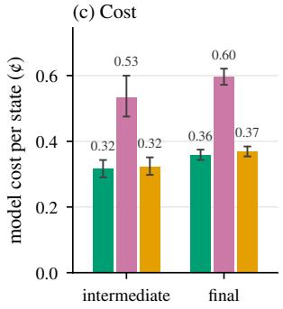  
Figure 9: The three trajectory-only prompts on the states of Figure 2; plain is TRAJ in Figure 2. (a) Mean absolute error by position (Table 8); dashes mark the best constant answer. (b) At the candidate final state: the share of passing states rejected and the share of failing states accepted. (c) Model cost per state (Appendix $\mathrm { C } ) { \vdots }$ for summary $\mathbf { \xi } + l e d g e r$ it includes the calls that write the summary and the ledger. Intervals are 95% bootstrap intervals over tasks.

## I THE REFERENCE-STATE CRITIC: PROTOCOL

This appendix describes how the comparison of §3.3 was run. The snapshots of the final states of §3.2 were not kept. We rebuilt each state in a fresh environment by replaying, in order, every command the actor had issued. Of the 411 final states, we use 404. We drop the other 7 because the replay, the verifier or the fork of $S _ { 0 }$ failed on them. To check the replay, we ran the verifier on each rebuilt state and compared its result with the one recorded in the original trial. The two results are the same on 399 states and differ on 2; the other 3 states have no recorded result to compare with. In the comparison, whether a state passes is decided by the verifier’s result on the rebuilt state. Each critic judged every state twice. $C ^ { \mathrm { { a c t } } }$ uses the same prompt as the critic of §3.2. The prompt of $C ^ { \mathrm { a c t } } { + } S _ { 0 }$ adds one paragraph. It tells the critic that there is a second environment, how to run a command in it, and how to copy a file from it.

## J DIFFERENT CRITIC MODELS

The critic does not have to use the actor’s model. We test two other models as the critic. The actor stays GPT-5.6 Luna, and nothing else changes: the same prompts, the same clock T and the same revision budget, on the same 89 tasks.

Claude Sonnet 5. Sonnet 5 is about as strong as Luna. As an agent in Claude Code, it passes 75% [69%, 82%] of the trials on these tasks, against 77% [69%, 84%] for Luna in the Codex CLI.

The critic acts only after the first claim, so the first claims pass at about the same rate as with the Luna critic: 61% against 63%. The loop then submits a passing state in 70% of the trials. The gain is +9.9 points [+5.4, +14.6], as large as with the Luna critic (+9.0 points [+5.6, +12.6]; Figure 10a). The per-task pass rate rises on 28 tasks and falls on 2.

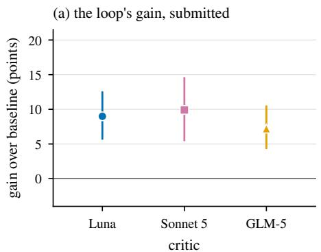

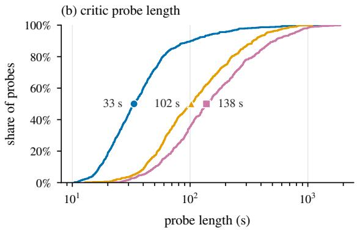  
Figure 10: GPT-5.6 Luna as the actor, with each model as the critic. (a) The loop’s gain over the baseline in the submitted pass rate (Table 3); bars are 95% bootstrap intervals over tasks. (b) How long the critic’s probes take, over the probes that return a verdict; the markers are the medians.

The gain comes about in the same way as with Luna (§4.2). The Sonnet critic rejects 72% of the failing first claims (Luna: 76%), and the actor turns 49 of them into passing states. False rejections cost 5 passing first claims.

Sonnet’s probes take longer: a median of 138 s and 12 commands, against 33 s and 4 for Luna (Figure 10b). Because the clock is shared, 59 loops run out of time during a probe, against 13 with Luna. Each of them submits its last proposed state.

GLM-5. We also use Z.AI’s GLM-5 as the critic, with the same setup. The first claims pass at about the same rate, 63% against 63%. The loop submits a passing state in 70% of the trials, a gain of +7.2 points [+4.3, +10.6] (Figure 10a). The per-task pass rate rises on 22 tasks and falls on 0. The gain is smaller than with the Luna critic, but the difference, −1.8 points [−4.9, +1.6], is not significant.

GLM-5 is a more lenient critic than Luna. It rejects only 52% of the failing first claims (Luna: 76%), so fewer of them go back to the actor, which turns 33 into passing states. It also rejects fewer passing first claims, 6% against 21%, so false rejections cost only 1 passing first claim. Its probes take a median of 102 s, between Luna’s and Sonnet’s (Figure 10b), and 13 commands.

## K RESUMING OR RESTARTING

After a rejection, Probe-and-Resume resumes the actor at the state it claimed (§4.1). The alternative is to restart. A restart resets the environment and the actor’s conversation to $S _ { 0 } .$ , and the actor starts the task again, with the critic’s findings added after the task instruction.

We run this restart variant on all 89 tasks of Terminal-Bench 2.1, five trials each. Nothing else changes: the same model is the actor and the critic, the critic and its feedback are the same, a trial has at most six rounds, and the actor and the critic share the time limit T. Environment failures lost 6 trials, which leaves 439.

Table 9 compares the two variants; the Probe-and-Resume row repeats Table 3. Restarting submits a passing state in 66% of trials, against 72% for resuming. The difference is −6.1 points [−10.1, −2.2].

Table 9: Resuming vs. restarting after a rejection, on the 89 tasks of Terminal-Bench 2.1, five trials per task. Pass rate and cost as in Table 3; time is the actor’s and the critic’s per trial, averaged.

<table><tr><td></td><td>Pass rate</td><td>Total model cost</td><td>Time / trial</td></tr><tr><td>Probe-and-Resume</td><td>72.4%</td><td>$23.14</td><td>7.8 min</td></tr><tr><td>Restart from So</td><td>66.3%</td><td>$38.12</td><td>9.3 min</td></tr></table>

Restarting also costs 1.6 times as much in model calls, and a trial takes 9.3 minutes on average instead of 7.8. The critic’s time is the same in both variants, so the extra time is the actor’s: after a restart, the actor has to redo the work of the rejected attempt before it can act on the critic’s findings. Of the 161 trials that restarted at least once, 61 ran out of time before the loop ended.

## L STRONGER MODELS AS ACTOR AND CRITIC

Table 3 uses GPT-5.6 Luna, which passes 63% of its first claims on Terminal-Bench 2.1. Here we repeat the loop with stronger models: GPT-6 Astra and Claude Opus 5.5 as the actor, and Claude Fable 5.1 or Opus 5.5 as the critic. On Harbor Hub, Astra in the Codex CLI passes 87% of 25 trials per task. We use three combinations of actor and critic (Table 10).

We run them on 15 tasks, chosen from the 31 tasks that Astra fails at least once in its 25 hub trials:

• ten on which its first claim passes in some of our trials and fails in others, so that the loop has something to recover;

• four that it always passes, as controls for false rejections;

• one that it never passes, as a control for false accepts.

The other settings are the same: the actor, the critic and the snapshots share the clock T, and a trial has at most six claims and 50 actor turns after the first rejection.

None of the three combinations gains significantly:

• Astra actor, Fable 5.1 critic. The submitted pass rate stays at the baseline: 63% against 61%, ∆ = 1.3 points [−6.7, 9.3].

• Astra actor, Opus 5.5 critic. The pass rate rises by 4.0 points [−2.7, 10.7], an interval that includes zero. 4 trials gain a passing state and 1 loses one.

• Opus 5.5 on both sides. The loop changes nothing. The critic accepts almost every first claim, no trial is rescued or lost, and the submitted rate equals the baseline (69%).

The mechanism of §4.2 explains this. With Luna, only 33% of first claims on these tasks pass, and the loop works on the rest. With these actors, most first claims already pass, so there is little to recover. The remaining failures are ones that a critic of the same strength does not catch either.

Table 10: Probe-and-Resume with stronger models as the actor and the critic, on the same 15 tasks of Terminal-Bench 2.1, five trials per task. Luna: GPT-5.6 Luna (the trials of Table 3 on these tasks); Astra: GPT-6 Astra; Fable, Opus: Claude Fable 5.1, Claude Opus 5.5. Baseline and Probe-and-Resume as in Table 3. Intervals are 95% bootstrap intervals over tasks. Refused: trials the actor’s model refused; they count 0 in both columns. Cost: the total over the trials that were not refused (Appendix C).
<table><tr><td>Actor / Critic</td><td>Tasks</td><td>Trials</td><td>Baseline</td><td>Probe-and-Resume</td><td>∆ [95% CI]</td><td>Refused</td><td>Cost</td></tr><tr><td>Luna / Luna</td><td>15</td><td>75</td><td>33.3%</td><td>40.0%</td><td>+6.7[-2.7,+16.0]</td><td>0</td><td>$4.04</td></tr><tr><td>Astra / Fable 5.1</td><td>15</td><td>75</td><td>61.3%</td><td>62.7%</td><td>+1.3[-6.7,+9.3]</td><td>0</td><td>$126.94</td></tr><tr><td>Astra / Opus 5.5</td><td>15</td><td>75</td><td>69.3%</td><td>73.3%</td><td>+4.0[-2.7,+10.7]</td><td>0</td><td>$65.83</td></tr><tr><td>Opus 5.5/ Opus 5.5</td><td>15</td><td>75</td><td>69.3%</td><td>69.3%</td><td>0.0 [0.0, 0.0]</td><td>8</td><td>$52.80</td></tr></table>

One issue comes from the model, not from the loop. Claude’s content classifier answers two lifescience tasks with empty replies, so 8 of the Opus 5.5 actor trials are refused; they count as 0 (column Refused). These trials ran to the clock on empty replies: the harness now stops an actor after six empty replies, but these trials ran before that change. Astra’s Bedrock endpoint rejects some security tasks with a policy error, but no Astra trial on these tasks was refused.

## M SWE-BENCH PRO: TASKS AND GRADING

This appendix gives the setup of §4.3. We use the public split of SWE-bench Pro V2.0.0, released on 22 September 2026, with the benchmark’s own task images. The loop is the one of §4.1 with the same prompts and GPT-5.6 Luna as actor and critic. The actor, the critic and every snapshot, restore and fork share the task’s 50-minute limit. A trial has at most six claims and 50 actor turns after the first rejection.

The two task sets. Both sets are fixed by files released with the benchmark. Neither depends on how GPT-5.6 Luna or Probe-and-Resume does on any task.

• Hard is the benchmark’s HARD-51 list: the tasks that at least two of five frontier model families fail under V2’s protocol. We leave out its one NodeBB task, which gives 50 tasks.

• Medium comes from the per-task results of 9 runs that the benchmark’s repository released: 2025 models (Claude Sonnet 4.5, Claude Sonnet 4 twice, Claude Opus 4.1, Gemini 2.5 Pro Preview, GPT-4o, GPT-5, gpt-oss and Kimi K2) on the first release. Of the 642 V2 tasks, 397 are solved by at least one of these runs. Medium is every task that none of them solves, outside HARD-51 and NodeBB: 197 tasks. The benchmark itself has no medium tier; the name is ours. The 2025 models failed these tasks, while at most one of the five model families behind HARD-51 fails each of them.

The task lists and the released result files come with our code, and our script rebuilds both sets from the released files.

We leave out all 38 NodeBB tasks because their reference patches fail in our environment even with network access.

Tasks we do not score. A task is scored only if its reference patch passes in the same environment as our trials. This rule does not look at our trials. 20 tasks fail it (9 hard, 11 medium). In all of them the tests need the network while grading: 18 Go tasks download modules, 1 task downloads Node.js and 1 Python test opens a connection when it is loaded. V2’s protocol gives the verifier network access. Our sandbox allows no traffic except to the model endpoint, for grading as well as for the agent, so these tasks cannot be graded here.

Trials. We report the first trial of each of the 227 scored tasks, so each task counts once in both sets. The hard tasks were run four more times; Table 11 reports all five. No trial, in either set, ended without a claim.

Table 11: SWE-bench Pro by task set. Baseline: the first proposed state; Probe-and-Resume: the submitted state. Gains are in points, with 95% intervals over tasks (Appendix D).
<table><tr><td></td><td>Tasks</td><td>Trials</td><td>Baseline</td><td>Probe-and-Resume</td><td>Gain [95% CI]</td></tr><tr><td>Hard, first trial</td><td>41</td><td>41</td><td>70.7%</td><td>73.2%</td><td>+2.4[−4.9, +9.8]</td></tr><tr><td>Hard, all five trials</td><td>41</td><td>205</td><td>65.4%</td><td>66.3%</td><td>+1.0[-3.9,+5.9]</td></tr><tr><td>Medium</td><td>186</td><td>186</td><td>82.3%</td><td>90.9%</td><td>+8.6[+3.8,+14.0]</td></tr><tr><td>Both, first trial (Figure 7)</td><td>227</td><td>227</td><td>80.2%</td><td>87.7%</td><td>+7.5[+3.1,+11.9]</td></tr></table>

Grading. V2’s locked protocol keeps the agent offline except for the model endpoint. It then captures the agent’s git diff, including new files, applies it to a fresh copy of the image and runs the verifier there. Our agent phase is offline in the same way. We change one line of each task file, from no network to a public network, because Waypoint cannot create a sandbox without a network; a network namespace around the whole trial then lets traffic reach only the model endpoint. At the start of every trial, a check from inside the namespace confirms that the endpoint connects and that GitHub, PyPI, the Go module proxy, npm and direct connections by address are refused. Each trial also saved its DNS and firewall log; in all 391 trials we report, the firewall admitted only addresses of the model endpoint.

We grade differently. Each proposed state is graded by the task’s unchanged V2 verifier on a fork of that state. The verifier first resets the repository’s test code: it restores tracked test files and fixtures, deletes test files the agent added and removes cached bytecode. It then applies the hidden tests and runs them. The fork is discarded after grading, so the hidden tests never reach the actor’s or the critic’s sandbox. The loop records the grade but never reads it; only the critic’s verdict decides whether the actor continues.

The difference from the protocol is what the graded state contains. A patch carries only the repository’s tracked and new files. It drops files outside the repository or ignored by git, installed packages and running processes. Our fork keeps them. With no network, no trial could download a package, but a local change outside the repository would count in our grading and not in the protocol’s.

The gain comes from the medium tasks. On the hard tasks it cannot be told apart from zero, with the first trial or with all five (Table 11).