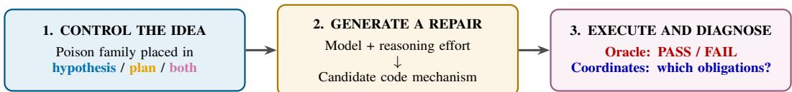
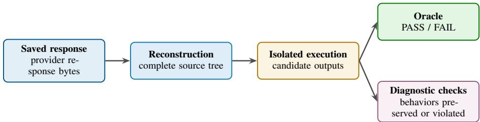
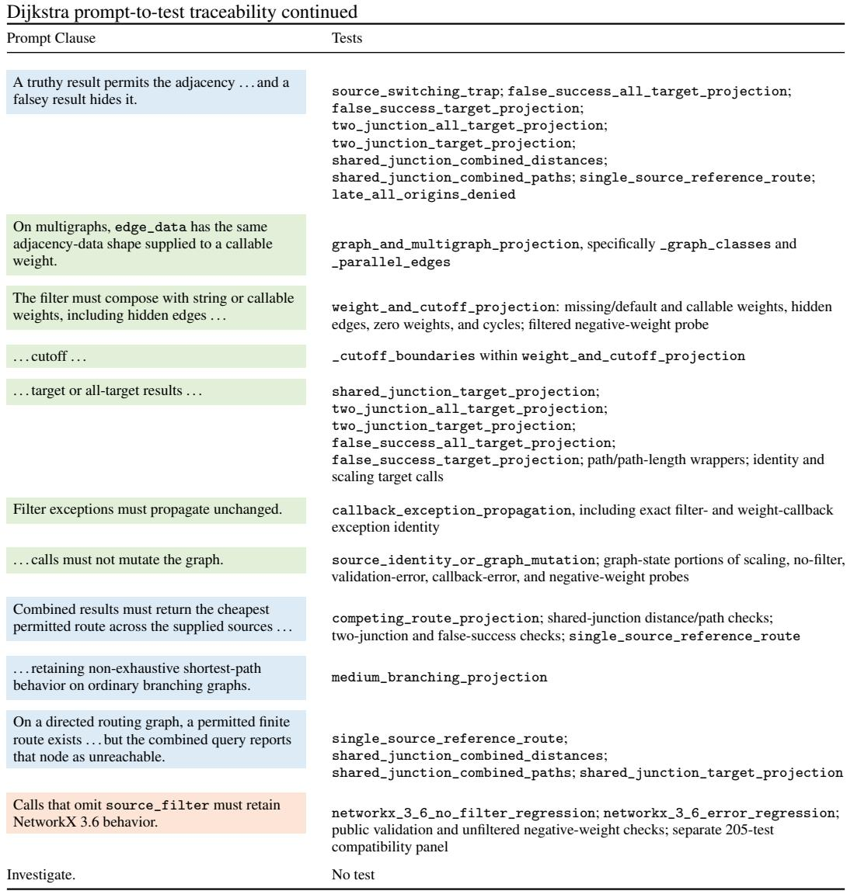
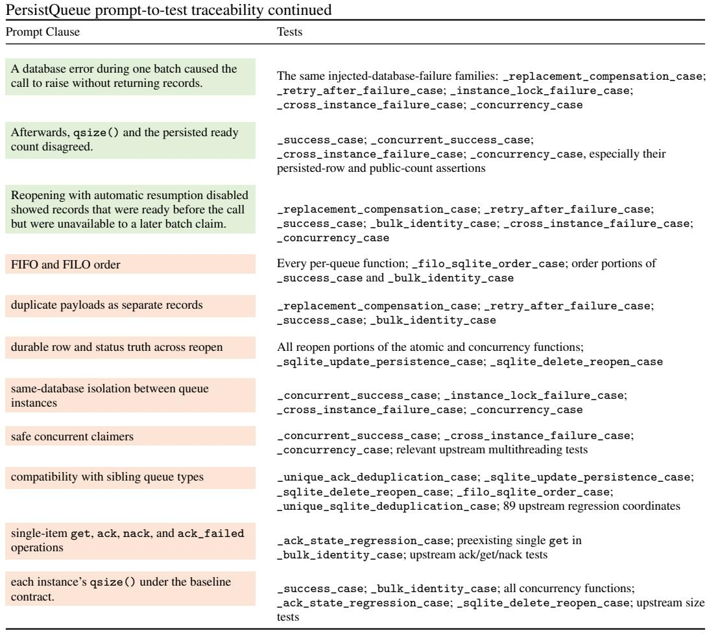

# Poison Valleys: Diagnosing Path-Dependent Failure in LLM Code Repair

Veljko Skarich

## Abstract

When code-repair agents fail, final tests reveal that a patch is wrong but not which earlier commitment caused it or which software obligation failed. Poison Valleys traces this path in 1,844 model requests on two synthetic Python cases: PersistQueue adds atomic batch claiming to a disk-backed queue, while Dijkstra adds source-sensitive filtering to shortest-path search. We define plausible but incorrect software mechanisms, place each in a model’s hypothesis, implementation plan, or both, and evaluate the generated code with an Oracle and targeted diagnostic coordinates. Moving the misconception from hypothesis to plan increased failure by 32.2% in PersistQueue and 28.9% in Dijkstra after matching the experimental mix. Different misconceptions produced distinct, model-dependent patterns of violated obligations, although several could converge on the same behavior. This creates a measured connection from upstream misconception to code mechanism and failure form. Code, data, and demo: poisonvalleys.org.

## 1 Introduction

  
Figure 1: From a controlled misconception to executable behavior.

A code-repair agent turns a bug report, test output, and repository context into an explanation of the problem, an implementation plan, and finally a patch. A passing test can confirm that the resulting program meets the tested contract. A failing test, however, usually tells us only that the final patch is wrong. It does not identify which earlier commitment caused the failure, how that commitment became an implementation choice about state or control flow, or why two different misconceptions produce different faulty programs. This missing link limits both scientific explanations of agent behavior and attempts to repair it.

Prior work can localize failures within agent trajectories, perturb particular stages, and test whether changing an earlier step improves the outcome [Wang et al., 2026, Jaiswal et al., 2026, Ma et al., 2026, Lin et al., 2026]. We ask the forward question: when a particular software misconception enters at a particular stage, what code mechanism follows, and which executable software obligations break?

We begin with poisonfamilies: specific, plausible but incorrect accounts of how the target software works, together with the implementation commitments and executable predictions that follow. We define these families before generation and place one in the model’s hypothesis, implementation plan, or both while holding the repair task fixed. We then trace the path from that misconception to generated code and executable behavior under each model configuration. We call these paths Poison Valleys because the supplied misconception can channel repairs toward a structured region of failures rather than merely lowering a single success rate.

We construct two synthetic repair cases on pinned versions of real Python projects. PersistQueue is a disk-backed queue package [Wang, 2025]; our synthetic case adds an atomic batch-claim operation whose failure must restore durable queue state and remain invisible to other connections. NetworkX is a graph-analysis library [Hagberg et al., 2008]; our synthetic Dijkstra case extends its multi-source shortest-path implementation with a filter whose decision depends on the path’s original source. Neither case is a recovered historical upstream bug. Both admit locally plausible repairs that violate a nonlocal obligation. For each reconstructed candidate, an Oracle determines success or failure. Independent diagnostic checks then identify which obligations survived, such as rollback, isolation, record identity, route validity, weight correctness, or API compatibility. These checks describe the form of a failure without replacing the Oracle’s decision.

The experiment asks three questions. First, does a poison family become more consequential when it moves from a hypothesis into an implementation plan? Second, do different poison families produce different patterns of violated software obligations? Third, does the model and reasoning-effort setting change how strongly these effects appear? Across 1,844 model requests, placing the poison family in the plan increased failure by about 30% relative to placing it only in the hypothesis in both tasks. Poison families also produced measurably different distributions of failed obligations, and the size of the plan effect varied across model configurations.

Poison Valleys maps agent-level concepts to software behavior:

$$
\mathrm { \ u p s t r e a m \ m i s c o n c e p t i o n \to \ i m p l e m e n t a t i o n \ c o m m i t m e n t }
$$

$$
 \mathrm { c o d e ~ m e c h a n i s m }  \mathrm { v i o l a t e d ~ o b l i g a t i o n } .
$$

The stage identifies where a safeguard can intervene; the violated obligation identifies what it must protect. A follow-up can return a model’s own failed candidate with a repair prompt naming the violated obligations and test whether the second candidate passes more checks. Because the original model responses and downstream executable measurements are preserved, the reported analysis can be inspected and replayed without making another model request.

## 2 Related Work

Three lines of work frame the experiment: code-repair trajectories, controlled perturbations of agent behavior, and counterfactual failure attribution. They locate errors in an agent trajectory and test whether an intervention changes the outcome. Poison Valleys instead traces a specified misconception at a specified repair stage into generated code and violated software obligations.

Code repair and trajectory analysis. Code-repair systems transform issue descriptions, test observations, and repository context into localization decisions, repair reasoning, and patches. SWEbench evaluates repository-level repairs through executable outcomes [Jimenez et al., 2024], while SWE-agent, AutoCodeRover, Agentless, and VRpilot expose distinguishable activities such as repository exploration, fault localization, patch generation, and validation [Yang et al., 2024, Zhang et al., 2024, Xia et al., 2024, Kulsum et al., 2024]. Recent work examines these intermediate activities through failure taxonomies [Jiang et al., 2026], reconstructed repair rationales [Li et al., 2026], dependency-guided repair context [Wu et al., 2026], and assessments of multi-step behavior beyond terminal reward [Ma et al., 2024]. OAT, TRAJDEBUG, AgentRx, and Failure as a Process further analyze anomalous actions, error lifecycles, failure onset, and recovery [Yeh et al., 2026, Qi et al., 2026, Barke et al., 2026, Zhao et al., 2026]. Together, these studies provide increasingly fine-grained evidence about where a repair trajectory departs from successful behavior. They provide less direct evidence about how a particular upstream software misconception becomes a concrete implementation mechanism and, in turn, determines which executable obligations the resulting program violates. Poison Valleys targets this connection directly.

Stage-wise perturbations and incorrect guidance. Controlled interventions reveal how errors propagate through agent trajectories. STAR divides root-cause-analysis traces into stages, locates consequential reasoning faults, and replays stage-specific corrections [Wang et al., 2026]. ToolRobust-Bench aligns perturbations with tool interfaces, user intent, observations, and runtime environments [Zheng et al., 2026]. In code repair, Obey, Diverge, Collapse finds that incorrect instructions can induce semantic corruption that later self-guided repair does not fix [Jaiswal et al., 2026].

Counterfactual attribution and executable consequences. DoVer, REFLECT, and CausalFlow modify suspected messages, plans, or trajectory steps and replay later behavior [Ma et al., 2026, Lin et al., 2026, Bonagiri et al., 2026]. Project Ariadne intervenes on intermediate reasoning to audi causal and faithfulness claims [Khanzadeh, 2026]. Those methods start from a failure and repair a suspected earlier step. Poison Valleys runs forward from a specified poison family and repair stage. The Oracle determines correctness; diagnostic checks identify preserved and violated obligations.

## 3 Experimental Setup

## 3.1 Experimental design

The repair sequence is O → D → H → P → C (Table 1). Within each case, the task stays fixed while a reviewed poison family appears in the hypothesis, plan, or both.

<table><tr><td>Stage</td><td>Name</td><td>Definition</td></tr><tr><td>0</td><td>Observation</td><td>The fixed bug report and task requirements shown to the model.</td></tr><tr><td>D</td><td>Dependency context</td><td>Optional information about relevant surrounding code and interfaces.</td></tr><tr><td>H</td><td>Hypothesis</td><td>A proposed explanation of the bug and its underlying software mechanism.</td></tr><tr><td>P</td><td>Plan</td><td>The implementation commitments proposed to repair the bug.</td></tr><tr><td>C</td><td>Candidate code</td><td>The source files returned by the model after receiving the preceding inputs.</td></tr></table>

Table 1: Stages in the observed repair sequence.

A poison family is a specific, plausible but incorrect software idea, such as assigning transaction state to the wrong owner or losing a route’s fixed origin. Before generation, we align its explanation, implementation commitments, validating implementation, and executable witness. The validating code is never shown to the model or used to classify generated code.

<table><tr><td>HYPOTHESIS (H)</td><td></td><td>PLAN(P)</td></tr><tr><td>Role</td><td>Explains why the bug occurs: a claim about the underlying software mechanism.</td><td>Commits to how code will change: operations, state ownership, ordering, and error handling.</td></tr><tr><td>PersistQueue A02</td><td>Restoring each claimed row to ready after failure is equivalent to atomic rollback.</td><td>Collect staged row IDs; after a SQLite error, write each status back to ready and then re-raise.</td></tr><tr><td>Dijkstra B01</td><td>The shortest-path search found the right winner; the defect exists only in result projection.</td><td>Run ordinary multi-source Dijkstra, then reject winning paths that fail the source filter.</td></tr></table>

Table 2: A hypothesis explains the defect; a plan specifies the code changes.

<table><tr><td>Condition</td><td>Hypothesis (H)</td><td>Plan (P)</td><td>What changes</td></tr><tr><td>Canonical</td><td>Correct explanation</td><td>Correct implementation plan</td><td>Neither stage is poisoned.</td></tr><tr><td>H-only</td><td>Poison-family explanation</td><td>Correct implementation plan</td><td>The wrong account appears only in the explanation.</td></tr><tr><td> P-only</td><td>Correct explanation</td><td>Poison-family commitments</td><td>The wrong account directly specifies code choices.</td></tr><tr><td> H+P</td><td>Poison-family explanation</td><td>Matching commitments</td><td>The same wrong account appears at both stages.</td></tr></table>

Table 3: Experimental conditions.

Dijkstra also includes no-plan conditions; PersistQueue additionally varies dependency context.   
Neither variation defines the main intervention.

Our primary comparison is P-only versus H-only after retaining shared family–model–dependency combinations and giving both conditions the same mix. This controls for imbalance across stages. H+P stays separate to show whether a matching hypothesis further reinforces the plan.

## 3.2 Controlled repair tasks

Both cases start from real Python packages and add a controlled public feature plus a faulty implementation. They are not recovered historical bugs. Table 4 separates what existed upstream from what the the synthetic extensions add; Appendix B shows the colored task prompts and their test mappings. PersistQueue is pinned at commit b4fb6d186e375850b2d9ac49fc635779be95f173; Dijkstra uses NetworkX 3.6. Both upstream packages are distributed under the BSD 3-Clause license.

<table><tr><td>Case</td><td>Existing package</td><td>Synthetic extension</td><td>Fault and required repair</td></tr><tr><td>PersistQueue</td><td>Disk-backed SQLite queue with single-item get, ack, nack, durable IDs, and FIFO/FILO behavior [Wang, 2025].</td><td>claim_batch (max_items, *, raw=False), plus a batch-write context and delayed cache publication.</td><td>Nested status helpers can com- mit independently of the appar- ent outer batch. A correct repair must make selection and every status mutation one rollback unit and publish memory state only after commit.</td></tr><tr><td>Dijkstra</td><td>NetworkX 3.6 multi-source Dijkstra, whose dominance state is keyed by graph node [Hagberg et al., 2008].</td><td>source_filter (origin, u, v, edge_data) on the public path, path-length, and main APIs.</td><td>The faulty search carries origin in the heap but still finalizes by node, discarding a costlier arrival whose origin may permit later edges. A correct repair must preserve origin-specific state until public projection.</td></tr></table>

Table 4: Existing package, synthetic addition, and repair contract.

PersistQueue. Upstream PersistQueue selects and claims one row at a time. The synthetic case adds SQLiteAckQueue.claim\_batch, a reentrant batch-write context, and a publish switch that delays updates to the in-memory unacknowledged cache and count. The faulty method appears to wrap the loop in one transaction, but each call to the existing decorated status helper can enter and commit the SQLite connection independently. If the second row fails, the the first row can remain durably claimed even though the public call raised. The repair must use one transaction owner for selection and all status writes, preserve the exact original row IDs and FIFO/FILO order, hide partial work from other connections, and update cache/count state only after commit. Appendix 18 maps each part of that contract to executable tests; Appendix 12 gives all eleven plausible but wrong mechanisms.

Dijkstra. Upstream NetworkX 3.6 accepts several sources but has no source-dependent edge policy. The synthetic case adds the callback source\_filter(origin, u, v, edge\_data) to three public APIs. Here origin is the fixed depot where the complete path began; it is not the currently expanded node. The faulty helper includes the origin in heap entries but retains ordinary node-keyed seen and dist maps. That is invalid once future edge permissions depend on origin: a cheaper arrival from one depot can erase a more expensive arrival from another depot that alone may legally continue. The repair must keep origin-specific search states, then project the cheapest permitted result by node while preserving ordinary weights, cutoffs, exceptions, and no-filter behavior. Appendix 16 maps the contract to tests; Appendix 14 defines all eight wrong mechanisms.

## 3.3 Intervention and model requests

For each request, only the assigned hypothesis and plan change; the task, source inventory, response format, and evaluation stay fixed. Each request produces one candidate, so H-only and P-only name where information was supplied, not separate calls.

The requested model configuration is the model and reasoning-effort setting sent to the provider. PersistQueue uses GPT-5.6 Luna, GPT-5.4 Nano, and Claude Haiku 4.5; Dijkstra uses GPT-5.6 Luna, Claude Sonnet 5, and Qwen 3.8 Flash. The primary comparison uses configurations represented in both conditions. A unique request identifier joins prompt, response, candidate, execution, and analysis records.

Assignment records what the model received, not what it believed. Generated code may copy, transform, compensate for, or ignore the supplied mechanism, so we measure code behavior independently.

## 3.4 System design and replay

  
Figure 2: Post-generation evaluation and replay.

Each request UUID joins its prompt, response, source tree, execution, and analysis row. SHA-256 digests identify the exact records at every handoff. Replay verifies them, reconstructs the candidate, and reruns execution without another model call; hashes establish identity, while tests establish behavior.

Reconstruction combines returned files with the expected inventory. Responses that cannot produce a complete tree remain in request accounting but receive no generated-code behavior.

## 3.5 Oracle and diagnostic checks

<table><tr><td>Measure</td><td>What executes</td><td>Output</td><td>Example</td></tr><tr><td>Oracle</td><td>The complete task protocol compares the candidate&#x27;s public outputs</td><td>One overall success or failure.</td><td>PersistQueue must return the correct batch and leave durable queue state cor- rect after success or failure.</td></tr><tr><td>Coordinate</td><td>with expected outputs. One targeted executable scenario tests one software obligation.</td><td>fails.</td><td>One check passes or A second connection tries to observe a partially completed claim; hidden state passes the isolation coordinate.</td></tr><tr><td>Axis</td><td>Related coordinates are grouped by the behavior they test.</td><td>An interpretable failure dimension.</td><td>Dijkstra shared-junction coordinates contribute to the routing axis because edge legality depends on the original source.</td></tr></table>

Table 5: Oracle, coordinate, and axis.

The Oracle determines whether the repair succeeds or fails. For the main binary outcome, every reconstructed candidate that does not finish successfully counts as a failure. This includes an ordinary Oracle failure, a runtime crash, a timeout, or an incomplete evaluation; the specific reason is recorded separately. Diagnostic checks then test individual software obligations. PersistQueue uses 18 selected checks and Dijkstra uses 28. These checks show how a candidate behaved but never overturn the Oracle’s correctness decision. Appendix C defines the selected coordinates, and Table 27 reports every terminal failure subtype. When the required checks complete, their results are reduced to the four task-specific obligation groups in Table 4. When they do not complete, we report incomplete diagnostic evidence rather than inventing a failure pattern.

<table><tr><td>Task</td><td>Requests</td><td>Responses</td><td>Candidates</td><td>Oracle</td><td>Success</td><td>Failure</td></tr><tr><td>PersistQueue</td><td>982</td><td>843</td><td>835</td><td>672</td><td>453 (54.3%)</td><td>382 (45.7%)</td></tr><tr><td>Dijkstra</td><td>862</td><td>798</td><td>798</td><td>668</td><td>216 (27.1%)</td><td>582 (72.9%)</td></tr><tr><td>Total</td><td>1,844</td><td>1,641</td><td>1,633</td><td>1,340</td><td>669 (41.0%)</td><td>964 (59.0%)</td></tr></table>

Table 6: Request flow and candidate outcomes.

Success and failure percentages are calculated from reconstructed candidates; every reconstructed candidate that does not finish successfully counts as a failure. Requests without a response or candidate remain visible in the flow but cannot describe generated-code behavior. The primary comparison gives H-only and P-only the same mix of represented poison families, model configurations, and dependency settings. We compute 95% intervals by resampling complete request UUIDs so that all records from one request remain together.

All model responses used in the analysis are preserved. Offline replay begins from a saved response, reconstructs the candidate, and reruns the executable measurements without making another model request. Code, data, and the interactive demonstration are available at poisonvalleys.org; detailed family packages, prompt templates, model settings, executable checks, and analysis tables are provided in the appendix.

## 4 Main Results

## 4.1 Where the poison family appears

Placing a poison family in the implementation plan caused substantially more failures than placing it only in the hypothesis. The raw failure rate rose from 21.9% to 54.7% in PersistQueue and from 53.4% to 83.0% in Dijkstra (Table 7). Because the two conditions did not contain exactly the same mix of poison families, model configurations, and dependency settings, we also compared only combinations represented in both conditions and gave those combinations the same weight. Under that comparison, plan-only assignment increased failure by 32.2% in PersistQueue and 28.9% in Dijkstra. The corresponding failure-risk ratios were 2.44 [2.12, 3.23] and 1.54 [1.35, 1.88]: after balancing the experimental mix, plan-only attempts failed about 2.4 and 1.5 times as often. The intervals in Table 7 describe uncertainty across repeated model requests.

<table><tr><td>Task</td><td>Hypothesis only</td><td>Plan only</td><td>Difference with the same experimental mix</td></tr><tr><td>PersistQueue</td><td>59/270 (21.9%)</td><td>145/265 (54.7%)</td><td>+32.2% [27.0%, 38.8%]</td></tr><tr><td>Dijkstra</td><td>101/189 (53.4%)</td><td>156/188 (83.0%)</td><td>+28.9% [21.1%, 38.6%]</td></tr></table>

Table 7: Failure rates by intervention stage.

Once the poison family was already present in the plan, adding the matching hypothesis produced a much smaller further change: 6.3% in PersistQueue [0.5%, 12.2%] and 2.2% in Dijkstra [−4.9%, 8.5%]. The smaller change is consistent with the plan acting as the more consequential commitment point; it does not imply that planning itself is harmful.

## 4.2 Which poison family is supplied

Poison families changed not only how often candidates failed, but also which software obligations they violated. Each diagnostic check tests a behavior, and related checks are grouped into the eight axes defined in Table 10. Table 9 shows selected PersistQueue plan-only distributions. These checks describe failure form; they do not override the Oracle’s decision.

The relationship was structured but not deterministic. To summarize its strength, we use Cramér’s V, an association score ranging from 0 (no relationship) to 1 (perfect relationship). For plan-only attempts, the score was 0.475 [0.453, 0.556] in PersistQueue and 0.314 [0.307, 0.434] in Dijkstra. Different poison families produced measurably different distributions of failed obligations, while one family could still produce several failure patterns and different families could converge on the same violated obligation.

The fixed-family Dijkstra B01 comparison in Table 8 illustrates that model configuration can also change the outcome.

Experiment key held fixed: Dijkstra · B01 post-filter · plan-only Same poison family and stage; only the model configuration differs.
<table><tr><td>Model</td><td>Oracle</td><td>Routing</td><td>Weights</td><td>API</td><td>Compatibility</td><td>Dijkstra success</td></tr><tr><td>GPT-5.6 Luna, medium</td><td>PASS</td><td>Preserved</td><td>Preserved</td><td>Preserved</td><td>Preserved</td><td>119/340 (35.0%)</td></tr><tr><td>Qwen 3.8 Flash</td><td>FAIL</td><td>Violated</td><td>Violated</td><td>Preserved</td><td>Preserved</td><td>6/127 (4.7%)</td></tr></table>

Table 8: The same Dijkstra B01 plan-only intervention produced different behavior across model configurations. The final column reports success across all Dijkstra candidates for each model.

In PersistQueue, a mechanism that tried to compensate for transaction state in memory was associated mainly with failures of cross-connection isolation: behavior could look correct through one connection while another observed the wrong queue state. In Dijkstra, mechanisms that discarded the fixed route origin while the search was still running were associated mainly with routing failures at shared junctions, where the legality of a later edge depends on the path’s origin, linking the supplied misconception to a state decision and an executable obligation.

We inspected twelve selected generated patches. Five of six sampled failures and all six sampled passes made a substantive, mechanism-relevant code change. Because this was a targeted sample, it illustrates individual pathways and does not estimate how often models adopted the supplied mechanism across the full corpus.

## 4.3 Differences across model configurations

A model configuration is the model and reasoning-effort setting requested for an attempt. The plan-only versus hypothesis-only difference varied across these configurations. In PersistQueue, the differences ranged from −3.8% to +45.1%; in Dijkstra, they ranged from +6.6% to +39.1%. The same intervention can be expressed differently by different model configurations. These exploratory comparisons do not provide a general model ranking and do not establish that one model universally reasons better than another.

The plan-versus-hypothesis result kept the same direction when we left out one poison family or one model configuration at a time, and when we restricted the comparison to combinations represented in both conditions that completed the Oracle. Missing candidates and incomplete diagnostic evidence remain reported separately rather than being assigned an invented failure pattern. Detailed condition tables, the model-level success and failure table (Table 20), robustness checks, and complete failure accounting appear in Appendix D and Appendix E.

## 5 Discussion

The main result is that a poison family becomes more consequential when it is expressed as an implementation plan rather than only as an explanation of the bug. A hypothesis still leaves room to reject the explanation or choose a safe implementation. A plan commits the repair to operations, owners of state, update order, error handling, and compatibility choices. When those commitments are wrong, they can pass directly into code. This does not mean that planning is harmful. It means that a plan is a high-leverage boundary where a repair system should check whether the proposed operations preserve the software contract. The experiment records what information the model received, not what it believed or internally represented.

Failure rate and failure form answer different questions. The Oracle tells us whether a candidate satisfies the repair contract. The diagnostic checks identify the particular obligation that did or did not survive: for example, restoring queue state after failure, hiding uncommitted state from another connection, or preserving a route’s original source. Different poison families produced different distributions of these violated obligations, but the relationship was not one-to-one. One family could produce several failure patterns, and different families could converge on the same failed behavior. This is not a classifier that guesses which prompt input a model saw. It links a specified misconception, through a code mechanism, to an executable consequence.

<table><tr><td>Family (n)</td><td>Intact</td><td>Isolation only</td><td>Recovery + isolation</td><td>Broad</td><td>Incomplete</td></tr><tr><td>A02 (n = 25)</td><td>8%</td><td>92%</td><td>0%</td><td>0%</td><td>0%</td></tr><tr><td>A08 (n = 25)</td><td>24%</td><td>44%</td><td>28%</td><td>0%</td><td>4%</td></tr><tr><td>A14 (n = 24)</td><td>17%</td><td>0%</td><td>38%</td><td>17%</td><td>29%</td></tr></table>

Table 9: Diagnostic outcomes for selected PersistQueue poison families in plan-only attempts. The first column gives the code-bearing attempt count n; entries are percentages rounded independently.

In Table 9, intact means all selected diagnostic axes passed; broad means failures across several obligation groups; and incomplete means the diagnostic panel did not yield a phenotype. These diagnostic outcomes are separate from the Oracle verdict.

Generated source can also reveal how a model engaged with a supplied plan. One A08 planonly response left the comment, “\_pop commits each status update independently,” and proposed compensating for later claim failures. That comment is evidence about the mechanism expressed in code, not a verdict: the Oracle still tests public outputs, and the coordinates still show which obligations survived.

<table><tr><td>Axis</td><td>Question</td></tr><tr><td colspan="2">PersistQueue</td></tr><tr><td>Recovery</td><td>After a database error, are the same rows ready again without an observable intermediate claim?</td></tr><tr><td>Identity</td><td>Does the batch contain the exact selected row IDs, multiplicity, and native order?</td></tr><tr><td>Isolation</td><td>Can another connection observe or interfere with a claim before it commits?</td></tr><tr><td>Durability</td><td>Do database rows, cache/count state, and reopen behavior agree after commit or failure?</td></tr><tr><td colspan="2">Dijkstra</td></tr><tr><td>Routing</td><td>Is every edge legal for the fixed origin that began the path?</td></tr><tr><td>Weights</td><td>Are graph type, edge weights, hidden edges, cycles, and cutoffs handled correctly?</td></tr><tr><td>API</td><td>Do public signatures, return shapes, exceptions, and graph immutability remain correct?</td></tr><tr><td>Compatibility</td><td>Do unfiltered NetworkX behavior and larger branching cases still work?</td></tr></table>

Table 10: Diagnostic axes by repair task.

The mapping depends on the task and model. PersistQueue and Dijkstra showed the same overall increase when the poison family appeared in the plan, but they exposed different state, routing, and compatibility obligations. The size of the increase also varied across model and reasoning-effort settings. This variation is not a global model ranking. It shows why interventions should be evaluated against the contract of the software being repaired and against the model configuration that will use them. A universal label such as reasoning failure would hide the code-level distinction between repairs.

The plan-to-code boundary is a natural intervention point. A repair system can check whether the plan assigns state to the right owner, preserves rollback and isolation, carries forward information needed later in execution, and retains the existing API contract. Whether those checks improve a second repair remains untested. A follow-up should give the same model its own failed candidate together with a repair prompt naming the violated obligations, then test whether the second candidate passes the Oracle and fails fewer or different diagnostic checks.

## 6 Limitations

Two controlled repair tasks. PersistQueue and Dijkstra were designed to expose specific software obligations under deterministic execution. That control makes the mechanism-to-code link inspectable, but it does not represent the full diversity of repositories, languages, naturally occurring bugs, or misleading information that repair agents encounter. The repeated direction across the two tasks supports the experimental method; it does not establish a universal effect size.

Uneven and missing evidence. Not every poison family, model configuration, and dependency setting has the same number of requests, and some combinations are absent. The primary comparison therefore uses only combinations represented in both the hypothesis-only and plan-only conditions and gives those combinations the same weight. This cannot tell us what would happen in combinations we did not run. Some requests also returned no response or no reconstructable candidate. They remain in the request accounting and missing-data checks, but they cannot contribute evidence about generated-code behavior.

Finite executable checks. The Oracle and diagnostic checks cover the repair contracts we specified; they are not complete specifications of PersistQueue or NetworkX. A passing candidate may contain an untested defect. A failed candidate may stop before every diagnostic check completes, in which case we report that the failure pattern is unknown rather than infer one from partial evidence. Visible output and exception text are even less specific and can make different executable states look the same.

Assignment, model changes, and uncertainty. We know which hypothesis and plan each model received, but we did not ask human reviewers to decide whether every generated patch believed, copied, or literally implemented the supplied mechanism. The twelve inspected patches provide individual examples, not a corpus-wide adoption rate. The model names also refer to the exact provider configurations available during data collection; provider updates or routing changes may alter future results. Repeated requests that share a poison family or experimental setting are related rather than wholly independent. Our uncertainty intervals keep records from the same request together, but comparisons between individual model configurations remain exploratory.

## 7 Conclusion

Poison Valleys connects a specific upstream misconception to the implementation commitment it creates, the code mechanism that follows, and the executable obligation it violates. Across 1,844 model requests on two controlled repair tasks, placing a poison family in the plan increased failure by 32.2% in PersistQueue and 28.9% in Dijkstra relative to placing it only in the hypothesis. Different mechanisms produced different patterns of violated obligations, and the size of the effect varied across exact model and reasoning-effort settings.

Inspect a repair after the plan is formed but before it becomes code, and check the software obligations most at risk. A follow-up should give the same model its own failed candidate plus a prompt naming the violated obligations, then measure whether the repaired candidate passes the Oracle and fails fewer diagnostic checks.

## References

Shraddha Barke, Arnav Goyal, Alind Khare, Avaljot Singh, Suman Nath, and Chetan Bansal. AgentRx: Diagnosing AI agent failures from execution trajectories. arXiv preprint arXiv:2602.02475, 2026. URL https://arxiv.org/abs/2602.02475.

Akash Bonagiri, Devang Borkar, Gerard Janno Anderias, Setareh Rafatirad, and Houman Homayoun. Causalflow: Causal attribution and counterfactual repair for llm agent failures, 2026. URL https://arxiv.org/abs/2605.25338.

Aric A. Hagberg, Daniel A. Schult, and Pieter J. Swart. Exploring network structure, dynamics, and function using NetworkX. In Proceedings of the 7th Python in Science Conference, pages 11–15, 2008.

Raj Jaiswal, Anany Singh Divy, Savar Bhasin, Adi Bajpai, Tanuja Ganu, and Rajiv Ratn Shah. Obey, diverge, collapse: Blind obedience to incorrect instructions drives code llms to irrecoverable code semantic collapse, 2026. URL https://arxiv.org/abs/2607.04537.

Yanjie Jiang, Yian Huang, Guancheng Wang, Junjie Chen, Hui Liu, and Lionel Briand. Characterizing the failure modes of LLMs in resolving real-world GitHub issues. arXiv preprint arXiv:2605.12270, 2026.

Carlos E. Jimenez, John Yang, Alexander Wettig, Shunyu Yao, Kexin Pei, Ofir Press, and Karthik Narasimhan. SWE-bench: Can language models resolve real-world GitHub issues? In International Conference on Learning Representations, 2024.

Sourena Khanzadeh. Project ariadne: A structural causal framework for auditing faithfulness in llm agents, 2026. URL https://arxiv.org/abs/2601.02314.

Ummay Kulsum, Haotian Zhu, Bowen Xu, and Marcelo d’Amorim. A case study of LLM for automated vulnerability repair: Assessing impact of reasoning and patch validation feedback. arXiv preprint arXiv:2405.15690, 2024.

Chenglin Li, Yisen Xu, Zehao Wang, Shin Hwei Tan, and Tse-Hsun (Peter) Chen. Independent patch verification for coding agents with a bidirectional reconstruct-and-verify framework. arXiv preprint arXiv:2608.08950, 2026.

Xiaofeng Lin, Yingxu Wang, Tung Sum Thomas Kwok, Daniel Guo, Sahil Arun Nale, Charles Fleming, and Guang Cheng. Reflect: Intervention-supported error attribution for silent failures in llm agent traces, 2026. URL https://arxiv.org/abs/2606.09071.

Chang Ma, Junlei Zhang, Zhihao Zhu, Cheng Yang, Yujiu Yang, Yaohui Jin, Zhenzhong Lan, Lingpeng Kong, and Junxian He. AgentBoard: An analytical evaluation board of multi-turn LLM agents. In Advances in Neural Information Processing Systems, volume 37, 2024.

Ming Ma, Jue Zhang, Fangkai Yang, Yu Kang, Qingwei Lin, Saravan Rajmohan, and Dongmei Zhang. DoVer: Intervention-driven auto debugging for LLM multi-agent systems. In The Fourteenth International Conference on Learning Representations, 2026. URL https://openreview.net/ forum?id=mrEK16Jy6h.

Yunjia Qi, Zehua Yin, Xintong Shi, Hao Peng, Songyuanyi Lu, Yixian Liu, Richeng Xuan, Yuhong Liu, Zhichao Hu, Xiaozhi Wang, Lei Hou, Bin Xu, and Juanzi Li. TRAJDEBUG: Tracing error lifecycle to identify critical failures in long-horizon agent trajectories. arXiv preprint arXiv:2608.06346, 2026.

Junle Wang, Xingchuang Liao, and Wenjun Wu. Star: A stage-attributed triage and repair framework for rca agents in microservices, 2026. URL https://arxiv.org/abs/2605.15581.

Peter Wang. persist-queue: A thread-safe disk-based persistent queue in python. https://github. com/peter-wangxu/persist-queue/releases/tag/v1.1.0, October 2025. Version 1.1.0, commit b4fb6d1; BSD-3-Clause software.

Linhao Wu, Yizhou Chen, Zhen Yang, Pengyu Xue, and Dan Hao. CausalRepair: Bridging the causality gap in large language model-based automated program repair via dual-slicing. arXiv preprint arXiv:2608.10613, 2026.

Chunqiu Steven Xia, Yinlin Deng, Soren Dunn, and Lingming Zhang. Agentless: Demystifying LLM-based software engineering agents. arXiv preprint arXiv:2407.01489, 2024.

John Yang, Carlos E. Jimenez, Alexander Wettig, Kilian Lieret, Shunyu Yao, Karthik Narasimhan, and Ofir Press. SWE-agent: Agent–computer interfaces enable automated software engineering. arXiv preprint arXiv:2405.15793, 2024.

Samuel Yeh, Yiwen Zhu, Shaleen Deep, and Sharon Li. Tracing agentic failure from the flow of success. arXiv preprint arXiv:2607.12747, 2026.

Yuntong Zhang, Haifeng Ruan, Zhiyu Fan, and Abhik Roychoudhury. AutoCodeRover: Autonomous program improvement. In Proceedings ofthe 33rd ACM SIGSOFT International Symposium on Software Testing and Analysis, pages 1592–1604, 2024. doi: 10.1145/3650212.3680384.

Xiangxin Zhao, Han Li, Shuaiting Li, Tianyi Zhao, Earl T. Barr, Federica Sarro, and He Ye. Failure as a process: An anatomy of CLI coding agent trajectories. arXiv preprint arXiv:2607.09510, 2026. URL https://arxiv.org/abs/2607.09510.

YiShan Zheng, Yuan Wu, and Yi Chang. Toolrobustbench: Stage-wise perturbation evaluation and failure diagnosis for tool-calling agents, 2026. URL https://arxiv.org/abs/2608.23635.

## A Poison-Family Catalog and Mechanisms

## A.1 What a poison family specifies

A poison family is a reviewed, versioned false repair theory, not merely a short label attached to a prompt. Each family binds four aligned objects: a plausible false hypothesis about the defect, a plan that operationalizes that hypothesis, an executable known-wrong realization used during qualification, and one or more executable witnesses at the public behavioral boundary that expose the intended mistake. The hypothesis remains diagnosis-only and the plan remains commitment-only: neither input tells the model that it is poisoned, names the qualification failure, or explains the contradiction that defeats it. Exact input bytes and hashes are frozen before use.

The known-wrong realization is a qualification instrument, not a prediction that generated code will reproduce the same source. It establishes that the false theory is mechanically coherent, can be implemented without unrelated syntax or import failure, and is rejected at the intended behavioral boundary. Under intervention, a model may copy that mechanism, form a hybrid, switch to a different mechanism, repair the supplied premise, or produce code that cannot be semantically localized. The empirical object is therefore the complete attempt-level distribution generated by the prospectively selected family and stage, not similarity to the known-wrong patch.

A qualification-witness signature names the failure pattern that rejects the known-wrong realization, such as a committed prefix after an exception. It is not the captured public output, a public-observation vector, or a public\_observation\_hash. We separately use family behavioral signature for the attempt-level distribution over semantic modes generated by an intervention condition. The former qualifies the false mechanism; the latter describes what generated repairs actually do.

Family numbers are identifiers rather than an ordering by severity or difficulty. Gaps reflect mechanisms that were reserved, merged, rejected, or not admitted after review. Two families can also share a qualification-witness signature under the present qualification instrument while remaining causally distinct interventions. In PersistQueue, A01, A05, and A07 all admit a committed-prefix failure, but they attribute it respectively to missing outer rollback, insufficient preflight, and insufficient locking. In Dijkstra, B03 and B06 both erase fixed-origin identity after the first hop, but one does so through a first-edge policy and the other through a synthetic-super-source construction. We retain these families separately because their hypotheses, implementation commitments, and source mechanisms differ. This separation is essential for asking which false account a model follows; an output cluster alone cannot supply that answer.

## A.2 PersistQueue: transactional poison families

PersistQueue’s correct repair must place selection and status mutation inside one owned transaction, preserve exact row identity and native FIFO/FILO order, isolate unrelated actors, and publish cache and count state only after the database commit. The eleven A-families each relax or mislocate a different part of that contract. Table 12 records the model-visible false account and its induced commitment, followed by the distinguishing failure for which the executable family was qualified.

<table><tr><td>Family</td><td>False hypothesis and plan commitment</td><td>Defeating behavioral distinction</td></tr><tr><td>A01: outer rollback</td><td>The outer batch transaction is assumed to be the only uncommitted unit. The plan explicitly rolls it back after a database er- ror while leaving the nested status helpers unchanged.</td><td>Nested helpers can already have commit- ted earlier status writes. Rolling back the wrapper therefore leaves a claimed prefix visible after the call fails.</td></tr><tr><td>A02: compen- sating reset</td><td>Returning every staged row from unac- knowledged to ready is treated as equiv- alent to rollback because the final status values match. The plan performs reverse status writes after an error.</td><td>Compensation is itself committed behav- ior. An external observer can see ready– unacknowledged-ready transitions, and concurrent actors can interact with the transiently claimed rows.</td></tr><tr><td>A03: ownerless transac- tion</td><td>Existing instance locks are assumed to im- ply that every helper called while a queue- level transaction field is populated belongs to the active batch. The plan routes selec- tion and writes through that field without binding its owner.</td><td>An unrelated same-instance thread can borrow the active transaction, coupling its write to another caller's commit or rollback; reopen then exposes the cross- thread state error.</td></tr><tr><td>A04: read visibility</td><td>Only writes are considered relevant to transaction ownership. The plan routes decorated writes into the batch transaction but leaves selection on the stale reader con- nection because reads are assumed harm- less.</td><td>Selection does not see the transaction's own updates. A successful loop can re- peat or lose record identities, and con- current claimers cease to be serializable even though the writes share a transac- tion.</td></tr><tr><td>A05: pre- flight vali- dation</td><td>The batch is diagnosed as entering mu- tation before every row-level status state- ment is known to be admissible. The plan preflights selected statements with SQL EXPLAIN before running the existing per- item loop.</td><td>Static preflight cannot predict a later ex- ecution or serialization failure. Once a real later update fails, earlier per-item commits can remain durable. This shares a qualified committed-prefix witness sig- nature with A01 and A07.</td></tr><tr><td>A07: lock-only serializa- tion</td><td>Inconsistent lock lifetime is blamed for partial claims. The plan holds the instance transaction lock across the entire existing claim loop but preserves the selection and status-helper implementation.</td><td>Serialization prevents one class of in- terleaving but does not make individu- ally committed writes atomic. A single- threaded later failure still leaves a prefix, and a second queue instance is outside the instance-local lock.</td></tr><tr><td>A08: rein- sert com- pensation</td><td>Recovery is defined by the multiset of pay- load values rather than durable record iden- tity. The plan deletes staged rows and rein- serts their payloads as fresh records after a later error.</td><td>Reinsertion creates replacement IDs and timestamps and can change duplicate and queue order. Reopen exposes a re- placement record rather than restoration of the original claimed row.</td></tr><tr><td>A10: wrong- connection savepoint</td><td>The absence of a named rollback check- point around the nested calls is treated as the defect. The plan creates a savepoint on the shared _putter connection around the loop and attempts rollback and release during cleanup.</td><td>Nested decorated status helpers commit that same connection, invalidating the savepoint and separating the apparent savepoint scope from the real atomic groups. Cleanup can then mask the injected failure with missing-savepoint</td></tr><tr><td>A11: identity- losing bulk update</td><td>Atomically changing exactly N claimable rows is assumed sufficient. The plan bulk- updates rows, then reconstructs the re- turned IDs by querying the first N unac- knowledged rows and pairing them with previously selected payloads.</td><td>state. Preexisting unacknowledged rows, du- plicate payloads, smaller batches, and FIFO/FILO reversal separate mutation count from exact selected identity and order.</td></tr><tr><td>A14: retry after failure</td><td>A row-local status error is treated as a tran- sient obstruction rather than a batch fail- ure. The plan advances past the failing row and continues until the requested size is reached or no candidate remains.</td><td>The exception is swallowed as a control decision: a committed prefix can pre- cede the retry, while the returned batch skips the failed identity and changes na- tive order or size.</td></tr><tr><td>A16: per- sistence bypass</td><td>The post-exception inconsistency is at- tributed to in-memory publication. The plan snapshots and restores cache and count fields while leaving the existing database mutation path intact.</td><td>Restoring memory cannot undo durable SQLite status writes. A fresh instance or reopen observes claimed rows even when the original object's cache and counter appear restored.</td></tr></table>

## Table 12: PersistQueue poison-family mechanisms.

The corrected P-only and H+P family counts show that these mechanisms do not form a simple severity ladder; Table 9 gives selected P-only examples. A02 is strongly isolation-oriented in both stages (23/25 and 23/26). A05 and A10 often combine recovery and isolation; A11 is also isolation-dominant (21/25 and 19/26). A04 usually lacks a complete coordinate signature (19/24 and 21/24), yet every terminal failure in those cells still has a specific cause subcategory. This is a useful counterexample to equating a qualification-witness signature with a generated-code behavioral signature: the family intervention is known, but the coordinate instrument need not completely localize every resulting failure.

These distributions clarify what family-level “resistance” means. It is an executable outcome, not a judgment that the model verbally rejected the prompt: an intact repair may explicitly contradict the supplied plan, silently replace it with the canonical mechanism, or reach a different correct implementation. Likewise, an isolation- or broad-dominant family behavioral signature does not prove literal copying of the qualified patch. The family defines the intervention; the semantic mode records the downstream behavior.

## A.3 Dijkstra: origin-sensitive search poison families

In multi-source Dijkstra with an origin-dependent edge policy, a state must retain every dimension that changes the legality of future transitions. A source-labeled arrival cannot be discarded solely because another source reaches the same graph node more cheaply; dominance is valid only within the state identity used by later filtering. The eight B-families target different places where this fixed-origin identity can be consulted too late, substituted, stored only partially, or erased. Table 14 gives the mechanistic catalog.
<table><tr><td>Family</td><td>False hypothesis and plan commitment</td><td>Defeating behavioral distinction</td></tr><tr><td>B01: post-filter</td><td>The core search is assumed correct and only its public projection is blamed. The plan runs ordinary multi-source Dijkstra, reconstructs winners, and removes paths that fail source_filter afterward.</td><td>The node-keyed search may already have pruned a more expensive but per- mitted source alternative. Deleting the invalid winner cannot reconstruct the valid route, in either target or all-target</td></tr><tr><td>B02: current- node origin</td><td>The callback&#x27;s first argument is treated as the node whose adjacency is being ex- panded rather than the depot that began the path. The plan passes the current node as both policy source and edge source.</td><td>output. The policy then changes meaning at ev- ery hop. A single-source reference route and a shared-junction route distinguish fixed path origin from current search lo-</td></tr><tr><td>B03: first- edge only</td><td>The source policy is treated as an admis- sion rule for leaving a depot. The plan checks only the first edge and runs ordi- nary Dijkstra for the remainder of the path.</td><td>cation. A later forbidden edge becomes traversable after an allowed first hop. The source-switching trap exposes this first-hop origin erasure and its effects on target and all-target routing.</td></tr><tr><td>B04: partial source state</td><td>Only tentative collisions are blamed. The plan keys provisional distances and paths by (origin, node) but still finalizes and prunes all alternatives by node.</td><td>Finalized dominance remains invalid be- cause origin still changes future edge permission. A later legal continuation can require the source-labeled arrival dis- carded at the shared node.</td></tr><tr><td>B05: paths- only state</td><td>Distances are assumed correct while re- constructed paths alone are said to lose the depot. The plan stores source-indexed paths but retains one node-level distance, finalization decision, and heap entry.</td><td>Path identity and distance identity be- come incoherent: the source used for filtering or publication need not own the distance that won the node-level com- petition. Branching and source-order probes expose the mismatch.</td></tr><tr><td>B06: super- source</td><td>The search is modeled as a zero-cost syn- thetic super-source whose branch label matters only on the first real edge. The plan erases that label afterward and per- mits a later edge if any depot would permit it.</td><td>Future permission still depends on the original branch. Its qualification witness signature is grouped with B03 under first- hop origin erasure, but it reaches the defect by unioning permissions after a synthetic-source construction.</td></tr><tr><td>B12: global edge cache</td><td>Filtering is treated as an expensive, stable property of the directed edge. The plan runs per-source searches but shares a per- mission cache keyed only by (u, v).</td><td>The first depot to inspect an edge de- termines its visibility for every later de- pot. Source-order invariance and false- success probes expose the omitted origin dimension in the cache key. A returned target can still be the wrong</td></tr><tr><td>B13: target fallback</td><td>The combined search is treated as adequate whenever it returns a target. The plan re- tries per source only after a target-mode miss, leaving successful target answers and all-target dictionaries on the original fast path.</td><td>permitted route, and an all-target query never triggers recovery. Target/all-target paired probes expose this asymmetric projection repair.</td></tr></table>

Table 14: Dijkstra poison-family mechanisms.

The corrected Dijkstra family counts keep P-only and H+P separate. B03 and B13 are the cleanest routing probes: B03 produces routing phenotypes in 21/25 P-only and 26/26 H+P attempts, while

B13 produces them in 20/23 and 19/23. B02 mixes routing, weight, intact, and incomplete-panel phenotypes. B04 and B05 likewise show that partially preserving one component of source state can yield several downstream forms rather than one family-determined result. Diagnostic incompleteness remains visible, but it never substitutes for the specific terminal failure classification.

## A.4 How poison families relate to executable checks

A poison family names the wrong idea supplied to the model, and the intervention stage records where that idea was supplied. After the model generates code, the Oracle answers the binary question: did the repair work? Diagnostic coordinates are executable checks that answer a finer question: which specific behaviors survived? We group those checks into four correctness axes—Recovery, Identity, Isolation, and Durability for PersistQueue; Routing, Weights, API, and Compatibility for Dijkstra. Each axis asks one question:

Recovery After something goes wrong, does the queue recover cleanly?

Identity Does it claim and return the right records?

Isolation Can another actor observe or interfere with partial work?

Durability Does the queue remain correct after commit, failure, and reopen?

Routing Does it choose a route that is legal for the original source?

Weights Does it preserve correct graph and weight behavior?

API Does it preserve the public interface and error behavior?

Does ordinary behavior still work across larger and unfiltered cases?

The first four questions apply to PersistQueue and the second four to Dijkstra. When the selected panel is complete, the resulting four-axis pattern is the repair’s executable phenotype. Incomplete diagnostic evidence has no phenotype. The Oracle tells us whether the repair worked; the coordinates show which obligations survived; and only complete coordinate evidence supports phenotype reduction. The connection between poison families and coordinates is intentional but not deterministic. A poisoned plan prescribes a concrete code-level mechanism, whereas a coordinate executes a behavioral scenario and checks its consequences. The coordinate evaluator is therefore treatment-label-blind: it receives no poison-family label and does not inspect the diagnosis or plan for family-specific language. The shared coordinate panel is nevertheless mechanism-informed. Several checks were designed to exercise the same task-contract distinctions that motivated the poison catalog. Thus a coordinate can directly test a consequence predicted by a family without recognizing that family, and different mechanisms can fail the same check.

Compensation versus rollback (A02). The A02 plan treats returning each staged row from unacknowledged to ready as equivalent to rollback. The cross-instance failure check instead forces a claim to fail, pauses the operation while a second queue instance observes and writes the database, and then checks isolation, rollback, reopen behavior, and later access. This scenario directly exposes A02’s predicted ready–unacknowledged–ready transition and its interaction with another actor. It does not search the repair for a compensating-reset loop: A03’s shared transaction, A07’s instance-local locking, or another concurrency defect can violate the same executable check.

Payload restoration versus record identity (A08). The A08 plan deletes claimed rows and reinserts their payloads after failure, restoring superficially similar contents under new durable identities. The replacement\_compensation checks seed duplicate payloads, force the second status update to fail, verify that the original record identities survive, and verify them again after reopen. These checks are tightly aligned with A08’s predicted consequence but remain implementation-general: any recovery strategy that recreates values while losing identity, multiplicity, order, or durable continuity can fail them.

Fixed origin in filtered Dijkstra (B02, B03, and B06). B02 substitutes the currently expanded node for the fixed source that began the route; a single-source reference route distinguishes those callback meanings. B03 checks only the first edge, while B06 erases synthetic-branch identity and allows a later edge when any source permits it. The source-switching trap builds a route that succeeds only if source authority changes or disappears after the first hop. It can therefore expose both B03 and B06 even though their proposed code mechanisms differ. These probes test the invariant that every edge is authorized for one fixed originating source; they do not identify which family, if any, produced the violation.

This many-to-many relation is the object of measurement rather than a defect in it. A supplied family may be ignored, partially realized, transformed, or repaired by the generated program, producing an intact or unexpected complete phenotype. Conversely, distinct families can converge on the same phenotype because they break the same correctness axis. RQ2 therefore compares family-associated distributions over complete executable phenotypes; it does not ask coordinates to detect a family or infer uptake. The coordinate result is never itself a poison-family label.

## A.5 What the catalog enables

The catalog supports three comparisons that aggregate pass rate cannot. First, the same stage intervention can be compared across false mechanisms: A02 and A04 both make PersistQueue fail frequently, but one preserves recovery and identity while breaking isolation, whereas the other produces broad failure. Second, the same abstract loss can be compared across concrete mechanisms: B03 and B06 share first-hop origin erasure, yet B03 yields a substantially cleaner routing-dominant behavioral signature. Third, one mechanism can be compared across models without assuming that global model quality is the explanation. These are behavioral signatures of controlled conditions, not claims about hidden internal states.

The catalog also makes negative and incomplete outcomes informative. A high intact count is consistent with the supplied theory being escaped or repaired at the executable boundary, without identifying the source-level response. A mixed signature says that the same prospective condition supports several downstream outcomes. A high NO\_COMPLETE\_DIAGNOSTIC\_SIGNATURE count means that the coordinate instrument cannot always assign a complete phenotype; every terminal failure in those cells still has a specific cause subcategory. None of these outcomes licenses redefining a family from the generated source, an exact vector, a hash, or a post-hoc cluster.

## B Model-Facing Prompt Traceability

The following preserved model-facing prompts establish the task obligations measured by the casespecific Oracles. Highlight colors identify the prompt clauses represented in the accompanying non-floating traceability tables; ellipses occur only in abbreviated table excerpts.

## B.1 Dijkstra prompt and tests

NetworkX recently added a source\_filter(origin, u, v, edge\_data) option to multi\_source\_dijkstra, multi\_source\_dijkstra\_path, and multi\_source\_dijkstra\_path\_length for routing policies that depend on the depot where a route began. origin remains that fixed depot for the complete path; a truthy result permits the adjacency for that origin and a falsey result hides it. On multigraphs, edge\_data has the same adjacency-data shape supplied to a callable weight. The filter must compose with string or callable weights, including hidden edges, cutoff, and target or all-target results; filter exceptions must propagate unchanged and calls must not mutate the graph. Combined results must return the cheapest permitted route across the supplied sources while retaining non-exhaustive shortest-path behavior on ordinary branching graphs. On a directed routing graph, a permitted finite route exists from one supplied depot to a delivery node, but the combined query reports that node as unreachable. Calls that omit source\_filter must retain NetworkX 3.6 behavior. Investigate.

<table><tr><td>Prompt Clause</td><td>Tests</td></tr><tr><td>NetworkX recently added a source_filter option to multi_source_dijkstra, ... _path, and _path_length ...</td><td>single_source_reference_route; two_junction_all_target_projection;</td></tr><tr><td></td><td>graph_and_multigraph_projection; source_identity_or_graph_mutation;medium_branching-projection;</td></tr><tr><td>origin remains that fixed depot for the</td><td>callback_exception_propagation</td></tr><tr><td rowspan="6">complete path . ..</td><td>shared_junction_combined_distances;</td></tr><tr><td>shared_junction_combined_paths;</td></tr><tr><td>shared_junction_source_order_invariance;</td></tr><tr><td>shared_junction_target_projection; source_switching_trap;</td></tr><tr><td>two_junction_all_target_projection;</td></tr><tr><td>two_junction_target_projection; false_success_all_target_projection;</td></tr></table>

  
Table 16: Dijkstra prompt-to-test traceability.

## B.2 PersistQueue prompt and tests

<table><tr><td colspan="2">SQLiteAckQueue.claim_batch(max_items, raw=False) should claim up to the requested number of ready records as one public operation. If the call raises before returning a result, no record may have been consumed or left claimed. A database error during one batch caused the call to raise without returning records. Afterwards, qsize() and the persisted ready count disagreed. Reopening with automatic resumption disabled showed records that were ready before the call but were unavailable to a later batch claim.Repair the public behavior while preservingFIFO and FILO order, duplicate payloads as separate records, durable row and status truth across reopen,same-database isolation between queue instances,safe concurrent claimers,compatibility with sibling queue typesandsingle-item get, ack, nack, and</td></tr><tr><td colspan="2">ack_failed operations, andeach instance&#x27;s qsize() under the baseline contract.</td></tr><tr><td>Prompt Clause SQLiteAckQueue.claim_batch(max_items</td><td>Tests</td></tr><tr><td>raw=False) should claim up to the requested number of ready records as one public operation. If the call raises before returning a result, no record may have been consumed or left claimed.</td><td>_batch_claim_contract_case;_success_case;_bulk_identity_case _replacement_compensation_case;_retry_after_failure_case; _instance_lock_failure_case;_cross_instance_failure_case;</td></tr></table>

  
Table 18: PersistQueue prompt-to-test traceability.

## C Executable Diagnostic Catalog

These are the diagnostic checks that enter the four-axis summaries. The Oracle alone determines overall correctness; each coordinate below executes one targeted behavior and has no verdict authority. We omit the duplicated listing of ordinary upstream regression-test names: those tests remain in the released machine-readable catalog, while Table 25 records their measurement-audit disposition.

<table><tr><td>Task</td><td>Axis</td><td>Selected executable coordinates</td></tr><tr><td rowspan="4">PersistQueue</td><td>Recovery Identity</td><td>Replacement compensation under FIFO and FILO. Successful raw/non-raw claims under FIFO/FILO;</td></tr><tr><td></td><td>bulk identity; batch contract; unique-queue acknowl- edgement.</td></tr><tr><td>Isolation</td><td>Cross-instance failure under FIFO/FILO; concurrent failure under FILO.</td></tr><tr><td>Durability</td><td>Ack-state regression; SQLite update and delete/reopen; FILO order; unique SQLite deduplication.</td></tr><tr><td rowspan="4">Dijkstra</td><td>Routing</td><td>Single-source reference; shared-junction distances, paths, source order, and target; source switching; competing routes; two-junction and false-success target/all-target checks; late-edge denial.</td></tr><tr><td>Weights</td><td>Graph/multigraph shapes; parallel edges; miss- ing/callable weights; zero weights/cycles; cutoff boundaries; filtered and unfiltered negative-weight</td></tr><tr><td>API</td><td>behavior. Source identity and graph immutability; target-is-</td></tr><tr><td>Compatibility</td><td>source; validation errors; callback exception identity. Medium branching; NetworkX 3.6 weighted paths, Voronoi cells, group closeness, and Steiner tree with- out a filter.</td></tr></table>

Table 19: Selected coordinates grouped by diagnostic axis.

The complete function names, source hashes, and one-sentence execution descriptions are available in the public repository at poisonvalleys.org.

## D Design Coverage and Robustness Detail

## D.1 Outcomes by model configuration

The table below is descriptive: conditions and poison-family mixtures differ across rows, so it must not be read as a general model ranking

<table><tr><td>Task</td><td>Requested model</td><td>Candidates</td><td>Success</td><td>Failure</td></tr><tr><td rowspan="3">PersistQueue</td><td>Claude Haiku 4.5</td><td>174</td><td>2 (1.1%)</td><td>172 (98.9%)</td></tr><tr><td>GPT-5.4 Nano, medium</td><td>322</td><td>216 (67.1%)</td><td>106 (32.9%)</td></tr><tr><td>GPT-5.6 Luna, medium</td><td>339</td><td>235 (69.3%)</td><td>104 (30.7%)</td></tr><tr><td rowspan="3">Dijkstra</td><td>Claude Sonnet 5, medium</td><td>331</td><td>91 (27.5%)</td><td>240 (72.5%)</td></tr><tr><td>GPT-5.6 Luna, medium</td><td>340</td><td>119 (35.0%)</td><td>221 (65.0%)</td></tr><tr><td>Qwen 3.8 Flash</td><td>127</td><td>6 (4.7%)</td><td>121 (95.3%)</td></tr></table>

Table 20: Candidate outcomes by requested model configuration.

## D.2 Response availability by stage and requested model

The UUID ledger, not the filesystem inventory, defines every scientific denominator. Its global funnel is 1,844 planned = 1,633 code-bearing/execution- reaching + 211 no candidate. The latter divides into 203 response-unavailable rows and eight response-available rows with no executable candidate; 1,340 of the 1,633 completed the authoritative Oracle. Separately, the frozen run trees contain 1,678 response files and 1,815 attempt.json records. Those are file inventories, not alternate populations and not terms in the attrition identities below.

<table><tr><td>Task</td><td>Stage</td><td>Requested model</td><td>Planned</td><td>Code</td><td>No candidate</td></tr><tr><td>Dijkstra</td><td>canonical</td><td>not recorded</td><td>64</td><td>0</td><td>64</td></tr><tr><td>Dijkstra</td><td>canonical</td><td>Claude Sonnet 5</td><td>9</td><td>9</td><td>0</td></tr><tr><td>Dijkstra</td><td>canonical</td><td>GPT-5.6 Luna</td><td>10</td><td>10</td><td>0</td></tr><tr><td>Dijkstra</td><td>canonical</td><td>Qwen 3.8 Flash</td><td>2</td><td>2</td><td>0</td></tr><tr><td>Dijkstra</td><td>H-only</td><td>Claude Sonnet 5</td><td>80</td><td>80</td><td>0</td></tr><tr><td>Dijkstra</td><td>H-only</td><td>GPT-5.6 Luna</td><td>80</td><td>80</td><td>0</td></tr><tr><td>Dijkstra</td><td>H-only</td><td>Qwen 3.8 Flash</td><td>29</td><td>29</td><td>0</td></tr><tr><td>Dijkstra</td><td>P-only</td><td>Claude Sonnet 5</td><td>76</td><td>76</td><td>0</td></tr><tr><td>Dijkstra</td><td>P-only</td><td>GPT-5.6 Luna</td><td>80</td><td>80</td><td>0</td></tr><tr><td>Dijkstra</td><td>P-only</td><td>Qwen 3.8 Flash</td><td>32</td><td>32</td><td>0</td></tr><tr><td>Dijkstra</td><td>H+P</td><td>Claude Sonnet 5</td><td>79</td><td>79</td><td>0</td></tr><tr><td>Dijkstra</td><td>H+P</td><td>GPT-5.6 Luna</td><td>80</td><td>80</td><td>0</td></tr><tr><td>Dijkstra</td><td>H+P</td><td>Qwen 3.8 Flash</td><td>28</td><td>28</td><td>0</td></tr><tr><td>Dijkstra</td><td>no-plan</td><td>Claude Sonnet 5</td><td>87</td><td>87</td><td>0</td></tr><tr><td>Dijkstra</td><td>no-plan</td><td>GPT-5.6 Luna</td><td>90</td><td>90</td><td>0</td></tr><tr><td>Dijkstra</td><td>no-plan</td><td>Qwen 3.8 Flash</td><td>36</td><td>36</td><td>0</td></tr><tr><td>PersistQueue</td><td>canonical</td><td>Claude Haiku 4.5</td><td>4</td><td>4</td><td>0</td></tr><tr><td>PersistQueue</td><td>canonical</td><td>GPT-5.4 Nano</td><td>11</td><td>10</td><td>1</td></tr><tr><td>PersistQueue</td><td>canonical</td><td>GPT-5.6 Luna</td><td>10</td><td>10</td><td>0</td></tr><tr><td>PersistQueue</td><td>H-only</td><td>Claude Haiku 4.5</td><td>55</td><td>52</td><td>3</td></tr><tr><td>PersistQueue</td><td>H-only</td><td>GPT-5.4 Nano</td><td>118</td><td>108</td><td>10</td></tr><tr><td>PersistQueue</td><td>H-only</td><td>GPT-5.6 Luna</td><td>111</td><td>110</td><td>1</td></tr><tr><td>PersistQueue</td><td>P-only</td><td>Claude Haiku 4.5</td><td>55</td><td>54</td><td>1</td></tr><tr><td>PersistQueue</td><td>P-only</td><td>GPT-5.4 Nano</td><td>116</td><td>101</td><td>15</td></tr><tr><td>PersistQueue</td><td>P-only</td><td>GPT-5.6 Luna</td><td>111</td><td>110</td><td>1</td></tr><tr><td>PersistQueue</td><td>H+P</td><td>Claude Haiku 4.5</td><td>66</td><td>64</td><td>2</td></tr><tr><td>PersistQueue</td><td>H+P</td><td>GPT-5.4 Nano</td><td>164</td><td>103</td><td>61</td></tr><tr><td>PersistQueue</td><td>H+P</td><td>GPT-5.6 Luna</td><td>161</td><td>109</td><td>52</td></tr></table>

PersistQueue source absence is concentrated in the H+P cells for GPT-5.4 Nano and GPT-5.6 Luna and is classified by provider-specific terminal subcategories. Dijkstra’s 64 no-candidate rows are legacy canonical rows without requested-model metadata; all designed poison-stage cells are code-bearing.

## D.3 Leave-one-group-out sensitivity

<table><tr><td>Task</td><td>Omission</td><td>P-only – H-only RD range</td><td>H+P – P-only RD range</td></tr><tr><td>PersistQueue</td><td>Omit one family</td><td> $+ 2 8 . 8 \mathrm { ~ t o ~ } { + } 3 6 . 7 \mathrm { ~ p p }$ </td><td> $+ 5 . 8 ~ \mathrm { t o } + 9 . 3 ~ \mathrm { p p }$ </td></tr><tr><td>PersistQueue</td><td>Omit one model</td><td> $+ 2 4 . 6 \mathrm { t o } + 4 0 . 9 \mathrm { p p }$ </td><td> $+ 1 . 9 \mathrm { t o } + 1 3 . 2 \mathrm { p p }$ </td></tr><tr><td>Dijkstra</td><td>Omit one family</td><td> $+ 2 6 . 9 \mathrm { t o } + 3 1 . 8 \mathrm { p p }$ </td><td> $- 1 . 5 \mathrm { t o } + 3 . 7 \mathrm { p p }$ </td></tr><tr><td>Dijkstra</td><td>Omit one model</td><td> $+ 2 2 . 5 \mathrm { t o } + 3 3 . 2 \mathrm { p p }$ </td><td>+0.8 to +2.3 pp</td></tr></table>

The primary P-only contrast remains positive under every leave-one-family and leave-one-model omission in both tasks. The smaller H+P increment is less stable, especially in Dijkstra.

## D.4 Diagnostic coverage and fidelity boundary

<table><tr><td>Task</td><td>Complete diagnostic panel Incomplete panel</td><td></td><td>No code</td></tr><tr><td>PersistQueue</td><td>660</td><td>175</td><td>147</td></tr><tr><td>Dijkstra</td><td>669</td><td>129</td><td>64</td></tr></table>

Diagnostic incompleteness is an evidence state, not a terminal failure class. Every terminal failure still has a specific cause subcategory. The mechanical source screen covers assessable code but has zero adjudicated rows, so literal-realization rates are not estimable and no fidelity bar chart is shown.

## E Statistical, Measurement, and Reproducibility Detail

## E.1 Frozen inputs and regeneration contract

The binary ledger manifest is f5dba9161a5fc4d7...; the corrected raw-coordinate manifest is 1b9b7b8a3c0e0e4c.... The regeneration script verifies those manifests and the exact attempt CSV hashes, reconciles 1,844 UUIDs, rejects any terminal FAIL without a specific subcategory, and writes all tables below deterministically. Family–phenotype intervals use 2,000 attempt-level bootstrap samples with seed 20260903. For stage s and common-support cell $^ { g , }$ the balanced failure rate is $\begin{array} { r } { \hat { p } _ { s } = \sum _ { g } w _ { g } \hat { p } _ { s , g } } \end{array}$ with the same cell weights $w _ { g }$ in both stages; we report $\hat { p } _ { P } - \hat { p } _ { H }$ and $\hat { p } _ { P } / \hat { p } _ { H }$ Primary intervals come from a dependence-group cluster bootstrap that resamples complete request UUIDs.

## E.2 Provider and execution settings

<table><tr><td>Requested profile</td><td>Max tokens</td><td>Reasoning</td><td>Retries</td><td>Timeouts (request/exec.)</td><td>Settings SHA prefix</td></tr><tr><td>Claude Haiku 4.5</td><td>64000</td><td>none</td><td>0</td><td>600/600 s</td><td>143903211a84</td></tr><tr><td>Claude Sonnet 5</td><td>128000</td><td>medium</td><td>0</td><td>600/600 s</td><td>0d8cb11824ef</td></tr><tr><td>Claude Sonnet 5</td><td>128000</td><td>medium</td><td>0</td><td>600/600 s</td><td>d76c4a15588a</td></tr><tr><td>GPT-5.4 Nano</td><td>128000</td><td>medium</td><td>0</td><td>600/600 s</td><td>9459a5981a5e</td></tr><tr><td>GPT-5.6 Luna</td><td>128000</td><td>medium</td><td>0</td><td>600/600 s</td><td>89090236fc0b</td></tr><tr><td>Qwen 3.8 Flash</td><td>131072</td><td>unspecified</td><td>0</td><td>600/600 s</td><td>69c09d376571</td></tr></table>

Table 21: Provider and execution settings.

The final analysis ledger preserves both the requested API profile and the model identifier returned by the provider. Table 22 reports these fields separately: they are not Codex task or agent names. The OpenAI Nano alias is returned as the dated snapshot gpt-5.4-nano-2026-03-17. A missing returned identifier is recorded as NOT\_OBSERVED, never imputed from the request.

<table><tr><td>Identity field</td><td>Recorded value</td><td>Rows</td></tr><tr><td>Requested</td><td>gpt-5.6-luna</td><td>733</td></tr><tr><td>Requested</td><td>gpt-5.4-nano</td><td>409</td></tr><tr><td>Requested</td><td>claude-sonnet-5</td><td>331</td></tr><tr><td>Requested</td><td>claude-haiku-4-5-20251001</td><td>180</td></tr><tr><td>Requested</td><td>qwen3.8-flash</td><td>127</td></tr><tr><td>Requested</td><td>NOT_APPLICABLE</td><td>64</td></tr><tr><td>Returned</td><td>gpt-5.6-luna</td><td>679</td></tr><tr><td>Returned</td><td>gpt-5.4-nano-2026-03-17</td><td>327</td></tr><tr><td>Returned</td><td>claude-sonnet-5</td><td>331</td></tr><tr><td>Returned</td><td>claude-haiku-4-5-20251001</td><td>177</td></tr><tr><td>Returned</td><td>qwen3.8-flash</td><td>127</td></tr><tr><td>Returned</td><td>NOT_OBSERVED</td><td>203</td></tr></table>

Table 22: Requested and provider-returned model identifiers.

Requests were issued on August 31, 2026 through OpenAI, Anthropic, and Alibaba/Qwen provider adapters. Provider retries were zero. Anthropic used standard\_only with storage disabled, OpenAI used the default service tier with storage disabled, and Qwen sent neither a service tier nor a storage request. Temperature was not sent for the factorial profiles. The locked environment specifies Python ≥3.13 and < 3.14, Anthropic SDK 1.2.0, OpenAI SDK 2.54.0, and HTTPX 0.28.1.

<table><tr><td>Record type</td><td>Files</td></tr><tr><td>Provider requests</td><td>1,844</td></tr><tr><td>Provider responses</td><td>1,678</td></tr><tr><td>Attempt manifests</td><td>1,815</td></tr><tr><td>Execution receipts</td><td>1,633</td></tr><tr><td>Candidate-subprocess records Attempt logs</td><td>1,633</td></tr><tr><td>Run manifests / summaries / finalization records Unreadable selected structured artifacts</td><td>1,844 3/3/3</td></tr></table>

Table 23: Inventory of the four frozen run trees.

The final analysis ledger is authoritative for scientific denominators: its 1,844 rows are keyed by unique attempt\_id, and its explicit inclusion flags reproduce 1,641 provider-available responses, 203 unavailable responses, 1,633 code-bearing and execution-reaching attempts, and 1,340 completed authoritative-Oracle evaluations. The identities 1,844 = 1,641 + 203 and 1,641 = 1,633 + 8 hold exactly. By contrast, the 1,678 response artifacts and 1,815 attempt records in Table 23 are filesystem inventories. Because the surviving response and attempt-record formats do not consistently expose the paper’s analytical attempt\_id, those inventory counts are not silently converted into UUID-level populations.

The attempt manifests contain 1,815 observations of provider.request\_elapsed\_seconds. Table 24 summarizes those preserved receipts. Their durations sum to approximately 218,629 seconds, or 60.73 aggregate provider-request hours. This sum is neither experiment wall time nor CPU-hours:

requests may overlap, and this receipt population has not been substituted for the final 1,844-row analysis ledger.

<table><tr><td>Requested profile</td><td>n</td><td>Min. (s)</td><td>Median (s)</td><td>Max. (s)</td></tr><tr><td>Claude Haiku 4.5</td><td>177</td><td>29.32</td><td>33.94</td><td>87.04</td></tr><tr><td>Claude Sonnet 5</td><td>340</td><td>197.70</td><td>291.27</td><td>441.27</td></tr><tr><td>GPT-5.4 Nano</td><td>409</td><td>0.86</td><td>79.83</td><td>601.91</td></tr><tr><td>GPT-5.6 Luna</td><td>734</td><td>0.90</td><td>38.54</td><td>604.14</td></tr><tr><td>Qwen 3.8 Flash</td><td>155</td><td>49.62</td><td>237.28</td><td>482.03</td></tr></table>

Table 24: Provider-request latency in preserved attempt receipts.

## E.3 Measurement audit

<table><tr><td>Task</td><td>Validated</td><td>With limitations</td><td>Insufficient</td><td>Corrected assignment</td></tr><tr><td>PersistQueue</td><td>0</td><td>18</td><td>97</td><td>0</td></tr><tr><td>Dijkstra</td><td>10</td><td>12</td><td>5</td><td>1</td></tr></table>

Table 25: Coordinate construct-audit disposition.

The row and reducer pipeline is deterministic and UUID-complete, but construct validity is not uniformly established. PersistQueue’s 18 historical reducer members are all VALID\_WITH\_LIMITATIONS; Dijkstra has ten validated coordinates, twelve validated with limitations, five with insufficient evidence, and one corrected routing-origin assignment. The source-pattern screen supplies a sampling frame, but its adjudicated count is 0; therefore no adoption or rejection rate is reported. The authority boundary is fixed: selected Oracles determine binary verdicts; only stated reducer coordinates determine complete phenotypes; descriptive extensions cannot change either result. The current Dijkstra reducer includes the versioned corrected routing-origin assignment. PersistQueue reduction stays within the selected historical panel, and its descriptive extensions remain outside that boundary.

## E.4 Specific terminal failure subcategories

<table><tr><td>Task</td><td>Primary category</td><td>Specific subcategory</td><td>Count</td></tr><tr><td>Dijkstra</td><td>NO_CANDIDATE_ARTIFACT</td><td>MISSING_CANDIDATE_SOURCE</td><td>64</td></tr><tr><td>Dijkstra</td><td>ORACLE_ASSERTION_FAILURE</td><td>false_success_target_projection</td><td>1</td></tr><tr><td>Dijkstra</td><td>ORACLE_ASSERTION_FAILURE</td><td>medium_branching-projection</td><td>1</td></tr><tr><td>Dijkstra</td><td>ORACLE_ASSERTION_FAILURE</td><td>networkx_3_6_error_regression</td><td>166</td></tr><tr><td>Dijkstra</td><td>ORACLE_ASSERTION_FAILURE</td><td>shared_junction_combined_distances</td><td>264</td></tr><tr><td>Dijkstra</td><td>ORACLE_ASSERTION_FAILURE</td><td>shared_junction_combined_paths</td><td>1</td></tr><tr><td>Dijkstra</td><td>ORACLE_ASSERTION_FAILURE</td><td>single_source_reference_route</td><td>11</td></tr><tr><td>Dijkstra</td><td>ORACLE_ASSERTION_FAILURE</td><td>two_junction_all_target_projection</td><td>8</td></tr><tr><td>Dijkstra</td><td>ORACLE_EXECUTION_FAILURE</td><td>SUBPROCESS_CRASH:AttributeError</td><td>17</td></tr><tr><td>Dijkstra</td><td>ORACLE_EXECUTION_FAILURE</td><td>SUBPROCESS_CRASH:ImportError</td><td>16</td></tr><tr><td>Dijkstra</td><td>ORACLE_EXECUTION_FAILURE</td><td>SUBPROCESS_CRASH:KeyError</td><td>57</td></tr><tr><td>Dijkstra</td><td>ORACLE EXECUTION FAILURE</td><td>SUBPROCESS_CRASH:NameError</td><td>9</td></tr><tr><td>Dijkstra</td><td>ORACLE EXECUTION FAILURE</td><td>SUBPROCESS_CRASH:RecursionError</td><td>4</td></tr><tr><td>Dijkstra</td><td>ORACLE EXECUTION FAILURE</td><td>SUBPROCESS_CRASH:TypeError</td><td>12</td></tr><tr><td>Dijkstra</td><td>ORACLE EXECUTION FAILURE</td><td>SUBPROCESS_CRASH:UNAVAILABLE</td><td>1</td></tr><tr><td>Dijkstra</td><td>ORACLE_EXECUTION_FAILURE</td><td>SUBPROCESS_CRASH:ValueError</td><td>2</td></tr><tr><td>Dijkstra</td><td>ORACLE EXECUTION FAILURE</td><td>SUBPROCESS_CRASH:networkx.exception. NetworkXNoPath</td><td>9</td></tr><tr><td>Dijkstra</td><td>ORACLE_EXECUTION_FAILURE</td><td>TIMEOUT_600_SECONDS</td><td>3</td></tr><tr><td>PersistQueue</td><td>CANDIDATE_RUNTIME_EXCEPTION</td><td>CANDIDATE_RUNTIME_EXCEPTION</td><td>29</td></tr><tr><td>PersistQueue</td><td>EXECUTION_TIMEOUT</td><td>PUBLIC_ORACLE_SUBPROCESS_TIMEOUT</td><td>1</td></tr><tr><td>PersistQueue</td><td>NO_CANDIDATE_ARTIFACT</td><td>PROVIDER_CONNECTION_ERROR</td><td>2</td></tr><tr><td>PersistQueue</td><td>NO_CANDIDATE_ARTIFACT</td><td>PROVIDER_RATE_LIMIT_CREDIT_EXHAUSTED</td><td>105</td></tr><tr><td>PersistQueue</td><td>NO_CANDIDATE_ARTIFACT</td><td>PROVIDER_REQUEST_TIMEOUT</td><td>32</td></tr><tr><td>PersistQueue</td><td>ORACLE_CHECK_FAILURE</td><td>same_invocation::custom::replacement_ compensation::fifo</td><td>215</td></tr><tr><td>PersistQueue</td><td>ORACLE_CHECK_FAILURE</td><td>same_invocation::custom::replacement_ compensation::filo</td><td>4</td></tr><tr><td>PersistQueue</td><td>ORACLE_EXECUTION_EXCEPTION</td><td>PUBLIC_ORACLE_EXCEPTION</td><td>133</td></tr><tr><td>PersistQueue</td><td>RECONSTRUCTION_FAILURE</td><td>RECON_INVALID_CODE</td><td>7</td></tr><tr><td>PersistQueue</td><td>RECONSTRUCTION_FAILURE</td><td>RECON_SENTINEL_MISMATCH</td><td>1</td></tr></table>

Table 27: Exhaustive terminal failure taxonomy.

## E.5 Complete design cells

The immutable ledger contains every nonempty family × stage × dependency × requested-model cell. Printing hundreds of ledger rows here duplicates the released data without helping a reader compare conditions. The exact table, including zero-cell complements and planned/code/failure counts, is available as full-design-cells.csv in the public repository: poisonvalleys.org. The stage-bymodel coverage table in Appendix D summarizes the imbalance that motivates common-support standardization.