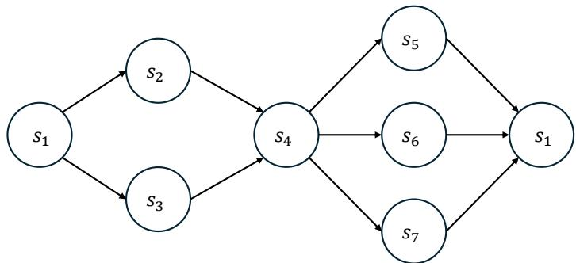
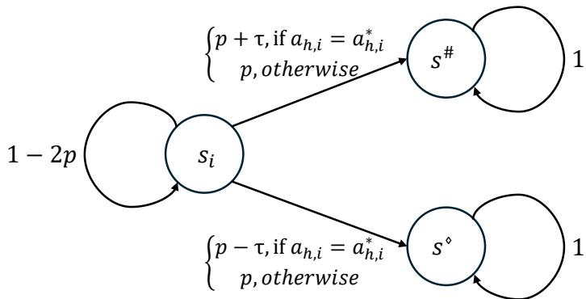

# Provably Eficient Risk-Sensitive Ofline Reinforcement Learning via Optimized Certainty Equivalents

Hanzhen Wang hanzhwang9-c@my.cityu.edu.hk   
City University of Hong Kong   
Hong Kong, China   
Boxiang Lyu blyu@alumni.chicagobooth.edu   
University of Chicago   
Chicago, IL, USA   
Zhongxiang Dai daizhongxiang@cuhk.edu.cn   
The Chinese University of Hong Kong, Shenzhen   
Shenzhen, Guangdong, China   
Siyang Gao siyangao@cityu.edu.hk   
City University of Hong Kong   
Hong Kong, China   
Dake Zhang\* dk.zhang@sjtu.edu.cn   
Shanghai Jiao Tong University   
Shanghai, China   
Shuang Qiu∗ shuanqiu@cityu.edu.hk   
City University of Hong Kong   
Hong Kong, China

## Abstract

Risk-sensitive reinforcement learning (RL) addresses decision-making under uncertainty and adverse outcomes. Learning risk-sensitive policies from fixed datasets is important when additional interaction with the environment is costly. Existing work on risk-sensitive RL focuses on online settings or specific risk measures, leaving a general theoretical understanding of its ofline setting underdeveloped. In this work, we investigate eficient ofline risk-sensitive RL using the optimized certainty equivalent (OCE), a general class of risk measures. We consider two formulations: dynamic-OCE RL, which applies OCE recursively at each step, and static-OCE RL, which applies a single OCE to the cumulative rewards. Under the tabular setting, we develop pessimistic value-iteration algorithms for both formulations and establish tight sublinear suboptimality bounds, explicitly capturing how risk sensitivity, encoded by utility functions, afects learning dificulty. Moreover, we establish minimax suboptimality lower bounds to characterize the problem’s fundamental limits. To handle large state spaces, we further develop pessimistic least-squares value-iteration algorithms that incorporate the general OCE risk criterion into linear function approximation. We establish utility-dependent sublinear guarantees with explicit dependence on the feature dimension d. To our knowledge, we provide the first ofline algorithms along with the first upper and lower suboptimality bounds for both dynamic- and static-OCE RL.

Keywords: ofline reinforcement learning, risk-sensitive reinforcement learning, optimized certainty equivalent, general risk measures, function approximation

## 1 Introduction

Classical reinforcement learning (RL) aims at maximizing the expected cumulative reward by optimizing the policy in the unknown environment through learning (Sutton et al., 1998), typically modeled as a Markov Decision Process (MDP) (Puterman, 2014). However, in many real-world applications, agents are often required to manage the trade-of between risk and reward. This has motivated the development of risk-sensitive reinforcement learning (risk-sensitive RL) frameworks, which incorporate various risk measures into the learning objective. Risk-sensitive RL is widely used by a variety of risk-sensitive industries, ranging from finance (Hambly et al., 2023), self-driving (Kamran et al., 2020), to wireless networks (Khalifa et al., 2019). In risk-sensitive RL, the agent aims to optimize certain risk-sensitive reward metrics such as mean-variance risk measure (Sood et al., 2026; Huang et al., 2022), entropic risk (Hau et al., 2023), and conditional value-at-risk (CVaR) (Hakobyan et al., 2019). Despite the progress in risk-sensitive RL, the majority of existing works are confined to the online setting, in which the agent learns through ongoing interactions with the environment, simultaneously balancing exploration and exploitation. However, the risk-sensitive nature of real-world applications makes this process costly, motivating a line of work on ofline risk-sensitive RL (Ma et al., 2021; Zhang et al., 2024), in which the agent only has access to a pre-collected dataset and cannot further interact with the environment.

Diferent risk measures are tailored to diferent applications and scenarios. Therefore, it is crucial to develop a general framework that can flexibly incorporate a broad class of risk measures. However, existing ofline risk-sensitive RL studies often focus on a single risk measure, and there is no algorithm that is provably eficient for ofline risk-sensitive RL with general risk measures. In recent years, the optimized certainty equivalent (OCE) framework, introduced by Ben-Tal and Teboulle (2007), has emerged as a suitable candidate for risksensitive RL research due to its ability to unify commonly used risk measures such as CVaR, entropic risk measure, and mean-variance. Previous research on risk-sensitive RL can be broadly categorized into two paradigms based on how the risk measure is incorporated. The first paradigm introduces the risk measure at each step of the decision process, as in Chen et al. (2024) and Xu et al. (2023). This approach integrates risk locally at every stage of learning, leading to a modified Bellman equation and resulting in a dynamic formulation of the objective. And the second paradigm formulates risk-sensitive RL as a two-stage optimization problem, where the reinforcement learning component acts as a subroutine within a larger risk-aware objective, such as in Wang et al. (2023) and Wang et al. (2024). This static perspective evaluates risk based on the total return, rather than stage-wise rewards, and facilitates the use of history-dependent policies, ofering greater flexibility in algorithm design. Although these works are suficiently general in terms of risk metrics considered, they only consider the online setting, with little guidance on how to best utilize a pre-collected dataset. The gap in research highlights an intriguing question:

## Can we design ofline risk-sensitive RL algorithms that are provably eficient for the general OCE risk measure?

Answering this question requires addressing four challenges. First, while pessimism is well understood in risk-neutral ofline RL (Levine et al., 2020; Jin et al., 2021; Xie et al., 2021;

Rashidinejad et al., 2021; Nguyen-Tang et al., 2023), it is unclear how pessimistic estimators can be constructed in ofline risk-sensitive RL with general OCE risk measures, as earlier research relied on the mathematical properties of specific risk measures (Zhang et al., 2024). Second, dynamic and static risk formulations pose distinct challenges for algorithm design and theoretical analysis. Dynamic OCE entails stagewise propagation of nonlinear risk evaluations, whereas static OCE evaluates the total return through a single risk functional and requires additional machinery to recover a recursive formulation. Developing algorithms and establishing theoretical guarantees for each formulation therefore require distinct technical treatments, yet a systematic investigation of both in ofline RL remains lacking. Third, to the best of our knowledge, minimax suboptimality lower bounds for offline risk-sensitive RL under general OCE risk measures have not been established. Finally, extending the ofline OCE-RL framework to settings with linear function approximation introduces further technical challenges. In the dynamic formulation, the nonlinear utility transformation and auxiliary OCE optimization require uniform estimation guarantees over a richer value-function class, while the static formulation requires augmenting the state with a budget variable and controlling the resulting discretization error. Although linear function approximation has been studied for specific risk measures, theoretical guarantees for ofline RL under general OCE risk measures remain lacking for both dynamic and static formulations.

Our Contributions. We make the following four main contributions as we derive a unifying framework for ofline risk-sensitive RL with general risk measures.

• We develop provably eficient ofline algorithms for both dynamic-OCE and static-OCE formulations. These algorithms provide a common algorithmic foundation for both two major paradigms of risk-sensitive RL and clarify how pessimism can be designed in each case.

• We prove sublinear suboptimality bounds for the proposed algorithms, which can recover to risk-neutral RL and various risk-sensitive RL as special cases. These results are the first suboptimality upper bounds for ofline risk-sensitive RL with general risk measures, showing that our algorithms are provably eficient.

• We establish the first information-theoretic lower bound for ofline risk-sensitive RL with general risk measures, which holds for multiple types of ofline risk-sensitive RL with the property of OCE. The bound identifies the intrinsic statistical dificulty of the problem and shows how risk sensitivity fundamentally influences the sample complexity.

• We generalize our results to the linear function approximation setting, which is the first provably eficient risk-sensitive RL algorithm with linear function approximation for OCE. This extension broadens the scope of our theory beyond tabular MDPs and improves its relevance to large-scale applications.

Taken together, these contributions form a coherent theoretical framework for ofline risksensitive RL with OCE. They directly address the central question raised above by establishing provably eficient algorithms, matching upper and lower bound analyses, and extending to linear function approximation.

## 1.1 Related Works

This work builds upon a growing body of research on ofline risk-neutral RL, where the central goal is to identify optimal policies using only pre-collected datasets, without additional interaction with the environment (Levine et al., 2020). In such a setting, the agent is required to infer the optimal policy exclusively from the dataset with no direct access to the underlying transition dynamics. A series of recent studies have investigated this challenge from multiple aspects, leading to a rich line of results (Chen and Jiang, 2019; Jin et al., 2021; Rashidinejad et al., 2021; Xie et al., 2021; Cheng et al., 2022; Nguyen-Tang et al., 2023; Madhow et al., 2025; Xiong et al., 2022; Liu et al., 2026; Qiao et al., 2026, 2025; Hao et al., 2026; Jiang and Xie, 2025; Ye et al., 2023; Xu et al., 2025).

Our work is closely related to a long line of research on risk-sensitive RL. For the entropic risk measure, Fei et al. (2020) proposed an online algorithm in the tabular MDP setting, which was later extended to the function approximation regime in Fei et al. (2021). For iterated CVaR, Du et al. (2022) introduced a tabular algorithm, while Chen et al. (2024) extended this framework to incorporate function approximation. Xu et al. (2023) developed a dynamic-OCE-based algorithm for online tabular MDPs. In the ofline setting, Zhang et al. (2024) proposed a linear function approximation method with entropic risk. In terms of static-OCE risk formulations, Wang et al. (2023) studied the online tabular CVaR-RL problem and further extended their framework to the more general OCE measure in Wang et al. (2024). Beyond these, a number of works have laid theoretical foundations for risk-sensitive RL (Osogami, 2012; Shen et al., 2013; B¨auerle and Rieder, 2014; Prashanth, 2014; Shen et al., 2014; B¨auerle and Ja´skiewicz, 2024; Liang and Luo, 2024; Ma et al., 2025; Ghosh and Moharrami, 2025; Deng et al., 2025; Lee et al., 2026; Mortensen and Talebi, 2026; Essakine and Vernade, 2026).

There are also a number of works that focus on linear function approximation, which are closely related to our work. Zhang et al. (2024) introduced a linear function approximation method for ofline RL under the entropic risk metrics, which, however, did not address the more general and challenging OCE setting. Our algorithmic design is further motivated by a broader set of advances in function approximation (Cai et al., 2020; Jin et al., 2020, 2021; Wang et al., 2020; Agarwal et al., 2020; Zanette et al., 2021; Qiu et al., 2022; Liu et al., 2023; Modi et al., 2024; Di et al., 2024; Golowich and Moitra, 2024; Qiu et al., 2024; Du et al., 2025; Lee and Oh, 2025).

## 2 Problem Setup

In this section, we formalize the ofline RL setting, introduce the optimized certainty equivalent (OCE) as a unifying risk measure together with its key properties, and formulate both dynamic and static OCE-based RL problems.

## 2.1 Ofline Reinforcement Learning

We define an episodic Markov decision process (MDP) M using the tuple $( S , \mathcal { A } , \mathbb { P } , r , H )$ where S denotes a (possibly infinite) state space, A denotes a finite action space, and H denotes the horizon. We let $\mathbb { P } = \{ \mathbb { P } _ { h } \} _ { h = 1 } ^ { H }$ denote the transition kernel, where $\mathbb { P } _ { h } ( s ^ { \prime } | s , a )$ is the probability of transitioning to state $s ^ { \prime } \in \mathcal { S }$ from state $s \in { \mathcal { S } }$ upon taking action $a \in { \mathcal { A } }$ at step h. We assume a deterministic reward function $r = \{ r _ { h } \} _ { h = 1 } ^ { H }$ , where $r _ { h } : \mathcal { S } \times \mathcal { A }  [ 0 , 1 ]$ We assume that both P and r are unknown a priori, and, without loss of generality, that the initial state is fixed at $s _ { 1 }$ . We further assume that a pre-collected dataset has been generated via a behavior policy, which is formalized below.

Assumption 1 Let $\boldsymbol { \mathcal { D } } = \{ ( s _ { h } ^ { k } , a _ { h } ^ { k } , r _ { h } ( s _ { h } ^ { k } , a _ { h } ^ { k } ) ) \} _ { h = 1 , k = 1 } ^ { H , K }$ denote a pre-collected dataset comprising K trajectories, where $s _ { h } ^ { k }$ and $a _ { h } ^ { k }$ are the state and action at step h in the $k { - } t h$ trajectory. We assume that this dataset is produced by an unknown behavior policy µ through the interaction with the environment.

Under Assumption 1, the learner has access only to the fixed dataset D and cannot collect additional data by interacting with the environment. This setting is standard in ofline RL and reflects applications where data are obtained from historical logs or human demonstrations. The quality of the learned policy will depend on how well the state-action distribution induced by the behavior policy $\mu$ covers the support of the optimal policy, which is captured by the concentrability coeficient defined in Definition 2.

For any policy $\pi ,$ we denote its state-action occupancy as $d _ { h } ^ { \pi } ( s , a ) : = \mathrm { P r } ( s _ { h } = s , a _ { h } =$ $a | \pi , s _ { 1 } )$ and its state occupancy as $d _ { h } ^ { \pi } ( s ) : = \operatorname* { P r } ( s _ { h } = s | \pi , s _ { 1 } )$ . In line with existing riskneutral ofline RL research (Xie et al., 2021; Rashidinejad et al., 2021), we define the single concentrability coeficient as follows.

Definition 2 (Single Policy Concentrability) For an optimal policy $\pi ^ { * }$ , we define $C ^ { * }$ to be the smallest value such that ma $\begin{array} { r } { \mathrm { { X } } _ { h \in [ H ] , ( s , a ) \in \mathcal { S } \times \mathcal { A } } \frac { d _ { h } ^ { \pi ^ { * } } ( s , a ) } { d _ { h } ^ { \mu } ( s , a ) } \le C ^ { * } } \end{array}$

We note that $C ^ { * }$ in Definition 2 measures the worst-case ratio between the state-action occupancy under the optimal policy $\pi ^ { * }$ and that under the behavior policy $\mu .$ The single policy concentrability coeficient $C ^ { * }$ quantifies the dificulty of ofline learning under a fixed dataset and is crucial to the sample complexity guarantees in this paper.

## 2.2 Optimized Certainty Equivalent

This work focuses on risk-sensitive ofline RL incorporating a general risk measure named optimized certainty equivalent (OCE) (Ben-Tal and Teboulle, 2007).

Definition 3 (Optimized Certainty Equivalent) Let $u : \mathbb { R } \to [ - \infty , + \infty )$ be a closed, non-decreasing, and concave utility function with a non-empty efective domain. The OCE of a random variable X is defined as

$$
\begin{array} { r } { \operatorname { O C E } ^ { u } ( X ) = \operatorname* { s u p } _ { b \in \mathbb { R } } \big \{ b + \mathbb { E } \big [ u ( X - b ) \big ] \big \} . } \end{array}\tag{1}
$$

Generally, OCE is a suficiently general risk measure. Depending on the choice of the utility function u, which typically satisfies $u ( 0 ) = 0$ and $1 \in \partial u ( 0 )$ , OCE recovers commonly used risk metrics such as conditional value-at-risk $\mathrm { ( C V a R ) }$ , entropic risk, and mean variance. Table 1 presents several specific instantiations of OCE (Xu et al., 2023; Wang et al., 2024).

Table 1 shows that an appropriate choice of the utility function u enables OCE to recover a broad spectrum of risk-sensitive criteria in the prior RL literature. Throughout the paper, both the dynamic and static-OCE RL formulations can be specialized to particular risk measures by choosing the corresponding u. In addition to its generality, OCE has several key properties, as summarized below (Ben-Tal and Teboulle, 2007; Xu et al., 2023; Wang et al., 2024).

Table 1: Special cases of OCE for various u.
<table><tr><td>Name</td><td> $\mathrm { O C E } ^ { u } ( X )$ </td><td>Utility function u</td></tr><tr><td>Mean</td><td> $\mathbb { E } [ X ]$ </td><td> $u ( t ) = t$ </td></tr><tr><td>Entropic risk</td><td> $\overset { 1 } { \underset { \alpha } { \mathrm { 1 } } } \operatorname* { l o g } \mathbb { E } [ e ^ { \alpha X } ]$ </td><td> $\begin{array} { r } { u ( t ) = \frac { 1 } { \alpha } e ^ { \alpha t } - \frac { 1 } { \alpha } } \end{array}$ </td></tr><tr><td>Mean-Variance</td><td> ${ \bar { \mathbb { E } } } [ X ] - c \operatorname { V a r } ( X )$ </td><td> $\begin{array} { r } { u ( t ) = ( t - c t ^ { 2 } ) \mathbb { I } \{ t \leq \frac { 1 } { 2 c } \} + \frac { 1 } { 4 c } \mathbb { I } \{ t > \frac { 1 } { 2 c } \} } \end{array}$ </td></tr><tr><td>CVaR</td><td> $\mathbb { E } [ x | X \leq \operatorname* { m i n } \{ x | F _ { X } ( x ) \geq \alpha \} ]$ </td><td> $\begin{array} { r } { u ( t ) = - \frac { 1 } { \alpha } [ - t ] _ { + } } \end{array}$ </td></tr></table>

Property 4 For any utility function u satisfying the properties in Definition 3, any constant $c \in \mathbb { R }$ , and any bounded random variable X, the OCE satisfies the following properties:

1. $\mathrm { O C E } ^ { u } ( X + c ) = \mathrm { O C E } ^ { u } ( X ) + c .$

2. $\mathrm { O C E } ^ { u } ( c ) = c .$

3. If $X _ { 1 } ( \omega ) \leq X _ { 2 } ( \omega )$ for any event $\omega \in \Omega , \operatorname { O C E } ^ { u } ( X _ { 1 } ) \leq \operatorname { O C E } ^ { u } ( X _ { 2 } )$

$$
\begin{array} { r } { \mathcal { A } . \mathrm { ~ \it ~ F o r ~ a n y ~ } \mu \in ( 0 , 1 ) , \mathrm { ~ O C E } ^ { u } ( \mu X _ { 1 } + ( 1 - \mu ) X _ { 2 } ) \geq \mu \mathrm { O C E } ^ { u } ( X _ { 1 } ) + ( 1 - \mu ) \mathrm { O C E } ^ { u } ( X _ { 2 } ) . } \end{array}
$$

These properties show that OCE behaves as a well-structured general risk measure. In this paper, we consider two complementary formulations of risk-sensitive RL based on ${ \mathrm { O C E } } ,$ namely dynamic-OCE RL and static-OCE RL, and exploit the aforementioned properties in our theoretical analysis. To control the propagation of estimation errors over the finite horizon, we further impose a regularity condition on the utility function.

Assumption 5 The utility function satisfies $u ( 0 ) = 0$ and is $L _ { u } – L i p s c h i t z$ on $[ - H , H ]$ there exists $L _ { u } \ge 1$ such that

$$
| u ( x ) - u ( y ) | \leq L _ { u } | x - y | , \qquad \forall x , y \in [ - H , H ] .
$$

All theoretical results below are stated under Assumption 5. In particular, $| u ( x ) | \leq H L _ { u }$ for every $x \in [ - H , H ]$ , and the range of u over this interval is at most $2 H L _ { u }$ . The Lipschitz condition is an additional regularity requirement beyond the general OCE definition, and it holds on [−H, H] for the commonly used utility functions in Table 1. Specifically, one may take $L _ { u } = 1$ for the risk-neutral utility $u ( t ) = t , L _ { u } = 1 / \alpha , \alpha \in ( 0 , 1 ]$ for the CVaR utility $u ( t ) = - \alpha ^ { - 1 } [ - t ] _ { + } , L _ { u } = e ^ { | \alpha | H }$ for the entropic utility $u ( t ) = ( e ^ { \alpha t } - 1 ) / \alpha$ with $\alpha < 0$ 2 and $L _ { u } = 1 + 2 c H$ for the truncated mean–variance utility in Table 1. Hence, the assumption accommodates the principal risk measures considered in this paper while explicitly characterizing the utility-dependent regularity required by the finite-horizon analysis.

## 2.3 Dynamic-OCE RL

Under the dynamic-OCE RL setting, we consider a Markovian policy $\pi = \{ \pi _ { h } \} _ { h = 1 } ^ { H }$ , where $\pi _ { h } ( a | s )$ denotes the probability of taking action a at state s and step h, and let Π denote the associated policy class. To incorporate OCE into sequential decision-making, prior works (Ruszczy´nski, 2010; B¨auerle and Glauner, 2022; Xu et al., 2023) have proposed the dynamic-OCE RL framework, leading to the following Bellman equation, where the OCE risk measure is applied recursively from step H to 1:

$$
\begin{array} { r l } & { Q _ { h } ^ { \pi } ( s _ { h } , a _ { h } ) = r _ { h } ( s _ { h } , a _ { h } ) + \mathrm { O C E } _ { s _ { h + 1 } \sim \mathbb P _ { h } ( \cdot \vert s _ { h } , a _ { h } ) } ^ { u } \bigl ( V _ { h + 1 } ^ { \pi } ( s _ { h + 1 } ) \bigr ) , } \\ & { V _ { h } ^ { \pi } ( s _ { h } ) = \bigl \langle Q _ { h } ^ { \pi } \bigl ( s _ { h } , \cdot \bigr ) , \pi _ { h } ( \cdot \vert s _ { h } ) \bigr \rangle _ { \mathscr A } , } \end{array}
$$

where $V _ { h } ^ { \pi }$ and $Q _ { h } ^ { \pi }$ denote the value function and Q-function for dynamic-OCE $\mathrm { R L , }$ respectively, at step h under policy π. With a slight abuse of notation, we write $\mathrm { O C E } _ { s ^ { \prime } \sim \mathbb { P } _ { h } ( \cdot | s , a ) } ^ { u } ($ $\begin{array} { r } { V _ { h + 1 } ^ { \pi } ( s ^ { \prime } ) \big ) : = \operatorname* { s u p } _ { b \in \mathbb { R } } \{ b + \mathbb { E } _ { s ^ { \prime } \sim \mathbb { P } _ { h } ( \cdot \vert s , a ) } [ u ( V _ { h + 1 } ^ { \pi } ( s ^ { \prime } ) - b ) ] \} } \end{array}$ . We note that for dynamic-OCE RL, the Q-function is

$$
\begin{array} { r l } & { Q _ { h } ^ { \pi } ( s _ { h } , a _ { h } ) : = r _ { h } ( s _ { h } , a _ { h } ) + \mathrm { O C E } _ { s _ { h + 1 } \sim \mathbb { P } _ { h } } ^ { u } \quad \{ r _ { h + 1 } ( s _ { h + 1 } , a _ { h + 1 } ) } \\ & { \qquad \quad \quad \quad \quad \quad \quad \quad \quad \quad \quad \quad \quad \quad \quad \quad \quad \quad \quad \quad \quad \quad \quad \quad \quad \quad \quad \quad \quad } \\ & { \quad \quad \quad \quad \quad \quad \quad \quad \quad \quad \quad \quad \quad \quad \quad \quad \quad \quad \quad \quad \quad \quad \quad \quad \quad \quad \quad \quad \quad \quad \quad \quad \quad \quad \quad } \\ & { \quad \quad \quad \quad \quad \quad \quad \quad \quad \quad \quad \quad \quad \quad \quad \quad \quad \quad \quad \quad \quad \quad \quad \quad \quad \quad \quad \quad \quad \quad \quad \quad \quad \quad \quad \quad \quad \quad } \\ & { \quad \quad \quad \quad \quad \quad \quad \quad \quad \quad \quad \quad \quad \quad \quad \quad \quad \quad \quad \quad \quad \quad \quad \quad \quad \quad \quad \quad \quad \quad \quad \quad \quad \quad \quad \quad \quad } \\ & { \quad \quad \quad \quad \quad \quad \quad \quad \quad \quad \quad \quad \quad \quad \quad \quad \quad \quad \quad \quad \quad \quad \quad \quad \quad \quad \quad \quad \quad \quad \quad \quad \quad \quad \quad \quad \quad } \\ & { \quad \quad \quad \quad \quad \quad \quad \quad \quad \quad \quad \quad \quad \quad \quad \quad \quad \quad \quad \quad \quad \quad \quad \quad \quad \quad \quad \quad \quad \quad \quad \quad \quad \quad \quad \quad \quad } \\ & { \quad \quad \quad \quad \quad \quad \quad \quad \quad \quad \quad \quad \quad \quad \quad \quad \quad \quad \quad \quad \quad \quad \quad \quad \quad \quad \quad \quad \quad \quad \quad \quad \quad \quad \quad \quad \quad \quad \quad \quad \quad \quad \quad } \\ &  \quad \quad \quad \quad \quad \quad \quad \quad \quad \quad \quad \quad \quad \quad \quad \quad \quad \quad \quad \quad \quad \quad \quad \quad \quad \quad \quad \quad \quad \quad \quad \quad \quad \quad \quad \quad \quad \quad \quad \quad \quad \quad \quad \end{array}
$$

where $s _ { h + 1 } \sim \mathbb { P } _ { h } , a _ { h + 1 } \sim \pi _ { h + 1 }$ is shorthand for $s _ { h + 1 } \sim \mathbb { P } _ { h } ( \cdot | s _ { h } , a _ { h } ) , a _ { h + 1 } \sim \pi _ { h + 1 } ( \cdot | s _ { h + 1 } )$ in this equation. By the definition of OCE in (1), there exists an optimal policy $\pi ^ { * } = \{ \pi _ { h } ^ { * } \} _ { h = 1 } ^ { H }$ such that $\pi ^ { * } = \arg \operatorname* { m a x } _ { \pi \in \Pi } V _ { 1 } ^ { \pi } ( s _ { 1 } )$ (B¨auerle and Glauner, 2022). We measure the learning performance of a policy π in dynamic-OCE RL by its suboptimality, defined as

$$
\mathrm { S u b O p t _ { D } } ( \pi ) = V _ { 1 } ^ { \pi ^ { * } } ( s _ { 1 } ) - V _ { 1 } ^ { \pi } ( s _ { 1 } ) ,
$$

which quantifies the gap between the value of the optimal policy $\pi ^ { * }$ and that of policy π. A policy π is ε-approximately optimal if $\mathrm { S u b O p t } _ { \mathrm { D } } ( \pi ) \le \varepsilon$

## 2.4 Static-OCE RL

The static-OCE RL framework considers an alternative risk-sensitive formulation based on the total return rather than an iterative recursion. Since the optimal policy may be history-dependent in this setting, we adopt the following specialized definition of the learning objective:

$$
\begin{array} { r } { \mathrm { O C E } _ { \pi , \mathbb { P } } ^ { u } \big ( \sum _ { h = 1 } ^ { H } r _ { h } ( s _ { h } , a _ { h } ) \big ) = \operatorname* { s u p } _ { b \in [ 0 , H ] } \big \{ b + \mathbb { E } _ { \pi , \mathbb { P } } [ u ( \sum _ { h = 1 } ^ { H } r _ { h } ( s _ { h } , a _ { h } ) - b ) ] \big \} , } \end{array}\tag{2}
$$

where $\mathbb { E } _ { \pi , \mathbb { P } }$ denotes the expectation over trajectories generated according to $a _ { h } \sim \pi _ { h } , s _ { h + 1 } \sim$ $\mathbb { P } _ { h }$ for all $h \in [ H ]$ . Note that by Proposition 11 in the appendix, the value of b in (2) can be restricted to [0, H].

A critical challenge for this setting is that the optimal policy for the above problem is history-dependent (Wang et al., 2024). To address this, we employ the augmented MDP (B¨auerle and Ott, 2011; Wang et al., 2024; Glauner et al., 2020) with an expanded state space $( s _ { h } , b _ { h } ) \in S _ { \mathrm { a u g } } : = S \times [ 0 , H ]$ for each step $h ,$ comprising the state $s _ { h }$ and a residual budget variable $b _ { h }$ that transitions via $b _ { h + 1 } = b _ { h } - r _ { h }$ with $b _ { 1 } \in [ 0 , H ]$ chosen by the learning algorithm. Thus, $b _ { h }$ encodes the cumulative rewards collected up to step $h - 1$ through the remaining budget. Under such construction, we define a Markovian policy of the form $\pi _ { h } ( a _ { h } | s _ { h } , b _ { h } )$ on the expanded state space $ { S _ { \mathrm { a u g } } }$ . We define the augmented value functions as $\begin{array} { r } { V _ { h } ^ { \pi } ( s _ { h } , b _ { h } ) : = \mathbb { E } _ { \pi , \mathbb { P } } [ u ( \sum _ { h ^ { \prime } = h } ^ { H } r _ { h ^ { \prime } } ( s _ { h ^ { \prime } } , a _ { h ^ { \prime } } ) - b _ { h } ) | s _ { h } , b _ { h } ] } \end{array}$ . Then, a Bellman-like equation is given by

$$
\begin{array} { r l } & { Q _ { h } ^ { \pi } ( s _ { h } , b _ { h } , a _ { h } ) = \mathbb { E } _ { s _ { h + 1 } \sim \mathbb { P } _ { h } ( \cdot \vert s _ { h } , a _ { h } ) } \big [ V _ { h + 1 } ^ { \pi } ( s _ { h + 1 } , b _ { h + 1 } ) \big ] , } \\ & { V _ { h } ^ { \pi } ( s _ { h } , b _ { h } ) = \langle Q _ { h } ^ { \pi } ( s _ { h } , b _ { h } , \cdot ) , \pi _ { h } ( \cdot \vert s _ { h } , b _ { h } ) \rangle _ { \cal A } . } \end{array}
$$

where we have $b _ { h + 1 } = \ b _ { h } - r _ { h }$ . By the definition of $V _ { h } ^ { \pi } ( s _ { h } , b _ { h } )$ , we have $V _ { H + 1 } ^ { \pi } ( s , b ) =$ $u ( - b ) , \forall ( s , b )$ . Further by (2), static-OCE RL equivalently solves $\begin{array} { r } { \operatorname* { m a x } _ { \pi } \operatorname { s u p } _ { b _ { 1 } \in [ 0 , H ] } \{ b _ { 1 } + } \end{array}$ $V _ { 1 } ^ { \pi } ( s _ { 1 } , b _ { 1 } ) \big \}$ , where $\pi$ is the Markovian policy defined on ${ \mathcal { S } } _ { \mathrm { a u g } } .$ There exists an opti mal initial budget $b _ { 1 } ^ { * }$ and an optimal policy $\pi ^ { * } : = \{ \pi _ { h } ^ { * } \} _ { h = 1 } ^ { H }$ such that $\pi ^ { * }$ with $b _ { 1 } ^ { * }$ can maximize $\begin{array} { r } { \operatorname* { s u p } _ { b _ { 1 } \in [ 0 , H ] } \{ b _ { 1 } + V _ { 1 } ^ { \pi } ( s _ { 1 } , b _ { 1 } ) \} } \end{array}$ (Wang et al., 2024). Ideally, $b _ { h }$ at step h should be treated as a continuous variable over the interval [0, H]. However, for practicability and computational eficiency, we discretize $b _ { h }$ using a ς-net over [0, H], defined as $\mathcal { N } _ { \varsigma } ^ { b } : = \{ n \varsigma : n = 0 , \ldots , \lfloor H / \varsigma \rfloor \} \cup \{ H \}$ . In the following sections, we focus on bounding the sample complexity and defer the discussion of discretization to Section A.4, as it afects computation more than the theoretical analysis. Accordingly, the suboptimality of any policy π in static-OCE RL can be defined as

$$
\begin{array} { r } { \mathrm { S u b O p t } _ { \mathrm { S } } ( \pi ) : = \operatorname* { s u p } _ { b _ { 1 } \in [ 0 , H ] } \big \{ b _ { 1 } + V _ { 1 } ^ { \pi ^ { * } } ( s _ { 1 } , b _ { 1 } ) \big \} - \operatorname* { s u p } _ { b _ { 1 } \in [ 0 , H ] } \big \{ b _ { 1 } + V _ { 1 } ^ { \pi } ( s _ { 1 } , b _ { 1 } ) \big \} . } \end{array}
$$

For a policy implemented on the budget grid $\mathcal { N } _ { \varsigma } ^ { b }$ , we define the discrete-budget suboptimality by

$$
\begin{array} { r } { \mathrm { S u b O p t } _ { \mathrm { S } } ^ { \mathrm { d s c } } ( \pi ) : = \operatorname* { s u p } _ { b _ { 1 } \in [ 0 , H ] } \big \{ b _ { 1 } + V _ { 1 } ^ { \pi ^ { * } } ( s _ { 1 } , b _ { 1 } ) \big \} - \operatorname* { s u p } _ { b _ { 1 } \in { \cal N } _ { { \cal S } } ^ { b } } \big \{ b _ { 1 } + V _ { 1 } ^ { \pi } ( s _ { 1 } , b _ { 1 } ) \big \} . } \end{array}
$$

For dynamic-OCE and static-OCE RL in the ofline setting, our goal is to find policies $\widehat { \pi }$ in their corresponding policy classes such that $\mathrm { S u b O p t _ { D } } ( \widehat { \pi } )$ , $\mathrm { S u b O p t _ { S } } ( \widehat { \pi } )$ , or $\mathrm { S u b { O p t } _ { S } ^ { d s c } ( } \widehat { \pi } )$ is suficiently small, as appropriate.

## 3 Risk-Sensitive Ofline RL with OCE

In this section, we develop and analyze the learning algorithms for risk-sensitive ofline RL in the tabular setting, considering both dynamic-OCE RL and static-OCE RL formulations.

## 3.1 Dynamic-OCE Pessimistic Value Iteration

Algorithm. For the dynamic-OCE RL setting, we propose a pessimistic value iteration algorithm termed Dynamic-OCE Pessimistic Value Iteration (DOCE-PVI) as summarized in Algorithm 1. This algorithm first constructs the estimated transition $\widehat { \mathbb { P } } _ { h }$ and estimated reward $\widehat { r } _ { h }$ via

$$
\widehat { \mathbb { P } } _ { h } ( s ^ { \prime } \mid s , a ) = \frac { N _ { h } ( s , a , s ^ { \prime } ) } { \operatorname* { m a x } \{ 1 , N _ { h } ( s , a ) \} } , \qquad \widehat { r } _ { h } ( s , a ) = \frac { \sum _ { k = 1 } ^ { K } \mathbb { I } \{ ( s _ { h } ^ { k } , a _ { h } ^ { k } ) = ( s , a ) \} r _ { h } ( s _ { h } ^ { k } , a _ { h } ^ { k } ) } { \operatorname* { m a x } \{ 1 , N _ { h } ( s , a ) \} } ,\tag{3}
$$

where $\mathbb { I } \{ \cdot \}$ is an indicator function and $N _ { h } ( s , a , s ^ { \prime } )$ and $N _ { h } ( s , a )$ are the state-action visitation counters for the pre-collected data D, defined as $\begin{array} { r } { N _ { h } ( s , a , s ^ { \prime } ) = \sum _ { k = 1 } ^ { K } \mathbb { I } \{ ( s _ { h } ^ { k } , a _ { h } ^ { k } , s _ { h + 1 } ^ { k } ) = } \end{array}$ $( s , a , s ^ { \prime } ) \}$ and $\begin{array} { r } { N _ { h } ( s , a ) = \sum _ { k = 1 } ^ { K } \mathbb { I } \{ ( s _ { h } ^ { k } , a _ { h } ^ { k } ) = ( s , a ) \} } \end{array}$ . The bonus term $\Gamma _ { h }$ is constructed on Line $5 ,$ which measures the uncertainty arising from model estimation. This term explicitly incorporates the OCE risk measure via the factor $u ( H - h ) - u ( h - H )$ , whose specific form is determined by the chosen utility function u. Lines 6 and 7 compute a pessimistic estimate of the Q-function $\widehat { Q } _ { h }$ by applying the Bellman equation that incorporates the OCE risk measure iteratively in the dynamic-OCE RL setup. The clip $\{ x , [ x _ { 1 } , x _ { 2 } ] \}$ operator on Line 7 projects x into the interval $[ x _ { 1 } , x _ { 2 } ]$ to ensure boundedness. The estimated optimal policy at step $h ,$ denoted by $\widehat { \pi } _ { h }$ , is a greedy policy based on the pessimistic Q-function estimate ${ \widehat { Q } } _ { h }$ , and the estimated value function $\widehat { V } _ { h }$ is then obtained using the learned policy. We note that the algorithm reduces to the risk-neutral pessimistic value iteration when $u ( t ) = t .$ . Line 6 involves an optimization problem of the form $\begin{array} { r } { \mathrm { O C E } _ { s ^ { \prime } \sim \widehat { \mathbb { P } } _ { h } ( \cdot \vert s , a ) } ^ { u } [ \widehat { V } _ { h + 1 } ( s ^ { \prime } ) ] = \operatorname* { s u p } _ { b \in [ 0 , H - h ] } \sum _ { s ^ { \prime } \in S } \widehat { \mathbb { P } } _ { h } ( s ^ { \prime } \vert s , a ) [ b + u ( \widehat { V } _ { h + 1 } ( s ^ { \prime } ) - b ) ] } \end{array}$ (by Proposition 11 in Appendix $\mathrm { A . 1 } )$ depending on the choice of u. Since u is concave as shown in Property 4, this becomes a one-dimensional concave maximization problem which can be eficiently solved.

Algorithm 1 DOCE-PVI: Dynamic-OCE Pessimistic Value Iteration   
1: Input: Ofline data $\mathcal { D } = \{ ( s _ { h } ^ { k } , a _ { h } ^ { k } , r _ { h } ( s _ { h } ^ { k } , a _ { h } ^ { k } ) ) \} _ { h = 1 , k = 1 } ^ { H , K }$   
2: Initialize: $\widehat V _ { H + 1 } ( s ) = 0$ for all s   
3: for $h = H , H - 1 \ldots , 1$ and all $( s , a ) \in S \times \mathcal { A }$ do   
4: Compute reward and transition estimates, ${ \widehat { r } } _ { h } ( s , a )$ and $\widehat { \mathbb { P } } _ { h } ( \cdot | s , a )$ , via (3) using D   
5: $\begin{array} { r } { \Gamma _ { h } ( s , a ) = \sqrt { \frac { 1 } { \operatorname* { m a x } \{ 1 , N _ { h } ( s , a ) \} } } + [ u ( H - h ) - u ( h - H ) ] \sqrt { \frac { 2 \log ( | S | | A | H K / \delta ) } { \operatorname* { m a x } \{ 1 , N _ { h } ( s , a ) \} } } } \end{array}$   
6: $\overline { { Q } } _ { h } ( s , a ) = \widehat { r } _ { h } ( s , a ) + \mathrm { O C E } _ { s ^ { \prime } \sim \widehat { \mathbb { P } } _ { h } ( \cdot \vert s , a ) } ^ { u } \Big [ \widehat { V } _ { h + 1 } ( s ^ { \prime } ) \Big ] - \Gamma _ { h } ( s , a )$   
7: $\widehat { Q } _ { h } ( s , a ) = \mathrm { c l i p } \{ \overline { { Q } } _ { h } ( s , a ) , [ 0 , H - h + \overline { { 1 } } ] \}$   
8: $\begin{array} { r } { \widehat { \pi } _ { h } ( \cdot | \cdot ) = \arg \operatorname* { m a x } _ { \pi _ { h } } \left. \widehat { Q } _ { h } ( \cdot , \cdot ) , \pi _ { h } ( \cdot | \cdot ) \right. _ { \mathcal { A } } } \end{array}$   
9: $\widehat { V } _ { h } ( \cdot ) = \big \langle \widehat { Q } _ { h } ( \cdot , \cdot ) , \widehat { \pi } _ { h } ( \cdot | \cdot ) \big \rangle _ { \mathcal { A } }$   
10: end for   
11: Return: $\widehat { \pi } = \left\{ \widehat { \pi } _ { h } \right\} _ { h = 1 } ^ { H } .$

Theoretical Result. We establish a suboptimality bound for Algorithm 1 below.

Theorem 6 Under the ofline tabular setting of dynamic-OCE $R L ,$ with probability at least $1 - \delta$ for $\delta \in ( 0 , 1 )$ , the learned policy $\widehat { \pi }$ via Algorithm 1 admits the following suboptimality bound

$$
\begin{array} { r l } & { \mathrm { S u b O p t _ { D } } ( \widehat \pi ) \leq \widetilde { \mathcal { O } } \Big ( \sum _ { h = 1 } ^ { H } \big [ 1 + u ( H - h ) - u ( h - H ) \big ] \sqrt { C ^ { * } | S | / K } \Big ) } \\ & { \qquad \leq \widetilde { \mathcal { O } } \Big ( \sum _ { h = 1 } ^ { H } \big [ 1 + 2 ( H - h ) L _ { u } \big ] \sqrt { C ^ { * } | S | / K } \Big ) , } \end{array}\tag{4}
$$

where $\widetilde { \mathcal { O } }$ hides logarithmic dependence on $H , | S | , K$ , and $1 / \delta$

This theorem demonstrates that DOCE-PVI achieves a suboptimality upper bound with $\widetilde { \mathcal { O } } ( \sqrt { C ^ { * } \lvert S \rvert / K } )$ dependence on coverage, state-space size, and sample size. This matches the dependence with risk-neutral ofline value-iteration methods under comparable coverage and sampling assumptions (Rashidinejad et al., 2021). The factor $u ( H - h ) - u ( h - H )$ is the stage-dependent utility range, while the additive 1 accounts for reward estimation. Under Assumption 5, this range is at most $2 ( H - h ) L _ { u }$ , giving the displayed $L _ { u } \mathrm { - b a s e d }$ form and thereby aligning the dynamic result with the remaining theoretical guarantees. Hence, the theorem quantifies precisely how incorporating risk sensitivity through OCE afects the sample complexity while retaining the parametric $K ^ { - 1 / 2 }$ rate. Here, $L _ { u }$ is the Lipschitz modulus of u introduced in Assumption 5. It quantifies the sensitivity of the OCE objective to return perturbations, therefore a larger $L _ { u }$ leads to a larger utility-dependent statistica error term.

Algorithm 2 SOCE-PVI: Static-OCE Pessimistic Value Iteration   
1: Input: Ofline data $\mathcal { D } = \{ ( s _ { h } ^ { k } , a _ { h } ^ { k } , r _ { h } ( s _ { h } ^ { k } , a _ { h } ^ { k } ) ) \} _ { h = 1 , k = 1 } ^ { H , K }$   
2: Initialize: $\widehat { V } _ { H + 1 } ( s , b ) = u ( - b )$ for all $s \in { \mathcal { S } }$ and $b \in \mathcal { N } _ { \varsigma } ^ { b }$   
3: for $h = H , H - 1 \ldots , 1$ and all $( s , a , b ) \in \mathcal { S } \times \mathcal { A } \times \dot { \mathcal { N } } _ { \varsigma } ^ { b }$ do   
4: Estimate $\widehat { \mathbb { P } } _ { h } ( \cdot | s , a )$ and ${ \widehat { r } } _ { h } ( s , a )$ using D via (3)   
5: $\begin{array} { r } { \Gamma _ { h } ( s , a ) = 2 H L _ { u } \sqrt { \frac { 2 \log ( | S | | A | H K / \delta ) } { \operatorname* { m a x } \{ 1 , N _ { h } ( s , a ) \} } } } \end{array}$   
6: Let $b ^ { \prime } : = b - \widehat { r } _ { h } ( s , a )$   
7: $\overline { { { Q } } } _ { h } ( s , a , b ) = \mathbb { E } _ { s ^ { \prime } \sim \widehat { \mathbb { P } } _ { h } ( \cdot \vert s , a ) } [ \widehat { V } _ { h + 1 } ( s ^ { \prime } , b ^ { \prime } ) ] - \Gamma _ { h } ( s , a )$   
8: $\widehat { Q } _ { h } ( s , a , b ) = \mathrm { c l i p } \{ \overline { { { Q } } } _ { h } ( s , a , b ) , [ u ( - b ) , u ( H - h + 1 - b ) ] \}$   
9: $\begin{array} { r } { \widehat { \pi } _ { h } ( \cdot | s , b ) = \arg \operatorname* { m a x } _ { \pi _ { h } } \left. \widehat { Q } _ { h } ( s , \cdot , b ) , \pi _ { h } ( \cdot | s , b ) \right. _ { A } } \end{array}$   
10: $\widehat { V } _ { h } ( s , b ) = \big \langle \widehat { Q } _ { h } ( s , \cdot , b ) , \widehat { \pi } _ { h } ( \cdot | s , b ) \big \rangle _ { \mathcal { A } }$   
11: end for   
12: $\widehat { b } _ { 1 } = \arg \operatorname* { m a x } _ { b \in \mathcal { N } _ { \mathrm { { \diamond } } } ^ { b } } \left\{ b + \widehat { V } _ { 1 } ( s _ { 1 } , b ) \right\}$   
13: Return: $\widehat { \pi } = \{ \widehat { \pi } _ { h } \} _ { h = 1 } ^ { H } , \widehat { b } _ { 1 }$

We compare our result with risk-neutral ofline value iteration algorithms to highlight the similarities and diferences in theoretical guarantees. Compared with the result of Xie et al. (2021), our algorithm has the same $\widetilde { \mathcal { O } } ( \sqrt { C ^ { * } \lvert S \rvert / K } )$ dependence under comparable coverage and data assumptions. In terms of the horizon dependence, our result includes the stagedependent multiplicative factor $\begin{array} { r } { \sum _ { h = 1 } ^ { H } [ 1 + u ( H - h ) ^ { - } { u ( h - H ) } ] } \end{array}$ , where $u ( H - h ) - u ( h - H )$ captures the additional efect of risk sensitivity induced by the OCE formulation. This reveals that the suboptimality is afected by the risk preferences encoded in the utility function u. Moreover, when $u ( t ) = t ,$ the overall error scales as $\widetilde { \mathcal { O } } ( H ^ { 2 } )$ under the present convention, which is comparable to Hoefding-style risk-neutral ofline-RL bounds after accounting for diferences in the data model and coverage assumptions (Levine et al., 2020; Rajaraman et al., 2020). Overall, our algorithm preserves the same parametric $K ^ { - 1 / 2 }$ dependence as these risk-neutral ofline-RL results under comparable assumptions, while introducing an additional utility-dependent term that quantifies the efect of OCE-based risk sensitivity.

## 3.2 Static-OCE Pessimistic Value Iteration

Algorithm. The static-OCE RL formulation applies the OCE risk measure to the total return only once, whereas dynamic-OCE RL applies it recursively at each step. Consequently, the optimal policy for static-OCE RL may be history-dependent. A detailed discussion can be found in Appendix A.2. Based on the augmented MDP formulation of static-OCE RL, we propose the Static-OCE Pessimistic Value Iteration (SOCE-PVI) algorithm in Algorithm 2.

Based on the augmented MDP formulation, SOCE-PVI encodes the relevant history through the auxiliary budget state $b _ { h }$ , which is initialized at the algorithmically chosen budget $b _ { 1 }$ and evolves according to $b _ { h + 1 } = b _ { h } - r _ { h } ( s _ { h } , a _ { h } )$ . Thus, a policy of the form $\pi _ { h } ( \cdot | \cdot , b _ { h } )$ is Markovian on the augmented state space $ { S _ { \mathrm { a u g } } }$ defined in Section $2 ,$ and the optimal static-OCE policy can be found within this augmented Markovian policy class.

In Algorithm 2, we first obtain the estimated transition ${ \widehat { \mathbb { P } } } _ { h }$ and the estimated reward $\widehat { r } _ { h }$ via (3). The bonus term $\Gamma _ { h }$ , computed in Line 5, measures the model estimation uncertainty for each state-action pair $( s , a )$ . Its utility-dependence is controlled by $H L _ { u } .$ , which uniformly bounds the augmented value function under Assumption 5. Notably, the bonus term used in Algorithm 2 difers from the one in Algorithm 1, reflecting the diferent structures of dynamic-OCE and static-OCE RL. Line 6 updates the budget from b to $b ^ { \prime }$ using the estimated reward ${ \widehat { r } } _ { h } ( s , a )$ . Lines 7 and 8 construct the pessimistic Q-function estimate ${ \widehat { Q } } _ { h }$ through the static-OCE Bellman equation together with the truncation operator clip. Line 9 computes the learned policy $\widehat { \pi } _ { h }$ via a greedy optimization of the estimated Q-function. In Line 10, the estimated value function $\widehat { V } _ { h }$ is obtained using the learned policy $\widehat { \pi } _ { h }$ . Finally, the estimated initial budget $\widehat { b } _ { 1 }$ is computed in Line 12.

Algorithm 2 outputs a history-dependent policy represented through the recursively updated budget variable $\widehat { b } _ { h }$ , initialized at $\widehat { b } _ { 1 }$ and updated during execution by $\widehat { b } _ { h } = \widehat { b } _ { h - 1 } \overline { { \ : } }$ $r _ { h - 1 } \big ( s _ { h - 1 } , a _ { h - 1 } \big )$ , where $\left( s _ { h - 1 } , a _ { h - 1 } \right)$ is the observed state-action pair at step $h - 1$ . In the augmented state space, the learned policy is Markovian and selects actions according to $a _ { h } \sim \widehat { \pi } _ { h } ( \cdot | s _ { h } , \widehat { b } _ { h } )$ . Owing to the structure of static-OCE RL, Algorithm 2 evaluates the OCE once for the total return, whereas Algorithm 1 applies it recursively at every step. This yields a diferent computational profile because the auxiliary budget state b must be updated and discretized iteratively. For diferent choices of u, the algorithm specializes to the corresponding OCE objective, including the risk-neutral objective when $u ( t ) = t$

Algorithm 2 is implemented over the budget grid $\mathcal { N } _ { \varsigma } ^ { b }$ . For the theoretical analysis, we first analyze the corresponding Bellman recursion with a continuous budget $b \in [ 0 , H ]$ Lemma 13 then transfers the continuous-budget guarantee to the grid implementation, incurring an additional discretization error $( 1 + L _ { u } ) _ { \sf S }$ in the suboptimality bound.

Theoretical Result. We establish a suboptimality bound for Algorithm 2 below.

Theorem 7 Under the ofline tabular setting of static-OCE RL with deterministic rewards $r _ { h } = r _ { h } ( s , a ) \in [ 0 , 1 ]$ , with probability at least $1 - \delta$ for $\delta \in ( 0 , 1 )$ , the policy $\widehat { \pi }$ returned by Algorithm 2 satisfies

$$
\begin{array} { r } { \mathrm { S u b O p t \varsigma ^ { d s c } } ( \widehat { \pi } ) \leq \widetilde { \mathcal { O } } \Big ( \sum _ { h = 1 } ^ { H } H L _ { u } \sqrt { C ^ { * } | S | / K } \Big ) + ( 1 + L _ { u } ) \varsigma , } \end{array}
$$

where $\widetilde { \mathcal { O } }$ hides logarithmic dependence on H, |S|, K, and $1 / \delta$ , and $\mathrm { S u b O p t _ { S } ^ { d s c } }$ is defined in Appendix $A . \not \downarrow$

The first term in Theorem 7 is the continuous-budget statistical error established by the Bellman analysis. The additive term $( 1 + L _ { u } ) _ { \sf S }$ is the discretization error incurred by the grid implementation in Algorithm 2, as established in Lemma 13. Thus, the theorem provides a guarantee for the implementable discrete-budget algorithm, while $H L _ { u }$ captures the utility-dependent scale of the statistical error. For the idealized continuous-budget case, the same analysis yields $\mathrm { S u b O p t _ { S } } ( \widehat { \pi } ) \leq \widetilde { \mathcal { O } } ( \sum _ { h = 1 } ^ { H } H L _ { u } \sqrt { C ^ { * } | S | / K } )$ . In this case, no discretization error is incurred.

Similar to Theorem 6, the result exhibits $\widetilde { \mathcal { O } } ( \sqrt { C ^ { * } \lvert S \rvert / K } )$ dependence in its displayed statistical term, up to logarithmic and utility-dependent factors. This comparison is made under comparable coverage and sampling assumptions (Xie et al., 2021). When $u ( t ) = t ,$ the horizon dependence factor scales as $\widetilde { \mathcal { O } } ( H ^ { 2 } )$ under the present convention, which is comparable to prior risk-neutral ofline-RL results after aligning their sampling and coverage assumptions (Levine et al., 2020; Rajaraman et al., 2020).

The main result above concerns the deterministic-reward implementation in Algorithm 2. A separate stochastic-reward extension is given in the appendix under a joint transition– reward model. It requires a Bellman update based on the joint law of $( s ^ { \prime } , r )$ , whereas the practical update uses ${ \widehat { r } } _ { h } ( s , a )$

## 4 Information-Theoretic Lower Bounds

In this section, we establish a minimax lower bound for the suboptimality of ofline risksensitive RL under the OCE risk measure, which holds for both the dynamic-OCE and the static-OCE formulations. We first state the main lower bound result via the following theorem.

Theorem 8 For an MDP $\mathcal { M } = ( \mathcal { S } , \mathcal { A } , H , \mathbb { P } , r )$ with $| S | \ge 3 , ~ H \ge 2 , ~ | A | \ge C ^ { * } \ge 2 ,$ and $K > { \textstyle \frac { 1 } { 4 } } C ^ { * } | S | H$ , let $\rho \in ( 0 , 1 )$ satisfy ρH ∈ N. Let D be a dataset collected from the underlying MDP M and $\mathrm { A l g }$ be any ofline learning algorithm that maps $\mathcal { D }$ to a learned policy. Further let $\begin{array} { r } { b _ { 1 } ^ { * } \in \arg \operatorname* { m a x } _ { b \in [ 0 , \rho H ] } \{ b + \frac { 1 } { 2 H } u ( \rho H - b ) + ( 1 - \frac { 1 } { 2 H } ) u ( - b ) \} } \end{array}$

• For dynamic-OCE RL, with πb returned by $\mathrm { A l g } ( \mathcal { D } )$ , the following minimax lower bound holds:

$$
\operatorname* { i n f } _ { \mathrm { { A l g } } } \operatorname* { m a x } _ { \mathcal { M } } \mathrm { { S u b O p t } _ { D } } \big ( { \mathcal M } , \mathrm { A l g } ( \mathcal { D } ) \big ) \ge \Omega \big ( \big [ u ( \rho H - b _ { 1 } ^ { * } ) - u ( - b _ { 1 } ^ { * } ) \big ] \sqrt { C ^ { * } | \mathcal { S } | H / K } \big ) .
$$

• For static-OCE $R L ,$ suppose that $\mathrm { A l g } ( \mathcal { D } )$ returns $( \widehat { \pi } , \widehat { b } _ { 1 } )$ and induces the Markovian policy $\widehat { \pi } _ { h } ( \cdot | s , \widehat { b } _ { h } )$ at step h, where the budget is updated as $\widehat { b } _ { h + 1 } = \widehat { b } _ { h } - r _ { h }$ starting from $\hat { b _ { 1 } }$ . Then the following minimax lower bound holds:

$$
\operatorname* { i n f } _ { \mathrm { \mathrm { ~ A l g ~ } } } \operatorname* { m a x } _ { M } \mathrm { S u b O p t } _ { \mathrm { S } } \big ( \mathcal { M } , \mathrm { A l g } ( \mathcal { D } ) \big ) \geq \Omega \big ( \big [ u ( \rho H - b _ { 1 } ^ { * } ) - u ( - b _ { 1 } ^ { * } ) \big ] \sqrt { C ^ { * } | S | H / K } \big ) .
$$

Theorem 8 provides a minimax lower bound showing that, for any ofline algorithm under either dynamic-OCE or static-OCE RL, there exists an instance such that the suboptimality is at least $\Omega \big ( [ u ( \rho H - b _ { 1 } ^ { * } ) - u ( - b _ { 1 } ^ { * } ) ] \sqrt { C ^ { * } | S | H / K } \big )$ . This demonstrates that, in the worstcase scenario, any algorithm operating under these OCE RL formulations must incur a learning suboptimality that jointly depends on the dataset coverage $C ^ { * }$ , the state space size |S|, the horizon $H ,$ and the risk preferences captured by the utility function u. Moreover, this suboptimality lower bound decays at the rate $K ^ { - 1 / 2 }$ . This theorem highlights the intrinsic dificulty of ofline risk-sensitive RL under general OCE risk measures, and, to the best of our knowledge, establishes the first lower bounds for ofline OCE-RL problems. Notably, accounting for the discretization of b changes the lower bound of static-OCE RL in Theorem 8 by at most an additive $( 1 + L _ { u } ) _ { \sf } $ , as shown in Lemma 13. Hence, budget discretization preserves the order of the lower bound.

Theorem 8 establishes a general lower bound for ofline risk-sensitive RL with ${ \mathrm { O C E } } ,$ rather than a bound being specific to a particular risk measure. Together with the utility function $u ,$ the choice of $\rho ,$ which is determined by the intrinsic parameter of the risk measure $( \mathrm { e . g . , } \alpha$ in CVaR), specializes this bound to concrete risk measures. To the best of our knowledge, our results provide the first lower bounds for ofline RL with the general OCE risk measures.

Our results can be compared with existing risk-sensitive lower bounds, either for the ofline setting with specific risk measures or for the online setting. In particular, although a direct comparison with online risk-sensitive RL is not entirely rigorous due to the inherent diferences between online and ofline settings, such a comparison still provides useful insights into the dependence on key problem parameters. For ofline RL, the comparisons are as follows:

• Compared with lower bounds for ofline risk-neutral RL algorithms (Xie et al., 2021; Rashidinejad et al., 2021), our lower bound shares $\Omega ( \sqrt { C ^ { * } | S | } )$ dependence in the coverage and state-space factor. In addition, it explicitly includes the risk-sensitive factor induced by the utility function u, thereby capturing the additional utilitydependent dificulty associated with risk sensitivity.

• Compared with ofline entropic RL with linear function approximation (Zhang et $\mathrm { a l . }$ 2024), choosing $\begin{array} { r } { u ( t ) = \frac { 1 } { | \alpha | } ( e ^ { | \alpha | t } - 1 ) } \end{array}$ and an admissible $\rho$ as specified in Theorem 8 yields an exponential utility factor of order $( e ^ { | \alpha | \rho H } - 1 ) / | \alpha |$ . This exhibits an exponential dependence qualitatively comparable to the entropic factor appearing in their upper bound, but the results use diferent function-approximation and sampling assumptions.

For online risk-sensitive $\mathrm { R L , }$ the comparisons are as follows:

• Compared with online dynamic-OCE RL (Xu et al., 2023), Xu et al. (2023) established a lower bound of the form $\Omega ( [ u ( ( 1 - 2 / c _ { 2 } ) H - b _ { 1 } ^ { * } ) - u ( - b _ { 1 } ^ { * } ) ] \sqrt { C ^ { * } | S | H K } )$ , for $c _ { 2 } > 2$ , for online dynamic-OCE RL. Setting $\rho = 1 - 2 / c _ { 2 }$ makes the utility arguments formally comparable, while the ofline and online lower bounds are not directly comparable in their statistical rates since the ofline and online settings involve diferent information structures and sample models.

• Compared with online dynamic-CVaR RL (iterated-CVaR RL) (Chen et al., 2024), choosing $\begin{array} { r } { u ( t ) = - \frac { 1 } { \alpha } [ - t ] _ { + } } \end{array}$ with $\alpha \in ( 0 , 1 ]$ enables a comparison of the CVaR-induced utility factor when the chosen $\rho$ lies in (0, 1). This comparison concerns the utility factor, while the two lower bounds use diferent sampling settings.

• Compared with online static-CVaR RL (Wang et al., 2023), choosing $\begin{array} { r } { u ( t ) = - \frac { 1 } { \alpha } [ - t ] _ { + } } \end{array}$ with $\alpha \in ( 0 , 1 ]$ makes the dependence of the utility factor on the CVaR level explicit. However, the online and ofline lower bounds are derived under diferent information and sampling structures.

• Compared with online entropic RL (Fei et al., 2020), choosing $\begin{array} { r } { u ( t ) ~ = ~ \frac { 1 } { | \alpha | } ( e ^ { | \alpha | t } ~ - ~ } \end{array}$ 1) yields an exponential utility factor whose horizon dependence can be compared with the entropic risk-sensitive lower bound established by Fei et al. (2020). The comparison addresses the risk-sensitive factor rather than complete equality of rates.

Except for the ofline entropic-RL result of Zhang et al. (2024), most existing lower bounds for risk-sensitive RL are established in the online setting. Hence, the above comparisons serve as indicative references rather than direct comparisons. Nevertheless, the risk-sensitive factors identified in these works, such as the term $u ( ( 1 - 2 / c _ { 2 } ) H - b _ { 1 } ^ { * } ) - u ( - b _ { 1 } ^ { * } )$ in Xu et al. (2023), provide useful benchmarks for understanding the corresponding ofline setting in our work.

Moreover, the comparison of Theorem 8 with the upper bounds in Theorems 4 and 7 is restricted to the common dependence on coverage, state-space size, and sample size, namely $\sqrt { C ^ { * } | S | / K }$ . In addition, Theorem 8 shows that the constructed hard instances yield the same lower-bound form for both dynamic-OCE and static-OCE RL. The detailed construction and justification are provided in Appendix C.

## 5 Linear Function Approximation for Ofline RL with OCE

In large state spaces, the proposed algorithms under the tabular setting would incur a large suboptimality bound, according to Theorems 6 and 7. A standard approach to mitigating this dependence is to use function approximation. While function approximation has been extensively studied in RL, developing a theoretically justified algorithm for RL under the OCE risk measure (let alone the ofline setting) remains limited. In this section, we take an initial step in this direction by studying ofline RL with OCE under linear function approximation, a practical and widely used implementation of function approximation, and we develop learning algorithms for both dynamic-OCE RL and static-OCE RL.

Linear MDP. We consider a commonly adopted linear MDP model, in which both the reward function and the transition model admit a linear structure. Specifically, we have

$$
\begin{array} { r l r } { r _ { h } ( s , a ) = \bigl \langle \theta _ { h } , \phi ( s , a ) \bigr \rangle , } & { { } } & { \mathbb { P } _ { h } ( \cdot | s , a ) = \bigl \langle \mu _ { h } ( \cdot ) , \phi ( s , a ) \bigr \rangle , } \end{array}\tag{5}
$$

where $\begin{array} { r } { \int _ { S } \| \mu _ { h } ( s ) \| _ { 2 } d s \leq \sqrt { d } } \end{array}$ and $\| \theta _ { h } \| _ { 2 } \leq { \sqrt { d } } .$ . We define $\phi : \mathcal { S } \times \mathcal { A }  \mathbb { R } ^ { d }$ to be a feature map satisfying $\| \phi ( s , a ) \| _ { 2 } \leq 1$ for all $( s , a ) \in S \times A$ . The linear MDP model includes the tabular MDP setting as a special case by choosing $d = | \boldsymbol { S } | \cdot | \boldsymbol { A } |$ and setting the feature map to the canonical basis vector $\boldsymbol { \phi } ( s , a ) = \mathbf { e } _ { ( s , a ) }$ , when assuming discrete state and action spaces.

## 5.1 Dynamic-OCE Pessimistic Least-Squares Value Iteration

Algorithm. We propose the pessimistic value iteration for dynamic-OCE RL with linear function approximation, termed Dynamic-OCE Pessimistic Least-Squares Value Iteration (DOCE-PLSVI), as summarized in Algorithm 3. Due to the special structure of the Bellman equation for dynamic-OCE RL, we apply linear function approximation separately to the reward and transition-related components of the Bellman update. We first estimate the reward function $r _ { h }$ by ridge regression,

$$
\begin{array} { r } { \operatorname* { m i n } _ { \theta \in \mathbb { R } ^ { d } } \sum _ { k = 1 } ^ { K } \left[ r _ { h } ( s _ { h } ^ { k } , a _ { h } ^ { k } ) - \phi ( s _ { h } ^ { k } , a _ { h } ^ { k } ) ^ { \top } \theta \right] ^ { 2 } + \lambda \| \theta \| _ { 2 } ^ { 2 } . } \end{array}\tag{6}
$$

Algorithm 3 DOCE-PLSVI: Dynamic-OCE Pessimistic Least-Squares Value Iteration   
1: Input: Ofline data $\mathcal { D } = \{ ( s _ { h } ^ { k } , a _ { h } ^ { k } , r _ { h } ( s _ { h } ^ { k } , a _ { h } ^ { k } ) ) \} _ { h = 1 , k = 1 } ^ { H , K }$   
2: Initialize: $\widehat V _ { H + 1 } ( s ) = 0$ for all s   
3: for $h = H , H - 1 \ldots , 1$ do   
4: $\begin{array} { r } { \Lambda _ { h } = \sum _ { k = 1 } ^ { K } \phi ( s _ { h } ^ { k } , a _ { h } ^ { k } ) \phi ( s _ { h } ^ { k } , a _ { h } ^ { k } ) ^ { \top } + \lambda \mathbf { I } } \end{array}$   
5: $\begin{array} { r } { \widehat { w } _ { h } ( b ) = \Lambda _ { h } ^ { - 1 } \sum _ { k = 1 } ^ { K } \phi ( s _ { h } ^ { k } , a _ { h } ^ { k } ) u \bigl ( \widehat { V } _ { h + 1 } ( s _ { h + 1 } ^ { k } ) - b \bigr ) } \end{array}$   
6: $\begin{array} { r } { \widehat { \theta } _ { h } = \Lambda _ { h } ^ { - 1 } \sum _ { k = 1 } ^ { K } \phi ( s _ { h } ^ { k } , a _ { h } ^ { k } ) r _ { h } ( s _ { h } ^ { k } , a _ { h } ^ { k } ) } \end{array}$   
7: $\Gamma _ { h } ( \cdot , \cdot ) = \beta \sqrt { \phi ( \cdot , \cdot ) ^ { \top } \Lambda _ { h } ^ { - 1 } \phi ( \cdot , \cdot ) }$   
8: $\overline { { { Q } } } _ { h } ( \cdot , \cdot ) = \phi ( \cdot , \cdot ) ^ { \top } \widehat { \theta } _ { h } + \operatorname* { s u p } _ { b \in [ 0 , H - h ] } \left\{ b + \phi ( \cdot , \cdot ) ^ { \top } \widehat { w } _ { h } ( b ) \right\} - \Gamma _ { h } ( \cdot , \cdot )$   
9: $\widehat { Q } _ { h } ( \cdot , \cdot ) = \mathrm { c l i p } \big \{ \overline { { { Q } } } _ { h } ( \cdot , \cdot ) , [ 0 , H - h + 1 ] \big \}$   
10: $\begin{array} { r } { \widehat { \pi } _ { h } ( \cdot | \cdot ) = \underset { \widehat { \mathbf { \theta } } } { \arg \operatorname* { m a x } } _ { \pi _ { h } } \left. \widehat { Q } _ { h } ( \cdot , \cdot ) , \pi _ { h } ( \cdot | \cdot ) \right. _ { \mathcal { A } } } \end{array}$   
11: $\widehat { V } _ { h } ( \cdot ) = \big \langle \widehat { Q } _ { h } ( \cdot , \cdot ) , \widehat { \pi } _ { h } ( \cdot | \cdot ) \big \rangle _ { \mathcal { A } }$   
12: end for   
13: Return: $\widehat { \pi } = \{ \widehat { \pi } _ { h } \} _ { h = 1 } ^ { H } .$

Let $\widehat { \theta } _ { h }$ denote the solution to (6). We then define the estimated reward function as $\widehat { r } _ { h } ( \cdot , \cdot ) =$ $\phi ( \cdot , \cdot ) ^ { \top } \widehat { \theta } _ { h }$ . In addition, by exploiting the linear structure of the transition model, we have $\begin{array} { r } { \mathbb { E } _ { s ^ { \prime } \sim \mathbb { P } _ { h } ( \cdot \vert s , a ) } [ u ( \widehat { V } _ { h + 1 } ( s ^ { \prime } ) - b ) ] = \int _ { S } [ u ( \widehat { V } _ { h + 1 } ( s ^ { \prime } ) - b ) ] \langle \mu _ { h } ( s ^ { \prime } ) , \phi ( s , a ) \rangle \ \mathrm { d } s ^ { \prime } = \langle w ( b ) , \phi ( s , a ) \rangle } \end{array}$ where $\begin{array} { r } { w ( b ) : = \int _ { \cal S } [ u ( \widehat { V } _ { h + 1 } ( s ^ { \prime } ) - b ) ] \mu _ { h } ( s ^ { \prime } ) } \end{array}$ ds′. Accordingly, for each $b ,$ we estimate $w _ { h } ( b )$ via ridge regression:

$$
\begin{array} { r } { \operatorname* { m i n } _ { w ( b ) \in \mathbb { R } ^ { d } } \sum _ { k = 1 } ^ { K } \left[ u \big ( \widehat { V } _ { h + 1 } ( s _ { h + 1 } ^ { k } ) - b \big ) - \phi ( s _ { h } ^ { k } , a _ { h } ^ { k } ) ^ { \top } w ( b ) \right] ^ { 2 } + \lambda \| w ( b ) \| _ { 2 } ^ { 2 } . } \end{array}\tag{7}
$$

This yields the approximation $\phi ( s , a ) ^ { \top } \widehat { w } _ { h } ( b ) \approx \mathbb { E } _ { s ^ { \prime } \sim \mathbb { P } _ { h } ( \cdot \vert s , a ) } [ u ( \widehat { V } _ { h + 1 } ( s ^ { \prime } ) - b ) ]$ without explicitly estimating $\mathbb { P } _ { h }$ . Therefore, the transition kernel $\mathbb { P } _ { h }$ need not be estimated explicitly, and the resulting procedure is model-free. Accordingly, $\mathrm { O C E } _ { s ^ { \prime } \sim \mathbb { P } _ { h } ( \cdot | s , a ) } ^ { u } \{ \widehat { V } _ { h + 1 } ( s ^ { \prime } ) \}$ is estimated by $\begin{array} { r } { \operatorname* { s u p } _ { b \in [ 0 , H - h ] } \{ b + \phi ( s , a ) ^ { \top } \widehat { w } _ { h } ( b ) \} } \end{array}$ , where the budget b is restricted to $[ 0 , H - h ]$ by Proposition 11.

At each step h, Line 4, Line 5, and Line 6 construct the design matrix $\Lambda _ { h }$ and compute the least-squares estimates $\widehat { w } _ { h } ( b )$ and $\widehat { \theta } _ { h }$ . Line 7 constructs the elliptical pessimistic bonus $\Gamma _ { h } ( s , a ) = \beta \sqrt { \phi ( s , a ) ^ { \top } \Lambda _ { h } ^ { - 1 } \phi ( s , a ) }$ , with confidence radius $\beta = \mathcal { O } ( d [ 1 + ( H - h ) L _ { u } ]$ $\sqrt { \log ( 2 d H K L _ { u } ( 1 + H L _ { u } ) \delta ^ { - 1 } ) } )$ . Line 8 combines the estimated reward, the estimated OCE continuation term $\begin{array} { r } { \operatorname* { s u p } _ { b \in [ 0 , H - h ] } \{ b + \phi ( s , a ) ^ { \top } \widehat { w } _ { h } ( b ) \} } \end{array}$ , and the bonus to form the pessimistic Q-estimate ${ \overline { { Q } } } _ { h }$ , which is then clipped to the valid range in Line 9 to obtain $\widehat { Q } _ { h }$ . Finally, Line 10 computes the greedy policy with respect to ${ \dot { Q } } _ { h }$ , and Line 11 updates the value estimate $\widehat { V } _ { h }$

Theoretical Result. We establish the following suboptimality bound for Algorithm 3.

Theorem 9 Under the ofline setting of dynamic-OCE RL with linear function approximation, with probability at least $1 - \delta f o r \delta \in ( 0 , 1 )$ , the learned policy πb obtained by Algorithm 3

admits the suboptimality bound

$$
\begin{array} { r } { \mathrm { S u b O p t } _ { \mathrm { D } } ( \widehat \pi ) \leq \widetilde { \mathcal { O } } \Big ( d \sum _ { h = 1 } ^ { H } [ 1 + ( H - h ) L _ { u } ] \mathbb { E } _ { \pi ^ { * } } \Big [ \sqrt { \phi ( s _ { h } , a _ { h } ) ^ { \top } \Lambda _ { h } ^ { - 1 } \phi ( s _ { h } , a _ { h } ) } \Big | s _ { 1 } \Big ] \Big ) , } \end{array}
$$

where $\begin{array} { r } { \Lambda _ { h } \ = \ \sum _ { k = 1 } ^ { K } \phi ( s _ { h } ^ { k } , a _ { h } ^ { k } ) \phi ( s _ { h } ^ { k } , a _ { h } ^ { k } ) ^ { \top } \ + \ \lambda \mathbf { I } } \end{array}$ with $\lambda \ = \ 1$ and $\beta = c d [ 1 + ( H - h ) L _ { u } ] $ $\sqrt { \log ( 2 d H K L _ { u } ( 1 + H L _ { u } ) \delta ^ { - 1 } ) }$ , where c is a constant satisfying $c > 0$ and $1 2 \log ( 6 4 c ^ { 2 } ) + 4 6 \leq$ $c ^ { 2 } / 4$ . Here $\widetilde { \mathcal { O } }$ hides logarithmic dependence on $H , d , K , L _ { u }$ , and $1 / \delta$

Theorem 9 shows that the factor $1 + ( H - h ) L _ { u }$ captures the stage-dependent statistical dificulty, with the L -dependent component reflecting the efect of the utility function. When $u ( t ) = t ,$ substituting $L _ { u } = 1$ gives the risk-neutral specialization $\begin{array} { r } { \widetilde { \mathcal { O } } ( d H \sum _ { h = 1 } ^ { H } \mathbb { E } _ { \pi ^ { * } } [ } \end{array}$ $\sqrt { \phi ( s _ { h } , a _ { h } ) ^ { \top } \Lambda _ { h } ^ { - 1 } \phi ( s _ { h } , a _ { h } ) | s _ { 1 } ] ) }$ , which is comparable to the corresponding risk-neutral linear-MDP guarantee in Jin et al. (2021) under matched coverage and regularization assumptions. For the entropic utility $\begin{array} { r } { u ( t ) = \frac { 1 } { \alpha } ( e ^ { \alpha t } - 1 ) } \end{array}$ with $\alpha < 0$ , the factor $L _ { u } = e ^ { | \alpha | H }$ yields an exponential dependence on horizon H induced by the uniform Lipschitz bound. Thus, the theorem recovers the risk-neutral case and extends to general OCE utilities through an explicit utility-dependent factor.

Compared with Algorithm 1, Algorithm 3 replaces tabular estimates with ridge-regression estimates under the linear-MDP model and is applicable when this model is appropriate for the state–action representation. When $\phi ( s , a ) \ = \ \mathbf { e } _ { ( s , a ) }$ and $d \ : = \ : | \boldsymbol { S } | \cdot | \boldsymbol { A } |$ , we have $\Lambda _ { h } = \mathrm { d i a g } ( \{ N _ { h } ( s , a ) + \lambda \} _ { ( s , a ) \in \mathcal { S } \times \mathcal { A } } )$ , by the definition of $\Lambda _ { h }$ . Consequently, we have $ { \mathbb E } _ { \pi ^ { * } } [ \sqrt { \phi ( s _ { h } , a _ { h } ) ^ { \top } \Lambda _ { h } ^ { - 1 } \phi ( s _ { h } , a _ { h } )  { \mid } s _ { 1 } ] } =  { \mathbb E } _ { \pi ^ { * } } [ ( N _ { h } ( s _ { h } , a _ { h } ) + \lambda ) ^ { - 1 / 2 }  { \mid } s _ { 1 } ]$ . Substituting this expression into our suboptimality bound in Theorem 9 and following the proof in Appendix B.2 yields an upper bound of $\begin{array} { r } { \mathrm { S u b O p t } _ { \mathrm { D } } ( \widehat { \pi } ) \leq \widetilde { \mathcal { O } } ( | \mathcal { S } | | \boldsymbol { A } | \sum _ { h = 1 } ^ { H } [ 1 + ( H - h ) L _ { u } ] \sqrt { \frac { C ^ { * } | \mathcal { S } | } { K } } ) } \end{array}$ . Thus the result in Theorem 4 can be compared with the specialization of Theorem 9 at the level of their coverage structure, but the bound under linear function approximation setting retains an additional dimension dependence.

## 5.2 Static-OCE Pessimistic Least-Squares Value Iteration

Algorithm. For static-OCE RL with linear function approximation, we propose the Static-OCE Pessimistic Least-Squares Value Iteration (SOCE-PLSVI), as summarized in Algorithm 4.

In particular, based on the linear structure of the transition model, letting $\ b ^ { \prime } = b -$ $r _ { h } ( s , a )$ , we have $\begin{array} { r } { { \mathbb E } _ { s ^ { \prime } \sim { \mathbb P } _ { h } ( \cdot \vert s , a ) } [ \widehat { V } _ { h + 1 } ( s ^ { \prime } , b ^ { \prime } ) ] \ = \ \int _ { { \mathcal S } } [ \widehat { V } _ { h + 1 } ( s ^ { \prime } , b ^ { \prime } ) ] \langle \mu _ { h } ( s ^ { \prime } ) , \phi ( s , a ) \rangle d s ^ { \prime } \ = \ \langle w _ { h } ( b ) \rangle } \end{array}$ $\phi ( s , a ) \rangle$ , where $\begin{array} { r } { w _ { h } ( b ) : = \int _ { \mathcal { S } } [ \widehat { V } _ { h + 1 } ( s ^ { \prime } , b ^ { \prime } ) ] \mu _ { h } ( s ^ { \prime } ) d s ^ { \prime } } \end{array}$ . This identity motivates the following ridge regression estimator $\widehat { w } _ { h } ( b )$

$$
\begin{array} { r } { \operatorname* { m i n } _ { w ( b ) \in \mathbb { R } ^ { d } } \sum _ { k = 1 } ^ { K } \Big [ \widehat { V } _ { h + 1 } \big ( s _ { h + 1 } ^ { k } , b - r _ { h } ( s _ { h } ^ { k } , a _ { h } ^ { k } ) \big ) - \phi ( s _ { h } ^ { k } , a _ { h } ^ { k } ) ^ { \top } w ( b ) \Big ] ^ { 2 } + \lambda \| w ( b ) \| _ { 2 } ^ { 2 } . } \end{array}
$$

Therefore, we have $\phi ( s , a ) ^ { \top } \widehat { w } _ { h } ( b ) \approx \mathbb { E } _ { s ^ { \prime } \sim \mathbb { P } _ { h } ( \cdot \vert s , a ) } [ \widehat { V } _ { h + 1 } ( s ^ { \prime } , b - r _ { h } ( s , a ) ) ]$ . We note that, in contrast to the dynamic-OCE RL algorithm in Algorithm 3, there is no need to treat the transition model $\mathbb { P } _ { h }$ and the reward model $r _ { h }$ separately as in (6) and (7).

Algorithm 4 SOCE-PLSVI: Static-OCE Pessimistic Least-Squares Value Iteration   
1: Input: Ofline data $\boldsymbol { \mathcal { D } } = \left\{ \left( s _ { h } ^ { k } , a _ { h } ^ { k } , r _ { h } ( s _ { h } ^ { k } , a _ { h } ^ { k } ) \right) \right\} _ { h = 1 , k = 1 } ^ { H , K }$   
2: Initialize: $\widehat { V } _ { H + 1 } ( s , b ) = u ( - b )$ for all $s \in { \mathcal { S } }$ and $b \in \mathcal { N } _ { \varsigma } ^ { b }$   
3: for $h = H , H - 1 \ldots , 1$ and all $b \in \mathcal { N } _ { \varsigma } ^ { b }$ do   
4: $\begin{array} { r } { \Lambda _ { h } = \sum _ { k = 1 } ^ { K } \phi ( s _ { h } ^ { k } , a _ { h } ^ { k } ) \phi ( s _ { h } ^ { k } , a _ { h } ^ { k } ) ^ { \top } + \bar { \lambda } \mathbf { I } } \end{array}$   
5: $\begin{array} { r } { \widehat { w } _ { h } ( b ) = \Lambda _ { h } ^ { - 1 } \mathop { \sum _ { k = 1 } ^ { K } \phi ( s _ { h } ^ { k } , a _ { h } ^ { k } ) } \widehat { V } _ { h + 1 } ( s _ { h + 1 } ^ { k } , b - r _ { h } ( s _ { h } ^ { k } , a _ { h } ^ { k } ) ) } \end{array}$   
6: $\Gamma _ { h } ( \cdot , \cdot ) = \beta \sqrt { \phi ( \cdot , \cdot ) ^ { \top } \Lambda _ { h } ^ { - 1 } \phi ( \cdot , \cdot ) }$   
7: $\overline { { \ u { Q } } } _ { h } ( \cdot , \cdot , b ) = \dot { \phi } ( \cdot , \cdot ) ^ { \top } \widehat { w } _ { h } ( b ) - \Gamma _ { h } ( \cdot , \cdot )$   
8: $\widehat { Q } _ { h } ( \cdot , \cdot , b ) = \mathrm { c l i p } \{ \overline { { { Q } } } _ { h } ( \cdot , \cdot , b ) , [ u ( - b ) , u ( H - h + 1 - b ) ] \}$   
9: $\widehat { \pi } _ { h } ( \cdot | \cdot , b ) = \arg \operatorname* { m a x } _ { \pi _ { h } } \left. \widehat { Q } _ { h } ( \cdot , \cdot , b ) , \pi _ { h } ( \cdot | \cdot , b ) \right. _ { A }$   
10: $\widehat { V } _ { h } ( \cdot , b ) = \langle \widehat { Q } _ { h } ( \cdot , \cdot , b ) , \widehat { \pi } _ { h } ( \cdot \vert \cdot , b ) \rangle _ { \mathcal { A } }$   
11: end for   
12: $\widehat { b } _ { 1 } = \arg \operatorname* { m a x } _ { b \in \mathcal { N } _ { \mathrm { { \diamond } } } ^ { b } } \left\{ b + \widehat { V } _ { 1 } ( s _ { 1 } , b ) \right\}$   
13: Return: $\widehat { \pi } = \{ \widehat { \pi } _ { h } \} _ { h = 1 } ^ { H } , \widehat { b } _ { 1 }$

Lines 4 and 5 first construct the design matrix $\Lambda _ { h }$ and compute the estimate $\widehat { w } _ { h } ( b )$ The pessimistic bonus $\Gamma _ { h } ( \cdot , \cdot )$ is then constructed in Line $6 ,$ where the confidence radius $\beta = \mathcal { O } ( d H L _ { u } \sqrt { \log ( 2 d H K \delta ^ { - 1 } ) } )$ . Lines 7 forms $\overline { { Q } } _ { h }$ by subtracting the bonus from $\phi ( \cdot , \cdot ) ^ { \top } \widehat { w } _ { h } ( b )$ and then Line 8 clips it to obtain the pessimistic Q-function estimate $\widehat { Q } _ { h } ( \cdot , \cdot , b )$ The algorithm subsequently computes the greedy policy $\widehat { \pi } _ { h }$ and the corresponding value estimate $\widehat { V } _ { h }$ in Lines 9 and 10. Line 12 obtains the estimated initial budget $\widehat { \widehat { b } } _ { 1 }$ . During execution, the budget evolves from $\widehat { b } _ { 1 }$ according to $\widehat { b } _ { h + 1 } = \widehat { b } _ { h } - r _ { h }$ , thereby encoding relevant reward history through the augmented state. Consequently, this construction calculates OCE only once rather than applying it at every step, at the cost of augmenting the state space with the budget variable.

Algorithm 4 is implemented on the budget grid $\mathcal { N } _ { \varsigma } ^ { b }$ . As in the tabular static-OCE analysis, we first establish the statistical guarantee for the associated continuous-budget Bellman recursion with $b \in [ 0 , H ]$ . Lemma 13 then transfers this guarantee to the grid implementation and incurs an additional discretization error of $( 1 + L _ { u } ) _ { \sf } $

Theoretical Result. We establish the following suboptimality bound for Algorithm 4.

Theorem 10 Under the ofline setting of static-OCE RL with linear function approximation, for any $\delta \in ( 0 , 1 )$ , with probability at least $1 - \delta$ the grid-based policy $\widehat { \pi }$ returned by Algorithm 4 satisfies

$$
\begin{array} { r } { \mathrm { S u b O p t } _ { \mathbb { S } } ^ { { \mathsf { d a c } } } ( \widehat { \pi } ) \leq \widetilde { \mathcal { O } } \Big ( d \sum _ { h = 1 } ^ { H } H L _ { u } \mathbb { E } _ { \pi ^ { * } } \Big [ \sqrt { \phi ( s _ { h } , a _ { h } ) ^ { \top } \Lambda _ { h } ^ { - 1 } \phi ( s _ { h } , a _ { h } ) } \Big | s _ { 1 } , b _ { 1 } ^ { * } \Big ] \Big ) + ( 1 + L _ { u } ) \varsigma , } \end{array}
$$

where $\begin{array} { r } { b _ { 1 } ^ { * } \in \mathrm { \ a r g \operatorname* { m a x } } _ { b _ { 1 } \in [ 0 , H ] } \left\{ b _ { 1 } + V _ { 1 } ^ { * } ( s _ { 1 } , b _ { 1 } ) \right\} , \Lambda _ { h } = \sum _ { k = 1 } ^ { K } \phi ( s _ { h } ^ { k } , a _ { h } ^ { k } ) \phi ( s _ { h } ^ { k } , a _ { h } ^ { k } ) ^ { \top } + \lambda \mathbf { I } _ { d } } \end{array}$ with $\lambda = 1$ , and $\beta = .$ 2cd $H L _ { u } \sqrt { \log ( 2 d H K \delta ^ { - 1 } ) }$ , where c is a constant satisfying $c > 0$ and $8 \log ( 6 4 c ^ { 2 } ) + 3 4 \leq c ^ { 2 } / 4$ . Here $\widetilde { \mathcal { O } }$ hides logarithmic dependence on $H , d , K$ , and $1 / \delta _ { ; }$ , and $\mathrm { S u b O p t _ { S } ^ { d s c } }$ is defined in Appendix $A . 4 .$

The first term in Theorem 10 is the continuous-budget statistical error established by the Bellman analysis. The additive $( 1 + L _ { u } ) _ { \sf }$ term is the error incurred by the discrete budget grid in Algorithm 4, as established in Lemma 13. Thus, the theorem provides a finite-sample guarantee for the implementable grid-based algorithm. The continuous-budget statistical term scales linearly with the feature dimension $d ,$ up to logarithmic factors. The bound depends on the utility through $L _ { u }$ and on the optimal initial budget $b _ { 1 } ^ { * }$ , reflecting the efect of risk sensitivity and the augmented-state formulation. The continuous-budget component of Theorem 10 is $\begin{array} { r l } & { \widetilde { \mathcal { O } } ( d H L _ { u } \sum _ { h = 1 } ^ { H } \mathbb { E } _ { \pi ^ { * } } [ \sqrt { \phi ( s _ { h } , a _ { h } ) ^ { \top } \Lambda _ { h } ^ { - 1 } } \phi ( s _ { h } , a _ { h } ) | s _ { 1 } , b _ { 1 } ^ { * } ] ) } \end{array}$ . For the entropic utility, this uniform argument yields the valid (though generally non-sharp) scale $H L _ { u } =$ $H e ^ { | \alpha | { \bar { H } } }$ . Furthermore, by setting $u ( t ) = t ,$ , we have $L _ { u } = 1 , H L _ { u } = H$ , and the bound simplifies to $\begin{array} { r l } { \widetilde { \mathcal { O } } ( d H ) \sum _ { h = 1 } ^ { H } \mathbb { E } _ { \pi ^ { * } } [ \sqrt { \phi ( { s } _ { h } , { a } _ { h } ) ^ { \top } \Lambda _ { h } ^ { - 1 } } \phi ( { s } _ { h } , { a } _ { h } ) | { s } _ { 1 } , b _ { 1 } ^ { * } ] } & { { } } \end{array}$ , which is comparable to the result for ofline risk-neutral RL (Jin et al., 2021) under aligned model, coverage, and regularization assumptions.

Moreover, compared with Algorithm 2, Algorithm 4 replaces the tabular expectation estimators with ridge-regression estimators under the linear-MDP assumption. This formulation accommodates feature-based representations when the linear-MDP assumption is appropriate. When choosing $\boldsymbol { \phi } ( s , a ) = \mathbf { e } _ { ( s , a ) }$ and $d = | \boldsymbol { S } | \cdot | \boldsymbol { A } |$ , the matrix $\Lambda _ { h }$ takes the form $\Lambda _ { h } = \mathrm { d i a g } ( \{ N _ { h } ( s , a ) + \lambda \} _ { ( s , a ) \in \mathcal { S } \times \mathcal { A } } )$ . Accordingly, we obtain $\mathbb { E } _ { \pi ^ { * } } [ \sqrt { \phi ( s _ { h } , a _ { h } ) ^ { \top } \Lambda _ { h } ^ { - 1 } } \phi ( s _ { h } , a _ { h } )$ $\mid s _ { 1 } , b _ { 1 } ^ { * } \mid = \mathbb { E } _ { \pi ^ { * } } [ ( N _ { h } ( s _ { h } , a _ { h } ) + \lambda ) ^ { - 1 / 2 } \mid s _ { 1 } , b _ { 1 } ^ { * } ]$ . Substituting this identity into the continuousbudget component of Theorem 10 and following the proof in Appendix B.4 yield $\mathrm { S u b { O p t } _ { S } ^ { d s c } ( } \widehat { \pi } )$ $\begin{array} { r l } {  { \le \widetilde { \mathcal { O } } ( \vert \boldsymbol { \mathcal { S } } \vert \vert \boldsymbol { A } \vert \sum _ { h = 1 } ^ { H } H L _ { u } \sqrt { \frac { \boldsymbol { C } ^ { * } \vert \boldsymbol { S } \vert } { K } } ) + ( 1 + L _ { u } ) \varsigma } \quad } & { { } } \end{array}$ . The displayed expression shows the structural specialization of the linear result under canonical features. It retains the explicit factor $d \ : = \ : | { \cal S } | | { \cal A } |$ and the dimension and regularization dependence inherited from the leastsquares analysis, whereas Theorem $7$ is derived directly from tabular concentration. The two results therefore share the utility-dependent and coverage-dependent components but are tailored to diferent representation assumptions. This specialization is a structural correspondence rather than a claim of rate equivalence.

## 6 Theoretical Analysis

This section provides theoretical analysis of the main results in Sections 3, 4, and 5.

## 6.1 Analysis of the Tabular Setting

In this subsection, we sketch the key steps for proving the suboptimality upper bounds of DOCE-PVI and SOCE-PVI, which are formally stated in Theorems 6 and 7, respectively.

Proof Sketch of Theorem 6. The proof of Theorem 6 begins by decomposing the suboptimality as

$$
\mathrm { S u b O p t _ { D } } ( \widehat { \pi } ) = \underbrace { V _ { 1 } ^ { * } ( s _ { 1 } ) - \widehat { V } _ { 1 } ( s _ { 1 } ) } _ { \mathrm { ( I ) } } + \underbrace { \widehat { V } _ { 1 } ( s _ { 1 } ) - V _ { 1 } ^ { \widehat { \pi } } ( s _ { 1 } ) } _ { \mathrm { ( I I ) } } .
$$

We first bound term (II). Inspired by Xu et al. (2023), we introduce the OCE-reweighted transition kernel $\mathbb { C } _ { h } ( s ^ { \prime } | s , a ) : = \mathbb { P } _ { h } ( s ^ { \prime } | s , a ) B _ { h + 1 } ( s ^ { \prime } )$ where $B _ { h + 1 } ( s ^ { \prime } ) \in \partial u ( V _ { h + 1 } ^ { \widehat { \pi } } ( s ^ { \prime } ) - b _ { h + 1 } )$ and $\mathbb { E } _ { s ^ { \prime } \sim \mathbb { P } _ { h } ( s ^ { \prime } | s , a ) } [ B _ { h + 1 } ( s ^ { \prime } ) ] = 1$ (Definition 18) such that $\mathrm { O C E } _ { s ^ { \prime } \sim \mathbb P _ { h } ( \cdot \vert s , a ) } ^ { u } [ \widehat { V } _ { h + 1 } ( s ^ { \prime } ) ] - \mathrm { O C E } _ { s ^ { \prime } \sim \mathbb P _ { h } ( \cdot \vert s , a ) } ^ { u }$ $[ V _ { h + 1 } ^ { \widehat { \pi } } ( s ^ { \prime } ) ] \leq \mathbb { E } _ { s ^ { \prime } \sim \mathbb { C } _ { h } ( \cdot \vert s , a ) } [ \widehat { V } _ { h + 1 } ( s ^ { \prime } ) - V _ { h + 1 } ^ { \widehat { \pi } } ( s ^ { \prime } ) ]$ . Letting $\omega _ { h } ( s , a )$ be the state-action distribution induced by $\mathbb { C } _ { h }$ and recursively applying the Bellman equation for dynamic OCE, on the high-probability event of Lemma 14, we have

$$
( \mathrm { I I } ) = \widehat { V } _ { 1 } ( s _ { 1 } ) - V _ { 1 } ^ { \widehat { \pi } } ( s _ { 1 } ) \leq \sum _ { h = 1 } ^ { H } \mathbb { E } _ { \omega _ { h } } [ - \iota _ { h } ( s _ { h } , a _ { h } ) \mid s _ { 1 } ] \leq 0 ,
$$

where we define the one-step Bellman error for the dynamic-OCE setting as $\iota _ { h } ( s , a ) \ =$ $r _ { h } ( s , a ) + \mathrm { O C E } _ { s ^ { \prime } \sim \mathbb { P } _ { h } ( \cdot \vert s , a ) } ^ { u } [ \widehat { V } _ { h + 1 } ( s ^ { \prime } ) ] - \widehat { Q } _ { h } ( s , a )$ . Here $\iota _ { h } ( s , a ) \geq 0$ holds with high probability by its construction (Lemma 22). The above result demonstrates the efectiveness of using the pessimistic Q-function estimate $\widehat { Q } _ { h }$ together with the carefully designed bonus term $\Gamma _ { h }$ for the dynamic-OCE setting.

To bound term (I), using the Bellman equation for dynamic OCE together with the greedy policy update in DOCE-PVI, term (I) can be bounded as

$$
( \mathrm { I } ) = V _ { 1 } ^ { * } ( s _ { 1 } ) - \widehat { V } _ { 1 } ( s _ { 1 } ) \leq \sum _ { h = 1 } ^ { H } \mathbb { E } _ { \pi ^ { * } } \big [ \iota _ { h } ( s _ { h } , a _ { h } ) \mid s _ { 1 } \big ] .
$$

It remains to bound $\iota _ { h }$ for term (I). This is done by controlling the Bellman estimation error $\mathbb { B } _ { h } \widehat { V } _ { h + 1 } - \widehat { \mathbb { B } } _ { h } \widehat { V } _ { h + 1 }$ , which can be further decomposed into the reward estimation error $r _ { h } ( s _ { h } , a _ { h } ) - \widehat { r } _ { h } ( s _ { h } , a _ { h } )$ and the OCE estimation error $\mathrm { O C E } _ { \mathbb { P } _ { h } } ^ { u } [ \widehat { V } _ { h + 1 } ( s _ { h + 1 } ) ] - \mathrm { O C E } _ { \widehat { \mathbb { P } } _ { k } } ^ { u } [ \widehat { V } _ { h + 1 } ( s _ { h + 1 } ) ]$ i.e., the discrepancy induced by the OCE operator with the true transition $\mathbb { P } _ { h }$ versus with its estimate $\widehat { \mathbb { P } } _ { h }$ . The main technical challenge lies in bounding the OCE estimation error. To this end, let $\widehat { b } _ { h + 1 } ^ { * } : = \arg \operatorname* { m a x } _ { b } \{ b + \mathbb { E } _ { \mathbb { P } _ { h } } [ u ( \widehat { V } _ { h + 1 } ( s _ { h + 1 } ) - b ) ] \}$ . Then the OCE estimation error is bounded by $\mathbb { E } _ { \mathbb { P } _ { h } } [ u ( \widehat { V } _ { h + 1 } ( s _ { h + 1 } ) - \widehat { b } _ { h + 1 } ^ { * } ) ] - \mathbb { E } _ { \widehat { \mathbb { P } } _ { h } } [ u ( \widehat { V } _ { h + 1 } ( s _ { h + 1 } ) - \widehat { b } _ { h + 1 } ^ { * } ) ]$ with $\begin{array} { r } { u ( \widehat { V } _ { h + 1 } ( s _ { h + 1 } ) - \widehat { b } _ { h + 1 } ^ { * } ) \ \in \ [ u ( - \widehat { b } _ { h + 1 } ^ { * } ) , u ( H - h - \widehat { b } _ { h + 1 } ^ { * } ) ] \ \subset \ [ u ( h - H ) , u ( H - h ) ] } \end{array}$ as $\widehat { b } _ { h + 1 } ^ { * } \in [ 0 , H - h ]$ . Then, the reward error and the OCE estimation error are controlled using Hoefding’s inequality for empirical means, yielding a per-step bound of order $[ 1 +$ $u ( H - h ) - u ( h - H ) ] \sqrt { \log ( | \cal S | | \cal A | H K / \delta ) / \operatorname* { m a x } \{ 1 , N _ { h } ( s , a ) \} }$ . By Assumption 5, this factor is at most $1 + 2 ( H - h ) L _ { u }$ . Applying Cauchy-Schwarz, using the concentrability coeficient $C ^ { * }$ to replace the distribution under $\pi ^ { * }$ with that under the behavior policy, and further summing over all $h , s , a$ give the final suboptimality bound stated in Theorem 6.

Proof Sketch of Theorem 7. The proof first analyzes the idealized static-OCE Bellman recursion with a continuous budget $b \in [ 0 , H ]$ . It then invokes Lemma 13 to transfer the resulting statistical guarantee to the grid-based algorithm. For the continuous-budget analysis, fix an optimal initial budget $\begin{array} { r } { b _ { 1 } ^ { * } \in \arg \operatorname* { m a x } _ { b \in [ 0 , H ] } \{ b + V _ { 1 } ^ { * } ( s _ { 1 } , b ) \} } \end{array}$ . Since the learned policy can be evaluated at $b _ { 1 } ^ { * } ,$ the continuous-budget suboptimality is upper bounded by, the continuous-budget static-OCE suboptimality is bounded by $V _ { 1 } ^ { * } ( s _ { 1 } , b _ { 1 } ^ { * } ) - V _ { 1 } ^ { \widehat { \pi } } ( s _ { 1 } , b _ { 1 } ^ { * } )$ . We then decompose this quantity in the augmented state space $( s , b )$ as

$$
V _ { 1 } ^ { * } ( s _ { 1 } , b _ { 1 } ^ { * } ) - V _ { 1 } ^ { \widehat { \pi } } ( s _ { 1 } , b _ { 1 } ^ { * } ) = \underbrace { V _ { 1 } ^ { * } ( s _ { 1 } , b _ { 1 } ^ { * } ) - \widehat { V } _ { 1 } ( s _ { 1 } , b _ { 1 } ^ { * } ) } _ { \mathrm { ( I ) } } + \underbrace { \widehat { V } _ { 1 } ( s _ { 1 } , b _ { 1 } ^ { * } ) - V _ { 1 } ^ { \widehat { \pi } } ( s _ { 1 } , b _ { 1 } ^ { * } ) } _ { \mathrm { ( I I ) } } .
$$

We first bound term (II). Define the one-step Bellman error in the augmented MDP by $\iota _ { h } ( s _ { h } , b _ { h } , a _ { h } ) : = \mathbb { E } _ { s ^ { \prime } , r } [ \widehat { V } _ { h + 1 } ( s ^ { \prime } , b _ { h } - r ) ] - \widehat { Q } _ { h } ( s _ { h } , b _ { h } , a _ { h } )$ . Since the Bellman operator is an ordinary expectation in the augmented MDP, on the high-probability event of Lemma 29, a standard telescoping argument gives

$$
( \mathrm { I I } ) = \widehat { V } _ { 1 } ( s _ { 1 } , b _ { 1 } ^ { * } ) - V _ { 1 } ^ { \widehat { \pi } } ( s _ { 1 } , b _ { 1 } ^ { * } ) \leq \sum _ { h = 1 } ^ { H } \mathbb { E } _ { \widehat { \pi } } [ - \iota _ { h } ( s _ { h } , b _ { h } , a _ { h } ) \mid s _ { 1 } , b _ { 1 } ^ { * } ] \leq 0 .
$$

Unlike the dynamic-OCE case, no OCE-reweighted transition kernel is required: the OCE is applied only once to the total return, while the augmented budget variable summarizes the relevant reward history. This reduces the analysis of term (II) to a standard pessimistic value-iteration argument in the augmented MDP.

For term (I), the Bellman equation in the augmented MDP and the greedy policy update imply

$$
( \mathrm { I } ) = V _ { 1 } ^ { * } ( s _ { 1 } , b _ { 1 } ^ { * } ) - { \widehat { V } } _ { 1 } ( s _ { 1 } , b _ { 1 } ^ { * } ) \leq \sum _ { h = 1 } ^ { H } \mathbb { E } _ { \pi ^ { * } } [ \iota _ { h } ( s _ { h } , b _ { h } , a _ { h } ) \mid s _ { 1 } , b _ { 1 } ^ { * } ] .
$$

Moreover, Lemma 29 ensures that $0 \leq \iota _ { h } \leq 2 \Gamma _ { h }$ on the same event. Combining the two bounds yields the continuous-budget guarantee $\begin{array} { r } { \mathrm { S u b O p t } _ { \mathrm { S } } ( \widehat { \pi } ) \leq \sum _ { h = 1 } ^ { H } \mathbb { E } _ { \pi ^ { * } } [ \iota _ { h } ( s _ { h } , b _ { h } , a _ { h } ) } \end{array}$ | $s _ { 1 } , b _ { 1 } ^ { * } ]$ for the continuous-budget recursion. It remains to bound $\iota _ { h }$ . The relevant estimation error is $\mathbb { U } _ { h } \widehat { V } _ { h + 1 } ( s , b , a ) - \widehat { \mathbb { U } } _ { h } \widehat { V } _ { h + 1 } ( s , b , a )$ , where, for any function f, the augmented-MDP Bellman operator is defined by $\mathbb { U } _ { h } f ( s , b , a ) : = \mathbb { E } _ { s ^ { \prime } \sim \mathbb { P } _ { h } ( \cdot \vert s , a ) , r \sim \mathcal { R } _ { h } ( \cdot \vert s , a ) } \big [ f ( s ^ { \prime } , b - r ) \big ] , \widehat { \mathbb { U } } _ { h } f ( s , b , a ) : =$ $\mathbb { E } _ { s ^ { \prime } \sim \widehat { \mathbb { P } } _ { h } ( \cdot | s , a ) , r \sim \widehat { \mathcal { R } } _ { h } ( \cdot | s , a ) } \big [ f ( s ^ { \prime } , b - r ) \big ]$ . This quantity is a single expectation diference, rather than the nonlinear OCE diference arising in the dynamic case. Since the augmented value function is uniformly bounded by $H L _ { u }$ , Lemma 31 controls the estimation error by a term of order $H L _ { u } \sqrt { \frac { \log ( | S | | A | H K / \delta ) } { \operatorname* { m a x } \{ 1 , N _ { h } ( s , a ) \} } }$ . Summing over h and $( s , a )$ , applying the Cauchy–Schwarz inequality, and using the concentrability coeficient $C ^ { * }$ to transfer the expectation under $\pi ^ { * }$ to the behavior-policy distribution yield the continuous-budget statistical term. Finally, Lemma 13 gives the grid-based guarantee $\mathrm { S u b { O p t } _ { S } ^ { d s c } } ( \widehat { \pi } )$ with the additional $( 1 + L _ { u } )$ ς term stated in Theorem 7. The factor $H L _ { u }$ reflects the horizon-scaled utility sensitivity arising from the uniform bound on the augmented value function.

## 6.2 Analysis of the Lower Bound

In this subsection, we sketch the key steps for proving the minimax lower bound result, as formally stated in Theorem 8.

Proof Sketch of Theorem 8. The proof of Theorem 8 begins by constructing a family of hard MDPs M† that generalizes the regular-state and absorbing-state constructions in prior work (Jin et al., 2021; Xie et al., 2021; Xu et al., 2023). The state space consists of |S| regular states $s _ { 1 } , \ldots , s _ { | S | }$ and two absorbing states, $s ^ { \sharp }$ and $s ^ { \diamond }$ . For each instance $\mathcal { M } _ { a ^ { * } }$ in the family $\mathcal { M } ^ { \dagger }$ , an optimal action $a _ { h , i } ^ { * }$ is assigned to every step–state pair $( h , s _ { i } )$ . Choosing $a _ { h , i } ^ { * }$ increases the probability of transitioning to $s ^ { \sharp }$ by τ. The ofline dataset is generated by a behavior policy that is uniform over $C = \operatorname* { m i n } \{ \left\lfloor C ^ { * } \right\rfloor , \left. A \right. \}$ actions, thereby controlling the concentrability coeficient through C. We further introduce a null MDP $\mathcal { M } _ { 0 }$ that shares

the same state space and behavior policy but has action-independent transition dynamics.   
The full construction is given in Appendix C.

Under this construction, Lemma 32 shows that the dynamic-OCE and static-OCE formulations induce the same suboptimality expression on the hard instance. The reason is that, since, under the absorbing-state construction with rewards occurring only after step H, the nontrivial OCE evaluation efectively occurs only once. Hence, the same information-theoretic argument yields a minimax lower bound for both formulations. For any learned policy, the hard instance $\mathcal { M } _ { a }$ ∗ yields $\mathrm { S u b O p t } ( { \mathcal { M } } _ { a ^ { * } } , \mathrm { A l g } ( { \mathcal { D } } ) ) \ \geq$ $\begin{array} { r } { \sum _ { h = 1 } ^ { H } \sum _ { i = 1 } ^ { | S | } d _ { h } ^ { \widehat { \pi } } ( s _ { i } ) \tau [ u ( H - \overline { { H } } - b _ { 1 } ^ { * } ) - u ( - b _ { 1 } ^ { * } ) ] \mathbb { I } \{ \widehat { a } _ { h , i } \neq a _ { h , i } ^ { * } \} } \end{array}$ , where $d _ { h } ^ { \widehat { \pi } } ( s _ { i } ) = | S | ^ { - 1 } ( 1 - 2 p ) ^ { h - 1 }$ Averaging over the uniformly selected optimal actions reduces the problem to controlling the expected visitation count $\mathbb { E } \big [ N _ { h } ( s _ { i } , a _ { h , i } ^ { * } ) \big ]$ . A change-of-measure argument between $\mathcal { M } _ { a ^ { \ast } }$ ∗ and $\mathcal { M } _ { 0 }$ , followed by Pinsker’s inequality, gives $( \mathbb { E } _ { \mathcal { M } _ { a ^ { * } } } [ N _ { h } ( s _ { i } , a _ { h , i } ^ { * } ) ] - \mathbb { E } _ { \mathcal { M } _ { 0 } } [ N _ { h } ( s _ { i } , a _ { h , i } ^ { * } ) ] ) / K \ s$ $\begin{array} { r } { \sqrt { \frac { p } { 2 } \log \left( \frac { p ^ { 2 } } { p ^ { 2 } - \tau ^ { 2 } } \right) \mathbb { E } _ { \mathcal { M } _ { 0 } } [ N _ { h } ( s _ { i } , a _ { h , i } ^ { * } ) ] } } \end{array}$ . Summing over $( h , i )$ and applying Cauchy–Schwarz inequality then controls the average action-identification error. Finally, since $| { \mathcal { A } } | \geq C ^ { * }$ , we choose $p = 1 / ( 2 H ) , \overline { { H } } = ( 1 - \rho ) H , C = \lfloor C ^ { * } \rfloor$ , and $\tau = { \sqrt { C | S | / ( 1 6 H K ) } }$ . These choices yield $\tau < p$ and give the lower bound $\Omega ( [ u ( \rho H - b _ { 1 } ^ { * } ) - u ( - b _ { 1 } ^ { * } ) ] \sqrt { C ^ { * } | S | H / K } )$ in Theorem 8. Details appear in Appendix C.2.

## 6.3 Analysis of the Function Approximation Setting

In this subsection, we sketch the key steps for proving the suboptimality upper bounds of DOCE-PLSVI and SOCE-PLSVI, as stated in Theorems 9 and 10, respectively.

Proof Sketch of Theorem 9. The proof of Theorem 9 begins with the same decomposition as in the tabular setting:

$$
\mathrm { S u b O p t _ { D } } ( \widehat { \pi } ) = \underbrace { V _ { 1 } ^ { * } ( s _ { 1 } ) - \widehat { V } _ { 1 } ( s _ { 1 } ) } _ { \mathrm { ( I ) } } + \underbrace { \widehat { V } _ { 1 } ( s _ { 1 } ) - V _ { 1 } ^ { \widehat { \pi } } ( s _ { 1 } ) } _ { \mathrm { ( I I ) } } .
$$

Since Lemma 23 applies to both the tabular and linear-function-approximation settings, term (II) is non-positive and term (I) is bounded by $\begin{array} { r } { \sum _ { h = 1 } ^ { H } \mathbb { E } _ { \pi ^ { * } } \big [ \iota _ { h } \big ( s _ { h } , a _ { h } \big ) \ | \ s _ { 1 } \big ] } \end{array}$ . It therefore remains to bound $\iota _ { h } ( s _ { h } , a _ { h } )$ , where the proof diverges from the tabular setting. In the tabular case, the Bellman estimation error is decomposed into the reward error and the OCE error, so that the resulting terms can be bounded using visitation counts $N _ { h } ( s , a )$ and the concentrability coeficient $C ^ { * }$ . Under linear function approximation, the reward and the utility-transformed continuation expectation are parametrized by $\theta _ { h }$ and $w _ { h } ( b )$ , respectively. The true Bellman update thus takes the form $\phi ( s , a ) ^ { \top } \theta _ { h } + \operatorname* { s u p } _ { b } \{ b + \phi ( s , a ) ^ { \top } w _ { h } ( b ) \}$ , and the estimates $\widehat { \theta } _ { h }$ and $\widehat { w } _ { h } ( b )$ are obtained by two separate ridge regressions. The Bellman estimation error is therefore related to the estimation errors of these parameters. Let $\begin{array} { r } { b _ { h } \in \arg \operatorname* { m a x } _ { b \in [ 0 , H - h ] } \{ b + \phi ( s , a ) ^ { \top } \widehat { w } _ { h } ( b ) \} } \end{array}$ . The Bellman error is bounded by a regularization

term and a self-normalized stochastic term:

$$
\begin{array} { r l } & { \quad \Bigl | \mathbb { B } _ { h } \widehat { V } _ { h + 1 } ( s , a ) - \widehat { \mathbb { B } } _ { h } \widehat { V } _ { h + 1 } ( s , a ) \Bigr | } \\ & { \le \underbrace { \lambda \Bigl | \phi ( s , a ) ^ { \top } \Lambda _ { h } ^ { - 1 } ( \theta _ { h } + w _ { h } ( b _ { h } ) ) \Bigr | } _ { \mathrm { ( I I I ) } } + \underbrace { \Bigl \| \displaystyle \sum _ { k = 1 } ^ { K } \phi ( s _ { h } ^ { k } , a _ { h } ^ { k } ) \epsilon _ { h } ^ { k } ( \widehat { V } _ { h + 1 } ) \Bigr \| _ { \Lambda _ { h } ^ { - 1 } } \cdot \sqrt { \phi ( s , a ) ^ { \top } \Lambda _ { h } ^ { - 1 } \phi ( s , a ) } } _ { \mathrm { ( N r ) } } , } \end{array}
$$

where, for the fixed optimizer $b _ { h }$ defined above, $\epsilon _ { h } ^ { k } ( f ) : = r _ { h } ^ { k } + u ( f ( s _ { h + 1 } ^ { k } ) - b _ { h } ) - r _ { h } ( s _ { h } ^ { k } , a _ { h } ^ { k } )$ $\mathbb { E } _ { s ^ { \prime } \sim \mathbb { P } _ { h } ( \cdot | s _ { h } ^ { k } , a _ { h } ^ { k } ) } [ u ( f ( s ^ { \prime } ) - b _ { h } ) ]$ , and $f : S  [ 0 , H - h + 1 ]$ is an arbitrary function.

Term (III) is bounded by noting that the combined vector $\theta _ { h } + w _ { h } ( b _ { h } )$ has norm at most $\begin{array} { r } { [ 1 + ( H - h ) L _ { u } ] \sqrt { d } . } \end{array}$ which yields $( \mathrm { I I I } ) \leq \lambda \cdot [ 1 + ( H - h ) L _ { u } ] \sqrt { d } \cdot \sqrt { \phi ( s , a ) ^ { \top } \Lambda _ { h } ^ { - 1 } \phi ( s , a ) }$ . In contrast to the tabular argument, the bound is expressed through the feature covariance matrix rather than through $N _ { h } ( s , a )$ or a sum over $( s , a )$ . Self-normalized concentration with the matrix $\begin{array} { r } { \Lambda _ { h } = \sum _ { k = 1 } ^ { K ^ { - } } \phi ( s _ { h } ^ { k } , a _ { h } ^ { k } ) \phi ( s _ { h } ^ { k } , a _ { h } ^ { k } ) ^ { \top } + \lambda \mathbf { I } } \end{array}$ then yields a per-step bound proportional to $\begin{array} { r } { [ 1 + ( H - h ) L _ { u } ] \sqrt { \phi ^ { \top } \Lambda _ { h } ^ { - 1 } \phi } . } \end{array}$ . To bound the second term (IV), the proof relies on an ε-covering number analysis for the value function class under linear approximation. This class (Definition 35) difers from its risk-neutral counterpart (Jin et al., 2021) in its parametrization by $\theta , w ( b ) , \beta , \Lambda$ , and for this reason the proof additionally requires a dedicated ε-covering number bound for it (Lemma 38). With the bonus $\Gamma _ { h } = \beta \sqrt { \phi ^ { \top } \Lambda _ { h } ^ { - 1 } \phi }$ , where $\beta$ is chosen as $\mathcal { O } ( d [ 1 + ( H - h ) L _ { u } ] \sqrt { \log ( 2 d H K ( 1 + H L _ { u } ) L _ { u } \delta ^ { - 1 } ) } )$ , summing over h and taking expectation under $\pi ^ { * }$ yields the final suboptimality bound stated in Theorem 9. The detailed proof is provided in Appendix D.2.

Proof Sketch of Theorem 10. The proof of Theorem 10 follows the same continuousbudget-then-discretization structure as in the tabular static-OCE case. The analysis is presented in the more general stochastic-reward setting, which includes the deterministicreward case as a special case. In Appendix D.4 we first establish the continuous-budget statistical term for the stochastic-reward extension by treating the next state and reward jointly and using the linear representation $\mathbb { U } _ { h } V _ { h + 1 } ( s , b , a ) \ : = \ : \phi ( s , a ) ^ { \top } w _ { h } ( b )$ . Lemma 13 then transfers the resulting continuous-budget guarantee to the grid-based implementation. Fixing $b _ { 1 } ^ { * } \in \arg \operatorname* { m a x } _ { b \in [ 0 , H ] } \{ b + V _ { 1 } ^ { * } ( s _ { 1 } , b ) \}$ , wwe decompose the continuous-budget value gap at $b _ { 1 } ^ { * }$ in the augmented state space as

$$
V _ { 1 } ^ { * } ( s _ { 1 } , b _ { 1 } ^ { * } ) - V _ { 1 } ^ { \widehat { \pi } } ( s _ { 1 } , b _ { 1 } ^ { * } ) = \underbrace { V _ { 1 } ^ { * } ( s _ { 1 } , b _ { 1 } ^ { * } ) - \widehat { V } _ { 1 } ( s _ { 1 } , b _ { 1 } ^ { * } ) } _ { \mathrm { ( I ) } } + \underbrace { \widehat { V } _ { 1 } ( s _ { 1 } , b _ { 1 } ^ { * } ) - V _ { 1 } ^ { \widehat { \pi } } ( s _ { 1 } , b _ { 1 } ^ { * } ) } _ { \mathrm { ( I I ) } } .
$$

By Lemma 30, term (II) is non-positive, whereas term (I) is at most $\begin{array} { r } { \sum _ { h = 1 } ^ { H } \mathbb { E } _ { \pi ^ { * } } [ \iota _ { h } ( s _ { h } , b _ { h } , a _ { h } ) } \end{array}$ $s _ { 1 } , b _ { 1 } ^ { * } ]$ , where $\iota _ { h } ( s , b , a ) = \mathbb { E } _ { s ^ { \prime } , r } [ \widehat { V } _ { h + 1 } ( s ^ { \prime } , b - r ) ] - \widehat { Q } _ { h } ( s , b , a )$ . Thus, it remains to control this Bellman error.

It therefore remains to bound $\iota _ { h }$ , where the analysis departs from the tabular setting. In the tabular case, the Bellman estimation error is controlled directly through empirical visitation counts $N _ { h } ( s , a )$ and the concentrability coeficient $C ^ { * }$ . Under linear function approximation, the same conditional expectation is represented through a feature-dependent parameter $w _ { h } ( b )$ , so the analysis instead reduces to controlling its ridge-regression estimation error. Under static-OCE with linear function approximation, the Bellman estimation error here is $\mathbb { U } _ { h } \widehat { V } _ { h + 1 } ( s , b , a ) - \widehat { \mathbb { U } } _ { h } \widehat { V } _ { h + 1 } ( s , b , a )$ , rather than a sum of reward and OCE estimation errors as in the dynamic-OCE case. Thus, unlike the dynamic-OCE analysis, no auxiliary OCE optimizer or OCE linearization argument is required. The analysis extends to stochastic rewards via the identity $\mathbb { E } _ { s ^ { \prime } , r } [ V _ { h + 1 } ( s ^ { \prime } , b - r ) ] = \phi ^ { \top } w ( b )$ under the joint linear transition-reward model used in the stochastic-reward extension, and the estimator $\widehat { w } _ { h } ( b )$ is obtained by a single ridge regression, in contrast to the two ridge regressions for $\widehat { \theta } _ { h }$ and $\widehat { w } _ { h } ( b )$ in the dynamic-OCE case. The Bellman estimation error is therefore related to the estimation error of this parameter. After some algebra, the absolute value of the Bellman error can be decomposed and bounded as

$$
\begin{array} { r l } & { \Big | \mathbb { U } _ { h } \widehat { V } _ { h + 1 } ( s , b , a ) - \widehat { \mathbb { U } } _ { h } \widehat { V } _ { h + 1 } ( s , b , a ) \Big | = \Big | \phi ( s , a ) ^ { \top } w _ { h } ( b ) - \phi ( s , a ) ^ { \top } \widehat { w } _ { h } ( b ) \Big | } \\ & { \le \underbrace { \lambda \Big | \phi ( s , a ) ^ { \top } \Lambda _ { h } ^ { - 1 } w _ { h } ( b ) \Big | } _ { \mathrm { ( I I I ) } } + \underbrace { \Big | \underbrace { K } _ { k = 1 } ^ { K } \phi ( s _ { h } ^ { k } , a _ { h } ^ { k } ) \epsilon _ { h } ^ { k } ( \widehat { V } _ { h + 1 } ) \Big | \Big | _ { \Lambda _ { h } ^ { - 1 } } \cdot \sqrt { \phi ( s , a ) ^ { \top } \Lambda _ { h } ^ { - 1 } \phi ( s , a ) } } _ { \mathrm { ( I V ) } } , } \end{array}
$$

where $\epsilon _ { h } ^ { k } ( V ) : = V ( s _ { h + 1 } ^ { k } , b - r _ { h } ^ { k } ) - \mathbb { E } _ { s ^ { \prime } , r } [ V ( s ^ { \prime } , b - r ) \ | \ s _ { h } ^ { k } , a _ { h } ^ { k } ]$ , and $V : \mathcal { S } \times [ 0 , H ] \to [ - H L _ { u } , H L _ { u } ]$ is arbitrary. This range contains the clipped static-OCE value functions under Assumption 5. For term (III), we use $\| w _ { h } ( b ) \| \le H L _ { u } \sqrt { d }$ in Appendix D.4, which gives a bound of order $H L _ { u } \sqrt { \phi ( s , a ) ^ { \top } \Lambda _ { h } ^ { - 1 } \phi ( s , a ) }$ . Term (IV) is controlled uniformly over the static-OCE value-function class using self-normalized concentration and an ε-covering argument. The augmented budget variable enlarges the value-function class and enters the covering-number analysis in Lemma 42. With $\Gamma _ { h } \ = \ \beta \sqrt { \phi ^ { \top } \Lambda _ { h } ^ { - 1 } \phi }$ and $\beta \ = \ \mathcal { O } ( d H L _ { u } \sqrt { \log ( 2 d H K \delta ^ { - 1 } ) } )$ , terms (III) and (IV) are dominated by the bonus term on the resulting high-probability event. Summing over h and taking expectation along trajectories induced by $\pi ^ { * }$ yields the continuous-budget statistical term. Lemma 13 then supplies the additional discretization term $( 1 + L _ { u } ) _ { \sf S }$ for $\mathrm { S u b O p t _ { S } ^ { d s c } } ( \widehat { \pi } )$ . This yields the grid-based bound in Theorem 10.

## 7 Conclusion

Since the majority of existing research on risk-sensitive RL focuses on online settings or specific risk measures, we study the ofline risk-sensitive RL with OCE as a general risk measure. We develop provably eficient ofline RL algorithms for both dynamic-OCE and static-OCE formulations and establish corresponding suboptimality upper bounds. Additionally, we establish the first minimax suboptimality lower bound for ofline RL under general OCE risk measures, applicable to both formulations. Finally, we extend our framework to linear function approximation and develop provably eficient algorithms for both dynamic-OCE and static-OCE RL, together with corresponding suboptimality upper bounds.

## Appendix

## Contents

A Discussions of OCE RL 25   
A.1 An Auxiliary Property of OCE 25   
A.2 Discussion of Static-OCE and augmented MDP 25   
A.3 Comparison between Dynamic-OCE RL and Static-OCE RL 27   
A.4 Discussion on the discretization of b 28   
B Proofs for Section 3 29   
B.1 Lemmas for Theorem 4 29   
B.2 Proof of Theorem 4 . 36   
B.3 Lemmas for Theorem 7 37   
B.4 Proof of Theorem 7 . 41   
C Proofs for Section 4 42   
C.1 Lemmas for Theorem 8 44   
C.2 Proof of Theorem 8 . 46   
D Proofs for Section 5 48   
D.1 Lemmas for Theorem 9 48   
D.2 Proof of Theorem 9 . 51   
D.3 Lemmas for Theorem 10 54   
D.4 Proof of Theorem 10 57   
E Other Supporting Lemmas 60

## Appendix A. Discussions of OCE RL

## A.1 An Auxiliary Property of OCE

In the proof, we use an auxiliary property of OCE: for any utility function u satisfying Definition 3 and any positive bounded random variable X, it is suficient to optimize over a finite set of b values rather than the entire space of b.

Proposition 11 For any bounded positive random variable $X \in [ 0 , M ]$ for some $M > 0$ we have

$$
\mathrm { O C E } ^ { u } ( X ) = \operatorname* { s u p } _ { b \in \mathbb { R } } \left\{ b + \mathbb { E } \big [ u ( X - b ) \big ] \right\} = \operatorname* { s u p } _ { b \in [ 0 , M ] } \big \{ b + \mathbb { E } \big [ u ( X - b ) \big ] \big \} .
$$

Proof Define the function $F ( b )$ by $F ( b ) = b + \mathbb { E } \left[ u ( X - b ) \right]$ . For $b > M$ , let $\Delta = b - M > 0$ Since $X - M \leq 0$ , concavity and $1 \in \partial u ( 0 )$ imply that every supergradient of u at a negative argument is at least 1. Hence,

$$
u ( X - b ) = u ( X - M - \Delta ) \leq u ( X - M ) - \Delta .
$$

Consequently,

$$
F ( b ) \leq b + \mathbb { E } [ u ( X - M ) ] - \Delta = M + \mathbb { E } [ u ( X - M ) ] = F ( M ) .
$$

Similarly, for $b < 0$ , let $\Delta = - b > 0$ . Since $X \geq 0$ , every supergradient of u at a nonnegative argument is at most 1, and thus

$$
u ( X - b ) = u ( X + \Delta ) \leq u ( X ) + \Delta .
$$

Therefore,

$$
F ( b ) \leq - \Delta + \mathbb { E } [ u ( X ) + \Delta ] = F ( 0 ) .
$$

It follows that

$$
\operatorname { O C E } ^ { u } ( X ) = \operatorname* { s u p } _ { b \in \mathbb { R } } \big \{ F ( b ) \big \} = \operatorname* { s u p } _ { b \in [ 0 , M ] } \big \{ b + \mathbb { E } \big [ u ( X - b ) \big ] \big \} .
$$

This completes the proof.

## A.2 Discussion of Static-OCE and augmented MDP

For the static-OCE setting, our objective is to maximize $O C E \{ \textstyle \sum _ { i = 1 } ^ { H } r _ { i } \}$ . With the definition of OCE in (1), we have

$$
\mathrm { O C E ^ { * } } \Big \{ \sum _ { i = 1 } ^ { H } r _ { i } \Big \} = \operatorname* { m a x } _ { \pi \in \Pi _ { 2 } } \operatorname* { m a x } _ { b \in [ 0 , H ] } \Big \{ b + \mathbb { E } \Big [ u \Big ( \sum _ { i = 1 } ^ { H } r _ { i } - b \Big ) \Big ] \Big \} = \operatorname* { m a x } _ { b \in [ 0 , H ] } \Big \{ b + \operatorname* { m a x } _ { \pi \in \Pi _ { 2 } } \mathbb { E } \Big [ u \Big ( \sum _ { i = 1 } ^ { H } r _ { i } - b \Big ) \Big ] \Big \} .
$$

Several methods have been proposed to optimize over b. It therefore remains to solve $\begin{array} { r } { \operatorname* { m a x } _ { \pi \in \Pi _ { 2 } } \mathbb { E } [ u ( \sum _ { i = 1 } ^ { H } r _ { i } - b ) ] } \end{array}$ . Following the standard RL formulation, define $V _ { 1 } ^ { \pi } ( s _ { 1 } , b ) =$

$\mathbb { E } [ u ( \sum _ { i = 1 } ^ { H } r _ { i } - b ) ]$ . Dynamic programming then yields $V _ { 1 } ^ { * } ( s _ { 1 } , b )$ . Following the augmented MDP construction of B¨auerle and Ott (2011); Glauner et al. (2020), we obtain

$$
\mathrm { O C E } ^ { * } \Big \{ \sum _ { i = 1 } ^ { H } r _ { i } \Big \} = \operatorname* { m a x } _ { b \in [ 0 , H ] } \Big \{ b + V _ { 1 } ^ { \pi ^ { * } } ( s _ { 1 } , b ) \Big \} = \operatorname* { m a x } _ { b \in [ 0 , H ] } \Big \{ b + V _ { 1 } ^ { * } ( s _ { 1 } , b ) \Big \}
$$

In the augmented MDP, $\pi ( \cdot \mid s , b )$ is Markovian because b is included in the state. In the original MDP, however, it is history-dependent. The following CVaR example illustrates that a history-dependent policy can strictly outperform every history-independent policy:

  
Figure 1: An MDP with the history-dependent optimal CVaR policy.

This MDP has seven states $( s _ { 1 } , s _ { 2 } , \ldots , s _ { 7 } )$ in the state space S and two actions $( a _ { 1 } , a _ { 2 } )$ in the action space A, with

$$
\begin{array} { r l } & { \mathbb { P } ( s _ { 1 } | s _ { 5 } , a ) = \mathbb { P } ( s _ { 1 } | s _ { 6 } , a ) = \mathbb { P } ( s _ { 1 } | s _ { 7 } , a ) = 1 , \quad \forall a \in \mathcal { A } } \\ & { \mathbb { P } ( s _ { 2 } | s _ { 1 } , a ) = \mathbb { P } ( s _ { 3 } | s _ { 1 } , a ) = 0 . 5 , \quad \forall a \in \mathcal { A } } \\ & { \mathbb { P } ( s _ { 4 } | s _ { 2 } , a ) = \mathbb { P } ( s _ { 4 } | s _ { 3 } , a ) = 1 , \quad \forall a \in \mathcal { A } } \\ & { \mathbb { P } ( s _ { 5 } | s _ { 4 } , a _ { 1 } ) = 0 . 7 5 , \quad \mathbb { P } ( s _ { 7 } | s _ { 4 } , a _ { 1 } ) = 0 . 2 5 , \quad \mathbb { P } ( s _ { 6 } | s _ { 4 } , a _ { 2 } ) = 1 } \\ & { r ( s _ { 1 } , a ) = r ( s _ { 3 } , a ) = r ( s _ { 4 } , a ) = r ( s _ { 7 } , a ) = 0 , r ( s _ { 2 } , a ) = 1 , r ( s _ { 5 } , a ) = 1 . 5 , r ( s _ { 6 } , a ) = 0 . 5 , \quad \forall a \in \mathcal { A } . } \end{array}
$$

Set $H = 4$ . Only the action at step $h = 3$ afects $\mathrm { C V a R } ( \textstyle \sum _ { h = 1 } ^ { H } r _ { h } )$ . A direct calculation gives $\textstyle \operatorname { C V a R } ( \sum _ { h = 1 } ^ { H } r _ { h } ) = 0 . 5$ for every history-independent policy $\pi _ { 3 } ( \cdot \mid s _ { h = 3 } )$ . Consider instead the following history-dependent policy $\pi _ { 3 } ( \cdot \ | \ s _ { h = 2 } , s _ { h = 3 } )$

$$
\pi _ { 3 } ( a _ { 1 } | s _ { h = 2 } = s _ { 3 } , s _ { h = 3 } = s _ { 4 } ) = 1 , \quad \pi _ { 3 } ( a _ { 2 } | s _ { h = 2 } = s _ { 2 } , s _ { h = 3 } = s _ { 4 } ) = 1 .
$$

Under this history-dependent policy, the cumulative reward over the four steps is

$$
\sum _ { h = 1 } ^ { H } r _ { h } = \left\{ { 0 , \atop 1 . 5 } \right. \quad \mathrm { w . p . ~ } \frac { 1 } { 8 } \qquad 
$$

Consequently, $\textstyle \mathrm { C V a R } ( \sum _ { h = 1 } ^ { H } r _ { h } ) = 0 . 7 5$ . This MDP therefore admits a history-dependent policy that strictly outperforms every history-independent policy, showing that an optimal static-OCE policy can be history-dependent.

## A.3 Comparison between Dynamic-OCE RL and Static-OCE RL

The dynamic-OCE formulation corresponds to the risk-sensitive RL objective commonly referred to as “dynamic risk” (also known as iterated risk). In this setting, for $a _ { h } \sim \pi _ { h } ( \cdot | s _ { h } ) $ $\pi = \{ \pi _ { h } \} _ { h = 1 } ^ { H }$ , the optimization objective is

$$
\begin{array} { r l } & { J _ { D } ( \pi ) = \mathrm { O C E } _ { s _ { 1 } \sim \rho , a _ { 1 } \sim \pi _ { 1 } ( \cdot \vert s _ { 1 } ) } ^ { u } \Bigg \{ r _ { 1 } ( s _ { 1 } , a _ { 1 } ) + \mathrm { O C E } _ { s _ { 2 } \sim \mathbb { P } _ { 1 } ( \cdot \vert s _ { 1 } , a _ { 1 } ) , a _ { 2 } \sim \pi _ { 2 } ( \cdot \vert s _ { 2 } ) } ^ { u } \Bigg \{ r _ { 2 } ( s _ { 2 } , a _ { 2 } ) } \\ & { \qquad + \mathrm { O C E } _ { s _ { 3 } \sim \mathbb { P } _ { 2 } ( \cdot \vert s _ { 2 } , a _ { 2 } ) , a _ { 3 } \sim \pi _ { 3 } ( \cdot \vert s _ { 3 } ) } ^ { u } \Bigg \{ r _ { 3 } \big ( s _ { 3 } , a _ { 3 } \big ) } \\ & { \qquad + \big \{ \cdot \cdot \cdot \cdot \mathrm { O C E } _ { s _ { H } \sim \mathbb { P } _ { H - 1 } ( \cdot \vert s _ { H - 1 } , a _ { H - 1 } ) , a _ { H } \sim \pi _ { H } ( \cdot \vert s _ { H } ) } ^ { u } \big \{ r _ { H } ( s _ { H } , a _ { H } ) \big \} \big \} \Bigg \} . } \end{array}
$$

A key advantage of the dynamic (iterated) risk is the existence of Bellman equations and optimal Markovian policies, which allow direct adaptations of standard RL algorithms. To illustrate, consider the widely-used mean-variance risk measure. By choosing $u ( t ) =$ $\begin{array} { r } { ( t - c t ^ { 2 } ) \mathbb { I } \{ t \leq \frac { 1 } { 2 c } \} + \frac { 1 } { 4 c } \mathbb { I } \{ t > \frac { 1 } { 2 c } \} } \end{array}$ , the dynamic-OCE objective reduces to

$$
J _ { D } ( \pi ) = \sum _ { i = 1 } ^ { H } \mathbb { E } [ r _ { i } ] - \sum _ { i = 1 } ^ { H } \mathrm { V a r } [ r _ { i } ] .
$$

In contrast, under the static-OCE setting, for $a _ { h } \sim \pi _ { h } ( \cdot | s _ { h } ) , \pi = \{ \pi _ { h } \} _ { h = 1 } ^ { H }$ is a historyindependent policy, the optimization objective is

$$
J _ { S } ( \pi ) { = } \mathrm { O C E } ^ { u } \Big \{ \sum _ { h = 1 } ^ { H } r _ { h } \Big \} .
$$

When reduced to the mean-variance measure, the objective becomes

$$
J _ { S } ( \pi ) = \mathbb { E } \Big [ \sum _ { i = 1 } ^ { H } r _ { i } \Big ] - \mathrm { V a r } \Big [ \sum _ { i = 1 } ^ { H } r _ { i } \Big ] .
$$

In practice, decision-making often involves balancing the expected cumulative reward against its overall variance. Due to the properties of variance, the dynamic-OCE formulation efectively behaves as a step-wise greedy strategy: it separately accounts for the variance of each stage reward. Therefore, unlike the dynamic-OCE formulation, the static-OCE formulation implicitly accounts for covariance terms across diferent time steps through the variance of the cumulative return. This makes dynamic-OCE potentially less stable, being overly aggressive in some cases and overly conservative in others, compared to the static-OCE formulation. Moreover, when OCE reduces to CVaR, the dynamic-OCE formulation becomes particularly dificult to interpret, as CVaR lacks favorable linearity properties. This further highlights that dynamic-OCE risk, while algorithmically convenient, is generally less interpretable than its static-OCE counterpart.

## A.4 Discussion on the discretization of b

In the static-OCE setting, the optimal policy can be history-dependent. To obtain a computationally tractable implementation, we discretize the budget variable b. We define the suboptimality gap for the discrete-budget setting by

$$
\mathrm { S u b O p t } _ { \mathrm { S } } ^ { \varsigma } ( \pi ) : = \operatorname* { s u p } _ { b _ { 1 } \in [ 0 , H ] } \big \{ b _ { 1 } + V _ { 1 } ^ { \pi ^ { * } } ( s _ { 1 } , b _ { 1 } ) \big \} - \operatorname* { s u p } _ { b _ { 1 } \in N _ { s } ^ { b } } \big \{ b _ { 1 } + V _ { 1 } ^ { \pi } ( s _ { 1 } , b _ { 1 } ) \big \} .
$$

To characterize the efect of discretization on the optimal initial budget, we impose the following stability assumption.

Assumption 12 For any policy π and any suficiently small $\varsigma > 0$ , define

$$
G ^ { \pi } ( b ) : = b + V _ { 1 } ^ { \pi } ( s _ { 1 } , b ) , \qquad b ^ { * } \in \arg \operatorname* { m a x } _ { b \in [ 0 , H ] } G ^ { \pi } ( b ) , \qquad b _ { \varsigma } ^ { * } \in \arg \operatorname* { m a x } _ { b \in \mathcal { N } _ { \varsigma } ^ { b } } G ^ { \pi } ( b ) .
$$

There exist selections $o f b ^ { * }$ and $b _ { \varsigma } ^ { * }$ such that

$$
\left| b ^ { * } - b _ { \varsigma } ^ { * } \right| \leq \varsigma .
$$

The following lemma quantifies the resulting discretization error.

Lemma 13 In the static-OCE setting, for any $\varsigma \in ( 0 , H )$ , if the budget variable $b _ { h }$ is discretized using a ς-net over $[ 0 , H ]$ , defined as $\mathcal { N } _ { \varsigma } ^ { b } : = \{ n \varsigma : n = 0 , \ldots , \lfloor H / \varsigma \rfloor \}$ , then the suboptimality gap induced by discretization is bounded by

$$
\bigl | \mathrm { S u b O p t } _ { \mathrm { S } } ^ { \varsigma } ( \widehat { \pi } ) - \mathrm { S u b O p t } _ { \mathrm { S } } ( \widehat { \pi } ) \bigr | \leq ( 1 + L _ { u } ) \varsigma ,
$$

where $\mathrm { S u b O p t _ { S } }$ is the suboptimality gap without discretization.

Proof Decompose the discretized suboptimality gap $\mathrm { S u b O p t _ { S } ^ { S } }$ into the continuous-budget suboptimality gap $\mathrm { S u b O p t _ { S } }$ and the additional discretization error:

$$
\begin{array} { r l } & { \quad \mathrm { S u b O p t } _ { \mathrm { S } } ^ { \varsigma } ( \widehat { \pi } ) } \\ & { = \operatorname* { s u p } _ { b _ { 1 } \in [ 0 , H ] } \big \{ b _ { 1 } + V _ { 1 } ^ { \pi ^ { * } } ( s _ { 1 } , b _ { 1 } ) \big \} - \operatorname* { s u p } _ { b _ { 1 } \in [ 0 , H ] } \big \{ b _ { 1 } + V _ { 1 } ^ { \pi } ( s _ { 1 } , b _ { 1 } ) \big \} } \\ & { \quad + \operatorname* { s u p } _ { b _ { 1 } \in [ 0 , H ] } \big \{ b _ { 1 } + V _ { 1 } ^ { \pi } ( s _ { 1 } , b _ { 1 } ) \big \} - \operatorname* { s u p } _ { b _ { 1 } \in { \mathcal N } _ { \varsigma } ^ { b } } \big \{ b _ { 1 } + V _ { 1 } ^ { \pi } ( s _ { 1 } , b _ { 1 } ) \big \} } \\ & { = \mathrm { S u b O p t } _ { \mathrm { S } } ( \widehat { \pi } ) + \operatorname* { s u p } _ { b _ { 1 } \in [ 0 , H ] } \big \{ b _ { 1 } + V _ { 1 } ^ { \pi } ( s _ { 1 } , b _ { 1 } ) \big \} - \operatorname* { s u p } _ { b _ { 1 } \in { \mathcal N } _ { \varsigma } ^ { b } } \big \{ b _ { 1 } + V _ { 1 } ^ { \pi } ( s _ { 1 } , b _ { 1 } ) \big \} . } \end{array}
$$

Therefore,

$$
\begin{array} { r l } & { \displaystyle \left| \mathrm { S u b O p t } _ { \mathrm { S } } ^ { \zeta } ( \widehat { \pi } ) - \mathrm { S u b O p t } _ { \mathrm { S } } ( \widehat { \pi } ) \right| } \\ & { = \displaystyle \left| \operatorname* { s u p } _ { b _ { 1 } \in [ 0 , H ] } \left\{ b _ { 1 } + V _ { 1 } ^ { \pi } ( s _ { 1 } , b _ { 1 } ) \right\} - \operatorname* { s u p } _ { b _ { 1 } \in \mathcal { N } _ { \widehat { \varsigma } } ^ { b } } \left\{ b _ { 1 } + V _ { 1 } ^ { \pi } ( s _ { 1 } , b _ { 1 } ) \right\} \right| } \\ & { = \displaystyle \left| \left\{ b ^ { \ast } + V _ { 1 } ^ { \pi } ( s _ { 1 } , b ^ { \ast } ) \right\} - \left\{ b _ { \widehat { \varsigma } } ^ { \ast } + V _ { 1 } ^ { \pi } ( s _ { 1 } , b _ { \widehat { \varsigma } } ^ { \ast } ) \right\} \right| } \\ & { \displaystyle \leq \lvert b ^ { \ast } - b _ { \widehat { \varsigma } } ^ { \ast } \rvert + \left| \mathbb { E } _ { \widehat { \pi } , \mathbb { P } } \left[ u \Big ( \displaystyle \sum _ { h \in [ H ] } r _ { h } - b ^ { \ast } \Big ) \right] - \mathbb { E } _ { \widehat { \pi } , \mathbb { P } } \left[ u \Big ( \displaystyle \sum _ { h \in [ H ] } r _ { h } - b _ { \widehat { \varsigma } } ^ { \ast } \Big ) \right] \right| } \\ & { \displaystyle \leq \varsigma + L _ { u } \left. b _ { \widehat { \varsigma } } ^ { \ast } - b ^ { \ast } \right. \leq ( 1 + L _ { u } ) \varsigma . } \end{array}
$$

Here, $b ^ { * }$ and $b _ { \varsigma } ^ { * }$ denote maximizers of $b _ { 1 } + V _ { 1 } ^ { \pi } ( s _ { 1 } , b _ { 1 } )$ over $[ 0 , H ]$ and $\mathcal { N } _ { \varsigma } ^ { b }$ , respectively. Assumption 12 gives $| b _ { \varsigma } ^ { * } - b ^ { * } | \leq \varsigma$ . Since the total reward and both budgets belong to $[ 0 , H ]$ , the two utility arguments lie in $[ - H , H ]$ . Assumption 5 therefore bounds the utility diference by $L _ { u } | b _ { \varsigma } ^ { * } - b ^ { * } | \leq L _ { u } \varsigma$

Thus, $\mathrm { S u b O p t } _ { \mathrm { S } } ( \widehat { \pi } ) - ( 1 + L _ { u } ) \varsigma \le \mathrm { S u b O p t } _ { \mathrm { S } } ^ { \varsigma } ( \widehat { \pi } ) \le \mathrm { S u b O p t } _ { \mathrm { S } } ( \widehat { \pi } ) + ( 1 + L _ { u } ) \varsigma$ . The additional suboptimality caused by discretization is therefore at most $( 1 + L _ { u } ) _ { \sf } $ and vanishes as the grid is refined.

## Appendix B. Proofs for Section 3

## B.1 Lemmas for Theorem 4

The suboptimality is governed by the model-evaluation error. Define $\iota _ { h }$ as the error in the estimated Bellman equation at step h:

$$
\iota _ { h } ( s , a ) : = r _ { h } ( s , a ) + \mathrm { O C E } _ { s ^ { \prime } \sim \mathbb { P } _ { h } ( \cdot \vert s , a ) } ^ { u } \big \{ \widehat { V } _ { h + 1 } ( s ^ { \prime } ) \big \} - \widehat { Q } _ { h } ( s , a ) .\tag{8}
$$

Under the dynamic-OCE RL formulation, define the Bellman operator with OCE by

$$
\begin{array} { r l } & { \mathbb { B } _ { h } f ( s , a ) = r _ { h } ( s , a ) + \mathrm { O C E } _ { s ^ { \prime } \sim \mathbb { P } _ { h } ( \cdot \vert s , a ) } ^ { u } \big \{ { f ( s ^ { \prime } ) \big \} } } \\ & { \mathbb { B } _ { h } f ( s , a ) = \widehat { r } _ { h } ( s , a ) + \mathrm { O C E } _ { s ^ { \prime } \sim \mathbb { P } _ { h } ( \cdot \vert s , a ) } ^ { u } \big \{ { f ( s ^ { \prime } ) \big \} } . } \end{array}
$$

Define the event $\mathcal { E } _ { h }$ as follows.

Definition 14 In the dynamic-OCE setting, let

$$
\begin{array} { r } { \mathcal { E } _ { h } = \Big \{ \Big | \mathbb { B } _ { h } \widehat { V } _ { h + 1 } ( s , a ) - \widehat { \mathbb { B } } _ { h } \widehat { V } _ { h + 1 } ( s , a ) \Big | \leq \Gamma _ { h } ( s , a ) \Big \} , } \end{array}
$$

where $\{ \Gamma _ { h } \} _ { h = 1 } ^ { H }$ denotes the bonus sequence and $\begin{array} { r } { \mathbb { P } ( \bigcap _ { h = 1 } ^ { H } \mathcal { E } _ { h } ) \geq 1 - \delta } \end{array}$

On the event $\mathcal { E } _ { h }$ , the suboptimality bound is controlled by the Bellman estimation error.

Lemma 15 Under the dynamic-OCE setting, we have

$$
\begin{array} { r } { \mathbb { B } _ { h } V _ { h + 1 } ^ { \pi ^ { * } } ( s _ { h } , a _ { h } ) - \mathbb { B } _ { h } \widehat { V } _ { h + 1 } ( s _ { h } , a _ { h } ) \leq \mathbb { E } _ { s _ { h + 1 } \sim \mathbb { P } _ { h } ( \cdot \vert s _ { h } , a _ { h } ) } \Big [ V _ { h + 1 } ^ { \pi ^ { * } } ( s _ { h + 1 } ) - \widehat { V } _ { h + 1 } ( s _ { h + 1 } ) \Big ] . } \end{array}
$$

Proof The left-hand side equals

$$
\begin{array} { r l } & { \quad \mathbb { B } _ { h } V _ { h + 1 } ^ { \pi ^ { * } } ( s _ { h } , a _ { h } ) - \mathbb { B } _ { h } \widehat { V } _ { h + 1 } ( s _ { h } , a _ { h } ) } \\ & { = \Big ( r _ { h } ( s _ { h } , a _ { h } ) + \mathrm { O C E } _ { s _ { h + 1 } \sim \mathbb { P } _ { h } ( \cdot \vert s _ { h } , a _ { h } ) } ^ { u } \big \{ V _ { h + 1 } ^ { \pi ^ { * } } ( s _ { h + 1 } ) \big \} \Big ) } \\ & { \quad - \left( r _ { h } ( s _ { h } , a _ { h } ) + \mathrm { O C E } _ { s _ { h + 1 } \sim \mathbb { P } _ { h } ( \cdot \vert s _ { h } , a _ { h } ) } ^ { u } \big \{ \widehat { V } _ { h + 1 } ( s _ { h + 1 } ) \big \} \right) } \\ & { = \underset { b \in [ 0 , H ] } { \operatorname* { s u p } } \Big \{ b + \mathbb { E } _ { s _ { h + 1 } \sim \mathbb { P } _ { h } ( \cdot \vert s _ { h } , a _ { h } ) } \big [ u ( V _ { h + 1 } ^ { \pi ^ { * } } ( s _ { h + 1 } ) - b ) \big ] \Big \} } \\ & { \quad - \underset { b \in [ 0 , H ] } { \operatorname* { s u p } } \Big \{ b + \mathbb { E } _ { s _ { h + 1 } \sim \mathbb { P } _ { h } ( \cdot \vert s _ { h } , a _ { h } ) } \big [ u ( \widehat { V } _ { h + 1 } ( s _ { h + 1 } ) - b ) \big ] \Big \} . } \end{array}
$$

$$
\begin{array} { r l } & { \mathrm { L e t \ } b ^ { \dagger } \in \mathrm { a r g \operatorname* { m a x } } _ { b \in [ 0 , H ] } \{ b + \mathbb { E } _ { s _ { h + 1 } \sim \mathbb { P } _ { h } ( \cdot \vert s _ { h } , a _ { h } ) } [ u ( V _ { h + 1 } ^ { \pi ^ { * } } ( s _ { h + 1 } ) - b ) ] \} . \mathrm { \ T h e n } } \\ & { } \\ & { \qquad \mathbb { P } _ { h } V _ { h + 1 } ^ { \pi ^ { * } } ( s _ { h } , a _ { h } ) - \mathbb { B } _ { h } \widehat { V } _ { h + 1 } ( s _ { h } , a _ { h } ) } \\ & { \qquad \le \mathbb { E } _ { s _ { h + 1 } \sim \mathbb { P } _ { h } ( \cdot \vert s _ { h } , a _ { h } ) } \Big [ u \big ( V _ { h + 1 } ^ { \pi ^ { * } } ( s _ { h + 1 } ) - b ^ { \dagger } \big ) - u \big ( \widehat { V } _ { h + 1 } ( s _ { h + 1 } ) - b ^ { \dagger } \big ) \Big ] } \\ & { \qquad \le \mathbb { E } _ { s _ { h + 1 } \sim \mathbb { P } _ { h } ( \cdot \vert s _ { h } , a _ { h } ) } \Big [ V _ { h + 1 } ^ { \pi ^ { * } } ( s _ { h + 1 } ) - \widehat { V } _ { h + 1 } ( s _ { h + 1 } ) \Big ] . } \end{array}
$$

The last inequality follows from $1 \in \partial u ( 0 ) , 0 \leq \widehat { V } _ { h } ( s _ { h } ) \leq V _ { h } ^ { \pi ^ { * } } ( s _ { h } ) \leq H$ , and the concavity and monotonicity of u. This completes the proof. ■

Lemma 16 Under the dynamic-OCE setting,

$$
\begin{array} { r l } & { V _ { h } ^ { \pi ^ { * } } ( s _ { h } ) - \widehat { V } _ { h } ( s _ { h } ) \leq \big \langle \mathbb { E } _ { s _ { h + 1 } \sim \mathbb { P } _ { h } ( \cdot \vert s _ { h } , a _ { h } ) } \big [ V _ { h + 1 } ^ { \pi ^ { * } } ( s _ { h + 1 } ) - \widehat { V } _ { h + 1 } ( s _ { h + 1 } ) \big ] + \iota _ { h } ( s _ { h } , \cdot ) , \pi _ { h } ^ { * } ( \cdot \vert s _ { h } ) \big \rangle _ { \mathcal { A } } } \\ & { \qquad - \left. \widehat { Q } _ { h } ( s _ { h } , \cdot ) , \pi _ { h } ^ { * } ( \cdot \vert s _ { h } ) - \widehat { \pi } _ { h } ( \cdot \vert s _ { h } ) \right. _ { \mathcal { A } } . } \end{array}
$$

Proof By the Bellman equation,

$$
\begin{array} { r l } & { \quad V _ { h } ^ { \pi ^ { * } } ( s _ { h } ) - \widehat { V } _ { h } ( s _ { h } ) } \\ & { = \langle Q _ { h } ^ { \pi ^ { * } } ( s _ { h } , \cdot ) , \pi _ { h } ^ { * } ( \cdot | s _ { h } ) \rangle _ { A } - \langle \widehat { Q } _ { h } ( s _ { h } , \cdot ) , \pi _ { h } ^ { * } ( \cdot | s _ { h } ) \rangle _ { A } } \\ & { \quad + \langle \widehat { Q } _ { h } ( s _ { h } , \cdot ) , \pi _ { h } ^ { * } ( \cdot | s _ { h } ) \rangle _ { A } - \langle \widehat { Q } _ { h } ( s _ { h } , \cdot ) , \widehat { \pi } _ { h } ( \cdot | s _ { h } ) \rangle _ { A } } \\ & { = \langle Q _ { h } ^ { \pi ^ { * } } ( s _ { h } , \cdot ) - \widehat { Q } _ { h } ( s _ { h } , \cdot ) , \pi _ { h } ^ { * } ( \cdot | s _ { h } ) \rangle _ { A } - \langle \widehat { Q } _ { h } ( s _ { h } , \cdot ) , \pi _ { h } ^ { * } ( \cdot | s _ { h } ) - \widehat { \pi } _ { h } ( \cdot | s _ { h } ) \rangle _ { A } } \\ & { = \langle \mathbb { R } _ { h } V _ { h + 1 } ^ { \pi ^ { * } } ( s _ { h } , \cdot ) - \mathbb { R } _ { h } \widehat { V } _ { h + 1 } ( s _ { h } , \cdot ) + t _ { h } ( s _ { h } , \cdot ) , \pi _ { h } ^ { * } ( \cdot | s _ { h } ) \rangle _ { A } - \langle \widehat { Q } _ { h } ( s _ { h } , \cdot ) , \pi _ { h } ^ { * } ( \cdot | s _ { h } ) - \widehat { \pi } _ { h } ( \cdot | s _ { h } ) \rangle _ { A } } \\ &  \leq \langle \mathbb { E } _ { s _ { h + 1 } \sim \mathbb { P } _ { h } ( \cdot | s _ { h } , a _ { h } ) } \big [ V _ { h + 1 } ^ { \pi ^ { * } } ( s _  \end{array}
$$

where the last inequality holds due to Lemma 15. This completes the proof.

Lemma 17 Under the dynamic-OCE setting, we have

$$
V _ { 1 } ^ { \ast } ( s _ { 1 } ) - \widehat { V } _ { 1 } ( s _ { 1 } ) \leq \sum _ { h = 1 } ^ { H } \mathbb { E } _ { \pi ^ { \ast } } \left[ \iota _ { h } ( s _ { h } , a _ { h } ) \ | \ s _ { 1 } \right] .
$$

Proof Define

$$
\bigl ( \mathbb { J } _ { h } f \bigr ) ( s ) = \bigl \langle f ( s , \cdot ) , \pi _ { h } ^ { * } ( \cdot | s ) \bigr \rangle _ { \mathscr { A } } , \quad \bigl ( \mathbb { P } _ { h } f \bigr ) ( s , a ) = \mathbb { E } _ { s ^ { \prime } \sim \mathbb { P } _ { h } ( \cdot | s , a ) } \bigl [ f ( s ^ { \prime } ) \bigr ] .
$$

Recursively applying Lemma 16 yields

$$
\begin{array} { r l } & { \quad V _ { \tau } ^ { \tau } ( s _ { 1 } ) - \widehat { V } _ { \tau } ^ { \tau } ( s _ { 1 } ) } \\ & { = \displaystyle \sum _ { k = 1 } ^ { N } \Big ( \displaystyle \prod _ { i = 1 } ^ { N } | ( S _ { k \tau } ) | \displaystyle ( s _ { i \tau } ) - \widehat { V } _ { \tau + 1 } | ( s _ { k \tau + 1 } ) | ) + \displaystyle \sum _ { k = 1 } ^ { N } \Big ( \displaystyle \prod _ { i = 1 } ^ { N - 1 } | ( \displaystyle \prod _ { i = 1 } ^ { N } | ( S _ { k \tau } ) | ) ( \displaystyle \prod _ { i = 1 } ^ { N } ) } \\ & { \qquad + \displaystyle \sum _ { k = 1 } ^ { N } \Big ( \displaystyle \prod _ { i = 1 } ^ { N - 1 } | ( S _ { k \tau } ) | \displaystyle ( \widehat { Q } _ { i \tau } ( s _ { i \tau } ) , x ) \displaystyle \sum _ { n = 1 } ^ { N } ( | s _ { i \tau } | ) \Big ) \lambda _ { \tau } } \\ & { = \displaystyle \sum _ { k = 1 } ^ { N } \Big ( \displaystyle \prod _ { i = 1 } ^ { N } | ( S _ { k \tau } ) | \displaystyle ( \widehat { Q } _ { i \tau } ( s _ { i \tau } ) ) + \displaystyle \sum _ { n = 1 } ^ { N } \Big ( \displaystyle \prod _ { i = 1 } ^ { N - 1 } | ( S _ { k \tau } ) | \displaystyle ( \widehat { Q } _ { i \tau } ( s _ { i \tau } ) , x ) \displaystyle \sum _ { n = 1 } ^ { N } ( | s _ { i \tau } | ) - \widehat { Q } _ { i \tau } ( s _ { i \tau } | ) \Big ) \lambda _ { \tau } } \\ &  \quad - \displaystyle \sum _ { k = 1 } ^ { N } \displaystyle \sum _ { k = 1 } ^ { N } \Big [ \displaystyle \sum _ { i = 1 } ^ { N } | ( S _ { k \tau } ) | \displaystyle ( \lambda _ { n } ) \Big ] \ \Big \leq \displaystyle \sum _ { k = 1 } ^ { N } \Big | \displaystyle \sum _ { k = 1 } ^ { N } \mathbb { E } _ { \tau } \Big [ \displaystyle \langle \widehat { Q } _ { k } ( s _  k \ \end{array}
$$

The first equality uses $V _ { H + 1 } ^ { * } ( s _ { H + 1 } ) = \widehat { V } _ { H + 1 } ( s _ { H + 1 } ) = 0$ for every $s _ { H + 1 } \in \mathcal { S } ,$ . The last inequality follows from $\widehat { \pi } _ { h } ( \cdot | s _ { h } ) \in$ arg ma $\mathfrak { c } _ { \pi _ { h } } \langle \widehat { Q } _ { h } ( s _ { h } , \cdot ) , { \pi } _ { h } ( \cdot | s _ { h } ) \rangle _ { \mathcal { A } }$ , which implies $\langle \widehat { Q } _ { h } ( s _ { h } , \cdot )$ $\pi _ { h } ^ { * } ( \cdot | s _ { h } ) - \widehat { \pi } _ { h } ( \cdot | s _ { h } ) \rangle _ { A } \leq 0$ . This completes the proof.

Definition 18 In the dynamic-OCE setting, define

$$
\mathbb { C } _ { h } ( s ^ { \prime } | s , a ) : = \mathbb { P } _ { h } ( s ^ { \prime } | s , a ) B _ { h + 1 } ( s ^ { \prime } ) ,
$$

where $B _ { h + 1 } ( s ^ { \prime } ) \in \partial u ( V _ { h + 1 } ^ { \widehat { \pi } } ( s ^ { \prime } ) - b _ { h + 1 } )$ satisfies $\mathbb { E } _ { s ^ { \prime } \sim \mathbb { P } _ { h } ( \cdot | s , a ) } [ B _ { h + 1 } ( s ^ { \prime } ) ] = 1$ . Since u is nondecreasing, $B _ { h + 1 } ( s ^ { \prime } ) \geq 0 ^ { ' } f o r$ every $s ^ { \prime } \in \mathcal { S }$ , and hence $\begin{array} { r } { \sum _ { s ^ { \prime } \in \mathcal { S } } \mathbb { C } _ { h } ( s ^ { \prime } | s , a ) = 1 } \end{array}$

Lemma 19 Under the dynamic-OCE setting, it always holds that

$$
\begin{array} { r l } & { \quad \mathrm { O C E } _ { s ^ { \prime } \sim \mathbb { P } _ { h } ( \cdot \vert s , a ) } ^ { u } \Big \{ \widehat { V } _ { h + 1 } \big ( s _ { h + 1 } \big ) \Big \} - \mathrm { O C E } _ { s ^ { \prime } \sim \mathbb { P } _ { h } ( \cdot \vert s , a ) } ^ { u } \Big \{ V _ { h + 1 } ^ { \widehat { \pi } } \big ( s _ { h + 1 } \big ) \Big \} } \\ & { \le \mathbb { E } _ { s ^ { \prime } \sim \mathbb { C } _ { h } ( \cdot \vert s , a ) } \Big [ \widehat { V } _ { h + 1 } \big ( s _ { h + 1 } \big ) - V _ { h + 1 } ^ { \widehat { \pi } } \big ( s _ { h + 1 } \big ) \Big ] , } \end{array}
$$

where $\mathbb { C } _ { h } ( \cdot | s , a )$ is a probability measure defined in Definition 18.

Proof Let $\begin{array} { r } { \widehat { b } _ { h + 1 } \in \arg \operatorname* { m a x } _ { b \in [ 0 , H - h ] } \{ b + \mathbb { E } _ { s ^ { \prime } \sim \mathbb { P } _ { h } ( \cdot \vert s , a ) } [ \widehat { V } _ { h + 1 } ( s _ { h + 1 } ) - b ] \} \mathrm { ~ a n d ~ } b _ { h + 1 } ^ { \widehat { \pi } } \in \arg \operatorname* { m a x } _ { b \in [ 0 , H - h ] } \{ b + \widehat { V } _ { h + 1 } ( \cdot \vert s , a ) \} . } \end{array}$ $\mathbb { E } _ { s ^ { \prime } \sim \mathbb { P } _ { h } ( \cdot | s , a ) } [ V _ { h + 1 } ^ { \widehat { \pi } } ( s _ { h + 1 } ) - b ] \}$ . Then

$$
\begin{array} { r l } &  \begin{array} { r l } & { \mathrm { O C E } _ { s ^ { \prime } \sim \sqrt { h } _ { h } ( \cdot \vert s , a ) } ^ { u } \Bigl \{ \widehat { V } _ { h + 1 } ( s _ { h + 1 } ) \Bigr \} - \mathrm { O C E } _ { s ^ { \prime } \sim \sqrt { h } _ { h } ( \cdot \vert s , a ) } ^ { u } \Bigl \{ V _ { h + 1 } ^ { \widehat { \pi } } ( s _ { h + 1 } ) \Bigr \} } \\ { = } & { \operatorname* { m a x } _ { h \in [ 0 , H - h ] } \Bigl \{ b + \mathbb { E } _ { s ^ { \prime } \sim \mathbb { P } _ { h } ( \cdot \vert s , a ) } \Bigl [ u \Bigl ( \widehat { V } _ { h + 1 } ( s _ { h + 1 } ) - b \Bigr ) \Bigr ] \Bigr \} } \\ &   \begin{array} { l } { = } { \frac { \operatorname* { m a x } _ { 1 } } { b \in [ 0 , H - h ] } \Bigl \{ b + \mathbb { E } _ { s ^ { \prime } \sim \mathbb { P } _ { h } ( \cdot \vert s , a ) } \Bigl [ u \Bigl ( V _ { h + 1 } ^ { \widehat { \pi } } ( s _ { h + 1 } ) - b \Bigr ) \Bigr ] \Bigr \} } \\ { = \Bigl \{ \widehat { b } _ { h + 1 } + \mathbb { E } _ { s ^ { \prime } \sim \mathbb { P } _ { h } ( \cdot \vert s , a ) } \Bigl [ u \Bigl ( \widehat { V } _ { h + 1 } ( s _ { h + 1 } ) - \widehat { b } _ { h + 1 } \Bigr ) \Bigr ] \Bigr \} - \Bigl \{ b _ { h + 1 } ^ { \widehat { \pi } } + \mathbb { E } _ { s ^ { \prime } \sim \mathbb { P } _ { h } ( \cdot \vert s , a ) } \Bigl [ u \Bigl ( V _ { h + 1 } ^ { \widehat { \pi } } ( s _ { h + 1 } ) - b _ { h + 1 } ^ { \widehat { \pi } } \Bigr ) \Bigr ] \Bigr \} } \\  = \Bigl \{ \widehat { b } _ { h + 1 } - b _ { h + 1 } ^ { \widehat { \pi } } \Bigr \} + \mathbb { E } _  s ^ { \prime } \sim \mathbb { P } _ { h } ( \cdot \vert s , a ) \end{array} \end{array} \end{array}
$$

The preceding inequality follows from concavity of $u ,$ namely $u ( y ) \leq u ( x ) + z ( y - x )$ for $z \in \partial u ( x )$ . Consequently,

$$
\begin{array} { r l } & { \mathrm { O C E } _ { s ^ { \prime } \sim \mathbb { P } _ { h } ( \cdot \vert s , a ) } ^ { u } \bigg \{ \widehat { V } _ { h + 1 } ( s _ { h + 1 } ) \bigg \} - \mathrm { O C E } _ { s ^ { \prime } \sim \mathbb { P } _ { h } ( \cdot \vert s , a ) } ^ { u } \bigg \{ V _ { h + 1 } ^ { \widehat { \pi } } ( s _ { h + 1 } ) \bigg \} } \\ & { = \bigg ( 1 - \mathbb { E } _ { s ^ { \prime } \sim \mathbb { P } _ { h } ( \cdot \vert s , a ) } \bigg [ B _ { h + 1 } ( s _ { h + 1 } ) \bigg ] \bigg ) \bigg ( \widehat { b } _ { h + 1 } - b _ { h + 1 } ^ { \widehat { \pi } } \bigg ) } \\ & { \quad + \mathbb { E } _ { s ^ { \prime } \sim \mathbb { P } _ { h } ( \cdot \vert s , a ) } \bigg [ B _ { h + 1 } ( s _ { h + 1 } ) \bigg ( \widehat { V } _ { h + 1 } ( s _ { h + 1 } ) - V _ { h + 1 } ^ { \widehat { \pi } } ( s _ { h + 1 } ) \bigg ) \bigg ] } \\ & { = \mathbb { E } _ { s ^ { \prime } \sim \mathbb { C } _ { h } ( \cdot \vert s , a ) } \bigg [ \widehat { V } _ { h + 1 } ( s _ { h + 1 } ) - V _ { h + 1 } ^ { \widehat { \pi } } ( s _ { h + 1 } ) \bigg ] . } \end{array}
$$

The last equality follows from Definition 18 and $1 - \mathbb { E } _ { s ^ { \prime } \sim \mathbb { P } _ { h } ( \cdot | s , a ) } [ B _ { h + 1 } ( s _ { h + 1 } ) ] = 0$ . This completes the proof. ■

Definition 20 Under the dynamic-OCE formulation and Definition 18, define the stateaction distribution

$$
\omega _ { h } ( s _ { h } , a _ { h } ) = \left\{ \begin{array} { l l } { 1 , } & { h = 1 } \\ { \mathbb { C } _ { 1 } ( s _ { 2 } | s _ { 1 } , a _ { 1 } ) , } & { h = 2 } \\ { \displaystyle \sum _ { s _ { 2 } \in S } \displaystyle \sum _ { s _ { 3 } \in S } \cdots \sum _ { s _ { h - 1 } \in S } \mathbb { C } _ { 1 } ( s _ { 2 } | s _ { 1 } , a _ { 1 } ) \mathbb { C } _ { 2 } ( s _ { 3 } | s _ { 2 } , a _ { 2 } ) \ldots \mathbb { C } _ { h - 1 } ( s _ { h } | s _ { h - 1 } , a _ { h - 1 } ) , } & { h \geq 3 , } \end{array} \right.
$$

where $\mathbb { C } _ { h } ( \cdot | s , a )$ is the probability measure defined in Definition 18.

Lemma 21 Under the dynamic-OCE setting, we have

$$
\widehat { V } _ { 1 } ( s _ { 1 } ) - V _ { 1 } ^ { \widehat { \pi } } ( s _ { 1 } ) \leq \sum _ { h = 1 } ^ { H } \mathbb { E } _ { \omega _ { h } } \big [ - \iota _ { h } \big ( s _ { h } , a _ { h } \big ) \big | s _ { 1 } \big ] ,
$$

where $\mathbb { E } _ { \omega _ { h } }$ represents $\mathbb { E } _ { ( s _ { h } , a _ { h } ) \sim \omega _ { h } ( \cdot , \cdot ) } .$

Proof By the definition of $\widehat { V } _ { 1 } ( s _ { 1 } )$ and $\widehat { Q } _ { 1 } ( s _ { 1 } , a _ { 1 } )$ , we have

$$
\begin{array} { r l } & { \quad \widehat { V } _ { 1 } ( s _ { 1 } ) - V _ { 1 } ^ { \widehat { \pi } } ( s _ { 1 } ) \leq \widehat { Q } _ { 1 } ( s _ { 1 } , a _ { 1 } ) - Q _ { 1 } ^ { \widehat { \pi } } ( s _ { 1 } , a _ { 1 } ) = \Big ( \widehat { \mathbb { B } } _ { 1 } \widehat { V } _ { 2 } \Big ) ( s _ { 1 } , a _ { 1 } ) - \Gamma _ { 1 } ( s _ { 1 } , a _ { 1 } ) - \Big ( \mathbb { B } _ { 1 } V _ { 2 } ^ { \widehat { \pi } } \Big ) ( s _ { 1 } , a _ { 1 } ) } \\ & { = \Big ( \widehat { \mathbb { B } } _ { 1 } \widehat { V } _ { 2 } \Big ) ( s _ { 1 } , a _ { 1 } ) - \Big ( \mathbb { B } _ { 1 } \widehat { V } _ { 2 } \Big ) ( s _ { 1 } , a _ { 1 } ) + \Big ( \mathbb { B } _ { 1 } \widehat { V } _ { 2 } \Big ) ( s _ { 1 } , a _ { 1 } ) - \Big ( \mathbb { B } _ { 1 } V _ { 2 } ^ { \widehat { \pi } } \Big ) ( s _ { 1 } , a _ { 1 } ) - \Gamma _ { 1 } ( s _ { 1 } , a _ { 1 } ) } \\ & { = \Big ( \widehat { \mathbb { B } } _ { 1 } \widehat { V } _ { 2 } \Big ) ( s _ { 1 } , a _ { 1 } ) - \Big ( \mathbb { B } _ { 1 } \widehat { V } _ { 2 } \Big ) ( s _ { 1 } , a _ { 1 } ) + \mathbb { B } _ { 1 } \Big ( \widehat { V } _ { 2 } - V _ { 2 } ^ { \widehat { \pi } } \Big ) ( s _ { 1 } , a _ { 1 } ) - \Gamma _ { 1 } ( s _ { 1 } , a _ { 1 } ) , } \end{array}
$$

where the first inequality holds because of $a _ { 1 } = \arg \operatorname* { m a x } _ { a \in \mathcal { A } } \widehat { Q } _ { 1 } ( s _ { 1 } , a )$ such that $V _ { 1 } ^ { \widehat { \pi } } ( s _ { 1 } ) =$ max $\bumpeq _ { a \in \mathcal { A } } Q _ { 1 } ^ { \widehat { \pi } } ( s _ { 1 } , a ) \geq Q _ { 1 } ^ { \widehat { \pi } } ( s _ { 1 } , a _ { 1 } )$ . Then by plugging in the definition of $\mathbb { B } _ { h }$

$$
\begin{array} { r l } & { \widehat { V } _ { 1 } ( s _ { 1 } ) - V _ { 1 } ^ { \widehat { \pi } } ( s _ { 1 } ) } \\ & { \leq \Big ( \widehat { \mathbb { B } } _ { 1 } \widehat { V _ { 2 } } \Big ) ( s _ { 1 } , a _ { 1 } ) - \Big ( \mathbb { B } _ { 1 } \widehat { V _ { 2 } } \Big ) ( s _ { 1 } , a _ { 1 } ) + \operatorname { O C E } _ { s _ { 2 } \sim \mathbb { P } _ { 1 } ( \cdot \vert s _ { 1 } , a _ { 1 } ) } ^ { u } \Big \{ \widehat { V } _ { 2 } ( s _ { 2 } ) \Big \} } \\ & { \quad - \operatorname { O C E } _ { s _ { 2 } \sim \mathbb { P } _ { 1 } ( \cdot \vert s _ { 1 } , a _ { 1 } ) } ^ { u } \Big \{ V _ { 2 } ^ { \widehat { \pi } } ( s _ { 2 } ) \Big \} - \Gamma _ { 1 } ( s _ { 1 } , a _ { 1 } ) } \\ & { \leq \Big ( \widehat { \mathbb { B } } _ { 1 } \widehat { V _ { 2 } } \Big ) ( s _ { 1 } , a _ { 1 } ) - \Big ( \mathbb { B } _ { 1 } \widehat { V _ { 2 } } \Big ) ( s _ { 1 } , a _ { 1 } ) + \mathbb { E } _ { s _ { 2 } \sim \mathbb { C } _ { 1 } ( \cdot \vert s _ { 1 } , a _ { 1 } ) } \Big [ \widehat { V } _ { 2 } ( s _ { 2 } ) - V _ { 2 } ^ { \widehat { \pi } } ( s _ { 2 } ) \Big ] - \Gamma _ { 1 } ( s _ { 1 } , a _ { 1 } ) . } \end{array}
$$

The last inequality follows from Lemma 19. The same argument yields

$$
\begin{array} { r l } & { \quad \widehat { V } _ { h } ( s _ { h } ) - V _ { h } ^ { \widehat { \pi } } ( s _ { h } ) } \\ & { \leq \biggr ( \widehat { \mathbb { B } } _ { h } \widehat { V } _ { h + 1 } \biggr ) ( s _ { h } , a _ { h } ) - \biggr ( \mathbb { B } _ { h } \widehat { V } _ { h + 1 } \biggr ) ( s _ { h } , a _ { h } ) } \\ & { \quad + \mathbb { E } _ { s _ { h + 1 } \sim \mathbb { C } _ { h } ( \cdot \vert s _ { h } , a _ { h } ) } \biggr [ \widehat { V } _ { h + 1 } ( s _ { h + 1 } ) - V _ { h + 1 } ^ { \widehat { \pi } } ( s _ { h + 1 } ) \biggr ] - \Gamma _ { h } ( s _ { h } , a _ { h } ) . } \end{array}\tag{9}
$$

Recursively applying (9), together with Definition 20, (8), and $\widehat { V } _ { H + 1 } ( s ) = V _ { H + 1 } ^ { \widehat { \pi } } ( s ) = 0$ for every $s \in { \mathcal { S } }$ , proves the claim.

Lemma 22 Under event $\mathcal { E } _ { h }$ , for all $s \in S , a \in { \mathcal { A } }$ , and $h \in [ H ]$ , we have

$$
\iota _ { h } ( s , a ) \geq 0 .
$$

Proof If $\overline { { Q } } _ { h } ( s , a ) < 0$ , by the definition of $\widehat { Q } _ { h } ( s , a )$ in Algorithm 3, we have

$$
\widehat { Q } _ { h } ( s , a ) = \operatorname* { m a x } \Big \{ \operatorname* { m i n } \big \{ \overline { { Q } } _ { h } ( s , a ) , H - h + 1 \big \} , 0 \Big \} = 0 .
$$

Therefore,

$$
\iota _ { h } ( s , a ) = \mathbb { B } _ { h } \widehat { V } _ { h + 1 } ( s , a ) \geq 0 .
$$

If $\overline { { Q } } _ { h } ( s , a ) \geq 0$ , we have

$$
\widehat { Q } _ { h } ( s , a ) = \operatorname* { m a x } \Big \{ \operatorname* { m i n } \big \{ \overline { { Q } } _ { h } ( s , a ) , H - h + 1 \big \} , 0 \Big \} \leq \overline { { Q } } _ { h } ( s , a ) .
$$

Consequently,

$$
\iota _ { h } ( s , a ) \geq \mathbb { B } _ { h } \widehat { V } _ { h + 1 } ( s , a ) - \Big ( \widehat { \mathbb { B } } _ { h } \widehat { V } _ { h + 1 } ( s , a ) - \Gamma _ { h } ( s , a ) \Big ) \geq 0 ,
$$

where the second inequality follows from the definition of $\mathcal { E } _ { h }$ . This completes the proof.

By Lemma 23, the suboptimality bound depends on the bonus $\Gamma _ { h }$ and the Bellman estimation error $\mathbb { B } _ { h } \widehat { V } _ { h + 1 } ( s , a ) - \widehat { \mathbb { B } } _ { h } \widehat { V } _ { h + 1 } ( s , a )$

Lemma 23 In the dynamic-OCE setting, with probability at least $1 - \delta$ 2

$$
\begin{array} { r } { \left| \mathbb { B } _ { h } \widehat { V } _ { h + 1 } ( s , a ) - \widehat { \mathbb { B } } _ { h } \widehat { V } _ { h + 1 } ( s , a ) \right| \leq \Gamma _ { h } ( s , a ) , \forall h \in [ H ] , s \in \mathcal { S } , a \in \mathcal { A } , } \end{array}
$$

where $\{ \Gamma _ { h } \} _ { h = 1 } ^ { H }$ is the bonus term. the suboptimality of Algorithm 1 and Algorithm 3 is bounded $b y$

$$
\mathrm { S u b O p t _ { D } } ( \widehat { \pi } ) \leq \sum _ { h = 1 } ^ { H } \mathbb { E } _ { \pi ^ { * } } \big [ \iota _ { h } ( s _ { h } , a _ { h } ) \big | s _ { 1 } \big ] ,
$$

where $\mathbb { E } _ { \pi ^ { * } }$ is taken with respect to trajectories generated by $\pi ^ { * }$ .

Lemma 23 applies to both the tabular and linear-function-approximation settings. Proof By the definition of suboptimality,

$$
\begin{array} { r l } & { \mathrm { S u b O p t } _ { \mathrm { D } } ( \widehat \pi ) = V _ { 1 } ^ { * } ( s _ { 1 } ) - V _ { 1 } ^ { \widehat \pi } ( s _ { 1 } ) = V _ { 1 } ^ { * } ( s _ { 1 } ) - \widehat V _ { 1 } ( s _ { 1 } ) + \widehat V _ { 1 } ( s _ { 1 } ) - V _ { 1 } ^ { \widehat \pi } ( s _ { 1 } ) } \\ & { \qquad \leq \displaystyle \sum _ { h = 1 } ^ { H } \mathbb { E } _ { \pi ^ { * } } \big [ \iota _ { h } ( s _ { h } , a _ { h } ) \big | s _ { 1 } \big ] + \displaystyle \sum _ { h = 1 } ^ { H } \mathbb { E } _ { \omega _ { h } } \big [ - \iota _ { h } ( s _ { h } , a _ { h } ) \big | s _ { 1 } \big ] \leq \displaystyle \sum _ { h = 1 } ^ { H } \mathbb { E } _ { \pi ^ { * } } \big [ \iota _ { h } ( s _ { h } , a _ { h } ) \big | s _ { 1 } \big ] , } \end{array}
$$

where the first inequality follows from Lemmas 17 and 21, while the last follows from Lemma 22, which gives $\begin{array} { r } { \sum _ { h = 1 } ^ { H } \mathbb { E } _ { \omega _ { h } } \big [ - \iota _ { h } ( s _ { h } , a _ { h } ) \big | s _ { 1 } \big ] \leq 0 } \end{array}$ . This completes the proof.

Lemma 24 For any $\delta \in ( 0 , 1 )$ , any $( s , a ) \in \mathcal { S } \times \mathcal { A } , h \in [ H ]$ , and $b ^ { * } \in [ 0 , H - h ]$ h], with probability at least $1 - \delta$ , the following inequality holds:

$$
\begin{array} { r l } & { \quad \mathbb { E } _ { s ^ { \prime } \sim \mathbb { P } _ { h } ( \cdot \vert s , a ) } \Big [ u ( \widehat { V } _ { h + 1 } ( s _ { h + 1 } ) - b ^ { * } ) \Big ] - \mathbb { E } _ { s ^ { \prime } \sim \widehat { \mathbb { P } } _ { h } ( \cdot \vert s , a ) } \Big [ u ( \widehat { V } _ { h + 1 } ( s _ { h + 1 } ) - b ^ { * } ) \Big ] } \\ & { \le ( H - h ) L _ { u } \sqrt { \displaystyle \frac { 2 \log \frac { | S | | A | H K } { \delta } } { \operatorname* { m a x } \{ 1 , N _ { h } ( s , a ) \} } } . } \end{array}
$$

Proof When $N _ { h } ( s , a ) = 0$ , we have

$$
\begin{array} { r l } & { \mathbb { E } _ { s ^ { \prime } \sim \mathbb { P } _ { h } ( \cdot \vert s , a ) } \left[ u \left( \widehat { V } _ { h + 1 } ( s _ { h + 1 } ) - b ^ { * } \right) \right] - \mathbb { E } _ { s ^ { \prime } \sim \widehat { \mathbb { P } } _ { h } ( \cdot \vert s , a ) } \left[ u \left( \widehat { V } _ { h + 1 } ( s _ { h + 1 } ) - b ^ { * } \right) \right] } \\ & { \leq u ( H - h - b ^ { * } ) - u ( - b ^ { * } ) \leq \left[ u ( H - h - b ^ { * } ) - u ( - b ^ { * } ) \right] \sqrt { \frac { 2 \log \frac { | S | | A | H K } { \delta } } { \operatorname* { m a x } \{ 1 , N _ { h } ( s , a ) \} } } , } \end{array}
$$

where the first inequality holds since the utility function u is nondecreasing and $\widehat { V } _ { h + 1 } ( s ) \in$ $[ 0 , H - h ]$ . The last inequality holds due to the fact that log $\frac { | S | | \mathcal { A } | H K } { \delta } > 1$ . When $N _ { h } ( s , a ) \geq$ 1, we have

$$
\mathbb { E } _ { s ^ { \prime } \sim \widehat { \mathbb { P } } _ { h } ( \cdot \vert s , a ) } \Big [ u \Big ( \widehat { V } _ { h + 1 } ( s _ { h + 1 } ) - b ^ { * } \Big ) \Big ] = \frac { 1 } { N _ { h } ( s , a ) } \sum _ { k = 1 } ^ { K } \mathbb { I } \Big ( ( s _ { h } ^ { k } , a _ { h } ^ { k } ) = ( s , a ) \Big ) u \Big ( \widehat { V } _ { h + 1 } ( s _ { h + 1 } ^ { k } ) - b ^ { * } \Big ) .
$$

Define

$$
\begin{array} { r l } & { \quad X _ { i } } \\ & { = \mathbb { E } \Big [ \mathbb { I } \Big ( \big ( s _ { h } ^ { k } , a _ { h } ^ { k } \big ) = ( s , a ) \Big ) u \Big ( \widehat { V } _ { h + 1 } \big ( s _ { h + 1 } ^ { k } \big ) - b ^ { * } \Big ) \Big ] - \mathbb { I } \Big ( \big ( s _ { h } ^ { k } , a _ { h } ^ { k } \big ) = ( s , a ) \Big ) u \Big ( \widehat { V } _ { h + 1 } \big ( s _ { h + 1 } ^ { k } \big ) - b ^ { * } \Big ) , } \end{array}
$$

we have

$$
| X _ { i } | \leq u ( H - h - b ^ { * } ) - u ( - b ^ { * } ) ,
$$

since $\widehat { V } _ { h + 1 } ( s ) \in [ 0 , H - h ]$ . For any $i \neq j , X _ { i }$ and $X _ { j }$ are independent. Hence, Hoefding’s inequality gives, with probability at least $1 - \frac { \delta } { | S | | \mathcal { A } | H K }$ ，

$$
\begin{array} { r l } {  { \sum _ { i = 1 } ^ { K } X _ { i } } } \\ & { = N _ { h } ( s , a ) \mathbb { E } _ { s ^ { \prime } \sim \mathbb { P } _ { h } ( \cdot \vert s , a ) } \Big [ u \Big ( \widehat { V } _ { h + 1 } ( s _ { h + 1 } ) - b ^ { * } \Big ) \Big ] - \sum _ { k = 1 } ^ { K } \mathbb { I } \big ( ( s _ { h } ^ { k } , a _ { h } ^ { k } ) = ( s , a ) \big ) u \Big ( \widehat { V } _ { h + 1 } ( s _ { h + 1 } ^ { k } ) - b ^ { * } \Big ) } \\ & { = N _ { h } ( s , a ) \mathbb { E } _ { s ^ { \prime } \sim \mathbb { P } _ { h } ( \cdot \vert s , a ) } \Big [ u \Big ( \widehat { V } _ { h + 1 } ( s _ { h + 1 } ) - b ^ { * } \Big ) \Big ] - N _ { h } ( s , a ) \mathbb { E } _ { s ^ { \prime } \sim \widehat { P } _ { h } ( \cdot \vert s , a ) } \Big [ u \Big ( \widehat { V } _ { h + 1 } ( s _ { h + 1 } ) - b ^ { * } \Big ) \Big ] } \\ & { \le \big [ u \big ( H - h - b ^ { * } \big ) - u ( - b ^ { * } ) \big ] \sqrt { 2 N _ { h } ( s , a ) \log \frac { | \mathcal { S } | | A | H K } { \delta } } . } \end{array}
$$

Consequently, with probability at least $1 - \frac { \delta } { | S | | \mathcal { A } | H K }$

$$
\begin{array} { r l } & { \quad \mathbb { E } _ { s ^ { \prime } \sim \mathbb { P } _ { h } ( \cdot \vert s , a ) } \bigg [ u \bigg ( \widehat { V } _ { h + 1 } ( s _ { h + 1 } ) - b ^ { * } \bigg ) \bigg ] - \mathbb { E } _ { s ^ { \prime } \sim \widehat { \mathbb { P } } _ { h } ( \cdot \vert s , a ) } \bigg [ u \bigg ( \widehat { V } _ { h + 1 } ( s _ { h + 1 } ) - b ^ { * } \bigg ) \bigg ] } \\ & { \le \big [ u \big ( H - h - b ^ { * } \big ) - u \big ( - b ^ { * } \big ) \big ] \sqrt { \frac { 2 \log \frac { | \mathcal { S } | | A | H K } { \delta } } { \operatorname* { m a x } \{ 1 , N _ { h } ( s , a ) \} } } . } \end{array}
$$

This completes the proof of Lemma 24.

Lemma 25 For any $\delta \in ( 0 , 1 ) , ( s , a ) \in \mathcal { S } \times \mathcal { A }$ , and $h \in [ H ]$ , with probability at least $1 - \delta$

$$
r _ { h } ( s , a ) - \widehat { r } _ { h } ( s , a ) \leq \sqrt { \frac { 1 } { \operatorname* { m a x } \{ 1 , N _ { h } ( s , a ) \} } } .
$$

Proof When $N _ { h } ( s , a ) = 0 , \widehat { r } _ { h } ( s , a ) = 0$ , we have

$$
r _ { h } ( s , a ) - \widehat { r } _ { h } ( s , a ) = r _ { h } ( s , a ) \leq 1 = \sqrt { \frac { 1 } { \operatorname* { m a x } \{ 1 , N _ { h } ( s , a ) \} } } ,
$$

where the first inequality holds since $r _ { h } ( s , a ) \in [ 0 , 1 ]$ . The last inequality holds due to the fact that log $\frac { \vert S \vert \vert A \vert H K } { \delta } > 1$ . When $N _ { h } ( s , a ) \geq 1$ , we have

$$
r _ { h } ( s , a ) - \widehat { r } _ { h } ( s , a ) = 0 \leq \sqrt { \frac { 1 } { \operatorname* { m a x } \{ 1 , N _ { h } ( s , a ) \} } } .
$$

This completes the proof.

## B.2 Proof of Theorem 4

By Lemma 23, it sufices to bound $\mathbb { B } _ { h } \widehat { V } _ { h + 1 } ( s , a ) - \widehat { \mathbb { B } } _ { h } \widehat { V } _ { h + 1 } ( s , a )$ . Under the dynamic-OCE formulation,

$$
\begin{array} { r l } &  \begin{array} { r l } & { \mathbb { B } _ { h } \widehat { V } _ { h + 1 } ( s , a ) - \widehat { \mathbb { B } } _ { h } \widehat { V } _ { h + 1 } ( s , a ) } \\ & { = r _ { h } ( s , a ) - \widehat { r } _ { h } ( s , a ) + \mathrm { O C E } _ { s ^ { \prime } \sim \mathbb { B } _ { h } ( \cdot \vert s , a ) } ^ { u } \biggl \{ \widehat { V } _ { h + 1 } ( s _ { h + 1 } ) \biggr \} - \mathrm { O C E } _ { s ^ { \prime } \sim \widehat { \mathbb { P } } _ { h } ( \cdot \vert s , a ) } ^ { u } \biggl \{ \widehat { V } _ { h + 1 } ( s _ { h + 1 } ) \biggr \} } \\ & { = r _ { h } ( s , a ) - \widehat { r } _ { h } ( s , a ) + \underset { b \in [ 0 , H - h ] } { \operatorname* { m a x } } \biggl \{ b + \mathbb { E } _ { s ^ { \prime } \sim \mathbb { P } _ { h } ( \cdot \vert s , a ) } \biggl [ u \biggl ( \widehat { V } _ { h + 1 } ( s _ { h + 1 } ) - b \biggr ) \biggr ] \biggr \} } \\ & { \quad - \underset { b \in [ 0 , H - h ] } { \operatorname* { m a x } } \biggl \{ b + \mathbb { E } _ { s ^ { \prime } \sim \widehat { \mathbb { P } } _ { h } ( \cdot \vert s , a ) } \biggl [ u \biggl ( \widehat { V } _ { h + 1 } ( s _ { h + 1 } ) - b \biggr ) \biggr ] \biggr \} } \\ & { \leq r _ { h } ( s , a ) - \widehat { r } _ { h } ( s , a ) } \\ & { \quad \quad + \mathbb { E } _ { s ^ { \prime } \sim \mathbb { P } _ { h } ( \cdot \vert s , a ) } \biggl [ u \biggl ( \widehat { V } _ { h + 1 } ( s _ { h + 1 } ) - b ^ { * } \biggr ) \biggr ] - \mathbb { E } _ { s ^ { \prime } \sim \widehat { \mathbb { P } } _ { h } ( \cdot \vert s , a ) } \biggl [ u \biggl ( \widehat { V } _ { h + 1 } ( s _ { h + 1 } ) - b ^ { * } \biggr ) \biggr ] , } \endarray \end{array} \end{array}
$$

where the inequality uses $b ^ { * } \in$ arg $\begin{array} { r } { \operatorname* { m a x } _ { b \in [ 0 , H - h ] } \{ b + \mathbb { E } _ { s ^ { \prime } \sim \mathbb { P } _ { h } ( \cdot \vert s , a ) } [ u ( \widehat { V } _ { h + 1 } ( s _ { h + 1 } ) - b ) ] \} } \end{array}$ . By Lemmas 24 and 25, with probability at least $1 - \delta .$

$$
\begin{array} { r l } & { \mathbb { B } _ { h } \widehat { V } _ { h + 1 } ( s , a ) - \mathbb { B } _ { h } \widehat { V } _ { h + 1 } ( s , a ) } \\ & { \leq \sqrt { \frac { 1 } { \operatorname* { m a x } \{ 1 , N _ { h } ( s , a ) \} } } + \left[ u ( H - h - b ^ { * } ) - u ( - b ^ { * } ) \right] \sqrt { \frac { 2 \log \frac { | S | | A | H K } { \delta } } { \operatorname* { m a x } \{ 1 , N _ { h } ( s , a ) \} } } } \\ & { \leq \sqrt { \frac { 1 } { \operatorname* { m a x } \{ 1 , N _ { h } ( s , a ) \} } } + \left[ u ( H - h ) - u ( h - H ) \right] \sqrt { \frac { 2 \log \frac { | S | | A | H K } { \delta } } { \operatorname* { m a x } \{ 1 , N _ { h } ( s , a ) \} } } . } \end{array}
$$

This bounds $\mathbb { B } _ { h } \widehat { V } _ { h + 1 } ( s , a ) - \widehat { \mathbb { B } } _ { h } \widehat { V } _ { h + 1 } ( s , a )$ . Consequently,

$$
\begin{array} { r l } & { \mathrm { S u b O p t } _ { \mathrm { D } } ( \widehat { \pi } ) } \\ & { \leq 2 \displaystyle \sum _ { h = 1 } ^ { H } \big [ u ( H - h ) - u ( h - H ) \big ] \mathbb { E } _ { \pi ^ { * } } \Bigg [ \sqrt { \frac { 1 } { \operatorname* { m a x } \{ 1 , N _ { h } ( s , a ) \} } } + \sqrt { \frac { 2 \log \frac { | S | | A | H K } { \delta } } { \operatorname* { m a x } \{ 1 , N _ { h } ( s , a ) \} } } \Bigg | s _ { 1 } , b _ { 1 } ^ { * } \Bigg ] } \\ & { \leq 2 \displaystyle \sum _ { h = 1 } ^ { H } \big [ u ( H - h ) - u ( h - H ) \big ] \sum _ { s , a } d _ { h } ^ { \pi ^ { * } } ( s , a ) \Bigg ( \sqrt { \frac { 1 } { \operatorname* { m a x } \{ 1 , N _ { h } ( s , a ) \} } } + \sqrt { \frac { 2 \log \frac { | S | | A | H K } { \delta } } { \operatorname* { m a x } \{ 1 , N _ { h } ( s , a ) \} } } \Bigg ) } \\ & { = 2 \displaystyle \sum _ { h = 1 } ^ { H } \big [ u ( H - h ) - u ( h - H ) \big ] \sum _ { s , a } \sqrt { d _ { h } ^ { \pi ^ { * } } ( s , a ) } \Bigg ( \sqrt { \frac { d _ { h } ^ { \pi ^ { * } } ( s , a ) } { K d _ { h } ^ { \mu } ( s , a ) } } + \sqrt { \frac { 2 d _ { h } ^ { \pi ^ { * } } ( s , a ) \log \frac { | S | | A | H K } { \delta } } { K d _ { h } ^ { \mu } ( s , a ) } } \Bigg ) . } \end{array}
$$

Since ${ \frac { { d _ { h } ^ { \pi } } ^ { * } ( s , a ) } { d _ { h } ^ { \mu } ( s , a ) } } \leq C ^ { * }$ ，

SubOptD(πb)

$$
\begin{array} { r l } & { \le \displaystyle 2 \sum _ { h = 1 } ^ { H } \displaystyle \sum _ { s , 0 } \sqrt { d _ { 1 } ^ { \prime \prime } ( s , a ) } \left( \sqrt { \frac { \sqrt { C ^ { * } } } { K } } + \left[ a ( H - h ) - v ( h - H ) \right] \sqrt { \frac { 2 C ^ { * } \log | S | | \lambda | ^ { H K } } { K } } \right) } \\ & { = \displaystyle 2 \sum _ { h = 1 } ^ { H } \displaystyle \sum _ { s , a } \sqrt { d _ { 1 } ^ { \prime \prime } ( s , a ) } \cdot [ a - a _ { h , s } ^ { * } ] \left( \sqrt { \frac { \sqrt { C ^ { * } } } { K } } + [ a ( H - h ) - u ( h - H ) ] \sqrt { \frac { 2 C ^ { * } \log | S | | \lambda | ^ { H K } } { K } } \right) } \\ & { \le \displaystyle 2 \sum _ { h = 1 } ^ { H } \sqrt { \displaystyle \sum _ { s , a } \frac { d _ { 1 } ^ { \prime \prime } ( s , a ) } { \lambda _ { s } ^ { * } } \cdot \sum _ { s , a } \frac { 1 } { ( a - a _ { h , s } ^ { * } ) } \left( \sqrt { \frac { \sqrt { C ^ { * } } } { K } } + | a ( H - h ) - v ( h - H ) | \sqrt { \frac { 2 C ^ { * } \log | S | | \lambda | ^ { H K } } { K } } \right) } } \\ & { = \displaystyle 2 \sum _ { h = 1 } ^ { H } \left( \sqrt { \frac { C ^ { * } S } { K } } + [ 8 ( H - h ) - u ( h - H ) ] \sqrt { \frac { \sqrt { 2 C } \sqrt { S \log | S | | \lambda | ^ { H K } } } { K } } \right) } \\ & { \le \widetilde { \mathcal { O } } \left( \displaystyle \sum _ { s = 1 } ^ { H } | 1 + 2 ( H - h ) \Gamma _ { s , a } | \sqrt { \frac { \sqrt { C ^ { * } } ( 1 6 ) } { K } } \right) , } \end{array}
$$

where $a _ { h , s } ^ { * }$ is sampled by $a _ { h , s } ^ { * } \sim \pi _ { h } ^ { * } ( \cdot | s )$ . This completes the proof.

## B.3 Lemmas for Theorem 7

The deterministic-reward result in the main text is proved for the practical update based on ${ \widehat { r } } _ { h } ( s , a )$ . This subsection presents a separate stochastic-reward extension. It assumes access to a joint transition–reward model and its corresponding empirical counterpart for $( s ^ { \prime } , r )$ and it uses the Bellman update $\mathbb { E } _ { s ^ { \prime } , r } [ V ( s ^ { \prime } , b - r ) ]$ . This extension analyzes the joint-model implementation. When $\mathcal { R } _ { h } ( r _ { h } \mid s , a ) = 1$ , it specializes to the deterministic-reward setting. For any $s , a ,$ and $b ,$ define the Bellman estimation error under stochastic rewards at step $h$ by

$$
\iota _ { h } ( s , b , a ) = \mathbb { E } _ { s ^ { \prime } \sim \mathbb { P } _ { h } ( \cdot \vert s , a ) , r \sim \mathcal { R } _ { h } ( \cdot \vert s , a ) } \Big [ \widehat { V } _ { h + 1 } ( s ^ { \prime } , b - r ) \Big ] - \widehat { Q } _ { h } ( s , b , a ) .\tag{10}
$$

For notational convenience, define the operator $\mathbb { U } _ { h }$ by

$$
\mathbb { U } _ { h } f ( s , b , a ) = \mathbb { E } _ { s ^ { \prime } \sim \mathbb { P } _ { h } ( \cdot \vert s , a ) , r \sim \mathcal { R } _ { h } ( \cdot \vert s , a ) } [ f ( s ^ { \prime } , b - r ) ] .
$$

Its empirical counterpart is

$$
\begin{array} { r } { \widehat { \mathbb { U } } _ { h } f ( s , b , a ) = \mathbb { E } _ { s ^ { \prime } \sim \widehat { \mathbb { P } } _ { h } ( \cdot \vert s , a ) , r \sim \widehat { \mathcal { R } } _ { h } ( \cdot \vert s , a ) } [ f ( s ^ { \prime } , b - r ) ] . } \end{array}
$$

To bound the suboptimality, define the following event.

Definition 26 Let

$$
\mathcal { E } _ { h } ^ { \prime } = \Big \{ \Big | \mathbb { U } _ { h } \widehat { V } _ { h + 1 } ( s , b , a ) - \widehat { \mathbb { U } } _ { h } \widehat { V } _ { h + 1 } ( s , b , a ) \Big | \leq \Gamma _ { h } ( s , b , a ) \Big \} ,
$$

where $\{ \Gamma _ { h } \} _ { h = 1 } ^ { H }$ denotes the bonus sequence and $\begin{array} { r } { \mathbb { P } ( \bigcap _ { h = 1 } ^ { H } \mathcal { E } _ { h } ^ { \prime } ) \geq 1 - \delta . } \end{array}$

Lemma 27 Under the static-OCE formulation and the definition of $\widehat { V } _ { h } ( s , b )$ ，

$$
\begin{array} { r l } & { \quad V _ { 1 } ^ { \pi } ( s _ { 1 } , b _ { 1 } ^ { * } ) - \widehat { V } _ { 1 } ( s _ { 1 } , b _ { 1 } ^ { * } ) } \\ & { = \displaystyle \sum _ { h = 1 } ^ { H } \mathbb { E } _ { \pi } \left[ \iota _ { h } ( s _ { h } , b _ { h } ^ { \times } , a _ { h } ) \Big | s _ { 1 } , b _ { 1 } ^ { * } \right] + \displaystyle \sum _ { h = 1 } ^ { H } \mathbb { E } _ { \pi } \left[ \Big \langle \widehat { Q } _ { h } ( s _ { h } , b _ { h } ^ { * } , \cdot ) , \pi _ { h } ( \cdot | s _ { h } , b _ { h } ^ { * } ) - \widehat { \pi } _ { h } ( \cdot | s _ { h } , b _ { h } ^ { * } ) \Big \rangle _ { \mathcal { A } } \Big | s _ { 1 } , b _ { 1 } ^ { * } \right] , } \end{array}
$$

where $b _ { h } ^ { * }$ is the stage-h budget induced by the initial budget $b _ { 1 } ^ { * }$ and the recursion $b _ { h + 1 } ^ { * } =$ $b _ { h } ^ { * } - r _ { h }$

Proof Let $\Delta _ { h } ( s _ { h } , b _ { h } ^ { * } ) = \langle \widehat { Q } _ { h } ( s _ { h } , b _ { h } ^ { * } , \cdot ) , \pi _ { h } ( \cdot | s _ { h } , b _ { h } ^ { * } ) - \widehat { \pi } _ { h } ( \cdot | s _ { h } , b _ { h } ^ { * } ) \rangle _ { \cal A }$ . Then

$$
\begin{array} { r l } & { V _ { h } ^ { \pi } ( s _ { h } , b _ { h } ^ { * } ) - \widehat { V } _ { h } ( s _ { h } , b _ { h } ^ { * } ) = \Big \langle Q _ { h } ^ { \pi } ( s _ { h } , b _ { h } ^ { * } , \cdot ) , \pi _ { h } ( \cdot \vert s _ { h } , b _ { h } ^ { * } ) \Big \rangle _ { A } - \Big \langle \widehat { Q } _ { h } ( s _ { h } , b _ { h } ^ { * } , \cdot ) , \widehat { \pi } _ { h } ( \cdot \vert s _ { h } , b _ { h } ^ { * } ) \Big \rangle _ { A } } \\ & { = \Big \langle Q _ { h } ^ { \pi } ( s _ { h } , b _ { h } ^ { * } , \cdot ) , \pi _ { h } ( \cdot \vert s _ { h } , b _ { h } ^ { * } ) \Big \rangle _ { A } - \Big \langle \widehat { Q } _ { h } ( s _ { h } , b _ { h } ^ { * } , \cdot ) , \pi _ { h } ( \cdot \vert s _ { h } , b _ { h } ^ { * } ) \Big \rangle _ { A } } \\ & { \quad + \Big \langle \widehat { Q } _ { h } ( s _ { h } , b _ { h } ^ { * } , \cdot ) , \pi _ { h } ( \cdot \vert s _ { h } , b _ { h } ^ { * } ) \Big \rangle _ { A } - \Big \langle \widehat { Q } _ { h } ( s _ { h } , b _ { h } ^ { * } , \cdot ) , \pi _ { h } ( \cdot \vert s _ { h } , b _ { h } ^ { * } ) \Big \rangle _ { A } } \\ &  = \Big \langle Q _ { h } ^ { \pi } ( s _ { h } , b _ { h } ^ { * } , \cdot ) - \widehat { Q } _ { h } ( s _ { h } , b _ { h } ^ { * } , \cdot ) , \pi _ { h } ( \cdot \vert s _ { h } , b _ { h } ^ { * } ) \Big \rangle _ { A } + \Big \langle \widehat { Q } _ { h } ( s _ { h } , b _ { h } ^ { * } , \cdot ) , \pi _ { h } ( \cdot \vert s _ { h } , b _ { h } ^ { * } ) - \widehat  \pi  \end{array}
$$

Therefore, we have

$$
\begin{array} { r l } & { \quad V _ { h } ^ { \pi } ( s _ { h } , b _ { h } ^ { * } ) - \widehat { V } _ { h } ( s _ { h } , b _ { h } ^ { * } ) } \\ & { = \left. \mathbb { E } \left[ V _ { h + 1 } ^ { \pi } ( s _ { h + 1 } , b _ { h + 1 } ^ { * } ) - \widehat { V } _ { h + 1 } ( s _ { h + 1 } , b _ { h + 1 } ^ { * } ) \right] + \iota _ { h } ( s _ { h } , b _ { h } ^ { * } , \cdot ) , \pi _ { h } ( \cdot \vert s _ { h } , b _ { h } ^ { * } ) \right. _ { \mathcal { A } } + \Delta _ { h } ( s _ { h } , b _ { h } ^ { * } ) . } \end{array}\tag{11}
$$

Since $V _ { H + 1 } ^ { \pi } ( s _ { h } , b _ { h } ^ { * } ) - \widehat { V } _ { H + 1 } ( s _ { h } , b _ { h } ^ { * } ) = u ( - b _ { H + 1 } ^ { * } ) - u ( - b _ { H + 1 } ^ { * } ) = 0 .$ , recursively applying (11) proves the claim. ■

Lemma 28 Under the definitions of $V _ { 1 } ^ { * } ( s _ { 1 } , b _ { 1 } ^ { * } )$ and $\widehat { V } _ { 1 } ( s _ { 1 } , b _ { 1 } ^ { * } )$

$$
V _ { 1 } ^ { * } ( s _ { 1 } , b _ { 1 } ^ { * } ) - \widehat { V } _ { 1 } ( s _ { 1 } , b _ { 1 } ^ { * } ) \leq \sum _ { h = 1 } ^ { H } \mathbb { E } _ { \pi ^ { * } } \Big [ \iota _ { h } ( s _ { h } , b _ { h } , a _ { h } ) \Big | s _ { 1 } , b _ { 1 } ^ { * } \Big ] .
$$

Proof Applying Lemma 27 with $\pi _ { h } = \pi _ { h } ^ { * }$ for every $h \in [ H ]$ gives

$$
\begin{array} { r l } & { \quad V _ { 1 } ^ { * } ( s _ { 1 } , b _ { 1 } ^ { * } ) - \widehat { V } _ { 1 } ( s _ { 1 } , b _ { 1 } ^ { * } ) } \\ & { = \displaystyle \sum _ { h = 1 } ^ { H } \mathbb { E } _ { \pi ^ { * } } [ \iota _ { h } ( s _ { h } , b _ { h } , a _ { h } ) \big | s _ { 1 } , b _ { 1 } ^ { * } ] + \displaystyle \sum _ { h = 1 } ^ { H } \mathbb { E } _ { \pi ^ { * } } [ \Big \langle \widehat { Q } _ { h } ( s _ { h } , b _ { h } ^ { * } , \cdot ) , \pi _ { h } ^ { * } ( \cdot | s _ { h } , b _ { h } ^ { * } ) - \widehat { \pi } _ { h } ( \cdot | s _ { h } , b _ { h } ^ { * } ) \Big \rangle _ { \mathscr { A } } \Big | s _ { 1 } , b _ { 1 } ^ { * } \Big ] } \\ & { \leq \displaystyle \sum _ { h = 1 } ^ { H } \mathbb { E } _ { \pi ^ { * } } [ \iota _ { h } ( s _ { h } , b _ { h } , a _ { h } ) \big | s _ { 1 } , b _ { 1 } ^ { * } ] . } \end{array}
$$

The last inequality follows from $\widehat { \pi } _ { h } \in$ arg ma $\mathfrak { c } _ { \pi _ { h } } \{ \langle \widehat { Q } _ { h } ( s _ { h } , b _ { h } ^ { * } , \cdot ) , { \pi } _ { h } ( \cdot | s _ { h } , b _ { h } ^ { * } ) \rangle _ { \cal A } \}$ , which implies $\begin{array} { r } { \langle \widehat { Q } _ { h } ( s _ { h } , b _ { h } ^ { * } , \cdot ) , \pi _ { h } ^ { * } ( \cdot | s _ { h } , b _ { h } ^ { * } ) - \widehat { \pi } _ { h } ( \cdot | s _ { h } , b _ { h } ^ { * } ) \rangle _ { A } \leq 0 } \end{array}$ . This completes the proof. ■

Lemma 29 Under event $\mathcal { E } _ { h } ^ { \prime }$ , for all $s \in \mathcal S , a \in \mathcal A , b \in [ 0 , H ]$ , and $h \in [ H ]$ , we have

$$
0 \leq \iota _ { h } ( s , b , a ) \leq 2 \Gamma _ { h } ( s , b , a ) .
$$

Proof If $\overline { { { Q } } } _ { h } ( s , b , a ) \ < \ u ( - b )$ , then, by the definition of $\widehat { Q } _ { h } ( s , b , a )$ in Algorithm 4, we obtain

$$
\widehat { Q } _ { h } ( s , b , a ) = \operatorname* { m a x } \Big \{ \operatorname* { m i n } \big \{ \overline { { Q } } _ { h } ( s , b , a ) , u ( H - h + 1 - b ) \big \} , u ( - b ) \Big \} = u ( - b ) .
$$

Furthermore, this leads to

$$
\iota _ { h } ( s , b , a ) = \mathbb { U } _ { h } \widehat { V } _ { h + 1 } ( s , b , a ) - u ( - b ) \geq 0 ,
$$

where the last inequality follows from $\widehat { V } _ { h + 1 } ( s ^ { \prime } , b - r ) \geq u ( - b )$ for all feasible $( s ^ { \prime } , r , b )$ . If ${ \overline { { Q } } } _ { h } ( s , b , a ) \geq u ( - b )$ , we have

$$
\widehat { Q } _ { h } ( s , b , a ) = \operatorname* { m a x } \Big \{ \operatorname* { m i n } \big \{ \overline { { Q } } _ { h } ( s , b , a ) , u ( H - h + 1 - b ) \big \} , u ( - b ) \big \} \leq \overline { { Q } } _ { h } ( s , b , a ) .
$$

Then, we have

$$
\iota _ { h } ( s , b , a ) \geq \mathbb { U } _ { h } \widehat { V } _ { h + 1 } ( s , b , a ) - \left( \widehat { \mathbb { U } } _ { h } \widehat { V } _ { h + 1 } ( s , b , a ) - \Gamma _ { h } ( s , b , a ) \right) \geq 0 ,
$$

where the second inequality follows from the definition of $\mathcal { E } _ { h } ^ { \prime }$ . It remains to prove the upper bound. On the event $\mathcal { E } _ { h } ^ { \prime }$ , the triangle inequality gives

$$
\widehat { \mathbb { U } } _ { h } \widehat { V } _ { h + 1 } ( s , b , a ) - \Gamma _ { h } ( s , b , a ) \leq \mathbb { U } _ { h } \widehat { V } _ { h + 1 } ( s , b , a ) .
$$

This leads to

$$
\overline { { Q } } _ { h } ( s , b , a ) = \widehat { \mathbb { U } } _ { h } \widehat { V } _ { h + 1 } ( s , b , a ) - \Gamma _ { h } ( s , b , a ) \leq \mathbb { U } _ { h } \widehat { V } _ { h + 1 } ( s , b , a ) \leq u ( H - h + 1 - b ) ,
$$

where the last inequality follows from the definition of $\mathbb { U } _ { h } \widehat { V } _ { h + 1 } ( s , b , a )$ . Therefore, we have

$$
\begin{array} { r l } & { \quad \widehat { Q } _ { h } ( s , b , a ) = \operatorname* { m a x } \Big \{ \operatorname* { m i n } \big \{ \overline { { Q } } _ { h } ( s , b , a ) , u ( H - h + 1 - b ) \big \} , u ( - b ) \Big \} } \\ & { = \operatorname* { m a x } \Big \{ \overline { { Q } } _ { h } ( s , b , a ) , u ( - b ) \Big \} \geq \overline { { Q } } _ { h } ( s , b , a ) . } \end{array}
$$

Applying the definition of $\iota _ { h } ( s , b , a )$ in (10), we have

$$
\begin{array} { r } { \iota _ { h } ( s , b , a ) = \mathbb { U } _ { h } \widehat { V } _ { h + 1 } ( s , b , a ) - \widehat { Q } _ { h } ( s , b , a ) \leq \mathbb { U } _ { h } \widehat { V } _ { h + 1 } ( s , b , a ) - \overline { { Q } } _ { h } ( s , b , a ) } \\ { = \mathbb { U } _ { h } \widehat { V } _ { h + 1 } ( s , b , a ) - \widehat { \mathbb { U } } _ { h } \widehat { V } _ { h + 1 } ( s , b , a ) + \Gamma _ { h } ( s , b , a ) \leq 2 \Gamma _ { h } ( s , b , a ) . } \end{array}
$$

Thus, on the event $\mathcal { E } _ { h } ^ { \prime } , 0 \le \iota _ { h } ( s , b , a ) \le 2 \Gamma _ { h } ( s , b , a )$

The definition of static-OCE suboptimality and the event $\mathcal { E } _ { h } ^ { \prime }$ yield the following lemma.

Lemma 30 Under the static-OCE formulation, with probability at least $1 - \delta$ 2

$$
\begin{array} { r } { \left| \mathbb { U } _ { h } \widehat { V } _ { h + 1 } ( s , b , a ) - \widehat { \mathbb { U } } _ { h } \widehat { V } _ { h + 1 } ( s , b , a ) \right| \leq \Gamma _ { h } ( s , b , a ) , \forall h \in [ H ] , } \end{array}
$$

where $\{ \Gamma _ { h } \} _ { h = 1 } ^ { H }$ denotes the bonus sequence, the suboptimality ofAlgorithm 2 and Algorithm $\it 4$ is bounded by

$$
\mathrm { S u b O p t } _ { \mathrm { S } } ( \widehat { \pi } ) \leq \sum _ { h = 1 } ^ { H } \mathbb { E } _ { \pi ^ { * } } \Big [ \iota _ { h } \big ( s _ { h } , b _ { h } , a _ { h } \big ) \Big | s _ { 1 } , b _ { 1 } ^ { * } \Big ] ,
$$

where $\mathbb { E } _ { \pi ^ { * } }$ is with respect to the trajectory generated by $\pi _ { h } ^ { * } , \forall h \in [ H ]$

Lemma 30 relates the suboptimality to the Bellman estimation error $\mathbb { U } _ { h } \widehat { V } _ { h + 1 } ( s , b , a ) -$ $\widehat { \mathbb { U } } _ { h } \widehat { V } _ { h + 1 } ( s , b , a )$ and the bonus $\Gamma _ { h }$ . It applies to both the tabular and linear-functionapproximation settings.

Proof Let $b _ { 1 } ^ { * } \in \arg \operatorname* { m a x } _ { b \in [ 0 , H ] } \{ b + V _ { 1 } ^ { * } ( s _ { 1 } , b ) \}$ . Then

$$
\begin{array} { r l } & { \mathrm { S u b O p t } _ { \mathrm { S } } ( \widehat \pi ) = \displaystyle \operatorname* { s u p } _ { b \in [ 0 , H ] } \Big \{ b + V _ { 1 } ^ { * } \big ( s _ { 1 } , b \big ) \Big \} - \displaystyle \operatorname* { s u p } _ { b \in [ 0 , H ] } \Big \{ b + V _ { 1 } ^ { \widehat \pi } \big ( s _ { 1 } , b \big ) \Big \} } \\ & { \qquad \leq \Big \{ b _ { 1 } ^ { * } + V _ { 1 } ^ { * } \big ( s _ { 1 } , b _ { 1 } ^ { * } \big ) \Big \} - \Big \{ b _ { 1 } ^ { * } + V _ { 1 } ^ { \widehat \pi } \big ( s _ { 1 } , b _ { 1 } ^ { * } \big ) \Big \} } \\ & { \qquad = V _ { 1 } ^ { * } \big ( s _ { 1 } , b _ { 1 } ^ { * } \big ) - \widehat V _ { 1 } \big ( s _ { 1 } , b _ { 1 } ^ { * } \big ) + \widehat V _ { 1 } \big ( s _ { 1 } , b _ { 1 } ^ { * } \big ) - V _ { 1 } ^ { \widehat \pi } \big ( s _ { 1 } , b _ { 1 } ^ { * } \big ) . } \end{array}
$$

Applying Lemma 27 with $\pi _ { h } = \widehat { \pi } _ { h }$ for every $h \in [ H ]$ gives

$$
\widehat { V } _ { 1 } ( s _ { 1 } , b _ { 1 } ^ { * } ) - V _ { 1 } ^ { \widehat { \pi } } ( s _ { 1 } , b _ { 1 } ^ { * } ) = - \sum _ { h = 1 } ^ { H } \mathbb { E } _ { \widehat { \pi } } \Big [ \iota _ { h } ( s _ { h } , b _ { h } , a _ { h } ) \Big | s _ { 1 } , b _ { 1 } ^ { * } \Big ] .
$$

Applying Lemmas 28 and 29 on $\mathcal { E } _ { h } ^ { \prime }$ at every step yields

$$
\begin{array} { r l } & { \mathrm { S u b O p t } _ { \mathrm { S } } ( \widehat { \pi } ) \leq V _ { 1 } ^ { * } ( s _ { 1 } ) - V _ { 1 } ^ { \widehat { \pi } } ( s _ { 1 } ) } \\ & { \qquad \leq \displaystyle \sum _ { h = 1 } ^ { H } \mathbb { E } _ { \pi ^ { * } } \Big [ \iota _ { h } \big ( s _ { h } , b _ { h } , a _ { h } \big ) \Big | s _ { 1 } , b _ { 1 } ^ { * } \Big ] - \displaystyle \sum _ { h = 1 } ^ { H } \mathbb { E } _ { \widehat { \pi } } \Big [ \iota _ { h } \big ( s _ { h } , b _ { h } , a _ { h } \big ) \Big | s _ { 1 } , b _ { 1 } ^ { * } \Big ] } \\ & { \qquad \leq \displaystyle \sum _ { h = 1 } ^ { H } \mathbb { E } _ { \pi ^ { * } } \Big [ \iota _ { h } \big ( s _ { h } , b _ { h } , a _ { h } \big ) \Big | s _ { 1 } , b _ { 1 } ^ { * } \Big ] . } \end{array}
$$

This completes the proof of Lemma 30.

Lemma 31 For any $\delta \in ( 0 , 1 )$ , any fixed $( s , b , a ) \in \mathcal { S } \times [ 0 , H ] \times \mathcal { A }$ , and $h \in [ H ]$ , with probability at least $1 - \delta$ , we have

$$
\mathbb { U } _ { h } \widehat { V } _ { h + 1 } ( s , b , a ) - \widehat { \mathbb { U } } _ { h } \widehat { V } _ { h + 1 } ( s , b , a ) \leq 2 H L _ { u } \sqrt { \frac { 2 \log \frac { | S | | A | H K } { \delta } } { \operatorname* { m a x } \{ 1 , N _ { h } ( s , a ) \} } } .
$$

Proof When $\begin{array} { r } { N _ { h } ( s , a ) = 0 , \widehat { \mathbb { P } } _ { h } ( \cdot | s , a ) = 0 } \end{array}$ , we have

$$
\mathbb { U } _ { h } \widehat { V } _ { h + 1 } ( s , b , a ) - \widehat { \mathbb { U } } _ { h } \widehat { V } _ { h + 1 } ( s , b , a ) = \mathbb { U } _ { h } \widehat { V } _ { h + 1 } ( s , b , a ) \leq H L _ { u } \sqrt { \frac { 2 \log | \frac { S | | A | H K } { \delta } } { \operatorname* { m a x } \{ 1 , N _ { h } ( s , a ) \} } } ,
$$

where the first inequality uses the uniform upper bound on $\widehat { V } _ { h } ( s , b )$ , and the last uses $\begin{array} { r } { \log \frac { | \mathcal { S } | | \boldsymbol { \mathcal { A } } | H K } { \delta } > 1 } \end{array}$ . When $N _ { h } ( s , a ) \geq 1$ , we have

$$
\widehat { \mathbb { U } } _ { h } \widehat { V } _ { h + 1 } ( s , b , a ) = \frac { 1 } { N _ { h } ( s , a ) } \sum _ { k = 1 } ^ { K } \mathbb { I } \Big ( ( s _ { h } ^ { k } , a _ { h } ^ { k } ) = ( s , a ) \Big ) \widehat { V } _ { h + 1 } ( s _ { h + 1 } ^ { k } , b ) .
$$

Setting $Y _ { i } = \mathbb { E } [ \mathbb { I } \big ( \big ( s _ { h } ^ { k } , a _ { h } ^ { k } \big ) = \big ( s , a \big ) \big ) \widehat { V } _ { h + 1 } \big ( s _ { h + 1 } ^ { k } , b \big ) ] - \mathbb { I } \big ( \big ( s _ { h } ^ { k } , a _ { h } ^ { k } \big ) = \big ( s , a \big ) \big ) \widehat { V } _ { h + 1 } \big ( s _ { h + 1 } ^ { k } , b \big )$ , we have

$$
| Y _ { i } | \leq 2 H L _ { u } ,
$$

where we use $| \widehat { V } _ { h + 1 } ( s , b ) | \ \leq \ H L _ { u }$ . For any $i \ \ne \ j , \ Y _ { i }$ and $Y _ { j }$ are independent. Hence, Hoefding’s inequality gives, with probability at least $1 - \frac { \delta } { | S | | \mathcal { A } | H K }$ ,

$$
\begin{array} { l } { { \displaystyle \sum _ { i = 1 } ^ { K } Y _ { i } = N _ { h } ( s , a ) \mathbb { U } _ { h } \widehat { V } _ { h + 1 } ( s , b , a ) - \sum _ { k = 1 } ^ { K } \mathbb { I } \Big ( ( s _ { h } ^ { k } , a _ { h } ^ { k } ) = ( s , a ) \Big ) u \Big ( \widehat { V } _ { h + 1 } ( s _ { h + 1 } ^ { k } ) - b ^ { * } \Big ) } } \\ { { \displaystyle = N _ { h } ( s , a ) \mathbb { U } _ { h } \widehat { V } _ { h + 1 } ( s , b , a ) - N _ { h } ( s , a ) \widehat { \mathbb { U } } _ { h } \widehat { V } _ { h + 1 } ( s , b , a ) \leq 2 H L _ { u } \sqrt { 2 N _ { h } ( s , a ) \log \frac { | { \cal S } | | { \cal A } | H K } { \delta } } . } } \end{array}
$$

Therefore, we have

$$
\mathbb { U } _ { h } \widehat { V } _ { h + 1 } ( s , b , a ) - \widehat { \mathbb { U } } _ { h } \widehat { V } _ { h + 1 } ( s , b , a ) \leq 2 H L _ { u } \sqrt { \frac { 2 \log \frac { | S | | A | H K } { \delta } } { \operatorname* { m a x } \{ 1 , N _ { h } ( s , a ) \} } } .
$$

This completes the proof of Lemma 31.

## B.4 Proof of Theorem 7

We first analyze the idealized static-OCE recursion with a continuous budget variable $b \in$ $[ 0 , H ]$ . The proof below is therefore independent of the budget grid. The implementable grid recursion is obtained afterwards by applying Lemma 13, which contributes at most $( 1 + L _ { u } ) \varsigma$ to the suboptimality gap. For notational convenience, we write the Bellman operator under the joint transition–reward law as $\mathbb { U } _ { h } f ( s , b , a ) ~ = ~ \mathbb { E } _ { s ^ { \prime } , r } [ f ( s ^ { \prime } , b - r ) ]$ . By Lemma 30, it sufices to bound $\mathbb { U } _ { \mathtt { A } } \widehat { V } _ { h + 1 } ( s , b , a ) - \widehat { \mathbb { U } } _ { h } \widehat { V } _ { h + 1 } ( s , b , a ) = \iota _ { h } ( s , b , a ) - \Gamma _ { h } ( s , b , a )$ The notation $\mathbb { U } _ { h } \widehat { V } _ { h + 1 } ( s , b , a )$ and $\widehat { \mathbb { U } } _ { h } \widehat { V } _ { h + 1 } ( s , b , a )$ is used throughout for the corresponding population and empirical expectations. By Lemma 31, with probability at least $1 - \delta$

$$
\mathbb { U } _ { h } \widehat { V } _ { h + 1 } ( s , b , a ) - \widehat { \mathbb { U } } _ { h } \widehat { V } _ { h + 1 } ( s , b , a ) \leq 2 H L _ { u } \sqrt { \frac { 2 \log \frac { | S | | A | H K } { \delta } } { \operatorname* { m a x } \{ 1 , N _ { h } ( s , a ) \} } } .
$$

Combining this result with Lemma 30 gives

$$
\begin{array} { l } { { \mathrm { S u b O p t } _ { \mathrm { S } } ( \widehat { \pi } ) \leq 4 \displaystyle \sum _ { h = 1 } ^ { H } H L _ { u } \mathbb { E } _ { \pi ^ { * } } \Big [ \sqrt \frac { 2 \log \frac { | { \cal S } | | { \cal A } | H K } { \delta } } { \operatorname* { m a x } \{ 1 , N _ { h } ( s , a ) \} } \Big | s _ { 1 } , b _ { 1 } ^ { * } \Big ] } } \\ { { \displaystyle \qquad \leq 4 \displaystyle \sum _ { h = 1 } ^ { H } H L _ { u } \displaystyle \sum _ { s , a } d _ { h } ^ { \pi ^ { * } } ( s , a ) \sqrt \frac { 2 \log \frac { | { \cal S } | | { \cal A } | H K } { \delta } } { \operatorname* { m a x } \{ 1 , N _ { h } ( s , a ) \} } } } \\ { { \displaystyle \qquad = 4 \displaystyle \sum _ { h = 1 } ^ { H } H L _ { u } \displaystyle \sum _ { s , a } \sqrt { d _ { h } ^ { \pi ^ { * } } ( s , a ) } \sqrt { \frac { 2 d _ { h } ^ { \pi ^ { * } } ( s , a ) \log \frac { | { \cal S } | | { \cal A } | H K } { \delta } } { K d _ { h } ^ { \mu } ( s , a ) } } , } } \end{array}
$$

where $b _ { h }$ is calculated by $b _ { h + 1 } = b _ { h } - r _ { h }$ starting from $b _ { 1 } = b _ { 1 } ^ { * }$ . Due to $\begin{array} { r } { \frac { \boldsymbol { d } _ { h } ^ { \pi ^ { * } } ( s , a ) } { \boldsymbol { d } _ { h } ^ { \mu } ( s , a ) } \le C ^ { * } } \end{array}$ , we have

$$
\begin{array} { l } { \displaystyle \mathrm { S u b O p t } _ { \mathrm { S } } ( \widehat { \pi } ) \leq 4 \displaystyle \sum _ { h = 1 } ^ { H } H L _ { u } \displaystyle \sum _ { s , o } \sqrt { d _ { h } ^ { \mathrm { s r } } ( s , a ) } \sqrt { \displaystyle \frac { 2 C ^ { + } \log | \frac { S | | A | H K } { \delta } } { K } } } \\ { \displaystyle - 4 \displaystyle \sum _ { h = 1 } ^ { H } H L _ { u } \displaystyle \sum _ { s , o } \sqrt { d _ { h } ^ { \mathrm { s r } } ( s , a ) \cdot \Gamma ( a - a _ { h , s } ^ { \mathrm { s r } } ) } \sqrt { \displaystyle \frac { 2 C ^ { + } \log | \frac { S | | A | H K } { \delta } } { K } } } \\ { \displaystyle \leq 4 \displaystyle \sum _ { h = 1 } ^ { H } H L _ { u } \displaystyle \sqrt { \displaystyle \sum _ { s , a } d _ { h } ^ { \mathrm { s r } } ( s , a ) \cdot \sum _ { s , o } \| ( a - a _ { h , s } ^ { \mathrm { s r } } ) } \sqrt { \displaystyle \frac { 2 C ^ { + } \log | \frac { S | | A | H K } { \delta } } { K } } } \\ { \displaystyle \leq 4 \displaystyle \sum _ { h = 1 } ^ { H } H L _ { u } \displaystyle \sqrt { \displaystyle \frac { 2 C ^ { + } S \log | \frac { S | | A | H K } { \delta } } { K } } , } \end{array}
$$

where $a _ { h , s } ^ { * }$ is sampled by $a _ { h , s } ^ { * } \sim \pi _ { h } ^ { * } ( \cdot | s ) , \forall h \in [ H ] , s \in \mathcal { S }$ . This proves the continuous-budget claim of Theorem 7. Lemma 13 then gives the stated extension to the grid implementation, with the additional $( 1 + L _ { u } ) _ { \sf S }$ term.

## Appendix C. Proofs for Section 4

In this section, we present the proof of Theorem 8. The key step is to construct a hard MDP instance, denoted by $\mathcal { M } ^ { \dagger }$ . Let $C = \lfloor C ^ { * } \rfloor$ . Under the assumption $| { \mathcal { A } } | \geq C ^ { * } \geq 2$ , we have $2 \leq C \leq | A |$ and $C \geq C ^ { * } / 2$ . Moreover, $\begin{array} { r } { K > \frac 1 4 C ^ { * } H \vert S \vert } \end{array}$ implies $\begin{array} { r } { K > \frac { 1 } { 4 } C H | S | } \end{array}$ . These conditions ensure that the hard instance contains at least two candidate actions under the behavior policy and that the transition gap chosen below satisfies $\tau < p$ . We construct $\mathcal { M } ^ { \dagger }$ with $| S | + 2$ states, $| { \cal A } |$ actions, and horizon H. Specifically, let $\boldsymbol { S } = \left\{ \boldsymbol { s } _ { 1 } , \boldsymbol { s } _ { 2 } , \ldots , \boldsymbol { s } _ { | \boldsymbol { S } | } \right\}$ denote the set of regular states, and introduce two additional absorbing states: the “good” state $s ^ { \sharp }$ and the “bad” state $s ^ { \diamond }$ . The resulting augmented state space is $S ^ { \dagger } : = S \cup \{ s ^ { \sharp } , s ^ { \circ } \}$

For each $( h , i )$ with $h \in [ H ]$ and $i \in [ | S | ]$ , let $\mathcal { M } _ { a ^ { * } }$ be an MDP with the same structure as $\mathcal { M } ^ { \dagger }$ and a unique optimal action $a _ { h , i } ^ { * } \in \mathcal { A }$ at stage h in state $s _ { i } \in S$ . The data are sampled uniformly, so $\textstyle \mu _ { h } ( a _ { h , i } ^ { * } \mid s _ { i } ) = { \frac { 1 } { C } }$ . The transition dynamics from $s _ { i }$ in $\mathcal { M } _ { a }$ ∗ are

$$
\left\{ \begin{array} { l l } { \mathbb { P } _ { h } ( s _ { i } | s _ { i } , a ) = 1 - 2 p , } & { \forall a \in \mathcal { A } } \\ { \mathbb { P } _ { h } ( s ^ { \sharp } | s _ { i } , a ) = \mathbb { P } _ { h } ( s ^ { \diamond } | s _ { i } , a ) = p , } & { \forall a \neq a _ { h , i } ^ { \ast } } \\ { \mathbb { P } _ { h } ( s ^ { \sharp } | s _ { i } , a _ { h , i } ^ { \ast } ) = p + \tau , } & { \forall h \in [ 1 , H ] } \\ { \mathbb { P } _ { h } ( s ^ { \diamond } | s _ { i } , a _ { h , i } ^ { \ast } ) = p - \tau , } & { \forall h \in [ 1 , H ] , } \end{array} \right.\tag{12}
$$

where $p \in ( 0 , \frac { 1 } { 2 } )$ and $\tau \in ( 0 , p )$ are the parameters yet to be determined. When $h \leq \overline { { H } }$ , all states are absorbing, so the good state $s ^ { \sharp }$ and the bad state $s ^ { \diamond }$ remain unreachable. For any $\overline { { H } } \in [ 1 , H ]$ and $a \in { \mathcal { A } }$ , the transitions from the absorbing states and the reward function are defined as follows:

$$
\begin{array} { r } { \left\{ \begin{array} { l l } { \mathbb { P } _ { h } ( s ^ { \sharp } | s ^ { \sharp } , a ) = 1 , \quad \forall a \in \mathcal { A } } \\ { \mathbb { P } _ { h } ( s ^ { \diamond } | s ^ { \diamond } , a ) = 1 , \quad \forall a \in \mathcal { A } } \\ { \mathbb { P } _ { h } ( s _ { i } | s ^ { \sharp } , a ) = 0 , \quad \forall i \in S , a \in \mathcal { A } } \\ { \mathbb { P } _ { h } ( s _ { i } | s ^ { \diamond } , a ) = 0 , \quad \forall i \in S , a \in \mathcal { A } , } \end{array} \right. \qquad \left\{ \begin{array} { l l } { r _ { h } ( s _ { i } , a _ { h , i } ) = 0 , \quad \forall s _ { i } } \\ { r _ { h } ( s ^ { \sharp } , a _ { h , i } ) = 0 , \quad \forall h \in [ 1 , \overline { { H } } ] } \\ { r _ { h } ( s ^ { \sharp } , a _ { h , i } ) = 1 , \quad \forall h \in ( \overline { { H } } , H ] } \\ { r _ { h } ( s ^ { \diamond } , a _ { h , i } ) = 0 , \quad \forall h \in [ 1 , H ] . } \end{array} \right. } \end{array}\tag{13}
$$

Figure 2 illustrates these transition dynamics for each state $s _ { i }$  
  
Figure 2: Transition Dynamics of $\boldsymbol { \mathcal { M } } _ { a ^ { * } }$

To incorporate as many hard instances as possible, we require the MDP $\mathcal { M } ^ { \dagger }$ to be suficiently general. Our construction of $\mathcal { M } ^ { \dagger }$ is concise and embeds several constructions from the literature. For example, with a single regular state (i.e., |S| = 1 and $| S ^ { \dagger } | = 3 )$ , we recover the construction of Jin et al. (2021). Prepending a “tree” structure in front of the absorbing states instead of the regular states yields that of Xu et al. (2023). Setting the horizon to 2H and ${ \overline { { H } } } = H$ recovers the hard instance of Xie et al. (2021). Thus, the hard-instance MDP $\mathcal { M } ^ { \dagger }$ is flexible enough to unify these cases. Moreover, both dynamic-OCE-PVI and static-OCE-PVI share the same information-theoretic lower bound on the hard instance $\mathcal { M } _ { a ^ { * } }$ . Intuitively, Proposition A.1 implies that, in the absorbing-state setup, dynamic-OCE-PVI evaluates the “true” OCE only once at a deterministic time step. A formal argument is given in the proof of Lemma 32. Finally, we define the “null” MDP $\mathcal { M } _ { \mathrm { 0 } } .$ which has the same structure as $\mathcal { M } _ { a ^ { * } }$ and transition dynamics $\mathbb { P } _ { h } ( s ^ { \sharp } | s _ { i } , a ) = \mathbb { P } _ { h } ( s ^ { \diamond } | s _ { i } , a ) = p$ for all h and $a \in { \mathcal { A } }$

## C.1 Lemmas for Theorem 8

Under the constructed MDP $\mathcal { M } ^ { \dagger }$ , we establish Lemma 32.

Lemma 32 Under the constructed hard MDP $\mathcal { M } ^ { \dagger } = ( S ^ { \dagger } , \mathcal { A } , H , \mathbb { P } , r )$ , where $\mathcal { S } ^ { \dagger } = \{ s _ { 1 } , s _ { 2 } , \ldots \}$ $s _ { | S | } , s ^ { \sharp } , s ^ { \diamond } \} , \ : A = \{ a _ { 1 } , a _ { 2 } , \ldots , a _ { | A | } \}$ , P is defined in (12) and (13), and $r _ { h } ( s , a )$ is defined in (13), the suboptimality gaps of Algorithm 3 and Algorithm $\it 4$ have the same form.

Proof We consider the dynamic-OCE and static-OCE settings under the hard MDP of Lemma 32.

In the dynamic-OCE setting, $V _ { H + 1 } ^ { \pi } ( s ) = 0$ for every constant policy π and state s. Suppose that the process transitions to $s ^ { \sharp }$ or $s ^ { \diamond }$ at stage $\overline { { h } } \in [ H ]$ , and let $h ^ { * } = \operatorname* { m a x } \{ \overline { { h } } , \overline { { H } } \}$ By Property 4,

$$
V _ { h ^ { * } + 1 } ^ { \pi } ( s ) = \left\{ { H - h ^ { * } , \atop 0 } \right. \stackrel { \mathrm { w . p . } } { \mathrm { w . p . } } \left. p + \tau \right.
$$

Consequently,

$$
\begin{array} { l } { { \displaystyle V _ { 1 } ^ { \pi } ( s _ { i } ) = V _ { h ^ { * } } ^ { \pi } ( s ) = \mathrm { O C E } _ { s \sim \mathbb { P } _ { h ^ { * } } ( \cdot \vert s _ { h ^ { * } } , a _ { h ^ { * } } ) } ^ { u } ( V _ { h ^ { * } + 1 } ^ { \pi } ( s ) ) } } \\ { { \displaystyle \quad \quad = \operatorname* { s u p } _ { b \in [ 0 , H - h ^ { * } ] } \left. b + p u ( H - h ^ { * } - b ) + ( 1 - p ) u ( - b ) \right. } . } \end{array}
$$

Therefore, we obtain

$$
\begin{array} { r l } & { \mathrm { S u b O p t } _ { \mathrm { I } 0 } ( M _ { a ^ { * } } , A l g ( \mathcal { D } ) ) } \\ & { = \displaystyle \operatorname* { s u p } _ { b \in \{ 0 , H - h ^ { * } \} } \{ b + ( p + \tau ) u ( H - h ^ { * } - b ) + ( 1 - p - \tau ) u ( - b ) \} } \\ & { \quad - \displaystyle \operatorname* { s u p } _ { b \in \{ 0 , H - h ^ { * } \} } \{ b + p u ( H - h ^ { * } - b ) + ( 1 - p ) u ( - b ) \} } \\ & { \geq \displaystyle \operatorname* { s u p } _ { b \in \{ 0 , H - h ^ { * } \} } \{ b + ( p + \tau ) u ( H - h ^ { * } - b ) + ( 1 - p - \tau ) u ( - b ) \} } \\ & { \quad - \displaystyle \operatorname* { s u p } _ { b \in \{ 0 , H - h ^ { * } \} } \{ b + p u ( H - \overline { { H } } - b ) + ( 1 - p ) u ( - b ) \} } \\ & { \quad - \displaystyle \operatorname* { s u p } _ { b \in \{ 0 , H - h ^ { * } \} } \{ b + p u ( H - \overline { { H } } - b ) + ( 1 - p ) u ( - b ) \} } \\ & { \quad \geq \displaystyle \sum _ { h = 1 } ^ { H } \sum _ { i = 1 } ^ { | S | } a _ { h } ^ { * } ( s _ { i } ) \tau \Big [ u ( H - \overline { { H } } - b _ { 1 } ^ { * } ) - u ( - b _ { 1 } ^ { * } ) \Big ] \cdot [ \{ \widehat { a } _ { h , i } \neq a _ { h , i } ^ { * } \} , } \end{array}
$$

where $\widehat { a } _ { h , i } \sim \widehat { \pi } _ { h } ( \cdot | s _ { i } )$ denotes the action sampled from the stochastic policy obtained by the algorithm. For the static-OCE setting, if $s _ { h ^ { * } + 1 } = s ^ { \sharp }$ , we have

$$
\begin{array} { r l } & { V _ { H + 1 } ^ { \pi } ( s ^ { \sharp } , b ) = u ( - b ) , \mathrm { ~ f o r ~ a n y ~ } s , b } \\ & { V _ { H } ^ { \pi } ( s ^ { \sharp } , b _ { H } ) = u ( 1 - b ) } \\ & { \cdot \cdot } \\ & { V _ { h ^ { * } + 1 } ^ { \pi } ( s ^ { \sharp } , b _ { h ^ { * } + 1 } ) = u ( H - h ^ { * } - b ) . } \end{array}
$$

If $s _ { h ^ { * } + 1 } \neq s ^ { \sharp }$ , then

$$
V _ { h ^ { * } + 1 } ^ { \pi } ( s ^ { \diamond } , b _ { h ^ { * } + 1 } ) = u ( - b ) .
$$

Consequently,

$$
V _ { 1 } ^ { \pi } ( s _ { i } , b _ { 1 } ) = V _ { h ^ { * } } ^ { \pi } ( s , b _ { h ^ { * } } ) = \mathbb { E } [ V _ { h ^ { * } + 1 } ^ { \pi } ( s , b _ { h ^ { * } + 1 } ) ] = p u ( H - h ^ { * } - b ) + ( 1 - p ) u ( - b ) .
$$

Therefore,

$$
\mathrm { O C E } _ { u } ^ { \pi } = \operatorname* { s u p } _ { b \in [ 0 , H ] } \big \{ b + V _ { 1 } ^ { \pi } ( s _ { i } , b ) \big \} = \operatorname* { s u p } _ { b \in [ 0 , H ] } \big \{ b + p u ( H - h ^ { * } - b ) + ( 1 - p ) u ( - b ) \big \} .
$$

Thus, on the constructed hard MDP, $V _ { 1 } ^ { \pi } ( s _ { i } )$ in the dynamic-OCE setting and OCEπ in the static-OCE setting have the same form and induce the same form of suboptimality. Likewise, the two settings share the following form of $V _ { 1 } ^ { * } ( s _ { i } )$

$$
V _ { 1 } ^ { * } ( s _ { i } ) = \operatorname* { s u p } _ { b \in [ 0 , H - h ^ { * } ] } \left\{ b + ( p + \tau ) u ( H - h ^ { * } - b ) + ( 1 - p - \tau ) u ( - b ) \right\} .
$$

Therefore, with $\widehat { a } _ { h , i } \sim \widehat { \pi } _ { h } ( \cdot \mid s _ { i } )$ 2

$$
\begin{array} { r l } & { \mathrm { S u b O p t s } ( \mathcal { M } _ { a ^ { \star } } , \mathcal { A } l g ( \mathcal { D } ) ) } \\ & { = \displaystyle \operatorname* { s u p } _ { k \in [ 0 , H - h ^ { \star } ] ^ { \star } } \big \{ b + ( p + \tau ) u ( H - h ^ { \star } - b ) + ( 1 - p - \tau ) u ( - b ) \big \} } \\ & { \quad - \displaystyle \operatorname* { s u p } _ { k \in [ 0 , H - h ^ { \star } ] ^ { 1 } } \big \{ b + p u ( H - h ^ { \star } - b ) + ( 1 - p ) u ( - b ) \big \} } \\ & { \geq \displaystyle \operatorname* { s u p } _ { k \in [ 0 , H - h ^ { \star } ] ^ { 1 } } \big \{ b + ( p + \tau ) u ( H - h ^ { \star } - b ) + ( 1 - p - \tau ) u ( - b ) \big \} } \\ & { \quad - \displaystyle \operatorname* { s u p } _ { k \in [ 0 , H - h ^ { \star } ] ^ { 1 } } \big \{ b + p u ( H - H - b ) + ( 1 - p ) u ( - b ) \big \} } \\ & { \quad - \displaystyle \operatorname* { s u p } _ { k \in [ 0 , H - h ^ { \star } ] ^ { 1 } } \big \{ b + p u ( H - H - b ) + ( 1 - p ) u ( - b ) \big \} } \\ & { \quad \quad { H } \big \vert S \big \vert } \\ & { \geq \displaystyle \sum _ { b = 1 } ^ { H } \displaystyle \sum _ { i = 1 } ^ { | S | } d _ { h } ^ { \tilde { \eta } } ( s _ { i } ) \tau \big [ u ( H - \overline { { H } } - b _ { 1 } ^ { \star } ) - u ( - b _ { 1 } ^ { \star } ) \big ] \cdot \mathbb { I } \{ \hat { a } _ { h , i } \neq a _ { h , i } ^ { \star } \} , } \end{array}
$$

where the first inequality holds due to the fact that $u ( \cdot )$ is non-decreasing and $h ^ { * } \geq \overline { { H } }$ , and last inequality holds when setting $\begin{array} { r } { b _ { 1 } ^ { * } = \arg \operatorname* { m a x } _ { b \in [ 0 , H - \overline { { H } } ] } \left\{ b + p u ( H - \overline { { H } } - b ) + ( 1 - p ) u ( - b ) \right\} } \end{array}$ Therefore, we define

$$
\mathrm { S u b O p t } ( \mathcal { M } _ { a ^ { * } } , A l g ( \mathcal { D } ) ) = \mathrm { S u b O p t } _ { \mathrm { D } } ( \mathcal { M } _ { a ^ { * } } , A l g ( \mathcal { D } ) ) = \mathrm { S u b O p t } _ { \mathrm { S } } ( \mathcal { M } _ { a ^ { * } } , A l g ( \mathcal { D } ) )
$$

to be the shared form of suboptimality of Algorithm 1 and Algorithm 2 under the MDP $\boldsymbol { \mathcal { M } } _ { a ^ { * } }$ . This concludes the proof. ■

Lemma 33 For any $[ a _ { i , h } ] \in \{ 1 , 2 , \ldots , K \} ^ { H | S | }$ , in $M D P \mathcal { M } _ { a ^ { * } }$ , we have

$$
\operatorname* { s u p } _ { h , s , a } \frac { d _ { h } ^ { \pi ^ { * } } ( s , a ) } { d _ { h } ^ { \mu } ( s , a ) } < C \leq C ^ { * } ,
$$

where $\pi ^ { * }$ is the optimal policy for the MDP $\boldsymbol { \mathcal { M } } _ { a ^ { * } }$

Proof By the definitions of $d _ { h } ^ { \pi ^ { * } } ( s _ { i } )$ and $d _ { h } ^ { \mu } ( s _ { i } )$

$$
d _ { h } ^ { \pi ^ { * } } ( s _ { i } ) = d _ { h } ^ { \mu } ( s _ { i } ) = \frac { 1 } { | S | } ( 1 - 2 p ) ^ { h - 1 } .
$$

Moreover, $\pi _ { h } ^ { * } ( a _ { h , i } ^ { * } \mid s _ { i } ) = 1$ , and uniform data collection gives $\textstyle \mu _ { h } ( a _ { h , i } ^ { * } \mid s _ { i } ) = { \frac { 1 } { C } }$ . Hence,

$$
\frac { d _ { h } ^ { \pi ^ { * } } ( s _ { i } , a _ { h , i } ^ { * } ) } { d _ { h } ^ { \mu } ( s _ { i } , a _ { h , i } ^ { * } ) } = \frac { d _ { h } ^ { \pi ^ { * } } ( s _ { i } ) \pi _ { h } ^ { * } ( a _ { h , i } ^ { * } | s _ { i } ) } { d _ { h } ^ { \mu } ( s _ { i } ) \mu _ { h } ( a _ { h , i } ^ { * } | s _ { i } ) } = C .
$$

Then we consider the good state $s _ { g }$ and the bad state $s _ { b }$ . There is

$$
{ d _ { h } ^ { \pi } } ^ { * } ( s _ { g } ) = \sum _ { S } ^ { i } \sum _ { j } ^ { h - 1 } \frac { 1 } { S } ( 1 - 2 p ) ^ { j - 1 } ( p + \tau ) = \sum _ { j } ^ { h - 1 } ( 1 - 2 p ) ^ { j - 1 } ( p + \tau ) .
$$

The underlying policy $\mu$ takes the action $a _ { h , i } ^ { * }$ with probability $\textstyle { \frac { 1 } { C } }$ , then we have

$$
d _ { h } ^ { \mu } ( s _ { g } ) = \sum _ { j } ^ { h - 1 } ( 1 - 2 p ) ^ { j - 1 } \Big [ \frac { 1 } { C } ( p + \tau ) + ( 1 - \frac { 1 } { C } ) p \Big ] = \sum _ { j } ^ { h - 1 } ( 1 - 2 p ) ^ { j - 1 } \Big [ p + \frac { \tau } { C } \Big ] .
$$

Consequently,

$$
\frac { d _ { h } ^ { \pi ^ { * } } ( s _ { g } ) } { d _ { h } ^ { \mu } ( s _ { g } ) } = \frac { p + \tau } { p + \frac { \tau } { C } } = C \frac { p + \tau } { C p + \tau } < C ,
$$

where the last inequality holds since $\begin{array} { r } { \frac { p + \tau } { C p + \tau } \leq 1 } \end{array}$ . Therefore for all the states including $s _ { i } , s _ { g }$ and $s _ { b } .$ we have

$$
\operatorname* { s u p } _ { h , s , a } \frac { d _ { h } ^ { \pi ^ { * } } ( s , a ) } { d _ { h } ^ { \mu } ( s , a ) } < C \leq C ^ { * } .
$$

This completes the proof of Lemma 33.

## C.2 Proof of Theorem 8

For the hard MDP M in Theorem 8, the suboptimality of Algorithm 3 and Algorithm 4 satisfies

$$
\begin{array} { r l } {  { \operatorname { S u b O p t } \big ( \mathcal { M } _ { a ^ { * } } , A l g ( \mathcal { D } ) \big ) } \quad } & { } \\ & { \geq \displaystyle \sum _ { h = 1 } ^ { H } \sum _ { i = 1 } ^ { | \mathcal { S } | } d _ { h } ^ { \widehat { n } } ( s _ { i } ) \tau \big [ u ( H - \overline { { H } } - b _ { 1 } ^ { * } ) - u ( - b _ { 1 } ^ { * } ) \big ] \cdot \mathbb { I } \{ \widehat { a } _ { h , i } \not = a _ { h , i } ^ { * } \} } \\ & { = \displaystyle \sum _ { h = 1 } ^ { H } \sum _ { i = 1 } ^ { | \mathcal { S } | } \frac { 1 } { | \mathcal { S } | } \big ( 1 - 2 p \big ) ^ { h - 1 } \tau \big [ u ( H - \overline { { H } } - b _ { 1 } ^ { * } ) - u ( - b _ { 1 } ^ { * } ) \big ] \cdot \mathbb { I } \{ \widehat { a } _ { h , i } \not = a _ { h , i } ^ { * } \} , } \end{array}
$$

where $\widehat { a } _ { h , i } \sim \widehat { \pi } _ { h } ( \cdot \mid s _ { i } )$ , and the final equality follows from the definition of $d _ { h } ^ { \widehat { \pi } } ( s _ { i } )$ . Consequently,

$$
\begin{array} { r l } & { \quad \underset { \mathcal { M } } { \mathrm { m a x } } \mathrm { S u b o p t } ( M , A l g ( \mathcal { D } ) ) \geq \mathbb { E } _ { \mathcal { M } } \mathrm { S u b o p t } \big ( M , A l g ( \mathcal { D } ) \big ) } \\ & { \geq \displaystyle \frac { 1 } { C } \sum _ { a _ { h _ { \star } , i } ^ { \star } = 1 } \mathbb { E } _ { \mathcal { M } _ { a ^ { \star } } } \big [ \mathrm { S u b o p t } \big ( \mathcal { M } _ { a ^ { \star } } , A l g ( \mathcal { D } ) \big ) \big ] } \\ & { = \displaystyle \frac { 1 } { C } \sum _ { a _ { h _ { \star } , i } ^ { \star } = 1 } \mathbb { E } _ { \mathcal { M } _ { a ^ { \star } } } \bigg [ \displaystyle \sum _ { h = 1 } ^ { H } \sum _ { i = 1 } ^ { | S | } \frac { 1 } { | S | } \big ( 1 - 2 p \big ) ^ { h - 1 } \tau \big [ u ( H - \overline { { H } } - b _ { 1 } ^ { * } ) - u ( - b _ { 1 } ^ { * } ) \big ] \cdot \| \{ \widehat { a } _ { h , i } \neq a _ { h , i } ^ { * } \} \bigg ] } \\ & { = \big ( 1 - 2 p \big ) ^ { H - 1 } \tau \big [ u ( H - \overline { { H } } - b _ { 1 } ^ { * } ) - u ( - b _ { 1 } ^ { * } ) \big ] \bigg ( H - \displaystyle \frac { 1 } { C K | S | } \displaystyle \sum _ { h = 1 } ^ { H } \sum _ { i = 1 } ^ { | S | } \sum _ { a _ { h _ { \star } , i } ^ { \star } = 1 } \mathbb { E } _ { \mathcal { M } _ { a ^ { \star } } } \big [ N _ { h } ( s _ { i } , a _ { h , i } ^ { * } ) \big ] \bigg ) . } \end{array}
$$

It remains to bound $\begin{array} { r } { \sum _ { h = 1 } ^ { H } \sum _ { i = 1 } ^ { | \mathcal { S } | } \sum _ { a _ { h . i } ^ { * } = 1 } ^ { C } \frac { 1 } { K } \mathbb { E } _ { \mathcal { M } _ { a ^ { * } } } \left[ N _ { h } ( s _ { i } , a _ { h , i } ^ { * } ) \right] } \end{array}$ , where $N _ { h } ( s _ { i } , a _ { h , i } ^ { * } )$ is the number of times action $a _ { h , i } ^ { * }$ is selected at stage h in state $s _ { i }$ . Comparing $\mathbb { E } _ { \mathcal { M } _ { a ^ { * } } } \left[ N _ { h } ( s _ { i } , a _ { h , i } ^ { * } ) \right]$ with $\mathbb { E } _ { \mathcal { M } _ { 0 } } \left[ N _ { h } ( s _ { i } , a _ { h , i } ^ { * } ) \right]$ yields

$$
\begin{array} { r l } & { \displaystyle \frac { 1 } { K } \mathbb { E } _ { \mathcal { M } _ { a ^ { * } } } \left[ N _ { h } ( s _ { i } , a _ { h , i } ^ { * } ) \right] - \displaystyle \frac { 1 } { K } \mathbb { E } _ { \mathcal { M } _ { 0 } } \left[ N _ { h } ( s _ { i } , a _ { h , i } ^ { * } ) \right] } \\ & { \displaystyle \le T V \left( \mathbb { P } _ { \mathcal { M } _ { a ^ { * } } } , \mathbb { P } _ { \mathcal { M } _ { 0 } } \right) \le \sqrt \frac { 1 } { 2 } K L \big ( \mathbb { P } _ { \mathcal { M } _ { 0 } } , \mathbb { P } _ { \mathcal { M } _ { a ^ { * } } } \big ) } = \sqrt { \displaystyle \frac { 1 } { 2 } p \log \frac { p ^ { 2 } } { p ^ { 2 } - \tau ^ { 2 } } \mathbb { E } _ { \mathcal { M } _ { 0 } } \left[ N _ { h } ( s _ { i } , a _ { h , i } ^ { * } ) \right] } ,  \end{array}
$$

where the second inequality follows from Pinsker’s inequality. Consequently,

$$
\begin{array} { r l } & { \quad \displaystyle \frac { 1 } { K } \sum _ { h = 1 } ^ { H } \sum _ { i = 1 } ^ { | S | } \sum _ { a _ { h , i } ^ { * } = 1 } ^ { C } \mathbb { E } _ { { \mathcal M } _ { a ^ { * } } } \big [ N _ { h } ( s _ { i } , a _ { h , i } ^ { * } ) \big ] } \\ & { \le \displaystyle \sum _ { h = 1 } ^ { H } \sum _ { i = 1 } ^ { | S | } \sum _ { a _ { h , i } ^ { * } = 1 } ^ { C } \Bigg \{ \frac { 1 } { K } \mathbb { E } _ { { \mathcal M } _ { 0 } } \big [ N _ { h } ( s _ { i } , a _ { h , i } ^ { * } ) \big ] + \sqrt { \frac { 1 } { 2 } p \log \frac { p ^ { 2 } } { p ^ { 2 } - \tau ^ { 2 } } \mathbb { E } _ { { \mathcal M } _ { 0 } } \big [ N _ { h } ( s _ { i } , a _ { h , i } ^ { * } ) \big ] } \Bigg \} } \\ & { = H + \displaystyle \sum _ { h = 1 } ^ { H } \sum _ { i = 1 } ^ { | S | } \sum _ { a _ { h , i } ^ { * } = 1 } ^ { C } \sqrt { \frac { 1 } { 2 } p \log \frac { p ^ { 2 } } { p ^ { 2 } - \tau ^ { 2 } } \mathbb { E } _ { { \mathcal M } _ { 0 } } \big [ N _ { h } ( s _ { i } , a _ { h , i } ^ { * } ) \big ] } \le H + H \sqrt { \frac { 1 } { 2 } p \log \frac { p ^ { 2 } } { p ^ { 2 } - \tau ^ { 2 } } C K | S | } , } \end{array}
$$

where the first equation holds since $\begin{array} { r } { \sum _ { h = 1 } ^ { H } \sum _ { i = 1 } ^ { | S | } \sum _ { a _ { h , i } ^ { * } = 1 } ^ { C } \mathbb { E } _ { \mathcal { M } _ { 0 } } \big [ N _ { h } ( s _ { i } , a _ { h , i } ^ { * } ) \big ] \leq H K } \end{array}$ and the last inequality holds because of Cauchy-Schwarz inequality. Therefore, we have

$$
\begin{array} { r l } & { \overset { \mathrm { m a x } } { \underset { M } { \mathrm { M o } } } \mathrm { S u b O p t } \big ( \mathcal { M } , \mathcal { A } l g ( \mathcal { D } ) \big ) } \\ & { \ge H \big ( 1 - 2 p \big ) ^ { H - 1 } \tau \big [ u ( H - \overline { { H } } - b _ { 1 } ^ { * } ) - u ( - b _ { 1 } ^ { * } ) \big ] \cdot \bigg ( 1 - \frac { 1 } { C | \mathcal { S } | } - \frac { 1 } { C | \mathcal { S } | } \sqrt { \frac { 1 } { 2 } p \log \frac { p ^ { 2 } } { p ^ { 2 } - \tau ^ { 2 } } C K | \mathcal { S } | } \bigg ) } \\ & { \ge H \big ( 1 - 2 p \big ) ^ { H - 1 } \tau \big [ u ( H - \overline { { H } } - b _ { 1 } ^ { * } ) - u ( - b _ { 1 } ^ { * } ) \big ] \cdot \bigg ( \frac { 1 } { 2 } - \frac { 1 } { C | \mathcal { S } | } \sqrt { \frac { \tau ^ { 2 } } { 2 p } C K | \mathcal { S } | } \bigg ) , } \end{array}
$$

where the last inequality holds since ${ \frac { 1 } { C | S | } } \leq { \frac { 1 } { 2 } }$ and log $\begin{array} { r } { \frac { p ^ { 2 } } { p ^ { 2 } - \tau ^ { 2 } } \le \frac { \tau ^ { 2 } } { p ^ { 2 } } } \end{array}$ . Since $\rho H \in \mathbb { N } ,$ , set $\begin{array} { r } { p = \frac { 1 } { 2 H } } \end{array}$ and $\overline { { H } } = ( 1 - \rho ) H$ , so that $H - \overline { { H } } = \rho H$ . Then we have

$$
\begin{array} { r l } & { \underset { \mathcal { M } } { \mathrm { m a x } } \mathrm { S u b O p t } \big ( \mathcal { M } , A l g ( \mathcal { D } ) \big ) } \\ & { \ge H \Big ( 1 - \frac { 1 } { H } \Big ) ^ { H - 1 } \tau \big [ u \big ( \rho H - b _ { 1 } ^ { * } \big ) - u ( - b _ { 1 } ^ { * } ) \big ] \Big ( \frac { 1 } { 2 } - \frac { 1 } { C | \mathcal { S } | } \sqrt { \tau ^ { 2 } C H K | \mathcal { S } | } \Big ) } \\ & { \ge \frac { 1 } { 3 } H \tau \Big [ u \big ( \rho H - b _ { 1 } ^ { * } \big ) - u ( - b _ { 1 } ^ { * } ) \Big ] \cdot \Big ( \frac { 1 } { 2 } - \sqrt { \frac { \tau ^ { 2 } H K } { C | \mathcal { S } | } } \Big ) , } \end{array}
$$

where the last inequality holds since $\begin{array} { r } { ( 1 - \frac 1 H ) ^ { H - 1 } \geq e ^ { - 1 } \geq \frac 1 3 } \end{array}$ . Let $\begin{array} { r } { \tau = \sqrt { \frac { C | S | } { 1 6 H K } } < p = \frac { 1 } { 2 H } } \end{array}$ we have

$$
\begin{array} { r l } { \displaystyle \mathop { \operatorname* { m a x } } _ { \mathcal { M } } \mathrm { S u b O p t } ( \mathcal { M } , A l g ( \mathcal { D } ) ) \geq \frac { 1 } { 4 8 } \sqrt { \frac { C H | S | } { K } } \Big [ u \big ( \rho H - b _ { 1 } ^ { * } \big ) - u ( - b _ { 1 } ^ { * } ) \Big ] } & { } \\ { \geq \displaystyle \frac { 1 } { 4 8 \sqrt { 2 } } \big [ u ( \rho H - b _ { 1 } ^ { * } ) - u ( - b _ { 1 } ^ { * } ) \big ] \sqrt { \frac { C ^ { * } H | S | } { K } } , } \end{array}
$$

where the last inequality follows from $C = \lfloor C ^ { * } \rfloor \ge C ^ { * } / 2$ . Here $b _ { 1 } ^ { * }$ is any maximizer in arg $\begin{array} { r } { \operatorname* { m a x } _ { b \in [ 0 , \rho H ] } \{ b + \frac { 1 } { 2 H } u ( \rho H - b ) + ( 1 - \frac { 1 } { 2 H } ) u ( - b ) \} } \end{array}$ . The argument requires neither diferentiability nor an interior maximizer of u. This concludes the proof of Theorem 8.

## Appendix D. Proofs for Section 5

## D.1 Lemmas for Theorem 9

Lemma 34 Under the dynamic-OCE RL formulation,

$$
\Big \vert \Big \vert \theta _ { h } + w _ { h } ( b ) \Big \vert \Big \vert \leq [ 1 + ( H - h ) L _ { u } ] \sqrt { d } .
$$

Proof By the definition of $w _ { h } ( b )$ under the dynamic-OCE RL formulation,

$$
\begin{array} { r l r } {  { \Big \| \theta _ { h } + w _ { h } ( b ) \Big \| \le \Big \| \theta _ { h } \Big \| + \Big \| \int _ { S } u ( V ( s ^ { \prime } ) - b ) \mu _ { h } ( s ^ { \prime } ) d s ^ { \prime } \Big \| } } \\ & { } & { \le \sqrt { d } + \int _ { S } \Big \| u ( V ( s ^ { \prime } ) - b ) \mu _ { h } ( s ^ { \prime } ) \Big \| d s ^ { \prime } \le [ 1 + ( H - h ) L _ { u } ] \sqrt { d } . } \end{array}
$$

The third inequality follows from $| V ( s ) - b | \leq H - h$ and $| u ( V ( s ) - b ) | \leq ( H - h ) L _ { u }$ . This completes the proof. ■

Definition 35 Define the following parametric class V of functions from $S \times [ 0 , H ]$ to R:

$$
\begin{array} { l } { { V ( \cdot ) = \displaystyle \operatorname* { m a x } _ { a } \Big \{ \operatorname* { m a x } \big \{ \operatorname* { m i n } \big \{ \phi ( \cdot , a ) ^ { \top } \theta + \operatorname* { s u p } _ { b \in [ 0 , H - h ] } \big \{ b + \phi ( \cdot , a ) ^ { \top } w ( b ) \big \} } }  \\ { { - \beta \sqrt { \phi ( \cdot , a ) ^ { \top } \Lambda ^ { - 1 } \phi ( \cdot , a ) } , H - h + 1 \big \} , 0 \big \} \Big \} , } } \end{array}
$$

where $b \in [ 0 , H - h ]$ is a parameter, $\begin{array} { r } { \| \theta \| \leq T , \ \| w ( b ) \| \leq L , \ \beta \in [ 0 , B ] \ a n d \ \Lambda \succeq \lambda I . } \end{array}$

Lemma 36 Under the dynamic-OCE RL setting, we have

$$
\left\| \widehat { w } _ { h } ( b ) \right\| \leq ( H - h ) L _ { u } \sqrt { \frac { d K } { \lambda } } , \quad \left\| \widehat { \theta } _ { h } \right\| \leq \sqrt { \frac { d K } { \lambda } } .
$$

Proof By the definition of $\widehat { w } _ { h } ( b )$

$$
\begin{array} { l } { \displaystyle \left\| \widehat { w } _ { h } ( b ) \right\| } \\ { \displaystyle = \left\| \Lambda _ { h } ^ { - 1 } \{ \displaystyle \sum _ { k = 1 } ^ { K } \phi ( s _ { h } ^ { k } , a _ { h } ^ { k } ) u \Big ( \widehat { V } _ { h + 1 } ( s _ { h + 1 } ^ { k } ) - b \Big ) \} \right\| \leq \displaystyle \sum _ { k = 1 } ^ { K } \left\| \Lambda _ { h } ^ { - 1 } \phi ( s _ { h } ^ { k } , a _ { h } ^ { k } ) u \Big ( \widehat { V } _ { h + 1 } ( s _ { h + 1 } ^ { k } ) - b \Big ) \right\| } \\ { \displaystyle \leq ( H - h ) L _ { u } \displaystyle \sum _ { k = 1 } ^ { K } \left\| \Lambda _ { h } ^ { - 1 } \phi ( s _ { h } ^ { k } , a _ { h } ^ { k } ) \right\| = ( H - h ) L _ { u } \displaystyle \sum _ { k = 1 } ^ { K } \sqrt { \phi ( s _ { h } ^ { k } , a _ { h } ^ { k } ) ^ { \top } \Lambda _ { h } ^ { - \frac { 1 } { 2 } } \Lambda _ { h } ^ { - 1 } \Lambda _ { h } ^ { - \frac { 1 } { 2 } } \phi ( s _ { h } ^ { k } , a _ { h } ^ { k } ) } . } \end{array}
$$

The Cauchy–Schwarz inequality and the trajectory properties yield

$$
\begin{array} { l } { { \displaystyle \left\| \widehat { w } _ { h } ( b ) \right\| } } \\ { { \displaystyle \leq ( H - h ) L _ { u } \sqrt { \frac { K } { \lambda } } \sqrt { \mathrm { T r } \Big ( \Lambda _ { h } ^ { - 1 } \displaystyle \sum _ { k = 1 } ^ { K } \phi ( s _ { h } ^ { k } , a _ { h } ^ { k } ) ^ { \top } \phi ( s _ { h } ^ { k } , a _ { h } ^ { k } ) \Big ) } = ( H - h ) L _ { u } \sqrt { \frac { K } { \lambda } } \sqrt { \mathrm { T r } \Big ( \Lambda _ { h } ^ { - 1 } ( \Lambda _ { h } - \lambda I ) \Big ) } } } \\ { { \displaystyle \leq ( H - h ) L _ { u } \sqrt { \frac { K } { \lambda } } \sqrt { \mathrm { T r } \Big ( \Lambda _ { h } ^ { - 1 } \Lambda _ { h } \Big ) } = ( H - h ) L _ { u } \sqrt { \frac { d K } { \lambda } } . } } \end{array}
$$

The same argument, using $| r _ { h } | \leq 1$ , gives $\begin{array} { r } { \left\| \widehat { \theta } _ { h } \right\| \leq \sqrt { \frac { d K } { \lambda } } } \end{array}$ . This completes the proof.

Lemma 37 Under the dynamic-OCE formulation, let $f ^ { h } : { \mathcal { S } }  [ 0 , H - h + 1 ]$ be fixed at stage $h \in [ H ]$ , and suppose that D is generated by a behavior policy µ. Then, for any $\Delta \in ( 0 , 1 )$ and $( s _ { h } ^ { k } , a _ { h } ^ { k } )$ in D,

$$
\mathbb { P } \bigg ( \Big \lVert \sum _ { K = 1 } ^ { K } \phi ( s _ { h } ^ { k } , a _ { h } ^ { k } ) \epsilon _ { h } ^ { k } ( V _ { h } ) \Big \rVert _ { \Lambda _ { h } ^ { - 1 } } ^ { 2 } > [ 1 + ( H - h ) L _ { u } ] ^ { 2 } \Big ( 2 \log \frac { 1 } { \Delta } + d \log \big ( 1 + \frac { K } { \lambda } \big ) \Big ) \bigg ) \leq \Delta .
$$

Proof For any fixed $h \in [ H ]$ and $k \in \{ 0 , 1 , \ldots , K \}$ , we have the σ-algebra

$$
\mathcal { F } _ { h } ^ { k } = \sigma \biggl ( \big \{ \big ( s _ { h } ^ { j } , a _ { h } ^ { j } \big ) \big \} _ { j = 1 } ^ { \operatorname* { m i n } \{ k + 1 , K \} } \cup \big \{ \big ( r _ { h } ^ { j } , s _ { h + 1 } ^ { j } \big ) \big \} _ { j = 1 } ^ { k } \biggr ) .
$$

For any $k \in [ K ] , \phi ( s _ { h } ^ { k } , a _ { h } ^ { k } ) \in \mathcal { F } _ { h } ^ { k }$ , since $( s _ { h } ^ { k } , a _ { h } ^ { k } )$ is measurable with respect to $\mathcal { F } _ { h } ^ { k - 1 }$ . Since $( r _ { h } ^ { j } , s _ { h + 1 } ^ { j } )$ is measurable with respect to $\mathcal { F } _ { h } ^ { k }$ , for a fixed $f ^ { h } : S  [ 0 , H - h + 1 ]$ and $k \in [ K ]$

$$
\epsilon _ { h } ^ { k } ( f ^ { h } ) = r _ { h } ^ { k } + u ( f ^ { h } ( s _ { h + 1 } ^ { k } ) - b _ { h } ) - \mathbb { B } _ { h } f ^ { h } ( s _ { h } ^ { k } , a _ { h } ^ { k } ) \in \mathcal { F } _ { h } ^ { k } .
$$

Therefore, $\{ \epsilon _ { h } ^ { k } ( f ^ { h } ) \} _ { k = 1 } ^ { K }$ is a stochastic process adapted to the filtration $\{ \mathcal { F } _ { h } ^ { k } \} _ { k = 0 } ^ { K }$ . Assumption 2 gives

$$
\mathbb { E } \left[ \epsilon _ { h } ^ { k } ( f ^ { h } ) | \mathcal { F } _ { h } ^ { k - 1 } \right] = \mathbb { E } \left[ r _ { h } ^ { k } + u ( f ^ { h } ( s _ { h + 1 } ^ { k } ) - b _ { h } ) | \{ ( s _ { h } ^ { j } , a _ { h } ^ { j } ) \} _ { j = 1 } ^ { k } , ( r _ { h } ^ { j } , s _ { h + 1 } ^ { j } ) _ { j = 1 } ^ { k } \right] - \mathbb { B } _ { h } f ^ { h } ( s _ { h } ^ { k } , a _ { h } ^ { k } ) = 0 .
$$

By the definition of $\epsilon _ { h } ^ { k } ( f ^ { h } ) , | \epsilon _ { h } ^ { k } ( f ^ { h } ) | \le 1 + ( H - h ) L _ { u }$ . Thus, for fixed h and every $k \in [ K ]$ $\epsilon _ { h } ^ { k } ( f ^ { h } )$ is conditionally zero-mean and $[ 1 + ( H - h ) L _ { u } ]$ ]-sub-Gaussian given $\mathcal { F } _ { h } ^ { k - 1 }$ . Applying Lemma 43 with $M _ { 0 } = \lambda I$ and $\begin{array} { r } { M _ { k } = \lambda I + \frac { 1 } { K } \sum _ { j = 1 } ^ { K } \phi ( s _ { h } ^ { j } , a _ { h } ^ { j } ) \phi ( s _ { h } ^ { j } , a _ { h } ^ { j } ) ^ { \top } } \end{array}$ gives, for all $\Delta \in ( 0 , 1 )$ and $( s _ { h } ^ { k } , a _ { h } ^ { k } )$ in D,

$$
\mathbb { P } \bigg ( \Big \| \sum _ { k = 1 } ^ { K } \phi ( s _ { h } ^ { k } , a _ { h } ^ { k } ) \epsilon _ { h } ^ { k } ( f ^ { h } ) \Big \| _ { \Lambda _ { h } ^ { - 1 } } ^ { 2 } > 2 [ 1 + ( H - h ) L _ { u } ] ^ { 2 } \log \Big ( \frac { \operatorname* { d e t } ( \Lambda _ { h } ) ^ { \frac { 1 } { 2 } } } { \Delta \cdot \operatorname* { d e t } ( \lambda I ) ^ { \frac { 1 } { 2 } } } \Big ) \bigg ) \leq \Delta ,
$$

where the equality uses $M _ { K } = \Lambda _ { h }$ . Since $\| \Lambda _ { h } \| _ { 2 } \le \lambda + K$ , we have $\operatorname* { d e t } ( \Lambda _ { h } ) \leq ( \lambda + K ) ^ { d }$ Therefore,

$$
\begin{array} { r l } & { \mathbb { P } \bigg ( \Big \| \displaystyle \sum _ { K = 1 } ^ { K } \phi ( s _ { h } ^ { k } , a _ { h } ^ { k } ) \epsilon _ { h } ^ { k } ( f ^ { h } ) \Big \| _ { \Lambda _ { h } ^ { - 1 } } ^ { 2 } > [ 1 + ( H - h ) L _ { u } ] ^ { 2 } \Big ( 2 \log \frac { 1 } { \Delta } + d \log \big ( 1 + \frac { K } { \lambda } \big ) \Big ) \bigg ) } \\ & { \le \mathbb { P } \bigg ( \Big \| \displaystyle \sum _ { k = 1 } ^ { K } \phi ( s _ { h } ^ { k } , a _ { h } ^ { k } ) \epsilon _ { h } ^ { k } ( V _ { h } ) \Big \| _ { \Lambda _ { h } ^ { - 1 } } ^ { 2 } > 2 [ 1 + ( H - h ) L _ { u } ] ^ { 2 } \log \Big ( \displaystyle \frac { \operatorname* { d e t } ( \Lambda _ { h } ) ^ { \frac { 1 } { 2 } } } { \Delta \cdot \operatorname* { d e t } ( \lambda I ) ^ { \frac { 1 } { 2 } } } \Big ) \bigg ) \le \Delta . } \end{array}
$$

This completes the proof.

Lemma 38 By Definition 35, for all $h \in [ H ]$ and $\varepsilon > 0$

$$
\log N _ { h } ( \varepsilon ) \leq d \log \Big ( 1 + \frac { 4 T } { \varepsilon } \Big ) + d \log \Big ( 1 + \frac { 4 L } { \varepsilon } \Big ) + d ^ { 2 } \log \Big ( 1 + \frac { 8 \sqrt { d } B ^ { 2 } } { \lambda \varepsilon ^ { 2 } } \Big ) .
$$

Proof For the function class V, set $A = \beta ^ { 2 } \Lambda ^ { - 1 }$ . By definition, $\| \theta \| \leq T , \| w ( b ) \| \leq L$ , and $\begin{array} { r } { \| A \| \le \frac { B ^ { 2 } } { \lambda } } \end{array}$ . For any $V _ { 1 } , V _ { 2 } \in \mathcal { V }$ 2

$$
\begin{array} { r l } & { \mathrm { d i s t } ( V _ { 1 } , V _ { 2 } ) \le \underset { s , a } { \operatorname* { s u p } } \left[ \left| \hat { \phi } ( \cdot , a ) ^ { \top } \theta _ { 1 } + \underset { b \in [ 0 , H ^ { - h } ] } { \operatorname* { s u p } } \left\{ b + \phi ( \cdot , a ) ^ { \top } w _ { 1 } ( b ) \right\} - \sqrt { \phi ( \cdot , a ) ^ { \top } A _ { 1 } \phi ( \cdot , a ) } \right] \right. } \\ & { \qquad \left. - \left[ \hat { \phi } ( \cdot , a ) ^ { \top } \theta _ { 2 } + \underset { b \in [ 0 , H ^ { - h } ] } { \operatorname* { s u p } } \left\{ b + \phi ( \cdot , a ) ^ { \top } w _ { 2 } ( b ) \right\} - \sqrt { \phi ( \cdot , a ) ^ { \top } A _ { 2 } \phi ( \cdot , a ) } \right] \right| } \\ & { \le \underset { s , a } { \operatorname* { s u p } } \left[ \left| \hat { \phi } ( \cdot , a ) ^ { \top } \theta _ { 1 } + \left\{ b ^ { \dagger } + \phi ( \cdot , a ) ^ { \top } w _ { 1 } ( b ) \right\} - \sqrt { \phi ( \cdot , a ) ^ { \top } A _ { 1 } \phi ( \cdot , a ) } \right] \right. } \\ & { \qquad \left. - \left[ \hat { \phi } ( \cdot , a ) ^ { \top } \theta _ { 2 } + \left\{ b ^ { \dagger } + \phi ( \cdot , a ) ^ { \top } w _ { 2 } ( b ) \right\} - \sqrt { \phi ( \cdot , a ) ^ { \top } A _ { 2 } \phi ( \cdot , a ) } \right] \right| } \\ & { \le \underset { s \to b \in [ 0 , 1 ] \times \{ b \} } { \operatorname* { s u p } } \underset { b \in [ 0 , 1 ] \times \{ b \} } \left| \left[ \left( \theta _ { 1 } + w _ { 1 } \right) \phi - \sqrt { \phi ^ { \top } A _ { 1 } \phi } \right] - \left[ \left( \theta _ { 2 } + w _ { 2 } \right) \phi - \sqrt { \phi ^ { \top } A _ { 2 } \phi } \right] \right| , } \end{array}
$$

where the second inequality holds by setting $\begin{array} { r } { \boldsymbol { b } ^ { \dagger } = \arg \operatorname* { m a x } _ { \boldsymbol { b } \in [ 0 , H - h ] } \{ \boldsymbol { b } + \boldsymbol { \phi } ( \cdot , \boldsymbol { a } ) ^ { \top } \boldsymbol { w } _ { 1 } ( \boldsymbol { b } ) \} } \end{array}$ . Since $| { \sqrt { x } } - { \sqrt { y } } | \leq { \sqrt { | x - y | } }$ , for $x > 0 , y > 0$ , we have

$$
\begin{array} { r l } & { \mathrm { d i s t } ( V _ { 1 } , V _ { 2 } ) \leq \underset { \phi : \| \phi \| \leq 1 , \theta : \| \theta \| \leq T , w : \| w \| \leq L } { \operatorname* { s u p } } \left| ( \theta _ { 1 } - \theta _ { 2 } + w _ { 1 } - w _ { 2 } ) \phi \right| - \left| \sqrt { \phi ^ { \top } ( A _ { 1 } - A _ { 2 } ) \phi } \right| } \\ & { = \left\| \theta _ { 1 } - \theta _ { 2 } \right\| + \left\| w _ { 1 } - w _ { 2 } \right\| + \sqrt { \left\| A _ { 1 } - A _ { 2 } \right\| _ { 2 } } \leq \left\| \theta _ { 1 } - \theta _ { 2 } \right\| + \left\| w _ { 1 } - w _ { 2 } \right\| + \sqrt { \left\| A _ { 1 } - A _ { 2 } \right\| _ { F } } . } \end{array}
$$

Let $\mathcal { C } _ { \theta }$ be an ${ \frac { \varepsilon } { 2 } } \cdot$ -cover of $\{ \theta \in \mathbb { R } ^ { d } \quad | \quad \| w \| \leq T \}$ with respect to the 2-norm $\mathcal { C } _ { w }$ be an $\frac { \varepsilon } { 2 } -$ cover of $\{ w \in \mathbb { R } ^ { d } \quad | \quad \| w \| \leq L \}$ with respect to the 2-norm, and $\mathcal { C } _ { A }$ be an $\frac { \varepsilon ^ { 2 } } { 4 }$ -cover of $\{ A \in \mathbb { R } ^ { d \times d } \quad | \quad \lVert A \rVert _ { F } \leq { \sqrt { d } } B ^ { 2 } \lambda ^ { - 1 } \}$ with respect to the Frobenius norm. By Lemma 44, we have

$$
\vert \mathcal { C } _ { \theta } \vert \leq \Bigl ( 1 + \frac { 4 T } { \varepsilon } \Bigr ) ^ { d } , \quad \vert \mathcal { C } _ { w } \vert \leq \Bigl ( 1 + \frac { 4 L } { \varepsilon } \Bigr ) ^ { d } , \quad \vert \mathcal { C } _ { A } \vert \leq \Bigl ( 1 + \frac { 8 \sqrt { d } B ^ { 2 } } { \lambda \varepsilon ^ { 2 } } \Bigr ) ^ { d ^ { 2 } } .
$$

By (D.1), for any $V _ { 1 } \in \mathcal { V }$ , there exist $\theta _ { 2 } \in \mathcal { C } _ { \theta } , w _ { 2 } \in \mathcal { C } _ { w }$ , and $A _ { 2 } \in { \mathcal { C } } _ { A }$ such that the function $V _ { 2 }$ parameterized by $( \theta _ { 2 } , w _ { 2 } , A _ { 2 } )$ satisfies dist $( V _ { 1 } , V _ { 2 } ) \leq \varepsilon$ . Therefore, $\mathcal { N } ( \varepsilon ) \leq | \mathcal { C } _ { \theta } | \cdot | \mathcal { C } _ { w } | \cdot | \mathcal { C } _ { A } |$ Then, we can conclude that

$$
\begin{array} { l } { \displaystyle \log { \mathcal { N } _ { h } ( \varepsilon ) } \leq \log { | \mathcal { C } _ { \theta } | } + \log { | \mathcal { C } _ { w } | } + \log { | \mathcal { C } _ { A } | } } \\ { \displaystyle \leq d \log { \left( 1 + \frac { 4 T } { \varepsilon } \right) } + d \log { \left( 1 + \frac { 4 L } { \varepsilon } \right) } + d ^ { 2 } \log { \left( 1 + \frac { 8 \sqrt { d } B ^ { 2 } } { \lambda \varepsilon ^ { 2 } } \right) } . } \end{array}
$$

This completes the proof.

## D.2 Proof of Theorem 9

By Lemma 23, it sufices to bound $\mathbb { B } _ { h } \widehat { V } _ { h + 1 } ( s , a ) - \widehat { \mathbb { B } } _ { h } \widehat { V } _ { h + 1 } ( s , a )$ , which can be written as

$$
\begin{array} { r l } & { \quad \sum _ { k \in \widehat { \mathbb { N } } _ { k + 1 } } \widehat { \mathbb { N } } _ { k + 1 } \{ \mathrm { D } _ { k } ^ { 2 } , \mathrm { i } \{ \mathrm { D } _ { k } ^ { 3 } , \mathrm { i } \{ \mathrm { D } _ { k + 1 } ^ { 3 } \} } = \widehat { \mathbb { N } } _ { k } \widehat { \mathbb { N } } _ { k + 1 } \{ \mathrm { C } _ { k + 1 } ^ { 3 } , \mathrm { i } \{ \mathrm { D } _ { k + 1 } ^ { 3 } \}  \\ & { = \gamma _ { 0 } \bigg ( \varepsilon _ { 0 } , \mathrm { i } \omega , - \widehat { \mathbb { N } } _ { k } ^ { 2 } + \mathrm { D } _ { k + 1 } ^ { 3 } , \mathrm { i } \{ \mathrm { D } _ { k } ^ { 2 } , \mathrm { i } \{ \mathrm { D } _ { k } ^ { 3 } \} } \\ & { = \gamma _ { 0 } \bigg ( \varepsilon _ { 0 } , \mathrm { i } \omega , - \widehat { \mathbb { N } } _ { k } ^ { 2 } + \mathrm { D } _ { k + 1 } ^ { 3 } \bigg ) + \underbrace { \mathrm { D } _ { k } ^ { 2 } \mu _ { 0 } ^ { 3 } } _ { \mathrm { K } ^ { 2 } \{ \mathrm { D } _ { k } ^ { 3 } , \mathrm { i } \{ \mathrm { D } _ { k } ^ { 3 } , \mathrm { i } \{ \mathrm { D } _ { k } ^ { 3 } \} } } \{ \widehat { V } _ { k + 1 } ^ { 3 } + \{ \mathrm { D } _ { k + 1 } ^ { 3 } \} \} \bigg \{ \widehat { V } _ { k + 1 } ^ { 3 } ( \mathrm { d } _ { k + 1 } ^ { 3 } ) - b \bigg \} \\ &  \quad - \mathrm { D } _ { k } ^ { 2 } ( \mathrm { D } _ { k + 1 } ^ { 3 } , \mathrm { i } \omega , \mathrm { i d } _ { k } ^ { 3 } ) + \mathrm { D } _ { k } ^ { 3 } \bigg \{ [ \mathrm { D } _ { k + 1 } ^ { 3 } \{ \mathrm { D } \end{array}
$$

where we denote

$$
\begin{array} { r l } & { ( \mathrm { I } ) : = \phi ( s , a ) ^ { \top } \big ( \theta _ { h } + w _ { h } ( b _ { h } ) \big ) } \\ & { \qquad - \phi ( s , a ) ^ { \top } \Bigg [ \Lambda _ { h } ^ { - 1 } \displaystyle \sum _ { k = 1 } ^ { K } \phi ( s _ { h } ^ { k } , a _ { h } ^ { k } ) \Bigg ( r _ { h } ^ { k } ( s _ { h } ^ { k } , a _ { h } ^ { k } ) + \mathbb { E } _ { s ^ { \prime } \sim \mathbb { P } _ { h } ( \cdot \vert s , a ) } \Big [ u \Big ( \widehat { V } _ { h + 1 } ( s _ { h + 1 } ^ { k } ) - b _ { h } \Big ) \Big ] \Bigg ) \Bigg ] , } \\ & { ( \mathrm { I I } ) : = - \phi ( s , a ) ^ { \top } \Bigg [ \Lambda _ { h } ^ { - 1 } \displaystyle \sum _ { k = 1 } ^ { K } \phi ( s _ { h } ^ { k } , a _ { h } ^ { k } ) \Bigg ( \Big \{ r _ { h } ^ { k } ( s _ { h } ^ { k } , a _ { h } ^ { k } ) + u \Big ( \widehat { V } _ { h + 1 } ( s _ { h + 1 } ^ { k } ) - b _ { h } \Big ) \Big \} } \\ & { \qquad - \Big \{ r _ { h } ^ { k } ( s _ { h } ^ { k } , a _ { h } ^ { k } ) + \mathbb { E } _ { s ^ { \prime } \sim \mathbb { P } _ { h } ( \cdot \vert s , a ) } \Big [ u \Big ( \widehat { V } _ { h + 1 } ( s _ { h + 1 } ^ { k } ) - b _ { h } \Big ) \Big ] \Big \} \Bigg ) \Bigg ] . } \end{array}
$$

For term (I), we have

$$
\begin{array} { r l } & { \left| ( \mathrm { I } ) \right| = \left| \phi ( s , a ) ^ { \top } \big ( \theta _ { h } + w _ { h } ( b _ { h } ) \big ) - \phi ( s , a ) ^ { \top } \Lambda _ { h } ^ { - 1 } \displaystyle \sum _ { k = 1 } ^ { K } \phi ( s _ { h } ^ { k } , a _ { h } ^ { k } ) \phi ( s _ { h } ^ { k } , a _ { h } ^ { k } ) ^ { \top } \big ( \theta _ { h } + w _ { h } ( b _ { h } ) \big ) \right| } \\ & { \qquad = \Big | \phi ( s , a ) ^ { \top } \big ( \theta _ { h } + w _ { h } ( b _ { h } ) \big ) - \phi ( s , a ) ^ { \top } \Lambda _ { h } ^ { - 1 } \big ( \Lambda _ { h } - \lambda I \big ) \big ( \theta _ { h } + w _ { h } ( b _ { h } ) \big ) \Big | } \\ & { \qquad = \lambda \Big | \phi ( s , a ) ^ { \top } \Lambda _ { h } ^ { - 1 } ( \theta _ { h } + w _ { h } ( b _ { h } ) ) \Big | . } \end{array}
$$

The Cauchy–Schwarz inequality further gives

$$
\begin{array} { r l r } & { } & { | ( \mathrm { I } ) | \leq \lambda \cdot \left\| \Lambda _ { h } ^ { - 1 } \right\| _ { 2 } ^ { \frac { 1 } { 2 } } \cdot \left\| \theta _ { h } + w _ { h } ( b _ { h } ) \right\| \cdot \left\| \phi ( s , a ) \right\| _ { \Lambda _ { h } ^ { - 1 } } } \\ & { } & { \leq \big ( 1 + ( H - h ) L _ { u } \big ) \sqrt { d \lambda } \sqrt { \phi ( s , a ) ^ { \top } \Lambda _ { h } ^ { - 1 } \phi ( s , a ) } , } \end{array}\tag{15}
$$

where the last inequality holds due to Lemma 34. It remains to bound term (II). Define

$$
\epsilon _ { h } ^ { k } ( f ) : = \Big \{ r _ { h } ^ { k } + u \big ( f ( s _ { h + 1 } ^ { k } ) - b _ { h } \big ) \Big \} - \Big \{ r _ { h } \big ( s _ { h } ^ { k } , a _ { h } ^ { k } \big ) + \mathbb { E } _ { s ^ { \prime } \sim \mathbb { P } _ { h } ( \cdot \vert s _ { h } ^ { k } , a _ { h } ^ { k } ) } \big [ u \big ( f ( s ^ { \prime } ) - b _ { h } \big ) \big ] \Big \} ,
$$

where $f : \mathcal { S }  [ 0 , f _ { \mathrm { m a x } } ]$ is an arbitrary function. Then

$$
\begin{array} { r l } & { \displaystyle \left| \mathrm { ( I I ) } \right| = \ w ( s , a ) \Lambda _ { h } ^ { - 1 } \Big ( \displaystyle \sum _ { k = 1 } ^ { K } \phi ( s _ { h } ^ { k } , a _ { h } ^ { k } ) \epsilon _ { h } ^ { k } \big ( \widehat { V } _ { h + 1 } \big ) \Big ) \Big | } \\ & { \displaystyle \qquad \leq \Big \| \displaystyle \sum _ { k = 1 } ^ { K } \phi ( s _ { h } ^ { k } , a _ { h } ^ { k } ) \epsilon _ { h } ^ { k } \big ( \widehat { V } _ { h + 1 } \big ) \Big \| _ { \Lambda _ { h } ^ { - 1 } } \sqrt { \phi ( s , a ) ^ { \top } \Lambda _ { h } ^ { - 1 } \phi ( s , a ) } . } \end{array}
$$

It remains to bound $\begin{array} { r l } {  { \big \| \sum _ { k = 1 } ^ { K } \phi ( s _ { h } ^ { k } , a _ { h } ^ { k } ) \epsilon _ { h } ^ { k } ( \widehat { V } _ { h + 1 } ) \big \| _ { \Lambda _ { h } ^ { - 1 } } } \quad } & { { } } \end{array}$ . By Definition 35, $\widehat { V } _ { h + 1 } \in \mathcal { V }$ . Let $\mathcal { N } _ { h + 1 } ( \varepsilon )$ be an ε-cover of V. Then there exists ${ V _ { h + 1 } ^ { \prime } } \overset { \cdot \cdot } { \in } \mathcal { N } _ { h + 1 } ( \varepsilon )$ such that

$$
\operatorname* { s u p } _ { s \in { \mathcal { S } } } \left. { \widehat { V } } _ { h + 1 } ( s ) - V _ { h + 1 } ^ { \prime } ( s ) \right. \leq \varepsilon .
$$

Therefore, we have

$$
\begin{array} { r } { \left| u ( \widehat { V } _ { h + 1 } ( s ) - b _ { h } ) - u ( V _ { h + 1 } ^ { \prime } ( s ) - b _ { h } ) \right| \leq L _ { u } \left| \widehat { V } _ { h + 1 } ( s ) - V _ { h + 1 } ^ { \prime } ( s ) \right| \leq L _ { u } \varepsilon . } \end{array}
$$

The first inequality follows from Assumption 5, because both utility arguments belong to $[ - H , H ]$ . Then, we obtain

$$
\begin{array} { r l } & { \quad \left| \mathbb { E } _ { s ^ { \prime } \sim \mathbb { P } _ { h } ( \cdot \vert s , a ) } \big [ u \big ( \widehat { V } _ { h + 1 } ( s ^ { \prime } ) - b _ { h } \big ) \big ] - \mathbb { E } _ { s ^ { \prime } \sim \mathbb { P } _ { h } ( \cdot \vert s , a ) } \big [ u \big ( V _ { h + 1 } ^ { \prime } ( s ^ { \prime } ) - b _ { h } \big ) \big ] \right| } \\ & { \le \left| \mathbb { E } _ { s ^ { \prime } \sim \mathbb { P } _ { h } ( \cdot \vert s , a ) } \big [ u \big ( \widehat { V } _ { h + 1 } ( s ^ { \prime } ) - b _ { h } \big ) - u \big ( V _ { h + 1 } ^ { \prime } ( s ^ { \prime } ) - b _ { h } \big ) \big ] \right| \le L _ { u } \varepsilon . } \end{array}
$$

Therefore, by the triangle inequality, we have

$$
\begin{array} { r l } & { 2 L _ { u } \varepsilon \geq \big | \big ( u ( \widehat { V } _ { h + 1 } ( s ) - b _ { h } ) - \mathbb { E } _ { s ^ { \prime } \sim \mathbb { P } _ { h } ( \cdot \vert s , a ) } \big [ u ( \widehat { V } _ { h + 1 } ( s ) - b _ { h } ) \big ] \big ) } \\ & { \qquad - \left( u ( V _ { h + 1 } ^ { \prime } ( s ) - b _ { h } ) - \mathbb { E } _ { s ^ { \prime } \sim \mathbb { P } _ { h } ( \cdot \vert s , a ) } \big [ u ( V _ { h + 1 } ^ { \prime } ( s ) - b _ { h } ) \big ] \right) \big | . } \end{array}
$$

This can further guarantee that

$$
\bigl | \epsilon _ { h } ^ { k } ( \widehat { V } ) - \epsilon _ { h } ^ { k } ( V ^ { \prime } ) \bigr | \leq 2 L _ { u } \varepsilon .
$$

Then based on the fact that $\| a + b \| _ { \Lambda _ { h } ^ { - 1 } } ^ { 2 } \le 2 \| a \| _ { \Lambda _ { h } ^ { - 1 } } ^ { 2 } + 2 \| b \| _ { \Lambda _ { h } ^ { - 1 } } ^ { 2 }$ , we can then get

$$
\begin{array} { r l } & { \Big \| \displaystyle \sum _ { k = 1 } ^ { K } \phi ( s _ { h } ^ { k } , a _ { h } ^ { k } ) \epsilon _ { h } ^ { k } ( \widehat { V } _ { h + 1 } ) \Big \| _ { \Lambda _ { h } ^ { - 1 } } ^ { 2 } } \\ & { \le 2 \Big \| \displaystyle \sum _ { k = 1 } ^ { K } \phi ( s _ { h } ^ { k } , a _ { h } ^ { k } ) \epsilon _ { h } ^ { k } ( V _ { h + 1 } ^ { \prime } ) \Big \| _ { \Lambda _ { h } ^ { - 1 } } ^ { 2 } + 2 \Big \| \displaystyle \sum _ { k = 1 } ^ { K } \phi ( s _ { h } ^ { k } , a _ { h } ^ { k } ) \big [ \epsilon _ { h } ^ { k } ( \widehat { V } _ { h + 1 } ) - \epsilon _ { h } ^ { k } ( V _ { h + 1 } ^ { \prime } ) \big ] \Big \| _ { \Lambda _ { h } ^ { - 1 } } ^ { 2 } } \\ & { \le 2 \displaystyle \operatorname* { s u p } _ { V \in \mathcal { N } _ { h + 1 } ( \varepsilon ) } \Big \| \displaystyle \sum _ { k = 1 } ^ { K } \phi ( s _ { h } ^ { k } , a _ { h } ^ { k } ) \epsilon _ { h } ^ { k } ( V ) \Big \| _ { \Lambda _ { h } ^ { - 1 } } ^ { 2 } + \displaystyle \frac { 8 L _ { u } ^ { 2 } \varepsilon ^ { 2 } K ^ { 2 } } { \lambda } . } \end{array}\tag{16}
$$

Here we can get an upper bound without the influence of the dataset D. Combining Lemma 37 and the union bound, for $( s _ { h } ^ { k } , a _ { h } ^ { k } )$ in dataset $\mathcal { D } _ { \mathrm { : } }$ , we have that with probability at least $1 - \Delta | \mathcal { N } _ { h + 1 } ( \varepsilon ) |$ 2

$$
\operatorname* { s u p } _ { V \in { \cal N } _ { h + 1 } ( { \cal E } ) } \Big \| \sum _ { K = 1 } ^ { K } \phi \big ( s _ { h } ^ { k } , a _ { h } ^ { k } \big ) \epsilon _ { h } ^ { k } ( V ) \Big \| _ { \Lambda _ { h } ^ { - 1 } } ^ { 2 } \leq [ 1 + ( H - h ) L _ { u } ] ^ { 2 } \Big ( 2 \log \frac { 1 } { \Delta } + d \log \Big ( 1 + \frac { K } { \lambda } \Big ) \Big ) .
$$

Letting $\Delta = \frac { \delta } { H \left| \mathcal { N } _ { h + 1 } ( \varepsilon ) \right| }$ , for $\delta \in ( 0 , 1 )$ , then at any step h, with probability $1 - { \frac { \delta } { H } }$ , we have

$$
\operatorname* { s u p } _ { V \in \mathcal { N } _ { h + 1 } ( \varepsilon ) } \Big \| \sum _ { K = 1 } ^ { K } \phi \big ( s _ { h } ^ { k } , a _ { h } ^ { k } \big ) \epsilon _ { h } ^ { k } ( V ) \Big \| _ { \Lambda _ { h } ^ { - 1 } } ^ { 2 } \leq [ 1 + ( H - h ) L _ { u } ] ^ { 2 } \Bigg ( 2 \log \frac { H \big | \mathcal { N } _ { h + 1 } ( \varepsilon ) \big | } { \delta } + d \log \Big ( 1 + \frac { K } { \lambda } \Big ) \Bigg ) .
$$

Combining this bound with (16), with probability at least $1 - \delta$ , for every $h \in [ H ]$

$$
\begin{array} { l } { \displaystyle \Big \| \displaystyle \sum _ { K = 1 } ^ { K } \phi ( s _ { h } ^ { k } , a _ { h } ^ { k } ) \epsilon _ { h } ^ { k } ( \widehat { V } _ { h + 1 } ) \Big \| _ { \Lambda _ { h } ^ { - 1 } } ^ { 2 } } \\ { \displaystyle \leq 2 [ 1 + ( H - h ) L _ { u } ] ^ { 2 } \Big ( 2 \log \frac { H | \mathcal { N } _ { h + 1 } ( \varepsilon ) | } { \delta } + d \log ( 1 + \frac K \lambda ) \Big ) + \frac { 8 L _ { u } ^ { 2 } \varepsilon ^ { 2 } K ^ { 2 } } \lambda , \forall h \in [ H ] . } \end{array}
$$

We next bound log $\cdot ( \mathcal { N } _ { h + 1 } ( \varepsilon ) )$ . By Lemma 36, set $T = \sqrt { d K / \lambda }$ and $L = ( H - h ) L _ { u } \sqrt { d K / \lambda }$ Let $\varepsilon = d / ( L _ { u } K ) , B = 2 \beta , \beta = c d [ 1 + ( H - h ) L _ { u } ] \sqrt { \zeta }$ , and $\zeta = \log ( 2 d H K L _ { u } ( 1 + H L _ { u } ) \delta ^ { - 1 } )$ where $c > 0$ is a constant. Assumption 5 gives the required bound on L directly. By Lemma 38 and the choices above, log $\mathcal { N } _ { h } ( \varepsilon )$ is bounded by a constant multiple of $d ^ { 2 } \zeta$ . In particular, the definition of $\zeta$ controls the logarithms generated by $T , L ,$ and B uniformly over $h \in [ H ]$ . Consequently, substituting the covering-number bound into the preceding concentration inequality (and using $\lambda = 1 )$ gives

$$
\Big \| \sum _ { K = 1 } ^ { K } \phi ( s _ { h } ^ { k } , a _ { h } ^ { k } ) \epsilon _ { h } ^ { k } ( \widehat { V } _ { h + 1 } ) \Big \| _ { \Lambda _ { h } ^ { - 1 } } ^ { 2 } \leq d ^ { 2 } [ 1 + ( H - h ) L _ { u } ] ^ { 2 } \zeta \big ( 1 2 \log ( 6 4 c ^ { 2 } ) + 4 6 \big ) .
$$

By setting 1 $\begin{array} { r } { : \log ( 6 4 c ^ { 2 } ) + 4 6 \leq \frac { c ^ { 2 } } { 4 } } \end{array}$ , the following inequality holds,

$$
\Big \| \sum _ { K = 1 } ^ { K } \phi ( s _ { h } ^ { k } , a _ { h } ^ { k } ) \epsilon _ { h } ^ { k } \big ( \widehat { V } _ { h + 1 } \big ) \Big \| _ { \Lambda _ { h } ^ { - 1 } } \leq \frac { 1 } { 2 } c d [ 1 + ( H - h ) L _ { u } ] \sqrt \zeta = \frac { \beta } { 2 } .\tag{17}
$$

Therefore, based on (14), (15), (17), we have

$$
\begin{array} { r l } & { \quad \Bigl | \mathbb { B } _ { h } \widehat { V } _ { h + 1 } \bigl ( s , a \bigr ) - \widehat { \mathbb { B } } _ { h } \widehat { V } _ { h + 1 } \bigl ( s , a \bigr ) \Bigr | } \\ & { \le \Bigl ( \bigl [ 1 + ( H - h ) L _ { u } \bigr ] \sqrt { d } + \frac { 1 } { 2 } c d \bigl [ 1 + ( H - h ) L _ { u } \bigr ] \sqrt { \zeta } \Bigr ) \sqrt { \phi ( s , a ) ^ { \top } \Lambda _ { h } ^ { - 1 } \phi ( s , a ) } } \\ & { \le \beta \sqrt { \phi ( s , a ) ^ { \top } \Lambda _ { h } ^ { - 1 } \phi ( s , a ) } . } \end{array}
$$

This completes the proof of Theorem 9.

## D.3 Lemmas for Theorem 10

The main-text static linear algorithm is stated for deterministic rewards. This subsection gives a separate stochastic-reward extension, which requires a joint linear model and an empirical estimator for the pair $( s ^ { \prime } , r )$ . Under this extension, let $r _ { h } \sim \mathcal { R } _ { h } ( \cdot \mid s , a )$ and assume

$$
\mathbb { P } _ { h } ( \cdot | s , a ) = \big \langle \mu _ { h } ( \cdot ) , \varphi ( s , a ) \big \rangle , \quad \mathbb { R } _ { h } ( \cdot | s , a ) = \big \langle \nu _ { h } ( \cdot ) , \psi ( s , a ) \big \rangle .
$$

Define a matrix $\Phi ( s , a ) \in \mathbb { R } ^ { d \times d }$ , a vector $\xi _ { h } ( \boldsymbol { s } ^ { \prime } , \boldsymbol { r } ) \in \mathbb { R } ^ { d ^ { 2 } \times 1 }$ , and a vector $\phi ( s , a ) \in \mathbb { R } ^ { d ^ { 2 } \times 1 }$ by

$$
\Phi ( s , a ) = \psi ( s , a ) \varphi ( s , a ) ^ { \top } , \quad \xi _ { h } ( s ^ { \prime } , r ) _ { i \times d + j } = \big ( \nu _ { h } ( r ) \mu _ { h } ( s ^ { \prime } ) ^ { \top } \big ) _ { i , j } , \quad \phi ( s , a ) _ { i \times d + j } = \Phi ( s , a ) _ { i , j } .
$$

Then

$$
\begin{array} { r l } & { \mathbb { U } _ { h } V ( s , b , a ) = \mathbb { E } _ { s ^ { \prime } \sim \mathbb { P } _ { h } ( \cdot \vert s , a ) , r \sim \mathcal { R } _ { h } ( \cdot \vert s , a ) } \big [ V ( s ^ { \prime } , b - r ) \big ] } \\ & { = \displaystyle \int _ { r } \mathcal { R } _ { h } ( r \mid s , a ) \int _ { s ^ { \prime } } \mathbb { P } _ { h } ( s ^ { \prime } \mid s , a ) V ( s ^ { \prime } , b - r ) d s ^ { \prime } d r } \\ & { = \nu _ { h } ( r ) ^ { \top } \psi ( s , a ) \varphi ( s , a ) ^ { \top } \mu _ { h } ( s ^ { \prime } ) V ( s ^ { \prime } , b - r ) = \nu _ { h } ( r ) ^ { \top } \Phi ( s , a ) \mu _ { h } ( s ^ { \prime } ) V ( s ^ { \prime } , b - r ) } \\ & { = \phi ( s , a ) ^ { \top } \xi _ { h } ( s ^ { \prime } , r ) V ( s ^ { \prime } , b - r ) = \phi ( s , a ) ^ { \top } \widehat w _ { h } ( b ) , } \end{array}
$$

where the last equality uses $\widehat { w } _ { h } ( b ) = \xi _ { h } ( s ^ { \prime } , r ) V ( s ^ { \prime } , b - r )$ . This extends the deterministicreward quantity $\mathbb { E } _ { s ^ { \prime } \sim \mathbb { P } _ { h } ( \cdot | s , a ) , r = r _ { h } ( s , a ) } \big [ V ( s ^ { \prime } , b - r ) \big ]$ to the stochastic-reward quantity $\mathbb { E } _ { s ^ { \prime } \sim \mathbb { P } _ { h } ( \cdot | s , a ) , r \sim \mathcal { R } _ { h } ( \cdot | s , a ) } \big [ V ( s ^ { \prime } ,$ $r ) ]$ . In the latter setting, $\phi ( s , a ) ^ { \top } \widehat { w } _ { h } ( b )$ still estimates the transition term.

Lemma 39 By the definitions of $\widehat { w } _ { h } ( b )$ and $\widehat { V } _ { h + 1 } ( s ^ { \prime } , b - r )$ 9

$$
\Big \| w _ { h } ( b ) \Big \| \leq H L _ { u } \sqrt { d } , \qquad \Big \| \widehat { w } _ { h } ( b ) \Big \| \leq H L _ { u } \sqrt { \frac { d K } { \lambda } } .
$$

Proof The $w _ { h } ( b )$ is defined as follows,

$$
w _ { h } ( b ) = \int _ { r } \int _ { s ^ { \prime } } \xi _ { h } ( s ^ { \prime } , r ) \widehat { V } _ { h + 1 } ( s ^ { \prime } , b - r ) d s ^ { \prime } d r .
$$

Since $| \widehat { V } _ { h + 1 } ( s ^ { \prime } , b - r ) | \le H L _ { u }$ for all feasible arguments, the definition of the linear model gives $\| w _ { h } ( b ) \| \le H L _ { u } \sqrt { d }$ . For $\widehat { w } _ { h } ( b )$ , the Cauchy–Schwarz inequality gives

$$
\begin{array} { l } { \displaystyle \left\| \widehat { w } _ { h } ( b ) \right\| \leq H L _ { u } \sqrt { \displaystyle \frac { K } { \lambda } } \sqrt { \displaystyle \sum _ { k = 1 } ^ { K } \phi ( s _ { h } ^ { k } , a _ { h } ^ { k } ) ^ { \top } \Lambda _ { h } ^ { - 1 } \phi ( s _ { h } ^ { k } , a _ { h } ^ { k } ) } } \\ { \displaystyle = H L _ { u } \sqrt { \displaystyle \frac { K } { \lambda } } \sqrt { \operatorname { T r } \big ( \Lambda _ { h } ^ { - 1 } \displaystyle \sum _ { k = 1 } ^ { K } \phi ( s _ { h } ^ { k } , a _ { h } ^ { k } ) ^ { \top } \phi ( s _ { h } ^ { k } , a _ { h } ^ { k } ) \big ) } } \\ { \displaystyle = H L _ { u } \sqrt { \displaystyle \frac { K } { \lambda } } \sqrt { \operatorname { T r } \big ( \Lambda _ { h } ^ { - 1 } ( \Lambda _ { h } - \lambda I ) \big ) } } \\ { \displaystyle \leq H L _ { u } \sqrt { \displaystyle \frac { K } { \lambda } } \sqrt { \operatorname { T r } \big ( \Lambda _ { h } ^ { - 1 } \Lambda _ { h } \big ) } = H L _ { u } \sqrt { \displaystyle \frac { d K } { \lambda } } . } \end{array}
$$

Therefore, the proof is complete.

Lemma 40 For a fixed function $V _ { h } : S \times [ 0 , H ] \to [ - H L _ { u } , H L _ { u } ]$ at step $h \in [ H ]$ , under the assumption that $\mathcal { D }$ is obtained by an underlying policy $\mu ,$ for any $\Delta \in ( 0 , 1 )$ , for $( s _ { h } ^ { k } , a _ { h } ^ { k } )$ in dataset D, we have

$$
\mathbb { P } \bigg ( \Big \| \sum _ { K = 1 } ^ { K } \phi ( s _ { h } ^ { k } , a _ { h } ^ { k } ) \epsilon _ { h } ^ { k } ( V _ { h } ) \Big \| _ { \Lambda _ { h } ^ { - 1 } } ^ { 2 } > 4 H L _ { u } ^ { 2 } \Big ( 2 \log \frac { 1 } { \Delta } + d \log \big ( 1 + \frac { K } { \lambda } \big ) \Big ) \bigg ) \leq \Delta .
$$

Proof For any fixed $h \in [ H ]$ and $k \in \{ 0 , 1 , \ldots , K \}$ , we have the σ-algebra

$$
\mathcal { F } _ { h } ^ { k } = \sigma \bigg ( \big \{ ( s _ { h } ^ { j } , a _ { h } ^ { j } ) \big \} _ { j = 1 } ^ { \operatorname* { m i n } \{ k + 1 , K \} } \bigg ) .
$$

Then for any $k \in [ K ]$ , we have $\phi ( s _ { h } ^ { k } , a _ { h } ^ { k } ) \in \mathcal { F } _ { h } ^ { k }$ , since $( s _ { h } ^ { k } , a _ { h } ^ { k } )$ is measurable with respect to $\mathcal { F } _ { h } ^ { k - 1 }$ . Then for a fixed function $V _ { h } : S \times [ 0 , H ] \to [ - H L _ { u } , H L _ { u } ]$ at step $h ,$ and $k \in [ K ]$ , we have

$$
\begin{array} { r } { \epsilon _ { h } ^ { k } ( V _ { h } ) = V _ { h } ( s _ { h + 1 } ^ { k } , b _ { h } - r _ { h } ^ { k } ) - \mathbb { E } _ { s _ { h + 1 } ^ { k } \sim \mathbb { P } _ { h } ( \cdot \vert s _ { h } ^ { k } , a _ { h } ^ { k } ) , r _ { h } ^ { k } \sim \mathcal { R } _ { h } ( \cdot \vert s _ { h } ^ { k } , a _ { h } ^ { k } ) } \left[ V _ { h } ( s _ { h + 1 } ^ { k } , b _ { h } - r _ { h } ^ { k } ) \right] \in \mathcal { F } _ { h } ^ { k } . } \end{array}
$$

Therefore, $\{ \epsilon _ { h } ^ { k } ( V _ { h } ) \} _ { k = 1 } ^ { K }$ is a stochastic process with respect to the filtration $\{ \mathcal { F } _ { h } ^ { k } \} _ { k = 0 } ^ { K }$ . Then with Assumption 2, we have

$$
\mathbb { E } \Big [ \epsilon _ { h } ^ { k } ( V _ { h } ) | \mathcal { F } _ { h } ^ { k - 1 } \Big ] = \mathbb { E } \Big [ V _ { h } ( s _ { h + 1 } ^ { k } , b _ { h } - r _ { h } ^ { k } ) | \{ ( s _ { h } ^ { j } , a _ { h } ^ { j } ) \} _ { j = 1 } ^ { k } \Big ] - \mathbb { E } _ { s ^ { \prime } , r } \big [ V _ { h } ( s _ { h + 1 } ^ { k } , b _ { h } - r _ { h } ^ { k } ) \big ] = 0 .
$$

By the definition of $\epsilon _ { h } ^ { k } ( V _ { h } ) , | \epsilon _ { h } ^ { k } ( V _ { h } ) | \le 2 H L _ { u }$ . Thus, for fixed h and every $k \in [ K ] , \epsilon _ { h } ^ { k } ( V _ { h } )$ is conditionally zero-mean and $2 H L _ { u } \mathrm { - s u b - G }$ aussian given $\mathcal { F } _ { h } ^ { k - 1 }$ . Applying Lemma 43 with $M _ { 0 } = \lambda I$ and $\begin{array} { r } { M _ { k } = \lambda I + \frac { 1 } { K } \sum _ { j = 1 } ^ { K } \phi ( s _ { h } ^ { j } , a _ { h } ^ { j } ) \phi ( s _ { h } ^ { j } , a _ { h } ^ { j } ) ^ { \top } } \end{array}$ gives, for all $\Delta \in ( 0 , 1 )$ and $( s _ { h } ^ { k } , a _ { h } ^ { k } )$ in $\mathcal { D } .$

$$
\mathbb { P } \bigg ( \Big \| \sum _ { k = 1 } ^ { K } \phi ( s _ { h } ^ { k } , a _ { h } ^ { k } ) \epsilon _ { h } ^ { k } ( V _ { h } ) \Big \| _ { \Lambda _ { h } ^ { - 1 } } ^ { 2 } > 4 H L _ { u } ^ { 2 } \log \Big ( \frac { \operatorname* { d e t } ( \Lambda _ { h } ) ^ { \frac { 1 } { 2 } } } { \Delta \cdot \operatorname* { d e t } ( \lambda I ) ^ { \frac { 1 } { 2 } } } \Big ) \bigg ) \leq \Delta ,
$$

where the equation holds based on the fact that $M _ { K } = \Lambda _ { h }$ . By applying the definition of $\Lambda _ { h } .$ , we have $\| \Lambda _ { h } \| _ { 2 } \le \lambda + K$ which implies det $( \Lambda _ { h } ) \leq ( \lambda + K ) ^ { d }$ . Therefore, we can get

$$
\begin{array} { r l } & { \mathbb { P } \bigg ( \Big \| \displaystyle \sum _ { K = 1 } ^ { K } \phi ( s _ { h } ^ { k } , a _ { h } ^ { k } ) \epsilon _ { h } ^ { k } ( V _ { h } ) \Big \| _ { \Lambda _ { h } ^ { - 1 } } ^ { 2 } > 2 H L _ { u } ^ { 2 } \Big ( 2 \log \frac { 1 } { \Delta } + d \log \big ( 1 + \frac { K } { \lambda } \big ) \Big ) \bigg ) } \\ & { \leq \mathbb { P } \bigg ( \Big \| \displaystyle \sum _ { k = 1 } ^ { K } \phi ( s _ { h } ^ { k } , a _ { h } ^ { k } ) \epsilon _ { h } ^ { k } ( V _ { h } ) \Big \| _ { \Lambda _ { h } ^ { - 1 } } ^ { 2 } > 4 H L _ { u } ^ { 2 } \log \Big ( \frac { \operatorname* { d e t } ( \Lambda _ { h } ) ^ { \frac { 1 } { 2 } } } { \Delta \cdot \operatorname* { d e t } ( \lambda I ) ^ { \frac { 1 } { 2 } } } \Big ) \bigg ) \leq \Delta . } \end{array}
$$

This completes the proof.

Definition 41 Let $\nu _ { h + 1 }$ denote the class of functions from $\boldsymbol { \mathcal { S } } \times \mathcal { N } _ { \varsigma } ^ { b }$ to R of the following form:

$$
V ( \cdot , b ) = \operatorname* { m a x } _ { a \in \mathcal A } \Big \{ \operatorname* { m a x } \Big \{ \operatorname* { m i n } \big \{ \phi ( \cdot , a ) ^ { \top } w ( b ) - \beta \sqrt { \phi ( \cdot , a ) ^ { \top } \Lambda ^ { - 1 } \phi ( \cdot , a ) } , u ( H - h - b ) \big \} , u ( - b ) \Big \} \Big \} ,
$$

where $b \in \mathcal { N } _ { \mathrm { { c } } } ^ { b } , \| w ( b ) \| \leq L , \beta \in [ 0 , B ]$ , and $\Lambda \succeq \lambda I$

Lemma 42 By Definition 41, for all $h \in [ H ]$ and $\varepsilon > 0$

$$
\log \mathcal { N } _ { h } ( \varepsilon ) \leq d \log \Big ( 1 + \frac { 4 L } { \varepsilon } \Big ) + d ^ { 2 } \log \Big ( 1 + \frac { 8 \sqrt { d } B ^ { 2 } } { \lambda \varepsilon ^ { 2 } } \Big ) .
$$

Proof For the function class V, set $A = \beta ^ { 2 } \Lambda ^ { - 1 }$ . By definition, $\| w ( b ) \| \leq L$ and $\textstyle \| A \| \leq { \frac { B ^ { 2 } } { \lambda } }$ For any $V _ { 1 } , V _ { 2 } \in \mathcal { V }$ 2

$$
\begin{array} { r l } & { \quad \mathrm { d i s t } ( V _ { 1 } , V _ { 2 } ) } \\ & { \le \displaystyle \operatorname* { s u p } _ { s , a , b } \Big | \Big [ w _ { 1 } ( b ) \phi ( s , a ) - \sqrt { \phi ( s , a ) ^ { \top } A _ { 1 } \phi ( s , a ) } \Big ] - \Big [ w _ { 2 } ( b ) \phi ( s , a ) - \sqrt { \phi ( s , a ) ^ { \top } A _ { 2 } \phi ( s , a ) } \Big ] \Big | } \\ & { \le \displaystyle \operatorname* { s u p } _ { \phi : [ ] \phi | \le 1 , w : [ w ] \le L } \Big | \Big [ w _ { 1 } \phi - \sqrt { \phi ^ { \top } A _ { 1 } \phi } \Big ] - \Big [ w _ { 2 } \phi - \sqrt { \phi ^ { \top } A _ { 2 } \phi } \Big ] \Big | } \\ & { \le \displaystyle \operatorname* { s u p } _ { \phi : [ ] \phi | \le 1 , w : [ w ] \le L } \Big | ( w _ { 1 } - w _ { 2 } ) \phi \Big | - \Big | \sqrt { \phi ^ { \top } ( A _ { 1 } - A _ { 2 } ) \phi } \Big | } \\ & { = \Big \| w _ { 1 } - w _ { 2 } \Big \| + \sqrt { \Big \| A _ { 1 } - A _ { 2 } \Big \| _ { 2 } } \le \Big \| w _ { 1 } - w _ { 2 } \Big \| + \sqrt { \Big \| A _ { 1 } - A _ { 2 } \Big \| _ { F } } , } \end{array}
$$

where the third inequality holds due to $| { \sqrt { x } } - { \sqrt { y } } | \leq { \sqrt { | x - y | } }$ , for $x > 0 , y > 0$ . Let $\mathcal { C } _ { w }$ be an ${ \frac { \varepsilon } { 2 } } \cdot$ -cover of $\{ w \in \mathbb { R } ^ { d } | \quad \| w \| \leq L \}$ with respect to the 2-norm, and $\mathcal { C } _ { A }$ be an $\frac { \varepsilon ^ { 2 } } { 4 }$ -cover of $\{ A \in \mathbb { R } ^ { d \times d } | \quad \| A \| _ { F } \leq { \sqrt { d } } B ^ { 2 } \lambda ^ { - 1 } \}$ with respect to the Frobenius norm. By Lemma 44, we have

$$
\vert { \mathcal { C } } _ { w } \vert \leq { \Bigl ( } 1 + { \frac { 4 L } { \varepsilon } } { \Bigr ) } ^ { d } , \quad \vert { \mathcal { C } } _ { A } \vert \leq { \Bigl ( } 1 + { \frac { 8 { \sqrt { d } } B ^ { 2 } } { \lambda \varepsilon ^ { 2 } } } { \Bigr ) } ^ { d ^ { 2 } } .
$$

By (D.3), for any $V _ { 1 } \in \mathcal { V }$ , there exist $w _ { 2 } \in \mathcal { C } _ { w }$ and $A _ { 2 } \in { \mathcal { C } } _ { A }$ such that the function $V _ { 2 }$ parameterized by $( w _ { 2 } , A _ { 2 } )$ satisfies dist $( V _ { 1 } , V _ { 2 } ) \le \varepsilon$ . Therefore, $\mathcal { N } ( \varepsilon ) \leq | \mathcal { C } _ { w } | \cdot | \mathcal { C } _ { A } |$ , which yields

$$
\log \mathcal { N } _ { h } ( \varepsilon ) \leq \log | \mathcal { C } _ { w } | + \log | \mathcal { C } _ { A } | \leq d \log \Big ( 1 + \frac { 4 L } { \varepsilon } \Big ) + d ^ { 2 } \log \Big ( 1 + \frac { 8 \sqrt { d } B ^ { 2 } } { \lambda \varepsilon ^ { 2 } } \Big ) .
$$

This completes the proof.

## D.4 Proof of Theorem 10

We now prove the separate stochastic-reward extension under the joint transition–reward model introduced above. This proof concerns the estimator based on the joint empirical law of $( s ^ { \prime } , r )$ , rather than the practical deterministic-reward implementation in the main text. We first establish the bound for the associated continuous-budget recursion. Lemma 13 subsequently transfers it to the grid implementation. When $\mathcal { R } _ { h } ( r _ { h } \mid s _ { h } , a _ { h } ) = 1$ for every $h$ , the argument reduces to the deterministic-reward case of Theorem 10. By Lemma 30, it sufices to bound $\mathbb { U } _ { h } \widehat { V } _ { h + 1 } ( s , b , a ) - \widehat { \mathbb { U } } _ { h } \widehat { V } _ { h + 1 } ( s , b , a )$ . In this section, we use the notation $\mathbb { E } _ { s ^ { \prime } , r }$ to denote the expectation over the transition and reward distribution $\mathbb { E } _ { s ^ { \prime } \sim \mathbb { P } _ { h } ( \cdot \vert s , a ) , r \sim \mathcal { R } _ { h } ( \cdot \vert s , a ) } .$ We have

$$
\begin{array} { r l } & { \mathbb { U } _ { h } \widehat { V } _ { h + 1 } ( s , b , a ) - \widehat { \mathbb { U } } _ { h } \widehat { V } _ { h + 1 } ( s , b , a ) } \\ & { = \phi ( s , a ) ^ { \top } w _ { h } ( b ) - \phi ( s , a ) ^ { \top } \Lambda _ { h } ^ { - 1 } \Big ( \displaystyle \sum _ { k = 1 } ^ { K } \phi ( s _ { h } ^ { k } , a _ { h } ^ { k } ) \widehat { V } _ { h + 1 } ( s _ { h + 1 } ^ { k } , b - r _ { h } ^ { k } ) \Big ) } \\ & { = \phi ( s , a ) ^ { \top } w _ { h } ( b ) - \phi ( s , a ) ^ { \top } \Lambda _ { h } ^ { - 1 } \Big ( \displaystyle \sum _ { k = 1 } ^ { K } \phi ( s _ { h } ^ { k } , a _ { h } ^ { k } ) \mathbb { E } _ { s ^ { \prime } , r } [ \widehat { V } _ { h + 1 } ( s _ { h + 1 } ^ { k } , b - r _ { h } ^ { k } ) ] \Big ) } \\ & { \qquad - \phi ( s , a ) ^ { \top } \Lambda _ { h } ^ { - 1 } \Big [ \displaystyle \sum _ { k = 1 } ^ { K } \phi ( s _ { h } ^ { k } , a _ { h } ^ { k } ) \Big ( \widehat { V } _ { h + 1 } ( s _ { h + 1 } ^ { k } , b - r _ { h } ^ { k } ) - \mathbb { E } _ { s ^ { \prime } , r } [ \widehat { V } _ { h + 1 } ( s _ { h + 1 } ^ { k } , b - r _ { h } ^ { k } ) ] \Big ) \Big ] . } \end{array}
$$

The triangle inequality gives

$$
\begin{array} { r l } & { \displaystyle \mathbb { U } _ { h } \widehat { V } _ { h + 1 } ( s , b , a ) - \widehat { \mathbb { U } } _ { h } \widehat { V } _ { h + 1 } ( s , b , a ) } \\ & { \displaystyle \leq \Big | \phi ( s , a ) ^ { \top } w _ { h } ( b ) - \phi ( s , a ) ^ { \top } \Lambda _ { h } ^ { - 1 } \Big [ \displaystyle \sum _ { k = 1 } ^ { K } \phi ( s _ { h } ^ { k } , a _ { h } ^ { k } ) \mathbb { E } _ { s ^ { \prime } , r } \big [ \widehat { V } _ { h + 1 } ( s _ { h + 1 } ^ { k } , b - r _ { h } ^ { k } ) \big ] \Big ] \Big | } \\ & { \displaystyle \quad + \Big | \phi ( s , a ) ^ { \top } \Lambda _ { h } ^ { - 1 } \Big [ \displaystyle \sum _ { k = 1 } ^ { K } \phi ( s _ { h } ^ { k } , a _ { h } ^ { k } ) \Big ( \widehat { V } _ { h + 1 } ( s _ { h + 1 } ^ { k } , b - r _ { h } ^ { k } ) - \mathbb { E } _ { s ^ { \prime } , r } \big [ \widehat { V } _ { h + 1 } ( s _ { h + 1 } ^ { k } , b - r _ { h } ^ { k } ) \big ] \Big ) \Big ] \Big | . } \end{array}\tag{18}
$$

For the first term, $\begin{array} { r } { \vert \phi ( s , a ) ^ { \top } w _ { h } ( b ) - \phi ( s , a ) ^ { \top } \Lambda _ { h } ^ { - 1 } [ \sum _ { k = 1 } ^ { K } \phi ( s _ { h } ^ { k } , a _ { h } ^ { k } ) \mathbb { E } _ { s ^ { \prime } , r } [ \widehat V _ { h + 1 } ( s _ { h + 1 } ^ { k } , b - r _ { h } ^ { k } ) ] ] \vert } \end{array}$ , we have

$$
\begin{array} { r l } & { \Big | \phi ( s , a ) ^ { \top } w _ { h } ( b ) - \phi ( s , a ) ^ { \top } \Lambda _ { h } ^ { - 1 } \Big [ \displaystyle \sum _ { k = 1 } ^ { K } \phi ( s _ { h } ^ { k } , a _ { h } ^ { k } ) \mathbb { E } _ { s ^ { \prime } , r } \big [ \widehat { V } _ { h + 1 } ( s _ { h + 1 } ^ { k } , b - r _ { h } ^ { k } ) \big ] \Big ] \Big | } \\ & { = \Big | \phi ( s , a ) ^ { \top } w _ { h } ( b ) - \phi ( s , a ) ^ { \top } \Lambda _ { h } ^ { - 1 } \Big [ \displaystyle \sum _ { k = 1 } ^ { K } \phi ( s _ { h } ^ { k } , a _ { h } ^ { k } ) \phi ( s _ { h } ^ { k } , a _ { h } ^ { k } ) ^ { \top } w _ { h } ( b ) \Big ] \Big | } \\ & { = \Big | \phi ( s , a ) ^ { \top } w _ { h } ( b ) - \phi ( s , a ) ^ { \top } \Lambda _ { h } ^ { - 1 } \big ( \Lambda _ { h } - \lambda I \big ) w _ { h } ( b ) \Big | = \lambda \Big | \phi ( s , a ) ^ { \top } \Lambda _ { h } ^ { - 1 } w _ { h } ( b ) \Big | . } \end{array}
$$

By the Cauchy–Schwarz inequality,

$$
\begin{array} { r l } & { \Big | \phi ( s , a ) ^ { \top } w _ { h } ( b ) - \phi ( s , a ) ^ { \top } \Lambda _ { h } ^ { - 1 } \Big [ \displaystyle \sum _ { k = 1 } ^ { K } \phi ( s _ { h } ^ { k } , a _ { h } ^ { k } ) \mathbb { E } _ { s ^ { \prime } , r } \big [ \widehat { V } _ { h + 1 } ( s _ { h + 1 } ^ { k } , b - r _ { h } ^ { k } ) \big ] \Big ] \Big | } \\ & { \leq \lambda \Big | \Big | \phi ( s , a ) ^ { \top } \Big | \Big | _ { \Lambda _ { h } ^ { - 1 } } \Big | \Big | w _ { h } ( b ) \Big | \Big | _ { \Lambda _ { h } ^ { - 1 } } \leq \lambda \Big | \Big | \Lambda _ { h } ^ { - 1 } \Big | \Big | _ { 2 } ^ { \frac { 1 } { 2 } } \Big | \Big | w _ { h } ( b ) \Big | \Big | \sqrt { \phi ( s , a ) ^ { \top } \Lambda _ { h } ^ { - 1 } \phi ( s , a ) } } \\ & { \leq \lambda \cdot \lambda ^ { - \frac { 1 } { 2 } } H L _ { u } \sqrt { d } \sqrt { \phi ( s , a ) ^ { \top } \Lambda _ { h } ^ { - 1 } \phi ( s , a ) } = H L _ { u } \sqrt { d \lambda } \sqrt { \phi ( s , a ) ^ { \top } \Lambda _ { h } ^ { - 1 } \phi ( s , a ) } , } \end{array}
$$

where the last inequality is based on Lemma 39. For any function $V : \mathcal { S } \times [ 0 , H ] \to$ $[ - H L _ { u } , H L _ { u } ]$ , we set

$$
\epsilon _ { h } ^ { k } ( V ) : = V ( s _ { h + 1 } ^ { k } , b - r _ { h } ^ { k } ) - \mathbb { E } _ { s ^ { \prime } , r } \big [ V ( s ^ { \prime } , b - r ) \mid s _ { h } ^ { k } , a _ { h } ^ { k } \big ] .
$$

Thus, for the second term in (18), by the Cauchy-Schwarz inequality, we have

$$
\begin{array} { r l r } {  { \Big \vert \phi ( s , a ) ^ { \top } \Lambda _ { h } ^ { - 1 } \Big [ \sum _ { k = 1 } ^ { K } \phi ( s _ { h } ^ { k } , a _ { h } ^ { k } ) \Big ( \widehat { V } _ { h + 1 } ( s _ { h + 1 } ^ { k } , b - r _ { h } ^ { k } ) - \mathbb { E } _ { s ^ { \prime } , r } \big [ \widehat { V } _ { h + 1 } ( s ^ { \prime } , b - r ) \mid s _ { h } ^ { k } , a _ { h } ^ { k } \big ] \Big ) \Big ] \Big \vert } } \\ & { } & { = \Big \vert \phi ( s , a ) ^ { \top } \Lambda _ { h } ^ { - 1 } \Big [ \sum _ { k = 1 } ^ { K } \phi ( s _ { h } ^ { k } , a _ { h } ^ { k } ) \epsilon _ { h } ^ { k } ( \widehat { V } _ { h + 1 } ) \Big ] \Big \vert \leq \Big \| \sum _ { k = 1 } ^ { K } \phi ( s _ { h } ^ { k } , a _ { h } ^ { k } ) \epsilon _ { h } ^ { k } ( \widehat { V } _ { h + 1 } ) \Big \| _ { \Lambda _ { h } ^ { - 1 } } \sqrt { \phi ( s , a ) ^ { \top } \Lambda _ { h } ^ { - 1 } \phi ( s , a ) } . } \end{array}
$$

It remains to control $\begin{array} { r l } {  { \big \| \sum _ { k = 1 } ^ { K } \phi ( s _ { h } ^ { k } , a _ { h } ^ { k } ) \epsilon _ { h } ^ { k } ( \widehat { V } _ { h + 1 } ) \big \| _ { \Lambda _ { h } ^ { - 1 } } } \quad } & { { } } \end{array}$ . By Definition 41, $\widehat { V } _ { h + 1 } \in \mathcal { V }$ . Let $\mathcal { N } _ { h + 1 } ( \varepsilon )$ be an ε-cover of $\nu$ with respect to the supremum norm over $S \times [ 0 , H ]$ . Then there exists $V _ { h + 1 } ^ { \prime } \in \mathcal { N } _ { h + 1 } ( \varepsilon )$ such that

$$
\operatorname* { s u p } _ { ( s , b ) \in \mathcal { S } \times [ 0 , H ] } \left| \widehat { V } _ { h + 1 } ( s , b ) - V _ { h + 1 } ^ { \prime } ( s , b ) \right| \leq \varepsilon .
$$

Hence,

$$
\begin{array} { r l } & { ~ \left| \mathbb { E } _ { s ^ { \prime } , r } \big [ \widehat { V } _ { h + 1 } ( s , b ) \big | s _ { h } , a _ { h } \big ] - \mathbb { E } _ { s ^ { \prime } , r } \big [ V _ { h + 1 } ^ { \prime } ( s , b ) \big | s _ { h } , a _ { h } \big ] \right| } \\ & { = \left| \mathbb { E } _ { s ^ { \prime } , r } \big [ \widehat { V } _ { h + 1 } ( s , b ) - V _ { h + 1 } ^ { \prime } ( s , b ) \big | s _ { h } , a _ { h } \big ] \right| \leq \varepsilon . } \end{array}
$$

Then, by the triangle inequality, we have

$$
\Big | \Big ( \widehat { V } _ { h + 1 } ( s ^ { \prime } , b ) - \mathbb { E } _ { s ^ { \prime } , r } \big [ \widehat { V } _ { h + 1 } ( s ^ { \prime } , b ) \big ] \Big ) - \Big ( V _ { h + 1 } ^ { \prime } ( s ^ { \prime } , b ) - \mathbb { E } _ { s ^ { \prime } , r } \big [ V _ { h + 1 } ^ { \prime } ( s ^ { \prime } , b ) \big ] \Big ) \Big | \leq 2 \varepsilon .
$$

Thus, we get

$$
\left| \epsilon _ { h } ^ { k } \big ( \widehat { V } \big ) - \epsilon _ { h } ^ { k } \big ( V ^ { \prime } \big ) \right| \leq 2 \varepsilon .
$$

Due to $\| a + b \| _ { \Lambda } ^ { 2 } \leq 2 \| a \| _ { \Lambda } ^ { 2 } + 2 \| b \| _ { \Lambda } ^ { 2 }$ , we have

$$
\begin{array} { r l } & { \Big \| \displaystyle \sum _ { k = 1 } ^ { K } \phi ( s _ { h } ^ { k } , a _ { h } ^ { k } ) \epsilon _ { h } ^ { k } ( \widehat { V } _ { h + 1 } ) \Big \| _ { \Lambda _ { h } ^ { - 1 } } ^ { 2 } } \\ & { \leq 2 \Big \| \displaystyle \sum _ { k = 1 } ^ { K } \phi ( s _ { h } ^ { k } , a _ { h } ^ { k } ) \epsilon _ { h } ^ { k } \big ( V _ { h + 1 } ^ { \prime } \big ) \Big \| _ { \Lambda _ { h } ^ { - 1 } } ^ { 2 } + 2 \Big \| \displaystyle \sum _ { k = 1 } ^ { K } \phi \big ( s _ { h } ^ { k } , a _ { h } ^ { k } \big ) \big [ \epsilon _ { h } ^ { k } \big ( \widehat { V } _ { h + 1 } \big ) - \epsilon _ { h } ^ { k } \big ( V _ { h + 1 } ^ { \prime } \big ) \big ] \Big \| _ { \Lambda _ { h } ^ { - 1 } } ^ { 2 } } \\ & { \leq 2 \displaystyle \operatorname* { s u p } _ { V \in \mathcal { N } _ { h + 1 } ( \varepsilon ) } \Big \| \displaystyle \sum _ { k = 1 } ^ { K } \phi \big ( s _ { h } ^ { k } , a _ { h } ^ { k } \big ) \epsilon _ { h } ^ { k } \big ( V \big ) \Big \| _ { \Lambda _ { h } ^ { - 1 } } ^ { 2 } + \displaystyle \frac { 8 \varepsilon ^ { 2 } K ^ { 2 } } { \lambda } . } \end{array}\tag{20}
$$

Here we obtain an upper bound independent of the dataset D. Applying Lemma 40 and the union bound gives, with probability at least $1 - \Delta \left| \mathcal { N } _ { h + 1 } ( \varepsilon ) \right|$ ，

$$
\operatorname* { s u p } _ { V \in { \mathcal { N } _ { h + 1 } ( \varepsilon ) } } \Big \| \sum _ { K = 1 } ^ { K } \phi ( s _ { h } ^ { k } , a _ { h } ^ { k } ) \epsilon _ { h } ^ { k } ( V ) \Big \| _ { \Lambda _ { h } ^ { - 1 } } ^ { 2 } \leq 4 H L _ { u } ^ { 2 } \Big ( 2 \log \frac { 1 } { \Delta } + d \log \big ( 1 + \frac { K } { \lambda } \big ) \Big ) .
$$

Set $\begin{array} { r } { \Delta = \frac { \delta } { H | \mathcal { N } _ { h + 1 } ( \varepsilon ) | } } \end{array}$ , where $\delta \in ( 0 , 1 )$ . For any h, with probability $\textstyle 1 - { \frac { \delta } { H } }$ , there is

$$
\operatorname* { s u p } _ { V \in { \cal N } _ { h + 1 } ( \varepsilon ) } \Big \| \sum _ { K = 1 } ^ { K } \phi ( s _ { h } ^ { k } , a _ { h } ^ { k } ) \epsilon _ { h } ^ { k } ( V ) \Big \| _ { \Lambda _ { h } ^ { - 1 } } ^ { 2 } \leq 4 H L _ { u } ^ { 2 } \Big ( 2 \log \frac { H | { \cal N } _ { h + 1 } ( \varepsilon ) | } { \delta } + d \log \big ( 1 + \frac { K } { \lambda } \big ) \Big ) .
$$

Then, with (20), with probability at least $1 - \delta ,$ for all $h \in [ H ]$ , the following inequality holds

$$
\Big \| \sum _ { K = 1 } ^ { K } \phi ( s _ { h } ^ { k } , a _ { h } ^ { k } ) \epsilon _ { h } ^ { k } ( \widehat { V } _ { h + 1 } ) \Big \| _ { \Lambda _ { h } ^ { - 1 } } ^ { 2 } \leq 8 H L _ { u } ^ { 2 } \Big ( 2 \log \frac { H | \mathcal { N } _ { h + 1 } ( \varepsilon ) | } { \delta } + d \log \big ( 1 + \frac { K } { \lambda } \big ) \Big ) + \frac { 8 \varepsilon ^ { 2 } K ^ { 2 } } { \lambda } .
$$

Setting $\begin{array} { r } { \varepsilon = \frac { d H } { K } } \end{array}$ and $\begin{array} { r } { \lambda = 1 , L = H L _ { u } \sqrt { \frac { d K } { \lambda } } } \end{array}$ , by Lemma 42, we have

$$
\begin{array} { l } { \displaystyle \log { \mathcal { N } _ { h } ( \varepsilon ) } \leq d \log { \left( 1 + \frac { 4 L } { \varepsilon } \right) } + d ^ { 2 } \log { \left( 1 + \frac { 8 \sqrt { d } B ^ { 2 } } { \varepsilon ^ { 2 } } \right) } } \\ { \displaystyle \qquad \leq d \log { \left( 1 + 4 H L _ { u } d ^ { - \frac { 1 } { 2 } } K ^ { \frac { 3 } { 2 } } H ^ { - 1 } \right) } + d ^ { 2 } \log { \left( 1 + 8 B ^ { 2 } d ^ { - \frac { 3 } { 2 } } K ^ { 2 } H ^ { - 2 } \right) } . } \end{array}
$$

Then we set $B = 2 \beta , \beta = 2 c d H L _ { u } \sqrt { \zeta }$ , and $\zeta = \log ( 2 d H K \delta ^ { - 1 } )$ , where $c > 0$ is a constant. Therefore, we have

$$
\begin{array} { r } { \log \mathcal { N } _ { h } ( \varepsilon ) \leq d \log \big ( 1 + 4 d ^ { - \frac 1 2 } K ^ { \frac 3 2 } \big ) + d ^ { 2 } \log \big ( 1 + 3 2 c ^ { 2 } d ^ { \frac 1 2 } K ^ { 2 } \zeta \big ) \leq 2 d ^ { 2 } \log \big ( 6 4 c ^ { 2 } d ^ { \frac 1 2 } K ^ { 2 } \zeta \big ) . } \end{array}\tag{21}
$$

Then with the fact that log $\zeta \leq \zeta .$ , lo $\begin{array} { r } { \mathrm { g } ( 1 + K ) \le \log ( 2 K ) \le \zeta } \end{array}$ , and (21), we have

$$
\begin{array} { r l } & { \Big \| \displaystyle \sum _ { K = 1 } ^ { K } \phi \big ( s _ { h } ^ { k } , a _ { h } ^ { k } \big ) \epsilon _ { h } ^ { k } ( \widehat { V } _ { h + 1 } ) \Big \| _ { \Lambda _ { h } ^ { - 1 } } ^ { 2 } } \\ & { \le 8 H L _ { u } ^ { 2 } \Big ( 2 \log ( H \delta ^ { - 1 } ) + 4 d ^ { 2 } \log ( 6 4 c ^ { 2 } d ^ { \frac 1 2 } K ^ { 2 } \zeta ) + d \log ( 1 + K ) + 4 d ^ { 2 } \Big ) } \\ & { \le 8 H L _ { u } ^ { 2 } \Big ( 2 \log ( H \delta ^ { - 1 } ) + 4 d ^ { 2 } \log ( 6 4 c ^ { 2 } ) + 4 d ^ { 2 } \zeta + 2 d ^ { 2 } \log ( d K ^ { 4 } ) + d \zeta + 4 d ^ { 2 } \Big ) } \\ & { \le 8 H L _ { u } ^ { 2 } \Big ( 2 d ^ { 2 } \log ( d H K ^ { 4 } \delta ^ { - 1 } ) + 4 d ^ { 2 } \log ( 6 4 c ^ { 2 } ) + 9 d ^ { 2 } \zeta \Big ) \le 4 d ^ { 2 } H L _ { u } ^ { 2 } \zeta \Big ( 8 \log ( 6 4 c ^ { 2 } ) + 3 4 \Big ) . } \end{array}
$$

By setting 8 $\textstyle \log ( 6 4 c ^ { 2 } ) + 3 4 \leq { \frac { c ^ { 2 } } { 4 } }$ , it holds that

$$
\Big \| \sum _ { K = 1 } ^ { K } \phi ( s _ { h } ^ { k } , a _ { h } ^ { k } ) \epsilon _ { h } ^ { k } \big ( \widehat { V } _ { h + 1 } \big ) \Big \| _ { { \Lambda } _ { h } ^ { - 1 } } \leq c d H L _ { u } \sqrt \zeta = \frac \beta 2 .\tag{22}
$$

Therefore, based on (18), (19), (22), we have

$$
\begin{array} { r l } & { \quad \Big | \mathbb { U } _ { h } \widehat { V } _ { h + 1 } ( s , b , a ) - \widehat { \mathbb { U } } _ { h } \widehat { V } _ { h + 1 } ( s , b , a ) \Big | } \\ & { \le \Big ( H L _ { u } \sqrt { d } + c d H L _ { u } \sqrt { \zeta } \Big ) \sqrt { \phi ( s , a ) ^ { \top } \Lambda _ { h } ^ { - 1 } \phi ( s , a ) } \le \beta \sqrt { \phi ( s , a ) ^ { \top } \Lambda _ { h } ^ { - 1 } \phi ( s , a ) } . } \end{array}
$$

By Lemma 30, we have

$$
\mathrm { S u b O p t } _ { \mathrm { S } } ( \widehat { \pi } ) \leq \sum _ { h = 1 } ^ { H } \Big \{ 4 c d H L _ { u } \sqrt { \log \frac { 2 d H K } { \delta } } \cdot \mathbb { E } _ { \pi ^ { * } } \Big [ \sqrt { \phi ( s _ { h } , a _ { h } ) ^ { \top } \Lambda _ { h } ^ { - 1 } \phi ( s _ { h } , a _ { h } ) } \Big | s _ { 1 } , b _ { 1 } ^ { * } \Big ] \Big \} .
$$

Here the bound follows from Lemma 30, the high-probability Bellman-error bound, and the choice $\beta = 2 c d H L _ { u } \sqrt { \log ( 2 d H K / \delta ) }$ . This establishes the continuous-budget statistical term in Theorem 10. Applying Lemma 13 gives the discrete-budget statement with the additional $( 1 + L _ { u } ) \varsigma$ term.

## Appendix E. Other Supporting Lemmas

Lemma 43 (Abbasi-Yadkori et al. (2011)) Let $\{ \mathcal { F } _ { t } \} _ { t = 1 } ^ { \infty }$ be a filtration and $\{ \epsilon _ { t } \} _ { t = 1 } ^ { \infty }$ be an R-valued stochastic process such that $\epsilon _ { t }$ is $\mathcal { F } _ { t }$ -measurable for all $t \geq 1$ . Moreover, suppose that conditioning on $\mathcal { F } _ { t - 1 } , ~ \epsilon _ { t }$ is a zero-mean and σ-sub-Gaussian random variable for all $t \geq 1$ , that is, $\mathbb { E } [ \epsilon _ { t } | \mathcal { F } _ { t - 1 } ] = 0 , \mathbb { E } [ \exp ( \lambda \epsilon _ { t } ) | \mathcal { F } _ { t - 1 } ] \le \exp ( \lambda ^ { 2 } \sigma ^ { 2 } / 2 ) , \forall \lambda \in \mathbb { R }$ . Meanwhile, let $\{ \phi _ { t } \} _ { t = 1 } ^ { \infty }$ be an $\mathbb { R } ^ { d }$ -valued stochastic process such that $\phi _ { t }$ is $\mathcal { F } _ { t - 1 }$ -measurable for all $t > 1$ Also, let $M _ { 0 } \in \mathbb { R } ^ { d \times d }$ be a deterministic positive-definite matrix and $\begin{array} { r } { M _ { t } = M _ { 0 } + \sum _ { s = 1 } ^ { t } \phi _ { s } \phi _ { s } ^ { \top } } \end{array}$ for all $t \geq 1$ . For all $\Delta > 0$ , it holds that

$$
\left\| \sum _ { s = 1 } ^ { t } \phi _ { s } \epsilon _ { s } \right\| _ { M _ { t } ^ { - 1 } } ^ { 2 } \leq 2 \sigma ^ { 2 } \cdot \log \left( \frac { \operatorname* { d e t } ( M _ { t } ) ^ { 1 / 2 } \cdot \operatorname* { d e t } ( M _ { 0 } ) ^ { - 1 / 2 } } { \Delta } \right)
$$

for all $t \geq 1$ with probability at least $1 - \Delta$

Lemma 44 (Covering Number of Euclidean Ball (Jin et al., 2020)) For any $\varepsilon \_ \geq$ 0, the $\varepsilon -$ covering number of the Euclidean ball in R with radius $R \geq 0$ can be upper bounded by $( 1 + \textstyle { \frac { 2 \bar { R } } { \varepsilon } } ) ^ { d }$

## References

Yasin Abbasi-Yadkori, D´avid P´al, and Csaba Szepesv´ari. Improved algorithms for linear stochastic bandits. Advances in neural information processing systems, 24, 2011.

Alekh Agarwal, Mikael Henaf, Sham Kakade, and Wen Sun. Pc-pg: Policy cover directed exploration for provable policy gradient learning. Advances in neural information processing systems, 33:13399–13412, 2020.

Nicole B¨auerle and Alexander Glauner. Markov decision processes with recursive risk measures. European Journal of Operational Research, 296(3):953–966, 2022.

Nicole B¨auerle and Anna Ja´skiewicz. Markov decision processes with risk-sensitive criteria: an overview: N. b¨auerle, a. ja´skiewicz. Mathematical Methods of Operations Research, 99 (1):141–178, 2024.

Nicole B¨auerle and Jonathan Ott. Markov decision processes with average-value-at-risk criteria. Mathematical Methods of Operations Research, 74(3):361–379, 2011.

Nicole B¨auerle and Ulrich Rieder. More risk-sensitive markov decision processes. Mathematics of Operations Research, 39(1):105–120, 2014.

Aharon Ben-Tal and Marc Teboulle. An old-new concept of convex risk measures: The optimized certainty equivalent. Mathematical Finance, 17(3):449–476, 2007.

Qi Cai, Zhuoran Yang, Chi Jin, and Zhaoran Wang. Provably eficient exploration in policy optimization. In International Conference on Machine Learning, pages 1283–1294. PMLR, 2020.

Jinglin Chen and Nan Jiang. Information-theoretic considerations in batch reinforcement learning. In International conference on machine learning, pages 1042–1051. PMLR, 2019.

Yu Chen, Yihan Du, Pihe Hu, Siwei Wang, Desheng Wu, and Longbo Huang. Provably eficient iterated cvar reinforcement learning with function approximation and human feedback. In International Conference on Learning Representations, volume 2024, pages 30478–30515, 2024.

Ching-An Cheng, Tengyang Xie, Nan Jiang, and Alekh Agarwal. Adversarially trained actor critic for ofline reinforcement learning. In International Conference on Machine Learning, pages 3852–3878. PMLR, 2022.

Zilong Deng, Simon Khan, and Shaofeng Zou. Near-optimal sample complexity for iterated cvar reinforcement learning with a generative model. arXiv preprint arXiv:2503.08934, 2025.

Qiwei Di, Heyang Zhao, Jiafan He, and Quanquan Gu. Pessimistic nonlinear least-squares value iteration for ofline reinforcement learning. In International Conference on Learning Representations, volume 2024, pages 4377–4410, 2024.

Ally Du, Lin Yang, and Ruosong Wang. Misspecified q-learning with sparse linear function approximation: Tight bounds on approximation error. In International Conference on Learning Representations, volume 2025, pages 56386–56405, 2025.

Yihan Du, Siwei Wang, and Longbo Huang. Provably eficient risk-sensitive reinforcement learning: Iterated cvar and worst path. arXiv preprint arXiv:2206.02678, 2022.

Amer Essakine and Claire Vernade. Tight sample complexity bounds for entropic best policy identification. arXiv preprint arXiv:2605.13717, 2026.

Yingjie Fei, Zhuoran Yang, Yudong Chen, Zhaoran Wang, and Qiaomin Xie. Risk-sensitive reinforcement learning: Near-optimal risk-sample tradeof in regret. Advances in Neural Information Processing Systems, 33:22384–22395, 2020.

Yingjie Fei, Zhuoran Yang, and Zhaoran Wang. Risk-sensitive reinforcement learning with function approximation: A debiasing approach. In International Conference on Machine Learning, pages 3198–3207. PMLR, 2021.

Arnob Ghosh and Mehrdad Moharrami. Online learning in risk sensitive constrained mdp. In ICML, 2025.

Alexander Glauner et al. Minimizing spectral risk measures applied to markov decision processes. Technical report, 2020.

Noah Golowich and Ankur Moitra. The role of inherent bellman error in ofline reinforcement learning with linear function approximation. arXiv preprint arXiv:2406.11686, 2024.

Astghik Hakobyan, Gyeong Chan Kim, and Insoon Yang. Risk-aware motion planning and control using cvar-constrained optimization. IEEE Robotics and Automation letters, 4 (4):3924–3931, 2019.

Ben Hambly, Renyuan Xu, and Huining Yang. Recent advances in reinforcement learning in finance. Mathematical Finance, 33(3):437–503, 2023.

Yize Hao, Guangxin Jiang, and Shuang Qiu. Fast rates for ofline q-learning with kl regularization. 2026.

Jia Lin Hau, Marek Petrik, and Mohammad Ghavamzadeh. Entropic risk optimization in discounted mdps. In International Conference on Artificial Intelligence and Statistics, pages 47–76. PMLR, 2023.

Yilie Huang, Yanwei Jia, and Xunyu Zhou. Achieving mean–variance eficiency by continuous-time reinforcement learning. In Proceedings of the Third ACM International Conference on AI in Finance, pages 377–385, 2022.

Nan Jiang and Tengyang Xie. Ofline reinforcement learning in large state spaces: Algorithms and guarantees. Statistical Science, 40(4):570–596, 2025.

Chi Jin, Zhuoran Yang, Zhaoran Wang, and Michael I Jordan. Provably eficient reinforcement learning with linear function approximation. In Conference on learning theory, pages 2137–2143. PMLR, 2020.

Ying Jin, Zhuoran Yang, and Zhaoran Wang. Is pessimism provably eficient for ofline rl? In International conference on machine learning, pages 5084–5096. PMLR, 2021.

Danial Kamran, Carlos Fernandez Lopez, Martin Lauer, and Christoph Stiller. Risk-aware high-level decisions for automated driving at occluded intersections with reinforcement learning. In 2020 IEEE Intelligent Vehicles Symposium (IV), pages 1205–1212. IEEE, 2020.

Nesrine Ben Khalifa, Mohamad Assaad, and M´erouane Debbah. Risk-sensitive reinforcement learning for urllc trafic in wireless networks. In 2019 IEEE Wireless Communications and Networking Conference (WCNC), pages 1–7. IEEE, 2019.

Jane Lee, Baturay Saglam, Spyridon Pougkakiotis, Amin Karbasi, and Dionysis Kalogerias. Risk-averse constrained reinforcement learning with optimized certainty equivalents. Advances in Neural Information Processing Systems, 38:37226–37261, 2026.

Joongkyu Lee and Min-hwan Oh. Combinatorial reinforcement learning with preference feedback. arXiv preprint arXiv:2502.10158, 2025.

Sergey Levine, Aviral Kumar, George Tucker, and Justin Fu. Ofline reinforcement learning: Tutorial, review, and perspectives on open problems. arXiv preprint arXiv:2005.01643, 2020.

Hao Liang and Zhiquan Luo. Regret bounds for risk-sensitive reinforcement learning with lipschitz dynamic risk measures. In International Conference on Artificial Intelligence and Statistics, pages 1774–1782. PMLR, 2024.

Haolin Liu, Braham Snyder, and Chen-Yu Wei. On the complexity of ofline reinforcement learning with Q⋆-approximation and partial coverage. arXiv preprint arXiv:2602.12107, 2026.

Qinghua Liu, Gell´ert Weisz, Andr´as Gy¨orgy, Chi Jin, and Csaba Szepesv´ari. Optimistic natural policy gradient: a simple eficient policy optimization framework for online rl. Advances in Neural Information Processing Systems, 36:3560–3577, 2023.

Xiaoteng Ma, Junyao Chen, Li Xia, Jun Yang, Qianchuan Zhao, and Zhengyuan Zhou. Dsac: Distributional soft actor-critic for risk-sensitive reinforcement learning. Journal of Artificial Intelligence Research, 83, 2025.

Yecheng Ma, Dinesh Jayaraman, and Osbert Bastani. Conservative ofline distributional reinforcement learning. Advances in neural information processing systems, 34:19235– 19247, 2021.

Sunil Madhow, Dan Qiao, Ming Yin, and Yu-Xiang Wang. Rates for ofline reinforcement learning with adaptively collected data. Proceedings of Machine Learning Research vol vvv, 1:23, 2025.

Aditya Modi, Jinglin Chen, Akshay Krishnamurthy, Nan Jiang, and Alekh Agarwal. Modelfree representation learning and exploration in low-rank mdps. Journal of Machine Learning Research, 25(6):1–76, 2024.

Oliver Mortensen and Mohammad Sadegh Talebi. On the sample complexity of discounted reinforcement learning with optimized certainty equivalents. arXiv preprint arXiv:2605.21763, 2026.

Thanh Nguyen-Tang, Ming Yin, Sunil Gupta, Svetha Venkatesh, and Raman Arora. On instance-dependent bounds for ofline reinforcement learning with linear function approximation. In Proceedings of the AAAI Conference on Artificial Intelligence, volume 37, pages 9310–9318, 2023.

Takayuki Osogami. Robustness and risk-sensitivity in markov decision processes. Advances in neural information processing systems, 25, 2012.

LA Prashanth. Policy gradients for cvar-constrained mdps. In International Conference on Algorithmic Learning Theory, pages 155–169. Springer, 2014.

Martin L Puterman. Markov decision processes: discrete stochastic dynamic programming. John Wiley & Sons, 2014.

Zhongjian Qiao, Rui Yang, Jiafei Lyu, Chenjia Bai, Xiu Li, Zhuoran Yang, Siyang Gao, and Shuang Qiu. Cross-domain ofline policy adaptation with dynamics-and value-aligned data filtering. arXiv e-prints, pages arXiv–2512, 2025.

Zhongjian Qiao, Jiafei Lyu, Boxiang Lyu, Yao Shu, Siyang Gao, and Shuang Qiu. Modelbased ofline rl via robust value-aware model learning with implicitly diferentiable adaptive weighting. arXiv preprint arXiv:2603.08118, 2026.

Shuang Qiu, Lingxiao Wang, Chenjia Bai, Zhuoran Yang, and Zhaoran Wang. Contrastive ucb: Provably eficient contrastive self-supervised learning in online reinforcement learning. In International Conference on Machine Learning, pages 18168–18210. PMLR, 2022.

Shuang Qiu, Boxiang Lyu, Qinglin Meng, Zhaoran Wang, Zhuoran Yang, and Michael I Jordan. Learning dynamic mechanisms in unknown environments: A reinforcement learning approach. Journal of Machine Learning Research, 25(397):1–73, 2024.

Nived Rajaraman, Lin Yang, Jiantao Jiao, and Kannan Ramchandran. Toward the fundamental limits of imitation learning. Advances in Neural Information Processing Systems, 33:2914–2924, 2020.

Paria Rashidinejad, Banghua Zhu, Cong Ma, Jiantao Jiao, and Stuart Russell. Bridging ofline reinforcement learning and imitation learning: A tale of pessimism. Advances in Neural Information Processing Systems, 34:11702–11716, 2021.

Andrzej Ruszczy´nski. Risk-averse dynamic programming for markov decision processes. Mathematical programming, 125(2):235–261, 2010.

Yun Shen, Wilhelm Stannat, and Klaus Obermayer. Risk-sensitive markov control processes. SIAM Journal on Control and Optimization, 51(5):3652–3672, 2013.

Yun Shen, Michael J Tobia, Tobias Sommer, and Klaus Obermayer. Risk-sensitive reinforcement learning. Neural computation, 26(7):1298–1328, 2014.

Srijan Sood, Kassiani Papasotiriou, Marius Vaiciulis, and Tucker Balch. Deep reinforcement learning for optimal portfolio allocation: A comparative study with mean-variance optimization. arXiv preprint arXiv:2602.17098, 2026.

Richard S Sutton, Andrew G Barto, and Andrew Barto. Reinforcement learning: An introduction, volume 1. MIT press Cambridge, 1998.

Kaiwen Wang, Nathan Kallus, and Wen Sun. Near-minimax-optimal risk-sensitive reinforcement learning with cvar. In International Conference on Machine Learning, pages 35864–35907. PMLR, 2023.

Kaiwen Wang, Dawen Liang, Nathan Kallus, and Wen Sun. Risk-sensitive rl with optimized certainty equivalents via reduction to standard rl. CoRR, 2024.

Ruosong Wang, Simon S Du, Lin Yang, and Russ R Salakhutdinov. On reward-free reinforcement learning with linear function approximation. Advances in neural information processing systems, 33:17816–17826, 2020.

Tengyang Xie, Nan Jiang, Huan Wang, Caiming Xiong, and Yu Bai. Policy finetuning: Bridging sample-eficient ofline and online reinforcement learning. Advances in neural information processing systems, 34:27395–27407, 2021.

Wei Xiong, Han Zhong, Chengshuai Shi, Cong Shen, Liwei Wang, and Tong Zhang. Nearly minimax optimal ofline reinforcement learning with linear function approximation: Single-agent mdp and markov game. arXiv preprint arXiv:2205.15512, 2022.

Jiawei Xu, Rui Yang, Shuang Qiu, Feng Luo, Meng Fang, Baoxiang Wang, and Lei Han. Tackling data corruption in ofline reinforcement learning via sequence modeling. In International Conference on Learning Representations, volume 2025, pages 67884–67912, 2025.

Wenhao Xu, Xuefeng Gao, and Xuedong He. Regret bounds for markov decision processes with recursive optimized certainty equivalents. In International Conference on Machine Learning, pages 38400–38427. PMLR, 2023.

Chenlu Ye, Rui Yang, Quanquan Gu, and Tong Zhang. Corruption-robust ofline reinforcement learning with general function approximation. Advances in Neural Information Processing Systems, 36:36208–36221, 2023.

Andrea Zanette, Martin J Wainwright, and Emma Brunskill. Provable benefits of actorcritic methods for ofline reinforcement learning. Advances in neural information processing systems, 34:13626–13640, 2021.

Dake Zhang, Boxiang Lyu, Shuang Qiu, Mladen Kolar, and Tong Zhang. Pessimism meets risk: risk-sensitive ofline reinforcement learning. arXiv preprint arXiv:2407.07631, 2024.