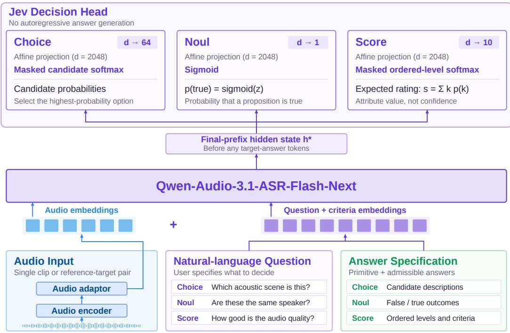
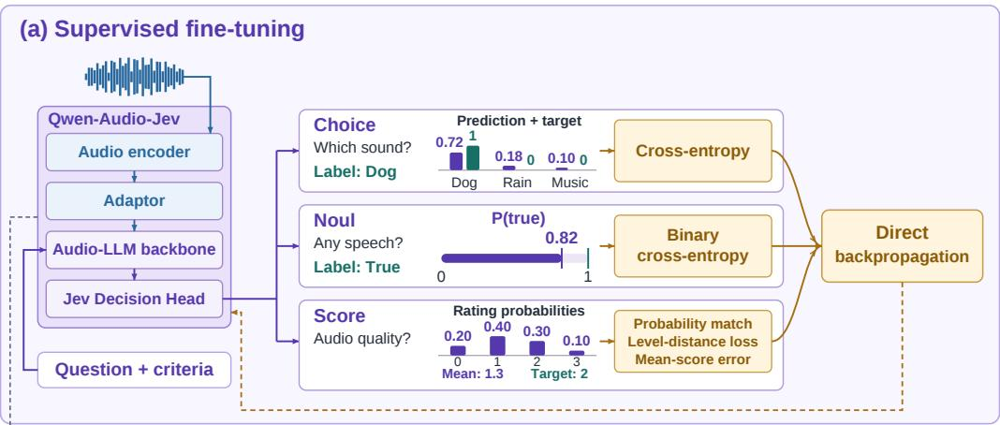
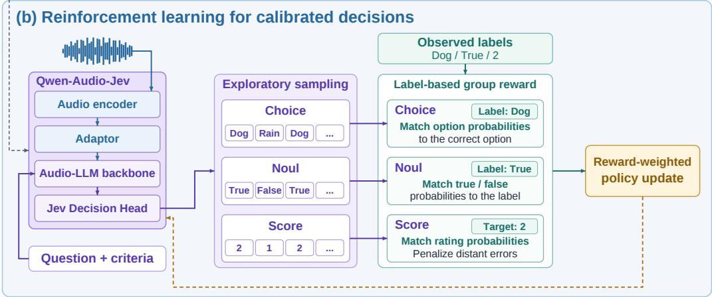

# Qwen-Audio-Jev: A Unified Interface for Audio Decisions

Token Foundry, Alibaba Group

## Abstract

Large audio language models (LALMs) have made substantial progress in audio understanding. However, in high-throughput applications requiring frequent selection, judgment, and scoring, autoregressive text generation introduces additional computational overhead and response latency. To address this limitation, we introduce Qwen-Audio-Jev by augmenting Qwen-Audio-3.1-ASR-Flash-Next with a dedicated Jev decision head. The model unifies selection, binary judgment, and scoring through three decision primitives: CHOICE, NOUL, and SCORE. Given audio, a natural-language question, and an explicit answer specification, it directly produces a task-conditioned probability distribution or a numerical score through typed decision readouts. Evaluation across 18 labeled configurations covers all three primitives: for CHOICE, Qwen-Audio-Jev achieves accuracies of 78.70% on MMAU-mini and 84.06% on MMSU; for NOUL, it achieves an equal error rate of 6.50% on the VoxCeleb1-O speaker verification benchmark; and for SCORE, the model achieves a normalized mean absolute error of 0.1062 on NISQA overall quality assessment, with Pearson and Spearman correlations of 0.8210 and 0.8074, respectively. Compared with the original Qwen-Audio-3.1-ASR-Flash-Next, Qwen-Audio-Jev achieves an approximately 20× inference speedup. It demonstrates its potential for efficient, high-throughput audio decisionmaking in applications such as large-scale audio screening, speaker verification, and automated quality assessment.

## 1 Introduction

Audio carries linguistic content, speaker characteristics, vocal expression, acoustic events, and temporal structure. Applications draw on this information to identify sounds, verify speaker identity, and assess speech quality. Although these tasks differ in semantics, their outputs often take a bounded form: a category, a binary judgment, or a numerical value on a predefined scale. In high-throughput settings, a model must produce these decisions repeatedly and efficiently.

Large audio language models (LALMs) have substantially expanded the scope of audio understanding. Qwen2.5-Omni supports multimodal perception and streaming text and speech generation (Xu et al., 2025a); Qwen3-Omni adopts a Thinker–Talker MoE architecture (Xu et al., 2025b), and Qwen3.5- Omni extends this family with hybrid-attention MoE and dynamic text–speech alignment (Qwen Team, 2026). SALMONN integrates speech and general-audio encoders with a language model (Tang et al., 2024); LTU and GAMA investigate audio question answering and instruction tuning (Gong et al., 2024; Ghosh et al., 2024). Qwen-Audio-3.1-ASR-Flash-Next integrates production-ready speech recognition, speaker-diarized transcription, and general audio understanding (Qwen-Audio ASR Team, 2026). These systems provide a foundation for instruction-conditioned audio understanding.

However, autoregressive text generation introduces additional computational overhead and response latency when the required output is a bounded decision. Generated answers may also require parsing and validation before they can be consumed by downstream software. These costs become particularly relevant in applications that process large volumes of audio or require frequent decisions.

This motivates an audio decision model that retains natural-language task specification while directly producing outputs in an explicitly defined answer space.

Our starting point is Qwen-Audio-3.1-ASR-Flash-Next (Qwen-Audio ASR Team, 2026), which combines an audio encoder, an audio-to-language adaptor, and a MoE language decoder for instructionconditioned audio understanding. We retain this representation pathway and introduce Qwen-Audio-Jev by adding a dedicated decision head at the decoder’s pre-answer hidden state. Given audio, a natural-language question, and an explicit answer specification, the head produces three typed outputs: CHOICE returns a distribution over supplied alternatives, NOUL estimates the probability that a binary proposition is true, and SCORE predicts a distribution over ordered levels and their expected rating. This adaptation preserves question-conditioned audio processing while allowing bounded decisions to be read out directly, without autoregressive answer generation.

The interface is inspired by Jev’s typed decision primitives (Almeida, 2026; TypeSafe AI, 2026). Related work on direct audio decisions includes AudioJev, which maps waveforms, questions, and supplied alternatives to candidate distributions and uses an order-consistency objective to reduce sensitivity to candidate permutations (Lv et al., 2026). Building on this direction, Qwen-Audio-Jev focuses on adapting the Qwen-Audio-3.1-ASR-Flash-Next backbone to the three decision types through a dedicated decision head, task-specific training objectives, and heterogeneous supervision.

Training a unified decision model requires accommodating datasets with different annotation schemes. For example, emotion resources such as MELD (Poria et al., 2019) and speaker-recognition resources such as VoxCeleb (Nagrani et al., 2017) provide supervision for different questions about audio. We therefore unify the representation of supervision, allowing each example to contribute only to tasks supported by its available labels. This formulation enables joint training across task-specific datasets without requiring every recording to be annotated for every task, while preserving the distinction between categorical labels, binary relations, and ordered ratings.

The reported evaluation covers 18 labeled configurations spanning audio question answering, sound and attribute classification, binary judgments, speaker verification, and quality assessment. Updated Choice and Noul results include 78.70% accuracy on MMAU-mini, 84.06% on MMSU, and 6.50% equal error rate on VoxCeleb1-O. For Score, the model achieves a normalized MAE of 0.1062 on NISQA overall quality, with Pearson and Spearman correlations of 0.8210 and 0.8074, respectively. These results support a unified decision interface, while task-specific generalization, comparative gains, calibration, and deployment efficiency require further evaluation. In the evaluated inference setting, the model achieves an approximately 20× speedup over the original Qwen-Audio-3.1-ASR-Flash-Next.

The main contributions of this work are:

• We introduce Qwen-Audio-Jev, which augments Qwen-Audio-3.1-ASR-Flash-Next with a Jev decision head to unify selection, binary judgment, and scoring within a question-conditioned audio decision framework.

• We formulate a common supervision representation and task-specific objectives for joint training on heterogeneous audio datasets with partially available annotations.

• We evaluate predictive performance across representative tasks and inference efficiency relative to the original backbone, identifying the model’s strengths and remaining limitations.

## 2 System Architecture

We first review the audio-language modeling framework of Qwen-Audio-3.1-ASR-Flash-Next (Qwen-Audio ASR Team, 2026), then describe how the Jev decision head converts its input-conditioned representations into CHOICE, NOUL, and SCORE outputs.

## 2.1 Review of Qwen-Audio-3.1-ASR-Flash-Next

Qwen-Audio-3.1-ASR-Flash-Next provides an instruction-conditioned audio-language backbone. Its main representation pathway consists of an audio encoder, an audio-to-language adaptor, and a language-model decoder. The encoder extracts acoustic representations, while the adaptor maps them into the decoder’s embedding space. The decoder combines these representations with textua instructions and context to produce task-dependent responses.

Let x denote the input audio. The audio representation supplied to the decoder is

$$
\mathbf { a } = A _ { \theta } ( E _ { \theta } ( x ) ) ,\tag{1}
$$

where $E _ { \theta }$ and $A _ { \theta }$ denote the audio encoder and adaptor, respectively. In our implementation, the adaptor groups adjacent encoder frames for temporal downsampling and projects the resulting features to the decoder hidden dimension.

The experiment checkpoint uses a MoE language decoder with 40 layers, a hidden dimension of 2048, and 256 routed experts, with eight experts selected per token. These dimensions describe the configuration used in this work.

The original model produces a textual response y through conditional autoregressive decoding:

$$
p _ { \theta } ( y \mid x , u ) = \prod _ { \ell = 1 } ^ { L } p _ { \theta } ( y _ { \ell } \mid y _ { < \ell } , \mathbf { a } , u ) ,\tag{2}
$$

where u denotes the textual instruction and context. The broader recognition framework also includes an auxiliary CTC branch; our decision readout uses the language decoder’s hidden states.

Qwen-Audio-Jev retains this audio-conditioned representation pathway and introduces a dedicated readout for bounded decisions. The audio encoder and adaptor still provide acoustic evidence, and the decoder still interprets the question and its answer specification. The typed answer is then obtained from a decision head rather than from an autoregressively decoded answer sequence.

## 2.2 Jev decision-head implementation

Let q be a natural-language question and c its answer specification, which defines the requested primitive and the legal answer space. The specification includes candidate descriptions for CHOICE, the binary interpretation for NOUL, or ordered rating criteria for SCORE. The question and specification are serialized into the text prefix and processed together with the audio representations:

$$
\begin{array} { r l } & { \mathbf { H } = D _ { \theta } \left( \mathrm { F u s e } \big ( \mathbf { a } , \mathrm { E m b e d } ( \mathrm { S e r i a l i z e } ( q , c ) ) \big ) \right) , } \\ & { h _ { \star } = \mathbf { H } _ { t _ { \star } } . } \end{array}\tag{3}
$$

Here, $D _ { \theta }$ is the shared decoder, and Fuse inserts the adapted acoustic embeddings into the audio positions of the input sequence. The readout position $t _ { \star }$ is the final token of the question-conditioned prefix, before any target-answer tokens. Causal attention therefore prevents the decision state from accessing the gold answer during training.

The decision module contains three affine projections:

$$
\begin{array} { r } { z ^ { \mathrm { C h o i c e } } = W _ { C } h _ { \star } + b _ { C } , } \\ { z ^ { \mathrm { N o u l } } = W _ { N } h _ { \star } + b _ { N } , } \\ { z ^ { \mathrm { S c o r e } } = W _ { S } h _ { \star } + b _ { S } . } \end{array}\tag{4}
$$

In the current implementation, $W _ { C } \in \mathbb { R } ^ { 6 4 \times d } , W _ { N } \in \mathbb { R } ^ { 1 \times d }$ , and $W _ { S } \in \mathbb { R } ^ { 1 0 \times d }$ , with $d = 2 0 4 8$ . The three projections share the same input-conditioned state; the requested primitive selects the output used for the decision and its task objective.

Choice and Score use fixed-capacity index projections. For a question with fewer candidates or rating levels, only the corresponding valid logits enter the probability normalization. Unused positions are excluded. The meanings of the output indices are supplied by the question’s answer specification rather than by a fixed global class vocabulary.

Figure 1 illustrates the inherited audio-language representation pathway and the three decision readouts.

## 2.3 Typed outputs: Choice, Noul, and Score

The three readouts follow Jev’s typed-question terminology (Almeida, 2026; TypeSafe AI, 2026). Together, they implement

$$
f _ { \theta } ( x , q , c ) \longrightarrow r _ { \tau } , \qquad \tau \in \{ \mathrm { C H O I C E } , \mathrm { N O U L } , \mathrm { S C O R E } \} ,\tag{5}
$$

where $r _ { \tau }$ is the result associated with the requested primitive.

  
Figure 1: Qwen-Audio-Jev model architecture. Audio and serialized question/criteria inputs feed the shared Qwen-Audio-3.1-ASR-Flash-Next decoder. Its final-prefix hidden state, computed before target-answer tokens, supports three typed affine readouts. Choice and Score normalize only valid candidate or level positions. The requested primitive selects the active output; the three readouts do not imply simultaneous multi-question inference.

Choice: a distribution over supplied alternatives. A CHOICE specification supplies an ordered collection of N candidate descriptions, with $2 \leq N \leq$ 64 in the current implementation. The candidate descriptions appear in the question prefix in the same order as the output indices. The readout uses the first N Choice logits:

$$
p _ { i } = \frac { \exp ( z _ { i } ^ { \mathrm { C h o i c e } } ) } { \sum _ { j = 1 } ^ { N } \exp ( z _ { j } ^ { \mathrm { C h o i c e } } ) } , \qquad \hat { \ i } = \arg \operatorname* { m a x } _ { i \in \{ 1 , \dots , N \} } p _ { i } .\tag{6}
$$

The result contains the candidate probabilities and the option identified by ˆı.

For example, the same output indices may refer to acoustic scenes in one question and emotion categories in another. Their semantics come from the supplied descriptions. This implementation scores candidate positions from the shared decision state; it does not assign a permanently fixed class meaning to each output position.

Noul: the probability that a proposition is true. A NOUL question specifies a binary proposition about the audio, such as whether two recordings contain the same speaker. Its scalar logit is transformed into

$$
p _ { \mathrm { t r u e } } = \sigma ( z ^ { \mathrm { N o u l } } ) = \frac { 1 } { 1 + \exp ( - z ^ { \mathrm { N o u l } } ) } .\tag{7}
$$

The native output is a probability in [0, 1]. Applications may obtain a binary decision by comparing it with a task-specific threshold. The threshold is a downstream decision rule rather than an additional model output.

Score: an expectation over ordered rating levels. A SCORE specification defines K ordered levels, with $2 \overset { \overline { { \mathbf { \rho } } } } { \leq } K \leq 1 0$ in the current implementation. The first K Score logits produce

$$
p _ { k } = \frac { \exp ( z _ { k } ^ { \mathrm { S c o r e } } ) } { \sum _ { j = 0 } ^ { K - 1 } \exp ( z _ { j } ^ { \mathrm { S c o r e } } ) } , \qquad k = 0 , \dots , K - 1 .\tag{8}
$$

The native score is the probability-weighted level index:

$$
\hat { s } _ { \mathrm { i d x } } = \sum _ { k = 0 } ^ { K - 1 } k p _ { k } , \qquad \hat { s } _ { \mathrm { n o r m } } = \frac { \hat { s } _ { \mathrm { i d x } } } { K - 1 } .\tag{9}
$$

The model thus predicts a distribution over the declared levels, from which a continuous expected rating is computed. The native and normalized values lie in $[ 0 , K - 1 ]$ and [0, 1], respectively.

For equally spaced application levels spanning [a, b], the expected rating can be expressed in application units as

$$
\hat { s } _ { [ a , b ] } = a + ( b - a ) \hat { s } _ { \mathrm { n o r m } } .\tag{10}
$$

For non-equally spaced numerical levels $v _ { 0 } , \ldots , v _ { K - 1 }$ , the corresponding application expectation is $\sum _ { k } v _ { k } p _ { k }$ . Such scale conversion is separate from the native index-based Score output. Predictions and reference ratings must use the same mapping in evaluation.

Table 1: Answer spaces and native outputs of the three decision readouts in the current implementation.
<table><tr><td>Type</td><td>Answer space</td><td>Native output</td></tr><tr><td>CHOICE</td><td></td><td>2-64 ordered candidate descriptions Candidate probabilities and the selected option</td></tr><tr><td>NOUL</td><td>A binary proposition</td><td>Probability that the proposition is true</td></tr><tr><td>SCORE</td><td>2–10 ordered rating levels</td><td>Level probabilities and the expected level index</td></tr></table>

These outputs provide a common interface for categorical selection, binary judgment, and ordered scoring. Producing probabilities does not itself establish calibration; probability quality must be evaluated separately.

## 2.4 Inference procedure

For each question, the system encodes the supplied audio, constructs the prefix containing the question and answer specification, and obtains the pre-answer decoder state. The requested decision readout then produces the typed result through an affine projection and the appropriate probability transformation. No autoregressive answer-decoding loop is required.

Although the request schema can contain multiple questions, the current implementation evaluates questions separately. A request containing multiple questions therefore requires multiple questionconditioned forward passes. The shared backbone and three readouts should not be interpreted as simultaneous evaluation of all questions in one forward pass.

## 3 Training

We organize decision training into supervised fine-tuning (SFT) and reinforcement learning for calibrated decisions (RLCD), as illustrated in Figure 2. SFT learns the three decision primitives from heterogeneous task annotations, whereas RLCD starts from an SFT checkpoint and optimizes a calibration-oriented reward through sampled-action policy gradients.

## 3.1 Supervised Fine-Tuning

The supervised stage jointly optimizes the audio encoder, audio-to-language adaptor, language-model backbone, and Jev decision head. Each training example activates the objective associated with its requested decision primitive, while the remaining readouts receive no task-specific supervision.

## 3.1.1 Training formulation and supervision

Multi-task audio pretraining and audio–question–answer instruction data have been widely used to improve general audio understanding (Xu et al., 2025b; Gong et al., 2024; Ghosh et al., 2024). We organize all training examples into a unified audio–question–criteria–target format. Each example i contains an audio-conditioned question, its active primitive, valid answer criteria, and an observed target.

  
Figure 2: Training pathways of Qwen-Audio-Jev. (a) SFT compares predicted distributions with observed labels and directly backpropagates task-specific losses. (b) The optional RLCD-inspired stage initializes from SFT, samples multiple decisions, and uses label-based group rewards for rewardweighted policy-gradient updates. Choice, Noul, and Score are alternative question-conditioned tasks; only the requested primitive is active.

Categorical labels are used to construct Choice targets, binary judgments to construct Noul targets, and audio-grounded annotations with an explicit ordinal structure to construct Score targets. An individual audio recording need not be annotated for all three primitives. Each example provides supervision only for targets that are observed and reliably annotated, and missing annotations contribute no loss. All objectives operate directly on the corresponding decision logits.

## 3.1.2 Primitive-specific objectives

Choice: categorical cross-entropy. Let $\mathcal { C } _ { i }$ be the valid candidate set, $z _ { i k }$ the candidate logit, and $t _ { i k }$ the target probability for candidate k. We define

$$
p _ { i k } = \frac { \exp ( z _ { i k } ) } { \sum _ { j \in \mathcal { C } _ { i } } \exp ( z _ { i j } ) } ,
$$

$$
k \in { \mathcal { C } } _ { i } ,\tag{11}
$$

$$
\ell _ { i } ^ { \mathrm { c h o i c e } } = - \sum _ { k \in \mathcal { C } _ { i } } t _ { i k } \log p _ { i k } .\tag{12}
$$

Unused output positions are excluded from the softmax and carry zero target mass. A hard class label yi gives the one-hot target $t _ { i k } = \mathbf { 1 } [ k = y _ { i } ]$ , reducing the loss $\mathbf { \ t o \ t o g { \it \ p } } _ { i , y _ { i } }$ . Soft targets are

used when annotation distributions are available. This objective covers nominal categories such as emotion, scene, instrument, and sound class, as well as multiple-choice audio questions.

During training, Choice alternatives are randomly permuted, with their descriptions and target probabilities reordered accordingly. This augmentation discourages the model from relying on fixed answer positions.

Noul: binary cross-entropy. For a binary proposition, $p _ { i } = \sigma ( z _ { i } )$ denotes the probability that the proposition is true, and $y _ { i } \in \{ 0 , 1 \}$ is the observed outcome. The per-question objective is

$$
\ell _ { i } ^ { \mathrm { n o u l } } = - y _ { i } \log p _ { i } - ( 1 - y _ { i } ) \log ( 1 - p _ { i } ) .\tag{13}
$$

For fractional annotations, the objective also supports $y _ { i } \in [ 0 , 1 ]$ . Speaker verification and yes/no audio judgments are trained using this objective.

Score: distribution, ordering, and expected value. For $K _ { i }$ ordered levels indexed from 0 to $K _ { i } - 1$ , let $p _ { i k } =$ softmax $\left( z _ { i } \right) _ { j }$ k and $t _ { i k }$ denote the predicted and target level distributions, respectively. Their expectations and cumulative probabilities are

$$
\hat { s } _ { i } = \sum _ { k = 0 } ^ { K _ { i } - 1 } k p _ { i k } ,
$$

$$
s _ { i } ^ { \star } = \sum _ { k = 0 } ^ { K _ { i } - 1 } k t _ { i k } ,\tag{14}
$$

$$
P _ { i m } = \sum _ { k = 0 } ^ { m } { p _ { i k } } ,
$$

$$
T _ { i m } = \sum _ { k = 0 } ^ { m } t _ { i k } .\tag{15}
$$

The three loss components are

$$
C _ { i } = - \sum _ { k = 0 } ^ { K _ { i } - 1 } t _ { i k } \log p _ { i k } ,\tag{16}
$$

$$
D _ { i } = \frac { 1 } { K _ { i } - 1 } \sum _ { m = 0 } ^ { K _ { i } - 2 } ( P _ { i m } - T _ { i m } ) ^ { 2 } ,\tag{17}
$$

$$
H ( e ) = { \left\{ \begin{array} { l l } { { \frac { 1 } { 2 } } e ^ { 2 } , } & { | e | < 1 , } \\ { | e | - { \frac { 1 } { 2 } } , } & { | e | \geq 1 . } \end{array} \right. }\tag{18}
$$

The combined per-question loss is

$$
\begin{array} { r } { \boxed { \ell _ { i } ^ { \mathrm { s c o r e } } = C _ { i } + \lambda _ { \mathrm { c d f } } D _ { i } + \lambda _ { \mathrm { m e a n } } H ( \hat { s } _ { i } - s _ { i } ^ { \star } ) } . } \end{array}\tag{19}
$$

Cross-entropy matches the level distribution, the CDF term penalizes ordinal displacement, and the SmoothL1 term constrains the expected rating on the native $[ 0 , K _ { i } - 1 ]$ scale. We set $\lambda _ { \mathrm { c d f } } = 0 . 2 5$ and $\lambda _ { \mathrm { m e a n } } = 0 . 1 0$ in all experiments.

## 3.1.3 Overall objective and task sampling

Each loss-reduction call processes one observed question. Let $t _ { i }$ denote the active primitive of example i. The decision objective is

$$
\mathcal { L } _ { \mathrm { d e c } } = \ell _ { i } ^ { t _ { i } } .\tag{20}
$$

The relative exposure of the three decision primitives is therefore controlled by their sampling distribution in the training stream.

The complete SFT objective is

$$
\mathcal { L } _ { \mathrm { S F T } } = \mathcal { L } _ { \mathrm { d e c } } + \lambda _ { \mathrm { l b } } \mathcal { L } _ { \mathrm { l b } } ^ { \mathrm { b a s e } } + \mathcal { L } _ { \mathrm { r z } } .\tag{21}
$$

Here, $\mathcal { L } _ { \mathrm { l b } } ^ { \mathrm { b a s e } }$ denotes the aggregated load-balancing loss of the language-model backbone, $\lambda _ { \mathrm { l b } }$ is its auxiliary coefficient, and $\mathcal { L } _ { \mathrm { { r z } } }$ denotes the router z-loss returned by the backbone. No next-token or multi-token prediction objective is included. The auxiliary coefficients, sampling ratios, and optimization settings used for each checkpoint are reported in the corresponding experimental setup.

## 3.2 Reinforcement Learning for Calibrated Decisions

Building on Jev’s formulation of typed decisions with calibrated probabilities (Almeida, 2026), we introduce an independently implemented RLCD-inspired training method. Starting from the SFT checkpoint, each typed decision is formulated as a one-step contextual-bandit problem and optimized using sampled-action reinforce. The calibration-oriented reward is derived from quadratic/Brier and ranked-probability scoring rules (Gneiting and Raftery, 2007).

## 3.2.1 Decision policies and exploration

For question i, let $x _ { i }$ denote the audio-conditioned question context, $K _ { i }$ the number of valid outcomes, $y _ { i }$ its observed outcome, and $\tau _ { i }$ its active decision primitive. Choice and Score use categorical policies $p _ { \theta , i } ( a ) = \pi _ { \theta } ( a \mid x _ { i } )$ over candidate options or ordered levels. Noul is represented as a two-class policy $\left( 1 - p _ { i } , p _ { i } \right)$ over false and true. The decision state is extracted at a causal position before the answer, and the observed outcome is used to evaluate the sampled decisions.

Each question produces $M \ = \ 3 2$ independently sampled actions, with replacement, from the exploratory behavior policy

$$
a _ { i r } \sim \mu _ { \theta , i } , ~ \mu _ { \theta , i } ( a ) = ( 1 - \epsilon ) p _ { \theta , i } ( a ) + \frac { \epsilon } { K _ { i } } , ~ \epsilon = 0 . 0 5 .\tag{22}
$$

All M actions are sampled from the policy distribution produced by a single forward pass. The importance weights

$$
w _ { i r } = \frac { p _ { \theta , i } ( a _ { i r } ) } { \mu _ { \theta , i } ( a _ { i r } ) }\tag{23}
$$

correct for sampling from the exploratory behavior policy.

## 3.2.2 Calibration-oriented group reward

Let $t _ { i k } = \mathbf { 1 } [ k = y _ { i } ]$ . The Brier discrepancy is

$$
B _ { i } = \sum _ { k = 0 } ^ { K _ { i } - 1 } \left( p _ { \theta , i } ( k ) - t _ { i k } \right) ^ { 2 } ,\tag{24}
$$

which reduces to $2 ( p _ { i } - y _ { i } ) ^ { 2 }$ for Noul. For ordered Score outputs, we additionally use the normalized ranked-probability discrepancy

$$
D _ { i } = { \frac { 1 } { K _ { i } - 1 } } \sum _ { h = 0 } ^ { K _ { i } - 2 } \left( \sum _ { k = 0 } ^ { h } p _ { \theta , i } ( k ) - \mathbf { 1 } [ y _ { i } \leq h ] \right) ^ { 2 } .\tag{25}
$$

To estimate these objectives from sampled actions, we define $\lambda _ { i } = 0 . 2 5 \mathbf { 1 } [ \tau _ { i } = \mathrm { S c o r e } ]$ and the kernel

$$
H _ { i } ( a , b ) = \mathbf { 1 } [ a = b ] + { \frac { \lambda _ { i } } { K _ { i } - 1 } } \sum _ { h = 0 } ^ { K _ { i } - 2 } \mathbf { 1 } [ a \leq h ] \mathbf { 1 } [ b \leq h ] .\tag{26}
$$

Writing $c _ { i } ( a ) = H _ { i } ( a , y _ { i } )$ and $q _ { i } = H _ { i } ( y _ { i } , y _ { i } )$ , the sampled group reward is

$$
\begin{array} { c } { { \widehat { J } _ { i } = \displaystyle \frac { 2 } { M } \sum _ { r = 1 } ^ { M } w _ { i r } c _ { i } ( a _ { i r } ) - q _ { i } } } \\ { { - \displaystyle \frac { 1 } { M ( M - 1 ) } \sum _ { r \neq s } w _ { i r } w _ { i s } H _ { i } ( a _ { i r } , a _ { i s } ) . } } \end{array}\tag{27}
$$

The first term measures agreement with the observed outcome, whereas the pairwise term characterizes the concentration of the sampled decision distribution. Conditional on the question and outcome,

$$
\mathbb { E } [ \widehat { J } _ { i } ] = - B _ { i } - \lambda _ { i } D _ { i } ,\tag{28}
$$

where the ordinal term is omitted for Choice and Noul. The reward therefore captures both decision correctness and the quality of the predicted probability distribution.

## 3.2.3 Policy-gradient optimization

The influence return associated with action $r$ is

$$
G _ { i r } = 2 c _ { i } ( a _ { i r } ) - \frac { 2 } { M - 1 } \sum _ { s \neq r } w _ { i s } H _ { i } ( a _ { i r } , a _ { i s } ) .\tag{29}
$$

We subtract a leave-one-out baseline that excludes action r from the outcome and pairwise terms:

$$
\begin{array} { c } { { b _ { i r } = \displaystyle \frac { 2 } { M - 1 } \sum _ { s \neq r } w _ { i s } c _ { i } ( a _ { i s } ) } } \\ { { - \displaystyle \frac { 2 } { ( M - 1 ) ( M - 2 ) } \sum _ { s \neq r } \sum _ { t \notin \{ r , s \} } w _ { i s } w _ { i t } H _ { i } ( a _ { i s } , a _ { i t } ) . } } \end{array}\tag{30}
$$

This construction makes the baseline independent of the sampled action whose log-probability is differentiated. With advantage $A _ { i r } = G _ { i r } - b _ { i r }$ , the policy-gradient objective is

$$
\ell _ { i } ^ { \mathrm { P G } } = - \frac { 1 } { M } \sum _ { r = 1 } ^ { M } \operatorname { s g } [ w _ { i r } A _ { i r } ] \log p _ { \theta , i } ( a _ { i r } ) ,\tag{31}
$$

where $\mathrm { s g }$ denotes stop-gradient. Gradients flow through the sampled-action log-probabilities, while the sampled actions, rewards, returns, baselines, and importance weights are treated as constants. The expected surrogate gradient equals the gradient of $B _ { i } + \lambda _ { i } D _ { i }$

## 4 Evaluation

## 4.1 Evaluation setup

The evaluation covers 18 labeled configurations: eight Choice tasks, four Noul tasks, and six Score tasks. Together, they assess categorical audio understanding, proposition-level judgments, and perceptual quality prediction.

Choice: classification and audio understanding. The eight configurations cover both basic recognition and question-conditioned audio understanding. CochlScene evaluates acoustic-scene classification (Jeong and Park, 2022); NSynth evaluates musical-instrument recognition (Engel et al., 2017); NonSpeech7k evaluates recognition of human non-speech sounds, such as coughing, laughing, and crying (Rashid et al., 2023); DiDiSpeech evaluates gender classification from speech (Guo et al., 2020); and MELD evaluates emotion recognition in conversational speech (Poria et al., 2019). MMAU evaluates question-conditioned understanding across speech, environmental sounds, and music (Sakshi et al., 2024). MMSU evaluates spoken-language understanding based on semantic, prosodic, and paralinguistic cues (Wang et al., 2026), while MMAR assesses complex audio question answering involving speech, sounds, music, and their mixtures (Ma et al., 2025). On these benchmarks, Qwen-Audio-Jev directly selects an answer from the supplied candidates. Accuracy measures the proportion of examples for which the selected candidate matches the reference answer.

Noul: binary judgments and probability estimation. VoxCeleb1-O evaluates whether two recordings contain the same speaker (Nagrani et al., 2017); the binary Clotho-AQA configuration evaluates yes/no questions grounded in audio evidence (Lipping et al., 2022); PodSarc evaluates sarcasm detection in podcast speech (Li et al., 2025); and In-the-Wild evaluates audio-deepfake detection, distinguishing genuine from spoofed speech (Müller et al., 2022). For Noul, accuracy, falsepositive rate (FPR), and false-negative rate (FNR) are computed from binary decisions obtained by thresholding the predicted probability at 0.5. Accuracy measures decision correctness, while FPR and FNR quantify false alarms and missed positives, respectively. The area under the receiver operating characteristic curve (ROC AUC) and the equal error rate (EER) are computed from the continuous predicted probabilities by varying the decision threshold. ROC AUC measures discrimination across thresholds, while EER is the error rate at the operating point where FPR and FNR coincide. The Brier score is computed directly from the predicted probabilities, without thresholding, and measures squared probability error against the binary reference labels.

Score: multidimensional speech quality assessment. NISQA evaluates overall speech quality and four perceptual dimensions: noise, coloration, discontinuity, and loudness (Mittag et al., 2021). VoiceMOS/BVCC evaluates overall perceptual quality of synthetic speech (Cooper and Yamagishi, 2021). Mean absolute error (MAE) and root mean squared error (RMSE) measure deviations from human mean opinion scores (MOS) in the original rating units, with RMSE placing greater weight on large errors. Normalized MAE and RMSE divide these errors by the four-point range of the 1–5 MOS scale. Pearson correlation measures linear association with reference ratings, while Spearman correlation measures agreement in their ranking.

## 4.2 Results

## 4.2.1 Choice: categorical decisions

Table 2: Choice accuracy (%) of Qwen-Audio-Jev on eight labeled benchmarks covering acousticscene classification, musical-instrument recognition, human non-speech sound recognition, speakergender classification, speech emotion recognition, and audio question answering.

<table><tr><td>Benchmark</td><td>Accuracy (%) ↑</td></tr><tr><td>CochlScene NSynth instrument NonSpeech7k sound DiDiSpeech gender MELD emotion</td><td>77.8717 72.2900 92.6897 100.0000 57.3072</td></tr></table>

The Choice results (Table 2) show a distinct capability gap between identifying speaker attributes or vocal events and recognizing conversational emotion. Gender classification and human nonspeech sound recognition both exceed 90% accuracy, while MELD is the weakest configuration. Scene and instrument recognition lie between these extremes. The recognition gap is therefore not simply a speech-versus-non-speech divide: speaker gender and vocal-event identity are handled more accurately than conversational affect.

The audio-question-answering results reveal a complementary limitation. MMSU performs best among the three benchmarks, followed by MMAU and MMAR. MMAR’s lower accuracy makes complex question-conditioned answer selection a separate improvement target from emotion recogni tion. Together, these findings identify two principal directions for Choice: finer discrimination of affective categories and more reliable selection of answers to complex audio questions, with scene and instrument recognition providing additional room for refinement.

## 4.2.2 Noul: binary judgments

Table 3: Noul performance of Qwen-Audio-Jev on speaker verification, binary audio question answering, sarcasm detection, and audio-deepfake detection. Accuracy, FPR, and FNR use a probability threshold of 0.5.
<table><tr><td>Configuration</td><td>Accuracy (%) ↑</td><td>EER (%)↓</td><td>AUC↑</td><td>Brier↓</td><td>FPR (%) ↓</td><td>FNR (%) ↓</td></tr><tr><td>VoxCeleb1-O</td><td>93.5441</td><td>6.4980</td><td>0.982267</td><td>0.048695</td><td>7.3214</td><td>5.5901</td></tr><tr><td>Clotho-AQA</td><td>79.8901</td><td>19.8251</td><td>0.878652</td><td>0.146391</td><td>14.4121</td><td>24.4898</td></tr><tr><td>PodSarc</td><td>98.2651</td><td>1.4427</td><td>0.9952300.016406</td><td></td><td>2.1725</td><td>1.2149</td></tr><tr><td>In-the-Wild</td><td>76.3232</td><td>20.9469</td><td></td><td>0.8763180.158112</td><td>3.782257.2867</td><td></td></tr></table>

Table 3 shows two distinct Noul performance profiles. On PodSarc and VoxCeleb1-O, strong probability discrimination is accompanied by low fixed-threshold error: both achieve AUC above 0.98, with FPR and FNR below 8% at the 0.5 threshold. PodSarc also leads on EER and Brier score, so its advantage extends beyond hard-decision accuracy to both class separation and squared probability

error. The strength of these settings is therefore consistent performance across probability-based and binary-decision measures.

The more revealing contrast is between Clotho-AQA and In-the-Wild. Their AUCs are nearly identical (0.8787 versus 0.8763), and their EERs are both around 20%, yet In-the-Wild misses 57.29% of positive examples at the 0.5 threshold, compared with 24.49% for Clotho-AQA, despite having a lower FPR. At this operating point, In-the-Wild is therefore dominated by missed positives rather than excessive false alarms. The comparison exposes two separate aspects of Noul performance: class separation in probability space and the false-alarm/miss balance at a selected operating point. Reducing missed positives is the clearest priority for In-the-Wild.

## 4.2.3 Score: subjective quality assessment

Table 4: Score performance of Qwen-Audio-Jev on NISQA speech-quality dimensions and Voice-MOS/BVCC synthetic speech. Error and correlation metrics summarize numerical accuracy and agreement with human quality ratings.
<table><tr><td></td><td>MOS</td><td>MOS</td><td>Normalized Normalized</td><td></td><td></td><td></td></tr><tr><td>Configuration</td><td>MAE↓</td><td>RMSE↓</td><td>MAE↓</td><td>RMSE↓</td><td></td><td>Pearson↑ Spearman↑</td></tr><tr><td>NISQA overall</td><td>0.4246420.546344</td><td></td><td>0.106160</td><td></td><td>0.1365860.821002</td><td>0.807382</td></tr><tr><td>NISQA noise</td><td>0.5844990.738843</td><td></td><td>0.146125</td><td></td><td>0.184711 0.736052</td><td>0.722851</td></tr><tr><td>NISQA coloration</td><td>0.3453700.431912</td><td></td><td>0.086342 0.107640</td><td></td><td>0.107978 0.809883</td><td>0.808054</td></tr><tr><td>NISQA discontinuity</td><td>0.4305620.539793 0.4369850.523098</td><td></td><td>0.109246</td><td></td><td>0.1349480.800940 0.1307750.728235</td><td>0.725388</td></tr><tr><td>NISQA loudness VoiceMOS</td><td>0.8134971.004048</td><td></td><td>0.203374</td><td></td><td>0.251012 0.723059</td><td>0.689991 0.753843</td></tr><tr><td></td><td></td><td></td><td></td><td></td><td></td><td></td></tr></table>

The Score results (Table 4) distinguish agreement in rating magnitude from agreement in how quality varies across recordings. NISQA overall quality and coloration combine comparatively low MOS errors with correlations close to 0.8. Loudness illustrates why these measures are complementary: its MAE is close to that of overall quality, while its Pearson correlation is lower. Similar average errors therefore accompany different levels of linear association with human ratings.

VoiceMOS shows positive linear and rank association with human ratings, with Pearson and Spearman correlations of 0.723 and 0.754. Its MOS MAE of 0.813 is nevertheless higher than that of every NISQA dimension. This contrast separates correlation-based agreement from accuracy in the original rating units. Within NISQA, noise has the largest MAE at 0.584. Priorities are reducing MOS errors for VoiceMOS and noise quality, and improving loudness rating consistency.

## 5 Conclusion

Qwen-Audio-Jev extends Qwen-Audio-3.1-ASR-Flash-Next with a decision head for CHOICE, NOUL, and SCORE, producing question-conditioned outputs without autoregressive answer generation. Its training framework supports heterogeneous supervised fine-tuning with primitive-specific objectives and an SFT-initialized RLCD stage using exploratory sampling, label-driven group rewards, and reward-weighted policy updates. Evaluation across 18 labeled configurations reports 84.06% accuracy on MMSU, 6.50% EER on VoxCeleb1-O, and a NISQA overall MAE of 0.4246 MOS points with Pearson correlation of 0.8210. These results support a unified interface for structured audio understanding, with further improvements focused on emotion recognition, complex audio question answering, and quality-scoring accuracy.

Streaming decisions as a future extension. We plan to extend Qwen-Audio-Jev to streaming decisions while preserving the Choice, Noul, and Score interface. Chunkwise audio processing would update predictions as new evidence arrives, with confirmation deferred when the prefix is insufficient. Training would use audio prefixes with valid targets, and evaluation would focus on decision quality, stability, and end-to-end latency.

## 6 Authors (in Alphabetical Order of Last Name)

Ying Fang, Zhifu Gao, Qing Gu, Jiajun He, Kangqi Jing, Xiangang Li, Yu Pu, Wupeng Wang

## References

Diogo Almeida. Introducing System One Models & Jev. TypeSafe AI Blog, 2026. Accessed October 12, 2026. https://typesafe.ai/blog/introducing-system-one-models-and-jev.

Erica Cooper and Junichi Yamagishi. How do Voices from Past Speech Synthesis Challenges Compare Today? arXiv preprint arXiv:2105.02373, 2021. https://arxiv.org/abs/2105.02373.

Jesse Engel, Cinjon Resnick, Adam Roberts, Sander Dieleman, Douglas Eck, Karen Simonyan, and Mohammad Norouzi. Neural Audio Synthesis of Musical Notes with WaveNet Autoencoders. arXiv preprint arXiv:1704.01279, 2017. https://arxiv.org/abs/1704.01279.

Sreyan Ghosh, Sonal Kumar, Ashish Seth, Chandra Kiran Reddy Evuru, Utkarsh Tyagi, S Sakshi, Oriol Nieto, Ramani Duraiswami, and Dinesh Manocha. GAMA: A Large Audio-Language Model with Advanced Audio Understanding and Complex Reasoning Abilities. In EMNLP, pages 6288–6313, 2024. https://aclanthology.org/2024.emnlp-main.361/.

Tilmann Gneiting and Adrian E. Raftery. Strictly Proper Scoring Rules, Prediction, and Estimation. Journal ofthe American Statistical Association, 102(477):359–378, 2007. https://doi.org/ 10.1198/016214506000001437.

Yuan Gong, Hongyin Luo, Alexander H. Liu, Leonid Karlinsky, and James Glass. Listen, Think, and Understand. In ICLR, 2024. https://arxiv.org/abs/2305.10790.

Chuan Guo, Geoff Pleiss, Yu Sun, and Kilian Q. Weinberger. On Calibration of Modern Neural Networks. In ICML, PMLR 70, pages 1321–1330, 2017. https://proceedings.mlr.press/ v70/guo17a.html.

Tingwei Guo, Cheng Wen, Dongwei Jiang, Ne Luo, Ruixiong Zhang, Shuaijiang Zhao, Wubo Li, Cheng Gong, Wei Zou, Kun Han, and Xiangang Li. DiDiSpeech: A Large Scale Mandarin Speech Corpus. arXiv preprint arXiv:2010.09275, 2020. https://arxiv.org/abs/2010.09275.

Il-Young Jeong and Jeongsoo Park. CochlScene: Acquisition of acoustic scene data using crowdsourcing. arXiv preprint arXiv:2211.02289, 2022. https://arxiv.org/abs/2211.02289.

Zhu Li, Yuqing Zhang, Xiyuan Gao, Shekhar Nayak, and Matt Coler. Leveraging Large Language Models for Sarcastic Speech Annotation in Sarcasm Detection. In Interspeech, pages 3973– 3977, 2025. https://www.isca-archive.org/interspeech\_2025/li25ba\_interspeech. html.

Samuel Lipping, Parthasaarathy Sudarsanam, Konstantinos Drossos, and Tuomas Virtanen. Clotho-AQA: A Crowdsourced Dataset for Audio Question Answering. arXiv preprint arXiv:2204.09634, 2022. https://arxiv.org/abs/2204.09634.

Sihan Lv, Zhen Li, Zhiqi Cao, Jinshan Zhang, Ying Li, Meng Xi, and Jianwei Yin. AudioJev: Direct Audio Decisions with Order-Calibrated Probabilities. arXiv preprint arXiv:2610.01293, 2026. https://arxiv.org/abs/2610.01293.

Ziyang Ma, Yinghao Ma, Yanqiao Zhu, Chen Yang, Yi-Wen Chao, et al. MMAR: A Challenging Benchmark for Deep Reasoning in Speech, Audio, Music, and Their Mix. arXiv preprint arXiv:2505.13032, 2025. https://arxiv.org/abs/2505.13032.

Gabriel Mittag, Babak Naderi, Assmaa Chehadi, and Sebastian Möller. NISQA: A Deep CNN-Self Attention Model for Multidimensional Speech Quality Prediction with Crowdsourced Datasets. Interspeech, 2021. https://doi.org/10.21437/Interspeech.2021-299.

Nicolas Müller, Pavel Czempin, Franziska Diekmann, Adam Froghyar, and Konstantin Böttinger. Does Audio Deepfake Detection Generalize? In Interspeech, 2022. https://www. isca-archive.org/interspeech\_2022/muller22\_interspeech.html.

Arsha Nagrani, Joon Son Chung, and Andrew Zisserman. VoxCeleb: A Large-Scale Speaker Identification Dataset. In Interspeech, 2017. https://arxiv.org/abs/1706.08612.

Soujanya Poria, Devamanyu Hazarika, Navonil Majumder, Gautam Naik, Erik Cambria, and Rada Mihalcea. MELD: A Multimodal Multi-Party Dataset for Emotion Recognition in Conversations. In ACL, pages 527–536, 2019. https://aclanthology.org/P19-1050/.

Qwen-Audio ASR Team. Qwen-Audio-3.1-ASR Technical Report. Alibaba Token Foundry, 2026. https://qwenaudio.github.io/qwen-audio-3.1-asr/report-assets/ technical-report.pdf.

Qwen Team. Qwen3.5-Omni Technical Report. arXiv preprint arXiv:2604.15804, 2026. https: //arxiv.org/abs/2604.15804.

Muhammad Mamunur Rashid, Guiqing Li, and Chengrui Du. Nonspeech7k dataset: Classification and analysis of human non-speech sound. IET Signal Processing, 17(6):e12233, 2023. https: //doi.org/10.1049/sil2.12233.

S Sakshi, Utkarsh Tyagi, Sonal Kumar, Ashish Seth, Ramaneswaran Selvakumar, Oriol Nieto, Ramani Duraiswami, Sreyan Ghosh, and Dinesh Manocha. MMAU: A Massive Multi-Task Audio Understanding and Reasoning Benchmark. arXiv preprint arXiv:2410.19168, 2024. https: //arxiv.org/abs/2410.19168.

Changli Tang, Wenyi Yu, Guangzhi Sun, Xianzhao Chen, Tian Tan, Wei Li, Lu Lu, Zejun Ma, and Chao Zhang. SALMONN: Towards Generic Hearing Abilities for Large Language Models. In ICLR, 2024. https://openreview.net/forum?id=14rn7HpKVk.

TypeSafe AI. Jev Documentation: Introduction. Online documentation, 2026. Accessed October 12, 2026. https://docs.typesafe.ai/introduction.

Dingdong Wang, Junan Li, Jincenzi Wu, Dongchao Yang, Xueyuan Chen, Tianhua Zhang, and Helen Meng. MMSU: A Massive Multi-task Spoken Language Understanding and Reasoning Benchmark. In ICLR, 2026. https://arxiv.org/abs/2506.04779.

Jin Xu, Zhifang Guo, Jinzheng He, Hangrui Hu, Ting He, Shuai Bai, Keqin Chen, Jialin Wang, Yang Fan, Kai Dang, Bin Zhang, Xiong Wang, Yunfei Chu, and Junyang Lin. Qwen2.5-Omni Technical Report. arXiv preprint arXiv:2503.20215, 2025. https://arxiv.org/abs/2503.20215.

Jin Xu, Zhifang Guo, Hangrui Hu, Yunfei Chu, Xiong Wang, et al. Qwen3-Omni Technical Report. arXiv preprint arXiv:2509.17765, 2025. https://arxiv.org/abs/2509.17765.