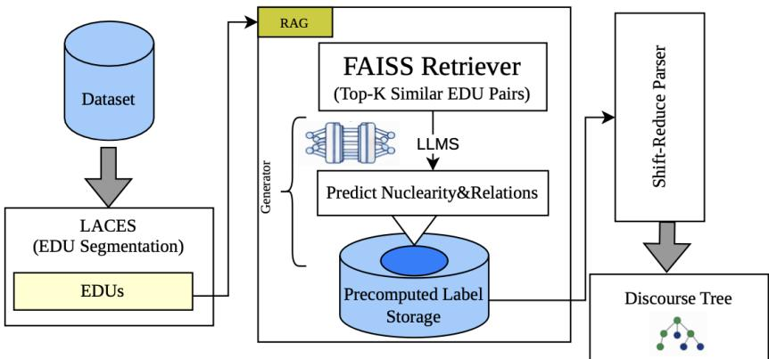
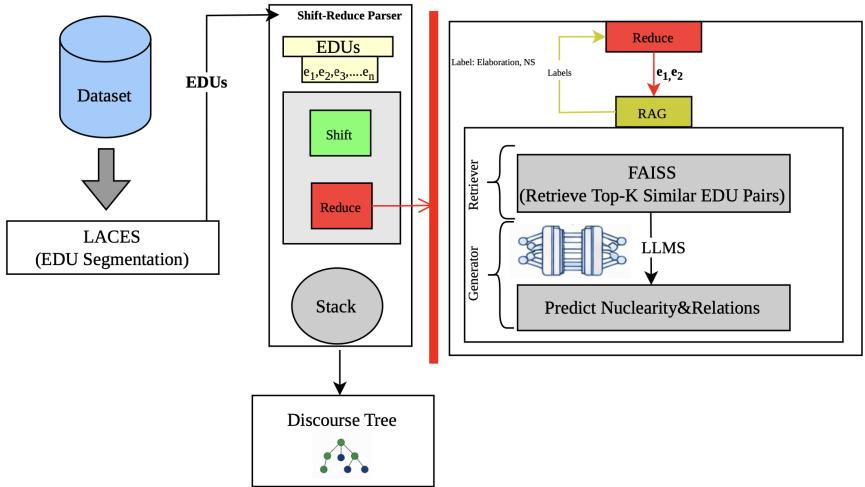

# RAG-RST: Retrieved Exemplars as In-Context Discourse Schema for RST Parsing

Mohammadreza Sediqin Illinois Institute of Technology New York, USA msediqin@hawk.illinoistech.edu

Shlomo Engelson Argamon Touro University New York, USA   
shlomo.argamon@touro.edu

## Abstract

In Rhetorical Structure Theory (RST), each edge of a discourse tree carries a nuclearity label, marking which span holds the central content, and a relation drawn from a closed inventory of functional categories. Neither label is a surface property: the same two clauses can be Elaboration or Background depending on rhetorical intent, and the boundary between them is fixed by annotation convention rather than by lexical cues. Predicting these labels therefore requires a formal discourse schema, and exposure to discourse-rich pretraining text does not supply it: given only a target EDU pair, a strong LLM recovers nuclearity at 0.794 F1 and relation at 0.738 F1. We propose RAG-RST, a retrieval-augmented framework that supplies this schema as in-context demonstration rather than through parameter updates, raising nuclearity to 0.846 F1 and relation to 0.788 F1 with no training. Two configurations are compared: a precomputed strategy that labels all EDU pairs before parsing, and a dynamic strategy that retrieves at each reduce step, so that the exemplars reaching the generator depend on the reductions the parser has already committed to. Both outperform existing RST parsers across span, nuclearity, relation, and full tree metrics, with the dynamic variant consistently strongest. Two properties of the retrieved schema emerge: its utility is bounded in number, saturating and then declining beyond fifty exemplars, and it depends on structural position. Both indicate that a formal linguistic schema can be supplied to a foundation model as a demonstration rather than trained into its parameters.

## 1 Introduction

Discourse parsing aims to uncover the logical and coherence relations between text units in a structured and hierarchical manner. Rhetorical Structure Theory (RST) [Mann and Thompson, 1988] represents a text as a tree whose leaves are Elementary Discourse Units (EDUs) and whose internal nodes are composite spans formed by grouping them. Parsing combines adjacent EDUs into higherlevel spans and labels each connection with nuclearity and relation. Neither label is a surface property of the text: nuclearity marks which span carries the central content, and the relation is drawn from a closed inventory of functional categories fixed by annotation convention rather than by lexical cues [Carlson et al., 2002]. The same two clauses can be Elaboration or Background depending on rhetorical intent, so predicting these labels requires a model to acquire a formal discourse schema rather than merely perform a task. Accurate labels matter downstream, in summarization, information extraction, and discourse-aware representation learning [Marcu, 2000, Zhang et al., 2020, Sediqin and Argamon, 2025c]. As foundation models are increasingly deployed as agents, whose recorded outputs must be verified rather than merely scored [Sediqin et al., 2026a], explicit discourse structure offers one way to make the reasoning in their generated text inspectable.

Methods for RST parsing range from top-down and bottom-up parsers that recursively divide or merge spans, to transition-based shift-reduce parsers that build the tree incrementally through actions managing and merging spans [Li and Xiao, 2021], to neural enhancements using contextualized span representations and deep encoders [Nguyen et al., 2021]. What these approaches share is that the annotation convention is acquired through training. Yet large pretrained models exposed to vas quantities of discourse-rich text still recover the RST schema poorly: given only a target EDU pair, a strong LLM reaches 0.794 F1 on nuclearity and 0.738 F1 on relation in our experiments. Scale over discourse-rich text is therefore not sufficient. The discourse phenomena are present in pretraining data; the annotation convention that carves them into these particular categories is not.

Retrieval-augmented generation (RAG) offers a way to supply that missing convention at inference time rather than through additional training. What form the supplied knowledge must take, however, remains open: labeled neighbors function as demonstrations of an annotation scheme, and their utility depends on how many are shown, how consistent they are, and where in the discourse structure the target pair sits [Mei et al., 2025].

We introduce RAG-RST, which integrates retrieval with a neural shift-reduce parser to improve nuclearity and relation prediction. Retrieval runs over the RST-annotated RST-GUM corpus [Zeldes, 2017], which supplies gold labels; no RST-DT material is placed in the index. We additionally index sentence pairs from CNN/DailyMail [Hermann et al., 2015] as an unlabeled discourse-rich corpus, used only to improve nearest-neighbor coverage and never to predict labels. To the best of our knowledge, this is the first work to supply the RST annotation schema through retrieval at inference time rather than through training, and the first to place retrieval inside the parsing loop, so that the exemplars shown to the generator depend on the reductions the parser has already committed to. Our contributions are as follows:

• We propose RAG-RST, combining neural EDU encoders, FAISS retrieval, and large language models for label prediction, and compare two strategies: precomputed labeling, which generates labels for all EDU pairs before parsing, and dynamic label generation, which retrieves at each reduce step so that the exemplars reflect the reductions already committed to.

• We quantify how much of the RST annotation schema is unrecoverable from the EDU pair alone, separating a model’s knowledge of discourse phenomena from its knowledge of the convention that categorizes them, and show that retrieved exemplars narrow this gap without any parameter update.

• We show that both strategies outperform existing RST parsers across all four standard evaluation metrics, with the dynamic approach consistently strongest.

• We scope our contribution to the label prediction stage: the shift/reduce action policy is adopted unmodified from prior work, and RAG-RST supplies nuclearity and relation labels to the reduce operation rather than altering how parser actions are selected.

## 2 Related Work

Discourse analysis based on RST has attracted considerable attention across NLP tasks [Sediqin and Argamon, 2025a]. Historically it has been approached as a parsing problem, using transitionbased parsers that operate top-down or incrementally and chart parsers based on bottom-up dynamic programming [Soricut and Marcu, 2003, Joty et al., 2015], with later gains from statistical models that predict nuclearity and relation types between discourse units [Hernault et al., 2010, Liu et al., 2016, Wang et al., 2018].

Among these, transition-based shift-reduce parsers have become a standard approach for RST tree construction, offering efficient incremental tree building through generic actions that merge spans and assign nuclearity and relation labels during parsing [Sagae, 2009, Li and Xiao, 2021]. Neural enhancements, including contextualized span representations and deep encoders, significantly improve parsing performance and robustness [Nguyen et al., 2021]. Despite these advances, accurate label prediction remains a challenge in complex discourse structures [Maekawa et al., 2024, Zhang et al., 2025]. The limitation is concentrated in the label prediction stage: nuclearity and relation assignment follows span segmentation and directly determines the quality of the constructed tree [Liu et al., 2020, Zhang et al., 2020], and performance gaps are most evident where relations are ambiguous or span long distances. In every case the annotation convention is acquired during training, so the schema is fixed at deployment and cannot be revised without retraining.

Retrieval-augmented generation offers one route to supplying such knowledge at inference time [Lewis et al., 2020, Sediqin et al., 2026b]. In discourse parsing, RAG lets a model condition nuclearity and relation prediction on relevant examples from annotated corpora. The closest prior work is Liu et al. [2026], which applies retrieval to discourse parsing but does so during pretraining, learning discourse-aware representations rather than retrieving at inference time. Our approach differs in two respects. First, we retrieve and generate at parse time, at the EDU pair level, so the system adapts to each new document without parameter updates. Second, prior work does not place retrieval inside the parsing loop. Our Dynamic RAG variant is the first in which the discourse structure already built determines which exemplars the generator sees, so that the same EDU pair retrieves different demonstrations depending on how earlier reductions grouped it. We instantiate this as RAG Enhanced RST Parsing (RAG-RST), evaluated on overall parsing performance and specifically on nuclearity and relation label prediction.

## 3 RAG-Enhanced RST Discourse Parsing Framework

We propose a two-mode framework that integrates Retrieval-Augmented Generation (RAG) with a shift-reduce RST discourse parser. The system operates in two configurations: (1) Precomputed Labeling outside the parser, and (2) RAG During Reduce action inside the parser. Both methods rely on a FAISS-based dense retriever and LLMs as the generation model, but differ in how they interact with the parser during tree construction. Figures 1 and 2 illustrate the workflows for the Precomputed Labeling and RAG During Reduce methods, respectively. These diagrams summarize the key components, including EDU segmentation with LACES [Sediqin and Argamon, 2025b], transformer-based encoding, FAISS retrieval, LLM label generation, and integration with the shiftreduce parser.

## 3.1 Method 1: Precomputed Labeling (Outside the Parser)

In this configuration, nuclearity and discourse relation labels are generated before the discourse parsing stage using a RAG pipeline. The predicted labels are precomputed and stored in an external lookup table. The shift reduce parser then uses these stored labels to guide discourse tree construction without invoking the retrieval or generation components during parsing (Figure 1).

• Encoding Annotated EDU Pairs: The annotated corpus provides EDU pairs $( e _ { i } , e _ { j } )$ together with their gold nuclearity and discourse relation labels. Each EDU is encoded using a transformer encoder as $\mathbf h _ { i } = f _ { \mathrm { e n c } } ( e _ { i } )$ and ${ \mathbf h } _ { j } = f _ { \mathrm { e n c } } ( e _ { j } )$ . A pair level representation is constructed by combining the two embeddings:

$$
\mathbf { v } _ { i j } = \left[ \mathbf { h } _ { i } \parallel \mathbf { h } _ { j } \parallel \left| \mathbf { h } _ { i } - \mathbf { h } _ { j } \right| \right]\tag{1}
$$

This representation captures both the semantic content of the EDUs and their relational interaction.

• FAISS Dense Retriever: All annotated EDU pair vectors $\mathbf { v } _ { i j }$ together with their corresponding labels are stored in a FAISS index to enable efficient similarity retrieval. For a new EDU pair representation $\mathbf { v } _ { i j }$ , the retriever identifies the top K most similar annotated pairs:

$$
\mathcal { N } _ { K } ( { \bf v } _ { i j } ) = \mathrm { F A I S S . t o p K } ( { \bf v } _ { i j } )\tag{2}
$$

• EDU Segmentation for New Input: For a new document, EDUs are first obtained through segmentation. We leverage LACES model, a lightweight yet effective EDU segmenter that predicts EDU boundaries using a sliding nine token window. The resulting EDUs are paired and encoded using the same transformer encoder to produce the representation $\mathbf { v } _ { i j }$ used for FAISS retrieval.

• LLM Generator for Nuclearity and Relation Prediction: The retrieved annotated examples $\mathcal { N } _ { K } ( \mathbf { v } _ { i j } )$ together with the target EDU pair $( e _ { i } , e _ { j } )$ are provided to an LLM, which generates the predicted discourse relations:

$$
\left( \hat { n } _ { i j } , \hat { r } _ { i j } \right) = g _ { \mathrm { L L M } } { \left( e _ { i } , e _ { j } , \mathcal { N } _ { K } { \left( \mathbf { v } _ { i j } \right) } \right) }\tag{3}
$$

  
Figure 1: Architecture of the Precomputed Labeling pipeline.

Here, $\mathcal { N } _ { K } ( \mathbf { v } _ { i j } )$ denotes the set of retrieved annotated EDU pairs and their gold labels; in practice, the target EDU pair and the retrieved examples are concatenated into a structured input for the LLM, which generates the nuclearity and relation labels as structured text outputs using greedy decoding.

• Shift-Reduce Parsing with Precomputed Labels: The predicted labels are stored prior to parsing in an external lookup table $\mathcal { L } = \{ ( i , j , \hat { n } _ { i j } , \hat { r } _ { i j } ) \}$ , and a shift reduce discourse parser then constructs the discourse tree for each document. The parser maintains a stack of partially built spans and a buffer containing the remaining EDUs. At each step, the parser state is represented as:

$$
\mathbf { p } _ { t } = f _ { \mathrm { s t a t e } } ( s _ { t } , b _ { t } )\tag{4}
$$

where $s _ { t }$ denotes the stack state and $b _ { t }$ denotes the remaining EDUs in the buffer. The parser performs two primary actions:

– Shift: The next EDU from the buffer is pushed onto the stack.

– Reduce: The parser combines the top spans on the stack into a larger discourse unit. During this step, the parser retrieves the corresponding nuclearity and relation labels from the precomputed lookup table L to guide the reduction.

The parser iteratively applies shift and reduce operations until a complete discourse tree is constructed for the document. By generating discourse labels prior to parsing, this approach separates label prediction from tree construction while allowing the parser to benefit from enriched relational information produced by the retrieval-augmented generation module.

## 3.2 Method 2: RAG During Reduce Action (Inside the Parser)

This method integrates RAG dynamically within the shift-reduce parser, applying generator predictions at every reduce action (Figure 2). Segmentation, pair encoding, and label generation follow Section 3.1; what changes is when retrieval is invoked and what the query represents.

• Shift Reduce Parser State: The parser maintains a stack of partially constructed discourse units and a buffer of remaining EDUs obtained from LACES segmentation. At each step, the parser chooses between Shift and Reduce actions, with the parser state at time t represented by Eq. 4.

• Parser Policy and Span Encoding: The choice between shift and reduce at each parser state is made by a standard neural action classifier, which we adopt without modification. When the top of the stack contains a composite span (an already reduced subtree) rather than a single EDU, we encode the span as the mean pooled representation of all EDUs it contains. This pooled vector replaces $\mathbf { h } _ { i }$ or $\mathbf { h } _ { j }$ in the pair representation $\mathbf { v } _ { i j }$ used to query FAISS. The retrieval query is not a function of the full parser state in Eq. 4: $\mathbf { v } _ { i j }$ is built from the two stack-top spans only, excluding the buffer and the deeper stack. When both operands are single EDUs, the Dynamic query is identical to the Precomputed one by construction, so the two configurations differ only at reduce actions where at least one operand is a composite span. At those reductions the pooled representation of a composite span reflects the grouping the parser has already committed to, so the same EDU pair yields a different query depending on how earlier reductions arranged it. These are also the reductions where the relation holds between composite spans rather than between adjacent clauses, and where the relation between two spans is not in general the relation holding between their leftmost leaves. This is the restricted sense in which retrieval here is conditioned on parsing history.

  
Figure 2: Architecture of the Dynamic RAG During Reduce Action.

• FAISS Retrieval and Label Prediction During Reduce: When a reduce action is triggered, the parser selects the top EDU pair $( e _ { i } , e _ { j } )$ from the stack and constructs a pair representation as in Eq. 1, which queries a FAISS index built from annotated EDU pairs in the RST-GUM dataset, augmented with unlabeled EDU pairs from CNN/DailyMail as described in Section 4.1.3. The retriever returns the top K most similar annotated pairs (Eq. 2), which are passed with the target pair to the generator (Eq. 3). The predicted labels are applied immediately, and the labeled span is pushed back onto the stack. This process continues until a complete discourse tree is constructed for the document.

• Dynamic RAG Integrated Parsing: The parser iteratively performs shift and reduce actions. At each reduce step the retrieval and generation modules are invoked on the current stack-top spans, the predicted nuclearity and relation labels are applied immediately, and the labeled span is pushed back onto the stack. Label prediction is therefore performed at decision time rather than read from a table, so each prediction is made in the structural context the parser has reached.

## 4 Experiments

In this section, we describe our datasets, baselines, experimental setup, and results.

## 4.1 Experimental Setup

## 4.1.1 Dataset

We follow standard evaluation practices and use two RST benchmark datasets for training and evaluation:

• RST Discourse Treebank (RST-DT) [Carlson et al., 2002], the primary benchmark for RST parsing, containing 347 training and 38 test documents with full discourse tree annotations.

• Georgetown University Multilayer Corpus (RST-GUM) [Zeldes, 2017], a multi genre discourse corpus used as the external annotated source for retrieval in our RAG framework. It provides diverse discourse structures that improve retrieval coverage.

In addition to these RST annotated corpora, we incorporate the CNN/Daily Mail dataset [Hermann et al., 2015] as an auxiliary unlabeled discourse rich corpus, used only to enrich the retrieval space with additional semantic discourse patterns. It is not used for training, evaluation, or supervision of RST labels, so all evaluation is performed strictly on standard RST benchmarks while still benefiting from broader discourse like textual patterns during retrieval.

## 4.1.2 Baselines for RST Parsing

We compare against recent state of the art RST parsers covering the major modeling paradigms, all widely used as standard baselines and therefore directly comparable with prior work. Feng and Hirst [2014] propose a CRF based parser, and Hayashi et al. [2016] reimplement HILDA with SVM classification for bottom up parsing. Maekawa et al. [2024] represent LLM based methods, exploring prompting and fine tuning for end to end RST tree generation. This system is also the closest supervised comparison to ours: it acquires the RST annotation schema through parameter updates on RST-annotated data, whereas RAG-RST supplies the same schema through retrieved exemplars at inference time with no updates. Table 4 therefore contrasts the two routes at the level of full parsing performance, though not at the label prediction level of Tables 1 and 3. Zhang et al. [2021] propose a neural top down parser with a generator and discriminator framework for global structure consistency, and Nguyen et al. [2021] a sequence to sequence transition based parser built on a pointer network. Zhang et al. [2020] employ syntax aware graph attention networks for joint structure and relation modeling, while Koto et al. [2021] cast parsing as sequence labeling with a transformer based top down parser and a dynamic oracle. Yu et al. [2022] add EDU level pretraining to improve discourse representations, and Sediqin and Argamon [2025b] improve downstream parsing through more accurate EDU segmentation combined with a transition based parser.

## 4.1.3 Retrieval and Generator Setup

Both configurations share a unified retrieval and generation pipeline. Documents from RST-DT are segmented into EDUs using the LACES segmenter, and each resulting EDU pair is encoded with sentence-transformers/all-MiniLM-L6-v2 to produce the query embedding for retrieval. We use MiniLM for its low encoding cost, which matters because the Dynamic variant re-encodes stacktop spans at every reduce action; stronger retrievers would likely improve neighbor quality further. We build a FAISS index over annotated EDU pairs from RST-GUM, augmented with unlabeled but discourse rich EDU pairs from CNN/DailyMail for broader semantic coverage. The top K most similar examples are retrieved by cosine similarity, with an empirically selected threshold of 0.6: lower values admit weakly related or noisy pairs that degrade label prediction, while higher ones reduce retrieval coverage and limit diversity in the contextual examples available to the generator. Both K and the similarity threshold were selected on a development split drawn from the 347 RST-DT training documents, on which all label prediction results are also reported. The 38 test documents are used only for the final parsing evaluation in Table 4.

All generator models operate in a text-to-text setting with greedy decoding at inference. The input concatenates the target EDU pair with the retrieved labeled neighbors, and the model generates the nuclearity label followed by an RST relation from the inventory of Carlson et al. [2002]. The three nuclearity labels indicate which span carries the central content: N-S marks the left span as nucleus and the right as satellite, S-N marks the right span as nucleus, and N-N indicates two nuclei of equal importance. CNN/DailyMail neighbors, which lack RST annotations, are excluded from the labeled context and contribute only to embedding space coverage. Experiments run on an Ubuntu 20.04.4 server with a single NVIDIA A100 80GB GPU, and reported results are means over three runs with different random seeds, following standard practice in prior RST parsing work [Maekawa et al., 2024, Nguyen et al., 2021, Yu et al., 2022]; variance was small (±0.005 F1 or less on all metrics), indicating stable performance.

No RST-DT material is placed in the retrieval index at any stage. RST-GUM and RST-DT are drawn from disjoint sources and share no documents. The CNN/DailyMail index was screened against the 38 RST-DT test documents for near-duplicate passages before indexing, and matching passages were excluded Sediqin et al. [2026c] Retrieved neighbors therefore originate only from documents the evaluation never sees. CNN/DailyMail entries carry no RST annotation and are excluded from the labeled context supplied to the generator in every configuration, so they cannot transmit label information to the evaluation.

## 4.1.4 Parser Configurations

Both configurations use the pipeline described above, with LLaMA-3 as the generator and $K =$ 50 retrieved neighbors, and differ only in when retrieval is invoked. In the Precomputed setting (Section 3.1), labels are generated for every adjacent EDU pair in a document before parsing begins and stored in a lookup table, which the shift reduce parser consults at each reduce action. In the Dynamic setting (Section 3.2), retrieval and generation are invoked at each reduce action using the current stack-top spans, so that label prediction is performed at decision time while the tree is being constructed.

## 4.2 Results

## 4.2.1 Schema Recoverability and the Effect of Retrieval

We first ask how much of the RST label schema the generator recovers without retrieval. Three configurations isolate the contribution of retrieval and the role of CNN/DailyMail augmentation: LLaMA-3 with no retrieval, with retrieval over RST-GUM only, and with retrieval over RST-GUM augmented by CNN/DailyMail. All three share the same generator and the same LACES segmentation, so the only difference is what the generator receives: the target EDU pair alone, or that pair together with the top 50 nearest neighbors and their gold labels. Table 1 reports nuclearity and relation F1 at $K = 5 0$ , the retrieval size selected in the sweep reported below.

Table 1: Effect of retrieval on label prediction quality $( K = 5 0 , \mathrm { L L a M A } { - 3 } )$ , evaluated on the RST-DT development split. Deltas are measured against the no retrieval baseline.
<table><tr><td rowspan="2">Configuration</td><td colspan="2">Nuclearity</td><td colspan="2">Relation</td></tr><tr><td>F1</td><td>∆</td><td>F1</td><td>∆</td></tr><tr><td>LLaMA-3, no retrieval</td><td>0.794</td><td></td><td>0.738</td><td></td></tr><tr><td>RST-GUM only</td><td>0.829</td><td>+0.035</td><td>0.768</td><td>+0.030</td></tr><tr><td> $\mathrm { R S T - G U M + C N N / D M }$ </td><td>0.846</td><td>+0.052</td><td>0.788</td><td>+0.050</td></tr></table>

Retrieval accounts for the majority of the label prediction gain. Without it, nuclearity falls from 0.846 to 0.794 and relation from 0.788 to 0.738, so the retrieved labeled neighbors supply signal the generator cannot recover from the EDU pair alone. The discourse phenomena underlying these labels are pervasive in pretraining text, which locates the gap in the annotation convention rather than in the linguistic content it categorizes: what the model lacks is not the ability to see that one span elaborates another, but the convention that decides where Elaboration ends and Background begins.

Adding CNN/DailyMail yields a further +0.017 nuclearity and +0.020 relation over RST-GUM alone. These examples carry no RST annotation and are excluded from the labeled context, so the gain arises from their presence in the index changing which labeled neighbors reach the generator and how many. Its direction matches the sweep in Table 2, where performance peaks at $K = 5 0$ and declines beyond it, both pointing to a bounded capacity to absorb schema from context rather than a monotonic benefit from more retrieved material. Isolating the mechanism would require varying the composition of the retrieved set while holding the number of labeled exemplars fixed.

## 4.2.2 Retrieval Size and Generator Results

If retrieved neighbors function as demonstrations of the annotation scheme rather than as additional evidence about the target pair, their utility should be bounded rather than monotonic in the number supplied. We evaluate $\mathrm { ~ \bar { ~ } { ~ K ~ } ~ } \in \{ 2 0 , 4 0 , 5 0 , 6 0 , 7 0 \}$ to determine the optimal retrieval size. As shown in Table 2, LLaMA-3 (8B base), LLaMA-2 (7B base), and T5 (base) all benefit from increasing K up to 50, with consistent improvements across precision, recall, and F1 score for both nuclearity and relation prediction tasks. In particular, $K = 5 0$ achieves the best performance across all models. LLaMA-3 reaches the highest F1 scores of 0.846 (nuclearity) and 0.788 (relation), followed closely by LLaMA-2 with 0.841 (nuclearity) and 0.780 (relation), and T5 with 0.779 (nuclearity) and 0.735 (relation). Beyond $K = 5 0$ , performance degrades across all models, consistent with diminishing utility from lower-ranked exemplars. The saturation and subsequent decline is what the demonstration account predicts and is not what additional evidence about the target pair would produce, since more evidence should not hurt. Top-50 retrieval is therefore selected on the development split and fixed for all subsequent experiments, including the final evaluation on the held-out test set.

Table 2: Nuclearity and relation F1 across Top-K values using FAISS retrieval, evaluated on the RST-DT development split. Full precision and recall figures are reported in Appendix A.
<table><tr><td rowspan="2">K</td><td colspan="2">LLaMA-3</td><td colspan="2">LLaMA-2</td><td colspan="2">T5</td></tr><tr><td>Nuc</td><td>Rel</td><td>Nuc</td><td>Rel</td><td>Nuc</td><td>Rel</td></tr><tr><td>20</td><td>0.833</td><td>0.728</td><td>0.825</td><td>0.718</td><td>0.768</td><td>0.691</td></tr><tr><td>40</td><td>0.843</td><td>0.761</td><td>0.835</td><td>0.752</td><td>0.774</td><td>0.715</td></tr><tr><td>50</td><td>0.846</td><td>0.788</td><td>0.841</td><td>0.780</td><td>0.779</td><td>0.735</td></tr><tr><td>60</td><td>0.844</td><td>0.782</td><td>0.838</td><td>0.761</td><td>0.776</td><td>0.718</td></tr><tr><td>70</td><td>0.840</td><td>0.771</td><td>0.833</td><td>0.747</td><td>0.773</td><td>0.706</td></tr></table>

For generation, we evaluate six architectures: LLaMA-3 (8B base), LLaMA-2 (7B base), Mistral-7B, T5 (base), BART (large), and RoBERTa (large), under the same retrieval setting with Top-50 FAISS retrieval. As Table 3 demonstrates, LLaMA-3 achieves the best overall performance, obtaining the highest F1 scores for nuclearity (0.846), relation (0.788), and combined metrics (0.817). LLaMA-2 and Mistral-7B perform comparably and both substantially outperform encoder only and sequence to sequence models, confirming that autoregressive decoder based LLMs are better suited for leveraging retrieved contextual examples in discourse label prediction. Based on these results, we select LLaMA-3 as the generator model for both Precomputed and Dynamic RAG frameworks.

Table 3: Generator model comparison (Top-50 EDUs) on the RST-DT development split. Combined scores are computed jointly over nuclearity and relation predictions.
<table><tr><td rowspan="2">Model</td><td colspan="3">Nuclearity</td><td colspan="3">Relation</td><td colspan="3">Combined</td></tr><tr><td>Prec</td><td>Rec</td><td>F1</td><td>Prec</td><td>Rec</td><td>F1</td><td>Prec</td><td>Rec</td><td>F1</td></tr><tr><td>LLaMA-3</td><td>0.851</td><td>0.842</td><td>0.846</td><td>0.796</td><td>0.781</td><td>0.788</td><td>0.822</td><td>0.809</td><td>0.817</td></tr><tr><td>LLaMA-2</td><td>0.845</td><td>0.835</td><td>0.841</td><td>0.788</td><td>0.772</td><td>0.780</td><td>0.815</td><td>0.800</td><td>0.807</td></tr><tr><td>Mistral-7B</td><td>0.843</td><td>0.833</td><td>0.838</td><td>0.785</td><td>0.769</td><td>0.777</td><td>0.812</td><td>0.798</td><td>0.805</td></tr><tr><td>T5</td><td>0.780</td><td>0.778</td><td>0.779</td><td>0.742</td><td>0.728</td><td>0.735</td><td>0.761</td><td>0.753</td><td>0.757</td></tr><tr><td>BART</td><td>0.798</td><td>0.790</td><td>0.794</td><td>0.760</td><td>0.748</td><td>0.754</td><td>0.779</td><td>0.769</td><td>0.774</td></tr><tr><td>RoBERTa</td><td>0.763</td><td>0.752</td><td>0.757</td><td>0.730</td><td>0.718</td><td>0.724</td><td>0.747</td><td>0.740</td><td>0.743</td></tr></table>

## 4.2.3 RST Parsing Results

We now examine whether these label level effects carry over to tree construction on the test set, where labeling errors compound across reductions. Table 4 compares both proposed configurations with existing baselines, using LLaMA-3 as the generator throughout since Table 3 established it as the strongest. Following Morey et al. [2017], Shahmohammadi and Stede [2024], Yu et al. [2022], and Zhang et al. [2021], we report micro averaged F1 across four metrics: Span (tree structure without labels), Nuclearity (structure with nuclearity labels), Relation (structure with relation labels), and Full (structure with both). All scores use the original RST-Parseval variant, and baseline figures are taken from published results on the same RST-DT split.

Both configurations outperform every baseline on all four metrics. Precomputed labeling reaches 0.885 span, 0.782 nuclearity, 0.694 relation, and 0.663 full tree, which establishes that retrieval augmented label generation is effective even when performed entirely before parsing. Dynamic RAG improves further to 0.892, 0.791, 0.711, and 0.674. Since the two variants share index, encoder, generator, and segmenter, and differ only in whether the retrieval query reflects the reductions the parser has already committed to, the gap between them isolates the effect of structural conditioning on exemplar selection. The two ablations therefore decompose the gain: Table 1 attributes most of the label prediction improvement to retrieval itself, while the Precomputed to Dynamic difference measures what parser integration adds on top. Gains of this size are substantial in RST parsing, where structural and semantic complexity limits achievable improvement [Morey et al., 2017].

The advantage of the Dynamic variant follows from what its query represents. Precomputed retrieval operates over statically paired EDUs before parsing begins, so the query captures only the local semantic content of the pair in isolation. Dynamic retrieval instead runs at each reduce step, where the query reflects the pair as it stands within the partially constructed tree and is therefore conditioned on the structural decisions already made. Which exemplars best demonstrate the annotation scheme thus depends on structural position, since the relation between two composite spans is not in general the relation holding between their leftmost leaves. Retrieving at the point of decision accordingly produces more coherent label sequences across the tree, particularly for complex or long distance relations that local context alone does not resolve.

Table 4: Comparison of RST parser performance across Precomputed RAG, Dynamic RAG, and baseline systems. All metrics are micro averaged F1 scores.
<table><tr><td>Model</td><td>S</td><td>N</td><td>R</td><td>F</td></tr><tr><td>Sediqin and Argamon [2025b]</td><td>0.879</td><td>0.762</td><td>0.641</td><td>0.634</td></tr><tr><td>Feng and Hirst [2014]</td><td>0.686</td><td>0.559</td><td>0.458</td><td>0.446</td></tr><tr><td>Hayashi et al. [2016]</td><td>0.651</td><td>0.546</td><td>0.447</td><td>0.441</td></tr><tr><td>Maekawa et al. [2024]</td><td>0.798</td><td>0.704</td><td>0.600</td><td>0.581</td></tr><tr><td>Zhang et al. [2021]</td><td>0.763</td><td>0.655</td><td>0.556</td><td>0.538</td></tr><tr><td>Nguyen et al. [2021]</td><td>0.743</td><td>0.643</td><td>0.516</td><td>0.502</td></tr><tr><td>Koto et al. [2021]</td><td>0.731</td><td>0.623</td><td>0.515</td><td>0.503</td></tr><tr><td>Yu et al. [2022]</td><td>0.714</td><td>0.603</td><td>0.492</td><td>0.481</td></tr><tr><td>Zhang et al. [2020]</td><td>0.672</td><td>0.555</td><td>0.453</td><td>0.443</td></tr><tr><td> $\mathrm { R A G } + \mathrm { L L a M A } { - 3 } \ ( \mathrm { P r e c o m p u t e d } )$ </td><td>0.885</td><td>0.782</td><td>0.694</td><td>0.663</td></tr><tr><td> $\mathbf { R A G } + \mathbf { L L a M A } . 3 \mathrm { ( D y n a m i c ) }$ </td><td>0.892</td><td>0.791</td><td>0.711</td><td>0.674</td></tr></table>

## 5 Limitations

Our results are established on English discourse, and extending the framework to other languages remains an important direction. Since the approach requires no parameter updates and depends only on retrieved exemplars, it transfers naturally to any language with an annotated RST corpus. Our sweep covers retrieval size and generator architecture, with MiniLM chosen for encoding cost and greedy decoding following standard practice, so stronger retrievers would be expected to improve neighbor quality and the reported figures are conservative in that respect. We evaluate retrieval through its effect on label prediction rather than intrinsically, and intrinsic measures such as neighbor label agreement would characterize the contribution of individual neighbors further.

## 6 Conclusion and Future Work

In this paper we propose RAG-RST, a retrieval-augmented framework that supplies the RST annotation schema to a foundation model as in-context demonstration rather than through parameter updates, in two configurations: Precomputed labeling before parsing and Dynamic retrieval at each reduce step. Given only an EDU pair, a strong LLM recovers the annotation convention poorly, yet fifty labeled neighbors recover much of that distance with no training. The discourse phenomena these labels describe are pervasive in pretraining text; what retrieval supplies is the convention that carves them into categories, which is why exemplars help where scale alone does not. Both configurations outperform existing parsers across span, nuclearity, relation, and full tree metrics, with retrieval at the point of decision consistently stronger than retrieval in advance. Two properties of the retrieved schema emerge: its utility is bounded in number, saturating and then declining beyond fifty exemplars, and it depends on structural position, since the relation between two composite spans is not in general the relation holding between their leftmost leaves. Both point to in-context exemplars functioning as demonstrations of an annotation convention rather than as additional evidence about the target pair. Future work will explore stronger retrieval models and larger or instruction-tuned generators, integrate the framework into other RST parsers, evaluate it across languages, and investigate downstream tasks such as summarization.

## References

Lynn Carlson, Mary Ellen Okurowski, and Daniel Marcu. RST discourse treebank. Linguistic Data Consortium, University of Pennsylvania, 2002.

Vanessa Wei Feng and Graeme Hirst. A linear-time bottom-up discourse parser with constraints and post-editing. In Proceedings of the 52nd Annual Meeting of the Association for Computational Linguistics (Volume 1: Long Papers), pages 511–521, 2014.

Katsuhiko Hayashi, Tsutomu Hirao, and Masaaki Nagata. Empirical comparison of dependency conversions for rst discourse trees. In Proceedings ofthe 17th annual meeting ofthe special interest group on discourse and dialogue, pages 128–136, 2016.

Karl Moritz Hermann, Tomas Kocisky, Edward Grefenstette, Lasse Espeholt, Will Kay, Mustafa Suleyman, and Phil Blunsom. Teaching machines to read and comprehend. NeurIPS, 28, 2015.

Herve Hernault, Helmut Prendinger, and Mitsuru Ishizuka. Hilda: A discourse parser using support vector machine classification. In Proceedings of the 23rd International Conference on Computational Linguistics (COLING), pages 450–458, 2010.

Shafiq Joty, Giuseppe Carenini, and Raymond Ng. Codra: A novel discriminative framework for rst discourse parsing. In Proceedings ofthe 2015 Conference on Empirical Methods in Natural Language Processing, pages 923–933, 2015.

Fajri Koto, Jey Han Lau, and Timothy Baldwin. Top-down discourse parsing via sequence labelling. In Proceedings of the 16th Conference of the European Chapter of the Association for Computational Linguistics: Main Volume, pages 715–726, 2021.

Patrick Lewis, Ethan Perez, Aleksandra Piktus, Vladimir Karpukhin, Naman Goyal, and et al. Retrieval-augmented generation for knowledge-intensive nlp tasks. In NeurIPS, 2020.

Jinfen Li and Lu Xiao. Neural-based rst parsing and analysis in persuasive discourse. In Proceedings of the Seventh Workshop on Noisy User-generated Text (W-NUT 2021), pages 274–283, 2021.

Dongqi Liu, Hang Ding, Qiming Feng, Xurong Xie, Zhucun Xue, Chengjie Wang, Jian Li, Jiangning Zhang, and Yabiao Wang. Disco-rag: Discourse-aware retrieval-augmented generation. In Proceedings ofthe 64th Annual Meeting ofthe Associationfor Computational Linguistics (Volume 1: Long Papers), pages 4106–4136, 2026.

Yang Liu, Sujian Li, Xiaodong Zhang, and Zhifang Sui. Implicit discourse relation classification via multi-task neural networks. In Proceedings of the AAAI conference on artificial intelligence, volume 30, 2016.

Zhengyuan Liu, Ke Shi, and Nancy Chen. Multilingual neural rst discourse parsing. In Proceedings of the 28th International Conference on Computational Linguistics, pages 6730–6738, 2020.

Aru Maekawa, Tsutomu Hirao, Hidetaka Kamigaito, and Manabu Okumura. Can we obtain significant success in rst discourse parsing by using large language models? In Proceedings of the 18th Conference of the European Chapter of the Association for Computational Linguistics (Volume 1: Long Papers), pages 2803–2815, 2024.

William C Mann and Sandra A Thompson. Rhetorical structure theory: Toward a functional theory of text organization. Text-interdisciplinary Journalfor the Study ofDiscourse, 8(3):243–281, 1988.

Daniel Marcu. The theory and practice of discourse parsing and summarization. In Text Summarization Workshop, ACL, pages 20–27, 2000.

Lang Mei, Siyu Mo, Zhihan Yang, and Chong Chen. A survey of multimodal retrieval-augmented generation. arXiv preprint arXiv:2504.08748, 2025.

Mathieu Morey, Philippe Muller, and Nicholas Asher. How much progress have we made on rst discourse parsing? a replication study of recent results on the rst-dt. In Conference on Empirical Methods on Natural Language Processing (EMNLP 2017), pages pp–1330, 2017.

Thanh-Tung Nguyen, Xuan-Phi Nguyen, Shafiq Joty, and Xiaoli Li. Rst parsing from scratch. In Proceedings of the 2021 Conference of the North American Chapter of the Association for Computational Linguistics: Human Language Technologies, pages 1613–1625, 2021.

Kenji Sagae. Analysis of discourse structure with syntactic dependencies and data-driven shift-reduce parsing. In Proceedings of the 11th International Conference on Parsing Technologies (IWPT’09), pages 81–84, 2009.

Mohammadreza Sediqin and Shlomo Engelson Argamon. Esurf: Simple and effective edu segmentation, 2025a. URL https://arxiv.org/abs/2501.07723.

Mohammadreza Sediqin and Shlomo Engelson Argamon. Laces: Lexical and contextual awareness for edu segmentation. In International Conference on Natural Language Processing and Information Retrieval, pages 47–60. Springer, 2025b.

Mohammadreza Sediqin and Shlomo Engelson Argamon. Rst-ndas: Rst nuclei for discourse-aware abstractive summarization. In 2025 IEEE 12th International Conference on Data Science and Advanced Analytics (DSAA), pages 1–5. IEEE, 2025c.

Mohammadreza Sediqin, Shivali Dalmia, Srinivasa Karthikeya Reddy Kovvuri, and Abhishek Mukherji. A trust layer for agent evaluation, 2026a. URL https://arxiv.org/abs/2610. 07274.

Mohammadreza Sediqin, Shivali Dalmia, Sumukha Thoppanahalli, Srinivasa Karthikeya Reddy Kovvuri, and Abhishek Mukherji. Sage: Governed artifact generation from enterprise guidelines, 2026b. URL https://arxiv.org/abs/2609.17775.

Mohammadreza Sediqin, Shivali Dalmia, Sumukha Thoppanahalli, and Abhishek Mukherji. Gvd: Governed versioning and deduplication for document repositories, 2026c. URL https://arxiv. org/abs/2609.17696.

Sara Shahmohammadi and Manfred Stede. Discourse parsing for german with new rst corpora. In Proceedings of the 20th Conference on Natural Language Processing (KONVENS 2024), pages 65–74, 2024.

Radu Soricut and Daniel Marcu. Sentence level discourse parsing using syntactic and lexical information. In Proceedings of the 2003 Conference of the North American Chapter of the Association for Computational Linguistics on Human Language Technology, pages 149–156, 2003.

Haoyu Wang, Man Lan, and Xinchi Niu. Toward end-to-end neural discourse parsing. In Proceedings of the 2018 Conference on Empirical Methods in Natural Language Processing, pages 91–101, 2018.

Nan Yu, Meishan Zhang, Guohong Fu, and Min Zhang. Rst discourse parsing with second-stage edulevel pre-training. In Proceedings ofthe 60th Annual Meeting ofthe Associationfor Computational Linguistics (Volume 1: Long Papers), pages 4269–4280, 2022.

Amir Zeldes. The gum corpus: Creating multilayer resources in the classroom. In Language Resources and Evaluation Conference (LREC), 2017.

Longyin Zhang, Yuqing Xing, Fang Kong, Peifeng Li, and Guodong Zhou. A top-down neural architecture towards text-level parsing of discourse rhetorical structure. In Proceedings ofthe 58th Annual Meeting of the Association for Computational Linguistics, pages 6386–6395, 2020.

Longyin Zhang, Fang Kong, and Guodong Zhou. Adversarial learning for discourse rhetorical structure parsing. In Proceedings ofthe 59th Annual Meeting ofthe Associationfor Computational Linguistics and the 11th International Joint Conference on Natural Language Processing (Volume 1: Long Papers), pages 3946–3957, 2021.

Longyin Zhang, Xin Tan, Fang Kong, and Guodong Zhou. Self-trained and self-purified data augmentation for rst discourse parsing. IEEE Transactions on Audio, Speech and Language Processing, 2025.

## A Full Retrieval Results

Table 5 reports precision, recall, and F1 for all three generator models across the full range of K values evaluated, extending the F1 figures summarized in Table 2.

Table 5: Nuclearity and relation prediction performance across Top-K values using FAISS retrieval on the RST-DT development split, with full precision and recall.
<table><tr><td>K</td><td colspan="6">LLaMA-3</td><td colspan="6">LLaMA-2</td><td colspan="6">T5</td></tr><tr><td></td><td colspan="3">Nuclearity</td><td colspan="3">Relation</td><td colspan="3">Nuclearity</td><td colspan="3">Relation</td><td colspan="3">Nuclearity</td><td colspan="3">Relation</td></tr><tr><td>P</td><td>R</td><td></td><td>F1 P</td><td></td><td>R</td><td>F1</td><td>P</td><td>R</td><td>F1</td><td>P</td><td>R</td><td>F1</td><td>P</td><td>R</td><td>F1</td><td>P</td><td>R</td><td>F1</td></tr><tr><td>20</td><td>0.838</td><td>0.829</td><td>0.833</td><td>0.741</td><td>0.715</td><td>0.728</td><td>0.830</td><td>0.820</td><td>0.825</td><td>0.732</td><td>0.705</td><td>0.718</td><td>0.768</td><td>0.768</td><td>0.768</td><td>0.702</td><td>0.680</td><td>0.691</td></tr><tr><td>40</td><td>0.848</td><td>0.839</td><td>0.843</td><td>0.771</td><td>0.751</td><td>0.761</td><td>0.840</td><td>0.831</td><td>0.835</td><td>0.762</td><td>0.742</td><td>0.752</td><td>0.772</td><td>0.776</td><td>0.774</td><td>0.724</td><td>0.707</td><td>0.715</td></tr><tr><td>50</td><td>0.851</td><td>0.842</td><td>0.846</td><td>0.796</td><td>0.781</td><td>0.788</td><td>0.845</td><td>0.835</td><td>0.841</td><td>0.788</td><td>0.772</td><td>0.780</td><td>0.780</td><td>0.778</td><td>0.779</td><td>0.742</td><td>0.728</td><td>0.735</td></tr><tr><td>60</td><td>0.848</td><td>0.840</td><td>0.844</td><td>0.792</td><td>0.773</td><td>0.782</td><td>0.844</td><td>0.832</td><td>0.838</td><td>0.770</td><td>0.752</td><td>0.761</td><td>0.777</td><td>0.775</td><td>0.776</td><td>0.727</td><td>0.710</td><td>0.718</td></tr><tr><td>70</td><td>0.846</td><td>0.835</td><td>0.840</td><td>0.781</td><td>0.762</td><td>0.771</td><td>0.839</td><td>0.828</td><td>0.833</td><td>0.757</td><td>0.738</td><td>0.747</td><td>0.774</td><td>0.773</td><td>0.773</td><td>0.715</td><td>0.698</td><td>0.706</td></tr></table>