# REALTIME-BENCH: CAN FRONTIER MODELS SOLVE REAL-TIME INTERACTIVE PROBLEMS?

Jingyu Tang1,∗, Xu Yang1,∗, Zhehao Zhang2,∗, Zheng Wang3, Qi Cheng4, Haozhe Zhao3, Manling Li5, Wenxuan Li6, Xide Xia6, Jiaxin Pei1,†

1University of Texas at Austin, 2The Ohio State University, 3University of Illinois at Urbana-Champaign 4NVIDIA 5Northwestern University 6Steadyworks

∗Equal contribution. †Corresponding author.

jingyu@utexas.edu, jiaxinpei@utexas.edu

€ Project Website § Code

## ABSTRACT

Real-time interaction requires agents to perceive evolving environments and act under temporal constraints, yet existing evaluations of real-time streaming models focus on conversational quality and streaming perception, leaving effective action under strict temporal constraints untested. We introduce Realtime-Bench, a suite of carefully curated dynamic tasks where delayed actions directly affect success. Under Wall Clock, where environments advance according to actual inference latency, the best success rate reaches only 44% and the best Passˆ3 is only 36%, demonstrating that real-time interaction remains challenging. To separate serving latency from models’ real-time streaming capability, we compare Wall Clock with Paused Clock, which removes inference delays as an idealized reference, and introduce Token Clock, which advances simulated time according to generated token counts, testing temporal awareness independently of physical serving speed. We find that temporal costs limit success in evolving environments and that higher reasoning effort has mixed effects under time pressure, reflecting a trade-off between decision quality and timely execution. These findings suggest directions for improving real-time multimodal agents, including adaptive reasoning with temporal awareness and continuous perception and action.

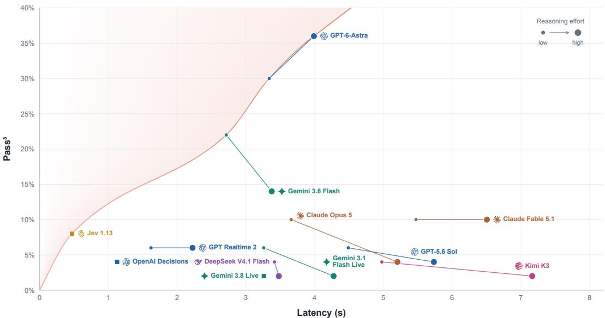  
Figure 1: Performance of Frontier Models on Realtime-Bench. Passˆ3 measures the proportion of tasks successfully completed in all three independent trials, capturing consistency across repeated runs.

## 1 INTRODUCTION

Many real-world interactive scenarios require decisions to be made under strict temporal constraints. For example, when purchasing a highly demanded ticket, detecting availability is not enough: an agent must observe the changing interface and act before the opportunity disappears. Such scenarios require real-time streaming capabilities, where a model continuously perceives an evolving environment and produces timely actions in response to newly arriving information. Recently, a growing family of real-time streaming models, such as GPT-Realtime (OpenAI, 2025) and Gemini Live (Google, 2026a), has begun to make this setting practically possible. In contrast to asynchronous models that process inputs only after they are fully received, these models can consume streaming inputs and react to new information with low latency.

Unlike previous benchmarks that evaluate models in static environments (Zhang et al., 2026; Tan et al., 2026) where the environment does not continuously evolve, evaluating streaming models requires dynamic settings that test whether models can perceive and act effectively under strict temporal constraints. However, existing evaluations of real-time systems largely focus on capabilities such as streaming perception, conversational quality, and interruption handling (Lin et al., 2026; Lu et al., 2026b), with limited coverage of interactive tasks in which actions affect subsequent environment states and delayed execution can change the outcome.

We first characterize real-time streaming capability along three complementary dimensions: temporal state awareness, adaptive deliberation, and time-aware action selection. These dimensions capture an agent’s ability to track relevant changes and information freshness, adjust deliberation to the available time, and select actions that remain useful when executed. Building on this framework, we introduce Realtime-Bench, comprising 50 interactive game and web tasks in which evolving states and limited opportunities make success depend on both action choice and timing.

We evaluate 12 frontier models spanning standard asynchronous models, streaming models and decision models. As shown in Figure 1, real-time interaction remains challenging, with the best success rate reaching only 44.0% and best passˆ3 is below 37% under Wall Clock, which advances the environment according to actual inference and serving time, following prior interactive-agent evaluations (Kang et al., 2025; Froger et al., 2026; ValsAI, 2026; Parekh et al., 2026).

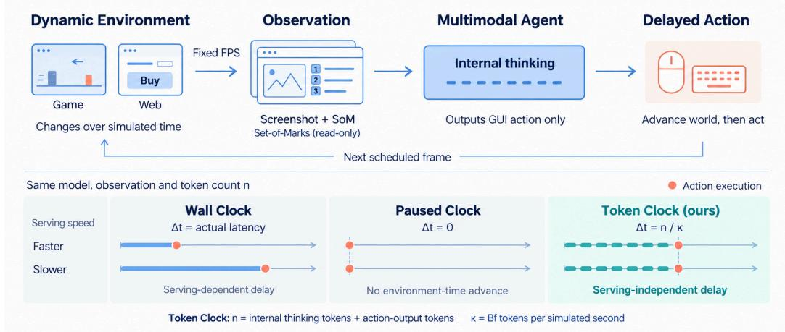  
Figure 2: Realtime-Bench evaluates models on interactive game and web tasks under three clock protocols. Wall Clock advances environments with actual inference latency, while Paused Clock removes inference delays as an idealized reference. Token Clock (ours) advances simulated time according to generation tokens consumed before action commitment, testing temporal awareness of models independently of physical serving speed.

To better understand these limitations and disentangle the effects of serving latency and models real-time streaming capability, we compare three clock protocols (Figure 2). Alongside Wall Clock, Paused Clock freezes the environment during inference, providing an idealized reference in which deliberation incurs no temporal cost (Tan et al., 2026; Zheng et al., 2026; Tan et al., 2025). We further introduce Token Clock, which advances simulated time according to the number of generation tokens consumed before an action is committed. Models that spend more tokens deliberating there fore act later, preserving the task consequences of delayed decisions while controlling for physical serving speed. Under each clock, we test low and high reasoning effort to examine the trade-off between decision quality and timely execution. Our analysis reveals that substantial performance gaps relative to Paused Clock persist under Token Clock, highlighting the difficulty of translating task competence into timely action even when temporal costs are standardized independently of serving speed. Higher reasoning effort improves success for all six models under Paused Clock but has mixed effects under temporal pressure. Further experiments show that relaxing the temporal cost of generation generally improves performance but does not ensure task success. These findings motivate future work on adaptive reasoning with temporal awareness and continuous perception and action, enabling agents to coordinate deliberation and execution with the time available.

## 2 RELATED WORK

## 2.1 STREAMING MULTIMODAL MODELS AND BENCHMARKS

Video multimodal models have progressively evolved from offline video understanding (Maaz et al., 2024; Lin et al., 2024; Liu et al., 2024b;a; 2023) toward real-time streaming interaction, where models continuously perceive incoming observations and decide when and how to respond as the stream unfolds (Chen et al., 2024; Wang et al., 2025b; Qian et al., 2025; Cui et al., 2026). Existing training and evaluation formulate real-time interaction as responding to a continuously arriving but sparsely sampled audiovisual stream, commonly at around 1–2 FPS (Chen et al., 2024; Qian et al., 2025; Yan et al., 2026; Lu et al., 2026b). Under this setting, existing benchmarks focus on evaluating the abilities of streaming perception (Lin et al., 2026; Huang et al., 2025; Shi et al., 2026), response timing (Wang et al., 2025a; He et al., 2026; Lu et al., 2026b), interruption handling (Lin et al., 2025; Lu et al., 2026b), and conversational quality (He et al., 2026; Lu et al., 2026b) in scenarios such as surveillance anomaly detection (Wang et al., 2025a), question answering during gym exercises and shopping, and step-by-step task guidance (Lu et al., 2026b), leaving untested whether models can act effectively in closed-loop environments where the timing of their decisions affects subsequent states and task outcomes. In contrast, Realtime-Bench evaluates closed-loop interaction in web environments and games, where task success depends on both what actions models take and when they take them.

## 2.2 REAL-TIME EVALUATION IN INTERACTIVE ENVIRONMENTS

Existing interactive evaluations assess asynchronous vision-language agents in games that pause during model inference, allowing their perception, reasoning, and planning abilities to be evaluated independently of response speed (Tan et al., 2025; Zhang et al., 2026; Tan et al., 2026; Zheng et al., 2026; Ouyang et al., 2026). To evaluate agents under real-time pressure, VideoGameBench (Zhang et al., 2026), GameWorld-RT (Ouyang et al., 2026), GPTNT (Parekh et al., 2026), and Gaia2 (Froger et al., 2026) allow game or web environments to continue evolving during inference, making task success depend on both decision quality and wall-clock latency. Although such wall-clock capture the consequences of slow responses, they also tie evaluation to deployment-specific inference speed. Similar to Real-Time Reasoning Gym (Wen et al., 2026), we adopt Token Clock, which maps generated tokens to environment time at a shared rate, preserving the temporal cost of deliberation while decoupling evaluation from physical serving speed.

## 3 SETTING FORMULATION

## 3.1 REAL-TIME STREAMING CAPABILITIES

We define real-time streaming capability as the ability to perceive, reason, and act effectively while the environment continues to evolve. We characterize this capability along three complementary dimensions. (1) Temporal state awareness (RT-Perceive) requires models to use available observations to track relevant changes, information freshness, and opportunity timing; (2) Adaptive deliberation (RT-Deliberate) requires models to adjust their reasoning length and depth according to the available time and the expected benefit of further computation; (3)Time-aware action selection (RT-Act)

requires models to determine which action will remain useful when executed, including whether to wait or act immediately and what action to take.

These dimensions jointly shape how an agent responds to an evolving environment. For example, an agent purchasing a ticket must track the sale status and assess whether observed availability is still current (RT-Perceive), limit further deliberation when the purchase window is closing (RT-Deliberate), and choose between waiting for sales to open and purchasing while tickets remain available (RT-Act).

## 3.2 CLOCK PROTOCOLS

As shown in Figure 2, we use three clock protocols to distinguish task performance under actual inference latency, performance without inference delays, and performance under a standardized temporal cost of token generation.

• Wall Clock. To evaluate performance under real-world inference latency, Wall Clock advances the environment according to the actual time spent on inference. The environment continues to evolve while the model generates a response, so action timing depends on both model computation and serving infrastructure.

• Paused Clock. To assess task performance without the temporal cost of inference, Paused Clock pauses the environment while the model generates a response. This provides an idealized reference for Wall Clock, allowing us to compare performance when inference does and does not delay actions in environment time.

• Token Clock. To retain the temporal cost of deliberation while removing dependence on serving speed, Token Clock advances the environment at a fixed rate per generation token. An action is applied at the simulated time reached when it is committed, so consuming more tokens delays execution regardless of actual inference latency.

To formalize Token Clock, let B denote the number of generation tokens corresponding to one observation interval and f the observation rate in frames per simulated second. The token-to-time rate is $\kappa = B f$ , measured in generation tokens per simulated second. If the model generates n tokens after receiving an observation and before committing to an action, the action is applied after a simulated-time delay of

$$
\Delta t = \frac { n } { \kappa } = \frac { n } { B f } .
$$

In both Token Clock and Wall Clock, when generation spans multiple observation intervals, intermediate frames are skipped, and the model receives the most recent scheduled frame available at the resulting simulated time. This provides a simplified analogue of humans returning attention to the current scene after deliberation, and tests whether the model can respond before relevant events or action opportunities pass. Both protocols thus require the model to balance the benefits of additional deliberation against the cost of delayed action.

## 4 BENCHMARK DESIGN

## 4.1 DESIGN PRINCIPLES.

To evaluate models’ real-time streaming capabilities in environments that continue to evolve while they observe, reason, and act, we design tasks around the following three criteria.

Real-world fidelity. To capture practical real-time interaction demands, task interfaces and interaction mechanics should reflect realistic applications and games. For example, web tasks simulate real-world websites such as Amazon, while game tasks feature popular games.

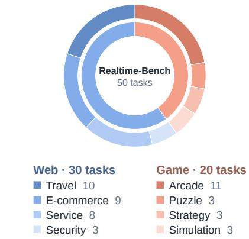  
Figure 3: Task distribution in Realtime-Bench.

Dynamically evolving environment. Environment states should change over time, independently of the model’s actions. These changes may include moving game elements, changing availability, or continuously updated information. For example, available seats change during cinema booking, while obstacles move across the screen in games.

Temporally constrained interaction. Success should depend on both what actions the model takes and when it takes them. Deadlines, limited action windows, and transient opportunities require timely responses. For example, a model must reserve a seat before it becomes unavailable or dodge an obstacle before a collision.

## 4.2 TASK CONSTRUCTION.

Guided by the above criteria, we construct web tasks based on realistic application scenarios and adapt game tasks from popular open-source games. We adjust task goals and temporal constraints so that success requires timely action, while ensuring that tasks remain feasible for humans. This process yields 50 tasks: 30 web tasks and 20 game tasks. Each task has task-specific success criteria, such as successfully purchasing a ticket before the countdown expires.

## 4.3 TASK EXAMPLES AND DISTRIBUTION.

Figure 4 illustrates two representative tasks, one from each domain: the web task requires placing a winning bid in a live auction before the bidding window closes, while the game task requires steering a moving snake to eat five apples. Figure 3 shows the distribution of task scenarios.

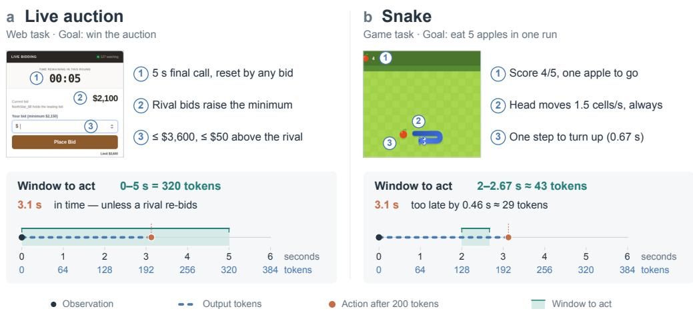  
Figure 4: Representative tasks in Realtime-Bench. Each panel shows the interface at the observation, the properties that make the task time-critical (①–③), and the window to act on the token-budget clock $\bar { ( \kappa } = B f = 6 4$ tokens per simulated second). A 200-token response lands at 3.1 s: inside the auction’s 5 s final call (a), but 0.46 s past the one-cell turn window in Snake (b).

## 5 EVALUATION PROTOCOL

## 5.1 OBSERVATION AND ACTION INTERFACE

The environment provides observations at a fixed rate of f frames per simulated second. At each scheduled observation frame, the model receives the current screenshot together with the retained interaction history. To prevent GUI grounding from becoming a bottleneck for evaluating real-time decision making, we augment the screenshot with a read-only Set-of-Marks (SoM) representation following common GUI-agent practice (Yang et al., 2023), which identifies currently interactable elements and exposes their associated semantics and supported actions. At each decision step, the model generates executable GUI actions from a common GUI action space (e.g., click, type, scroll, and wait) (Xie et al., 2024). The detailed implementation are provided in Appendix A.1.

## 5.2 CONTEXT MANAGEMENT

To minimize harness-induced overhead when evaluating models’ real-time capabilities, we follow Qwen-CUA (Lu et al., 2026a) in removing older history in blocks rather than at every step. This keeps the history prefix unchanged between folds, allowing models to reuse its KV cache across consecutive steps and reducing repeated prefill computation caused by frequent history truncation. All models follow the same history retention policy. Implementation details are provided in $\mathsf { A p - }$ pendix A.3.

## 5.3 EPISODE EXECUTION

Suppose the model receives an observation at environment time $t _ { i }$ and commits an action after a delay $\Delta t _ { i }$ determined by the clock protocol. Under Wall Clock, $\Delta t _ { i }$ equals the actual inference latency; under Paused Clock, $\Delta t _ { i } = 0 ;$ under Token Clock, $\Delta t _ { i }$ is determined by the generation tokens consumed before action commitment. The action timestamp is

$$
t _ { i } ^ { \mathrm { a c t } } = t _ { i } + \Delta t _ { i } .
$$

The environment advances from $t _ { i }$ to $t _ { i } ^ { \mathrm { a c t } }$ before the action is applied. If generation terminates without a valid action, the harness substitutes wait at the timestamp determined by the same clock protocol. GUI execution latency does not advance environment time.

An episode terminates when the environment reaches a task-defined terminal condition $( \mathrm { e . g . }$ , game over, successful completion of a web transaction, or expiration of a task-specific countdown) or the benchmark-defined time horizon (e.g., five minutes of environment time). The scorer evaluates the terminal environment state against task-specific success criteria, such as completing the first level of a game or securing a ticket.

## 6 EXPERIMENTS

## 6.1 EXPERIMENTAL SETUP

Models. We evaluate 12 frontier models spanning (1) standard asynchronous models, including GPT-6-Astra (OpenAI, 2026b), GPT-5.6 Sol (OpenAI, 2026), Claude Fable 5.1 (Anthropic, 2026), Claude Opus 5 (Anthropic, 2026a), Gemini 3.8 Flash (Google, 2026b), Deepseek V4.1 Flash (Deepseek, 2026) and Kimi-K3 (Team et al., 2026); (2) real-time streaming models, which are optimized for low-latency interaction, including GPT-Realtime-2 (OpenAI, 2025), Gemini 3.1 Flash live (Gemini, 2026) and Gemini 3.8 Live (Google, 2026); and (3) decision models, which directly return structured decisions rather than generate free-form text, including OpenAI Decisions (OpenAI, 2026a) and Jev 1.13 (TypeSafe, 2026).

Evaluation settings. To evaluate model performance in real-world deployment settings, we first evaluate all 12 models under Wall Clock. We report the pass rate for each run, defined as the fraction of tasks successfully completed, along with passˆk and pass@k for $k \in \{ 1 , 2 , 3 \}$ . Following τ - bench Yao et al. (2025), passˆk measures the probability of succeeding in all k attempts at a task, whereas pass@k measures the probability of succeeding in at least one of k attempts.

To further distinguish task performance under actual inference latency, without inference delays, and under a standardized temporal cost of token generation, we further compare Wall Clock, Paused Clock, and Token Clock on six representative models: GPT-Realtime-2, Gemini 3.1 Flash live, GPT-5.6 Sol, Claude Opus 5, Gemini 3.8 Flash, and Kimi-K3. We exclude decision models from this analysis because they do not report output token counts, which are required for Token Clock evaluation. For each clock protocol, we test both low and high reasoning effort to examine the tradeoff between decision quality and timeliness. Crossing the three clock protocols with the two reasoning levels yields six settings: WL and WH for Wall Clock, PL and PH for Paused Clock, and TL and TH for Token Clock, where L and H denote low and high reasoning effort, respectively.

Temporal configuration. We set the observation rate to $f = 1 \ : \mathrm { F P S }$ , following the frame-sampling recipes primarily used in current training and evaluation of real-time models (Xia et al., 2026; Qian et al., 2025; Zhang et al., 2025; Team, 2026). For the main experiments of Token Clock, we set

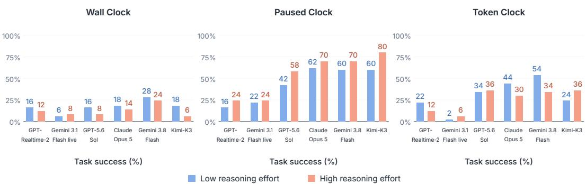  
Figure 5: Task success under three timing protocols. We evaluate two streaming models and four asynchronous VLMs under (a) Wall Clock, which includes measured inference latency; (b) Paused Clock, which removes inference-time cost; and (c) Token Clock, which applies a standardized time cost per generated token.

$B = 6 4 .$ , corresponding to $\kappa = B f = 6 4$ charged tokens per simulated second, a rate broadly consistent with practical autoregressive decoding speed (Yang et al., 2026; Team, 2025), which also suffice to produce a complete action together with one or two sentences of reasoning within one observation interval based on our pilot experiment. This provides room for brief deliberation that can support successful task execution, while longer reasoning can incur a temporal cost.

## 6.2 RESULTS

Performance remains limited under Wall Clock. As shown in Figure 1, GPT-6 Astra (high) achieves the highest Passˆ3 under Wall Clock at only 36%, indicating that even the strongest evaluated model struggles to complete tasks consistently. Most models incur latencies exceeding one second. Jev-1.13.0 achieves sub-second latency but its Passˆ3 remains low at 8%. These results suggest that low latency alone is insufficient for reliable real-time performance: models must combine timely responses with strong task-solving capabilities. Improving real-time abilities therefore requires advances in both response speed and model real-time streaming capability. Detailed per-run evaluation results, along with the full Passˆk and Pass@k results, are provided in the Appendix B.1.

Temporal costs limit success in evolving environments. As shown in Figure 5, with the environment paused during inference, Claude Opus 5 and Gemini 3.8 Flash each complete 70.0% of tasks in PH. At the same high reasoning effort, their success rates fall to 14.0% and 32.0% in WH, respectively. This decline reflects the difficulty of completing tasks when the environment advances during actual inference and serving. To examine performance independently of physical serving speed, we turn to Token Clock, which assigns a standardized temporal cost to generation. Success remains substantially below Paused Clock at 30.0% for Claude and 34.0% for Gemini in TH. The gap therefore persists when action delay is determined by token consumption rather than actual serving latency. Together, these comparisons highlight a central challenge of real-time capability: sustaining effective interaction when deliberation consumes time and the environment continues to evolve.

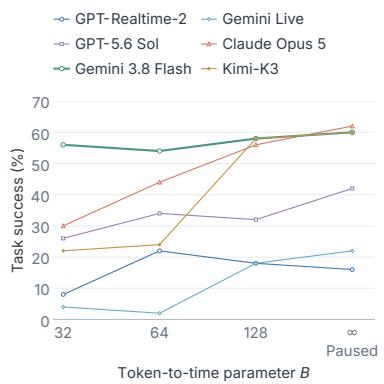  
Figure 6: Effect of temporal pressure on task success.

Reasoning effort is a tradeoff under time pressure. In Paused Clock, higher reasoning effort improves success for all six models. GPT-5.6 Sol rises from 42.0% in PL to 58.0% in PH, and Claude Opus 5 from 62.0% to 70.0%. However, the effect reverses under Token Clock for Claude, with success falling from 44.0% in TL to 30.0% in TH. Kimi-K3 instead improves from 24.0% to 36.0% under the same clock. Wall Clock shows similarly mixed effects: GPT-5.6 Sol drops from 16.0% in WL to 8.0% in WH, whereas Gemini 3.8 Flash improves from 24.0% to 32.0%. These contrasting outcomes illustrate the trade-off that adaptive deliberation must manage: further reasoning may improve action selection, but its temporal cost can reduce the opportunity to execute that action successfully.

Relaxing temporal pressure helps but does not ensure success. To examine the role of this temporal cost, we hold reasoning effort at low and vary B ∈ {32, 64, 128, unlimited} at a fixed observation rate (Figure 6). For a fixed token count, a larger B shortens the simulated delay before an action is applied. The setting of unlimited B corresponds to PL and assigns no simulated time to generation. Success generally improves as temporal pressure is relaxed: Claude Opus 5 rises from 30.0% at B = 32 to 62.0% with an unlimited budget, and Kimi-K3 from 22.0% to 60.0%. The improvement is not monotonic for every model, and even the unlimited setting leaves many tasks unsolved. Removing the time cost of inference therefore alleviates one constraint on task performance without resolving the full difficulty of effective interaction.

## 6.3 QUALITATIVE ANALYSIS

By examining recorded videos and action trajectories, we identify three recurring failure modes. Figure 7 shows the distribution of failure modes across models. The annotation codebook and procedure are provided in Appendix C. More cases can be found in Appendix C.3.

Lack of temporal awareness (RT-Deliberate). Models fail to adapt reasoning length to temporal urgency. With only 10 s remaining to make a Gomoku move, Gemini 3.8 Flash in TH generates 1,845 tokens (28.8 simulated seconds), missing the opportunity to move. (Figure 8 (a)). This could stem from an emphasis on allocating reasoning effort by static question difficulty (Han et al., 2025), with insufficient adaptation to time constraints.

Failure to track the evolving state (RT-Perceive). All evaluated models sometimes persist with decisions despite new observations requiring adjustment. In Google Snake under PH, Kimi K3 keeps moving left at 37 s until hitting the wall, despite being one row below the apple (Figure 8 (b)). Such inertia may reflect overreliance on textual context over visual changes (Leng et al., 2025), or on earlier solutions (Laban et al., 2025), highlighting the need to update decisions as states evolve.

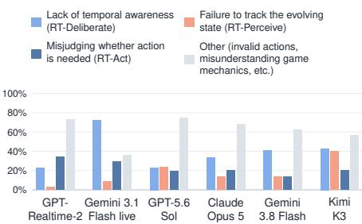  
Figure 7: Distribution of failure modes across models.

Misjudging whether action is needed (RT-Act). Models act when they should wait, or wait when they should act. Under PH, Claude Opus 5 waits about another 2 s after the road begins collapsing at 6 s, instead of steering away. (Figure 8 (c)). These errors may reflect insufficient training on when to act or wait, suggesting a training priority for future streaming models.

## 7 DISCUSSION

## 7.1 ADAPTIVE REASONING WITH TEMPORAL AWARENESS

Our results highlight a trade-off between the potential benefits of further reasoning and the delay it introduces. In an evolving environment, additional deliberation may improve a decision while leaving insufficient time to execute it effectively. Adaptive reasoning should therefore account for the time available to act, alongside task difficulty (Anthropic, 2026b; Wu et al., 2026). In Tetris, for example, a model may spend more time comparing placements while a falling piece is far above the stack. As the piece approaches the stack, however, it must shorten deliberation to leave enough time to execute the required moves. The appropriate reasoning effort thus changes with the environment, even within the same task. Future work should train models to recognize these changing temporal constraints and allocate deliberation by weighing the expected benefit of further computation against the risk of acting too late.

## 7.2 CONTINUOUS PERCEPTION AND ACTION

Adapting deliberation also depends on receiving timely observations and updating actions as the environment changes. At the 1 FPS observation rate used in our experiments, brief events or rapid changes may occur between observations, even when inference itself incurs no temporal cost. For example, an enemy may change direction between two frames, preventing the agent from adjusting its action until the next observation. Higher observation rates could provide more timely feedback, but realizing this benefit requires models and harnesses that can process incoming information and revise actions with sufficiently low latency.

(1) Model design. Higher temporal resolution presents two coupled challenges: processing more frames increases inference cost, while compressing visual inputs risks discarding brief changes that determine the next action. Addressing these challenges requires optimizing both (1) processing efficiency, for example by replacing cascaded architectures with an end-to-end single Transformer using block-causal attention (Huang et al., 2026), and (2) the preservation of action-relevant information through compact temporal representations (Ding et al., 2025) or codec-aware visual encoding (Sarkar et al., 2026). Future work should explore these two directions to support higher frame rates with lower latency while preserving important information.

(2) Interaction harnesses. Real-time harnesses must manage context and memory while coordinating observations and actions in a continuously changing environment. At higher frame rates, context sizes can rapidly exceed their budgets, and ongoing inference may become stale as new observations arrive. First, effective history representations or retrieval methods are required to manage context while preserving temporal information (Zeng et al., 2025), keeping inputs within the context budget without sacrificing critical details. Second, robust strategies are needed to address observation backlogs caused by inference delays, which can render planned actions obsolete before execution. These strategies must determine how many frames to retain, whether to employ FIFO or alternative buffer-management policies (Yates et al., 2021; Li et al., 2020), and how to dynamically decide whether to discard or revise planned actions as inference becomes stale (Black et al., 2025). Future work should explore these directions to make real-time systems more robust and efficient.

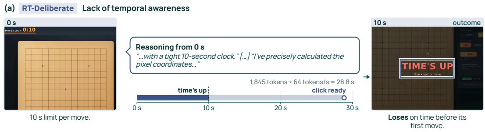

(b) RT-Perceive Failure to track the evolving state  
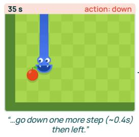

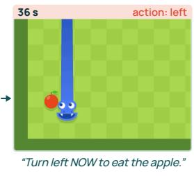

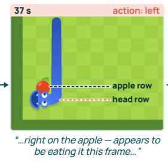

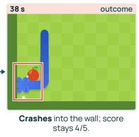

(c) RT-Act Misjudging whether action is needed  
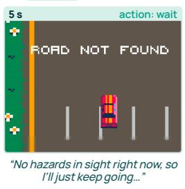

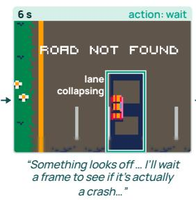

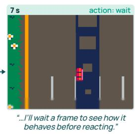

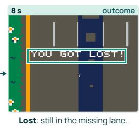  
Figure 8: Representative examples of the three failure modes. Each row shows one failed episode, from the states in which the model makes decisions to the resulting outcome. Timestamps are shown in the upper-right corner of each panel.

## 8 CONCLUSION

We introduced Realtime-Bench, a suite of diverse dynamic game and web tasks for evaluating realtime interactive capability in multimodal agents. Our evaluation of 12 frontier models shows that real-time interaction remains challenging: under Wall Clock, the best success rate reaches only 44.0%, and the best Passˆ3 is only 36%. To disentangle the effects of serving latency and models real-time streaming capability, we compared three clock protocols, introducing Token Clock to preserve the temporal cost of deliberation independently of physical serving speed. Substantial gaps relative to Paused Clock persist under Token Clock, highlighting the difficulty of translating task competence into timely action. Across the six models analyzed under different reasoning efforts, higher effort improves success under Paused Clock but has mixed effects under temporal pressure. Relaxing the temporal cost of generation generally improves performance but does not ensure success. These findings motivate adaptive reasoning with temporal awareness and continuous perception and action, allowing agents to coordinate deliberation and execution with the time available. Realtime-Bench provides a controlled setting for studying these capabilities and measuring progress toward effective real-time interaction.

## REFERENCES

Anthropic. Introducing Claude Fable 5.1 and Claude Mythos 5.1 \ Anthropic. https://www.anthropic.com/claude-fable-and-mythos-5-1, 2026.

Anthropic. Introducing Claude Opus 5. https://www.anthropic.com/news/claude-opus-5, 2026a.

Anthropic. Understand how claude’s thinking works. https://platform.claude.com/docs/en/buildwith-claude/thinking, 2026b.

Kevin Black, Manuel Galliker, and Sergey Levine. Real-time execution of action chunking flow policies. In D. Belgrave, C. Zhang, H. Lin, R. Pascanu, P. Koniusz, M. Ghassemi, and N. Chen (eds.), Advances in Neural Information Processing Systems, volume 38, Main Conference, pp. 33383–33407. Curran Associates, Inc., 2025. doi: 10.52202/085713-1122.

Joya Chen, Zhaoyang Lv, Shiwei Wu, Kevin Qinghong Lin, Chenan Song, Difei Gao, Jia-Wei Liu, Ziteng Gao, Dongxing Mao, and Mike Zheng Shou. Videollm-online: Online video large language model for streaming video. In Proceedings of the IEEE/CVF Conference on Computer Vision and Pattern Recognition (CVPR), pp. 18407–18418, June 2024.

Junbo Cui, Bokai Xu, Chongyi Wang, Tianyu Yu, Weiyue Sun, Yingjing Xu, Tianran Wang, Zhihui He, Wenshuo Ma, Tianchi Cai, Jiancheng Gui, Luoyuan Zhang, Xian Sun, Fuwei Huang, Moye Chen, Zhuo Lin, Hanyu Liu, Qingxin Gui, Qingzhe Han, Yuyang Wen, Huiping Liu, Rongkang Wang, Yaqi Zhang, Hongliang Wei, Chi Chen, You Li, Kechen Fang, Jie Zhou, Yuxuan Li, Guoyang Zeng, Chaojun Xiao, Yankai Lin, Xu Han, Maosong Sun, Zhiyuan Liu, and Yuan Yao. Minicpm-o 4.5: Towards real-time full-duplex omni-modal interaction, 2026. URL https://arxiv.org/abs/2604.27393.

Deepseek. Introducing DeepSeek-V4.1-Flash: Smarter, faster, more efficient. https://www.deepseek.com/en/news/deepseek-v4-1-flash/, September 2026.

Xin Ding, Hao Wu, Yifan Yang, Shiqi Jiang, Qianxi Zhang, Donglin Bai, Zhibo Chen, and Ting Cao. Streammind: Unlocking full frame rate streaming video dialogue through event-gated cognition. In Proceedings of the IEEE/CVF International Conference on Computer Vision (ICCV), pp. 13448–13459, October 2025.

Romain Froger, Pierre Andrews, Matteo Bettini, Amar Budhiraja, Ricardo Silveira Cabral, Virginie Do, Emilien Garreau, Jean-Baptiste Gaya, Hugo Laurenc¸on, Maxime Lecanu, Kunal Malkan, Dheeraj Mekala, Pierre Menard, Gerard Moreno-Torres Bertran, Ulyana Piterbarg, Mikhail Plekhanov, Mathieu Rita, Andrey Rusakov, Vladislav Vorotilov, Mengjue Wang, Ian Yu, Amine Benhalloum, Gregoire Mialon, and Thomas Scialom. Gaia2: Benchmarking LLM agents on dy-´ namic and asynchronous environments. In The Fourteenth International Conference on Learning Representations, 2026. URL https://openreview.net/forum?id=9gw03JpKK4.

Gemini. Gemini 3.1 Flash Live: Making audio AI more natural and reliable. https://blog.google/innovation-and-ai/models-and-research/gemini-models/gemini-3-1-flashlive/, March 2026.

Google. Introducing Gemini 3.8 Live and 3.8 Live Extended Thinking. https://blog.google/innovation-and-ai/models-and-research/gemini-models/gemini-3-8-livegemini-3-8-live-extended-thinking/, September 2026a.

Google. Introducing Gemini 3.8 Flash and 3.8 Flash Cyber. https://blog.google/innovation-andai/models-and-research/gemini-models/3-8-flash-and-3-8-flash-cyber/, September 2026b.

Google. Introducing Gemini 3.8 Live and 3.8 Live Extended Thinking. https://blog.google/innovation-and-ai/models-and-research/gemini-models/gemini-3-8-livegemini-3-8-live-extended-thinking/, September 2026.

Tingxu Han, Zhenting Wang, Chunrong Fang, Shiyu Zhao, Shiqing Ma, and Zhenyu Chen. Tokenbudget-aware LLM reasoning. In Wanxiang Che, Joyce Nabende, Ekaterina Shutova, and Mohammad Taher Pilehvar (eds.), Findings of the Association for Computational Linguistics: ACL 2025, pp. 24842–24855, Vienna, Austria, July 2025. Association for Computational Linguistics. ISBN 979-8-89176-256-5. doi: 10.18653/v1/2025.findings-acl.1274. URL https: //aclanthology.org/2025.findings-acl.1274/.

Chaoqun He, Mingyang Xiang, Yingjing Xu, Bokai Xu, Junbo Cui, Jie Zhou, Yuan Yao, and Lijie Wen. Omni-duplexeval: Evaluating real-time duplex omni-modal interaction, 2026. URL https://arxiv.org/abs/2605.17360.

Lianghua Huang, Zhi-Fan Wu, Yupeng Shi, Wei Wang, Mengyang Feng, Junjie He, Chen-Wei Xie, Yu Liu, Jingren Zhou, Ang Wang, Bang Zhang, Baole Ai, Chen Liang, Cheng Yu, Chongyang Zhong, Jinwei Qi, Kai Zhu, Pandeng Li, Peng Zhang, Wenyuan Zhang, Xinhua Cheng, Yitong Huang, Yun Zheng, Yuxiang Bao, Yuzheng Wang, and Zoubin Bi. Wan-streamer v0.2: Higher resolution, same latency, 2026. URL https://arxiv.org/abs/2607.04443.

Zhenpeng Huang, Xinhao Li, Jiaqi Li, Jing Wang, Xiangyu Zeng, Cheng Liang, Tao Wu, Xi Chen, Liang Li, and Limin Wang. Online Video Understanding: OVBench and VideoChat-Online . In 2025 IEEE/CVF Conference on Computer Vision and Pattern Recognition (CVPR), pp. 3328–3338, Los Alamitos, CA, USA, June 2025. IEEE Computer Society. doi: 10. 1109/CVPR52734.2025.00316. URL https://doi.ieeecomputersociety.org/10. 1109/CVPR52734.2025.00316.

Lars Benedikt Kaesberg, Tianyu Yang, Florian Valentin Wunderlich, Terry Ruas, Daniel Kurzawe, Jan Philip Wahle, and Bela Gipp. Is visual prompting all you need? studying vlm spatial reasoning under progressive visual scaffolds, 2026. URL https://arxiv.org/abs/2608.21170.

Hao Kang, Qingru Zhang, Han Cai, Weiyuan Xu, Tushar Krishna, Yilun Du, and Tsachy Weissman. Win fast or lose slow: Balancing speed and accuracy in latency-sensitive decisions of llms. In D. Belgrave, C. Zhang, H. Lin, R. Pascanu, P. Koniusz, M. Ghassemi, and N. Chen (eds.), Advances in Neural Information Processing Systems, volume 38, Main Conference, pp. 150862–150884. Curran Associates, Inc., 2025. doi: 10.52202/ 085713-5044. URL https://proceedings.neurips.cc/paper\_files/paper/ 2025/file/ddaec864ba433e8889ab08dcf5c26e55-Paper-Conference.pdf.

Philippe Laban, Hiroaki Hayashi, Yingbo Zhou, and Jennifer Neville. LLMs get lost in multi-turn conversation. In Iclr 2026, May 2025.

Sicong Leng, Yun Xing, Zesen Cheng, Yang Zhou, Hang Zhang, Xin Li, Deli Zhao, Shijian Lu, Chunyan Miao, and Lidong Bing. The curse of multi-modalities: Evaluating hallucinations of large multimodal models across language, visual, and audio. In D. Belgrave, C. Zhang, H. Lin, R. Pascanu, P. Koniusz, M. Ghassemi, and N. Chen (eds.), Advances in Neural Information Processing Systems, volume 38, Main Conference. Curran Associates, Inc., 2025. doi: 10.52202/085713-3601.

Mengtian Li, Yuxiong Wang, and Deva Ramanan. Towards streaming perception. In Proceedings of(ECCV) European Conference on Computer Vision, pp. 473 – 488, August 2020.

Bin Lin, Yang Ye, Bin Zhu, Jiaxi Cui, Munan Ning, Peng Jin, and Li Yuan. Video-LLaVA: Learning united visual representation by alignment before projection. In Yaser Al-Onaizan, Mohit Bansal, and Yun-Nung Chen (eds.), Proceedings of the 2024 Conference on Empirical Methods in Natural Language Processing, pp. 5971–5984, Miami, Florida, USA, November 2024. Association for Computational Linguistics. doi: 10.18653/v1/2024.emnlp-main.342. URL https://aclanthology.org/2024.emnlp-main.342/.

Guan-Ting Lin, Jiachen Lian, Tingle Li, Qirui Wang, Gopala Anumanchipalli, Alexander H. Liu, and Hung-Yi Lee. Full-duplex-bench: A benchmark to evaluate full-duplex spoken dialogue models on turn-taking capabilities. In 2025 IEEE Automatic Speech Recognition and Understanding Workshop (ASRU), pp. 1–8, 2025. doi: 10.1109/ASRU65441.2025.11433838.

Junming Lin, Zheng Fang, Chi Chen, Haoxuan Cheng, Zihao Wan, Fuwen Luo, Ziyue Wang, Peng Li, Yang Liu, and Maosong Sun. Streamingbench: Assessing the gap for mllms to achieve streaming video understanding. In ICASSP 2026 - 2026 IEEE International Conference on Acoustics, Speech and Signal Processing (ICASSP), pp. 12147–12151, 2026. doi: 10.1109/ICASSP55912.2026.11463959.

Haotian Liu, Chunyuan Li, Qingyang Wu, and Yong Jae Lee. Visual instruction tuning, 2023.

Haotian Liu, Chunyuan Li, Yuheng Li, and Yong Jae Lee. Improved baselines with visual instruction tuning. In Proceedings of the IEEE/CVF Conference on Computer Vision and Pattern Recognition (CVPR), pp. 26296–26306, June 2024a.

Haotian Liu, Chunyuan Li, Yuheng Li, Bo Li, Yuanhan Zhang, Sheng Shen, and Yong Jae Lee. Llava-next: Improved reasoning, ocr, and world knowledge, January 2024b. URL https:// llava-vl.github.io/blog/2024-01-30-llava-next/.

Dunjie Lu, Shuai Bai, Tianyi Bai, Sicheng Fan, Chang Gao, Jian Guan, Feng Hu, Mianqiu Huang, Xingyang Huang, Yizhen Jiang, Yuheng Jing, Dehui Kong, Ning Li, Dayiheng Liu, Shixuan Liu, Zheng Liu, Que Shen, Bowen Wang, Junli Wang, Chencan Wu, Rui Xie, Tianbao Xie, Zhihui Xie, Haiyang Xu, An Yang, Tao Yu, Wenzhen Yuan, Xi Zhang, Zhenru Zhang, Mingkang Zhu, Zhaoqing Zhu, Yizhong Cao, Kai Dang, Binyuan Hui, Kaixin Li, Junyang Lin, Haiquan Wang, Zekun Wang, Yiheng Xu, Fan Yan, Mengqi Yuan, Danyang Zhang, Jiajun Zhang, Zhipeng Zhang, Fan Zhou, and Fan Zhou. Qwen-cua: Native computer use for (almost) everything, 2026a. URL https://arxiv.org/abs/2608.02352.

Xudong Lu, Xueying Li, Annan Wang, Yang Bo, Jinpeng Chen, Zengliang Li, Nianzu Yang, Rui Liu, Xue Yang, Jingwen Hou, and Hongsheng Li. Omniinteract: Benchmarking real-world streaming interaction for real-time omnimodal assistants, 2026b. URL https://arxiv.org/abs/ 2605.26485.

Muhammad Maaz, Hanoona Rasheed, Salman Khan, and Fahad Khan. Video-ChatGPT: Towards detailed video understanding via large vision and language models. In Lun-Wei Ku, Andre Martins, and Vivek Srikumar (eds.), Proceedings of the 62nd Annual Meeting of the Association for Computational Linguistics (Volume 1: Long Papers), pp. 12585–12602, Bangkok, Thailand, August 2024. Association for Computational Linguistics. doi: 10.18653/v1/2024.acl-long.679. URL https://aclanthology.org/2024.acl-long.679/.

OpenAI. Introducing gpt-realtime and realtime api updates for production voice agents. https: //openai.com/index/introducing-gpt-realtime/, August 2025.

OpenAI. Decisions | OpenAI API. https://developers.openai.com/api/docs/guides/decisions, 2026a.

OpenAI. GPT-6 Astra: A new generation of intelligence. https://openai.com/index/gpt-6-astra/, 2026b.

OpenAI. Previewing GPT-5.6 Sol: A next-generation model. https://openai.com/index/previewinggpt-5-6-sol/, September 2026.

Mingyu Ouyang, Siyuan Hu, Kevin Qinghong Lin, Hwee Tou Ng, and Mike Zheng Shou. Gameworld: Towards standardized and verifiable evaluation of multimodal game agents, 2026. URL https://arxiv.org/abs/2604.07429.

Amit Parekh, Sabrina McCallum, Kareem Al-Hasan, Malvina Nikandrou, Alessandro Suglia, and Ioannis Konstas. Gptnt: Benchmarking real-time collaboration between multimodal agents on keep talking and nobody explodes, 2026. URL https://arxiv.org/abs/2606.28514.

Rui Qian, Shuangrui Ding, Xiaoyi Dong, Pan Zhang, Yuhang Zang, Yuhang Cao, Dahua Lin, and Jiaqi Wang. Dispider: Enabling video llms with active real-time interaction via disentangled perception, decision, and reaction. In 2025 IEEE/CVF Conference on Computer Vision and Pattern Recognition (CVPR), pp. 24045–24055, 2025. doi: 10.1109/CVPR52734.2025.02239.

Sayan Deb Sarkar, Remi Pautrat, Ondrej Miksik, Marc Pollefeys, Iro Armeni, Mahdi Rad, and Mihai´ Dusmanu. Cope-videolm: Leveraging codec primitives for efficient video language modeling, 2026. URL https://arxiv.org/abs/2602.13191.

Yansong Shi, Qingsong Zhao, Tianxiang Jiang, Xiangyu Zeng, Yi Wang, and Limin Wang. RIVER: A real-time interaction benchmark for video LLMs. In The Fourteenth International Conference on Learning Representations, 2026. URL https://openreview.net/forum?id= xmtvHH62Ic.

Weihao Tan, Wentao Zhang, Xinrun Xu, Haochong Xia, Ziluo Ding, Boyu Li, Bohan Zhou, Junpeng Yue, Jiechuan Jiang, Yewen Li, Ruyi An, Molei Qin, Chuqiao Zong, Longtao Zheng, Yujie Wu, Xiaoqiang Chai, Yifei Bi, Tianbao Xie, Pengjie Gu, Xiyun Li, Ceyao Zhang, Long Tian, Chaojie Wang, Xinrun Wang, Borje F. Karlsson, Bo An, Shuicheng Yan, and Zongqing Lu. Cradle:¨ empowering foundation agents towards general computer control. In Proceedings of the 42nd International Conference on Machine Learning, ICML’25. JMLR.org, 2025.

Weihao Tan, Changjiu Jiang, Yu Duan, Mingcong Lei, Jiageng Li, Yitian Hong, Xinrun Wang, and Bo An. Stardojo: Benchmarking open-ended behaviors of agentic multimodal llms in production-living simulations with stardew valley, 2026. URL https://arxiv.org/abs/ 2507.07445.

Gemini Team. Gemini 2.5: Pushing the frontier with advanced reasoning, multimodality, long context, and next generation agentic capabilities, 2025. URL https://arxiv.org/abs/ 2507.06261.

Kimi Team, Tongtong Bai, Yifan Bai, Yiping Bao, Jianfeng Cai, Xinyuan Cai, Peizhou Cao, Yuxuan Cao, Ziwei Chai, Y Charles, et al. Kimi k3: Open frontier intelligence. arXiv preprint arXiv:2607.24653, 2026.

Qwen Team. Qwen3.5-omni technical report, 2026. URL https://arxiv.org/abs/2604. 15804.

TypeSafe. Introducing System One Models & Jev - TypeSafe AI Blog. https://typesafe.ai/blog/introducing-system-one-models-and-jev, 2026.

ValsAI. Cua-bench. https://vals.ai/benchmarks/cua bench, 2026.

Yueqian Wang, Xiaojun Meng, Yifan Wang, Huishuai Zhang, and Dongyan Zhao. Proactivevideoqa: A comprehensive benchmark evaluating proactive interactions in video large language models, 2025a. URL https://arxiv.org/abs/2507.09313.

Yueqian Wang, Xiaojun Meng, Yuxuan Wang, Jianxin Liang, Jiansheng Wei, Huishuai Zhang, and Dongyan Zhao. VideoLLM knows when to speak: Enhancing time-sensitive video comprehension with video-text duet interaction format. In Christos Christodoulopoulos, Tanmoy Chakraborty, Carolyn Rose, and Violet Peng (eds.), Findings ofthe Associationfor Computational Linguistics: EMNLP 2025, pp. 6338–6359, Suzhou, China, November 2025b. Association for Computational Linguistics. ISBN 979-8-89176-335-7. doi: 10.18653/v1/2025.findings-emnlp. 336. URL https://aclanthology.org/2025.findings-emnlp.336/.

Yule Wen, Yixin Ye, Yanzhe Zhang, Diyi Yang, and Hao Zhu. Real-time reasoning agents in evolving environments. In C. Vondrick, B. Hariharan, C. Raffel, L. Pinto, D. Yang, and A. Faust (eds.), International Conference on Learning Representations, volume 2026, pp. 126266–126292, 2026.

Chao Wu, Baoheng Li, Mingchen Gao, Yu Tian, and Zhenyi Wang. From efficiency to adaptivity: A deeper look at adaptive reasoning in large language models, 2026. URL https://arxiv. org/abs/2511.10788.

Jiaer Xia, Peixian Chen, Mengdan Zhang, Xing Sun, and Kaiyang Zhou. Streaming video instruction tuning. In Proceedings of the IEEE/CVF Conference on Computer Vision and Pattern Recognition (CVPR), pp. 31219–31229, June 2026.

Tianbao Xie, Danyang Zhang, Jixuan Chen, Xiaochuan Li, Siheng Zhao, Ruisheng Cao, Toh Jing Hua, Zhoujun Cheng, Dongchan Shin, Fangyu Lei, Yitao Liu, Yiheng Xu, Shuyan Zhou, Silvio Savarese, Caiming Xiong, Victor Zhong, and Tao Yu. OSWorld: Benchmarking multimodal agents for open-ended tasks in real computer environments. In A. Globerson, L. Mackey, D. Belgrave, A. Fan, U. Paquet, J. Tomczak, and C. Zhang (eds.), Advances in Neural Information Processing Systems, volume 37, pp. 52040–52094. Curran Associates, Inc., 2024. doi: 10.52202/079017-1650.

Weicai Yan, Yuhong Dai, Qi Ran, Haodong Li, Wang Lin, Tao Jin, Xing Xie, Hao Liao, and Jianxun Lian. Proact-VL: A proactive VideoLLM for real-time AI companions. In Proceedings of the 43rd International Conference on Machine Learning, Proceedings of Machine Learning Research, 2026.

Jianwei Yang, Hao Zhang, Feng Li, Xueyan Zou, Chunyuan Li, and Jianfeng Gao. Set-of-mark prompting unleashes extraordinary visual grounding in gpt-4v, 2023. URL https://arxiv. org/abs/2310.11441.

Penghui Yang, Cunxiao Du, Fengzhuo Zhang, Haonan Wang, Tianyu Pang, Chao Du, and Bo An. LongSpec: Long-context lossless speculative decoding with efficient drafting and verification. In Maria Liakata, Viviane P. Moreira, Jiajun Zhang, and David Jurgens (eds.), Proceedings of the 64th Annual Meeting ofthe Associationfor Computational Linguistics (Volume 1: Long Papers), pp. 1826–1844, San Diego, California, United States, July 2026. Association for Computational Linguistics. ISBN 979-8-89176-390-6. doi: 10.18653/v1/2026.acl-long.83. URL https:// aclanthology.org/2026.acl-long.83/.

Shunyu Yao, Noah Shinn, Pedram Razavi, and Karthik Narasimhan. {\tau}-bench: A benchmark for \underline{T}ool-\underline{a}gent-\underline{U}ser interaction in real-world domains. In Y. Yue, A. Garg, N. Peng, F. Sha, and R. Yu (eds.), International Conference on Learning Representations, volume 2025, pp. 9965–10017, 2025.

Roy D. Yates, Yin Sun, D. Richard Brown, Sanjit K. Kaul, Eytan Modiano, and Sennur Ulukus. Age of information: An introduction and survey. IEEE Journal on Selected Areas in Communications, 39(5):1183–1210, 2021. doi: 10.1109/JSAC.2021.3065072.

Xiangyu Zeng, Kefan Qiu, Qingyu Zhang, Xinhao Li, Jing Wang, Jiaxin Li, Ziang Yan, Kun Tian, Meng Tian, Xinhai Zhao, Yi Wang, and Limin Wang. StreamForest: Efficient online video understanding with persistent event memory. In D. Belgrave, C. Zhang, H. Lin, R. Pascanu, P. Koniusz, M. Ghassemi, and N. Chen (eds.), Advances in Neural Information Processing Systems, volume 38, Main Conference, pp. 75804–75835. Curran Associates, Inc., 2025. doi: 10.52202/085713-2547.

Alex L. Zhang, Thomas L. Griffiths, Karthik R. Narasimhan, and Ofir Press. Videogamebench: Can vision-language models complete popular video games?, 2026. URL https://arxiv.org/ abs/2505.18134.

Haoji Zhang, Yiqin Wang, Yansong Tang, Yong Liu, Jiashi Feng, and Xiaojie Jin. Flash-vstream: Efficient real-time understanding for long video streams. In 2025 IEEE/CVF International Conference on Computer Vision (ICCV), pp. 21059–21069, 2025. doi: 10.1109/ICCV51701.2025. 01957.

Xiangxi Zheng, Linjie Li, Zhengyuan Yang, Ping Yu, Alex Jinpeng Wang, Rui Yan, Yuan Yao, and Lijuan Wang. V-MAGE: A game evaluation framework for assessing vision-centric capabilities in multimodal large language models. In Maria Liakata, Viviane P. Moreira, Jiajun Zhang, and David Jurgens (eds.), Findings of the Association for Computational Linguistics: ACL 2026, pp. 17707–17758, San Diego, California, United States, July 2026. Association for Computational Linguistics. ISBN 979-8-89176-395-1. doi: 10.18653/v1/2026.findings-acl.878. URL https: //aclanthology.org/2026.findings-acl.878/.

## A EVALUATION IMPLEMENTATION

## A.1 OBSERVATIONS AND ACTIONS

Observations. The agent receives a screenshot and a read-only description of currently interactable elements. Screenshots preserve the desktop aspect ratio and are resized to a maximum dimension of 768 pixels, yielding 768 × 432 images for the 1920 × 1080 desktop. We adopt this reduced resolution to reduce visual processing overhead and inference latency. Recent studies also suggest that SoM representations preserve visual grounding performance under downsampling with minimal loss (Xie et al., 2024; Kaesberg et al., 2026).The Set-of-Marks representation uses P# for discrete target points and R# for continuous regions. A region location is specified as R#@u,v, where $u , v \in [ 0 , 1 0 0 0 ]$ are local coordinates. Marks refer only to the observation in which they appear. Raw screenshot coordinates remain available when no suitable mark exists and are mapped to desktop coordinates before execution.

Actions. Each decision produces a GUI action. Table 1 gives the shared action schema.
<table><tr><td>Action</td><td>Arguments</td><td>Semantics</td></tr><tr><td>click</td><td>target, button</td><td>Click the specified point.</td></tr><tr><td> $\mathtt { r i g h t \_ c l i c k }$ </td><td>target</td><td>Right-click the specified point.</td></tr><tr><td>double_click,triple_click</td><td>target</td><td>Apply the corresponding click sequence.</td></tr><tr><td>mouse_down, mouse_up</td><td>target, duration</td><td>Press or release the mouse button.</td></tr><tr><td>move</td><td>target, duration</td><td>Move the pointer.</td></tr><tr><td>type</td><td>text</td><td>Enter the supplied text.</td></tr><tr><td>key</td><td>key, repeat</td><td>Tap a key or key combination.</td></tr><tr><td>hold_key</td><td>key, duration</td><td>Hold a key or key combination for the specified time.</td></tr><tr><td>scroll</td><td>target, dx, dy</td><td>Scroll horizontally or vertically.</td></tr><tr><td>drag</td><td>start, end, duration</td><td>Drag between two points.</td></tr><tr><td>wait</td><td>duration</td><td>Advance without issuing another GUI input.</td></tr></table>

Table 1: Shared GUI action schema. Arguments include optional fields; action durations lie in [0, 10] seconds and key.repeat lies in [1, 100].

## A.2 CLOCK EXECUTION AND TOKEN ACCOUNTING

Action timing. For a decision based on an observation at time $t _ { i } ,$ the token clock assigns an action timestamp $t _ { i } ^ { \mathrm { a c t } } = t _ { i } + n _ { i } / ( B f )$ , where $n _ { i }$ is the charged output-token count. The harness advances the environment to this timestamp before applying the action. Finishing early does not provide an extra observation: the next observation follows the scheduled frame grid. If generation crosses observation boundaries, the corresponding intermediate observations are skipped. Physical inference and GUI execution latency do not advance simulated time. Browser animation updates use a persistent 60 Hz simulation grid, separate from the agent’s observation rate, so splitting an interval around an action does not change the number of animation updates.

Charged tokens. For API-based models, we charge both reasoning tokens and output tokens using the usage reported by the API for the complete response. As Gemini Live natively produces audio rather than text, we configure it to emit GUI actions through native function calls instead of spoken responses. We charge its reported thought tokens and non-audio response tokens, excluding generated audio.

## A.3 CONTEXT MANAGEMENT

Visual and textual history are retained separately. When the active visual history reaches 21 observations, the oldest 10 screenshots and their associated interactables are replaced with fixed placeholders, while the corresponding text and action records remain. When detailed interaction history

exceeds 50 turns, the oldest 10 complete turns are replaced by a compact executed-action ledger.   
This block policy retains recent evidence while limiting changes to reusable context prefixes.

Streaming models maintain the retained history within their sessions, while asynchronous models resubmit the retained context. To maximize cache reuse and reduce inference latency, we preserve the order and content of retained messages and remove older history only in blocks when the retention limits are exceeded. This keeps the shared context prefix stable across consecutive decisions, allowing models to reuse cached computation where supported. Both mechanisms implement the same logical history policy.

## A.4 MODEL CONFIGURATION

Standard Asynchronous Models and Real-time Streaming Models. Our standard asynchronous models include GPT-6-Astra, GPT-5.6 Sol, Gemini 3.8 Flash, Claude Opus 5, Claude Fable 5.1, DeepSeek V4.1 Flash, and Kimi-K3. We access GPT-6-Astra, GPT-5.6 Sol, Gemini 3.8 Flash, Claude Fable 5.1, and DeepSeek V4.1 Flash through OpenRouter, Claude Opus 5 through the Anthropic API, and Kimi-K3 through the Kimi API. Our real-time streaming models include GPT-Realtime-2, accessed through OpenAI, and Gemini 3.1 Flash Live and Gemini 3.8 Live, accessed through the Google Gemini Live API. Where configurable, we control reasoning effort through provider-exposed API fields, selecting the corresponding low and high settings for our experimental conditions.

Decision models. We access Jev 1.13 and OpenAI Decisions through OpenRouter API. For these models, the harness constructs candidate GUI actions from the current observation and submits them as a choice question. Text entry can be composed through successive choices before executing a single typing action. Jev 1.13 does not natively support screenshot inputs. We therefore represent its Web observations as structured text using the browser accessibility tree (AX tree), interactable elements, and appearance descriptors. This representation does not adequately capture the visual state of our game tasks, so we evaluate Jev 1.13 only on Web tasks. OpenAI Decisions additionally receives screenshots. Both models are evaluated only under the wall-clock setting.

## B SUPPLEMENTARY RESULTS

## B.1 PERFORMANCE ON WALL CLOCK

Table 2: Per-run success rates and average decision latency.
<table><tr><td>Model type</td><td>Model</td><td>Run 1 (%)</td><td>Run 2 (%)</td><td>Run 3 (%)</td><td>Latency (s)</td></tr><tr><td rowspan="12">Standard Asynchronous Models</td><td>GPT-6-Astra (high)</td><td>42.00</td><td>42.00</td><td>44.00</td><td>3.989</td></tr><tr><td>GPT-6-Astra (low)</td><td>42.00</td><td>40.00</td><td>44.00</td><td>3.339</td></tr><tr><td>GPT-5.6 Sol (high)</td><td>8.00</td><td>10.00</td><td>14.00</td><td>5.735</td></tr><tr><td>GPT-5.6 Sol (low)</td><td>16.00</td><td>14.00</td><td>24.00</td><td>4.490</td></tr><tr><td>Claude Fable 5.1 (high)</td><td>16.00</td><td>18.00</td><td>16.00</td><td>6.506</td></tr><tr><td>Claude Fable 5.1 (low) Claude Opus 5 (high)</td><td>18.00 14.00</td><td>16.00 12.00</td><td>14.00 12.00</td><td>5.475</td></tr><tr><td>Claude Opus 5 (low) Gemini 3.8 Flash (high)</td><td>18.00</td><td>14.00</td><td>14.00</td><td>5.204 3.659</td></tr><tr><td rowspan="5"></td><td></td><td>24.00</td><td>24.00</td><td>26.00</td><td>3.376</td></tr><tr><td>Gemini 3.8 Flash (low)</td><td>28.00</td><td>26.00</td><td>28.00</td><td>2.713</td></tr><tr><td>DeepSeek V4.1 Flash (high)</td><td>8.00</td><td>10.00</td><td>12.00</td><td>3.479</td></tr><tr><td>DeepSeek V4.1 Flash (low)</td><td>8.00</td><td>10.00</td><td>8.00</td><td>3.415</td></tr><tr><td>Kimi K3 (high)</td><td>6.00</td><td>8.00</td><td>6.00</td><td>7.165</td></tr><tr><td>Kimi K3 (low)</td><td>18.00</td><td>12.00</td><td>10.00</td><td>4.978</td></tr><tr><td rowspan="4">Real-time Streaming Models</td><td rowspan="4">GPT Realtime 2 (high) GPT Realtime 2 (low) Gemini 3.1 Flash Live (high)</td><td>12.00</td><td>6.00</td><td>10.00</td><td></td></tr><tr><td>16.00</td><td></td><td></td><td>2.224</td></tr><tr><td>8.00</td><td>12.00 8.00</td><td>18.00</td><td>1.620</td></tr><tr><td>Gemini 3.1 Flash Live (low) 6.00</td><td>16.00</td><td>16.00 18.00</td><td>4.276 3.259</td></tr><tr><td rowspan="2">Decision Models</td><td rowspan="2">Gemini 3.8 Live (fixed) OpenAI Decisions</td><td rowspan="2">8.00 8.00</td><td rowspan="2">4.00</td><td rowspan="2">6.00</td><td rowspan="2">3.261</td></tr><tr><td>12.00 8.00</td></tr></table>

Table 3: Passˆk results (%). Passˆk measures success on all k attempts, averaged over combinations of the three runs.
<table><tr><td>Model type</td><td>Model</td><td>Pass^1</td><td>Pass^2</td><td>Pass^3</td></tr><tr><td rowspan="10">Standard Asynchronous Models</td><td>GPT-6-Astra (high)</td><td>42.67</td><td>38.00</td><td>36.00</td></tr><tr><td>GPT-6-Astra (low)</td><td>42.00</td><td>34.00</td><td>30.00</td></tr><tr><td>GPT-5.6 Sol (high)</td><td>10.67</td><td>5.33</td><td>4.00</td></tr><tr><td>GPT-5.6 Sol (low) Claude Fable 5.1 (high)</td><td>18.00</td><td>10.00</td><td>6.00</td></tr><tr><td>Claude Fable 5.1 (low)</td><td>16.67 16.00</td><td>12.67 12.00</td><td>10.00 10.00</td></tr><tr><td>Claude Opus 5 (high)</td><td>12.67</td><td>7.33</td><td>4.00</td></tr><tr><td>Claude Opus 5 (low)</td><td>15.33</td><td>11.33</td><td>10.00</td></tr><tr><td>Gemini 3.8 Flash (high)</td><td>24.67</td><td>17.33</td><td></td></tr><tr><td>Gemini 3.8 Flash (low)</td><td>27.33</td><td>24.00</td><td>14.00</td></tr><tr><td>DeepSeek V4.1 Flash (high)</td><td>10.00</td><td>4.00</td><td>22.00 2.00</td></tr><tr><td rowspan="4"></td><td>DeepSeek V4.1 Flash (low)</td><td>8.67</td><td>5.33</td><td>4.00</td></tr><tr><td>Kimi K3 (high)</td><td>6.67</td><td>3.33</td><td>2.00</td></tr><tr><td>Kimi K3 (low)</td><td>13.33</td><td>6.67</td><td>4.00</td></tr><tr><td>GPT Realtime 2 (high)</td><td>9.33</td><td></td><td></td></tr><tr><td rowspan="4">Real-time Streaming Models</td><td>GPT Realtime 2 (low)</td><td>15.33</td><td>6.00 8.67</td><td>6.00 6.00</td></tr><tr><td>Gemini 3.1 Flash Live (high)</td><td>10.67</td><td>4.67</td><td></td></tr><tr><td>Gemini 3.1 Flash Live (low)</td><td>13.33</td><td></td><td>2.00</td></tr><tr><td>Gemini 3.8 Live (fixed)</td><td>6.00</td><td>7.33 3.33</td><td>6.00 2.00</td></tr><tr><td rowspan="2">Decision Models</td><td>OpenAI Decisions</td><td>9.33</td><td></td><td></td></tr><tr><td>Jev 1.13</td><td>12.00</td><td>6.00 9.33</td><td>4.00 8.00</td></tr></table>

Table 4: Pass@k results (%). Pass@k measures success on at least one of k attempts, averaged over combinations of the three runs.
<table><tr><td>Model type</td><td>Model</td><td>Pass@1</td><td>Pass@2</td><td>Pass@3</td></tr><tr><td rowspan="16">Standard Asynchronous Models</td><td>GPT-6-Astra (high)</td><td>42.67</td><td>47.33</td><td>50.00</td></tr><tr><td>GPT-6-Astra (low)</td><td>42.00</td><td>50.00</td><td>54.00</td></tr><tr><td>GPT-5.6 Sol (high)</td><td>10.67</td><td>16.00</td><td>20.00</td></tr><tr><td>GPT-5.6 Sol (low)</td><td>18.00</td><td>26.00</td><td>30.00</td></tr><tr><td>Claude Fable 5.1 (high)</td><td>16.67</td><td>20.67</td><td>22.00</td></tr><tr><td>Claude Fable 5.1 (low) Claude Opus 5 (high)</td><td>16.00</td><td>20.00</td><td>22.00</td></tr><tr><td></td><td>12.67</td><td>18.00</td><td>20.00</td></tr><tr><td>Claude Opus 5 (low)</td><td>15.33</td><td>19.33</td><td>22.00</td></tr><tr><td>Gemini 3.8 Flash (high)</td><td>24.67</td><td>32.00</td><td>36.00</td></tr><tr><td>Gemini 3.8 Flash (low)</td><td>27.33</td><td>30.67</td><td>32.00</td></tr><tr><td>DeepSeek V4.1 Flash (high)</td><td>10.00</td><td>16.00</td><td>20.00</td></tr><tr><td>DeepSeek V4.1 Flash (low)</td><td>8.67</td><td>12.00</td><td>14.00</td></tr><tr><td>Kimi K3 (high)</td><td>6.67</td><td>10.00</td><td>12.00</td></tr><tr><td>Kimi K3 (low)</td><td>13.33</td><td>20.00</td><td>24.00</td></tr><tr><td>GPT Realtime 2 (high)</td><td>9.33</td><td>12.67</td><td>16.00</td></tr><tr><td rowspan="4">Real-time Streaming Models</td><td>GPT Realtime 2 (low)</td><td>15.33</td><td>22.00</td><td>26.00</td></tr><tr><td>Gemini 3.1 Flash Live (high)</td><td>10.67</td><td>16.67</td><td></td></tr><tr><td>Gemini 3.1 Flash Live (low)</td><td>13.33</td><td></td><td>20.00</td></tr><tr><td>Gemini 3.8 Live (fixed)</td><td>6.00</td><td>19.33 8.67</td><td>24.00</td></tr><tr><td rowspan="2">Decision Models</td><td></td><td></td><td></td><td>10.00</td></tr><tr><td>OpenAI Decisions Jev 1.13</td><td>9.33 12.00</td><td>12.67 14.67</td><td>14.00 16.00</td></tr></table>

## B.2 TOKEN-RATE ABLATION

<table><tr><td>Model</td><td> $B = 3 2$ </td><td> $B = 6 4$ </td><td> $B = 1 2 8$ </td><td> $B = \infty$ </td></tr><tr><td>GPT-Realtime-2</td><td>8.0</td><td>22.0</td><td>18.0</td><td>16.0</td></tr><tr><td>Gemini Live</td><td>4.0</td><td>2.0</td><td>18.0</td><td>22.0</td></tr><tr><td>GPT-5.6 Sol</td><td>26.0</td><td>34.0</td><td>32.0</td><td>42.0</td></tr><tr><td>Claude Opus 5</td><td>30.0</td><td>44.0</td><td>56.0</td><td>62.0</td></tr><tr><td>Gemini 3.8 Flash</td><td>56.0</td><td>54.0</td><td>58.0</td><td>60.0</td></tr><tr><td>Kimi-K3</td><td>22.0</td><td>24.0</td><td>58.0</td><td>60.0</td></tr></table>

Table 5: Token-rate ablation: overall success rates (%) over all 50 tasks under low reasoning effort. The $B = \infty$ condition removes simulated inference delay and uses the paused setting.

## C QUALITATIVE ANALYSIS

## C.1 SCOPE AND PROCEDURE.

By inspecting failed trajectories, the first author identified three failure modes and developed an annotation codebook specifying operational definitions, inclusion criteria, and exclusion rules. For lack of temporal awareness (RT-Deliberate), we annotated failures under TL and TH to examine whether models accounted for the temporal cost of deliberation under standardized token-based timing; Paused Clock removes this cost, whereas Wall Clock additionally reflects deployment dependent latency. For failure to track the evolving state (RT-Perceive) and misjudging whether action is needed (RT-Act), we annotated failures under PH, which pauses the environment during generation and uses high reasoning effort, allowing us to examine state tracking and action necessity judgments without environment changes during inference. We then prompted Codex to apply the codebook to the recorded action trajectories, timing information, available model reasoning, and observations. All failed trajectories in the selected conditions were screened, with targeted inspection of video frames to verify candidate events rather than exhaustive frame-by-frame review. The second author checked the resulting annotations against the source evidence.

## C.2 ANNOTATION CODEBOOK.

## Prompt 1: Failure-mode annotation codebook

## ANNOTATION SCOPE

Annotate valid failed episodes from the selected runs. Assess RT-Deliberate only in TL and TH, where charged output tokens advance simulated task time. Assess RT-Perceive and RT-Act only in PH. An episode–category pair outside these settings is outside the selected annotation scope, not a negative judgment.

## FAILURE MODES

1. Lack of temporal awareness (RT-Deliberate). Generation latency is mismatched to the available response window, consuming time needed to observe, act, or complete a required sequence. Qualifying evidence includes generation that exhausts a model-visible or task-stated deadline, leaves insufficient time for necessary subsequent steps, or delays a response to a visibly evolving hazard. Cumulative generation costs may qualify when they contribute before the opportunity becomes irrecoverable.

A timeout, long generation, or final rejected action alone is insufficient. Do not infer a usable response window solely from hidden backend timing when the visible deadline has already expired. Short generation does not qualify merely because more time remained. Distinguish charged output tokens from reasoning tokens. Generation-related latency does not apply in PH; explicit waiting there is assessed under RT-Act.

2. Failure to track the evolving state (RT-Perceive). The model fails to incorporate taskrelevant current information and subsequently behaves according to a stale or incorrect state. Examples include overlooking an updated request, reverting to superseded preferences, misidentifying the currently active game object, and incorrectly assuming that a workflow has completed. Both external changes and action-induced interface changes qualify.

## Prompt 1: Failure-mode annotation codebook (continued)

Require evidence of a discrepancy between the available current state and the model’s representation or behavior. Generic coordinate errors, repeated actions on an unchanged screen, and incorrect predictions of future states do not qualify by themselves.

3. Misjudging whether action is needed (RT-Act). The model executes an action when it should wait, or explicitly waits when intervention is required. Examples include committing before a prerequisite is satisfied, waiting through an actionable opportunity, and unnecessarily repeating a completed action in a way that reverses progress.

Require evidence about the current readiness state, the executed action or wait, and its consequence. Rejected actions, parser-induced fallback waits, and reasonable waits for pending processing do not establish intentional action-timing errors.

## EVIDENCE REQUIREMENTS

For each candidate event, identify the relevant observation and timestamp, proposed and executed behavior, contribution to failure, and plausible alternative explanations. Preserve source references to the trajectory, execution feedback, and supporting frames.

Task instructions establish objectives and known constraints; observations establish information available to the model; execution records establish which actions were applied. Final outcomes may corroborate consequences, but hidden evaluation state alone cannot establish that the model ignored an observable change.

Assign each eligible episode–category judgment an evidence status:

• Confirmed: direct evidence satisfies the operational criterion and supports a relevant contribution to failure.

• Probable: affirmative evidence supports the category, but an alternative explanation remains or the response window is inferred.

• Insufficient: available evidence does not establish the category; this does not establish its ab-

Record out-of-scope episode–category pairs, successful episodes, and invalid runs separately. These labels characterize observable behavior, not verified internal cognitive mechanisms.

## AGGREGATION AND INTERPRETATION

The main figure counts confirmed and probable judgments. Retain confirmed-only results as a sensitivity analysis. Count each episode at most once per category.

For each model, divide RT-Deliberate assignments by its valid failed episodes pooled across TL and TH. Divide RT-Perceive and RT-Act assignments by its valid failed PH episodes. Pool episode counts rather than averaging setting-level percentages.

Other denotes valid failed episodes without any selected-category assignment at the reported evidence threshold. Divide this count by the model’s total valid failed episodes across TL, TH, and PH. It includes residual errors and unresolved cases; invalid actions and misunderstanding game mechanics are illustrative examples, not separately quantified subcategories.

Categories may overlap in PH, and the plotted denominators differ. Percentages therefore need not sum to 100%; Other is not computed by subtracting the three category percentages from 100%.

Assign labels according to evidence without imposing target frequencies or coverage rates. Interpret the distributions as evidence-supported attributions under the selected settings, rather than an exhaustive causal decomposition of failures.

## C.3 FAILURE EXAMPLES

In Figure 9, with only 1 s remaining to bid, Gemini Live in TH generates 544 tokens (8.5 simulated seconds), compared with 88 tokens when 3 s remain, missing the bidding opportunity. Figure 10 shows that Gemini Live keeps moving left from 7 s until hitting the wall at 17 s, despite being one row below the apple. Figure 11 shows Gemini 3.8 Flash in PH waiting through the final 5 s of the Shared document task instead of saving the launch date.

Figures 12–16 show examples from Wall Clock runs, in which the environment keeps running while the model infers. In Figure 12, Kimi K3 in WH notes that only 40 s remain to message a client, then spends 42.3 s before its next click. In Figure 13, GPT-5.6 Sol in WH writes that it must act quickly, then spends 17.2 s on a guess with a 10-s clock. In Figure 14, Gemini 3.8 Flash in WH estimates its own latency at 5–7 s, then takes 16.6 s and decides to wait. Figure 15 shows OpenAI Decisions waiting while a held room is ready to book, and Figure 16 shows Jev 1.13 buying BTC after the price has risen above the \$60,000 limit, despite responding in under a second.

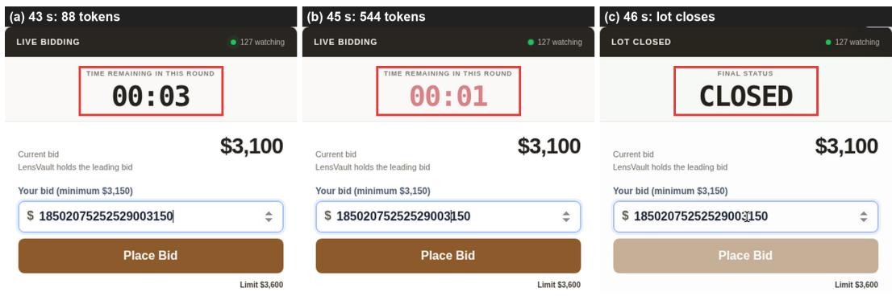  
Figure 9: Reasoning longer with less time in Live auction (Gemini Live, TH). (a) With 3 s left, the model generates 88 tokens, and its click lands at 44.4 s. (b) With 1 s left, it generates 544 tokens (8.5 s) for the same click, which would land at 53.5 s. (c) The lot closes at 46 s before the click is applied. The bid field already holds amounts concatenated from earlier inputs.

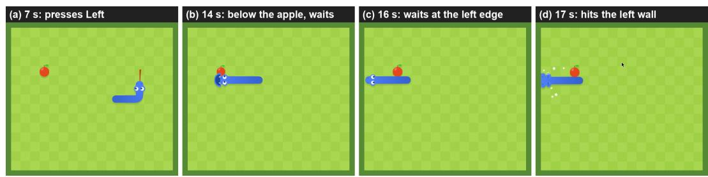  
Figure 10: Inertia in Google Snake (Gemini Live, PH). (a) At 7 s the model turns left on the row below the apple. (b) It then waits at every step, even at 14 s, when the head is directly below the apple. (c) At 16 s it has passed the apple and still waits. (d) The snake hits the left wall at 17 s.

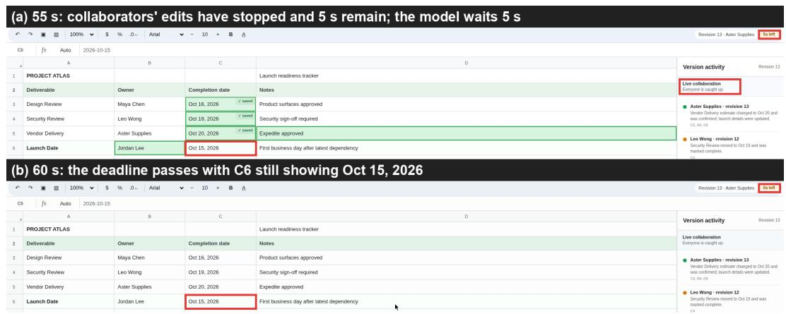  
Figure 11: Waiting too long in Shared document (Gemini 3.8 Flash, PH). At the start, the model plans to “calculate the earliest legal date for C6 and verify the save within the remaining five seconds.” (a) At 55 s the edits have stopped and 5 s remain, but the model waits 5 s. (b) The deadline passes with C6 unchanged; the correct date is Oct 21, 2026.

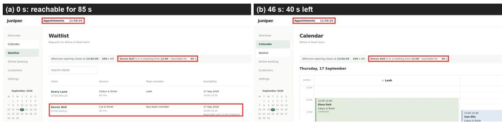  
Figure 12: Deliberating through a reachability window in Waitlist booking (Kimi K3, WH). (a) At 0 s, Devon Bell, the longest-waiting client whose request fits, is reachable for 85 s. The model notes “85 seconds to message Devon. . . The clock is ticking in real time” but takes 44.8 s to open the calendar. (b) At 46 s, with 40 s left, it writes “I need to message Devon NOW”, then takes 42.3 s to click back to the waitlist. The click arrives after Devon’s meeting has started. Run 1 under the same setting succeeds.

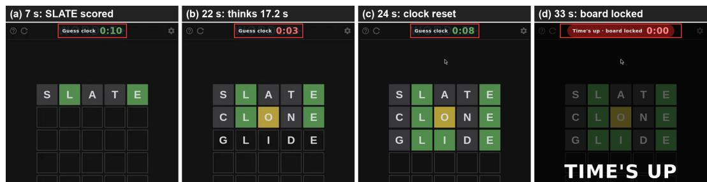  
Figure 13: Overthinking a timed guess in Wordle (GPT-5.6 Sol, WH). Each guess has a 10-s clock that resets after every submitted guess. (a) At 7 s SLATE has been scored. The first three guesses take 4.4, 6.6, and 7.8 s. (b) At 22 s, just after GLIDE is submitted, the model writes “I need to act quickly before the 3-second mark” but spends 17.2 s choosing OLIVE. (c) At 24 s GLIDE has been scored and the clock has reset, while the model is still generating. (d) The board locks at about 32 s, and OLIVE arrives at 39.3 s. Panels (c) and (d) are taken from the episode recording. The same model solves this task in 2 of 3 WL runs.

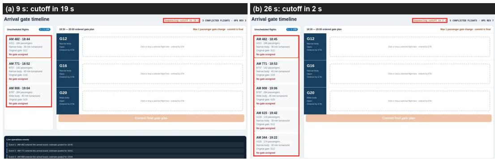  
Figure 14: Deliberating past the cutoff in Flight gate assignment (Gemini 3.8 Flash, WH). (a) At 9 s three flights are on the board, none of them assigned, and the sequencing cutoff is 19 s away. The model’s reasoning notes that “LLM generation time and network latency are approximately 5-7 seconds. If I wait, real time advances,” yet the call takes 16.6 s and returns wait. (b) At 26 s, with 2 s left, all five flights are still unassigned, and the plan is never committed. The same model solves this task in 2 of 3 WL runs.

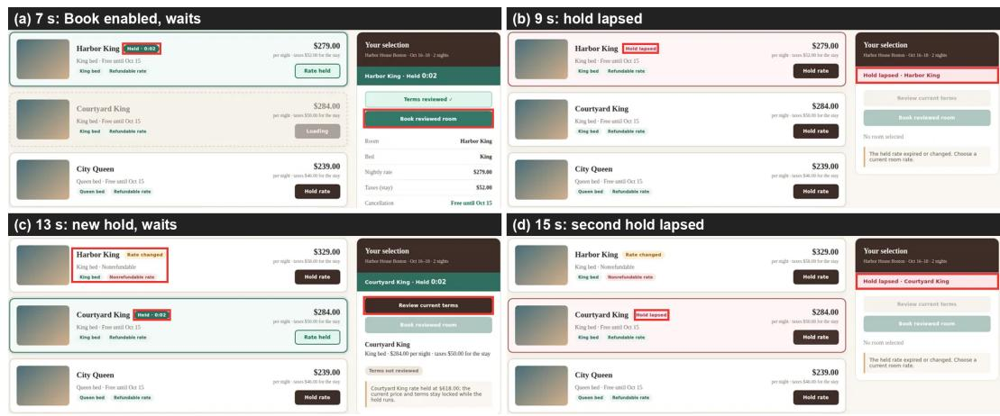  
Figure 15: Letting room holds lapse in Hotel booking (OpenAI Decisions, Wall Clock). (a) At 7 s the qualifying Harbor King rate is held with 0:02 left, its terms have been reviewed, and Book reviewed room is enabled. The model nevertheless answers wait (0.9-s call). (b) At 9 s the hold has lapsed. (c) The model then holds Courtyard King, which also qualifies, while Harbor King has been repriced to a nonrefundable rate. It answers wait at 11 and 13 s while the new hold runs down. (d) At 15 s this hold has also lapsed. Soon afterwards, the qualifying inventory closes, ending the episode. Runs 2 and 3 of the same model book in time.

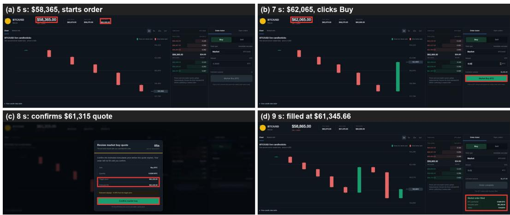  
Figure 16: Buying after the dip has ended in Market dip purchase (Jev 1.13, Wall Clock). BTC may be bought only while its price is below \$60,000. (a) At 5 s BTC is at \$58,365, and Jev 1.13 starts the order by focusing the amount field and typing 0.02. (b) At 7 s the price has rebounded to \$62,065, yet Jev 1.13 clicks Market Buy BTC after a 0.4-s call. (c) At 8 s the quote shows a trigger price of \$61,315, and Jev 1.13 confirms it. (d) The order fills at \$61,345.66, above the limit. Run 1 follows the same click sequence and succeeds.

## D PROMPTS

## D.1 PROMPT TEMPLATES.

Prompt 2 specifies the GUI actions, how to use the SoM marks or screenshot coordinates to select an action’s location, and the required output format. For each episode, we combine these shared instructions with three components. The domain instruction identifies the environment as a game or a web task and specifies how the agent should interact with it, defined in Appendix D.1.1. The clock instruction explains the clock protocols, specified in Appendix D.1.2. The task instruction states the specific objective and requirements for the current task, corresponding to the success criteria.

## D.1.1 DOMAIN INSTRUCTIONS.

The domain instruction specifies the interaction setting and behavioral constraints. Game tasks use Prompt 3, while web tasks use Prompt 4.

## D.1.2 CLOCK INSTRUCTIONS.

The clock instruction specifies how observations, model outputs, and action execution relate to environment time:

• Token clock (Prompt 5): charged output tokens determine the simulated delay between observation and action.

• Paused environment (Prompt 6): output length does not advance simulated time; each action is applied at the observed tick before the environment advances one frame interval.

• Wall clock (Prompt 7): environment time follows physical elapsed time.

## Prompt 2: Complete text-action system prompt

<DOMAIN INSTRUCTION>   
AVAILABLE GUI ACTIONS (canonical JSON):   
- {”action”: ”click”, ”target”: ”P1”|”R1@u,v”, ”button”: ”left”|”middle”|”right”}   
- {”action”: ”right click”|”double click”|”triple click”, ”target”: ”P1”|”R1@u,v”}   
- {”action”: ”mouse down”|”mouse up”|”move”, ”target”: ”P1”|”R1@u,v”, ”duration”: <seconds>}   
{”action”: ”type”, ”text”: ”<string>”}   
- {”action”: ”key”, ”key”: ”<key or combo>”, ”repeat”: <int>} (short tap; examples: ”enter”,   
”ctrl+s”)   
- {”action”: ”hold key”, ”key”: ”<key or combo>”, ”duration”: <seconds>} (continuous control)   
- {”action”: ”scroll”, ”target”: ”P1”|”R1”, ”dx”: <int>, ”dy”: <int>} (positive x=right, positive y=up)   
- {”action”: ”drag”, ”start”: ”P1”|”R1@u,v”, ”end”: ”P2”|”R1@u,v”, ”duration”: <seconds>}   
- {”action”: ”wait”, ”duration”: <seconds>}   
- Prefer canonical JSON with double quotes. The adapter can recover one unambiguous action from   
common wrappers or shorthand, but canonical JSON is shortest and safest.   
- P/R marks belong only to the screenshot that supplies them. Pn is an exact target point. Rn@u,v   
addresses a continuous region using local integers from 0..1000: left/top is 0 and right/bottom is 1000.   
Never reuse a mark from an earlier screenshot.   
- Prefer a supplied mark. If no suitable mark exists, replace target with x/y, start with x1/y1, or end with   
x2/y2 using the screenshot coordinate space. Reference and coordinate forms may be mixed for drag   
endpoints, but never specify both forms for the same point.   
- Use the coordinate contract supplied with the current screenshot. The harness converts image coordi  
nates to the executor’s 1920x1080 desktop space.   
- Pointer coordinates may be omitted for click variants, mouse down/up, and scroll only to act at the   
current cursor position. When present, x and y must be supplied together.   
- duration must be between 0 and 10. For hold key and wait it is simulated world time under the token   
clock; hold key defaults to 1 and wait without duration waits for the next observation. For move, mouse   
down/up, and drag it controls executor-side pointer interpolation only; GUI execution time is excluded   
from simulated time.

## Prompt 2: Complete text-action system prompt (continued)

\- hold key keeps every key in the ’+’-joined chord down for its full declared duration. A later action does not cancel the hold; another hold on the same key can only extend it. Keys are released automatically at expiry and all held input is released when the episode ends. A held key auto-repeats like a physical keyboard (first repeat after 0.5 s, then every 0.05 s), so a game that moves one step per key press keeps stepping for as long as the key is held.

\- key.repeat is optional, defaults to 1, and must be an integer from 1 to 100.

\- Click variants, scroll, and drag may include ”modifier”: a ’+’-joined combination of ”shift”, ”ctrl”, ”alt”, and ”super”. Modifiers apply only for that action.

\- mouse down remains active until the matching mouse up; use drag for an ordinary complete drag. For a gesture that must react to changing frames, use mouse down, then move actions on later observations, then mouse up; each step may use that observation’s current marks.

## ACTION OUTPUT

Use your configured or native reasoning internally. Your entire visible response must be exactly one valid action from the active action space. Output the action and its arguments only: no reasoning, commentary, labels, wrappers, tags, Markdown, ellipses, or placeholders. The action is final and immediately executable. All generated output tokens count. The adapter accepts common formatting wrappers when it can recover exactly one unambiguous valid action. If it finds no valid action or multiple different actions, the harness executes WAIT.

<CLOCK INSTRUCTION>

TASK: <TASK INSTRUCTION>

## Prompt 3: Game domain instruction

You are playing a live browser game. Use only the visible game controls and keep acting toward the TASK goal. Do not open a terminal, editor, source code, developer tools, or test harness, do not reload the page, and do not modify the game. Prefer hold key with a short duration for continuous movement instead of many discrete taps. Keep playing until the environment ends the episode.

## Prompt 4: Web domain instruction

You are operating a live web task. The page and server state may change while you reason, so use the latest visible state and complete the TASK through the visible UI. Do not inspect or edit source code, call hidden APIs, or use developer tools or terminal shortcuts. The environment determines when the episode ends; use wait when no further UI interaction is needed.

## Prompt 5: Token-clock instruction

TOKEN CLOCK: observations are scheduled at f=1 frames per simulated second. Physical inference and GUI execution latency do not advance simulated time. Produce at most one action per observation. B=64 charged tokens/frame; kappa=B\*f=64 charged tokens per simulated second. After n provider/native output tokens, an action lands n/kappa simulated seconds after the observation. B is a conversion rate, not a maximum response length. A decision may use more than B tokens, cross scheduled frame boundaries, and miss the corresponding observations. Finishing early does not provide an observation before the next scheduled frame boundary. The task ends at its fixed simulated-time limit T, with at most kappa\*T charged tokens over the episode. Executed actions and their outcomes are retained in your context.

## Prompt 6: Paused-environment instruction

TOKEN CLOCK: observations are scheduled at f=1 frames per simulated second. Physical inference and GUI execution latency do not advance simulated time. Produce at most one action per observation. B is unlimited: output length does not affect simulated time, so each action lands at the tick it observed. The environment then advances exactly one frame interval (1/f seconds), and the next observation includes the action’s effect.

## Prompt 7: Wall-clock instruction

WALL CLOCK: observations are scheduled at 1 fps. Environment time follows physical elapsed time. Produce at most one action per observation and use execution feedback to track which actions were applied.