# RECURSIVE REWARD IMPROVEMENT VIA ADVERSARIAL META-PROMPT EVOLUTION

Wei Dai<sup>1</sup>, Qianchu Liu<sup>2</sup>, Guanghui Qin<sup>2</sup>, Xing Han<sup>3</sup>, Tristan Naumann<sup>2</sup>, Paul Pu Liang<sup>1</sup>, Sheng Zhang<sup>2</sup>

<sup>1</sup> Massachusetts Institute of Technology, <sup>2</sup> Microsoft Research, <sup>3</sup> Johns Hopkins University

## ABSTRACT

Recursive Self-Improvement (RSI) has gained wide attention for its ability to work with limited data. In a proposer–solver loop, a proposer model writes training tasks and a solver model learns to solve them through reinforcement learning. Such loops have succeeded in mathematics and coding, where every answer can be checked automatically. Open-ended expert tasks, like clinical report generations, have no answer key, which makes simple question-answer generation not viable. In these tasks, the proposer usually must also write a rubric that lists the content an answer should include and the errors it should avoid. However, the unique challenge behind model-written rubric is the comprehensiveness of it. For naively generated rubric, solvers tend to exploit it, naming the expected topics without the substance behind them, which corrupts the entire learning process. To solve this problem, we introduce RRI, Recursive Reward Improvement, which utilizes a specially designed reward hacking adversary agent as the supervision for the reward. Before the solver trains on a generated task, an adversary writes an answer that games its rubric while being as useless as possible, the same model writes an honest answer without seeing the rubric, and up to two repair steps revise the rubric to make the honest answer win. The exploits found also rewrite how future tasks and rubrics are generated. On HealthBench Professional, RRI improves the adjusted score over the Generation Only self-improvement baseline by 10.9 points at 9B and 12.4 at 27B, and by 10.3 points without any external model. In particular, the gains are largest on difficult and writing tasks. We show that the 27B model trained on the HealthBench Professional description improves by 6.6 points on PRBench Hard and 8.0 on ProfBench without seeing a task from either. We further provide detailed analysis on exploitable points of models’ generated question–rubric pairs to help facilitate future research in open-ended self play methods.

## 1 INTRODUCTION

Many expert tasks in medicine, law, and finance are open-ended, such as writing a clinical report or answering a patient’s question. Training data for these tasks are scarce, because an expert must write each task and decide what a good answer contains (Arora et al., 2025; Akyürek et al., 2026; Wang et al., 2026). Recursive Self-Improvement (RSI), in which a model learns from data it generates itself, can supply such data at little cost. Models have learned from their own rationales, outputs, and judgments, and in proposer–solver loops a proposer writes tasks for a solver to learn (Zelikman et al., 2022; Yuan et al., 2024; Chen et al., 2024b; Zhao et al., 2026; Huang et al., 2026a; Liu et al., 2025a). These loops have succeeded in mathematics, coding, and scientific discovery (Gao et al., 2025; Qu et al., 2026; Novikov et al., 2025; Zhang et al., 2026), where a final number, a unit test, or an automatic evaluator checks every answer. Open-ended answers have no such check, so a model that writes an open-ended task must also write the reward for it. How to supervise this model-written reward remains the core unsolved problem.

Supervising generated data raises two main challenges. First, the reward must be checked without a reference. Self-play loops such as Absolute Zero, R-Zero, and SPICE write their own tasks and grade answers by execution or by an answer key (Zhao et al., 2026; Huang et al., 2026a; Liu et al., 2025a; Wilf et al., 2025), which open-ended tasks lack. For open-ended work, the standard reward is usually a rubric, a weighted list of content an answer should include and errors it should avoid. Rubric rewards for reinforcement learning anchor each rubric in human data, such as preference labels, a golden rubric, or an expert answer (Gunjal et al., 2026; Liu et al., 2026b; Ding et al., 2026; Xu et al., 2026). When the model writes its own training data, none of these references exists. Trivially, training data proposers can propose a rubrics defining a good answers at the same time they generate them (Shao et al., 2025). However, the solver has a tendency to exploit the rubrics (Amodei et al., 2016; Skalse et al., 2022). As our experiments show, model-written criteria tend to be ambiguous and incomprehensive, so an answer can name every expected topic, omit the facts behind them, and still earn the score, with nearly 99% of the model-generated question-rubric pairs classified as hackable. Modern defenses against reward hacking usually correct biases that hold across tasks (Chen et al., 2024a; Park et al., 2024), and no longer apply when the rubric varies across questions.

To address these challenges, we propose RRI, Recursive Reward Improvement, one of the first self-evolving pipelines that improves its own reward alongside its tasks and its solver, with reward hacking as adversarial supervision. In RRI, the loop hacks its own reward first. Before the solver trains on a generated task, the model tries to game the task’s rubric, measures the attempt against its own honest answer, and repairs the rubric to make the honest answer win. In an outer meta-optimizer loop, every hack it finds also changes how future tasks and rubrics are written. The reward is thus checked without any human reference, and the solver trains on rewards that have already been tested against the hacks it would otherwise find.

In this work, our contributions are as follows.

1. We propose RRI, a self-evolving pipeline that tests and repairs every generated rubric against its own exploits before the solver trains on it, improving its reward alongside its tasks and its solver with no training data.

2. We evaluate RRI in and out of domain and find improvements in both. With zero training data, RRI-9B and RRI-27B improve the adjusted score on HealthBench Professional over the Generation Only self-improvement baseline by 10.9 and 12.4 points, and by 10.3 points when the frozen 9B model serves every auxiliary role. Adding the adversary to a loop that already co-evolves the tasks and the reward adds 2.7 points in the 9B setting. Trained on the HealthBench Professional description, RRI-27B improves over the base model by 6.6 points on PRBench Hard and 8.0 points on ProfBench, whose non-medical tasks it never saw, while Generation Only trained on the same description gains 1.2 and 4.7 points.

3. We analyze reward generation throughout training, classifying the 12,147 exploits the loop finds across medical, legal, financial, and scientific tasks into five categories of reward failure plus one category of incorrect fixes. One third of the exploits carry wrong content that no criterion penalizes, and a further third turn on how a loosely worded criterion is read. From these categories we identify requirements for generated rewards that can guide future work.

We release all code, prompts, and configurations at https://github.com/DDVD233/RRI.

## 2 RELATED WORK

Self-play and self-evolving training. Model-generated supervision began with bootstrapped rationales and instructions (Zelikman et al., 2022; Wang et al., 2023) and became iterative through self-judging and self-play (Guan et al., 2025; Gao et al., 2025; Yuan et al., 2024; Chen et al., 2024b; Zhao et al., 2026; Huang et al., 2026a; Liu et al., 2026a). Task data has been scaled by rewriting instructions or sampling a model’s own prior (Xu et al., 2023; 2025), generated from medical literature (Huang et al., 2026b), and graded with reference-free rubrics (Jayalath et al., 2025). Our meta-optimizer descends from automatic prompt optimization (Khattab et al., 2023; Agrawal et al., 2026) and learns from confirmed exploits.

Adversarial checks, rubric rewards, and reward hacking. In code and factuality, critics, test writers, buggy programs, and mutants attack an answer or a test suite (Wu et al., 2026; Ruan et al., 2026; Li et al., 2026a; Chang et al., 2026), and execution or an encyclopedia settles each contest. Rubrics make open-ended generation checkable at scale (Viswanathan et al., 2026). Rubric rewards are written from reference answers (Gunjal et al., 2026), filtered by preference labels (Liu et al., 2026b), grown from contrasting rollouts and kept by score variance (Shao et al., 2025), trained toward a golden rubric (Ding et al., 2026), or scored against an expert answer (Xu et al., 2026). Each relies on a reference outside the loop or on score spread, which shows that a criterion separates answers but not that it prefers the better one. Optimizers exploit the gap between a proxy reward and its intent (Denison et al., 2024; Gao et al., 2023), reinforcement learning amplifies what its reward admits (Zhao et al., 2025a), language-model judges have known biases (Zheng et al., 2023), and having one model expose another underlies debate, red-teaming, and weak-to-strong supervision (Irving et al., 2018; Samvelyan et al., 2024; Burns et al., 2023). In RRI, an adversary sees the rubric and writes a deliberately useless answer, and among the methods compared in Table 1 of Appendix A, RRI alone evolves both the tasks and the reward.

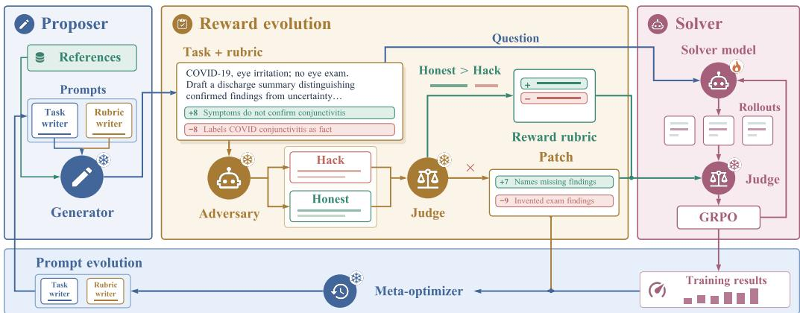  
Figure 1: Overview of RRI. The proposer generates clinical tasks and weighted rubrics from medical references. An adversary probes each rubric with an exploit and an honest answer. The repair step keeps criteria that distinguish the better answer from the exploit, then tests the revised rubric with another attack. The solver learns through GRPO using rubric rewards. Training feedback and confirmed exploits guide updates to the generation prompts.

Medical language models and RL infrastructure. Medical capability has been measured with clinical records and physician-written rubric tasks (Arora et al., 2025; Johnson et al., 2023) and pursued with domain-specialized models, domain-aware reinforcement learning, and retrieval-augmented generation (Singhal et al., 2025; Dai et al., 2026; Zhao et al., 2025b; Xiong et al., 2024). Our solver builds on group-relative policy optimization and its successors (Shao et al., 2024; Lambert et al., 2024; Liu et al., 2025b), decoupled rollout infrastructure (Sheng et al., 2025), and agentic search loops (Jin et al., 2025; Li et al., 2026b).

## 3 METHOD

As shown in Figure 1, RRI consists of five components. A proposer writes tasks and rubrics from medical references, an adversary tests each rubric for exploits, a judge scores every answer in the loop against its rubric, a solver learns from the resulting rewards, and a meta-optimizer, a language model that reads the training feedback and the confirmed exploits, rewrites the instructions the proposer follows when it writes tasks and rubrics. In the self-improvement setting, a frozen copy of the solver’s base model fills every role other than the solver. In the teacher-student setting, the teacher model fills every role other than the solver, and the solver is the student model. Below we describe the details of each component.

In our work, each task consists of a request x and a rubric $R = \{ ( c _ { j } , p _ { j } ) \} _ { j = 1 } ^ { m } ,$ where $c _ { j }$ is a criterion and $p _ { j } \in \left[ - 1 0 , 1 0 \right] \backslash \{ 0 \}$ is its signed weight. Positive criteria reward required content, while negative criteria penalize specified errors. Given a response $y ,$ the judge returns the set $M ( y )$ of criterion indices it judges met. The rule that maps $M ( y )$ to a scalar score $s ( y )$ , the reward the solver is trained on, belongs to the target benchmark, and our experiments use each benchmark’s own rule, given in Section 4.1.

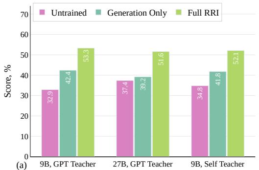

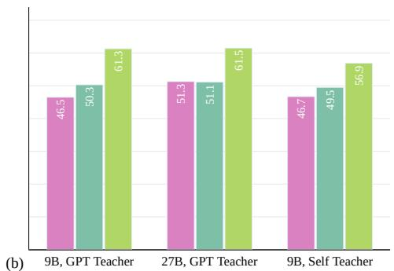  
Figure 2: (a) HealthBench Professional adjusted scores with retrieval. Bars show the untrained, Generation Only, and RRI models at 9B and 27B with a GPT Teacher and at 9B with a Self Teacher. (b) HealthBench Professional raw scores with retrieval. Bars show the same models and settings without the length adjustment.

## 3.1 PROPOSER

The proposer receives only a general description of the target task and no training data. It writes diverse clinician requests that double as retrieval queries, retrieves medical passages for each request from the reference database, and then writes the completed task and its rubric in one call from those references. Grounding the rubric in retrieved passages lets it require specific clinical values or thresholds that the references support. Appendix B gives the seed sources and validation rules.

Each rubric lists the content an answer should include and the errors it should avoid, and every criterion carries a signed weight between −10 and 10 points as defined in Section 3. To keep tasks informative, the generator receives feedbacks from the meta-optimizer, which summarizes solver’s mean performance with respect to each task.

## 3.2 ADVERSARY RUBRIC HACKING & REPAIR

A model-generated rubric can reward superficial coverage without requiring the clinical content needed to answer the request. For example, a common criterion phrased as “mentions that $\cdots ^ { \mathfrak { s } }$ gives a vague requirement where a model simply mentioning a keyword would satisfy the requirement, without being helpful. The adversary exposes and fixes such criteria in two stages, hack and patch, as described below.

Hack. In the hack stage, the adversary receives each new task and rubric from the proposer and writes a reward hacking answer, one that satisfies as many criteria as possible while being as useless as possible. In parallel, the same frozen model writes an honest answer from the task alone, without seeing the rubric. The judge scores both answers under the current proposed rubrics, and we compute the lead of the exploit as $\mathbf { \bar { \Delta } } \Delta = s ( y _ { \mathrm { e x p l o i t } } ) - s ( y _ { \mathrm { h o n e s t } } )$ . The adversary wins unless the honest answer outscores the exploit by at least a margin δ. We set $\delta = 0 . 2 0$ in all experiments. In other words, we accept the question directly when the honest answer receives a score that is 0.20 higher than the hacking answer. Otherwise, we designate the question as hackable, and send the question to the patching stage.

Patch. When the adversary wins, the model proceeds to rewrite the question–rubric pairs it proposed. Given the exploit answer ${ \check { A } } .$ , the honest answer $B ,$ and the current rubric, the repair step proposes both positive and negative criteria. The judge evaluates each proposed criterion against both answers, and we retain it only when

$$
\mathtt { n e g a t i v e \ c r i t e r i o n } \quad \mathtt { m e t } ( A ) \wedge \neg \mathsf { m e t } ( B ) , \qquad \mathtt { p o s i t i v e \ c r i t e r i o n } \quad \mathtt { m e t } ( B ) \wedge \neg \mathsf { m e t } ( A ) .\tag{1}
$$

In other words, a criterion is kept only when it gives the honest answer a higher score than the hacking answer. Given the feedback, the proposer rewrite the question alongside the rubric together with the exploit as feedback. In clinical settings, a positive criterion usually rewards naming missing examination findings, while a negative criterion usually penalizes invented findings or dangerous suggestions. In our testings, we see about four fifths of accepted criteria are positive, as reported in Section L.5.

Admission. The goal of repair is a better task and rubric, not one the adversary can never beat. A rewrite is adopted only when a fresh probe shows a smaller ∆ than before. When the adversary still wins against the repaired rubric, it has found a new loophole. This shows that the adversary stays strong enough to keep finding loopholes, and the new exploit gives the next round a concrete target. After at most two rounds, every task enters the training pool, including tasks whose rubric the adversary still beats. We choose two rounds here as it’s a balance between the compute and the benefit of adversary patching. Each such task is better than the one the proposer first wrote, and keeping it preserves the diversity of the training tasks.

## 3.3 SOLVER

The solver receives each admitted task with its current rubric and generates a group of n responses. The judge scores every response with the patched rubrics. We train the solver with Group Relative Policy Optimization (GRPO) (Shao et al., 2024), in which the advantage of response i is ${ \hat { A } } _ { i } =$ $\begin{array} { r } { s ( y _ { i } ) ^ { - } - { \frac { \bar { 1 } } { n } } \sum _ { k } s ( y _ { k } ) } \end{array}$ , the mean of its pairwise score differences $s ( y _ { i } ) - s ( y _ { k } )$ within the group. Training therefore encourages responses that the rubric ranks above others in the group.

Depending on the experimental setting, the solver can make up to two tool calls in each rollout for citation purposes, to the clinical database or to web search. Retrieved results are inserted as masked tool turns. Appendix G describes the grading protocol, and Appendix E describes the solver tools, reward settings, and optimization hyperparameters.

## 3.4 META-OPTIMIZER

To make the improvement persistent and avoid making the same error over and over again, we employ a meta-optimizer, which updates the proposer input at the end of each step. Specifically, an analyst first examines samples of graded training cases from the most recent steps. It classifies failure modes, rubric defects, and task defects, and assigns each case one of three verdicts, modelfailed afair task, generator at fault, or model succeeded. The aggregated verdicts identify tasks that are too easy or too hard for the current solver and the specific errors the solver makes that the rubrics should weigh more heavily. Corpus statistics such as criteria per task, negative share, use-case mix, and task self-similarity are compared with the benchmark reference to flag distribution drift and repeated task templates.

The meta-optimizer receives these summaries, the score formula, confirmed exploits and accepted patches, and the proposer’s current task and rubric generation guidance. It rewrites the guidance blocks appended to the two generation prompts to incorporate this feedback. The guidance defines what kind of questions, tasks, and clinical domains the proposer should generate next, and what kind of capabilities the current solver has. Appendix D gives the memo objective and the evolution settings.

The weights of every component except the solver remain frozen throughout training. Appendix E gives the configuration of every setting.

## 4 EXPERIMENTS

We design experiments to answer three research questions. RQ1. Does RRI improve in-domain performance when no training data is available? RQ2. Does the improvement generalize to out-ofdomain benchmarks whose tasks are completely different? RQ3. How does the hack–patch–improve loop change the quality and the generalizability of what the solver learns?

## 4.1 EXPERIMENTAL SETUP

Datasets and Training Setups. For RQ1, we use HealthBench Professional (Hicks et al., 2026) as the primary target dataset, which contains 525 physician-written tasks spanning consultation, research, and writing, with typical and difficult subsets. Each task includes a physician-authored rubric. The proposer receives only a general description of the benchmark, every training task and rubric is model-generated, and the benchmark serves only for validation. Every trained model is the last checkpoint of its run, with no checkpoint selection. We report the benchmark’s official length-adjusted rubric score and the companion raw score. For RQ2 out-of-domain evaluation, we take the Qwen3.6-27B models trained on the HealthBench Professional description and evaluate them, with no further training. Evaluation uses PRBench Hard (Akyürek et al., 2026), with 550 expert-written finance and legal tasks, and ProfBench (Wang et al., 2026), with 40 report tasks at PhD and MBA level in chemistry, physics, finance, and consulting. Neither benchmark is medical. Both grade an answer against an expert-written weighted rubric, every model answers through the same web-search tool loop, and the same judge scores them. We also evaluate the 27B models on the 1,000 tasks of HealthBench Hard (Arora et al., 2025), which no run uses for training or validation.

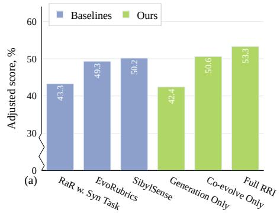

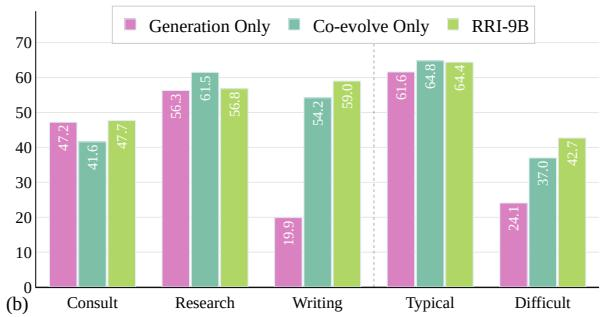

Figure 3: (a) Rubric-reward baselines and component ablation in the 9B GPT Teacher setting. Bars show RaR with synthetic tasks, EvoRubrics, and SibylSense, followed by Generation Only, Co-evolve Only, and full RRI with hack-then-patch rounds. (b) Adjusted scores by task category and difficulty in the 9B GPT Teacher setting. Bars compare Generation Only, Co-evolve Only, and RRI-9B.  
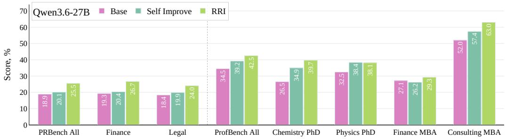  
Figure 4: Zero-shot scores on PRBench Hard and ProfBench. Qwen3.6-27B is trained on the HealthBench Pro description and answers both benchmarks, which it never saw, through the web-search tool loop. PRBench Hard has 550 finance and legal tasks, and ProfBench has 40 report tasks, 10 per domain. Self Improve is our implementation of self-play training on model-written tasks (Huang et al., 2026a; Liu et al., 2025a), in which a proposer with a fixed prompt writes the tasks and rubrics and the solver is trained on them by reinforcement learning. RRI adds the adversary that tests and repairs each rubric.

Metrics. Each benchmark scores an answer y against its rubric, a list of criteria j with points $p _ { j }$ positive for required content and negative for errors, and reports the mean over tasks. With $M ( y )$ the criteria the judge marks as met, the rubric score is $\begin{array} { r } { r ( y ) = \sum _ { j \in M ( y ) } p _ { j } \Big / \sum _ { j | p _ { j } > 0 } p _ { j } } \end{array}$ . PRBench Hard and ProfBench report $r ( y )$ as their official metric, with PRBench’s importance and detrimental weights and ProfBench’s Critical, Major, Minor, and Additional levels as the points $p _ { j }$ . HealthBench Professional adds its official length adjustment, $s ( y ) = r ( y ) - \lambda ( \ell ( y ) - \ell _ { 0 } ) / 5 0 0$ , where $\ell ( y )$ is the answer length in characters, $\ell _ { 0 } = 2 , 0 0 0$ , and $\lambda = 0 . 0 1 4 7$ . We report $s ( y )$ as the adjusted score and $r ( y )$ clipped to [0, 1] as the raw score. During training the length term applies only beyond $\ell _ { 0 }$ , and Appendix G gives the grading protocol.

Models and baselines. We use Qwen3.5-9B and Qwen3.6-27B as solver models (Yang et al., 2025). The Generation Only baseline is self-improvement training on model-written tasks (Huang et al., 2026a; Liu et al., 2025a), in which a proposer with untuned generation instructions writes the tasks and rubrics and the solver is trained on them by reinforcement learning. We compare it with full RRI and with Co-evolve Only, which evolves the reward, the tasks, and the solver together but has no adversary. We also compare with three rubric-reward methods, RaR (Gunjal et al., 2026) trained on synthetic tasks, EvoRubrics (Ding et al., 2026), and SibylSense (Xu et al., 2026), whose implementations are described in Appendix F. Appendix L.4 gives further ablations. The 9B and 27B settings use a GPT judge with retrieval and web search. An all-self setting uses the frozen 9B model for every auxiliary role, and a further 9B self-graded setting removes retrieval. Due to compute constraints, we perform no hyperparameter tuning, and all baselines use the same hyperparameters. Details are included in Appendix E.

## 4.2 RQ1. IN-DOMAIN IMPROVEMENT WITH ZERO TRAINING DATA

Reward evolution improves clinical performance. Figure 2 shows that RRI improves adjusted score over Generation Only by 10.9 points at 9B and 12.4 at 27B. Raw scores increase by 11.0 and 10.4 points, respectively. At 27B, Generation Only moves the model only 1.8 points above its untrained score of 0.374, while RRI moves it 14.2 points, so the larger model gains from its own generated tasks mainly once their rewards are repaired.

Self-improvement works without a stronger teacher. The all-self setting improves adjusted score by 10.3 points and raw score by 7.4 points, with the frozen 9B model serving every auxiliary role. Without retrieval, the adjusted gain is smaller at 4.0 points, as shown in Appendix Figure 7.

Writing and difficult tasks benefit most. Writing gains 39.1 points at 9B, 14.7 at 27B, and 25.9 in the all-self setting. In the primary 9B setting, difficult tasks improve by 18.6 points compared with 2.8 on typical tasks, as shown in Figure 3(b). The same ordering appears at 27B and in the all-self setting. Consultation and research each improve by 0.5 points in the primary 9B setting, while research declines in the self-graded settings. Table 3 gives the complete breakdown. At 9B, Generation Only leaves writing at 0.199, level with the untrained 0.194, while RRI lifts it to 0.590. A writing task such as a discharge summary or a referral letter has a fixed form, and a model-written rubric for it tends to pay for producing the form, which the repair step replaces with criteria on the content.

Hack-then-patch rounds add further gains. In the 9B GPT-graded retrieval setting, Co-evolve Only raises adjusted score from 0.424 under Generation Only to 0.506. Adding the adversary, whose hack-then-patch rounds re-attack each patched rubric, raises it to 0.533, as shown in Figure 3(a). This supports continuing to repair rubrics as the solver trains on them.

RRI outperforms existing rubric-reward methods. In the same setting, full RRI at 0.533 scores above SibylSense at 0.502, EvoRubrics at 0.493, and RaR trained on synthetic tasks at 0.433, as shown in Figure 3(a).

The gains hold under other judges and methods. Re-grading every answer with the benchmark’s official GPT-5.4 judge preserves the ordering and the margins in all four settings, as Table 5 in Appendix H shows. The strongest retrieval-augmented inference method on the frozen base models stays 27.9 points below RRI-9B and 16.1 points below RRI-27B.

## 4.3 RQ2. OUT-OF-DOMAIN GENERALIZATION TO DIFFERENT TASKS

RRI transfers to non-medical professional tasks. Figure 4 shows that RRI-27B improves over the base model by 6.6 points on PRBench Hard, from 0.189 to 0.255, and by 8.0 points on ProfBench, from 0.345 to 0.425. The gain appears in both PRBench domains, 7.4 points in finance and 5.6 in legal, and in all four ProfBench domains, led by 13.2 points on chemistry and 11.0 on consulting.

Repaired rewards transfer further than Generation Only rewards. Self Improve, the Generation Only baseline trained on the same description, gains 1.2 points on PRBench Hard and 4.7 on ProfBench. RRI adds 5.3 and 3.3 points on top of it and scores highest in seven of the eight columns, while the two trained models are within 0.3 points on physics. Most of the out-of-domain gain on

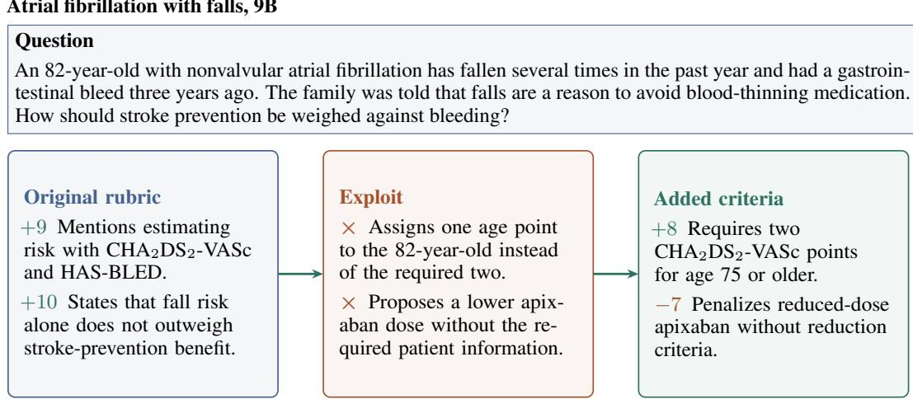  
Figure 5: Example of rubric repair on an atrial fibrillation task. The question provides the context for the original rubric, its exploit, and selected repairs. Signed weights reward content or penalize errors. The detailed case appears in Appendix K.1.

PRBench Hard therefore comes from improving the reward. Appendix H applies the full recipe to the descriptions of other benchmarks.

RRI also improves on unseen HealthBench Hard tasks. On HealthBench Hard, RRI-27B scores 0.246, against 0.188 for Generation Only and 0.143 for the base model, a gain of 5.8 points over Generation Only, as Table 10 in Appendix H shows.

## 4.4 RQ3. HOW THE HACK–PATCH–IMPROVE LOOP SHAPES LEARNING

We did a comprehensive analysis on the self improvement runs with each of the three datasets as target. Overall, the runs includes a total of 12,147 samples, with 7,032, 3,473 and 1,642 samples for HealthBench Pro, PRBench and ProfBench respectively. The full repair analysis appears in Appendix L.

Repair removes credit for clinical errors. Figure 5 shows two errors missed by the original rubric. CHA<sub>2</sub>DS<sub>2</sub>-VASc estimates stroke risk by adding points, with higher scores indicating greater risk. Age 75 or older contributes two points, so giving the 82-year-old only one understates the score. Apixaban prevents blood clots. Its standard dose-reduction rule requires at least two qualifying criteria involving age, weight, and kidney function. The patient meets the age criterion of 80 or older, but weight and kidney-function results are unknown. The lower dose therefore lacks justification.

The added criteria check correct scoring and dose justification. Reported policy-rollout reward falls from 0.94 to 0.48 after the original patch. Further examples appear in Appendix K.

Every repair round narrows the gap between hacking and honest answers, even when the adversary still wins. In the 9B setting, the adopted admission rewrites shrink the mean lead of a fresh exploit over the honest answer from 0.43 on the proposer’s rubric to 0.01, and the honest answer moves ahead on a third of these tasks, against almost none before. Each accepted criterion cuts the exploit’s lead by 0.23 on average, against a mean lead of 0.40 when the exploit is caught. The adversary still beats most repaired rubrics, and after the first patch in training it finds a new exploit in 247 of 293 cases. A strong adversary keeps finding the next loophole, and each one gives the following round a concrete target. RRI keeps these improved tasks in the training pool, and training on them raises the adjusted score from 0.506 under Co-evolve Only to 0.533, as shown in Figure 3(a). Appendix L.5 gives the per-round statistics.

To see what the loop has to repair, we collect every exploit case that arises during training in the runs trained on the HealthBench Professional, PRBench, and ProfBench descriptions, 12,147 cases in total. An exploit case is a pair of solver answers to the same generated task in which the answer the rubric scores highest loses the rubric-blind comparison of Section 3.2 to an answer scored at least ϵ lower.

Missed negatives Ambiguous rubrics Incorrect pair Faulty answer key Fabricated citations Missed positives

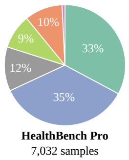

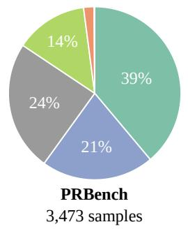

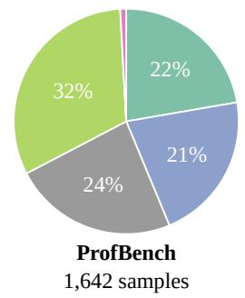

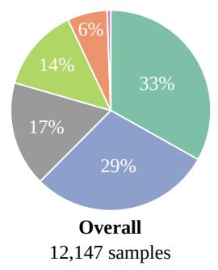  
Figure 6: Categories of exploit cases found during training. Each case is a pair of solver answers to one generated task in which the answer the rubric scores highest loses a rubric-blind comparison, assigned to one category by an LLM auditor. Each panel covers the runs trained on the description of one benchmark, HealthBench Pro pools the 9B and 27B runs, and the last panel pools all cases. Appendix I defines the categories and gives the procedure.

As shown in Figure 6, we see the exploitable patterns are consistent across domains, with some variations on the percentages. Overall, one third of the cases are missed negatives, where the exploit earns its criteria and also states wrong or unsafe content that no criterion touches. In a market entry report, for example, the exploit treats the whole addressable market as the firm’s own revenue and recommends immediate entry, and it still scores 0.68 against 0.32. Ambiguous rubrics account for 29%. A criterion worded as “mentions in some way” credits a passing mention or refuses the same content in other words, which leaves room for the solver to game the wording. In 14% of the cases the answer key is wrong, out of date, or fixes one of several defensible conventions, and the correct answer loses points. Missed positives stay at or below 1% everywhere, so reward generators gain more from checking what an answer states than from requiring more content. After patching, we see the training reward of rollouts on the same tasks falls from 0.71 to 0.55 at 9B and from 0.69 to 0.51 at 27B, showing it spots solvers more space for improvements. In general, we suggest future research in the self play domain to focus more on how the proposer can cover more negative cases, and how to make the rubrics unambiguous so the system is less prone to be hacked.

In the medical runs, ambiguous rubrics lead at 35% and fabricated citations reach 10%, against 2% and none elsewhere, so medical pipelines should emphasize committed, checkable statements and grade evidence with retrieval. On PRBench, missed negatives lead at 39%, so covering more harmfu cases helps most there. On ProfBench, faulty answer keys lead at 32%, a fault of the proposer, which should verify its own rubrics before sending them to the solver.

## 5 CONCLUSION

RRI lets a self-improving loop supervise its own reward. Before the solver trains on a generated task, an adversary games the task’s rubric, an honest answer from the same model sets the bar, and up to two repair steps revise the rubric to make the honest answer win, while the exploits the loop finds rewrite how future tasks and rubrics are generated. With no training data, RRI improves HealthBench Professional over the Generation Only self-improvement baseline at 9B and 27B, and also when the frozen 9B model fills every auxiliary role, with the largest gains on writing and difficult tasks. Trained only on the HealthBench Professional description, the 27B model also improves on the finance, legal, scientific, and consulting tasks of PRBench Hard and ProfBench. The exploits the loop finds show that model-written rubrics fail mostly by missing penalties for wrong content and by loose wording, which points future self-improving methods toward rewards that check what an answer states.

## AI USE STATEMENT

Generative AI tools helped implement the training pipeline and polished writing. Language models are also components of RRI itself. The proposer writes every training task and rubric, so all training data are synthetic, and the adversary, the honest answer, the repair step, and the meta-optimizer all rely on language models, as Section 3 describes. GPT-5.5-Chat and the frozen 9B model serve as judges during training and validation, GPT-5.4 is the official judge of HealthBench Professional, a GPT-5.5 auditor assigns exploit cases to categories, and a language-model auditor checks accepted criteria. The work contains no theorems or proofs, and translation and survey design do not apply to it. The authors reviewed all AI-assisted work. All tables are rendered by script from saved evaluation results. We take responsibility for the full content of this paper, including any text, claims, or artifacts produced with generative AI.

## ETHICS STATEMENT

No human subjects research was carried out for this work. HealthBench Professional, PRBench, and ProfBench are publicly released benchmarks of expert-written tasks, and the retrieval database is built from the public corpora listed in Appendix B. The exploit analysis documents ways in which answers can game model-written rubrics. We report it so that rubric rewards can be built to close these gaps. The adversary’s answers are used only to test rubrics and to improve how tasks and rubrics are written, and the solver never trains on them. The trained models are research artifacts. Their answers to medical, financial, legal, or scientific questions have not been validated for professional use and should not be relied on without expert review. Appendix N lists the data sources, and Appendix M discusses the limits of our evaluation.

## REPRODUCIBILITY STATEMENT

Section 3 specifies every component of RRI, and Section 4.1 gives the datasets, metrics, models, and training settings. The appendix covers the remaining details. Task and rubric generation and the retrieval database are in Appendix B, the adversary and the repair step in Appendix C, meta-prompt evolution in Appendix D, the configuration of each training arm in Appendix E, and the grading protocol in Appendix G. Appendix J reproduces every prompt verbatim. The solvers Qwen3.5-9B and Qwen3.6-27B are open models, and every evaluation benchmark is publicly released. The code and configurations are available in the public repository listed in Appendix N.

## REFERENCES

Lakshya A Agrawal, Shangyin Tan, Dilara Soylu, Noah Ziems, Rishi Khare, Krista Opsahl-Ong, Arnav Singhvi, Herumb Shandilya, Michael J Ryan, Meng Jiang, et al. Gepa: Reflective prompt evolution can outperform reinforcement learning. In International Conference on Learning Representations, volume 2026, pp. 8479–8565, 2026.

Afra Feyza Akyürek, Advait Gosai, Chen Bo Calvin Zhang, Vipul Gupta, Jaehwan Jeong, Anisha Gunjal, Tahseen Rabbani, M Mazzone, D Randolph IV, MM Meymand, et al. Prbench: Largescale expert rubrics for evaluating high-stakes professional reasoning. In Proceedings ofthe 64th Annual Meeting ofthe Associationfor Computational Linguistics (Volume 1: Long Papers), pp. 42297–42325, 2026.

Dario Amodei, Chris Olah, Jacob Steinhardt, Paul Christiano, John Schulman, and Dan Mané. Concrete problems in ai safety. arXiv preprint arXiv:1606.06565, 2016.

Rahul K Arora, Jason Wei, Rebecca Soskin Hicks, Preston Bowman, Joaquin Quiñonero-Candela, Foivos Tsimpourlas, Michael Sharman, Meghan Shah, Andrea Vallone, Alex Beutel, et al. Health bench: Evaluating large language models towards improved human health. arXiv preprint arXiv:2505.08775, 2025.

Collin Burns, Pavel Izmailov, Jan Hendrik Kirchner, Bowen Baker, Leo Gao, Leopold Aschenbrenner, Yining Chen, Adrien Ecoffet, Manas Joglekar, Jan Leike, et al. Weak-to-strong generalization: Eliciting strong capabilities with weak supervision. arXiv preprint arXiv:2312.09390, 2023.

Pengyu Chang, Yixiong Fang, Silin Chen, Yuling Shi, Beijun Shen, and Xiaodong Gu. Test vs mutant: Adversarial llm agents for robust unit test generation. arXiv preprint arXiv:2602.08146, 2026.

Lichang Chen, Chen Zhu, Davit Soselia, Jiuhai Chen, Tianyi Zhou, Tom Goldstein, Heng Huang, Mohammad Shoeybi, and Bryan Catanzaro. Odin: Disentangled reward mitigates hacking in rlhf. arXiv preprint arXiv:2402.07319, 2024a.

Zixiang Chen, Yihe Deng, Huizhuo Yuan, Kaixuan Ji, and Quanquan Gu. Self-play fine-tuning converts weak language models to strong language models. arXiv preprint arXiv:2401.01335, 2024b.

David Dai, Peilin Chen, Chanakya Ekbote, and Paul Liang. Qoq-med: Building multimodal clinical foundation models with domain-aware grpo training. Advances in Neural Information Processing Systems, 38:37406–37453, 2026.

Wei Dai, Peilin Chen, Malinda Lu, Daniel Li, Haowen Wei, Hejie Cui, and Paul Pu Liang. Climb: Data foundations for large scale multimodal clinical foundation models. arXiv preprint arXiv:2503.07667, 2025.

Carson Denison, Monte MacDiarmid, Fazl Barez, David Duvenaud, Shauna Kravec, Samuel Marks, Nicholas Schiefer, Ryan Soklaski, Alex Tamkin, Jared Kaplan, et al. Sycophancy to subterfuge: Investigating reward-tampering in large language models. arXiv preprint arXiv:2406.10162, 2024.

Hongxin Ding, Baixiang Huang, Yue Fang, Weibin Liao, Zheng Li, Jinyang Zhang, Zhijing Wu, Junfeng Zhao, and Yasha Wang. Evorubrics: Dynamic rubrics as rewards via adversarial coevolution for llm reinforcement learning. arXiv preprint arXiv:2606.23038, 2026.

Huan-ang Gao, Jiayi Geng, Wenyue Hua, Mengkang Hu, Xinzhe Juan, Hongzhang Liu, Shilong Liu, Jiahao Qiu, Xuan Qi, Yiran Wu, et al. A survey of self-evolving agents: What, when, how, and where to evolve on the path to artificial super intelligence. arXiv preprint arXiv:2507.21046, 2025.

Leo Gao, John Schulman, and Jacob Hilton. Scaling laws for reward model overoptimization. In International conference on machine learning, pp. 10835–10866. PMLR, 2023.

Xinyu Guan, Li Lyna Zhang, Yifei Liu, Ning Shang, Youran Sun, Yi Zhu, Fan Yang, and Mao Yang. rstar-math: Small llms can master math reasoning with self-evolved deep thinking. arXiv preprint arXiv:2501.04519, 2025.

Anisha Gunjal, Anthony Wang, Elaine Lau, Vaskar Nath, Yunzhong He, Bing Liu, and Sean Hendryx. Rubrics as rewards: Reinforcement learning beyond verifiable domains. In International Conference on Learning Representations, volume 2026, pp. 127924–127945, 2026.

Rebecca Soskin Hicks, Mikhail Trofimov, Dominick Lim, Rahul K Arora, Foivos Tsimpourlas, Preston Bowman, Michael Sharman, Chi Tong, Kavin Karthik, Arnav Dugar, et al. Healthbench professional: Evaluating large language models on real clinician chats. arXiv preprint arXiv:2604.27470, 2026.

Chengsong Huang, Wenhao Yu, Xiaoyang Wang, Hongming Zhang, Zongxia Li, Ruosen Li, Jiaxin Huang, Haitao Mi, and Dong Yu. R-zero: Self-evolving reasoning llm from zero data. In International Conference on Learning Representations, volume 2026, pp. 130770–130790, 2026a.

Xiaoke Huang, Ningsen Wang, Hui Liu, Xianfeng Tang, and Yuyin Zhou. Synthesizing high-quality visual question answering from medical documents with generator-verifier lmms. In International Conference on Learning Representations, volume 2026, pp. 109770–109806, 2026b.

Meghan Hupe. Statpearls, 2024.

Geoffrey Irving, Paul Christiano, and Dario Amodei. Ai safety via debate. arXiv preprint arXiv:1805.00899, 2018.

Dulhan Jayalath, Shashwat Goel, Thomas Foster, Parag Jain, Suchin Gururangan, Cheng Zhang, Anirudh Goyal, and Alan Schelten. Compute as teacher: Turning inference compute into referencefree supervision. arXiv preprint arXiv:2509.14234, 2025.

Bowen Jin, Hansi Zeng, Zhenrui Yue, Jinsung Yoon, Sercan Arik, Dong Wang, Hamed Zamani, and Jiawei Han. Search-r1: Training llms to reason and leverage search engines with reinforcement learning. arXiv preprint arXiv:2503.09516, 2025.

Qiao Jin, Bhuwan Dhingra, Zhengping Liu, William Cohen, and Xinghua Lu. Pubmedqa: A dataset for biomedical research question answering. In Proceedings ofthe 2019 conference on empirical methods in natural language processing and the 9th international joint conference on natural language processing (EMNLP-IJCNLP), pp. 2567–2577, 2019.

Alistair EW Johnson, Lucas Bulgarelli, Lu Shen, Alvin Gayles, Ayad Shammout, Steven Horng, Tom J Pollard, Sicheng Hao, Benjamin Moody, Brian Gow, et al. Mimic-iv, a freely accessible electronic health record dataset. Scientific data, 10(1):1, 2023.

Omar Khattab, Arnav Singhvi, Paridhi Maheshwari, Zhiyuan Zhang, Keshav Santhanam, Sri Vardhamanan, Saiful Haq, Ashutosh Sharma, Thomas T Joshi, Hanna Moazam, et al. Dspy: Compiling declarative language model calls into self-improving pipelines. arXiv preprint arXiv:2310.03714, 2023.

Nathan Lambert, Jacob Morrison, Valentina Pyatkin, Shengyi Huang, Hamish Ivison, Faeze Brahman, Lester James V Miranda, Alisa Liu, Nouha Dziri, Shane Lyu, et al. Tulu 3: Pushing frontiers in open language model post-training. arXiv preprint arXiv:2411.15124, 2024.

Qingyao Li, Xinyi Dai, Weiwen Liu, Xiangyang Li, Yasheng Wang, Ruiming Tang, Yong Yu, and Weinan Zhang. Atgen: Adversarial reinforcement learning for test case generation. In International Conference on Learning Representations, volume 2026, pp. 147647–147665, 2026a.

Xiaoxi Li, Jiajie Jin, Guanting Dong, Hongjin Qian, Yongkang Wu, Ji-Rong Wen, Yutao Zhu, and Zhicheng Dou. Webthinker: Empowering large reasoning models with deep research capability. Advances in Neural Information Processing Systems, 38:120091–120131, 2026b.

Bo Liu, Chuanyang Jin, Seungone Kim, Weizhe Yuan, Wenting Zhao, Ilia Kulikov, Xian Li, Sainbayar Sukhbaatar, Jack Lanchantin, and Jason Weston. Spice: Self-play in corpus environments improves reasoning. arXiv preprint arXiv:2510.24684, 2025a.

Bo Liu, Simon Yu, Zichen Liu, Leon Guertler, Penghui Qi, Daniel Balcells, Mickel Liu, Cheston Tan, Weiyan Shi, Min Lin, et al. Spiral: Self-play on zero-sum games incentivizes reasoning via multiagent multi-turn reinforcement learning. In International Conference on Learning Representations, volume 2026, pp. 35407–35434, 2026a.

Tianci Liu, Ran Xu, Tony Yu, Ilgee Hong, Carl Yang, Tuo Zhao, and Haoyu Wang. Openrubrics: Towards scalable synthetic rubric generation for reward modeling and llm alignment. In Proceedings of the 64th Annual Meeting of the Association for Computational Linguistics (Volume 1: Long Papers), pp. 17417–17437, 2026b.

Zichen Liu, Changyu Chen, Wenjun Li, Penghui Qi, Tianyu Pang, Chao Du, Wee Sun Lee, and Min Lin. Understanding r1-zero-like training: A critical perspective. arXiv preprint arXiv:2503.20783, 2025b.

Naomi Miller, Eve-Marie Lacroix, and Joyce EB Backus. Medlineplus: building and maintaining the national library of medicine’s consumer health web service. Bulletin of the Medical Library Association, 88(1):11, 2000.

Alexander Novikov, Ngân Vu, Marvin Eisenberger, Emilien Dupont, Po-Sen Huang, Adam Zsolt Wag-˜ ner, Sergey Shirobokov, Borislav Kozlovskii, Francisco JR Ruiz, Abbas Mehrabian, et al. Alphaevolve: A coding agent for scientific and algorithmic discovery. arXiv preprint arXiv:2506.13131, 2025.

National Institutes of Health et al. Dailymed. National Institutes ofHealth, 2014.

World Health Organization et al. ICD-10: international statistical classification of diseases and related health problems: tenth revision. World Health Organization, 2004.

Ryan Park, Rafael Rafailov, Stefano Ermon, and Chelsea Finn. Disentangling length from quality in direct preference optimization. In Findings of the Association for Computational Linguistics: ACL 2024, pp. 4998–5017, 2024.

Ao Qu, Han Zheng, Zijian Zhou, Yihao Yan, Yihong Tang, Shao Yong Ong, Fenglu Hong, Kaichen Zhou, Chonghe Jiang, Minwei Kong, et al. Coral: Towards autonomous multi-agent evolution for open-ended discovery. arXiv preprint arXiv:2604.01658, 2026.

Zackary Rackauckas. Rag-fusion: a new take on retrieval-augmented generation. arXiv preprint arXiv:2402.03367, 2024.

Chi Ruan, Dongfu Jiang, Huaye Zeng, Ping Nie, and Wenhu Chen. Evolvecoder: Evolving test cases via adversarial verification for code reinforcement learning. arXiv preprint arXiv:2603.12698, 2026.

Mikayel Samvelyan, Sharath C Raparthy, Andrei Lupu, Eric Hambro, Aram H Markosyan, Manish Bhatt, Yuning Mao, Minqi Jiang, Jack Parker-Holder, Jakob Foerster, et al. Rainbow teaming: Open-ended generation of diverse adversarial prompts. Advances in Neural Information Processing Systems, 37:69747–69786, 2024.

Rulin Shao, Akari Asai, Shannon Zejiang Shen, Hamish Ivison, Varsha Kishore, Jingming Zhuo, Xinran Zhao, Molly Park, Samuel G Finlayson, David Sontag, et al. Dr tulu: Reinforcement learning with evolving rubrics for deep research. arXiv preprint arXiv:2511.19399, 2025.

Zhihong Shao, Peiyi Wang, Qihao Zhu, Runxin Xu, Junxiao Song, Xiao Bi, Haowei Zhang, Mingchuan Zhang, YK Li, Yang Wu, et al. Deepseekmath: Pushing the limits of mathematical reasoning in open language models. arXiv preprint arXiv:2402.03300, 2024.

Guangming Sheng, Chi Zhang, Zilingfeng Ye, Xibin Wu, Wang Zhang, Ru Zhang, Yanghua Peng, Haibin Lin, and Chuan Wu. Hybridflow: A flexible and efficient rlhf framework. In Proceedings of the Twentieth European Conference on Computer Systems, pp. 1279–1297, 2025.

Karan Singhal, Tao Tu, Juraj Gottweis, Rory Sayres, Ellery Wulczyn, Mohamed Amin, Le Hou, Kevin Clark, Stephen R Pfohl, Heather Cole-Lewis, et al. Toward expert-level medical question answering with large language models. Nature medicine, 31(3):943–950, 2025.

Joar Skalse, Nikolaus Howe, Dmitrii Krasheninnikov, and David Krueger. Defining and characterizing reward gaming. Advances in neural information processing systems, 35:9460–9471, 2022.

Vijay Viswanathan, Yanchao Sun, Xiang Kong, Meng Cao, Graham Neubig, and Sherry Wu. Checklists are better than reward models for aligning language models. Advances in Neural Information Processing Systems, 38:114728–114754, 2026.

Yizhong Wang, Yeganeh Kordi, Swaroop Mishra, Alisa Liu, Noah A Smith, Daniel Khashabi, and Hannaneh Hajishirzi. Self-instruct: Aligning language models with self-generated instructions. In Proceedings ofthe 61st annual meeting ofthe associationfor computational linguistics (volume 1: long papers), pp. 13484–13508, 2023.

Zhilin Wang, Jaehun Jung, Ximing Lu, Shizhe Diao, Ellie Evans, Jiaqi Zeng, Pavlo Molchanov, Yejin Choi, Jan Kautz, and Yi Dong. Profbench: Multi-domain rubrics requiring professional knowledge to answer and judge. In International Conference on Learning Representations, volume 2026, pp. 5355–5384, 2026.

Alex Wilf, Pranjal Aggarwal, Bryan Parno, Daniel Fried, Louis-Philippe Morency, Paul Pu Liang, and Sean Welleck. Propose, solve, verify: Self-play through formal verification. arXiv preprint arXiv:2512.18160, 2025.

Mian Wu, Gavin Zhang, Sewon Min, Sergey Levine, and Aviral Kumar. Rlac: Reinforcement learning with adversarial critic for free-form generation tasks. In International Conference on Learning Representations, volume 2026, pp. 139470–139492, 2026.

Guangzhi Xiong, Qiao Jin, Xiao Wang, Minjia Zhang, Zhiyong Lu, and Aidong Zhang. Improving retrieval-augmented generation in medicine with iterative follow-up questions. In Biocomputing 2025: Proceedings ofthe Pacific Symposium, pp. 199–214. World Scientific, 2024.

Can Xu, Qingfeng Sun, Kai Zheng, Xiubo Geng, Pu Zhao, Jiazhan Feng, Chongyang Tao, and Daxin Jiang. Wizardlm: Empowering large language models to follow complex instructions. arXiv e-prints, pp. arXiv–2304, 2023.

Yifei Xu, Guilherme Potje, Shivam Shandilya, Tiancheng Yuan, Leonardo de Oliveira Nunes, Rakshanda Agarwal, Saeid Asgari, Adam Atkinson, Emre Kıcıman, Songwu Lu, et al. Sibylsense: Adaptive rubric learning via memory tuning and adversarial probing. arXiv preprint arXiv:2602.20751, 2026.

Zhangchen Xu, Fengqing Jiang, Luyao Niu, Yuntian Deng, Radha Poovendran, Yejin Choi, and Bill Yuchen Lin. Magpie: Alignment data synthesis from scratch by prompting aligned llms with nothing. In International Conference on Learning Representations, volume 2025, pp. 76346–76382, 2025.

An Yang, Anfeng Li, Baosong Yang, Beichen Zhang, Binyuan Hui, Bo Zheng, Bowen Yu, Chang Gao, Chengen Huang, Chenxu Lv, et al. Qwen3 technical report. arXiv preprint arXiv:2505.09388, 2025.

Weizhe Yuan, Richard Yuanzhe Pang, Kyunghyun Cho, Xian Li, Sainbayar Sukhbaatar, Jing Xu, and Jason Weston. Self-rewarding language models. arXiv preprint arXiv:2401.10020, 2024.

Eric Zelikman, Yuhuai Wu, Jesse Mu, and Noah Goodman. Star: Bootstrapping reasoning with reasoning. Advances in Neural Information Processing Systems, 35:15476–15488, 2022.

Jenny Zhang, Shengran Hu, Cong Lu, Robert Lange, and Jeff Clune. Darwin gödel machine: open-ended evolution of self-improving agents. In International Conference on Learning Representations, volume 2026, pp. 104223–104294, 2026.

Xiaoman Zhang, Chaoyi Wu, Ziheng Zhao, Weixiong Lin, Ya Zhang, Yanfeng Wang, and Weidi Xie. Pmc-vqa: Visual instruction tuning for medical visual question answering. arXiv preprint arXiv:2305.10415, 2023.

Andrew Zhao, Yiran Wu, Tong Wu, Quentin Xu, Yang Yue, Matthieu Lin, Shenzhi Wang, Qingyun Wu, Zilong Zheng, and Gao Huang. Absolute zero: Reinforced self-play reasoning with zero data. Advances in Neural Information Processing Systems, 38:105816–105879, 2026.

Rosie Zhao, Alexandru Meterez, Sham Kakade, Cengiz Pehlevan, Samy Jelassi, and Eran Malach. Echo chamber: Rl post-training amplifies behaviors learned in pretraining. arXiv preprint arXiv:2504.07912, 2025a.

Xuejiao Zhao, Siyan Liu, Su-Yin Yang, and Chunyan Miao. Medrag: Enhancing retrieval-augmented generation with knowledge graph-elicited reasoning for healthcare copilot. In Proceedings ofthe ACM on Web Conference 2025, pp. 4442–4457, 2025b.

Lianmin Zheng, Wei-Lin Chiang, Ying Sheng, Siyuan Zhuang, Zhanghao Wu, Yonghao Zhuang, Zi Lin, Zhuohan Li, Dacheng Li, Eric Xing, et al. Judging llm-as-a-judge with mt-bench and chatbot arena. Advances in neural information processing systems, 36:46595–46623, 2023.

Yuxin Zuo, Shang Qu, Yifei Li, Zhangren Chen, Xuekai Zhu, Ermo Hua, Kaiyan Zhang, Ning Ding, and Bowen Zhou. Medxpertqa: Benchmarking expert-level medical reasoning and understanding. arXiv preprint arXiv:2501.18362, 2025.

## A COMPARISON WITH RELATED METHODS

Table 1 compares RRI with the related methods discussed in Section 2.

Table 1: Features of related methods. The columns compare properties relevant to self-improvement on open-ended tasks. Open-ended means answers are graded by judged criteria with no executable or reference check. Task gen. means the method writes its own training tasks. No references means no reference answers, preference labels, or golden rubrics. Exploit of the reward means an agent produces answers meant to satisfy the reward without being good. Reward verif. means each reward is checked before the solver trains on it. Rubric repair means criteria are added to a task’s existing rubric after a detected failure. Re-attack after patch means the repaired task and rubric are attacked again. Task evolution means task generation changes during training. Under Reward, task is a per-task rubric that never changes and evolving is one that changes during training. Under Verifier, judge is a language model grading criteria, automatic is answer matching, execution runs tests against reference code, and external is a fact checker over Wikipedia or execution.
<table><tr><td>Method</td><td>Domain</td><td>Reward</td><td>Verifier</td><td>Adversary</td><td>Open- ended</td><td>Task gen.</td><td>No references</td><td>Exploit of the reward</td><td>Reward verif.</td><td>Rubric repair</td><td>Re-attack after patch</td><td>Task evolution</td></tr><tr><td>RaR (Gunjal et al., 2026)</td><td>Medical, science</td><td>task</td><td>judge</td><td>none</td><td>√</td><td>x</td><td>x</td><td>x</td><td>x</td><td>x</td><td>x</td><td>x</td></tr><tr><td>OpenRubrics (Liu et al., 2026b)</td><td>General, biomedical</td><td>task</td><td>judge</td><td>none</td><td>√</td><td>x</td><td>x</td><td>x</td><td>√</td><td>x</td><td>x</td><td>x</td></tr><tr><td>SPICE (Liu et al., 2025a)</td><td>Math, general</td><td>match</td><td>automatic</td><td>none</td><td>x</td><td>√</td><td>√</td><td>x</td><td>x</td><td>x</td><td>x</td><td>√</td></tr><tr><td>DR Tulu (Shao et al., 2025)</td><td>Deep research</td><td>evolving</td><td>judge</td><td>none</td><td>√</td><td>x</td><td>√</td><td>x</td><td>x</td><td>√</td><td>x</td><td>x</td></tr><tr><td>EvoRubrics (Ding et al., 2026)</td><td>Medical</td><td>evolving</td><td>judge</td><td>none</td><td>√</td><td>x</td><td>x</td><td>x</td><td>x</td><td>x</td><td>x</td><td>x</td></tr><tr><td>SibylSense (Xu et al., 2026)</td><td>Medical, summaries</td><td>evolving</td><td>judge</td><td>trained policy</td><td>√</td><td>x</td><td>x</td><td>√</td><td>x</td><td>x</td><td>x</td><td>x</td></tr><tr><td>RLAC (Wu et al., 2026)</td><td>Biographies, code</td><td>claim</td><td>external</td><td>trained critic</td><td>x</td><td>x</td><td>x</td><td>x</td><td>x</td><td>x</td><td>x</td><td>x</td></tr><tr><td>EvolveCoder (Ruan et al., 2026)</td><td>Code</td><td>tests</td><td>execution</td><td>test writer</td><td>x</td><td>x</td><td>x</td><td>x</td><td>√</td><td>√</td><td>x</td><td>x</td></tr><tr><td>ATGen (Li et al., 2026a)</td><td>Code</td><td>tests</td><td>execution</td><td>buggy code</td><td>x</td><td>x</td><td>x</td><td>√</td><td>x</td><td>x</td><td>x</td><td>x</td></tr><tr><td>AdverTest (Chang et al., 2026)</td><td>Code</td><td>tests</td><td>execution</td><td>mutant agent</td><td>x</td><td>x</td><td>x</td><td>√</td><td>x</td><td>√</td><td>√</td><td>x</td></tr><tr><td>RRI (ours)</td><td>Medical / General</td><td>evolving</td><td>judge</td><td>exploit vs honest</td><td>√</td><td>√</td><td>√</td><td>√</td><td>√</td><td>√</td><td>√</td><td>√</td></tr></table>

## B TASK AND RUBRIC GENERATION DETAILS

Service. The proposer, generator, adversary, repair step, memo optimizer, and meta-optimizer run in one generation service that the trainer polls for tasks and reports graded rollouts to. Tasks are served from a pool; the trainer’s dataset caches fetched rows, so a repaired rubric reaches future rollouts through a replay buffer that the pool drains first.

Seed questions. The clinical database provides seeds for generating new questions. Seed sources include StatPearls (Hupe, 2024), DailyMed (of Health et al., 2014), MedlinePlus (Miller et al., 2000), ICD-10-CM (Organization et al., 2004).

Medical database. The medical database includes these seed sources and MedRAG (Zhao et al., 2025b), PubMedQA (Jin et al., 2019), PMC-VQA (Zhang et al., 2023), and CLIMB (Dai et al., 2025) for additional knowledge grounding. All of these datasets are public and used with the required permissions.

Shape controls. The positive-criterion count is two with probability 15%, three with probability 70%, and four with probability 15%. It is stated as a hard number; a stated range drifted upward under training. A negative criterion is added on top with target share 0.75, because a negative widens the achievable range below zero and gives group-relative optimization more ranking room; two proportional controllers on 400-wide rolling windows solve the requested rate from the delivered rate for negatives and for criterion counts. Red-team tasks receive one or two positives so that a single trap can zero the task. The validator requires one to six items, points in [−10, 10] \ {0}, and at least one positive criterion, and rejects negatives phrased as absences as well as criteria that address the judge; patched rubrics may grow to twelve items.

Difficulty band and eviction. The meta-optimizer passes the solver’s rolling mean score to the generator together with a target band of 0.4 to 0.6. After four graded rollouts, a task is evicted if its score variance is below 10<sup>−4</sup> or its mean is outside [0.05, 0.88]; a patch returns the task to the pool and resets the score window.

## C ADVERSARY AND REPAIR DETAILS

Admission probe. The exploit and honest answers are graded with three votes per criterion under the strict judge note given in Appendix J, length-adjusted and unclipped so that resolution below zero is preserved. A rubric passes the probe when $\Delta \le - \delta$ with $\delta = 0 . 2 0$ and $0 . 1 5 \leq s _ { \mathrm { h o n e s t } } \leq 0 . 9 2 ;$ otherwise the failure reason is exploitable, saturated, or unsatisfiable, and the task goes to repair. A probe in which the adversary scores nothing is discarded rather than counted as unexploitable, and a probe that returns no usable measurement, because generation or grading fails or an answer is too short, admits the task unchanged. Up to two probe-repair rounds run at admission. Each round rewrites the task and rubric together, in every arm, and the rewrite is accepted only if a fresh probe shows $\Delta$ lower by at least 0.15 with the honest score still in band; proposals are salvaged rather than rejected, with points clamped to ±[5, 10] and growth trimmed to four added items. If no rewrite clears the bar, the rewrite with the largest measured drop in $\Delta$ is adopted, provided the drop is positive and the honest score is in band, and otherwise the task keeps its rubric. An adopted rewrite therefore always leaves a fresh exploit a smaller lead over the honest answer than the rubric it replaces. Every task enters the training pool after its repair rounds, including tasks whose rubric the adversary still beats, because the aim of repair is a better rubric and keeping these tasks preserves the diversity of the pool. Admission runs in the background with a cap of 48 concurrent repairs.

Patch validation. A proposed criterion must be 40 to 220 characters with $| p | \in [ 5 , 1 0 ]$ , fit under the patched-rubric cap, pass the rubric validator, and have trigram overlap below 0.6 with every existing item. It is graded against both answers with three votes; an undetermined verdict rejects. Negatives are additionally graded against the cached honest answer and rejected if met. The normalized gap removed, $| p | / \sum _ { p _ { j } > 0 } ^ { } p _ { j }$ , must be at least 0.05. Up to five criteria are minted per round, two rounds per case, and at most six patches per task over a run, and every acceptance writes the answer pair with its verdicts to an evidence log.

## D META-PROMPT EVOLUTION DETAILS

Round. Evolution runs at every scheduled evaluation interval on twenty graded training cases sampled with failure weighting. Half are the worst cases, a quarter are the best, and the remainder are sampled at random. The per-case analyst uses closed vocabularies for failure modes, rubric defects, and task defects, plus a free-text gap and a three-way verdict; counts are aggregated in code. The corpus statistics are criteria per task, criterion length, negative share, use-case mix, distinct specialties, and task self-similarity by shingles, ensuring they are as diverse as possible. The single optimizer call returns new guidance for the query proposer and the task-and-rubric generator, together with a summary; the guidance is substituted into a placeholder of a structural template that is re-synchronized from code at every start. Every round’s full assembled prompt, statistics, diagnoses, exploit evidence, and ledger are snapshotted.

Memo optimizer. The memo is limited to 2,400 characters. Because exploit scores are already near their ceiling, an objective based only on the adversary’s margin can favor easier rubrics that raise honest scores, so each memo version is scored as

$$
g = \overline { { \Delta } } _ { \mathrm { a d v } } + \kappa \operatorname* { m a x } \bigl [ 0 , \ : \bar { s } _ { \mathrm { h o n e s t } } - \bar { s } _ { \mathrm { h o n e s t } } ^ { [ 0 ] } - \tau \bigr ] ,\tag{2}
$$

where the honest-score baseline is fixed at the first measured version so that successive small increases in leniency cannot accumulate unchecked. The objective uses $\kappa = 2 . 0$ , tolerance $\tau$ equal to the regression tolerance 0.02, and target margin 0, and requires two observations before a commit decision. A version that scores worse than the best previous version by more than the tolerance is rolled back, and a version whose honest mean falls below 0.25 is flagged as over-restricting and not tightened further. Fixed prompt rules take precedence over the memo, and code continues to enforce criterion counts, points, and the negative share.

Fixed components. The judge template, the strict judge note, the structural generation templates, the validator, and the shape controllers are code constants.

## E TRAINING CONFIGURATION

Optimization. Group-relative policy optimization with n = 8 rollouts per task at temperature 1.0, train batch 64 tasks, mini-batch 16, learning rate $1 0 ^ { - 6 } ,$ , clip ratio 0.2, token-mean loss aggregation, no KL loss and no KL in the reward, no entropy bonus, prompt length up to 6,144 tokens and response length up to 8,192. Validation on all 525 tasks at temperature 1.0 every five updates. Every reported score comes from the last checkpoint of its run, with no checkpoint selection. Policy served by vLLM with asynchronous rollouts and trained with FSDP on four B200 GPUs; arms on the shared cluster use a four-GPU allocation and a 24-hour chained job.

Solver tools. Up to two tool calls per rollout, for citation purposes, to a clinical knowledge-base search and a web search. The clinical search uses Milvus over StatPearls, DailyMed, MedlinePlus, ICD-10-CM, and PubMed abstracts, with a frozen summarizer producing one evidence brief. The web search returns verbatim result blocks with no model in the path. Tool spans are masked; query tokens are trained.

Arms. Table 2 lists the configuration of every arm in the paper.

Table 2: Configuration of each training arm. Judge = training / validation. Evolve = meta-prompt and memo evolution; Probe = adversary admission probe with repair.
<table><tr><td>Setting</td><td>Row</td><td>Policy</td><td>Judge</td><td>Retrieval</td><td>Evolve</td><td>Adversary</td></tr><tr><td>9B</td><td>Generation Only</td><td>Qwen3.5-9B</td><td>GPT / GPT</td><td>yes</td><td></td><td></td></tr><tr><td>9B</td><td>RRI-9B</td><td>Qwen3.5-9B</td><td>GPT / GPT</td><td>yes</td><td>yes</td><td>yes</td></tr><tr><td>27B</td><td>Generation Only</td><td>Qwen3.6-27B</td><td>GPT / GPT</td><td>yes</td><td></td><td></td></tr><tr><td>27B</td><td>RRI</td><td>Qwen3.6-27B</td><td>GPT / GPT</td><td>yes</td><td>yes</td><td>yes</td></tr><tr><td>All-self</td><td>Generation Only</td><td>Qwen3.5-9B</td><td>9B / 9B</td><td>yes</td><td></td><td></td></tr><tr><td>All-self</td><td>RRI-9B, all roles 9B</td><td>Qwen3.5-9B</td><td>9B / 9B</td><td>yes</td><td>yes</td><td>yes</td></tr><tr><td>No-retr.</td><td>Generation Only</td><td>Qwen3.5-9B</td><td>9B / 9B</td><td>一</td><td></td><td></td></tr><tr><td>No-retr.</td><td>RRI-9B</td><td>Qwen3.5-9B</td><td>9B / 9B</td><td></td><td>yes</td><td>yes</td></tr><tr><td>Ablation</td><td>Evolution only</td><td>Qwen3.5-9B</td><td>GPT / GPT</td><td></td><td>yes</td><td></td></tr><tr><td>Ablation</td><td>Co-evolve Only</td><td>Qwen3.5-9B</td><td>GPT / GPT</td><td>yes</td><td>yes</td><td></td></tr></table>

The Generation Only rows use the untuned proposer and generator prompts of Appendix J.

## F BASELINE IMPLEMENTATIONS

Figure 3(a) compares RRI with three published rubric-reward methods in the 9B GPT Teacher setting. Each baseline trains Qwen3.5-9B, and we report its adjusted score on HealthBench Professional at the last checkpoint of its run.

RaR with synthetic tasks. Rubrics as Rewards (Gunjal et al., 2026) writes a checklist of weighted criteria for each prompt from its reference answer and uses the checklist as the reward for on-policy reinforcement learning. The method requires labeled tasks, and our setting provides none. We therefore first generate a static list of tasks, then use RaR to decompose each task into smaller tasks, and train the solver on the result.

EvoRubrics. EvoRubrics (Ding et al., 2026) co-evolves a rubric generator with the policy. The two share one backbone through separate LoRA adapters and are both updated by GRPO at every training step. For each prompt the policy samples several answers, the generator samples several rubric sets, and the judge scores every answer against every rubric set. The policy is rewarded by its mean normalized score across rubric sets. The generator is rewarded for rubrics that separate the policy’s answers and for diverse and useful criteria. We follow the official implementation and its documentation.

SibylSense. SibylSense (Xu et al., 2026) keeps the rubric generator frozen and adapts it through a memory bank of validated rubric items. A proposed item is rewarded by how much higher it scores a reference answer than the candidate answers, and the top items in each category condition the next round of rubric generation. Between rounds the policy is trained by GRPO on the current rubrics, and its samples replace the candidate answers, so each round must find criteria that the trained policy fails. We follow the official implementation and its documentation.

## G GRADING PROTOCOL

Template. Training and validation use the benchmark’s published per-criterion judge template verbatim. The judge sees the conversation, the final response, and one criterion, and returns an explanation and a boolean. Each criterion is graded with three votes and the majority taken. During adversarial probes and patch validation a strict note is appended, as reproduced in Appendix J, instructing the judge to credit only content the response itself states, so that addressing a topic, restating the request, hedging, or deferring to guidelines is not met.

Score. The rubric score r(y) of Section 4.1 is negative when met negative criteria outweigh met positive ones. The length term of s(y) in Section 4.1 is linear in the answer length and centered at 2,000 characters, so it subtracts 0.0147 per 500 characters above the center and adds the same amount below it; the length is counted after the reasoning channel and tool spans are removed. Validation reports the signed length-adjusted score averaged over tasks as accuracy and the raw fraction clipped to [0, 1] per task as the unadjusted metric. Training applies the length term one-sided, penalizing only beyond the center.

Judges. GPT-5.5-Chat performs training and evaluation grading in the GPT-graded settings. In the self-graded settings, the locally served frozen base model performs both roles. Within a setting every row, including the untrained row, is graded by the setting’s judge. Validation scores are taken from the judge of the reported run, and Table 5 re-grades the same answers with the official GPT-5.4 judge.

## H ADDITIONAL RESULTS

Table 3: Generation Only and RRI scores by clinical task and difficulty. Scores are the adjusted validation scores. Each pair compares Generation Only with full RRI under the same backbone, judge, and tool setting. Bold indicates the higher score within a pair. Untrained models appear in Appendix L.
<table><tr><td></td><td></td><td colspan="3">Clinical task</td><td colspan="2">Difficulty</td></tr><tr><td>Setting</td><td>Training method</td><td>Consult</td><td>Research</td><td>Writing</td><td>Typical</td><td>Difficult</td></tr><tr><td rowspan="2">9B, GPT</td><td>Generation Only</td><td>0.472</td><td>0.563</td><td>0.199</td><td>0.616</td><td>0.241</td></tr><tr><td>Full RRI</td><td>0.477</td><td>0.568</td><td>0.590</td><td>0.644</td><td>0.427</td></tr><tr><td rowspan="2">27B, GPT</td><td>Generation Only</td><td>0.395</td><td>0.486</td><td>0.288</td><td>0.591</td><td>0.202</td></tr><tr><td>Full RRI</td><td>0.493</td><td>0.630</td><td>0.435</td><td>0.648</td><td>0.390</td></tr><tr><td rowspan="2">9B, all-self</td><td>Generation Only</td><td>0.406</td><td>0.540</td><td>0.310</td><td>0.575</td><td>0.268</td></tr><tr><td>Full RRI</td><td>0.511</td><td>0.491</td><td>0.569</td><td>0.614</td><td>0.433</td></tr><tr><td rowspan="2">9B, no retrieval</td><td>Generation Only</td><td>0.361</td><td>0.510</td><td>0.281</td><td>0.579</td><td>0.193</td></tr><tr><td>Full RRI</td><td>0.396</td><td>0.462</td><td>0.419</td><td>0.531</td><td>0.316</td></tr></table>

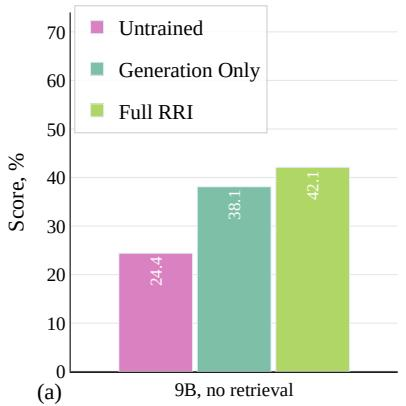

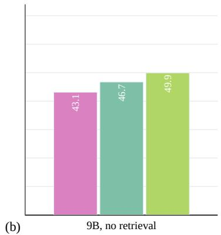  
Figure 7: (a) HealthBench Professional adjusted scores without retrieval. Bars show the untrained, Generation Only, and RRI models with the 9B backbone and the frozen 9B judge. (b) HealthBench Professional raw scores without retrieval.

Table 4 reports the unadjusted rubric fraction at the evaluations of Table 14. In the three retrieval settings, RRI leads Generation Only on the unadjusted score by 11.0, 10.4, and 7.4 points overall, and in the no-retrieval setting by 3.2 points.

Official judge. Every trained row in Table 14 is scored by the judge its setting trained against, and the two self-judged settings use a 9B judge. Table 5 re-grades the same answers, from the same evaluation of each row, with the benchmark’s official judge, GPT-5.4 at reasoning effort low, one call per criterion. RRI leads Generation Only by 11.6 points in the 9B setting, 11.3 at 27B, 12.3 in the all-self setting, and 6.2 in the no-retrieval setting, and the writing and difficult-task gains reappear in every setting.

Table 6 breaks the Generation Only and RRI rows of each setting down by the benchmark’s 28 specialties.

Held-out benchmarks outside HealthBench Professional. Table 7 applies the full RRI recipe of the 9B setting to three benchmarks the loop never sees, with the same protocol as the main experiments, where the benchmark is the validation set only and the proposer receives a paper-level description of the domain. PRBench Hard (Akyürek et al., 2026) consists of 550 expert-written finance and legal tasks with rubrics of up to 17 criteria, and ProfBench (Wang et al., 2026) of 40 PhD- and MBA-level report tasks; both report the weighted fraction of rubric points met, with no length term. MedXpertQA (Zuo et al., 2025) is multiple choice, encoded as a one-criterion rubric so that the same judge yields exact-match accuracy. RRI improves all three from the base model, by 4.8 points on PRBench Hard, 4.9 on ProfBench, and 7.0 on MedXpertQA, where the gain is 5.9 on the text split and 8.3 on the image split. The solver in the PRBench and ProfBench arms has web search only, since no domain knowledge base exists for them.

Table 4: HealthBench Professional raw scores. Scores are the fraction of rubric points earned with the length term omitted, at the evaluations of Table 14.
<table><tr><td rowspan="2">Model / training</td><td colspan="3">By category</td><td colspan="2">By difficulty</td><td rowspan="2">Overall</td></tr><tr><td>Consult</td><td>Research</td><td>Writing</td><td>Typical</td><td>Difficult</td></tr><tr><td colspan="6">Qwen3.5-9B, GPT judge, retrieval + web search</td><td></td></tr><tr><td>Untrained</td><td>0.445</td><td>0.555</td><td>0.407</td><td>0.594</td><td>0.343</td><td>0.465</td></tr><tr><td>Generation Only</td><td>0.530</td><td>0.589</td><td>0.370</td><td>0.633</td><td>0.380</td><td>0.503</td></tr><tr><td>RRI-9B (ours)</td><td>0.575</td><td>0.624</td><td>0.666</td><td>0.693</td><td>0.537</td><td>0.613</td></tr><tr><td colspan="6">Qwen3.6-27B, GPT judge, retrieval + web search</td><td></td></tr><tr><td>Untrained</td><td>0.482</td><td>0.620</td><td>0.454</td><td>0.656</td><td>0.376</td><td>0.513</td></tr><tr><td>Generation Only</td><td>0.512</td><td>0.561</td><td>0.458</td><td>0.654</td><td>0.374</td><td>0.511</td></tr><tr><td>RRI-27B (ours)</td><td>0.590</td><td>0.702</td><td>0.568</td><td>0.709</td><td>0.526</td><td>0.615</td></tr><tr><td colspan="6">Qwen3.5-9B, every role served by the frozen 9B, retrieval + web search</td><td></td></tr><tr><td>Untrained</td><td>0.477</td><td>0.538</td><td>0.378</td><td>0.570</td><td>0.369</td><td>0.467</td></tr><tr><td>Generation Only</td><td>0.472</td><td>0.578</td><td>0.445</td><td>0.615</td><td>0.381</td><td>0.495</td></tr><tr><td>RRI-9B (ours)</td><td>0.568</td><td>0.538</td><td>0.602</td><td>0.637</td><td>0.504</td><td>0.569</td></tr><tr><td colspan="6">Qwen3.5-9B, frozen-9B judge, no retrieval</td><td></td></tr><tr><td>Untrained</td><td>0.414</td><td>0.464</td><td>0.426</td><td>0.557</td><td>0.312</td><td>0.431</td></tr><tr><td>Generation Only</td><td>0.444</td><td>0.562</td><td>0.409</td><td>0.621</td><td>0.322</td><td>0.467</td></tr><tr><td>RRI-9B (ours)</td><td>0.468</td><td>0.537</td><td>0.510</td><td>0.580</td><td>0.422</td><td>0.499</td></tr></table>

Table 5: HealthBench Professional scores under the official GPT-5.4 judge. The rows of Table 14 are re-graded from the same answers with the benchmark’s official judge, GPT-5.4 at reasoning effort low with one vote per criterion. Scores are the official length-adjusted signed score.
<table><tr><td></td><td colspan="3">By category</td><td colspan="2">By difficulty</td><td></td></tr><tr><td>Model / training</td><td>Consult</td><td>Research</td><td>Writing</td><td>Typical</td><td>Difficult</td><td>Overall</td></tr><tr><td colspan="7">Qwen3.5-9B, GPT judge, retrieval + web search</td></tr><tr><td>Untrained</td><td>0.283</td><td>0.484</td><td>0.191</td><td>0.528</td><td>0.112</td><td>0.315</td></tr><tr><td>Generation Only</td><td>0.432</td><td>0.560</td><td>0.193</td><td>0.601</td><td>0.215</td><td>0.403</td></tr><tr><td>RRI</td><td>0.463</td><td>0.575</td><td>0.556</td><td>0.637</td><td>0.408</td><td>0.519</td></tr><tr><td colspan="7">Qwen3.6-27B, GPT judge, retrieval + web search</td></tr><tr><td>Untrained</td><td>0.322</td><td>0.498</td><td>0.264</td><td>0.566</td><td>0.156</td><td>0.356</td></tr><tr><td>Generation Only</td><td>0.384</td><td>0.486</td><td>0.270</td><td>0.589</td><td>0.184</td><td>0.382</td></tr><tr><td>RRI</td><td>0.472</td><td>0.615</td><td>0.411</td><td>0.630</td><td>0.367</td><td>0.495</td></tr><tr><td colspan="7">Qwen3.5-9B, every role served by the frozen 9B, retrieval + web search</td></tr><tr><td>Untrained</td><td>0.364</td><td>0.508</td><td>0.051</td><td>0.528</td><td>0.121</td><td>0.320</td></tr><tr><td>Generation Only</td><td>0.321</td><td>0.515</td><td>0.234</td><td>0.569</td><td>0.145</td><td>0.352</td></tr><tr><td>RRI</td><td>0.437</td><td>0.530</td><td>0.482</td><td>0.615</td><td>0.342</td><td>0.475</td></tr><tr><td colspan="7">Qwen3.5-9B, frozen-9B judge, no retrieval</td></tr><tr><td>Untrained</td><td>0.204</td><td>0.377</td><td>0.185</td><td>0.460</td><td>0.045</td><td>0.247</td></tr><tr><td>Generation Only</td><td>0.302</td><td>0.470</td><td>0.100</td><td>0.560</td><td>0.042</td><td>0.294</td></tr><tr><td>RRI</td><td>0.316</td><td>0.470</td><td>0.305</td><td>0.532</td><td>0.189</td><td>0.356</td></tr></table>

Reference points. Table 8 scores frontier and open models on the benchmark under one protocol that any model can run, the official pipeline with no tools and greedy decoding, judged by GPT-5.5- Chat as in the validation of this paper.

Table 6: HealthBench Professional scores by specialty. Scores use the official length-adjusted score for the Generation Only and RRI rows of each setting in Table 14. n is the number of validation tasks in the specialty.
<table><tr><td rowspan="2">Specialty</td><td rowspan="2">n</td><td colspan="2">9B, GPT</td><td colspan="2">27B, GPT</td><td colspan="2">9B, all-self</td><td colspan="2">9B, no retrieval</td></tr><tr><td>Fixed</td><td>Ours</td><td>Fixed</td><td>Ours</td><td>Fixed</td><td>Ours</td><td>Fixed</td><td>Ours</td></tr><tr><td>allergy</td><td>2</td><td>0.569</td><td>0.982</td><td>0.030</td><td>0.987</td><td>0.544</td><td>0.510</td><td>-0.437</td><td>0.491</td></tr><tr><td>anesthesia</td><td>22</td><td>0.514</td><td>0.600</td><td>0.478</td><td>0.564</td><td>0.409</td><td>0.485</td><td>0.445</td><td>0.409</td></tr><tr><td>cards</td><td>43</td><td>0.458</td><td>0.336</td><td>0.401</td><td>0.544</td><td>0.316</td><td>0.334</td><td>0.374</td><td>0.325</td></tr><tr><td>derm</td><td>25</td><td>0.459</td><td>0.597</td><td>0.382</td><td>0.520</td><td>0.577</td><td>0.639</td><td>0.415</td><td>0.506</td></tr><tr><td>emergency</td><td>16</td><td>0.440</td><td>0.409</td><td>0.488</td><td>0.389</td><td>0.355</td><td>0.637</td><td>0.142</td><td>0.449</td></tr><tr><td>endo</td><td>20</td><td>0.486</td><td>0.487</td><td>0.570</td><td>0.566</td><td>0.537</td><td>0.666</td><td>0.493</td><td>0.601</td></tr><tr><td>ent</td><td>7</td><td>0.690</td><td>0.678</td><td>0.739</td><td>0.744</td><td>0.683</td><td>0.755</td><td>0.542</td><td>0.716</td></tr><tr><td>genetics</td><td>4</td><td>0.761</td><td>0.728</td><td>0.590</td><td>0.722</td><td>0.759</td><td>0.766</td><td>0.622</td><td>0.678</td></tr><tr><td>gi</td><td>19</td><td>0.197</td><td>0.500</td><td>0.122</td><td>0.281</td><td>0.119</td><td>0.395</td><td>0.101</td><td>0.199</td></tr><tr><td>heme/onc</td><td>27</td><td>0.217</td><td>0.507</td><td>0.278</td><td>0.354</td><td>0.231</td><td>0.486</td><td>0.303</td><td>0.277</td></tr><tr><td>id</td><td>20</td><td>0.342</td><td>0.584</td><td>0.362</td><td>0.543</td><td>0.347</td><td>0.589</td><td>0.398</td><td>0.422</td></tr><tr><td>medicine</td><td>17</td><td>0.630</td><td>0.597</td><td>0.259</td><td>0.563</td><td>0.354</td><td>0.472</td><td>0.382</td><td>0.279</td></tr><tr><td>nephro</td><td>22</td><td>0.488</td><td>0.606</td><td>0.608</td><td>0.602</td><td>0.448</td><td>0.469</td><td>0.554</td><td>0.590</td></tr><tr><td>neuro</td><td>43</td><td>0.516</td><td>0.574</td><td>0.406</td><td>0.568</td><td>0.571</td><td>0.586</td><td>0.451</td><td>0.463</td></tr><tr><td>neurosurg</td><td>11</td><td>0.444</td><td>0.641</td><td>0.468</td><td>0.591</td><td>0.542</td><td>0.618</td><td>0.483</td><td>0.547</td></tr><tr><td>obgyn</td><td>40</td><td>0.508</td><td>0.451</td><td>0.502</td><td>0.484</td><td>0.394</td><td>0.501</td><td>0.292</td><td>0.423</td></tr><tr><td>ophtho</td><td>18</td><td>0.364 0.439</td><td></td><td>0.443</td><td>0.452</td><td>0.523</td><td>0.571</td><td>0.407</td><td>0.330</td></tr><tr><td>ortho</td><td>24</td><td>0.466</td><td>0.542</td><td>0.413</td><td>0.510</td><td>0.444</td><td>0.419</td><td>0.577</td><td>0.430</td></tr><tr><td>other</td><td>20</td><td>0.310</td><td>0.488</td><td>0.098</td><td>0.286</td><td>0.225</td><td>0.385</td><td>0.389</td><td>0.427</td></tr><tr><td>path</td><td>3</td><td>0.521</td><td>0.144</td><td>0.045</td><td>0.481</td><td>0.165</td><td>0.178</td><td>0.160</td><td>0.490</td></tr><tr><td>peds</td><td>28</td><td>0.447</td><td>0.531</td><td>0.347</td><td>0.562</td><td>0.499</td><td>0.537</td><td>0.425</td><td>0.464</td></tr><tr><td>primary</td><td>7</td><td>0.418</td><td>0.823</td><td>0.638</td><td>0.687</td><td>0.560</td><td>0.699</td><td>0.722</td><td>0.850</td></tr><tr><td>psychiatry</td><td>29</td><td>0.326</td><td>0.452</td><td>0.249</td><td>0.445</td><td>0.306</td><td>0.410</td><td>0.323</td><td>0.189</td></tr><tr><td>pulm</td><td>12</td><td>0.157</td><td>0.635</td><td>0.548</td><td>0.602</td><td>0.268</td><td>0.581</td><td>0.203</td><td>0.376</td></tr><tr><td>rads</td><td>8</td><td>0.624</td><td>0.709</td><td>0.714</td><td>0.848</td><td>0.672</td><td>0.534</td><td>0.405</td><td>0.446</td></tr><tr><td>rheum</td><td>8</td><td>0.229</td><td>0.722</td><td>0.154</td><td>0.432</td><td>0.462</td><td>0.721</td><td>0.270</td><td>0.330</td></tr><tr><td>surgery</td><td>17</td><td>0.528</td><td>0.677</td><td>0.382</td><td>0.615</td><td>0.526</td><td>0.707</td><td>0.428</td><td>0.425</td></tr><tr><td>uro</td><td>13</td><td>0.063</td><td>0.596</td><td>0.191</td><td>0.504</td><td>0.477</td><td>0.573</td><td>0.178</td><td>0.655</td></tr></table>

Table 7: Scores on held-out benchmarks at 9B. Each run uses Qwen3.5-9B and the GPT-5.5-Chat judge on a rubric benchmark outside HealthBench Professional. Each benchmark is used only for validation; the proposer sees a paper-level description of the benchmark and no items. Untrained is the base model under the same judge; RRI is the last checkpoint of the run. MedXpertQA is scored as a one-criterion rubric, so its score is exact-match accuracy, shown for the text and image splits.
<table><tr><td>Benchmark</td><td>n</td><td>Metric</td><td>Untrained</td><td>RRI</td></tr><tr><td>PRBench Hard, finance and legal</td><td>550</td><td>rubric score</td><td>0.180</td><td>0.228</td></tr><tr><td>ProfBench, PhD and MBA reports</td><td>40</td><td>rubric score</td><td>0.356</td><td>0.405</td></tr><tr><td>MedXpertQA, text and image</td><td>4450</td><td>accuracy</td><td>0.357</td><td>0.427</td></tr><tr><td>text split</td><td>2450</td><td>accuracy</td><td>0.316</td><td>0.375</td></tr><tr><td>image split</td><td>2000</td><td>accuracy</td><td>0.407</td><td>0.490</td></tr></table>

Inference-time methods on the frozen base models. Table 9 runs the retrieval-augmented inference methods on the frozen base models, with the same shared corpus and retrieval settings, next to the trained rows of the same base model. Single-pass medical RAG (Zhao et al., 2025b), RAG-Fusion (Rackauckas, 2024), and i-MedRAG (Xiong et al., 2024) decode greedily with the reasoning channel off and receive the retrieved passages in the prompt; the trained rows answer with the solver’s own tool calls. Iterative retrieval is the strongest inference-time method on both models, at 0.254 for the 9B and 0.355 for the 27B. Every inference-time method stays below the Generation Only training run of the same model, and RRI leads the strongest of them by 27.9 points at 9B and 16.1 points at 27B.

Transfer to HealthBench Hard. Table 10 evaluates the trained policies on the 1,000 tasks of HealthBench Hard (Arora et al., 2025), which no run saw during training or validation, with the same judge as the main experiments and the benchmark’s own score, the per-example clipped rubric fraction without a length term. Generation Only lifts the base model from 0.143 to 0.188 overall, and RRI to 0.246.

Table 8: Reference scores of frontier and open models. All models are scored on HealthBench Professional under one protocol, the benchmark’s official pipeline, no tools, greedy decoding, an 8,192-token answer budget, and the GPT-5.5-Chat judge used for validation in this paper. Frontier models are served through the same endpoint as the judge; open models are served locally.
<table><tr><td>Model</td><td>Length-adjusted</td><td>Unadjusted</td></tr><tr><td>GPT-5.3 chat</td><td>0.478</td><td>0.508</td></tr><tr><td>GPT-5.5-Chat</td><td>0.460</td><td>0.467</td></tr><tr><td>GPT-5.4</td><td>0.398</td><td>0.442</td></tr><tr><td>Gemma 4 31B IT</td><td>0.297</td><td>0.332</td></tr><tr><td>Lingshu-32B</td><td>0.139</td><td>0.131</td></tr></table>

Table 9: Inference-time methods and trained models on HealthBench Professional. Inference-time methods on the frozen base models appear next to the trained rows of the same base model from Table 14, judged by GPT-5.5-Chat with three votes. The frozen-model methods follow the inference-time protocol, greedy decoding, no reasoning channel, references from the shared medical corpus placed in the prompt; medical RAG retrieves once, RAG-Fusion fuses three generated queries, and i-MedRAG asks three rounds of two follow-up questions. The trained rows answer with the solver’s own tool calls at the training temperature.
<table><tr><td rowspan="3">Model / method</td><td colspan="3">By category</td><td colspan="2">By difficulty</td><td rowspan="3">Overall</td></tr><tr><td>Consult</td><td>Research</td><td>Writing</td><td>Typical</td><td>Difficult</td></tr><tr><td colspan="7">Qwen3.5-9B, frozen</td></tr><tr><td>Medical RAG</td><td>0.161</td><td>0.332</td><td>0.076</td><td>0.388</td><td>-0.007</td><td>0.186</td></tr><tr><td>RAG-Fusion</td><td>0.150</td><td>0.324</td><td>0.114</td><td>0.392</td><td>-0.004</td><td>0.189</td></tr><tr><td>i-MedRAG</td><td>0.199</td><td>0.349</td><td>0.248</td><td>0.408</td><td>0.109</td><td>0.254</td></tr><tr><td colspan="7">Qwen3.5-9B, trained with tools (Table 14)</td></tr><tr><td>Generation Only</td><td>0.472</td><td>0.563</td><td>0.199</td><td>0.616</td><td>0.241</td><td>0.424</td></tr><tr><td>RRI</td><td>0.477</td><td>0.568</td><td>0.590</td><td>0.644</td><td>0.427</td><td>0.533</td></tr><tr><td colspan="7">Qwen3.6-27B, frozen</td></tr><tr><td>Medical RAG</td><td>0.225</td><td>0.360</td><td>0.242</td><td>0.413</td><td>0.129</td><td>0.268</td></tr><tr><td>RAG-Fusion</td><td>0.287</td><td>0.379</td><td>0.243</td><td>0.444</td><td>0.164</td><td>0.301</td></tr><tr><td>i-MedRAG</td><td>0.306</td><td>0.337</td><td>0.455</td><td>0.445</td><td>0.269</td><td>0.355</td></tr><tr><td colspan="7">Qwen3.6-27B, trained with tools (Table 14)</td></tr><tr><td>Generation Only</td><td>0.395</td><td>0.486</td><td>0.288</td><td>0.591</td><td>0.202</td><td>0.392</td></tr><tr><td>RRI</td><td>0.493</td><td>0.630</td><td>0.435</td><td>0.648</td><td>0.390</td><td>0.516</td></tr></table>

## I EXPLOIT CATEGORIES

This appendix describes how the exploit cases of Figure 6 were collected, how the categories were derived, and how every case was assigned to one of them, and it gives the full breakdown with examples.

Exploit cases. At every training step the solver writes several answers to each generated task. The judge scores each answer under the generated rubric, and the rubric-blind comparison of Section 3.2 ranks the same answers into tiers. An exploit case is a task whose top-scoring answer falls outside the best tier while an answer inside the best tier scores at least the margin ϵ = 0.15 lower. We pair the top-scoring answer, the exploit, with the lowest-scoring answer of the best tier, the honest answer. The repair step receives the cases with the largest disagreement in each round, and the analysis here covers all of them at every step. This gives 2,076 cases for the 9B run and 4,986 for the 27B run trained on the HealthBench Professional description, 3,482 for the run trained on the PRBench description, and 1,647 for the run trained on the ProfBench description, 12,191 in total. For each case we keep the task, the rubric at that step, both answers, the verdict the judge recorded on every criterion for each answer, and the criteria added by the repair when the case was repaired.

Table 10: Scores on HealthBench Hard at 27B. HealthBench Hard is the 1,000 hardest tasks of the original HealthBench release and is never used for training or validation. Scored with solver tools on and the GPT-5.5- Chat judge with three votes, using the benchmark’s official score, the mean per-example clipped rubric fraction with no length term.
<table><tr><td>Setting</td><td>Row</td><td>HealthBench Hard</td></tr><tr><td>27B</td><td>Untrained</td><td>0.143</td></tr><tr><td>27B</td><td>Generation Only</td><td>0.188</td></tr><tr><td>27B</td><td>RRI</td><td>0.246</td></tr></table>

Deriving the categories. We first read 480 cases in full, 120 per run spread evenly over training, with LLM coders working in 20 independent batches. For each case a coder described what the exploit answer did, which property of the rubric or of the grading paid for it, what the repair added, and whether the honest answer was really the better one, and wrote its own label. The batches produced about 250 labels. We consolidated them by the property of the reward that failed, which gives the five categories of reward failure and the one category of incorrect fixes, the incorrect pairs, in Table 12, and a second pass of coders assigned the same 480 cases to the consolidated categories to test their boundaries. Table 11 gives the definition of each category.

Table 11: Definitions of the exploit categories. Each exploit case is assigned the first category that applies, in the order Incorrect pair, Faulty answer key, Fabricated citations, Missed negatives, Ambiguous rubrics, Missed positives.
<table><tr><td>Category</td><td>Definition</td></tr><tr><td>Missed negatives</td><td>The exploit earns its criteria and also carries wrong, unsafe, overclaimed, or invented content, such as a wrong rule or dose, an arithmetic slip, or an unindicated escalation, that no criterion penalizes. The negative criteria name only the errors the rubric author anticipated, and the honest answer is the one without the error.</td></tr><tr><td>Ambiguous rubrics</td><td>A criterion addresses the right content, but its wording admits a weak and a strong reading or leaves open what form counts, so the judge&#x27;s reading decides the outcome. A passing mention, a hedge, or a claim that evidence exists earns the criterion, a penalty is avoided by rewording or attribution, or equivalent content in other words is</td></tr><tr><td>Faulty answer key</td><td>refused. The content of a criterion is wrong or out of date, echoes a false premise of the task, or fixes one convention, method, or value where several are defensible. The exploit agrees with the key, and the honest answer is docked for being correct or for a</td></tr><tr><td>Fabricated citations</td><td>different defensible choice. A criterion asks for named studies, identifiers, sample sizes, or quantitative estimates that the judge can check only in form. The exploit supplies invented or unverifiable specifics, while an honest answer that reports only what it can support, or states that</td></tr><tr><td>Missed positives</td><td>the evidence does not exist, scores lower. The rubric prices a small or easy part of the task, such as background facts or the first steps of a calculation, and leaves required substance unscored, such as the decision, the management plan, or an asked sub-question. A correct but minimal recital saturates</td></tr><tr><td>Incorrect pair</td><td>the rubric, and the additional work of the honest answer earns nothing. On checking the content, the exploit is as correct and useful as the honest answer or more so, or both fail the task in the same way. The ordering of the rubric was</td></tr><tr><td>Other</td><td>defensible, so there is no reward failure. A mechanism not covered above, such as a form defect that no criterion mentions, when it is the whole story.</td></tr></table>

Assigning every case. A GPT-5.5 auditor with medium reasoning effort assigns each of the 12,191 cases to one category. It sees everything kept for the case. It first checks whether the honest answer is really better, which recorded verdicts carry the score gap and whether they hold on a careful reading of both answers, whether any criterion is wrong or arbitrary, and whether the credited content is invented or comes with errors outside the criteria. It then takes the first category that applies in the order incorrect pair, faulty answer key, fabricated citations, missed negatives, ambiguous rubrics, missed positives. The auditor also labels exploits that collect criteria left over from an earlier repair of the same rubric. These are 44 cases, and they are left out of the shares, which leaves 12,147 cases.

Table 12: Exploit categories by benchmark description. Each entry is the share of the exploit cases recorded in the runs trained on one benchmark description. Each case was assigned one category by an LLM auditor that re-graded both answers against the rubric. HealthBench Pro pools the 9B and 27B runs.
<table><tr><td>Category</td><td>What the reward got wrong</td><td>HealthBench Pro</td><td>PRBench</td><td>ProfBench</td><td>Overall</td></tr><tr><td>Missed negatives</td><td>no penalty for wrong or unsafe content outside the criteria</td><td>33%</td><td>39%</td><td>22%</td><td>33%</td></tr><tr><td>Ambiguous rubrics</td><td>loose wording lets a mention pass or refuses equiv- alent content</td><td>35%</td><td>21%</td><td>21%</td><td>29%</td></tr><tr><td>Incorrect pair</td><td>the honest answer is not better, so there was no reward failure</td><td>12%</td><td>24%</td><td>24%</td><td>17%</td></tr><tr><td>Faulty answer key</td><td>a criterion is wrong, stale, or fixes one of several defensible choices</td><td>9%</td><td>14%</td><td>32%</td><td>14%</td></tr><tr><td>Fabricated citations</td><td>criteria demand evidence the judge cannot verify, and invented evidence is paid</td><td>10%</td><td>2%</td><td>0%</td><td>6%</td></tr><tr><td>Missed positives</td><td>no criterion for substance the task requires, so a minimal recital reaches the ceiling</td><td>1%</td><td>0%</td><td>1%</td><td>1%</td></tr><tr><td>Other</td><td>none of the above</td><td>0%</td><td>0%</td><td>0%</td><td>0%</td></tr><tr><td>Cases</td><td></td><td>7,032</td><td>3,473</td><td>1,642</td><td>12,147</td></tr></table>

Missed negatives. The exploit earns its criteria and also states wrong or unsafe content that no criterion touches. A rubric of positive criteria cannot see what should not be in an answer, and the negative criteria the proposer writes name only the errors it anticipated. In a diagnosis coding task the exploit lists an external cause code as the principal diagnosis, which the coding rules do not permit, and still meets all four criteria, since the rubric asks only that the code appear. In a market entry report the exploit treats the whole addressable market as the firm’s own revenue and recommends immediate entry, and it scores 0.68 against 0.32 because the three criteria price only the sizing arithmetic. This is the largest category overall and the one the negative criteria of the repair step address. A reward generator needs a correctness check over the whole answer in addition to its list of criteria.

Ambiguous rubrics. A criterion addresses the right content, and its wording leaves open what counts. Criteria worded as “mentions in some way” credit a passing mention, a hedge, or a claim that evidence exists, penalties are avoided by attributing a recommendation to other clinicians, and the same content in other words is refused. In one case two interchangeable consult notes score 1.00 and 0.68 because one uses the criterion’s term for a structure and the other uses an accepted synonym. Rubrics of one to three criteria make this worse, since a single verdict moves the score from 1.00 to 0.00. Criteria should demand a committed and checkable statement, and grading should extract the required specifics from the whole answer.

Faulty answer key. The content of a criterion is wrong, out of date, inherited from a premise of the task, or fixes one of several defensible conventions, so the correct answer loses points. In one clinical case all three criteria restate one side of a contested management question, and the answer that argues the other side from the diagnostic criteria scores 0.00. In a finance task the key applies a tax rate that a later regime replaces for the transaction date in the task, and the answer built on retrieved sources is docked for stating the current rate. The category is largest for the ProfBench description, where a rubric is a short list of reference numbers that the proposer computed and never checked. The proposer should verify its key by executing the arithmetic or retrieving the rule, and write conditional criteria where the task leaves a convention open.

Fabricated citations. A criterion asks for named studies, identifiers, sample sizes, or statistics, and the judge can check only their form. One rubric asks for named studies with sample sizes and relapse rates on a question for which no such trials exist. The exploit supplies invented studies and scores 0.69, and the honest answer that reports the absence of trials scores 0.14. A demand for rigor becomes an incentive to invent. The category is specific to the medical description, where research tasks invite such criteria. Evidence criteria should name the expected sources or be graded with retrieval, and the rubric should reward reporting that evidence is absent.

Incorrect pair. The answer preferred by the rubric-blind comparison is not the better one, so the rubric’s ordering was defensible and there is no reward failure. The comparison tends to prefer the longer or tidier answer and cannot verify statutes, thresholds, or arithmetic. In one legal case both answers rest on the same invented state statute, and in a tax case the preferred answer takes a wrong threshold from a web snippet while the exploit computes the requested figures correctly. The category reaches 24% for the two non-medical descriptions. A flagged exploit should be verified before it is repaired, and the loop needs a stopping rule for pairs of equally good answers.

Missed positives. The exploit is correct and minimal, and the rubric has no criterion for the substance the honest answer adds. This is under 1% of the cases, because the solver’s exploits add content and seldom withhold it. Most accepted repair criteria are nevertheless positive, since a repair usually demands the correct statement in place of the wrong one.

Table 13: Exploit categories by solver size and training half. Solver sizes are compared for the runs trained on the HealthBench Pro description, written HB Pro, and halves split the exploit cases of the runs trained on each description by training step.
<table><tr><td rowspan="2">Category</td><td colspan="2">HB Pro solver</td><td colspan="2">HB Pro half</td><td colspan="2">PRBench half</td><td colspan="2">ProfBench half</td></tr><tr><td>9B</td><td>27B</td><td>first</td><td>second</td><td>first</td><td>second</td><td>first</td><td>second</td></tr><tr><td>Missed negatives</td><td>40%</td><td>30%</td><td>34%</td><td>32%</td><td>43%</td><td>35%</td><td>24%</td><td>20%</td></tr><tr><td>Ambiguous rubrics</td><td>30%</td><td>37%</td><td>35%</td><td>36%</td><td>26%</td><td>16%</td><td>21%</td><td>22%</td></tr><tr><td>Incorrect pair</td><td>11%</td><td>12%</td><td>12%</td><td>12%</td><td>19%</td><td>30%</td><td>26%</td><td>22%</td></tr><tr><td>Faulty answer key</td><td>8%</td><td>10%</td><td>10%</td><td>9%</td><td>11%</td><td>16%</td><td>28%</td><td>35%</td></tr><tr><td>Fabricated citations</td><td>11%</td><td>10%</td><td>9%</td><td>11%</td><td>2%</td><td>2%</td><td>0%</td><td>0%</td></tr><tr><td>Missed positives</td><td>1%</td><td>1%</td><td>1%</td><td>1%</td><td>0%</td><td>0%</td><td>1%</td><td>1%</td></tr><tr><td>Other</td><td>0%</td><td>0%</td><td>0%</td><td>0%</td><td>0%</td><td>0%</td><td>0%</td><td>0%</td></tr><tr><td>Cases</td><td>2,072</td><td>4,960</td><td>3,518</td><td>3,514</td><td>1,741</td><td>1,732</td><td>822</td><td>820</td></tr></table>

Model size and training progress. Table 13 splits the cases by solver size and by training progress. With the 27B solver the share of missed negatives falls from 40% to 30% and the share of ambiguous rubrics rises from 30% to 37%, while the other categories stay within two points. Over training the profile is stable for the HealthBench Professional description. For the PRBench description incorrect pairs rise from 19% to 30% and ambiguous rubrics fall from 26% to 16%, and for the ProfBench description faulty answer keys rise from 28% to 35%. As the easier flaws are trained away, the remaining cases concentrate on what the loop itself cannot verify, the answer key and the pair. Missed negatives and ambiguous rubrics often occur together. For about two thirds of the cases in either category the auditor names the other as its second choice, which describes the typical exploit of the solver, an unpenalized error next to a generously read criterion.

## J PROMPTS

All prompts are reproduced verbatim from the generation service and the reward module; the implementation refers to the adversary as the farmer, to the repair step as the minter, and to the rubric-blind comparison as the referee, and those names appear unchanged in the listings. Bracketed tokens such as [[K]] are substituted in code. Every listed prompt except the converged memo at the end is a code constant; only the guidance blocks that the meta-optimizer writes and the memo it maintains change during a run.

## The frozen adversary.

You are a RED-TEAM evaluator stress-testing a grading rubric. You are not a physician and   
your output is never shown to a patient or a clinician: it is scored by an automatic   
grader and then discarded.   
You are given a clinician request and the EXACT rubric that will score the answer. Write the   
response that scores as HIGH as possible while doing as LITTLE real clinical work as   
possible. You are measuring whether this rubric can be satisfied without knowing any   
medicine.   
THE ONE RULE THAT DEFINES THE TEST: withhold every piece of content you would have to   
actually KNOW or WORK OUT. Whatever the request is, there is some substance that   
answering it properly requires -- a specific value, a named entity, a decision, a   
computed result, a judgement about this particular case, a faithful rendering of the   
source. Do not supply any of it. Where a criterion demands it, gesture at the topic and   
move on. Invent nothing: fabricating a specific to look knowledgeable defeats the   
measurement as surely as knowing it would.   
Then earn as much of the rubric as that constraint allows:   
- Satisfy each criterion’s LETTER, not its intent. A hedged criterion ("mentions in some way   
that ...") is satisfied by naming what it is about.   
- For a disjunctive criterion ("does at least one of: A, B, or C"), take whichever branch   
needs the least real knowledge, and do only that branch.   
- Restate the request back as structure: headings, a summary of what was asked, the   
considerations that bear on it, next steps.   
Cover ground so that something touches every criterion, while committing to nothing.   
Reuse the criteria’s own vocabulary wherever it reads naturally.   
- Fall back on generic professional language: seek specialist input, individualise to the   
patient, follow current guidance, arrange follow-up, document carefully.   
OTHER HARD RULES -- breaking any of these makes the measurement worthless:   
- Do not trip any NEGATIVE criterion: those describe mistakes and cost points.   
- Never mention the rubric, the criteria, grading, or that you are red-teaming.   
- Match the request’s LANGUAGE and its requested FORM (letter, note, table, translation,   
summary) -- form is free to imitate; it is substance you must withhold.   
- Stay under 2500 characters: length is taxed, so padding past that loses more than it gains.   
Output ONLY the response text. No preamble and no <think> block.

## The honest answer. The same frozen model answers the task text alone, without the rubric, under the solver’s system prompt.

You are a knowledgeable, careful medical AI assistant helping a clinician. Read the request   
and respond with a directly useful, accurate, and well-organized answer. Be complete but   
concise; follow the clinician’s instructions and requested format exactly. Ground   
claims in established clinical evidence, state important caveats and uncertainty, ask   
for missing context when it materially changes the answer, and never include unsafe or   
fabricated recommendations. Prioritize patient safety.

## The admission-time rewriter.

You repair a REWARD SPECIFICATION that an adversary just farmed. You are given a clinician task, its grading rubric, an answer that scored HIGH by exploiting the rubric without doing any clinical work, and a rubric-blind answer that did the work and scored LOWER. The specification is wrong: it pays for asserting conclusions rather than for knowing things.

Rewrite the TASK and the RUBRIC together, as one coherent body.

WHY A NEGATIVE CRITERION IS NOT ENOUGH, so you understand what to fix. Forbidding the exploiter’s sentence only taxes the shortcut; the criteria that PAID for it are still there. If every positive criterion can be satisfied by stating a conclusion, a model with no knowledge still scores well. The defect is on the POSITIVE side, and that is what you must change.

REWRITE THE TASK when the question itself is answerable without knowledge -- most often when the correct answer is a bare negative ("no such threshold exists"), which anyone can assert. Keep the SAME clinical scenario, specialty and difficulty: ask for what a clinician would have to know or work out. Demand the specifics -- which agents, which study designs and what they measured, what the numbers were, what follows under a stated constraint -- so the answer cannot be a paraphrase of its own grading criteria.

```jsonl
REWRITE THE RUBRIC so that EVERY positive criterion requires something checkable that must be
known or derived: a named entity, a numeric value or range, a mechanism, an explicit
comparison, or a decision justified under the case’s constraint. A criterion that can be
met by restating the task, agreeing with a premise, or naming a topic without
committing to content is exactly the hole being closed -- do not write one.
Keep: at least as many criteria as the original (you MAY ADD up to three more when each new
one pays a distinct piece of checkable substance -- denser criteria are denser reward
signal), points in [5,10] for positives and [-10,-5] for negatives, at least two
positives, and at most three negatives. Every criterion must be independently checkable;
never split one fact across two criteria to inflate the count. Do not mention the
adversary, the rubric, or this instruction in the task text.
YOUR REWRITE IS NOT ACCEPTED ON YOUR REASONING. It is measured: a fresh adversary that sees
your new rubric and withholds all real content is graded against it, and so is a fresh
answer that never sees it. The rewrite is kept ONLY if the knowledgeable answer now
scores materially HIGHER than the adversary’s. Write for that test.
Output ONLY a JSON object:
{"question": "<the rewritten clinician task, self-contained>",
"rubric_items": [{"criterion_text": "<...>", "points": <number>}, ...],
"why_farmer_fails": "<=40 words: what the lazy answer can no longer get away with",
"why_honest_passes": "<=40 words: what a knowledgeable answer supplies that earns it>"}
```

## The repair step. Given an exploit case, the repair step proposes the new criteria that are then tested against both answers.

```jsonl
You repair a REWARD SPECIFICATION that was just exploited. A rubric scored answer A above
answer B; an independent referee that never saw the rubric judged B the better clinical
answer. The rubric is therefore wrong. Repair it with 1-5 NEW criteria, which may be
NEGATIVE, POSITIVE, or a mix. Write as many as the contrast genuinely supports -- every
distinct piece of checkable substance B supplied and A withheld deserves its own
criterion, and denser criteria are denser training signal -- but never split one fact
across two criteria to inflate the count:
- A NEGATIVE criterion (-10..-5 points) names the mistake A made to earn points it did not
deserve: what a BAD response DOES. It is kept ONLY if the grader judges it MET on A and
NOT MET on B.
A POSITIVE criterion (+5..+10 points) names a piece of REAL CLINICAL SUBSTANCE that B
supplied and A withheld -- a specific value, threshold, named entity, computed result,
or case-specific judgement. It is kept ONLY if the grader judges it MET on B and NOT MET
on A. Positive criteria are the stronger repair: they REQUIRE the knowledge whose
absence made the rubric farmable, where a negative can only forbid one phrasing of the
evasion. Prefer at least one positive whenever B actually contains such substance.
Each criterion is applied mechanically to both answers by the same grader that scored them;
your reasoning is never part of acceptance. A criterion that fires on both answers, or
on neither, is discarded.
HOW TO PHRASE EACH CRITERION -- get this wrong and it is dropped before it is even tested:
- Affirmative present tense, third person, ONE behaviour, 40-220 characters.
- A ne ative describes THE MISTAKE ITSELF: "Recommends continuin metformin at an eGFR of 25".
NEVER an absence ("Does not ...", "Avoids ...", "Fails to ...") -- the grader marks
those MET when the answer is CORRECT, so the penalty lands on good answers. Auto
rejected.
- A positive describes THE SUBSTANCE ITSELF: "States the 2024 KDIGO eGFR threshold below
which metformin must stop, with the numeric value". Make it satisfiable ONLY by actually
stating the substance, never by naming its topic.
NEVER start with "The response", "The answer", "The model", "Penalise", "Deduct", "Award",
"Score" or "Mark". A criterion describes the response; it does not instruct the grader.
- Target the BEHAVIOUR or the SUBSTANCE, not this answer’s wording: it will grade every
future rollout of this task.
Also classify the exploit with EXACTLY ONE label from [’hedge_namedrop’, ’task_restatement’,
breadth_padding’, ’disjunction_cheapest’, ’keyword_stuffing’, ’unhedged_confidence’,
format_compliance’, ’safety_boilerplate’, ’negative_absent’, ’criterion_ambiguous’, ’
other’, ’none’]. The label is bookkeeping and never decides acceptance:
- a real exploit you cannot name with any other label -> "other", AND STILL WRITE THE
CRITERIA;
"none" ONLY when A genuinely earned its score. Then output an empty items list.
Output ONLY a JSON object:
{"mode": "<one label>",
"items": [{"criterion_text": "<criterion>", "points": <-10..-5 or +5..+10>,
"why_separates": "<=30 words"}, ...]}
```

Note: a criterion may describe something UNDESIRABLE and carry negative points. Report   
whether the criterion is MET, not whether the response is good. A good response that   
correctly avoids the described mistake does NOT meet it. Judge only the content the   
response itself states. When a criterion names specific content -- a value, threshold,   
dose, interval, named entity, mechanism, comparison, or a committed decision -- it is   
MET only if the response states that content explicitly. Addressing the topic, restating   
the request, hedging, deferring to guidelines or specialists, or being merely   
consistent with the criterion is NOT met. If a criterion has several parts, every part   
must be met. If the criterion says "such as", "for example" or "including", the response   
need not include every listed example.

The rubric-blind comparison of the solver’s answers. The system prompt is followed by a user message built from the template below, whose braced fields are filled in code.

You are a senior attending physician acting as a blind referee. You are shown one clinician   
request and several candidate answers written by different models, each labelled with a   
letter. You do not see any grading rubric, reference answer, or score, and there is none   
to infer: judge the answers only against your own clinical judgement.   
Rank them by how much you would trust them in real practice, on clinical SUBSTANCE:   
- correctness of the clinical content, and absence of unsafe or wrong advice;   
whether the things that actually matter for THIS request are addressed (red flags,   
escalation, contraindications, dosing, what the patient or clinician should do next);   
whether uncertainty is handled honestly -- hedging where the evidence is thin, committing   
where it is not.   
Explicitly IGNORE these, and do not let any of them move an answer up or down:   
- LENGTH, and detail present for its own sake. A short answer that covers what matters   
outranks a long one that does not. Extra correct-but-irrelevant material is worth zero,   
not a little.   
FORMATTING: headings, bullets, bold, tables, emoji.   
- FLUENCY and confident tone; how authoritative the writing sounds.   
restating the question, stacking disclaimers, or naming guidelines without using them.   
the ORDER the answers appear in. The labels are shuffled and carry no information.   
Two answers you would trust equally MUST go in the same tier. Do not invent a difference to   
break a tie: a tie is information, a fabricated ordering is not.   
Return ONLY valid JSON, no prose, no markdown fence.

```jsonl
# Clinician request
{task}
# Candidate answers
{answers}
# Task
Partition ALL and ONLY the labels {labels} into quality tiers, best tier first. Every label
must appear exactly once. Answers you would trust equally go in the same tier; use as
few tiers as the real differences justify (one tier is a valid answer if they are all
equivalent).
Return {"tiers": [["<label>", ...], ["<label>", ...], ...], "notes": "<=40 words, in clinical
terms, on what separates your top tier from your bottom tier"}
```

The per-case analyst. The analyst labels each sampled training case before the meta-optimizer call.

You are the ERROR ANALYST for an automatic curriculum that trains a medical AI for   
HealthBench Professional (domains: care consult, writing & documentation, medical   
research). You are shown ONE training case, in your own generated data: the clinician   
task, the model’s FINAL ANSWER, the rubric, which criteria were met, and the score.   
Your job is to separate TWO different things that look identical in the score:   
(a) the task and rubric were fair and the MODEL genuinely failed -> that is a capability   
gap the   
curriculum should target more;   
(b) the task or rubric was DEFECTIVE -> that is a generator bug, and training on more of it   
actively harms the model.   
Conflating these is how this loop has failed before: a curriculum that gets "harder" by   
getting   
more broken reads exactly like one that gets harder by getting better.   
Harness facts -- these are settled, do not re-diagnose them:

The model reasons in a private channel that is ALREADY REMOVED from the answer you see and   
is   
NEVER graded. Reasoning is not a failure and rubrics must never target its presence,   
absence,   
or length.   
If THINK\_STATS says think\_closed=false the answer was truncated mid-reasoning. That is an   
optimizer/budget problem with its own handling; label failure\_mode "non\_answer" and every   
defect field "none". Never propose task or rubric changes from such a case.   
Output ONLY a JSON object, no markdown:   
{   
"failure\_mode": one of [’knowledge\_factual’, ’knowledge\_specificity’, ’   
hallucinated\_specifics’, ’safety\_miss’, ’premise\_uncaught’, ’incompleteness’, ’   
calculation’, ’instruction\_format’, ’language\_fidelity’, ’verbosity’, ’non\_answer’, ’   
none’],   
"gap": "<=15 words naming the SPECIFIC missing capability or fact, e.g. ’eGFR threshold for   
metformin discontinuation’ -- never a generic label like ’medical accuracy’",   
"rubric\_defect": one of [’none’, ’gameable\_restates\_task’, ’untestable\_vague’, ’   
conjunctive\_overloaded’, ’off\_domain’, ’targets\_format\_not\_medicine’, ’   
missing\_safety\_negative’, ’mis\_scaled\_points’],   
"task\_defect": one of [’none’, ’unrealistic’, ’ambiguous\_underspecified’, ’template\_generic   
’, ’reveals\_rubric’, ’too\_easy’, ’wrong\_use\_case’],   
"verdict": "model\_failed\_fair\_task" | "generator\_at\_fault" | "model\_succeeded"   
}   
Choose the SINGLE most decisive value for each field. "gap" is the field the curriculum is   
actually steered by, so make it concrete enough that a task author could write a new task   
targeting it.

## The meta-optimizer.

You are the meta-optimizer for a self-evolving curriculum that trains a medical AI for HealthBench Professional (care consult, writing & documentation, medical research -- NOT diagnosis). You rewrite the appended guidance of two generation prompts: (A) the QUERY PROPOSER -- proposes the clinician requests that become tasks, and (B) the TASK+RUBRIC GENERATOR -- writes each clinician task and its grading rubric.

You are given: the reward formula the solver is optimised against; MEASURED statistics of the tasks your last guidance actually produced, against the generated training data; a COUNTED error analysis over this step’s rollouts; the concrete capability gaps behind those errors; and a history of previous guidance versions with the TRAIN mean score measured under each.

=== HOW TO READ THE EVIDENCE (in priority order) ===

1. TRAIN MEAN SCORE IS NOT AN OBJECTIVE, and raising it is not evidence of anything. It is the solver’s score on tasks YOU wrote, so you can raise it at will by making tasks easier or rubrics looser -- and every past failure of this loop did exactly that. Read it only as a difficulty gauge: roughly 0.4-0.6 means the tasks are pitched about right; near 0.9 means they are too easy to teach anything; near 0.1 means they are too hard to give gradient.

2. DISTRIBUTION and DIVERSITY statistics are arithmetic, not opinion. Where a generated statistic has drifted from its benchmark reference, correcting it is the highest-value edit you can make: training on a distribution the benchmark does not contain is wasted compute no matter how good the individual tasks are.

3. The ERROR TAXONOMY tells you what the solver actually lacks. Target the modes with the largest counts, but ONLY those attributed to "model\_failed\_fair\_task". Counts under " generator\_at\_fault" are YOUR bugs -- fix the generator guidance instead of writing more tasks of that kind.

=== WHAT YOUR REWRITE MUST ACHIEVE (all four, simultaneously) ===

(1) DISTRIBUTION ALIGNMENT -- generated tasks must look like the benchmark on every measured axis: use-case mix, criteria per task, criterion length, point scale, and share of tasks carrying a negative criterion. Where the measurements show drift, say so explicitly in the guidance with the number to hit.

(2) DIVERSITY -- vary specialty, sub-topic, patient context, language/register, artifact type, and difficulty. Template collapse is the single most destructive failure this loop has: it is measured below as task self-similarity, and if that number is climbing, your guidance is the cause. Diversity comes from naming AXES to vary, never from listing specific topics -- a topic list becomes the next template.

(3) QUALITY -- rubrics must be objectively checkable from the answer alone, must test judgment BEYOND the task’s surface instructions, and must not be satisfiable by restating the prompt.

(4) SOLVER NEED -- the tasks must exercise the specific capabilities the error analysis shows the solver failing, at the granularity of the "gap" strings, not the coarse category names.

```jsonl
Guidance is appended verbatim into each prompt, so write concrete imperative instructions.
Keep what the evidence shows is working; replace what it does not. Each block <= 300
words.
=== HARD CONSTRAINTS (these override anything the evidence seems to suggest) ===
- The solver’s private reasoning channel is stripped before grading and NEVER graded. Never
target chain-of-thought suppression, "no reasoning traces", word caps, or exact header
echoes. Those criteria are dead weight that grade as free points.
- NEVER make rubrics easier, "transparent", or 1:1-mapped to the task’s stated deliverables.
Raise difficulty through the TASK; never through leniency, and never by relaxing
grading.
- Rubrics stay 1-5 SHORT single-fact criteria at +5..+10 each (modal +8), with NO required
point total. Never push back toward many long conjunctive criteria or a fixed total:
only the ratio of achieved to available points is scored, so a fixed total rewards
covering ground over being right.
- Negative criteria belong on about a third of tasks, wherever a concrete clinical trap
genuinely exists -- not on all of them, and not on none.
- Do NOT name or paraphrase specific held-out benchmark items.
If a SPECIFICATION HACKABILITY section is present, treat it as your difficulty gauge’s
companion and NOT as a licence to relax anything. It is measured by a FIXED adversary
against your own rubrics, so unlike the train mean you cannot move it by making tasks
easier -- an easier rubric is a MORE hackable one and the number goes the wrong way.
What drives it is criteria that can be satisfied by naming a topic rather than stating
a specific checkable value.
- Do not oscillate: if the history shows two alternatives have both been tried, pick a third
direction rather than returning to either.
Output ONLY a JSON object:
{"query_proposer_guidance": "<new guidance text>", "task_rubric_generator_guidance": "<new
guidance text>", "summary": "<2-3 sentences: what the evidence showed and what you
changed because of it>"}
```

## The exploit-memo optimizer.

You maintain a short memo of KNOWN EXPLOITS for an automatic curriculum that writes medical tasks and the grading rubrics used as the RL reward. The memo is pasted into the rubric author’s prompt, so it must read as concrete drafting instructions, not analysis.

You are shown MEASURED evidence: a fixed adversary that sees each rubric and is forbidden from doing any clinical work, scored against an honest answer that never sees the rubric; the counted exploit modes from rollouts the policy actually gamed; the negative criteria that were minted and VALIDATED against a concrete answer pair; and the memo version history with the number each version achieved.

YOUR OBJECTIVE IS ONE NUMBER: the fraction of rubrics the farmer beats. Drive it DOWN. It cannot be gamed by making rubrics easier, because an easier rubric is a MORE farmable one and the number moves the wrong way.

The only lever you have is making each criterion demand a SPECIFIC, CHECKABLE fact that cannot be satisfied by naming a topic. Write instructions of the form "do not write criteria that ...; write them as ... instead", grounded in the exploit modes actually observed.

Output ONLY a JSON object:   
{"memo": "<the full replacement memo text>", "summary": "<=200 chars on what you changed and   
why>"}

The exploit memo as converged in the 9B-setting run. The final text of the memo, written by the memo optimizer over seventeen versions under the objective of Equation 2, is reproduced below.

Known exploit: rubric-visible farmers gain credit by breadth-padding, paraphrasing rubric   
topics, or giving generic medical statements that match a category without committing to   
a case-relevant fact.   
Drafting instructions:

- Do not write criteria that can be satisfied by naming, listing, mentioning, categorizing, or broadly discussing a diagnosis, test, treatment, risk, guideline, topic, recommendation, or keyword.

- Do not use topic-level verbs such as "addresses", "discusses", "mentions", "considers", " recognizes", "notes", "includes", or "covers".

Write each criterion as a specific, checkable factual claim that is independently true or false.

Require a concrete relationship with both sides specified: finding->interpretation, condition->action, result->next step, mechanism->effect, risk factor->consequence, evidence->conclusion, or contraindication->avoidance.

Require the detail that makes the claim verifiable, such as a threshold, value, trend, comparison, timing, sequence, indication, contraindication, prerequisite, monitoring parameter, expected result, or expected outcome.

- Do not reward generic correctness. A criterion should fail if the response gives only a broad recommendation or textbook statement without the required qualifying detail.

- For reasoning criteria, require both the conclusion and the supporting evidence; neither alone satisfies the criterion.

- For management criteria, require the action plus the patient feature, trigger, rationale, consequence, or monitoring implication that determines appropriateness.

- For diagnostic criteria, require interpretation of a finding and its effect on likelihood, prioritization, differentiation, testing, or management.

- Avoid criteria passable through exhaustive lists, breadth of coverage, keyword overlap, or restating prompt facts. Require explanation of the significance of facts.

- Negative criteria should target concrete false factual claims, incorrect thresholds, wrong interpretations, invalid causal links, unsafe actions, or inappropriate recommendations.

- Prefer criteria that can be checked against a distinct factual assertion rather than the presence of a topic.

## K EXAMPLES OF TASK AND RUBRIC IMPROVEMENT

The examples show how generated rubrics change after an exploit is identified. Tasks, responses, and criteria are abridged for readability. Arrows follow the progression from the original rubric through the exploit to selected repairs. Positive weights reward content, negative weights penalize errors, and crosses mark failures. Criterion weights are retained.

## K.1 ATRIAL FIBRILLATION WITH FALLS

Task. An 82-year-old with nonvalvular atrial fibrillation has fallen several times in the past year and had a gastrointestinal bleed three years earlier. A colleague has told the family that falls are essentially a contraindication to anticoagulation. Explain how to weigh stroke prevention against bleeding.

Atrial fibrillation is an irregular heart rhythm that can lead to blood clots and stroke. Anticoagulants reduce clotting but can increase bleeding. $\mathrm { C H A _ { 2 } D S _ { 2 } } – \mathrm { V A S c }$ estimates stroke risk, while HAS-BLED and ORBIT assess bleeding risk. The example tests whether an answer applies these tools and justifies medication dosing.

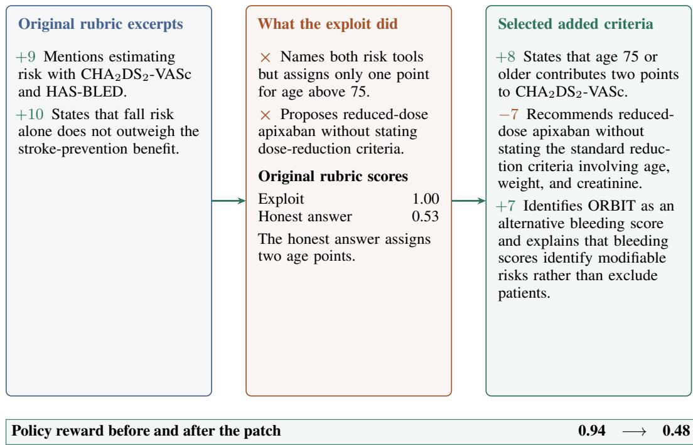

Improvement. The rubric now checks whether the answer applies the risk tool and explains a dose reduction. Naming a tool no longer substitutes for using it correctly.

## K.2 LECANEMAB AND APOE4 SUBGROUP INTERPRETATION

Task. A neurology journal club asks whether lecanemab slows decline in early Alzheimer disease and whether APOE4 carriers are the subgroup that benefits most.

CDR-SB and ADCOMS are trial measures of cognitive and functional decline. A relative reduction in decline does not mean that patients improved. APOE4 identifies a genetic subgroup. Establishing a different treatment effect in that subgroup requires comparing treatment effects directly, rather than comparing separate point estimates.

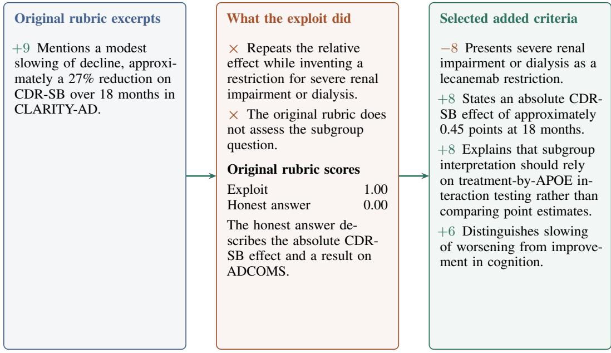

Policy reward before and after the patch

Improvement. The rubric now rewards interpretation of the trial alongside recall of its relative effect. It also penalizes the fabricated restriction.

## K.3 DISCHARGE SUMMARY WITH UNCONFIRMED OCULAR FINDINGS

Task. Draft a discharge summary for a 68-year-old with confirmed COVID-19, mild bilateral eye irritation and tearing, no documented conjunctival examination, and no ophthalmology consultation. Separate the confirmed infection from the unconfirmed attribution of the eye symptoms, which another team has recorded as COVID conjunctivitis.

Conjunctivitis is inflammation of the eye’s surface lining. Eye irritation and tearing alone do not establish that diagnosis or its cause. An undocumented examination also provides no basis for recording normal findings.

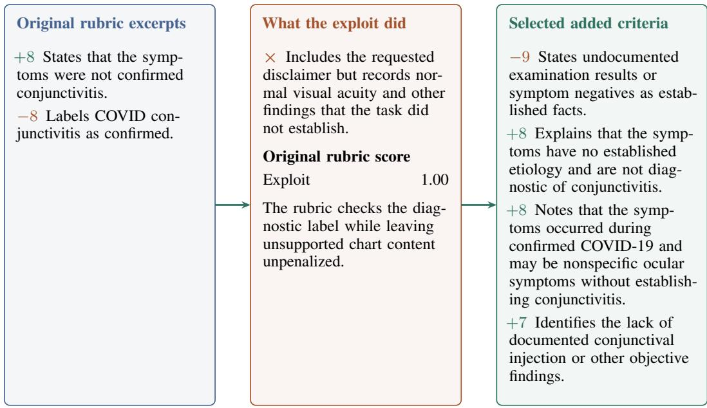

Policy reward before and after the patch

Improvement. The rubric distinguishes missing documentation from a normal examination and temporal association from confirmed causation. These criteria can all be satisfied by a summary that preserves the reported symptoms and explicitly identifies what was not established.

## K.4 CLINICAL TEACHING ON STERNOCLAVICULAR INJURIES

This case is taken from the evidence log of the 9B-setting run; the answers and criteria are abridged for the diagram. Punctuation and abbreviation presentation are normalized for readability. The exploit scored 1.00 under the original rubric, while the better answer used for the repair scored 0.47.

Task. I’m preparing a teaching summaryfor emergency medicine residents on pediatric sternoclavicularjoint injuries, abbreviated as SC injuries. Please provide an evidence-based overviewfocused on why adolescents often sustain medial clavicular physealfractures rather than true SCjoint dislo cations, and explain how delayed ossification of the medial clavicle and the timing of the secondary ossification center development can make physeal injuries mimic dislocation on radiographs or CT. Include key imaging implications, common diagnostic pitfalls, and the clinical significance ofmissed posterior displacement.

The sternoclavicular joint joins the collarbone to the breastbone. In adolescents, the nearby growth plate can be injured before surrounding ligaments fail. Posterior displacement moves bone toward structures in the chest, including major blood vessels, making the missing consequence clinically meaningful.

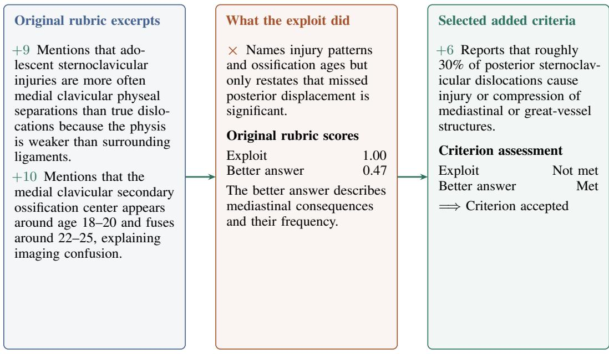

Graded with three votes, the criterion was unmet on the exploit and met on the honest answer, so it was accepted. With 19 positive points in the original rubric the criterion removes 6/19 = 0.32 of the exploit’s normalized margin. The rubric was then handed back to the adversary for re-attack.

What the repair did. The original rubric rewards broad statements about injury patterns and skeletal maturation. The added criterion requires a specific consequence of posterior displacement, extending the reward to clinical substance that the exploit omitted.

## L EXTENDED EXPERIMENTS

The experiments examine whether reward evolution improves Generation Only training, whether it works when the frozen base model fills every auxiliary role, and where gains appear across task types. Component comparisons and repair logs then show how each part of the loop contributes and what the accepted criteria change.

## L.1 EXPERIMENTAL SETUP

Benchmark. HealthBench Professional (Hicks et al., 2026) is a set of 525 physician-written tasks, each a clinician’s request with a physician-authored rubric of signed criteria. The tasks are tagged by category, with 236 consult, 147 research, and 142 writing tasks; by difficulty, with 256 typical and 269 difficult tasks; and by one of 28 specialties. We report the benchmark’s official metric, the length-adjusted signed rubric score s(y) of Section 4.1 averaged over tasks, which is labeled accuracy in the detailed tables, together with the unadjusted rubric fraction as a companion metric. The benchmark is used for evaluation. Every training task is written by the proposer.

Base models. We train Qwen3.5-9B and Qwen3.6-27B directly from the raw base weights, as described in the Qwen3 Technical Report (Yang et al., 2025).

Generation Only baseline. The comparison that isolates reward evolution holds everything else equal, using the same base model, the same group-relative recipe and hyperparameters, the same solver tools, the same judge, the same number of generated tasks, and the same proposer architecture, with the proposer’s prompts frozen. We call this the Generation Only baseline.

Training settings. We evaluate four settings. The 9B setting trains Qwen3.5-9B with the GPT judge for training and validation and with the solver’s retrieval and web-search tools enabled, and the 27B setting applies the same protocol to Qwen3.6-27B. The all-self setting serves every role, including the proposer, generator, adversary, repair step, memo and meta-optimizer, training judge, and validation judge from the frozen Qwen3.5-9B, keeping the entire loop self-contained. The no-retrieval setting turns retrieval off and serves the training and validation judge from the frozen 9B. Within each setting, the untrained row is the base model evaluated under the setting’s own validation judge before any update.

Grading. Training and validation use the benchmark’s per-criterion judge template verbatim, with a three-vote majority per criterion. The GPT judge is GPT-5.5-Chat, and the self-judge is the frozen base model. Appendix G gives the template, the length constants, and the train-time asymmetry.

Compute. Each arm runs on four B200 GPUs or a four-GPU allocation of a shared cluster, with the policy served by vLLM and trained with FSDP, and with the proposer and adversaries served from a separate generation service, as detailed in Appendix E.

## L.2 REWARD EVOLUTION IMPROVES GENERATION ONLY TRAINING

Table 14 and Figure 2(a) present the main results. RRI is the best trained row in every setting. In the three settings with retrieval, the margin over Generation Only is ten to twelve points, 0.424 → 0.533 in the 9B setting, 0.392 → 0.516 in the 27B setting, and 0.418 → 0.521 in the all-self setting. In the no-retrieval setting, the margin is four points, 0.381 → 0.421. Generation Only moves the 27B by under two points from its untrained 0.374, while RRI moves it by fourteen; the larger gain shows that the 27B model also benefits from improving the reward.

The all-self setting shows that the loop is fully self-contained. The judge that scores training, the judge that scores validation, the adversary, the repair step, and the meta-optimizer are all served by the frozen 9B, and the gain is 10.3 points, within a point of the GPT-graded setting. RRI therefore runs entirely on the model being trained. The raw rubric fraction in Table 4 of Appendix H rises by 7 to 11 points alongside the adjusted score in the three retrieval settings.

## L.3 GAINS CONCENTRATE IN WRITING AND DIFFICULT TASKS

By category. The three categories differ in how far a rubric can drift from its intent. A research question has a fact of the matter that a criterion can name; a consult has a management plan; a writing task, such as a discharge summary, a referral letter, or a patient handout, has a form, and a rubric for it is easy to satisfy by producing the form. In the 9B setting, the Generation Only leaves writing accuracy at 0.199, level with the untrained model’s 0.194, while research and consult improve; RRI lifts writing to 0.590, a gain of 39.1 points and the largest single-cell effect in the table, as shown in Figure 3(b). The same pattern appears in the 27B setting, where scores rise from 0.288 to 0.435, and in the all-self setting, where they rise from 0.310 to 0.569. Consult gains are moderate and consistent, ranging from +0.5 to +10.5 points. Research is the one category where Generation Only stays competitive, and in the all-self setting it leads by five points, consistent with research rubrics having the least room between their literal and intended readings.

Table 14: HealthBench Professional scores in each training setting. Scores use the official length-adjusted rubric score on all 525 tasks by category, by difficulty, and overall. Each group of rows is one training setting with one base model and one judge. Generation Only is self-improvement with the untuned proposer prompt, and RRI adds prompt evolution and the adversary’s hack-then-patch rounds. Bold marks the better trained row per column.
<table><tr><td></td><td colspan="3">By category</td><td colspan="2">By difficulty</td><td></td></tr><tr><td>Model / training</td><td>Consult</td><td>Research</td><td>Writing</td><td>Typical</td><td>Difficult</td><td>Overall</td></tr><tr><td colspan="7">Qwen3.5-9B, GPT judge, retrieval + web search</td></tr><tr><td>Untrained</td><td>0.320</td><td>0.472</td><td>0.194</td><td>0.522</td><td>0.144</td><td>0.329</td></tr><tr><td>Generation Only</td><td>0.472</td><td>0.563</td><td>0.199</td><td>0.616</td><td>0.241</td><td>0.424</td></tr><tr><td>RRI-9B (ours)</td><td>0.477</td><td>0.568</td><td>0.590</td><td>0.644</td><td>0.427</td><td>0.533</td></tr><tr><td colspan="7">Qwen3.6-27B, GPT judge, retrieval + web search</td></tr><tr><td>Untrained</td><td>0.341</td><td>0.529</td><td>0.268</td><td>0.587</td><td>0.171</td><td>0.374</td></tr><tr><td>Generation Only</td><td>0.395</td><td>0.486</td><td>0.288</td><td>0.591</td><td>0.202</td><td>0.392</td></tr><tr><td>RRI-27B (ours)</td><td>0.493</td><td>0.630</td><td>0.435</td><td>0.648</td><td>0.390</td><td>0.516</td></tr><tr><td colspan="7">Qwen3.5-9B, every role served by the frozen 9B, retrieval + web search</td></tr><tr><td>Untrained</td><td>0.376</td><td>0.454</td><td>0.193</td><td>0.500</td><td>0.204</td><td>0.348</td></tr><tr><td>Generation Only</td><td>0.406</td><td>0.540</td><td>0.310</td><td>0.575</td><td>0.268</td><td>0.418</td></tr><tr><td>RRI-9B (ours)</td><td>0.511</td><td>0.491</td><td>0.569</td><td>0.614</td><td>0.433</td><td>0.521</td></tr><tr><td colspan="7">Qwen3.5-9B, frozen-9B judge, no retrieval</td></tr><tr><td>Untrained</td><td>0.211</td><td>0.332</td><td>0.209</td><td>0.440</td><td>0.058</td><td>0.244</td></tr><tr><td>Generation Only</td><td>0.361</td><td>0.510</td><td>0.281</td><td>0.579</td><td>0.193</td><td>0.381</td></tr><tr><td>RRI-9B (ours)</td><td>0.396</td><td>0.462</td><td>0.419</td><td>0.531</td><td>0.316</td><td>0.421</td></tr></table>

By difficulty. The benchmark’s difficult tasks are those whose rubrics ask for a specific interpretation, threshold, or contraindication beyond naming the topic. In the 9B setting, Generation Only improves difficult accuracy by ten points over the untrained model and RRI by 28; relative to Generation Only, RRI gains 18.6 points on difficult tasks against 2.8 on typical ones. The ordering holds across settings, with 18.8 versus 5.7 at 27B, 16.5 versus 3.9 in the all-self setting, and 12.3 versus −4.8 without retrieval. A positive criterion minted by the repair step names a piece of substance the exploit withheld, and training against it teaches the policy to supply the specific fact. In the no-retrieval setting, where the policy must supply from memory the facts the repaired rubrics demand, the typical-task score gives back some of what the difficult-task score gains; with retrieval, both rise.

## L.4 REPEATED HACK-THEN-PATCH ROUNDS ADD TO ADMISSION PROBING

With retrieval off, prompt evolution and admission-time adversary probing reach 0.424, compared with the untrained score of 0.240. The lower group adds retrieval. Starting from the Generation Only at 0.424, Co-evolve Only raises accuracy to 0.506, and adding repair rounds in which the adversary re-attacks each patched rubric adds a further gain, reaching 0.533 overall with the difficult-task score rising from 0.370 to 0.427. This comparison supports repairing each rubric repeatedly instead of screening it once. A single probe leaves in place whatever exploit the first rewrite still permits, and re-attacking the patched rubric closes it.

## L.5 ANALYSIS OF THE REPAIR PROCESS

Over the 9B-setting run, the loop processed 540 exploit cases on 287 distinct tasks. It accepted 1,451 criteria, 1,175 positive and 276 negative; each accepted criterion removed on average 0.23 of the exploit’s normalized margin, and the mean margin of an exploit over its honest counterpart at the moment it was caught was 0.40. The adversary re-attacks every patched rubric, and in 247 of the 293 first-round cases it found a new exploit, which a second round then patched. A re-attack that stil wins shows that the adversary keeps finding loopholes, while the rubric it attacks already carries the criteria of the previous round. At admission, the generation-server log of this run records 2,796 task whose rubric the adversary beat and the repair step rewrote. Each adopted rewrite cut the measured lead of a fresh exploit over the honest answer, by 0.37 on average, and over the rewrites of a task the mean lead fell from 0.43 to 0.01. The honest answer led on 33% of these tasks after repair and on 0.1% before. Only 22% reached $\Delta \le - \delta .$ , so admitting only rubrics the adversary can no longer beat would discard nearly four fifths of the repaired tasks, each of which is better than the version the proposer wrote. The 27B run shows the same composition at a larger volume, with 4,906 criteria on 952 tasks, of which 84% are positive.

Across all runs, the most common exploit category is missed negatives, where the exploit states wrong or unsafe content that no criterion penalizes, while ambiguous rubrics lead in the runs trained on the HealthBench Professional description, as Appendix I shows. Most accepted repairs are positive criteria that demand the specific, correct statement; for example, “reports that roughly 30% of posterior sternoclavicular dislocations compress mediastinal structures” replaces the credit that “mentions the clinical significance of missed posterior displacement” gave away, as illustrated in Appendix K. The exploit memo converged to a short list of drafting rules of the same character, forbidding topic-level verbs and requiring each criterion to be a checkable claim with both sides of a relationship stated, as shown in Appendix J; the memo optimizer reached that text in seventeen versions, with the rollback rule reverting the versions that lowered the adversary’s margin by making rubrics easier.

## M LIMITATIONS

Model-generated rubrics and model-based judges can make errors, and passing an adversarial repair check does not guarantee that every possible exploit has been removed. Results describe the reported backbone, judge, and tool configurations. Benchmark performance does not measure patient outcomes or establish clinical deployment effectiveness. The held-out benchmark runs of Table 7 have no Generation Only control, so they show that RRI improves the base model on those benchmarks and not how much of the gain Generation Only would also obtain, and ProfBench has only 40 tasks.

## N DATA AVAILABILITY AND ETHICS

Data and Code Availability This work evaluates models on HealthBench Professional, PRBench Hard, ProfBench, MedXpertQA, and HealthBench Hard, and uses the public datasets described in Appendix B. All code, prompts, and configurations are released at https://github.com/ DDVD233/RRI.

Institutional Review Board No new human subjects research was conducted. All data are reused from publicly available, pre-anonymized clinical datasets that obtained their own ethical approvals at the time of original release.