# ROUTER DRIFT CONTROL: MITIGATING OFF-POLICYDEGRADATION IN MIXTURE-OF-EXPERTSREINFORCEMENT LEARNING

Liangyao Jin1,5,\* Zhixin Wang2,3,\* Liming Liu2,\* Mingjun Zhang5 Zhengzhou Zhu1 Fangcheng Fu4 Jinlong Hou2 Yuan Cheng2 Xiaohe Hu5 Ping Zhang5,† Siyuan Feng2,†

1Peking University 2Shanghai Innovation Institute 3Zhejiang University 4Shanghai Jiaotong University 5Infrawaves Inc

zhangping@infrawaves.com syfeng@sii.edu.cn

## ABSTRACT

Reinforcement learning (RL) can become off-policy due to training-inference mismatch, mini-batch updates, and asynchronous training. The resulting mismatch is especially harmful in Mixture-of-Experts (MoE) models, where rollout–training discrepancies can change routing decisions and lead to router drift. Rollout Routing Replay (R3) mitigates this mismatch by reusing expert selections from the rollout stage during training. Our analysis shows that routing replay introduces gradient bias by losing contributions from experts selected by the training router but not the rollout router. To address this, we propose Router Drift Control (RDC), which uses routing disagreement between rollout and training as a signal of off-policy staleness and selectively rejects high-drift responses. The sequencelevel filtering avoids gradient bias introduced by replay while preserving native expert selection and the associated learning signals for retained responses. Experiments show that RDC achieves larger gains as policy staleness increases and remains effective in asynchronous RL. In asynchronous training, RDC combined with Truncated Importance Sampling (TIS) improves the average peak validation accuracy across AIME 2024 and AIME 2025 by 5.5 points over TIS and 4.5 points over R3.

## 1 INTRODUCTION

Reinforcement learning with verifiable rewards is widely used to improve the reasoning abilities of large language models (Shao et al., 2024; Guo et al., 2025; Yu et al., 2026). In practical Reinforcement learning (RL) systems, rollout generation and policy optimization are often handled by separate inference and training engines (Wang et al., 2026). Consequently, the policy used to generate responses can differ from the current training policy, making nominally on-policy training effectively off-policy. As illustrated in Figure 1, off-policy mismatch can arise from three common sources:

• Training-Inference Mismatch. Rollout and training engines may use different numerical precision, computational kernels, and parallel execution strategies (Liu et al., 2025; Wasti et al., 2025; He & Lab, 2025; Zhang et al., 2025). As a result, even with identical model parameters and inputs, the rollout and training engines can produce different token probabilities.

• Mini-Batch Updates. Large rollout batches are often used to improve hardware utilization and are partitioned into multiple mini-batches for sequential policy updates (Zheng et al., 2025b). Because the policy is updated after each mini-batch, later mini-batches become increasingly stale relative to the current policy.

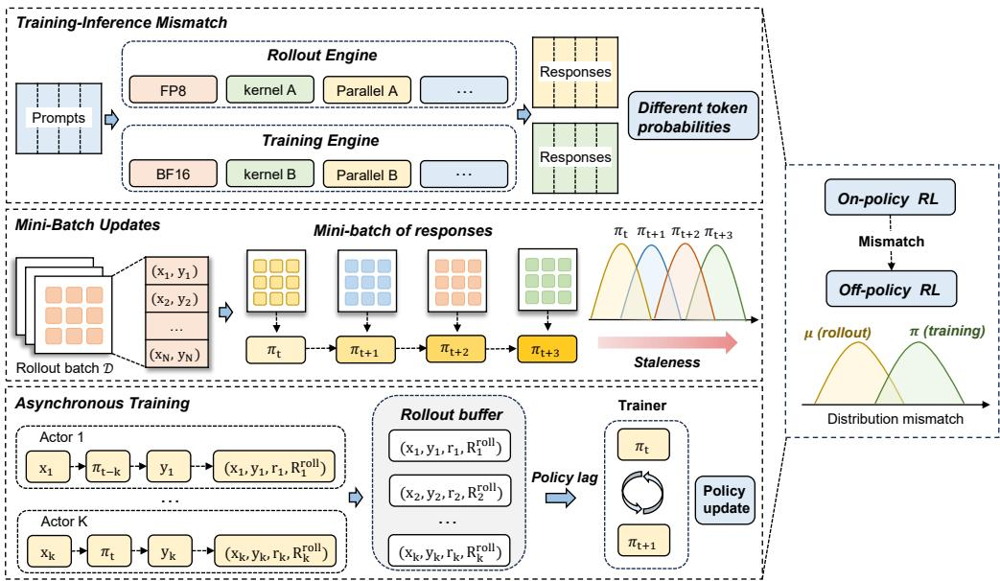  
Figure 1: Three common sources of off-policy mismatch in LLM reinforcement learning. Training and inference discrepancy, sequential mini-batch updates, and asynchronous policy lag can cause the policy used for generation to diverge from the policy used for optimization.

• Asynchronous Training. To improve system throughput by overlapping rollout generation with policy optimization, asynchronous RL decouples the two stages. As a result, training may use trajectories generated by earlier policy versions, introducing policy staleness (Espeholt et al., 2018; Zhang et al., 2026b; Yao et al., 2025).

Mixture-of-Experts (MoE) model architectures scale model capacity by activating only a subset of experts for each token, with a router determining which experts participate in the computation (Shazeer et al., 2017; Lepikhin et al., 2021; Fedus et al., 2022). As a result, routing decisions di rectly determine the computation path and the experts that receive learning signals. Under off-policy conditions, even small differences between the rollout and training policies can change routing decisions, causing the same token to be assigned to different experts during rollout and training (Ma et al., 2025; Zhang et al., 2026a). We refer to this rollout–training routing mismatch as router drift. As illustrated in Figure 2, router drift changes the computation path of a response and the expertlevel learning signals during training.

Existing methods mitigate off-policy effects from different perspectives (Zheng et al., 2025a; Li et al., 2025; Ma et al., 2025). Probability-based methods, such as truncated importance sampling (TIS), reweight token-level updates using truncated likelihood ratios between the training and rollout policies (Yao et al., 2025; Zheng et al., 2025a). These ratios capture differences in token probabilities but do not directly reveal changes in expert assignments. Rollout Routing Replay (R3) addresses routing drift by reusing expert selections from the rollout stage during training (Ma et al., 2025). While this enforces routing consistency between rollout and training, our analysis shows that replay alters gradient attribution relative to native routing, omitting contributions from experts that would otherwise be selected by the current training router.

We further observe that the degree of routing disagreement varies across responses. Motivated by this insight, we propose Router Drift Control (RDC), which selectively filters high-drift responses while preserving the native routing of the remaining responses. RDC quantifies routing disagreement between rollout and training. It uses this signal to exclude a small fraction of responses from each policy update. For retained responses, the training router remains free to select experts and receive the associated learning signals. Our main contributions are summarized as follows.

• We analyze the role of routing in MoE reinforcement learning and show that routing decisions determine expert-level gradient attribution beyond what token probabilities can capture. We further show that routing replay alters this gradient attribution and can introduce bias relative to native routing.

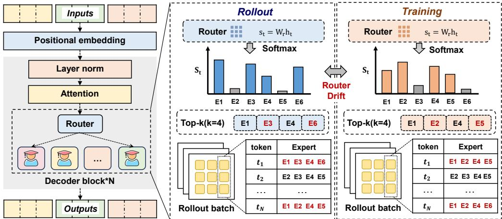  
Figure 2: Router drift in MoE reinforcement learning. The same response can activate different experts during rollout and training, resulting in different computation paths and expert-level gradient attribution.

• We propose RDC, which quantifies rollout–training routing disagreement at the response level and uses it to identify high-drift responses. RDC selectively filters these responses while preserving the native training routes of retained responses, providing a routing-aware correction without route replay.

• We evaluate RDC under both synchronous and fully asynchronous RL, showing that its gains become more pronounced as policy staleness increases. In asynchronous training, RDC combined with TIS improves the average peak validation accuracy on AIME 2024 and AIME 2025 by 5.5 points over TIS and 4.5 points over R3, while maintaining stable training dynamics.

## 2 RELATED WORK

Modern LLM reinforcement learning systems often use separate engines for rollout generation and policy optimization. Differences between these engines can cause rollout–training mismatch to produce different token probabilities even under identical model weights (Yao et al., 2025; Liu et al., 2025; Zheng et al., 2025a). Recent work has shown that such mismatch can undermine the approximation of the sequence-level reward objective by token-level policy optimization and destabilize training (Zheng et al., 2025a;b). More broadly, rollout–training mismatch also arises from policy staleness. Multiple sequential updates and asynchronous rollout generation can create a gap between the training policy and the rollout policy (Schulman et al., 2017; Espeholt et al., 2018; Zhang et al., 2026b). Existing work addresses these sources of mismatch at the system, probability, and routing levels.

## 2.1 SYSTEM-LEVEL CORRECTIONS

System-level methods aim to reduce training–inference mismatch by improving numerical consistency between the rollout and training engines. He & Lab (2025) study inference nondeterminism caused by non-associative floating-point reductions and batch-dependent execution. Zhang et al. (2025) develop tensor-parallel-invariant kernels to maintain bitwise consistency across different parallel configurations. Related work also aligns training and inference implementations to support bitwise-consistent on-policy RL (Wasti et al., 2025).

These methods mitigate mismatch arising from numerical differences between rollout and training. However, numerical consistency alone cannot address policy staleness caused by sequential minibatch updates or asynchronous training. Algorithm-level corrections are therefore still needed.

## 2.2 PROBABILITY-SPACE CORRECTIONS

Algorithm-level methods address rollout–training mismatch by modifying how rollout data contributes to policy updates. A common approach is to control token-level importance ratios. TIS truncates large ratios (Yao et al., 2025; Zheng et al., 2025a), while CISPO stops gradients through the importance weights (Chen et al., 2025). Other methods modify how these ratios are aggregated: GSPO uses sequence-level ratios (Zheng et al., 2025b), GMPO adopts geometric rather than arithmetic averaging (Zhao et al., 2026), and CTPO accounts for cumulative ratios across tokens (Zhang et al., 2026c). Some methods instead apply probability-based corrections selectively. SIS adjusts the contribution of off-policy tokens (Li et al., 2026), while TRM identifies trust-region violations using the maximum token-level KL divergence and masks the corresponding sequences (Li et al., 2025).

Although these methods use different objectives and correction rules, they primarily characterize off-policy mismatch through probability-space signals, such as token probabilities and likelihood ratios. These signals can capture distributional differences between rollout and training, but they do not directly reflect the computation paths taken by an MoE model. This limitation becomes important when the same response is routed to different experts during rollout and training.

## 2.3 ROUTING CORRECTIONS FOR MOE MODELS

Sparse MoE models increase capacity by activating only a subset of experts for each token (Shazeer et al., 2017; Lepikhin et al., 2021; Fedus et al., 2022). Their discrete routing decisions can be sensitive to small computational changes (Huu et al., 2026), making rollout–training routing mismatch an important issue in MoE reinforcement learning. Ma et al. (2025) study routing disagreement between rollout and training and introduces two forms of routing replay. Routing Replay (R2) records the routes selected by the training policy during probability computation and reuses them during the policy update. R3 further reuses rollout-time routes in the training forward pass (Ma et al., 2025). $\bar { \mathrm { P R } } ^ { 2 }$ predicts updated routing decisions to reduce the staleness caused by replaying fixed rollout routes (Dong et al., 2026). RSPO uses router-aware importance weights to account for changes in routing scores (Zhang et al., 2026a).

These methods address routing disagreement either by modifying the training routes or by reweighting rollout data. In doing so, they alter either the computation path or the contribution of each response to the policy update. RDC takes a different approach: it uses response-level router drift to determine which responses participate in optimization, while preserving the native training routes of retained responses. Combined with TIS, RDC addresses routing disagreement and token-level probability mismatch through complementary mechanisms.

## 3 METHOD

## 3.1 SETUP AND NOTATION

We consider reinforcement learning with separate rollout and training engines. Let $\mu ( \cdot \mid x )$ denote the behavior policy realized by the rollout engine, and let $\pi _ { \theta } ( \cdot \mid x )$ ) denote the current training policy.

For a sampled response $y = ( y _ { 1 } , \dotsc , y _ { T } )$ , let $\mathcal { T } = \{ 1 , . . . , T \}$ denote its token positions. We consider an MoE model with L MoE layers and E experts per layer. Each token is routed to $K$ experts. For token t at layer l, we denote the expert sets selected during rollout and training by

$$
R _ { l } ^ { \mu } ( t ) , R _ { l } ^ { \pi } ( t ) \subseteq \{ 1 , \ldots , E \} , \qquad | R _ { l } ^ { \mu } ( t ) | = | R _ { l } ^ { \pi } ( t ) | = K .\tag{1}
$$

We use $R ^ { \mu } ( y )$ and $R ^ { \pi } ( y )$ to denote the routing assignments over the full response.

The training route is obtained by evaluating the sampled response under teacher forcing. Let $c _ { t } =$ $( x , y _ { < t } )$ denote the context before token $y _ { t }$ . The rollout and training engines assign probabilities $\mu ( \boldsymbol { y } _ { t } \mid \boldsymbol { c } _ { t } )$ and $\pi _ { \theta } ( y _ { t } \mid c _ { t } )$ , respectively.

## 3.2 ROUTER DRIFT CONTROL

RDC uses rollout–training routing disagreement to decide which responses should contribute to a policy update. RDC does not force the training engine to replay rollout routes. Instead, it filters responses with large router drift and preserves the current training policy’s routing decisions for retained responses.

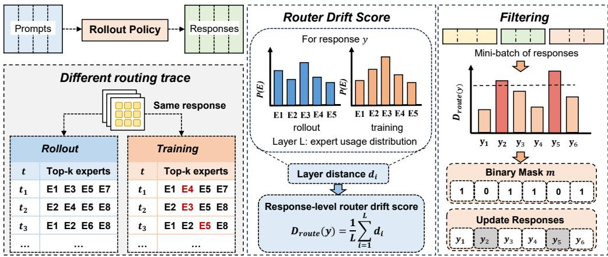  
Figure 3: Overview of Router Drift Control (RDC). RDC aggregates layer-wise differences in expert usage between rollout and training into a response-level drift score. It filters high-drift responses before policy updates. Retained responses follow their native training routes.

Figure 3 shows the overall procedure. For each response, RDC compares expert-usage distributions between rollout and training across MoE layers. It aggregates the layer-wise differences into a response-level router drift score. Based on this score, RDC filters a small fraction of responses with the largest drift before policy optimization.

Response-level router drift. For engine $a \in \{ \mu , \pi \}$ , we define the expert-usage distribution at layer l over response y as

$$
u _ { l } ^ { a } ( e \mid y ) = \frac { 1 } { T K } \sum _ { t = 1 } ^ { T } \mathbb { I } \left[ e \in R _ { l } ^ { a } ( t ) \right] , \qquad e \in \{ 1 , \ldots , E \} .\tag{2}
$$

Here, $u _ { l } ^ { a } ( e \mid y )$ denotes the fraction of expert selections assigned to expert $e ,$ normalized over all TK selections in the response. Thus, $u _ { l } ^ { a } ( \cdot \bar { | } \ y )$ forms a distribution over experts.

We measure the routing difference at each layer between the two expert-usage distributions using total variation distance:

$$
d _ { l } ( y ) = \frac { 1 } { 2 } \left\| u _ { l } ^ { \mu } ( \cdot \mid y ) - u _ { l } ^ { \pi } ( \cdot \mid y ) \right\| _ { 1 } .\tag{3}
$$

We then average the layer-wise distances to obtain the response-level router drift score:

$$
D _ { \mathrm { r o u t e } } ( y ) = \frac { 1 } { L } \sum _ { l = 1 } ^ { L } d _ { l } ( y ) .\tag{4}
$$

The score lies in [0, 1], with larger values indicating greater mismatch in aggregate expert usage between rollout and training. It characterizes the overall shift in expert utilization across the response.

Selective response filtering. Let $q \in [ 0 , 1 )$ denote the filtering ratio. RDC ranks responses by $D _ { \mathrm { r o u t e } } ( y )$ and filters those with the highest scores.

In practice, we rank responses by their router drift scores within groups of similar response lengths, rather than comparing scores across substantially different lengths.

For a rollout batch B, let $\mathcal { F } _ { q } ( B )$ denote the responses selected for filtering. The response-level mask is

$$
m _ { B } ( y ) = \mathbb { I } \left[ y \notin { \mathcal { F } } _ { q } ( B ) \right] .\tag{5}
$$

Let $\ell _ { \theta } ( y ; R )$ denote the sum of the token-level policy losses for response $y$ under routing assignment $R ,$ and let $N _ { B }$ denote the total number of valid tokens in the retained responses. The RDC objective is

$$
\mathcal { L } _ { \mathrm { R D C } } ( \theta ) = \frac { 1 } { N _ { B } } \sum _ { y \in \mathcal { B } } m _ { B } ( y ) \ell _ { \theta } ( y ; R ^ { \pi } ( y ) ) .\tag{6}
$$

The mask excludes filtered responses from the policy update while retained responses follow the routing decisions of the current training policy. RDC can be combined with token-level probability corrections such as TIS. Algorithm 1 describes a single optimizer update and is applied

Algorithm 1 Router Drift Control   
Require: Batch B, rollout routes $R ^ { \mu }$ , training policy   
πθ, ratio q   
Ensure: Updated policy πθ   
1: for all $y \in B$ do   
2: Obtain training routes $R ^ { \pi } ( y )$   
3: Compute $D _ { \mathrm { r o u t e } } ( y )$ using Eqs. 2–4   
4: end for   
5: Partition B into length buckets   
6: for all buckets $B _ { b }$ do   
7: Select the top $\lceil q \vert B _ { b } \vert \rceil$ responses   
8: end for   
9: Construct mB using $\mathrm { E q . } 5$   
10: Compute $\mathcal { L } _ { \mathrm { R D C } } ( \theta )$ using $\mathrm { E q . 6 }$   
11: Update θ using $\dot { \nabla } _ { \boldsymbol { \theta } } \mathcal { L } _ { \mathrm { R D C } } ( \boldsymbol { \theta } ) ^ { - }$

separately to each update mini-batch. Before every update, we recompute the routing scores and filtering mask using the current training policy, and rank responses within the length buckets of the current mini-batch.

## 3.3 ROUTING DETERMINES GRADIENT SUPPORT

RDC uses routing information because expert selection determines which parameters can receive the local training signal.

At layer l and token $t ,$ an MoE layer computes

$$
h _ { l } ^ { \mathrm { o u t } } ( t ) = \sum _ { e \in R _ { l } ( t ) } \mathrm { g a t e } _ { l , e } ( t ) E _ { l , e } \left( h _ { l } ^ { \mathrm { i n } } ( t ) \right) ,\tag{7}
$$

where $E _ { l , \epsilon }$ denotes expert e and $\mathrm { g a t e } _ { l , e } ( t )$ denotes its routing weight (Shazeer et al., 2017; Fedus et al., 2022).

Let $\theta _ { l , \epsilon }$ denote the parameters of expert e. If the router does not select this expert, the token provides no direct gradient to its parameters through this MoE layer:

$$
\begin{array} { c c c } { \displaystyle { e \notin R _ { l } ( t ) } } & { \displaystyle { \implies } } & { \frac { \partial h _ { l } ^ { \mathrm { o u t } } ( t ) } { \partial \theta _ { l , e } } = 0 . } \end{array}\tag{8}
$$

Thus, routing determines which expert parameter blocks can receive direct gradients through the current token’s MoE computation.

This matters when rollout and training use different routes. The rollout engine processes response y through $R ^ { \mu } ( y )$ . The training engine computes gradients through $R ^ { \pi } ( y )$ . If these routes differ, the expert support used during training differs from the one used during rollout. Some experts activated during rollout may receive no direct gradient in training. Other experts may receive gradients even though they were not used during rollout.

Router drift can therefore change how learning signals are distributed across experts, even when its effect on token probabilities is small.

## 3.4 TOKEN PROBABILITIES DO NOT IDENTIFY ROUTING

Token probabilities do not uniquely determine the underlying routing decisions. Different expert paths can produce the same output distribution while assigning gradients to different expert parameter blocks. Consider a top-K MoE layer. Let S contain $\bar { K } - \bar { 1 }$ shared experts, and let $e _ { 1 }$ and $e _ { 2 }$ be two distinct experts outside S. Consider two routing assignments

$$
R _ { 1 } = S \cup \{ e _ { 1 } \} , \qquad R _ { 2 } = S \cup \{ e _ { 2 } \} .\tag{9}
$$

Suppose the shared experts have the same routing weights under both assignments, and the two replacing experts have equal routing weights. Further suppose that their outputs at the current input are identical:

$$
E _ { l , e _ { 1 } } \left( h _ { l } ^ { \mathrm { i n } } ( t ) \right) = E _ { l , e _ { 2 } } \left( h _ { l } ^ { \mathrm { i n } } ( t ) \right) .\tag{10}
$$

Under these conditions, the two routing assignments produce the same MoE output. If the remaining computation is identical, they also produce the same logits and probability distribution. Consequently, likelihood ratios and token-level KL divergence computed from these probabilities cannot identify which routing assignment was used.

The direct expert-gradient support can nevertheless differ. Under $R _ { 1 }$ , expert $e _ { 1 }$ participates in the MoE computation, whereas expert $e _ { 2 }$ does not. Under $R _ { 2 }$ , their roles are reversed:

$$
\frac { \partial h _ { l } ^ { \mathrm { o u t } } ( t ; R _ { 1 } ) } { \partial \theta _ { l , e _ { 2 } } } = 0 , \qquad \frac { \partial h _ { l } ^ { \mathrm { o u t } } ( t ; R _ { 2 } ) } { \partial \theta _ { l , e _ { 1 } } } = 0 .\tag{11}
$$

Thus, even when the two assignments produce identical token probabilities, they can direct learning signals to different expert parameter blocks. Routing information therefore reveals differences in the training computation that cannot be uniquely recovered from token probabilities alone.

## 3.5 SELECTIVE CONTROL VERSUS ROUTE REPLAY

Probability-based corrections, such as TIS, reweight rollout data while preserving the native training route. R3 instead replaces this route with the route recorded during rollout (Ma et al., 2025).

To examine the effect of route substitution, let

$$
g _ { \theta } ( y ; R ) = \nabla _ { \theta } \ell _ { \theta } ( y ; R )\tag{12}
$$

denote the gradient contribution of response $y$ under routing assignment $R ,$ where $\ell _ { \theta } ( y ; R )$ is defined in Section 3.2. For the same response, replacing the training route with the rollout route changes the gradient contribution by

$$
\Delta _ { \mathrm { r o u t e } } ( y ) = g _ { \theta } ( y ; R ^ { \mu } ( y ) ) - g _ { \theta } ( y ; R ^ { \pi } ( y ) ) .\tag{13}
$$

The substitution can alter expert-level gradient support and introduce bias relative to the nativerouting objective. Appendix B provides a detailed analysis.

RDC retains the native training route and uses routing disagreement to determine which responses contribute to the update. We combine RDC with TIS: TIS adjusts token-level contributions using truncated importance weights, while RDC filters responses based on router drift.

## 4 EXPERIMENTS

We evaluate RDC on mathematical and logical reasoning tasks under both synchronous and asynchronous RL settings. In synchronous training, we vary the update batch size to study the effects of sequential policy updates on rollout data. We further evaluate RDC under fully asynchronous training with policy lag between rollout and optimization. We compare GRPO, TIS, R3, and RDC combined with TIS, using validation accuracy as the primary metric. For simplicity, we use RDC to denote RDC combined with TIS in the experiments below. We also track training reward, gradient norm, rollout–training KL divergence, and response length to analyze training dynamics.

## 4.1 EXPERIMENTAL SETUP

Model and Datasets: We train Qwen3-30B-A3B (Yang et al., 2025) on DAPO-Math-17K (Yu et al., 2026). Evaluation uses AIME 2024, AIME 2025, MATH-500 (Lightman et al., 2024) and ZebraLogic (Lin et al., 2025). All methods follow the same evaluation protocol on each benchmark. We evaluate every five global steps and report the best validation accuracy reached during training.

Methods: All methods use GRPO (Shao et al., 2024) as the baseline, with DAPO Clip-Higher objective (Yu et al., 2026) $( \epsilon _ { \mathrm { l o w } } = 0 . 2 , \epsilon _ { \mathrm { h i g h } } = 0 . 2 7 )$ . We compare four settings: GRPO, R3, TIS, and RDC+TIS. RDC ranks responses by $\breve { D } _ { \mathrm { r o u t e } } ( y )$ within response-length groups and filters the highest-drift fraction before optimization. Unless otherwise specified, we set the filtering ratio to $q = 0 . 0 8$ . We combine RDC with TIS to address routing disagreement and token-level probability mismatch: RDC filters responses with large routing disagreement, while TIS corrects token-level probability mismatch on the retained responses. Within each training regime, all methods use the same rollout budget and training configuration.

Table 1: Best validation accuracy under different update batch sizes in synchronous training.
<table><tr><td> $( B _ { \mathrm { r o l l o u t } } , B _ { \mathrm { u p d a t e } } )$ </td><td>Method</td><td>ZebraLogic</td><td>AIME24</td><td>AIME25</td><td>MATH-500</td></tr><tr><td rowspan="4">(2048, 2048)</td><td>GRPO</td><td>61.2</td><td>77.7</td><td>65.2</td><td>96.6</td></tr><tr><td>GRPO+R3</td><td>63.0</td><td>74.9</td><td>65.4</td><td>97.6</td></tr><tr><td>GRPO+TIS</td><td>66.1</td><td>80.0</td><td>71.3</td><td>98.2</td></tr><tr><td>GRPO+TIS+RDC</td><td>73.9</td><td>78.5</td><td>72.4</td><td>97.8</td></tr><tr><td rowspan="4">(2048, 512)</td><td>GRPO</td><td>46.3</td><td>62.2</td><td>50.8</td><td>96.0</td></tr><tr><td>GRPO+R3</td><td>55.2</td><td>69.9</td><td>57.9</td><td>96.6</td></tr><tr><td>GRPO+TIS</td><td>61.3</td><td>70.6</td><td>60.3</td><td>97.0</td></tr><tr><td>GRPO+TIS+RDC</td><td>68.1</td><td>71.5</td><td>62.5</td><td>97.6</td></tr><tr><td rowspan="4">(2048,128)</td><td>GRPO</td><td>61.1</td><td>53.4</td><td>40.0</td><td>92.2</td></tr><tr><td> ${ \mathrm { G R P O } } \mathrm { + R } 3$ </td><td>53.1</td><td>61.0</td><td>48.7</td><td>95.0</td></tr><tr><td>GRPO+TIS</td><td>78.2</td><td>70.6</td><td>62.9</td><td>97.6</td></tr><tr><td> $\mathrm { G R P O + T I S + R D C }$ </td><td>86.1</td><td>77.0</td><td>67.2</td><td>97.8</td></tr></table>

Table 2: Best validation accuracy under asynchronous RL.
<table><tr><td>Method</td><td>ZebraLogic</td><td>AIME24</td><td>AIME25</td><td>MATH-500</td></tr><tr><td>GRPO</td><td>46.9</td><td>63.4</td><td>50.7</td><td>96.2</td></tr><tr><td> ${ \mathrm { G R P O } } { \scriptstyle + \mathrm { R } } 3$ </td><td>53.9</td><td>68.7</td><td>53.1</td><td>96.2</td></tr><tr><td>GRPO+TIS</td><td>53.7</td><td>65.0</td><td>54.8</td><td>96.4</td></tr><tr><td> $\mathrm { G R P O + T I S + R D C }$ </td><td>53.0</td><td>71.2</td><td>59.6</td><td>97.2</td></tr></table>

Multiple Mini-Steps: In synchronous training, each rollout batch contains 2,048 responses, generated from 256 prompts with $n \ = \ 8$ responses per prompt. We keep the rollout batch size fixed and vary the number of responses used in each policy update. Specifically, we consider $(  { B _ { \mathrm { r o l l o u t } } } ,  { B _ { \mathrm { u p d a t e } } } ) \in \{ ( 2 0 4 8 , 2 0 4 8 )$ , (2048, 512), (2048, 128)}. A smaller update batch leads to more successive updates on the same rollout batch, increasing the staleness of the data relative to the current policy.

Asynchronous Training: We further evaluate RDC under fully asynchronous training. Rollout generation and policy optimization run independently, and the Trainer consumes generated samples from a rollout queue. Each prompt generates n = 8 responses, and each local update uses 32 prompt groups, corresponding to 256 response trajectories. The rollout and training processes therefore continue at different rates, allowing the trainer to consume data generated by earlier policy versions. For each training batch, the Trainer recomputes routing under the current policy, measures router drift, and filters high-drift responses before the policy update. After every four local updates, the updated Trainer parameters are synchronized to the rollout workers.

Other Settings: We use Megatron for BF16 policy optimization and vLLM for FP8 rollout generation (Shoeybi et al., 2019; Kwon et al., 2023). We set the maximum response length to 20,480 tokens during training and 30,720 tokens during evaluation. Additional optimization, asynchronous scheduling, batching, and implementation details are provided in Appendix A.

## 4.2 EXPERIMENTAL RESULTS

Synchronous Training. We first compare the four methods under synchronous training with different update batch sizes. Table 1 reports the best validation accuracy observed during training. RDC performs competitively under low policy staleness and delivers larger gains as the update batch becomes smaller. Under (2048, 512), RDC achieves the highest accuracy on all four benchmarks. The advantage becomes more pronounced under (2048, 128). Compared with TIS alone, RDC improves ZebraLogic, AIME24, and AIME25 by 7.9, 6.4, and 4.3 percentage points, respectively. These results suggest that routing-aware response selection becomes more useful as rollout data grows increasingly stale.

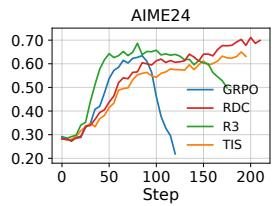

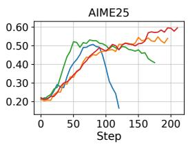

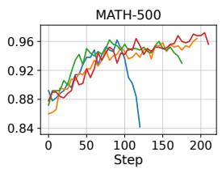

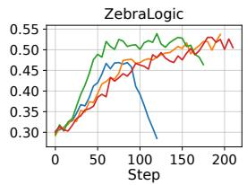  
Figure 4: Validation accuracy during asynchronous reinforcement learning on AIME24, AIME25, MATH-500, and ZebraLogic.

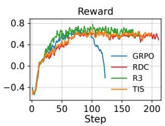

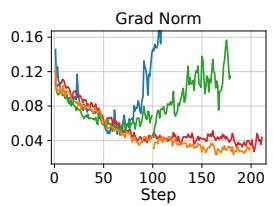

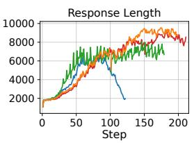

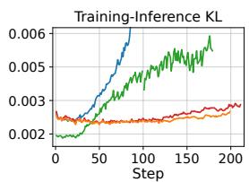  
Figure 5: Training dynamics under asynchronous reinforcement learning, showing training reward, gradient norm, response length, and training–inference KL for GRPO, TIS, R3, and RDC+TIS.

Asynchronous Training. We further evaluate RDC under fully asynchronous training. Table 2 reports the best validation accuracy, while Figure 4 shows the full validation trajectories. RDC achieves the highest accuracy on AIME24, AIME25, and MATH-500, while R3 performs slightly better on ZebraLogic. On AIME24 and AIME25, RDC improves the average peak score by 5.5 points over TIS and 4.5 points over R3. R3 avoids reward collapse but exhibits late-stage degradation in validation accuracy, whereas RDC maintains strong late-stage performance, particularly on the two AIME benchmarks. The uncorrected GRPO baseline collapses after roughly 100 training steps, while RDC continues to improve and remains stable across the evaluation benchmarks.

Training Dynamics. Figure 5 provides a closer view of the training dynamics under asynchronous RL. The uncorrected GRPO baseline exhibits clear late-stage degradation. Its reward rises during early training but drops sharply after around 100 steps and eventually becomes negative. The response length decreases at the same time, from roughly 6,000 tokens to around 2,000 tokens. In contrast, TIS, R3, and RDC maintain positive rewards and avoid this response-length collapse. This degradation coincides with rapid growth in both training–inference KL and gradient norm.

For GRPO, the training–inference KL increases rapidly and eventually exceeds the displayed range, while the gradient norm rises sharply during the same stage. TIS and RDC keep both quantities low and stable throughout training, whereas R3 shows a more pronounced increase in both KL and gradient norm during later stages.

Overall, RDC improves validation accuracy over TIS under smaller update batches and asynchronous training, while maintaining stable training dynamics.

## 5 CONCLUSION

Off-policy mismatch can degrade performance and destabilize reinforcement learning in MoE models. In this work, we study router drift as a distinct source of off-policy mismatch in MoE reinforcement learning. We show that changes in routing alter the expert-level gradient support and that replaying rollout routes changes the training gradient relative to the native routing of the current policy. Based on this observation, we propose Router Drift Control (RDC), which filters high-drift responses while preserving the current training policy’s routing decisions. Combined with TIS, RDC improves validation performance and training stability under mini-batch updates and fully asynchronous training. These results demonstrate the value of routing-aware filtering as an alternative to rollout routing replay.

## REFERENCES

Aili Chen, Aonian Li, Bangwei Gong, Binyang Jiang, Bo Fei, Bo Yang, Boji Shan, Changqing Yu, Chao Wang, Cheng Zhu, et al. Minimax-m1: Scaling test-time compute efficiently with lightning attention. arXiv preprint arXiv:2506.13585, 2025.

Daize Dong, Junlin Chen, Haolong Jia, Jiang Liu, Jiawei Wu, Huanwei Di, Jialian Wu, Zhengzhong Liu, Zicheng Liu, Emad Barsoum, et al. Pr2: Predictive routing replay for moe-based llm reinforcement learning. arXiv preprint arXiv:2606.00395, 2026.

Lasse Espeholt, Hubert Soyer, Remi Munos, Karen Simonyan, Vlad Mnih, Tom Ward, Yotam Doron, Vlad Firoiu, Tim Harley, Iain Dunning, et al. Impala: Scalable distributed deep-rl with importance weighted actor-learner architectures. In International conference on machine learning, pp. 1407–1416. PMLR, 2018.

William Fedus, Barret Zoph, and Noam Shazeer. Switch transformers: Scaling to trillion parameter models with simple and efficient sparsity. Journal of Machine Learning Research, 23(120):1–39, 2022.

Daya Guo, Dejian Yang, Haowei Zhang, Junxiao Song, Peiyi Wang, Qihao Zhu, Runxin Xu, Ruoyu Zhang, Shirong Ma, Xiao Bi, et al. Deepseek-r1: Incentivizing reasoning capability in llms via reinforcement learning. arXiv preprint arXiv:2501.12948, 2025.

Horace He and Thinking Machines Lab. Defeating nondeterminism in llm inference. Thinking Machines Lab: Connectionism, 2025. doi: 10.64434/tml.20250910. https://thinkingmachines.ai/blog/defeating-nondeterminism-in-llm-inference/.

Tho Tran Huu, Huu-Tuan Nguyen, Thien-Hai Nguyen, Nhat-Tri Ho, Viet-Hoang Tran, Tho Quan, and Tan Minh Nguyen. Geometric and stochastic analysis of discontinuities in sparse mixtureof-experts. In Forty-third International Conference on Machine Learning, 2026. URL https: //openreview.net/forum?id=AyrNR1ExN5.

Woosuk Kwon, Zhuohan Li, Siyuan Zhuang, Ying Sheng, Lianmin Zheng, Cody Hao Yu, Joseph Gonzalez, Hao Zhang, and Ion Stoica. Efficient memory management for large language model serving with pagedattention. In Proceedings of the 29th symposium on operating systems principles, pp. 611–626, 2023.

Dmitry Lepikhin, HyoukJoong Lee, Yuanzhong Xu, Dehao Chen, Orhan Firat, Yanping Huang, Maxim Krikun, Noam Shazeer, and Zhifeng Chen. Gshard: Scaling giant models with conditional computation and automatic sharding. In International Conference on Learning Representations, 2021.

Yingru Li, Jiacai Liu, Jiawei Xu, Yuxuan Tong, Ziniu Li, Qian Liu, and Baoxiang Wang. Trust region masking for long-horizon llm reinforcement learning. arXiv preprint arXiv:2512.23075, 2025.

Yu Li, Xiuyu Li, Mingyang Yi, Jiaxing Wang, Liangxu Zhang, Zhaolong Xing, and Zhen Chen. Turning off-policy tokens on-policy: A plug-in approach for improving llm alignment. arXiv preprint arXiv:2607.04728, 2026.

Hunter Lightman, Vineet Kosaraju, Yuri Burda, Harrison Edwards, Bowen Baker, Teddy Lee, Jan Leike, John Schulman, Ilya Sutskever, and Karl Cobbe. Let’s verify step by step. In International Conference on Learning Representations, volume 2024, pp. 39578–39601, 2024.

Bill Yuchen Lin, Ronan Le Bras, Kyle Richardson, Ashish Sabharwal, Radha Poovendran, Peter Clark, and Yejin Choi. Zebralogic: On the scaling limits of llms for logical reasoning. arXiv preprint arXiv:2502.01100, 2025.

Jiacai Liu, Yingru Li, Yuqian Fu, Jiawei Wang, Qian Liu, and Zhuo Jiang. When speed kills stability: Demystifying RL collapse from the training-inference mismatch, September 2025. URL https: //richardli.xyz/rl-collapse.

Wenhan Ma, Hailin Zhang, Liang Zhao, Yifan Song, Yudong Wang, Zhifang Sui, and Fuli Luo. Stabilizing moe reinforcement learning by aligning training and inference routers. arXiv preprint arXiv:2510.11370, 2025.

John Schulman, Filip Wolski, Prafulla Dhariwal, Alec Radford, and Oleg Klimov. Proximal policy optimization algorithms. arXiv preprint arXiv:1707.06347, 2017.

Zhihong Shao, Peiyi Wang, Qihao Zhu, Runxin Xu, Junxiao Song, Xiao Bi, Haowei Zhang, Mingchuan Zhang, YK Li, Yang Wu, et al. Deepseekmath: Pushing the limits of mathematical reasoning in open language models. arXiv preprint arXiv:2402.03300, 2024.

Noam Shazeer, \*Azalia Mirhoseini, \*Krzysztof Maziarz, Andy Davis, Quoc Le, Geoffrey Hinton, and Jeff Dean. Outrageously large neural networks: The sparsely-gated mixture-ofexperts layer. In International Conference on Learning Representations, 2017. URL https: //openreview.net/forum?id=B1ckMDqlg.

Mohammad Shoeybi, Mostofa Patwary, Raul Puri, Patrick LeGresley, Jared Casper, and Bryan Catanzaro. Megatron-lm: Training multi-billion parameter language models using model parallelism. arXiv preprint arXiv:1909.08053, 2019.

Zhixin Wang, Jiaming Xu, Tianyi Zhou, Mingjun Zhang, Liming Liu, Jiarui Hu, Dian Yang, TongYu Wang, Ping Zhang, Jinlong Hou, Siyuan Feng, Yuan Qi, and Yuan Cheng. Distflow: A fully distributed RL framework for scalable and efficient LLM post-training. In Forty-third International Conference on Machine Learning, 2026. URL https://openreview.net/forum?id= aPPEyZpKkp.

Bram Wasti, Wentao Ye, Teja Rao, Michael Goin, Paul Zhang, Tianyu Liu, Natalia Gimelshein, Woosuk Kwon, Kaichao You, and Zhuohan Li. No more train-inference mismatch: Bitwise consistent on-policy reinforcement learning with vllm and torchtitan. Blog post, 2025. https: //vllm.ai/blog/2025-11-10-bitwise-consistent-train-inference.

An Yang, Anfeng Li, Baosong Yang, Beichen Zhang, Binyuan Hui, Bo Zheng, Bowen Yu, Chang Gao, Chengen Huang, Chenxu Lv, et al. Qwen3 technical report. arXiv preprint arXiv:2505.09388, 2025.

Feng Yao, Liyuan Liu, Dinghuai Zhang, Chengyu Dong, Jingbo Shang, and Jianfeng Gao. Your efficient rl framework secretly brings you off-policy rl training, August 2025. URL https: //fengyao.notion.site/off-policy-rl.

Qiying Yu, Zheng Zhang, Ruofei Zhu, Yufeng Yuan, Xiaochen Zuo, Yu Yue, Weinan Dai, Tiantian Fan, Gaohong Liu, Lingjun Liu, et al. Dapo: An open-source llm reinforcement learning system at scale. In Advances in Neural Information Processing Systems, volume 38, pp. 113222–113244, 2026.

Di Zhang, Xun Wu, Shaohan Huang, Lingjie Jiang, Yaru Hao, Li Dong, Zewen Chi, Zhifang Sui, and Furu Wei. Towards stable and effective reinforcement learning for mixture-of-experts. In Proceedings ofthe 64th Annual Meeting ofthe Associationfor Computational Linguistics (Volume 1: Long Papers), pp. 25446–25457, 2026a.

Liujie Zhang, Benzhe Ning, Rui Yang, Xiaoyan Yu, Jiaxing Li, Lumeng Wu, Jia Liu, Minghao Li, Weihang Chen, Weiqi Hu, et al. Relax: An asynchronous reinforcement learning engine for omni-modal post-training at scale. arXiv preprint arXiv:2604.11554, 2026b.

Yuheng Zhang, Chenlu Ye, Shuowei Jin, Changlong Yu, Wei Xiong, Saurabh Sahu, and Nan Jiang. Rethinking importance sampling in llm policy optimization: A cumulative token perspective. arXiv preprint arXiv:2605.07331, 2026c.

Ziyang Zhang, Xinheng Ding, Jiayi Yuan, Rixin Liu, Huizi Mao, Jiarong Xing, and Zirui Liu. Deterministic inference across tensor parallel sizes that eliminates training-inference mismatch. arXiv preprint arXiv:2511.17826, 2025.

Yuzhong Zhao, Yue Liu, Junpeng Liu, Jingye Chen, Yaru Hao, Tengchao Lv, Shaohan Huang, Lei Cui, Qixiang Ye, Fang Wan, et al. Geometric-mean policy optimization. In International Conference on Learning Representations, volume 2026, pp. 41354–41374, 2026.

Chujie Zheng, Kai Dang, Bowen Yu, Mingze Li, Huiqiang Jiang, Junrong Lin, Yuqiong Liu, Hao Lin, Chencan Wu, Feng Hu, et al. Stabilizing reinforcement learning with llms: Formulation and practices. arXiv preprint arXiv:2512.01374, 2025a.

Chujie Zheng, Shixuan Liu, Mingze Li, Xiong-Hui Chen, Bowen Yu, Chang Gao, Kai Dang, Yuqiong Liu, Rui Men, An Yang, Jingren Zhou, and Junyang Lin. Group sequence policy optimization. arXiv preprint arXiv:2507.18071, 2025b.

Table 3: Additional experimental hyperparameters. TP, PP, EP, and ETP denote tensor, pipeline, expert, and expert tensor parallelism, respectively.
<table><tr><td>Parameter</td><td>Value</td></tr><tr><td>Learning rate (synchronous / asynchronous) Weight decay / gradient clipping threshold</td><td> $3 \times 1 0 ^ { - 6 } / 1 \times 1 0 ^ { - 6 }$ </td></tr><tr><td>PPO epochs</td><td>0.1 /1.0 1</td></tr><tr><td>Loss aggregation</td><td>token-mean</td></tr><tr><td></td><td></td></tr><tr><td>Sampling temperature (training / validation)</td><td>1.0 / 0.6</td></tr><tr><td>Top-p (training / validation)</td><td>1.0 / 0.95</td></tr><tr><td>Top-k (training / validation)</td><td>Disabled / 20</td></tr><tr><td>TIS threshold C</td><td>2.0</td></tr><tr><td>Response-length bucket boundaries Megatron TP / PP / EP / ETP</td><td>2048, 4096, 8192, 12288 4/1/4/2</td></tr></table>

## A EXPERIMENTAL DETAILS

Table 3 summarizes additional experimental hyperparameters, followed by implementation details for RDC and the two training regimes.

We initialize all runs from the post-trained Qwen3-30B-A3B checkpoint and disable thinking mode during both training rollouts and evaluation. For AIME 2024 and AIME 2025, we sample 32 responses per problem and compute accuracy by averaging binary correctness over the sampled responses and problems. During training, a response receives a reward of +1 if its answer is correct and −1 otherwise. During evaluation, correctness is scored as 1 for a correct answer and 0 otherwise.

For asynchronous training, rollout generation and policy optimization use separate resource pools. We set require batches to 1 and staleness threshold to 0.5. For each Trainer batch, RDC computes the response-level expert-usage difference once, using the BF16 routing assignments recorded when computing old log prob. It then filters responses before the policy update.

## B GRADIENT BIAS UNDER ROLLOUT ROUTING REPLAY

We analyze the gradient bias introduced by rollout routing replay (R3) (Ma et al., 2025). We first derive the local gradients of an MoE layer and then compare the gradients and optimization objectives under replayed and native routing.

## B.1 SETUP

We consider a sparsely gated MoE layer (Shazeer et al., 2017). For one token at this layer, we omit the token and layer indices for clarity. Let h be the layer input, and let

$$
z = W _ { r } h + b _ { r } , \qquad S ^ { \mathrm { c u r } } = \mathrm { T o p K } ( z ) .\tag{14}
$$

Native routing selects the current expert set $S ^ { \mathrm { c u r } }$ . In contrast, R3 uses the expert set $S ^ { \mathrm { r o l l } }$ recorded during rollout.

We consider routing replay that fixes expert identities but recomputes gate weights from the current router logits. For a selected set S, let

$$
g _ { e } ^ { S } = \frac { \exp ( z _ { e } ) } { \sum _ { i \in S } \exp ( z _ { i } ) } , \qquad e \in S .\tag{15}
$$

The MoE output is

$$
o ^ { S } = \sum _ { e \in S } g _ { e } ^ { S } E _ { e } ( h ; \psi _ { e } ) ,\tag{16}
$$

where $\psi _ { e }$ denotes the parameters of expert e.

Our analysis considers local gradients through this MoE output, holding the layer input fixed. Expert parameters are distinct, and expert outputs do not depend directly on router logits. We exclude

auxiliary router losses and assume no token dropping. As in standard top-k routing, the selected expert set is treated as fixed during backpropagation. The derivatives below therefore apply away from routing selection boundaries.

## B.2 GRADIENTS UNDER FIXED ROUTING

Let $\mathcal { L } ^ { S }$ be the downstream loss evaluated using expert set $S ,$ and define

$$
\begin{array} { r l r } { \delta ^ { S } = \nabla _ { o } s \mathcal { L } ^ { S } , } & { { } } & { a _ { e } ^ { S } = ( \delta ^ { S } ) ^ { \top } E _ { e } ( h ; \psi _ { e } ) . } \end{array}\tag{17}
$$

Both $o ^ { S }$ and $\delta ^ { S }$ may depend on the selected expert set.

For $e , j \in S$ , differentiating the normalized gate weights gives

$$
\frac { \partial g _ { e } ^ { S } } { \partial z _ { j } } = g _ { e } ^ { S } \big ( { \bf 1 } [ e = j ] - g _ { j } ^ { S } \big ) .\tag{18}
$$

Consequently,

$$
\frac { \partial o ^ { S } } { \partial z _ { j } } = g _ { j } ^ { S } \big ( E _ { j } ( h ; \psi _ { j } ) - o ^ { S } \big ) , \qquad j \in S .\tag{19}
$$

For $j \not \in S ,$ , the output has no direct dependence on $z _ { j }$ when S is held fixed. Thus, the local routerlogit gradient is

$$
r _ { j } ^ { S } \equiv \frac { \partial \mathcal { L } ^ { S } } { \partial z _ { j } } = \left\{ g _ { j } ^ { S } \left( a _ { j } ^ { S } - \sum _ { e \in S } g _ { e } ^ { S } a _ { e } ^ { S } \right) , \quad j \in S , \right.\tag{20}
$$

For the linear router, the corresponding local parameter gradients are

$$
\nabla _ { W _ { r } } \mathcal { L } ^ { S } \big | _ { \mathrm { l o c a l } } = r ^ { S } h ^ { \top } , \qquad \nabla _ { b _ { r } } \mathcal { L } ^ { S } \big | _ { \mathrm { l o c a l } } = r ^ { S } .\tag{21}
$$

Let $J _ { j } ( h ) = \partial E _ { j } ( h ; \psi _ { j } ) / \partial \psi _ { j }$ denote the expert Jacobian. The direct expert gradient is

$$
\nabla _ { \psi _ { j } } \mathcal { L } ^ { S } \big | _ { \mathrm { l o c a l } } = \left\{ \begin{array} { l l } { g _ { j } ^ { S } J _ { j } ( h ) ^ { \top } \delta ^ { S } , } & { j \in S , } \\ { 0 , } & { j \not \in S . } \end{array} \right.\tag{22}
$$

These are local gradient contributions for one token at one layer. An unselected expert may still receive gradients from other tokens.

## B.3 CHANGES IN LOCAL GRADIENT SUPPORT

Proposition 1. Fix the layer input and current model parameters. Suppose $j \ \in \ S ^ { \mathrm { c u r } } \ \backslash \ S ^ { \mathrm { r o l l } }$ Routing replay gives zero local gradients with respect to $z _ { j }$ and $\psi _ { j }$ . Under native routing, the direct expert gradient is nonzero if

$$
J _ { j } ( h ) ^ { \top } \delta ^ { \mathrm { c u r } } \neq 0 ,\tag{23}
$$

and the local router-logit gradient is nonzero if

$$
( \delta ^ { \mathrm { c u r } } ) ^ { \top } \left( E _ { j } ( h ; \psi _ { j } ) - o ^ { \mathrm { c u r } } \right) \neq 0 ,\tag{24}
$$

where the superscript cur denotes evaluation under $S ^ { \mathrm { c u r } }$

Proof. Since $j \notin S ^ { \mathrm { r o l l } }$ , the replay output has no direct dependence on $z _ { j } \ \mathrm { ~ o r ~ } \psi _ { j }$ . Both local gradients are therefore zero by Eqs. 20 and 22. Under native routing, $j$ is selected and $g _ { j } ^ { \mathrm { c u r } } > 0$ for finite logits. The stated conditions then imply nonzero local expert and router-logit gradients, respectively. □

Proposition 1 shows that routing replay changes local gradient support: experts selected only by native routing lose their direct gradient contributions, whereas experts selected only by replay can receive gradients instead. Shared experts may also receive different gradients due to changes in gate weights and downstream gradients.

## B.4 GRADIENT BIAS RELATIVE TO NATIVE ROUTING

Let $\mathcal { R } _ { \theta } ^ { \mathrm { c u r } } ( x , y )$ denote the routing assignments under the current training policy, and let $\mathcal { R } ^ { \mathrm { r o l l } }$ denote the recorded rollout routes. For a fixed empirical distribution D over training examples and their recorded routes, define

$$
\begin{array} { r l } & { J _ { \mathrm { c u r } } ( \boldsymbol { \theta } ) = \mathbb { E } _ { \mathcal { D } } \left[ \ell \left( \boldsymbol { \theta } ; \boldsymbol { x } , \boldsymbol { y } , \mathcal { R } _ { \boldsymbol { \theta } } ^ { \mathrm { c u r } } ( \boldsymbol { x } , \boldsymbol { y } ) \right) \right] , } \\ & { J _ { \mathrm { R 3 } } ( \boldsymbol { \theta } ) = \mathbb { E } _ { \mathcal { D } } \left[ \ell \left( \boldsymbol { \theta } ; \boldsymbol { x } , \boldsymbol { y } , \mathcal { R } ^ { \mathrm { r o l l } } \right) \right] . } \end{array}\tag{25}
$$

Both objectives use the same policy-optimization loss, with the data, advantages, old logprobabilities, and other loss inputs held fixed. They differ only in the routing assignments used during the forward pass.

Away from routing selection boundaries, we define the gradient bias relative to the native-routing objective as

$$
b _ { \mathrm { r e p l a y } } ( \theta ) = \nabla _ { \theta } J _ { \mathrm { R 3 } } ( \theta ) - \nabla _ { \theta } J _ { \mathrm { c u r } } ( \theta ) .\tag{26}
$$

Proposition 2. Routing replay can introduce nonzero gradient bias relative to the native-routing objective. In particular, there exist routing assignments, expert parameters, and a policy-gradient loss for which $b _ { \mathrm { r e p l a y } } ( \theta ) \neq 0$

This follows from Proposition 1: when native routing selects an expert excluded by replay, the two routing rules can yield different expert-parameter gradients under the same training loss.