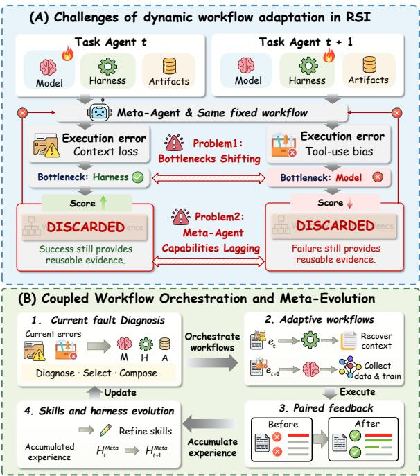
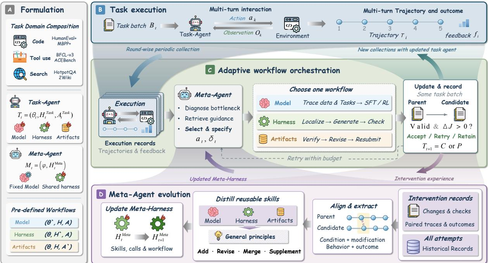
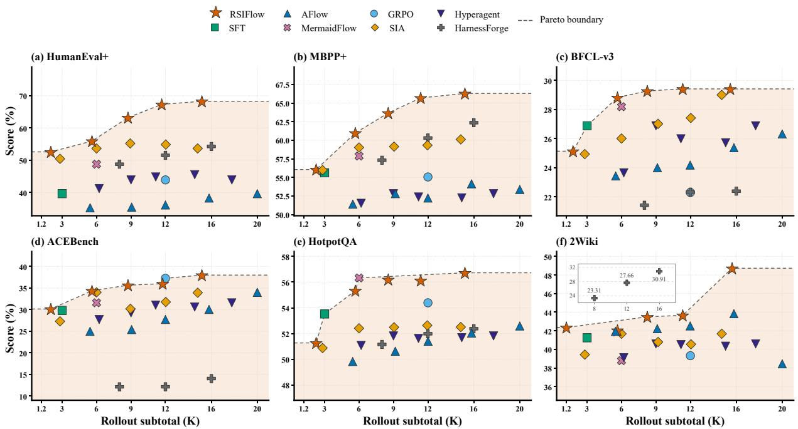
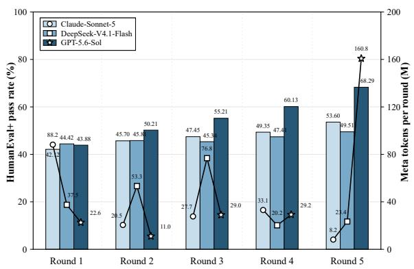
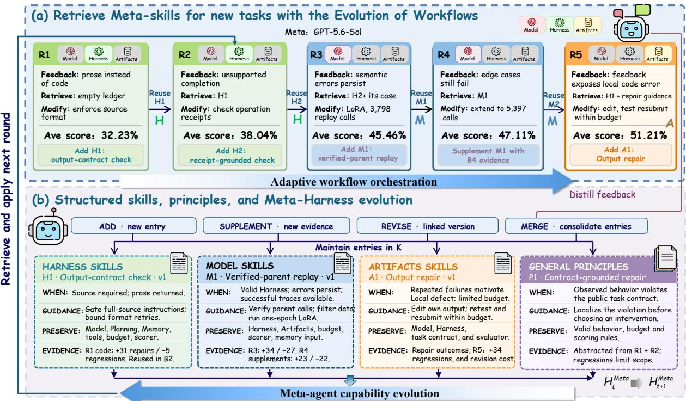
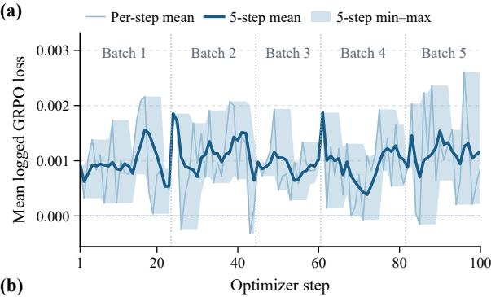
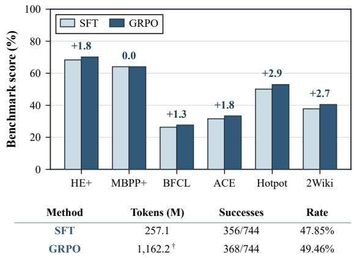
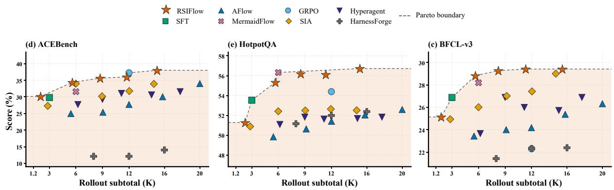
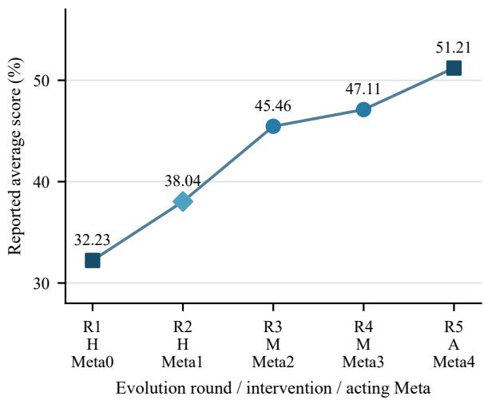
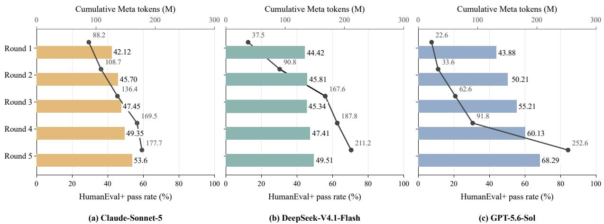

# RSIFlow: Adaptive Self-Improvement Workflows with an Evolving Meta-Agent

Huan Zhang1,†, Mingju Chen1,†, Dongxu Zhou1, Can Lv1, Sen Cui2, Faguo Wu1,\*, Shiji Zhou1,2,3,\*

1Beijing Advanced Innovation Center for Future Blockchain and Privacy Computing, School of Artificial Intelligence, Beihang University, 2Tsinghua University, 3Beijing Academy of Artificial Intelligence (BAAI),

†Equal contribution. Corresponding to: Shiji Zhou <zhoushiji25@buaa.edu.cn>

## Abstract

Large language model (LLM) agents have demonstrated strong capabilities in complex tasks, including code generation, tool use, and multi-hop question answering. Existing selfimprovement methods enhance agent performance through model optimization, harness evolution, and executable artifact refinement, while recursive self-improvement (RSI) fur ther extends optimization to the improvement mechanisms themselves. However, adapting self-improvement workflows to evolving performance bottlenecks while improving workflow orchestration through execution feedback remains a key challenge. We propose RSIFlow, a Recursive Self-Improvement framework that integrates adaptive workflow orchestration with meta-agent capability evolution. RSIFlow diagnoses performance bottlenecks from taskagent trajectories and environmental feedback to dynamically select component-specific improvement workflows. The meta-agent then distills workflow outcomes into componentspecific skills and cross-component principles, evolving its own harness to improve subsequent workflow orchestration. Experiments across six benchmarks and two backbone models show that RSIFlow achieves the SOTA average performance on all benchmarks. Ablation studies further demonstrate the contributions of adaptive workflow orchestration and meta-harness evolution. Code is available at https://github.com/1HUAN1/RSI-Flow.

## 1 Introduction

Recent advances in large language models (LLMs) have enabled agents to tackle complex tasks in coding, tool use, and multi-hop question answering (Yang et al., 2024; Schick et al., 2023; Yao et al., 2023). To continuously enhance the development of agents’ capabilities in task domains, existing methods have adopted complementary approaches, including evolving execution harnesses (Zhang et al., 2025), optimizing model parameters (Luo et al., 2025), and refining executable artifacts (Novikov et al., 2025). These routes can be organized into self-improvement workflows that propose and evaluate changes using task feedback. Beyond executing such workflows, recursive selfimprovement (RSI) seeks to strengthen not only task-solving capabilities but also the mechanisms that generate subsequent improvements (Zhang et al., 2026c; Duan et al., 2026).

  
Figure 1: Motivation of RSIFlow. (A) Two coupled challenges in RSI. (B) The execution loop of RSIFlow.

Research on agent self-improvement spans three increasingly broad scopes of optimization. Component-level approaches optimize a predefined part of the system, such as the model or the harness (execution workflows) (Luo et al., 2025; Zhang et al., 2026b). System-level approaches coordinate updates across components, including joint model–harness optimization and feedback-driven selection of update targets (Chen et al., 2026d,b; Hebbar et al., 2026). Meta-level approaches make improvement procedures editable through operator scheduling, program modification, and recursive skill evolution (Tan et al., 2026; Zhang et al., 2026c; Wang et al., 2026). These developments expand both what can be modified and how modifications are organized. However, broader editability alone does not establish how effectively a workflow addresses the agent’s current bottlenecks, or whether the ability to organize that workflow improves with experience. This motivates a central question: how can RSI systems adapt self-improvement workflows to evolving bottlenecks while learning to organize these workflows more effectively?

We formulate this challenge as dynamic workflow adaptation in RSI, where adapting bottlenecks and evolving workflow orchestration must be considered together. As illustrated in Fig. 1, selfimprovement workflows must adapt to bottlenecks that vary with task requirements and the agent’s capability state. Even within a fixed domain, successful updates can reshape these bottlenecks and alter the effectiveness of subsequent workflow orchestration. Meanwhile, workflow orchestration is itself a capability that can improve through experience. Feedback from workflow execution supports the accumulation and refinement of reusable knowledge for diagnosis, workflow selection, and execution. These processes form a feedback loop: task-level updates reshape improvement requirements, while workflow experience refines the orchestration capability that guides subsequent updates.

To address this challenge, we propose RSIFlow, a framework that couples adaptive workflow orchestration with meta-agent capability evolution. We instantiate three self-improvement workflows targeting the Harness, Model, and Artifacts. A metaagent uses execution trajectories and environmental feedback to diagnose the task agent’s bottlenecks, select a workflow, and orchestrate candidate generation and validation. It then distills orchestration outcomes into component-specific skills and crosscomponent principles to revise its own harness, including execution procedures and skill invocation. This experience-driven self-revision closes a recursive feedback loop in which workflow orchestration outcomes refine the orchestration mechanism that guides subsequent improvements.

Our main contributions are:

• We formulate dynamic workflow adaptation as a key challenge in RSI, highlighting the coupling between evolving performance bottlenecks and continual refinement of workflow orchestration.

• We propose RSIFlow, which adaptively organizes self-improvement workflows and uses their observed outcomes to evolve the metaagent’s own harness, including its execution procedures and reusable skills.

• We evaluate RSIFlow across six benchmarks and two backbones, outperforming the strongest evaluated baseline in 11 of the 12 benchmark– backbone settings. Ablations support the benefits of both adaptive workflow orchestration and meta-harness evolution.

## 2 Related Work

Component-Specific Self-Improvement. Many approaches to agent self-improvement optimize a single predefined component. STaR (Zelikman et al., 2022) improves model parameters by repeatedly fine-tuning on self-generated rationales that yield correct answers. AFlow (Zhang et al., 2025) searches code-represented workflows, while Recursive Harness Self-Improvement (Lee et al., 2026) refines prompt-level harness specifications using pairwise feedback over revision histories. Related approaches include DSPy (Khattab et al., 2024) for language-model pipeline optimization, GEPA (Agrawal et al., 2026) for reflective prompt evolution, and ADAS (Hu et al., 2025) for metaagent-guided search over agent programs. In contrast, AlphaEvolve (Novikov et al., 2025) evolves candidate programs through execution-based evaluation, targeting task artifacts rather than the agent’s improvement procedure. Self-Refine (Madaan et al., 2023) iteratively revises outputs using selffeedback, while Reflexion (Shinn et al., 2023) retains verbal reflections to guide subsequent attempts and Voyager (Wang et al., 2024) accumulates reusable executable skills. Co-Harness (Chen et al., 2026d) and HarnessForge (Chen et al., 2026b) connect external structure and internal capability by alternating harness refinement with model optimization. Their coupled updates address model–harness compatibility, but the prescribed update order leaves open how to adapt workflow orchestration targets to evolving bottlenecks.

Adaptive and Recursive Self-Improvement. Beyond prescribed alternation, SIA (Hebbar et al., 2026) uses trajectory and performance feedback to choose between harness and weight updates, while its selection policy relies on a frozen languagemodel prior. HASE (Luo et al., 2026) integrates task solving and harness editing into one action space and trains the policy with GRPO. A complementary direction makes the improver itself editable: Hyperagents (Zhang et al., 2026c) coevolves task-agent and meta-agent programs and demonstrates transferable improvement strategies, whereas MetaSkill-Evolve (Wang et al., 2026) recursively updates task skills and their improvement procedures on different timescales. Building on these complementary directions, RSIFlow couples bottleneck-aware workflow orchestration with feedback-driven Meta-Harness evolution.

  
Figure 2: Overview of RSIFlow. (A) Definition of task domains and agent workflows. (B) The Task-Agent executes tasks to collect trajectories and feedback. (C) The Meta-Agent retrieves skills to adaptively orchestrate workflows. (D) Workflow results are distilled into skills, principles and Meta-Harness. The updated Meta-Harness guides subsequent orchestration, closing the recursive self-improvement loop.

## 3 Methodology

Fig. 2 provides an overview of RSIFlow. Sec. 3.1 formalizes the Task-Agent and Meta-Agent system and the recursive self-improvement process. Sec. 3.2 describes how the Meta-Agent adaptively orchestrates component-specific improvement workflows. Finally, Sec. 3.3 presents how the Meta-Agent evolves through multi-level skill formation and Meta-Harness refinement.

## 3.1 Preliminary

Agent Formulation. At evolution round t, we formulate the recursive self-improvement system as the joint state of a Task-Agent $T _ { t }$ and a Meta-Agent M . The Task-Agent executes tasks, while the Meta-Agent coordinates updates to the Task-Agent’s components and refines itself using feedback from updates. The system state is defined as

$$
\begin{array} { c } { { X _ { t } = ( T _ { t } , M _ { t } ) , \quad M _ { t } = ( \phi , H _ { t } ^ { \mathrm { M e t a } } ) , } } \\ { { T _ { t } = ( \theta _ { t } , H _ { t } ^ { \mathrm { T a s k } } , A _ { t } ^ { \mathrm { T a s k } } ) . } } \end{array}\tag{1}
$$

Here, $\theta _ { t }$ denotes the Task-Agent’s model parameters, $H _ { t } ^ { \mathrm { T a s k } }$ denotes the external harness, and $A _ { t } ^ { \mathrm { T a s k } }$ denotes task-level deliverables, such as executable code and solutions, that can be refined through environmental feedback. The Meta-Agent’s base model parameters ϕ remain fixed throughout the process, and its evolution occurs entirely through modifications to its harness $H _ { t } ^ { \mathrm { M e t a } }$

We define a harness as the execution interface external to the model and adopt the same threecomponent abstraction for both agents:

$$
\begin{array} { r l } & { H _ { t } ^ { r } = \left( \mathrm { A c t i o n } _ { t } ^ { r } , \mathrm { S k i l l } _ { t } ^ { r } , \mathrm { P l a n n i n g } _ { t } ^ { r } \right) , } \\ & { ~ r \in \{ \mathrm { T a s k } , \mathrm { M e t a } \} . } \end{array}\tag{2}
$$

Action organizes execution and information actions. Skill provides reusable experience and principles, while Planning decomposes objectives into steps. The Task-Agent harness supports task execution, whereas the Meta-Agent harness guides diagnosis, component selection and improvement.

## 3.2 Adaptive workflow orchestration

Workflow selection and instantiation. The Meta-Agent adaptively orchestrates three component-specific improvement workflows:

$$
a _ { t } \in \{ \mathrm { M o d e l } , \mathrm { H a r n e s s } , \mathrm { A r t i f a c t s } \} .\tag{3}
$$

Using execution trajectories, environmental feedback, and accumulated meta-skills, the Meta-Agent selects a component to modify while preserving the other two. All candidates share the same parent $T _ { t }$ and evaluation batch. The first valid candidate with a positive gain is accepted as $T _ { t + 1 }$ ; otherwise, $T _ { t + 1 } = T _ { t }$ . Feedback from all update attempts informs subsequent Meta-Agent evolution.

Model update. The Meta-Agent converts task experience into parameter updates. It constructs training data $\mathcal { D } _ { t }$ from execution trajectories and environmental feedback, then optimizes the following objective starting from $\theta _ { t }$ :

$$
\operatorname* { m i n } _ { \theta } \mathcal { L } ( \theta ; \mathcal { D } _ { t } ) = \mathbb { E } _ { z \sim \mathcal { D } _ { t } } \big [ \ell ( \theta ; z ) \big ] .\tag{4}
$$

Here, z is a training sample or sample group, and ℓ is the method-specific loss. Our default update uses SFT to learn from successful trajectories collected during task execution. Reusing these trajectories reduces the exploration cost of acquiring training data. The candidate inherits the updated parameters $\theta ^ { \prime }$ alongside the parent’s Harness and Artifacts. We also evaluate an RL-based model-update variant, with details provided in App. B.3.

Harness update. The Meta-Agent uses execution feedback to select a component set $\mathcal { T } _ { t } \subseteq \mathcal { C } .$ where C = {Action, Skill, Planning}. It follows a localize–refine–generate–validate procedure to produce new implementations $\widehat { H } _ { t } ^ { \mathcal { L } _ { t } }$ . The candidate Harness replaces the selected components while preserving the others:

$$
H ^ { \prime } = H _ { t } ^ { \mathrm { T a s k } } \left[ \mathcal { T } _ { t } \gets \widehat { H } _ { t } ^ { \mathcal { T } _ { t } } \right] .\tag{5}
$$

The replacement operator rewrites the selected components and preserves the rest. Revisions may change prompts, context organization, memory retrieval, planning and reasoning rules, tool orchestration, or internal verification, subject to the corresponding interface and permission constraints. For example, jointly revising memory retrieval conditions and planning rules constitutes a single Harness update. Model parameters remain fixed.

Artifacts refinement. For each task $x \in B _ { t }$ , let $A _ { t , x }$ denote its current output. The Meta-Agent derives diagnostic guidance $\delta _ { t , x }$ from execution trajectories $\tau _ { t , x }$ and feedback $f _ { t , x }$ . Keeping the Task-Agent’s model and harness fixed, candidate revisions are generated as

$$
\hat { A } _ { t , x } ^ { ( j ) } \sim p _ { \theta _ { t } , H _ { t } ^ { \mathrm { T a s k } } } \left( \cdot   \left| \begin{array} { l } { x , A _ { t , x } , \tau _ { t , x } , f _ { t , x } , \delta _ { t , x } } \end{array} \right. \right) ,\tag{6}
$$

where $j \leq L$ indexes bounded revision attempts. Let $\hat { A } _ { t } ^ { ( j ) }$ collect the revised outputs and $\hat { T } _ { t } ^ { \left( j \right) } =$ $( \theta _ { t } , H _ { t } ^ { \mathrm { T a s k } } , \hat { A } _ { t } ^ { ( j ) } )$ . Each candidate is evaluated against the same task batch:

$$
\Delta J _ { t } ^ { ( j ) } = J ( \hat { T } _ { t } ^ { ( j ) } ; B _ { t } ) - J ( T _ { t } ; B _ { t } ) .\tag{7}
$$

Here, $B _ { t }$ denotes a training batch. The gain-based acceptance rule is not applied to evaluation set. The first valid candidate yielding a positive performance gain is selected:

$$
j ^ { * } = \operatorname* { m i n } \left\{ j \leq L \ \Big | \ \mathcal { V } ( \hat { A } _ { t } ^ { ( j ) } ) = 1 , \ \Delta J _ { t } ^ { ( j ) } > 0 \right\} ,\tag{8}
$$

where V enforces output validity and execution constraints. The Meta-Agent provides diagnostic guidance without directly modifying task artifacts, while $\theta _ { t }$ and $H _ { t } ^ { \mathrm { T a s k } }$ remain unchanged.

Recursive self-improvement workflow. At evolution round t, the Meta-Agent $M _ { t }$ orchestrates and evaluates candidate updates to the Task-Agent $T _ { t } .$ yielding the next-round Task-Agent $T _ { t + 1 }$ and workflow experience $e _ { t } .$ . It distills component-specific skills and general principles from this experience, integrating them into its Meta-Harness to form $M _ { t + 1 }$ . The updated knowledge guides diagnosis, workflow selection, and candidate generation in subsequent rounds as the Task-Agent’s bottlenecks evolve. Together, $( T _ { t + 1 } , M _ { t + 1 } )$ enter the next evolution round, allowing accumulated workflow experience to continuously refine the orchestration mechanism. Details are provided in App. B.1.

## 3.3 Meta-agent Capability Evolution

Difference extraction and skill formation. The Meta-Agent aligns parent and candidate trajectories for the same task through shared subgoals, tool events, or error feedback. These paired comparisons connect candidate modifications to local behavioral changes and task-level outcomes. From these comparisons and workflow experience $e _ { t } .$ , the Meta-Agent distills two complementary forms of reusable knowledge: component-specific skills $S _ { t }$ for Model, Harness, and Artifacts updates, and general principles $\mathcal { P } _ { t }$ for cross-component diagnosis and workflow selection. Each skill or principle is represented as

$$
\boldsymbol { k } = ( \Omega _ { k } , a _ { k } , \rho _ { k } , \Gamma _ { k } , \hat { r } _ { k } , E _ { k } ) ,\tag{9}
$$

where $\Omega _ { k }$ specifies applicability conditions, $a _ { k }$ update scope, $\rho _ { k }$ conditional guidance, $\Gamma _ { k }$ preservation requirements, $\hat { r } _ { k }$ expected behavioral response, and $E _ { k }$ supporting and contradicting evidence.

Evidence-driven skill maintenance. The Meta-Agent integrates newly distilled skills $S _ { t }$ and general principles $\mathcal { P } _ { t }$ into the existing library $\textstyle { \boldsymbol { \mathcal { K } } } _ { t }$ through four evidence-driven operations. Add introduces previously uncovered strategies with their applicability and source evidence. Supplement enriches existing entries with new outcome evidence while preserving their guidance. Revise refines applicability conditions, guidance, or preservation requirements through linked successor versions. Merge consolidates overlapping or superseded entries while preserving accumulated evidence and provenance. These operations update the library as

$$
\begin{array} { r } { \mathscr { C } _ { t } = \mathscr { S } _ { t } \cup \mathscr { P } _ { t } , } \\ { \qquad \mathscr { K } _ { t + 1 } = ( \mathscr { K } _ { t } \setminus \mathscr { R } _ { t } ) \cup \mathscr { C } _ { t } ^ { + } . } \end{array}\tag{10}
$$

Here, $\mathcal { C } _ { t } ^ { + }$ contains records introduced or updated through the four operations, while $\mathcal { R } _ { t } \subseteq \mathcal { K } _ { t }$ denotes entries replaced or consolidated in the active library. The resulting library combines component-specific skills and cross-component principles while retaining traceable evidence and revision histories across rounds. Further details are provided in App. D.2.

Integration into the Meta-Harness. The Meta-Agent operationalizes $\boldsymbol { \mathcal { K } } _ { t + 1 }$ by updating the Action interfaces, retrieval calls, execution instructions, and supplementary prompts that invoke this knowledge to guide subsequent improvement decisions:

$$
\begin{array} { r l } & { H _ { t + 1 } ^ { \mathrm { M e t a } } = ( \mathrm { A c t i o n } _ { t + 1 } ^ { \mathrm { M e t a } } , { \mathcal K } _ { t + 1 } , \mathrm { P l a n n i n g } _ { t } ^ { \mathrm { M e t a } } ) , } \\ & { \qquad M _ { t + 1 } = ( \phi , H _ { t + 1 } ^ { \mathrm { M e t a } } ) . } \end{array}\tag{11}
$$

The evolved Meta-Harness guides subsequent bottleneck diagnosis, workflow selection, and candidate generation. Thus, experience accumulated from Task-Agent updates recursively improves workflow orchestration, while the Meta-Agent’s model parameters $\phi$ remain fixed.

## 4 Experiments

## 4.1 Experimental Setup

Benchmarks. We train RSIFlow on training data from three task domains and evaluate it on six public benchmarks spanning the same domains: (1) code generation, HumanEval+ and MBPP+ (Liu et al., 2023). (2) tool use, BFCL-v3 (Patil et al., 2025) and ACEBench (Chen et al., 2025). (3) search-QA, HotpotQA (Yang et al., 2018) and 2Wiki (Ho et al., 2020). Detailed descriptions and evaluation metrics are in App. A.2

Baselines. We compare RSIFlow with three series of baselines: (1) model-only evolution, including SFT (Ouyang et al., 2022) and GRPO (Shao et al., 2024); (2) harness-only evolution, including AFlow (Zhang et al., 2025) and Mermaid-Flow (Zheng et al., 2025); (3) model-harness both evolution, including HarnessForge (Chen et al., 2026b) and SIA (Hebbar et al., 2026), Hyperagent (Zhang et al., 2026c) further evolves the harness of the meta agent, incorporating the evolution of the meta into the cycle. Detailed configurations of baselines are provided in App. A.4

Implementation Details. We initialize the Task-Agent of RSIFLOW with Qwen3-4B and Qwen3- 8B (Yang et al., 2025) as the backbone, respectively. The Meta-Agent uses GPT-5.6 Sol as its base model. We run R = 5 evolution rounds and report the main results with a maximum of two attempts per evolution round. Additional implementation details are provided in App. B

## 4.2 Main Results

Tab. 1 compares RSIFLOW against model-only, harness-only, and joint model–harness baselines on six agentic benchmarks and two backbone sizes, averaging +3.11% over the strongest permetric baselines. RSIFLOW leads in 11 of 12 benchmark–backbone settings across code generation, tool use, and search-QA. Its overall scores reach 51.21% with Qwen3-4B and 59.86% with Qwen3-8B, surpassing the strongest baseline by 6.06% and 3.86%, respectively. The largest gain occurs on HumanEval+, where RSIFLOW improves pass@1 by 14.02% with Qwen3-4B. On MBPP+, pass@1 improves by an average of 3.91% across backbones. For tool use, RSIFLOW achieves the highest BFCL-v3 scores with both backbones and the best ACEBench result with Qwen3-4B. On retrieval-intensive tasks, it improves F1 by an average of 5.20% on 2Wiki across backbones and by 6.38% on HotpotQA with Qwen3-8B.

Table 1: Main results across six benchmarks with Qwen3-4B and Qwen3-8B backbones. Best results are highlighted in bold.
<table><tr><td rowspan="2">Method</td><td colspan="2">Code</td><td colspan="2">Tool Use</td><td colspan="2">SearchQA</td><td rowspan="2">Overall</td></tr><tr><td>HumanEval+ MBPP+</td><td></td><td>BFCL-v3 ACEBench</td><td></td><td>Hotpot</td><td>2Wiki</td></tr><tr><td colspan="8">Qwen3-4B</td></tr><tr><td>AFlow</td><td>39.63</td><td>53.37</td><td>26.32</td><td>34.00</td><td>52.59</td><td>38.45</td><td>40.73</td></tr><tr><td>MermaidFlow</td><td>48.78</td><td>57.87</td><td>28.19</td><td>31.58</td><td>56.32</td><td>38.79</td><td>43.59</td></tr><tr><td>SFT</td><td>39.63</td><td>55.62</td><td>26.88</td><td>29.82</td><td>53.52</td><td>41.24</td><td>41.12</td></tr><tr><td>GRPO</td><td>43.90</td><td>55.06</td><td>22.30</td><td>37.25</td><td>54.39</td><td>39.32</td><td>42.04</td></tr><tr><td>HarnessForge</td><td>54.27</td><td>62.36</td><td>22.39</td><td>25.03</td><td>52.38</td><td>30.91</td><td>41.22</td></tr><tr><td>SIA</td><td>53.66</td><td>60.11</td><td>29.00</td><td>33.91</td><td>52.51</td><td>41.68</td><td>45.15</td></tr><tr><td>Hyperagent</td><td>43.90</td><td>52.81</td><td>26.88</td><td>31.57</td><td>51.82</td><td>40.59</td><td>41.26</td></tr><tr><td>RSIFLow</td><td>68.29</td><td>66.29</td><td>29.23</td><td>38.00</td><td>56.72</td><td>48.72</td><td>51.21</td></tr><tr><td colspan="8">Qwen3-8B</td></tr><tr><td>AFlow</td><td>68.29</td><td>69.10</td><td>34.89</td><td>51.46</td><td>53.55</td><td>48.32</td><td>54.27</td></tr><tr><td>MermaidFlow</td><td>69.51</td><td>68.54</td><td>30.96</td><td>46.20</td><td>56.29</td><td>42.70</td><td>52.37</td></tr><tr><td>SFT</td><td>68.29</td><td>69.10</td><td>37.01</td><td>40.35</td><td>51.57</td><td>44.49</td><td>51.80</td></tr><tr><td>GRPO</td><td>70.12</td><td>69.66</td><td>34.31</td><td>38.59</td><td>49.81</td><td>46.33</td><td>51.47</td></tr><tr><td>HarnessForge</td><td>70.12</td><td>67.42</td><td>38.15</td><td>59.07</td><td>45.83</td><td>37.12</td><td>52.95</td></tr><tr><td>SIA</td><td>73.78</td><td>70.22</td><td>40.13</td><td>51.46</td><td>53.96</td><td>46.43</td><td>56.00</td></tr><tr><td>Hyperagent</td><td>71.34</td><td>69.10</td><td>34.31</td><td>44.44</td><td>53.47</td><td>48.73</td><td>53.57</td></tr><tr><td>RSIFLow</td><td>76.34</td><td>74.10</td><td>41.36</td><td>52.62</td><td>62.67</td><td>52.08</td><td>59.86</td></tr></table>

## 4.3 Ablation Study

Table 2 evaluates adaptive workflow orchestration and Meta-Agent evolution over five rounds. Compared with Vanilla, RSIFlow improves Code, Tool Use, and SearchQA by 19.04%, 3.92%, and 18.20% , respectively, increasing the three-domain average by 13.72 %. While fixed-component workflows exhibit domain-specific strengths, adaptive orchestration achieves the highest scores across all three domains, outperforming the fixed workflow by 4.13% - 8.81% on average. Overall, RSIFlow exceeds the average of all four ablated variants by 6.17 %. Disabling Meta-Agent evolution reduces average performance by 5.74 % , highlighting the importance of distilling historical feedback into reusable skills and principles. These results demonstrate that adaptive component orchestration enables balanced cross-domain improvements, while experience-driven Meta-Harness evolution further strengthens workflow effectiveness.

Table 2: Module ablation of RSIFlow using Qwen3- 4B under R = 5 evolution rounds. With meta evolution enabled, we compare fixed task-evolution routines targeting the harness (H), model (M), or artifacts (A).
<table><tr><td rowspan="2">Meta Evo.</td><td rowspan="2">Task Rou.</td><td rowspan="2">Code</td><td rowspan="2">Tool use</td><td rowspan="2">SearchQA</td></tr><tr><td></td></tr><tr><td>Vanilla</td><td></td><td>48.25</td><td>29.70</td><td>34.52</td></tr><tr><td>X</td><td>√</td><td>56.73 (↑8.48)</td><td>29.70(→0.00)</td><td>49.98 (↑15.46)</td></tr><tr><td>√</td><td>×(H)</td><td>63.42 (↑15.17)</td><td>32.93 (↑3.23)</td><td>44.89 (↑10.37)</td></tr><tr><td>V</td><td>×(M)</td><td>50.31 (↑2.06)</td><td>32.15 (↑2.45)</td><td>44.73 (↑10.21)</td></tr><tr><td>V</td><td>×(A)</td><td>52.34 (↑4.09)</td><td>30.69 (↑0.99)</td><td>52.57 (↑18.05)</td></tr><tr><td>√</td><td>√</td><td> ${ \bf 6 7 . 2 9 } _ { ( \uparrow 1 9 . 0 4 ) }$ </td><td>33.62 (↑3.92)</td><td>52.72 (↑18.20)</td></tr></table>

## 4.4 Framework Analysis

Rollout-budget and performance efficiency. Fig. 3 compares performance under varying rollout budgets on all six benchmarks. RSIFlow generally lies on or near the empirical Pareto frontier and achieves the highest observed score on each benchmark. This advantage is consistent with its adaptive component selection and Task–Meta co-evolution: RSIFlow reuses rollout evidence to guide targeted updates to the Task-Agent’s Model, Harness, or Artifacts, rather than relying solely on additional exploration under a fixed harness. The co-evolving Meta-Agent further distills workflow outcomes into reusable skills and refines its improvement procedure, allowing accumulated experience to guide subsequent updates. Together, these mechanisms help concentrate the rollout budget on informed workflow orchestration. Overall, RSIFlow offers a stronger performance–budget trade-off than the evaluated baselines.

  
Figure 3: Budget–performance Pareto analysis across all six benchmarks

Meta-agent backbone sensitivity. We evaluate RSIFlow with three Meta-Agent backbones over five evolution rounds on HumanEval+. As shown in Fig. 4, all three models achieve overall performance improvements, with gains of 11.48%, 5.09%, and 24.41% for Claude-Sonnet-5, DeepSeek-V4.1- Flash, and GPT-5.6-Sol, respectively. GPT-5.6-Sol achieves the highest final performance of 68.29%, albeit with greater API token consumption. From Round 3 to Round 5, it improves by 13.08%, compared with 6.15% and 4.17% for the other two backbones, suggesting that stronger Meta-Agents may better leverage accumulated intervention feedback. These results demonstrate that RSIFlow supports different Meta-Agent backbones, while the Meta-Agent’s underlying capabilities influence the cumulative effectiveness of recursive self-improvement.

  
Figure 4: Sensitivity of RSIFlow to different Meta-Agent backbones on HumanEval+.

Meta-evolution necessity analysis. Table 3 compares different Meta versions improving the same initial Task-Agent, with scores averaged over two benchmarks per domain. Meta0 improves SearchQA by 10.10%, reaching 44.62% through harness updates. Although Meta4 also selects the harness, it further outperforms Meta0 by 20.56% and 9.51% on Code and SearchQA, respectively. Meta3 achieves the highest Tool Use score of 31.83% through artifact updates. These results indicate that the evolution of meta-agent capabilities not only enables better adaptive workflow orchestration but also enhances the performance of workflow orchestration across different task domains. Further analysis is provided in App. C.4.

  
Figure 5: Case study of five rounds of recursive self-improvement in RSIFlow.

Table 3: Domain-level performance of selected Meta candidates. Scores are macro-averages (%) across two benchmarks per domain. Component refers to the workflow selected for orchestration by meta agent.

<table><tr><td>Meta</td><td>Component</td><td>Code</td><td>Tool Use</td><td>SearchQA</td></tr><tr><td></td><td>Vanilla</td><td>48.25</td><td>29.70</td><td>34.52</td></tr><tr><td>Meta0</td><td>HARNESS</td><td>48.30</td><td>30.40</td><td>44.62</td></tr><tr><td>Metal</td><td>HARNESS</td><td>46.32</td><td>31.16</td><td>45.04</td></tr><tr><td>Meta2</td><td>MODEL</td><td>67.90</td><td>31.51</td><td>43.99</td></tr><tr><td>Meta3</td><td>ARTIFACTS</td><td>67.08</td><td>31.83</td><td>50.58</td></tr><tr><td>Meta4</td><td>HARNESS</td><td>68.86</td><td>30.84</td><td>54.13</td></tr></table>

## 4.5 Case Study

Fig. 5 illustrates five rounds (R1–R5) of RSIFlow evolution, following a Harness–Harness–Model– Model–Artifacts sequence. In R1, the Meta-Agent addresses output-format violations with an outputcontract check (H1), reaching 32.23%. R2 builds on H1 to introduce receipt-grounded verification (H2) for unsupported completions, raising the score to 38.04%. To address persistent semantic errors, R3 shifts to Model optimization with 3,798 replay calls for LoRA fine-tuning, reaching 45.46% and distilling the model-specific skill M1. R4 reuses and supplements M1 with new evidence, expanding training to 5,397 calls and improving the score to 47.11%. In R5, execution feedback and accumulated repair guidance support code revision and resubmission within budget, reaching 51.21% while preserving the Model and Harness. Across these rounds, skills and general principles progressively refine the Meta-Agent’s bottleneck diagnosis and subsequent workflow orchestration. This lineage demonstrates how adaptive workflow orchestration and Meta-Harness evolution reinforce each other, yielding an overall improvement of 18.98%.

## 5 Conclusion

We presented RSIFlow, a recursive selfimprovement framework coupling adaptive workflow orchestration with Meta-Agent evolution. Using accumulated execution feedback, the Meta-Agent identifies Task-Agent bottlenecks and selects Model, Harness, or Artifacts workflows. It distills successful and unsuccessful outcomes into reusable skills and principles to evolve its Meta-Harness. Across six benchmarks and two backbones, RSIFlow outperforms the strongest evaluated baseline in 11 of 12 settings. Ablations validate both mechanisms, while budget analyses show a favorable performance–budget trade-off. These results demonstrate that continual Meta-Agent evolution enhances system effectiveness alongside adaptive workflow orchestration.

## Limitations

RSIFlow is primarily evaluated using Qwen3-4B and Qwen3-8B as Task-Agent backbones. This setting is particularly relevant to resource-constrained agent deployments, where adaptive workflow orchestration enables targeted modifications to identified bottleneck components, while Meta-Agent evolution further improves bottleneck diagnosis and orchestration capabilities. However, whether these benefits remain significant with larger backbone models and at cluster scale remains unexplored. Future work will extend the evaluation to largerscale settings to assess the scalability of RSIFlow.

RSIFlow couples the Task-Agent and Meta-Agent, evolving the Meta-Harness through reusable skills and general principles to improve workflow orchestration without updating the Meta-Agent’s model parameters. However, this process introduces additional computational overhead, while adopting a lower-cost Meta-Agent may compromise evolution gains. Moreover, the stability of experience-driven Meta-Harness updates remains to be fully investigated. Future work will explore counterfactual analysis to identify Meta-Agent deficiencies, apply targeted local modifications, and investigate Meta-Agent parameter optimization to improve evolution efficiency and stability.

## References

Lakshya A Agrawal, Shangyin Tan, Dilara Soylu, Noah Ziems, Rishi Khare, Krista Opsahl-Ong, Arnav Singhvi, Herumb Shandilya, Michael J Ryan, Meng Jiang, Christopher Potts, Koushik Sen, Alex Dimakis, Ion Stoica, Dan Klein, Matei Zaharia, and Omar Khattab. 2026. Gepa: Reflective prompt evolution can outperform reinforcement learning. In International Conference on Learning Representations, volume 2026, pages 8479–8565.

Chen Chen, Xinlong Hao, Weiwen Liu, Xu Huang, Xingshan Zeng, Shuai Yu, Dexun Li, Yuefeng Huang, Xiangcheng Liu, Wang Xinzhi, and Wu Liu. 2025. ACEBench: A comprehensive evaluation of LLM tool usage. In Findings of the Association for Computational Linguistics: EMNLP 2025, pages 12970– 12998, Suzhou, China. Association for Computational Linguistics.

Mingju Chen, Can Lv, Jinrong Liu, Huan Zhang, Heng Chang, and Shiji Zhou. 2026a. Beyond timestamps: Decision-aligned on-policy distillation for long-horizon agents. Preprint, arXiv:2609.33391.

Mingju Chen, Can Lv, Guibin Zhang, Heng Chang, and Shiji Zhou. 2026b. Harnessforge: Joint harness and

policy evolution for adaptive agent systems. Preprint, arXiv:2606.01779.

Mingju Chen, Guibin Zhang, Heng Chang, Yuchen Guo, and Shiji Zhou. 2026c. A-mapreduce: Executing wide search via agentic mapreduce. Preprint, arXiv:2602.01331.

Zhengyu Chen, Teng Xiao, Huaisheng Zhu, Yige Yuan, Luan Zhang, and Jingang Wang. 2026d. Co-harness: Co-evolving harnesses and model weights for llm agents. Preprint, arXiv:2607.22688.

Yi Duan, Ying Liu, Zirui Tang, Haodong Chen, Jun Zhou, Yumou Liu, Bangrui Xu, Yukai Wu, Sidi Chen, Yuhan Zhou, Haoyu Wang, Xiaoyou Yu, Shaokun Han, Xuzhou Zhu, Le Zhou, Bolin Lu, Wei Zhou, Jiachen Liu, Nuozhou Fang, and 16 others. 2026. The last ai built by humans: Toward genuine recursive self-improvement. Preprint, arXiv:2609.11873.

Prannay Hebbar, Yogendra Manawat, Samuel Verboomen, Alesia Ivanova, Selvam Palanimalai, Kunal Bhatia, and Vignesh Baskaran. 2026. Sia: Self improving ai with harness & weight updates. arXiv preprint arXiv:2605.27276.

Xanh Ho, Anh-Khoa Duong Nguyen, Saku Sugawara, and Akiko Aizawa. 2020. Constructing a multihop QA dataset for comprehensive evaluation of reasoning steps. In Proceedings of the 28th International Conference on Computational Linguistics, pages 6609–6625, Barcelona, Spain (Online). International Committee on Computational Linguistics.

Shengran Hu, Cong Lu, and Jeff Clune. 2025. Automated design of agentic systems. In International Conference on Learning Representations, volume 2025, pages 21344–21377.

Omar Khattab, Arnav Singhvi, Paridhi Maheshwari, Zhiyuan Zhang, Keshav Santhanam, Sri Vardhamanan A, Saiful Haq, Ashutosh Sharma, Thomas Joshi, Hanna Moazam, Heather Miller, Matei Zaharia, and Christopher Potts. 2024. Dspy: Compiling declarative language model calls into state-of-the-art pipelines. In International Conference on Learning Representations, volume 2024, pages 54928–54958.

Hyunin Lee, Jinglue Xu, Jeffrey Seely, Donghyun Lee, Matei Zaharia, and Yujin Tang. 2026. Recursive harness self-improvement. Preprint, arXiv:2607.15524.

Rongao Li, Jie Fu, Bo-Wen Zhang, Tao Huang, Zhihong Sun, Chen Lyu, Guang Liu, Zhi Jin, and Ge Li. 2023. Taco: Topics in algorithmic code generation dataset. Preprint, arXiv:2312.14852.

Jiawei Liu, Chunqiu Steven Xia, Yuyao Wang, and LINGMING ZHANG. 2023. Is your code generated by chatgpt really correct? rigorous evaluation of large language models for code generation. In Advances in Neural Information Processing Systems, volume 36, pages 21558–21572. Curran Associates, Inc.

Haochen Luo, Yi Huang, Sichun Luo, Fengyuan Liu, Lei Li, Zefa Hu, Junlan Feng, and Qi Liu. 2026. Harness-aware self-evolving: Co-evolving model weights, harness, and task solutions. Preprint, arXiv:2607.03935.

Xufang Luo, Yuge Zhang, Zhiyuan He, Zilong Wang, Siyun Zhao, Dongsheng Li, Luna K. Qiu, and Yuqing Yang. 2025. Agent lightning: Train any ai agents with reinforcement learning. Preprint, arXiv:2508.03680.

Can Lv, Heng Chang, Shengyu Tao, Mingju Chen, Zhaoxin Fan, Ziwei Zhang, Yuchen Guo, and Shiji Zhou. 2026a. All-mem: Agentic lifelong memory via dynamic topology evolution. Preprint, arXiv:2603.19595.

Can Lv, Mingju Chen, Heng Chang, and Shiji Zhou. 2026b. Mitigating false credit propagation: Probabilistic graphical reward aggregation for rubric-based reinforcement learning. Preprint, arXiv:2606.03361.

Aman Madaan, Niket Tandon, Prakhar Gupta, Skyler Hallinan, Luyu Gao, Sarah Wiegreffe, Uri Alon, Nouha Dziri, Shrimai Prabhumoye, Yiming Yang, Shashank Gupta, Bodhisattwa Prasad Majumder, Katherine Hermann, Sean Welleck, Amir Yazdanbakhsh, and Peter Clark. 2023. Self-refine: Iterative refinement with self-feedback. In Advances in Neural Information Processing Systems, volume 36, pages 46534–46594. Curran Associates, Inc.

Alexander Novikov, Ngân Vu, Marvin Eisenberger, Em-˜ ilien Dupont, Po-Sen Huang, Adam Zsolt Wagner, Sergey Shirobokov, Borislav Kozlovskii, Francisco J. R. Ruiz, Abbas Mehrabian, M. Pawan Kumar, Abigail See, Swarat Chaudhuri, George Holland, Alex Davies, Sebastian Nowozin, Pushmeet Kohli, and Matej Balog. 2025. Alphaevolve: A coding agent for scientific and algorithmic discovery. Preprint, arXiv:2506.13131.

Long Ouyang, Jeffrey Wu, Xu Jiang, Diogo Almeida, Carroll Wainwright, Pamela Mishkin, Chong Zhang, Sandhini Agarwal, Katarina Slama, Alex Ray, John Schulman, Jacob Hilton, Fraser Kelton, Luke Miller, Maddie Simens, Amanda Askell, Peter Welinder, Paul F Christiano, Jan Leike, and Ryan Lowe. 2022. Training language models to follow instructions with human feedback. In Advances in Neural Information Processing Systems, volume 35, pages 27730–27744. Curran Associates, Inc.

Shishir G Patil, Huanzhi Mao, Fanjia Yan, Charlie Cheng-Jie Ji, Vishnu Suresh, Ion Stoica, and Joseph E. Gonzalez. 2025. The berkeley function calling leaderboard (BFCL): From tool use to agentic evaluation of large language models. In Proceedings of the 42nd International Conference on Machine Learning, volume 267 of Proceedings of Machine Learning Research, pages 48371–48392. PMLR.

Timo Schick, Jane Dwivedi-Yu, Roberto Dessi, Roberta Raileanu, Maria Lomeli, Eric Hambro, Luke Zettlemoyer, Nicola Cancedda, and Thomas Scialom. 2023.

Toolformer: Language models can teach themselves to use tools. In Advances in Neural Information Processing Systems, volume 36, pages 68539–68551. Curran Associates, Inc.

Zhihong Shao, Peiyi Wang, Qihao Zhu, Runxin Xu, Junxiao Song, Xiao Bi, Haowei Zhang, Mingchuan Zhang, Y. K. Li, Y. Wu, and Daya Guo. 2024. Deepseekmath: Pushing the limits of mathematical reasoning in open language models. Preprint, arXiv:2402.03300.

Noah Shinn, Federico Cassano, Ashwin Gopinath, Karthik Narasimhan, and Shunyu Yao. 2023. Reflexion: language agents with verbal reinforcement learning. In Advances in Neural Information Processing Systems, volume 36, pages 8634–8652. Curran Associates, Inc.

Xiaoshuai Song, Haofei Chang, Guanting Dong, Yutao Zhu, Ji-Rong Wen, and Zhicheng Dou. 2026. Envscaler: Scaling tool-interactive environments for llm agent via programmatic synthesis. Preprint, arXiv:2601.05808.

Zihan Tan, Leixin Sun, Zitong Shi, Yitao Liu, Jiajun Wu, Nathaniel Brooks, Jiaru Qian, Xiaoran Shang, Suyuan Huang, Yi Ding, Yangxu Liao, Mukai Li, Qiushi Sun, Shudong Liu, Xuankun Rong, Xiaohang Yu, Zhuo Chen, Hejia Geng, Chenxin Li, and 12 others. 2026. Metarsi / rsi2: A meta-recursive selfimproving system for recursive self-improving systems themselves. Preprint, arXiv:2609.06396.

Guanzhi Wang, Yuqi Xie, Yunfan Jiang, Ajay Mandlekar, Chaowei Xiao, Yuke Zhu, Linxi Fan, and Anima Anandkumar. 2024. Voyager: An open-ended embodied agent with large language models. Transactions on Machine Learning Research.

Zefeng Wang, Minxi Yan, Jinhe Bi, Sikuan Yan, Volker Tresp, and Yunpu Ma. 2026. Metaskillevolve: Recursive self-improvement of llm agents via two-timescale meta-skill evolution. Preprint, arXiv:2607.05297.

An Yang, Anfeng Li, Baosong Yang, Beichen Zhang, Binyuan Hui, Bo Zheng, Bowen Yu, Chang Gao, Chengen Huang, Chenxu Lv, Chujie Zheng, Dayiheng Liu, Fan Zhou, Fei Huang, Feng Hu, Hao Ge, Haoran Wei, Huan Lin, Jialong Tang, and 41 others. 2025. Qwen3 technical report. Preprint, arXiv:2505.09388.

John Yang, Carlos Jimenez, Alexander Wettig, Kilian Lieret, Shunyu Yao, Karthik Narasimhan, and Ofir Press. 2024. Swe-agent: Agent-computer interfaces enable automated software engineering. In Advances in Neural Information Processing Systems, volume 37, pages 50528–50652. Curran Associates, Inc.

Zhilin Yang, Peng Qi, Saizheng Zhang, Yoshua Bengio, William Cohen, Ruslan Salakhutdinov, and Christopher D. Manning. 2018. HotpotQA: A dataset for diverse, explainable multi-hop question answering.

In Proceedings of the 2018 Conference on Empirical Methods in Natural Language Processing, pages 2369–2380, Brussels, Belgium. Association for Computational Linguistics.

Shunyu Yao, Jeffrey Zhao, Dian Yu, Nan Du, Izhak Shafran, Karthik R Narasimhan, and Yuan Cao. 2023. React: Synergizing reasoning and acting in language models. In The Eleventh International Conference on Learning Representations.

Eric Zelikman, Yuhuai Wu, Jesse Mu, and Noah Goodman. 2022. Star: Bootstrapping reasoning with reasoning. In Advances in Neural Information Processing Systems, volume 35, pages 15476–15488. Curran Associates, Inc.

Huan Zhang, Mingju Chen, Dongxu Zhou, Can Lv, Heng Chang, Sen Cui, Faguo Wu, and Shiji Zhou. 2026a. Trca: Transition-wise rubric credit assignment for long-horizon llm agents. Preprint, arXiv:2608.16156.

Jenny Zhang, Shengran Hu, Cong Lu, Robert Tjarko Lange, and Jeff Clune. 2026b. Darwin gödel machine: Open-ended evolution of self-improving agents. In The Fourteenth International Conference on Learning Representations.

Jenny Zhang, Bingchen Zhao, Wannan Yang, Jakob Foerster, Jeff Clune, Minqi Jiang, Sam Devlin, and Tatiana Shavrina. 2026c. Hyperagents. Preprint, arXiv:2603.19461.

Jiayi Zhang, Jinyu Xiang, Zhaoyang Yu, Fengwei Teng, XiongHui Chen, Jiaqi Chen, Mingchen Zhuge, Xin Cheng, Sirui Hong, Jinlin Wang, Bingnan Zheng, Bang Liu, Yuyu Luo, and Chenglin Wu. 2025. Aflow: Automating agentic workflow generation. In International Conference on Learning Representations, volume 2025, pages 34040–34077.

Chengqi Zheng, Jianda Chen, Yueming Lyu, Wen Zheng Terence Ng, Haopeng Zhang, Yew-Soon Ong, Ivor Tsang, and Haiyan Yin. 2025. Mermaidflow: Redefining agentic workflow generation via safetyconstrained evolutionary programming. Preprint, arXiv:2505.22967.

## A Experimental Setup

We evaluate self-improvement across code generation, tool use, and multi-hop question answering. This section describes the six benchmarks, the update mechanisms of the baselines, and the experimental configurations. Appendix B gives the algorithms for the three intervention routes.

## A.1 Training and Reporting Data

Our evolution pool contains 3,000 distinct training tasks, partitioned into five task-disjoint batches of 600 tasks each. Each round uses 200 codegeneration tasks, 200 tool-use tasks, and 200 multihop questions. The fixed reporting set contains 744 tasks. Table 4 gives the dataset-level allocation.

Code generation. TACO (Li et al., 2023) contains algorithmic programming problems that require implementing a program from a naturallanguage specification and satisfying its input/output contract. We use 1,000 training problems from the TACO portion of the DeepCoder-Preview-Dataset . The selected tasks include standard-input/output and function-based interfaces, with correctness assessed by executing the submitted program against task-specific tests. They provide execution trajectories and feedback for improving program construction, interface handling, and algorithmic reasoning. The allocation contributes 200 tasks per evolution round; HumanEval+ and MBPP+ are reserved for reporting evaluation.

Tool use. EnvScaler (Song et al., 2026) provides executable, stateful environments in which agents solve tasks through sequences of tool calls. Each task specifies a user goal and an initial environment state; the agent must choose tools, construct arguments, and adapt its actions to returned observations. Task-specific validation checks assess whether the resulting state satisfies the goal. We allocate 1,000 scenarios to training, comprising 824 from the source dataset’s train split and 176 from its heldout split. Both source partitions are assigned to the training role in our study; tool-use reporting uses BFCL-v3 and ACEBench. Each evolution round contains 200 EnvScaler scenarios. Different training tasks may share an environment, so the round-disjoint allocation refers to task instances rather than environment families.

Multi-hop question answering. HotpotQA (Yang et al., 2018) contains questions that require combining evidence across Wikipedia passages, including bridge and comparison questions. 2WikiMultiHopQA (Ho et al., 2020) requires following multi-hop relations across entities and combining the retrieved facts into an answer. We select 500 questions from the official training split of each dataset. The Task-Agent retrieves evidence through the search interface and produces an answer, providing trajectories for improving evidence retrieval and multi-step reasoning. Each round uses 100 HotpotQA and 100 2WikiMultiHopQA training questions. Reporting uses a separate fixed set of 100 questions from each dataset’s official development split.

Allocation and data roles. Code, tool use, and multi-hop QA each account for one third of the training pool, giving a domain ratio of 1:1:1. Within QA, HotpotQA and 2WikiMultiHopQA have equal weight. The five training batches are fixed with split seed 42 and contain distinct task IDs. These counts describe the task allocation; candidate retries and reuse of eligible training trajectories do not create additional distinct tasks. Training and reporting use the separate source partitions described above, with overlap checks and feedback isolation specified in Appendix A.3.

## A.2 Benchmark Descriptions

The reporting set contains 744 tasks: 342 codegeneration tasks, 202 tool-use tasks, and 200 multihop questions. Each method is evaluated on the same task IDs with the same benchmark-specific scorer. Table 5 summarizes the task counts and reported metrics.

Code generation. HumanEval+ asks the agent to implement a Python function from its signature and natural-language specification. Its 164 tasks test functional correctness, including edge cases exposed by the augmented EvalPlus tests (Liu et al., 2023). MBPP+ asks for short Python programs from natural-language descriptions and illustrative tests, covering basic algorithms, data structures, and program construction. We use a frozen 178- task subset of MBPP+ v0.2.0. For both benchmarks, a task succeeds when the final submitted program passes the base and augmented test suites. We report system pass@1: one final submission per task after the allowed agent execution. HumanEval+ uses v0.1.10, and both benchmarks use EvalPlus revision 26d6d00 with the recorded parser and process-isolation adapters.

Table 4: Distribution of training and reporting tasks. Training counts denote distinct tasks; the per-round column describes each of the five evolution batches. A dash indicates that a dataset is not used in that role.
<table><tr><td>Domain</td><td>Dataset</td><td>Training total</td><td>Training per round</td><td>Reporting total</td></tr><tr><td>Code</td><td>TACO (DeepCoder subset)</td><td>1,000</td><td>200</td><td></td></tr><tr><td></td><td>HumanEval+</td><td></td><td>一</td><td>164</td></tr><tr><td></td><td>MBPP+</td><td></td><td></td><td>178</td></tr><tr><td></td><td>Code subtotal</td><td>1,000</td><td>200</td><td>342</td></tr><tr><td>Tool use</td><td>EnvScaler</td><td>1,000</td><td>200</td><td></td></tr><tr><td></td><td>BFCL-v3</td><td></td><td>一</td><td>152</td></tr><tr><td></td><td>ACEBench</td><td></td><td>一</td><td>50</td></tr><tr><td></td><td>Tool-use subtotal</td><td>1,000</td><td>200</td><td>202</td></tr><tr><td>SearchQA</td><td>HotpotQA</td><td>500</td><td>100</td><td>100</td></tr><tr><td></td><td>2WikiMultiHopQA</td><td>500</td><td>100</td><td>100</td></tr><tr><td></td><td>SearchQA subtotal</td><td>1,000</td><td>200</td><td>200</td></tr><tr><td>Total</td><td></td><td>3,000</td><td>600</td><td>744</td></tr></table>

Counts refer to task instances rather than generated trajectories.

Tool use. BFCL-v3 evaluates function selection and argument construction in single-call, multiplecall, parallel-call, relevance, and multi-turn settings (Patil et al., 2025). These settings cover complementary aspects of tool use: selecting an appropriate function, supplying the required arguments, coordinating multiple calls, and determining whether an available tool is relevant to the request. The multi-turn tasks also test whether the agent maintains context across stateful tool interactions, connecting individual call decisions to the evolving interaction history. Our subset contains 152 tasks across 17 categories; native category-specific checks determine correctness, and the aggregate is weighted by the number of tasks. This weighting reflects the composition of the evaluated subset, with categories containing more tasks contributing proportionally more to the reported aggregate.

ACEBench evaluates API use under Normal, Special, and Agent settings, including ordinary function calls, incomplete or ambiguous instructions, and multi-step interactions (Chen et al., 2025). Together, these settings examine how agents translate user requests into API actions under different instruction and interaction conditions. We use 50 English tasks, which produce 57 native scoring records. We report the native weighted score and separately retain complete-task success; these quantities use different denominators. The distinction matters because one task can contribute more than one native scoring record. Record-level scoring describes the evaluator’s individual scoring units, whereas complete-task success summarizes outcomes at the original task level. We therefore specify both task and scoring-record counts when describing this evaluation.

Multi-hop question answering. HotpotQA requires combining evidence from multiple Wikipedia passages to answer bridge or comparison questions (Yang et al., 2018). We use 100 development questions with the v1 fullwiki protocol. 2WikiMultiHopQA requires composing facts about multiple entities along multi-hop reasoning chains (Ho et al., 2020); we use 100 development questions and the original v1 evaluator. These tasks test whether agents can connect dispersed evidence and resolve questions requiring relational reasoning. For both benchmarks, the agent retrieves evidence through the search interface and submits an answer. The main metric is normalized answertoken F1, with exact match (EM) retained separately. The evaluator revisions are 3635853 for HotpotQA and 13800e5 for 2WikiMultiHopQA.

## A.3 Training–Evaluation Separation

We separate training-time evolution from evaluation on the 744-task reporting set. For each evaluated evolution horizon n, we first complete n rounds on training tasks and then evaluate the resulting system on the reporting set. Reporting tasks are excluded from Task-model fine-tuning. Reporting-set scores and item-level evaluation feedback are never used for workflow selection, candidate acceptance, skill maintenance, Meta-Harness revision, or manual selection of system versions.

Table 5: Benchmarks and reporting metrics. ACEBench has 50 tasks and 57 native scoring records. QA exact match is retained separately.
<table><tr><td>Benchmark</td><td>Tasks</td><td>Metric</td></tr><tr><td>HumanEval+</td><td>164</td><td>System pass@1</td></tr><tr><td>MBPP+</td><td>178</td><td>System pass@1</td></tr><tr><td>BFCL-v3</td><td>152</td><td>Weighted accuracy</td></tr><tr><td>ACEBench</td><td>50</td><td>Native weighted score</td></tr><tr><td>HotpotQA</td><td>100</td><td>Answer F1</td></tr><tr><td>2WikiMultiHopQA</td><td>100</td><td>Answer F1</td></tr><tr><td>Total</td><td>744</td><td></td></tr></table>

Evaluations at different horizons measure the corresponding training-derived states; their results are not fed back into subsequent evolution.

The gain-based acceptance rule in the evolution algorithm applies only to training-time batches. The batch-level Artifacts procedure, including its two-attempt allowance and fallback to the parent, is not run on the reporting set. During reporting, the skill library and Meta-Harness remain fixed across tasks. Permitted environment feedback includes execution-interface signals such as context-length limit errors and output-length or format violations; it does not provide access to the reporting evaluator for optimization or output selection. Reference answers and hidden-test correctness signals are likewise excluded from generation and output selection. All compared methods receive the same environment feedback, tool permissions, and pertask execution budgets.

We additionally checked the frozen training and reporting manifests for overlap in task identifiers, recorded normalized prompt hashes, and recorded task-group identifiers, finding no matches between the two sets. This check establishes separation under these matching criteria; it does not assess semantic paraphrases or contamination in the backbone models’ pretraining data. Equal per-task execution budgets likewise do not imply equal total evolution cost.

## A.4 Baseline Configurations

We compare seven baselines using Qwen3-4B and Qwen3-8B (Yang et al., 2025). Within each backbone scale, the comparison protocol uses a common initial checkpoint and Task-Harness, task IDs, and evaluators. Table 6 summarizes editable Task components, weight training, Harness updates, adaptive component selection, and Meta-Agent evolution. These dimensions distinguish how each baseline allocates adaptation across model parameters, task components, and orchestration.

Model updates. SFT trains on successful Task-Agent trajectories while keeping the Harness fixed. GRPO samples groups of trajectories, scores their task outcomes, and updates the model using grouprelative rewards (Shao et al., 2024). Both methods improve the Task model without a componentselection mechanism.

Harness and joint updates. AFlow searches executable agent workflows through iterative proposal and evaluation (Zhang et al., 2025). Mermaid-Flow represents workflows as graphs and searches their structure (Zheng et al., 2025). These are the Harness-only configurations used in the main comparison. HarnessForge combines feedbackguided Harness modification with model training in a prescribed co-adaptation procedure (Chen et al., 2026b). SIA uses execution feedback to choose between Harness and model updates (Hebbar et al., 2026).

Meta-Agent evolution. HyperAgents makes both the Task-Agent and Meta-Agent programs editable, allowing the improvement procedure itself to evolve (Zhang et al., 2026c). Its code-editing mechanism differs from parameter training. RSI-Flow selects among Model, Harness, and Artifacts interventions and updates its Meta-Harness through accumulated intervention skills. The comparison therefore separates access to multiple Task-update routes from the ability to revise the Meta-Agent that chooses and implements them.

## A.5 Hyperparameter Settings

The main configuration uses Qwen3-4B or Qwen3- 8B as the Task model and GPT-5.6 Sol as the Meta model. Each of the five evolution rounds permits at most two candidate attempts. Candidates share the same parent, training batch, and evaluator; the first valid candidate with positive paired gain is accepted. Meta model parameters remain fixed throughout evolution.

Table 8 lists the supplied 4B SFT/GRPO training settings. The separate comparison uses B1 for training and B2 for evaluation, as defined in Appendix C.1; its evaluation temperature does not specify decoding for all main experiments. These settings provide context for interpreting the reported SFT and GRPO results, with B1 and B2 serving distinct roles in the training and evaluation stages of this specific experimental comparison.

Table 6: Baseline update configurations. M, H, and A denote Model, Harness, and Artifacts. Adaptive selection refers to choosing among Task-component intervention routes.
<table><tr><td>Method</td><td>Task backbone</td><td>Model training</td><td>Harness updates</td><td>Editable Task components</td><td>Adaptive selection</td><td>Meta evolution</td></tr><tr><td>SFT</td><td>Qwen3-4B / 8B</td><td>Yes</td><td>No</td><td>M</td><td>No</td><td>No</td></tr><tr><td>GRPO</td><td>Qwen3-4B / 8B</td><td>Yes</td><td>No</td><td>M</td><td>No</td><td>No</td></tr><tr><td>AFlow</td><td>Qwen3-4B / 8B</td><td>No</td><td>Yes</td><td>H</td><td>No</td><td>No</td></tr><tr><td>MermaidFlow</td><td>Qwen3-4B / 8B</td><td>No</td><td>Yes</td><td>H</td><td>No</td><td>No</td></tr><tr><td>HarnessForge</td><td>Qwen3-4B / 8B</td><td>Yes</td><td>Yes</td><td>M, H</td><td>No</td><td>No</td></tr><tr><td>SIA</td><td>Qwen3-4B / 8B</td><td>Yes</td><td>Yes</td><td>M, H</td><td>Yes</td><td>No</td></tr><tr><td>HyperAgents</td><td>Qwen3-4B / 8B</td><td>No</td><td>Yes</td><td>Task code</td><td>No</td><td>Yes</td></tr><tr><td>RSIFlow</td><td>Qwen3-4B / 8B</td><td>Yes</td><td>Yes</td><td>M, H, A</td><td>Yes</td><td>Yes</td></tr></table>

Model training updates Task-model parameters. HarnessForge uses a prescribed model–harness procedure. †HyperAgents selects code edits within Task/Meta programs; this mechanism is not classified as explicit M/H/A routing. A dash denotes a different selection abstraction, not an absence of adaptation.

Table 7: Main evolution settings. The separate 4B SFT/GRPO comparison appears in Appendix C.1.
<table><tr><td>Parameter</td><td>Setting</td></tr><tr><td>Task backbone</td><td>Qwen3-4B / Qwen3-8B</td></tr><tr><td>Meta backbone</td><td>GPT-5.6 Sol</td></tr><tr><td>Evolution rounds</td><td>5</td></tr><tr><td>Attempts per round</td><td>At most 2</td></tr><tr><td>Default Model update</td><td>SFT</td></tr><tr><td>Candidate initialization</td><td>Frozen round parent</td></tr><tr><td>Acceptance</td><td>Valid and paired gain  $> 0$ </td></tr></table>

## B RSIFlow Implementation

## B.1 Task–Meta Evolution Loop

Algorithm 1 gives the full loop; the main configuration uses R = 5 and $L = 2 .$

The loop has two coupled outputs: an accepted Task state and an updated improvement mechanism. Every candidate starts from the same round parent, so rejected edits do not accumulate. Failed implementation attempts and non-improving evaluations still enter the experience record. On a new task batch, task-bound outputs are generated anew; reusable knowledge is carried by the Meta-Harness and accepted changes to the Task model or Harness.

## B.2 Workflow Orchestration

The Meta workflow connects six operations: evidence collection, diagnosis, skill retrieval, component intervention, paired evaluation, and skill integration. Diagnosis returns a bottleneck hypothesis with trajectory references; retrieval returns applicable procedures and counterexamples; intervention returns a candidate and its change record; evaluation returns paired outcomes; integration returns the next active skill set and the Action changes needed to use it.

Table 8: Recorded 4B training settings. †Evaluation temperature refers to the B1-training/B2-evaluation comparison in Table 11. SFT lengths and batches are measured per eligible call; GRPO batches contain complete rollouts.
<table><tr><td>Parameter</td><td>4B SFT</td><td>4B GRPO</td></tr><tr><td>Learning rate</td><td> $2 \times 1 0 ^ { - 6 }$ </td><td> $2 \times 1 0 ^ { - 6 }$ </td></tr><tr><td>LoRA rank / alpha</td><td> $8 / 1 6$ </td><td> $8 / 1 6$ </td></tr><tr><td>LoRA dropout</td><td>0.05</td><td>0</td></tr><tr><td>Precision / ranks</td><td>BF16 / 8</td><td>BF16 / 8</td></tr><tr><td>Maximum length</td><td>16,384</td><td>32,768</td></tr><tr><td>Global batch</td><td>8 calls</td><td>8 trajectories</td></tr><tr><td>Epochs / passes</td><td>1</td><td>1 per batch</td></tr><tr><td>Schedule</td><td>Linear</td><td>Constant</td></tr><tr><td>Warmup ratio</td><td>0.03</td><td></td></tr><tr><td>Group size</td><td></td><td>2</td></tr><tr><td>Sampling temperature</td><td></td><td>1.0</td></tr><tr><td>Sampling top-p</td><td></td><td>1.0</td></tr><tr><td>Clip ∈ / KLβ</td><td></td><td>0.2 / 0</td></tr><tr><td>Evaluation temperature†</td><td>0</td><td>0</td></tr></table>

A decision record binds the selected component to its expected behavioral effect and preservation constraints before construction. The Model branch receives eligible trajectories and a training configuration; the Harness branch receives a localized modification brief and interface contract; the Artifacts branch receives the Task’s own output and permitted feedback. Evaluation determines Task acceptance, while the entire record informs Meta evolution. An accepted Task change and a revised

Algorithm 1. RSIFlow Task–Meta evolution   
Input: Task T0, Meta $M _ { 0 } .$ , skills $\kappa _ { 0 } ,$ batches $\{ B _ { t } \}$ , rounds R, attempts L, and budget.   
Output: Task $T _ { R } ,$ , Meta $M _ { R } ,$ , and skills $\kappa _ { R } .$   
for $t = 0 , \ldots , R - 1$ do   
Freeze parent $P = T _ { t }$ and the evaluation protocol; execute $P$ on $B _ { t }$ to obtain $( \tau ^ { - } , f ^ { - } , J ^ { - } )$   
Initialize $T _ { t + 1 } \gets P$ and experience $e _ { t } \gets \emptyset .$   
for $j = 1 , \dots , L$ do   
if budget exhausted then break.   
Diagnose $( \tau ^ { - } , f ^ { - } , e _ { t } )$ , retrieve skills, and select $a \in \{ \mathsf { M } , \mathsf { H } , \mathsf { A } \}$   
Record the proposed change, expected response, and preservation constraints; construct candidate C from P.   
if implementation checks fail: append failure to e and continue.   
Evaluate $C$ on $B _ { t } ;$ for Artifacts, score the Task-Agent’s revised submissions. Record paired evidence in $e _ { t } .$   
if C is valid and $J ( C ; B _ { t } ) > J ^ { - } ;$ set $T _ { t + 1 } \gets C$ and break.   
end for   
Distill component-specific skills and general principles from $e _ { t } ,$ including failed attempts.   
Maintain $\boldsymbol { \mathcal { K } } _ { t + 1 }$ and update the Meta-Harness to obtain $M _ { t + 1 } .$   
end for; return $( T _ { R } , M _ { R } , { \cal K } _ { R } ) .$

Meta procedure are thus separate decisions within the same loop.

## B.3 Model Updates: SFT and GRPO

The Model route updates the current model parameters while keeping the Task-Harness fixed and performing no direct Artifacts revision. Preserving Artifacts in this branch refers to the intervention scope; the candidate model generates its own outputs during evaluation. SFT reuses successful Task-Agent calls after provenance checks, deduplication, and length filtering. Its target is the final assistant response of each eligible call; environment observations provide context rather than supervised targets:

$$
\mathcal { L } _ { \mathrm { S F T } } = - \frac { 1 } { | \mathcal { D } | } \sum _ { ( x , y ) \in \mathcal { D } } \log p _ { \theta } ( y \mid x ) .\tag{12}
$$

The optimizer starts from the round parent. Successful calls from earlier training rounds can be reused when they satisfy the same eligibility rules, allowing prior successes to remain available for subsequent optimization steps.

GRPO collects groups of complete trajectories from a frozen behavior policy and assigns native task-success rewards $r _ { i } \in \{ 0 , 1 \}$ . For a group of size $G ,$ the normalized advantage and token probability ratio are

$$
\begin{array} { r } { \widehat { A } _ { i } = \frac { r _ { i } - \bar { r } } { \sigma _ { r } + 1 0 ^ { - 4 } } , \ } \\ { \rho _ { i , j } ( \theta ) = \frac { p _ { \theta } \left( y _ { i , j } \mid h _ { i , j } \right) } { p _ { \mathrm { o l d } } \left( y _ { i , j } \mid h _ { i , j } \right) } . } \end{array}\tag{13}
$$

Here, $h _ { i , j }$ includes the task and interaction history available at that token. With $L _ { i }$ denoting the number of response tokens across all calls in trajectory

i, the recorded 4B implementation minimizes

$$
\begin{array} { r l r } & { } & { \mathcal { L } _ { \mathrm { G R P O } } = - \displaystyle \frac { 1 } { G } \sum _ { i = 1 } ^ { G } \frac { 1 } { L _ { i } } \sum _ { j = 1 } ^ { L _ { i } } \operatorname* { m i n } \{ \rho _ { i , j } \widehat { A } _ { i } , } \\ & { } & { \mathrm { c l i p } ( \rho _ { i , j } , 1 - \epsilon , 1 + \epsilon ) \widehat { A } _ { i } \} . } \end{array}\tag{14}
$$

This configuration sets the KL coefficient to zero and excludes observation tokens from the loss. Zero-variance reward groups remain in rollout accounting but contribute no policy-gradient update. Chosen-token log probabilities come from the frozen sampling policy.

Algorithm 2. Model update   
Input: Parent $( \theta , H , A )$ , eligible training data, objective, and   
budget.   
1. Freeze the parent and register the training configuration.   
2. For SFT, select successful calls, deduplicate, and construct   
assistant-token targets.   
3. For GRPO, sample trajectory groups and compute rewards,   
advantages, and token masks.   
4. Optimize the selected loss starting from θ.   
5. Verify the checkpoint, serving binding, and unchanged   
$H , { \dot { A . } }$   
Return: $( \theta ^ { \prime } , H , A )$ for paired evaluation, or failure if   
verification fails.

## B.4 Harness Updates

Harness intervention changes how the agent executes tasks. Meta localizes a recurring execution defect, refines a modification brief, generates a complete implementation, and validates it. The functional components are Action, Skill, and Planning; concrete modules may implement context organization, action handling, memory retrieval, or verification. Localization identifies the mechanism to change, rather than merely listing files. Executable checks establish that a candidate can run.

Acceptance additionally requires a positive paired task gain. An output-contract check can ensure that a coding task receives source code, whereas a receipt-grounded completion check can ensure that a tool operation has actually succeeded. These are changes to reusable execution behavior.

Algorithm 3. Harness update   
Input: Parent (θ, H, A), execution evidence, skills, and   
repair allowance.   
1. Localize the execution defect and successful behavior to   
preserve.   
2. Select components I and specify the change, expected   
response, and constraints.   
3. Generate $\widehat { H } ^ { \boldsymbol { \tau } }$ and set $H ^ { \prime } = H [ \overline { { { \cal I } } }  \widehat { H } ^ { \tau } ] .$   
4. Check syntax, imports, construction, interfaces, and   
targeted behavior. Repair and recheck within allowance.   
5. Verify unchanged θ, A and unselected Harness   
components.   
Return: $( \theta , H ^ { \prime } , A )$ for paired evaluation, or failure if checks   
fail.

## B.5 Artifacts Updates

An output-artifact intervention changes the Task’s deliverable while keeping its model and Harness fixed. Meta identifies the defect and supplies diagnostic guidance; the Task-Agent revises its own output through the existing interface. For a coding task, the inputs are the specification, submitted program, permitted execution feedback, and remaining budget. The output is a revised program, not a replacement answer authored by Meta.

Algorithm 4. Task-output refinement   
Input: Task x, previous output $^ { O , }$ feedback f, fixed Task   
(θ, H), and budget.   
1. Bind $( o , f )$ to x and retain the original output.   
2. Meta localizes the defect and supplies diagnostic guidance   
δ.   
3. The Task-Agent receives $( x , o , f , \delta )$ and produces o′   
through the existing interface.   
4. Check the required format and permitted local tests;   
resubmit $o ^ { \prime }$ within budget.   
5. Record the change, feedback, score, and verification that   
θ, H remain unchanged.   
Return: Revised output o′ and evidence for the acceptance   
decision.

For example, a permitted test may expose an omitted empty-input branch. The Task-Agent inspects the failing path, adds the required branch, and resubmits. This illustrates the interface rather than an additional measured benchmark case. Hidden evaluator answers are never revision inputs. Stateful tool tasks require execution or replay against the registered environment state: editing a final textual claim cannot establish that an operation succeeded.

Persistence and cross-task reuse. The Artifacts component in the main-text Task state denotes taskbound deliverables. Writing it as $A _ { t , x }$ makes the task index explicit: a revised output is retained for continued work on task $x ,$ while a new task $x ^ { \prime }$ produces its own $A _ { t , x ^ { \prime } }$ . Cross-task reuse occurs through the Meta-Skill library $\boldsymbol { \mathcal { K } } _ { t } .$ which retains repair conditions, procedures, outcomes, and limitations. Meta retrieves this guidance to select and guide revision on a later task; the Task-Agent generates and revises that task’s own output. The R5 case is summarized in Appendix C.3.

A Task-Harness skill implements reusable taskexecution behavior, whereas a Meta-Skill guides diagnosis and intervention. Updating the former is a Harness intervention; distilling the latter is a subsequent Meta-level update. Persistent resource files or memory are therefore distinct from the taskbound output revised by the Artifacts route. Table 10 summarizes these boundaries.

Examples across task domains. Code: a permitted test reveals an omitted boundary case; Task-Agent edits the program, retests, and resubmits the source. Tool Use: an API reports a missing argument; the Task-Agent corrects and resubmits its structured call through the existing interface, with success established by the resulting environment receipt. SearchQA: retrieved evidence reveals an entity mismatch; the Task-Agent revises its answer using that evidence while keeping the retrieval Harness fixed. These examples illustrate the intervention scope, rather than additional measured cases.

## C Additional Results and Case Studies

We report the Model-update comparison, additional rollout-budget results, and two complementary views of Task–Meta evolution.

## C.1 SFT and GRPO Comparison

Training configuration. Table 8 gives the recorded 4B configurations. The two replay updates described in the main HHMMA case use 3,798 and 5,397 eligible calls. The separate SFT/GRPO comparison uses 2,780 eligible SFT calls from 1,200 source tasks, versus 6,000 GRPO trajectories from 3,000 tasks. GRPO carries the adapter and optimizer across five 600-task batches. The supplied optimization trace contains 100 optimizer updates; the trajectory count describes collection, while the trace describes recorded optimization steps.

Table 9: Five-round HHMMA case: Task interventions, accumulated skills, and reported average scores. Skill entries summarize the reported procedures; A1 denotes feedback-guided output revision at R5.
<table><tr><td></td><td>Round Route</td><td>Average (%)</td><td>Task intervention</td><td>Skill update and reuse</td></tr><tr><td>R1</td><td>H</td><td>32.23</td><td>Add output-contract verification.</td><td>H1: distinguish interface errors from semantic failures.</td></tr><tr><td>R2</td><td>H</td><td></td><td>38.04 Add receipt-grounded checks for unsupported completions.</td><td>H2: reuse H1&#x27;s contract-checking criterion for execution evidence.</td></tr><tr><td>R3</td><td>M</td><td></td><td>45.46 Apply LoRA replay with 3,798 eligible calls.</td><td>M1: consolidate recurring behavior through successful-call replay.</td></tr><tr><td>R4</td><td>M</td><td>47.11</td><td>Extend replay to 5,397 eligible calls.</td><td>Reuse M1 and supplement it with new evidence.</td></tr><tr><td>R5</td><td>A</td><td></td><td>51.21 Task-Agent edits, tests, and resubmits its own code within budget; Model and Harness remain current feedback. fixed.</td><td>A1: output repair using prior guidance and</td></tr></table>

Table 10: Task-component intervention scope and persistence. Meta-Skill maintenance follows the intervention and is recorded separately. Task contracts, evaluators, and registered execution limits are preserved across all routes.
<table><tr><td></td><td>Component Editable object</td><td>Retained across rounds</td><td>Use on a new task</td><td>Preserved scope</td></tr><tr><td>Model</td><td>Task-model parameters or adapters.</td><td>: Accepted checkpoint or adapter.</td><td>Generate fresh outputs with the updated model.</td><td>Harness unchanged; no direct output revision.</td></tr><tr><td>Harness</td><td>Action, Skill, or Planning modules.</td><td>Accepted execution logic and configuration.</td><td>Execute the new task using the revised Harness.</td><td>Model unchanged; no direct output revision.</td></tr><tr><td>Artifacts</td><td>Current code, structured submission, or answer.</td><td>Revised output for the same task; reusable experience enters Meta-Skills separately.</td><td>Generate a fresh output and reuse applicable revision guidance.</td><td>Model parameters and Harness unchanged.</td></tr></table>

Table 11: Measured 4B B1-training/B2-evaluation results. Scores are percentages; complete-task success uses QA EM and complete ACE task success.
<table><tr><td>Metric</td><td>SFT-1200</td><td>GRPO-3000</td></tr><tr><td>HumanEval+ pass @ 1</td><td>68.29</td><td>70.12</td></tr><tr><td>MBPP+ pass @ 1</td><td>64.04</td><td>64.04</td></tr><tr><td>BFCL-v3 weighted accuracy</td><td>26.32</td><td>27.63</td></tr><tr><td>ACEBench weighted score</td><td>31.57</td><td>33.33</td></tr><tr><td>HotpotQA answer F1</td><td>50.06</td><td>52.91</td></tr><tr><td>2Wiki answer F1</td><td>37.79</td><td>40.45</td></tr><tr><td>Complete-task successes</td><td>356/744</td><td>368/744</td></tr><tr><td>Complete-task success rate</td><td>47.85</td><td>49.46</td></tr></table>

Comparison protocol. Both methods start from the original Qwen3-4B checkpoint, train with the same B1 Harness, and report with the same B2 Harness. B1 denotes the complete-source/shape-check Harness, and B2 its receipt-check successor. These labels identify training and evaluation configurations in this separate SFT/GRPO comparison; its SFT-1200 and GRPO-3000 results are not the SFT and GRPO baseline rows in the main results table. SFT selects 2,780 calls from 300 successful tasks among 1,200 source tasks; GRPO samples two trajectories for each of 3,000 tasks. Both complete all 744 reporting tasks. GRPO reaches 368 completetask successes versus 356 for SFT, a difference of 12 tasks or 1.61%. This complete-task success rate uses binary outcomes across 744 tasks and differs from the benchmark-score average reported as Overall in the main results. This comparison varies the training objective and data budget jointly.

Training dynamics and rollout cost. Figure 6 complements the final results with training dynamics and data-collection cost. Panel (a) summarizes 100 optimizer steps across five rollout batches; the five-step statistics are computed within each batch and describe local loss fluctuations. Panel (b) shows higher GRPO scores on five benchmarks and an unchanged MBPP+ score. Complete-task success increases from 47.85% to 49.46%, while recorded rollout usage increases from 257.1M to at least 1,162.2M tokens. These totals count input and output tokens used to collect training trajectories, including the historical collection cost attributed to SFT; evaluation, Meta calls, and optimizer computation are excluded. SFT reuses trajectories from 1,200 source tasks without new sampling, whereas

  
Figure 6: Model-update comparison. (a) GRPO loss with a five-step mean and min–max band. (b) Benchmark scores, rollout tokens, and success on 744 tasks. Labels show GRPO–SFT gains (%). †Token lower bound; 40 calls lack usage.

GRPO collects two trajectories per task from 3,000 tasks. Complete-task success increases by 1.61%, accompanied by substantially greater trajectory collection costs. The two configurations therefore illustrate different performance–collection cost tradeoffs within the Model intervention route.

## C.2 Rollout-Budget Analysis

Figure 7 provides an additional view of the rolloutbudget trade-offs on ACEBench, HotpotQA, and BFCL-v3. The horizontal axis measures rollout count, and the vertical axis reports each benchmark’s score. The empirical Pareto boundary identifies configurations for which no evaluated alternative achieves an equal or higher score with an equal or smaller rollout budget and a strict improvement in at least one dimension. RSIFlow attains the highest observed score on all three benchmarks, with several configurations lying on the empirical Pareto boundary. The budget response differs across tasks: BFCL-v3 scores level off at larger budgets, ACEBench improves further toward the largest RSIFlow budget, and HotpotQA exhibits intermediate fluctuations before reaching its highest score. Together with the main-text results, these observations show that the benefit of additional rollouts is benchmark-dependent and motivate allocating improvement effort according to the current task response.

## C.3 Five Rounds of Adaptive Intervention

The main-text case follows Harness–Harness– Model–Model–Artifacts (HHMMA). Table 9 links each reported average to the intervention and the knowledge available for the next round. Figure 8 presents the same sequence. Meta0 acts in R1 and Meta4 in R5; each intervention’s feedback updates the Meta version used next.

R1–R2: repair execution contracts through Harness updates. R1 addresses output-format violations by introducing the output-contract check H1, achieving an average score of 32.23%. R2 reuses H1 and prior experience to address unsupported completions through receipt-grounded verification H2, increasing the score to 38.04%. The two rounds apply a shared contract-checking criterion to different execution defects: submitting the required deliverable and verifying that a claimed operation succeeded.

R3–R4: consolidate recurring behavior in the model. As semantic errors persist, R3 shifts to Model optimization. R3 introduces M1 through 3,798 replay calls; R4 reuses that procedure with 5,397 calls. The second application supplements M1 rather than creating a duplicate skill. The reported scores are 45.46 and 47.11.

R5: repair the current output within budget. Finally, R5 shifts to Artifacts refinement. The Task-Agent uses execution feedback and prior repair guidance to edit, test, and resubmit its current code within budget, keeping the Model and Harness fixed. This targets a local output defect without an additional model-training or Harnessreconstruction step. The final reported average is 51.21%, 18.98% above R1. This measures the span from the first reported intervention to the fifth. Reusable repair guidance enters Meta-Skills; the revised code remains specific to the current task.

## C.4 Selected Meta Versions on a Common Task Initialization

The main text also reports a different comparison: Meta versions modify a common initial Task-Agent rather than successively inheriting the Task states of the HHMMA case. Table 12 reproduces the reported domain scores. Its intervention labels are H–H–M–A–H because they belong to this separate comparison, not to the five-round HHMMA trajectory.

  
Figure 7: Rollout-budget–performance trade-offs on ACEBench, HotpotQA, and BFCL-v3, complementing the main-text budget analysis. Stars denote RSIFlow; dashed lines trace the empirical Pareto boundary. K denotes 1,000 rollouts.

  
Figure 8: HHMMA evolution across five rounds. H, A, and M denote the selected intervention; points show the reported average scores.

Meta0 and Meta4 both select Harness changes, yet their reported Code scores differ by 20.56% and their QA scores by 9.51%. Selecting the same component therefore does not determine the quality of the proposed modification. Meta3 has the highest reported Tool Use score in this table, showing that the ordering of Meta versions is domain-dependent. Across the selected versions, Code and QA show larger score variation than Tool Use, indicating that the observed performance differences between Meta versions are more pronounced in some domains than others. The sequential case tracks evolving Task states; the common-initialization comparison evaluates different Meta versions on the same Task parent.

Table 12: Selected Meta versions acting on a common initial Task-Agent. Each score is a macro-average over the two benchmarks in that domain. Scores are independent of the sequential HHMMA lineage.
<table><tr><td>Meta</td><td>Route</td><td>Code</td><td>Tool</td><td>QA</td></tr><tr><td>Initial Task</td><td>一</td><td>48.25</td><td>29.70</td><td>34.52</td></tr><tr><td>Meta0</td><td>H</td><td>48.30</td><td>30.40</td><td>44.62</td></tr><tr><td>Meta1</td><td>H</td><td>46.32</td><td>31.16</td><td>45.04</td></tr><tr><td>Meta2</td><td>M</td><td>67.90</td><td>31.51</td><td>43.99</td></tr><tr><td>Meta3</td><td>A</td><td>67.08</td><td>31.83</td><td>50.58</td></tr><tr><td>Meta4</td><td>H</td><td>68.86</td><td>30.84</td><td>54.13</td></tr></table>

## C.5 Meta-Agent Backbone Sensitivity

Figure 9 complements the main-text sensitivity analysis with a cumulative-token view. From Round 1 to Round 5, HumanEval+ pass rates increase from 42.12% to 53.60% for Claude-Sonnet-5, from 44.42% to 49.51% for DeepSeek-V4.1- Flash, and from 43.88% to 68.29% for GPT-5.6- Sol, corresponding to gains of 11.48%, 5.09%, and 24.41%. Their final cumulative Meta-Agent token counts are 177.7M, 211.2M, and 252.6M, respectively. GPT-5.6-Sol reaches 60.13% after four rounds using 91.8M tokens; its fifth round consumes an additional 160.8M tokens for a further 8.16% improvement. Claude-Sonnet-5 achieves a higher final pass rate than DeepSeek-V4.1-Flash with fewer cumulative tokens, while DeepSeek-V4.1-Flash exhibits a small third-round decline. These trajectories illustrate how the observed performance–token trade-off varies across Meta-Agent backbones and evolution rounds.

  
Figure 9: Meta-Agent backbone sensitivity on HumanEval+ over five evolution rounds. Bars show pass rates using the bottom axes, while lines show cumulative Meta-Agent token consumption using the top axes. Cumulative counts sum token usage through the corresponding round; M denotes one million tokens.

## D Meta-Harness Evolution

Interventions produce both Task candidates and experience for improving the Meta-Agent. This section describes skill representation, maintenance, and integration, detailing how intervention experience is organized and incorporated into the ongoing improvement of the Meta-Agent. Prompt excerpts are collected in Appendix F.3.

## D.1 Failure Diagnosis and Intervention

A visible error does not uniquely determine an intervention. We represent the diagnosed state as

$$
\boldsymbol { z } _ { t } = ( c _ { t } , \epsilon _ { t } , \ell _ { t } , s _ { t } , \Gamma _ { t } ) ,\tag{15}
$$

where $c _ { t }$ is the task contract, $\epsilon _ { t }$ the observed error, $\ell _ { t }$ its localized execution stage, $s _ { t }$ the current Task state, and $\Gamma _ { t }$ the behaviors to preserve. Invalid code, for example, can arise from a missing submission check, a semantic weakness, or a locally repairable program defect.

The library contains general principles $\mathcal { P } _ { t }$ and component-specific procedures $S _ { t } ^ { a }$ :

$$
K _ { t } = \mathcal { P } _ { t } \bigcup _ { a \in \{ \mathsf { M } , \mathsf { H } , \mathsf { A } \} } S _ { t } ^ { a } .\tag{16}
$$

A skill is represented by

$$
\begin{array} { r } { k = ( \Omega _ { k } , a _ { k } , \rho _ { k } , \Gamma _ { k } , \widehat { r } _ { k } , E _ { k } ) , } \end{array}\tag{17}
$$

with applicability predicate $\Omega _ { k }$ , intervention scope $a _ { k } .$ , procedure $\rho _ { k }$ , preservation requirements $\Gamma _ { k } ,$ expected response $\widehat { r } _ { k } ,$ , and supporting or contradicting evidence $E _ { k }$ . Eligible guidance is

$$
{ \mathcal { K } } _ { t } ( z ) = \{ k \in { \mathcal { K } } _ { t } : \Omega _ { k } ( z ) = 1 \} .\tag{18}
$$

Retrieval proposes matches; Meta checks their applicability against the current traces using the stored conditions and exclusions.

With $K = \mathcal { K } _ { t } ( z )$ , the decision factorizes into route selection and modification construction:

$$
\begin{array} { r } { \pi _ { t } ( a , \delta \mid z , K ) = \pi _ { t } ( a \mid z , K ) \phantom { \pi _ { t } ( a , { \delta \pi _ { t } ( a , \delta \pi ) } ) } } \\ { \phantom { \pi _ { t } ( a , \delta \mid z , K ) } \cdot \pi _ { t } ( \delta \mid a , z , K ) . } \end{array}\tag{19}
$$

General principles guide diagnosis and comparisons across intervention routes, while componentspecific procedures guide feasible edits within a route. This factorization describes their roles in a conditional decision process; prompting and retrieval implement the process without a separately fitted routing classifier.

An explicit retrieval implementation. The case study skill retriever provides a concrete implementation of retrieval. It scores lexical matches between query tokens $Q ( z )$ and searchable skill tokens $B ( k )$ , emphasizing error tokens $F ( z )$ :

$$
\begin{array} { r l } { r ( k , z ) = | Q ( z ) \cap B ( k ) | } & { { } } \\ { + 3 | Q ( z ) \cap B ( k ) \cap F ( z ) | . } & { { } } \end{array}\tag{20}
$$

Each matched error token contributes four units to the score, whereas other matched query tokens contribute one unit each. This weighting favors records sharing error terms with the query while preserving general lexical overlap as a complementary signal for skill retrieval. Domain aliases are normalized, record IDs break ties, and the returned context is bounded to 24,000 characters with at most one record per bucket. Full records remain accessible by ID. This score retrieves evidence; it does not estimate an intervention’s numerical payoff.

Table 13: Maintenance operations for component skills and general principles. Original cases remain traceable after active content changes.
<table><tr><td>Operation</td><td>Evidence-driven change</td></tr><tr><td>Add</td><td>Create an entry for an uncovered strategy, with conditions and source cases.</td></tr><tr><td></td><td>Supplement Attach support or counterexamples to an existing strategy.</td></tr><tr><td>Revise</td><td>Update a condition, step, or invariant in a linked successor version.</td></tr><tr><td>Merge</td><td>Consolidate duplicate or superseded entries in the active view.</td></tr></table>

## D.2 Paired Evidence, Skill Maintenance, and Abstraction

For an intervention evaluated on the same task set, a local evidence unit is

$$
u _ { i } = ( z _ { i } , a , \delta , \tau _ { i } ^ { - } , \tau _ { i } ^ { + } , y _ { i } ^ { - } , y _ { i } ^ { + } ) .\tag{21}
$$

Trajectory fragments align at shared subgoals, tool events, or error signatures, so alignment does not require equal trace lengths. Outcomes retain fulltask success indicators $y _ { i } ^ { \pm }$ . Define

$$
n _ { u v } = \sum _ { i } \mathbb { I } [ y _ { i } ^ { - } = u , y _ { i } ^ { + } = v ] .\tag{22}
$$

For the special case of unweighted binary success on N tasks, the paired gain is

$$
\Delta J = \frac { n _ { 0 1 } - n _ { 1 0 } } { N } .\tag{23}
$$

This decomposition describes binary success. More generally, candidate gain is

$$
\Delta J = J ( T ^ { \prime } ; \mathcal { B } _ { t } ) - J ( T _ { t } ; \mathcal { B } _ { t } ) .\tag{24}
$$

F1 and native weighted scores retain their corresponding scoring rules; domain-macro scores are computed within each domain before averaging. Retained successes identify behavior to preserve, while retained failures identify unresolved mechanisms. Local fragments explain the response but do not replace full-batch scoring.

A general principle abstracts a shared decision criterion from component-specific cases. For example, completion requiring task-appropriate evidence connects a source-code contract check with a tool-receipt check, while their implementations remain separate. The abstraction records source cases and applicability conditions; reuse contributes another response record rather than automatically expanding its scope.

## D.3 Component-Specific Skills and a General Principle

The cards in Appendix F.3 present three component-specific procedures and one general selection principle. The Harness and Model cards summarize stored procedures and their observed feedback. The Artifacts card formulates feedbackguided revision of the Task-Agent’s own output under a limited budget. The final card synthesizes how failure scope and intervention cost guide component selection.

Applicability conditions determine when a procedure can be reused. On a new task, Meta retrieves relevant revision guidance and uses it to guide the Task-Agent in revising that task’s own output from its feedback. The Artifacts procedure and general principle express methodological guidance rather than additional measured intervention outcomes.

Harness skills: repair a reusable execution rule. The submission-contract skill applies when the required deliverable is source code but the agent returns prose or execution output. Its reusable content is the condition under which a complete-source check should be invoked and the execution behavior that enforces it. Reuse therefore changes how subsequent tasks are handled by the Harness. A valid submission can still contain an algorithmic error, so satisfying the output contract resolves an interface failure without establishing semantic correctness. This distinction explains why later feedback can motivate a different intervention route.

Model skills: construct an eligible learning signal. The replay skill describes how verified successful Task-Agent calls become training examples. Checkpoint provenance, task identity, native success, and target validity determine whether a call provides suitable evidence for the update. Reusing this skill means applying the same data-selection and training procedure to the current parent and available trajectories. R4 supplements M1 because it provides another observed response to that procedure. The added evidence informs when replay is useful; it does not imply that increasing replay volume always improves every task domain.

Artifacts skills: revise the current deliverable. The output-revision skill targets a defect that permitted feedback localizes within the Task-Agent’s current submission. Its steps operate through the existing interface: inspect the feedback, edit the relevant output, test the revision, and resubmit within budget. The reusable element is this conditional repair procedure, including the circumstances in which further retries are unlikely to help. A later task supplies its own program or answer and its own feedback. Thus, the skill can guide a new revision without transferring the earlier answer or changing the Task-Harness.

General principles: connect diagnosis to intervention scope. A general principle connects these procedures through a shared decision criterion. The same failed coding task may require a submission check, learning from successful trajectories, or a local program edit. The relevant distinction is where the failure occurs and which available intervention can address it under the remaining budget. A bounded output repair is appropriate when the feedback identifies an actionable defect; a recurring execution problem motivates a Harness change, while a persistent capability gap with eligible training data motivates a Model update. The principle guides this comparison while componentspecific skills supply the concrete procedure.

## D.4 Integrating Skills into the Meta-Harness

Let $S _ { t }$ and $\mathcal { P } _ { t }$ denote the component-specific skills and general principles distilled from $e _ { t }$ . Maintained skills replace the previous active Skill content. Meta then revises the Action interfaces, retrieval calls, stage-specific instructions, and supplementary prompts that consume those skills:

$$
\begin{array} { r l } & { \quad \mathcal { K } _ { t + 1 } = \mathrm { M a i n t a i n } ( \mathcal { K } _ { t } , \mathcal { S } _ { t } , \mathcal { P } _ { t } ) , } \\ & { \quad H _ { t + 1 } ^ { \mathrm { M e t a } } = \mathrm { U p d a t e } ( H _ { t } ^ { \mathrm { M e t a } } , \mathcal { K } _ { t + 1 } ) , } \\ & { \quad M _ { t + 1 } = ( \phi , H _ { t + 1 } ^ { \mathrm { M e t a } } ) . } \end{array}\tag{25}
$$

For example, a receipt-verification skill informs which evidence diagnosis requests, which checks the Harness branch generates, and which counterexamples evaluation inspects. Updating a record and updating its invocation flow are recorded separately. The result is a changed Meta-Harness, not just a larger collection of text.

Reuse and generalization. HHMMA illustrates knowledge development: H1 supplies a contractchecking criterion for H2 at R2; M1 accumulates training response evidence at R4; and R5 formulates a bounded output-repair procedure for local code defects. R2-to-R3 shifts from execution checks to Model updates when semantic errors persist. The case illustrates reuse within an evolving system; it does not isolate the causal contribution of an individual skill.

From a retrieved record to an executable intervention. Retrieval provides Meta with a procedure; integration guides its use in the next attempt. Applicability informs diagnosis, procedures inform modification briefs, and preservation requirements constrain construction and validation. For example, a receipt-grounded skill links an unsupported completion claim to the evidence needed for assessment. The Harness change implements this check; paired evaluation determines whether it improves task outcomes. This chain connects the stored lesson to an intervention whose effects can be examined.

Using feedback to refine subsequent decisions. Intervention responses inform library maintenance. Improvements support procedures under observed conditions; regressions reveal preservation failures. Failed candidates can inform diagnosis even when the parent Task state is retained. Supplementation adds evidence; revision updates inappropriate guidance. Task acceptance and Meta learning thus respond differently, while lessons remain linked to their source cases.

## E Extended Related Work

Agent System Design and Adaptation. Recent work on LLM agents explores approaches to adapting execution structures, maintaining persistent memory, and coordinating information acquisition. HarnessForge (Chen et al., 2026b) jointly evolves execution harnesses and reasoning policies through failure-guided harness modification and harnessconditioned policy alignment. For persistent memory, All-Mem (Lv et al., 2026a) separates online retrieval from offline topology consolidation, preserving evidence while supporting retrieval under bounded computational budgets. Typed links enable budgeted expansion from anchors to archived evidence. For breadth-oriented information gathering, moreover, A-MapReduce (Chen et al., 2026c) decomposes wide-search objectives into parallel retrieval tasks and aggregates results, using experiential memory to refine task allocation and recomposition. These approaches improve how agents organize execution and retain or acquire information, with emphases on system compatibility, memory maintenance, and scalability.

Structured Supervision and Credit Assignment. A complementary line of research studies the structure and granularity of supervision for agent learning and language model post-training. GEAR (Lv et al., 2026b) models prerequisite and activation dependencies among rubric criteria with a probabilistic graphical framework, suppressing unsupported criterion contributions when constructing scalar rewards. The resulting reward captures criterion dependencies at the response level. For long-horizon agent distillation, AlignOPSD (Chen et al., 2026a) aligns privileged supervision with functionally corresponding decisions and distributes outcomebased credit across variable-duration decision spans and their constituent turns. TRCA (Zhang et al., 2026a) derives step-level supervision from action-induced state transitions using Evidence, Execution, and Invalidity rubrics. Its foundational reward evaluates local transition quality, while its breakthrough reward recognizes newly satisfied task conditions, providing fine-grained learning signals without requiring successful reference trajectories or learned process evaluators, even when terminal success feedback is sparse.

## F Skill Records and Prompt Protocols

## F.1 Overview

Harness (Fig. 10) enforces complete-source submission, preserving unrelated behavior.

Model (Fig. 11) trains on successful calls, checking provenance, success, and target validity.

Artifacts (Fig. 12) guides code editing, testing, and resubmission based on execution feedback. Outputs remain task-bound; guidance is reusable.

General principle (Fig. 13) matches interventions to failure and budget, guiding componentspecific procedures across different task scenarios.

## F.2 Prompt Templates

Selection (Prompt 1) selects components using feedback and retrieved skill records, recording expected effects and constraints.

Localization (Prompt 2) distinguishes Harness weaknesses from task-specific symptoms.

Directions (Prompt 3) defines a brief with interface and preservation constraints.

Generation (Prompt 4) constructs a Harness candidate, linking modules to its mechanism.

Model update (Prompt 5) specifies SFT data, training settings, and checkpoint verification.

Output revision (Prompt 6) guides revision of Task-Agent outputs using permitted feedback within budget, keeping Model and Harness fixed.

Distillation (Prompt 7) distills outcomes into guidance for future component selection, recording applicability, actions, and limitations.

Maintenance (Prompt 8) retrieves, adds, supplements, revises, and merges records, retaining evidence and cases for subsequent skill reuse.

## F.3 Protocol Cards

Figure 10. Harness: Submission Contract   
Record: typed\_program\_commit.v1   
Scope: Harness   
When: The public contract requires source   
code, but final submissions contain stdout   
or prose.   
Steps:   
1. Localize submission-shape failures.   
2. Gate complete-source instructions on the   
public program contract.   
3. Keep shape retries inside the original   
loop and budget.   
4. Test program entry and non-program   
bypass; inspect paired regressions.   
Preserve: Model, Planning, Memory, tools,   
budget, and grader.   
Avoid when: No public program contract   
exists, or the defect is algorithmic.   
Evidence: R1: 106 -> 148 successes / 600;   
54 gains and 12 regressions. Code: 31 gains,   
5 regressions.   
Status: One paired training batch. Full   
preservation was not achieved.   
Reuse: Referenced by the R2   
stateful-completion intervention.

## Figure 11. Model: Successful-Trajectory Replay

Record: verified\_parent\_replay.v1   
Scope: Model   
When: Harness contracts are valid, success   
remains low, and verified successful parent   
rollouts are available.   
Steps:   
1. Bind calls to checkpoint, task, and   
native success.   
2. Exclude reporting tasks, Meta-edited   
answers, and unverified traces.   
3. Filter malformed or overlength targets;   
train one-epoch LoRA.

## Figure 11. Model: Successful-Trajectory Replay (continued)

4. Verify sample coverage and serving   
bindings; compare the full paired batch.   
Preserve: Harness, artifacts, graders,   
budgets, memory input, and length filters.   
Avoid when: Provenance is missing or extra   
data repeats coverage without addressing   
the diagnosed failure.   
Evidence: R3: 3,798 calls; 134 -> 141 / 600   
(34 gains, 27 regressions).   
Reuse: R4: 5,397 calls; 159 -> 160 / 600   
(23 gains, 22 regressions). The same   
procedure receives new evidence.

## Figure 12. Artifacts: Feedback-Guided Revision

When: Execution feedback identifies a repairable defect in the current code, and the remaining budget permits a short revision cycle.

1. Inspect permitted tests, stderr, or execution feedback.

2. Have the Task-Agent revise its own code to address the defect.

Carry over: Meta distills repair conditions, steps, and observed limits into its skill library. The task-specific code or answer is not transferred to new tasks.

New task: Meta retrieves the skill to diagnose a new task and guide revision of that task’s own output using its own feedback.

Avoid when: The defect requires a broader execution or capability change, or further local retries would exhaust the budget.

## Figure 13. Principle: Scope and Budget

Principle: Match intervention scope to the diagnosed failure. Prefer a bounded output revision when it can address the current defect; broader updates need evidence of a reusable bottleneck.

## Steps:

3. Recurring capability gap with suitable training data: consider a Model update. 4. Weigh expected benefit and reuse against implementation, training, and validation cost.

Avoid when: The cheaper action cannot address the failure, or repeated local repairs consume more budget than a reusable fix.

Verify: Use observed quality and cost to revise the next decision; treat the selected route as a hypothesis.

## Prompt 1. Component Selection (Partial)

Choose exactly one currently executable Task component: HARNESS, MODEL, or ARTIFACTS. Record the intervention proposal and its prospective expectations. Do not implement the intervention or update G/K during routing.

## [...]

Explain the observed problem, a plausible mechanism, why this component is worth prioritizing now, the exact proposed change, and what subsequent evidence would support or contradict the proposal. A justified feasible choice is required; proving that every alternative is worse is not.

\- rationale contains concise mechanism reasoning, relevant principles, counter-evidence, the three-component comparison, and limitations.

## [...]

\- Include expectations.implementation\_ events, preserve, risks, unknowns, evidence,

## Prompt 1. Component Selection (Partial) (continued)

and principle\_ids. used\_principle\_ids names active principles actually used.

## Prompt 2. Harness Fault Localization (Partial)

Your goal is to analyze the execution failures of the current winner harness {winner\_harness\_name} and produce a module-localized, evidence-grounded, generation-ready diagnosis of transferable harness weaknesses.

## [...]

Use failed trajectories as evidence for diagnosing the harness, not as specifications for task-specific fixes.

## [...]

For every major diagnosis, separate:

\- the task-specific surface manifestation observed in the trajectory

\- the deeper harness behavior that caused it

\- why that behavior is expected to recur across different task families

\- what module-level capability is missing or underdeveloped

## Prompt 3. Improvement Directions (Partial)

This phase does not generate code.

## [...]

Do not recommend:

\- replacing the whole benchmark loop

\- changing the dataset or evaluator

\- adding neural retraining

\- hard-coding benchmark item IDs, answers,

tool traces, or golden values

## Prompt 4. Harness Generation (Partial)

Prefer the smallest coherent harness that implements the brief.

## [...]

The candidate must be an independent bundle, not a patch against the winner or a dependent extension of another generated harness.

## [...]

## Prompt 4. Harness Generation (Partial) (continued)

The Module Change Map must name the chosen mechanism, not just the affected file.

## Prompt 5. Model Update (Partial)

Explicitly record source run, checkpoint, task ID, output/evaluator hashes, deduplication and domain coverage; exclude the 744 reporting cohort, Meta-repaired answers and failed/unverified traces.

## [...]

Original one-epoch LoRA hyperparameters and global batch 8 remain fixed.

## [...]

verify rank receipts, candidate checkpoint and restored serving bindings.

## Prompt 6. Task-Output Revision Template

Role: You are the Task-Agent revising your own output.

Task: {task\_specification}

Your previous output: {own\_output} Available feedback: {permitted\_feedback} Diagnostic guidance: {revision\_guidance} Remaining budget: {remaining\_budget}

Identify the defect supported by the supplied feedback. Revise your own program, answer, or structured output and resubmit it through the existing interface.

Preserve the required output format. Use only the permitted tools and feedback. Keep the model and Harness unchanged. Do not copy an answer from another task.

Return the revised submission in the task’s original output format.

## Prompt 7. Meta Feedback and Skill Formation (Partial)

Turn what was expected, changed, and observed into conditional guidance for future component selection and implementation, and revise G when justified. Principle-memory changes, substantive G changes, later actual use, and performance improvement are distinct outcomes.

## [...]

2. Stage 3 – Derive principles. Retrieve related experiences, active principles, and

Prompt 8. Skill Retrieval and Maintenance   
(Partial)   
These are advisory matches, not component   
rankings. Inspect avoid\_when, confidence,   
counterevidence and unknowns; use read\_   
skill for full records and original rollout   
references when needed. Empty retrieval is   
valid.   
[...]   
Meta decides semantic coverage and   
maintenance, not a similarity threshold.   
Inspect retrieved versions before creating   
near-duplicates.   
Methods use kind=procedure; cases remain   
immutable observations. Supplementation   
does not automatically strengthen   
confidence.   
[...]   
One intervention is one support event;   
summaries or later uses of its ID are not   
independent replications.

## Prompt 7. Meta Feedback and Skill Formation (Partial) (continued)

counter-evidence. Specify conditions, recommended checks/actions, support, limitations, and invalidation criteria. Local implementation success and terminal failure can support differently scoped lessons. Do not mechanically filter by score sign or infer component exhaustion from one non-improving intervention.