# RecSoup: Eficient Model Merging Approach for Controllable Multi-Objective Recommendation

Zidong Jia   
Gaoling School of Artificial   
Intelligence   
Renmin University of China   
Beijing, China   
2025104099@ruc.edu.cn   
Guofu Xie   
Gaoling School of Artificial   
Intelligence   
Renmin University of China   
Beijing, China   
2024001045@ruc.edu.cn   
Xiao Zhang∗   
Gaoling School of Artificial   
Intelligence   
Renmin University of China   
Beijing, China   
zhangx89@ruc.edu.cn

## Abstract

Recommender systems often need to balance multiple conflicting objectives. Controllable Multi-Objective Recommendation (CMOR) enables d namic adjustment of objective trade-ofs at inference time without retraining, adapting to shifting user or system re-quirements. Existing CMOR approaches typically rely on outputlevel reranking or parameter-generating modules, which either limit the scope of feasible trade-ofs or incur substantial training and inference cost. Model merging provides a promising alternative by reusing multiple objective-specific models via parameter combination. However, its direct application to recommender systems is challenging due to the lack of a shared linear regime and cross-objective interference. To address these issues, we propose RecSoup, a lightweight two-stage approach for efective CMOR via specialized model merging. RecSoup first mitigates parameter interference across objectives through a pruning strategy that jointly considers objective-specific importance and cross-objective relevance. It then performs adaptive parameter merging via a learn-able preference-to-coeficient mapping, allowing dynamic trade-of control at inference time without joint retraining or additional generative modules. Theoretically, we prove that RecSoup outperforms the parameter generation paradigm in efectiveness and eficiency, as it can fully navigate the Pareto front without smoothness con straints. Extensive experiments on multiple benchmarks demonstrate that RecSoup achieves improved Pareto front quality and ef fective controllability while delivers 165–228× faster inference-time latency than parameter generation approaches. Code is available at https://github.com/35798642/RECSOUP.git.

## CCS Concepts

• Information systems → Recommender systems.

## Keywords

Model Merging, Controllable Recommendation

ACM Reference Format: Zidong Jia, Guofu Xie, and Xiao Zhang. 2026. RecSoup: Eficient Model Merging Approach for Controllable Multi-Objective Recommendation. In

Proceedings of the 35th ACM International Conference on Information and Knowledge Management(CIKM’26), November07–11, 2026, Rome, Italy. ACM, New York, NY, USA, 12 pages. https://doi.org/10.1145/3799682.3840938

## 1 Introduction

Modern recommender systems optimize multiple, often conflicting objectives beyond a single metric [13, 15, 21, 29, 46, 48]. While existing multi-objective recommender systems address these trade-ofs during training, they typically enforce fixed preferences at inference time [16, 24]. In practice, however, the preference weights on objectives are often dynamic, shifting across users’ or systems’ requirements. This motivates Controllable Multi-Objective Recommendation (CMOR), which enables dynamic adjustment of objective trade-ofs at inference time without retraining [32].

∗Xiao Zhang is the corresponding author (e-mail: zhangx89@ruc.edu.cn).

Research on CMOR can be categorized into two paradigms based on the stage of intervention: post-processing and in-processing ap- proaches. Post-processing approaches, such as rule-based reranking like MMR [3] intervene by adjusting the initially generated recommendation lists. While being model-agnostic, their performance is constrained by the fixed candidate set, often leading to a narrow scope of trade-of solutions. In-processing focuses on parameterlevel modulation, primarily through parameter generation. These parameter generation approaches learn the mapping from user preferences over multiple objectives to the parameter space of recommendation model by employing generative architectures, such as hypernetworks [4, 11, 24] or difusion models [34]. Despite delivering superior performance, these in-processing approaches inflate the training cost with a massive number of additional parameters from the generative modules and incur non-negligible inference latency, while often sufering from optimization instability.

This raises a critical open question: why not reuse existing rec- ommendation models to eficiently achieve controllable trade-ofs, rather than constructing new parameters from scratch? Recent ad- vances in large language models ofer a promising answer: model merging, which adjusts model behavior through weighted merging of existing model parameters according to multi-objective prefer ences, eliminating the need for retraining or additional parameter-generating modules [14, 25, 26, 37, 41]. This paradigm is particularly well-suited for recommender systems, where multiple indepen- dently trained, objective-specialized sub-models (e.g., for accuracy or diversity) commonly coexist in industrial training pipelines [2, 7]. Rather than discarding these costly pre-trained checkpoints, model merging ofers an eficient mechanism for reusing and combining their expertise. As illustrated in Figure 1, in this paper, we realize controllable recommendation by dynamically merging objectivespecialized sub-models in the parameter space. Given user-specified preference weights across objectives, a lightweight model merger �� (·) maps these preferences to merging coeficients that govern the integration of parameters from each sub-model. The result- ing merged model directly generates recommendations based on users’ historical interactions. Notably, this model merging paradigm achieves both high eficiency and a high-quality Pareto front, while avoiding the costs associated with joint multi-objective retraining.

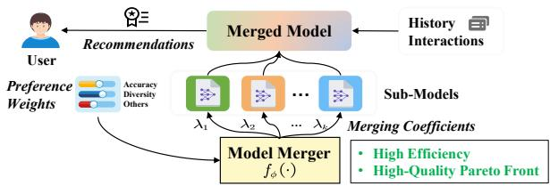  
Figure 1: Illustration of controllable multi-objective recommendation via model merging.

However, directly applying existing model merging approaches to recommender systems is non-trivial. Unlike settings where task-specific updates reside in a shared linear regime and can be com- posed through task arithmetic [14, 25], objective-specialized rec-ommendation models exhibit heterogeneous parameter updates driven by structurally conflicting objectives such as accuracy and diversity. As analyzed in Section 3.2, recommendation task vectors substantially deviate from the linear regime hypothesis that under- pins most task-vector merging approaches. The absence of a shared low-dimensional linear subspace renders naive linear interpolation inefective and prone to cross-objective interference, motivating the need for a merging strategy tailored to the complex parameter geometry of recommendation models.

To address these challenges, we propose RecSoup, a two-stage framework for controllable multi-objective recommendation. In the first stage, RecSoup employs a fine-grained pruning strategy to resolve parameter interference. Unlike magnitude-based ap proaches, we jointly consider objective-specific importance and cross-objective relevance, which establishes a harmonious param eter foundation for merging. In the second stage, RecSoup moves beyond linear interpolation. We integrate a learnable mechanism that captures the mapping from user preference vectors to merg ing coeficients, allowing the model to dynamically navigate the parameter space. The synergy between pruning-driven conflict mitigation and adaptive merging enables RecSoup to generate high quality Pareto solutions with superior controllability, bypassing the optimization instability and architectural overhead of generative approaches. The key contributions are summarized as follows:

• We present RecSoup, the first framework to integrate model merging into CMOR, adjusting objective trade-ofs directly in the parameter space.

• We propose a pruning strategy that jointly considers objectivespecific and cross-objective importance and can be integrated with existing dynamic merging mechanisms to substantially improve controllable multi-objective recommendation.

• We provide theoretical analysis showing that model merging is a more efective and eficient paradigm for CMOR.

• Extensive experiments conducted on various backbones and datasets validate that RecSoup achieves higher-quality Pareto fronts while maintaining comparable controllability to state- of-the-art baselines.

## 2 Related Work

Model Merging integrates task-specific specialists into a unified model without joint retraining, and has been widely studied in LLMs [14, 23, 37, 41]. Existing methods mainly address interfer-ence among task-specific updates, or task vectors, through conflict mitigation [6, 8, 12, 20, 22, 35, 40, 42, 45] or coeficient determination [6, 43]. The former reduces conflicts by pruning redundant or conflicting parameters, such as TIES-merging [40], DARE [45], CABS [44], and LwPTV [47], or by projecting task vectors into orthogonal subs aces, such as TATR [35]. These methods motivate our pruning design, but their criteria are not tailored to recommen-dation objectives and overlook objective-specific contribution and cross-objective relevance. The latter determines how to combine task vectors. AdaMerging [43] adaptively learns merging weights, while PCB-merging [6] considers both intra-task and inter-task balancing, which inspires our pruning design. However, these methods typically yield a single fixed merged model, resulting in a “one-size- fits-all” solution [1] that is unsuitable for CMOR, where diferent preference vectors require diferent trade-ofs among accuracy, diversity, and fairness. Recent Pareto merging methods learn multiple solutions via low-rank structures [5], surrogate evaluation [19], or MoE-based coeficient generation [36]. Following Tang et al. [36], we adopt a preference-conditioned coeficient generator as deter- miner and tailor it with our pruning criterion to CMOR.

Parameter Generation enables controllability by dynamically gen-erating model weights to meet specific task demands. This approach was pioneered in controllable multi-task learning [24, 27], which demonstrated that hypernetworks could map preference vectors to task-specific parameters. Subsequent advances such as PHN [24] and PHN-HVI [11] have shown that a single hypernetwork can efectively approximate the entire Pareto front. In recommendation, CMR [4] adapts hypernetwork by generating sensitive re-ranking parameters for instant preference adjustment, while Hyperbandit and its variant further extend this idea to time-varying user preferences in streaming recommendation [31, 33]. Beyond hy- pernetworks, Paragon [34] employs difusion models to synthesize objective-conditioned adapters, matching the performance of retraining at lower cost. Despite their efectiveness in achieving Pareto optimality, parameter generation paradigms face significant challenges regarding architectural complexity and training stability.

## 3 Problem Formulation and Analyses

This section formulates the problem of controllable multi-objective recommendation via model merging and analyzes the limitations of naive task-vector merging in sequential recommendation models.

## 3.1 Problem Formulation

Let U and I denote the sets of users and items, respectively. We consider a multi-objective sequential recommendation scenario with � distinct list-wise evaluation dimensions (e.g., accuracy, diversity). Let $\theta _ { \mathrm { b a s e } }$ represent the parameters of a base recommendation model. For each objective $i \in \{ 1 , . . . , N \}$ , a specialized expert model $\theta _ { i }$ is obtained, and its corresponding task vector [25] is defined as

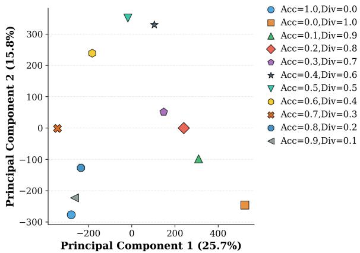  
Figure 2: PCA projection of accuracy- and diversityoptimized task vectors in TiSASRec. The axes correspond to the first (PC1) and second (PC2) principal components, explaining 25.7% and 15.8% of the variance, respectively.

$$
\tau _ { i } = \mathrm { v e c } ( \theta _ { i } ) - \mathrm { v e c } ( \theta _ { \mathrm { b a s e } } ) ,\tag{1}
$$

where vec(·) denotes flattening all model parameters into a single row vector. Accordingly, $\pmb { \tau } _ { i } \in \mathbb { R } ^ { 1 \times D }$ captures the objective-specific parameter updates in a linearized parameter space. Throughout this section, all model parameters are discussed in their vectorized form unless otherwise specified.

The goal of controllable multi-objective recommendation is to dynamically adjust model parameters according to a real-time user preference vector $\pmb { \mu } = [ \mu _ { 1 } , \mu _ { 2 } , \ldots , \mu _ { N } ] ^ { \top }$ , which resides in the $\left( N - 1 \right)$ dimensional unit simplex $\Delta _ { N - 1 } = \{ \pmb { \mu } \in \mathbb { R } _ { + } ^ { N } : \sum _ { i = 1 } ^ { N } \mu _ { i } = 1 \}$ . In the framework of task-vector merging, we aim to learn a mapping function $\mathcal { F } : \pmb { \mu } \mapsto \lambda ,$ which transforms the preference vector into a set of merging coeficients $\boldsymbol { \lambda } = [ \lambda _ { 1 } , . . . , \lambda _ { N } ] ^ { \intercal }$ . Notably, � is not constrained to be identical to $\pmb { \mu } .$ . The merged model parameters are constructed as

$$
\bar { \theta } ( \mu ) = \theta _ { \mathrm { b a s e } } + \sum _ { i = 1 } ^ { N } \lambda _ { i } \pmb { \tau } _ { i } ,\tag{2}
$$

where $\lambda _ { i } = \left[ \mathcal { F } ( \pmb { \mu } ) \right]$ � denotes the merging coeficient associated with the �-th task vector.

For a given user � ∈ ${ \mathcal U } ,$ the recommendation model parameter- ized by $\bar { \theta } ( \mu )$ in Eq. (2) produces a ranked list of � items, denoted as $\mathcal { L } _ { u } ( \bar { \theta } ( \mu ) )$ . The performance of this list is evaluated by a set of objective-specific metrics $\{ R _ { i } ( \mathcal { L } _ { u } ) \} _ { i = 1 } ^ { N }$ . We adopt a linear scalarization to aggregate multiple objectives:

$$
S ( \mathcal { L } _ { u } , \mu ) = \sum _ { i = 1 } ^ { N } \mu _ { i } R _ { i } ( \mathcal { L } _ { u } ( \bar { \theta } ( \mu ) ) ) ,\tag{3}
$$

which explicitly reflects how the preference vector � governs the trade-of among diferent objectives through the merged parameters. Our problem is to optimize the mapping function $\mathcal { F }$ such that the induced parameter family $\{ { \bar { \theta } } ( \pmb { \mu } ) \ | \ \pmb { \mu } \in \Delta _ { N - 1 } \}$ approximates the Pareto front of the multi-objective recommendation problem in expectation over users, while ensuring that each metric $R _ { i }$ in Eq. (3) exhibits consistent and monotonic responsiveness to its corresponding preference weight $\mu _ { i }$

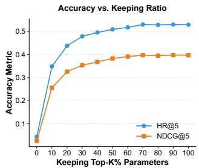

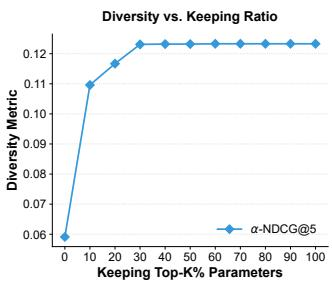  
Figure 3: An illustration of the redundant parameters in multi-objective recommendation.

## 3.2 Problem Analyses

Linear Regime Hypothesis. Task arithmetic $( \mathrm { e . g . }$ , linear merging of task vectors) has proven efective in models such as CLIP, where its success is grounded in the linear regime hypothesis [14, 37, 38]. This hypothesis assumes that fine-tuning operates within a lin ear regime, where task-specific parameter updates (task vectors as defined in Eq. (1)) are confined to a shared, composable linear subspace consistent with the neural tangent kernel (NTK) approximation. This implies that all task-specific parameter updates are restricted within the linear subspace defined by the NTK tangent space. Diferent tasks’ $\tau _ { i }$ can therefore be interpreted as distinct vector combinations within this shared subspace.

Empirical Violation of the Linear Regime. To assess whether this assumption extends to sequential recommendation models, we employ Principal Component Analysis (PCA) to characterize the geometric structure of task vectors. As formalized in Ortiz et al. [25] (Property 2), the linear regime inherently requires that task-specific parameter updates reside within a shared linear subspace (the NTK tangent space). In this scenario, the model’s output change after fine-tuning can be approximated by a first-order Taylor expansion $( f ( x ; \theta ^ { * } ) - f ( x ; \theta _ { 0 } ) \approx \tau ^ { \top } \nabla _ { \theta } f ( x ; \theta _ { 0 } ) )$ , which manifests in PCA as a distinctive structural signature: task vectors should exhibit tight clustering along a small number of principal components (PCs), with the majority of parameter variation concentrated in these dominant dimensions.

However, our PCA results (Figure 2) reveals that sequential rec-ommendation models lack this signature ofa shared linear subspace. Task vectors optimized for accuracy and diversity are dispersed across disjoint regions ofthe PCA space, with no evidence ofclustering along dominant components: PC1 explains only 25.66%–26.23% of the total variance, and the top two components collectively capture less than 45% of the variance. This fragmented parame- ter variation directly contradicts the linear regime’s requirement: the absence of a dominant principal component indicates no core linear subspace governs cross-objective updates; the unstructured dispersion of task vectors demonstrates that accuracy and diversity rely on fundamentally heterogeneous parameter directions, which cannot be mutually explained through linear combinations; and the low cumulative variance of top components confirms that parame- ter changes are distributed across high-dimensional space, rather than being confined to a compact linear subspace.

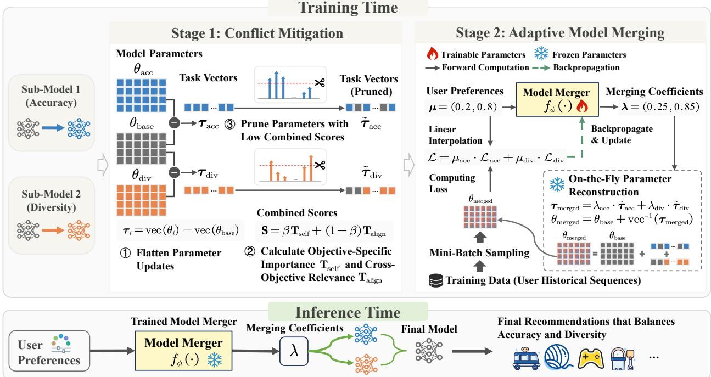  
Figure 4: The overall architecture of RecSoup.

Motivation. The PCA results (Figure 2) show that task vectors for diferent objectives are dispersed across a high-dimensional space rather than concentrated in a shared linear subspace, indicat- ing a complex task vector manifold that cannot be efectively cap- tured by linear combinations. This motivates the need for adaptive merging to learn preference-conditional coeficients that navigate this manifold. At the same time, sequential recommendation models exhibit heterogeneous parameter importance: although approxi-mately 30% of parameters can be removed without severe degra- dation (Figure 3), pruning afects objectives diferently. Accuracy- oriented updates are highly sensitive, while diversity-oriented ones are robust. This asymmetry suggests that naively merging dense vectors risks suppressing critical parameters and retaining interfering updates, making preference-based merging unstable and less controllable. Together, these observations motivate a two-stage design: first, conflict mitigation via pruning reduces interference and preserves task-critical parameters, and second, adaptive merging explores the complex manifold to achieve controllable multi-objective trade-ofs.

## 4 RecSoup: The Proposed Approach

In this section, we present RecSoup, a novel controllable multi objective recommendation framework that decouples the merging process into two stages: determining which parameters to combine and defining how to weight them. This is realized through two modules–conflict mitigation via pruning and adaptive merging with learnable coeficients.

## 4.1 Approach Overview

Figure 4 illustrates RecSoup’s two-stage architecture: (1) Conflict Mitigation via Pruning. This stage sparsifies task vectors by filtering parameters based on importance and relevance, thereby mitigating interference. (2) Adaptive Model Merging. This stage dynamically optimizes coeficients within a learned Pareto manifold to balance competing metrics (e.g., accuracy and diversity). By distinguishing parameter selection from coeficient determination, RecSoup ensures robust control. At inference, a gating network generates coeficients for any preference vector in a single forward pass, enabling eficient control without retraining. We detail the architecture below.

## 4.2 Conflict Mitigation via Pruning

The first stage of the RecSoup framework is the Sub-model Pruning step, which aims to generate a set of sparse and specialized task vectors by pruning an initial task vector matrix. Formally, let $\mathbf { T } \in \mathbb { R } ^ { N \times D }$ denote the task vector matrix, where the �-th row $\mathbf { T } _ { i , : }$ corresponds to the task vector associated with the �-th objective. The output of this stage is a pruned task vector matrix $\tilde { \mathbf { T } } \in \mathbb { R } ^ { N \times D }$ . The pruning procedure is designed to identify and preserve parameters that are highly important to a specific objective while suppressing task-irrelevant updates that cause cross-objective interference. The details are shown in Algorithm 1.

Feature Importance Scoring. Pruning is conducted independently for each task vector, corresponding to the �-th row $\mathbf { T } _ { i , : } \in \mathbb { R } ^ { 1 \times D }$ of the task vector matrix. For each parameter position $j \in \{ 1 , \ldots , D \}$ we compute a Combined Importance Score $S _ { i , j }$ by integrating two complementary components: objective-specific importance and cross-objective relevance.

• Objective-Specific Importance. This component measures the relative contribution of parameter � to the overall magnitude of task vector �. It is defined as the squared magnitude of the parameter normalized by the $\ell _ { 2 }$ norm of the task vector:

$$
T _ { \mathrm { s e l f } , i , j } = \frac { T _ { i , j } ^ { 2 } } { \Vert \mathbf { T } _ { i , : } \Vert _ { 2 } ^ { 2 } } .\tag{4}
$$

• Cross-Objective Relevance. To quantify the degree of cou-pling between parameter $j$ of task � and other objectives, we compute its interaction with the average update magnitude of the remaining tasks at the same parameter position. Specifically, we define $\begin{array} { r } { \bar { T } _ { i , j } = \frac { 1 } { N - 1 } \sum _ { k \neq i } T _ { k , j } } \end{array}$ and measure the cross-objective relevance as

$$
T _ { \mathrm { a l i g n } , i , j } = \left| T _ { i , j } \cdot \bar { T } _ { i , j } \right| .\tag{5}
$$

Combined Importance Score. The final importance score for each parameter position is defined as a weighted combination of the two components:

$$
S _ { i , j } = \beta T _ { \mathrm { s e l f } , i , j } + ( 1 - \beta ) T _ { \mathrm { a l i g n } , i , j } ,\tag{6}
$$

where $\beta \in \left[ 0 , 1 \right]$ controls the trade-of between objective special ization and cross-objective sensitivity. We denote $\mathsf { S } _ { i , : } = \{ S _ { i , j } \} _ { j = 1 } ^ { D }$ as the combined importance score vector for task �.

Top-� Selection via Norm Retention. After obtaining the combined scores $\mathbf { S } _ { i } ,$ we rank the parameter positions to prioritize those with higher importance. Let � be the permutation of indices $\{ 1 , \ldots , D \}$ such that the scores are sorted in descending order: $S _ { i , \pi ( 1 ) } \geq S _ { i , \pi ( 2 ) } \geq$ $\cdots \geq S _ { i , \pi ( D ) }$ . Rather than enforcing a fixed parameter count, we adopt a dynamic norm retention strategy. We determine the minimal number of top-ranked parameters, denoted as $k _ { i } ,$ required to reserve a redefined fraction $\rho$ of the task’s total information (measured by self-importance):

$$
k _ { i } = \operatorname* { m i n } \left\{ k \bigg | \frac { \sum _ { m = 1 } ^ { k } T _ { \mathrm { s e l f } , i , \pi ( m ) } } { \sum _ { j = 1 } ^ { D } T _ { \mathrm { s e l f } , i , j } } \geq \rho \right\} .
$$

Accordingly, the selected index set is defined as the top-�� indices: $\mathcal { K } _ { i } = \{ \pi ( 1 ) , \ldots , \pi ( k _ { i } ) \}$ . The pruned task vector is then generated via element-wise masking: $\tilde { \mathbf { T } } _ { i } = \mathbf { T } _ { i } \odot \mathbb { I } _ { \mathcal { K } _ { i } }$ , where $\mathbb { I } _ { \mathcal { K } _ { i } } \in \{ 0 , 1 \} ^ { D }$ is the indicator vector for the set $\mathcal { K } _ { i } .$ . This strategy ensures that the pruned vector retains the core semantic information (high norm retention) while efectively filtering out conflicting or negligible parameters (low � score), thereby producing a refined subspace for stable merging.

Rationale for Absolute Value in Cross-Objective Relevance. We intentionally employ the absolute value in Eq. (5) to relax the directional consistency assumptions typically imposed by task arithmetic approaches. In multi-objective recommendation, parameters critical to multiple tasks often exhibit conflicting update directions. For instance, improving accuracy may inherently reduce diversity. By focusing on the magnitude of the interaction, we measure cross-objective relevance based on coupling strength rather than directional alignment. This design ensures that RecSoup preserves parameters encoding essential yet competing information, preventing their erroneous pruning due solely to sign conflicts.

Algorithm 1 Pruning Procedure   
Input: Task vectors $\mathbf { T } \in \mathbb { R } ^ { N \times D }$ , norm retention ratio $\rho ,$ weight $\beta$   
Output: Pruned task vectors $\tilde { \mathbf { T } } \in \mathbb { R } ^ { N \times D }$   
1: for each task $i = 1 , \ldots , N$ do   
⊲ Compute Objective-Specific Importance:   
2: $T _ { \mathrm { s e l f } , i , : } \gets \mathbf { T } _ { i , : } \odot \mathbf { T } _ { i , : } / \lVert \mathbf { T } _ { i , : } \rVert _ { 2 } ^ { 2 }$   
⊲ Compute Cross-Objective Relevance:   
3: $\begin{array} { r } { \bar { \mathbf { T } } _ { i , : } ^ { \phantom { } }  \frac { 1 } { N - 1 } \sum _ { k \neq i } \bar { \mathbf { T } } _ { k , : } } \end{array}$   
4: $T _ { \mathrm { a l i g n } , i , : } \gets | \mathbf { T } _ { i , : } \odot \bar { \mathbf { T } } _ { i , : } |$   
⊲ Compute Combined Score:   
5: $\mathbf { S } _ { i , : } \gets \beta T _ { \mathrm { s e l f } , i , : } + ( 1 - \beta ) T _ { \mathrm { a l i g n } , i , : }$   
6: Select top-�� indices $\mathcal { K } _ { i }$ s.t. $\sum _ { j \in \mathcal { K } _ { i } }$ �self, $_ { i , j } \geq \rho$   
7: Prune task vector: $\tilde { \mathbf { T } } _ { i , : }  \mathbf { T } _ { i , : } \odot \mathbb { I } _ { \mathcal { K } _ { i } }$   
8: end for   
9: return $\tilde { \mathbf { T } }$

## 4.3 Adaptive Model Merging with Learnable Coeficients

While our learnable coeficients modules adopts a preference-conditional architecture similar to PWE MoE [36], RecSoup fundamentally redefines the basis construction for the gating network. Existing approaches operate directly on dense, high-interference task vec- tors, forcing the model to simultaneously handle parameter con- flicts and objective trade-ofs. In contrast, RecSoup decouples these challenges: it performs conflict-aware pruning prior to coeficient learning. This ensures that the gating network navigates a purified parameter subspace, allowing it to focus on learning precise coordinates on the Pareto manifold rather than compensating for noise or interference inherent in dense vectors.

After the pruning stage, RecSoup produces the pruned task vector matrix $\tilde { \mathbf { T } } \in \mathbb { R } ^ { N \times D }$ , where each row $\tilde { \mathbf { T } } _ { i , : } \in \mathbb { R } ^ { 1 \times \bar { D } }$ represents the task vector of an objective-specialized sub-model with reduced pa-rameter interference. These task vectors form the basis for adaptive model merging in the second stage. Following [36], we adopt a lightweight gating network $f _ { \phi } ( \cdot )$ , which we refer to as the model merger, that learns a mapping from user preference vectors $\pmb { \mu } \in \mathbb { R } ^ { N }$ to approximately optimal merging coeficients,

$$
\lambda = f _ { \phi } ( \mu ) ,\tag{7}
$$

where each dimension of $\mu$ encodes the relative importance of an optimization objective, such as accuracy or diversity. The output coeficients � ${ \bf \Psi } _ { \cdot } \in \dot { \mathbb { R } } ^ { N }$ determine how the pruned task vectors are com- bined. The merged task vector is obtained via weighted aggregation: $\begin{array} { r } { \pmb { \tau } _ { \mathrm { m e r g e d } } = \sum _ { i = 1 } ^ { N } \lambda _ { i } \tilde { \bf T } _ { i , : } , } \end{array}$ , which is added to the base model parameters to recover the full merged model weights, $\theta _ { \mathrm { { m e r g e d } } } = \theta _ { \mathrm { { b a s e } } } +$ �merged. During training, only the gating network parameters � are updated, while the pruned task vectors T˜ and the base model weights $\theta _ { \mathrm { b a s e } }$ remain fixed. To reduce computation, we evaluate the preference- weighted multi-objective loss using a small subset of the training data:

$$
\mathcal { L } ( \theta _ { \mathrm { m e r g e d } } , \mu ) = \sum _ { i = 1 } ^ { N } \mu _ { i } \cdot \mathcal { L } _ { i } ( \theta _ { \mathrm { m e r g e d } } ) ,
$$

where $\mathcal { L } _ { i }$ is the task-specific loss for the �-th objective.

The eficacy of RecSoup stems from its two-stage decoupling strategy: pruning first identifies the critical parameter support to minimize inter-task interference, after which the gating network calibrates the relative influence of each task based on user pref- erences. This separation significantly alleviates the optimization burden, allowing a lightweight architecture to achieve superior trade-ofs. The synergy between the two stages is empirically vali dated in Section 6.3.1, where pruning refines the parameter space and facilitates more stable and efective exploration during adaptive merging.

## 5 Discussion

## 5.1 Theoretical Analysis

This section theoretically compares model merging and parameter generation to show the former’s advantage in controllable multi- objective recommendation. Let $\Theta \subseteq \mathbb { R } ^ { n }$ be the convex parameter space of the recommendation model (where � denotes the number of model parameters). Without loss of generality, we consider a twoobjective scenario: let $\theta _ { 1 } , \theta _ { 2 } \in \Theta$ be two single-objective optimal expert models optimized for two conflicting objectives $( \mathrm { e . g . }$ , accuracy and diversity); let $P \subseteq \Theta$ be the Pareto-optimal set for the controllable multi-objective recommender system, which is defined as the convex hull of $\theta _ { 1 }$ and $\theta _ { 2 } ( \mathrm { i . e . , } P = \mathrm { c o n v } ( \{ \theta _ { 1 } , \theta _ { 2 } \} )$ , consisting of all convex combinations $\theta = \lambda \theta _ { 1 } + ( 1 - \lambda ) \theta _ { 2 }$ with $\lambda \in [ 0 , 1 ] )$ , which is a common assumption in multi-objective model merging [26]; let $L _ { 0 } = \lVert { \boldsymbol { \theta } } _ { 1 } - { \boldsymbol { \theta } } _ { 2 } \rVert _ { 2 } > 0$ be the diameter of � (Euclidean distance between the two expert models). Let $g : [ 0 , 1 ] \to \Theta$ denote the parameter generation mapping (e.g., hypernetwork [4]) in pa rameter generation approaches, which is designed to map the user preference $\lambda \in [ 0 , 1 ]$ to model parameters for multi-objective rec-ommendation. Let $L > 0$ be the Lipschitz constant of �, satisfying $\| g ( \lambda _ { 1 } ) - g ( \lambda _ { 2 } ) \| _ { 2 } \le L \cdot | \lambda _ { 1 } - \lambda _ { 2 } |$ for all $\lambda _ { 1 } , \lambda _ { 2 } \in [ 0 , 1 ]$ . The following theorem clarifies the relationship between the optimal solution space of parameter generation approaches and that of the model merging paradigm in RecSoup. Proof is provided in Appendix A.

Theorem 5.1. $I f L < L _ { 0 } ,$ , then the parameter generation mapping � in parameter generation approaches cannot generate all elements ofthe Pareto-optimal set $P = \mathrm { c o n v } ( \{ \theta _ { 1 } , \theta _ { 2 } \} )$ achievable via model merging in RecSoup.

Remark 1. Theorem 5.1 illustrates that parameter generation approaches are constrained by the Lipschitz smoothness of g: when $L < L _ { 0 } ,$ the mapping g is too “smooth” to cover the full Pareto-optimal set induced by model merging. It highlights model merging’s advantage in controllable multi-objective recommendation: unlike parameter generation, merging avoids such smoothness limitations and can fully navigate the Pareto front, enabling more flexible trade-of control.

## 5.2 Time Complexity Analysis

We analyze the inference-time complexity of parameter generation approaches and RecSoup, considering both adapter-only and full- parameter controllable settings. Using SASRec as a representative backbone, let � denote the transformer hidden dimension, � the number of layers, � the hidden width of the hypernetwork (typ- ically $O ( d ) ) , | \tau |$ the number of items, � the number of denoising steps in difusion-based generation, � the number of objectives, and $P = L d ^ { 2 } + | \boldsymbol { J } | \boldsymbol { | c } \rrangle$ � the full-parameter size.

For parameter generation approaches, task-specific parameters are dynamically generated at inference time. Under adapter-only setting, each adapter consists of two linear projections with $O ( d ^ { 2 } )$ parameters. Hypernetwork-based approaches [4] employ an MLP to generate adapter parameters, resulting in an inference-time com-plexity $T _ { \mathrm { h y p e r n e t } } = { \cal O } ( d ^ { 2 } \cdot H )$ , while difusion-based approaches [34] iteratively refine parameters over � steps, yielding $O ( T \cdot d ^ { 3 } )$ . When controllability is extended to all model parameters, the generation cost scales with the full parameter size. Accordingly, hypernetwork- and difusion-based approaches incur $O \left( P \cdot H \right)$ and $O ( T \cdot P \cdot d )$ respectively.

RecSoup follows a model merging paradigm, where task-specific parameters are pre-trained and merged at inference time. In the adapter-only setting, merging � adapters requires $O \left( N \cdot d ^ { 2 } \right)$ , while a lightweight gating network maps an �-dimensional preference vector to merging coeficients (Eq. (7)) with negligible cost $O ( N ^ { 2 } )$ In the full-parameter setting, RecSoup directly merges full models, yielding $O \left( N \cdot P \right)$

Compared to parameter-generation approaches, RecSoup eliminates auxiliary networks and iterative refinement at inference time. Consequently, it avoids the cubic dependence on � introduced by hypernetwork- and difusion-based approaches, achieving quadric or linear scaling with respect to the parameter size and the num-ber of objectives in diferent controllable settings. Although full- parameter merging can be dominated by the item embedding size when $| \boldsymbol { \cal T } | \gg d ^ { 2 }$ , RecSoup remains substantially more eficient than difusion-based generation and ofers a favorable trade-of between inference eficiency and controllability.

## 6 Experiments

We conducted experiments across diferent backbones to evaluate the performance of RecSoup.

## 6.1 Experimental Settings

6.1.1 Dataset. We evaluate RecSoup on three benchmarks: MovieLens-1M1, and two categories from the Amazon Review dataset2 (Grocery and Gourmet Food, Toys and Games). We follow the pre-processing procedures adopted in prior work [34] to ensure consistency in data filtering and sequence organization.

6.1.2 Baselines. We compare RecSoup with baselines from three paradigms. Retrain independently optimizes each preference and serves as an oracle.

Post-Processing. MMR [3] re-ranks candidates to balance accuracy and diversity.

Parameter Generation. CMR [4] uses a hyper-network to generate preference-conditioned parameters, while Paragon [34] generates task-specific adapters with a difusion model.

Model Merging. Soup [26] linearly interpolates objective-specific models, while TATR [35] mitigates inter-objective interference through orthogonal trust regions. We further include TIES [40], a conflict-aware pruning baseline that prunes parameters based on objective-specific importance and resolves sign conflicts. In contrast, RecSoup additionally considers cross-objective relevance during pruning; detailed comparisons are presented in Sec. 6.3.2. We also evaluate recent pruning-based methods, including DARE [45], CABS [44], and LwPTV [47], with additional results reported in Appendix C.

Table 1: Overall performance of all approaches. HV = Hypervolume, LF = Length of Pareto Front, Contro. = Controllability. “w/o Prune” omits the pruning stage in RecSoup, while “w/o MLP” uses an identity mapping in RecSoup. Bold and underlined indicate the best and second-best among main competing approaches. † denotes oracle results (Retrain), shown for reference.
<table><tr><td rowspan="2">Backbone</td><td rowspan="2">Approach</td><td colspan="3">MovieLens-1M</td><td colspan="3">Grocery and Gourmet Food</td><td colspan="3">Toys and Games</td></tr><tr><td>HV↑</td><td>LF↑</td><td>Contro. ↑</td><td>HV↑</td><td>LF↑</td><td>Contro. ↑</td><td>HV↑</td><td>LF↑</td><td>Contro. ↑</td></tr><tr><td rowspan="9">SASRec</td><td>MMR</td><td>0.1153</td><td>2</td><td>0.3333</td><td>0.5323</td><td>5</td><td>1.0000</td><td>0.5762</td><td>7</td><td>0.8889</td></tr><tr><td>Paragon</td><td>0.5362</td><td>11</td><td>1.0000</td><td>0.6013</td><td>10</td><td>0.9818</td><td>0.2479</td><td>8</td><td>0.9091</td></tr><tr><td>CMR</td><td>0.5290</td><td>10</td><td>0.9818</td><td>0.1269</td><td>8</td><td>0.8545</td><td>0.3820</td><td>11</td><td>1.0000</td></tr><tr><td>Soup</td><td>0.6536</td><td>7</td><td>0.8182</td><td>0.5404</td><td>10</td><td>0.9818</td><td>0.5467</td><td>11</td><td>1.0000</td></tr><tr><td>TATR</td><td>0.6227</td><td>6</td><td>0.7636</td><td>0.4831</td><td>9</td><td>0.9636</td><td>0.4997</td><td>11</td><td>1.0000</td></tr><tr><td>RecSoup</td><td>0.7090</td><td>8</td><td>0.9091</td><td>0.6088</td><td>9</td><td>0.8910</td><td>0.5755</td><td>11</td><td>1.0000</td></tr><tr><td>w/o MLP</td><td>0.6675</td><td>8</td><td>0.9091</td><td>0.5995</td><td>10</td><td>0.9818</td><td>0.5416</td><td>11</td><td>1.0000</td></tr><tr><td>w/o Prune</td><td>0.7228</td><td>11</td><td>1.0000</td><td>0.5437</td><td>11</td><td>1.0000</td><td>0.5594</td><td>11</td><td>1.0000</td></tr><tr><td>Retrain†</td><td>0.6604</td><td>9</td><td>1.0000</td><td>0.7358</td><td>11</td><td>1.0000</td><td>0.6120</td><td>10</td><td>0.8485</td></tr><tr><td rowspan="8">GRU4Rec</td><td>MMR</td><td>0.1076</td><td>2</td><td>0.5333</td><td>0.4653</td><td>3</td><td>0.6889</td><td>0.5428</td><td>9</td><td>1.0000</td></tr><tr><td>Paragon</td><td>0.4143</td><td>8</td><td>0.8910</td><td>0.3699</td><td>6</td><td>0.8910</td><td>0.0521</td><td>6</td><td>0.6909</td></tr><tr><td>CMR</td><td>0.4464</td><td>11</td><td>1.0000</td><td>0.0027</td><td>1</td><td>0.0364</td><td>0.3577</td><td>11</td><td>1.0000</td></tr><tr><td>Soup</td><td>0.5869</td><td>8</td><td>0.8910</td><td>0.2566</td><td>11</td><td>1.0000</td><td>0.4211</td><td>11</td><td>1.0000</td></tr><tr><td>TATR</td><td>0.5716</td><td>8</td><td>0.8910</td><td>0.2995</td><td>11</td><td>1.0000</td><td>0.4131</td><td>10</td><td>1.0000</td></tr><tr><td>RecSoup</td><td>0.6497</td><td>11</td><td>1.0000</td><td>0.3305</td><td>11</td><td>1.0000</td><td>0.4315</td><td>11</td><td>1.0000</td></tr><tr><td>w/o MLP</td><td>0.6051</td><td>8</td><td>0.8940</td><td>0.2734</td><td>10</td><td>1.0000</td><td>0.4211</td><td>11</td><td>1.0000</td></tr><tr><td>w/o Prune</td><td>0.5892</td><td>7</td><td>0.8727</td><td>0.2710</td><td>11</td><td>1.0000</td><td>0.4315</td><td>11</td><td>1.0000</td></tr><tr><td rowspan="10">TiSASRec</td><td>Retrain†</td><td>0.6569</td><td>10</td><td>0.9818</td><td>0.6999</td><td>10</td><td>1.0000</td><td>0.6073</td><td>8</td><td>0.9091</td></tr><tr><td>MMR</td><td>0.1194</td><td>2</td><td>0.4222</td><td>0.5115</td><td>5</td><td>1.0000</td><td>0.5967</td><td>8</td><td>1.0000</td></tr><tr><td>Paragon</td><td>0.5228</td><td>10</td><td>0.9818</td><td>0.1220</td><td>11</td><td>1.0000</td><td>0.2347</td><td>8</td><td>0.9455</td></tr><tr><td>CMR</td><td>0.5299</td><td>11</td><td>1.0000</td><td>0.1000</td><td>7</td><td>0.8909</td><td>0.4319</td><td>11</td><td>1.0000</td></tr><tr><td>Soup</td><td>0.6110</td><td>6</td><td>0.9636</td><td>0.4628</td><td>11</td><td>1.0000</td><td>0.6110</td><td>10</td><td>0.9818</td></tr><tr><td>TATR</td><td>0.5558</td><td>8</td><td>0.8728</td><td>0.3893</td><td>11</td><td>1.0000</td><td>0.5537</td><td>10</td><td>1.0000</td></tr><tr><td>RecSoup</td><td>0.6902</td><td>11</td><td>1.0000</td><td>0.4843</td><td>9</td><td>0.9455</td><td>0.6148</td><td>9</td><td>0.9636</td></tr><tr><td>w/o MLP</td><td>0.6128</td><td>7</td><td>1.0000</td><td>0.4695</td><td>11</td><td>1.0000</td><td>0.6120</td><td>9</td><td>0.9636</td></tr><tr><td>w/o Prune</td><td>0.6722</td><td>11</td><td>1.0000</td><td>0.4735</td><td>9</td><td>0.9272</td><td>0.6126</td><td>9</td><td>1.0000</td></tr><tr><td> $ { \mathrm { R e t r a i n } } ^ { \dagger }$ </td><td>0.6755</td><td>9</td><td>0.9818</td><td>0.6387</td><td>10</td><td>0.9818</td><td>0.6078</td><td>11</td><td>1.0000</td></tr></table>

6.1.3 Implemetation Details. Following Paragon [34], the Accuracy specialist uses the BPR loss [28], while the Diversity specialist uses a diferentiable �-NDCG-based surrogate promoting category novelty and reducing redundancy [34]. They form the Retrain Pareto-front endpoints at � = 0 and $\lambda = 1$ . We adopt SASRec [17], GRU4Rec [10], and TiSASRec [18], trained with Adam, learning rate $1 0 ^ { - 3 }$ , and 64-dimensional embeddings and hidden states. We use 9 negatives for training and 99 for evaluation, set $\beta = 0 . 5$ in Eq. (6), and set $\rho \in \left[ 0 . 9 , 0 . 9 5 \right]$ . Since $\rho$ controls the pruning criterion rather than the exact retention fraction, the resulting keeping ratio is typically 0.4–0.7. Further MMR settings and coeficient-learner architectures are given in Appendix B.

6.1.4 Metrics. We evaluate controllable multi-objective recommendation using Hypervolume, Pareto front length, and controllability. Hypervolume (HV) [9] measures the volume of the objective space dominated by the Pareto-optimal solutions with respect to a reference point. A larger HV indicates better overall trade-ofs across objectives. Length of Pareto Front (LF) [30] denotes the number of distinct Pareto-optimal solutions, reflecting the range of achievable trade-ofs. Controllability [39] measures how well the model aligns with user preferences. The controllability score � is defined as:

$$
C = \frac { 1 } { M ( M - 1 ) } \sum _ { i \neq j } \mathbb { I } \Bigg [ \bigwedge _ { k = 1 } ^ { N } \operatorname { s g n } ( \mu _ { i , k } - \mu _ { j , k } ) = \operatorname { s g n } \left( m _ { k } ( S _ { i } ) - m _ { k } ( S _ { j } ) \right) \Bigg ] ,
$$

where � is the number of preference vectors, � the number of ob- jectives, $\pmb { \mu } _ { i }$ the �-th preference vector, $S _ { i }$ the corresponding model output, $m _ { k } ( S _ { i } )$ the �-th metric value, and 1[·] the indicator function; higher � indicates stronger alignment with preferences.

## 6.2 Experiment Results

We conduct experiments to evaluate RecSoup from two aspects: (i) its overall performance and generalization compared with baselines across diferent backbones and datasets; (ii) the empirical contribution of each individual component in RecSoup. The results are presented in Table 1.

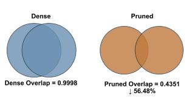  
(a) Parameter decoupling.

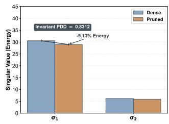  
(b) Geometry preservation.

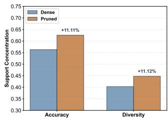  
(c) Feature sharpening efect.

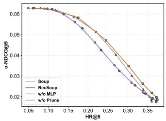  
(d) Pareto front.  
Figure 5: Structural analysis of task vectors under RecSoup pruning. (a) Pruning reduces the overlap between objectives, indicating efective parameter decoupling. (b) The singular spectrum and main directions remain nearly unchanged, suggesting that the overall structure is preserved. (c) Support concentration increases after pruning, showing that noisy updates are removed and task-specific signals become clearer. (d) The resulting Pareto front is expanded.

Overall, across three backbones and datasets, RecSoup achieves a favorable balance between Pareto eficiency and controllabil- ity. Compared with strong model-merging baselines such as Soup and TATR, RecSoup consistently attains higher Hypervolume. On MovieLens-1M, where Soup and TATR already outperform earlier controllable approaches, RecSoup further improves Hypervolume by up to 8.5% on SASRec and 7.3% on TiSASRec, while maintaining controllability close to the upper bound of 1.0. These results suggest that linear task-vector merging alone is insuficient to fully resolve complex interactions among conflicting objectives, whereas RecSoup more efectively explores the Pareto frontier without sacrificing controllability. MMR exhibits a diferent trade-of behavior: al- though it achieves competitive Hypervolume under certain settings, this often comes with much shorter Pareto fronts, indicating that its gains are concentrated on a limited number of operating points. In contrast, RecSoup consistently produces longer Pareto fronts, ofering a richer set of controllable solutions, enabling flexible se- lection for practical use. Parameter generation approaches exhibit unstable behavior: despite high controllability, their Hypervolume degrades sharply under sparse or noisy feedback, particularly on Amazon. In these settings, RecSoup outperforms them with around 20–50% higher Hypervolume in most cases while preserving controllability above 0.89. Notably, RecSoup occasionally surpasses the oracle, likely due to its ability to explore feasible Pareto solutions beyond the optimization paths induced by retraining.

The ablation results show that adaptive merging is necessary for stable controllable recommendation. Removing coeficient learner consistently reduces Hypervolume, which indicates that directly us ing the preference vector as merging coeficients cannot suficiently capture their relationship. The role of pruning is more conditional. In several settings, w/o Prune performs comparably to or even better than RecSoup, suggesting that pruning may be unnecessary when task vectors are already compatible or when sparsification re- moves useful objective-specific updates. However, pruning becomes important when task vectors contain stronger interference or noisy updates, especially on more challenging Amazon settings. By se-lecting parameters according to both objective-specific importance and cross-objective relevance, pruning provides a cleaner basis for adaptive merging. Thus, pruning mainly improves robustness under conflicting objectives.

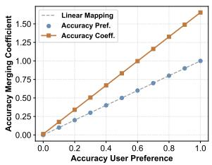  
(a) Accuracy Preference Alignment.

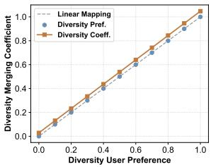  
(b) Diversity Preference Alignment.

Figure 6: Alignment between user preferences and learned merging coeficients.

## 6.3 Analyses

6.3.1 RQ1: How do Two-stage Design Facilitate Controllable Multi-Objective Recommendation? Figure 5 explains why pruning synergizes with adaptive merging. Figure 5(a) reports the support overlap ratio between pairs of task vectors, computed as the intersection-over-union of parameter supports whose absolute update magnitude exceeds a small threshold. Pruning clearly re- duces this overlap, indicating efective parameter decoupling across objectives. By reducing shared and potentially conflicting parameters, pruning lowers cross-objective interference and provides a cleaner basis for multi-objective merging. This decoupling does not largely change the overall structure of task vectors. As shown in Figure 5(b), the singular spectrum and main directions remain nearly unchanged after pruning, suggesting that pruning preserves the main structure of parameter updates. Figure 5(c) further shows that support concentration increases after pruning, meaning that objective-specific updates become more focused on a smaller set of important parameters. Together, these changes make the task- vector space cleaner and more controllable, which leads to an ex- panded Pareto front in Figure 5(d). Based on this pruned parameter space, Figure 6 further analyzes the learned merging coeficients.

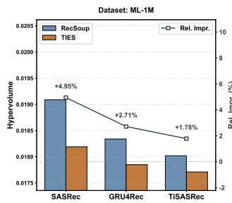

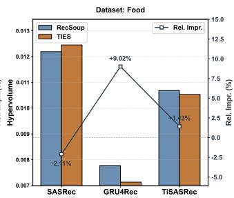  
Figure 7: Hypervolume (HV) comparison between RecSoup and TIES. Bars show absolute $\mathbf { H V } ,$ and the line indicates the relative improvement of RecSoup over TIES.

A simple linear rule assumes that the input preference vector can be directly used as the merging coeficients. This assumption can be violated when objectives have diferent parameter scales, nonlinear interactions, or residual conflicts. RecSoup addresses this linear regime violation by decoupling parameter selection from coeficient learning: pruning first builds a cleaner task-vector basis, and adaptive merging then learns non-linear coeficients condi- tioned on preferences. Thus, RecSoup can amplify or suppress each objective beyond the input preference value, enabling more flexible navigation along the Pareto front.

6.3.2 RQ2: Impact of Cross-Objective Relevance Score. We investigate the contribution of the Cross-Objective Relevance Score $\mathbf { T } _ { \mathrm { a l i g n } }$ defined in Eq. (5) to the pruning efectiveness of RecSoup. The pruning strategy in RecSoup is guided by two complementary signals: $\mathbf { T } _ { \mathrm { { s e l f } } }$ and $\mathbf { T } _ { \mathrm { a l i g n } } .$ In contrast, TIES performs pruning solely based on $\mathbf { T } _ { \mathrm { s e l f } }$ . To isolate the impact of $\mathbf { T } _ { \mathrm { a l i g n } } ,$ we ensure that both RecSoup and TIES share identical merging coeficients and merging procedures. Figure 7 presents the Hypervolume (HV) results and the relative improvement of RecSoup over the TIES baseline across three backbones and multiple datasets. On MovieLens-1M, Rec- Soup consistently outperforms TIES, achieving relative HV gains of +4.95% (SASRec), +2.71% (GRU4Rec), and +1.78% (TiSASRec). These results confirm that $\mathbf { T } _ { \mathrm { a l i g n } }$ efectively guides the pruning process: by considering cross-objective relevance in addition to objective-specific importance, RecSoup selectively retains parame ters critical to multiple objectives. This prevents the over-pruning of parameters that are essential for one objective but not heavily weighted by $\mathbf { T } _ { \mathrm { s e l f } }$ , which TIES may discard. In summary, this ablation demonstrates that the similarity score is a key component in RecSoup’s pruning stage, directly contributing to improved multiobjective performance by preserving cross-task compatibility while maintaining a controlled merging process.

6.3.3 RQ3: Inference-Time Eficiency of Parameter Generation and RecSoup. We compare hypernetwork-based generation approach [4] with RecSoup in terms of their wall-clock latency following the time complexity analysis in Section 5.2. Table 2 re-ports the average parameter construction time over 11 user pref- erences across diferent datasets using the same backbone. The results show that RecSoup consistently incurs lower latency than hypernetwork-based generation. This eficiency advantage is particularly pronounced when multiple preference configurations are evaluated, as merging reuses a fixed set of task vectors and avoids repeated parameter synthesis. In contrast, difusion-based parameter generation is substantially slower due to its iterative nature. In our experiments, the difusion process was configured with 10,000 denoising steps; and under this setting, the average parameter construction time per preference was approximately 87.79 seconds, orders of magnitude larger than both hypernetwork generation and RecSoup. These observations validate our theoretical analysis and demonstrate that RecSoup provides a practical and eficient solution for inference-time controllable recommendation.

Table 2: Inference-time parameter construction latency (milliseconds) for diferent controllable approaches. All results are averaged over 10 runs.
<table><tr><td>Dataset</td><td>Hypernetwork</td><td>RecSoup</td><td>Speedup</td></tr><tr><td>ML-1M</td><td> $7 . 5 2 8 1 \pm 0 . 5 9 9 0$ </td><td> $0 . 0 4 5 4 \pm 0 . 0 1 0 0$ </td><td> $1 6 5 . 9 \times$ </td></tr><tr><td>Amazon(Food)</td><td> $9 . 3 7 9 9 \pm 0 . 1 7 5 6$ </td><td> $0 . 0 4 1 0 \pm 0 . 0 0 1 1$ </td><td> $2 2 8 . 8 \times$ </td></tr><tr><td>Amazon(Games)</td><td> $9 . 2 7 4 1 \pm 0 . 2 7 4 6$ </td><td> $0 . 0 4 3 6 \pm 0 . 0 0 5 5$ </td><td> $2 1 2 . 7 \times$ </td></tr></table>

Table 3: Accuracy-Fairness controllable evaluation results on ML-1M with SASRec.
<table><tr><td colspan="4">Baselines</td><td colspan="4">Our Method</td></tr><tr><td>Method</td><td>HV↑</td><td>Contro.↑ LF↑ |Method</td><td></td><td></td><td>HV↑</td><td>Contro.↑ LF↑</td><td></td></tr><tr><td>Soup</td><td>0.3968</td><td>0.6909</td><td>6</td><td>RecSoup</td><td>0.4270</td><td>0.6727</td><td>5</td></tr><tr><td>TATR</td><td>0.2064</td><td>0.7818</td><td>6</td><td>w/o MLP</td><td>0.4176</td><td>0.7091</td><td>5</td></tr><tr><td>TIES</td><td>0.3858</td><td>0.7818</td><td>6</td><td>w/o Prune</td><td>0.3872</td><td>0.7818</td><td>6</td></tr><tr><td>CMR</td><td>0.2643</td><td>0.8364</td><td>4</td><td></td><td></td><td></td><td></td></tr></table>

6.3.4 RQ4: How does RecSoup scale to additional objectives such as fairness? We first extend controllable recommendation to the Accuracy-Fairness setting by constructing Accuracy-oriented and Fairness-oriented specialist models. Fairness is measured using the absolute NDCG gap between male and female user groups.

Table 3 reports the controllable results on MovieLens-1M with SASRec. RecSoup achieves the highest HV among all compared controllable baselines, showing stronger Pareto eficiency in the Accuracy-Fairness setting. The performance drop of “w/o MLP” and “w/o Prune” further verifies the contribution of the coeficient learner and the pruning strategy. We exclude Paragon from the main comparison because it collapses to a single Pareto solution in this setting, which cannot provide meaningful controllable transi- tions across diferent preferences. Overall, these results show that RecSoup can be efectively generalized to fairness-aware controllable recommendation.

We further extend controllable recommendation to jointly optimize Accuracy, Diversity, and Fairness. As shown in Table 4, Rec- Soup achieves the best Hypervolume and overall controllability among all baselines, while also obtaining the strongest controlla- bility on the Accuracy–Diversity objective pair. In contrast, CABS exhibits a substantial degradation in Hypervolume despite relatively strong controllability on the Accuracy–Fairness pair, suggesting that strong local controllability does not necessarily translate into globally balanced Pareto frontiers under multi-objective settings. Although Soup produces slightly more Pareto solutions, its lower HV indicates inferior frontier quality compared with Rec-Soup. Overall, these results demonstrate the scalability of RecSoup in multi-objective recommendation settings.

Table 4: Three-objective controllable recommendation results on ML-1M with SASRec. Control. represents the averaged controllability score across objective pairs.
<table><tr><td>Method</td><td>HV↑</td><td>Control.↑</td><td> $_ \mathrm { A c c - D i v } \uparrow$ </td><td> $\operatorname { A c c - F a i r } \uparrow$ </td><td> $\mathrm { L F } \uparrow$ </td></tr><tr><td>SOUP</td><td>0.6015</td><td>0.6479</td><td>0.9152</td><td>0.8816</td><td>49</td></tr><tr><td>TATR</td><td>0.5010</td><td>0.6211</td><td>0.8732</td><td>0.8135</td><td>31</td></tr><tr><td>DARE</td><td>0.5881</td><td>0.6482</td><td>0.9147</td><td>0.8639</td><td>45</td></tr><tr><td>CABS</td><td>0.2594</td><td>0.6395</td><td>0.4172</td><td>0.9207</td><td>42</td></tr><tr><td>LwPTV</td><td>0.5991</td><td>0.6452</td><td>0.9119</td><td>0.8816</td><td>42</td></tr><tr><td>RecSoup</td><td>0.6148</td><td>0.6513</td><td>0.9245</td><td>0.8643</td><td>46</td></tr></table>

## 7 Conclusions

This work shows that task-vector merging, despite its success in large language models, cannot be directly applied to multi-objective sequential recommendation due to the absence of a shared linear regime. Motivated by this observation, we propose RecSoup, which mitigates parameter interference through pruning and enables con trollable trade-ofs via a lightweight gating network. Empirical results further indicate that model-merging approaches ofer a more eficient and efective paradigm than parameter-generation approaches for controllable multi-objective recommendation.

## Acknowledgments

This work was partially supported by the National Natural Science Foundation of China (No. 62376275, 62472426). Work partially done at Beijing Key Laboratory of Research on Large Models and Intelligent Governance, and Engineering Research Center of Next-Generation Intelligent Search and Recommendation, MOE. Sup- ported by fund for building world-class universities (disciplines) of Renmin University of China.

## A Proof of Theorem 5.1

Proof of Theorem 5.1. We prove the conclusion by showing that there exists at least one element in � that is not in the image of �.

First, consider the midpoint of �: $\begin{array} { r } { \theta ^ { * } = \frac { 1 } { 2 } \theta _ { 1 } + \frac { 1 } { 2 } \theta _ { 2 } \in { \cal P } . } \end{array}$ . We aim to show $\theta ^ { * } \notin g ( [ 0 , 1 ] )$ via contradiction. Assume for contradiction that $\theta ^ { * } \in \mathfrak { g } ( [ 0 , 1 ] )$ , so there exists $\lambda ^ { * } \in [ 0 , 1 ]$ such that $g ( \lambda ^ { * } ) = \theta ^ { * }$ By the Lipschitz continuity of ${ \mathit { g } } ,$ we have:

$$
\| \theta ^ { * } - g ( 1 ) \| _ { 2 } \leq L \cdot | \lambda ^ { * } - 1 | \quad { \mathrm { a n d } } \quad \| \theta ^ { * } - g ( 0 ) \| _ { 2 } \leq L \cdot | \lambda ^ { * } | .
$$

Summing these two inequalities and using $\vert \lambda ^ { * } - 1 \vert + \vert \lambda ^ { * } \vert = 1$ (since $\lambda ^ { * } \in [ 0 , 1 ] )$ gives $\| \theta ^ { * } - g ( 1 ) \| _ { 2 } + \| \theta ^ { * } - g ( 0 ) \| _ { 2 } \leq L$

Next, analyze the practical utility of �(1) and �(0). For $\lambda = 1 ,$ $g ( 1 )$ must be optimized for the same objective as $\theta _ { 1 }$ (to be practically useful for multi-objective trade-of), so $g ( 1 ) = \theta _ { 1 }$ (otherwise, it cannot serve as the extreme point of the objective trade-of). Similarly, $g ( 0 ) = \theta _ { 2 } \mathrm { f o r } \lambda = 0 .$

Table 5: Overall comparison with additional pruning-based merging baselines. All metrics are averaged over Accuracy-Diversity configurations.
<table><tr><td>Method</td><td> $\mathrm { \ A v g . H V { \uparrow } }$ </td><td>Avg.Contro.↑</td><td> $\mathrm { A v g . L F } \uparrow$ </td><td>Avg.Rank↓</td></tr><tr><td>DARE</td><td>0.4977</td><td>0.9414</td><td>9.56</td><td>3.67</td></tr><tr><td>CABS</td><td>0.5044</td><td>0.8951</td><td>9.44</td><td>2.56</td></tr><tr><td>LwPTV</td><td>0.5200</td><td>0.9111</td><td>9.56</td><td>2.22</td></tr><tr><td>RecSoup</td><td>0.5662</td><td>0.9657</td><td>9.89</td><td>1.56</td></tr></table>

By the triangle inequality,

$$
L _ { 0 } = \| \theta _ { 1 } - \theta _ { 2 } \| _ { 2 } \leq \| \theta _ { 1 } - \theta ^ { * } \| _ { 2 } + \| \theta ^ { * } - \theta _ { 2 } \| _ { 2 } .
$$

Since $g ( 1 ) = \theta _ { 1 }$ and $g ( 0 ) = \theta _ { 2 }$ , this simplifies to:

$$
\| \theta ^ { * } - g ( 1 ) \| _ { 2 } + \| \theta ^ { * } - g ( 0 ) \| _ { 2 } = \| \theta _ { 1 } - \theta ^ { * } \| _ { 2 } + \| \theta ^ { * } - \theta _ { 2 } \| _ { 2 } = L _ { 0 } .
$$

Combining the two results above yields $L _ { 0 } \leq L ,$ which contradicts the given condition $L < L _ { 0 } .$ Thus, our initial assumption is invalid, meaning $\theta ^ { * } \notin \mathfrak { g } ( [ 0 , 1 ] )$ . Since $\theta ^ { * } \in P$ but $\theta ^ { * } \notin \mathfrak { g } ( [ 0 , 1 ] )$ , the parameter generation mapping � cannot generate all elements of the Pareto-optimal set �. □

## B Additional Implementation Details

MMR Evaluation Settings. For MMR evaluation, the recommendation model first generates a candidate pool containing the top-100 items for each user, and MMR reranking is applied to produce the final top-100 recommendation list. The relevance term is aligned with the accuracy objective, while the diversity term is computed using Jaccard dissimilarity over category-level one-hot item en-codings. We evaluate 11 controllable preference vectors satisfying $\mu _ { a c c } + \mu _ { d i v } = 1$ , where $\mu _ { a c c } \in \{ 0 . 0 , 0 . 1 , . . . , 1 . 0 \}$

Coeficient Learner Architecture. The coeficient learner is im-plemented as a lightweight routing module conditioned on the preference vector. In all experiments, we use a single-layer linear router. The routing weights are initialized using a Gaussian distribution with standard deviation 0.01. During training, the backbone model and expert task vectors are frozen, and only the routing parameters are updated. The coeficient learner is optimized using Adam with learning rate 0.001, batch size 512.

## C Additional Experimental Results

Table 5 summarizes the overall comparison with additional pruning- based merging baselines across all backbone-dataset configurations under the Accuracy-Diversity setting. DARE [45] randomly drops task-vector parameters followed by rescaling. CABS [44] performs sequential sparse pruning to reduce overlap among task vectors, and LwPTV [47] prunes layer-wise salient parameters with low intertask deviation. RecSoup achieves the highest average hypervolume, controllability, and Pareto-front coverage, while also obtaining the best average ranking among all methods. In particular, RecSoup consistently outperforms DARE in all settings and demonstrates stronger overall Pareto eficiency than CABS and LwPTV, indicating that incorporating cross-objective relevance into the pruning process leads to more robust controllable model merging.

## GenAI Usage Disclosure

The authors used generative AI tools only for language polishing and improving clarity of expression. All AI-assisted edits were reviewed and verified by the authors, who take full responsibility for the final content.

## References

[1] Takuya Akiba, Makoto Shing, Yujin Tang, Qi Sun, and David Ha. 2025. Evolutionary optimization of model merging recipes. Nature Machine Intelligence 7, 2 (2025), 195–204.

[2] Guohao Cai, Jieming Zhu, Quanyu Dai, Zhenhua Dong, Xiuqiang He, Ruiming Tang, and Rui Zhang. 2022. Reloop: A self-correction continual learning loop for recommender systems. In Proceedings ofthe 45th International ACM SIGIR Conference on Research and Development in Information Retrieval. 2692–2697.

[3] Jaime Carbonell and Jade Goldstein. 1998. The use of MMR, diversity-based reranking for reordering documents and producing summaries. In Proceedings of the 21st annual international ACM SIGIR conference on Research and development in information retrieval. 335–336.

[4] Sirui Chen, Yuan Wang, Zijing Wen, Zhiyu Li, Changshuo Zhang, Xiao Zhang, Quan Lin, Cheng Zhu, and Jun Xu. 2023. Controllable multi-objective re-ranking with policy hypernetworks. In Proceedings ofthe 29th ACM SIGKDD conference on knowledge discovery and data mining. 3855–3864.

[5] Weiyu Chen and James Kwok. 2024. Pareto merging: Multi-objective optimization for preference-aware model merging. arXiv preprint arXiv:2408.12105 (2024).

[6] Guodong Du, Junlin Lee, Jing Li, Runhua Jiang, Yifei Guo, Shuyang Yu, Hanting Liu, Sim K Goh, Ho-Kin Tang, Daojing He, et al. 2024. Parameter competition balancing for model merging. Advances in Neural Information Processing Systems 37 (2024), 84746–84776.

[7] Assaf Eisenman, Kiran Kumar Matam, Steven Ingram, Dheevatsa Mudigere, Raghuraman Krishnamoorthi, Krishnakumar Nair, Misha Smelyanskiy, and Mu rali Annavaram. 2022. Check-N-Run: a Checkpointing System for Training Deep Learning Recommendation Models. In 19th USENIX Symposium on Networked Systems Design and Implementation (NSDI). 929–943.

[8] Antonio Andrea Gargiulo, Donato Crisostomi, Maria Sofia Bucarelli, Simone Scardapane, Fabrizio Silvestri, and Emanuele Rodola. 2025. Task singular vectors: Reducing task interference in model merging. In Proceedings ofthe Computer Vision and Pattern Recognition Conference. 18695–18705.

[9] Andreia P Guerreiro, Carlos M Fonseca, and Luís Paquete. 2021. The hypervolume indicator: Computational problems and algorithms. ACM Computing Surveys (CSUR) 54, 6 (2021), 1–42.

[10] Balázs Hidasi, Alexandros Karatzoglou, Linas Baltrunas, and Domonkos Tikk. 2015. Session-based recommendations with recurrent neural networks. arXiv preprint arXiv:1511.06939 (2015).

[11] Long P Hoang, Dung D Le, Tran Anh Tuan, and Tran Ngoc Thang. 2023. Improving pareto front learning via multi-sample hypernetworks. In Proceedings ofthe AAAI conference on artificial intelligence, Vol. 37. 7875–7883.

[12] Chenyu Huang, Peng Ye, Tao Chen, Tong He, Xiangyu Yue, and Wanli Ouyang. 2024. Emr-merging: Tuning-free high-performance model merging. Advances in Neural Information Processing Systems 37 (2024), 122741–122769.

[13] Xu Huang, Jianxun Lian, Hao Wang, Hao Liao, Defu Lian, and Xing Xie. 2024. A Data-Centric Multi-Objective Learnin Framework for Res onsible Recommen dation Systems. In Proceedings ofthe ACM Web Conference. 3129–3138.

[14] Gabriel Ilharco, Marco Tulio Ribeiro, Mitchell Wortsman, Suchin Gururangan, Ludwig Schmidt, Hannaneh Hajishirzi, and Ali Farhadi. 2022. Editing models with task arithmetic. arXiv preprint arXiv:2212.04089 (2022).

[15] Dietmar Jannach. 2022. Multi-objective recommender systems: Survey and challenges. arXiv preprint arXiv:2210.10309 (2022).

[16] Dietmar Jannach and Himan Abdollahpouri. 2023. A survey on multi-objective recommender systems. Frontiers in big Data 6 (2023), 1157899.

[17] Wang-Cheng Kang and Julian McAuley. 2018. Self-attentive sequential recommendation. In 2018 IEEE international conference on data mining (ICDM). IEEE, 197–206.

[18] Jiacheng Li, Yujie Wang, and Julian McAuley. 2020. Time interval aware selfattention for sequential recommendation. In Proceedings ofthe 13th international conference on web search and data mining. 322–330.

[19] Lu Li, Tianyu Zhang, Zhiqi Bu, Suyuchen Wang, Huan He, Jie Fu, Yonghui Wu, Jiang Bian, Yong Chen, and Yoshua Bengio. 2025. MAP: Low-compute model merging with amortized pareto fronts via quadratic approximation. In International Conference on Learning Representations.

[20] Zhenyi Lu, Chenghao Fan, Wei Wei, Xiaoye Qu, Dangyang Chen, and Yu Cheng. 2024. Twin-merging: Dynamic integration of modular expertise in model merging. Advances in Neural Information Processing Systems 37 (2024), 78905–78935.

[21] Tie-min Ma, Xue Wang, Fu-cai Zhou, and Shuang Wang. 2023. Research on diversity and accuracy of the recommendation system based on multi-objective optimization. Neural Computing and Applications 35, 7 (2023), 5155–5163.

[22] Daniel Marczak, Simone Magistri, Sebastian Cygert, Bartłomiej Twardowski, Andrew D Ba danov, and Joost van de Weijer. 2025. No task left behind: Isotropic model merging with common and task-specific subspaces. arXiv preprint arXiv:2502.04959 (2025).

[23] Michael S Matena and Colin A Rafel. 2022. Merging models with fisher-weighted averaging. Advances in Neural Information Processing Systems 35 (2022), 17703– 17716.

[24] Aviv Navon, Aviv Shamsian, Gal Chechik, and Ethan Fetaya. 2020. Learning the pareto front with hypernetworks. arXiv preprint arXiv:2010.04104 (2020).

[25] Guillermo Ortiz-Jimenez, Alessandro Favero, and Pascal Frossard. 2023. Task arithmetic in the tangent space: Improved editing ofpre-trained models. Advances in Neural Information Processing Systems 36 (2023), 66727–66754.

[26] Alexandre Rame, Guillaume Couairon, Corentin Dancette, Jean-Baptiste Gaya, Mustafa Shukor, Laure Soulier, and Matthieu Cord. 2023. Rewarded Soups: Towards Pareto-optimal Alignment by Interpolating Weights Fine-Tuned on Diverse Rewards. Advances in Neural Information Processing Systems 36 (Dec. 2023), 71095–71134.

[27] Dripta S Raychaudhuri, Yumin Suh, Samuel Schulter, Xiang Yu, Masoud Faraki, Amit K Roy-Chowdhury, and Manmohan Chandraker. 2022. Controllable dy- namic multi-task architectures. In Proceedings ofthe IEEE/CVF Conference on Computer Vision and Pattern Recognition. 10955–10964.

[28] Stefen Rendle, Christoph Freudenthaler, Zeno Gantner, and Lars Schmidt-Thieme. 2009. BPR: Bayesian personalized ranking from implicit feedback. In Proceedings ofthe Twenty-Fifth Conference on Uncertainty in Artificial Intelligence. 452–461.

[29] Marco Tulio Ribeiro, Anisio Lacerda, Adriano Veloso, and Nivio Ziviani. 2012. Pareto-eficient hybridization for multi-objective recommender systems. In Proceedings ofthe 6th ACM conference on Recommender systems. 19–26.

[30] Nery Riquelme, Christian von Lücken, and Benjamín Barán. 2015. Performance metrics in multi-objective optimization. In 2015 Latin American Computing Conference (CLEI). 1–11.

[31] Chenglei Shen, Yi Zhan, Weijie Yu, Xiao Zhang, and Jun Xu. 2026. Enhancing Bandit Algorithms with LLMs for Time-varying User Preferences in Streaming Recommendations. ACM Transactions on Information Systems 44, 3 (2026), 1–30.

[32] Chenglei Shen, Xiao Zhang, Teng Shi, Changshuo Zhang, Guofu Xie, Jun Xu, Ming He, and Jianping Fan. 2026. A Survey of Controllable Learning: Methods and Applications in Information Retrieval. Frontiers of Computer Science 20, 10 (2026), 2010619.

[33] Chenglei Shen, Xiao Zhang, Wei Wei, and Jun Xu. 2023. Hyperbandit: Contex tual bandit with hypernewtork for time-varying user preferences in streaming recommendation. In Proceedings of the 32nd ACM International Conference on Information and Knowledge Management. 2239–2248.

[34] Chenglei Shen, Jiahao Zhao, Xiao Zhang, Weijie Yu, Ming He, and Jianping Fan. 2025. Paragon: Parameter Generation for Controllable Multi-Task Recom mendation. In Proceedings ofthe 19th ACM Conference on Recommender Systems. 370–380.

[35] Wenju Sun, Qingyong Li, Wen Wang, Yangliao Geng, and Boyang Li. 2025. Task arithmetic in trust region: A training-free model merging approach to navigate knowledge conflicts. In Proceedings ofthe 33rd ACM International Conference on Multimedia. 5178–5187.

[36] Anke Tang, Li Shen, Yong Luo, Shiwei Liu, Han Hu, and Bo Du. 2024. Towards eficient pareto set approximation via mixture of experts based model fusion. arXiv preprint arXiv:2406.09770 (2024).

[37] Mitchell Wortsman, Gabriel Ilharco, Samir Ya Gadre, Rebecca Roelofs, Raphael Gontijo-Lopes, Ari S. Morcos, Hongseok Namkoong, Ali Farhadi, Yair Carmon, Simon Kornblith, and Ludwig Schmidt. 2022. Model Soups: Averaging Weights of Multiple Fine-Tuned Models Improves Accuracy without Increasing Inference Time. In Proceedings ofthe 39th International Conference on Machine Learning. 23965–23998.

[38] Mitchell Wortsman, Gabriel Ilharco, Jong Wook Kim, Mike Li, Simon Korn-blith, Rebecca Roelofs, Raphael Gontijo Lopes, Hannaneh Hajishirzi, Ali Farhadi, Hongseok Namkoong, et al. 2022. Robust fine-tuning of zero-shot models. In Proceedings ofthe IEEE/CVF conference on computer vision and pattern recognition. 7959–7971.

[39] Guofu Xie, Xiao Zhang, Ting Yao, and Yunsheng Shi. 2025. Bone Soups: A Seek and-Soup Model Merging Approach for Controllable Multi-Objective Generation. In Proceedings of the 63rd Annual Meeting of the Association for Computational Linguistics (Volume 1: Long Papers). Association for Computational Linguistics, 27237–27263.

[40] Prateek Yadav, Derek Tam, Leshem Choshen, Colin A Rafel, and Mohit Bansal. 2023. Ties-merging: Resolving interference when merging models. Advances in Neural Information Processing Systems 36 (2023), 7093–7115.

[41] Enneng Yang, Li Shen, Guibing Guo, Xingwei Wang, Xiaochun Cao, Jie Zhang, and Dacheng Tao. 2026. Model Merging in LLMs, MLLMs, and Beyond: Methods, Theories, Applications, and Opportunities. ACM Comput. Surv. (2026).

[42] Enneng Yang, Li Shen, Zhenyi Wang, Guibing Guo, Xiaojun Chen, Xingwei Wang, and Dacheng Tao. 2024. Representation surgery for multi-task model merging. arXiv preprint arXiv:2402.02705 (2024).

[43] Enneng Yang, Zhenyi Wang, Li Shen, Shiwei Liu, Guibing Guo, Xingwei Wang, and Dacheng Tao. 2023. Adamerging: Adaptive model merging for multi-task learning. arXiv preprint arXiv:2310.02575 (2023).

[44] Zongzhen Yang, Binhang Qi, Hailong Sun, Wenrui Long, Ruobing Zhao, and Xiang Gao. 2025. Cabs: Conflict-aware and balanced sparsification for enhancing model merging. arXiv preprint arXiv:2503.01874 (2025)

[45] Le Yu, Bowen Yu, Haiyang Yu, Fei Huang, and Yongbin Li. 2024. Language models are super mario: Absorbing abilities from homologous models as a free lunch. In 41st International Conference on Machine Learning.

[46] Fatima Ezzahra Zaizi, Sara Qassimi, and Said Rakrak. 2024. Enhancing ecommerce recommender systems through multi-objective immune algorithm. In

Proceedings of the 7th International Conference on Networking, Intelligent Systems and Security. 1–1.

[47] Bingjie Zhang, Hongkang Li, Changlong Shi, Guowei Rong, He Zhao, Dongsheng Wang, Dandan Guo, and Meng Wang. 2025. Merging Smarter, Generalizing Better: Enhancing Model Merging on OOD Data. arXiv preprint arXiv:2506.09093 (2025).

[48] Yong Zheng and David Wang. 2021. Multi-objective recommendations. In Proceedings of the 27th ACM SIGKDD Conference on Knowledge Discovery & Data Mining. 4098–4099.