# Reinforcement Learning-driven Diffusion Models: Language, Vision, and Beyond

Zhiyuan Ma, Jiabao Wei, Tianyu Wang, Hanqing Wang, Jiadong Pan, Haowen Xu, Liangliang Zhao, Ruixun Liu, Yuhan Wang, Yuwei Zhang, Liang Feng, Junhao Xiao, Kaiyan Zhang, Xuekai Zhu, Daizong Liu, Biqing Qi, Yihao Liu, Ganqu Cui, Ning Ding, Linfeng Zhang, Jianjun Li, Kun He, Xiang Bai, Fellow, IEEE, Bowen Zhou, Fellow, IEEE

Abstract—Diffusion models (DMs) have steadily demonstrated outstanding performance in high-fidelity, controllable generation across diverse scenarios, following the “pretraining-finetuning” paradigm established in LLMs. Despite these advances, conventional DMs still face critical limitations in sophisticated reasoning, autonomous exploration of generation pathways, and adaptability to complex, human-aligned objectives. Inspired by RLHF’s success in LLMs, RL has recently emerged as a pivotal post-training mechanism to iteratively refine DMs through reward-driven trajectory optimization. This paper presents the first comprehensive review of RL-driven DMs and empirical analysis of how RL reshapes the diffusion process towards experience-centric, goal-directed generation. We propose a novel technical panorama elucidating RL’s multifaceted roles in diffusion-based language, multimodal, robotic, and scientific models—with granular focus on diffusion trajectory optimization and reward engineering. Through extensive experiments on multiple task-specific benchmarks, we systematically evaluate representative methods to intuitively highlight the advantages of different RL post-training strategies. Furthermore, we reveal and dissect three crucial bottlenecks that currently hinder the real-world deployment of RL-driven DMs: reward design fragility, exploration-exploitation trade-off in high-dimensional generation spaces, and training instability under sparse rewards. Based on these perspectives, we provide a principled roadmap for the integration of RL into DMs and outline promising future research directions for robust, interpretable RL-diffusion systems. We also construct a public repository to continuously track the latest developments in this rapidly evolving field: https://github.com/MAIR-Lab-HUST/Awesome-RL-for-Diffusion-Models

Index Terms—diffusion models, reinforcement learning, diffusion-based language models, deep generative models, diffusion-based robotics, diffusion-based science models, RLHF, PPO, DPO, GRPO, reward engineering, image generation, video generation.

## 1 INTRODUCTION

Diffusion models (DMs) [1; 2; 3] have already emerged as a cornerstone paradigm in generative AI, demonstrating exceptional generation performance across a wide spectrum of domains, e.g., language, image, video, and audio. This remarkable advancement stems not only from their inherent capacity to model complex data distributions but also from their adoption of the development pathway pioneered by LLMs, where the “pretraining-finetuning” route has effectively guided DMs towards high-fidelity, controllable, and generalizable generation. However, these conventional DMs are purely data-driven imitation learning, struggling to handle dynamic, multi-step decision problems and align with

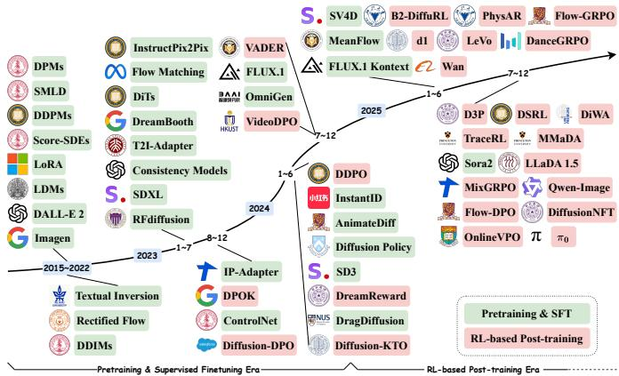  
Fig. 1. A complete timeline of the development of DMs. At present, DMs have already passed the “Pretraining & Supervised Finetuning” era and entered the “RL-based Post-training” era. Our survey focuses on the latest development stage and reviews recent work on RL for DMs.

human preferences or task objectives, thereby limiting their potential in complex reasoning and specialized generation scenarios. Specifically, the denoising process derived from imitation is primarily bound by static training-data distributions and the reconstruction-centric MSE loss, reaching a performance ceiling that prevents DMs from autonomously planning and exploring the optimal diffusion trajectory.

In recent years, reinforcement learning (RL) [4] has risen to prominence as a post-training strategy for human alignment in LLMs. As shown in Fig. 1, RL is also progressively incorporated into DMs in an attempt to address the above challenges. Widely utilized RL techniques such as Reinforcement Learning from Human Feedback (RLHF) [5] and Direct Preference Optimization (DPO) [6] further finetune pre-trained foundational DMs to follow complex instructions and embody human preferences, thereby enhancing semantic coherence and aesthetic value while maintaining diversity. More recently, a new trend has emerged: training DMs using reinforcement learning with verifiable rewards (RLVR), which generalizes DMs towards more specialized robot and science domains. RLVR aims not merely to align behavior but to incentivize DMs’ reasoning ability by incorporating explicit reward signals for dynamic, rule-based optimization. Furthermore, RLVR is typically accompanied by large-scale RL, and specifically, Group Relative Policy Optimization (GRPO) [7] can elicit sophisticated, long-form reasoning while markedly improving efficiency. To sum up, RL has led DMs into a “post-training era” which signals more intelligent, specialized, and versatile generation.

RL-driven DMs treat the denoising steps as the “thinking” trajectory to implicitly perform reasoning. This transformation manifests via three evolutionary shifts: First, the driving force transitions from reliance on statistical distributions in static pretraining data to experience-driven dynamic interactions with external environment, enabling direct maximization of arbitrarily formalizable reward signals. Second, the generation logic evolves from open-loop, singlepath imitation to closed-loop planning, reflection, and selfcorrection. RL empowers DMs to perform multi-trajectory scaling during inference and autonomously explore the optimal policy based on cumulative reward estimation, substantially enhancing capabilities in complex, long-horizon dependency tasks. Third, the optimization objectives undergo fundamental reshaping—from minimizing simple MSE loss to maximizing specific reward functions—thereby achieving alignment with human preferences or task utility.

Meanwhile, further scaling RL-driven DMs for practical deployments introduces new constraints beyond computational resources, including reward engineering, algorithm efficiency, and exploration-exploitation trade-offs. The pathways of effectively incorporating RL into DMs to achieve high-level generative intelligence and real-world utility remain significant, unanswered issues. Hence, we think that it is imperative to revisit and systematize this emerging domain and explore more scalable RL strategies to advance DMs towards more intelligent and general-purpose generators. Here we provide a comprehensive review as follows:

We first introduce the basic principles of standard (non-RL) DMs (§ 2.1) and the preliminary definitions of RL-driven DMs (§ 2.2) to illustrate the Markovian theoretic commonality of DMs and RL.

We introduce the paradigm of diffusion-based LLMs (dLLMs) (§ 3.1), including the masking/unmasking process and the ELBO objective, and review recent literature on RL-driven dLLMs along two orthogonal axes (§ 3.2): trajectory level and reward density.

We review recent RL-driven diffusion-based multimodal models (dMMs) from two different perspectives: 1) RL technology development (§ 4.1); and 2) RL-related multimodal tasks (§ 4.2).

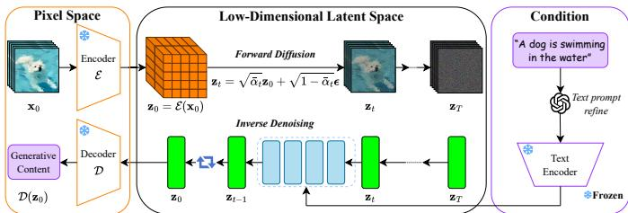  
Fig. 2. The overview of text-guided visual content generation.

We discuss the foundations of RL for diffusion in robotics (§ 5.1) and review two mainstream diffusionbased embodied intelligence studies, including diffusion policy-based RL training (§ 5.2) and generative experts in Vision-Language-Action models (§ 5.3).

We review recent advances in RL-driven diffusionbased scientific models from a novel perspective of data modality, including discrete molecular sequence (§ 6.1), continuous 3D structure (§ 6.2), periodic crystal structure (§ 6.3), continuous physics-constrained field (§ 6.4), and scientific imaging (§ 6.5).

• Finally, we discuss future research directions for robust, interpretable RL-diffusion systems.

This survey serves as a roadmap, highlighting potential avenues for future research and applications, and fostering a deeper comprehension of the challenges and opportunities that lie ahead in the promising domain of RL-driven DMs.

## 2 BACKGROUND AND PRELIMINARIES

## 2.1 Standard Diffusion: From Discrete to Continuous

Diffusion models (DMs) have emerged as the core backbone of modern generative AI. To provide context for RL-driven enhancements, we first briefly review their theoretical foundations, ranging from discrete-time probabilistic models to continuous-time score and flow generalizations.

## 2.1.1 Discrete-Time Paradigm: DDPMs

Denoising Diffusion Probabilistic Models (DDPMs) [1] generate data through a stochastic process analogous to thermodynamic diffusion, comprising a learning-free forward diffusion and a learnable reverse denoising process. Specifically, in the forward process, the initial data $\mathbf { x } _ { \mathrm { 0 } }$ is gradually transformed to standard Gaussian noise $\mathbf { x } _ { T } \sim \mathcal { N } ( 0 , \mathbf { I } )$ as

$$
q ( \mathbf { x } _ { t } | \mathbf { x } _ { t - 1 } ) : = \mathcal { N } ( \mathbf { x } _ { t } ; \sqrt { 1 - \beta _ { t } } \mathbf { x } _ { t - 1 } , \beta _ { t } \mathbf { I } ) .\tag{1}
$$

Based on this, the diffusion process from $\mathbf { x } _ { \mathrm { 0 } }$ to $\mathbf { x } _ { t }$ can be succinctly expressed via a single-step cumulative formula: $q ( \mathbf { x } _ { t } | \mathbf { x } _ { 0 } ) : = \mathcal { N } ( \mathbf { x } _ { t } ; \sqrt { \bar { \alpha } _ { t } } \mathbf { x } _ { 0 } , ( 1 - \bar { \alpha } _ { t } ) \bar { \mathbf { I } } )$ , where $\alpha _ { t } = 1 - \beta _ { t }$ and $\begin{array} { r } { \bar { \alpha _ { t } } = \prod _ { s = 1 } ^ { t } \alpha _ { s } } \end{array}$ . Moreover, the reverse process recovers samples from noise $\mathbf { x } _ { T } \sim \mathcal { N } ( 0 , \mathbf { I } )$ by approximating inverse transitions $p _ { \theta } ( \mathbf { x } _ { t - 1 } | \mathbf { x } _ { t } ) : = \mathcal { N } ( \mu _ { \theta } ( \mathbf { x } _ { t } , t ) , \pmb { \Sigma } _ { \theta } ( \mathbf { x } _ { t } , t ) )$ . Training minimizes the noise-prediction objective, which can be simplified to a mean square error form as

$$
L _ { \mathrm { s i m p l e } } ( \theta ) = \mathbb { E } _ { t , \mathbf { x } _ { 0 } , \epsilon } \big [ \| \epsilon - \epsilon _ { \theta } \big ( \sqrt { \bar { \alpha } _ { t } } \mathbf { x } _ { 0 } + \sqrt { 1 - \bar { \alpha } _ { t } } \epsilon , t \big ) \| _ { 2 } ^ { 2 } \big ] .\tag{2}
$$

Latent Diffusion Models (LDMs) [2] further apply this process in a compressed latent space to enhance efficiency. Fig. 2 visualizes the text-guided generation process of LDMs.

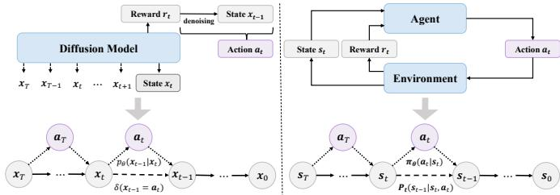  
Fig. 3. A schematic comparison of the diffusion model denoising process and the RL problem formulated as an MDP.

## 2.1.2 Continuous Generalization: Score and Flow Matching

DDPMs [1] can be theoretically unified by score matching (SM) [8] and flow matching (FM) [9], which both treat generation as continuous-time dynamics. Notably, the noiseprediction loss is equivalent to estimating the score function $\nabla _ { \mathbf { x } _ { t } } \log { q ( \mathbf { x } _ { t } ) }$ . The reverse-time SDE recovers data via

$$
\mathrm { d } \mathbf { x } _ { t } = \big [ f ( \mathbf { x } _ { t } , t ) - g ^ { 2 } ( t ) \nabla _ { \mathbf { x } _ { t } } \log q ( \mathbf { x } _ { t } ) \big ] \mathrm { d } t + g ( t ) \mathrm { d } \bar { \mathbf { w } } .\tag{3}
$$

To generalize this, flow matching constructs a deterministic probability flow via a vector field $v _ { t } ,$ transforming a prior p0 to data $q ( x )$ ). During training, it minimizes the distance between the learned vector field $v _ { t } ( x ; \theta )$ and a target $u _ { t } ( x | x _ { 1 } )$ constructed via Conditional Flow Matching (CFM):

$$
\begin{array} { r } { \mathcal { L } _ { \mathrm { C F M } } ( \theta ) = \mathbb { E } _ { t , x _ { 1 } \sim q , x \sim p _ { t } ( x | x _ { 1 } ) } \| v _ { t } ( x ; \theta ) - u _ { t } ( x | x _ { 1 } ) \| _ { 2 } ^ { 2 } . } \end{array}\tag{4}
$$

Rectified Flow [3] simply defines the “noised” data $x _ { t }$ as $x _ { t } = ( 1 - t ) x _ { 0 } + t x _ { 1 }$ and directly regresses the velocity field $v _ { t } ( x ; \theta )$ via eq. 4, where the target velocity field is $x _ { 1 } - x _ { 0 }$

## 2.2 Reinforcement Learning-driven Diffusion Models

## 2.2.1 Why Do Diffusion Models Require RL?

RL provides a principled way to optimize DMs via rewards by treating the model as a policy guided by human feedback or task-specific signals. This enables explicit alignment of generation with desired objectives. An alternative is rewardweighted finetuning, which biases the model towards highreward samples via a learned reward estimator ${ \hat { r } } ( x )$

$$
\mathbb { E } _ { t , \mathbf { x } _ { 0 } \sim q ( \mathbf { x } _ { 0 } ) , \epsilon \sim \mathcal { N } ( 0 , \mathbf { I } ) } [ \hat { r } ( x _ { 0 } ) \lVert \epsilon - \epsilon _ { \boldsymbol { \theta } } ( \sqrt { \bar { \alpha } _ { t } } \mathbf { x } _ { 0 } + \sqrt { 1 - \bar { \alpha } _ { t } } \epsilon , t ) \rVert _ { 2 } ^ { 2 } ] .\tag{5}
$$

However, it struggles to discover out-of-distribution (OOD) solutions and typically requires paired data $c ^ { i } , x ^ { i }$ for conditional models, limitations that RL avoids by directly optimizing the reward functions. Similarly, rejection sampling selects high-reward outputs from a pre-trained model but is effective only if such samples already have sufficient probability, whereas RL actively updates the model parameters to generate high-reward samples efficiently.

Beyond these alternatives, RL can directly optimize nondifferentiable or sparse rewards, align with the sequential structure of diffusion by treating each denoising step as a policy action, and allow flexible reward design that carries human feedback or task-specific objectives. By combining exploration and reward-driven post-training, RL effectively guides DMs towards better alignment with downstream tasks, OOD generalization, and autonomous reasoning.

## 2.2.2 Preference-Based RL Optimization

Preference-based RL effectively aligns DMs with user intent when struggling to define explicit rewards, using pairwise or ranking feedback as a proxy reward for policy updates.

Specifically, RLHF [5] trains a reward model $r _ { \phi }$ from preference triples $\left( c , y _ { A } , y _ { B } \right)$ via a Bradley-Terry likelihood, producing a dense proxy for human feedback. The entire process typically involves supervised pretraining, reward model training, and preference-alignment optimization:

$$
\begin{array} { r l } & { \mathcal { L } _ { R M } = - \displaystyle \sum _ { ( c , y _ { A } , y _ { B } ) } \Big [ y \log \sigma \big ( r _ { \phi } ( c , y _ { A } ) - r _ { \phi } ( c , y _ { B } ) \big ) } \\ & { ~ + ( 1 - y ) \log \sigma \big ( r _ { \phi } ( c , y _ { B } ) - r _ { \phi } ( c , y _ { A } ) \big ) \Big ] . } \end{array}\tag{6}
$$

DPO [6] aligns models directly with pairwise preference data without an explicit reward model. Given a prompt c and pairwise preference $( y _ { A } , y _ { B } )$ , it optimizes

$$
\begin{array} { r } { \mathcal { L } _ { \mathrm { { D P O } } } = - \mathbb { E } _ { c , y _ { A } , y _ { B } } \left[ \log \sigma ( \beta \Delta _ { \theta } ( c , y _ { A } , y _ { B } ) ) \right] , } \\ { \Delta _ { \theta } ( c , y _ { A } , y _ { B } ) = \log \frac { \pi _ { \theta } ( y _ { A } | c ) } { \pi _ { \theta _ { \mathrm { r e f } } } ( y _ { A } | c ) } - \log \frac { \pi _ { \theta } ( y _ { B } | c ) } { \pi _ { \theta _ { \mathrm { r e f } } } ( y _ { B } | c ) } . } \end{array}\tag{7}
$$

For image-generating diffusion models, this encourages

$$
\pi _ { \theta } ( y ^ { + } | c ) > \pi _ { \theta } ( y ^ { - } | c )\tag{8}
$$

while keeping πθ close to the reference model $\pi _ { \mathrm { r e f } }$

## 2.2.3 Policy-Based RL Optimization

While RLHF [5] has been widely adopted for human alignment, finetuning DMs is more naturally cast as an RLVR problem by regarding the denoising trajectory as a Markov Decision Process (MDP) [10; 11; 12]. As depicted in Fig. 3, each denoising step corresponds to an action, and the entire generative trajectory forms a decision-making sequence.

Formally, an MDP is defined as $\{ \mathcal { S } , \mathcal { A } , \{ P _ { t } \} , \{ r _ { t } \} , p _ { 0 } \} _ { \ r }$ where $s$ denotes the state space, A the action space, $P _ { t }$ the transition dynamics, $r _ { t }$ the reward function, and $p _ { 0 }$ the initial state distribution. A policy $\pi _ { t } : S  A$ maps states to actions, and RL maximizes the expected cumulative reward:

$$
\mathbb { E } _ { \pi } \left[ \sum _ { t = 0 } ^ { T } r _ { t } ( s _ { t } , a _ { t } ) \right] .\tag{9}
$$

When casting DMs into this RL framework, both states and actions lie in the model input space X. The transition dynamics are deterministic, following the pre-defined denoising schedule. Importantly, under this RLVR paradigm, rewards are assigned solely at the terminal step and are derived from verifiable criteria $( e . g .$ ., rule-based checks or automated evaluators), thereby ensuring objective and stable optimization signals. The policy $\pi _ { t }$ corresponds to the denoising distribution $p ( \mathbf { x } _ { T - t } | \mathbf { x } _ { T + 1 - t } )$ , while the initial state distribution $p _ { 0 }$ matches the Gaussian prior $p ( \mathbf { x } _ { T } )$

This formulation tightly aligns RL optimization with the stepwise structure of diffusion-based generation, enabling policy improvement via trajectory-level, verifiable feedback. In practice, policy-based algorithms such as PPO [13] and GRPO [7] can be adopted to optimize the denoising policy under the RLVR objective. Specifically, PPO [13] is a policygradient approach that effectively balances training stability and simplicity by constraining update magnitudes through a clipped surrogate objective. For the probability ratio

$$
r _ { t } ( \theta ) = { \frac { \pi _ { \theta } ( a _ { t } \mid s _ { t } ) } { \pi _ { \theta _ { \mathrm { o l d } } } ( a _ { t } \mid s _ { t } ) } } ,\tag{10}
$$

PPO [13] replaces the standard objective $\mathbb { E } [ r _ { t } ( \theta ) \hat { A } _ { t } ]$ with a

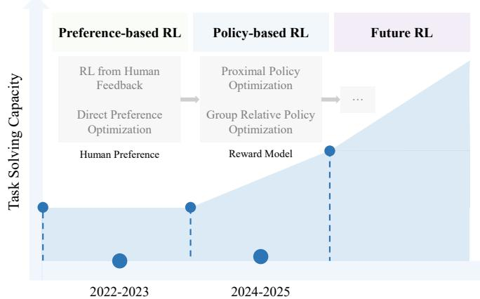  
Fig. 4. RL for DMs includes preference-/policy-based optimization.

clipped version, which can be expressed as

$$
\begin{array} { r } { \mathcal { L } ^ { \mathrm { C L I P } } ( \theta ) = \mathbb { E } \big [ \operatorname* { m i n } ( r _ { t } ( \theta ) \hat { A } _ { t } , \mathrm { c l i p } ( r _ { t } ( \theta ) , 1 - \epsilon , 1 + \epsilon ) \hat { A } _ { t } ) \big ] , } \end{array}\tag{11}
$$

where the advantage $\hat { A } _ { t }$ is typically estimated via Generalized Advantage Estimation (GAE) [14] using

$$
\delta _ { t } = r _ { t } + \gamma V ( s _ { t + 1 } ) - V ( s _ { t } ) , \quad \hat { A } _ { t } = \delta _ { t } + \gamma \lambda \hat { A } _ { t + 1 } ,\tag{12}
$$

which provides a tunable bias–variance trade-off. Notably, the corresponding return is $\hat { G } _ { t } = \hat { A } _ { t } + V ( s _ { t } )$

Moreover, GRPO [7] is another policy-gradient method originally developed for LLM finetuning and can be naturally extended to diffusion RL. Unlike standard actor-critic methods, GRPO [7] removes the separate value network and computes group-relative advantages across multiple outputs for the same condition c. For $\breve { G }$ outputs $\big \{ o _ { 1 } , \dotsc , o _ { G } \big \}$ with corresponding rewards $\{ r _ { 1 } , \hdots , r _ { G } \}$ , we have

$$
\mu = \frac { 1 } { G } \sum _ { i = 1 } ^ { G } r _ { i } , \quad \sigma = \sqrt { \frac { 1 } { G } \sum _ { i = 1 } ^ { G } ( r _ { i } - \mu ) ^ { 2 } , \quad \hat { A } _ { i } = \frac { r _ { i } - \mu } { \sigma } } .\tag{13}
$$

Similar to PPO [13], GRPO [7] maximizes a clipped surrogate objective with optional KL regularization to a reference policy $\pi _ { \mathrm { r e f } }$ . The adjusted objective is as follows:

$$
\begin{array} { l } { \displaystyle \mathcal { I } _ { \mathrm { G R P O } } ( \theta ) = \mathbb { E } _ { c , \{ o _ { i } \} \sim \pi _ { \theta _ { \mathrm { o l d } } } } \left[ \frac { 1 } { G } \sum _ { i = 1 } ^ { G } \frac { 1 } { | o _ { i } | } \sum _ { t = 1 } ^ { | o _ { i } | } \operatorname* { m i n } \left( \frac { \pi _ { \theta } ( o _ { i , t } \mid c , o _ { i , < t } ) } { \pi _ { \theta _ { \mathrm { o l d } } } ( o _ { i , t } \mid c , o _ { i , < t } ) } \hat { A } _ { i } , \right. \right. } \\ { \displaystyle \left. \left. \mathrm { c l i p } \left( \frac { \pi _ { \theta } ( o _ { i , t } \mid c , o _ { i , < t } ) } { \pi _ { \theta _ { \mathrm { o l d } } } ( o _ { i , t } \mid c , o _ { i , < t } ) } , 1 - \varepsilon , 1 + \varepsilon \right) \hat { A } _ { i } \right) \right] } \\ { \displaystyle \qquad - \beta D _ { \mathrm { K L } } ( \pi _ { \theta } | | \pi _ { \mathrm { r e f } } ) . } \end{array}\tag{14}
$$

By using group-relative advantages, GRPO [7] provides a lightweight, stable alternative to PPO [13] for generative RL. Fig. 4 visually presents the development of RL for DMs.

## 3 RL FOR DIFFUSION LARGE LANGUAGE MODELS 3.1 Preliminaries of Diffusion-based LLMs

Diffusion-based LLMs (dLLMs) have emerged as a promising non-autoregressive alternative to traditional autoregressive (AR) transformers for text generation [15; 16; 17; 18; 19]. They treat text generation as an iterative unmasking trajectory, thereby enhancing controllability $( e . g .$ , output length) and enabling non-sequential intermediate steps [20]. Here we outline the generation process of dLLMs as follows:

Inverse Unmasking Process. Unlike AR methods, dLLMs generate all tokens in parallel via iterative unmasking [21; 22]. Specifically, analogous to diffusion denoising, the unmasking process takes a completely masked state $\mathbf { x } _ { T }$ as input to generate text $\mathbf { x } _ { \mathrm { 0 } } . \mathbf { A } \mathbf { t }$ timestep t, the partially unmasked sequence $\mathbf { x } _ { t } = ( x _ { t } ^ { 1 } , x _ { t } ^ { 2 } , . . . , x _ { t } ^ { n } )$ is refined by filling masked tokens. Let $p _ { \theta } ( x _ { t } ^ { i } | \hat { \mathbf { x } } _ { t + 1 } , c , t )$ denote the model’s predicted probability for the i-th token at timestep t, where $\hat { \mathbf { x } } _ { t + 1 }$ represents the latent sequence variable predicted at timestep $t + 1$ . The joint probability is given by $p _ { \theta } ( \mathbf { x } _ { 0 } | c ) =$ $\begin{array} { r } { \prod _ { t = 0 } ^ { T - 1 } \dot { \prod } _ { i = 1 } ^ { n } p _ { \theta } ( x _ { t } ^ { i } | \hat { \mathbf { x } } _ { t + 1 } ^ { - } , \acute { c , t } ) } \end{array}$ [21].

Forward Masking Process. Moreover, the masking process corrupts tokens at timestep $t ~ \in ~ [ 0 , T ]$ according to a probability distribution function. Let a noise schedule $\bar { \alpha _ { t } \in [ 0 , 1 ] }$ denote the cumulative probability that a token remains unmasked by timestep t. As positions are corrupted independently, we have the conditional distribution $\begin{array} { r } { q _ { t | 0 } ( \mathbf { x } _ { t } | \mathbf { x } _ { 0 } ) \stackrel { \sim } { = } \prod _ { i = 0 } ^ { L } \dot { q _ { t | 0 } } ( x _ { t } ^ { i } | x _ { 0 } ^ { i } ) } \end{array}$ where

$$
\begin{array}{c} \begin{array} { r } { q _ { t | 0 } ( x _ { t } ^ { i } | x _ { 0 } ^ { i } ) = \left\{ { 1 - \alpha _ { t } } , \begin{array} { l l } { x _ { t } ^ { i } = \lceil { \mathrm { m a s k } } \rceil ; } \\ { \alpha _ { t } , } & { x _ { t } ^ { i } = x _ { 0 } ^ { i } . } \end{array} \right.} \end{array}   \end{array}\tag{15}
$$

We want to unmask an intermediate state s from a corrupted state $t \ ( s < \ t )$ . The conditional distribution of a partially corrupted sequence xs (compared to xt) is derived via case analysis and Bayes’ rule [15; 22; 23]:

$$
q _ { s | t } ( x _ { s } ^ { i } | \mathbf { x } _ { t } ) = \left\{ \begin{array} { l l } { 1 , \quad } & { x _ { t } ^ { i } \neq \mathrm { [ m a s k ] } , x _ { s } ^ { i } = x _ { t } ^ { i } ; } \\ { \frac { 1 - \alpha _ { s } } { 1 - \alpha _ { t } } , } & { x _ { t } ^ { i } = \mathrm { [ m a s k ] } , x _ { s } ^ { i } = \mathrm { [ m a s k ] } ; } \\ { \frac { \alpha _ { s } - \alpha _ { t } } { 1 - \alpha _ { t } } q _ { 0 | t } ( x _ { s } ^ { i } | x _ { t } ) , } & { x _ { t } ^ { i } = \mathrm { [ m a s k ] } , x _ { s } ^ { i } \neq \mathrm { [ m a s k ] } ; } \\ { 0 , } & { \mathrm { o t h e r w i s e } . } \end{array} \right.\tag{16}
$$

ELBO Objective. dLLMs are trained by maximizing the evidence lower bound (ELBO), aligning the reverse unmasking process $p _ { \theta }$ with the forward masking process $q .$ This can be written as minimizing the KL divergence between $p _ { \theta } ( x _ { t } ^ { i } | \mathbf { x } _ { t + 1 } , c )$ and $q _ { t | t + 1 } \big ( x _ { t } ^ { i } | \mathbf { x } _ { t + 1 } , x _ { 0 } ^ { i } \big )$ . Assuming absorbing transition [24; 25; 26], the token-level ELBO optimization objective for a given data example [27] is

$$
\mathcal { L } ( \theta ) = \mathbb { E } \underset { \underset { \mathbf { x } _ { 0 } \sim p _ { d a t a } } { \mathbf { \Delta } _ { t } \sim U [ 0 , 1 ] } } { \underbrace { t \sim U [ 0 , 1 ] } } \left[ \frac { 1 } { t } \sum _ { \underset { \substack { \substack { \substack { \substack { \substack { \mathbf { x } _ { t } } = [ \mathrm { m a s k } } ] } } } } { \mathbf { \Delta } _ { t } ^ { i } = [ \mathrm { m a s k } ] } } \log p _ { \theta } ( x _ { 0 } ^ { i } \mid \mathbf { x } _ { t } ) \right] .\tag{17}
$$

which intuitively trains the model to predict the original token $x _ { 0 } ^ { i }$ for every masked position at a random timestep t. Overview of Training and Inference. Using LLaDA [15] as an example, it involves three stages: 1) Pre-training: training on text with randomly masked tokens, where the masking ratio is determined by $t \sim U [ 0 , 1 ]$ . 2) SFT: similar to 1) but merely randomly masking response tokens in structured “instruction-response” pairs. 3) Sampling: simulating a diffusion process from $t = 1$ (masked) to $t = 0$ (unmasked).

## 3.2 The Role of RL in Diffusion-based LLMs

While RL has proven effective for fine-tuning AR LLMs [28; 29], its integration requires rethinking credit assignment due to non-AR generation via iterative unmasking, especially how to estimate logits, policy, and loss. We originally categorize existing RL4dLLMs along two orthogonal axes that directly address this adaptation: trajectory level (defining the granularity of credit assignment) and reward density (specifying the distribution of supervisory signals).

Trajectory Level characterizes the granularity at which policy updates assign credit to likelihood terms. For a dLLM policy inducing a trajectory ${ \boldsymbol { \tau } } = ( s _ { 0 : T } , a _ { 0 : T } )$ over a discrete reverse-diffusion process, the loss function takes the form:

TABLE 1  
Summary of reinforcement learning methods for diffusion-based LLMs as of 2026.08.
<table><tr><td>Methods</td><td>Date</td><td>Backbone</td><td>Policy</td><td>Key Contributions</td><td>Primary Task</td><td>Links</td></tr><tr><td colspan="7">GRPO-Related Post Training &amp; Likelihood Estimation</td></tr><tr><td>d1 [22]</td><td>2025.04</td><td>LLaDA</td><td>On On</td><td>First policy-gradient RL for dLLMs; masked-prompt likelihood approx</td><td>Math/Logic Reasoning</td><td>à</td></tr><tr><td>DiffuCoder [30] 2025.06</td><td></td><td>Qwen-2.5-Coder</td><td>On</td><td>Complementary masks for low-variance token likelihood Weighted-likelihood objective; denominator-free update; much faster</td><td>Code Math Reasoning</td><td>à08</td></tr><tr><td>wd1 [26]</td><td>2025.07</td><td>LLaDA</td><td></td><td></td><td></td><td>àO</td></tr><tr><td>BGPO [31]</td><td>2025.10</td><td>LLaDA</td><td>On</td><td>Boundary-guided lower bound enabling large MC with constant memory</td><td>Math/Code/Planning</td><td>à08</td></tr><tr><td>DMPO [32]</td><td>2025.10</td><td>LLaDA</td><td>Off</td><td>Forward-KL via weighted denoising cross-entropy</td><td>Math Reasoning</td><td>à</td></tr><tr><td>GDPO [33]</td><td>2025.10</td><td>LLaDA</td><td>On</td><td>Semi-deterministic Monte Carlo for ELBO</td><td>Math Reasoning</td><td>à0</td></tr><tr><td>AGRPO [27]</td><td>2025.10</td><td>LLaDA</td><td>On</td><td>Unbiased MC per-timestep gradient without ad-hoc ratios</td><td>Math Reasoning</td><td>à</td></tr><tr><td>ESPO [34]</td><td>2025.12</td><td>LLaDA, Dream</td><td>On On</td><td>Entire sequence generation as a single action; ELBO as sequence-likelihood</td><td>Math/Code/Planning Math/Planning</td><td>à08</td></tr><tr><td>d-TreeRPO [35] 2025.12</td><td></td><td>LLaDA(-MoE) LLaDA, Dream,</td><td>Off</td><td>Tree rollouts for step-wise credit; time-scheduled self-distillation loss Flow-matching in token space without likelihood estimation</td><td>Math/Code</td><td>àO àO</td></tr><tr><td>LFPO [36] StableDRL [37] 2026.03</td><td>2026.03</td><td>DiffuCoder LLaDA, SDAR</td><td>On</td><td>Unconditional clipping + self-normalization stabilize RL updates</td><td>Math/Planning</td><td>àO</td></tr><tr><td>RSPO [38]</td><td>2026.05</td><td>LLaDA</td><td>On</td><td>Reward-implied target ratios calibrate noisy likelihood estimates</td><td>Math/Planning</td><td>日</td></tr><tr><td>GDSD [39]</td><td>2026.05</td><td>LLaDA, Dream</td><td>Off</td><td>Advantage-guided denoiser self-distillation without ELBO</td><td>Math/Code/Planning</td><td>àO8</td></tr><tr><td></td><td></td><td></td><td></td><td></td><td></td><td></td></tr><tr><td>d2 [40]</td><td>2025.09</td><td>LLaDA</td><td>On</td><td>AnyOrder unbiased estimator; StepMerge to merge diffusion steps</td><td>Reasoning; Infer Efficiency</td><td>à</td></tr><tr><td>IGPO [41]</td><td>2025.09</td><td>LLaDA</td><td>On</td><td>Inpainting hints inject partial CoT during online sampling</td><td>Math Reasoning</td><td>à</td></tr><tr><td>DiFFPO [42]</td><td>2025.10</td><td>LLaDA</td><td>Off</td><td>Off-policy surrogate + importance sampling; RL-trained inference budget</td><td>Math Reasoning; Sampler</td><td>à</td></tr><tr><td>dUltra [43]]</td><td>2025.12</td><td>LLaDA</td><td>On</td><td>Learned unmasking planner; rewards for accuracy and fewer steps</td><td>Math/Code</td><td>àOe</td></tr><tr><td>STP [44] ERILS [45]</td><td>2026.02</td><td>LLaDA</td><td>On Both</td><td>Prune token updates and late denoising steps for faster, stabler RL</td><td>Reasoning</td><td>àO</td></tr><tr><td>MAPG [46]</td><td>2026.08 2026.07</td><td>LLaDA</td><td></td><td>External policy rollouts expand exploration; separate reward rules</td><td>Math/Planning</td><td>à</td></tr><tr><td>LLaDA, Dream</td><td></td><td></td><td>On</td><td>dLLM generation as a MDP; joint policy gradients</td><td>Math/Code/Planning</td><td>àO</td></tr><tr><td colspan="7">Human Preference Alignment</td></tr><tr><td>LLaDA 1.5 [47] 2025.05</td><td></td><td>LLaDA</td><td>Off</td><td>Variance-reduced preference optimization; Antithetic sampling</td><td>Alignment + Reasoning</td><td>à0e</td></tr><tr><td>ELBO-KTO [48] 2025.10</td><td></td><td>LLaDA</td><td>Off</td><td>ELBO-based preference alignment using unpaired like/dislike feedback</td><td>Alignment + Reasoning</td><td>àO</td></tr><tr><td colspan="7">Boosting Reasoning Abilities</td></tr><tr><td>DCoLT [20]</td><td>2025.05</td><td>SEDD, LLaDA</td><td>On</td><td>Optimize whole latent reasoning chain (lateral thought)</td><td>Math/Code</td><td>à08</td></tr><tr><td>MDPO [49]</td><td>2025.08</td><td>LLaDA</td><td>On</td><td>Progressive-schedule RL with intermediate rewards; RCR remasking</td><td>Bridging schedule mismatch</td><td></td></tr><tr><td>SAPO [50]</td><td>2025.10</td><td>LLaDA</td><td>On</td><td>Step-aware process reward aligning denoising hierarchy</td><td>Complex Reasoning</td><td>à</td></tr><tr><td colspan="7">Frameworks &amp; Pipeline improvements</td></tr><tr><td>TraceRL [51]</td><td></td><td></td><td>On</td><td>Trajectory-aware RL; Blocked diffusion &amp; attention</td><td>Math/Code; Framework</td><td>à0e</td></tr><tr><td>RFG [52]</td><td>2025.09 2025.09</td><td>Dream, SDAR LLaDA, Dream</td><td>N/A</td><td>Log-likelihood ratio guidance of enhanced &amp; ref dLLM</td><td>Math/Code at inference time</td><td>à</td></tr><tr><td>SPG [53]</td><td>2025.10</td><td>LLaDA</td><td>On</td><td>ELBO/EUBO sandwich + block-wise masking</td><td>Math/Code Reasoning</td><td>à</td></tr><tr><td>DiRL [54]</td><td>2025.12</td><td>SDAR</td><td>On</td><td>Unbiased logits of blockwise dLLM; FlexAttention</td><td>Math</td><td>à</td></tr><tr><td>DARE [55]</td><td></td><td>2026.04 LLaDA,Dream,SDARBoth</td><td></td><td>Unified RL training and evaluation across masked and blockwise dLLMs</td><td>Math/Code; Framework</td><td>àO</td></tr></table>

$$
\mathcal { L } ( \pi _ { \theta } ) \sim \left\{ \begin{array} { l l } { \sum _ { t } \mathbb { E } \left[ \ell _ { \theta } ( a _ { t } \mid s _ { t } ) \right] , } & { \mathrm { t o k e n - l e v e l ; } } \\ { \sum _ { k } \mathbb { E } \left[ \ell _ { \theta } ( a _ { u _ { k } : v _ { k } } \mid s _ { u _ { k } : v _ { k } } ) \right] , } & { \mathrm { p h r a s e - l e v e l ; } } \\ { \mathbb { E } \left[ \ell _ { \theta } ( a _ { 0 : T } \mid s _ { 0 : T } ) \right] , } & { \mathrm { s e q u e n c e - l e v e l , } } \end{array} \right.
$$

where $\left\{ \left( { { u } _ { k } } , { { v } _ { k } } \right) \right\}$ are masked spans and $\ell _ { \theta }$ denotes a surrogate loss $( e . g .$ , ELBO-based objective, GRPO-based objective, likelihood ratio, or policy gradient). Specifically, token-level methods apply GRPO-style policy gradients to token-wise log-probabilities, which depend on individual token probability. Phrase-level methods treat contiguous masked spans (e.g., reasoning clauses, code snippets) as atomic units. Even when final updates are sequence-level, many studies focus on phrase granularity via explicit inpainting of partial traces or masked phrases. Sequence-level methods, by contrast, optimize the full reverse trajectory, with advantages typically derived from holistic outcome rewards (e.g., verifier scores).

Reward Density characterizes the distribution of supervisory signals across the trajectory via

$$
R ( \tau ) \sim \left\{ \begin{array} { l l } { r _ { T } , } & { \mathrm { S i n g l e ~ M a x i m u m ~ ( O u t c o m e ~ R M ) } ; } \\ { r _ { T } ^ { + } - r _ { T } ^ { - } , } & { \mathrm { D o u b l e \mathrm { - } p o l a r } ; } \\ { \frac { 1 } { T } \sum _ { t = 1 } ^ { T } w _ { t } r _ { t } , } & { \mathrm { M e a n ~ R e w a r d } ; } \\ { \left\{ r _ { t , k } \right\} , } & { \mathrm { D e n s e ~ ( P r o c e s s ~ R M ) } , } \end{array} \right.
$$

where $r _ { T }$ is an Outcome Reward Model (ORM) computed only from the final output and $\{ r _ { t } \}$ is stepwise Process Reward Models (PRMs) that provide dense feedback. Specifically, Single Maximum RL maximizes the terminal reward $r _ { T } ,$ optimizing the advantage $A _ { i }$ via GRPO [7], i.e., min $\left( \bar { \rho _ { i } } ^ { t } A _ { i } , \mathrm { c l i p } \left( \bar { \rho _ { i } } ^ { t } , \bar { 1 - \varepsilon } , 1 + \varepsilon \right) A _ { i } \right)$ . Double-polar methods use a bipartite objective to steer sequences toward preferred outcomes. Mean reward models aggregate stepwise weighted rewards. Dense reward models provide intermediate supervision $\boldsymbol { r } _ { t , k }$ across steps t and sample groups N.

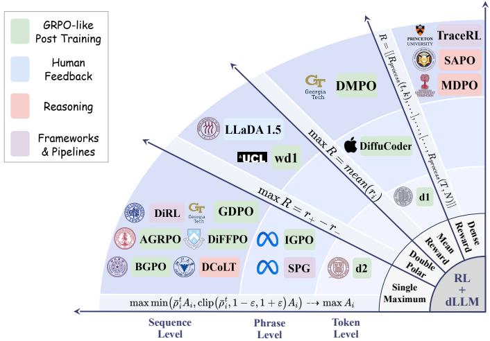  
Fig. 5. An overview of representative works on RL4dLLMs.

Fig. 5 visualizes this taxonomy as a 2D coordinate chart, where representative RL methods are organized by trajectory level and reward density. Complementarily, Table 1 summarizes methods and Table 2 compares benchmark performance. Below, we review these developments by technical insights and target use cases.

## 3.2.1 GRPO-Related Post Training

Efficient policy gradient estimation for dLLMs requires accurate computation of per-token and sequence completion probability, which is a computationally intensive challenge. Recent methods have extended GRPO [7] to address this, with key advances summarized below.

Variance-Reduced Likelihood Estimation. d1 [22], the first application of policy gradient with masked prompts, randomly masks portions of the input prompt q (yielding q′) while keeping the completion fully masked. Each training epoch runs n iterations of this process, unmasking only one timestep per iteration to estimate per-token log probability $\phi ^ { \pi _ { \theta } } ( o ^ { k } | \hat { q } ^ { \prime } )$ and then optimize GRPO’s [7] policy gradient objective. Despite effective fine-tuning for math and logical reasoning, estimation error may induce high variance.

To effectively reduce variance, DiffuCoder [30] samples paired completions for each batch with a complementary masking pattern (i.e., high-confidence tokens in one completion are masked in the other) and then averages loglikelihoods over the two trajectories to cancel maskinginduced noise. Apart from this, wd1 [26] reformulates RL into a double-polar objective, where completions with higher advantage get larger weight. It requires merely current-model per-token probabilities πθ instead of old or reference policy probabilities $( \pi _ { \theta _ { \mathrm { o l d } } } / \pi _ { \mathrm { r e f } } )$ in importanceweighted gradients. In short, this mechanism avoids highvariance importance sampling, reduces denominator bias, and allows direct RL fine-tuning from scratch.

Other methods further refine estimation: BGPO [31] constructs a tight ELBO for larger Monte Carlo (MC) samples and more accurate likelihood approximations; DMPO [32] aligns the dLLM policy with the reward-tilted distribution via cross-entropy optimization; GDPO [33] employs Semideterministic MC to curb ELBO variance; AGRPO [27] treats token summation as an expectation over the diffusion timesteps t and derives a policy gradient estimator via MC sampling to avoid heuristic likelihood ratios; SEPO [56] uses importance sampling through gradient flow; and d-TreeRPO [35] structure rollouts as a tree to compute advantage and propose a time-scheduled self-distillation objective. Speed-Performance Trade-off Optimization. DiFFPO [42] targets efficiency through 1) an off-policy RL paradigm with a surrogate policy (using two-stage likelihood approximation with importance-sampling correction) and 2) an RLtrained controller that dynamically sets budget thresholds per prompt, thereby reducing denoising steps. d2 [40] introduces d2-StepMerge (merging diffusion steps for computational savings) and d2-AnyOrder (an attention-inspired mechanism requiring any-order causality during decoding). More recently, dUltra [43] introduces an unmasking planner head for superior accuracy-efficiency trade-offs, STP [44] compresses the redundancy through pruning the sequence length for ELBO, as well as refinement steps.

Knowledge-Enhanced Sampling. IGPO [41] injects partial ground-truth reasoning traces (e.g., initial solution steps) into the unmasking trajectory as hints during sampling. This

## TABLE 2

Quantitative comparison of benchmark results for RL+dLLM methods. The values are rounded to three decimal places. For tasks with multiple

sequence length evaluations, the best reported result is selected. Notably, † denotes third-party results. Other results are obtained from the original paper, where the best result across all reported evaluation protocols is chosen. The best and the second-best results of dLLMs in each column are demonstrated in green and gray .

<table><tr><td colspan="7">Methods GSM8K MATH500 Countdown Sudoku HumanEval MBPP</td></tr><tr><td colspan="7">Non-RL diffusion-based LLMs</td></tr><tr><td>LLaDA-8B-Instruct [15]</td><td>78.2† 36.2†</td><td></td><td>20.7†</td><td>11.7†</td><td>49.4</td><td>41.0</td></tr><tr><td colspan="7">RL-driven diffusion-based LLMs</td></tr><tr><td>d1 [22]</td><td>82.1</td><td>40.2</td><td>42.2</td><td>22.1</td><td>39.0</td><td>45.5</td></tr><tr><td>DiffuCoder [30]</td><td>N/A</td><td>N/A</td><td>N/A</td><td>N/A</td><td>73.2</td><td>78.6</td></tr><tr><td>wd1 [26]</td><td>82.3</td><td>39.0</td><td>51.2</td><td>76.4</td><td>39.0</td><td>39.2</td></tr><tr><td>BGPO [31]</td><td>84.3</td><td>45.7</td><td>87.5</td><td>26.9</td><td>47.6</td><td>41.7</td></tr><tr><td>DMPO [32]</td><td>85.2</td><td>42.8</td><td>79.7</td><td>32.8</td><td>N/A</td><td>N/A</td></tr><tr><td>GDPO [33]</td><td>82.3</td><td>38.2</td><td>67.2</td><td>25.1</td><td>39.6</td><td>50.6</td></tr><tr><td>AGRPO [27]</td><td>88.1</td><td>42.0</td><td>82.4</td><td>95.2</td><td>N/A</td><td>N/A</td></tr><tr><td>ESPO [34]</td><td>83.7</td><td>43.4</td><td>82.0</td><td>92.7</td><td>50.0</td><td>47.4</td></tr><tr><td>d2 [40]</td><td>85.0</td><td>41.6</td><td>56.6</td><td>91.9</td><td>N/A</td><td>N/A</td></tr><tr><td>IGPO [41]</td><td>86.4</td><td>47.4</td><td>N/A</td><td>N/A</td><td>N/A</td><td>N/A</td></tr><tr><td>DiFFPO [42]</td><td>83.5</td><td>38.6</td><td>59.0</td><td>45.7</td><td>N/A</td><td>N/A</td></tr><tr><td>LLaDA 1.5 [47]</td><td>83.3</td><td>35.8†</td><td>26.2†</td><td>15.2†</td><td>52.4</td><td>42.8</td></tr><tr><td>DCoLT [20]</td><td>88.1</td><td>N/A</td><td>N/A</td><td>N/A</td><td>59.1</td><td>51.6</td></tr><tr><td>MDPO [49]</td><td>N/A</td><td>38.6</td><td>70.7</td><td>N/A</td><td>N/A</td><td>N/A</td></tr><tr><td>SAPO [50]</td><td>82.2</td><td>40.0</td><td>56.3</td><td>22.4</td><td>N/A</td><td>N/A</td></tr><tr><td>TraDo-8B-Thinking [51]</td><td>94.2</td><td>87.4</td><td>N/A</td><td>N/A</td><td>N/A</td><td>N/A</td></tr><tr><td>SPG [53]</td><td>86.1</td><td>41.8</td><td>71.5</td><td>94.0</td><td>41.5</td><td>50.6</td></tr><tr><td>DiRL-8B-Instruct [54]</td><td>93.1</td><td>85.1</td><td>N/A</td><td>N/A</td><td>N/A</td><td>N/A</td></tr><tr><td>d-TreeRPO [35]</td><td>82.6</td><td>46.3</td><td>71.1</td><td>92.9</td><td>N/A</td><td>N/A</td></tr><tr><td>dUltra [43]</td><td>81.5</td><td>35.6</td><td>N/A</td><td>N/A</td><td>36.8</td><td>39.1</td></tr><tr><td>STP [44]</td><td>81.0</td><td>36.6</td><td>66.0</td><td>N/A</td><td>N/A</td><td>N/A</td></tr><tr><td>ERILS [45]</td><td>N/A</td><td>40.2</td><td>73.8</td><td>91.7</td><td>N/A</td><td>N/A</td></tr><tr><td>LFPO [36]</td><td>79.6</td><td>N/A</td><td>N/A</td><td>N/A</td><td>75.6</td><td>81.6</td></tr><tr><td>StableDRL [37]</td><td>92.4</td><td>79.2</td><td>84.8</td><td>92.4</td><td>N/A</td><td>N/A</td></tr><tr><td>RSPO [38]</td><td>82.6</td><td>42.1</td><td>78.8</td><td>92.1</td><td>N/A</td><td>N/A</td></tr><tr><td>GDSD [39]</td><td>86.4</td><td>44.6</td><td>85.6</td><td>92.0</td><td>45.7</td><td>43.6</td></tr><tr><td>Mask-Aware PG [46]</td><td>87.1</td><td>52.9</td><td>71.4</td><td>96.2</td><td>44.0</td><td>53.4</td></tr><tr><td>ELBO-KTO [48]</td><td>82.8</td><td>N/A</td><td>N/A</td><td>N/A</td><td>42.7</td><td>N/A</td></tr><tr><td colspan="7">Non-dLLM baselines</td></tr><tr><td>Qwen2.5-7B-Instruct [57]</td><td>91.6</td><td>72.8†</td><td>6.2†</td><td>21.0†</td><td>84.8</td><td>79.2</td></tr><tr><td>GPT-4o [58]</td><td>92.9†</td><td>76.6†</td><td>N/A</td><td>N/A</td><td>90.2</td><td>86.8†</td></tr><tr><td>GPT o4-mini</td><td>99.0†</td><td>98.2†</td><td>N/A</td><td>N/A</td><td>97.3†</td><td>94.9†</td></tr></table>

avoids wasted samples on non-rewarding intermediate sequences and significantly increases the probability of highreward completions, thereby boosting training efficiency. Moreover, ERILS [45] addresses weak on-policy exploration by incorporating higher-reward rollouts from a stronger external policy.

## 3.2.2 Beyond Standard Token-level GRPO

In order to adapt RL to dLLM, there are also emerging methods to escape the computation of per-token probability and group advantage. For instance, ESPO [34] treats the entire generated sequence as a single action and uses the ELBO as a sequence-likelihood proxy; LFPO [36] maps flow matching to discrete token space and directly optimizes denoising logits; StableDRL [37] introduces unconditional clipping and self-normalization to stabilize optimization; RSPO [38] calibrates noisy likelihood estimates using reward-implied target ratios; GDSD [39] derives an advantage-guided selfteacher from reverse-KL-regularized RL and directly distills the denoiser; and Mask-Aware Policy Gradients [46] formulate the generation process as a two-stage action MDP.

## 3.2.3 Aligning with Human Feedback

A critical advancement involves aligning dLLMs with human preference, analogous to RLHF in traditional AR methods [59]. LLaDA 1.5 [47] proposes VRPO to mitigate high variance in gradient estimates arising from ELBO approximations while aligning with human feedback. Specifically, VRPO employs three strategies for unbiased variance reduction: 1) increasing the number of samples for gradient estimation, 2) allocating the full budget to timesteps, and 3) sharing timesteps and masks across policies. In contrast, ELBO-KTO [48] uses unpaired feedback to reduce dependence on costly preference pairs.

## 3.2.4 Advancing Chain-of-Thought Reasoning Abilities

dLLMs treat intermediate generation steps as latent reasoning states rather than byproducts of text decoding. Recent RL-based methods have optimized entire Chain-of-Thought (CoT) trajectories for complicated reasoning. DCoLT [20] reframes the unmasking process as a latent thinking sequence with outcome-based CoT optimization and then utilizes top-K ranking to predict unmasking positions during inference. SAPO [50] addresses the flawed reasoning in outcome-based RL using a process-based reward to evaluate incremental progress between two timesteps—a larger reward difference indicates a greater contribution to the answer, thereby aligning unmasking steps with the latent reasoning hierarchy. Beyond reward maximization, DMPO [32] enhances CoT through distribution matching, avoiding per-token likelihood estimation via a weighted denoising cross-entropy loss (an off-policy implementation of forward KL).

## 3.2.5 RL-Adapted Frameworks

TraceRL [51] presents an RL framework that integrates a diffusion-based value model, TraDo, to reduce variance and enhance training stability. Rather than relying only on the final response, TraceRL derives rewards from intermediate traces generated by dLLMs and aggregates neighboring steps to align the post-training objective with the inference trajectory while utilizing blocked attention for efficient sliced training. To further improve efficiency and effectiveness, DiRL [54] employs unbiased GRPO and FlexAttention in its framework. Besides them, SPG [53] introduces EUBO, a provable log-likelihood upper bound, to penalize incorrect outputs and overcome ELBO’s one-sided limitation for negative rewards, augmented by a block-wise MC masking strategy. RFG [52] generates pseudo-reward signals via loglikelihood ratios between RL/SFT-enhanced and reference dLLMs, enabling reward-free trajectory biasing and outperforming both models without additional training. DARE [55] provides a unified post-training and evaluation framework for dLLMs.

## 4 RL FOR DIFFUSION MULTIMODAL MODELS

In addition to text generation, RL also empowers diffusionbased multimodal models (dMMs) to achieve complex, subjective objectives beyond what standard SFT can capture. By leveraging rewards from human feedback, aesthetic evaluators, or pretrained vision-language models, RL guides the generation process towards higher visual quality, semantic consistency, and cross-modal relevance. In this section, we review recent RL-driven dMMs from two different perspectives: 1) RL technology development, i.e., the evolution of task-solving capacity; 2) RL-related multimodal tasks.

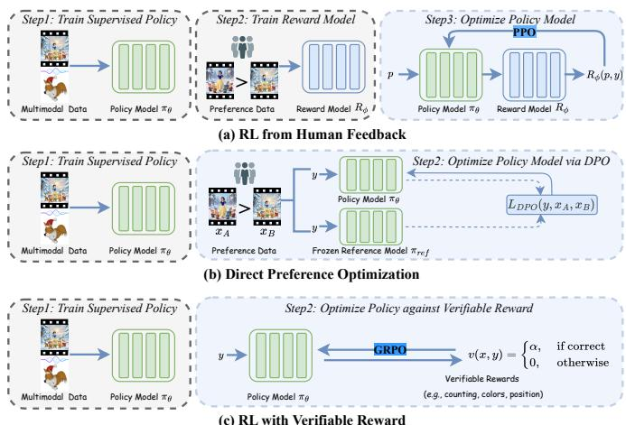  
Fig. 6. RLHF and DPO have been the two predominant RL methodologies for human alignment in recent years. In contrast, RLVR represents an emerging trend in RL for dMMs, significantly enhancing their capacity for complex task solving and scalable long-horizon reasoning.

## 4.1 Underlying RL Technology Development

The integration of RL into dMMs has become a promising paradigm for aligning probabilistic generation with human preferences and verifiable, task-specific goals. Existing RLdriven dMMs can be broadly grouped into three complementary categories: 1) Reward-based RLHF, which treats the denoising process as a stochastic policy and iteratively aligns outputs with aesthetic, semantic, or factual preferences using human-provided or proxy reward signals. 2) Reward-free DPO, which aligns model outputs with human preferences by directly comparing favored and disfavored samples without explicit policy-gradient updates, offering greater stability and sample efficiency compared to conventional RLHF. 3) Rule-based RLVR, which introduces scalable and reliable training signals from rule-based verifiable rewards to guide denoising, sampling, or policy generation. Refer to Fig. 6 for an overview of these three paradigms.

## 4.1.1 Reward-based RLHF

Traditional DMs are typically trained with reconstructiondriven objectives, such as noise prediction in DDPM [1] or velocity prediction in Rectified Flow [3]. While effective for low-level visual fidelity, these objectives provide limited supervision over semantic coherence and human-aligned aesthetics, revealing a gap between pixel-perfect generation and subjective human preferences. RLHF [5], adapted from LLMs like InstructGPT [59], addresses this gap by framing preference alignment as an optimization problem guided by human feedback, typically instantiated via preference datasets, learned reward models, and RL-based fine-tuning. And scalable human preference resources, such as SAC [60], multi-attribute annotations [61], PickScore [62], ImageReward [63], and HPSv2 [64], standardize evaluation and enable reward learning for visual generation. RLHF-based methods optimize DMs by maximizing learned reward signals, using policy gradient fine-tuning [65], Markov Decision Process interpretations of denoising trajectories [66], or direct reward-driven gradient propagation [67; 68], and have also been extended to multi-dimensional video generation [69]. Despite early success, reliance on static reward models and fixed feedback distributions can limit generalization and induce instabilities such as reward hacking, motivating the development of more robust and intrinsic alignment strategies beyond explicit reward optimization.

## 4.1.2 Reward-free DPO

DPO [6] addresses the limitations of static reward models in RLHF [5] by directly optimizing DMs via pairwise human preferences, simplifying training and improving stability. Conceptually, DPO [6] acts as an implicit RL framework, aligning distributions of preferred and dispreferred outputs without explicit reward estimation, reducing bias and enhancing sample efficiency. Specifically, extensions to diffusion tasks include Diffusion-DPO [70] for text-to-image generation, Diffusion-KTO [71] via KL-target optimization to remove reward modeling, VideoDPO [72] for temporal generation, and OnlineVPO [73] along with online preference collection for iterative alignment. Moreover, industrial-scale models such as Stable Diffusion 3 [74], MovieGen [75], HunyuanVideo [76], StepVideo [77], Cosmos [78], and Wan [79] further adopt RLHF or DPO post-training to improve alignment beyond pretraining. These advances mark a shift from reward-centric RL to preference-driven direct optimization. Notably, reliance on static preference data limits adaptability, driving exploration of dynamic and verifiable methods.

## 4.1.3 Rule-based RLVR

Existing human alignment methods, such as RLHF [5] and DPO [6], depend on static annotations or fixed reward models, which limit the optimization space and struggle with complex objectives like multi-attribute consistency, compositional constraints, or dynamic task rewards. To address these limitations, RL with verifiable and dynamic rewards has been proposed, incorporating external signals during or after sampling for adaptive, task-driven optimization. Introducing verifiable rewards shifts DMs from static alignment to dynamic optimization, though challenges arise from the deterministic and continuous nature of diffusion and flow matching. Existing solutions fall into three categories: probabilistic reparameterization, introducing learnable stochasticity for differentiable reward propagation (e.g., F5R-TTS [80]); sampling randomization and policy modeling, reformulating diffusion as a stochastic decision process for GRPOstyle trajectory optimization (e.g., Flow-GRPO [81], Dance-GRPO [82], MixGRPO [83]); and implicit policy improvement using structured reward guidance or energy-based formulations for interpretable optimization (e.g., Diffusion-NFT [84], Nabla-GFlowNet [85]). Post-training inference optimization frameworks such as ReNo [86] and SDPO [87], along with adaptive sampling control methods [88; 89], further demonstrate verifiable feedback without full retraining. Collectively, these advances mark a shift toward feedbackdriven, verifiable RL for diffusion-based generation.

## 4.2 RL-driven Diffusion Multimodal Tasks

The combination of RL and DMs provides a critical tool for fine-grained control across diverse modalities like image, video, 3D, and audio. Here we review how RL-based strategies are formulated to solve three multimodal tasks (Fig. 7): optimizing multimodal generation, enabling precise content editing, and fostering unified understanding and generation.

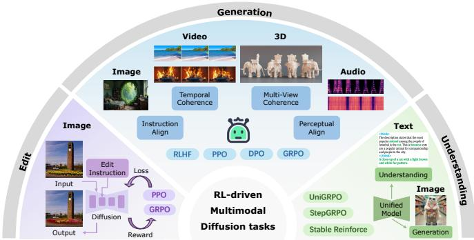  
Fig. 7. The overview of RL-driven diffusion multimodal tasks.

## 4.2.1 RL-driven Multimodal Generation

In multimodal generation, RL has been increasingly adopted as a general alignment and control tool for DMs beyond text-only conditions. This subsection reviews existing works according to the modality-specific challenges encountered in generative modeling and discusses how RL improves generation quality, controllability, and efficiency in different scenarios, including image, video, 3D, and audio.

RL for Image Generation. While controllable finetuning can effectively preserve low-level visual fidelity, the essentially passive imitation significantly limits DMs’ ability to follow complex, goal-oriented instructions. This leads the community to formalize three core tasks, each supported by a dedicated evaluation ecosystem: aesthetic alignment, assessed via pretrained reward models such as PickScore [62], ImageReward [63], and HPSv2 [64]; compositional reasoning, benchmarked by GenEval [90] and TIFA [91]; and inference acceleration, which characterizes the quality-efficiency trade-off. As shown in Table 3, we categorize existing methods according to their underlying optimization paradigms. And Table 5 summarizes paired base-to-aligned improvements reported in the original papers for representative image generation approaches on multiple widely used metrics.

For aesthetic alignment, the dominant framework is outcome-level alignment, i.e., global reward optimization, which treats the diffusion process as a black box and iteratively shifts the generation distributions towards highreward regions. Early methods rely on policy-gradient updates (e.g., DDPO [92]) or KL-regularized objectives (e.g., DPOK [65]) to optimize image-level rewards. While effective for black-box metrics, these high-variance updates are suboptimal when rewards are differentiable. In such cases, gradient-based optimization offers a lower-variance alternative. Methods like DRaFT [67] and AlignProp [68] backpropagate reward gradients directly through the denoising chain, employing techniques such as truncation and LoRA checkpoints to achieve efficient end-to-end finetuning. Subsequent works recognize preference alignment as a multiobjective problem: LargeRL [93] and DiverseRL [94] scale RL to millions of prompts with explicit diversity regularization, while Parrot [95] models the Pareto frontier between visual quality and semantic fidelity. Additionally, to address the potential mode collapse caused by reward maximization, ∇- GFlowNet [85] employs the gradient-informed GFlowNet objective to align samples with reward distributions, explicitly balancing high rewards and the generative prior.

Recent advances further emphasize algorithmic simplicity and training stability. Diffusion-DPO [70], HERO [97], and DSPO [96] eliminate the computational overhead of explicit reward modeling by adapting DPO [6] to the diffusion process. And Diffusion-KTO [71] explores the necessity of pairwise preference data and shows that alignment is achievable utilizing only unary (like/dislike) feedback, thereby simplifying data collection and avoiding complex reward design. Moreover, this paradigm has been extended to flowbased backbones, where Flow-GRPO [81], MixGRPO [83], and Multi-GRPO [128] apply GRPO [7] to continuous flow trajectories, thereby accelerating training and sampling. Pushing the flow-based paradigm further, Diffusion-NFT [84] proposes an online RL framework that performs policy improvement directly on the forward process of flow matching by contrasting positive and negative generations, thereby avoiding trajectory-based optimization. As demonstrated in Fig. 8, integrating RL yields massive gains in aesthetic alignment but still suffers from the inherent blackbox optimization illustrated by limited improvements on fine-grained logical tasks like text rendering (OCR).

TABLE 3  
Summary of reinforcement learning methods for image diffusion. We categorize methodologies by training strategy (Online/Offline) and feedback paradigm (RLHF, DPO, RLVR).
<table><tr><td rowspan="2">Methods</td><td colspan="2">Training Strategy</td><td colspan="2">Feedback Paradigm</td><td rowspan="2">Links</td></tr><tr><td>Online</td><td>Offline</td><td>RLHF DPO RLVR</td><td></td></tr><tr><td colspan="2">Outcome-level Alignment (Global Reward Optimization)</td><td></td><td></td><td></td><td></td></tr><tr><td></td><td></td><td></td><td></td><td></td><td></td></tr><tr><td>Diffusion-DPO [70]</td><td></td><td>√</td><td></td><td>√</td><td>àO àO</td></tr><tr><td>DPOK [65] DDPO [92]</td><td>√ √</td><td></td><td>√ √</td><td></td><td>à08</td></tr><tr><td>LargeRL [93]</td><td>√</td><td></td><td>√</td><td></td><td>à</td></tr><tr><td></td><td></td><td>√</td><td></td><td>√</td><td>À 0</td></tr><tr><td>Diffusion-KTO [71] DiverseRL [94]</td><td>√</td><td></td><td>√</td><td></td><td>à</td></tr><tr><td>Parrot [95]</td><td>√</td><td></td><td>√</td><td></td><td>À</td></tr><tr><td>DSPO [96]</td><td></td><td>√</td><td></td><td>√</td><td>à</td></tr><tr><td>HERO [97]</td><td>√</td><td></td><td>√</td><td></td><td>富</td></tr><tr><td>B²-DiffuRL [98]</td><td>S</td><td></td><td>√</td><td></td><td>à</td></tr><tr><td>FiFA [99]</td><td></td><td>√</td><td>√</td><td></td><td>àO</td></tr><tr><td>VARD [100]</td><td></td><td>√</td><td>√</td><td></td><td>22</td></tr><tr><td>Score-Action [101]</td><td></td><td>r</td><td>√</td><td></td><td></td></tr><tr><td>CaPO [102]</td><td></td><td>√</td><td></td><td>√</td><td></td></tr><tr><td>FreeLunch [103]</td><td></td><td>v√</td><td></td><td>√</td><td>à</td></tr><tr><td>Diff-LPO [104]</td><td></td><td></td><td></td><td>√</td><td>à</td></tr><tr><td>Flow-GRPO [81]</td><td>√</td><td></td><td></td><td>√</td><td>àO 0</td></tr><tr><td>DiffusionNFT [84]</td><td>√</td><td></td><td></td><td>√</td><td>àO の</td></tr><tr><td>AWM [105]</td><td></td><td>√</td><td></td><td>√</td><td>àO</td></tr><tr><td>MIRO [106]</td><td>√</td><td></td><td>√</td><td></td><td>à 0</td></tr><tr><td>Adv-GRPO [107]</td><td>√</td><td></td><td>√</td><td>√</td><td>àO の</td></tr><tr><td>V-GRPO [108]</td><td>√</td><td></td><td>√</td><td>√</td><td></td></tr><tr><td>RVM [109]</td><td>√</td><td></td><td>√</td><td>√</td><td></td></tr><tr><td>DiffusionOPSD [110]</td><td>√</td><td></td><td>√ √</td><td>√</td><td>22</td></tr><tr><td colspan="6">Qwen-Image-2.0-RL [111]  $\checkmark$ </td></tr><tr><td></td><td>Process-level Control (Structural Reasoning)</td><td></td><td></td><td></td><td></td></tr><tr><td>RePrompt [112]</td><td>√ √</td><td></td><td></td><td>√ √</td><td>àO àO</td></tr><tr><td>SRRL [113] T2I-R1 [114]</td><td>√</td><td></td><td></td><td>√</td><td>à の</td></tr><tr><td>PARM [115]</td><td>√</td><td></td><td></td><td>√</td><td>àO 0</td></tr><tr><td>CoT-Diff [116]</td><td>√</td><td></td><td></td><td>√</td><td></td></tr><tr><td>Visual-CoG [117]</td><td>√</td><td></td><td></td><td>√</td><td></td></tr><tr><td>HiCoGen [118]</td><td>√</td><td></td><td></td><td>√</td><td></td></tr><tr><td>DenseGRPO [119]</td><td>√</td><td></td><td>√</td><td>√</td><td></td></tr><tr><td></td><td></td><td></td><td></td><td></td><td></td></tr><tr><td>Stepwise-Flow-GRPO [120] OTCA [121]</td><td>√ S</td><td></td><td>√ √</td><td>√ √</td><td>2四四</td></tr><tr><td>Inference Acceleration (Few-step Models &amp; Sampler Optimization)</td><td></td><td></td><td></td><td></td><td></td></tr><tr><td colspan="6"></td></tr><tr><td>RLCM [122]</td><td>√</td><td></td><td>√</td><td>√</td><td>àO</td></tr><tr><td>SDPO [87]</td><td></td><td>√</td><td>√</td><td></td><td>àO</td></tr><tr><td>Diff-Sharp [123]</td><td>√</td><td></td><td></td><td>√</td><td>àO</td></tr><tr><td>R0 [124]</td><td></td><td>√</td><td>√</td><td></td><td>àO</td></tr><tr><td>Flash-DMD [125]</td><td></td><td>√</td><td>√</td><td></td><td>à</td></tr><tr><td>ProxT2I [126]</td><td>√</td><td></td><td>√</td><td></td><td>à</td></tr><tr><td>DMDR [127]</td><td></td><td>√</td><td>√</td><td></td><td>à0</td></tr></table>

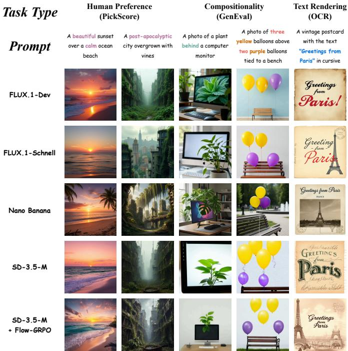  
Fig. 8. Qualitative comparison of Flow-GRPO as an outcome-based RL paradigm with SD-3.5-M, FLUX.1-dev, FLUX.1-schnell, and Nano Banana. While Flow-GRPO excels in global aesthetics (1st and 2nd columns) and compositionality (3rd and 4th columns), its impact on tasks demanding rigorous planning and process-aligned control, i.e., text rendering (5th column), shows only moderate improvements over the base model, highlighting the limitations of enforcing strict constraints via outcome-based rewards alone.

During 2026, this line of work began to remove likelihood machinery from diffusion RL. V-GRPO [108] stabilizes an ELBO-based GRPO surrogate via variance reduction and controlled gradient updates, avoiding an explicit denoising-MDP objective. RVM [109] goes further by reinforcing highreward directions directly in the native velocity field, with an anchor controlling policy drift and without trajectory likelihoods. Collectively, they shift the design question from how to approximate the autoregressive policy ratios toward how reward information modifies a denoising vector field.

To address compositional reasoning tasks, where sparse global rewards provide insufficient supervision, the second paradigm, process-level control, i.e., structural reasoning, opens the diffusion process and directly intervenes in intermediate denoising or planning steps. Rather than relying on fixed heuristics, explicit RL training integrates CoT into the generation policy. T2I-R1 [114], PARM [115], and Visual-CoG [117] interpret the denoising trajectory as a multi-step reasoning process and apply dense, stepwise supervision.

Process-level RL is also moving from external reasoning traces into the denoising dynamics themselves. Specifically, DenseGRPO [119] scores intermediate clean estimates and utilizes step-wise reward gains with timestep-aware exploration, whereas Stepwise-Flow-GRPO [120] derives gainbased advantages from reward changes between Tweedie estimates. They both expose temporal credit assignment as a distinct process-control problem rather than assigning the terminal reward uniformly to every denoising step.

Finally, for inference acceleration, the third paradigm, efficiency-oriented alignment, i.e., trajectory optimization, uses RL to directly reshape the generation trajectory. Unlike standard distillation, which passively imitates a teacher, RL-based methods actively search for high-reward shortcuts. Some works focus on trajectory refinement in few-step diffusion, where RLCM [122], SDPO [87], and Diffusion-Sharpening [123] straighten probability flows to enable high-fidelity generation in 2 to 4 steps. However, such fixedstep constraints can be overly rigid. Instead, AdaDiff [88] learns an instance-specific step-scheduling policy via RL, allowing the model to dynamically allocate computational resources to the denoising steps that contribute the most to perceptual quality. Another emerging direction explores joint distillation, as in Flash-DMD [125] and DMD-RL [127], where student models are trained to simultaneously match a teacher distribution and maximize reward, establishing a new Pareto frontier between inference latency and generation quality. Lastly, distinct from these weight-updating methods, ReNO [86] introduces a training-free test-time alignment strategy. Instead of updating weights, ReNO directly optimizes the initial latent noise via reward guidance, effectively trading increased inference-time computation for superior preference and compositional adherence.

TABLE 4  
Summary of reinforcement learning methods for video generation. We categorize methodologies by training strategy (On/Off) and feedback paradigm (RLHF, DPO, RLVR).
<table><tr><td rowspan="2">Methods</td><td colspan="2">Training Strategy</td><td colspan="2">Feedback Paradigm</td><td rowspan="2">Links</td></tr><tr><td>Online Offline</td><td></td><td></td><td>RLHF DPO RLVR</td></tr><tr><td colspan="7">Temporal &amp; Cross-modal Alignment (Motion Quality &amp; Coherence)</td></tr><tr><td>InstructVideo [129] VideoDPO [72] VADER [130] T2V-Turbo [131]</td><td>√</td><td></td><td></td><td></td><td>àO à àO</td></tr><tr><td>VideoRM [132] VideoAlign [133]</td><td>√ √</td><td>V</td><td></td><td>VVV</td><td>à à à Ω</td></tr><tr><td>DenseDPO [134] cIPO [135]</td><td></td><td>√</td><td>√</td><td></td><td>à</td></tr><tr><td>OmniNFT [136]</td><td>√</td><td>√</td><td></td><td>√</td><td>44</td></tr><tr><td></td><td></td><td></td><td>Physical Dynamics (Causality &amp; Logic)</td><td></td><td></td></tr><tr><td>PhysAR [137]</td><td></td><td></td><td></td><td>√</td><td>à à</td></tr><tr><td>PhysMaster [138]</td><td>√</td><td></td><td></td><td>↓</td><td></td></tr><tr><td>PhysCorr [139]</td><td></td><td>√</td><td></td><td></td><td>à</td></tr><tr><td>PISA [140] World-R1 [141]</td><td></td><td>√</td><td></td><td>√</td><td>à Q</td></tr><tr><td></td><td>√</td><td></td><td></td><td>√</td><td></td></tr><tr><td>VGGRPO [142]</td><td>√</td><td></td><td>√</td><td></td><td>2</td></tr><tr><td></td><td></td><td></td><td></td><td>√</td><td></td></tr><tr><td></td><td></td><td></td><td></td><td></td><td></td></tr><tr><td>Align-A-Video [143]</td><td></td><td></td><td></td><td>Scalability &amp; Identity (GRPO &amp; Consistency)</td><td></td></tr><tr><td>DanceGRPO [82]</td><td>√</td><td></td><td></td><td></td><td>à</td></tr><tr><td></td><td>√</td><td></td><td></td><td></td><td>à</td></tr><tr><td></td><td></td><td></td><td>√</td><td></td><td></td></tr><tr><td>GigaVideo-1 [144]</td><td>√</td><td></td><td>√</td><td></td><td>à</td></tr><tr><td>MagicID [145]</td><td></td><td></td><td></td><td>√</td><td>à</td></tr><tr><td></td><td></td><td></td><td></td><td></td><td></td></tr><tr><td>ID-Crafter [146]</td><td>√</td><td></td><td></td><td>√</td><td>à</td></tr><tr><td></td><td></td><td></td><td></td><td></td><td></td></tr><tr><td>TAGRPO [147]</td><td></td><td></td><td></td><td></td><td>à</td></tr></table>

A complementary system-level advance is Qwen-Image-2.0-RL [111]. It combines task-specific composite rewards, scalable GRPO, prompt filtering, and category-wise reward calibration, then merges specialized text-to-image and editing policies into a single model through on-policy velocity distillation. This pipeline extends RL post-training beyond single-reward algorithm prototypes to a joint generationand-editing deployment setting.

RL in video generation. Extending DMs from images to videos introduces temporal dynamics, substantially increasing alignment complexity. However, pure SFT often fails in temporal coherence and computational efficiency. Early approaches such as InstructVideo [129] and VideoDPO [72] generalize image alignment pipelines to video by explicitly optimizing motion smoothness, flicker reduction, and subject consistency, thereby improving alignment with human preferences. To consolidate these techniques, the VideoReward system [69] proposes a holistic pipeline with Flow-DPO for training and Flow-NRG for inference-time guidance. Moreover, to address the limitations of static supervision, OnlineVPO [73] further employs a VQA-based reward model within an online DPO framework. Notably, the high cost and instability of video-level RL highlight the need for scalable RL optimization. A key advance is DanceGRPO [82], which introduces critic-free GRPO to visual generation. By replacing explicit value networks with group-based baselines, DanceGRPO stabilizes large-scale RLHF across textto-image, text-to-video, and image-to-video settings.

Beyond perceptual coherence, recent works increasingly target physical dynamics to solve “physics hallucinations” prevalent in SFT-trained models. Unlike static images, video generation must satisfy strict physical constraints. Frameworks such as PhysAR [137] and PhysMaster [138] incorporate physics-aware reward signals into the RL loop, deriving feedback from interpretable quantities such as motion trajectories, velocities, and conservation or contact consistency. Based on these, PhysRVG [148] introduces a physicsregulated framework that applies fine-grained constraints across multiple granularities, ensuring generated dynamics not only respect basic laws but also exhibit complex, realistic interactions. By grounding optimization in physically motivated rewards rather than purely visual fidelity, these methods guide diffusion policies towards practical world modeling. Please refer to Table 4 for a complete summary. And Table 6 provides a quantitative comparison on textto-video generation, reporting paired results between each video generation baseline and its aligned counterpart under the metrics and protocols used in the original papers.

Geometry-aware rewards now extend video alignment from perceptual quality to 3D/4D world consistency. World-R1 [141] uses a 3D base model and VLM feedback within Flow-GRPO, and periodic decoupled training balances geometric rigidity with non-rigid dynamics. VGGRPO [142] instead decodes 4D geometry directly from diffusion latents and rewards camera smoothness and reprojection consistency, thereby avoiding repeated RGB decoding.

Moreover, joint audio-video generation further expands credit assignment across modalities. OmniNFT [136] routes reward-specific advantages to cross-modal branches, combines this routing with layer-wise gradient surgery, and reweights synchronization-critical regions. This replaces a global advantage with modality- & region-aware feedback.

RL in other modalities: 3D, audio, and motion. In addition to image and video modalities, RL also plays a crucial role in generative domains that deviate fundamentally from pixel space, including 3D geometry, 1D audio waveforms, and embodied motion, where standard SFT objectives provide insufficient structural, logical, or physical guidance.

TABLE 5  
Paired quantitative effects of representative RL/RL-family image generation methods. All values are collected from the reported tables in the original papers: DPOK’s Table 1 [65], AlignProp’s Table 1 [68], DanceGRPO’s Tables 2–4 [82], and Flow-GRPO’s Tables 1–2 [81], together with Qwen-Image-2.0-RL’s Table 1 and arena evaluation [111]. Rows should be interpreted as paired base-to-aligned improvements under the corresponding source protocol rather than as a single cross-paper leaderboard.
<table><tr><td>Base Models</td><td>Methods</td><td>Metrics</td><td>Base</td><td>Aligned</td><td>∆</td></tr><tr><td rowspan="3">Stable Diffusion v1.4</td><td>DDPO [92]</td><td>HPS-v2.1 CLIP</td><td>0.239 0.363</td><td>0.297 0.381</td><td>+0.058 +0.018</td></tr><tr><td>ReFL [61]</td><td>HPS-v2.1 CLIP</td><td>0.239 0.363</td><td>0.357 0.418</td><td>+0.118 +0.055</td></tr><tr><td>DanceGRPO [82]</td><td>HPS-v2.1 CLIP</td><td>0.239 0.363</td><td>0.365 0.421</td><td>+0.126 +0.058</td></tr><tr><td rowspan="2">Stable Diffusion v1.5</td><td>DPOK [65]</td><td>MS-COCO ImageReward DrawBench ImageReward</td><td>0.22 0.13</td><td>0.55 0.58</td><td>+0.33 +0.45</td></tr><tr><td>AlignProp [68]</td><td>Animals reward (test) HPS-v2 reward (test)</td><td>5.64 2.86</td><td>8.71 3.32</td><td>+3.07 +0.46</td></tr><tr><td>Stable Diffusion v1.4</td><td>DanceGRPO [82]</td><td>Pick-a-Pic GenEval</td><td>0.202 0.421</td><td>0.215 0.522</td><td>+0.013 +0.101</td></tr><tr><td>FLUX.1-dev</td><td>DanceGRPO [82]</td><td>HPS-v2.1 CLIP Pick-a-Pic GenEval</td><td>0.304 0.405 0.224 0.659</td><td>0.343 0.427 0.228 0.687</td><td>+0.039 +0.022 +0.004 +0.028</td></tr><tr><td>Stable Diffusion 3.5-M</td><td>Flow-GRPO [81]</td><td>GenEval OCR Acc. PickScore</td><td>0.63 0.59 21.72</td><td>0.95 0.92 23.31</td><td>+0.32 +0.33 +1.59</td></tr><tr><td>Qwen-Image-2.0</td><td>Qwen-Image-2.0-RL [111]</td><td>Qwen-Image-Bench Overall T2I Arena Elo</td><td>55.23 1115</td><td>57.84 1193</td><td>+2.61 +78</td></tr></table>

In 3D generation, the dominant challenge is geometric consistency. Early methods relying on 2D priors typically suffer from the “Janus problem” due to the absence of 3Daware supervision. DreamReward [149] addresses this limitation by introducing Reward3D, the first general-purpose human-preference reward model for text-to-3D generation, and finetuning multi-view diffusion priors via feedbackdriven optimization. This reward-guided RL post-training substantially reduces structural artifacts and better aligns 3D geometry with human preferences. Nabla-R2D3 [150] further addresses the complementary feedback bottleneck for 3D-native diffusion: it aligns 3D generators with mature 2D rewards via reward-gradient and score matching, reducing the need for specialized 3D preference data.

Moreover, in audio generation, alignment is dominated by the challenge of long-horizon dependency modeling in high-fidelity waveforms (>24 kHz), where SFT often degrades global structure. Tango 2 [151] applies DPO [6] on Audio-alpaca, a CLAP-filtered preference dataset, to improve semantic alignment in text-to-audio tasks. And for music generation, LeVo [152] formulates song synthesis as a multi-preference alignment problem and employs DPO [6] to jointly optimize lyric intelligibility, prompt consistency, and musicality while preserving complete song structures. Resonate [153] advances this line from offline pairwise preference optimization to online GRPO for a flow-based textto-audio model. Specifically, its large-audio-language-model reward supplies finer temporal and compositional feedback than CLAP-style similarity scores, allowing exploration to improve both audio quality and semantic alignment.

Ultimately, motion generation connects DMs to embodied intelligence, where the central requirement is physical plausibility under textual control. Although DMs can produce diverse kinematic trajectories, they often violate physical constraints in simulation. ReinDiffuse [154] reformulates motion diffusion as a parameterized action distribution and applies RL with physics-based rewards to explicitly enforce physically valid motion. Complementarily, MotionRL [155] adopts a multi-reward preference alignment framework to finetune text-to-motion models for text adherence and physical validity, thereby approximating a Pareto frontier that balances semantic fidelity and perceptual realism.

## 4.2.2 RL-driven Image Editing

Not just multimodal AI generation, RL has also emerged as a powerful technique for enhancing image editing. Specifically, InstructRL4Pix [156] pioneers the use of RL to train DMs specifically for precise editing via optimizing the control process. To alleviate the training instability of online RL methods, EditScore [157] establishes a high-fidelity reward modeling paradigm for better alignment with user intentions. Furthermore, SPIE [158] integrates AI feedback to enhance the models’ ability to preserve image structure while performing semantically meaningful edits.

Recent editing work targets two constraints not captured by single-turn alignment. MT-EditFlow [159] treats successive user revisions as a multi-turn trajectory and designs turn-aware reward aggregation and advantage fusion to reduce error propagation. Lever-Edit [160] addresses scarce editing-specific rewards via counterfactual target captions that transfer established T2I rewards to online editing RL.

## 4.2.3 RL in Unified Understanding and Generation

The unification of understanding and generation abilities within a single framework represents a significant advancement in multimodal AI. MMaDA [161] exemplifies this via a modality-agnostic diffusion architecture, and the proposed UniGRPO enables simultaneous optimization of comprehension and creation objectives, demonstrating RL’s role in harmonizing diverse tasks within a unified system. UniRL-Zero [162], a robust foundation for advancing unified RL frameworks, further enhances the performance of complex generative tasks requiring tight LM-DM synergy. GvU [163], an understanding-driven intrinsic rewarding framework for unified multimodal models, leverages internal comprehension signals to improve semantic alignment and instructionfollowing generation. Moreover, AlphaGRPO [164] closes the loop between understanding and generation in a unified AR-diffusion multimodal model. Specifically, its decompositional verifiable reward signals convert complex prompts into atomic questions for multimodal evaluation, supporting reasoning-conditioned generation and self-reflective refinement rather than only scoring a final image.

TABLE 6  
Paired quantitative effects of representative RL/RL-family video generation methods. All values are collected from the reported tables in the original papers: InstructVideo’s Table 1 [129], VideoDPO’s Table 1 [72], T2V-Turbo’s Table 1 [131], DanceGRPO’s Table 5 [82], and DenseDPO’s Table 1 [134], together with VGGRPO’s Table 1 [142]. VADER results are taken from the same VBench comparison protocol reported in VideoDPO’s Table 1; DenseDPO uses the SFT baseline in its source table as the paired base. VBench-T/Q/S denote VBench Total, Quality, and Semantics; VQ/MQ/TA denote Visual Quality, Motion Quality, and Text Alignment.
<table><tr><td>Base Models</td><td>Methods</td><td>Metrics</td><td>Base</td><td>Aligned</td><td>∆</td></tr><tr><td rowspan="4">VideoCrafter2</td><td rowspan="4">VADER [130]</td><td>VBench-T</td><td>80.44</td><td>80.59</td><td>+0.15</td></tr><tr><td>VBench-Q</td><td>82.20</td><td>82.46</td><td>+0.26</td></tr><tr><td>VBench-S</td><td>73.42</td><td>73.09</td><td>-0.33</td></tr><tr><td></td><td></td><td></td><td></td></tr><tr><td rowspan="3">ModelScopeT2V</td><td rowspan="3">InstructVideo [129]</td><td>HPS-v2 reward (in-domain)</td><td>0.2506</td><td>0.2717</td><td>+0.0211</td></tr><tr><td>HPS-v2 reward (new animals)</td><td>0.2502</td><td>0.2645</td><td>+0.0143</td></tr><tr><td>HPS-v2 reward (non-animals)</td><td>0.2557</td><td>0.2682</td><td>+0.0125</td></tr><tr><td rowspan="3">VideoCrafter2</td><td rowspan="3">VideoDPO [72]</td><td>VBench-T</td><td>80.44</td><td>81.93</td><td>+1.49</td></tr><tr><td>VBench-Q</td><td>82.20</td><td>83.07</td><td>+0.87</td></tr><tr><td>VBench-S</td><td>73.42</td><td>77.38</td><td>+3.96</td></tr><tr><td rowspan="3">T2V-Turbo</td><td rowspan="3">VideoDPO [72]</td><td>VBench-T</td><td>80.95</td><td>81.80</td><td>+0.85</td></tr><tr><td>VBench-Q</td><td>82.71</td><td>83.80</td><td>+1.09</td></tr><tr><td>VBench-S</td><td>73.93</td><td>73.81</td><td>-0.12</td></tr><tr><td rowspan="3">VCM-VC2</td><td rowspan="3">T2V-Turbo-VC2 [131]</td><td>VBench-T</td><td>73.97</td><td>81.01</td><td>+7.04</td></tr><tr><td>VBench-Q</td><td>78.54</td><td>82.57</td><td>+4.03</td></tr><tr><td>VBench-S</td><td>55.66</td><td>74.76</td><td>+19.10</td></tr><tr><td rowspan="3">HunyuanVideo</td><td rowspan="3">DanceGRPO [82]</td><td>VQ</td><td>4.51</td><td>7.03</td><td>+2.52</td></tr><tr><td>MQ</td><td>1.37</td><td>3.85</td><td>+2.48</td></tr><tr><td>TA VisionReward</td><td>1.75</td><td>1.59 0.128</td><td>-0.16 +0.004</td></tr><tr><td rowspan="3">SFT latent flow model</td><td rowspan="3">DenseDPO [134]</td><td></td><td>0.124</td><td></td><td></td></tr><tr><td>VBench Dynamic Degree VisionReward Text Alignment</td><td>83.25</td><td>85.38</td><td>+2.13</td></tr><tr><td>VisionReward Visual Quality</td><td>0.773 0.205</td><td>0.863 0.376</td><td>+0.090 +0.171</td></tr><tr><td rowspan="2">Wan2.2-5B</td><td rowspan="2">VGGRPO [142]</td><td>VBench Imaging Quality</td><td></td><td></td><td></td></tr><tr><td>VBench Motion Smoothness</td><td>0.6402 0.9467</td><td>0.6843 0.9619</td><td>+0.0441 +0.0152</td></tr></table>

The above unification framework has also been extended to visual model assessment and real-world applications. UnifiedReward [165] develops the first RL-aligned reward framework spanning multimodal understanding and generation evaluation. In applications, methods like Alpamayor1 [166] effectively bridge reasoning and action prediction for autonomous driving, showcasing the adaptability of unified frameworks to complex practical tasks. Further technical advancements, such as UnifiedReward-Think [167] for multi-dimensional, step-by-step long-chain visual reasoning and R1-Reward [168] for RL-driven multimodal reward modeling, address the challenges of maintaining coherent and consistent performance across multiple objectives.

## 5 RL FOR DIFFUSION ROBOTICS

RL has also demonstrated extremely powerful capabilities in the field of robotics. By enabling agents to interact with the environment and assisting with optimization through reward functions, RL has greatly promoted the development of robotics. Recently, generative models represented by DMs have also achieved remarkably impressive performance in robotics. They excel at multimodal action distribution modeling and high-dimensional action space representation, and such powerful capabilities can serve as strong priors to benefit RL. Therefore, a surge of research efforts has emerged in the community to integrate this RL-diffusion paradigm, thereby further advancing the field of robotics.

For dRobotics, the trajectory-level optimization extends from visual or textual denoising paths to continuous actionsequence refinement, where rewards are grounded in closedloop physical feedback (e.g., safety), further highlighting the importance of reward provenance, reliable verifiers, and safeguards against proxy reward over-optimizing.

There exist two mainstream integration approaches in embodied intelligence research: 1) Diffusion Policy-based RL training: DMs as policy backbones iteratively optimized via RL gradients; 2) Generative experts in Vision-Language-Action models: fusing multimodal perception with actions generated by diffusion (Fig. 9). Moreover, the first integration can be structured by two RL paradigms for distinct scenarios: online diffusion RL and offline diffusion RL. This section comprehensively sorts out recent RL literature in diffusion-based robotics along with online/offline scenarios (Fig. 10) and systematically reviews theoretical foundations, integration frameworks, applications, and core challenges, aiming to clarify how this synergy advances robots towards adaptive, robust, human-level embodied intelligence.

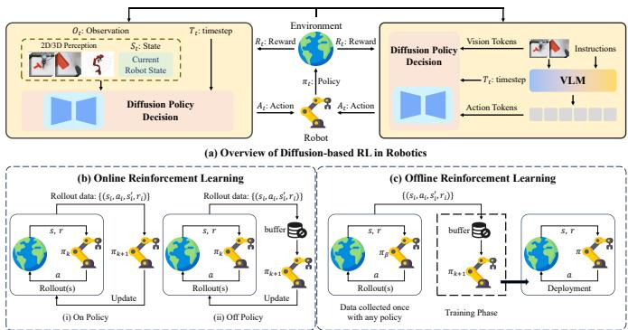  
Fig. 9. Overview of RL-driven Diffusion-based Robotics.

## 5.1 Foundations of RL for Diffusion in Robotics

Diffusion Policy via DDPMs. Diffusion Policy (DP) [169] first attempts to explore the diffusion-based policy πθ parameterized by DDPMs [1], which takes in $s$ as a conditioning argument and then parameterizes $p _ { \theta } ( a ^ { k - 1 } | a ^ { k } , s )$ as $\mathcal { N } \left( a ^ { \check { k } - 1 } ; \check { \sqrt { \alpha _ { k } } } a ^ { k } + \check { \sqrt { 1 - \alpha _ { k } } } \varepsilon _ { \theta } ( a ^ { k } , s , k ) , \sigma _ { k } ^ { 2 } \mathbf { \hat { I } } \right)$ . DPs can be trained via behavior cloning by fitting the conditional noise prediction $\varepsilon _ { \boldsymbol { \theta } } { \left( a ^ { k } , s , k \right) }$ to predict the added noise. Note that unlike standard policy parameterizations, $e . g .$ , unimodal Gaussian policies, DPs do not maintain an explicit likelihood of $ { p _ { \theta } } ( a ^ { 0 } | s )$ . Similar with image or language generation, DP’s training also exploits the DDPM to approximate the conditional distribution $p ( \mathbf { A } _ { t } | \mathbf { O } _ { t } )$

$$
\mathbf { A } _ { t } ^ { k - 1 } = \alpha ( \mathbf { A } _ { t } ^ { k } - \gamma \epsilon _ { \theta } ( \mathbf { O } _ { t } , \mathbf { A } _ { t } ^ { k } , k ) + \mathcal { N } ( 0 , \sigma ^ { 2 } I ) ) ,\tag{18}
$$

where ${ \bf A } _ { t }$ is the robot action and $\mathbf { O } _ { t }$ represents the input observation, while the training loss can be expressed as

$$
\boldsymbol { \mathcal { L } } = \boldsymbol { \mathrm { M S E } } ( \epsilon ^ { k } , \epsilon _ { \theta } ( \mathbf { O } _ { t } , \mathbf { A } _ { t } ^ { 0 } + \epsilon ^ { k } , k ) ) .\tag{19}
$$

Diffusion VLA via Flow Matching. VLA models typically adopt DMs (particularly flow matching) as the action expert, which formulates action generation as conditional denoising. Diffusion-based methods naturally model diverse action distributions, enabling multiple valid trajectories from identical observations. In general, for each action $a _ { t ^ { \prime } }$ in the action chunk $A _ { t } ,$ a corresponding action token will be fed into the action expert. During training, these action tokens are supervised using a conditional flow matching loss [9],

$$
L ^ { \tau } ( \theta ) = E _ { p ( A _ { t } | o _ { t } ) , q ( A _ { t } ^ { \tau } | A _ { t } ) } | | v _ { \theta } ( A _ { t } ^ { \tau } , o _ { t } ) - u ( A _ { t } ^ { \tau } | A _ { t } ) | | ^ { 2 } ,
$$

where subscripts denote robot timesteps and superscripts denote flow matching timesteps, with $\bar { \tau } \in [ 0 , 1 ]$

## 5.1.1 RL-driven Diffusion-based Robotics

Basics of RL in Robotics. In robotic systems, RL empowers robots to learn task execution via environmental interaction and feedback, with its core concepts forming the learning loop. Briefly: Agent (Robot) perceives the environment and executes actions; Environment is the robot’s physical operating space, with states evolving via transition functions in response to robot’s actions; State describes the agentenvironment status $( e . g .$ , position, sensor data) at a given time; Action denotes executable operations $( e . g .$ ., joint control); Reward is scalar feedback guiding the agent to distinguish favorable behaviors; Policy is the agent’s decisionmaking rule mapping states to actions; and Value function quantifies long-term reward potential (including state-value and action-value/Q-functions), directing optimal action selection for maximum cumulative rewards.

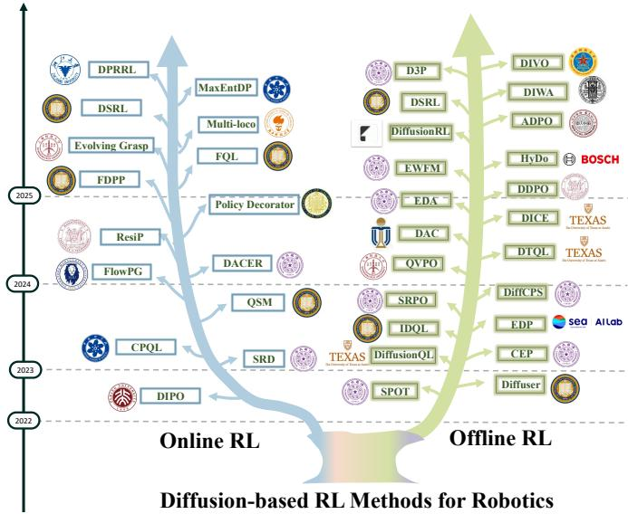  
Fig. 10. Representative research about diffusion-based RL for robotics.

RL in robotics attempts to learn the optimal “perceptiondecision-action” strategy via physical interaction. However, traditional RL policies $( e . g .$ , Gaussian, MLP-parameterized policies) are constrained by predefined distribution forms, struggling to handle high-dimensional, multi-modal action spaces (e.g., robotic manipulation, trajectory planning). By contrast, DMs capture complicated data distributions via the “forward diffusion (noising) & reverse denoising” process, and DMs’ strong conditional generation capability provides a novel policy representation paradigm for RL. Specifically, the combination requires no prior assumptions about action distributions but directly models state-action mappings via state-conditioned denoising. We theoretically systematize the core framework, mathematical formulations, and modular design logic of diffusion-based RL below.

DMs’ forward process is a parameter-free Markov chain: at timestep $k ,$ Gaussian noise is added to the original action $a _ { t } ^ { 0 } .$ , yielding the noisy action $a _ { t } ^ { k }$ . And the reverse process uses a neural network to learn the mapping from $a _ { t } ^ { k }$ back to $a _ { t . } ^ { 0 }$ , conditioned on the environmental state $s _ { t } -$ forming the core representation of RL policy as follows:

$$
\begin{array} { r } { a _ { t } ^ { k - 1 } \sim p _ { \theta } \left( a _ { t } ^ { k - 1 } \mid a _ { t } ^ { k } , s _ { t } \right) = \mathcal { N } \left( a _ { t } ^ { k - 1 } ; \mu _ { k } \left( a _ { t } ^ { k } , \varepsilon _ { \theta } ( a _ { t } ^ { k } , s _ { t } , k ) \right) , \sigma _ { k } ^ { 2 } \mathbf { I } \right) , } \end{array}\tag{20}
$$

where $a _ { t } ^ { k }$ is the action after k noising steps in the t-th environmental interaction $( k = K$ corresponds to pure Gaussian noise and $k = 0$ denotes the final output action); $\varepsilon _ { \boldsymbol { \theta } } ( \cdot )$ is the state-conditioned noise prediction network, taking $a _ { t } ^ { k } .$ $s _ { t } ,$ and denoising step k as inputs to estimate the true noise added during the forward process; and $\mu _ { k } ( \cdot )$ denotes the fixed mean function, which can be calculated as

$$
\begin{array} { r } { \mu _ { k } ( a _ { t } ^ { k } , \varepsilon ) = \frac { \sqrt { \alpha _ { k } } ( 1 - \bar { \alpha } _ { k - 1 } ) } { 1 - \bar { \alpha } _ { k } } a _ { t } ^ { k } + \frac { \sqrt { \bar { \alpha } _ { k - 1 } } ( 1 - \alpha _ { k } ) } { 1 - \bar { \alpha } _ { k } } ( a _ { t } ^ { k } - \sqrt { 1 - \bar { \alpha } _ { k } } \varepsilon ) , } \end{array}\tag{21}
$$

where $\alpha _ { k }$ is a predefined coefficient and $\begin{array} { r } { \bar { \alpha } _ { k } = \prod _ { i = 1 } ^ { k } \alpha _ { i } . } \end{array}$ . This

TABLE 7  
Representative offline RL methods on the D4RL Gym-MuJoCo and AntMaze benchmarks, adapted from DIVO [170]. All tasks use standardized D4RL v2 normalized scores, where higher is better. Gym-MuJoCo includes dense-reward locomotion tasks: HalfCheetah for planar running, Hopper for single-legged hopping and balance, and Walker2d for bipedal walking control; each is evaluated with medium, medium-replay, and medium-expert datasets. AntMaze includes sparse-reward long-horizon navigation tasks in U-Maze, Medium, and Large layouts, with play datasets collected from exploratory behavior and diverse datasets containing more varied goal-reaching trajectories. DIVO results are reported as mean ± standard error over the last 10 evaluations and 5 random seeds, and the aggregate rows sum normalized scores within each benchmark group.
<table><tr><td rowspan="2">Task Name</td><td colspan="4">Non-diffusion Methods</td><td colspan="5">Diffusion-based Methods</td></tr><tr><td>TD3+BC [171]</td><td>BCQ [172]</td><td>BEAR [173]</td><td>CQL [174]</td><td>EDP [175]</td><td>IDQL [176]</td><td>Diffusion-QL [177]</td><td>DTQL [178]</td><td>DIVO [170]</td></tr><tr><td>halfcheetah-medium</td><td>48.3</td><td>47.0</td><td>41.0</td><td>44.0</td><td>52.1</td><td>51.0</td><td>51.1 (0.5)</td><td>57.9 (0.13)</td><td>67.71 (0.64)</td></tr><tr><td>hopper-medium</td><td>59.3</td><td>56.7</td><td>51.9</td><td>58.5</td><td>81.9</td><td>65.4</td><td>90.5 (4.6)</td><td>99.6 (0.87)</td><td>100.34 (0.44)</td></tr><tr><td>walker2d-medium</td><td>83.7</td><td>72.6</td><td>80.9</td><td>72.5</td><td>86.9</td><td>82.5</td><td>87.0 (0.9)</td><td>89.4 (0.13)</td><td>90.94 (1.63)</td></tr><tr><td>halfcheetah-medium-replay</td><td>44.6</td><td>40.4</td><td>29.7</td><td>45.5</td><td>49.4</td><td>45.9</td><td>47.8 (0.33)</td><td>50.9 (0.11)</td><td>55.53 (0.77)</td></tr><tr><td>hopper-medium-replay</td><td>60.9</td><td>53.3</td><td>37.3</td><td>95.0</td><td>101.1</td><td>92.1</td><td>101.3 (0.6)</td><td>100.0 (0.13)</td><td>101.28 (0.40)</td></tr><tr><td>walker2d-medium-replay</td><td>81.8</td><td>52.1</td><td>18.5</td><td>77.2</td><td>94.9</td><td>85.1</td><td>95.5 (1.5)</td><td>88.5 (2.16)</td><td>94.85 (0.57)</td></tr><tr><td>halfcheetah-medium-expert</td><td>90.7</td><td>89.1</td><td>38.9</td><td>91.6</td><td>95.5</td><td>95.9</td><td>96.8 (0.33)</td><td>92.7 (0.2)</td><td>97.88 (0.74)</td></tr><tr><td>hopper-medium-expert</td><td>98.0</td><td>81.8</td><td>17.7</td><td>105.4</td><td>97.4</td><td>108.6</td><td>111.1 (1.3)</td><td>109.3 (1.49)</td><td>111.02 (1.64)</td></tr><tr><td>walker2d-medium-expert</td><td>110.1</td><td>109.5</td><td>95.4</td><td>108.8</td><td>110.2</td><td>112.7</td><td>110.1 (0.33)</td><td>110.0 (0.07)</td><td>112.03 (0.62)</td></tr><tr><td>Gym Aggregate</td><td>677.4</td><td>602.5</td><td>411.3</td><td>698.5</td><td>769.5</td><td>739.2</td><td>792.0</td><td>798.3</td><td>831.6</td></tr><tr><td>antmaze-umaze</td><td>91.3</td><td>0.0</td><td>73.0</td><td>84.8</td><td>96.6</td><td>94.0</td><td>93.4 (3.4)</td><td>94.8 (1.00)</td><td>100.00 (0.00)</td></tr><tr><td>antmaze-umaze-diverse</td><td>54.6</td><td>61.0</td><td>61.0</td><td>43.3</td><td>69.5</td><td>80.2</td><td>66.2 (8.6)</td><td>78.8 (1.83)</td><td>92.00 (4.47)</td></tr><tr><td>antmaze-medium-play</td><td>0.0</td><td>0.0</td><td>0.0</td><td>65.2</td><td>0.0</td><td>84.5</td><td>76.6 (10.8)</td><td>79.6 (1.8)</td><td>86.70 (4.31)</td></tr><tr><td>antmaze-medium-diverse</td><td>0.0</td><td>0.0</td><td>8.0</td><td>54.0</td><td>6.4</td><td>84.8</td><td>78.6 (10.3)</td><td>82.8 (1.71)</td><td>86.70 (12.47)</td></tr><tr><td>antmaze-large-play</td><td>0.0</td><td>6.7</td><td>0.0</td><td>18.8</td><td>1.6</td><td>63.5</td><td>46.6 (8.3)</td><td>52.0 (2.23)</td><td>58.00 (8.37)</td></tr><tr><td>antmaze-large-diverse</td><td>0.0</td><td>2.2</td><td>0.0</td><td>31.6</td><td>4.4</td><td>67.9</td><td>56.6 (7.6)</td><td>54.0 (2.23)</td><td>63.33 (4.71)</td></tr><tr><td>AntMaze Aggregate</td><td>145.9</td><td>69.9</td><td>142.0</td><td>297.7</td><td>178.8</td><td>474.6</td><td>417.6</td><td>441.6</td><td>486.7</td></tr><tr><td>Total Aggregate</td><td>823.3</td><td>672.4</td><td>553.3</td><td>996.2</td><td>948.3</td><td>1213.8</td><td>1209.6</td><td>1239.9</td><td>1318.3</td></tr></table>

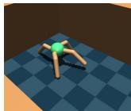  
(a) Ant

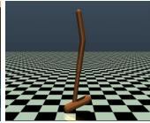  
(b) Hopper

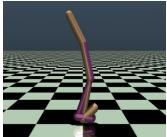  
(c) Walker2d

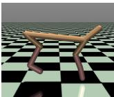  
(d) HalfCheetah  
Fig. 11. The visualization of four offline RL benchmarks for robot continuous control, including Ant, Hopper, Walker2d, and HalfCheetah.

definition avoids prior assumptions about action distributions, fitting any continuous action distribution via iterative denoising, making it ideal for multi-modal action scenarios.

## 5.2 Diffusion Policy-based RL Training

Online Diffusion RL. Online RL strives to learn the optimal policy via continuous interactions with the target environment and the integration of online RL with DMs has become a prominent direction in robotic learning.

Existing research on online diffusion RL can be broadly categorized into two paradigms. The first paradigm treats generative policies (e.g., DMs) as black-box function approximators and optimizes them using policy gradient methods. Representative works include DACER [179], CPQL [180], and FlowPG [181], which directly utilize deterministic or stochastic policy gradient updates to generative model policies. Moreover, the second paradigm leverages the inherent structural properties and denoising mechanisms of generative models to drive policy optimization: for example, DIPO [182] uses the Q-function’s gradient and value magnitude to identify the optimal action, then incorporates them into DMs’ variational loss for training; QSM [183] and Max-EntDP [184] further treat DMs’ noise network as the score function of the target policy distribution, employing the Qfunction’s gradient and variants to update the network.

Overall, current methods mostly focus on integrating generative models with off-policy RL algorithms, emphasizing adaptive policy refinement via real-time environmental feedback. Multi-Loco [185] proposes a shared residual RL policy to refine action outputs of pretrained DMs via online optimization, significantly narrowing the sim2real gap in online robotic control tasks. Beyond environmental feedback-driven refinement, preference-based optimization has also emerged as a key direction: FDPP [186] first learns a reward function via preference-based learning, then uses RL to fine-tune pretrained policies, ensuring the policy aligns with human preference while preserving its original ability. EvolvingGrasp [187] introduces Handpose-wise Preference Optimization (HPO), formulating grasp adaptation as a posterior probability optimization problem, and converges iteratively toward human-preferred grasp distributions with online preference feedback, enhancing the real-world practicality of diffusion-based grasp policies.

Furthermore, several works have advanced the application of online diffusion RL by integrating imitation learning (IL). Policy Decorator [188] optimizes and refines offline IL models via online environmental interactions utilizing a model-agnostic residual policy, ensuring IL-policy stability while reducing erratic RL behaviors. DSRL [189] leverages behavior cloning for rapid adaptation of pretrained policies through efficient online RL, enabling quick deployment in real-world scenarios. And DP-RRL [190] designs a diffusionbased IL policy learned from expert demonstration data, paired with a residual RL module using real-time environmental feedback for complex dynamics adaptation.

More recent studies further extend online diffusion RL to specialized and energy-constrained embodied settings. Specifically, L-SDPPO [211] formulates the optimization of a spiking diffusion policy via RL for intra-vehicular robotic manipulation, jointly handling the multimodal action distributions and the strict power budgets of spacecraft environments. X-NavDP [212] targets data-efficient diffusion

TABLE 8  
Diffusion-/Flow-based VLA methods with RL or RL-relevant fine-tuning signals.
<table><tr><td>Methods</td><td>Date</td><td>Backbone</td><td>Action Expert</td><td>Key Contributions / RL Signal</td><td>Primary Setting</td></tr><tr><td colspan="6">Foundation VLA and Generative Action Experts</td></tr><tr><td colspan="7">RDT-1B [191] 2024.10 Diffusion Transformer Diffusion action head</td></tr><tr><td>π0 [192]</td><td>2024.10</td><td>VLM / LLM</td><td>Flow Matching</td><td>Continuous action generation conditioned on VLM features</td><td>General robot control</td></tr><tr><td>AgiBot World [193]</td><td>2025.03</td><td>VLM / LLM</td><td>Flow Matching</td><td>Large-scale embodied data and generalist manipulation policy</td><td>Large-scale manipulation</td></tr><tr><td>π0.5 [194]</td><td>2025.04</td><td>VLM / LLM</td><td>Flow Matching</td><td>Co-training for open-world VLA generalization</td><td>Open-world robot control</td></tr><tr><td colspan="6">RL, RFT, and World-Model-Based VLA Optimization Diffusion Policy Diffusion action policy</td></tr><tr><td colspan="7">Beyond Human Demonstrations [195] 2025.09</td></tr><tr><td>VLA-RFT [196]</td><td>2025.10</td><td>VLM / LLM</td><td>MLP action head</td><td>Diffusion RL generates high-quality VLA training trajectories World-simulator RFT with verified trajectory rewards</td><td>VLA data generation Robot policy refinement</td></tr><tr><td>VDRive [197]</td><td>2025.10</td><td>VLM / LLM</td><td>Diffusion Policy</td><td>Actor-critic feedback for reinforced VLA driving decisions</td><td>Autonomous driving</td></tr><tr><td>πRL [198]</td><td>2025.10</td><td>VLM / LLM</td><td>Flow Matching</td><td>Online PPO with Flow-Noise / Flow-SDE likelihood modeling</td><td>Online VLA RL</td></tr><tr><td>WMPO [199]</td><td>2025.11</td><td>VLM / LLM</td><td>World-model Rollout</td><td>On-policy GRPO with pixel-based world-model feedback</td><td>World-model VLA RL</td></tr><tr><td>SA-VLA [200]</td><td>2026.02</td><td>VLM / LLM</td><td>Flow Matching</td><td>Spatially-aware flow matching preserving spatial inductive bias</td><td>Online VLA RL</td></tr><tr><td>World-VLA-Loop [201]</td><td>2026.02</td><td>VLM / LLM</td><td>Flow Matching</td><td>Closed-loop co-evolution of video world model and VLA policy</td><td>World-model VLA RL</td></tr><tr><td>OmniVLA-RL [202]</td><td>2026.04</td><td>VLM / LLM</td><td>Flow Matching</td><td>Flow matching recast as SDE with group segmented policy optimization</td><td>Online VLA RL</td></tr><tr><td>TMRL [203]</td><td>2026.05</td><td>Diffusion Policy</td><td>Diffusion</td><td>Timestep-modulated pretraining enabling exploration</td><td>Robot policy finetuning</td></tr><tr><td>Q-VGM [204]</td><td>2026.06</td><td>VLM / LLM</td><td>Flow Matching</td><td>Q-value-gradient matching for offline-to-online RL</td><td>Offline-to-online VLA RL</td></tr><tr><td>FlowPRO [205]</td><td>2026.06</td><td>VLM / LLM</td><td>Flow Matching</td><td>Proximalized preference optimization (RPRO) avoiding reward hacking Preference-based VLA RL</td><td></td></tr><tr><td>SafeDojo [206]</td><td>2026.06</td><td>VLM / LLM</td><td>Flow Matching</td><td>Lagrangian-constrained GRPO for safe RL</td><td>World-model safe VLA RL</td></tr><tr><td>dVLA-RL [207]</td><td>2026.06</td><td>VLM / LLM</td><td>Discrete Diffusion</td><td>MDP over denoising trajectories with variable-step scheduling</td><td>VLA RL</td></tr><tr><td>RedFlow [208]</td><td>2026.07</td><td>VLM / LLM</td><td>Flow Matching</td><td>Redirect failure into action-level corrections</td><td>Offline VLA RL</td></tr><tr><td>WCM [209]</td><td>2026.07</td><td>VLM / LLM</td><td>Flow Matching</td><td>World critic model predicting future latents and value estimates</td><td>VLA RL</td></tr><tr><td>StructRL [210]</td><td>2026.08</td><td>VLM / LLM</td><td>Flow Matching</td><td>Structured action-space exploration mitigating noise dilution</td><td>Online VLA RL</td></tr></table>

RL post-training for navigation, introducing group Q-score reweighted matching (GQRM) to generalize a single navigation diffusion policy across novel behaviors and embodiments. Beyond action-space policies, CreFlow [213] introduces an online RL framework for embodied video diffusion models, combining a credit-aware normalized flow trajectory loss along with corrective reflow to enforce compositional task constraints under sparse rewards.

Offline Diffusion RL. Compared with online diffusion RL, offline diffusion RL attracts more research attention, as it can avoid the high cost and safety risks of real-time environmental interactions by relying solely on pre-collected offline datasets. The core challenge of offline RL is preventing policy drift beyond the support of offline datasets. To address this, SPOT [214] adopts a VAE-based policy regularizer to constrain policy optimization within the data distribution, improving the generalization of offline policies. Another key research direction focuses on leveraging diffusion or flow policies to model the policy distribution of offline datasets more accurately: diffusion-QL [215], EDP [175], SRD [216], CEP [217], and FQL [218] are representative works, demonstrating that generative models can capture complex action distributions of offline datasets effectively, thereby yielding policies with superior generalization capability.

Building on these foundational advances, recent works have enhanced the performance and applicability of offline diffusion RL. Diffuser [219] pioneers this research by training a DM on offline datasets for trajectory generation, using guided sampling to plan future trajectories. This study first demonstrates DMs can unify the functionalities of policy models and dynamic models, laying a foundation not only for trajectory-level modeling in IL but also for subsequent offline diffusion RL research. DDPO [220] introduces a policy gradient method for fine-tuning diffusion-based policies in continuous robotic control and learning tasks; critically, this process relies entirely on offline datasets, thereby eliminating the need for real-time interaction and achieving the closed loop of “IL pretraining→pure offline RL fine-tuning”. DiffusionRL [221] addresses data scarcity and scenariospecific adaptation with large-scale offline datasets (including IL expert data) for diffusion policy training and enhancing dataset diversity via RL-driven data augmentation. And ADPO [222] proposes an algorithmic framework with best practices for fine-tuning diffusion-based policies in robotic control tasks, adopting adaptive gradient descent from RL to accelerate the training process. For more complex action spaces, HyDo [223] models continuous motion parameters using DMs on offline data, combines Q-value optimization for discrete contact point selection, and incorporates maximum entropy regularization—this design enables unified exploration of discrete-continuous action spaces.

Two recent works have further pushed the boundaries of offline refinement: DiWA [224] introduces a world model for full offline fine-tuning of diffusion-based robotic skills, eliminating reliance on real-time feedback; D3P [225] proposes a diffusion-based policy that adaptively allocates denoising steps across actions at test time and jointly optimizes an adaptor and the base diffusion policy via RL, balancing task performance and inference efficiency in offline scenarios.

Beyond the standard return-maximizing objectives, risksensitive planning has emerged as a safety-oriented offline direction: RS-Diffuser [226] couples diffusion trajectory generation along with a distributional value critic and injects tail-aware (e.g., CVaR) guidance into the denoising process, enabling a single policy to trade off risk-averse, risk-neutral, and risk-seeking behaviors during inference time. In parallel, MODIP [227] addresses offline-to-online adaptation by leveraging a learned world model and MPC to synthesize high-quality trajectories that supervise a diffusion policy, thereby retaining the simplicity of behavior cloning while outperforming pure RL fine-tuning.

For offline flow-policy RL, RedFlow [208] redirects failure signals into action-level corrections of a flow-matching VLA policy, and Causal Flow Q-Learning [228] tackles observational confounding from a causal perspective to provide worst-case robust offline optimization for flow policies.

Fig. 11 visualizes four offline RL benchmarks for robot continuous control, and Table 7 compares the performance of non-diffusion-based and diffusion-based RL methods.

## 5.3 Generative Experts in VLA Models

In robotics, diffusion-based policy models hold promise for generative control, facilitating flexible trajectory generation via the modeling of action distributions. However, they face challenges in integrating visual-linguistic information—a core limitation that has spurred the development of Vision-Language-Action (VLA) models. VLA models leverage pretraining from Vision-Language Models (VLMs) to advance practical learning-enabled robotics; specifically, they draw on large-scale VLM pretraining to make such robotic systems a reality. Nevertheless, the use of discrete action tokens impedes their ability to achieve fine-grained trajectory control. However, the design of discrete action tokens is not conducive to fine-grained control of robotic trajectories. $\pi _ { 0 }$ [192] first proposes an FM model as an action expert conditioned on the output of the VLM. Subsequently, numerous studies [191; 193; 194] have further explored the integration of DMs with VLA frameworks. Nevertheless, ILbased approaches often limit the scalability of such models, whereas RL has emerged as a potential alternative.

In robotic tasks, RL optimizes policies by iteratively maximizing cumulative rewards, thereby discovering strategies that surpass the upper bound imposed by merely imitating human demonstrations. Specifically, Yang et al. [195] employs task-completion-based rewards to guide the update of the policy network. VLA-RFT [196] utilizes world models as simulators to generate future states and performs end-to-end VLA updates using verifiability-based rewards. VDRive [197] leverages RL to enhance interpretable and robust decision-making in dynamic autonomous driving environments. And $\pi _ { r l }$ [198] introduces RL into flow-based VLA models through noise injection and MDP modeling for online finetuning. dVLA-RL [207] further extends RL to discrete diffusion VLAs by reparameterizing the objective from the intractable marginal action probability to the joint probability of the sampled denoising path, formulated as an MDP with variable denoising-step scheduling. WCM [209] learns a world critic model for VLA RL, and StructRL [210] proposes structured action-space exploration for flow-based VLAs. FlowPRO [205] achieves reward-free reinforced finetuning of flow-matching VLAs via proximalized preference optimization, and TMRL [203] modulates pretraining by diffusion timesteps for efficient policy finetuning.

World-model-based VLA RL has also gradually gained attention. Specifically, World-VLA-Loop [201] jointly learns a video world model and a VLA policy in a closed loop, while SafeDojo [206] focuses on task-safety co-optimization via Lagrangian-constrained GRPO over interactive worldmodel rollouts. Moreover, end-to-end value-gradient methods have further matured generative-policy RL: VINE [229] tames flow-matching control policies via block-MoE action experts with value-oriented exploration and reports realrobot deployment; Q-VGM [204] matches Q-value gradients for offline-to-online RL of flow-matching VLA policies. For VLA-specific RL fine-tuning, SA-VLA [200] injects spatial awareness into flow-matching VLA RL, while OmniVLA-RL [202] couples spatial understanding with online RL. On the on-policy side, DIPOLE [230] recasts the diffusion policy optimization as a dichotomous classification problem for VLA end-to-end driving. Table 8 summarizes representative

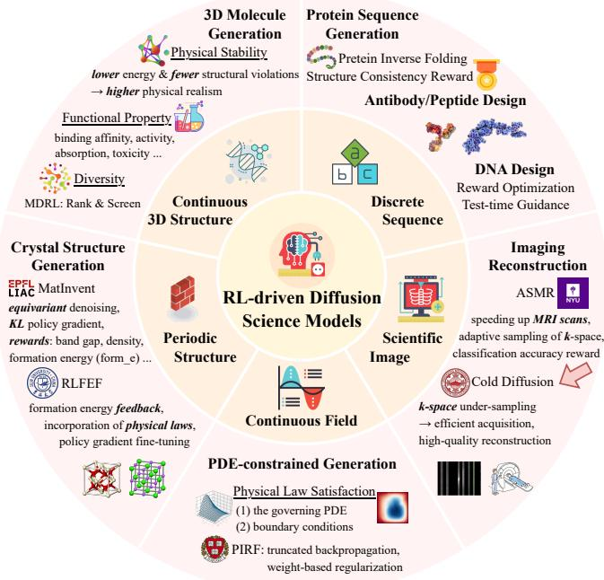  
Fig. 12. A summary of the overall five RL-driven scientific generation domains. Note that the representative methods listed here are not exhaustive; please refer to our main text for more details.

RL-driven dVLA methods in detail.

## 6 RL FOR DIFFUSION SCIENCE MODELS

Beyond the above domains, RL has also been introduced to scientific generative tasks for explicit control over physical laws or function-specific objectives through well-designed reward signals, thereby producing desirable outcomes. In this section, we systematically review recent advances in RL-driven diffusion-based science models from a novel perspective of data modality, as shown in Fig. 12.

## 6.1 Discrete Molecular Sequence Generation

Discrete biomolecular sequences (e.g., proteins and DNA) are typically modeled by discrete diffusion frameworks (e.g., D3PM [24]), yet these inherently lack explicit additional control over structural or functional objectives. However, RL effectively bridges this gap by enabling reward-guided optimization toward desired biomolecular properties. For structural design, RL-DIF [231] leverages DDPO [66] with sc-TM [232] to enhance protein foldability, whereas SDPO [233] employs stepwise offline preference learning to align diffusion trajectories with structural targets. In functional optimization, $\mathrm { R L } { - } \mathrm { D } ^ { 2 }$ [234] trains diffusion policies via policy mirror descent (PMD) for efficient high-fitness DNA design, while other methods [235; 236] optimize non-differentiable experimental rewards through RL fine-tuning with KL regularization to maintain prior proximity. Similarly, VIDD [237] achieves off-policy optimization via value-weighted likelihood distillation. Furthermore, antibody design frameworks such as BetterBodies [238] integrate LDMs with offline RL, guided by binding-oriented rewards for experimentally validated outputs. Collectively, these studies demonstrate that RL can expose non-differentiable biological objectives while retaining the broad support of pretrained sequence priors.

More recent literature extends this paradigm along two complementary directions. DoMinO [239] reformulates discrete flow matching (DFM) as a continuous-time MDP policy and introduces distributional regularization to limit drift from the pretrained generators. RIDER [240] instead aligns RNA sequences with target three-dimensional structures via self-consistency rewards. These works suggest that progress in biological sequence design increasingly relies on jointly optimizing function, structural validity, and sequence naturalness, rather than maximizing a single proxy reward.

## 6.2 Continuous 3D Structure Generation

For continuous 3D molecular design, RL converts physicsand property-based evaluators into trajectory-level supervision. Representative approaches include RLPF [241], which applies PPO fine-tuning to diffusion trajectories with force field feedback for stable conformations. And for multi-target compounds with desired properties, MDRL [242] jointly employs composite scores (e.g., ligand efficiency, docking score, and LogP) to steer pretrained models towards pharmacologically viable regions, while Chen et al. [243] extends this by integrating uncertainty-aware reward shaping to balance conflicting objectives and avoid high-risk chemical spaces. Building on this foundation, FTDiff [244] introduces GRPO and compresses sampling for efficient pocket-conditioned ligand design, while DePPA [245] applies denoising policy optimization to a pocket-aware diffusion prior with multiproperty reward signals. In short, the emerging direction is thus not simply stronger reward maximization, but efficient and uncertainty-aware post-training that balances binding quality, drug-likeness, synthesizability, and diversity.

## 6.3 Periodic Crystal Structure Generation

Crystal generation would impose additional geometric constraints, as the composition, lattice parameters, atomic coordinates, and periodic boundaries must remain jointly valid. Therefore, existing methods have attempted to introduce RL for stable, low-energy outputs while maintaining the crystallographic symmetry. Specifically, MatInvent [246] uses policy gradient optimization with reward-weighted KL regularization and diversity filtering to enhance success rates for low-formation-energy crystals. RLFEF [247] reframes RL fine-tuning as imposing physical priors, using off-policy RL to bias sampling towards stable structures while provably preserving the space-group symmetry. Both methods utilize formation energy as the reward signal along with KL regularization and experience replay to prevent mode collapse.

Recent work has extended this paradigm to continuoustime flow baselines. OMatG-IRL [248] performs inferencetime policy optimization directly over velocity-field generators, achieving energy-guided exploration without explicit score recovery. CrystalGRPO [249] further introduces joint coordinate-lattice policies and coverage-aware optimization, showing the improvements in Top-1 quality conflict with the Top-K candidate coverage required for polymorph discovery. These motivate crystal-specific evaluations that jointly report physical quality, target recovery, and candidate-set diversity, rather than relying on formation energy alone.

## 6.4 Continuous Physics-Constrained Field Modeling

In continuous physics-constrained field modeling, reward design must reconcile empirical data fidelity with governing equations and boundary conditions. Specifically, PIRF [250] treats PDE residuals and boundary conditions as trajectorylevel rewards for lower physical residuals with fewer steps, while RTB-DiffInv [251] uses off-policy distribution matching to adapt unconditional diffusion priors to uncertaintyaware, conditional inverse-problem posteriors.

Closely studies further broaden this view: PCFT [252] directly fine-tunes flow-matching models with differentiable weak-form constraints, whereas PBFM [253] treats distributional accuracy and physical consistency as competing objectives on a Pareto frontier. Although PCFT and PBFM are not conventional policy-gradient methods, together these works reveal three complementary routes for physics alignment: on-policy reward optimization, off-policy posterior matching, and direct differentiable constraint optimization.

## 6.5 Scientific Imaging and Inverse Reconstruction

Scientific imaging involves two distinct targets: the generative reconstruction and the measurement-acquisition policy. Cold Diffusion [254] belongs to the former, replacing Gaussian corruption with physically meaningful k-space degradation for MRI reconstruction without RL. ASMR [255] belongs to the latter, learning an RL policy that selects diagnostically informative k-space measurements while bypassing image reconstruction. They should therefore be viewed as complementary baselines rather than a unified RL-diffusion framework. RL has also begun to optimize medical diffusion generators directly. Specifically, RL4Med-DDPO [256] aligns dermoscopic image generation with clinical attributes, while recent multi-scale reward learning [257] extends PPO-based diffusion fine-tuning to 3D volumetric MRI via combining global anatomical and local slice-level feedback.

## 7 CONCLUSION

This survey presents a comprehensive review of RL-driven DMs, systematically mapping the technical landscape across four critical research domains: diffusion-based LLMs, multimodal frameworks, robotic systems, and scientific modeling. By centering on the post-training era, we emphasize pivotal dimensions, including test-time scaling, experiencedriven adaptation, autonomous exploration, and reward mechanism design, which collectively redefine the integration paradigm of RL and DMs. Our core objective is to synthesize foundational principles, identify underexplored research frontiers, and propose actionable pathways for future investigations, further aiming to catalyze both theoretical innovation and practical deployment in this rapidly advancing field. Given the dynamic evolution of RL-DM research, this survey may not capture the most recent breakthroughs. Therefore, we will establish a community-maintained platform leveraging crowdsourcing to ensure real-time updates, fostering continuous growth in this knowledge ecosystem.

## ACKNOWLEDGMENT

This work was supported by the National Science and Technology Major Project (2023ZD0121403), National Natural Science Foundation of China (NSFC) under Grants 62406161 and 62441615.

## REFERENCES

[1] J. Ho, A. Jain, and P. Abbeel, “Denoising diffusion probabilistic models,” Advances in neural information processing systems, vol. 33, pp. 6840–6851, 2020.

[2] R. Rombach, A. Blattmann et al., “High-resolution image synthesis with latent diffusion models,” in Proceedings of the IEEE/CVF conference on computer vision and pattern recognition, 2022, pp. 10 684–10 695.

[3] X. Liu, C. Gong, and Q. Liu, “Flow straight and fast: Learning to generate and transfer data with rectified flow,” arXiv preprint arXiv:2209.03003, 2022.

[4] R. S. Sutton, A. G. Barto et al., Introduction to reinforcement learning. MIT press Cambridge, 1998, vol. 135.

[5] P. F. Christiano, J. Leike, T. Brown, M. Martic, S. Legg, and D. Amodei, “Deep reinforcement learning from human preferences,” Advances in neural information processing systems, vol. 30, 2017.

[6] R. Rafailov, A. Sharma et al., “Direct preference optimization: Your language model is secretly a reward model,” Advances in neural information processing systems, vol. 36, pp. 53 728–53 741, 2023.

[7] Z. Shao, P. Wang, Q. Zhu, R. Xu, J. Song, X. Bi, H. Zhang, M. Zhang, Y. Li, Y. Wu et al., “Deepseekmath: Pushing the limits of mathematical reasoning in open language models,” arXiv preprint arXiv:2402.03300, 2024.

[8] Y. Song, J. Sohl-Dickstein et al., “Score-based generative modeling through stochastic differential equations,” arXiv preprint arXiv:2011.13456, 2020.

[9] Y. Lipman, R. T. Chen, H. Ben-Hamu, M. Nickel, and M. Le, “Flow matching for generative modeling,” arXiv preprint arXiv:2210.02747, 2022.

[10] T. Haarnoja, H. Tang et al., “Reinforcement learning with deep energy-based policies,” in International conference on machine learning. PMLR, 2017, pp. 1352–1361.

[11] G. Neu, A. Jonsson, and V. Gómez, “A unified view of entropy-regularized markov decision processes,” arXiv preprint arXiv:1705.07798, 2017.

[12] M. Geist, B. Scherrer, and O. Pietquin, “A theory of regularized markov decision processes,” in International conference on machine learning. PMLR, 2019, pp. 2160– 2169.

[13] J. Schulman, F. Wolski, P. Dhariwal, A. Radford, and O. Klimov, “Proximal policy optimization algorithms,” arXiv preprint arXiv:1707.06347, 2017.

[14] J. Schulman, P. Moritz, S. Levine, M. Jordan, and P. Abbeel, “High-dimensional continuous control using generalized advantage estimation,” arXiv preprint arXiv:1506.02438, 2015.

[15] S. Nie, F. Zhu, Z. You, X. Zhang, J. Ou, J. Hu, J. Zhou, Y. Lin, J.-R. Wen, and C. Li, “Large language diffusion models,” arXiv preprint arXiv:2502.09992, 2025.

[16] X. Li, J. Thickstun, I. Gulrajani, P. S. Liang, and T. B. Hashimoto, “Diffusion-lm improves controllable text generation,” Advances in neural information processing systems, vol. 35, pp. 4328–4343, 2022.

[17] S. Gong, M. Li, J. Feng, Z. Wu, and L. Kong, “DiffuSeq: Sequence to sequence text generation with diffusion models,” in International Conference on Learning Representations, ICLR, 2023.

[18] S. Gong, M. Li et al., “Diffuseq-v2: Bridging discrete and continuous text spaces for accelerated seq2seq diffusion models,” in The 2023 Conference on Empirical Methods in Natural Language Processing, 2023.

[19] R. Strudel, C. Tallec, F. Altché, Y. Du, Y. Ganin, A. Mensch, W. Grathwohl, N. Savinov, S. Dieleman, L. Sifre et al., “Self-conditioned embedding diffusion for text generation,” arXiv preprint arXiv:2211.04236, 2022.

[20] Z. Huang, Z. Chen, Z. Wang, T. Li, and G.-J. Qi, “Reinforcing the diffusion chain of lateral thought with

diffusion language models,” 2025. [Online]. Available: https://arxiv.org/abs/2505.10446

[21] Y. Li, K. Zhou, W. X. Zhao, and J.-R. Wen, “Diffusion models for non-autoregressive text generation: a survey,” in Proceedings of the Thirty-Second International Joint Conference on Artificial Intelligence, 2023, pp. 6692–6701.

[22] S. Zhao, D. Gupta, Q. Zheng, and A. Grover, “d1: Scaling reasoning in diffusion large language models via reinforcement learning,” 2025. [Online]. Available: https://arxiv.org/abs/2504.12216

[23] J. Shi, K. Han, Z. Wang, A. Doucet, and M. Titsias, “Simplified and generalized masked diffusion for discrete data,” Advances in neural information processing systems, vol. 37, pp. 103 131–103 167, 2024.

[24] J. Austin, D. D. Johnson, J. Ho, D. Tarlow, and R. Van Den Berg, “Structured denoising diffusion models in discrete state-spaces,” Advances in neural information processing systems, vol. 34, pp. 17 981–17 993, 2021.

[25] A. Campbell, J. Benton, V. De Bortoli, T. Rainforth, G. Deligiannidis, and A. Doucet, “A continuous time framework for discrete denoising models,” Advances in Neural Information Processing Systems, vol. 35, pp. 28 266– 28 279, 2022.

[26] X. Tang, R. Dolga, S. Yoon, and I. Bogunovic, “wd1: Weighted policy optimization for reasoning in diffusion language models,” 2025. [Online]. Available: https://arxiv.org/abs/2507.08838

[27] A. Zhan, “Principled and tractable rl for reasoning with diffusion language models,” 2025. [Online]. Available: https://arxiv.org/abs/2510.04019

[28] Y. Bai, A. Jones et al., “Training a helpful and harmless assistant with reinforcement learning from human feedback,” 2022. [Online]. Available: https: //arxiv.org/abs/2204.05862

[29] K. Zhang, Y. Zuo, B. He, Y. Sun, R. Liu, C. Jiang, Y. Fan, K. Tian, G. Jia, P. Li et al., “A survey of reinforcement learning for large reasoning models,” arXiv preprint arXiv:2509.08827, 2025.

[30] S. Gong, R. Zhang, H. Zheng, J. Gu, N. Jaitly, L. Kong, and Y. Zhang, “Diffucoder: Understanding and improving masked diffusion models for code generation,” 2025. [Online]. Available: https://arxiv.org/abs/2506.20639

[31] N. Lin, J. Zhang, L. Hou, and J. Li, “Boundary-guided policy optimization for memory-efficient rl of diffusion large language models,” 2025. [Online]. Available: https://arxiv.org/abs/2510.11683

[32] Y. Zhu, W. Guo, J. Choi, P. Molodyk, B. Yuan, M. Tao, and Y. Chen, “Enhancing reasoning for diffusion llms via distribution matching policy optimization,” 2025. [Online]. Available: https://arxiv.org/abs/2510.08233

[33] K. Rojas, J. Lin, K. Rasul, A. Schneider, Y. Nevmyvaka, M. Tao, and W. Deng, “Improving reasoning for diffusion language models via group diffusion policy optimization,” 2025. [Online]. Available: https://arxiv. org/abs/2510.08554

[34] J. Ou, J. Han, M. Xu, S. Xu, J. Xie, S. Ermon, Y. Wu, and C. Li, “Principled rl for diffusion llms emerges from a sequence-level perspective,” 2025. [Online]. Available: https://arxiv.org/abs/2512.03759

[35] L. Pan, S. Tao, Y. Zhai, Z. Fu, L. Fang, M. He, L. Zhang, Z. Liu, B. Ding, A. Liu, and L. Wen, “dtreerpo: Towards more reliable policy optimization for diffusion language models,” 2026. [Online]. Available: https://arxiv.org/abs/2512.09675

[36] C. Wei, J. Kang, H. Wang, J. Zhang, H. Jiang, X. Xu, N. Sun, Y. He, F. R. Yu, Y. Shu, and B. Jiang, “Lfpo: Likelihood-free policy optimization for masked diffusion models,” 2026. [Online]. Available: https://arxiv.org/abs/2603.01563

[37] J. Zhong, K. Wang, D. Ding, Z. Feng, H. Bai, Y. Xiang,

J. Sun, and Q. Xu, “Stabilizing reinforcement learning for diffusion language models,” 2026. [Online]. Available: https://arxiv.org/abs/2603.06743

[38] Z. Yu, S. Xu, B. Jiang, W. Zhang, and D. Zou, “Relative score policy optimization for diffusion language models,” 2026. [Online]. Available: https://arxiv.org/abs/2605. 10218

[39] X. Tang, K. Jiang, C. Liu, Q. Zhao, X. Xu, S. Yoon, and I. Bogunovic, “Gdsd: Reinforcement learning as guided denoiser self-distillation for diffusion language models,” 2026. [Online]. Available: https://arxiv.org/abs/2605. 29398

[40] G. Wang, Y. Schiff, G. Turok, and V. Kuleshov, “d2: Improved techniques for training reasoning diffusion language models,” 2025. [Online]. Available: https://arxiv.org/abs/2509.21474

[41] S. Zhao, M. Liu, J. Huang, M. Liu, C. Wang, B. Liu, Y. Tian, G. Pang, S. Bell, A. Grover, and F. Chen, “Inpainting-guided policy optimization for diffusion large language models,” 2025. [Online]. Available: https://arxiv.org/abs/2509.10396

[42] H. Zhao, D. Liang, W. Tang, D. Yao, and N. Kallus, “Diffpo: Training diffusion llms to reason fast and furious via reinforcement learning,” 2025. [Online]. Available: https://arxiv.org/abs/2510.02212

[43] S. Chen, J. Jiao, L. J. Ratliff, and B. Zhu, “dultra: Ultra-fast diffusion language models via reinforcement learning,” 2026. [Online]. Available: https://arxiv.org/ abs/2512.21446

[44] J. Liu, X. Wang, Y. Zhong, D. Lian, and Y. Yang, “Efficient and stable reinforcement learning for diffusion language models,” 2026. [Online]. Available: https: //arxiv.org/abs/2602.08905

[45] W. Lee, J. Kim, J. Ko, and W. Rhee, “Beyond on-policy exploration: Integrating external policy rollouts for reinforcement learning in diffusion language models,” 2026. [Online]. Available: https://arxiv.org/abs/2608. 01717

[46] H. Raajesh, K. Shah, A. Klivans, and P. Krähenbühl, “Mask-aware policy gradients for diffusion language models,” 2026. [Online]. Available: https://arxiv.org/ abs/2607.15200

[47] F. Zhu, R. Wang, S. Nie, X. Zhang, C. Wu, J. Hu, J. Zhou, J. Chen, Y. Lin, J.-R. Wen, and C. Li, “Llada 1.5: Variance-reduced preference optimization for large language diffusion models,” 2025. [Online]. Available: https://arxiv.org/abs/2505.19223

[48] V. Jindal, H. Sang, C.-M. Lai, Y. Chen, and Z. Wang, “Aligning diffusion language models via unpaired preference optimization,” 2025. [Online]. Available: https://arxiv.org/abs/2510.23658

[49] H. He, K. Renz, Y. Cao, and A. Geiger, “Mdpo: Overcoming the training-inference divide of masked diffusion language models,” 2025. [Online]. Available: https://arxiv.org/abs/2508.13148

[50] S. Xie, L. Kong, X. Song, X. Dong, G. Chen, E. P. Xing, and K. Zhang, “Step-aware policy optimization for reasoning in diffusion large language models,” 2025. [Online]. Available: https://arxiv.org/abs/2510.01544

[51] Y. Wang, L. Yang, B. Li, Y. Tian, K. Shen, and M. Wang, “Revolutionizing reinforcement learning framework for diffusion large language models,” 2025. [Online]. Available: https://arxiv.org/abs/2509.06949

[52] T. Chen, M. Xu, J. Leskovec, and S. Ermon, “Rfg: Test-time scaling for diffusion large language model reasoning with reward-free guidance,” 2025. [Online]. Available: https://arxiv.org/abs/2509.25604

[53] C. Wang, P. Rashidinejad, D. Su, S. Jiang, S. Wang, S. Zhao, C. Zhou, S. Z. Shen, F. Chen, T. Jaakkola, Y. Tian, and B. Liu, “Spg: Sandwiched policy gradient

for masked diffusion language models,” 2025. [Online]. Available: https://arxiv.org/abs/2510.09541

[54] Y. Zhu, J. Wan, X. Liu, S. He, Q. Wang, X. Guo, T. Liang, Z. Huang, Z. He, and X. Qiu, “Dirl: An efficient post-training framework for diffusion language models,” arXiv preprint arXiv:2512.22234, 2025.

[55] J. Yang, Y. Jiang, X. Hu, S. Cheng, B. Qi, and J. Shao, “Dare: Diffusion large language models alignment and reinforcement executor,” 2026. [Online]. Available: https://arxiv.org/abs/2604.04215

[56] O. Zekri and N. Boullé, “Fine-tuning discrete diffusion models with policy gradient methods,” 2025. [Online]. Available: https://arxiv.org/abs/2502.01384

[57] Q. Team, “Qwen2.5: A party of foundation models,” September 2024. [Online]. Available: https://qwenlm. github.io/blog/qwen2.5/

[58] A. Hurst, A. Lerer, A. P. Goucher, A. Perelman, A. Ramesh, A. Clark, A. Ostrow, A. Welihinda, A. Hayes, A. Radford et al., “Gpt-4o system card,” arXiv preprint arXiv:2410.21276, 2024.

[59] L. Ouyang, J. Wu et al., “Training language models to follow instructions with human feedback,” Advances in neural information processing systems, vol. 35, pp. 27 730– 27 744, 2022.

[60] J. D. Pressman, K. Crowson, and S. C. Contributors, “Simulacra aesthetic captions,” in Technical Report Version 1.0. Stability AI, 2022.

[61] K. Lee, H. Liu, M. Ryu, O. Watkins, Y. Du, C. Boutilier, P. Abbeel, M. Ghavamzadeh, and S. S. Gu, “Aligning textto-image models using human feedback,” arXiv preprint arXiv:2302.12192, 2023.

[62] Y. Kirstain, A. Polyak, U. Singer, S. Matiana, J. Penna, and O. Levy, “Pick-a-pic: An open dataset of user preferences for text-to-image generation,” Advances in neural information processing systems, vol. 36, pp. 36 652–36 663, 2023.

[63] J. Xu, X. Liu, Y. Wu, Y. Tong, Q. Li, M. Ding, J. Tang, and Y. Dong, “Imagereward: Learning and evaluating human preferences for text-to-image generation,” Advances in Neural Information Processing Systems, vol. 36, pp. 15 903– 15 935, 2023.

[64] X. Wu, Y. Hao, K. Sun, Y. Chen, F. Zhu, R. Zhao, and H. Li, “Human preference score v2: A solid benchmark for evaluating human preferences of text-to-image synthesis,” arXiv preprint arXiv:2306.09341, 2023.

[65] Y. Fan, O. Watkins, Y. Du, H. Liu, M. Ryu, C. Boutilier, P. Abbeel, M. Ghavamzadeh, K. Lee, and K. Lee, “Dpok: Reinforcement learning for fine-tuning textto-image diffusion models,” 2023. [Online]. Available: https://arxiv.org/abs/2305.16381

[66] K. Black, M. Janner, Y. Du, I. Kostrikov, and S. Levine, “Training diffusion models with reinforcement learning,” arXiv preprint arXiv:2305.13301, 2023.

[67] K. Clark, P. Vicol, K. Swersky, and D. J. Fleet, “Directly fine-tuning diffusion models on differentiable rewards,” arXiv preprint arXiv:2309.17400, 2023.

[68] M. Prabhudesai, A. Goyal, D. Pathak, and K. Fragkiadaki, “Aligning text-to-image diffusion models with reward backpropagation,” 2023.

[69] J. Liu, G. Liu, J. Liang, Z. Yuan, X. Liu, M. Zheng, X. Wu, Q. Wang, W. Qin, M. Xia et al., “Improving video generation with human feedback,” arXiv preprint arXiv:2501.13918, 2025.

[70] B. Wallace, M. Dang, R. Rafailov, L. Zhou, A. Lou, S. Purushwalkam, S. Ermon, C. Xiong, S. Joty, and N. Naik, “Diffusion model alignment using direct preference optimization,” in Proceedings of the IEEE/CVF Conference on Computer Vision and Pattern Recognition, 2024, pp. 8228– 8238.

[71] S. Li, K. Kallidromitis, A. Gokul, Y. Kato, and K. Kozuka, “Aligning diffusion models by optimizing human util-

ity,” Advances in Neural Information Processing Systems, vol. 37, pp. 24 897–24 925, 2024.

[72] R. Liu, H. Wu, Z. Zheng, C. Wei, Y. He, R. Pi, and Q. Chen, “Videodpo: Omni-preference alignment for video diffusion generation,” in Proceedings of the Computer Vision and Pattern Recognition Conference, 2025, pp. 8009–8019.

[73] J. Zhang, J. Wu, W. Chen, Y. Ji, X. Xiao, W. Huang, and K. Han, “Onlinevpo: Align video diffusion model with online video-centric preference optimization,” arXiv preprint arXiv:2412.15159, 2024.

[74] P. Esser, S. Kulal, A. Blattmann, R. Entezari, J. Müller, H. Saini, Y. Levi, D. Lorenz, A. Sauer, F. Boesel et al., “Scaling rectified flow transformers for high-resolution image synthesis,” in Forty-first international conference on machine learning, 2024.

[75] A. Polyak, A. Zohar, A. Brown, A. Tjandra, A. Sinha, A. Lee, A. Vyas, B. Shi, C.-Y. Ma, C.-Y. Chuang et al., “Movie gen: A cast of media foundation models,” arXiv preprint arXiv:2410.13720, 2024.

[76] W. Kong, Q. Tian, Z. Zhang, R. Min, Z. Dai, J. Zhou, J. Xiong, X. Li, B. Wu, J. Zhang et al., “Hunyuanvideo: A systematic framework for large video generative models,” arXiv preprint arXiv:2412.03603, 2024.

[77] G. Ma, H. Huang, K. Yan, L. Chen, N. Duan, S. Yin, C. Wan, R. Ming, X. Song, X. Chen et al., “Step-video-t2v technical report: The practice, challenges, and future of video foundation model,” arXiv preprint arXiv:2502.10248, 2025.

[78] N. Agarwal, A. Ali, M. Bala, Y. Balaji, E. Barker, T. Cai, P. Chattopadhyay, Y. Chen, Y. Cui, Y. Ding et al., “Cosmos world foundation model platform for physical ai,” arXiv preprint arXiv:2501.03575, 2025.

[79] T. Wan, A. Wang, B. Ai, B. Wen, C. Mao, C.-W. Xie, D. Chen, F. Yu, H. Zhao, J. Yang et al., “Wan: Open and advanced large-scale video generative models,” arXiv preprint arXiv:2503.20314, 2025.

[80] X. Sun, R. Xiao, J. Mo, B. Wu, Q. Yu, and B. Wang, “F5r-tts: Improving flow-matching based text-to-speech with group relative policy optimization,” arXiv preprint arXiv:2504.02407, 2025.

[81] J. Liu, G. Liu, J. Liang, Y. Li, J. Liu, X. Wang, P. Wan, D. Zhang, and W. Ouyang, “Flow-grpo: Training flow matching models via online rl,” arXiv preprint arXiv:2505.05470, 2025.

[82] Z. Xue, J. Wu, Y. Gao, F. Kong, L. Zhu, M. Chen, Z. Liu, W. Liu, Q. Guo, W. Huang, and P. Luo, “Dancegrpo: Unleashing grpo on visual generation,” arXiv preprint arXiv:2505.07818, 2025. [Online]. Available: https://arxiv.org/abs/2505.07818

[83] J. Li, Y. Cui, T. Huang, Y. Ma, C. Fan, M. Yang, and Z. Zhong, “Mixgrpo: Unlocking flow-based grpo efficiency with mixed ode-sde trajectories,” arXiv preprint arXiv:2507.21802, 2025. [Online]. Available: https://arxiv.org/abs/2507.21802

[84] K. Zheng, H. Chen, H. Ye, H. Wang, Q. Zhang, K. Jiang, H. Su, S. Ermon, J. Zhu, and M.-Y. Liu, “Diffusionnft: Online diffusion reinforcement with forward process,” arXiv preprint arXiv:2509.16117, 2025.

[85] Z. Liu, T. Z. Xiao, W. Liu, Y. Bengio, and D. Zhang, “Efficient diversity-preserving diffusion alignment via gradient-informed gflownets,” arXiv preprint arXiv:2412.07775, 2024.

[86] L. Eyring, S. Karthik, K. Roth, A. Dosovitskiy, and Z. Akata, “Reno: Enhancing one-step text-to-image models through reward-based noise optimization,” Advances in Neural Information Processing Systems, vol. 37, pp. 125 487–125 519, 2024.

[87] Z. Zhang, L. Shen, S. Zhang, D. Ye, Y. Luo, M. Shi, B. Du, and D. Tao, “Aligning few-step diffusion models with dense reward difference learning,” arXiv preprint

arXiv:2411.11727, 2024.

[88] H. Zhang, Z. Wu, Z. Xing, J. Shao, and Y.-G. Jiang, “Adadiff: Adaptive step selection for fast diffusion,” arXiv preprint arXiv:2311.14768, 2023.

[89] Y. Wang, X. Wang, A.-D. Dinh, B. Du, and C. Xu, “Learning to schedule in diffusion probabilistic models,” in Proceedings ofthe 29th ACM SIGKDD Conference on Knowledge Discovery and Data Mining, 2023, pp. 2478–2488.

[90] D. Ghosh, H. Hajishirzi, and L. Schmidt, “Geneval: An object-focused framework for evaluating text-toimage alignment,” 2023. [Online]. Available: https: //arxiv.org/abs/2310.11513

[91] Y. Hu, B. Liu, J. Kasai, Y. Wang, M. Ostendorf, R. Krishna, and N. A. Smith, “Tifa: Accurate and interpretable text-to-image faithfulness evaluation with question answering,” 2023. [Online]. Available: https: //arxiv.org/abs/2303.11897

[92] K. Black, M. Janner, Y. Du, I. Kostrikov, and S. Levine, “Training diffusion models with reinforcement learning,” in The Twelfth International Conference on Learning Representations, 2024. [Online]. Available: https: //openreview.net/forum?id=YCWjhGrJFD

[93] Y. Zhang, E. Tzeng, Y. Du, and D. Kislyuk, “Large-scale reinforcement learning for diffusion models,” 2024. [Online]. Available: https://arxiv.org/abs/2401.12244

[94] Z. Miao, J. Wang, Z. Wang, Z. Yang, L. Wang, Q. Qiu, and Z. Liu, “Training diffusion models towards diverse image generation with reinforcement learning,” in Proceedings of the IEEE/CVF Conference on Computer Vision and Pattern Recognition (CVPR), June 2024, pp. 10 844–10 853.

[95] S. H. Lee, Y. Li, J. Ke, I. Yoo, H. Zhang, J. Yu, Q. Wang, F. Deng, G. Entis, J. He, G. Li, S. Kim, I. Essa, and F. Yang, “Parrot: Pareto-optimal multi-reward reinforcement learning framework for text-to-image generation,” 2024. [Online]. Available: https://arxiv.org/abs/2401.05675

[96] M. Cai, S. Li, W. Li, X. Huang, H. Chen, J. Hu, and Y. Wang, “Dspo: Direct semantic preference optimization for real-world image super-resolution,” 2025. [Online]. Available: https://arxiv.org/abs/2504.15176

[97] A. Hiranaka, S.-F. Chen, C.-H. Lai, D. Kim, N. Murata, T. Shibuya, W.-H. Liao, S.-H. Sun, and Y. Mitsufuji, “Hero: Human-feedback efficient reinforcement learning for online diffusion model finetuning,” 2025. [Online]. Available: https://arxiv.org/abs/2410.05116

[98] Z. Hu, F. Zhang, L. Chen, K. Kuang, J. Li, K. Gao, J. Xiao, X. Wang, and W. Zhu, “Towards better alignment: Training diffusion models with reinforcement learning against sparse rewards,” 2025. [Online]. Available: https://arxiv.org/abs/2503.11240

[99] Y. Yang, S. Kim, H. Jung, S. Bae, S. Kim, S.-Y. Yun, and K. Lee, “Automated filtering of human feedback data for aligning text-to-image diffusion models,” 2025. [Online]. Available: https://arxiv.org/abs/2410.10166

[100] F. Dai, Z. Zhuang, Y. Huang, S. Huang, B. Liao, D. Wang, and F. Yuan, “Vard: Efficient and dense fine-tuning for diffusion models with value-based rl,” 2025. [Online]. Available: https://arxiv.org/abs/2505.15791

[101] H. Zhao, H. Chen, J. Zhang, D. D. Yao, and W. Tang, “Score as action: Fine-tuning diffusion generative models by continuous-time reinforcement learning,” 2025. [Online]. Available: https://arxiv.org/abs/2502.01819

[102] K. Lee, X. Li, Q. Wang, J. He, J. Ke, M.-H. Yang, I. Essa, J. Shin, F. Yang, and Y. Li, “Calibrated multi-preference optimization for aligning diffusion models,” 2025. [Online]. Available: https://arxiv.org/abs/2502.02588

[103] J. J. C. Xian, M. Li, H. Yang, X. Tao, P. Wan, L. Sigal, and R. Liao, “Free lunch alignment of text-to-image diffusion models without preference image pairs,” 2025. [Online]. Available: https://arxiv.org/abs/2509.25771

[104] J. Bai, X. Yu, M. Xu, W. Lu, X. Pan, K. Maeng, D. Kifer,

J. Wang, and Y. Wang, “Towards better optimization for listwise preference in diffusion models,” 2025. [Online]. Available: https://arxiv.org/abs/2510.01540

[105] S. Xue, C. Ge, S. Zhang, Y. Li, and Z.-M. Ma, “Advantage weighted matching: Aligning rl with pretraining in diffusion models,” 2025. [Online]. Available: https: //arxiv.org/abs/2509.25050

[106] N. Dufour, L. Degeorge, A. Ghosh, V. Kalogeiton, and D. Picard, “Miro: Multi-reward conditioned pretraining improves t2i quality and efficiency,” 2025. [Online]. Available: https://arxiv.org/abs/2510.25897

[107] W. Mao, H. Chen, Z. Yang, and M. Z. Shou, “The image as its own reward: Reinforcement learning with adversarial reward for image generation,” 2025.

[108] B. Tang, Y. Zhang, X. Wang, J. Mao, L. Schmidt, and S. Yeung-Levy, “V-grpo: Online reinforcement learning for denoising generative models is easier than you think,” 2026. [Online]. Available: https: //arxiv.org/abs/2604.23380

[109] J. Choi, W. Guo, Y. Zhu, A. Vahdat, M. Tao, J. Berner, and Y. Chen, “Scaling reinforcement learning for diffusion models via velocity matching,” 2026. [Online]. Available: https://arxiv.org/abs/2608.23664

[110] W. Zhou, X. Zhu, L. Kong, B. Chen, L. Zhang, Y. Liang, X. Hou, Y. Tian, X. Sun, Y. Wang, L. Li, S. Wu, L. Qu, F. Li, W. Liu, J. McAuley, and T.-S. Chua, “On-policy self-distillation in diffusion models,” 2026. [Online]. Available: https://arxiv.org/abs/2608.24646

[111] Y. Xu, K. Gao, Y. Chen, Y. Chen, Z. Tang, Z. Liu, Z. Zhou, D. Li, H. Meng, K. Cao, J. Li, J. Zhang, L. Peng, L. Jiang, N. Tang, S. Yin, T. Wu, X. Chen, Y. Shu, Y. Zhang, Y. Wang, Y. Wu, Y. Wu, Z. Zhang, Z. Wang, X. Xu, K. Yan, and C. Wu, “Qwen-image-2.0-rl technical report,” 2026. [Online]. Available: https://arxiv.org/abs/2606.27608

[112] M. Wu, L. Wang, P. Zhao, F. Yang, J. Zhang, J. Liu, Y. Zhan, W. Han, H. Sun, J. Ji, X. Sun, Q. Lin, W. Deng, D. Zhang, F. Sun, Q. Zhang, and R. Ji, “Reprompt: Reasoning-augmented reprompting for text-to-image generation via reinforcement learning,” 2025. [Online]. Available: https://arxiv.org/abs/2505.17540

[113] J. Pan, Z. Ma, K. Zhang, N. Ding, and B. Zhou, “Selfreflective reinforcement learning for diffusion-based image reasoning generation,” 2025. [Online]. Available: https://arxiv.org/abs/2505.22407

[114] D. Jiang, Z. Guo, R. Zhang, Z. Zong, H. Li, L. Zhuo, S. Yan, P.-A. Heng, and H. Li, “T2ir1: Reinforcing image generation with collaborative semantic-level and token-level cot,” 2025. [Online]. Available: https://arxiv.org/abs/2505.00703

[115] Z. Guo, R. Zhang, C. Tong, Z. Zhao, R. Huang, H. Zhang, M. Zhang, J. Liu, S. Zhang, P. Gao, H. Li, and P.-A. Heng, “Can we generate images with cot? let’s verify and reinforce image generation step by step,” 2025. [Online]. Available: https://arxiv.org/abs/2501.13926

[116] Z. Liu, M. Ning, Q. Zhang, S. Yang, Z. Wang, Y. Yang, X. Xu, Y. Song, W. Chen, F. Wang, and L. Yuan, “Cot-lized diffusion: Let’s reinforce t2i generation step-by-step,” 2025. [Online]. Available: https://arxiv.org/abs/2507.04451

[117] Y. Li, P. Chen, M. Han, P. Bu, H. Shi, R. Zhao, Y. Yao, X. Zhang, J. Song, and B. Zheng, “Visual-cog: Stageaware reinforcement learning with chain of guidance for text-to-image generation,” 2025. [Online]. Available: https://arxiv.org/abs/2508.18032

[118] H. Yang, Y. Zhou, W. Han, R. Tao, Z. Qiu, J. Yang, and J. Shen, “Hicogen: Hierarchical compositional text-toimage generation in diffusion models via reinforcement learning,” 2025.

[119] H. Deng, K. Yan, C. Mao, X. Wang, Y. Liu, C. Gao, and N. Sang, “Densegrpo: From sparse to dense reward

for flow matching model alignment,” 2026. [Online]. Available: https://arxiv.org/abs/2601.20218

[120] Y. Savani, B. Kveton, Y. Liu, Y. Wang, J. Shi, S. Mukherjee, N. Vlassis, and K. K. Singh, “Stepwise credit assignment for grpo on flow-matching models,” 2026. [Online]. Available: https://arxiv.org/abs/2603.28718

[121] R. Li, K. Hao, Y. Liang, H. Huang, C. Zhang, Y. Gu, and X. Li, “Learning to credit the right steps: Objectiveaware process optimization for visual generation,” 2026. [Online]. Available: https://arxiv.org/abs/2604.19234

[122] O. Oertell, J. D. Chang, Y. Zhang, K. Brantley, and W. Sun, “Rl for consistency models: Faster reward guided text-to-image generation,” 2024. [Online]. Available: https://arxiv.org/abs/2404.03673

[123] Y. Tian, L. Yang, X. Zhang, Y. Tong, M. Wang, and B. Cui, “Diffusion-sharpening: Fine-tuning diffusion models with denoising trajectory sharpening,” 2025. [Online]. Available: https://arxiv.org/abs/2502.12146

[124] Y. Luo, T. Hu, W. Luo, K. Kawaguchi, and J. Tang, “Reward-instruct: A reward-centric approach to fast photo-realistic image generation,” 2025. [Online]. Available: https://arxiv.org/abs/2503.13070

[125] G. Chen, S. Huang, K. Liu, J. Zhu, X. Qu, P. Chen, Y. Cheng, and Y. Sun, “Flash-dmd: Towards high-fidelity few-step image generation with efficient distillation and joint reinforcement learning,” 2025.

[126] Z. Fang, J. Zheng, Q. Gao, X. Gao, and J. Sulam, “Proxt2i: Efficient reward-guided text-to-image generation via proximal diffusion,” 2025.

[127] D. Jiang, D. Liu, Z. Wang, Q. Wu, L. Li, H. Li, X. Jin, D. Liu, Z. Li, B. Zhang, M. Wang, S. Hoi, P. Gao, and H. Yang, “Distribution matching distillation meets reinforcement learning,” 2025.

[128] Q. Lyu, Z. Chen, C. Wang, H. Shi, S. Gao, R. Piao, Y. Zeng, J. Si, F. Ding, J. Li et al., “Multi-grpo: Multigroup advantage estimation for text-to-image generation with tree-based trajectories and multiple rewards,” arXiv preprint arXiv:2512.00743, 2025.

[129] H. Yuan, S. Zhang, X. Wang, Y. Wei, T. Feng, Y. Pan, Y. Zhang, Z. Liu, S. Albanie, and D. Ni, “Instructvideo: Instructing video diffusion models with human feedback,” in Proceedings of the IEEE/CVF Conference on Computer Vision and Pattern Recognition (CVPR), June 2024, pp. 6463–6474. [Online]. Available: https://arxiv.org/abs/2312.12490

[130] M. Prabhudesai, R. Mendonca, Z. Qin, K. Fragkiadaki, and D. Pathak, “Video diffusion alignment via reward gradients,” arXiv preprint arXiv:2407.08737, 2024. [Online]. Available: https://arxiv.org/abs/2407.08737

[131] J. Li, W. Feng, T.-J. Fu, X. Wang, S. Basu, W. Chen, and W. Y. Wang, “T2v-turbo: Breaking the quality bottleneck of video consistency model with mixed reward feedback,” in Advances in Neural Information Processing Systems (NeurIPS), 2024. [Online]. Available: https://arxiv.org/abs/2405.18750

[132] X. Wu, S. Huang, G. Wang, J. Xiong, and F. Wei, “Boosting text-to-video generative model with mllms feedback,” in Advances in Neural Information Processing Systems (NeurIPS), 2024. [Online]. Available: https: //proceedings.neurips.cc/paper\_files/paper/2024/file/ fbe2b2f74a2ece8070d8fb073717bda6-Paper-Conference. pdf

[133] J. Liu, G. Liu, J. Liang et al., “Improving Video Generation with Human Feedback,” arXiv preprint arXiv:2501.13918, 2025. [Online]. Available: https://arxiv.org/abs/2501. 13918

[134] Z. Wu, A. Kag, I. Skorokhodov, W. Menapace, A. Mirzaei, I. Gilitschenski, S. Tulyakov, and A. Siarohin, “Densedpo: Fine-grained temporal preference optimization for video diffusion models,” arXiv preprint arXiv:2506.03517, 2025.

[Online]. Available: https://arxiv.org/abs/2506.03517

[135] H. Liu, F. Kong, J. Wang, Y. Lin, N. Huang, C. Liu, X. Wang, P. Wan, K. Gai, and X. Li, “Temporal concentration from rollout errors: Implicit preference optimization for text-to-video diffusion,” 2026. [Online]. Available: https://arxiv.org/abs/2607.28058

[136] G. Zhang, X. Ma, J. Huang, H. Xu, H. Yu, S. Fu, Y. Li, Z. Xue, L. Song, H. Huang, N. Duan, and F. Zhao, “Omninft: Modality-wise omni diffusion reinforcement for joint audio-video generation,” 2026. [Online]. Available: https://arxiv.org/abs/2605.12480

[137] W. Lin, L. Jia, W. Hu, K. Pan, Z. Yue, W. Zhao, J. Chen, F. Wu, and H. Zhang, “Reasoning physical video generation with diffusion timestep tokens via reinforcement learning,” arXiv preprint arXiv:2504.15932, 2025. [Online]. Available: https://arxiv.org/abs/2504. 15932

[138] S. Ji, Y. Zhang, M. Hu, J. Li, Y. Li, Z. Yu, Y. Wang, J. Zhou, and X. Wang, “Physmaster: Mastering physical representation for video generation via reinforcement learning,” arXiv preprint arXiv:2510.13809, 2025. [Online]. Available: https://arxiv.org/abs/2510.13809

[139] Y. Wang, Y. Zhao, Y. Fu, H. Li, W. Zhou, Y. Wang, Y. Shen, Z. Li, and J. Zhou, “Physcorr: Dual-reward dpo for physics-constrained text-to-video generation with automated preference selection,” arXiv preprint arXiv:2511.03997, 2025. [Online]. Available: https://arxiv. org/abs/2511.03997

[140] C. Li, O. Michel, X. Pan, S. Liu, M. Roberts, and S. Xie, “PISA Experiments: Exploring physics post-training for video diffusion models by watching stuff drop, arXiv preprint arXiv:2503.09595, 2025. [Online]. Available: https://arxiv.org/abs/2503.09595

[141] W. Wang, X. He, Y. Gu, Y. Yang, Z. Zhang, Y. He, Y. Ding, X. Hu, D. Y. Chen, Z. He, Y. Yang, and B. Zhuang, “World-r1: Reinforcing 3d constraints for text-to-video generation,” 2026. [Online]. Available: https://arxiv.org/abs/2604.24764

[142] Z. An, O. Kupyn, T. Uscidda, A. Colaco, K. Ahuja, S. Belongie, M. Gonzalez-Franco, and M. T. Gazulla, “Vggrpo: Towards world-consistent video generation with 4d latent reward,” 2026. [Online]. Available: https://arxiv.org/abs/2603.26599

[143] S. Wang, Y. Zhong, J. Mu, K. Wu, M. Xiong, W. Fang, M. Liu, H. Deng, B. He, G. Li, and Q. Liu, “Align-avideo: Deterministic reward tuning of image diffusion models for consistent video editing,” in Proceedings of the IEEE/CVF Conference on Computer Vision and Pattern Recognition (CVPR), June 2025, pp. 2074–2083. [Online]. Available: https://arxiv.org/abs/2503.04065

[144] X. Bao, J. Lv, X. Wang, Z. Zhu, X. Chen, Y. Zhou, J. Lv, X. Wang, and G. Huang, “Gigavideo-1: Advancing video generation via automatic feedback with 4 gpuhours fine-tuning,” arXiv preprint arXiv:2506.10639, 2025. [Online]. Available: https://arxiv.org/abs/2506.10639

[145] H. Li, L. Jiang, X. Xiao, T. Wang, H. Yi, B. Wu, and D. Cai, “Magicid: Hybrid preference optimization for idconsistent and dynamic-preserved video customization,” in Proceedings of the IEEE/CVF International Conference on Computer Vision (ICCV), 2025. [Online]. Available: https://arxiv.org/abs/2503.12689

[146] P. Pan, J. Zhao, Y. Lin, C. Lin, C. Li, H. Liu, T. Shen, and Y. Mu, “Id-crafter: Vlm-grounded online rl for compositional multi-subject video generation,” arXiv preprint arXiv:2511.00511, 2025. [Online]. Available: https://arxiv.org/abs/2511.00511

[147] J. Wang, J. Lu, G. Xu, C. Chen, H. Yang, L. Wang, P. Chen, M. Chen, Z. Hu, L. Wu, S. Shao, Q. Lu, and P. Luo, “Tagrpo: Boosting grpo on image-to-video generation with direct trajectory alignment,” 2026.

[Online]. Available: https://arxiv.org/abs/2601.05729

[148] Q. Zhang, B. Gong, S. Tan, Z. Zhang, Y. Shen, X. Zhu, Y. Li, K. Yao, C. Shen, and C. Zou, “Physrvg: Physics-aware unified reinforcement learning for video generative models,” 2026. [Online]. Available: https://arxiv.org/abs/2601.11087

[149] J. Ye, F. Liu, Q. Li, Z. Wang, Y. Wang, X. Wang, Y. Duan, and J. Zhu, “Dreamreward: Text-to-3d generation with human preference,” 2024.

[150] Q. Liu, Z. Liu, D. Zhang, and K. Jia, “Nablar2d3: Effective and efficient 3d diffusion alignment with 2d rewards,” 2025. [Online]. Available: https: //arxiv.org/abs/2506.15684

[151] N. Majumder, C.-Y. Hung, D. Ghosal, W.-N. Hsu, R. Mihalcea, and S. Poria, “Tango 2: Aligning diffusion-based text-to-audio generations through direct preference optimization,” 2024. [Online]. Available: https://arxiv.org/abs/2404.09956

[152] S. Lei, Y. Xu, Z. Lin, H. Zhang, W. Tan, H. Chen, J. Yu, Y. Zhang, C. Yang, H. Zhu, S. Wang, Z. Wu, and D. Yu, “Levo: High-quality song generation with multi-preference alignment,” 2025. [Online]. Available: https://arxiv.org/abs/2506.07520

[153] X. Li, J. Liu, W. Chen, H. Zhu, Z. Ma, and X. Chen, “Resonate: Reinforcing text-to-audio generation via online feedback from large audio language models,” 2026. [Online]. Available: https://arxiv.org/abs/2603. 11661

[154] G. Han, M. Liang, J. Tang, Y. Cheng, W. Liu, and S. Huang, “Reindiffuse: Crafting physically plausible motions with reinforced diffusion model,” 2024. [Online]. Available: https://arxiv.org/abs/2410.07296

[155] X. Liu, Y. Mao, W. Zhou, and H. Li, “Motionrl: Align text-to-motion generation to human preferences with multi-reward reinforcement learning,” 2024. [Online]. Available: https://arxiv.org/abs/2410.06513

[156] T. Li, J. Liu, H. Chen, and Q. Liu, “Instructrl4pix: Training diffusion for image editing by reinforcement learning, arXiv preprint arXiv:2406.09973, 2024.

[157] X. Luo, J. Wang, C. Wu, S. Xiao, X. Jiang, D. Lian, J. Zhang, D. Liu et al., “Editscore: Unlocking online rl for image editing via high-fidelity reward modeling,” arXiv preprint arXiv:2509.23909, 2025.

[158] E. Benarous, Y. Du, and H. Yang, “Spie: Semantic and structural post-training of image editing diffusion models with ai feedback,” in Proceedings of the IEEE/CVF International Conference on Computer Vision, 2025, pp. 6395–6407.

[159] J. Huang, Y. Zhang, T. Chen, S. Wang, J. Xie, O. Leong, M. Zhou, N. Wang, and Y. N. Wu, “Mteditflow: Reinforcement learning for multi-turn image editing with flow matching,” 2026. [Online]. Available: https://arxiv.org/abs/2606.01985

[160] Q. Ma, J. Cheng, L. Liang, Z. Yu, T. Huang, and R. Yan, “Can we perform online rl for image editing without editing rewards?” 2026. [Online]. Available: https://arxiv.org/abs/2608.22780

[161] L. Yang, Y. Tian, B. Li, X. Zhang, K. Shen, Y. Tong, and M. Wang, “Mmada: Multimodal large diffusion language models,” arXiv preprint arXiv:2505.15809, 2025.

[162] F.-Y. Wang, H. Zhang, M. Gharbi, H. Li, and T. Park, “Unirl-zero: Reinforcement learning on unified models with joint language model and diffusion model experts,” arXiv preprint arXiv:2510.17937, 2025.

[163] J. Pan, L. Li, Y. Peng, Y.-M. Tang, S. Wang, Y. Sun, H. Wu, Q. Huang, and H. Wang, “Learning to generate via understanding: Understanding-driven intrinsic rewarding for unified multimodal models,” in Proceedings of the IEEE/CVF Conference on Computer Vision and Pattern Recognition, 2026, pp. 22 174–22 184.

[164] R. Huang, J. Wu, R. Yang, Z. Liu, and H. Zhao, “Alpha-

grpo: Unlocking self-reflective multimodal generation in umms via decompositional verifiable reward,” 2026. [Online]. Available: https://arxiv.org/abs/2605.12495

[165] Y. Wang, Y. Zang, H. Li, C. Jin, and J. Wang, “Unified reward model for multimodal understanding and generation,” arXiv preprint arXiv:2503.05236, 2025.

[166] Y. Wang, W. Luo, J. Bai, Y. Cao, T. Che, K. Chen, Y. Chen, J. Diamond, Y. Ding, W. Ding et al., “Alpamayo-r1: Bridging reasoning and action prediction for generalizable autonomous driving in the long tail,” arXiv preprint arXiv:2511.00088, 2025.

[167] Y. Wang, Z. Li, Y. Zang, C. Wang, Q. Lu, C. Jin, and J. Wang, “Unified multimodal chain-of-thought reward model through reinforcement fine-tuning,” arXiv preprint arXiv:2505.03318, 2025.

[168] Y.-F. Zhang, X. Lu, X. Hu, C. Fu, B. Wen, T. Zhang, C. Liu, K. Jiang, K. Chen, K. Tang et al., “R1-reward: Training multimodal reward model through stable reinforcement learning,” arXiv preprint arXiv:2505.02835, 2025.

[169] C. Chi, S. Feng, Y. Du, Z. Xu, E. Cousineau, B. Burchfiel, and S. Song, “Diffusion policy: Visuomotor policy learning via action diffusion,” Int. J. Robotics Res., 2023.

[170] Y. Ma, T. Liu, Y. Lan, X. Yin, C. Zhang, X. Zhang, and X. Xu, “Diffusion policies with value-conditional optimization for offline reinforcement learning,” arXiv preprint arXiv:2511.08922, 2025.

[171] S. Fujimoto and S. S. Gu, “A minimalist approach to offline reinforcement learning,” Advances in neural information processing systems, vol. 34, pp. 20 132–20 145, 2021.

[172] S. Fujimoto, D. Meger, and D. Precup, “Off-policy deep reinforcement learning without exploration,” in International conference on machine learning. PMLR, 2019, pp. 2052–2062.

[173] A. Kumar, J. Fu, M. Soh, G. Tucker, and S. Levine, “Stabilizing off-policy q-learning via bootstrapping error reduction,” Advances in neural information processing systems, vol. 32, 2019.

[174] A. Kumar, A. Zhou, G. Tucker, and S. Levine, “Conservative q-learning for offline reinforcement learning, Advances in neural information processing systems, vol. 33, pp. 1179–1191, 2020.

[175] B. Kang, X. Ma, C. Du, T. Pang, and S. Yan, “Efficient diffusion policies for offline reinforcement learning,” Advances in Neural Information Processing Systems, vol. 36, pp. 67 195–67 212, 2023.

[176] P. Hansen-Estruch, I. Kostrikov, M. Janner, J. G. Kuba, and S. Levine, “Idql: Implicit q-learning as an actorcritic method with diffusion policies,” arXiv preprint arXiv:2304.10573, 2023.

[177] Z. Wang, J. J. Hunt, and M. Zhou, “Diffusion policies as an expressive policy class for offline reinforcement learning,” ArXiv, vol. abs/2208.06193, 2022. [Online]. Available: https://api.semanticscholar. org/CorpusID:251554821

[178] T. Chen, Z. Wang, and M. Zhou, “Diffusion policies creating a trust region for offline reinforcement learning,” Advances in Neural Information Processing Systems, vol. 37, pp. 50 098–50 125, 2024.

[179] Y. Wang, L. Wang, Y. Jiang, W. Zou, T. Liu, X. Song, W. Wang, L. Xiao, J. Wu, J. Duan et al., “Diffusion actorcritic with entropy regulator,” Advances in Neural Information Processing Systems, vol. 37, pp. 54 183–54 204, 2024.

[180] Y. Chen, H. Li, and D. Zhao, “Boosting continuous control with consistency policy,” arXiv preprint arXiv:2310.06343, 2023.

[181] J. Brahmanage, J. Ling, and A. Kumar, “Flowpg: actionconstrained policy gradient with normalizing flows,” Advances in Neural Information Processing Systems, vol. 36, pp. 20 118–20 132, 2023.

[182] L. Yang, Z. Huang, F. Lei, Y. Zhong, Y. Yang, C. Fang,

S. Wen, B. Zhou, and Z. Lin, “Policy representation via diffusion probability model for reinforcement learning,” arXiv preprint arXiv:2305.13122, 2023.

[183] M. Psenka, A. Escontrela, P. Abbeel, and Y. Ma, “Learning a diffusion model policy from rewards via q-score matching,” arXiv preprint arXiv:2312.11752, 2023.

[184] X. Dong, J. Cheng, and X. S. Zhang, “Maximum entropy reinforcement learning with diffusion policy,” arXiv preprint arXiv:2502.11612, 2025.

[185] S. Yang, Z. Fu, Z. Cao, G. Junde, P. Wensing, W. Zhang, and H. Chen, “Multi-loco: Unifying multi-embodiment legged locomotion via reinforcement learning augmented diffusion,” arXiv preprint arXiv:2506.11470, 2025.

[186] Y. Chen, D. K. Jha, M. Tomizuka, and D. Romeres, “Fdpp: Fine-tune diffusion policy with human preference,” arXiv preprint arXiv:2501.08259, 2025.

[187] Y. Zhu, Y. Zhong, Z. Yang, P. Cong, J. Yu, X. Zhu, and Y. Ma, “Evolvinggrasp: Evolutionary grasp generation via efficient preference alignment,” arXiv preprint arXiv:2503.14329, 2025.

[188] X. Yuan, T. Mu, S. Tao, Y. Fang, M. Zhang, and H. Su, “Policy decorator: Model-agnostic online refinement for large policy model,” arXiv preprint arXiv:2412.13630, 2024.

[189] A. Wagenmaker, M. Nakamoto et al., “Steering your diffusion policy with latent space reinforcement learning,” arXiv preprint arXiv:2506.15799, 2025.

[190] Y. Li, Q. Lyu, J. Yang, Y. Salam, and W. Wang, “A hybrid framework using diffusion policy and residual rl for force-sensitive robotic manipulation,” IEEE Robotics and Automation Letters, vol. 10, no. 10, pp. 10 266–10 273, 2025.

[191] S. Liu, L. Wu, B. Li, H. Tan, H. Chen, Z. Wang, K. Xu, H. Su, and J. Zhu, “Rdt-1b: a diffusion foundation model for bimanual manipulation,” arXiv preprint arXiv:2410.07864, 2024.

[192] K. Black, N. Brown et al., “π0: A vision-language-action flow model for general robot control,” 2024. [Online]. Available: https://arxiv.org/abs/2410.24164

[193] AgiBot-World-Contributors, Q. Bu, J. Cai et al., “Agibot world colosseo: A large-scale manipulation platform for scalable and intelligent embodied systems,” 2025. [Online]. Available: https://arxiv.org/abs/2503.06669

[194] K. Black, N. Brown, and others., “π0.5: a vision-languageaction model with open-world generalization,” 2025. [Online]. Available: https://arxiv.org/abs/2504.16054

[195] R. Yang, H. Wei, R. Zhang, Z. Feng, X. Chen, T. Li, C. Zhang, L. Zhao, J. Bian, X. Su, and Y. Chen, “Beyond human demonstrations: Diffusion-based reinforcement learning to generate data for vla training,” 2025. [Online]. Available: https://arxiv.org/abs/2509.19752

[196] H. Li, P. Ding, R. Suo, Y. Wang, Z. Ge, D. Zang, K. Yu, M. Sun, H. Zhang, D. Wang, and W. Su, “Vla-rft: Vision-language-action reinforcement fine-tuning with verified rewards in world simulators,” 2025. [Online]. Available: https://arxiv.org/abs/2510.00406

[197] Z. Guo and Z. Zhang, “Vdrive: Leveraging reinforced vla and diffusion policy for end-to-end autonomous driving,” 2025. [Online]. Available: https://arxiv.org/ abs/2510.15446

[198] K. Chen, Z. Liu, T. Zhang, Z. Guo, S. Xu, H. Lin, H. Zang, Q. Zhang, Z. Yu, G. Fan, T. Huang, Y. Wang, and C. Yu, “πRL: Online rl fine-tuning for flowbased vision-language-action models,” 2025. [Online]. Available: https://arxiv.org/abs/2510.25889

[199] F. Zhu, Z. Yan, Z. Hong, Q. Shou, X. Ma, and S. Guo, “Wmpo: World model-based policy optimization for vision-language-action models,” 2025. [Online]. Available: https://arxiv.org/abs/2511.09515

[200] X. Pan, Z. Wan, X. Yu, X. Zheng, Y. Ke, M. Sun, R. Wang, Z. Wang, and I. Tsang, “Sa-vla: Spatially-aware flowmatching for vision-language-action reinforcement learn-

ing,” arXiv preprint arXiv:2602.00743, 2026.

[201] X. Liu, Z. Bai, H. Ci, K. Y. Ma, and M. Z. Shou, “Worldvla-loop: Closed-loop learning of video world model and vla policy,” arXiv preprint arXiv:2602.06508, 2026.

[202] H. Jie, Y. Yan, X. Wei, K. Wang, H. Yan, Z. Heng, and D. Chen, “Omnivla-rl: A vision-language-action model with spatial understanding and online rl,” arXiv preprint arXiv:2604.17706, 2026.

[203] M. M. Hong, J. Zhang, A. Nagabandi, and A. Gupta, “Tmrl: Diffusion timestep-modulated pretraining enables exploration for efficient policy finetuning,” arXiv preprint arXiv:2605.12236, 2026.

[204] Z. Wang, Y. Liu, X. Mao, M. Wang, and Y. Mu, “Qvgm: Q-value-gradient matching for off-policy reinforcement learning of flow-matching vla,” arXiv preprint arXiv:2606.08015, 2026.

[205] Y. Wu, H. Zhang, J. Tan, X. Wang, and Z. Zhang, “Flowpro: Reward-free reinforced fine-tuning of flow-matching vlas via proximalized preference optimization,” arXiv preprint arXiv:2606.05468, 2026.

[206] K. Tang, P. Jia et al., “Safedojo: Safe reinforcement learning for vla via interactive world model,” arXiv preprint arXiv:2606.20698, 2026.

[207] Y. Wu, Y. Liu, W. Shen, M. Han, W. Xu, H. Liang, Z. Liu, Y. Mao, L. Xu, X. Guan et al., “dvla-rl: Reinforcement learning over denoising trajectories for discrete diffusion vision-language-action models,” arXiv preprint arXiv:2606.23623, 2026.

[208] Z. Yan, J. Li, F. Zhu, Z. Wang, Q. Shou, Y. Miao, X. Pang, Z. Hong, and S. Guo, “Redflow: Redirect failure into action-level corrections for flow-matching vla policy,” arXiv preprint arXiv:2607.27782, 2026.

[209] S. Fei, X. Yu, S. Wang, X. Zhao, J. Gong, and X. Qiu, “Wcm: A world critic model for vision-language-action reinforcement learning,” arXiv preprint arXiv:2607.29613, 2026.

[210] J. Yang, B. Zhu, J. Chen, N. Zou, Y. Fu, J. Zhu, and Y.-G. Jiang, “Structrl: Structured action-space exploration for flow-based vlas,” arXiv preprint arXiv:2608.15139, 2026.

[211] L. Zhang, D. Zhou, G. Sun, Y. Zheng, Y. Hu, K. Ouyang, and Z. Zhao, “L-sdppo: Policy optimization of spiking diffusion policy for intra-vehicular robotic manipulation,” arXiv preprint arXiv:2606.06049, 2026.

[212] T. Yang, Y. Zeng, W. Cai, Y. Yang, J. Peng, H. Cheng, J. Pang, and T. Wang, “X-navdp: Generalizing navigation diffusion policy to novel behavior and embodiments with group q-score reweighted matching,” arXiv preprint arXiv:2607.28560, 2026.

[213] Z. Ni, Y. Li, R. Jiao, S. S. Zhan, S. Chen, Z. Yin, M. Chen, P. Torr, Z. Wang, and Q. Zhu, “Creflow: Corrective reflow for sparse-reward embodied video diffusion rl,” arXiv preprint arXiv:2605.14274, 2026.

[214] J. Wu, H. Wu, Z. Qiu, J. Wang, and M. Long, “Supported policy optimization for offline reinforcement learning,” Advances in Neural Information Processing Systems, vol. 35, pp. 31 278–31 291, 2022.

[215] Z. Wang, J. J. Hunt, and M. Zhou, “Diffusion policies as an expressive policy class for offline reinforcement learning,” arXiv preprint arXiv:2208.06193, 2022.

[216] S. E. Ada, E. Oztop, and E. Ugur, “Diffusion policies for out-of-distribution generalization in offline reinforcement learning,” IEEE Robotics and Automation Letters, vol. 9, no. 4, pp. 3116–3123, 2024.

[217] C. Lu, H. Chen, J. Chen, H. Su, C. Li, and J. Zhu, “Contrastive energy prediction for exact energy-guided diffusion sampling in offline reinforcement learning,” in International Conference on Machine Learning. PMLR, 2023, pp. 22 825–22 855.

[218] S. Park, Q. Li, and S. Levine, “Flow q-learning,” arXiv preprint arXiv:2502.02538, 2025.

[219] M. Janner, Y. Du, J. B. Tenenbaum, and S. Levine, “Planning with diffusion for flexible behavior synthesis,” arXiv preprint arXiv:2205.09991, 2022.

[220] A. Z. Ren, J. Lidard, L. L. Ankile, A. Simeonov, P. Agrawal, A. Majumdar, B. Burchfiel, H. Dai, and M. Simchowitz, “Diffusion policy policy optimization,” arXiv preprint arXiv:2409.00588, 2024.

[221] M. Makarova, Q. Liu, and D. Tsetserukou, “Diffusionrl: Efficient training of diffusion policies for robotic grasping using rl-adapted large-scale datasets,” arXiv preprint arXiv:2505.18876, 2025.

[222] H. Jiang and Z. Yang, “Adaptive diffusion policy optimization for robotic manipulation,” arXiv preprint arXiv:2505.08376, 2025.

[223] H. Le, T. Hoang, M. Gabriel, G. Neumann, and N. A. Vien, “Enhancing exploration with diffusion policies in hybrid off-policy rl: Application to non-prehensile manipulation,” IEEE Robotics and Automation Letters, 2025.

[224] A. L. Chandra, I. Nematollahi, C. Huang, T. Welschehold, W. Burgard, and A. Valada, “Diwa: Diffusion policy adaptation with world models,” ArXiv, 2025.

[225] S. Yu, F. Gao, Y. Wu, C. Yu, and Y. Wang, “D3p: Dynamic denoising diffusion policy via reinforcement learning,” ArXiv, 2025.

[226] S. Gong, “Rs-diffuser: Risk-sensitive diffusion planning with distributional value guidance,” in International Conference on Intelligent Computing. Springer, 2026, pp. 370– 380.

[227] Z. E. Asri, P. Gratias-Quiquandon, N. Thome, and O. Sigaud, “Modip: Efficient model-based optimization for diffusion policies,” arXiv preprint arXiv:2606.10825, 2026.

[228] M. Li, J. Zhang, and E. Bareinboim, “Causal flow qlearning for robust offline reinforcement learning,” arXiv preprint arXiv:2602.02847, 2026.

[229] R. Yang, Z. Han, H. Li, H. Wang, Z. Wu, R. Zhang, Z. Zhang, Z. Chen, X. Yan, C. Liu et al., “Vine: Taming generative control policies for reinforcement learning, arXiv preprint arXiv:2607.10369, 2026.

[230] R. Liang, Y. Zheng, K. Zheng, T. Tan, J. Li, L. Mao, Z. Wang, G. Chen, H. Ye, J. Liu et al., “Dichotomous diffusion policy optimization,” in International Conference on Learning Representations, vol. 2026, 2026, pp. 61 669– 61 690.

[231] Y. Ektefaie, O. Viessmann, S. Narayanan, D. Dresser, J. M. Kim, and A. Mkrtchyan, “Reinforcement learning on structure-conditioned categorical diffusion for protein inverse folding,” arXiv preprint arXiv:2410.17173, 2024.

[232] B. L. Trippe, J. Yim, D. Tischer, D. Baker, T. Broderick, R. Barzilay, and T. Jaakkola, “Diffusion probabilistic modeling of protein backbones in 3d for the motif-scaffolding problem,” arXiv preprint arXiv:2206.04119, 2022.

[233] J. Han, A. Wang et al., “Discrete diffusion trajectory alignment via stepwise decomposition,” arXiv preprint arXiv:2507.04832, 2025.

[234] H. Ma, O. Nabati et al., “Reinforcement learning with discrete diffusion policies for combinatorial action spaces,” arXiv preprint arXiv:2509.22963, 2025.

[235] J. Yang, W. Chu, D. Khalil, R. Astudillo, B. J. Wittmann, F. H. Arnold, and Y. Yue, “Steering generative models with experimental data for protein fitness optimization,” arXiv preprint arXiv:2505.15093, 2025.

[236] Y. Zhuang, D. Shen, and Y. Sun, “Moleditrl: Structurepreserving molecular editing via discrete diffusion and reinforcement learning,” arXiv preprint arXiv:2505.20131, 2025.

[237] X. Su, X. Li, M. Uehara, S. Kim, Y. Zhao, G. Scalia, E. Hajiramezanali, T. Biancalani, D. Zhi, and S. Ji, “Iterative distillation for reward-guided fine-tuning of diffusion models in biomolecular design,” arXiv preprint

arXiv:2507.00445, 2025.

[238] Y. Vogt, M. Naouar et al., “Betterbodies: Reinforcement learning guided diffusion for antibody sequence design,” arXiv preprint arXiv:2409.16298, 2024.

[239] M. Su, P.-C. Hsieh et al., “Discrete flow matching policy optimization,” arXiv preprint arXiv:2604.06491, 2026.

[240] T. Hu, Y. Cui, B. Luo, and K. Li, “Rider: 3d rna inverse design with reinforcement learning-guided diffusion,” arXiv preprint arXiv:2602.16548, 2026.

[241] Z. Zhou, J. An et al., “Guiding diffusion models with reinforcement learning for stable molecule generation,” arXiv preprint arXiv:2508.16521, 2025.

[242] Y. Yuan, X. Pan et al., “A 3d generation framework using diffusion model and reinforcement learning to generate multi-target compounds with desired properties,” Journal of Cheminformatics, vol. 17, no. 1, p. 93, 2025.

[243] L. Chen, D. E. Kim et al., “Uncertainty-aware multiobjective reinforcement learning-guided diffusion models for 3d de novo molecular design,” arXiv preprint arXiv:2510.21153, 2025.

[244] G. Lin, S. Tu, and L. Xu, “Fine-tuning diffusion models for molecular generation via reinforcement learning and fast sampling,” arXiv preprint arXiv:2606.01220, 2026.

[245] Y. Xue, D. Kudenko, and M. Khosla, “Fine-tuning pocketaware diffusion models via denoising policy optimization,” arXiv preprint arXiv:2605.17693, 2026.

[246] J. Chen, J. Guo, and P. Schwaller, “Matinvent: Reinforcement learning for 3d crystal diffusion generation,” in AI for Accelerated Materials Design-ICLR 2025, 2025.

[247] J. Huang, Q. Xing, J. Ji, and B. Yang, “Reinforcement learning with formation energy feedback for material diffusion models,” Neural Networks, p. 108146, 2025.

[248] P. Höllmer and S. Martiniani, “Open materials generation with inference-time reinforcement learning,” arXiv preprint arXiv:2602.00424, 2026.

[249] K. Su, H. Xue, and Q. Zhu, “Crystalgrpo: Targetaligned and coverage-preserving reinforcement learning for flow-based crystal structure prediction,” arXiv preprint arXiv:2608.06582, 2026.

[250] M. Yuan, P. Jin, N. Li, and Q. Li, “Pirf: Physics-informed reward fine-tuning for diffusion models,” arXiv preprint arXiv:2509.20570, 2025.

[251] L. Scimeca, S. Venkatraman et al., “Solving bayesian inverse problems with diffusion priors and off-policy rl,” arXiv preprint arXiv:2503.09746, 2025.

[252] J. Tauberschmidt, S. Fellenz et al., “Physics-constrained fine-tuning of flow-matching models for generation and inverse problems,” in International Conference on Learning Representations, vol. 2026, 2026, pp. 143 992–144 037.

[253] G. Baldan, Q. Liu, A. Guardone, and N. Thuerey, “Physics vs distributions: Pareto optimal flow matching with physics constraints,” in International Conference on Learning Representations, vol. 2026, 2026, pp. 101 215–101 243.

[254] G. Shen, M. Li, C. W. Farris, S. Anderson, and X. Zhang, “Learning to reconstruct accelerated mri through k-space cold diffusion without noise,” Scientific Reports, vol. 14, no. 1, p. 21877, 2024.

[255] C.-Y. Yen, R. Singhal et al., “Adaptive sampling of k-space in magnetic resonance for rapid pathology prediction,” arXiv preprint arXiv:2406.04318, 2024.

[256] P. Saremi, A. Kumar et al., “Rl4med-ddpo: reinforcement learning for controlled guidance towards diverse medical image generation using vision-language foundation models,” in International Conference on Medical Image Computing and Computer-Assisted Intervention. Springer, 2025, pp. 478–488.

[257] Y. Tian, X. Han, M. Zhou, R. Aviles-Espinosa, R. Young, and P. Birch, “Optimizing 3d diffusion models for medical imaging via multi-scale reward learning,” arXiv preprint arXiv:2603.06173, 2026.

Zhiyuan Ma received Ph.D. degree from the Huazhong University of Science and Technology (HUST) in 2023. He is currently an Associate Professor with the School of Computer Science and Technology, HUST. He completed his Postdoctoral Research with Tsinghua University in 2025. His research interests include AIGC, generative models, and multimodal large models. He received the

2025 Xiaomi Young Scholar Program, the 2026 CCF-Tencent RAGR Fund, the 2025 CCF-Kuaishou Large Model Explorer Fund, and the 2024 National Natural Science Foundation (NSFC) Youth Project.

Jiabao Wei received the bachelor’s degree from the School of Computer Science & Technology of Beijing Institute of Technology (BIT) in 2024. He is currently working toward the third-year master’s degree with BIT, majoring in Computer Technology. He has interned at TsinghuaC3I, Shanghai AI Lab, Frontis AI, and HUST-MAIR. His research interests include AIGC and AGI4Science.

Tianyu Wang is currently a first-year PhD in IIIS Institute, Tsinghua University. He received his bachelor’s degree in the honor program of John Hopcroft Class, Zhiyuan College, Shanghai Jiao Tong University, in 2026. His research interest mainly contains Large Language Models, Agents, and their applications to downstream tasks. His representative work includes MegaAgent, and Agents’ Last Exam.

Hanqing Wang received his bachelor’s degree from the School of Artificial Intelligence and Automation at Huazhong University of Science and Technology. He is currently an MPhil student and an incoming PhD student at the Hong Kong University of Science and Technology (Guangzhou), advised by Prof. Hui Xiong. His research interests include 3D vision, multimodal large language models, and generative world models for embodied intelligence, with the goal of developing generalizable agents that can perceive, reason about, and interact with the physical world.

Jiadong Pan received the B.S. degree in physics and the M.S. degree in computer science and technology from the University of Chinese Academy of Sciences, Beijing, China, in 2022 and 2026, respectively. He is currently pursuing the Ph.D. degree in computer science and engineering at The Chinese University of Hong Kong, Hong Kong. His research interests include multimodal understanding ion, embodied intelligence, and robotics.

Haowen Xu is a third-year undergraduate student at the School of Artificial Intelligence, Shanghai Jiao Tong University. His research interests include multimodal generative models and world models, with a particular focus on controllable video generation and physics-aware video generation.

Liangliang Zhao received the Master’s degree in Computer Science and Technology from Northwestern Polytechnical University in 2024. He is currently a second-year Ph.D. student in the College of Computer Science and Artificial Intelligence at Fudan University, in a joint training program with Shanghai Artificial Intelligence Laboratory. His research interests include multimodal generation and

understanding and reinforcement learning, with a particular focus on developing generative world models and embodied agents capable of perceiving, reasoning, and interacting with the physical world.

Ruixun Liu received the B.Eng. degree in automation from Xi’an Jiaotong University, Xi’an, China, in 2026. He is currently pursuing the Ph.D. degree at Peking University, Beijing, China. His research interests include multimodal large language models and embodied artificial intelligence.

Yuhan Wang received the Bachelor’s degree in Mathematics and Applied Mathematics from Tsinghua University’s Zhi Li College. He is currently a first-year Master’s student in Artificial Intelligence at Tsinghua Shenzhen International Graduate School. His research interests include computer vision, reinforcement learning for multimodal models, world models, and human-computer interaction.

Yuwei Zhang was a graduate student at Tongji University during this work. She is currently a first-year Ph.D. student in the Department of Computer Science and Engineering at The Hong Kong University of Science and Technology. Her research interests include computer vision, video generation, and world models.

Liang Feng received the Bachelor’s degree in Economics and Management from UESTC. He is currently a thirdyear Master’s student in Economics at Fudan University. His research interests include computer vision, agent.

Junhao Xiao received the M.S. degree in computer technology from Central China Normal University, Wuhan, China, in 2026. He is currently pursuing the Ph.D. degree in information and communication engineering at the Future Information Innovation Institute, Fudan University, Shanghai, China. His research interests include multimodal understanding and reasoning, medical world image generation and editing.

Kaiyan Zhang received the B.S. and M.S. degrees in computer science and technology from Harbin Institute of Technology, Harbin, China, in 2020 and 2022, respectively, and the Ph.D. degree in electronic engineering from Tsinghua University, Beijing, China, in 2026. He is currently the Chief Technology Officer of Frontis AI, Beijing, China. His research interests include large language models, relearning, multi-agent systems, and self-evolving agents.

Award, and Award.

Xuekai Zhu is a Ph.D. student in computer science and technology at Shanghai Jiao Tong University, Shanghai, China. His research interests include large language models, reinforcement learning, and self-evolving agents.

Daizong Liu is currently a Tenure-track Assistant Professor in the Institute for Math & AI at Wuhan University. He received the M.S. degree in Electronic Information and Communication of Huazhong University of Science and Technology in 2021, and the Ph.D. degree at Wangxuan Institute of Computer Technology of Peking University in 2025. His research interests include 3D adversarial at-

tacks, multi-modal learning, LVLM robustness, etc. He has published more than 40 papers in refereed conference proceedings and journals such as TPAMI, NeurIPS, CVPR, ICCV, ECCV, SIGIR, AAAI, ACL. He regularly serves on the program committees of top-tier AI conferences such as NeurIPS, ICML, ICLR, CVPR, ICCV and ACL.

Biqing Qi is currently a researcher at Shanghai AI Lab and a postdoctoral fellow at the University of Hong Kong. He received his Ph.D. from Harbin Institute of Technology, jointly supervised by Tsinghua University. His research interests include machine learning and natural language processing. He has published over 70 papers in top-tier conferences and journals, including NeurIPS, CVPR, ACL, and TPAMI, and has led four projects, including national major projects and Shanghai major projects.

Yihao Liu received the B.S. and Ph.D. degrees from the University of Chinese Academy of Sciences, Beijing, China. His doctoral research was conducted at the Shenzhen Institutes of Advanced Technology, Chinese Academy of Sciences. He is currently a Research Scientist with the Shanghai Artificial Intelligence Laboratory, where he leads the Multimodal Frontier Team. His current research focuses on building unified multimodal models that jointly support understanding, generation, reasoning, and self-correction. He has led the development of several unified multimodal models that bridge visual understanding and generation within a single framework. His research has been published in leading conferences and journals, including IEEE TPAMI, CVPR, ICCV, ECCV, ICML, ICLR, and NeurIPS. He has received several honors, including the Top Talent Program of the Shanghai Eastern Talent Plan, the Chinese Academy of Sciences President’s Award, and the Zhu Li Yue Hua Outstanding Doctoral Student Award.

Ganqu Cui is a Research Scientist at Shanghai Artificial Intelligence Laboratory. He received his Ph.D. from the Department of Computer Science and Technology at Tsinghua University. His research focuses on large language model alignment and reinforcement learning. He recieved the WAIC Yunfan Rising Star Award, the Tsinghua University Outstanding Doctoral Dissertation Award, and the iversity Outstanding Graduate Award.

Ning Ding is an Assistant Professor in the Department of Electronic Engineering at Tsinghua University, working on large language models, reinforcement learning, and embodied intelligence. He earned his Ph.D. from the Department of Computer Science and Technology at Tsinghua University, and has received the ACL Best System Demonstration Paper Award, the WAIC Youth Outstanding Paper Tsinghua University’s Outstanding Doctoral Dissertation

Linfeng Zhang is an Assistant Professor in the School of Artificial Intelligence at Shanghai Jiao Tong University, working on efficient AI and the pre-training and posttraining of large models. He earned his Ph.D. from the Institute for Interdisciplinary Information Sciences at Tsinghua University, and has served as an Area Chair for ICLR, NeurIPS, ACL, EMNLP, and other conferences.

Jianjun Li received the Ph.D. degree in computer science from Huazhong University of Science and Technology (HUST), Wuhan, China in 2012. He was a Senior Research Associate with the Department of Computer Science, City University of Hong Kong. He is currently a full professor at the School of Computer Science and Technology in HUST. His research interests include recommender systems, natural language processing, cyber-physical systems, and advanced data management.

Kun He (SM18) received the Ph.D. degree in system engineering from Huazhong University of Science and Technology, Wuhan, China, in 2006. She is currently a Professor in School of Computer Science and Technology, Huazhong University of Science and Technology, Wuhan, China. She had been with the Department of Management Science and Engineering at Stanford University in 2011-

2012 as a visiting researcher. She had been with the department of Computer Science at Cornell University in 2013-2015 as a visiting associate professor, in 2016 as a visiting professor, and in 2018 as a visiting professor. She was honored as a Mary Shepard B. Upson visiting professor for the 2016-2017 Academic year in Engineering, Cornell University, New York. Her research interests include machine learning, deep learning, and optimization methods.

Xiang Bai (Fellow, IEEE) received his B.S., M.S., and Ph.D. degrees from the Huazhong University of Science and Technology (HUST), Wuhan, China, in 2003, 2005, and 2009, respectively. He is currently a Professor with the School of Software Engineering, HUST. He is also the Vice-director of the National Center of AntiCounterfeiting Technology, HUST. His research interests include OCR,

LMM, autonomous driving, and world model. He serves as an associate editor for IEEE Transactions on Pattern Analysis and Machine Intelligence (TPAMI) and as an Associate Editor-in-Chief for Pattern Recognition.

Bowen Zhou (Fellow, IEEE) is the director & Chief Scientist of Shanghai AI Lab, Huiyan Chair Professor of Department of Electrical Engineering at Tsinghua University, IEEE/CAAI Fellow, the chief scientist of the scientific and technological innovation 2030 “New Generation Artificial Intelligence” major project. Prior to that, he was the Director of AI Foundations of IBM T. J. Watson Research Center,

Chief Scientist of IBM Watson Group, a Distinguished Engineer of IBM, SVP of JD.Com, the Chairman of JD.Com’s Technology Committee, and the President of JD Cloud & AI BU. Dr. Zhou won various influential awards including “Wu Wenjun Artificial Intelligence Science and Technology Award - Outstanding Contribution Award”.