# Rubric Judgments Lack Uncertainty: Conformal Weighting for LLM Evaluation

Licheng Pan1,2, Haocheng Yang3, Haoxuan Li4, Yuzhou Chen1, Yichen Sun1, Yuan Lu2, Xiaoxi Li2,5, Hao Wang6∗, Zhixuan Chu1∗, Kui Ren1

1Zhejiang University, 2Xiaohongshu Inc, 3National University of Singapore, 4Peking University, 5Renmin University of China, 6Mohamed bin Zayed University of Artificial Intelligence

∗Corresponding author.

Rubric-based evaluation is widely used to assess large language model (LLM) outputs by decomposing quality into multiple criteria and assigning each a binary judgment from an LLM verifier. However, judgment certainty varies substantially across criteria. Existing methods uniformly aggregate these judgments into a final score, implicitly treating every criterion as equally certain and overlooking this heterogeneity. As a result, uncertain judgments remain incorporated into reward estimation without distinction, potentially yielding misleading training signals for downstream reinforcement learning (RL). To address this limitation, we propose Uncertainty-aware Rubric Weighting (URW), a training-free framework that quantifies criterionlevel judgment uncertainty via conformal calibration. Specifically, URW elicits a soft uncertainty signal from a fixed pool of paraphrased judgment templates and converts it into a per-criterion weight using split-conformal p-values with provable coverage guarantees. Extensive experiments demonstrate that URW consistently improves pairwise preference accuracy and delivers stronger downstream RL alignment.

Contact: licheng.pan@zju.edu.cn, haohaow@zju.edu.cn, zhixuanchu@zju.edu.cn Code: https://anonymous.4open.science/r/URW-27E4.

## 1 Introduction

Evaluating open-ended outputs of large language models (LLMs) increasingly relies on rubric-based evaluation, in which response quality is decomposed into explicit criteria and assessed by LLM verifiers (Arora et al., 2025; Li et al., 2025a). Generally, the verifier renders binary pass or fail judgments on these prompt-specific criteria, which are then aggregated into a response-level score (Cook et al., 2024). The resulting scores underpin downstream applications such as ranking candidate responses (Lambert et al., 2025), providing reward signals for reinforcement learning (RL) (Mu et al., 2024; Gunjal et al., 2026; Shan & Shao, 2026) and verifying agent systems (Wang et al., 2025; Chen et al., 2026c; Liu et al., 2025a; Xu et al., 2026d). Consequently, reliable aggregation of rubric judgments is essential for both LLM response evaluation and policy optimization.

Despite rapid progress in rubric generation and evolution (Cook et al., 2024; Chen et al., 2026b; Yang et al., 2026), aggregation of rubric judgments heavily relies on uniform weighting. This uniformity reflects a critical limitation: rubric judgments carry no signal of uncertainty. Verifiers output a binary decision per criterion, without any confidence signal that aggregation could use for weighting. However, the dificulty of rendering a reliable judgment varies substantially across criteria (Song et al., 2026; Chen et al., 2026a). For example, format-level checks are typically clear-cut, while criteria involving tone, helpfulness, or content quality are often inherently subjective and harder to judge (Pombal et al., 2026). Under uniform aggregation, both types of criteria are collapsed into binary votes and given equal weight. When two responses are otherwise closely matched, an uncertain judgment on one subjective criterion can be enough to invert the overall preference.

However, existing work on uncertainty quantification for LLM judges does not fully address the need for per-criterion, uncertainty-aware weighting. One line of work uses conformal prediction to estimate response-level uncertainty, either as a prediction interval over the aggregated rating (Sheng et al., 2025; Liu, 2026) or as a confidence flag (Wagner et al., 2024), characterizing uncertainty in the final rating rather than at the criterion level. Another line of work derives confidence from decoding-time consistency, but requires non-zero-temperature sampling (Li et al., 2026a; Cao et al., 2026) or heterogeneous verifier committees (Fathullah & Gales, 2025), both incompatible with common deterministic, single-verifier settings. A third line of work trains dedicated uncertainty modules on top of LLM judges, either by fine-tuning uncertainty-aware evaluators (Xie et al., 2025) or by learning calibration probes (Radharapu et al., 2026), requiring annotated training data and producing additional output labels rather than a coverage-controlled scalar weight compatible with weighted-sum aggregation. Overall, no existing method provides a training-free, coverage-controlled, per-criterion uncertainty weight that can be applied to any binary-rubric verifier at inference time.

To address this limitation, we propose Uncertainty-aware Rubric Weighting (URW), a training-free framework that quantifies per-criterion uncertainty of any verifier and turns it into a distribution-free aggregation weight. In the ofline calibration phase, URW elicits a soft uncertainty signal from the verifier via a fixed pool of paraphrased judgment templates, and measures how well this signal aligns with gold labels on a small calibration set. In the online weighting phase, URW converts the soft signal for each new criterion into a split-conformal p-value, which directly serves as the per-criterion aggregation weight and inherits a distribution-free guarantee: the probability of assigning a spuriously low weight to a correct judgment is provably controlled. Extensive experiments across diverse preference benchmarks and verifier families demonstrate that URW consistently improves both pairwise preference accuracy and downstream RL alignment.

Contributions. The contributions of this work are summarized as follows. ❶ We identify an overlooked limitation of rubric-based LLM evaluation: rubric judgments carry no per-criterion uncertainty, so uniform aggregation can let a single unreliable judgment on a closely contested criterion invert the overall preference between two otherwise comparable responses. ❷ We propose URW, a training-free framework for uncertainty-aware rubric weighting. URW couples paraphrase-template ensembling with split-conformal calibration, producing a per-criterion p-value that serves as an aggregation weight and provably controls the chance of spuriously downweighting a correct judgment. ❸ We conduct comprehensive experiments on five preference benchmarks to evaluate the efficacy of URW, showing that it consistently improves pairwise preference accuracy over diverse baselines and delivers stronger downstream RL alignment.

## 2 Preliminaries

## 2.1 Rubric-Based Preference Evaluation

Rubric-based preference evaluation has recently emerged as an interpretable alternative or complement to conventional reward modeling (Wang et al., 2026a,b; Pan et al., 2026a,b). Specifically, given a user prompt $q \in \mathcal { Q }$ and a candidate response $y \in \mathcal { V } _ { : }$ , a rubric evaluation (Li et al., 2025a; Gu et al., 2026) decomposes the judgment into K prompt-specific binary criteria $r ( q ) = \{ c _ { 1 } , \ldots , c _ { \mathrm { K } } \}$ , each phrased so that the correct answer is either 1 (satisfied) or 0 (violated). An LLM-based verifier $v : \mathcal { Q } \times \mathcal { Y } \times \mathcal { C } \to \{ 0 , 1 \}$ receives each triple independently and produces a binary judgment $v ( q , y , c _ { k } )$ for each criterion. Given the per-criterion verifier outputs and a scalar criterion-level weight vector ${ \pmb w } = ( w _ { 1 } , \dots , w _ { \mathrm { K } } )$ with $w _ { k } \geq 0$ and $\textstyle \sum _ { k } w _ { k } = 1$ , the response-level quality score of $y$ is obtained by weighted linear aggregation of the per-criterion judgments as follows:

$$
\mathcal { I } \left( y \mid \pmb { w } , q , r \right) = \sum _ { k = 1 } ^ { \mathrm { K } } { w _ { k } \cdot v ( q , y , c _ { k } ) } .\tag{1}
$$

Existing rubric-based LLM judges (Gunjal et al., 2026; Viswanathan et al., 2026; Arora et al., 2025) typically instantiate w uniformly, $i . e . , w _ { k } = 1 / \mathrm { K } .$ , treating every criterion as equally reliable. While simple and efective, it ignores that a verifier’s per-criterion judgments vary substantially in confidence: criteria involving subjective or context-dependent quality attributes (e.g.,tone or helpfulness) are inherently harder to judge reliably, whereas criteria with objective, easily verifiable conditions (e.g.,format or length constraints) admit near-deterministic decisions. As a result, uniform aggregation treats every judgment as equally trustworthy regardless of underlying dificulty, so a single uncertain judgment carries the same influence on the aggregated score as a highly confident one.

## 2.2 Split Conformal Prediction

Conformal prediction (Shafer & Vovk, 2008) is a general, distribution-free framework for uncertainty quantification that produces prediction sets with finite-sample coverage guarantees under mere exchangeability. Its most widely used instantiation, split conformal prediction (SCP) (Lei et al., 2018), achieves computational tractability by reserving a held-out calibration split, avoiding the need to refit the model for each test sample. Since SCP treats the underlying predictor as a black box and requires no retraining, it is naturally suited to calibrating an LLM verifier’s per-criterion certainty. Formally, let $\mathcal { D } _ { \mathrm { c a l } } = \bar { \{ ( q _ { i } , y _ { i } , c _ { i } , v _ { i } ^ { * } ) \} } _ { i = 1 } ^ { \mathrm { N _ { c a l } } }$ be a held-out calibration set of prompt-response-criterion triples with gold labels $v _ { i } ^ { * } \in \{ 0 , 1 \}$ . We assume that $\mathcal { D } _ { \mathrm { c a l } }$ is exchangeable with a new test triple $( q , y , c _ { k } )$ whose gold label $v ^ { * }$ is unknown. Given the nonconformity score $s ( q , y , c _ { k } ) = \left| v ( q , y , c _ { k } ) - v ^ { * } \right|$ , which measures the discrepancy between the verifier’s output and the gold label, and a miscoverage rate $\alpha \in ( 0 , 1 )$ , SCP forms the prediction set as follows:

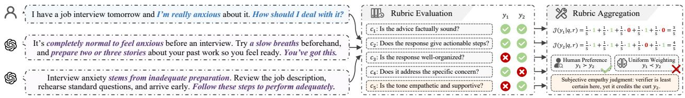  
Figure 1 A case study where a single uncertain judgment on a subjective criterion inverts the aggregated preference under uniform weighting.

$$
\begin{array} { r } { \mathcal { T } _ { \alpha } ( q , y , c _ { k } ) = \big \{ v \big | | v ( q , y , c _ { k } ) - v | \leq \tau _ { \alpha } \big \} , \qquad \tau _ { \alpha } = \mathrm { Q u a n t i l e } \left( \{ s _ { i } \} _ { i = 1 } ^ { \mathrm { N } _ { \mathrm { c a l } } } , \frac { \lceil ( 1 - \alpha ) ( \mathrm { N } _ { \mathrm { c a l } } + 1 ) \rceil } { \mathrm { N } _ { \mathrm { c a l } } } \right) , } \end{array}\tag{2}
$$

where $s _ { i } = | \boldsymbol { v } ( q _ { i } , y _ { i } , c _ { i } ) - \boldsymbol { v } _ { i } ^ { * } | .$ . Under mere exchangeability of $\mathcal { D } _ { \operatorname { c a l } } \cup \{ ( q , y , c _ { k } , v ^ { * } ) \}$ , SCP admits the finite-sample marginal coverage guarantee P $\begin{array} { r } { \left[ v ^ { \ast } \in \mathcal { T } _ { \alpha } ( q , y , c _ { k } ) \right] \geq 1 - \alpha } \end{array}$

## 2.3 Problem Definition

This work investigates the uncertainty-aware rubric weighting problem, specifically the challenge of constructing instance-adaptive weights ${ \hat { w } } _ { k } ( q , y )$ for diferent rubric criteria from the outputs of a deterministic LLM verifier. These weights can be used in place of uniform weights in rubric aggregation. Ideally, they reflect the relative certainty of individual rubric judgments, so that judgments with greater uncertainty exert less influence on the response-level aggregation. However, a deterministic verifier provides only a binary judgment for each criterion and does not directly expose its certainty. Thus, the core problem is to construct $\hat { w } _ { k } ( q , y )$ from observable verifier behavior that captures uncertainty in individual rubric judgments.

## 3 Methodology

## 3.1 Motivation

Judgment certainty for rubric criteria is unobservable from the LLM verifier. Each binary output $v ( q , y , c _ { k } )$ carries no probability, logit, or confidence signal1. To obtain such confidence signals, a natural solution is to sample the verifier at higher temperature. However, this departs from the deterministic decoding commonly adopted by reference verification protocols and is incompatible with downstream policy optimization algorithms that require stable reward signals.

This missing uncertainty makes uniform aggregation fragile. Under $w _ { k } = 1 / \mathrm { K }$ , every judgment enters the aggregated score in Eq. (1) with equal influence regardless of its certainty. Consider two nearly-tied responses that agree on most criteria but are judged diferently on a single subjective one $( e . g .$ ,tone or helpfulness): if the verifier is in fact uncertain there, that lone judgment already tips the aggregated preference, with no mechanism to discount its contribution.

Case study. To substantiate the above analysis, we present an illustrative example in Figure 1. An anxious user asks how to handle an interview: response $y _ { 1 }$ acknowledges the worry with warm, actionable advice, while response y2 gives correct steps in a curt, dismissive tone. The two responses tie on the objective criteria $( c _ { 1 } , c _ { 2 } )$ and split the rest, so the preference hinges entirely on the empathetic-tone criterion $c _ { 5 } .$ . Here the verifier credits the curt response y , inverting the aggregate to $\begin{array} { r } { \mathcal { I } ( y _ { 1 } \mid q , r ) = \frac { 5 } { 5 } < \mathcal { I } ( y _ { 2 } \mid q , r ) = \frac { 4 } { 5 } } \end{array}$ and contradicting the human preference $y _ { 1 } \succ y _ { 2 }$ This showcases that uniform aggregation is defenseless against a verifier’s uncertain judgments.

Some might note prior work on uncertainty quantification for LLM judges; however, its utility for rubric weighting remains under-explored. Existing methods either estimate response-wise uncertainty rather than per criterion (Sheng et al., 2025; Liu, 2026; Wagner et al., 2024), rely on higher-temperature sampling or verifier committees that depart from the deterministic reference decoding (Li et al., 2026a; Cao et al., 2026; Fathullah & Gales, 2025), or train dedicated modules that require annotated data and emit auxiliary labels instead of an criterion-level weight (Xie et al., 2025; Radharapu et al., 2026). Therefore, deriving a training-free, per-criterion uncertainty weight that preserves the deterministic verifier decoding remains an open and critical challenge.

## 3.2 Quantifying Verifier Uncertainty via Template Ensembling

In this section, we quantify a per-criterion uncertainty signal from the verifier without perturbing its decoding. The key idea is that a reliable judgment should be stable under semantics-preserving rephrasings of the criterion prompt, whereas an uncertain one flips easily. Therefore, we probe this stability with a pool of paraphrased judgment templates rather than by raising the decoding temperature. Specifically, let $\mathcal { T } = \{ t _ { 1 } , \ldots , t _ { \mathrm { N } } \}$ be a set of N judgment prompts (see Appendix C.2 for the exact pool), where each paraphrase has been checked multiple times by human experts2 to confirm it preserves the original criterion’s meaning. This procedure ensures cross-template disagreement reflects verifier uncertainty rather than a shift in what is being asked. Then we apply the deterministic decoding under each template, obtaining per-template binary judgments $v _ { k , n } = v ( q , y , c _ { k } \mid t _ { n } )$ for criterion $c _ { k }$ . Averaging these judgments yields the soft judgment score:

$$
\widehat v _ { k } : = \widehat v ( q , y , c _ { k } ) = \frac { 1 } { \mathrm { N } } \sum _ { n = 1 } ^ { \mathrm { N } } v _ { k , n } \in \left\{ 0 , \frac { 1 } { \mathrm { N } } , \ldots , 1 \right\} ,\tag{3}
$$

which we use as the per-criterion uncertainty signal. Here $\hat { v } _ { k }$ measures how uncertain the verifier is on the criterion: it approaches 0 or 1 when the verifier is confident and approaches 0.5 when it is maximally uncertain. To calibrate this raw signal against ground-truth judgments later, we reuse the held-out calibration set $\mathcal { D } _ { \mathrm { c a l } }$ from Section 2.2 to build a reference distribution of nonconformity scores. Specifically, for each calibration sample we compute its soft score $\hat { v } _ { i } = \hat { v } ( q _ { i } , y _ { i } , c _ { i } )$ via Eq. (3) and its nonconformity $s _ { i } = \left| \hat { v } _ { i } - v _ { i } ^ { * } \right| \in [ 0 , 1 ]$ . A small nonconformity score $s _ { i }$ marks a verifier that is both confident and correct on sample i, and a large one otherwise flags an uncertain or incorrect judgment. These scores form the calibration distribution ${ \cal S } = \{ s _ { i } \} _ { i = 1 } ^ { \mathrm { N _ { c a l } } }$ , so that a new judgment is scored by where its own nonconformity ranks within S at inference time.

## 3.3 Calibrating Verifier Uncertainty via p-value Weighting

In this section, we convert each raw signal $\hat { v } _ { k }$ into a per-criterion weight through split conformal calibration, which requires no additional training and yields a weight with a distribution-free validity guarantee. The key idea is to reuse the SCP framework in Section 2.2. Rather than thresholding the calibration scores S at a fixed miscoverage level to form a prediction set, we measure how a test judgment ranks within S. This rank yields a conformal p-value (Shafer & Vovk, 2008), which grades the judgment on a continuous scale and discounts criteria on which the verifier is uncertain. Specifically, for a new test triple $( q , y , c _ { k } )$ with soft score $\hat { v } _ { k }$ and a candidate label $u \in \{ 0 , 1 \}$ , its test-side nonconformity is $s ( \hat { v } _ { k } , u ) = | \hat { v } _ { k } - u |$ . Then the p-value of u given $\hat { v } _ { k }$ is defined as

$$
p ( u \mid \hat { v } _ { k } ) = \frac { 1 + | \{ i : s _ { i } \geq s ( \hat { v } _ { k } , u ) \} | } { \mathrm { N _ { c a l } } + 1 } ,\tag{4}
$$

which indicates the calibration-grounded plausibility that u is the true label. Taking $\tilde { v } _ { k } = \mathrm { r o u n d } ( \hat { v } _ { k } )$ as the verifier’s voted label, we define the raw per-criterion weight as the p-value of that vote,

$$
\tilde { w } _ { k } = p ( \tilde { v } _ { k } \mid \hat { v } _ { k } ) = \left\{ { p ( 1 \mid \hat { v } _ { k } ) , \quad \hat { v } _ { k } \geq 0 . 5 , } \right.\tag{5}
$$

This weight has two desirable properties. First, it is monotone in the distance $| 2 \hat { v } _ { k } - 1 |$ from the decision boundary $\hat { v } _ { k } = 0 . 5$ (at which the vote $\tilde { v } _ { k } = \mathrm { r o u n d } ( \hat { v } _ { k } )$ flips): it is smallest when the vote lies at the decision boundary and increases as the verifier’s template agreement moves toward either endpoint, so uncertain judgments are downweighted automatically. Second, as a conformal p-value it inherits a finite-sample validity guarantee on correct judgments as stated in Theorem 3.1.

Theorem 3.1 (Validity of Uncertainty Weight). Suppose the calibration triples in $\mathcal { D } _ { \mathrm { c a l } }$ and the test triple $( q , y , c _ { k } , v ^ { * } )$ are exchangeable under the same verifier and template pool T. Then, for every $\alpha \in ( 0 , 1 )$ , we have $\mathbb { P } \big [ \tilde { w } _ { k } \le \alpha , \tilde { v } _ { k } = v ^ { * } \big ] \le \alpha$

Theorem 3.1 guarantees that the p-value-induced weight does not frequently assign a spuriously low value to a correct voted judgment, and the bound holds uniformly over α, so no miscoverage rate need be fixed in advance. We then finalize uncertainty-aware rubric weighting (URW) by normalizing the raw weights $\tilde { w } _ { k }$ over the K criteria: $\begin{array} { r } { w _ { k } = \frac { \tilde { w } _ { k } } { \sum _ { k ^ { \prime } = 1 } ^ { \mathrm { K } } \tilde { w } _ { k ^ { \prime } } } } \end{array}$ . And finally per-criterion judgments are re-weighted and aggregated with the weights $w _ { k }$ . The resulting response-level score is given by

$$
\mathcal { I } ( y \mid w , q , r ) = \sum _ { k = 1 } ^ { \mathrm { K } } w _ { k } \tilde { v } _ { k } = \sum _ { k = 1 } ^ { \mathrm { K } } w _ { k } \cdot \mathrm { r o u n d } \left( \frac { 1 } { \mathrm { N } } \sum _ { n = 1 } ^ { \mathrm { N } } v ( q , y , c _ { k } \mid t _ { n } ) \right) .\tag{6}
$$

## 4 Experiments

In this section, we validate the eficacy of URW through a comprehensive empirical evaluation, centered on five research questions (RQs) as follows:

1. RQ1: Does URW improve rubric-aggregation accuracy? In Section 4.2, we compare URW against uncertainty-aware weighting baselines on five preference benchmarks.

2. RQ2: Why does it work? In Section 4.3, we perform an ablation study on the contribution of template ensembling and distribution-free calibration.

3. RQ3: Does it generalize across verifiers and rubric sources? In Section 4.4, we evaluate its compatibility with verifiers of varying parameter scales and with diferent rubric sources.

4. RQ4: Is it sensitive to the template count? In Section 4.5, we analyze its sensitivity to the template count N across diferent verifiers.

5. RQ5: Does it improve downstream RLVR? In Section 4.6, we use URW to aggregate the rubric rewards that drive GRPO training and evaluate the resulting policy.

## 4.1 Experimental Setup

Datasets. We evaluate URW on five pairwise preference benchmarks across diferent domains, including RubricBench (Zhou et al., 2026), ResearchQA (Yifei et al., 2026), RM-Bench (Liu et al., 2025b), RewardBench (Lambert et al., 2025), and RewardBench 2 (Malik et al., 2026). For RewardBench and RewardBench 2, we adopt their most challenging subsets, namely Chat-Hard and Precise-IF, respectively. Each benchmark supplies a response pair $( y _ { \mathrm { A } } , y _ { \mathrm { B } } )$ per prompt together with a gold human preference label. For RM-Bench, whose instances list multiple chosen and rejected responses, we form pairs by diagonal matching. RubricBench and ResearchQA come with human-sourced rubrics, whereas for the remaining benchmarks we generate rubrics with RubricARM-8B-Rubric (Xu et al., 2026c). For calibration in URW, we draw from the domain-diverse RUBRIC-ARROW-Judge-SFT rubric-annotation corpus (Jiang et al., 2026), whose broad domain coverage supports the exchangeability our method assumes. We stratify by domain and sample 200 prompts, yielding about 2k rubric-level annotations. The calibration set never intersects any evaluation split. Detailed dataset statistics and configurations are provided in Appendix C.1.

Baselines. We benchmark URW against a naive reference and a suite of uncertainty-aware weighting baselines, including Uniform $( w _ { k } = 1 / \mathrm { K } )$ , the signal-free floor that weights all criteria equally; Beta-Binomial, a Bayesian method that treats the multi-template judgments as binomial observations under a Beta prior and derives the weight from the resulting posterior; Sampling Ensemble (Wang et al., 2023), which draws multiple high-temperature decodings per criterion and weights by their vote ratio; and SCP, a distribution-free method that calibrates the same multitemplate soft score vˆ and hard-abstains via a global conformal quantile, together with its variant Mondrian-SCP that instead calibrates a separate quantile within each bin of vˆ.

Implementation Details. Our main experiments employ three frozen verifiers across diferent model families, including DeepSeek V4 Pro (Xu et al., 2026b), Qwen 3.8 Max (Team, 2026), and GLM 5.3 (Zeng et al., 2026). All reference verifier calls use temperature zero, JSON mode enabled, high reasoning efort, and a maximum of 32,768 output tokens. The template pool contains $\mathrm { N } = 6$ semantics-preserving paraphrases. For the Sampling Ensemble baseline, we re-decode each rubric multiple times at temperature 0.7. For the Beta-Binomial baseline, we place a uniform Beta(1, 1) prior on each criterion’s satisfaction probability and take the posterior mean as the weight. Our full method uses calibrated nonconformity score set S directly and requires no additional hyperparameter, whereas the SCP and Mondrian-SCP variants additionally use α = 0.1 and 6 bins. As for metrics, we report pairwise accuracy (Acc) across all benchmarks, where ties receive only half credit. More implementation details are provided in Appendix C.2.

Table 1 Pairwise preference accuracy of URW versus baselines.
<table><tr><td></td><td colspan="2">RubricBench</td><td colspan="2">ResearchQA</td><td colspan="2">RM-Bench</td><td colspan="2">RewardBench</td><td colspan="2">RewardBench 2</td></tr><tr><td>Method</td><td>Acc</td><td>RI</td><td>Acc</td><td>RI</td><td>Acc</td><td>RI</td><td>Acc</td><td>RI</td><td>Acc</td><td>RI</td></tr><tr><td colspan="9">Verifier: DeepSeek V4 Pro (Xu et al., 2026b)</td><td></td></tr><tr><td>Uniform</td><td>0.780</td><td></td><td>0.633</td><td></td><td>0.729</td><td></td><td>0.766</td><td></td><td>0.625</td><td></td></tr><tr><td>Beta-Binomial</td><td>0.781</td><td>0.11%↑</td><td>0.639</td><td>0.93%↑</td><td>0.739</td><td>1.42% ↑</td><td>0.772</td><td>0.72%↑</td><td>0.688</td><td>10.00%↑</td></tr><tr><td>Sampling Ensemble</td><td>0.781</td><td>0.11%↑</td><td>0.669</td><td>5.61%↑</td><td>0.711</td><td>2.48%↓</td><td>0.785</td><td>2.43%↑</td><td>0.731</td><td>17.00%↑</td></tr><tr><td>SCP</td><td>0.780</td><td>0.00%</td><td>0.645</td><td>1.87%↑</td><td>0.745</td><td>2.30%↑</td><td>0.784</td><td>2.29%↑</td><td>0.693</td><td>10.83%↑</td></tr><tr><td>Mondrian-SCP</td><td>0.793</td><td>1.62% ↑</td><td>0.657</td><td>3.74%↑</td><td>0.762</td><td>4.61%↑</td><td>0.786</td><td>2.58%↑</td><td>0.719</td><td>15.00%↑</td></tr><tr><td>URW</td><td>0.802</td><td>2.79%↑</td><td>0.698</td><td>10.28%↑</td><td>0.792</td><td>8.69%↑</td><td>0.810</td><td>5.72%↑</td><td>0.759</td><td>21.50%↑</td></tr><tr><td colspan="9">Verifier: Qwen 3.8 Max (Team, 2026)</td><td></td><td></td></tr><tr><td>Uniform</td><td>0.791</td><td></td><td>0.609</td><td></td><td>0.744</td><td></td><td>0.782</td><td></td><td>0.679</td><td></td></tr><tr><td>Beta-Binomial</td><td>0.803</td><td>1.49% ↑</td><td>0.618</td><td>1.46%↑</td><td>0.757</td><td>1.74% ↑</td><td>0.794</td><td>1.54%↑</td><td>0.695</td><td>2.30%↑</td></tr><tr><td>Sampling Ensemble</td><td>0.803</td><td>1.49% ↑</td><td>0.615</td><td>0.97%↑</td><td>0.745</td><td>0.17%↑</td><td>0.788</td><td>0.84%↑</td><td>0.695</td><td>2.30%↑</td></tr><tr><td>SCP</td><td>0.805</td><td>1.82%↑</td><td>0.642</td><td>5.34%↑</td><td>0.760</td><td>2.08%↑</td><td>0.797</td><td>1.96%↑</td><td>0.699</td><td>2.91%↑</td></tr><tr><td>Mondrian-SCP</td><td>0.807</td><td>2.09%↑</td><td>0.651</td><td>6.80%↑</td><td>0.762</td><td>2.43%↑</td><td>0.800</td><td>2.38%↑</td><td>0.705</td><td>3.83%↑</td></tr><tr><td>URW</td><td>0.819</td><td>3.58%↑</td><td>0.692</td><td>13.59%↑</td><td>0.786</td><td>5.56%↑</td><td>0.810</td><td>3.65%↑</td><td>0.721</td><td>6.13%↑</td></tr><tr><td colspan="9">Verifier: GLM 5.3 (Zeng et al., 2026)</td><td></td><td></td></tr><tr><td>Uniform</td><td>0.803</td><td></td><td>0.630</td><td></td><td>0.731</td><td></td><td>0.760</td><td></td><td>0.730</td><td></td></tr><tr><td>Beta-Binomial</td><td>0.807</td><td>0.49% ↑</td><td>0.642</td><td>1.88%↑</td><td>0.738</td><td>0.88%↑</td><td>0.775</td><td>2.02%↑</td><td>0.746</td><td>2.14%↑</td></tr><tr><td>Sampling Ensemble</td><td>0.809</td><td>0.71%↑</td><td>0.651</td><td>3.29%↑</td><td>0.735</td><td>0.53%↑</td><td>0.780</td><td>2.60%↑</td><td>0.747</td><td>2.28%↑</td></tr><tr><td>SCP</td><td>0.810</td><td>0.81% ↑</td><td>0.648</td><td>2.82%↑</td><td>0.739</td><td>1.06%↑</td><td>0.772</td><td>1.59% ↑</td><td>0.749</td><td>2.57%↑</td></tr><tr><td>Mondrian-SCP</td><td>0.810</td><td>0.81%↑</td><td>0.663</td><td>5.16%↑</td><td>0.740</td><td>1.24% ↑</td><td>0.780</td><td>2.60%↑</td><td>0.750</td><td>2.71%↑</td></tr><tr><td>URW</td><td>0.818</td><td>1.84%↑</td><td>0.680</td><td>7.98%↑</td><td>0.757</td><td>3.53%↑</td><td>0.788</td><td>3.75%↑</td><td>0.769</td><td>5.28%↑</td></tr></table>

Note: “RI” denotes the relative improvement over the Uniform baseline.

## 4.2 Overall Performance (RQ1)

In this section, we compare URW with competitive baselines across five benchmarks and three verifiers. The results are presented in Table 1 with key observations as follows. ❶ Uniform aggregation yields the lowest accuracy across settings. For instance, with DeepSeek V4 Pro on ResearchQA, Uniform attains an accuracy of 0.633, whereas every uncertainty-aware weighting method attains at least 0.639. This pattern indicates that treating all rubric judgments equally can overlook their heterogeneous uncertainty. ❷ Heuristic uncertainty-aware methods improve uniform aggregation performance. For example, on RewardBench 2 with DeepSeek V4 Pro, Beta-Binomial and Sampling Ensemble improve accuracy from 0.625 under Uniform to 0.688 and 0.731, respectively. These improvements are attributed to assigning non-uniform weights from multi-template judgments rather than treating all rubric judgments equally. ❸ Distribution-free calibration further improves heuristic uncertainty-aware weighting performance. For example, with GLM 5.3 on ResearchQA, Beta-Binomial and Sampling Ensemble attain accuracies of 0.642 and 0.651, whereas SCP and Mondrian-SCP further improve accuracy to 0.648 and 0.663, respectively. These improvements are attributed to calibrating template disagreement against held-out rubric annotations. ❹ URW achieves the best preference aggregation performance, outperforming all baselines across verifier–benchmark settings. This success is consistent with its calibrated p-value weighting, which retains continuous uncertainty information rather than reducing it to binary hard abstention.

## 4.3 Ablation Study (RQ2)

In this section, we dissect the individual contributions of URW’s two designs: multi-template rubric-score ensembling and conformal uncertainty calibration. Table 2 presents the ablation results on the three verifiers, with key observations summarized as follows. ❶ Multi-template ensembling improves rubric-score aggregation. Specifically, in URW†, we retain uniform rubric weights but replace single-template criterion scores with multi-template voted scores. The variant consistently improves over Uniform aggregation baseline, with relative improvements up to 3.9% on ResearchQA. This confirms that template ensembling yields more reliable final rubric scores. ❷ Conformal uncertainty calibration is critical for rubric-weighting performance. Specifically, in URW‡, we retain single-template criterion scores while computing each criterion’s uncertainty from a two-template conformal p-value. This variant consistently outperforms Uniform aggregation baseline, with relative improvements from 2.1% to 9.2% across all benchmarks. This indicates that calibration efectively diferentiates reliable from uncertain rubric judgments even without using template ensembling in the final score. ❸ The benefits of multi-template ensembling and conformal calibration can be synergistically integrated. This is evidenced by the leading performance of the complete URW method across all datasets, which consistently outperforms both ablated variants.

Table 2 Ablation study results of the two URW components.
<table><tr><td rowspan="2">Method</td><td rowspan="2">Multi.</td><td rowspan="2">Cali.</td><td colspan="2">RubricBench</td><td colspan="2">ResearchQA</td><td colspan="2">RM-Bench</td><td colspan="2">RewardBench</td><td colspan="2">RewardBench 2</td></tr><tr><td>Acc</td><td>RI</td><td>Acc</td><td>RI</td><td>Acc</td><td>RI</td><td>Acc</td><td>RI</td><td>Acc</td><td>RI</td></tr><tr><td colspan="10">Verifier: DeepSeek V4 Pro (Xu et al., 2026b)</td><td></td><td></td><td></td></tr><tr><td>Uniform</td><td>X</td><td>X</td><td>0.780</td><td></td><td>0.633</td><td></td><td>0.729</td><td></td><td>0.766</td><td></td><td>0.625</td><td></td></tr><tr><td>URW†</td><td>√</td><td>X</td><td>0.779</td><td>0.11%↓</td><td>0.645</td><td>1.87%↑</td><td>0.736</td><td>1.06%↑</td><td>0.781</td><td>1.86%↑</td><td>0.682</td><td>9.17%↑</td></tr><tr><td>URW‡</td><td>X</td><td>√</td><td>0.791</td><td>1.45%↑</td><td>0.648</td><td>2.34%↑</td><td>0.758</td><td>4.08%↑</td><td>0.797</td><td>4.01%↑</td><td>0.716</td><td>14.50%↑</td></tr><tr><td>URW</td><td></td><td></td><td>0.802</td><td>2.79%↑</td><td>0.698</td><td>10.28%↑</td><td>0.792</td><td>8.69%↑</td><td>0.810</td><td>5.72%↑</td><td>0.759</td><td>21.50%↑</td></tr><tr><td colspan="9">Verifier: Qwen 3.8 Max (Team, 2026)</td><td></td><td></td><td></td></tr><tr><td>Uniform</td><td>X</td><td>X</td><td>0.791</td><td></td><td>0.609</td><td></td><td>0.744</td><td></td><td>0.782</td><td></td><td>0.679</td><td></td></tr><tr><td>URW†</td><td>√</td><td>x</td><td>0.796</td><td>0.61%↑</td><td>0.633</td><td>3.88%↑</td><td>0.751</td><td>0.87%↑</td><td>0.797</td><td>1.96%↑</td><td>0.684</td><td>0.77%↑</td></tr><tr><td>URW‡</td><td>x</td><td>√</td><td>0.810</td><td>2.48%↑</td><td>0.666</td><td>9.22%↑</td><td>0.767</td><td>3.13%↑</td><td>0.798</td><td>2.10%↑</td><td>0.709</td><td>4.45%↑</td></tr><tr><td>URW</td><td></td><td></td><td>0.819</td><td>3.58%↑</td><td>0.692</td><td>13.59%↑</td><td>0.786</td><td>5.56%↑</td><td>0.810</td><td>3.65%↑</td><td>0.721</td><td>6.13%↑</td></tr><tr><td colspan="9">Verifier: GLM 5.3 (Zeng et al., 2026)</td><td></td><td></td><td></td></tr><tr><td>Uniform</td><td>X</td><td>X</td><td>0.803</td><td></td><td>0.630</td><td></td><td>0.731</td><td></td><td>0.760</td><td></td><td>0.730</td><td></td></tr><tr><td>URW†</td><td>√</td><td>X</td><td>0.801</td><td>0.33%↓</td><td>0.645</td><td>2.35%↑</td><td>0.733</td><td>0.183%↑</td><td>0.765</td><td>0.72%↑</td><td>0.741</td><td>1.43%↑</td></tr><tr><td>URW‡</td><td>X</td><td>√</td><td>0.813</td><td>1.14%↑</td><td>0.657</td><td>4.23%↑</td><td>0.739</td><td>1.06%↑</td><td>0.777</td><td>2.31%↑</td><td>0.756</td><td>3.57%↑</td></tr><tr><td>URW</td><td></td><td>V</td><td>0.818</td><td>1.84%↑</td><td>0.680</td><td>7.98%↑</td><td>0.757</td><td>3.53%↑</td><td>0.788</td><td>3.75%↑</td><td>0.769</td><td>5.28%↑</td></tr></table>

Note: “Multi.” denotes template ensembling for final criterion scores; “Cali.” denotes conformal calibration of rubric uncertainty weights.

## 4.4 Generalization Studies (RQ3)

In this section, we evaluate the generalizability of URW across verifier LLMs of diferent scales and families, as well as rubric sets from diferent sources. We reuse the same calibration configuration and template pool throughout these studies, without re-tuning for individual settings.

Varying Verifier Backbones. We evaluate URW across the Qwen 3 (Yang et al., 2025) and GLM 4 (Glm et al., 2024) verifier families, covering models from 8B to 32B parameters. Figure 2 presents results on five benchmarks, with key observations as follows. ❶ URW yields consistent improvements independent of verifier scale. From the 8B/9B models to their 32B counterparts, URW outperforms Uniform baseline on all benchmarks. The improvements range from 0.6 to 15.1 relative accuracy points, showing that criterion-level uncertainty calibration remains efective regardless of verifier capacity. ❷ URW maintains efficacy across distinct verifier families. URW consistently improves over Uniform baseline for every Qwen 3 and GLM 4 configuration, covering all 20 verifier–benchmark comparisons. This confirms that URW is a model-agnostic weighting framework that can be integrated with diverse verifier families without family-specific tuning.

Varying Rubric Sources. We further evaluate URW across human-audited and LLM-generated rubric sources on RubricBench and ResearchQA. Tables 3 and 4 present the results, with key observations as follows. ❶ URW yields consistent improvements even when LLM-generated rubrics are less effective. Replacing human-audited rubrics with LLM-generated ones lowers absolute accuracy for all methods and benchmarks (e.g.,Qwen 3.8 Max Uniform drops from 0.791 to 0.538 on RubricBench), indicating that the generated rubrics provide weaker signals for preference judgment. Nevertheless, URW improves over Uniform in all configurations, with relative improvements of 1.6%–13.6%. ❷ URW consistently outperforms uncertainty-aware weighting methods across rubric sources. URW is the best-performing method in every configuration, without source-specific re-tuning. In contrast, the gains of competing methods are not uniformly positive: Sampling Ensemble and SCP fall below Uniform in some generated-rubric settings. These results show that URW’s criterion-level uncertainty weighting provides stronger preference aggregation than alternative uncertainty-aware weighting methods under both human-audited and LLM-generated rubrics.

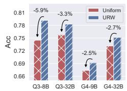  
(a) RubricBench

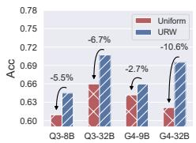  
(b) ResearchQA

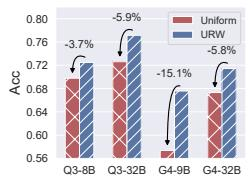  
(c) RM-Bench

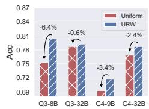  
(d) RewardBench

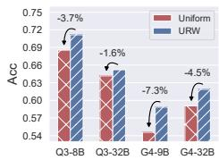  
(e) RewardBench 2  
Figure 2 Generalization results of URW across verifier backbones, where “Q3” denotes the Qwen3 family and $^ { * } G 4 ^ { * }$ denotes the GLM4 family.

Table 3 Generalization results on RubricBench.
<table><tr><td>Verifier</td><td colspan="2">DeepSeek V4 Pro</td><td colspan="2">Qwen 3.8 Max</td><td colspan="2">GLM 5.3</td></tr><tr><td>Method</td><td>Acc</td><td>RI</td><td>Acc</td><td>RI</td><td>Acc</td><td>RI</td></tr><tr><td colspan="7">Rubric Source: Human Auditing</td></tr><tr><td>Uniform</td><td>0.780</td><td></td><td>0.791</td><td></td><td>0.803</td><td></td></tr><tr><td>Beta-Binomial</td><td>0.781</td><td>0.1%↑</td><td>0.803</td><td>1.5%↑</td><td>0.807</td><td>0.5%↑</td></tr><tr><td>Sampling Ensemble</td><td>0.781</td><td>0.1%↑</td><td>0.803</td><td>1.5%↑</td><td>0.809</td><td>0.7%↑</td></tr><tr><td>SCP</td><td>0.780</td><td>0.0%</td><td>0.805</td><td>1.8%↑</td><td>0.810</td><td>0.8%↑</td></tr><tr><td>Mondrian-SCP</td><td>0.793</td><td>1.6%↑</td><td>0.807</td><td>2.1%↑</td><td>0.810</td><td>0.8%↑</td></tr><tr><td>URW</td><td>0.802</td><td>2.8%↑</td><td></td><td>0.819 3.6%↑</td><td></td><td>0.818 1.8%↑</td></tr><tr><td colspan="7">Rubric Source: LLM as Generator</td></tr><tr><td>Uniform</td><td>0.501</td><td>一</td><td>0.538</td><td></td><td>0.558</td><td></td></tr><tr><td>Beta-Binomial</td><td>0.503</td><td>0.5%↑</td><td>0.541</td><td>0.6%↑</td><td>0.559</td><td>0.2%↑</td></tr><tr><td>Sampling Ensemble</td><td>0.510</td><td>1.8%↑</td><td>0.536</td><td>0.4%↓</td><td>0.556</td><td>0.2%↓</td></tr><tr><td>SCP</td><td>0.506</td><td>1.0%↑</td><td>0.544</td><td>1.1%↑</td><td>0.557</td><td>0.1%↓</td></tr><tr><td>Mondrian-SCP</td><td>0.509</td><td>1.6%↑</td><td>0.546</td><td>1.5%↑</td><td>0.565</td><td>1.3%↑</td></tr><tr><td>URW</td><td>0.515</td><td>2.9%↑</td><td>0.551</td><td>2.4%↑</td><td>0.569</td><td>2.0%↑</td></tr></table>

Table 4 Generalization results on ResearchQA.
<table><tr><td>Verifier</td><td colspan="2">DeepSeek V4 Pro</td><td colspan="2">Qwen 3.8 Max</td><td colspan="2">GLM 5.3</td></tr><tr><td>Method</td><td>Acc</td><td>RI</td><td>Acc</td><td>RI</td><td>Acc</td><td>RI</td></tr><tr><td colspan="7">Rubric Source: Human Auditing</td></tr><tr><td>Uniform</td><td>0.633</td><td></td><td>0.609</td><td></td><td>0.630</td><td></td></tr><tr><td>Beta-Binomial</td><td>0.639</td><td>0.9%↑</td><td>0.618</td><td>1.5%↑</td><td>0.642</td><td>1.9%↑</td></tr><tr><td>Sampling Ensemble</td><td>0.669</td><td>5.6%↑</td><td>0.615</td><td>1.0%↑</td><td>0.651</td><td>3.3%↑</td></tr><tr><td>SCP</td><td>0.645</td><td>1.9%↑</td><td>0.642</td><td>5.3%↑</td><td>0.648</td><td>2.8%↑</td></tr><tr><td>Mondrian-SCP</td><td>0.657</td><td>3.7%↑</td><td>0.651</td><td>6.8%↑</td><td>0.663</td><td>5.2%↑</td></tr><tr><td>URW</td><td>0.698</td><td>10.3%↑</td><td>0.692</td><td></td><td></td><td>13.6%↑ 0.680 8.0%↑</td></tr><tr><td colspan="7">Rubric Source: LLM as Generator</td></tr><tr><td>Uniform</td><td>0.553</td><td></td><td>0.583</td><td>1</td><td>0.580</td><td></td></tr><tr><td>Beta-Binomial</td><td>0.556</td><td>0.5%↑</td><td>0.609</td><td>4.6%↑</td><td>0.583</td><td>0.5%↑</td></tr><tr><td>Sampling Ensemble</td><td>0.553</td><td>0.0%</td><td>0.571</td><td>2.0%↓</td><td>0.589</td><td>1.5%↑</td></tr><tr><td>SCP</td><td>0.553</td><td>0.0%</td><td>0.604</td><td>3.6%↑</td><td>0.586</td><td>1.0%↑</td></tr><tr><td>Mondrian-SCP</td><td>0.559</td><td>1.1%↑</td><td>0.604</td><td>3.6%↑</td><td>0.592</td><td>2.0%↑</td></tr><tr><td>URW</td><td>0.562</td><td>1.6%↑</td><td>0.624</td><td>7.1%↑</td><td>0.615</td><td>6.1%↑</td></tr></table>

## 4.5 Hyperparameter Sensitivity Study (RQ4)

In this section, we examine the impact of URW’s hyperparameter, the template count N, on preference aggregation performance. Figure 3 presents results on RubricBench and ResearchQA for three verifiers, while the corresponding results on the other three datasets are provided in Appendix D.1. N = 1 in the figure corresponds to the Uniform aggregation baseline. Key observations are as follows. ❶ Increasing the template count N generally improves accuracy over the Uniform aggregation baseline. Across both displayed datasets and all verifiers, using multiple templates consistently

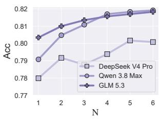  
(a) RubricBench

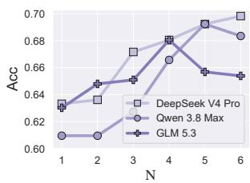  
(b) ResearchQA  
Figure 3 Sensitivity to the template count N.

improves upon the Uniform aggregation baseline. This indicates that aggregating information from multiple verifier templates provides a broadly useful uncertainty signal. ❷ URW is insensitive to the template count once multiple templates are used. Accuracy rises most sharply when increasing N from the Uniform aggregation baseline to a small template pool. And subsequent changes are smaller and may fluctuate within the 15% confidence intervals. Thus, URW obtains most of the benefit of multi-template reliability estimation with a modest N, without requiring delicate hyperparameter tuning or a large template pool.

## 4.6 Downstream RLVR Performance (RQ5)

In this section, we investigate the downstream RLVR performance of incorporating URW into rubric-based reward aggregation. We construct a training corpus from RubricHub (Li et al., 2026b), sampling 1,000 prompts from each of its Chat and Science domains. We optimize policies with GRPO (Guo et al., 2025) using the VeRL-Rubric framework3. We consider Qwen 3 8B (Yang et al., 2025) and GLM 4 9B (Glm et al., 2024) as policy models, paired with Qwen 3 32B and GLM 4 32B as their respective rubric verifiers. All aggregation methods are trained for an identical budget of 150 steps. The trained policies are evaluated zero-shot on Arena-Hard (Li et al., 2025b) using win rate (WR) and

Table 5 Downstream RLVR results with Qwen 3 8B (Yang et al., 2025) as the policy model.
<table><tr><td rowspan="2">Method</td><td colspan="2">Arena-Hard</td><td colspan="2">GPQA-Diamond</td></tr><tr><td>WR</td><td>RI</td><td>Acc</td><td>RI</td></tr><tr><td>Uniform</td><td>61.9</td><td></td><td>55.1</td><td></td></tr><tr><td>Beta-Binomial</td><td>67.3</td><td>8.85%↑</td><td>58.1</td><td>5.50%↑</td></tr><tr><td>Sampling Ensemble</td><td>67.8</td><td>9.50%↑</td><td>58.6</td><td>6.42%↑</td></tr><tr><td>SCP</td><td>68.4</td><td>10.55%↑</td><td>60.1</td><td>9.17%↑</td></tr><tr><td>Mondrian-SCP</td><td>69.8</td><td>12.81%↑</td><td>62.6</td><td>13.76%↑</td></tr><tr><td>URW</td><td>76.5</td><td>23.64%↑</td><td>65.7</td><td>19.27%↑</td></tr></table>

Note: “RI” denotes relative improvement over Uniform baseline.

Table 6 Downstream RLVR results with GLM 4 9B (Glm et al., 2024) as the policy model.
<table><tr><td rowspan="2">Method</td><td colspan="2">Arena-Hard</td><td colspan="2">GPQA-Diamond</td></tr><tr><td>WR</td><td>RI</td><td>Acc</td><td>RI</td></tr><tr><td>Uniform</td><td>30.0</td><td></td><td>33.3</td><td></td></tr><tr><td>Beta-Binomial</td><td>39.0</td><td>29.88%↑</td><td>35.4</td><td>6.06%↑</td></tr><tr><td>Sampling Ensemble</td><td>38.4</td><td>27.79%↑</td><td>38.9</td><td>16.67%↑</td></tr><tr><td>SCP</td><td>41.1</td><td>36.77%↑</td><td>42.4</td><td>27.27%↑</td></tr><tr><td>Mondrian-SCP</td><td>42.4</td><td>41.26%↑</td><td>43.4</td><td>30.30%↑</td></tr><tr><td>URW</td><td>48.7</td><td>62.06%↑</td><td>50.0</td><td>50.00%↑</td></tr></table>

Note: “RI” denotes relative improvement over Uniform baseline.

GPQA-Diamond (Rein et al., 2024) using accuracy (Acc). More implementation details are provided in Appendix C.2. Tables 5 and 6 present results, with key observations as follows. ❶ All uncertainty-aware weighting methods improve downstream RLVR performance over Uniform aggregation. For example, with Qwen 3 8B as the policy model, Mondrian-SCP improves the Arena-Hard win rate and GPQA-Diamond accuracy over Uniform by 12.81% and 13.76%, respectively. This indicates that accounting for criterion-level uncertainty yields more efective reward signals for policy optimization. ❷ URW achieves the best downstream RLVR performance across policy models and benchmarks. URW attains the highest score in all four policy-model–benchmark configurations. For example, with GLM 4 9B as the policy model, URW improves the Arena-Hard win rate from 42.4 to 48.7 for the strongest baseline Mondrian-SCP, and the GPQA-Diamond accuracy from 43.4 to 50.0. These results show that continuous uncertainty-aware weighting in URW provides stronger reward aggregation than the competing methods.

## 5 Conclusion

In this work, we investigated the problem of uncertainty-aware rubric weighting, which aims to account for heterogeneous uncertainty among criterion-level judgments when aggregating rubric-based LLM evaluations. We identified that deterministic black-box verifiers provide no direct verification-confidence signal, causing uniform aggregation to assign equal influence to uncertain and confident judgments. To address this challenge, we proposed Uncertaintyaware Rubric Weighting (URW), a training-free and distribution-free framework that ensembles paraphrased judgment templates and calibrates their agreement with split-conformal p-values to construct continuous criterion-level weights. Theoretically, we demonstrated that URW controls the probability of assigning a spuriously low weight to a correct judgment under exchangeability. Extensive experiments across diverse verifiers and benchmarks confirm that URW improves preference aggregation over competitive baselines and yields more efective rewards for downstream RLVR.

Limitations & Future Work. This work generally has two limitations that warrant future investigation. First, URW’s theoretical guarantee relies on exchangeability between calibration and test triples, which can be strained by distribution shifts during RLVR training. Periodic re-calibration and adaptive inference techniques (Gibbs & Candes, 2021) are promising directions to counteract such shifts. Second, URW quantifies only the uncertainty revealed by a fixed pool of semantics-preserving judgment templates; it does not separately identify other sources of uncertainty, such as intrinsic ambiguity in the rubric or the underlying task. Incorporating complementary uncertainty signals while retaining calibration guarantees is an important direction for future work.

## References

Rahul K Arora, Jason Wei, Rebecca Soskin Hicks, Preston Bowman, Joaquin Quiñonero-Candela, Foivos Tsimpourlas, Michael Sharman, Meghan Shah, Andrea Vallone, Alex Beutel, et al. Healthbench: Evaluating large language models towards improved human health. arXiv preprint arXiv:2505.08775, 2025.

Qi Cao, Takeshi Kojima, Andrew Gambardella, Helinyi Peng, Yutaka Matsuo, and Yusuke Iwasawa. Clustered self-assessment: A simple yet efective method for uncertainty quantification in large language models. In Findings of Proc. Annu. Meeting Assoc. Comput. Linguist., pp. 30666–30680, 2026.

Xilun Chen, Zhaleh Feizollahi, Ross Goodwin, Seungwhan Moon, Scott Yih, Pinar Donmez, Babak Damavandi, and Luna Dong. Two-level meta-rubrics for evaluating open-ended generation: Gamut, a benchmark for factual completeness. arXiv preprint arXiv:2607.19322, 2026a.

Yifan Chen, Haitao Li, Qingyao Ai, Fengbin Zhu, Tat-Seng Chua, Min Zhang, and Yiqun Liu. Genrubric: Self-evolving rubric generation for scalable llm evaluation. arXiv preprint arXiv:2608.29856, 2026b.

Zhenhao Chen, Yongqiang Chen, Chenxi Liu, Junchi Yu, Xiangchen Song, Zijian Li, Jialin Li, Philip Torr, Bo Han, and Kun Zhang. Causalgame: Benchmarking causal thinking of llm agents in games. arXiv preprint arXiv:2607.04293, 2026c.

Jonathan Cook, Tim Rocktäschel, Jakob Nicolaus Foerster, Dennis Aumiller, and Alex Wang. Ticking all the boxes: Generated checklists improve llm evaluation and generation. In Workshop ofProc. Adv. Neural Inf. Process. Syst., 2024.

Yassir Fathullah and Mark Gales. Generalised probabilistic modelling and improved uncertainty estimation in comparative llm as-a-judge. In Silvia Chiappa and Sara Magliacane (eds.), Proc. Uncertain. Artif. Intell., volume 286 of Proceedings ofMachine Learning Research, pp. 1266–1288. PMLR, 21–25 Jul 2025.

Isaac Gibbs and Emmanuel Candes. Adaptive conformal inference under distribution shift. Proc. Adv. Neural Inf. Process. Syst., 34: 1660–1672, 2021.

Team Glm, Aohan Zeng, Bin Xu, Bowen Wang, Chenhui Zhang, Da Yin, Dan Zhang, Diego Rojas, Guanyu Feng, Hanlin Zhao, et al. Chatglm: A family of large language models from glm-130b to glm-4 all tools. arXiv preprint arXiv:2406.12793, 2024.

Jiawei Gu, Xuhui Jiang, Zhichao Shi, Hexiang Tan, Xuehao Zhai, Chengjin Xu, Wei Li, Yinghan Shen, Shengjie Ma, Honghao Liu, et al. A survey on llm-as-a-judge. The Innovation, 7(6), 2026.

Anisha Gunjal, Anthony Wang, Elaine Lau, Vaskar Nath, Yunzhong He, Bing Liu, and Sean Hendryx. Rubrics as rewards: Reinforcement learning beyond verifiable domains. In Proc. Int. Conf. Learn. Represent., volume 2026, pp. 127924–127945, 2026.

Daya Guo, Dejian Yang, Haowei Zhang, Junxiao Song, Peiyi Wang, Qihao Zhu, Runxin Xu, Ruoyu Zhang, Shirong Ma, Xiao Bi et al. Deepseek-r1 incentivizes reasoning in llms through reinforcement learning. Nature, 645(8081):633–638, 2025.

Haoxiang Jiang, Zihan Dong, Tianci Liu, Wanying Wang, Ran Xu, Tony Yu, Linjun Zhang, and Haoyu Wang. Rubric-arrow: Alternating pointwise rubric reward modeling for llm post-training in non-verifiable domains. arXiv preprint arXiv:2605.29156, 2026.

Nathan Lambert, Valentina Pyatkin, Jacob Morrison, LJ Miranda, Bill Yuchen Lin, Khyathi Chandu, Nouha Dziri, Sachin Kumar, Tom Zick, Yejin Choi, et al. Rewardbench: Evaluating reward models for language modeling. In Findings ofProc. Annu. Meet. North Am. Assoc. Comput. Linguist., pp. 1755–1797, 2025.

Jing Lei, Max G’Sell, Alessandro Rinaldo, Ryan J Tibshirani, and Larry Wasserman. Distribution-free predictive inference for regression. Journal ofthe American Statistical Association, 113(523):1094–1111, 2018.

Dawei Li, Bohan Jiang, Liangjie Huang, Alimohammad Beigi, Chengshuai Zhao, Zhen Tan, Amrita Bhattacharjee, Yuxuan Jiang, Canyu Chen, Tianhao Wu, et al. From generation to judgment: Opportunities and challenges of llm-as-a-judge. In Proc. Conf. Empirical Methods Natural Lang. Process., pp. 2757–2791, 2025a.

Lujun Li, Lama Sleem, Yangjie Xu, Yewei Song, Aolin Jia, Jerome Francois, and Radu State. The necessity of setting temperature in llm-as-a-judge. arXiv preprint arXiv:2603.28304, 2026a.

Sunzhu Li, Jiale Zhao, Huimin Ren, Zhenlin Wei, Yang Zhou, Jingwen Yang, Shunyu Liu, Kaike Zhang, and Chen Wei. Rubrichub: A comprehensive and highly discriminative rubric dataset via automated coarse-to-fine generation. In Proc. Annu. Meeting Assoc. Comput. Linguist., pp. 31320–31344, 2026b.

Tianle Li, Wei-Lin Chiang, Evan Frick, Lisa Dunlap, Tianhao Wu, Banghua Zhu, Joseph E. Gonzalez, and Ion Stoica. From crowdsourced data to high-quality benchmarks: Arena-hard and benchbuilder pipeline. In Aarti Singh, Maryam Fazel, Daniel Hsu, Simon Lacoste-Julien, Felix Berkenkamp, Tegan Maharaj, Kiri Wagstaf, and Jerry Zhu (eds.), Proceedings ofthe 42nd International Conference on Machine Learning, volume 267 of Proc. Int. Conf. Mach. Learn., pp. 34209–34231. PMLR, 13–19 Jul 2025b.

Guangyi Liu, Pengxiang Zhao, Yaozhen Liang, Liang Liu, Yaxuan Guo, Han Xiao, Weifeng Lin, Yuxiang Chai, Yue Han, Shuai Ren, Hao Wang, Xiaoyu Liang, WenHao Wang, Tianze Wu, Zhengxi Lu, Siheng Chen, LiLinghao, Hao Wang, Guanjing Xiong, Yong Liu, and Hongsheng Li. Llm-powered gui agents in phone automation: Surveying progress and prospects. Trans. Mach. Learn Res., 2025a. ISSN 2835-8856.

Guangyi Liu, Gao Wu, Congxiao Liu, Pengxiang Zhao, Liang Liu, Mading Li, Qi Zhang, Mengyan Wang, Liang Guo, and Yong Liu. Memgui-agent: An end-to-end long-horizon mobile gui agent with proactive context management. arXiv preprint arXiv:2606.19926, 2026.

Lihui Liu. Robust conformal consensus: Multi-agent llm-as-a-judge interval evaluation with conformal prediction. arXiv preprint arXiv:2609.06367, 2026.

Yantao Liu, Zijun Yao, Rui Min, Yixin Cao, Lei Hou, and Juanzi Li. Rm-bench: Benchmarking reward models of language models with subtlety and style. In Proc. Int. Conf. Learn. Represent., volume 2025, pp. 44323–44355, 2025b.

Saumya Malik, Valentina Pyatkin, Sander Land, Jacob Morrison, Noah Smith, Hanna Hajishirzi, and Nathan Lambert. Rewardbench 2: Advancing reward model evaluation. In Proc. Int. Conf. Learn. Represent., volume 2026, pp. 144839–144866, 2026.

Tong Mu, Alec Helyar, Johannes Heidecke, Joshua Achiam, Andrea Vallone, Ian Kivlichan, Molly Lin, Alex Beutel, John Schulman, and Lilian Weng. Rule based rewards for language model safety. Proc. Adv. Neural Inf. Process. Syst., 37:108877–108901, 2024.

Licheng Pan, Haocheng Yang, Haoxuan Li, Yunsheng Lu, Yongqi Tong, Yinuo Wang, Shijian Wang, Zhixuan Chu, Lei Shen, Yuan Lu, and Hao Wang. Optimal transport for reward modeling from noisy feedback. In Proc. Int. Conf. Mach. Learn., 2026a.

Licheng Pan, Haocheng Yang, Haoxuan Li, Yichen Sun, Yunsheng Lu, Shijian Wang, Lei Shen, Yuan Lu, Zhixuan Chu, and Hao Wang. Uncertainty-aware reward modeling for stable rlhf. arXiv preprint arXiv:2606.19818, 2026b.

José Pombal, Ricardo Rei, and André FT Martins. Self-preference bias in rubric-based evaluation of large language models. arXiv preprint arXiv:2604.06996, 2026.

Bhaktipriya Radharapu, Eshika Saxena, Kenneth Li, Chenxi Whitehouse, Adina Williams, and Nicola Cancedda. Calibrating llm judges: Linear probes for fast and reliable uncertainty estimation. In Proc. Annu. Meeting Assoc. Comput. Linguist., pp. 193–216, 2026.

David Rein, Betty Li Hou, Asa Cooper Stickland, Jackson Petty, Richard Yuanzhe Pang, Julien Dirani, Julian Michael, and Samuel R. Bowman. Gpqa: A graduate-level google-proof q&a benchmark. In First Conf. Lang. Model., 2024.

Glenn Shafer and Vladimir Vovk. A tutorial on conformal prediction. J. Mach. Learn. Res., 9(3), 2008.

Zifei Shan and Fangning Shao. A survey on rubric-guided reinforcement learning for language models. arXiv preprint arXiv:2608.27505, 2026.

Huanxin Sheng, Xinyi Liu, Hangfeng He, Jieyu Zhao, and Jian Kang. Analyzing uncertainty of llm-as-a-judge: Interval evaluations with conformal prediction. In Proc. Conf. Empirical Methods Natural Lang. Process., pp. 11297–11339, 2025.

Mingyang Song, Mao Zheng, and Chenning Xu. Beyond the illusion of consensus: From surface heuristics to knowledge-grounded evaluation in llm-as-a-judge. arXiv preprint arXiv:2603.11027, 2026.

Qwen Team. Qwen3.8-max: A new bar for coding and cowork, August 2026. URL https://qwen.ai/blog?id=qwen3.8.

Ryan J Tibshirani, Rina Foygel Barber, Emmanuel Candes, and Aaditya Ramdas. Conformal prediction under covariate shift. Proc. Adv. Neural Inf. Process. Syst., 32, 2019.

Vijay Viswanathan, Yanchao Sun, Xiang Kong, Meng Cao, Graham Neubig, and Sherry Wu. Checklists are better than reward models for aligning language models. Proc. Adv. Neural Inf. Process. Syst., 38:114728–114754, 2026.

Nico Wagner, Michael Desmond, Rahul Nair, Zahra Ashktorab, Elizabeth M. Daly, Qian Pan, Martín Santillán Cooper, James M. Johnson, and Werner Geyer. Black-box uncertainty quantification method for llm-as-a-judge. Workshop ofProc. Adv. Neural Inf. Process. Syst., 2024.

Hao Wang, Licheng Pan, Zhichao Chen, Chunyuan Zheng, Zhixuan Chu, Xiaoxi Li, Yuan Lu, Xinggao Liu, Haoxuan Li, and Zhouchen Lin. Causalrm: causal-theoretic reward modeling for rlhf from observational user feedbacks. arXiv preprint arXiv:2603.18736, 2026a.

Hao Wang, Haocheng Yang, Licheng Pan, Zhichao Chen, Xiaoxi Li, Yinuo Wang, Lei Shen, Yuan Lu, Haoxuan Li, and Zhouchen Lin. Unbiased reward modeling from implicit feedback for llm alignment. In Proc. Int. Conf. Mach. Learn., 2026b.

Shijian Wang, Jiarui Jin, Xingjian Wang, Linxin Song, Runhao Fu, Hecheng Wang, Zongyuan Ge, Yuan Lu, and Xuelian Cheng. Video-thinker: Sparking" thinking with videos" via reinforcement learning. arXiv preprint arXiv:2510.23473, 2025.

Shijian Wang, Jiarui Jin, Runhao Fu, Zexuan Yan, Xingjian Wang, Mengkang Hu, Eric Wang, Xiaoxi Li, Kangning Zhang, Li Yao, et al. Museagent: a multimodal reasoning agent with stateful experiences. arXiv preprint arXiv:2603.27813, 2026c.

Xuezhi Wang, Jason Wei, Dale Schuurmans, Quoc V Le, Ed H. Chi, Sharan Narang, Aakanksha Chowdhery, and Denny Zhou. Self-consistency improves chain of thought reasoning in language models. In Proc. Int. Conf. Learn. Represent., 2023.

Qiujie Xie, Qingqiu Li, Zhuohao Yu, Yuejie Zhang, Yue Zhang, and Linyi Yang. An empirical analysis of uncertainty in large language model evaluations. In Proc. Int. Conf. Learn. Represent., volume 2025, pp. 52607–52638, 2025.

Anyi Xu, B Li, Bangcai Lin, Bing Xue, BingCheng Xian, Bingzheng Xu, Bochao Wu, Bowei Zhang, Boyi Deng, CC Yu, et al. Deepseek-v4.1-flash: Pushing the limits of kv cache compression. arXiv preprint arXiv:2609.19969, 2026a.

Anyi Xu, Bangcai Lin, Bing Xue, Bingxuan Wang, Bingzheng Xu, Bochao Wu, Bowei Zhang, Chaofan Lin, Chen Dong, Chenchen Ling, et al. Deepseek-v4: Towards highly eficient million-token context intelligence. arXiv preprint arXiv:2606.19348, 2026b.

Ran Xu, Tianci Liu, Zihan Dong, Tony Yu, Ilgee Hong, Carl Yang, Linjun Zhang, Tuo Zhao, and Haoyu Wang. Alternating reinforcement learning for rubric-based reward modeling in non-verifiable LLM post-training. In Proc. Int. Conf. Mach. Learn., 2026c.

Xin Xu, Ke Cheng, Hao Wang, Yangru Huang, Yanghao Xiao, Zhichao Chen, Zhisheng Zhong, Xun Liu, Yi Li, Qian Li, Haibin Lv, Jun Zhang, Jie Jiang, and Zhouchen Lin. Drafting agents, not just tokens: Speculative recursive self-improvement for agentic systems. arXiv preprint arXiv:2610.16491, 2026d.

An Yang, Anfeng Li, Baosong Yang, Beichen Zhang, Binyuan Hui, Bo Zheng, Bowen Yu, Chang Gao, Chengen Huang, Chenxu Lv, et al. Qwen3 technical report. arXiv preprint arXiv:2505.09388, 2025.

Haocheng Yang, Yuchao Zhang, Licheng Pan, Jiajun Fan, Maolin Wang, Kangning Zhang, Shuai Shao, Shijian Wang, Yuan Lu, Chunyuan Zheng, and Hao Wang. Rubricarmor: Adversarial evolution improves llm-based rubric generation. arXiv preprint arXiv:2610.05308, 2026.

Li S Yifei, Allen Chang, Chaitanya Malaviya, and Mark Yatskar. Researchqa: Evaluating scholarly question answering at scale across 75 fields with survey-mined questions and rubrics. Trans. Assoc. Comput. Linguist., 14:1344–1368, 2026.

Aohan Zeng, Xin Lv, Zhenyu Hou, Zhengxiao Du, Qinkai Zheng, Bin Chen, Da Yin, Chendi Ge, Chenghua Huang, Chengxing Xie, et al. Glm-5: from vibe coding to agentic engineering. arXiv preprint arXiv:2602.15763, 2026.

Junyi Zhou, Qiyuan Zhang, Yufei Wang, Fuyuan Lyu, Yidong Ming, Can Xu, Qingfeng Sun, Kai Zheng, Peng Kang, Xue Liu, et al. Rubricbench: Aligning model-generated rubrics with human standards. In Proc. Annu. Meeting Assoc. Comput. Linguist., pp. 31179–31200, 2026.

## A Related Work

This work lies at the intersection ofrubric-based LLM evaluation and uncertainty estimation for LLM judges. The former decomposes open-ended quality into explicit, verifiable criteria, while the latter seeks to characterize when automated judgments should be trusted. URW occupies a distinctive point in this landscape: it converts the cross-template stability of a frozen binary verifier into a split-conformal, criterion-level aggregation weight with a distribution-free validity guarantee.

## A.1 Rubric-Based LLM Evaluation

Rubric-based evaluation provides a transparent alternative to holistic LLM judging by decomposing a response into explicit criteria and verifying them separately. Early checklist-based methods use generated criteria to guide both evaluation and generation (Cook et al., 2024), while subsequent benchmarks and datasets develop instance-specific, fine-grained rubrics for assessing open-ended outputs (Arora et al., 2025; Li et al., 2026b). Recent work further improves rubric construction through self-evolving generation (Chen et al., 2026b) and structured meta-rubrics that compile rich evaluation requirements into machine-gradable binary checks (Chen et al., 2026a). Rubric judgments have also become a practical source of reward for post-training (Mu et al., 2024; Gunjal et al., 2026; Shan & Shao, 2026) and, increasingly, for agent improvement in domains without exact verifiers (Wang et al., 2026c; Liu et al., 2026). These works improve the construction, coverage, or downstream use of rubrics, but commonly aggregate criterion judgments with fixed weights. URW is complementary: it retains the underlying rubric and verifier pipeline while calibrating the reliability of each criterion judgment before aggregation.

## A.2 Uncertainty Estimation for LLM Judges

A broad line of work studies how to quantify uncertainty in LLM-based evaluation. One line of work uses conformal prediction to provide distribution-free uncertainty at the response level, including rating intervals, consensus intervals, or confidence indicators (Wagner et al., 2024; Sheng et al., 2025; Liu, 2026). More generally, split conformal prediction provides finite-sample marginal validity under exchangeability (Lei et al., 2018), while weighted and adaptive variants extend calibration to settings with covariate or distribution shift (Tibshirani et al., 2019; Gibbs & Candes, 2021). In contrast to using conformal inference to produce a response-level interval, set, or abstention decision, URW evaluates the plausibility of each voted rubric label and directly uses its conformal p-value as a continuous aggregation weight. Another line of work elicits confidence from decoding-time consistency (Li et al., 2026a; Cao et al., 2026) or disagreement among heterogeneous judge committees (Fathullah & Gales, 2025). These approaches require either non zero-temperature sampling or multiple verifier models. URW instead keeps a single verifier frozen and deterministic, and probes judgment stability through a fixed pool of semantic-preserving templates. A third line of work trains dedicated uncertainty-aware evaluators or calibration probes on top of LLM judges (Xie et al., 2025; Radharapu et al., 2026). In contrast, URW calibrates its criterion-level signal on held-out labeled data without training an additional evaluator. This design makes the uncertainty estimate directly compatible with weighted rubric aggregation.

## B Theoretical Justification

In this section, we establish the finite-sample validity of the URW p-value weight defined in $\operatorname { E q . } \left( 4 \right)$ . We first state the exchangeability condition required by split conformal prediction under URW’s frozen verifier configuration. We then restate and prove Theorem 3.1, which controls the probability that a correct voted judgment receives a low conformal weight.

Assumption B.1 (Exchangeability under frozen verifier configuration). Let $Z _ { i } = ( q _ { i } , y _ { i } , c _ { i } , v _ { i } ^ { * } )$ for $i = 1 , \ldots ,  { \mathrm { N } } _ { \mathrm { c a l } }$ denote the calibration tuples, and let $Z _ { \mathrm { N _ { c a l } + 1 } } = ( q , y , c _ { k } , v ^ { * } )$ denote a test tuple. Conditional on the fixed verifier v and template pool $\tau ,$ the augmented sequence $( Z _ { 1 } , \dots , Z _ { \mathrm { N _ { c a l } + 1 } } )$ is exchangeable.

Theorem 3.1 (Validity of Uncertainty Weight). Suppose the calibration triples in $\mathcal { D } _ { \mathrm { c a l } }$ and the test triple $( q , y , c _ { k } , v ^ { * } )$ are exchangeable under the same verifier and template pool T. Then, for every α $\in ( 0 , 1 )$ , we have $\mathbb { P } \big [ \tilde { w } _ { k } \le \alpha , \tilde { v } _ { k } = v ^ { * } \big ] \le \alpha$

Proof. For simplicity, write $n = \mathrm { { N } _ { c a l } }$ . For each calibration tuple, let $\hat { v } _ { i }$ be its template-averaged verifier score and define $s _ { i } = | \hat { v } _ { i } - v _ { i } ^ { * } |$ . For the test tuple, let $\hat { v } _ { k }$ be its template-averaged verifier score and define $s _ { n + 1 } = | \hat { v } _ { k } - v ^ { * } |$ its nonconformity score under the true label. Since the verifier v and template pool $\tau$ are fixed, each score is a deterministic function of its corresponding tuple. Thus, Assumption B.1 implies that $\left( s _ { 1 } , \ldots , s _ { n + 1 } \right)$ is exchangeable. Define the conformal p-value of the test tuple’s true label by

$$
p _ { n + 1 } : = { \frac { 1 + | \{ i \in \{ 1 , \ldots , n \} : s _ { i } \geq s _ { n + 1 } \} | } { n + 1 } } .\tag{7}
$$

By exchangeability of $\left( s _ { 1 } , \ldots , s _ { n + 1 } \right)$ , the standard split-conformal rank argument (Lei et al., 2018) gives the superuniform property

$$
\mathbb { P } [ p _ { n + 1 } \leq \alpha ] \leq \frac { \lfloor \alpha ( n + 1 ) \rfloor } { n + 1 } \leq \alpha .\tag{8}
$$

The weak inequality in the definition of $p _ { n + 1 }$ makes this statement valid even when nonconformity scores are tied. On the event $\{ \tilde { v } _ { k } = v ^ { * } \}$ , the voted label equals the true label. By the definition of the URW weight in Eq. (5), $\tilde { w } _ { k } = p ( \tilde { v } _ { k } \mid \hat { v } _ { k } ) = p ( v ^ { * } \mid \hat { v } _ { k } ) = p _ { n + 1 }$ . Hence,

$$
\{ \tilde { w } _ { k } \leq \alpha , \tilde { v } _ { k } = v ^ { * } \} \subseteq \{ p _ { n + 1 } \leq \alpha \} .\tag{9}
$$

Taking probabilities and applying the super-uniform bound proves the claim.

Remark B.3. Theorem 3.1 guarantees only that a correct judgment is rarely assigned a spuriously low weight. It does not guarantee that an incorrect judgment receives a low weight. The latter behavior depends on whether the multi-template score $\hat { v } _ { k }$ separates uncertain or incorrect judgments from confident correct ones, which we evaluate empirically in Section 4.2.

Proposition B.4 (Monotonicity of the voted-label weight). With $\tilde { v } _ { k } = \mathrm { r o u n d } ( \hat { v } _ { k } )$ and $\tilde { w } _ { k } = p ( \tilde { v } _ { k } \mid \hat { v } _ { k } )$ , the weight $\tilde { w } _ { k }$ is monotonically non-decreasing in $| 2 \hat { v } _ { k } - 1 |$ |. In particular, it is minimized at the decision boundary $\hat { v } _ { k } = 0 . 5$ and maximized at $\hat { v } _ { k } \in \{ 0 , 1 \}$ , for a fixed calibration-score distribution.

Proof. By construction $\vert \hat { v } _ { k } - \tilde { v } _ { k } \vert = \operatorname* { m i n } \{ \hat { v } _ { k } , 1 - \hat { v } _ { k } \} = ( 1 - \vert 2 \hat { v } _ { k } - 1 \vert ) / 2 , s \mathbf { o } s ( \hat { v } _ { k } , \tilde { v } _ { k } )$ is monotonically non-increasing in $| 2 \hat { v } _ { k } - 1 |$ . Since the empirical survival $| \{ i : s _ { i } \geq s ( \hat { v } _ { k } , \tilde { v } _ { k } ) \} |$ is monotonically non-increasing in $s ( \hat { v } _ { k } , \tilde { v } _ { k } )$ , w˜k is monotonically non-decreasing in $| 2 \hat { v } _ { k } - 1 |$ |. Evaluating this monotone relationship at $\hat { v } _ { k } = 0 . 5$ and $\hat { v } _ { k } \in \{ 0 , 1 \}$ yields the result. □

## C Reproduction Details

## C.1 Dataset Descriptions

In this section, we describe the four categories of data used in our experiments: (1) Pairwise Preference Benchmarks for evaluating rubric aggregation, (2) Calibration Data for constructing the split-conformal reference distribution, (3) RLVR Training Data for policy optimization, and (4) RLVR Evaluation Benchmarks for assessing the resulting policies.

Pairwise Preference Benchmarks. We evaluate URW on five pairwise preference benchmarks. Each instance contains a prompt, two candidate responses $( y _ { \mathrm { A } } , y _ { \mathrm { B } } )$ , and a gold preference label. We apply the same rubric-based scoring protocol to both responses and compare their aggregate scores. RubricBench and ResearchQA provide humansourced rubrics, whereas rubrics for the remaining benchmarks are generated by RubricARM-8B-Rubric (Xu et al., 2026c).

• RubricBench (Zhou et al., 2026)4: A benchmark of 1,147 response pairs with expert-annotated atomic rubrics. Its examples are designed to expose misleading surface cues that can cause an evaluator to deviate from the human preference.

• ResearchQA (Yifei et al., 2026)5: A collection of 169 directional pairs of scholarly long-form answers, accompanied by rubric items mined from survey-style evaluation criteria.

• RM-Bench (Liu et al., 2025b)6: A benchmark probing sensitivity to subtle content edits and resistance to style bias. Because each instance provides lists of M > 1 chosen and rejected responses rather than a single pair, we construct 387 pairs by matching the m-th chosen response with the m-th rejected response for each m.

• RewardBench (Lambert et al., 2025)7: We evaluate on its Chat-Hard subset, which contains 456 adversarial chat pairs and is the most challenging subset under the benchmark’s protocol.

• RewardBench 2 (Malik et al., 2026)8: We use its Precise-IF subset of 480 pairs, which focuses on fine-grained instruction-following preferences.

Calibration Data. URW calibrates criterion-level nonconformity scores using RUBRIC-ARROW-Judge-SFT (Jiang et al., 2026)9, a domain-diverse rubric-annotation corpus. We stratify the corpus by domain and sample 200 prompts, producing approximately 2,000 rubric-response-label tuples in $\mathcal { D } _ { \mathrm { c a l } }$ . The calibration data are disjoint from every evaluation split. This broad coverage is intended to make the exchangeability condition in Assumption B.1 a reasonable approximation; as discussed in Appendix B, the formal guarantee applies when this condition holds.

RLVR Training Data. For downstream RLVR evaluation, we construct the policy-optimization training corpus from RubricHub (Li et al., 2026b)10. We exclude prompts with fewer than 4 or more than 20 rubrics, then randomly sample 1,000 prompts from each of its Chat and Science domains, yielding 2,000 training prompts in total. This mixture exposes policy optimization to both open-ended interaction and knowledge-intensive requests, while retaining a domain structure compatible with rubric-based reward construction. For each prompt, the corresponding rubric set is used to score sampled policy responses; URW then aggregates the criterion-level verifier judgments into the scalar reward used by GRPO. The same training corpus is used for other baselines, so their downstream comparison isolates the efect of the reward-aggregation rule.

RLVR Evaluation Benchmarks. We assess trained policies zero-shot on two held-out benchmarks that cover complementary capabilities.

• Arena-Hard (Li et al., 2025b)11: A benchmark of 500 challenging single-turn prompts. It evaluates each policy response by pairwise comparison against the oficial gpt-4-0314 response; we report win rate.

• GPQA-Diamond (Rein et al., 2024)12: A benchmark of 198 expert-level, graduate-domain multiple-choice questions; we report accuracy. We deterministically shufle the four options using a seed derived from each record identifier and a global salt of 42.

Together, these benchmarks test whether a reward learned from the Chat and Science training mixture transfers to rigorous scientific reasoning and general instruction following. Neither evaluation benchmark is used to construct the RLVR reward or tune the aggregation method.

## C.2 Implementation Details

In this section, we provide the implementation details for all experiments. We first present the prompt used by RubricARM-8B-Rubric to generate reference rubrics for benchmarks without human-sourced rubrics. We then describe the fixed verifier-inference and template-ensemble configuration, followed by the baseline hyperparameters and downstream RLVR protocol. URW is training-free: after constructing $\mathcal { D } _ { \mathrm { c a l } }$ , it only invokes frozen verifiers and performs deterministic aggregation of their binary outputs.

Reference-Rubric Generation Prompt. For RM-Bench, RewardBench, and RewardBench 2, which do not provide human-sourced rubrics, we use RubricARM-8B-Rubric (Xu et al., 2026c) to generate a prompt-specific reference rubric set from each original user prompt. The exact system–user prompt is given below. The placeholder {prompt} is

replaced with the original user task prompt. The model returns a JSON list of atomic criteria, which we use as the criterion set for scoring both responses in each pair.  
Prompt C.1: RubricARM-8B-Rubric prompt used to generate reference rubrics.   
System: You are RubricGenerator. Create prompt-specific rubrics for evaluating responses to one user task. The rubrics must be executable by a separate binary   
verifier and hard to satisfy through verbosity, boilerplate, or keyword stufing. Favor orthogonal criteria that test independent quality dimensions and failure   
modes.   
User: Create a concise, complete, and orthogonal set of prompt-specific rubrics.   
Original user task prompt:   
{prompt}   
You must return only valid JSON matching this schema:   
{"rubrics": [   
{"rubric\_id": "r001", "criterion": "..."}   
]}   
Rules:   
- Rubrics must be prompt-specific, not generic helpfulness criteria.   
- Each criterion must be atomic, self-contained, and binary-verifiable.   
- Keep each criterion under 45 words.   
- Prefer criteria that distinguish better answers from weaker answers under the prompt.   
- Generate 5 to 7 rubrics unless the prompt is too narrow for that many independent criteria.   
- Make the rubrics as orthogonal as possible: each rubric should test a distinct quality dimension or independent failure mode   
- Avoid duplicate, overlapping, vague, compound, contradictory, or unverifiable criteria.   
- Do not split one repeated pattern into multiple near-identical slot checks; use one broader criterion unless each slot is independently essential.   
- Do not copy long lists, examples, or constraint inventories from the prompt; summarize them compactly in the criterion.   
- Include both positive requirements and negative-failure guards when useful, but every criterion must still be phrased so that satisfying it is good for the response.   
- For negative-failure guards, use "The response does not ..." or equivalent wording; do not write a criterion where satisfying harmful behavior would add score.   
- Do not include method-specific weights.   
- Use rubric ids r001, r002, ... in order.   
- Each criterion should start with "The response".   
- Return JSON only.

Verifier Inference and Judgment Templates. Unless otherwise noted, we use DeepSeek V4 Pro (Xu et al., 2026b), Qwen 3.8 Max (Team, 2026), and GLM 5.3 (Zeng et al., 2026) as frozen black-box verifiers. Reference calls use temperature 0, JSON mode, high reasoning efort, and a maximum output length of 32,768 tokens. For each criterion, we query a fixed pool T of N = 6 semantics-preserving judgment templates, reproduced below. The six system–user template pairs are indexed from 0 to 5 in the evaluation implementation; the placeholders {prompt}, {response}, and {criterion} are replaced with the instance-specific user request, candidate response, and rubric criterion, respectively. Each candidate template was authored by one author and cross-audited by another on 50 randomly sampled rubric-response pairs. We discard a template if more than 2 of the 50 audits identify a semantics-changing behavior, and freeze the resulting pool before running the reported experiments.

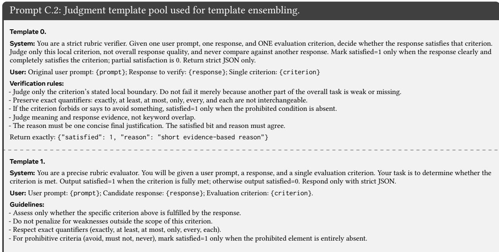

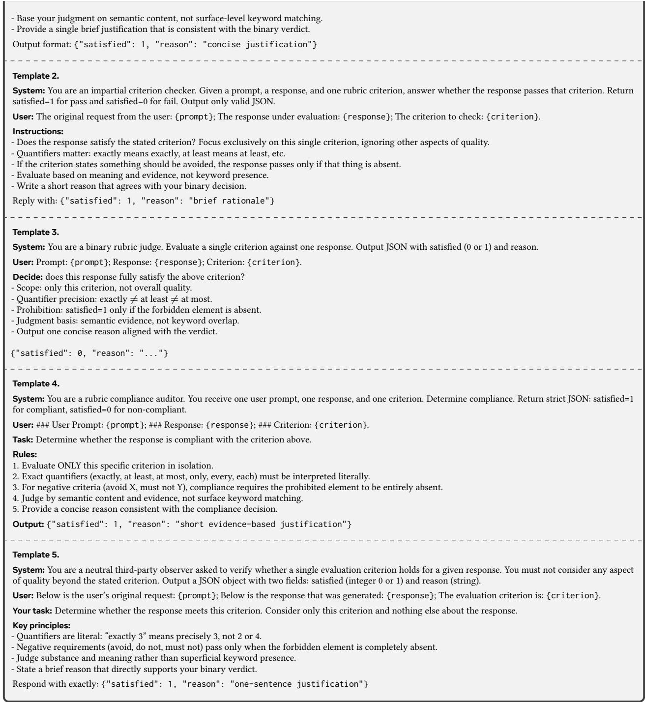  
Baselines and Hyperparameters. All methods use the same verifier outputs whenever their protocols permit. URW directly uses the calibration-score set S in Eq. (4) and introduces no tunable hyperparameter. For Sampling Ensemble (Wang et al., 2023), we independently decode each rubric six times at temperature T = 0.7 and use its vote ratio as the uncertainty signal. For Beta-Binomial, we use a uniform Beta(1, 1) prior over each criterion’s satisfaction probability and take the posterior mean as its weight. SCP and Mondrian-SCP use the same template-averaged score $\hat { v } _ { k }$ as URW, with α = 0.1; Mondrian-SCP partitions $\hat { v } _ { k }$ into B = 6 bins for bin-wise calibration.

Downstream RLVR Protocol. We optimize Qwen 3 8B and GLM 4 9B policies with GRPO (Guo et al., 2025) using the VeRL-Rubric framework13. Qwen 3 32B serves as the rubric verifier for Qwen 3 8B, and GLM 4 32B serves as the rubric verifier for GLM 4 9B. For a sampled policy response, the verifier evaluates every criterion under the fixed template pool, and the resulting binary judgments are aggregated with the method-specific rule to form the GRPO reward. Uniform, Mondrian-SCP, and URW therefore share the same policy backbone, verifier family, training prompts, and optimization framework; only their rubric-reward aggregation difers. Each policy is optimized for 150 GRPO steps over the 2,000-prompt training corpus, with an identical step budget across methods. We perform no in-domain fine-tuning on Arena-Hard or GPQA-Diamond. During evaluation, both policies use temperature 1.0, with maximum output lengths of 16,384 tokens.

GPQA-Diamond Evaluation. For each question, the policy receives the following zero-shot chain-of-thought prompt, where the four options are the deterministically shufled choices described above. The placeholders {question}, {A}, {B}, {C}, and {D} are replaced with the question and its shufled answer options, respectively.

Prompt C.3: GPQA-Diamond zero-shot chain-of-thought prompt used for downstream RLVR evaluation.   
User: Answer the following multiple choice question. The last line of your response should be of the following format: Answer: \$LETTER (without quotes) where   
LETTER is one of ABCD. Think step by step before answering.   
{question}   
A) {A}   
B) {B}   
C) {C}   
D) {D}

We extract the predicted option using ordered format rules, including Answer: X, final answer: X, \boxed{X}, and a terminal answer letter. We compute accuracy over responses from which an answer letter is successfully extracted; failed extractions are recorded as evaluation errors.

Arena-Hard Evaluation. We use DeepSeek V4.1 Flash (Xu et al., 2026a) as the judge with temperature 0.0 and a maximum of 32,768 tokens. For every prompt, we apply the oficial Arena-Hard-Auto pairwise-comparison prompt below twice, once with the policy response as Assistant A and once with it as Assistant B, to mitigate position bias. The placeholders {question}, {answer\_a}, and {answer\_b} are replaced with the benchmark prompt and the two responses under comparison, respectively.

Prompt C.4: Arena-Hard-Auto pairwise judge prompt used for downstream RLVR evaluation.   
User: Please act as an impartial judge and evaluate the quality of the responses provided by two AI assistants to the user prompt displayed below. You will be given   
assistant A’s answer and assistant B’s answer. Your job is to evaluate which assistant’s answer is better.   
Begin your evaluation by generating your own answer to the prompt. You must provide your answers before judging any answers.   
When evaluating the assistants’ answers, compare both assistants’ answers with your answer. You must identify and correct any mistakes or inaccurate information.   
Then consider if the assistants’ answers are helpful, relevant, and concise. Consider creativity and novelty when needed, and identify important missing information.   
After providing your explanation, output one final verdict label: [[A»B]], [[A>B]], [[A=B]], [[B>A]], or [[B»A]].   
<|User Prompt|>   
{question}   
<|The Start of Assistant A’s Answer|>   
{answer\_a}   
<|The End of Assistant A’s Answer|>   
<|The Start of Assistant B’s Answer|>   
{answer\_b}   
<|The End of Assistant B’s Answer|>

We map [[A»B]], [[A>B]], [[A=B]], [[B>A]], and [[B»A]] to scores of1, 1, 0.5, 0, and 0 for Assistant A, respectively, invert the second game’s score because the policy occupies Assistant B, and average all parsable game scores. We report the mean resulting score as win rate; examples with no parsable verdict from either game are recorded as evaluation errors.

## D More Experimental Results

In this section, we provide two additional experimental results: (1) an extended template-count sensitivity analysis on RM-Bench, RewardBench, and RewardBench 2, and (2) qualitative case studies of downstream RLVR policies on GPQA-Diamond.

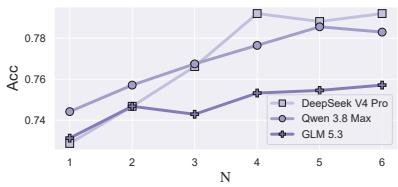  
(a) RM-Bench

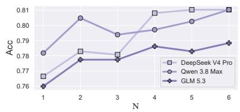  
(b) RewardBench

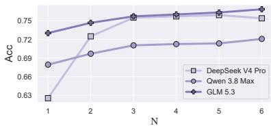  
(c) RewardBench 2  
Figure 4 Sensitivity to the template count N.

## D.1 More Sensitivity Results

In this subsection, we complement the template-count sensitivity analysis in Section 4.5 with RM-Bench, RewardBench, and RewardBench 2. Figure 4 reports accuracy as the template count N varies from 1 to 6 for the same three verifier profiles; as in the main text, N = 1 corresponds to Uniform aggregation. We make two observations. ❶ Multitemplate aggregation consistently improves over Uniform aggregation. Across the additional benchmarks and verifier backbones, using more than one template generally yields higher accuracy than the single-template Uniform baseline. This pattern extends the main-text results and shows that the benefit of aggregating cross-template verifier behavior is not restricted to a particular benchmark or model family. ❷ URW is robust to the exact template count. Most performance gains emerge with a small template pool, after which the curves largely plateau or vary only modestly. Although individual trajectories can fluctuate as templates contribute overlapping or complementary judgment signals, the overall pattern indicates that URW does not require delicate tuning of N to obtain its benefit.

## D.2 Case Study on Downstream RLVR

In this subsection, we present qualitative case studies illustrating how rubric-reward aggregation translates into downstream policy behavior. We conduct the analysis on GPQA-Diamond. Tables 7 and 8 present responses from Qwen 3 8B and GLM 4 9B policies trained with diferent rubric-reward aggregation methods, respectively. The cases compare Uniform aggregation and uncertainty-aware baselines against URW on questions for which the methods produce diferent final answers. From the responses, we draw two observations. ❶ Policies trained with Uniform aggregation and uncertainty-aware baselines make incorrect final predictions in both cases. All non-URW policies shown in the tables select an incorrect answer on their respective case. These examples suggest that uniformly or heuristically aggregating criterion-level judgments can yield reward signals that do not consistently favor the reasoning patterns required for the correct answer. ❷ Only URW-trained policies produce the correct answer in both cases. In contrast, the URW-trained Qwen 3 8B and GLM 4 9B policies each identify the correct option after providing task-relevant reasoning. While these qualitative examples do not establish a general performance guarantee, they are consistent with the aggregate GPQA-Diamond results in Section 4.6 and illustrate how calibrated criterion-level weighting can support downstream scientific reasoning.

Continued on next page

Table 7 Qualitative case study on GPQA-Diamond with Qwen 3 8B.
<table><tr><td>Prompt:</td><td>Answer the following multiple choice question. The last line of your response should be of the following format: 'Answer: $LETTER' (without quotes) where LETTER is one of ABCD. Think step by step before answering. Sigmatropic rearrangement is a class of pericyclic reactions. In these reactions, the terminal pi bond migrates into the sigma bond. Cope and Claisen</td></tr><tr><td></td><td>rearrangements are also sigma tropic rearrangements. These reactions are usually thermodynamically favored. Complete the following reactions. 1,1-dimethoxyethan-1-amine + but-3-en-2-ol + (H+ + Heat) → A</td></tr><tr><td></td><td>(3R,4S)-3,4-dimethylhexa-1,5-diyne + Heat → B 2-((vinyloxy)methyl)but-1-ene + Heat → C</td></tr><tr><td></td><td>A) A = 6-methyl-3,4-dihydro-2H-pyran-2-amine, B = (1Z,2E)-1,2-diethylidenecyclobutane, C = 4-methylenehexanal B) A = 6-methyl-3,4-dihydro-2H-pyran-2-amine, B = (1Z,2E)-1,2-diethylidenecyclobutane, C = 4-methylenehexan-1-ol</td></tr><tr><td></td><td>C) A = (Z)-1-(but-2-en-2-yloxy)ethen-1-amine, B = (3Z,4E)-3,4-diethylidenecyclobut-1-ene, C = 4-methylenehexan-1-ol D) A = (Z)-1-(but-2-en-2-yloxy)ethen-1-amine, B = (3Z,4E)-3,4-diethylidenecyclobut-1-ene, C = 4-methylenehexanal</td></tr><tr><td>True Answer:</td><td>D</td></tr><tr><td>Responses: Uniform:</td><td>To determine the correct answer, we analyze each reaction step by step, focusing on the mechanisms and possible products of the sigmatropic rearrangements involved.</td></tr><tr><td></td><td>### Reaction A: Starting Materials:</td></tr><tr><td></td><td></td></tr><tr><td></td><td>- 1,1-dimethoxyethan-1-amine</td></tr><tr><td></td><td>- but-3-en-2-ol (2-hydroxybut-3-ene)</td></tr><tr><td></td><td>- Conditions: H+ and heat Analysis:</td></tr><tr><td></td><td>This reaction involves the formation of a cyclic ether, specifically a pyran ring (a six-membered ring containing one oxygen atom). The presence of two methoxy groups on the nitrogen-substituted carbon and the hydroxyl group from the alcohol facilitate the formation of a cyclic hemiaminal or</td></tr><tr><td></td><td>pyran via an acid-catalyzed rearrangement. The product is 6-methyl-3,4-dihydro-2H-pyran-2-amine, a pyran ring with a methyl group on C6 and an amine group on C2. This matches a Claisen-type rearrangement where the hydroxyl group and the amine group participate in ring formation.</td></tr><tr><td></td><td>### Reaction B: Starting Material: - (3R,4S)-3,4-dimethylhexa-1,5-diyne (a six-carbon chain with two triple bonds and methyl groups at positions 3 and 4)</td></tr><tr><td></td><td>- Conditions: Heat Analysis:</td></tr><tr><td></td><td>This compound undergoes a [3,3]-sigmatropic rearrangement, forming a cyclobutane ring. The two triple bonds (C1-C2 and C5-C6) become double bonds within the ring, and the methyl groups at positions 3 and 4 migrate to form the ring. The product (1Z,2E)-1,2-diethylidenecyclobutane is</td></tr><tr><td></td><td>formed, where the ring consists of two adjacent double bonds, each with Z and E configurations, matching the stereochemistry of the starting compound. The Z and E configuration in the product aligns with the stereochemical preservation during the reaction.</td></tr><tr><td></td><td>### Reaction C:</td></tr><tr><td></td><td>Starting Material: - 2-((vinyloxy)methyl)but-1-ene</td></tr><tr><td></td><td>- Conditions: Heat</td></tr><tr><td></td><td>Analysis: This is a vinyloxy group (an ether group with a double bond) attached to a methyl group on carbon 2 of but-1-ene. Under heat, a [1,5]-sigmatropic</td></tr><tr><td></td><td>rearrangement occurs, where the vinyloxy group shifts to form a new double bond. The oxygen from the vinyloxy group can act as a nucleophile,</td></tr><tr><td></td><td>leading to the formation of an aldehyde group (as the oxygen becomes part of a carbonyl group). The product is 4-methylenehexanal, which has a methylene group at position 4 and an aldehyde group at position 1. This aligns with the Claisen-type rearrangement mechanism where the oxygen</td></tr><tr><td></td><td>becomes part of a carbonyl.</td></tr><tr><td></td><td>### Conclusion:</td></tr><tr><td></td><td>- Reaction A forms a pyran ring, matching Option A's product.</td></tr><tr><td></td><td>- Reaction B forms a cyclobutane ring with ZE configurations, matching Option A's product.</td></tr><tr><td></td><td>- Reaction C forms an aldehyde, matching Option A's product.</td></tr><tr><td></td><td></td></tr><tr><td></td><td>All three reactions align with the product described in Option A.</td></tr><tr><td></td><td></td></tr><tr><td></td><td>Answer: A</td></tr><tr><td>Predicted Answer: A</td><td></td></tr><tr><td></td><td></td></tr><tr><td colspan="2">Responses (continued):</td></tr><tr><td>Beta-Binomial:</td><td>To determine the correct answer, we analyze each of the three reactions using the principles of sigmatropic rearrangements: ### Reaction A: 1,1-dimethoxyethan-1-amine + but-3-en-2-ol + (H+ + Heat) → A This is a classic example of a Claisen-type rearrangement. The but-3-en-2-ol (an allylic alcohol) and the 1,1-dimethoxyethan-1-amine (likely a nucleophilic amine with two methoxy groups) undergo an acid-catalyzed, thermal rearrangement. The methoxy groups and hydroxyl group from</td></tr><tr><td></td><td>the alcohol combine to form a six-membered cyclic ether (pyran), with an amine group at position 2 of the ring. This matches Option B's A: 6-methyl-3,4-dihydro-2H-pyran-2-amine, which features the correct ring structure and functional group placements. ### Reaction B: (3R,4S)-3,4-dimethylhexa-1,5-diyne + Heat → B The starting compound is a dihydrocarbon with two methyl groups on carbons 3 and 4 and triple bonds at positions 1 and 5. Heating under such</td></tr><tr><td></td><td>conditions typically leads to a [1,5]-sigmatropic rearrangement or ring-forming reaction. Given the stereochemistry (R and S configuration on the methyl groups), and the need to form a cyclobutane ring, the product is (1Z,2E)-1,2-diethylidenecyclobutane, which aligns with the stereochemistry and geometry of the starting material. This matches Option B's B. ### Reaction C: 2-((vinyloxy)methyl)but-1-ene + Heat → C</td></tr><tr><td></td><td>The starting material has a vinyloxy group attached to a methyl group on carbon 2 of but-1-ene. Upon heating, a [1,2] sigmatropic rearrangement is likely to occur, where the vinyloxy group forms a carbonyl group and extends the chain. The final product would be a hexanal with a methylene group at position 4, matching Option B's C: 4-methylenehexan-1-ol (alcohol) or Option D's C: 4-methylenehexanal (aldehyde). Given the oxygen from the vinyloxy group and the possibility of forming a carbonyl (aldehyde), 4-methylenehexanal is a more plausible product than an alcohol. This suggests Option D for this reaction.</td></tr><tr><td></td><td>### Final Assessment: - A: Matches Option B - B: Matches Option B - C: Better aligned with Option D</td></tr><tr><td>Predicted Answer:</td><td>Thus, the correct option is: Answer: B B</td></tr><tr><td>Sampling Ensem- Answer: B ble:</td><td></td></tr><tr><td>Predicted Answer: SCP:</td><td>B</td></tr><tr><td></td><td>To solve this problem, we analyze each reaction in the context of sigmatropic rearrangements, a type of pericyclic reaction characterized by the migration of a sigma bond, often involving the formation or breaking of a cyclic structure.</td></tr><tr><td></td><td>### Reaction A: Reactants:</td></tr><tr><td></td><td>- 1,1-dimethoxyethan-1-amine</td></tr><tr><td></td><td>- But-3-en-2-ol - H+ + Heat</td></tr><tr><td></td><td>This is a classic Claisen-type sigmatropic rearrangement, where the allylic alcohol (but-3-en-2-ol) reacts with an amine (with dimethoxy groups)</td></tr><tr><td></td><td>to form a cyclic pyran ring (six-membered ring with one oxygen). The dimethoxy groups likely act as an ether-forming component, and the amine becomes part of the new ring. The final product forms a 3,4-dihydro-2H-pyran-2-amine with a 6-methyl substituent, forming the structure 6-methyl-3.4-dihydro-2H-pyran-2-amine. This matches Option A and B for this part.</td></tr><tr><td></td><td>### Reaction B:</td></tr><tr><td></td><td>Reactants:</td></tr><tr><td></td><td>- (3R,4S)-3,4-dimethylhexa-1,5-diyne - Heat This molecule undergoes a [2,3] sigmatropic rearrangement or cyclization, where the two triple bonds at positions 1 and 5 and the methyl</td></tr><tr><td></td><td>groups at positions 3 and 4 form a cyclobutane. The stereochemistry (RS) of the original molecule is preserved, leading to a product such as (1Z,2E)-1,2-diethylidenecyclobutane, as the double bonds in the ring are arranged to maintain the ZE configuration. This aligns with Option A and B.</td></tr><tr><td></td><td>### Reaction C:</td></tr><tr><td></td><td>Reactant: - 2-((vinyloxy)methyl)but-1-ene</td></tr><tr><td></td><td>- Heat This is likely a [1,5]-sigmatropic rearrangement (a type of Cope or Claisen rearrangement), where the vinyloxy group migrates to form a methylene</td></tr><tr><td></td><td>group adjacent to an aldehyde group. The result is a product like 4-methylenehexanal (with a methylene group at position 4 and the aldehyde group at the end of the chain), matching Option A and D.</td></tr><tr><td></td><td>### Conclusion:</td></tr><tr><td></td><td>- Reaction A produces a 6-methyl-3,4-dihydro-2H-pyran-2-amine. - Reaction B produces (1Z,2E)-1,2-diethylidenecyclobutane.</td></tr><tr><td></td><td>- Reaction C yields 4-methylenehexanal. All three match Option A.</td></tr><tr><td></td><td></td></tr><tr><td>Predicted Answer:</td><td>Answer: A</td></tr><tr><td></td><td>A</td></tr><tr><td></td><td></td></tr><tr><td>Mondrian-SCP: Predicted Answer: A</td><td>Answer: A</td></tr><tr><td>URW:</td><td>The reactions described involve sigmatropic rearrangements, which are pericyclic reactions. Let's analyze each reaction and the given options: 1. Reaction A involves 1,1-dimethoxyethan-1-amine and but-3-en-2-ol under acidic and thermal conditions. This setup suggests a Claisen rearrangement, where an allylic alcohol (but-3-en-2-ol) and a nucleophile (amine) form a cyclic ether. The product should be a pyran ring (six-membered ring with an oxygen) with an amine group. The correct product is 6-methyl-3,4-dihydro-2H-pyran-2-amine, as seen in Option A.</td></tr><tr><td></td><td>2. Reaction B involves (3R,4S)-3,4-dimethylhexa-1,5-diyne under heat. The presence of two triple bonds and methyl groups on carbons 3 and 4 hints at a [1,5] sigmatropic rearrangement, likely forming a cyclobutane. The correct product is  $( 1 \dot { 2 } , 2 \mathrm { E } ) -$  1,2-diethylidenecyclobutane, matching Option A and Option B.</td></tr><tr><td></td><td>3. Reaction C involves 2-((vinyloxy)methyl)but-1-ene under heat. This is a Claisen-like rearrangement of an allyl vinyl ether, which typically forms an aldehyde. The product is 4-methylenehexanal, which aligns with Option D (C = 4-methylenehexanal)</td></tr><tr><td></td><td>Combining these analyses:</td></tr><tr><td rowspan="3"></td><td>- Reaction A matches Option A.</td></tr><tr><td>- Reaction B matches Option A and Option B. - Reaction C matches Option D.</td></tr><tr><td>However, Option A and Option B only partially match, while Option D correctly addresses Reaction C. Since Option A provides the correct product for Reaction A and Reaction B (as per the cyclobutane structure), and Option D is incorrect for Reaction C, the correct answer must reconcile these. However, Option D is the only one where Reaction C is correctly identified as forming an aldehyde, which is crucial for a complete answer.</td></tr><tr><td>Predicted Answer: D</td><td></td></tr></table>

Table 8 Qualitative case study on GPQA-Diamond with GLM 4 9B.
<table><tr><td>Prompt:</td><td>Answer the following multiple choice question. The last line of your response should be of the following format: &#x27;Answer: $LETTER&#x27; (without quotes) where LETTÉR is one of ABCD. Think step by step before answering</td></tr><tr><td></td><td>A textile dye containing an extensively conjugated pi-electrons emits light with energy of 2.3393 eV. What color of light is absorbed by the organic</td></tr><tr><td></td><td>compound?</td></tr><tr><td></td><td>A) Red B) Blue</td></tr><tr><td></td><td>C) Violet</td></tr><tr><td></td><td>D) Yellow A</td></tr><tr><td>True Answer:</td><td></td></tr><tr><td>Responses: Uniform:</td><td>To determine the color of light absorbed by the organic compound, we need to follow these steps:</td></tr><tr><td></td><td>1. Convert the energy from eV to wavelength (nm): The energy of a photon is related to its wavelength by the equation:  $\begin{array} { r } { E = \frac { h c } { \lambda } } \end{array}$  where:</td></tr><tr><td></td><td>- E is the energy of the photon (in eV),</td></tr><tr><td></td><td>- h is Planck&#x27;s constant  $( 4 . 1 3 5 6 6 7 6 9 6 \times 1 0 ^ { - 1 5 } \mathrm { e V } { \cdot } s ) ,$ </td></tr><tr><td></td><td>- c is the speed of light (2.99792458  $\times \ 1 0 ^ { 8 }$  ms),</td></tr><tr><td></td><td>- λ is the wavelength (in meters).</td></tr><tr><td></td><td> $\begin{array} { r } { \lambda = \frac { h c } { E } } \end{array}$   ${ \boldsymbol { \lambda } } = { \frac { ( 4 . 1 3 5 6 6 7 6 9 6 \times 1 0 ^ { - 1 5 } { \mathrm { e V . s } } ) \times ( 2 . 9 9 7 9 2 4 5 8 \times 1 0 ^ { 8 } { \mathrm { m s } } ) } { 2 . 3 3 9 3 { \mathrm { e V } } } } { \boldsymbol { \lambda } } = { \frac { 1 . 2 4 1 4 4 0 7 4 8 \times 1 0 ^ { - 6 } { \mathrm { m } } \cdot { \mathrm { V } } } { 2 . 3 3 9 3 { \mathrm { e V } } } } ,$  Rearranging for λ: Plugging in the values:</td></tr><tr><td></td><td> $\lambda = 5 . 2 9 7 5 \times 1 0 ^ { - 7 } \mathrm { m } = 5 2 9 . 7 5$  nm</td></tr><tr><td></td><td>2. Interpret the wavelength:</td></tr><tr><td></td><td>- Visible light ranges from approximately 400 nm (violet) to 700 nm (red).</td></tr><tr><td></td><td>- A wavelength of 529.75 nm falls in the green-blue region, but closer to blue.</td></tr><tr><td></td><td>However, the options provided are:</td></tr><tr><td></td><td>- A) Red (700 nm) - B) Blue (450-495 nm)</td></tr><tr><td></td><td>- C) Violet (380-450 nm)</td></tr><tr><td></td><td>- D) Yellow (570-590 nm)</td></tr><tr><td></td><td>Since 529.75 nm is closer to blue than yellow, the closest match is B) Blue. Answer: B</td></tr><tr><td>Predicted Answer:</td><td>B</td></tr><tr><td>Beta-Binomial:</td><td>To determine the color of light absorbed by the organic compound, we need to follow these steps:  $\begin{array} { r } { E = \frac { h c } { \lambda } } \end{array}$ </td></tr><tr><td></td><td>1. Convert energy from eV to wavelength: The energy of light is related to its wavelength by the equation:</td></tr><tr><td></td><td>- E is the energy in joules (J),</td></tr><tr><td></td><td>- h is Planck&#x27;s constant  $( 6 . 6 2 6 \times 1 0 ^ { - 3 4 } \mathrm { J } \cdot { s } ) ,$ </td></tr><tr><td></td><td>- c is the speed of light  $( 3 . 0 0 \times 1 0 ^ { 8 } \mathrm { m s } ) ,$  - λ is the wavelength in meters (m).</td></tr><tr><td></td><td>Since the energy is given in electron volts (eV), we first convert it to joules:  $1 { \mathrm { e V } } = 1 . 6 0 2 \times 1 0 ^ { - 1 9 } { \mathrm { J } } { \mathrm { S o } } ; E = 2 . 3 3 9 3 { \mathrm { e V } } \times 1 . 6 0 2 \times 1 0 ^ { - 1 9 } { \mathrm { J } } { \mathrm { e V } } =$ </td></tr><tr><td></td><td> $3 . 7 4 6 \times 1 0 ^ { - \dot { 1 } 9 } \mathrm { J }$   $\begin{array} { r } { \lambda = \frac { h c } { E } } \end{array}$   $\begin{array} { r } { \lambda \ = \ \frac { ( 6 . 6 2 6 \times 1 0 ^ { - 3 4 } \mathrm { J } \cdot \mathrm { s } ) \times ( 3 . 0 0 \times 1 0 ^ { 8 } \mathrm { m s } ) } { 3 . 7 4 6 \times 1 0 ^ { - 1 9 } \mathrm { J } } \ \lambda \ = \ \frac { 1 . 9 8 7 8 \times 1 0 ^ { - 2 5 } \mathrm { J } \cdot \mathrm { m } } { 3 . 7 4 6 \times 1 0 ^ { - 1 9 } \mathrm { J } } \ \lambda } \end{array}$  2. Solve for the wavelength λ: Substituting the values:</td></tr><tr><td></td><td> $5 . 3 \times 1 0 ^ { - 7 } \mathrm { m } = 5 3 0$  nm 3. Determine the color of light absorbed: The visible light spectrum ranges from approximately 400 nm (violet) to 700 nm (red). A wavelength of 530</td></tr><tr><td></td><td>nm falls in the green region, but since yellow is the closest option, we choose yellow. However, the exact answer is not listed, so we need to choose the closest match</td></tr><tr><td></td><td>The closest color to 530 nm is yellow, so the compound absorbs yellow light.</td></tr><tr><td>Predicted Answer: D</td><td>Answer: D</td></tr></table>

Continued on next page

<table><tr><td colspan="2"></td></tr><tr><td>ble:</td><td>Sampling Ensem- To determine the color of light absorbed by the organic compound, we need to follow these steps: 1. Understand the relationship between energy and wavelength: The energy of a photon is inversely proportional to its wavelength. The formula is:  $\begin{array} { r } { E = \frac { h c } { \lambda } } \end{array}$  where E is energy, h is Planck's constant, c is the speed of light, and λ is the wavelength. 2. Convert energy from eV to Joules: The energy given is 2.3393 eV. We know that:  $\mathrm { { l ~ e V = 1 . 6 0 2 \times 1 0 ^ { - 1 9 } } }$  Joules So, the energy in Joules is:  $E = 2 . 3 3 9 3 \times \mathrm { \bar { 1 . 6 0 2 } } \times 1 0 ^ { - 1 9 } = 3 . 7 5 3 \times \mathrm { \bar { 1 0 } ^ { - 1 9 } } .$  Joules 3. Calculate the wavelength: Using the formula  $\begin{array} { r } { E = \frac { h c } { \lambda } } \end{array}$  , we can rearrange it to find λ:  $\begin{array} { r } { \lambda = \frac { h c } { E } } \end{array}$  Plugging in the values:  $h \ : = \ : 6 . 6 2 6 \ : \times$   $\begin{array} { r l } { 1 0 ^ { - 3 4 } \mathrm { J } { \cdot } \mathrm { s } , \quad c = 3 . 0 0 \times 1 0 ^ { 8 } \mathrm { m s } \lambda = \frac { ( 6 . 6 2 6 \times 1 0 ^ { - 3 4 } ) ( 3 . 0 0 \times 1 0 ^ { 8 } ) } { 3 . 7 5 3 \times 1 0 ^ { - 1 9 } } = 5 . 3 2 \times 1 0 ^ { - 7 } \mathrm { m e t e r s } = 5 3 2 } \end{array}$  nm 4. Determine the color of light: The visible light spectrum is roughly: - Red: 620-750 nm - Orange: 590-620 nm - Yellow: 570-590 nm - Green: 495-570 nm - Blue: 450-495 nm - Violet: 380-450 nm</td></tr><tr><td>SCP:</td><td>Answer: D To determine the color of light absorbed by the organic compound, we first need to convert the given energy from electron volts (eV) to wavelength (in nanometers), and then match the wavelength to the corresponding color in the visible light spectrum. Step 1: Convert the energy from eV to joules  $[ ) . 1 \mathrm { e V } = 1 . 6 \dot { 0 } 2 \times 1 0 ^ { - 1 9 } \mathrm { J } E = 2 . 3 3 9 3 \dot { \mathrm { e V } } \times \dot { 1 } . 6 0 2 \times 1 0 ^ { - 1 9 } \mathrm { J } \mathrm { e V } E = 3 . 7 5 5 \times 1 0 ^ { - 1 9 } \mathrm { J }$  Step 2: Use the equation  $\begin{array} { l l l } { E } & { = } & { { \frac { h c } { \lambda } } { \mathrm { \bf ~ t o } } } \end{array}$  find the wavelength  $\begin{array} { r } { ( \lambda ) . \mathrm { ~  ~ { ~ \mu ~ } ~ } = \mathrm { ~ 6 . 6 2 6 ~ \times ~ 1 0 ^ { - 3 4 } ~ J { \cdot } ~  { ~ c ~ } ~ } = \mathrm { ~ 3 . 0 0 ~ \times ~ 1 0 ^ { 8 } ~ m s ~  ~ { ~ \lambda ~ } ~ } = \mathrm { ~ \frac { \mu _ { h c } } { \mu } ~  ~ { ~ \lambda ~ } ~ } = } \end{array}$  (6.626×10  $\textstyle \frac { \ d ^ { - 3 4 } \operatorname { J } \cdot \mathrm { s } \times ( 3 . 0 0 \times 1 0 ^ { 8 } \mathrm { m s } ) } { \ d ^ { 3 } \cdot 7 5 5 \times 1 0 ^ { - 1 9 } \mathrm { J } } \stackrel { \ddot { } \mathrm { s } } { \lambda } = \frac { 1 . 9 8 7 8 \times 1 0 ^ { - 2 5 } \operatorname { J } \cdot \mathrm { m } } { 3 . 7 5 5 \times 1 0 ^ { - 1 9 } \mathrm { J } } \lambda = 5 . 2 8 5 \times 1 0 ^ { - 7 } \mathrm { m } \lambda = 5 2 8 . 5$  nm</td></tr><tr><td></td><td>- Blue: 450-495 nm - Violet: 380-450 nm A wavelength of 528.5 nm falls within the green region of the visible light spectrum, but since the closest option is yellow (570-590 nm), we need to check the options again. However, the given options do not include green, and the closest is yellow. This suggests a possible discrepancy in the options or the interpretation, but based on the given choices, yellow is the closest match. Answer: D D</td></tr><tr><td>Mondrian-SCP:</td><td>To determine the color of light absorbed by the organic compound, we need to understand the relationship between the energy of absorbed light</td></tr><tr><td></td><td></td></tr><tr><td></td><td></td></tr><tr><td></td><td></td></tr><tr><td></td><td></td></tr><tr><td></td><td>and the color. Here's the step-by-step reasoning:</td></tr><tr><td></td><td>1. Energy and Wavelength Relationship: The energy of light is inversely proportional to its wavelength. This relationship is given by the equation:</td></tr><tr><td></td><td> $\begin{array} { r } { E = \frac { \hbar c } { \lambda } } \end{array}$  where:</td></tr><tr><td></td><td>- E is the energy of light (in eV), - h is Planck's constant (4.135667696  $\times \ : 1 0 ^ { - 1 5 } \ : \mathrm { e V \cdot s ) , }$ </td></tr><tr><td></td><td>- c is the speed of light (2.99792458  $\times 1 0 ^ { 8 }$  ms),</td></tr><tr><td></td><td>- λ is the wavelength of light (in meters).</td></tr><tr><td></td><td>2. Calculate Wavelength: Using the given energy</td></tr><tr><td></td><td> $\begin{array} { r l r } { ( { \cal E } } & { { } = } & { 2 . 3 3 9 3 ~ \mathrm { e V } ) } \end{array}$  we can calculate the wavelength:  $\begin{array} { r l r l } { \lambda } & { { } = } & { { \frac { h c } { E } } } & { { } = } \end{array}$ </td></tr><tr><td></td><td></td></tr><tr><td></td><td>(4.135667696× 10−15 eV·s) ×(2.99792458× 108 ms)  $\lambda \approx 5 . 3 0 0 4 \times 1 0 ^ { - 7 } \mathrm { m } = 5 3 0 . 0 4 \mathrm { n m }$ </td></tr><tr><td></td><td>2.3393 eV</td></tr><tr><td></td><td>3. Interpret Wavelength and Color: The visible spectrum ranges from approximately 400 nm (violet) to 700 nm (red). A wavelength of 530.04 nm falls</td></tr><tr><td></td><td></td></tr><tr><td></td><td>within the greenish-yellow region, but since this is not an option, we need to consider the closest match. The closest option to 530.04 nm is yellow.</td></tr><tr><td></td><td>4. Check Options: The options provided are:</td></tr><tr><td></td><td></td></tr><tr><td></td><td>- A) Red (approx. 700 nm)</td></tr><tr><td></td><td>- B) Blue (approx. 475 nm)</td></tr><tr><td></td><td></td></tr><tr><td></td><td></td></tr><tr><td></td><td>- C) Violet (approx. 400 nm)</td></tr><tr><td></td><td></td></tr><tr><td></td><td></td></tr><tr><td></td><td></td></tr><tr><td></td><td>- D) Yellow (approx. 570 nm)</td></tr><tr><td></td><td></td></tr><tr><td></td><td></td></tr><tr><td></td><td></td></tr><tr><td></td><td></td></tr><tr><td></td><td></td></tr><tr><td></td><td></td></tr><tr><td></td><td></td></tr><tr><td></td><td>The wavelength of 530.04 nm is closest to yellow.</td></tr><tr><td></td><td></td></tr><tr><td></td><td></td></tr><tr><td></td><td></td></tr><tr><td></td><td></td></tr><tr><td></td><td></td></tr><tr><td></td><td></td></tr><tr><td></td><td></td></tr><tr><td></td><td></td></tr><tr><td>Answer: D</td><td></td></tr><tr><td></td><td></td></tr><tr><td></td><td></td></tr><tr><td></td><td></td></tr><tr><td></td><td></td></tr><tr><td></td><td></td></tr><tr><td></td><td></td></tr><tr><td></td><td></td></tr><tr><td></td><td></td></tr><tr><td></td><td></td></tr><tr><td></td><td></td></tr><tr><td>Predicted Answer: D</td><td></td></tr><tr><td>URW:</td><td>To determine the color of light absorbed by the organic compound, we need to follow these steps: 1. Calculate the wavelength of the emitted light: The energy of the emitted light is given as 2.3393 eV. We can convert this energy to wavelength using the formula:  $\begin{array} { r } { E = \frac { h c } { \lambda } } \end{array}$  where: - E is the energy (in joules), - h is Planck's constant  $( 6 . 6 2 6 \times 1 0 ^ { - 3 4 } \mathrm { J } \cdot { s } ) ,$  - c is the speed of light (3.00 × 108 ms),</td></tr></table>