# Multimodal Decoupling for Diversified Recommendation through Semantic and Structural Shaping

Changran He∗   
Harbin Institute of   
Technology(Shenzhen)   
Shenzhen, China   
2023311c12@stu.hit.edu.cn

Tianjun Wei Nanyang Technological University Singapore, Singapore tjwei2-c@my.cityu.edu.hk

Jiaming Wei∗   
Harbin Institute of   
Technology(Shenzhen)   
Shenzhen, China   
23s151033@stu.hit.edu.cn

Haijun Zhang Harbin Institute of Technology(Shenzhen) Shenzhen, China hjzhang@hit.edu.cn

Jianghong Ma†   
Shenzhen Key Laboratory of Internet Information Collaboration Shenzhen, China   
Harbin Institute of Technology(Shenzhen) Shenzhen, China Shenzhen Research Institute, City University of Hong Kong Shenzhen, China majianghong@hit.edu.cn jianghma2-c@my.cityu.edu.hk   
Xiaofeng Zhang   
Harbin Institute of   
Technology(Shenzhen)   
Shenzhen, China   
zhangxiaofeng@hit.edu.cn

## Abstract

Recommender systems often sufer from over-concentrated results when optimized for accuracy, limiting recommendation diversity. While diversity has become an important objective, existing methods still face fundamental limitations from both semantic and structural perspectives. On the one hand, multimodal recommender systems provide rich semantic signals, yet are often treated as auxiliary to ID embeddings, leading to inefective semantic utilization for diversity. On the other hand, the accuracy–diversity trade-of persists during training, where accuracy gains often come at the cost of diversity. We show that this phenomenon is fundamentally governed by both the structural properties of learned representations and the dynamics of optimization. To address these challenges, we propose MOSS, a unified framework for multimodal decoupling through semantic and structural shaping. Specifically, we first in troduce an MLLM-based Decoupled Feature Extraction module to disentangle multimodal content into informative representations. To enhance semantic utilization, we design a Category-aware Embedding Selection module that extracts compact, category-aware semantic features. To address structural limitations, we propose two complementary modules: Alternating Dual-Graph Propagation, which alleviates representation collapse by integrating collaborative and multimodal propagation, and Entropy-based Diversity Regularization, which mitigates optimization bias by promoting balanced category exposure. Extensive experiments on real-world

∗Both authors contributed equally to this research.   
†Corresponding author.

datasets demonstrate that MOSS consistently achieves a superior accuracy–diversity trade-of over strong baselines.

## CCS Concepts

• Information systems → Recommender systems.

## Keywords

Multimodal Recommendation, Graph Neural Networks, Diversity

## ACM Reference Format:

Changran He, Jiaming Wei, Jianghong Ma, Tianjun Wei, Haijun Zhang, and Xiaofeng Zhang. 2026. Multimodal Decoupling for Diversified Recommendation through Semantic and Structural Shaping. In Proceedings of the 34th ACM International Conference on Multimedia (MM ’26), November 10–14, 2026, Rio de Janeiro, Brazil. ACM, New York, NY, USA, 10 pages. https://doi.org/10.1145/3767308.3835957

## 1 Introduction

In the era of information overload, recommender systems play a crucial role in helping users eficiently discover relevant content [7, 22, 29]. However, optimizing recommendation mainly for accuracy often leads to over-concentrated results, where similar items are repeatedly exposed and users’ broader interests are insuficiently explored [1, 11, 39]. To improve user experience, recommendation diversity, usually reflected by the coverage of diferent item attributes such as categories, has become an important objective, as it benefits novelty, long-tail exposure, and balanced discovery.

Despite its importance, existing methods still face fundamental limitations. In particular, these limitations can be understood from two complementary perspectives: semantic utilization and structural modeling.

C1: Semantic limitation in multimodal utilization for diversity-oriented recommendation. Multimodal recommender systems introduce rich semantic signals from item content, such as textual and visual information, enabling items to be characterized by their intrinsic properties [15, 16, 20, 29]. This provides a more expressive and semantically grounded representation of items.

However, most existing methods remain centered on item identity (ID) embeddings, treating multimodal information as an auxiliary signal through concatenation [8, 28], addition [6, 32, 43], or related fusion operations. Under this paradigm, multimodal content mainly enhances ID-driven representations, rather than being exploited as a primary source of semantic signals.

In principle, directly modeling items from multimodal content is particularly appealing for diversity-oriented recommendation. Unlike ID embeddings, which are largely shaped by historical user– item interactions and thus easily dominated by collaborative patterns such as popularity and exposure bias, multimodal information is grounded in the intrinsic characteristics of items themselves. It therefore provides richer semantic cues for distinguishing items from diferent perspectives, ofering a more natural basis for diversified recommendation.

Nevertheless, directly exploiting multimodal features remains highly nontrivial. Recent studies attempt to learn item representations directly from multimodal features [35, 36, 42], yet prior works show that using pre-trained multimodal representations does not necessarily improve recommendation performance and may even degrade it [33, 42], as further analyzed in Section 2.1. These observations indicate that the key challenge lies not in the availability of multimodal semantics, but in how to efectively organize and utilize them for diversity.

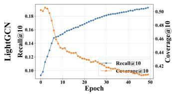

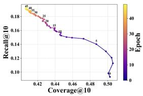  
Figure 1: Training dynamics and the accuracy–diversity tradeof of LightGCN on Anime, with Recall@10 for accuracy and Coverage@10 for diversity. The left figure shows Recall@10 and Coverage@10 over the first 50 epochs, and the right figure shows the corresponding Coverage@10–Recall@10 trajectory, colored by epoch and labeled every five epochs.

C2: Structural limitation in balancing accuracy and diversity during training. In collaborative recommendation, achieving high accuracy and high diversity simultaneously remains challeng ing. As illustrated in Fig. 1, this trade-of is observed in most GNN based models, such as LightGCN [10], where Recall@10 steadily improves during training, while Coverage@10 consistently declines. This indicates that accuracy gains are often achieved by concentrating recommendations on a narrower set of items, reflecting an increasing structural concentration in the learned representation space. As this pattern persistently emerges throughout training, it suggests that the accuracy–diversity trade-of is not merely an empirical phenomenon, but is closely related to the structural prop erties of learned representations and the optimization dynamics.

(1) Dimensional Collapse as a Representation-Level Bias. From the representation perspective, we relate this trade-of to dimensional collapse [14] observed in GNN-based collaborative filtering [3, 18, 38], where item representations are confined to a narrow subspace. Such structural compression reduces the efective capacity of the representation space, making items more similar and less distinguishable. As a result, the model becomes less capable of retrieving semantically diverse items, leading to homogeneous ranking outputs and reduced structural diversity. A more detailed analysis is provided in Section 2.2.

(2) Accuracy-Oriented Objective as an Optimization-Level Bias. From the optimization perspective, the conventional recommendation objectives, such as BPR [24], further reinforce this structural concentration. By prioritizing ranking accuracy without explicit diversity constraints, these objectives favor items that consistently contribute to the optimization signal, typically popular items and dominant categories. Consequently, the representation space becomes increasingly biased toward a limited subset ofitems, resulting in improved accuracy but diminished diversity.

To address the above limitations, we propose a unified framework, termed Multimodal Decoupling for Diversified Recommendation through Semantic and Structural Shaping (MOSS), which consists of four complementary modules. First, we propose the MLLM-based Decoupled Feature Extraction module, which leverages the reasoning capability of MLLMs to disentangle multimodal content and extract informative representations for the subsequent modules. To address the first challenge (C1), we propose the semantic shaping module Category-aware Embedding Selection module, which is introduced to tackle the underutilization of multimodal semantics in diversity-oriented recommendation. Instead of simply fusing modality information with ID embeddings or directly propagating raw multimodal features, it scores each embedding dimension from two complementary perspectives, namely global variance and category-level response balance, and retains a compact subset of informative and category-aware dimensions as the propagation input, thereby providing a stronger semantic basis for diversified recommendation. To address the second challenge (C2), we propose two structural shaping modules. (1) Alternating Dual-Graph Propagation module is designed to mitigate dimensional collapse, a representation-level bias that leads to diversity degradation in collaborative propagation. Specifically, it interleaves user–item collaborative propagation with multimodal semantic propagation over the item–item graph. This graph structural design alleviates dimensional collapse by enriching item representations with complementary multimodal signals, thereby preserving more expressive item relationships. Moreover, we theoretically show that this propagation scheme mitigates the tendency toward dimensional collapse. (2) Entropy-based Diversity Regularization is designed to mitigate the optimization-level bias induced by accuracy-oriented objectives. Specifically, it imposes an entropy regularization term on the category distribution of high-ranked items, thereby reshaping the ranking structure toward a more balanced category distribu tion, thereby promoting category-level diversity while maintaining recommendation accuracy.

In summary, our main contributions are listed as follows:

• To the best ofour knowledge, this work presents the first unified framework that integrates multimodal recommendation and diversity modeling from both semantic and structural perspectives.

• From the semantic perspective, we identify the underutilization of multimodal semantics in diversity-oriented recommendation. To address this limitation, we propose a Categoryaware Embedding Selection module, which extracts compact, category-aware, and semantically informative dimensions from decoupled multimodal representations, serving as a stable semantic anchor for downstream recommendation.

• From the structural perspective, we analyze the accuracy– diversity trade-of as a consequence of both representation collapse and optimization bias, and propose a unified structural solution. Specifically, Alternating Dual-Graph Propagation alleviates dimensional collapse through collaborative and multimodal propagation, enriching the structural expres siveness of item relationships. Furthermore, Entropy-based Diversity Regularization mitigates optimization-induced bias by enforcing balanced category exposure, thereby improving diversity while preserving accuracy.

• Extensive experiments on two real-world datasets demonstrate that the proposed method consistently achieves a better accuracy–diversity trade-of than baselines.

## 2 Analysis of Obstacles in Semantic and Structural Diversity Modeling

To understand the limitations of existing methods in diversityoriented recommendation, we analyze the problem from two complementary perspectives: semantic utilization and structural repre sentation. The former focuses on how multimodal semantics are extracted and organized, while the latter examines how representations are distributed and evolved during training.

## 2.1 Semantic Limitation: Inefective Utilization of Multimodal Semantics

We begin by analyzing the role of multimodal semantics in recommendation. A natural approach is to directly initialize item representations with pre-trained multimodal features to enrich semantic information [33]. However, such direct utilization does not necessarily improve recommendation performance.

Table 1: Efect of diferent item initialization strategies on representation quality and recommendation performance on Anime dataset.
<table><tr><td>Features</td><td>Norm. Eff.Rank</td><td>R@10</td><td>C@10</td></tr><tr><td>ID embedding</td><td>0.99</td><td>0.1924</td><td>0.4074</td></tr><tr><td>Visual embedding</td><td>0.65</td><td>0.1710</td><td>0.4032</td></tr><tr><td>Textual embedding</td><td>0.68</td><td>0.1698</td><td>0.4096</td></tr></table>

As shown in Table 1, replacing ID embeddings with visual or textual features under the same LightGCN backbone leads to a clear drop in Recall@10 (R@10), while Coverage@10 (C@10) does not show consistent improvement.

To further investigate this phenomenon, we analyze the normalized efective rank (Norm. Ef. Rank) [25]. Compared with ID-based initialization, multimodal initialization yields significantly lower efective rank, indicating that semantic information is unevenly distributed across embedding dimensions. This suggests that multimodal semantics are not efectively organized into discriminative representations, and may exhibit an early tendency toward representation collapse. To better understand this tendency, we further examine dimensional collapse in the following subsection.

As a result, although multimodal features contain rich semantic information, their efectiveness is not fully realized, limiting their contribution to diversity. These findings indicate that the key challenge lies not in the availability ofmultimodal semantics, but in how to organize them into compact and informative representations. This motivates the need for semantic shaping to extract stable and category-aware features for downstream recommendation.

## 2.2 Structural Limitation: Dimensional Collapse and Diversity Degradation

Building upon the above observations, we further examine how structural properties of representations afect diversity. Specifically, we analyze the distribution of item embeddings in the latent space [9, 17, 27, 37].

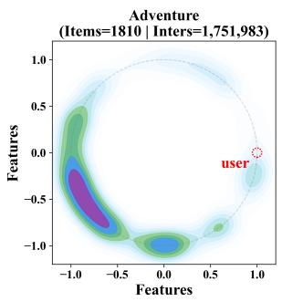

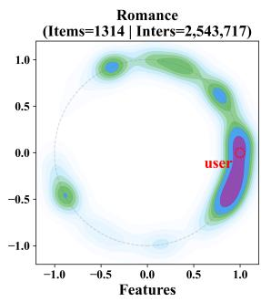

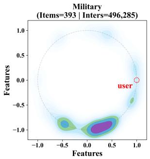

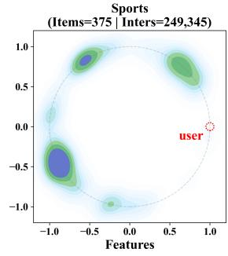  
Figure 2: Category-wise density visualization of item embeddings for four representative genres on Anime dataset. Embeddings are projected into 2D by t-SNE and normalized onto the unit circle, with filled contours represent density.

As illustrated in Fig. 2, item embeddings exhibit a clear dimensional collapse phenomenon, where representations are highly concentrated within each category with limited intra-category variation. While some degree of clustering is expected, the observed distributions reveal an excessive concentration tendency. Such structural compression reduces the discriminability among items and restricts the model’s ability to retrieve diverse candidates.

Consequently, recommendation results become increasingly homogeneous. For instance, users located near a dense region in the latent space are likely to receive recommendations from a narrow subset of items within the same category, while other categories remain underexplored.

From this perspective, the accuracy–diversity trade-of can be understood as a consequence of structural bias. Dimensional collapse reduces representation diversity, while accuracy-oriented objectives further reinforce concentration on dominant items and categories. Together, these efects lead to improved accuracy at the cost of diminished diversity.

This analysis highlights the necessity of structural shaping to alleviate dimensional collapse while preserving meaningful semantic relationships, thereby enabling a better balance between accuracy and diversity.

## 3 Methods

## 3.1 Preliminaries

Let U and I denote the sets of users and items, respectively. The interactions can be denoted by a matrix R $\in \mathbb { R } ^ { n \times m }$ , where $r _ { u i } = 1$ if user � interacts with item �, and 0 otherwise.

In addition, each item may be associated with one or more category labels. Let $C = \{ c _ { 1 } , \ldots , c _ { | C | } \}$ denote the category set. For each item $i \in \mathcal { I }$ , its category information is represented by a multi-hot category vector $\mathbf { c } _ { i } \in \{ 0 , 1 \} ^ { | C | }$ | , where the �-th entry equals 1 if item � belongs to category $c _ { k }$ , and 0 otherwise.

## 3.2 Overview

Fig. 4 illustrates the overall architecture ofMOSS, comprising offour core modules. For each item, we first employ an MLLM-based Decoupled Feature Extraction to disentangle multimodal information into three complementary descriptions, namely shared, visual-specific, and textual-specific representations.

Among them, the shared embedding is further refined by the proposed Category-aware Embedding Selection, while the visual-specific and textual-specific embeddings are used to construct modalityspecific item graphs.

Based on these representations, we design an Alternating Dual-Graph Propagation module with two modality-specific branches. In each branch, propagation alternates between the user–item interaction graph and the corresponding category-modulated item graph, thereby progressively integrating collaborative, multimodal, and category-aware neighborhood information.

Finally, we introduce an Entropy-based Diversity Regularization term to explicitly encourage category-level diversity in the optimization level.

## 3.3 MLLM-based Decoupled Feature Extraction

In multimodal recommendation, items are often accompanied by visual and textual content, which ofers rich and complementary semantic information beyond interaction signals.

To better exploit such multimodal semantics, we employ a Multimodal Large Language Model (MLLM), implemented with Qwen2.5- VL-72B [2], to decompose the content of item � into three complementary components: a shared description $s _ { i } ,$ a visual-specific description ��, and a textual-specific description ��.

These descriptions are then fed into the encoder, implemented by Sentence-BERT [23], to obtain the shared, visual-specific, and textual-specific item representations $h _ { i } ^ { s } , h _ { i } ^ { v }$ and $h _ { i } ^ { t } .$ . We denote the corresponding embedding matrices for all items by $\mathbf { H } ^ { s } , \mathbf { H } ^ { v } , \mathbf { H } ^ { t } \ \in$ $\mathbb { R } ^ { | \boldsymbol { I } | \times \hat { D } }$ , where � denotes the original embedding dimension.

The shared embedding captures the common and dominant semantics of each item, and is used as the semantic anchor for graph propagation. By contrast, the modality-specific embeddings preserve view-specific semantic cues and are used to construct modality-specific item graphs, enabling the model to explore broader yet semantically related neighborhoods from diferent views.

## 3.4 Category-aware Embedding Selection

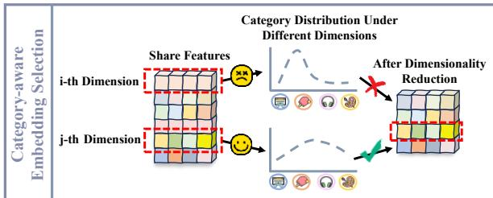  
Figure 3: Category-aware Embedding Selection.

As illustrated in Fig. 3, given the rich semantics encoded in multimodal item embeddings, we expect the initialized embeddings for graph propagation to preserve informative multimodal cues for recommendation accuracy while promoting cross-category semantic sharing rather than overemphasizing category-exclusive patterns.

As the shared embedding serves as the propagation input, this module is applied to the shared embedding matrix H� $\mathbf { \tau } \in \mathbb { R } ^ { | \mathcal { I } | \times D }$

We first estimate the informativeness of each dimension by its global variance across all items:

$$
\operatorname { V a r } _ { j } = \frac { 1 } { | \boldsymbol { \mathcal { T } } | } \sum _ { i = 1 } ^ { | \boldsymbol { \mathcal { T } } | } \left( h _ { i j } ^ { s } - \mu _ { j } \right) ^ { 2 } , \qquad \mu _ { j } = \frac { 1 } { | \boldsymbol { \mathcal { T } } | } \sum _ { i = 1 } ^ { | \boldsymbol { \mathcal { T } } | } h _ { i j } ^ { s } ,\tag{1}
$$

where $h _ { i j } ^ { s }$ denotes the �-th dimension of the embedding of item �, and $\mu _ { j }$ is the corresponding dataset-level mean. We then normalize the resulting variance into $v _ { j } \in \left[ 0 , 1 \right]$ by min–max scaling.

Variance serves as a simple indicator of how actively a dimension is utilized in the embedding space. Dimensions with larger variance better capture inter-item diferences and are thus more likely to preserve informative multimodal semantics, whereas low-variance dimensions tend to be weakly activated across items, reflecting underutilized or partially collapsed dimensions.

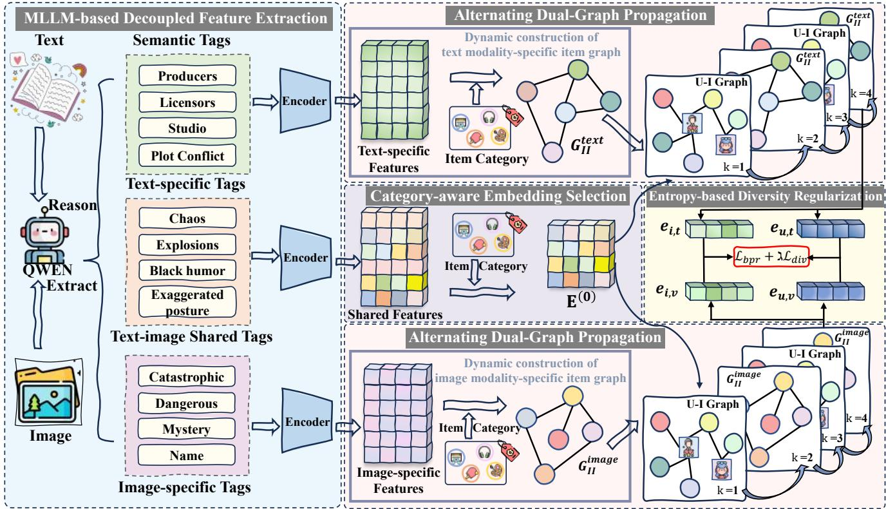  
Figure 4: An illustration of the proposed MOSS model. The MLLM-based Decoupled Feature Extraction module disentangles multimodal content into informative representations. The Category-aware Embedding Selection module selects compact, category-aware features to enhance semantic utilization. The Alternating Dual-Graph Propagation module alleviates dimen sional collapse via collaborative and multimodal propagation. The Entropy-based Diversity Regularization module promotes balanced category exposure while preserving accuracy.

Beyond variance, to quantify whether a feature dimension is shared across categories or dominated by only a few of them, we compute the average response magnitude of dimension � within each category:

$$
r _ { c , j } = \frac { 1 } { | \mathcal { I } _ { c } | } \sum _ { i \in \mathcal { I } _ { c } } | h _ { i j } ^ { s } | ,\tag{2}
$$

where $\mathcal { T } _ { c }$ denote the set of items belonging to category $c ,$ with $r _ { c , j }$ reflects how strongly the �-th dimension responds to category � on average.

Based on $\{ r _ { c , j } \} _ { c = 1 } ^ { C }$ , we construct a category-wise response distri bution for dimension $j \colon$

$$
p _ { c , j } = \frac { r _ { c , j } } { \sum _ { c ^ { \prime } = 1 } ^ { C } r _ { c ^ { \prime } , j } } .\tag{3}
$$

A more concentrated $\{ p _ { c , j } \} _ { c = 1 } ^ { C }$ indicates stronger category dominance, whereas a flatter distribution suggests more balanced crosscategory responses.

We use the normalized entropy to measure the category-level balance of dimension �:

$$
H _ { j } = - \frac { 1 } { \log C } \sum _ { c = 1 } ^ { C } p _ { c , j } \log \left( p _ { c , j } \right) .\tag{4}
$$

A larger $H _ { j }$ indicates that the responses of this dimension are distributed more evenly across categories, and are more likely to capture shared semantics rather than category-specific bias.

Finally, we combine global informativeness and category response balance to score the �-th dimension, with $\alpha \in [ 0 , 1 ]$ balancing informativeness and category response balance:

$$
s _ { j } = ( 1 - \alpha ) v _ { j } + \alpha H _ { j } ,\tag{5}
$$

We then retain the top-� dimensions with the highest scores. For each item �, the selected shared embedding is defined as

$$
\begin{array} { r } { \mathbf { x } _ { i } = \big [ h _ { i , j } ^ { s } ~ | ~ s _ { j } \in \mathrm { t o p } { - } d ( \{ s _ { j } \} _ { j = 1 } ^ { D } ) \big ] , } \end{array}\tag{6}
$$

where $h _ { i , j } ^ { s }$ denotes the �-th entry of the shared embedding for item �. By stacking $\mathbf { x } _ { i }$ for all items, we obtain the selected shared embedding matrix $\mathbf { \bar { X } } \in \mathbb { R } ^ { | \mathcal { I } | \times d }$ , which is used as the initialized item-side input for subsequent graph propagation.

## 3.5 Alternating Dual-Graph Propagation

Starting from the selected shared embeddings $\mathbf { X } \in \mathbb { R } ^ { | \mathcal { I } | \times d }$ , we perform graph propagation to jointly exploit collaborative structure and modality-specific semantic relations. Specifically, the selected shared embeddings serve as the item-side initialization for propagation, providing a stable semantic anchor shared across branches, while the modality-specific embeddings are used to identify semantically related neighbors from the perspective of each modality. In addition, category information is incorporated to further refine the graph structure, enabling the model to capture more informative and diverse item relations.

Let $\mathbf { E } _ { u } \in \mathbb { R } ^ { | \mathcal { U } | \times d }$ denote the trainable user embedding matrix, and let ${ \bf e } _ { u } ^ { ( 0 ) }$ be the initial embedding of user �. For each modality branch $m \in \{ t , \upsilon \}$ , the initial representations are defined as

$$
( { \bf e } _ { u } ^ { m } ) ^ { ( 0 ) } = { \bf e } _ { u } ^ { ( 0 ) } , \qquad ( { \bf e } _ { i } ^ { m } ) ^ { ( 0 ) } = { \bf x } _ { i } .\tag{7}
$$

For each modality $m \in \{ t , v \}$ , we construct a category-modulated item graph from corresponding modality-specific features.

Given the modality-specific feature $\mathbf { h } _ { i } ^ { m }$ and the category vector c� of item �, we compute the modality similarity and category similarity as

$$
s _ { i j } ^ { m } = \frac { ( \mathbf { h } _ { i } ^ { m } ) ^ { \top } \mathbf { h } _ { j } ^ { m } } { \| \mathbf { h } _ { i } ^ { m } \| _ { 2 } \| \mathbf { h } _ { j } ^ { m } \| _ { 2 } } , \qquad s _ { i j } ^ { c } = \frac { \mathbf { c } _ { i } ^ { \top } \mathbf { c } _ { j } } { \| \mathbf { c } _ { i } \| _ { 2 } \| \mathbf { c } _ { j } \| _ { 2 } } ,\tag{8}
$$

and define the fused similarity by

$$
\tilde { s } _ { i j } ^ { m } = s _ { i j } ^ { m } \cdot s _ { i j } ^ { c } .\tag{9}
$$

For each item �, we first retain the top- $K _ { c }$ items under $\tilde { s } _ { i j } ^ { m }$ to form a candidate pool $\mathcal { P } _ { i } ^ { m }$ , and then randomly sample $K _ { s }$ neighbors at each propagation layer:

$$
\begin{array} { r } { \mathcal { P } _ { i } ^ { m } = \left\{ j \ : \middle | \ : \tilde { s } _ { i j } ^ { m } \in \mathrm { t o p } { - } K _ { c } \left( \{ \tilde { s } _ { i j } ^ { m } \} \right) \right\} , \qquad N _ { i } ^ { m } \subseteq \mathcal { P } _ { i } ^ { m } , \ : \ : | N _ { i } ^ { m } | = K _ { s } . } \end{array}\tag{10}
$$

Here, $K _ { c }$ and $K _ { s }$ denote the candidate pool size and the number of sampled neighbors, and ${ \cal N } _ { i } ^ { m }$ denotes the sampled neighbor set used in the current propagation layer. In this way, $\mathcal { P } _ { i } ^ { m }$ preserves the most relevant modality-aware neighbors, while random sampling enables diferent yet relevant local structures to be explored across layers and training iterations, thereby enhancing structural diversity and representation learning.

The corresponding weighted adjacency matrix is then defined as

$$
( \mathbf { A } _ { i i } ^ { m } ) _ { i j } = \left\{ { \widetilde { s } } _ { i j } ^ { m } , \quad j \in N _ { i } ^ { m } , \right.\tag{11}
$$

We then normalize it as $\hat { \mathbf { A } } _ { i i } ^ { m }$ . For simplicity, let $a _ { i j } ^ { m } = ( \hat { \mathbf { A } } _ { i i } ^ { m } ) _ { i j }$ denote the normalized edge weight between items � and � in branch �.

To incorporate collaborative signal and enrich structural diversity, we adopt an alternating propagation mechanism over the user–item graph and the modality-specific item graph. At layer $k ,$ let $( \mathbf { e } _ { u } ^ { m } ) ^ { ( k ) }$ and $( \mathbf { e } _ { i } ^ { m } ) ^ { ( k ) }$ denote the representations of user � and item � in branch �, respectively. $N _ { u }$ and N� represent the set of items or users connected to user � or item � in the user–item graph.

For even-numbered layers, collaborative propagation is performed on the normalized user–item graph:

$$
( \mathbf { e } _ { u } ^ { m } ) ^ { ( k + 1 ) } = \sum _ { i \in { \cal N } _ { u } } \frac { 1 } { \sqrt { | { \cal N } _ { u } | } \sqrt { | { \cal N } _ { i } | } } ( \mathbf { e } _ { i } ^ { m } ) ^ { ( k ) } ,\tag{12}
$$

$$
( { \bf e } _ { i } ^ { m } ) ^ { ( k + 1 ) } = \sum _ { u \in N _ { i } } \frac { 1 } { \sqrt { | N _ { i } | } \sqrt { | N _ { u } | } } ( { \bf e } _ { u } ^ { m } ) ^ { ( k ) } .\tag{13}
$$

For odd-numbered layers, the user representations remain unchanged, while the item representations are updated on the current

modality-specific item graph:

$$
( { \bf e } _ { u } ^ { m } ) ^ { ( k + 1 ) } = ( { \bf e } _ { u } ^ { m } ) ^ { ( k ) } , \quad ( { \bf e } _ { i } ^ { m } ) ^ { ( k + 1 ) } = \sum _ { j \in N _ { i } ^ { m } } a _ { i j } ^ { m } ( { \bf e } _ { j } ^ { m } ) ^ { ( k ) } .\tag{14}
$$

Collaborative propagation captures user preference from interaction signal while item-graph propagation introduces related neighbors from modality-specific perspectives, leading to more informative and diversity-aware item representations.

After � propagation layers, we obtain the final representations by mean pooling over all layers:

$$
\mathbf { e } _ { u } ^ { m } = \frac { 1 } { L + 1 } \sum _ { k = 0 } ^ { L } \left( \mathbf { e } _ { u } ^ { m } \right) ^ { ( k ) } , \quad \mathbf { e } _ { i } ^ { m } = \frac { 1 } { L + 1 } \sum _ { k = 0 } ^ { L } \left( \mathbf { e } _ { i } ^ { m } \right) ^ { ( k ) } .\tag{15}
$$

This layer-wise aggregation helps preserve information from diferent propagation depths, and thus mitigates the loss of useful signals caused by excessive smoothing. Thus, we obtain two propagated outputs, i.e., $\{ \mathbf { e } _ { u } ^ { t } , \mathbf { e } _ { i } ^ { t } \}$ and $\{ \mathbf { e } _ { u } ^ { v } , \mathbf { e } _ { i } ^ { v } \}$ }. We then fuse the two modality branches by simple concatenation:

$$
\mathbf { e } _ { u } = \mathbf { e } _ { u } ^ { t } \parallel \mathbf { e } _ { u } ^ { v } , \qquad \mathbf { e } _ { i } = \mathbf { e } _ { i } ^ { t } \parallel \mathbf { e } _ { i } ^ { v } ,\tag{16}
$$

where ∥ denotes concatenation, with $\mathbf { e } _ { u }$ and $\mathbf { e } _ { i }$ represents the user and item representations produced by the propagation module.

## 3.6 Entropy-based Diversity Regularization

To further encourage recommendation diversity, we introduce an entropy-based regularizer to encourage category-level diversity.

For each user $u ,$ given the predicted score $\hat { y } _ { u i } = \mathbf { e } _ { u } ^ { \top } \mathbf { e } _ { i }$ for item �, we normalize the category vector $\mathbf { c } _ { i }$ as $\begin{array} { r } { { \bf p } _ { i } = \frac { { \bf c } _ { i } } { \Vert { \bf c } _ { i } \Vert _ { 1 } } } \end{array}$ , where $\mathbf { p } _ { i } \in \mathbb { R } ^ { C }$ denotes the normalized category distribution of item �, and $\| \mathbf { c } _ { i } \| _ { 1 }$ is the number of category labels of item �. We then define a soft importance distribution:

$$
w _ { u i } = \frac { \exp ( \hat { y } _ { u i } ) } { \sum _ { j \in \mathcal { I } } \exp ( \hat { y } _ { u j } ) } , \qquad i \in \mathcal { I } ,\tag{17}
$$

where $w _ { u i }$ denotes the relative contribution of item � to the recommendation distribution ofuser �. For eficiency, this soft distribution is approximated over the top-20 scored items in practice.

Using these score-aware weights, we construct the user-specific category distribution as

$$
\ P _ { u } = \sum _ { i \in \mathcal { I } } w _ { u i } \ p _ { i } .\tag{18}
$$

Here, $\mathbf { q } _ { u } \in \mathbb { R } ^ { C }$ can be regarded as the expected category composition induced by the predicted ranking scores of user �, and its �-th entry is denoted by $q _ { u , c }$

To encourage the recommendation results to cover a broader range of categories, we maximize the entropy of $\mathbf { q } _ { u }$ . Equivalently, we minimize its negative entropy:

$$
\mathcal { L } _ { \mathrm { d i v } } = \frac { 1 } { | \mathcal { B } | } \sum _ { u \in \mathcal { B } } \sum _ { c = 1 } ^ { C } q _ { u , c } \log ( q _ { u , c } ) ,\tag{19}
$$

where $\mathcal { B }$ is the user mini-batch.

This regularizer assigns a larger penalty when the predicted recommendation distribution is overly concentrated on only a few categories, and a smaller penalty when the category distribution

(a) Game Dataset

is more balanced. Therefore, it complements the ranking objective by explicitly promoting category-level diversity in the final recommendation outputs.

The overall training objective is defined as

$$
\mathcal { L } = \mathcal { L } _ { \mathrm { B P R } } + \lambda _ { \mathrm { d i v } } \mathcal { L } _ { \mathrm { d i v } } + \lambda _ { r e g } \Vert \Theta \Vert _ { 2 } .\tag{20}
$$

where $\mathcal { L } _ { \mathrm { B P R } }$ is the pairwise ranking loss, Θ is the set of learned user and item embeddings, $\lambda _ { \mathrm { d i v } }$ controls the strength of entropy-based diversity regularization and $\lambda _ { r e g }$ is the regularization coeficient.

## 4 Theoretical Analysis of the Mitigation of Dimensional Collapse

To theoretically show how Alternating Dual-Graph Propagation may mitigate the issue of dimensional collapse. We analyze dimensional collapse from the perspective of spectral concentration after propagation. Let the two-layer propagated representation be

$$
E ^ { ( 2 ) } = Q E ^ { ( 0 ) } ,\tag{21}
$$

where $E ^ { ( 0 ) } \in \mathbb { R } ^ { ( | \mathcal { U } | + | \mathcal { I } | ) \times d }$ is the initial representation matrix and $Q$ denotes the corresponding two-layer propagation operator.

Dimensional collapse means that the propagated representation becomes increasingly dominated by only a few principal directions, while the remaining directions are severely compressed. To characterize this phenomenon, we consider the Gram matrix of the propagated representation:

$$
G ^ { ( 2 ) } = ( E ^ { ( 2 ) } ) ^ { \top } E ^ { ( 2 ) } = ( E ^ { ( 0 ) } ) ^ { \top } Q ^ { \top } Q E ^ { ( 0 ) } .\tag{22}
$$

A more concentrated spectrum of $G ^ { ( 2 ) }$ implies that most representation energy lies in only a few dominant directions, indicating a stronger dimensional collapse tendency.

Equation. 22 shows that the spectral concentration of the propa gated representation is primarily governed by the operator $Q ^ { \top } Q .$ Since $Q ^ { \top } Q$ is positive semidefinite, its eigenvalues satisfy

$$
\lambda _ { j } ( Q ^ { \top } Q ) = \sigma _ { j } ( Q ) ^ { 2 } ,\tag{23}
$$

where $\sigma _ { j } ( Q )$ denotes the �-th singular value of �. Therefore, the singular value spectrum of � directly determines how propagation redistributes representation energy across diferent directions.

Following the above spectral characterization, we specifically consider two two-layer propagation operators for comparison:

$$
Q _ { 2 U I } = P _ { u i } ^ { 2 } , \qquad Q _ { U I + I I } = P _ { i i } P _ { u i } ,\tag{24}
$$

where

$$
P _ { u i } = \left[ \begin{array} { c c } { { 0 } } & { { R } } \\ { { R ^ { \top } } } & { { 0 } } \end{array} \right] , \qquad P _ { i i } = \left[ \begin{array} { c c } { { I } } & { { 0 } } \\ { { 0 } } & { { S } } \end{array} \right] .\tag{25}
$$

Here, � denotes the normalized user–item biadjacency matrix, � denotes the normalized item–item propagation matrix, and � is the identity matrix on the user side. The construction of � is consistent with Section 3.5. For theoretical and empirical simplicity, we adopt a static top-10 item–item graph, ignoring the dynamic update strategy used in the full model. �2�� corresponds to pure U–I propagation, while $Q _ { U I + I I }$ incorporates item–item propagation.

As shown in Fig. 5, the normalized singular value ratio curve of $Q _ { U I + I I }$ is consistently flatter than that of $Q _ { 2 U I }$ , with higher $\sigma _ { j } / \sigma _ { 1 }$ for most non-leading components. Therefore, the energy redistribution induced by $Q _ { U I + I I }$ is less concentrated on only a few principal directions, leading to a weaker concentration tendency in the propagated Gram matrix $G _ { U I + I I } ^ { ( 2 ) } .$ This indicates that alternating UI–II propagation preserves substantially stronger non-leading components, whereas pure two-layer collaborative propagation over the user–item graph suppresses them much more aggressively. Consequently, from the operator perspective, introducing item–item propagation helps alleviate the dimensional collapse tendency inherent in collaborative propagation.

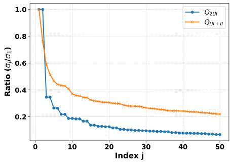  
Figure 5: Comparison of the top-50 normalized singular value of two two-layer propagation operators on Anime. The curves show the normalized singular value ratios $\sigma _ { j } / \sigma _ { 1 }$ for $Q _ { 2 U I }$ and $Q _ { U I + I I } .$ , sorted by singular value magnitude.

## 5 Experiments

## 5.1 Experimental Setup

5.1.1 Datasets. Experiments are conducted on two datasets, Anime 1 [4, 21] and Game 2 [12, 19, 26], using a 5-core setting that retains users and items with a minimum of five interactions. Summary statistics are provided in Table 2.

Table 2: Statistics of datasets.  
(b) Anime Dataset
<table><tr><td colspan="2">(a) Game Dataset</td><td colspan="2">(b) Anime Dataset</td></tr><tr><td># Players</td><td>195,184</td><td># Players</td><td>66,870</td></tr><tr><td># Games</td><td>10,425</td><td># Animes</td><td>8,519</td></tr><tr><td># Interactions</td><td>2,294,883</td><td># Interactions</td><td>7,793,920</td></tr><tr><td># Categories</td><td>22</td><td># Categories</td><td>45</td></tr></table>

5.1.2 Baselines andEvaluation Metrics. We benchmark MOSS against two categories of baselines. For accuracy evaluation, we include classical graph collaborative filtering models, LightGCN [10] and SimGCL [31], as well as the multimodal recommendation model Freedom [41]. To assess diversity, we compare MOSS with several modality-agnostic diversity-enhanced methods, including DGCN [40], DGRec [30], DRGame [13], and DivGCL [5]. Top-� recommendation performance is evaluated using four standard metrics: Coverage and Entropy for diversity, Recall and Normalized Discounted Cumulative Gain for accuracy, and � is set to 10. To further quantify the balance between accuracy and diversity, we compute the geometric mean (GM) [34] of Recall@� and Coverage@�:

$$
G M @ K = \sqrt { \mathrm { R e c a l l } @ K \times \mathrm { C o v e r a g e } @ K } .\tag{26}
$$

Table 3: Comparison of models on the Anime and Game datasets.
<table><tr><td rowspan="2">Dataset</td><td rowspan="2">Metric</td><td colspan="3">Accuracy-based Methods</td><td colspan="4">Diversity-based Methods</td><td colspan="2">Our Method</td></tr><tr><td>LightGCN</td><td>SimGCL</td><td>Freedom |</td><td>DGCN</td><td>DGRec</td><td>DRGame</td><td>DivGCL |</td><td>MOSS</td><td> ${ \mathrm { M O S S } } _ { \mathrm { a c c } }$ </td></tr><tr><td rowspan="5">Anime</td><td>Recall@10</td><td>0.1924</td><td>0.2100</td><td>0.1985</td><td>0.1106</td><td>0.2024</td><td>0.0569</td><td>0.2132</td><td>0.1860</td><td>0.2211</td></tr><tr><td>NDCG@10</td><td>0.2124</td><td>0.2248</td><td>0.2014</td><td>0.1169</td><td>0.1868</td><td>0.0975</td><td>0.2329</td><td>0.1756</td><td>0.2374</td></tr><tr><td>Coverage@10</td><td>0.4074</td><td>0.4387</td><td>0.4345</td><td>0.4890</td><td>0.4428</td><td>0.4279</td><td>0.4197</td><td>0.5536</td><td>0.4417</td></tr><tr><td>Entropy@10</td><td>5.0054</td><td>5.7738</td><td>5.3682</td><td>6.1741</td><td>5.5891</td><td>5.6576</td><td>5.1921</td><td>6.9645</td><td>6.0342</td></tr><tr><td>GM@10</td><td>0.2800</td><td>0.3035</td><td>0.2937</td><td>0.2326</td><td>0.2994</td><td>0.1560</td><td>0.2991</td><td>0.3209</td><td>0.3125</td></tr><tr><td rowspan="5">Game</td><td>Recall@10</td><td>0.1080</td><td>0.1109</td><td>0.1095</td><td>0.0803</td><td>0.1079</td><td>0.0193</td><td>0.1108</td><td>0.0907</td><td>0.1114</td></tr><tr><td>NDCG@10</td><td>0.0604</td><td>0.0614</td><td>0.0615</td><td>0.0452</td><td>0.0602</td><td>0.0069</td><td>0.0617</td><td>0.0391</td><td>0.0621</td></tr><tr><td>Coverage@10</td><td>0.3371</td><td>0.3431</td><td>0.3298</td><td>0.3636</td><td>0.3552</td><td>0.4872</td><td>0.3544</td><td>0.6348</td><td>0.3580</td></tr><tr><td>Entropy@10</td><td>2.0726</td><td>2.2041</td><td>2.2450</td><td>2.3932</td><td>2.2190</td><td>3.3367</td><td>2.1703</td><td>3.9764</td><td>2.8757</td></tr><tr><td>GM@10</td><td>0.1908</td><td>0.1951</td><td>0.1900</td><td>0.1709</td><td>0.1958</td><td>0.0970</td><td>0.1981</td><td>0.2400</td><td>0.1997</td></tr></table>

Table 4: Ablation study on the Anime and Game datasets.
<table><tr><td></td><td colspan="5">Anime</td><td colspan="5">Game</td></tr><tr><td>Model</td><td>Recall@10</td><td>NDCG@10</td><td>Coverage@10</td><td>Entropy@10</td><td>GM@10</td><td>Recall@10</td><td>NDCG@10</td><td>Coverage@10</td><td>Entropy@10</td><td>GM@10</td></tr><tr><td>w/o EBDR</td><td>0.2172</td><td>0.2306</td><td>0.4577</td><td>6.0258</td><td>0.3153</td><td>0.1092</td><td>0.0607</td><td>0.3642</td><td>2.9347</td><td>0.1994</td></tr><tr><td>w/o ADGP</td><td>0.1730</td><td>0.1619</td><td>0.5498</td><td>6.5569</td><td>0.3084</td><td>0.0863</td><td>0.0384</td><td>0.6127</td><td>3.8642</td><td>0.2299</td></tr><tr><td>w/o CAES</td><td>0.1722</td><td>0.1591</td><td>0.5187</td><td>6.5487</td><td>0.2989</td><td>0.0852</td><td>0.0372</td><td>0.5932</td><td>3.8533</td><td>0.2248</td></tr><tr><td>MOSS</td><td>0.1860</td><td>0.1756</td><td>0.5536</td><td>6.9645</td><td>0.3209</td><td>0.0907</td><td>0.0391</td><td>0.6348</td><td>3.9764</td><td>0.2400</td></tr></table>

## 5.2 Overall Performance

5.2.1 Performance Evaluation. We compare the proposed model MOSS with several representative baselines. The results are reported in Table 3, where the best and second-best results are highlighted in bold and underlined, respectively. Based on these results, we draw the following observations: (1) Superior diversity. MOSS achieves the best diversity performance on both datasets, improving Coverage@10 / Entropy@10 by 13.2% / 12.8% on Anime and 30.3% / 19.2% on Game over the strongest diversity-oriented baseline. (2) Strong accuracy under accuracy-oriented settings. Admittedly, the diversity-oriented version of MOSS is not always the most accurate, since it explicitly favors broader category coverage. However, when we tuning the relevant hyperparameters toward more accuracy-oriented settings, ${ \mathrm { M O S S } } _ { \mathrm { a c c } }$ can also achieve the best accuracy on Anime and Game. This suggests that Modules Alternating Dual–Graph Propagation and Category-aware Embedding Selection are not only beneficial for diversity, but also improve recommendation accuracy by better exploiting multimodal semantics and structural signals. (3) Best accuracy–diversity trade-of. As shown in Fig. 6, MOSS achieves a more favorable accuracy– diversity balance than all baselines. Improving GM@10 by 5.7% and 21.1% on Anime and Game.

5.2.2 Ablation Study. To evaluate the contribution ofeach key component, we perform ablation studies on both datasets. As shown in Table 4, “w/o CAES”, “w/o ADGP”, and “w/o EBDR” denote the removal of Category-aware Embedding Selection, Alternating Dual-Graph Propagation, and Entropy-based Diversity Regularization, respectively. The results confirm that each component provides measurable gains. Specifically, EBDR primarily promotes diversity, while both ADGP and CAES contribute to improvements in both accuracy and diversity.

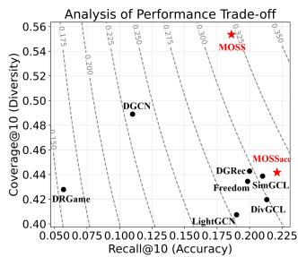

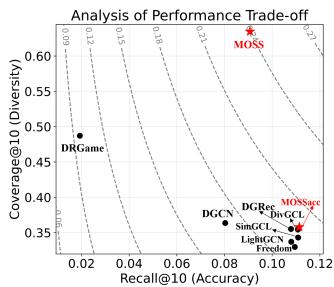  
(a) Anime dataset.  
(b) Game dataset.  
Figure 6: Comparison of the geometric mean (GM) between MOSS and baseline methods.

## 6 Conclusion

In this paper, we study diversified recommendation from both semantic and structural perspectives, showing that multimodal semantics are underutilized and that the accuracy–diversity trade-of is driven by representation collapse and optimization bias. We propose MOSS, a unified framework combining multimodal decoupling with semantic and structural shaping, including feature extraction, category-aware selection, and dual-graph propagation with entropy regularization. Experiments demonstrate that MOSS achieves a superior accuracy–diversity trade-of over strong baselines.

## Acknowledgments

This work was partially supported by the National Natural Science Foundation of China under Project No. 62073272; the Guangdong Basic and Applied Basic Research Foundation under Grant No. 2024A1515011949 and 2026A1515011672; the Shenzhen Science and Technology Program under Grant No. GXWD20231130110308001, JCYJ20250604145617023,JCYJ20240813104843058,JCYJ202408131048 37050, and SYSPG20241211173609009; the Guangdong Province Higher Education Research and Reform Project under Grant No. YueJiaoGaoHan (2024) No. 9 (1227); and the Guangdong Province General Colleges and Universities Innovation Team Project under No. 2022KCXTD038.

## References

[1] Qazi Mohammad Areeb, Mohammad Nadeem, Shahab Saquib Sohail, Raza Imam, Faiyaz Doctor, Yassine Himeur, Amir Hussain, and Abbes Amira. 2023. Filter bubbles in recommender systems: Fact or fallacy—A systematic review. Wiley Interdisciplinary Reviews: Data Mining and Knowledge Discovery 13, 6 (2023), e1512.

[2] Shuai Bai, Keqin Chen, Xuejing Liu, Jialin Wang, Wenbin Ge, Sibo Song, Kai Dang, Peng Wang, Shijie Wang, Jun Tang, Humen Zhong, Yuanzhi Zhu, Mingkun Yang, Zhaohai Li, Jianqiang Wan, Pengfei Wang, Wei Ding, Zheren Fu, Yiheng Xu, Jiabo Ye, Xi Zhang, Tianbao Xie, Zesen Cheng, Hang Zhang, Zhibo Yang, Haiyang Xu, and Junyang Lin. 2025. Qwen2.5-VL Technical Report. arXiv:2502.13923 [cs.CV] https://arxiv.org/abs/2502.13923

[3] Huiyuan Chen, Vivian Lai, Hongye Jin, Zhimeng Jiang, Mahashweta Das, and Xia Hu. 2024. Towards mitigating dimensional collapse of representations in collaborative filtering. In Proceedings ofthe 17th ACM international conference on web search and data mining. 106–115.

[4] AS Girsang, B Al Faruq, HR Herlianto, and S Simbolon. 2020. Collaborative recommendation system in users of anime films. In Journal ofPhysics: Conference Series, Vol. 1566. IOP Publishing, 012057.

[5] Wenwen Gong, Yangliao Geng, Dan Zhang, Yifan Zhu, Xiaolong Xu, Haolong Xiang, Amin Beheshti, Xuyun Zhang, and Lianyong Qi. 2025. DivGCL: a graph contrastive learning model for diverse recommendation. In Proceedings of the AAAI Conference on Artificial Intelligence, Vol. 39. 16853–16861.

[6] Zhiqiang Guo, Jianjun Li, Guohui Li, Chaoyang Wang, Si Shi, and Bin Ruan. 2024. Lgmrec: Local and global graph learning for multimodal recommendation. In Proceedings ofthe AAAI conference on artificial intelligence, Vol. 38. 8454–8462.

[7] Emrul Hasan, Mizanur Rahman, Chen Ding, Jimmy Xiangji Huang, and Shaina Raza. 2025. Based recommender systems: a survey of approaches, challenges and future perspectives. Comput. Surveys 58, 1 (2025), 1–41.

[8] Ruining He and Julian McAuley. 2016. VBPR: visual Bayesian Personalized Ranking from implicit feedback. In Proceedings ofthe Thirtieth AAAI Conference on Artificial Intelligence (Phoenix, Arizona) (AAAI’16). AAAI Press, 144–150.

[9] Wei He, Guohao Sun, Jinhu Lu, and Xiu Susie Fang. 2023. Candidate-aware Graph Contrastive Learning for Recommendation. In Proceedings ofthe 46th International ACM SIGIR Conference on Research and Development in Information Retrieval (Taipei, Taiwan) (SIGIR ’23). Association for Computing Machinery, New York, NY, USA, 1670–1679. doi:10.1145/3539618.3591647

[10] Xiangnan He, Kuan Deng, Xiang Wang, Yan Li, Yongdong Zhang, and Meng Wang. 2020. Lightgcn: Simplifying and powering graph convolution network for recommendation. In Proceedings ofthe 43rd International ACM SIGIR conference on research and development in Information Retrieval. 639–648.

[11] Mubashir Imran, Hongzhi Yin, Tong Chen, Quoc Viet Hung Nguyen, Alexander Zhou, and Kai Zheng. 2023. ReFRS: Resource-eficient federated recommender system for dynamic and diversified user preferences. ACM Transactions on Information Systems 41, 3 (2023), 1–30.

[12] Wang-Cheng Kang and Julian McAuley. 2018. Self-attentive sequential recommendation. In 2018 IEEE international conference on data mining (ICDM). IEEE, 197–206.

[13] Kangzhe Liu,Jianghong Ma, Shanshan Feng, Haijun Zhang, and Zhao Zhang. 2024. DRGame: Diversified Recommendation for Multi-category Video Games with Balanced Implicit Preferences. In International Conference on Database Systems for Advanced Applications. Springer, 254–263.

[14] Kanglin Liu, Guoping Qiu, Wenming Tang, and Fei Zhou. 2019. Spectral Regularization for Combating Mode Collapse in GANs. In 2019 IEEE/CVF International Conference on Computer Vision (ICCV). 6381–6389. doi:10.1109/ICCV.2019.00648

[15] Qidong Liu, Jiaxi Hu, Yutian Xiao, Xiangyu Zhao, Jingtong Gao, Wanyu Wang, Qing Li, and Jiliang Tang. 2024. Multimodal recommender systems: A survey. Comput. Surveys 57, 2 (2024), 1–17.

[16] Alejo Lopez-Avila and Jinhua Du. 2025. A survey on large language models in multimodal recommender systems. arXiv preprint arXiv:2505.09777 (2025).

[17] Jianghong Ma, Changran He, Dezhao Yang, Tianjun Wei, Haijun Zhang, and Xiaofeng Zhang. 2026. SGMT: Social Generating with Multiview-Guided Tuning In Recommender Systems. Proceedings of the AAAI Conference on Artificial Intelligence 40, 18 (Mar. 2026), 15501–15509.

[18] Yao Ma, Xiaorui Liu, Tong Zhao, Yozen Liu, Jiliang Tang, and Neil Shah. 2021. A unified view on graph neural networks as graph signal denoising. In Proceedings of the 30th ACM international conference on information & knowledge management. 1202–1211.

[19] Apurva Pathak, Kshitiz Gupta, and Julian McAuley. 2017. Generating and personalizing bundle recommendations on steam. In Proceedings ofthe 40th international ACM SIGIR conference on research and development in information retrieval. 1073– 1076.

[20] Claudio Pomo, Matteo Attimonelli, Danilo Danese, Fedelucio Narducci, and Tommaso Di Noia. 2025. Do recommender systems really leverage multimodal content? a comprehensive analysis on multimodal representations for recommendation. In Proceedings ofthe 34th ACM International Conference on Information and Knowledge Management. 2377–2387.

[21] Helmy Dianti Putri and Muhammad Faisal. 2023. Analyzing the efectiveness of collaborative filtering and content-based filtering methods in anime recommendation systems. Jurnal Komtika (Komputasi dan Informatika) 7, 2 (2023), 124–133.

[22] Shaina Raza, Mizanur Rahman, Safiullah Kamawal, Armin Toroghi, Ananya Raval, Farshad Navah, and Amirmohammad Kazemeini. 2026. A comprehensive review ofrecommender systems: Transitioning from theory to practice. Computer Science Review 59 (2026), 100849.

[23] Nils Reimers and Iryna Gurevych. 2019. Sentence-bert: Sentence embeddings using siamese bert-networks. In Proceedings ofthe 2019 conference on empirical methods in natural language processing and the 9th international joint conference on natural language processing (EMNLP-IJCNLP). 3982–3992.

[24] Stefen Rendle, Christoph Freudenthaler, Zeno Gantner, and Lars Schmidt-Thieme. 2009. BPR: Bayesian personalized ranking from implicit feedback. In Proceedings ofthe Twenty-Fifth Conference on Uncertainty in Artificial Intelligence (Montreal, Quebec, Canada) (UAI ’09). AUAI Press, Arlington, Virginia, USA, 452–461.

[25] Olivier Roy and Martin Vetterli. 2007. The efective rank: A measure of efective dimensionality. In 2007 15th European Signal Processing Conference. 606–610.

[26] Mengting Wan and Julian McAuley. 2018. Item recommendation on monotonic behavior chains. In Proceedings of the 12th ACM conference on recommender systems. 86–94.

[27] Tongzhou Wang and Phillip Isola. 2020. Understanding contrastive representation learning through alignment and uniformity on the hypersphere. In Proceedings of the 37th International Conference on Machine Learning (ICML’20). JMLR.org, Article 921, 11 pages.

[28] Yinwei Wei, Xiang Wang, Liqiang Nie, Xiangnan He, and Tat-Seng Chua. 2020. Graph-refined convolutional network for multimedia recommendation with implicit feedback. In Proceedings of the 28th ACM international conference on multimedia. 3541–3549.

[29] Jinfeng Xu, Zheyu Chen, Shuo Yang, Jinze Li, Wei Wang, Xiping Hu, Steven Hoi, and Edith Ngai. 2026. A survey on multimodal recommender systems: Recent advances and future directions. IEEE Transactions on Multimedia (2026).

[30] Liangwei Yang, Shengjie Wang, Yunzhe Tao, Jiankai Sun, Xiaolong Liu, Philip S Yu, and Taiqing Wang. 2023. Dgrec: Graph neural network for recommendation with diversified embedding generation. In Proceedings of the sixteenth ACM international conference on web search and data mining. 661–669.

[31] Junliang Yu, Hongzhi Yin, Xin Xia, Tong Chen, Lizhen Cui, and Quoc Viet Hung Nguyen. 2022. Are Graph Augmentations Necessary? Simple Graph Con trastive&nbsp;Learning for Recommendation. In Proceedings ofthe 45th International ACM SIGIR Conference on Research and Development in Information Retrieval (Madrid, Spain) (SIGIR ’22). Association for Computing Machinery, New York, NY, USA, 1294–1303, doi:10.1145/3477495.3531937

[32] Penghang Yu, Zhiyi Tan, Guanming Lu, and Bing-Kun Bao. 2023. Multi-view graph convolutional network for multimedia recommendation. In Proceedings of the 31st ACM international conference on multimedia. 6576–6585.

[33] Zheng Yuan, Fajie Yuan, Yu Song, Youhua Li, Junchen Fu, Fei Yang, Yunzhu Pan, and Yongxin Ni. 2023. Where to Go Next for Recommender Systems? IDvs. Modality-based Recommender Models Revisited. In Proceedings ofthe 46th International ACM SIGIR Conference on Research and Development in Information Retrieval (Taipei, Taiwan) (SIGIR ’23). Association for Computing Machinery, New York, NY, USA, 2639–2649. doi:10.1145/3539618.3591932

[34] Jingmao Zhang, Zhiting Zhao, Yunqi Lin, Jianghong Ma, Tianjun Wei, Haijun Zhang, and Xiaofeng Zhang. 2025. Dual-Phase Playtime-guided Recommendation: Interest Intensity Exploration and Multimodal Random Walks. In Proceedings of the 33rd ACM International Conference on Multimedia. 6232–6241.

[35] Lingzi Zhang, Xin Zhou, Zhiwei Zeng, and Zhiqi Shen. 2024. Dual-view whitening on pre-trained text embeddings for sequential recommendation. In Proceedings ofthe AAAI Conference on Artificial Intelligence, Vol. 38. 9332–9340.

[36] Weizhi Zhang, Liangwei Yang, Wooseong Yang, Henry Peng Zou, Yuqing Liu, Ke Xu, Sourav Medya, and Philip S Yu. 2025. Llminit: A free lunch from large language models for selective initialization of recommendation. In Proceedings of the 2025 Conference on Empirical Methods in Natural Language Processing: Industry Track. 2016–2024.

[37] Yifei Zhang, Hao Zhu, yankai Chen, Zixing Song, Piotr Koniusz, and Irwin King. 2023. Mitigating the Popularity Bias of Graph Collaborative Filtering: A Dimen sional Collapse Perspective. In Advances in Neural Information Processing Systems, A. Oh, T. Naumann, A. Globerson, K. Saenko, M. Hardt, and S. Levine (Eds.), Vol. 36. Curran Associates, Inc., 67533–67550. https://proceedings.neurips.cc/paper\_ files/paper/2023/file/d5753be6f71fbfefaf47aa27ec41279c-Paper-Conference.pdf

[38] Yifei Zhang, Hao Zhu, Menglin Yang, Jiahong Liu, Rex Ying, Irwin King, and Piotr Koniusz. 2025. Understanding and mitigating hyperbolic dimensional collapse in graph contrastive learning. In Proceedings of the 31st ACM SIGKDD Conference on Knowledge Discovery and Data Mining V. 1. 1984–1995.

[39] Yuying Zhao, Yu Wang, Yunchao Liu, Xueqi Cheng, Charu C Aggarwal, and Tyler Derr. 2025. Fairness and diversity in recommender systems: a survey. ACM

Transactions on Intelligent Systems and Technology 16, 1 (2025), 1–28.

[40] Yu Zheng, Chen Gao, Liang Chen, Depeng Jin, and Yong Li. 2021. DGCN: Diversified recommendation with graph convolutional networks. In Proceedings of the web conference 2021. 401–412.

[41] Xin Zhou and Zhiqi Shen. 2023. A tale of two graphs: Freezing and denoising graph structures for multimodal recommendation. In Proceedings of the 31st ACM international conference on multimedia. 935–943.

[42] Xin Zhou, Xiaoxiong Zhang, Dusit Niyato, and Zhiqi Shen. 2025. Learning Item Representations Directly from Multimodal Features for Efective Recommendation. arXiv:2505.04960 [cs.IR] https://arxiv.org/abs/2505.04960

[43] Yan Zhou, Jie Guo, Hao Sun, Bin Song, and Fei Richard Yu. 2023. Attentionguided Multi-step Fusion: A Hierarchical Fusion Network for Multimodal Recommendation. In Proceedings ofthe 46th International ACM SIGIR Conference on Research and Development in Information Retrieval (Taipei, Taiwan) (SIGIR ’23). Association for Computing Machinery, New York, NY, USA, 1816–1820. doi:10.1145/3539618.3591950