# NIOCIS: TYPED-DECISION NEXT-HOP ROUTINGWITH NODE-CONDITIONED OPTION SPACESFOR TOOL-USE AGENTS

Jin Han Mingfeng Xin Feng Liang Jingtao Yu Independent Researcher

## ABSTRACT

Tool-use agents pay per decision: at each hop a language model re-reads the state and thinks for seconds, though its actions are finite and its decisions recur. We present NIOCIS, a routing layer that folds execution logs into a loop-collapsed action graph—forward action transitions plus explicit recovery back-edges—and answers one typed question: which declared option at a state, plus stop, does the fleet take next? A small model reads a calibrated distribution over them in one pass, generating no text. On 1,615 production security-operations episodes we measure what the layer replaces, returns and is bounded by. It replaces the perdecision deliberation: the typed encoder matches the logged next hop on 32.2% of the 3,875 held-out decisions (34.9% within the declared options) in 10 ms of encoder time (19.5 ms for the typed-choice form), against 2.2 s per LLM hop; two feature readouts on the same decisions reach 32.8% and 32.3%, an ordering the paired test does not resolve, so the typed layer is chosen for cost rather than for a separated accuracy lead. Tuning moves a language model: jpt-4b reaches 9.9% zero-shot and 31.9% fine-tuned, a gap an exact paired test does not resolve (p = 0.68), at 244 ms per decision. It returns little: the realised hop falls outside the declared options for 7.9% of decisions and outside the model’s top twenty for 9.3%, while the most confident 15% holds 91.9% accuracy, a band three different confidence rules trace alike. And it is bounded: the state text binds accuracy, not the candidate count, the deliberation budget or the parameter count; node discovery saturates at the rate a zero-parameter occupancy null predicts, and on five public process logs a variable-order Markov table collects most of each margin over the majority baseline; a cross-trace leave-one-out test puts the released state’s ceiling at 25.6–44.9% as the state key grows more specific, repeated states disagreeing more often than they agree; and the option-space ablation attributes the gain to per-node candidate restriction (+3.5 points over a flat catalog) rather than graph traversal (zero within its interval). The claim is narrow: containment and a small high-precision band at millisecond cost; a gated self-evolution loop lifts every arm above its anchor yet ends below full supervision; a confidencegated cascade loses agreement when the escalation arm is the zero-shot stand-in rather than the tuned model; and agreement past a third of the fleet needs a state carrying the plan and the observation, which the released records do not.

## 1 INTRODUCTION

LLM agents that call tools decide by inference. At every step of every task the model re-derives what it already decided last week for the same tool in the same situation: whether to search before reading, whether to write directly or route through approval, whether to retry or roll back. The latency of such a judgment is counted in seconds and its cost in thinking tokens (Cheng et al., 2026; Li et al., 2026a), even though the decision’s support is small—a closed set of declared next actions, median 46 per state here—and the deployment’s accumulated logs already contain the answer, thousands of times over.

Three observations motivate NIOCIS. Execution logs converge. An internal deployment’s tools and action semantics are finite; as episodes accumulate, the action vocabulary saturates while the logs keep growing. Process mining has exploited this regularity for business event logs for two decades (van der Aalst, 2016; Leemans et al., 2013), and recent results compress agent-trace corpora into finite-state machines of 7–43 states (Cho et al., 2026); the complexity-vs-log-size reading we cite tracks only the state-count curve (§2). Also, typed decisions can be cheap. A decision model that answers exactly one of its caller’s declared options—reading a calibrated distribution from a single forward pass, with no generated text—decides in 30–65 ms (Cheng et al., 2026; Ren et al., 2026) at accuracy within a few points of LLM judges (Ren et al., 2026), and works as a first-tier agent decision layer that escalates on low confidence (Wu & Lim, 2026; Li et al., 2026c). And logs can train their own router: routing decisions, executions and outcomes form a data flywheel (Liu et al., 2026; NeoHorse Team et al., 2026), provided the update loop is gated against collapse (Nguyen et al., 2026b; Shang et al., 2026).

NIOCIS composes these into one loop (Figure 1): (i) we induce a loop-collapsed action graph from episode logs—a directed graph of forward action transitions (self-loops aside) with recovery back-edges carrying rollbacks, backtracks and task redirects; (ii) we route with the typed-decision router whose option set is exactly the current node’s outgoing edges (plus stop), whose output is a calibrated distribution the caller can threshold, and whose uncertain cases escalate to the LLM; (iii) we self-evolve: each real episode becomes training data, updates pass a rollback gate and survive only with evidence, and any update that regresses beyond the gate tolerance (δ) is rolled back. In the full design, executed episodes are budget-bounded (a step budget and a per-node revisit cap; §3). Our contributions are:

• P1 The loop-collapsed action graph. We formalize induction from episode logs with explicit folding rules for loops and back-edges, and quantify the growth of the induced action graph (E1): transition discovery shows diminishing returns and loop-event rates reach a stable regime, while node-vocabulary convergence is not offered as an independent finding—a zero-parameter occupancy null already predicts it (§6).

• P2 Typed-decision path routing. We define next-hop selection as a typed decision over a node-conditioned declared option space (the current node’s outgoing edges, plus stop) and implement it with one-pass feature-MLP readouts that reach 32.8% agreement with the deployed fleet’s own choices (35.6% within the declared space; the hidden-state probe variant gives up two points of masked accuracy and decodes from its 10 ms encoder pass, the typed family’s full predict running 19.5 ms p50), together with an accept/escalate gate analyzed with risk–coverage curves (E2); a transition-table baseline over all nine decision streams (App. B) reaches 31.1% on SOC. We also measure what the restriction is worth (E9): the node-conditioned space beats a flat 155-class catalog by 3.5 points and a sizematched global-frequency space by 1.4 points, but is statistically indistinguishable from a node-conditioned space built without graph traversal, so we claim the per-node restriction, not graph traversal. We therefore claim the formalization and the measurement rather than the traversal: the contribution is to define the next-hop choice as a typed decision over a node-conditioned declared option space, and to bound what that construction can reach on production logs, which Section 7 does quantitatively.

• P3 A gated self-evolution loop, with route replay as a measurement. We replay held-out episodes against a re-prompted MIMO Pro V2.6 stand-in (one reasoning call per hop for the fleet’s LLM component: no per-stage orchestration, no tool results; §5); the route view renders the per-decision quantities—strict survival, plus a wrong-hop cost rescaling of the mismatch count—so we report it as a measurement on that graph (§6), and add the one route quantity that is not such a rescaling—the first-divergence hop index and type (median hop 2, most first divergences on escalated hops)—reading the replay as placing the cheap readout in the agreement/cost corner and the accept/escalate hybrid between its parents (the readout and the opponent; E3); and we exercise a self-evolution loop whose rollback gate scores every candidate while the loop absorbs a 12%-of-one-batch label-corruption stress, the gate refusing 13 of the 40 candidate updates, in 6 of the 10 seeded chains (E4).

The core experiments (E1–E4) run on real execution logs from a production security-operations agent fleet (§5 states provenance); E5 replicates the constructions on public event logs and open tooluse trajectories, and any Langfuse-style observations export folds into the same episode schema.

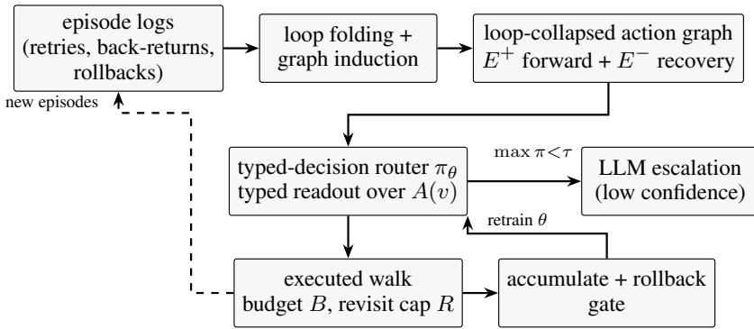  
Figure 1: NIOCIS: logs are folded into a loop-collapsed action graph; a typed-decision router answers “which edge in A(v) does the fleet take next?” per state, escalating only uncertain cases to the LLM; executed walks flow back as gated updates. The step budget B and per-node revisit cap R on the execution box are full-design parameters: the corpus study of §5 replays logged episodes teacher-forced and exercises neither bound.

## 2 RELATED WORK

Workflow and skill induction from agent logs. Agent Workflow Memory (Wang et al., 2024) induces reusable routines from trajectories and feeds them back as context; task-model induction (Jiang et al., 2026) builds hierarchical goal/procedure models from computer-use traces; automata induction compresses trace corpora into compact finite-state machines for next-step prediction and failure detection (Cho et al., 2026); the literature-search agent PaperPilot induces editable search-operator directed acyclic graphs (DAGs) (Li et al., 2026b). Skill-graph systems organize experience for retrieval: HiSkill’s hierarchical skill graphs (Hao et al., 2026), SE-GoS’s self-evolving graph-of-skills (Fu et al., 2026), CaSKG’s counterfactual-causal skill graphs (Li et al., 2026d), GraphSkillAA’s validated skill-graph updates (Shang et al., 2026), GraphSkillEvo’s evolutionary graph skills (Sun et al., 2026a), and skill distillation from browsing traces (Yang et al., 2026). M2- PALE applies process mining to agent traces for explanation (Qian et al., 2026); AgentHER recycles trajectories into training data (Ding, 2026). Every workflow and skill system surveyed here uses the induced structure for retrieval, prompting, explanation or training (the automata-induction uses of the same structure are treated next). Automata-based next-step prediction and failure detection over induced machines (Cho et al., 2026) are the closest runtime uses: both score a fixed label vocabulary from trace prefixes (held-out scoring offline against the induced machine; its failure ranker also runs as an online monitor over partial traces) rather than binding the induced graph’s edges as declared options. Interleaved reason-and-act control loops keep an LLM in the loop at every step (Yao et al., 2023), self-reflective retry feeds verbal feedback back into the next attempt (Shinn et al., 2023), and open-ended agents grow executable skill libraries as text (Wang et al., 2023); we instead bind the induced graph as the decision space of a single-pass readout, with no per-step LLM call. None of the surveyed systems makes the induced graph the runtime decision space of a millisecond-scale model, and none reports route-level divergence accounting (episodic survival and wrong-hop cost) for routes over an induced graph on production agent logs (the accounting scores realized routes, not a model’s conformance fitness van der Aalst, 2016; alignment-based conformance checking instead replays each trace against a discovered model and scores the cheapest replay (Adriansyah et al., 2011; Carmona et al., 2018)). Read as a discovered model the induced graph is a permissive one—on held-out traces, token-level replay fitness 0.91, trace-level 0.59, escaping-edge precision 0.02 (each state enables its whole declared option set), edge-level generalization 0.27 (App. B)—which is why our comparison is against option-space constructions, leaving process-discovery models aside. Paul & Nandy (2026) study cost-optimal multi-step model/tool routing (a different decision axis).

Process mining. Discovery of process models from event logs is a mature field (van der Aalst, 2016); constructive miners capture loop and concurrency structure (Leemans et al., 2013; Kourani et al., 2025), and monotonicity characterizations control candidate-place growth (Tacke genann Unterberg et al., 2026). The complexity-vs-log-size reading we cite reports stable small automata (7–43 states on public corpora, Cho et al., 2026); it carries no loop-event or transition-pair axis. E1 adds those axes on a production security-operations-center (SOC) corpus, with subsample-median bands, and measures the loop structure directly. A parallel line, predictive process monitoring, answers the next-activity question by scoring a fixed activity vocabulary from prefixes (Tax et al., 2017); its standard n-gram realization is the backoff-Markov baseline of E5 (re-gated here onto the shared declared option sets).

Typed-decision models and LLM routing. Typed-decision models answer exactly one of their caller’s declared options from a single forward pass, with calibrated probabilities and no generated text: this-that-model-1.0 reads answers from hidden state at 30.9 ms (Cheng et al., 2026); the onepass judge we label JevLite (small one-pass model of Ren et al. (2026)) reads temperature-scaled answer-label logits at 64.5 ms per decision on one consumer GPU. As judges they accept when confident and escalate when unsure (Li et al., 2026c); as agent control layers they cut strong-model calls 72.7% at 95% task success against a strong-only baseline of 88% on the same frozen benchmark (Wu & Lim, 2026); at the edge they cut decision latency and API fees (Li et al., 2026a), and with an LLM planner they close fast control loops (Ma et al., 2026). Unlike these flat typed-control layers’ static action-list option sets, NIOCIS’s option set is the outgoing edge set of an induced action graph; NIOCIS also performs route-level divergence accounting over that graph, quantifies its node-vocabulary convergence, and exercises a gated self-evolution loop, none of which flat typedcontrol layers do. Guided or grammar-constrained decoding also restricts an output space, but it filters a generator step by step (Geng et al., 2023); the typed readout instead emits one distribution over the declared options in a single pass. Constrained decision heads are sensitive to option labeling (Sun et al., 2026b), which motivates our edge identifiers. Model/tool routers choose which solver runs (Chen et al., 2023; Ong et al., 2024; Paul & Nandy, 2026; Liu et al., 2026; Bala & Shah, 2026) (or generate retrieval configurations Pan et al., 2026), not which graph edge advances a task; preference-trained small routers have cut cost by over $2 \times$ at matched quality in some evaluated settings (Ong et al., 2024); typed artifacts share tool-routing knowledge across agents (Chakraborty et al., 2026); and router infrastructure now spans development, evaluation and deployment, where lightweight routers prove more competitive under tight-cost constraints (Feng et al., 2026), though routing accuracy plateaus below the oracle (Lu et al., 2026). Amortized planning replaces search with direct action inference in world models (Nguyen et al., 2026a); we amortize workflow-path decisions into a declared-option readout over an induced action graph.

Self-evolving agents. Routing decisions and executions can train their own successors (Liu et al., 2026; NeoHorse Team et al., 2026) as long as the loop is gated: unguarded self-evolution can collapse or suffer security drift (Nguyen et al., 2026b; Li & Zhu, 2026), while validated updates with rollback keep graphs healthy (Shang et al., 2026) and recursive-in-recursive designs keep harness and weights co-evolving (Xue et al., 2026). Our E4 adds a minimal complete instance—accumulate, gate on held-out performance, roll back on regression—and deploys it under label corruption that the gated loop absorbs on average (the refusal path refuses 13 of the 40 candidate updates, in 6 of the 10 seeded chains).

## 3 PROBLEM FORMULATION

Episode logs. A log is a set of episodes. An episode is a sequence of steps $e = \langle s _ { 1 } , \ldots , s _ { T } \rangle$ where each step $s _ { t }$ records an action label $L ( s _ { t } ) \in \mathcal { V }$ (an action semantic such as db.write), a step kind (advance, retry or back: a back step revisits an earlier label, opening a return edge in $E ^ { - } )$ and a context vector $\mathbf { c } \in [ 0 , 1 ] ^ { d }$ (full-design schema: urgency, dependencies, authorization, complexity, $\cdots )$ . Episodes carry a start, a goal—in the full design a node $g \in \mathcal { G } \subseteq \mathcal { V } .$ and an outcome.

Loop-collapsed action graph. Straight traces understate structure; agents loop. Folding an episode yields a skeleton—retry runs folded as temporally extended steps in the sense of Sutton et al. (1999)—to which the step’s label $L ( s _ { t } )$ is appended except in two step kinds: (a) an immediate retry of the last label kept in the skeleton (the retry is dropped), and (b) a revisit of an earlier-visited label (the step is appended as usual and a new kept frame—a skeleton entry—opens at the revisit). Both kinds are recorded as loop events (retry for (a), back for (b)); a retry—which includes every continuation of a same-label run—is the only kind left out of the skeleton. Folding the 22,192 logged tool calls thus drops exactly the $^ { 4 , }$ 124 retries and keeps 15,704 forward advances plus 2,364 recovery returns (18,068 decision states); E1’s event rates reflect this disposition. Observed kept-frame transition pairs $( E ^ { + } \cup E ^ { - } )$ over all episodes define the transition volume reported in E1; first-visit forward transfers give $E ^ { + }$ and executed returns to earlier labels give recovery back-edges $E ^ { - }$ (this corpus-census set is computed over all folds and persisted with the corpus for characterization only; the operational option graph is induced from the training fold, §4), while same-label repeats surface only as retry events, as described above. The two roles a pair can play—forward transfer and recovery return—overlap on real traces: of the 2,536 distinct observed pairs, 2,315 appear as first-visit forward transfers and $^ { 7 0 2 }$ as recovery returns (481 pairs play both roles—forward in one context, return in another—while 221 pairs are exclusively returns; App. A gives the fold breakdown). The loop-collapsed action graph is $G = ( V , E ^ { + } \cup E ^ { - } )$ . The observed forward set is not a $\mathrm { D A G } \colon 1 , 2 7 2$ of its $^ { 2 , 3 1 5 }$ pairs fall into 636 mutual couples (u→v and $v \to u$ between nodes u and $v ,$ both arcs observed as forward transfers), so forward transfers alone carry directed 2-cycles. What planning needs still holds: all edge weights are strictly positive, so an optimal walk to a reachable goal can always be chosen simple (no repeated node), even though execution may loop. Complexity is measurable two ways—folded (semantic nodes and transitions) and occurrence-tagged (per-kind step occurrences)—and loop mass is an occurrence-tagged quantity: the loop-event share of executed steps, 100(retry + back)/steps (29.2% of the SOC corpus’s steps). Figure 2 draws the same graph one level up: the catalog actions grouped into capability families, with the family-to-family traffic that a station-level view hides.

Next-hop decision problem and route-level criterion. Let $\pi ( a \mid v , g , \mathbf { c } )$ be a router at the current node v over the declared option set $A ( v ) = \operatorname { s u c c } ( v ) \cup \{ \operatorname { s t o p } \}$ (options identified with their edges). The reference next hop is the deployed fleet’s logged choice at the same realized state; the full design substitutes the next hop of a context-weighted shortest-path walk to the goal $g$ for that logged choice (a guard fact $( a , \eta )$ pairs an action a with a context precondition over slot $\eta ,$ say an authorization level; a failed fact multiplies the cost $w _ { e }$ of the edge labeled a by a penalty factor $\gamma > 1$ , so a walk whose context is at a low authorization level is routed through an approval detour). Per step we report top-1 agreement with the reference. At the route level we report strict survival—an episode’s fidelity to this one realized reference trace, where survival requires every one of its decisions to match (a trajectory-fidelity reading, separate from any fleet-level safety or availability property)—and the wrong-hop gap, the accumulated cost of diverging hops over the whole teacher-forced episode under per-hop conventions $c _ { 1 } = 1$ and $c _ { 3 } = 3 ;$ clipping that accounting at the first divergence would understate the cost of long episodes, so the first-divergence (strict-survival) view and the unclipped wrong-hop gap are reported side by side. Under this teacher-forced accounting the gap is a fixed rescaling of the per-decision mismatch count—(#decisions/#episodes) (1 − agreement)—so its extra information over per-decision agreement is the episode-length weighting; strict survival is the genuinely route-level measure.

Typed decisions and gated escalation. The full typed design’s output is a distribution over $A ( v )$ and nothing else: options are structurally identified (stable edge identifiers, never surface names, in the full design), the answer is read from one forward pass (as in Cheng et al., 2026; Ren et al., 2026), and malformed outputs are unrepresentable (the corpus readout emits over the global vocab then masks to $A ( v )$ , cf. A3). A confidence gate accepts at threshold τ when max $_ { \dot { a } } \pi ( a \mid \cdot ) \geq \tau$ and otherwise escalates to the LLM, mirroring accept/judge cascades (Li et al., 2026c; Wu & Lim, 2026). Since a valid output is not a guarantee of progress, the full design runs execution under a step budget B and a per-node revisit cap R, terminating the episode (failure) on either violation. The corpus study of $\ S 5$ instead replays logged episodes teacher-forced and so exercises neither bound.

## 4 THE NIOCIS APPROACH

## 4.1 GRAPH INDUCTION AND LOOP FOLDING

Folding follows the two rules of $\ S 3 ;$ the induction pass book-keeps skeleton transitions and loop events incrementally per episode. Recovery back-edges discovered during execution—rollbacks, backtracks and task redirects—are recorded alongside the corpus; the $\ S 5$ census over them $( E ^ { + }$ $E ^ { - } )$ is computed over all folds and is purely descriptive. The operational option graph, by contrast, is induced from the training fold alone and is one shared object: routers and rollouts see the same train-induced option graph at training and at evaluation time, with no held-out edge ever entering the runtime candidate set (see Option supply below). We deliberately do not merge near-synonymous actions—semantic action labels are the unit of decision, matching how typed decisions declare their options (Cheng et al., 2026). Because option surfaces are load-bearing for constrained heads (Sun et al., 2026b), edge options are rendered over stable internal identifiers rather than surface names, in the full design. (Option supply. In the corpus realization the declared option set at v is the train-split fold’s kept-frame transitions out of v, first-visit advances and recovery returns alike, plus stop— graph induction and routing share one graph, so the option space carries the induction’s misses, 7.9% of test targets falling outside it—§5; Figure 3a reports the observed-transition volume this induction processes.)

Induced action graph G as 23 capability families over 154 catalog actions  
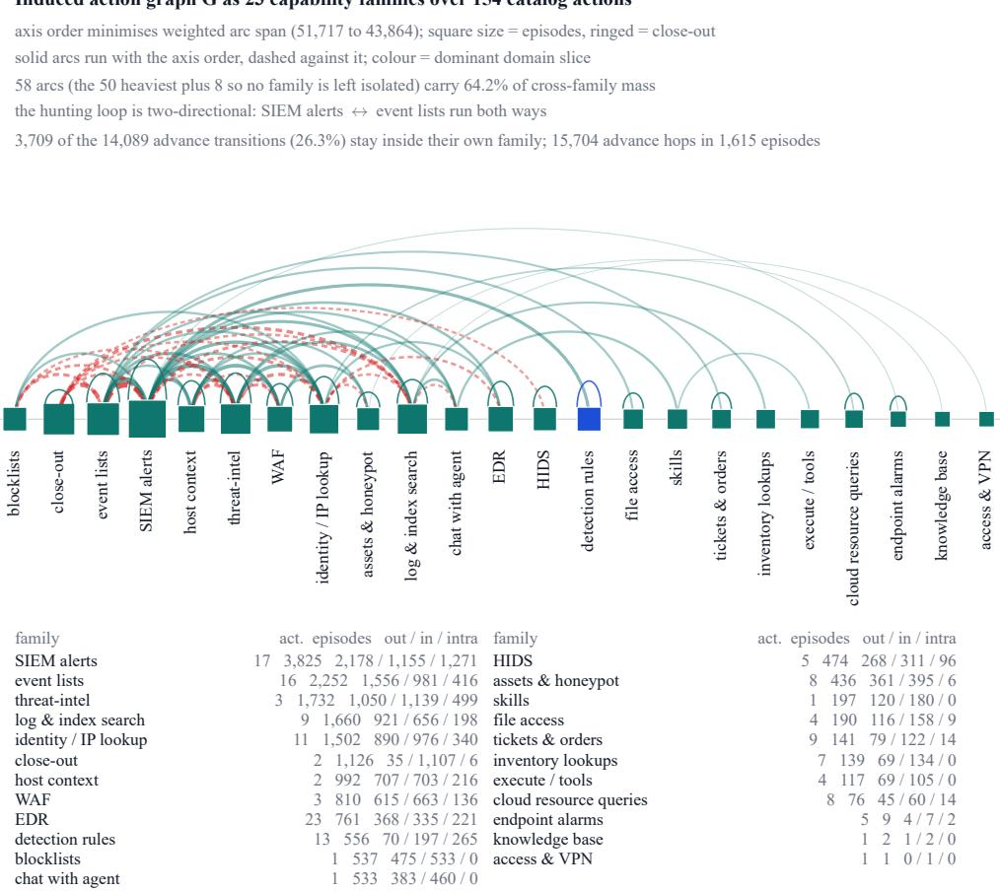  
Figure 2: The induced action graph G at the level on which every node can be named: a capability-family structure over the released corpus. The 154 catalog actions are grouped into 23 capability families by an ordered capability-keyword rule (a display quotient defined in the released analysis code, not a construct of the method), so the drawing covers all 154 stations and all 15,704 advance hops with no anonymous station. The families are placed on one axis in the order that minimises weighted arc span over the family pairs (51,717→43,864); solid arcs run with that order, warm dashed arcs against it, thickness proportional to transferred hops, and a hook on a node carrie the hops that never leave its family. Node size is episode count and colour the dominant domain slice — a deliberately honest non-finding: 22 of the 23 families are detection-dominant, so colour separates one node. Two properties of G that a station-level view hides become visible content. First, the hunting loop is two-directional (SIEM alerts ↔ event lists 550/465, identity ↔ threat-intel 178/170, host ↔ threat-intel 171/142). Second, 3,709 of the 14,089 advance transitions (26.3%; the 15,704 advance hops of §3 less one opening step per episode—1,615 episodes) never leave their own family, 1,271 of them in the SIEM family alone. The 58 drawn arcs are the 50 heaviest familyto-family exchanges plus one arc for each family the budget would otherwise leave isolated, and they carry 64.2% of cross-family mass; the remaining share is counted, never implied absent, in the table, which lists every family with its station count, episodes and out/in/intra-family mass. closeout (ringed) is the graph’s only terminal group: every hunting line is resolved there.

## 4.2 TYPED-DECISION READOUT ROUTER

We call the model the typed-decision router; its scoring head is the readout. The router answers one question per state: given the current node v, goal g and context c, which edge in A(v) leads to task completion? (A(v) includes stop as a non-edge option.) In the corpus realization g is the episode’s agent-stage identity—constant within an episode, hardwired to 0 on the E5 streams—and c is structural (prefix shape, visit counters, per-node neighbor statistics); the guard-aware c of the full design feeds only the substituted context-weighted walk. Options are the declared outgoing edges, bound to stable single-token identifiers: target-action classes over the corpus’s 154-name tool catalog (plus stop) in the class-space readout, or edge identifiers of the induced graph in the edge-ID readout (§6 compares both); in the hidden-state arms the answer distribution is read from the hidden state at a designated position (as in Cheng et al., 2026; Ren et al., 2026)—equivalently, a softmax over the declared label logits (temperature-scaled only in our zero-shot arm)—while the feature arms parameterize the same softmax over observable features (the edge-ID readout space applies to both backbones); nothing is generated. Training minimizes proper-scoring losses over the full vocabulary softmax on (state, goal, context, next-hop) tuples copied from held-in logged transitions—behavioral cloning (Pomerleau, 1991) of the deployed fleet (out-of-space targets stay in the objective; option masking enters only at the masked-renormalized (masked-renorm) gate at decode); the full design replaces the logged next hop with planner-oracle labels—the hop of a context-weighted shortest-path walk to the goal—and uses the walk-membership and episode-success questions as the oracle’s posthoc reward signal. Calibration is reported as expected calibration error (ECE-15, the 15-bin convention; temperature-fitted Guo et al., 2017 for the zero-shot arm, raw masked-renorm confidence for all trained arms, over the probe and feature backbones and their class-space and edge-ID variants). Plain cross-entropy (CE) and the CE-plus-Brier (CE+Brier) objective (Ren et al., 2026) are compared head-to-head on both readout families: a multilayer perceptron over observable features (the feature MLP; node, goal, context, visit counters, per-node neighbor statistics) and a hidden-state probe on the Laya encoder (421M parameters; essentially the same construction as the designatedposition hidden-state readout of Cheng et al. (2026)). Typed decodes of the probe-family heads of Cheng et al. (2026) and Ren et al. (2026) run 30–65 ms at batch-1. Deployment is a two-tier decision stack: the readout handles control decisions (which edge); an executor synthesizes arguments; free-form generation stays in the LLM (as in Wu & Lim, 2026).

## 4.3 GATED SELF-EVOLUTION (RSI)

We use the term recursive self-improvement (RSI) narrowly for the accumulate–gate–commit loop below, not for weight-space self-modification. Decision states of executed walks are labeled with the reference next hop—alternatively the full design’s planner-oracle labels—and appended to a replay buffer; each round trains a candidate router on the accumulated buffer. An update is committed only if held-out validation performance does not regress beyond δ = 0.005 (half an accuracy point); otherwise the candidate is discarded and the incumbent kept. On the 371–380-row validation-gate fold (380 where the stream split is row-granular; App. A), a 0.5-point bar is about 1.9 rows, comparable to the fold’s own single-row resolution of 0.26–0.27 points; this δ is thus a coarse safety threshold rather than a confidence-interval-backed test. The ten-chain study’s paired gate-score differences make that resolution explicit. Twelve of its 13 refusals regress the gate fold by 3 or more rows; a single 2-row refusal sits exactly at δ’s own granularity (the finest distinction a 380-row gate set can support is one row); and 6 of the 27 accepted updates carry a gate-score dip worth one row that δ accepts by construction. We therefore report the 13/40 refusal count as a coarse operational safety readout, not a high-resolution statistical test of regression (validation-gated update with rollback, cf. Shang et al., 2026; held-out selection as in Nguyen et al., 2026b). E4 exercises the loop under 12% label corruption in one round: on the plotted seed-0 chain the gate score never regresses and no rollback fires there—so the guardrail is deployed and measured; across ten seeded chains its refusal path fires 13 times in 40 attempts (App. A).

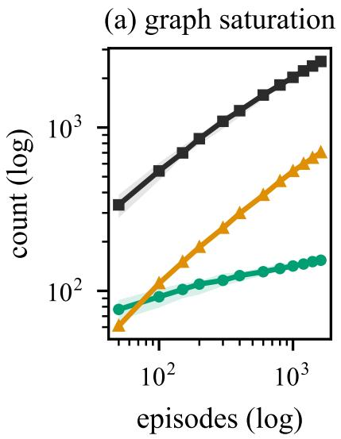

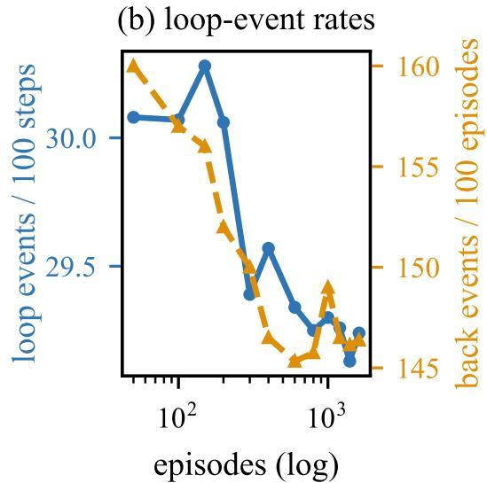  
semantic nodes distinct pairs $( E ^ { + } \cup E ^ { - } )$ back-edge pairs (distinct, $E ^ { - } )$

Figure 3: Node-vocabulary convergence of the loop-collapsed action graph on real production traces (subsample quantities: lines = medians of 20 without-replacement draws at the shown size; shading = min–max over those draws, for the node and distinct-pair series of (a) only—back-edge pairs show their median lines). (a) Semantic node counts saturate quickly (77 action labels in 50-episode subsamples → 124 at 400 → 154 at the full 1,615), while observed transition volume (kept-frame pairs, $\bar { E ^ { + } } \cup E ^ { - } )$ keeps a long tail (distinct pairs 336 at 50 episodes → 1,267 at ${ 4 0 0  2 , 0 2 7 }$ at 1,000 → 2,536 at 1,615, of which 702 appear at recovery returns). (b) Loop-event rates: fold events settle at 29.2% of executed steps (4,124 retry + 2,364 back) and back returns run 146 per 100 episodes— the right-axis back-event series in (b) counts these return events, 2,364 in full, not (a)’s 702 distinct pairs. Axes, hues and y-axis labels are figure-local across the paper’s figures (see Figure 7’s caption).

## 5 EXPERIMENTAL SETUP

Data provenance (production SOC traces). All experiments run on real execution logs: a Langfuse observability export of 22,328 records (22,192 tool calls plus 136 generation records) over 1,656 traces from a production SOC agent fleet (September 2026). Keeping the trace-ID groups with at least one tool call yields 1,615 episodes over a 154-name tool catalog with real per-call latencies and four domain slices (detection 1,174, response 245, protection 139, recognition 54; two minor agents pool the remaining 3 episodes). The slice names are the deployment’s own agentstage labels and are left unmapped to external taxonomies: a slice enters the router as part of its goal input, so we report it under its native name and do not translate it into another vocabulary’s terms. Corpus statistics appear in Table 1. Two properties of the export shape what can be measured and are disclosed up front: tool result payloads and agent chat bodies (where report text lives) are stripped, so the router’s state is reconstructed from the observable call structure—labels and ordering; and task outcomes must be derived. Our derivation: an episode is completed when it closes with the agent’s own close-out act update goal{status: complete} (present in 1,070 episodes, always within the final two steps of the fold), blocked on status: blocked (5), and abandoned when no close-out occurs (540). The convention is machine-checkable (an LLM judge re-prompted to the convention reproduces it on all 1,615 episodes; because the judge is handed the convention itself, this certifies internal consistency, not independent validity) and the derived labels are weak—convention-derived, not independently annotated—and received a manual re-reading on 30 sampled episodes (23/3/4 across detection/response/protection), adjudicated by an AI assistant from session logs rather than a separate human auditor (the structural rule agrees 30/30; an unconstrained judge prompt expecting report text inside update goal agrees only 622/1,615, or 38.5%, over the full corpus—a shortfall that measures the export’s missing field rather than task failure: this caution is revisited in §9). Services: the re-prompted E3 opponent is MIMO Pro V2.6 and the labeling judge is DS V4.1 Flash, both production reasoning models behind our serving gateway (vLLM-served Kwon et al., 2023); the typed encoder’s backbone is Laya 0.3.21, an open non-autoregressive typed-decision engine built on the ModernBERT-large encoder (Warner et al., 2025) with a marker-position decision head. Its shipped per-bucket decision temperatures include an out-of-range entry, so the zero-shot arm refits one scalar temperature on validation negative loglikelihood (henceforth NLL; all trained arms report raw masked-renorm confidence). Service and judge latencies are measured in vivo under production load; the zero-shot arm’s 0.30 s p50 is in-vivo CPU runtime (App. B); typed-model timings are batch-1 GPU wall clock (App. B); no latency or judge-error models are used. The one remaining synthetic element is deliberate and scoped: E4’s 12% label corruption is a controlled stress injection (a stand-in for policy regressions), not a claim about the deployment’s noise rate.

Table 1: Real SOC corpus after loop folding (§4): 22,192 tool calls grouped into 1,615 episodes over 154 actions. “decision steps” count advance (hop) steps; the router’s decision states add the kept recovery returns (train/val/test +1,684/+186/+494 = 2,364), giving the 18,068 rows (12,613+1,580+3,875) all SOC experiments draw on. “loop events” count executed retry and back fold events (4,124 retries, which leave the decision stream, plus 2,364 returns, which stay). “completed” is the derived close-out outcome (§5). The self-evolution stream and its rollback gate for E4 are carved from the validation fold.
<table><tr><td>split</td><td>episodes</td><td>completed (%)</td><td>decision steps</td><td>loop events</td></tr><tr><td>train</td><td>1,125</td><td>67.3</td><td>10,929</td><td>4,615</td></tr><tr><td>val</td><td>145</td><td>60.0</td><td>1,394</td><td>519</td></tr><tr><td>test</td><td>345</td><td>65.5</td><td>3,381</td><td>1,354</td></tr><tr><td>all</td><td>1,615</td><td>66.3</td><td>15,704</td><td>6,488</td></tr></table>

Replay protocol (held-out logs as the environment). The production logs are the environment: held-out episodes are replayed decision-by-decision and every policy faces the same reference behavior—the deployed fleet’s own choices at each realized state. Per decision the policy sees the declared option set (the current label’s outgoing edges in the train-induced graph, plus stop) and a prefix rendering that differs by arm. The feature arm summarizes the folded kept prefix, while the probe and zero-shot state texts render an eight-entry window of the raw label list, cut at the kept frame’s fold ordinal (its rank among kept frames), which serves as the raw-list index. Each entry is rendered by its name tail (the substring after the last , or the whole entry when it contains none), so distinct catalog actions can collide (two search actions surface identically). The zero-shot arm’s option criteria render the same tails with underscores as spaces, barring the <stop> criterion whose text reads conclude; colliding options then present identical choice texts. The window runs behind the current label by exactly the retries preceding the frame (the retries stay in the list; on such rows the typed arms never see the current label), while the LLM prompt renders the same window with full labels (not name tails) and appends the current label explicitly. Scoring is teacher-forced against the logged next hop; episodes are scored two ways—strict survival (an episode terminates at its first divergence) and the wrong-hop gap accumulated over the whole episode (cost conventions 1 and 3 per wrong hop are both reported throughout). Because the reference is a realized trajectory rather than an oracle, task success inherits the derived outcome labels above, and the declared option space is itselfscored: 7.9% of test targets lie outside the train-declared options (declared-space coverage 92.1%, or 91.3% when recovery edges are restricted to states the running prefix has already visited—29 rows, every one of them a return to an unvisited state, with the mean space falling from 40.2 to 39.2 options and the verified arms’ masked accuracy moving by at most 0.1 points; of those 307 out-of-space targets, 274 are SOC-service names and 33 are tool names outside the catalog), an arithmetic upper bound no readout inside the declared space can exceed—we report accuracy both overall and within the declared space. The carve is deterministic and trace-disjoint: every trace hashes to train/validation/test at 70/10/20 (first 8 hex digits of its sha256, mod 100), so every trainversus-held-out claim below except the E4 gate comparisons refers to episodes whose traces no fit saw (the self-evolution stream’s finer split of the validation fold is decision-row-granular: rows, not traces, are split, a leakage risk disclosed here and now measured—re-cutting the stream and the gate at whole-trace granularity moves held-out accuracy by under 0.1 points and leaves every E4 conclusion in place).

Baselines and arms. E2 compares a per-node majority arm (raw per-node argmax) against multinomial logistic regression and typed readouts trained on one observable-state feature set (node, goal, prefix statistics, visit counters, per-node neighbor statistics); the typed readouts are trained with cross-entropy versus the CE-plus-Brier variant (5 training seeds each); in the edge-ID variant the readout space is the induced graph’s edge identifiers rather than target-action classes. Two class-space readouts use Laya: zero-shot typed choice over each state’s declared options, and a frozen-encoder hidden-state probe—a linear head on the encoder’s designated readout position— trained with the same CE and CE-plus-Brier objectives. E3 compares: a re-prompted MIMO Pro V2.6 stand-in over the reconstructed state (MIMO Pro V2.6, a production reasoning model at our serving gateway—one call per decision, without the fleet’s per-stage orchestration and without tool results—not the deployment’s status quo) deciding every hop from the same reconstructed state and options (under the richer full-label prompt rendering of the replay protocol); typed readouts acting greedily within the masked option set; and typed with accept/escalate at $\tau \in \{ 0 . 5 5 , 0 . 7 5 , 0 . 9 \}$ which routes low-confidence states to MIMO Pro V2.6. Readouts are named after their table rows: feature MLP scores engine-derived stream statistics, hidden-state probe is a probe fit on Laya’s frozen hidden states, and typed encoder is the Laya backbone itself scoring the declared options.

Metrics and protocol. Per decision: top-1 agreement with the logged hop, masked-renormalized over the declared options for the trained arms, reported overall and within the declared space (for the baseline rows the displayed cells are raw top-1; their option-masked variant merely gates the raw argmax on landing in the option set—no renormalization); calibration (ECE-15, per the §4 convention; it is computed on the 3,568 in-space rows for the zero-shot arm—a typed-choice head gives no score to an out-of-space target—and on all 3,875 rows with out-of-space targets counted wrong for the other arms, whose full-vocabulary heads still define a masked-renorm confidence there). Risk–coverage curves (Geifman & El-Yaniv, 2017) and the area under the risk–coverage curve (AURC) for the accept/escalate gate complete the per-decision set. Per episode: strict survival (no divergence before the log ends), LLM calls per decision, and the wrong-hop gap accumulated over the whole teacher-forced episode under both per-hop cost conventions (1 and 3). Difficulty profile: domain (agent-stage) slices and local branch-factor buckets (≤3, 4–10, 11+: the train-graph out-degree at the current node, stop options excluded). Uncertainty: 5 training seeds for the readout arms (mean ± std); the E3 replay and the E4 refit chain are single-seed (seed 0) sequences (E4’s ten-chain stress study is aggregated at the unit of one refit chain: 30.3% and 31.0% are across-chain means of start and end held-out accuracy, ±0.5 points—one standard deviation across the ten chains end accuracies); service and judge latencies are in-vivo wall-clock (p50/p90), the zero-shot arm’s runtime in-vivo CPU (App. B), typed-model timings batch-1 GPU wall clock (App. B). Each of E1–E4 is annotated with the claim it tests.

## 6 RESULTS

E1: the induced action graph’s node vocabulary converges (its edge set runs a long tail; claim P1). Figure 3 provides quantified saturation curves on real production traces, adding the transitionpair long tail and the loop-event mass to the usual state-count view. Across 20 without-replacement subsamples per size (medians quoted here and in Figure 3), the semantic node vocabulary saturates fast: 77 action labels appear in 50-episode subsamples, 124 at 400, 142 at 1,000, against 154 in the full corpus. Transition discovery is the honest counterpoint—observed transition pairs keep a long tail (336 at 50 episodes → 1,267 at 400 → 2,027 at 1,000 → 2,536 at 1,615), and the recovery side never closes either: 702 pairs appear at recovery returns, 481 of them doubling as forward transfers in other contexts (§3). Loop mass is heavy and stable: 29.2% of executed steps fold into loop events (4,124 retry—63.6% of loop events, in 2,164 bursts—and 2,364 back returns—36.4%, 146 per 100 episodes; revisit distances concentrate at 1–3 steps behind the current frame, with 681 taking the immediate-repeat distance of one). Two consequences: the router’s label space closes early—the stability pattern of Cho et al. (2026) recurs in the node curve (qualitatively, a small saturating node set of 77 to 154 labels rather than their 7–43 states; Figure 3a), now alongside the transition-pair and loop-mass axes—while per-node option sets keep thickening. The routing task on real traces is therefore bounded-vocabulary but long-tailed option selection: exactly the regime where a masked, calibrated typed readout constrains the damage of open-vocabulary guessing.

Table 2: Next-hop agreement on the held-out test decisions: top-1 accuracy over 3,875 decision states; for the trained readout arms, masked top-1 renormalized over each state’s declared options; raw top-1 for the majority and logistic rows (option-masked accuracy is computed for both baseline rows on the public streams and for the majority arm on all nine streams, App. B; it equals raw for the majority arm everywhere, while the logistic pair diverges on the two ToolBench streams Qin et al., 2023: 35.7% masked versus 36.4% raw at 7,318 names and 34.8% masked versus 36.0% raw on the 351-name evaluation subset, §6). Uncertainty: 5 training seeds for the readout arms, ± std— accuracy fractions, e.g. 0.004—in the note column. “in-space” restricts to the 92.1% of decisions whose logged target lies inside the declared option space. ECE-15 and AURC are probabilities printed to three decimals. $\stackrel { \scriptscriptstyle 4  } { \_ } = \mathrm { u n d e f i n e d }$ (the majority and logistic rows carry no calibration cells, no in-space cells, and no AURC entry: the majority arm has no confidence ranking and no calibrated distribution is fitted for the logistic row; AURC is likewise not computed for the probe and zero-shot rows—their risk–coverage curves come only from coarse 7-point grids); note-column “–” = no seed spread and no config entry (the zero-shot row reports its fitted decoding temperature T instead). Probe and zero-shot fitting details are in App. B. †The paired interval against the indicated reference includes zero (Table 3): the ordering among the marked rows is a point estimate, not a separated difference.
<table><tr><td>readout arm</td><td>acc. (%)</td><td>in-space (%)</td><td>ECE-15</td><td>AURC</td><td>± std / config</td></tr><tr><td>majority arm</td><td>26.8</td><td></td><td></td><td>一</td><td></td></tr><tr><td>logistic regression†</td><td>32.3</td><td></td><td></td><td></td><td></td></tr><tr><td>feature MLP, CE†</td><td>32.8</td><td>35.6</td><td>0.045</td><td>0.409</td><td>±0.001</td></tr><tr><td>feature MLP, CE+Brier†</td><td>32.7</td><td>35.5</td><td>0.048</td><td>0.409</td><td>±0.003</td></tr><tr><td>edge-ID readout, CE†</td><td>31.4</td><td>34.1</td><td>0.082</td><td>0.432</td><td>±0.007</td></tr><tr><td>edge-ID readout, CE+Brier†</td><td>31.6</td><td>34.3</td><td>0.080</td><td>0.431</td><td>±0.004</td></tr><tr><td>hidden-state probe, CE</td><td>30.3</td><td>32.9</td><td>0.123</td><td></td><td>±0.007</td></tr><tr><td>hidden-state probe, CE+Brier</td><td>30.7</td><td>33.3</td><td>0.122</td><td></td><td>±0.004</td></tr><tr><td>hidden-state probe (edge-ID), CE+Brier</td><td>26.6</td><td>28.9</td><td>0.458</td><td></td><td>±0.004</td></tr><tr><td>Laya zero-shot typed choice</td><td>8.6</td><td>9.3</td><td>0.031</td><td></td><td>T = 3.0</td></tr></table>

E2: the router reaches top-1 agreement with the fleet (32.8%) and decides in milliseconds (claim P2). Table 3 replaces the ordering reading with paired tests on the same held-out states and 95% intervals from 2,000 trace-clustered bootstrap resamples over the 345 test episodes (resampling decisions independently would understate the interval: dependence inside an episode is strong). Two of the six comparisons separate—the readout against the per-node majority arm (+5.7 points, CI [+4.6, +6.9]) and the edge-ID collapse on the hidden-state probe (−3.8 points, CI $[ - 5 . 0 , - 2 . 6 ] $ )—while the CE/CE+Brier ordering, the feature MLP against logistic regression, and the edge-ID penalty on thefeature arms all have intervals that include zero and are therefore reported as point estimates. Table 4 gives the branch-factor view: the headline accuracy is a weighted average dominated by the 11+ bucket (89.6% of rows), the ≤ 3 bucket is effectively solved (92% majority, 99% in-space for the best arm), and the small middle bucket is the hardest in-space case. Finally, the information budget behind these numbers is small: once node identity and the eight state statistics are given, adding seven prefix-latency features buys +0.4 points and adding argument-shape counts on top of them +1.3 points (five seeds, feat lat results.json, Reproducibility), so the ordering among feature arms should not be read as evidence that richer signals were the missing ingredient.

Table 2 states the difficulty plainly: next-hop prediction on production traces tops out at 32.8% agreement on the state features (feature MLP, CE; 35.6% within the declared space) with its CEplus-Brier twin at 32.7%, the logistic-regression arm at 32.3% (raw top-1) and the majority arm at 26.8%. These absolute levels measure the task as much as the models: the reference behavio is a realized fleet policy rather than a planner oracle, states offer 40.2 declared options on average (median 46, stop included), and 7.9% of targets fall outside the train-declared option space (a 92.1% declared-space arithmetic upper bound, 91.3% under prefix-marked reachability, for masked readouts; that restriction shifts the feature-MLP and edge-ID arms by at most 0.0005 accuracy and leaves 29 of 3,875 rows without their target, so no reported level depends on it). Three structural findings hold on production traces. At this catalog size semantic class sharing beats structural bookkeeping: the class-space readout beats the edge-ID readout on shallow features (32.7% versus 31.6% masked; both CE+Brier, 5 seeds) and by far on the hidden-state probe (30.7% versus 26.6%; the edge-ID probe’s ECE explodes to 0.458)—the reverse of our design bet, discussed in §9. Also, the CE-plus-Brier objective pays where the readout trails and is flat where it already leads (the probe trails here and gains; the feature leads and is flat): on the feature MLP it gives up 0.05 accuracy points and worsens ECE by 0.002 versus plain CE (32.7% versus 32.8%, ECE 0.048 versus 0.045, deltas on unrounded 5-seed means), while on the hidden-state probe it adds 0.4 points (30.3% → 30.7%) and cuts the seed spread $( \pm 0 . 0 0 7  \pm 0 . 0 0 4 )$ And the designated-position hidden-state readout of Cheng et al. (2026) is its system’s answer path and wins system-level comparisons; here, encoder held fixed, the structured feature arm beats the designated hidden-position probe (32.7% versus 30.7%; in-space 35.5% versus 33.3%). For a proprietary 154-name catalog described by name only, the structured feature arm wins this comparison (although representation, readout family and training budget are confounded here: the features summarize the folded kept prefix while the probe’s state text renders raw logged labels through the name-tail surface of §5 and trails the current label wherever retries precede it, by up to dozens of raw steps; the probe reads through a linear head on encoder state where the feature arm is an MLP over the observable features; and the probe’s reported fit runs 90 epochs against the feature arm’s 60). Zero-shot typed choice (8.6% overall, 9.3% within the declared space; fitted temperature T=3.0, the ceiling of an eight-point refit grid $T \in \{ 0 . 5 , 0 . 7 , 1 . 0 , 1 . 3 , 1 . 6 , \bar { 2 } . 0 , 2 . 5 , 3 . 0 \}$ and still the ceiling when the grid is extended to T=1000: the raw head is over-confident and the fit is unbounded (validation NLL falls monotonically to the uniform-prediction limit 3.40; the argmax is invariant, the risk–coverage curve moves by at most 0.0006, and ECE-15 is grid-dependent—0.031 at T=3.0 against 0.010 at ${ \cal T } { = } 1 0 0 0 { - } { \bf s } _ { 0 }$ this arm’s calibration is not to be read as calibrated confidence) shows what transfer alone buys. Calibration is another honest limit: the probe’s ECE sits at 0.122 against 0.045 for the best feature arm, and confidence on the feature arms stratifies sharply only at the top of its ranking—selective risk on features falls to 3% at 5% coverage and 23% at the top quartile (the seed-0 dense curve; full risk–coverage curves in Figure 4), then rises more slowly (48% at 50% coverage to 67% at full coverage on the feature MLP with CE+Brier, five-seed means; 52% → 69% at the same two anchors on the hidden-state probe with CE+Brier). The accept/escalate gate therefore lives or dies with the hybrid sweep in E3. Where the data are easy the readout is easy: the hidden-state probe’s branch-factor and domain-slice refits (60-epoch fits over its frozen encoder features, App. B; real/e8 slices.json) answer the 263 test states in the ${ \le } 3$ local-branch-factor bucket at 92.2% (aggregated over 5 seeds × the test split), 21.2% on the 139 states in the 4–10 bucket, and 25.9% on the 3,473 states in the 11+ bucket—the middle bucket dips below the largest. By domain slice the same probe refits average 28.9% (detection), 41.9% (response), 29.3% (protection) and 42.2% (recognition)—an ordering §9 cautions against reading directly, since stage accuracy conflates routing with pipeline role (closure rates in App. A).

Table 3: Paired tests on the same held-out states (seed-0 fits; e10 paired ci.json, e11 probe edge ci.json). ∆ is in accuracy points with a 95% CI from 2,000 trace-clustered bootstrap resamples; “discordant” gives the counts (first arm right / second arm right). Rows read point estimate only have a CI that includes zero: their ordering in Table 2 is a point estimate, not a separated difference.
<table><tr><td>paired comparison (same states)</td><td>∆(pts)</td><td>95% clustered CI</td><td>discordant</td><td>reading</td></tr><tr><td>feature MLP, CE+Brier – CE</td><td>-0.13</td><td>[−0.53, +0.26]</td><td>35 /30</td><td>point estimate only</td></tr><tr><td>feature MLP, CE+Brier – majority arm</td><td>+5.70</td><td>[+4.60, +6.90]</td><td>105 / 326</td><td>separates</td></tr><tr><td>feature MLP, CE+Brier – logistic regression</td><td>+0.23</td><td>[−0.48, +0.93]</td><td>101 / 110</td><td>point estimate only</td></tr><tr><td>edge-ID – class space (features, CE+Brier)</td><td>-0.83</td><td>[-1.67, +0.03]</td><td>176 / 144</td><td>point estimate only</td></tr><tr><td>edge-ID − class space (probe, CE+Brier)</td><td>-3.79</td><td>[−5.01, -2.62]</td><td>212 / 359</td><td>separates</td></tr><tr><td>edge-ID CE+Brier – edge-ID logistic</td><td>-0.15</td><td>[−1.05, +0.76]</td><td>176 / 170</td><td>point estimate only</td></tr></table>

Table 4: The same decisions split by the branch factor |A(v)| at the state (3,875 test decisions). Only 3.6% of states fall in the middle bucket, so the headline is dominated by the 11+ bucket (89.6% of rows). “majority” is the per-node majority-vote arm; MLP and edge-ID are the feature arms, masked accuracy with in-space accuracy in parentheses; mean $| A ( v ) |$ is over declared options (stop included). e8 slices.json additionally carries a pooled train+val+test by outdeg table with the same accuracy magnitudes over 19,375 rows; the counts and accuracies quoted here are test-split, and our seed-0 probe refit reproduces them (92.0/22.3/26.3 against the five-seed 92.2/21.2/25.9 of §6).
<table><tr><td>bucket (|A(v)| of the state)</td><td>n</td><td>share</td><td>mean |A(v)|</td><td>majority</td><td>MLP CE+Brier</td><td>edge-ID</td></tr><tr><td>≤3</td><td>263</td><td>6.8%</td><td>1.23</td><td>92.0</td><td>93.9 (99.2)</td><td>93.2</td></tr><tr><td>4-10</td><td>139</td><td>3.6%</td><td>7.90</td><td>34.5</td><td>38.9 (54.0)</td><td>36.7</td></tr><tr><td>11+</td><td>3,473</td><td>89.6%</td><td>44.46</td><td>21.5</td><td>27.6 (29.8)</td><td>26.8</td></tr></table>

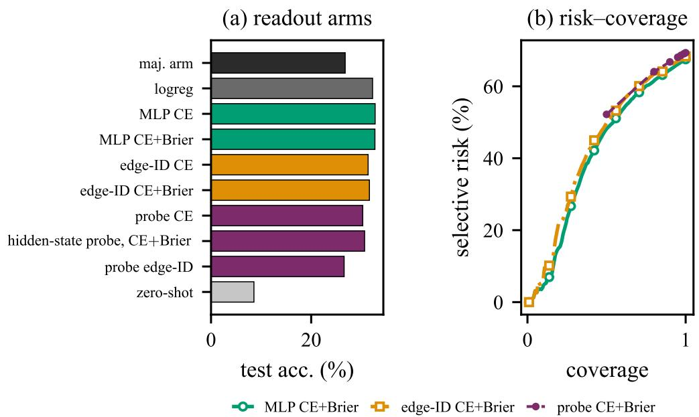  
Figure 4: (a) Readout arms on the held-out test decisions (masked top-1; raw top-1 for the majority/logistic rows; the zero-shot row counts out-of-space targets as errors, as the masked rows and the majority arm do). (b) Risk–coverage of the CE-plus-Brier arms (masked-renormalized distributions; the edge-ID probe arm is not drawn): confidence separates risk sharply at the top of the ranking in the feature arms and thinly across the bulk in both families (the probe grid starts at 50% coverage). Dense curves live in real/e2 results.json (curve mean; seed 0 for the feature arms); the probe arm is drawn from its seven-point, five-seed-mean risk@coverage grid in real/e2 layaprobe results.json.

E3: end-to-end replay against the re-prompted MIMO Pro V2.6 stand-in (claim P3). Table 5 delivers the end-to-end outcome (Figure 5). With all 3,875 decisions of the 345 held-out episodes scored against the fleet’s own behavior, the re-prompted MIMO Pro V2.6 stand-in (one reasoning call per hop; its free-text replies are matched to option names post hoc, 66 replies—1.7%—unparsed and scored as divergences) agrees with the reference at 9.6%; the hidden-state probe holds 30.7% at zero LLM calls; and the accept/escalate hybrids land below the typed layer—20.9% / 19.1% / 16.5% at τ ∈ {0.55, 0.75, 0.9} under escalation rates of 74.1% / 80.2% / 85.0% (MIMO Pro V2.6 consulted on the readout’s least-confident states; the τ sweep traces the agreement/cost curve that slopes down). The episode-level measures agree with the per-decision read: strict survival keeps 2 of 345 episodes for the hidden-state probe (0.6%) and none for the opponent or the hybrids—anydivergence death on ten-plus-hop episodes asks for perfection in every hop—while the wrong-hop gap charges 10.2 wrong hops per episode against the opponent (30.5 under $c _ { 3 } )$ and 7.8 (23.4) for the hidden-state probe. The hybrids land at 8.9/9.1/9.4 (26.7/27.3/28.1 under c3). The cost asymmetry holds regardless of who wins the agreement column: every typed decision is one bounded readout pass—a typed-choice predict at 19.5 ms p50 with the encoder pass included (17 declared options measured, below the 40.2-option held-out mean), or, on the replay’s probe rows, that pass alone (10 ms) plus a linear head (App. B)—while every MIMO Pro V2.6 decision is a reasoning generation at $2 . 2 \mathrm { s p } 5 0 ( 7 . 4 \mathrm { s p } 9 0 )$ under the serving configuration’s 2,048-token completion budget. We account for cost on the three axes the export actually carries—decision latency, LLM calls per decision, and the wrong-hop cost of a divergence—and not in tokens or currency: the stripped stream we work from records no per-call usage, so a token-level comparison here would be modelled, not measured. Two readings follow. Matching this fleet is hard for everyone—the reference is a realized multiagent policy whose tool results our export strips (§9)—and within that hard task the cheap readout beats the zero-shot opponent outright, 3.2× its agreement at two orders of magnitude less decision time. This comparison is asymmetric in construction: the readout is fit on 12,613 logged reference decisions while the stand-in is only ever re-prompted zero-shot with tool results stripped (66 of its replies, 1.7%, fail to parse into a valid tool choice and score 0 against the fleet’s logged next hop), so 9.6% is a transfer-floor number for a stripped stand-in, not the deployed component’s own capability ceiling. Tuning is the difference: jpt-4b, LoRA-tuned for one epoch on the training fold, reaches 31.9% against the typed encoder’s 32.2% on the same held-out decisions, a gap an exact paired test does not resolve $( p = 0 . 6 8$ , 229 decisions the tuned model gets and the typed encoder misses, 239 the other way), at 244 ms per decision against 10 ms (Table 13). The hybrid result is a negative one for confidence-gated cascade calibration on this stream. The gate routes roughly four of every five hops to the LLM (3.7–4.3 of every five hops at 74.1/80.2/85.0% for the three τ thresholds) and inherits the opponent’s low agreement on those hops, so rather than beating both parents on their complementary states it sits strictly between its parents—an escalation rule needs per-state competence, not just confidence, before it can pay for itself here.

Table 5: Held-out replay on the 345 test episodes (3,875 decisions, §5). All policies share the declared option sets and the fleet reference behavior. Match = decision-level top-1 agreement with the logged hop (teacher-forced); survival = episodes that replay with no divergence before the log ends (the episode dies at its first divergence); gap = wrong-hop cost per episode—every diverging hop of the whole teacher-forced episode is charged—under conventions $c _ { 1 }$ (1/wrong hop) and $c _ { 3 }$ (3/wrong hop); LLM calls/dec. = escalation rate; every typed and hybrid row replays one probe fit (CE+Brier, seed 0). Gap columns come from one wrong-hop count each: $c _ { 3 } = 3 c _ { 1 }$ exactly, and displayed entries round independently.
<table><tr><td>policy</td><td>match (%)</td><td>survival (%)</td><td>gap c1</td><td>gap c3</td><td>LLM calls/dec. (%)</td></tr><tr><td>MIMO Pro V2.6 every hop</td><td>9.6</td><td>0.0</td><td>10.157</td><td>30.470</td><td>100.0</td></tr><tr><td>hidden-state probe, CE+Brier</td><td>30.7</td><td>0.6</td><td>7.788</td><td>23.365</td><td>0.0</td></tr><tr><td>typed+esc @ τ=0.55</td><td>20.9</td><td>0.0</td><td>8.890</td><td>26.670</td><td>74.1</td></tr><tr><td>typed+esc @ τ=0.75</td><td>19.1</td><td>0.0</td><td>9.084</td><td>27.252</td><td>80.2</td></tr><tr><td>typed+esc @ τ=0.9</td><td>16.5</td><td>0.0</td><td>9.377</td><td>28.130</td><td>85.0</td></tr></table>

(a) match (%)  
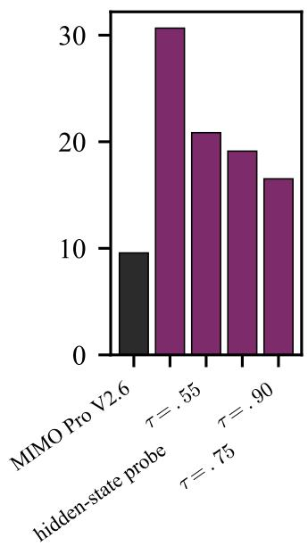

(b) survival (%)  
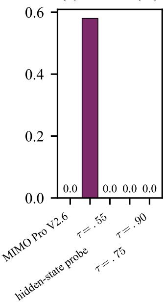

(c) latency p50  
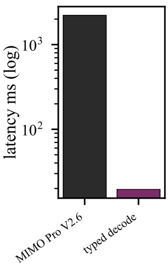  
Figure 5: End-to-end replay (Table 5). (a) Decision match; (b) Episode survival under strict divergence; (c) Decision latency: MIMO Pro V2.6 in-vivo p50 2.2 s versus 19.5 ms p50 for the typed decode’s GPU typed-choice head (full typed-choice predict, encoder pass included—the typed path’s upper price; the E3 replay’s probe rows decode at the 10 ms marginal encoder pass: App. B). The accept/escalate rows spend LLM calls only where the readout is least confident—and score strictly below the pure hidden-state-probe row; on this stream the escalated hops carry the opponent’s low agreement into the route, which is consistent with the loss but is not isolated by our design (§6). The typed-family bars in (a) and (b) come from one hidden-state probe fit (CE+Brier, seed 0; probe family drawn purple); the purple bar in (c) is the typed path’s own decode price.

Threshold scale, and where routes first diverge. The raw thresholds above are not scale-free: p lives on a per-node simplex whose dimension is the option count, and the threshold that matches a given escalation rate correlates with $1 / | A ( v ) |$ at Pearson $r \ = \ 0 . 5 2$ Re-running the sweep on an excess-over-uniform scale, an entropy-normalized scale, the top-1/top-2 margin, and a threshold-free rule that escalates the least-confident fraction, at matched escalation rates, leaves the reading unchanged: at 74.1% escalation the hybrid reaches 0.2085 (raw) / 0.2263 (excess over uniform) / 0.2098 (entropy-normalized) / 0.2101 (margin) / 0.2085 (rank only) against 0.3061 for the pure hidden-state-probe row, so the cascade’s loss is not an artifact of an uncalibrated threshold and no tested scale closes more than 1.8 of the 9.8-point gap. Where a route dies is a quantity the per-decision mismatches do not carry: of the 343 episodes that diverge at all under the hidden-state probe, 60 diverge at the first hop and 185 at the second (median 2)—routes are lost on the way in; 331 of those first divergences sit at states with 11+ declared options, 12 at out-of-space targets, and 258 fall on hops the hybrid had escalated.

E4: the gated loop absorbs the corruption stress on average, and the rollback gate is exercised—13 of 40 candidate updates refused over ten seeded chains (claim P3). Across four rounds (Figure 6) the gated loop accumulates the self-evolution stream in 300-decision batches— each candidate is a refit of the hidden-state probe on accumulated data (train split plus accepted batches). The stress arrives at round 3 (12% of the batch’s labels flipped to uniformly drawn non-target options, App. A): against a 12,613-decision base the injected flips do not dent held-out accuracy—the five fits run $3 0 . 2 \dot { 9 } \%  3 0 . 4 \%  3 0 . 4 \%  3 1 . 0 \%  \dot { 3 } 1 . 7 \%$ on the untouched test split with the gate score rising alongside $( 2 5 . 0 \%  2 7 . 1 \% )$ —and every refit, corrupted one included, is committed (5 fits on the chain, base plus four refits; 4 of 4 candidate updates accepted; 0 reverts at $\delta { = } 0 . 0 0 5 )$ . What the run demonstrates is monotone accumulation and noise absorption at this injection rate, not a gate rescue: a stress sized to bite was run as that honest next test, and the answer is partly negative. At 30% and 50% (four chains each, same recipe, injection still in round 3) the gate refuses 7 and 8 of 16 candidate updates against 8 at 12% while the corrupted update’s gate score falls further (0.0013 and 0.0059 mean drop against 0.0007 at 12%), and final held-out accuracy stays within 0.002 of the base (31.2% and 30.9% against 30.8%)—so the refusal path is exercised at every rate but neither the refusal count nor the held-out metric tracks the injection size, because the 0.5-point threshold already separates the same updates. The other half of that test—corruption against a smaller base—was run too: at a quarter of the base (3,153 decisions) the fit starts 2.6 points lower (27.6% against 30.3%), the gated loop recovers most of the gap over the four updates (29.5% and 29.6% against 30.8% and 31.3%), and the rollback path fires on every chain $( \bar { 3 } / 2 / 1$ refusals at 12% and $\bar { 3 } / 0 / 1$ at 30%), including the chain that never fires at the full base—so base size, not injection size, is what makes the gate bite. Direction check at the same 12% rate: a second batch replaces the observation instead—the feature row shown to the model is taken from another stream row with a different logged target, the label left intact—and is absorbed the same way (6 rollbacks across the same five runs against 7; final held-out accuracy 31.08% against 31.05%), so the loop’s behaviour here does not depend on which side of the imitation pair is corrupted, and the gate is not a mislabel-specific detector. Richer world- and harness-evolution loops are complementary (Xue et al., 2026; Zheng et al., 2026; NeoHorse Team et al., 2026).

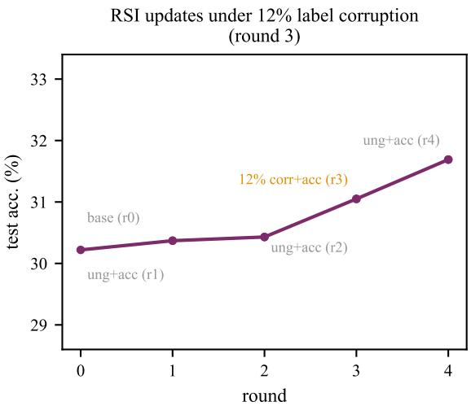  
Figure 6: Held-out test decision accuracy across the self-evolution stream (a seeded random 1,200- row subset of the validation fold, permutation seed 7, played as 300-decision update batches; the 380 validation rows left out of the 1,200-row draw, from the 1,580-row validation fold, are the gate set). The round-3 batch carries 12% label corruption (App. A); on the seed-0 row-level chain plotted here held-out accuracy never falls across refits, rises $3 \bar { 0 } . \bar { 2 } \%  3 1 . 7 \% .$ , and holds through the corrupted one (the flips are about 0.3% of the 12,613-decision base). The gate set governs commits: on this chain the gate score never regresses beyond the gate tolerance $\delta \mathrm { { = } 0 . 0 0 5 }$ . Across ten seeded chains (row- and trace-level stream splits; five chains per mode over shared seed offsets, App. A) heldout accuracy averages $3 0 . 3 \%  3 1 . 0 \% \ ( \pm 0 . 5$ points) and the gate refuses 13 of the 40 candidate updates (6 of the 10 chains refuse at least one), so the single chain under-reports the guardrail’s workload (point tags concatenate the round’s events with + and carry the round number: ung+acc (r1) names the raw refit ungated update and the gated commit accept at round 1, 12% corr+acc (r3) the injected round, base (r0) the base fit). The test split is never trained on.

Table 6: Ablation summary (A2 cells: masked acc. / ECE-15; 5 seeds where trained; A1 and A3 rows are counts and rates). A1: what loop folding removes from the decision stream. A2: loss ablation (arrows run CE → CE+Brier) on the readout arms. A3: accept/escalate threshold sweep— summary row here, full hybrid rows in Table 5, risk–coverage curves in Figure 4.
<table><tr><td></td><td>item</td><td>measured effect (acc. / ECE-15 where two-sided)</td></tr><tr><td>A1</td><td>loop folding</td><td>22,192 positions → 18,068 decision states (15,704 advances + 2,364 kept returns); 4,124 retries dropped, 6,488 loop</td></tr><tr><td>A2</td><td>feature MLP edge-ID readout</td><td>events tagged (29.2% of steps) 32.8 /0.045 → 32.7/0.048 31.4/0.082 → 31.6/0.080</td></tr><tr><td>A3</td><td>hidden-state probe escalation sweep</td><td>30.3 /0.123 → 30.7/0.122  $\tau { = } 0 . 5 5 / 0 . 7 5 / 0 . 9 \to 7 4 . 1 / 8 0 . 2 / 8 5$  0% LLM calls, match</td></tr></table>

Ablations (A1–A3). (A1) Without loop folding the readout would face the raw stream of 22,192 positions of which 29.2% are loop bookkeeping: folding removes only the 4,124 retries (18,068 decision states remain: 15,704 forward plus 2,364 recovery returns—the same accounting E5’s 237- kept-frame example spells out) and compresses the state-ID space to 154 semantic labels (Figure 3a). (A2) CE+Brier training is flat against plain CE on the class-space readout (paired $\Delta = - 0 . 1 3$ points, 95% trace-clustered $\mathrm { C I } \ [ \bar { - } 0 . 5 3 , \bar { + } 0 . 2 6 ]$ : an unresolved ordering, not a win; Table 3) and nudges the edge-ID readout up a notch $( 3 1 . 4 \%  3 1 . 6 \%$ , ECE 0.082 → 0.080); it buys its margin on the hidden-state probe (the E2 deltas, tabulated in Table 6): a hedge for whichever readout trail rather than free accuracy. (A3) The accept/escalate sweep lives in the hybrid rows of Table 5 (escalation rate is monotone in τ by construction) and in the risk–coverage curves of Figure 4; the deployed gate thresholds the masked-renormalized distribution, and out-of-space emissions are masked back into range (§5).

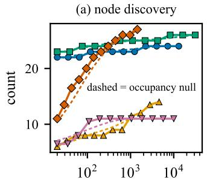

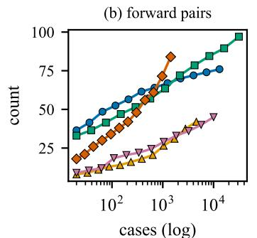

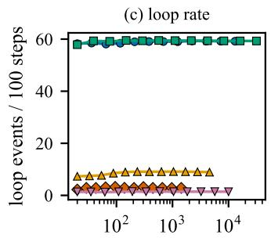

Figure 7: Saturation on the five process logs that carry ≥20 cases (statechart Leemans, 2018 is a single 17,912-event session and cannot support a subsampling curve; its census sits in Table 7). Twelve without-replacement subsample sizes × 20 draws each; p50 curves. (a) Distinct-node discovery climbs toward each catalog ceiling; receipt’s 27th and helpdesk’s last label appear only at their case boundaries (Buijs, 2014; Polato, 2017). (b) First-visit forward pairs $( E ^ { + }$ only; the SOC volume in Figure 3 counts kept-frame unions $E ^ { + } \cup E ^ { - } )$ are still climbing at each corpus’s drawn end $( 1 . 4 \times \mathrm { 1 \bar { 0 } ^ { 3 } - 3 . 2 \times 1 0 ^ { 4 } }$ cases). (c) Loop rate is flat in subsample count (the p50 curves stay level over the 12 sizes); separately, the BPIC’12 and BPIC’17 curves draw nearly coincident at 59.2/59.3 loop events per 100 logged events (van Dongen, 2012; 2017). Dashed curves in (a): the zero-parameter occupancy null at the same 12 sizes—the expected distinct labels after m of n cases without replacement, $\begin{array} { r } { \mathbb { E } [ D ( m ) ] = \sum _ { l } \bigl ( 1 - \prod _ { i = 0 } ^ { m - 1 } \frac { n - c _ { l } - i } { n - i } \bigr ) } \end{array}$ , c the number of cases carrying label l (fit discussion in the text). Semantic colour is figure-local: the panels here key corpora by hue (green names BPIC’17); Figure 10 keys sweep classes by marker and colour (axis / process logs / eval subset), Figure 4 and Figure 5 key method arms, Figure 3 key quantity series; repeated hues carry no cross-figure meaning. Panel (c)’s y-axis label echoes the left (loop-event) axis of Figure 3b at a different scale (compare slopes, not heights).  
Table 7: Public corpus census and fold totals, produced by the same fold() routine as the SOC corpus’s own folding. Loop mass (%) is 100(retry + back)/events; steps = logged events on these streams (code: fold rules.py).
<table><tr><td>corpus</td><td>cases</td><td>events</td><td>labels</td><td>advance</td><td>retry</td><td>back</td><td>loop mass (%)</td></tr><tr><td>BPIC&#x27;12</td><td>13,087</td><td>262,200</td><td>24</td><td>107,006</td><td>105,776</td><td>49,418</td><td>59.2</td></tr><tr><td>BPIC&#x27;17</td><td>31,509</td><td>1,202,267</td><td>26</td><td>489,408</td><td>448,205</td><td>264,654</td><td>59.3</td></tr><tr><td>helpdesk</td><td>4,580</td><td>21,348</td><td>14</td><td>19,443</td><td>944</td><td>961</td><td>8.9</td></tr><tr><td>receipt</td><td>1,434</td><td>8,577</td><td>27</td><td>8,332</td><td>6</td><td>239</td><td>2.9</td></tr><tr><td>roadtraffic</td><td>10,002</td><td>37,255</td><td>11</td><td>36,732</td><td>270</td><td>253</td><td>1.4</td></tr><tr><td>statechart</td><td>1</td><td>17,912</td><td>106</td><td>106</td><td>17,675</td><td>131</td><td>99.4</td></tr></table>

E5: external replication on public corpora (generalization probe). Does the loop-collapsed action-graph picture survive outside security operations? Following the process-mining methodology of van der Aalst (2016), we run the identical fold over six public process-mining and softwareengineering event logs (saturation curves over the five that support subsampling)—loan applications (BPIC’12 and BPIC’17 from the BPI Challenge series van Dongen, 2012; 2017, each log’s fetch host and sha256 pinned in App. B), permit applications and service desks (receipt Buijs, 2014, helpdesk Polato, 2017), traffic-fine handling (roadtraffic de Leoni & Mannhardt, 2015) and one in strumented software-tool session (statechart Leemans, 2018): 60,613 cases and 1,549,559 events in total (Table 7; URLs, sha256 provenance and a builder-correction ledger in App. B). Two findings generalize (i–ii); the third (iii) probes the catalog-size boundary condition. (i) Loop mass is corpusgeneric and often larger than the SOC corpus’s 29.2%: 59.2% on BPIC’12 (immediate repeats alone are 105,776 of 262,200 events) and 59.3% on BPIC’17 (448,205 retries and 264,654 back returns inside 1,202,267 events), against 8.9% (helpdesk), 2.9% (receipt) and 1.4% (roadtraffic). The instrumented software session is the extreme case: 17,675 of its 17,912 events are immediate repeats and another 131 are back returns (99.4% loop mass counting both event kinds)—the fold compresses the session’s 17,912-event stream into 237 kept frames (106 first-visit advances plus 131 returns). (ii) Graph growth saturates decisively in nodes (Figure 7): distinct-node discovery flattens near the catalog ceiling wherever the vocabulary is small, while forward-pair $( E ^ { + } )$ discovery keeps a long tail to the case boundary—the E1 node-vocabulary convergence is not SOC-specific. The dashed occupancy null (Figure 7 caption) matches every observed median to a mean absolute deviation of 0.2–1.0 nodes on the five process logs (0.2–1.2 nodes with the SOC stream, Figure 3, as a sixth, undrawn point: 1.2 of its 154 nodes, 0.78% of that catalog; normalized deviations run 0.78%–4.06% across the six streams): for node discovery, conditional on the observed label supports, saturation is combinatorics rather than a lucky property of one deployment. (iii) The same held-out decision construction (recipe unchanged; option and edge vocabularies rebuilt per corpus from its training fold) carries to open tool-use trajectories: 26,999 ToolBench multi-step chains (Qin et al., 2023) over a 7,318-name API catalog (47.5× the SOC’s 154 names), the large-catalog regime where the edge-ID variant (§9) is hypothesized to pay. API-Bank—a 50-name nested-call set at the other end of the catalog scale—adds 261 loaded dialogues from 263 scenario files (Li et al., 2023) (its 335-row training fold fell below the catalog-size sweep’s training floor). The sweep results for the ToolBench catalog are summarized in App. B.

Beyond these corpus findings comes the readout-level decomposition. The majority arm claims 26.8% on the SOC stream but jumps to 66.3% on BPIC’17 and to 87.2% on helpdesk, where that stream’s feature MLP (87.3% masked) sits inside half a point of its own majority baseline—once the majority arm itself runs this high, the readout has little left to add. Margins over the majority arm vary sharply by stream—+6.0 points on SOC (the feature-MLP CE arm: 32.8% masked against 26.8%), +22.7 on BPIC’17 (the feature-MLP CE arm: 89.0% masked against 66.3%), +26.4 on BPIC’12 (the feature-MLP CE+Brier arm: 80.8% masked against 54.4%)—reported here descriptively. A variable-order Markov baseline with backoff-style interpolation (the backoff Markov; the standard prefix-scoring baseline of predictive process monitoring; App. B) probes how much of each margin is memorizable transition structure: contexts over the traced node flow (the last 0–3 nodes of history; order counts context nodes, so the order-3 table conditions on a 3-node history—a 4-gram counting its target) are counted, orders interpolated to the marginal, and the table option-gated like the deployed masked-renorm gate. On the five process logs (BPIC’12, BPIC’17, helpdesk, receipt, roadtraffic) the order-3 table (each log’s per-stream best) collects most of each margin (within ±2.5 points): 89.7% on BPIC’17 against the feature MLP’s 89.0%, and 83.9% on receipt against the feature MLP’s 86.4% (CE+Brier; its majority arm 75.1%). On the two large agent streams—SOC and the 7,318-name ToolBench training catalog—transition tables fall short of the readout: the best order-k table stops at 31.1%, short of the feature MLP’s 32.8% on SOC, and at 7,318 names no order-k table even reaches the 37.6% majority arm that the CE+Brier arm beats by 3.2 points. The featurized residual (MLP minus the table’s per-stream best) is within ±2.5 points across the five process logs and positive at the point estimate on both large agent streams—a comparison whose caveats run to the table’s benefit (order chosen as its per-stream best on the same test split; moving the choice to the validation fold, which every public stream already carries, leaves the picture unchanged: validation picks the same order on six of the nine streams, and on the other three it picks one whose test accuracy is at or below the test-selected order’s (largest gap 0.6 points, ToolBench evaluation), so the validation-selected column never flatters the table; the public folds are already session-isolated—0 of 17,942 test traces appear in training, and a trace-disjoint refit reproduces every order’s accuracy exactly; point estimates, no intervals). The residual, rather than the raw margin over the majority arm, is what the feature MLP adds beyond order-≤3 backoff transition tables—a residual that is conservative under the on-test order selection above—not beyond stream statistics at large (the feature MLP’s own inputs are stream statistics). ToolBench-eval (the 351-name evaluation subset, 161 hops) and API-Bank sit at the hard end and motivate the cautions below. There the Tool-Bench runs reproduce the SOC’s masked-below-declared direction, with a gap far wider than the SOC’s own (32.8% masked versus 35.6% within the declared space, the CE arm): 34.9% masked against 66.9% within the declared option space (CE+Brier arm) on the 351-name evaluation subset (47.8% of test targets leave the declared options), and 40.8% against 48.2% on the 7,318-name training catalog (CE+Brier; 15.4% out-of-space). Four cautions accompany the comparison. (i) The majority arm (37.6%) edges the multinomial logistic-regression arm (35.7% masked, 36.4% raw) at 7,318 classes (an 800-iteration budget under-converges a linear arm at this scale). (ii) The small nested-call set reverses the logistic/MLP order (API-Bank: logistic 61.5% versus the feature MLP’s 56.9% on the CE+Brier arm; the stream’s interpolated tables reach 59.6%—above the feature MLP and the majority arm but below the logistic arm). (iii) On the same set the edge-ID readout leads the class-space readout (59.0% versus 55.6% masked, both CE arms). (iv) On the 351-name eval uation subset (161 held-out hops) the order-2 table (a 2-node history—the 3-gram) leads (36.0% masked/69.0% in-space versus the class-space readout’s 34.9%/66.9%). The controlled catalog-size sweep in App. B tracks which of these effects moves with catalog size (narrower budgets also carry narrower train/test splits here).

Table 8: Graph-necessity ablation (E9/E9b). Only the evaluation-time option space changes; training, features, readout recipe and budget are identical across arms (5 seeds). ∆ and CIs are paired against declared with a trace-clustered bootstrap (2,000 resamples, seed-0 model); “—” is the reference arm.
<table><tr><td>option space at evaluation</td><td>mean |A|</td><td>agreement (%)</td><td>∆ vs declared (95% CI)</td></tr><tr><td>declared A(v) (induced graph)</td><td>40.2</td><td>30.67</td><td></td></tr><tr><td>node-conditioned, no traversal</td><td>40.4</td><td>30.79</td><td> $+ 0 . 1 3 \left[ 0 . 0 0 , + 0 . 2 7 \right]$ </td></tr><tr><td>global train-frequency, size-matched</td><td>40.2</td><td>29.60</td><td> $- 1 . 3 7 [ - 1 . 8 8 , - 0 . 9 1 ]$ </td></tr><tr><td>flat catalog (all 155 classes)</td><td>155</td><td>27.07</td><td> $- 3 . 5 4 \left[ - 4 . 1 0 , - 2 . 9 5 \right]$ </td></tr><tr><td>random  $\scriptstyle { \bar { K } } = \left| A ( v ) \right|$  (floor)</td><td>40.2</td><td>8.36</td><td>-22.45</td></tr></table>

E9: what the induced graph is worth (necessity ablation). The probe arm reads only the frozen encoder state, so on that arm the induced graph enters solely through the declared option space A(v). Holding features, readout (linear probe), recipe, seeds and budget fixed and changing only the evaluation-time option space, the declared space reaches 30.67% while a flat 155-class catalog reaches 27.07% (−3.5 points), a size-matched global train-frequency space 29.60% (−1.4), and a random K-set 8.4% (Table 8); a re-implementation of the published probe reproduces the frozen headline to four decimals (30.67% mean masked agreement against 30.67%; per-seed spread 0.0037 against 0.0039), so the arms are comparable. A node-conditioned space that uses the same node identity but no graph traversal reaches 30.79% (+0.1 points; paired trace-clustered bootstrap CI [0.0, +0.3] over 2,000 resamples; 6 wins, 1 loss, 3,868 ties), and the union of targets ever observed at that node gives the same number. The additivity is the reading we claim: flat → size-matched frequency prior +2.5 points, frequency prior → node conditioning +1.2, node conditioning → graph traversal ≈ 0. Two limits on that reading: the arm is the probe, not the feature MLP (where the graph additionally enters through engineered node features), and the node-conditioned competitor uses the targets observed at the node, which is close to the graph’s own outgoing-edge set (mean 40.4 vs. 40.2 options); what the ablation separates is therefore node identity from graph traversal, not node information from none. Artifacts are listed in the Reproducibility section.

## 7 WHAT THE TYPED INTERFACE CAN REPLACE, AND WHAT IT CANNOT

Earlier sections score one realised next hop. This section asks a narrower question with a deployment consequence. Which part of that decision can a small trained model take over, and which part needs an agent that can see more of the episode than the released state exposes? Every number below is read from the held-out fold or from an arm we ran for this section, and each table names the artefact its columns come from.

E23a: scale does not move the zero-shot reading. jpt-4b, a 4B general-purpose checkpoint asked to choose among the declared options, reaches 9.0% agreement (9.9% within the declared space) on a seeded 200-decision sample. On the typed model’s twenty-candidate shortlist it reaches 9.5%, or 10.5% in space (Tables 9 and 13). The domain encoder reaches 8.6% zero-shot on the full fold. The diagnostic is less flattering. Its accuracy equals the sample’s majority-class rate, and it picks the candidate printed first 22% of the time against a 5% uniform rate. Order was shuffled per decision, so the bias cannot pass for competence. On the same 200 decisions the fine-tuned encoder reaches 31.0%. Tuning is what separates the two families here, so Table 13 adds the tuned reading on the full fold.

E23b: fine-tuning moves it, and fine-tuning is what moves it. Freezing the encoder and training the decision head alone gives 27.7% (30.1% in space). Unfreezing the encoder for three epochs gives 32.2% (34.9%). The 4.5-point difference is attributable. The two arms share the renderer, the option set, the optimiser and the epoch budget, and differ only in which parameters receive gradients. The gradient path is the whole effect. The fine-tuned arm sits 0.65 points below the strongest feature readout in Table 2 (32.8% and 35.6%). The typed interface reaches parity with the hand-built feature arm. Three numbers of similar size appear in this paper from three protocols rather than one quantity. 32.8% is the strongest hand-built feature readout, 32.2% the fine-tuned typed encoder measured here, and 32.15% a full-supervision run under the loop protocol of Section 8. All three score the same frozen held-out fold.

E23c: narrowing the option set does not substitute for state. The fine-tuned model ranks the realised next hop inside its top twenty for 90.7% of the fold. Narrowing the candidate set does not hand the decision to a general model. On a random 800-decision subset jpt-4b scores 9.9% over all declared options, 12.1% over twenty candidates and 19.9% over five, while the typed encoder reaches 32.2% over all options on the full fold (Tables 9 and 13). A shortlist that contains the answer almost nine times in ten does not let a zero-shot general model find it. Tuning the same checkpoint on the same protocol and fold closes almost all of that gap. It reaches 31.9% against the typed encoder’s 32.2% on the full held-out fold, a difference of 0.25 points. An exact paired test over the same 3,875 decisions does not resolve it: 229 decisions the tuned model gets and the typed encoder misses, 239 the other way, $p = 0 . 6 8$ . On the shared 800 decisions its agreement rises from 9.9% to 33.0% $( p < 1 0 ^ { - 3 } )$ . What the typed encoder keeps is cost, 10 ms against 0.24 s per decision, and a tenfold smaller parameter count. The accuracy advantage over a language model belongs to tuning, not to the interface. What binds is the state text, not the number of candidates.

E23d: task intent helps by about one point; more context does not help at all. Three arms share one training recipe, one seed and one batch size, and differ only in the state string (Table 10). Adding the decision’s own goal field, a six-valued enum, lifts agreement by 1.08 points, from 32.00% to 33.08%. Replacing the eight-action window with the full action prefix, while keeping the goal, drops it by 1.39 points. Length is not the lever. The released records carry the goal field and the published renderer never exposes it, so this increment is available today at no extra cost. Both increments are single-run point estimates from one harness at one seed, and the 1.08-point gain sits inside the 1.9-point cross-run spread reported in Section 8. The larger claim, that a plan or playbook in the state would lift the in-graph decision far higher, is the interface change this paper cannot yet measure.

E23e: the released state carries a measurable ceiling. To bound what any state-conditioned predictor can reach here, we grouped held-out decisions by an increasingly specific key (Table 11). Each group kept only decisions from other traces, and we asked how often a decision agrees with the modal choice of its group. The construction is leave-one-out and cross-trace, so a trace never votes for itself. The reading rises with the key and then flattens: 25.6% for the station alone, 26.5% with one preceding action, 38.6% with three, 42.8% with the full released prefix. Requiring at least two other-trace observations raises the last figure to 44.9%, but over a shrinking support: the group behind 25.6% holds all 3,857 decisions, while the group behind 44.9% holds only the 1,234 (31.8%) whose key recurs in another trace, and the levels are therefore not scored over a common denominator. With everything the release exposes, repeated states still disagree more often than they agree. Agreement with a single realised sample cannot approach one on this fixture. No confidence rule can lift the accepted subset to 90% at any coverage, and no model size changes that: the constraint is the state, not the capacity.

E23f: two questions, two operating points. Containment and agreement must not be conflated. For containment the shortlist reaches 90.7% at twenty candidates. The residual 9.3% needs an agent holding the full episode. The share of held-out targets that fall outside the declared options altogether is 7.9%. Both figures sit under the 20% escalation budget a deployed cascade can afford. For agreement, we sorted decisions by top-1 probability and kept the most confident subset (Table 12, Figure 8). Accepted accuracy holds above 90% up to 15% coverage, 91.9% at 15%, 82.2% at 20%, 37.7% at 80%. A confidence gate therefore buys a small high-precision band. The band is not an artefact of the score: at 15% coverage, margin gives 89.2% and negative entropy 91.9%. The trained encoder answers the containment question; the ceiling above bounds the agreement question.

Table 9: What the typed interface can take over, on the held-out test fold. The two zero-shot language-model rows were drawn on a seeded 200-decision sample of the same fold and are accompanied by the typed encoder measured on that same sample, so that comparison is samedenominator; the LoRA-tuned jpt-4b row is scored on the full fold instead. “cands” is the number of options offered to the deciding model. The last row is the containment ceiling of the shortlist, not the accuracy of any model.
<table><tr><td>decision rule</td><td>acc. (%)</td><td>in-space (%)</td><td>cands</td><td>n</td><td>note</td></tr><tr><td>majority arm</td><td>26.8</td><td></td><td>1</td><td>3,875</td><td>relevance floor</td></tr><tr><td>feature MLP, CE†</td><td>32.8</td><td>35.6</td><td>1</td><td>3,875</td><td>strongest prior readout</td></tr><tr><td>typed encoder, frozen</td><td>27.7</td><td>30.1</td><td>1</td><td>3,875</td><td>parity arm</td></tr><tr><td>typed encoder, fine-tuned</td><td>32.2</td><td>34.9</td><td>1</td><td>3,875</td><td>3 epochs, seed 0</td></tr><tr><td>typed encoder, fine-tuned</td><td>31.0</td><td></td><td>1</td><td>200</td><td>same sample as the rows below</td></tr><tr><td>jpt-4b, all options</td><td>9.0</td><td>9.9</td><td>46</td><td>200</td><td>zero-shot</td></tr><tr><td>jpt-4b, top-20 shortlist</td><td>9.5</td><td>10.5</td><td>20</td><td>200</td><td>zero-shot</td></tr><tr><td>jpt-4b, LoRA-tuned</td><td>31.9</td><td>34.6</td><td>40</td><td>3,875</td><td>fine-tuned, full fold</td></tr><tr><td>top-20 shortlist oracle</td><td>84.0</td><td>90.7</td><td>20</td><td>200</td><td>90.7% on the full fold</td></tr></table>

Table 10: State conditioning. The three arms share one training recipe, one seed and one batch size and differ only in the state string handed to the typed encoder; the published renderer is the “last eight actions” arm. The goal field is present in the released records and absent from the published renderer. “top-20” is masked recall over each state’s declared options.
<table><tr><td>state given to the typed encoder</td><td>adds</td><td>acc. (%)</td><td>in-space (%)</td><td>top-20 (%)</td></tr><tr><td>last eight actions</td><td>published renderer</td><td>32.00</td><td>34.75</td><td>89.74</td></tr><tr><td>last eight actions + goal</td><td>task intent</td><td>33.08</td><td>35.93</td><td>89.24</td></tr><tr><td>goal + full own history</td><td>length, not intent</td><td>31.69</td><td>34.42</td><td>89.18</td></tr></table>

E23g: agreement tracks task outcome, modestly. Readouts in Table 2 are scored against the fleet’s realised choices. We also asked what those choices predict. Over the 345 held-out traces, a median split on agreement gives 68.8% completion in the upper half against 62.2% in the lower half. Completed traces are longer, at 15.5 steps against 10.3, so we repeated the split inside step-count strata. The gap sits in mid-length traces: +46.0 points at 6–10 steps, separating 22.2% completion from 68.3% over 126 traces, against +2.0 at 2–5, +12.5 at 11–20 and +22.4 at 21 or more, where both halves clear 70%. This is an association. A mechanism would need a controlled rollout, and the labels are model-derived.

## 8 WHAT A GATED LOOP ADDS OVER FULL SUPERVISION

Section 7 bounded a single decision. The deployment question is whether a loop can raise that bound on its own, by turning the graph’s own unlabelled traffic into training rows. This section runs the loop and reports what it does, including where it fails.

E25a: protocol. We split the training fold by trace into an anchor set of 3,071 decisions and an unlabelled pool of 9,542, and froze the test fold. Each round draws 600 pool rows, admits some of them by the arm’s own rule, retrains the typed encoder for two epochs on the buffer and re-scores the frozen fold. The gate sees no label for the row it admits. It compares the current model’s argmax against a variable-order backoff table built only from buffer rows and admits the row when the two agree. A random arm admits a fixed number of rows per round, and a third arm runs the same accounting with no typed model at all, using that variable-order backoff table itself as the predictor, a Markov-style control (Table 14).

Table 11: The information ceiling of the released state. “covered” counts held-out decisions whose key also occurs in another trace; “agree” is the leave-one-out modal agreement among those other traces; the last column requires at least two such other-trace observations. The key is made more specific from top to bottom. L4 and L5 differ in kind: L5 adds engineered features instead of history and does not improve on L4.
<table><tr><td>key</td><td>state content</td><td>covered</td><td>agree. (%)</td><td>agree., ≥ 2 (%)</td></tr><tr><td>L1</td><td>current station</td><td>3,857</td><td>25.6</td><td>25.6</td></tr><tr><td>L2</td><td>one preceding action</td><td>3,400</td><td>26.5</td><td>27.6</td></tr><tr><td>L3</td><td>three preceding actions</td><td>1,694</td><td>38.6</td><td>43.4</td></tr><tr><td>L4</td><td>the full action prefix</td><td>1,234</td><td>42.8</td><td>44.9</td></tr><tr><td>L5</td><td>L3 plus observable features</td><td>1,301</td><td>41.2</td><td>44.7</td></tr></table>

Table 12: The accept-or-escalate frontier of the fine-tuned typed encoder on the held-out fold, sorted by top-1 probability. Keeping the most confident 15% of decisions holds accepted accuracy at 91.9%; the curve has no 90% point beyond 15% coverage. Temperature was fitted on the validation fold (fitted value 1.0). AURC is 0.426.
<table><tr><td>accepted coverage (%) 5 10 15 20 30 50 80</td></tr><tr><td>100 accepted accuracy (%) 96.9 93.6 91.9 82.2 67.0 50.7 37.7 32.2</td></tr></table>

E25b: the loop moves, and it stops below supervised training. Every typed arm ends above its own anchor-only starting point. The peaks come before the last round: at seed 0 the gate peaks at 30.48% in round 4 and ends at 28.80%, averaging 29.39% over three seeds. The induced graph grows from 1,015 to 1,257 edges (Figure 9). Full supervised training on the same fold reaches 32.15%. No arm closes that gap. The high-precision band also stays at half its width: accepted accuracy holds above 90% up to 6.8% of coverage under the gate, against 15% for the fully trained head. The loop is a real but limited mechanism here. What it cannot do is manufacture the information the state lacks.

E25c: controls. Two controls bound the reading. First, selection. Each arm draws its own anchor set, so round-0 scores spread over 1.9 points (26.45% to 28.31%) across the seven runs we have; seed 0 alone gave 0.8 points. That spread is our noise floor. At matched admitted volume the gate averages 29.39% over three seeds (28.80, 29.37, 29.99). Random admission averages 28.77% (27.56, 29.45, 29.29). The per-seed gaps are +1.24, −0.08 and +0.70 points, a mean of +0.62. A sign test over the three paired seeds gives two positives and one negative $( p = 1 . 0 )$ The gap therefore sits inside the floor, and at this scale the gate’s advantage over volume-matched random admission is inside seed noise. We report the gap as a point estimate with its seed range. The unrestricted random arm admits 43% more rows and lands 0.49 points above the gate at seed 0 (one run). More unselected data thus roughly compensates for worse selection. Selection quality is a weak effect at this scale. Acquisition volume is the stronger term. Second, capacity. With no typed model the same accounting reaches 25.91%, which is 2 to 3 points below the typed arms. Its 90%- accuracy band collapses to 0.001. The typed encoder is what makes an accept-or-escalate band exist at all.

E25d: what grows, and what that does not show. Edge counts rise in every arm, but they track how much of the pool an arm consumed: the model-free arm consumes the most and finds the most edges. Growth of the graph is therefore evidence that the loop explores, not that the gate selects well. Combining the two sections, the honest summary of the deployment claim is this. The typed interface replaces the per-decision deliberation with a millisecond forward pass and reaches parity with the strongest feature readout, containment is 90.7% at twenty candidates, and escalation needs to cover under 10% of decisions. Raising in-graph accuracy past a third of the fold is not a matter of more self-training, more parameters or more deliberation. It needs a state that carries the plan and the observation, which the released records do not.

Table 13: Same-denominator comparison on the identical held-out question: choose the realised next hop among the declared options. Every jpt-4b row but the last is zero-shot; the last is LoRAtuned on the training fold, which makes it the like-for-like opponent for the typed encoder. The typed encoder is fine-tuned. Latency is one decoder pass for the language model and one forward pass for the typed encoder.
<table><tr><td>decision rule</td><td>params</td><td>acc. (%)</td><td>per decision</td><td>note</td></tr><tr><td>jpt-4b, all options</td><td>4B</td><td>9.9</td><td>0.22 s</td><td>zero-shot, decoder pass</td></tr><tr><td>jpt-4b, LoRA-tuned</td><td>4B</td><td>31.9</td><td>0.24s</td><td>fine-tuned, full fold</td></tr><tr><td>jpt-4b, 20 candidates</td><td>4B</td><td>12.1</td><td>0.14s</td><td>zero-shot, shortlist</td></tr><tr><td>jpt-4b, 10 candidates</td><td>4B</td><td>14.4</td><td>0.11 s</td><td>zero-shot, shortlist</td></tr><tr><td>jpt-4b, 5 candidates</td><td>4B</td><td>19.9</td><td>0.10s</td><td>zero-shot, shortlist</td></tr><tr><td>Laya zero-shot typed choice</td><td>421M</td><td>8.6</td><td>10ms</td><td>domain encoder, no tuning</td></tr><tr><td>typed encoder, fine-tuned</td><td>421M</td><td>32.2</td><td>10ms</td><td>this work</td></tr></table>

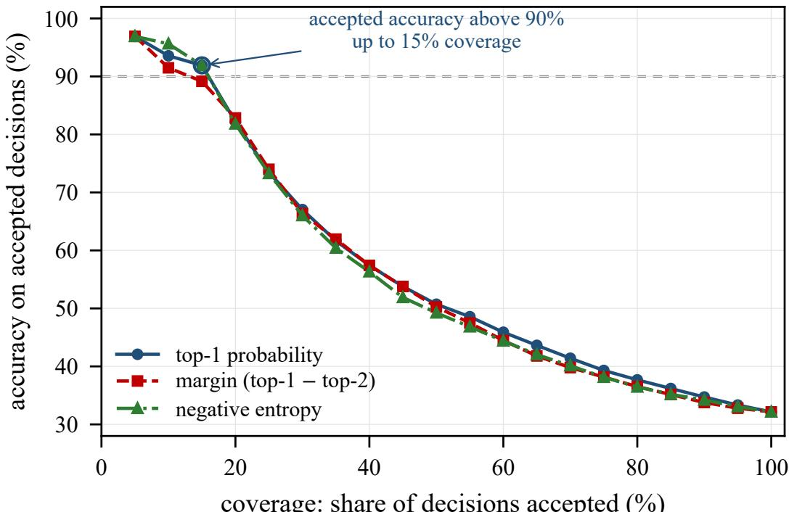  
coverage: share of decisions accepted (%)  
Figure 8: Accept-or-escalate frontier of the fine-tuned typed encoder on the held-out fold, under three confidence rules. Accepted accuracy stays above 90% up to 15% of coverage, then falls towards the accuracy of the whole fold as coverage approaches one. The three rules trace nearly the same curve, so the frontier reflects the state rather than the choice of score.

E25e: what a deployment should do with this. Three operating points follow from the two sections, and they are meant to be read together. Inside the graph, route with the typed encoder and accept its decision: one forward pass, no generated text, 19.5 ms per decision in the typed-choice form and 10 ms for the encoder pass the replay uses. At the top of the confidence ranking, accept a band rather than the whole fold: 15% coverage holds 91.9% agreement. Return the rest, because the realised hop lies outside the declared options for 7.9% of decisions and outside the model’s top twenty for 9.3%, so a budget under 20% covers both measures. Returning a decision is escalation, and its price is measured: on the replay stream the accept/escalate hybrids agree with the reference on 20.9% / 19.1% / 16.5% of decisions at escalation rates of 74.1% / 80.2% / 85.0% (Table 5), below the pure readout’s 30.7% at zero calls, and the escalated remainder costs 2.2 s a decision, so an 85% budget moves mean decision time from 2.2 s to about 1.9 s. The band is a latency and load instrument rather than an agreement gain, and it assumes an escalation arm stronger than the zero shot stand-in these hybrids were measured against. Above that budget none of the remedies tested here applies: more self-training, more parameters and more deliberation each leave the ceiling where the state puts it. The escalation rule itself must carry per-state competence rather than confidence alone, since the confidence-gated cascade lost agreement at every threshold we tested.

Table 14: The gated self-training loop over eight rounds, held-out test fold. “admitted” counts the pool rows the arm added across all rounds, so the arms differ in both rule and volume; the third row is the volume-matched random control for the first. “edges” is the number of distinct forward transitions in the induced graph at round 8. “90% cov.” is the largest fraction of decisions that can be accepted while holding accepted accuracy above 90%. The last two rows are not loop arms: they bracket it from below and above. The four loop rows are seed 0; three-seed means and the seed spread are given in the text.
<table><tr><td>acquisition arm</td><td>admitted</td><td>edges</td><td>acc. (%)</td><td>in-space (%)</td><td>90% cov.</td><td>@20% cov.</td></tr><tr><td>label-free gate</td><td>2,283</td><td>1,257</td><td>28.80</td><td>31.28</td><td>0.068</td><td>71.6</td></tr><tr><td>random, same cap (400/round)</td><td>3,200</td><td>1,543</td><td>29.29</td><td>31.81</td><td>0.070</td><td>73.3</td></tr><tr><td>random, volume-matched (280/round)</td><td>2,240</td><td>1,395</td><td>27.56</td><td>29.93</td><td>0.070</td><td>72.8</td></tr><tr><td>no typed model (frequency backoff)</td><td>4,800</td><td>1,741</td><td>25.91</td><td>28.14</td><td>0.001</td><td>63.5</td></tr><tr><td>seed buffer only, no rounds</td><td>0</td><td>1,015</td><td>28.18</td><td>30.61</td><td>0.153</td><td>74.8</td></tr><tr><td>full supervised train fold</td><td>12,613</td><td></td><td>32.15</td><td>34.92</td><td>0.150</td><td></td></tr></table>

## 9 LIMITATIONS AND DISCUSSION

Replay evaluation. The held-out logs are a realized environment, not a live one: policies are scored against the deployed fleet’s own choices (teacher-forced scoring, strict survival and per-wrong-hop gap costs), so a policy that would improve on the reference cannot demonstrate that improvement here—agreement with the fleet at a fraction of its decision cost is the claim. Closed-loop rollouts with tool results reattached (this needs a fuller export than the stripped one described here) are the natural next step. The graph-free comparison that scores every catalog action as one flat option space is run here (E9, Reproducibility): the flat catalog loses 3.5 points and a size-matched globalfrequency space loses 1.4 points, so restricting candidates per node is load-bearing, but a nodeconditioned space built from per-node train statistics without graph traversal matches the graphdeclared space within noise (+0.1 points, 95% trace-clustered CI [0.0, +0.3]). The induced graph’s measured value here is therefore as a construction that yields node-conditioned option sets, not as a traversal whose specificity this data can resolve. Derived labels. Task outcomes come from the close-out convention (§5): the convention is machine-checkable and checked against an assistant’s manual session-log re-reading (30/30), but it certifies declared completion, not the semantic quality of the report text—which the export strips. The unconstrained-judge failure mode we quantify (38.5% agreement when the judge expects report text in a field that never carries it) is a caution for LLM-judge pipelines generally: calibrate against a manual session-log re-reading, not against another judge. Scope of the claims. We evaluate a decision layer over logs that already exist. Authorization, retention and re-identification boundaries of the underlying sessions, the human review roles around them, change management for catalog updates, and the explicability a planner needs when it cannot verify its own outputs are properties of the deployment that produced the logs; we do not measure them, and our audit statements are limited to what the export can show (which, as noted above, includes no separate human auditor in the loop). State reconstruction. Tool result bodies and chat bodies are absent from the export (the tool-result field is null in all 22,192 tool records; call arguments survive, below), so the router’s context is structural (labels, ordering). Two result-adjacent families do survive in the export and go unused in the main pipeline—per-call latency (100% of tool calls) and the call arguments (98.9%)—so their contribution is already measurable without the payloads: an artifact-shape-verified reproduction of the §6 feature-MLP CE+Brier arm scores 32.7% masked agreement, and appending prefix-latency / latency-plus-argument-shape features adds +0.4 / +1.3 points (five seeds, feat lat results.json, Reproducibility)—a small but real measured gain that stops this limitation’s prediction being an untested assertion. Domains and slices. One security-operations deployment, four stage slices; the protection-stage zero close-out rate (App. A) means slice comparisons conflate routing behavior with pipeline role. Edge IDs. The per-edge identifiers do not beat the class-space readout at the SOC catalog size with our shallow state features—the small API-Bank set and the 351-name ToolBench-eval subset are the material small-catalog reversals (§6, Figure 10)—and the natural counter—that verdict being a small-catalog artifact—is now tested: a controlled catalog-size sweep on the 7,318-name ToolBench catalog (Figure 10, App. B) holds recipe and features fixed while shrinking the option vocabulary to the top-C actions by train frequency (C, the kept catalog budget). The row-filtered sweep gives a class advantage of net +0.9 points at C=154 to +1.3 at C=6,750 (a dip to +0.6 at C=512). That sweep keeps only rows whose current action and target both lie inside top-C, so the scored subset itself shrinks with C—by up to 65.5% of rows at the narrow budgets. Re-running it on afixed row set (out-of-catalog goals masked to an always-offered unknown class) leaves the shape intact and the gap smaller: net +0.5 points at C=154 to +1.2 at C=6,750 (a dip to +0.3 at C=512) over strictly paired candidate lists—identical options for both arms on rows whose target lies on that list; charging each arm for the options it cannot name instead flips the sign at the two narrow budgets (−1.8, −1.2). The class-space advantage therefore ends wider across the sweep (non-monotonically) and, in the row-filtered and paired means, never crosses over on the measured axis (top-C up to 6,750; outside the noise-level ties, the charging-convention flips above and the contrary small-catalog slices—the evaluation subset at its 275-name training catalog and API-Bank—are the exceptions disclosed in Figure 10): even at the widest tested budget (C=6,750, 43.8× the SOC’s 154 option names), a shared class vocabulary is the better parameterization of the next-hop choice. The edge-ID variant may still pay where option names carry no meaning (Sun et al., 2026b)—that regime remains open. Scope. The readout has no mechanism for multi-step internal search (the single-pass design of Cheng et al. (2026) likewise cannot carry intermediate results through); long detours are delegated to the graph and to LLM escalation at genuine unknowns. All typed-model timing is batch-1 GPU wall clock (NVIDIA H20, App. B) except the in-vivo zero-shot pipeline, measured on CPU; service and judge latencies are measured in vivo under production load and vary with it.

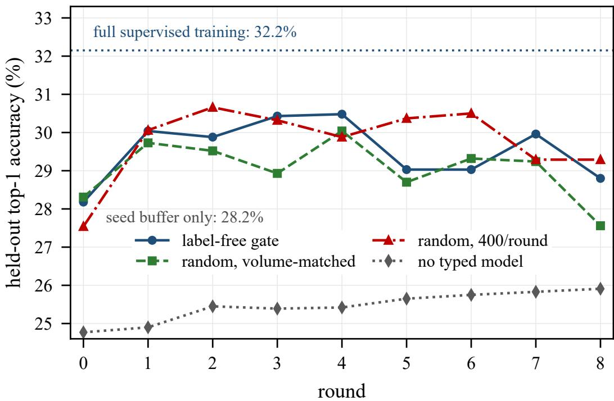  
Figure 9: Held-out top-1 accuracy of the typed encoder over eight rounds of gated self-training, for four acquisition rules. The three typed arms plateau between 29% and 31% and end below their own peak; the model-free arm climbs steadily from a lower floor and never reaches them. The dashed line is full supervised training on the same fold, at 32.15%, which no arm reaches. Round 0 is each arm’s own anchor set, so the starting points differ slightly (seed 0; the round-0 spread over seven runs is 1.9 points).

Data availability and governance. The logs behind §6 are production security-operations records of a deployment that is not ours to release, and no human-subjects data were collected for this study. The derived, non-identifying artifacts that back every reported number—frozen per-decision predictions, the aggregation and audit scripts, and the per-experiment receipts—can be made available on request. The public bundle is sufficient to re-derive every corpus-level aggregate reported here—episode, session, split and per-slice counts, the held-out option-space mean and its 3,568- of-3,875 coverage, the catalog size and the fold-event totals—while the pre-fold trace count, the semantic families and the model-level results require the internal export. Authorization, retention and re-identification boundaries, the human review roles around the sessions, and catalog change management remain properties of the deployment that produced the logs: what this paper states about them is limited to what the stripped export can show, and nothing here should be read as a governance assessment of that deployment.

## 10 CONCLUSION

Logs already contain an organization’s workflow knowledge; NIOCIS turns them into a graph whose transition set runs a long tail and whose node vocabulary converges at rates a zero-parameter occupancy null already predicts (E1), and pairs it with a typed router that reads next-hop decisions off that graph in one forward pass, escalating only its own uncertainty to the slow, expensive path. The loop closes: every executed walk becomes gated training signal. On 1,615 production episodes the pieces separately hold—quantified node-vocabulary convergence of the induced action graph (E1); feature-MLP readouts reaching 32.8% agreement with the deployed fleet (35.6% within the declared space), with the hidden-state probe variant holding 30.7% at a 10 ms per-state encoder pass plus a linear head against 2.2 s LLM hops, and out-agreeing the re-prompted MIMO Pro V2.6 stand-in (tool-result-stripped, zero-shot) on the same states (E2–E3)—a transfer-floor comparison, not a capability ceiling: the stand-in is never fine-tuned. Route-level replay keeps the typed layer in the agreement/cost corner while exposing the accept/escalate hybrid’s calibration failure as a negative result (E3). A self-evolution loop’s rollback gate scores every candidate while the loop absorbs the flipped labels of one update batch (12% of that batch’s labels corrupted—about 0.3% of the 12,613- decision base) without firing rollback on the plotted seed-0 chain (E4). Across ten seeded chains the gate refuses 13 of the 40 candidate updates, in 6 of the 10 chains. An external replication runs the same fold over 60,613 public cases, where loop mass reaches 99.4% on an instrumented software session and 1.4% on traffic fines; node discovery flattens wherever catalogs are small (E5); NIOCIS’s decision construction carries over to a 7,318-name tool catalog, where a transition table isolates what the feature MLP contributes beyond order-≤3 memorized transitions; on the case streams an occupancy null shows node saturation is combinatorics, conditional on the observed label supports. The invitation is concrete: drop your logs into the fold pipeline and measure your own saturation curve.

## REPRODUCIBILITY STATEMENT

All model experiments run on the released pipeline in experiments/ inside an nvcr.io/nvidia/pytorch:26.03-py3 container on a remote host with 2× NVIDIA H20 (GPUs 0/1) against frozen artifacts in experiments/real/ (episodes.jsonl, e2 \*.jsonl, e1 saturation.json, e2 results.json, e2 layaprobe results.json, e2 laya results.json, gpu latency.json, e3 replay.json, e4 rsi.json, e8 slices.json, outcome labels v2.jsonl, outcome labels.jsonl, corpus census.json, e2 laya raw.json, pub e1 results.json, pub sweep results.json, pub coupon.json, pub markov results.json, e2 meta.json, e2 results cpu local.json, forensics stats.json, gold 30.json, audit sample.json,

outcome label summary.json, outcome label v2 summary.json,   
tool parse report.json, tool manifest.json, pub fetch manifest.json, e3 mimo stream.json and every public stream’s \* e2 results.json/\* e2 meta.json pair; the typed-choice feature tensor feats laya cls.npz, assembled from the sharded extraction passes by assemble feats.py, is a further frozen input). The eight stream names are apibank, bpi12, bpi17, helpdesk, receipt, roadtraffic, toolbench train and toolbench eval. The experiments/addendum/ artifacts   
(feat lat results.json, e4 rsi multi.json, pub sweep fixed results.json, e3 replay multi.json, e9 graph necessity.json,   
e9b node prior curkey.json, e9b node prior nodekey.json) are likewise frozen inputs (the E9/E9b option-space arms are produced by e9 graph necessity.py and e9b node prior.py, which read only the frozen feature tensor, the derived decision streams and the frozen probe reference, and which reconcile to e2 layaprobe results.json as a parity check), and tables/\*.tex and figure PDFs are regenerated from these artifacts by make tab corpus.py, render figs tabs real.py and render pub.py.

The raw corpus export is internal SOC telemetry and cannot be redistributed; the derived corpus joins the code release in pseudonymized form (release/)—the 154 action labels map to stable opaque codes, identifiers are hashed under a private salt, and tool-argument payloads and free-text rationales are stripped, with independent leak gates keeping the result clean (verify release.py); the label mapping and the salt are withheld together with the raw export. Two public-data chains extend the pipeline beyond the SOC corpus and re-run from a clean host with one command each: chain pub.sh (fetch → XES parse → fold statistics → tables/figures) and the tool-trajectory chain (pub tool fetch.py → pub tool parse.py → pub e2 build.py → pub e2 train.py, with the two analysis add-ons pub markov.py and pub coupon.py writing pub markov results.json and pub coupon.json); ev ery downloaded artifact is pinned by sha256 in its fetch manifest (App. B), and both pipelines fold through the identical rules (fold rules.py, imported by parse real corpus.py, pub e1.py and pub e2 build.py; e2 build.py carries the same rules as its original fold events), with a lineage self-test in pub e2 build.py asserting its decision construction agrees with the fold kind-for-kind. The JSONL schema and fold tooling document the rest of what a replication needs: parse real corpus.py consumes any Langfuse-style observations export; the derived-outcome rule of §5 is a pure function of the parsed call structure (labels, arguments and ordering), reproduced by label real v2.py on the internal episodes.jsonl; the derived outcomes ship precomputed (outcome labels v2.jsonl) because the release strips the argument payloads the rule reads. Models: MIMO Pro V2.6 and DS V4.1 Flash are production services behind our gateway (§5); Laya 0.3.21 is public (pypi package laya, checkpoint convaiinnovations/laya via ModelScope), loaded from a local snapshot. Seeded fits fix random state=0 and torch seeds 0–4; the hidden-state probe and the E4 refits train on the full 12,613-decision train split (plus, for the E4 refits, the batches accepted so far; an earlier 6,000-row subsample of the train split was retired before the reported runs; see the released e2 laya probe.py) and all arms evaluate on the full test split (3,875 decisions). Timing is wallclock batch-1 on GPU or in-vivo service latency and will vary by host and load. The one synthetic element (E4’s 12% corruption injection) is regenerated from its stated seed by the E4 script.

The code release and the pseudonymized derived corpus (release/) are available at https: //github.com/geilihan/niocis, with a per-file MANIFEST.sha256; the derived corpus is released under CC BY 4.0.

## REFERENCES

Arya Adriansyah, Boudewijn F. van Dongen, and Wil M. P. van der Aalst. Conformance checking using cost-based fitness analysis. In IEEE International Enterprise Distributed Object Computing Conference (EDOC), 2011. doi: 10.1109/EDOC.2011.12.

Ananto Nayan Bala and Faisal Muhammad Shah. Multi-agent routing as set-valued prediction: A WildChat benchmark and cost-aware evaluation. arXiv preprint arXiv:2606.28925, 2026.

Alessandro Berti, Sebastiaan van Zelst, and Daniel Schuster. PM4Py: A process mining library for Python. Software Impacts, 17:100556, 2023. DOI: 10.1016/j.simpa.2023.100556.

Joos Buijs. Receipt phase of an environmental permit application process (’WABO’), CoSeLoG project. Eindhoven University of Technology (4TU.ResearchData), dataset, 2014. DOI: 10.4121/uuid:a07386a5-7be3-4367-9535-70bc9e77dbe6.

Josep Carmona, Boudewijn van Dongen, Andreas Solti, and Matthias Weidlich. Conformance Checking: Relating Processes and Models. Springer, 2018. doi: 10.1007/978-3-319-99414-7.

Abhijit Chakraborty, Ni Trieu, and Vivek Gupta. Typed federated artifacts for the Agentic Web: Sharing tool-routing knowledge across frozen, heterogeneous LLM agents. arXiv preprint arXiv:2609.06815, 2026.

Lingjiao Chen, Matei Zaharia, and James Zou. FrugalGPT: How to use large language models while reducing cost and improving performance. arXiv preprint arXiv:2305.05176, 2023.

Zehua Cheng, Wei Dai, and Jiahao Sun. this-that-model-1.0: A typed decision model that decides in 30 ms, for a millionth of a cent. arXiv preprint arXiv:2609.23886, 2026.

Seonglae Cho, Franklin Cardenoso Fernandez, Umar Mohammed, Zekun Wu, Kleyton Da Costa, Ilham Wicaksono, and Adriano Koshiyama. Automata from agent traces: Failure and next-step prediction. arXiv preprint arXiv:2608.23670, 2026.

Massimiliano de Leoni and Felix Mannhardt. Road Traffic Fine Management Process. Eindhoven University of Technology (4TU.ResearchData), dataset, 2015. DOI: 10.4121/uuid:270fd440-1057-4fb9-89a9-b699b47990f5.

Liang Ding. AgentHER: Hindsight experience replay for LLM agent trajectory relabeling. arXiv preprint arXiv:2603.21357, 2026.

Tao Feng, Fangxu Yu, Haozhen Zhang, Zhongjie Dai, Liangqi Yuan, Zijie Lei, Weizhi Zhang, Kunlun Zhu, Haodong Yue, Keyang Xuan, Ge Liu, and Jiaxuan You. LLMRouter: Unified infrastructure for developing, evaluating, and deploying LLM routers. arXiv preprint arXiv:2608.06867, 2026.

Dawei Fu, Cheng Jiang, Sitian Qian, Huainan Wang, and Zhongkai Hao. SE-GoS: Self-evolving graph-of-skills for skill library at scale. arXiv preprint arXiv:2609.08228, 2026.

Yonatan Geifman and Ran El-Yaniv. Selective classification for deep neural networks. In Advances in Neural Information Processing Systems (NeurIPS), 2017. arXiv:1705.08500.

Saibo Geng, Martin Josifoski, Maxime Peyrard, and Robert West. Grammar-constrained decoding for structured NLP tasks without finetuning. In Proceedings of the 2023 Conference on Empirical Methods in Natural Language Processing (EMNLP), 2023. DOI: 10.18653/v1/2023.emnlp-main.674.

Chuan Guo, Geoff Pleiss, Yu Sun, and Kilian Q. Weinberger. On calibration of modern neural networks. In International Conference on Machine Learning (ICML), 2017. arXiv:1706.04599.

Yu Hao, Jinxuan Cai, Qi Zhang, Yawen Li, Zhiqiang Zhang, Chuan Shi, and Cheng Yang. HiSkill: Empowering LLM agents with hierarchical skill graphs. arXiv preprint arXiv:2607.25853, 2026.

Yucheng Jiang, Zora Zhiruo Wang, Ruishi Chen, and Diyi Yang. Inducing task models from computer-use traces. arXiv preprint arXiv:2608.20319, 2026.

Diederik P. Kingma and Jimmy Ba. Adam: A method for stochastic optimization. In International Conference on Learning Representations (ICLR), 2015. arXiv:1412.6980.

Humam Kourani, Gyunam Park, and Wil M. P. van der Aalst. Revealing inherent concurrency in event data: A partial order approach to process discovery. arXiv preprint arXiv:2509.15346, 2025.

Woosuk Kwon, Zhuohan Li, Siyuan Zhuang, Ying Sheng, Lianmin Zheng, Cody Hao Yu, Joseph E. Gonzalez, Hao Zhang, and Ion Stoica. Efficient memory management for large language model serving with pagedattention. In ACM Symposium on Operating Systems Principles (SOSP), 2023. DOI: 10.1145/3600006.3613165.

Maikel Leemans. Statechart Workbench and Alignments Software Event Log. Eindhoven University of Technology (4TU.ResearchData), dataset, 2018. DOI: 10.4121/uuid:7f787965-da13-4bb8-a3fd-242f08aef9c4.

Sander J. J. Leemans, Dirk Fahland, and Wil M. P. van der Aalst. Discovering block-structured process models from event logs – a constructive approach. In Application and Theory of Petri Nets and Concurrency (ICATPN), 2013. DOI: 10.1007/978-3-642-38697-8 17.

Delong Li, Xu Wang, Haochen Gong, Rui Lang, and Guangsheng Yu. Replacing large language models with Jev decision models for low-latency edge service orchestration. arXiv preprint arXiv:2609.22753, 2026a.

Jialong Li and Jialing Zhu. Auditing self-evolution in financial agents: Capability gains, security drift, and execution-interface mismatch. arXiv preprint arXiv:2608.17684, 2026.

Jisen Li, Bingxuan Li, Nanyi Jiang, Xuying Ning, Xiyao Wang, Yifan Shen, Heng Wang, Yuqing Jian, Xiaoxia Wu, Ben Athiwaratkun, Pan Lu, Jiaxuan You, and Bingxin Zhao. Multi-turn agentic scientific literature search via workflow induction. arXiv preprint arXiv:2607.00597, 2026b.

Minghao Li, Yingxiu Zhao, Bowen Yu, Feifan Song, Hangyu Li, Haiyang Yu, Zhoujun Li, Fei Huang, and Yongbin Li. API-Bank: A comprehensive benchmark for tool-augmented LLMs. In Proceedings of the 2023 Conference on Empirical Methods in Natural Language Processing (EMNLP), 2023. arXiv:2304.08244.

Yubo Li, Yidi Miao, Ramayya Krishnan, and Rema Padman. JEV-as-a-judge: Accept when confident, escalate when unsure. arXiv preprint arXiv:2609.26550, 2026c.

Zhiyuan Li, Linyuan Gao, Xuechun Ding, Hongwei Chen, Yuan Wu, and Yi Chang. CaSKG: Counterfactual-causal skill graphs for scalable agent skill retrieval. arXiv preprint arXiv:2608.25500, 2026d.

Xinchen Liu, Hang Zhou, Yingjie Zong, Yuchuan Tian, Liuyang Song, Shuo Zhang, Yulong Li, Wei He, Mengyu Zheng, Runke Liu, Siyang Cheng, Xiang Kuang, Hailin Hu, Kai Han, and Yunhe Wang. Agentic routing: The harness-native data flywheel. arXiv preprint arXiv:2607.11399, 2026.

Zuxin Liu, Thai Hoang, Jianguo Zhang, Ming Zhu, Tian Lan, Shirley Kokane, Juntao Tan, Weiran Yao, Zhiwei Liu, Yihao Feng, Rithesh Murthy, Liangwei Yang, Silvio Savarese, Juan Carlos Niebles, Huan Wang, Shelby Heinecke, and Caiming Xiong. Apigen: Automated pipeline for generating verifiable and diverse function-calling datasets. arXiv preprint arXiv:2406.18518, 2024.

Yifan Lu, Qiyue Zhang, Shenrun Zhang, Zhibo Yu, Zhuang Wang, Hanjie Chen, and Jiarong Xing. The routing plateau: Understanding and breaking the accuracy limits of LLM routers. arXiv preprint arXiv:2606.07587, 2026.

Weiyu Ma, Liangbing Zhao, Yongcheng Zeng, and Jian Zhao. JEV-Star: Fast, low-cost StarCraft II control with language-model planning. arXiv preprint arXiv:2609.27331, 2026.

Felix Mannhardt. Sepsis Cases - Event Log. Eindhoven University of Technology (4TU.ResearchData), dataset, 2016. DOI: 10.4121/uuid:915d2bfb-7e84-49ad-a286-dc35f063a460.

NeoHorse Team, Guoliang Cao, Guohao Dai, Tianyu Guo, Kai Han, Hailin Hu, et al. NeoHorse-1: Towards recursive self-improvement via agentic post-training with routing harness. arXiv preprint arXiv:2609.08183, 2026.

Hoang Nguyen, Xiaohao Xu, and Xiaonan Huang. Latent geometry beyond search: Amortizing planning in world models. arXiv preprint arXiv:2605.08732, 2026a.

Michael Nguyen, Quoc Nguyen, and Paul Vuong. Recursive self-evolving agents via held-out selection. arXiv preprint arXiv:2606.28374, 2026b.

Isaac Ong, Amjad Almahairi, Vincent Wu, Wei-Lin Chiang, Tianhao Wu, Joseph E. Gonzalez, M Waleed Kadous, and Ion Stoica. RouteLLM: Learning to route LLMs with preference data. arXiv preprint arXiv:2406.18665, 2024.

Melissa Z. Pan, Negar Arabzadeh, Mathew Jacob, Fiodar Kazhamiaka, Esha Choukse, and Matei Zaharia. Natural language query to configuration for retrieval agents. arXiv preprint arXiv:2605.27361, 2026.

Rudrendu Kumar Paul and Sourav Nandy. AgentRouter: Heterogeneous model routing for cost-optimal multi-step agentic workflows. arXiv preprint arXiv:2609.22951, 2026.

Mirko Polato. Dataset belonging to the help desk log of an Italian Company. University of Padova (4TU.ResearchData), dataset, 2017. DOI: 10.4121/uuid:0c60edf1-6f83-4e75-9367-4c63b3e9d5bb.

Dean A. Pomerleau. Efficient training of artificial neural networks for autonomous navigation. Neural Computation, 3(1), 1991. DOI: 10.1162/neco.1991.3.1.88.

Yiyu Qian, Liyuan Zhao, and Tim Miller. M2-PALE: A framework for explaining multi-agent MCTS–Minimax hybrids via process mining and LLMs. arXiv preprint arXiv:2604.14687, 2026.

Yujia Qin, Shihao Liang, Yining Ye, Kunlun Zhu, Lan Yan, Yaxi Lu, Yankai Lin, Xin Cong, Xiangru Tang, Bill Qian, Sihan Zhao, Lauren Hong, Runchu Tian, Ruobing Xie, Jie Zhou, Mark Gerstein, Dahai Li, Zhiyuan Liu, and Maosong Sun. ToolLLM: Facilitating large language models to master 16000+ real-world apis. arXiv preprint arXiv:2307.16789, 2023.

Simiao Ren, Kidus Zewde, Xingyu Shen, Yuchen Zhou, Dennis Ng, Ankit Raj, Tommy Duong, Yuxin Zhang, and Neo Tiangratanakul. Open-Jev judgments on CallScreenBench: Calibrated one-pass scam screening with a small language model. arXiv preprint arXiv:2609.23959, 2026.

Ziqiao Shang, Ling-Yue Ge, and Lan-Zhe Guo. GraphSkillAA: Attribution-guided skill-graph updating with targeted validation and rollback. arXiv preprint arXiv:2609.20455, 2026.

Noah Shinn, Federico Cassano, Ashwin Gopinath, Karthik Narasimhan, and Shunyu Yao. Reflexion: Language agents with verbal reinforcement learning. In Advances in Neural Information Processing Systems (NeurIPS), 2023. doi: 10.48550/arXiv.2303.11366.

Rui Sun, Zhi Zheng, Zhenkun Wang, and Zhichao Lu. GraphSkillEvo: Evolutionary optimization of graph-structured agent skills. arXiv preprint arXiv:2609.21749, 2026a.

Yu Sun, Junhao Xu, Jiajia Shi, and Zijin Yang. Type-safe is not error-free: A constrained decision head follows the option name, not the rubric bound to it. arXiv preprint arXiv:2609.26758, 2026b.

Richard S. Sutton, Doina Precup, and Satinder Singh. Between MDPs and semi-MDPs: A framework for temporal abstraction in reinforcement learning. Artificial Intelligence, 112, 1999. DOI: 10.1016/S0004-3702(99)00052-1.

Leah Tacke genannt Unterberg, Lisa L. Mannel, and Wil M. P. van der Aalst. Monotonicity-guided bottom-up Petri net discovery: The SPECpp framework. arXiv preprint arXiv:2608.09398, 2026.

Niek Tax, Ilya Verenich, Marcello La Rosa, and Marlon Dumas. Predictive business process monitoring with LSTM neural networks. In Advanced Information Systems Engineering (CAiSE), 2017. DOI: 10.1007/978-3-319-59536-8 30.

Wil M. P. van der Aalst. Process Mining: Data Science in Action. Springer, 2016. DOI: 10.1007/978-3-662-49851-4.

Boudewijn van Dongen. Real-life event logs - Hospital log. Eindhoven University of Technology (4TU.ResearchData), dataset, 2011. DOI: 10.4121/uuid:d9769f3d-0ab0-4fb8-803b-0d1120ffcf54.

Boudewijn van Dongen. BPI Challenge 2012. Eindhoven University of Technology (4TU.ResearchData), dataset, 2012. DOI: 10.4121/uuid:3926db30-f712-4394-aebc-75976070e91f.

Boudewijn van Dongen. BPI Challenge 2017. Eindhoven University of Technology (4TU.ResearchData), dataset, 2017. DOI: 10.4121/uuid:5f3067df-f10b-45da-b98b-86ae4c7a310b.

Guanzhi Wang, Yuqi Xie, Yunfan Jiang, Ajay Mandlekar, Chaowei Xiao, Yuke Zhu, Linxi Fan, and Anima Anandkumar. Voyager: An open-ended embodied agent with large language models. arXiv preprint arXiv:2305.16291, 2023.

Zora Zhiruo Wang, Jiayuan Mao, Daniel Fried, and Graham Neubig. Agent workflow memory. arXiv preprint arXiv:2409.07429, 2024.

Benjamin Warner, Antoine Chaffin, Benjamin Clavie, Orion Weller, Oskar Hallstr´ om, Said¨ Taghadouini, Alexis Gallagher, Raja Biswas, Faisal Ladhak, Tom Aarsen, Griffin Thomas Adams, Jeremy Howard, and Iacopo Poli. Smarter, better, faster, longer: A modern bidirectional encoder for fast, memory efficient, and long context finetuning and inference. In Proceedings of the 63rd Annual Meeting ofthe Associationfor Computational Linguistics (ACL), 2025. DOI: 10.18653/v1/2025.acl-long.127.

Tiantong Wu and Wei Yang Bryan Lim. REFLEX with Jev for efficient selective control in LLM agents. arXiv preprint arXiv:2609.26532, 2026.

Shuhan Xue, Jianyuan Zhong, Ziyuan Nan, Wenbin Li, Zhaochen Yu, Jinchao Ding, Qiang Gao, Pengyu Zhan, Yuntong Zhang, Tian Cheng, Zhenfei Yin, Yingcheng Wu, and Ling Yang. ScienceBuddy: Recursive-in-recursive self-improvement for interactive scientific agents. arXiv preprint arXiv:2609.17523, 2026.

Kaisen Yang, Zheng Jiang, Yuzhao Peng, Houde Qian, Boshi Zhang, Youjie Zheng, Shijin Hong, Qingle Liu, Ruoyu Han, Bohan Lyu, Bingxiang He, Eren Cai, Calvin Xiao, and Qinhuai Na. Scalable behaviour cloning on browser using via skill distillation. arXiv preprint arXiv:2606.32014, 2026.

Shunyu Yao, Jeffrey Zhao, Dian Yu, Nan Du, Izhak Shafran, Karthik Narasimhan, and Yuan Cao. ReAct: Synergizing reasoning and acting in language models. In International Conference on Learning Representations (ICLR), 2023. doi: 10.48550/arXiv.2210.03629.

Tong Zheng, Xidong Wu, Zheng Zhang, Zhankui He, Chaoyi Zhang, Benjamin Coleman, Ruoqiao Wei, Di Bai, Haolin Liu, Rui Liu, Xue Wang, Yue Zhuan, Wang-Cheng Kang, Renkai Xiang, Heng Huang, Xinwu Cheng, and Yunsong Guo. Dream-RSI: Recursive self-improvement through evolving worlds. arXiv preprint arXiv:2609.14858, 2026.

## APPENDIX A: FOLD STATISTICS OF THE PRODUCTION CORPUS

The fold of §4 decomposes the 22,192 logged tool calls into 15,704 advance (forward) hops and 6,488 loop events (29.2% of steps). The 4,124 retry events arrive in 2,164 same-label repeat runs (a run of k ≥ 2 consecutive identical labels contributes k − 1 retry events, so the length classes sum to 2,164 runs, contributing 4,124 retry events): 1,394 runs of length 2 (median length 2), a smooth decay (354 of length 3, 147 of length 4, 102 of length 5) and a thin tail of 167 runs of lengths 6 to 20 (20 consecutive same-label steps at the maximum). The 2,364 back events return to an earlier kept label at short-but-real distances (steps between the target’s previous occurrence and the return): 681 at ≤1, 666 at 2–3, 553 at 4–8, 464 at 9+. Pair roles across the fold: 2,315 distinct pairs fire as first-visit forward transfers, 702 as returns (481 in both roles, 221 exclusively returns). Domain slices carry distinct closure behavior: detection closes 1,001/1,174 episodes (85%), response 62/245 (25%), recognition 7/54 (13%), protection 0/139—protection-stage sessions in this window hand off to sibling stages rather than declare completion (a real stage-behavior property of the deployment, not a labeling artifact; the derived labels and their validation are in §5). The one synthetic element is E4’s corruption model: round 3 flips 12% of update labels to a uniformly drawn non-target option— the draw is seeded by the script’s per-round RNG (RandomState(100+round), i.e. 103 for round 3)—a deliberate stand-in for upstream policy regressions. The multi-chain study quoted in the E4 figure caption runs ten refit chains: five coupled seed offsets (the torch init, the corruption draw and the validation-split permutation all shifted together) run as two 5-chain arms—one under the row-level stream split (seed offsets 0/1000/2000/3000/4000) and one under the whole-trace split (1000–5000; four of the five offsets shared). Each chain makes four candidate updates, so the study reports 13 refusals in 40 attempts over 6 of the 10 chains, with held-out accuracy averaging 30.3% → 31.0% (±0.5 points) and an unpaired 0.02-point gap between the arms (0.09 points on the four shared offsets). Three of the ten chains dip below their previous committed score mid-study (two of those below their base fit) before recovering; every chain ends at or above its base fit. Results are in e4 rsi multi.json (Reproducibility).

## APPENDIX B: SERVICES AND STATISTICAL DETAILS

The opponent (MIMO Pro V2.6) and the judge (DS V4.1 Flash) are served through our production gateway (vLLM backend; both are reasoning models that emit reasoning traces; decoding at temperature 0 with a 2,048-token completion budget). In-vivo call latencies appear in §6; smoke probes on tiny next-hop prompts run at p50 0.5 s (MIMO Pro V2.6) and 0.45 s (DS V4.1 Flash), growing with prompt and reasoning length (episode-level judge calls in §5 ran at p50 2.0 s, p90 5.6 s). The typed encoder’s backbone is Laya 0.3.21 with the convaiinnovations/laya checkpoint (ModernBERT-large encoder; marker-position decision head; an accept/escalate head with cost ratio escalate 0.5 versus wrong 3.0—matching the gap metric’s $c _ { 3 } { = } 3$ wrong-hop weight, which does not price escalations). Its shipped per-bucket decision temperatures include one out-of-range entry (choice:11+ = 0.1, outside the library’s stated [0.5, 5] range), so reported confidences use a scalar temperature refit by validation NLL for the zero-shot arm (all trained arms report raw maskedrenorm confidence). That refit is unbounded: its optimum sits at whatever ceiling the grid imposes— T=3.0 on the published eight-point grid and still T=1000 on a 60-point grid spanning 0.3–1000—so the arm’s ECE-15 is grid-dependent (0.031 against 0.010) while its argmax and risk–coverage curve are unchanged. The hidden-state probe attaches a linear head to the encoder’s designated readout position—the pooled position the checkpoint’s own action head reads—and trains with CE versus CE-plus-Brier (Adam Kingma & Ba, 2015, 90-epoch fits for both objectives, batch 512—the released e2 laya probe.py defaults) on the full 12,613-decision train split, with 5 seeds (0–4) for error bars (the feature-MLP readouts use 60-epoch fits over these seeds; the E4 and slice refits reuse the probe’s frozen encoder features with 60-epoch fits). Trained readout time budgets: feature arms fit in seconds on CPU; the probe’s one-time encoder extraction covers the full train/test splits (12,613 + 3,875 decisions) in 512-text chunks on GPU (throughput is host-specific). Model latency is wall-clock batch-1 on one NVIDIA H20 (in the nvcr.io/nvidia/pytorch:26.03-py3 container): typed-choice head predict 19.5 ms p50 (encoder included) over 17 declared options, the measured prompt’s count (50 warm trials; held-out states declare 40.2 options on average), bare encoder forward 10.0 ms p50 (the probe’s marginal per-state cost), and, in vivo and on CPU, 0.30 s p50 per state for the full Laya typed-choice pipeline (the zero-shot arm) (gpu latency.json, e2 laya results.json); service latencies vary under production load.

Public corpus provenance (E5). Six event logs, fetched 2026-09-29 from their canonical hosts (some via pinned mirrors) and pinned by sha256 (pub fetch manifest.json): receipt, roadtraffic and helpdesk (pm4py-core test fixtures Berti et al., 2023 via the gh-proxy mirror), BPIC’12 (pm4py bpic2012.xes.gz), BPIC’17 and the Statechart Workbench software session (the 4TU file service; session log of Leemans (2018)). The tool-trajectory arm uses API-Bank (Li et al., 2023) (263 scenario files from AlibabaResearch/DAMO-ConvAI) and ToolBench (Qin et al., 2023) toolllama G123 dfs chains (Adorg/ToolBench mirror on hf-mirror.com; 300 eval and 26,999 train trajectories), sha256-pinned in tool manifest.json. Two candidate corpora were deliberately dropped rather than approximated—Zenodo discovery only surfaced a course homework scaffold for the Sepsis cases log of Mannhardt (2016) and a paper’s inputs.zip bundle for BPIC’11 (2011 BPI Challenge van Dongen, 2011)—and the xLAM 60k function-calling corpus (Liu et al., 2024) stays behind a HuggingFace LFS gate that denies anonymous fetches; no domestic mirror hosts that corpus. All three are simply absent: a missing row beats uncertain lineage. A buildercorrection ledger accompanies the pipeline: URLs are verified against host APIs before hardcoding; extension-less 4TU links are typed by content magic; Content-Length and full gzip/zip integrity checks caught two silently truncated downloads (17.6 MB of 29.7 MB and 6.8 MB of 147 MB)

class margin over edge-ID vs catalog size  
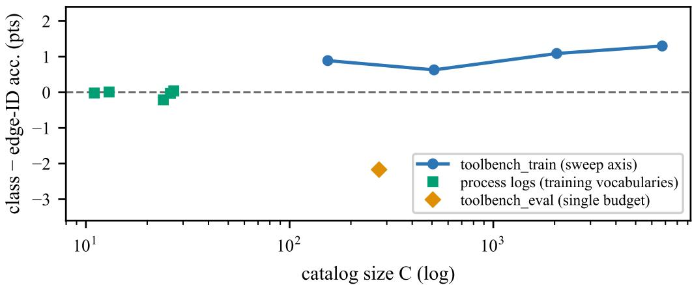  
Figure 10: Class-space margin over the edge-ID readout versus catalog budget (top-C trainfrequency actions; masked accuracy, 3 of the 5 protocol seeds: both arms are refit at every budget point under pub sweep.py’s seeds-0/1/2 convention; the main-text reading and exception accounting are in §6 and App. B). The 7,318-name ToolBench catalog (Qin et al., 2023) provides the only multi-budget axis: the class vocabulary’s margin is non-monotone but ends wider (never crossing zero in the plotted 3-seed means; per-arm seed standard deviations stay under 0.7 points; net figures in text)—the opposite of the edge-pays-at-scale prediction. Squares mark the five process logs at their 11–27-name training vocabularies (noise-level ties); the single diamond is the evaluation subset at its 275-name training catalog, the only plotted contrary slice (2.2 points to edge IDs over 92 of its 161 held-out hops, scored in-catalog—2.4 points on the fixed-row paired rerun). API-Bank is a second small-catalog reversal (1.7 points to edge IDs under the paired convention of the fixed-row rerun—one whose 335-row training fold sits below that sweep’s own floor and whose paired gap is one-seed-driven, per-seed differences 0.0/0.0/5.2 points—and 3.5 points on unrounded means in the CE-arm pair of the main API-Bank runs, §6).

before any number was computed from them; per-URL watchdogs guard against resolver hangs; and an XES trace-ID fallback covers software logs (which label traces concept:instance, not concept:name). Every reported number travels through verified, integrity-checked local copies.

Transition-table baseline. Contexts over the traced node flow (orders 0–3) are counted on the training fold of each of the nine decision streams (SOC; API-Bank, BPIC’12, BPIC’17, helpdesk, receipt, roadtraffic and the two ToolBench streams); each order interpolates down to the training marginal with a cascading weight $\lambda = w _ { \mathrm { r e m } } n _ { \mathrm { c t x } } / ( n _ { \mathrm { c t x } } + 3 ) ( w _ { \mathrm { r e m } } ;$ weight left unspent by higher orders, cascading $3 \substack {  } 2 \substack {  } \bar { 1 }$ , residue to the training marginal) and the argmax is restricted to the declared options (the deployed masked-renorm gate). Two scorings bracket each stream. The verbatim majority arm (raw per-node argmax)—scored raw and option-masked (a hit only when the argmax lands in the options)—recovers the §5 majority arm to the digit and matches every other stream’s identically-built look-up-table (LUT) arm exactly; the interpolated tables (an interpolated n-gram with backoff semantics—the backoff Markov) gate before scoring. For the majority arm, test accuracy equals its option-masked accuracy on all nine streams (pub markov results.json): option-gating never removes a correct majority prediction. The label catalog is treated as known (the class index covers every corpus label, held-out names included, so no action target is out of vocabulary). The public row encoding would bucket one at $\mathtt { < } \mathtt { { s t } \circ \mathtt { p } > }$ , and the edge-ID arms map training-fold-unseen edge targets to <unk edge>; option sets and edge identifiers come from the training fold only.

Occupancy-null computation. The dashed occupancy null of Figure 7a evaluates $\mathbb { E } [ D ( m ) ]$ at the same subsample sizes from per-label case supports alone—no fitted parameters (pub coupon.json); its p50-versus-expectation comparison carries two residual components by design: the 20-draw median sampling noise of the panels and any mean-versus-median mismatch $( \mathbb { E } [ D ( m ) ]$ need not equal the p50).

Catalog-size sweep (the edge-pays-at-scale hypothesis, §9). pub sweep.py holds the fold, features and training procedure fixed while shrinking the option vocabulary to the top-C actions by train frequency, scoring only in-catalog decisions and rebuilding the option graph and edge vocabulary inside the catalog. Sweep budgets are bounded by each corpus’s training vocabulary: the five process logs contribute single points at their training vocabularies (11 to 27 names, $| \Delta | \overset { - } { \leq } 0 . 2 1$ points, noise-level ties) and ToolBench contributes the axis: the class-space readout beats the edge ID readout at every budget (C=154: 61.5% versus 60.6%; C=512: 54.3 versus 53.7; $C { = } 2 { , } 0 \bar { 4 } 8 { \colon }$ 47.6 versus $4 6 . 5 ; \dot { C } = 6 , 7 \dot { 5 } 0 ; 4 3 . 2$ versus 41.9). Training floors: the 335-row API-Bank training fold and the 154-name slice of the evaluation subset fall below the sweep’s 500-train/50-test guard, so those rows are skipped.

The induced graph read as a discovered model. For completeness we report the four standard discovery dimensions for the induced graph (§2), with conventions stated because they are convention-dependent: fitness is the share of traces whose every consecutive kept pair is a model edge, with a token-replay flavour (1 − unmatched pairs/pairs); precision is the escaping-edge form (ETConformance style: $\mathrm { ~ i ~ - ~ } \sum$ escaping $/ \sum$ enabled over trace prefixes, where escaping counts enabled outgoing edges not taken); generalization is the counting approximation (1 − mean 1/ visits over model elements); simplicity is reported as counts (143 nodes with outgoing edges, 2,517 edges—1,944 forward, 573 recovery—mean out-degree 17.6). The graph is induced from the train fold, so in-sample readings are degenerate by construction (trace- and token-level fitness 1.000); on held-out folds token-level fitness is 0.902 (val) and 0.913 (test, unmatched pairs $3 0 7 / 3 { , } 5 3 0 )$ , tracelevel fitness 0.621 and 0.591, escaping-edge precision 0.022 and 0.021, and generalization is 0.625 at node level against 0.267 at edge level. The permissive precision is structural: each state enables its entire declared option set $( | A ( \bar { v } ) | = 4 0 . 2 )$ , so precision tracks $1 / | A ( \bar { \upsilon } ) |$ |. No inductive-miner comparison is attempted, and these numbers are not offered as a process-discovery contribution.