# Nash-MOPD: Optimizing Task Trade-offs in Multi-Teacher On-Policy Distillation

Siyuan Gan<sup>1</sup>, Bo Yang<sup>1</sup>, Linjian Meng<sup>†2</sup>, Boyan Wang<sup>†1</sup>,

Xiaolong Qi<sup>3</sup>, Jing Huo<sup>1</sup>, Yang Gao<sup>1</sup>

<sup>1</sup>State Key Laboratory of Novel Software Technology, Nanjing University, Nanjing, China

<sup>2</sup>Shanghai Artificial Intelligence Laboratory, Shanghai, China

<sup>3</sup>Yili Normal University, Yining, China

gansiyuan@smail.nju.edu.cn, menglinjian@pjlab.org.cn, boyanwang@nju.edu.cn

## Abstract

Multi-teacher on-policy distillation (MOPD) aggregates the capabilities of multiple domainexpert teachers into a single student model. However, all domains in MOPD share the student’s finite budget of optimization steps and rollouts. Fixed uses constant domain sampling ratios based on corpus sizes; by contrast, D<sup>3</sup>-MOPD adjusts the ratios using the teacher–student reverse-KL divergence and its recent decrease. However, favoring large recent decreases can direct more training toward domains that already improve quickly, while domains that improve more slowly may receive too few examples. To address inflexible allocation and the risk of giving insufficient training to domains that improve more slowly, we propose NASH-MOPD, an adaptive domain scheduler based on a local minimax game using existing reverse-KL statistics. The equilibrium maximizes the smallest predicted proportional reduction under the local model and gives more prompts to domains that need more examples for comparable improvement. Consequently, NASH-MOPD responds to changing learning progress and supports domains that improve more slowly without extra teacher queries or rollouts. At step 100, NASH-MOPD exceeds both baselines’ final mathematics and code checkpoint scores on DeepSeek-R1-Distill-Qwen-1.5B and reaches Fixed’s on Qwen3-8B-Base. Furthermore, it leads eight of nine reported metrics and is best or tied best on all six mathematics and code accuracy metrics, respectively.

## 1 Introduction

Multi-teacher on-policy distillation (MOPD) aggregates the capabilities of multiple domain-expert teachers into a single student model, which is widely used in frontier model post-training (Zeng et al., 2026; DeepSeek-AI et al., 2026; Kimi Team,

2026; LLM-Core Xiaomi, 2026). During training, the student generates rollouts from prompts sampled across domains. The corresponding teacher then provides token-level supervision at studentvisited states, and the student is updated to minimize the reverse KL divergence from its next-token distribution to the teacher’s (Ma et al., 2026; Meng et al., 2026). However, all domains in MOPD share the student’s finite budget of optimization steps and rollouts. As a result, increasing one domain’s sampling ratio leaves fewer training examples for the others. MOPD therefore entails a multi-task trade-off, since the domain mixture must balance competing learning demands to develop diverse capabilities together. This allocation consequently shapes both convergence speed and the final accuracy achievable within the training budget.

Effective use of this shared budget requires accounting for differences in how the student learns across domains. As training proceeds, the student may learn some domains quickly while requiring more examples to learn others. Fixed uses constant domain sampling ratios based on corpus sizes, so it cannot adjust the allocation to these differences or their changes over time. By contrast, D<sup>3</sup>-MOPD adjusts the ratios using the teacher–student reverse-KL divergence and its recent decrease (Sun et al., 2026). However, favoring large recent decreases can direct more training toward domains that already improve quickly, while domains that improve more slowly may receive too few examples. We therefore need an adaptive scheduler that responds to changes in the student’s learning progress and provides sufficient training for domains that improve more slowly, so as to improve both convergence speed and final accuracy under the same training budget.

To address inflexible allocation and the risk of giving insufficient training to domains that improve more slowly, we propose NASH-MOPD, an adaptive domain scheduler based on a local minimax game. At each allocation update, NASH-MOPD uses existing reverse-KL statistics to estimate how much of the remaining teacher–student difference each domain reduces per sampled prompt. It then solves a local minimax game in which the sampler chooses domain sampling ratios and the adversary selects the domain with the smallest predicted proportional reduction. The equilibrium maximizes this minimum progress under the local model and gives more prompts to domains that need more examples for comparable improvement. Sampling bounds preserve domain coverage, while smoothing keeps successive allocations stable. Consequently, NASH-MOPD responds to changing learning progress and supports domains that improve more slowly without extra teacher queries or rollouts. Moreover, this allocation has a clear interpretation, since each domain’s sampling ratio reflects its estimated remaining training demand under the local model.

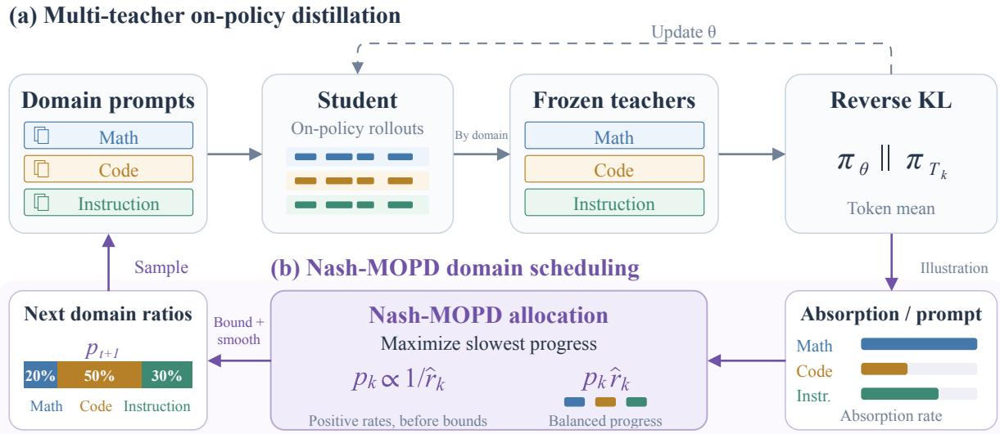  
Figure 1: Optimizing the multi-task trade-off with NASH-MOPD. Frozen domain-expert teachers supervise student rollouts; exposure-normalized progress estimates guide prompt allocation across domains.

To evaluate the effectiveness of NASH-MOPD, we conduct experiments with DeepSeek-R1-Distill-Qwen-1.5B across mathematics, code, and instruction following, and with Qwen3-8B-Base across mathematics and code. All methods use the same training pipeline and budget. On the DeepSeek-R1- Distill-Qwen-1.5B student, NASH-MOPD exceeds both baselines’ final mathematics and code checkpoint scores at step 100. On the Qwen3-8B-Base student, it reaches Fixed’s final mathematics and code performance at step 100, using 60 and 80 fewer optimization steps than Fixed and the original D<sup>3</sup>-MOPD baseline described in Section 5, respectively. Furthermore, NASH-MOPD leads eight of nine reported metrics on the DeepSeek-R1-Distill-Qwen-1.5B student and is best or tied best on all six mathematics and code accuracy metrics on the Qwen3-8B-Base student. These results demonstrate that NASH-MOPD outperforms both baselines in convergence speed and overall final accuracy across domains.

## 2 Related Work

On-policy distillation and capability integration. Reverse-KL and generalized knowledge distillation supervise students on their own responses (Gu et al., 2024; Agarwal et al., 2024). MOPD extends this to multiple teachers, routing rollouts to the corresponding domain teacher (Ma et al., 2026). We preserve its token-level supervision and adapt the probability of choosing each prompt domain.

Adaptive mixtures and multitask optimization. GradNorm and related approaches adapt task weights from gradient magnitude, loss evolution, or validation behavior (Chen et al., 2018; Guo et al., 2018; Sundararaman et al., 2021). DoReMi optimizes domain weights using a proxy-model objective (Xie et al., 2023). D<sup>3</sup>-MOPD is the closest setting: it repurposes per-domain reverse-KL to adjust the domain mixture (Sun et al., 2026). Its composite signal combines remaining gap and descent velocity; our inverse-rate rule estimates exposure needed for completion. Our original D<sup>3</sup>-MOPD baseline follows the published domain scheduling rule for allocating prompts across domains.

Games, fairness, and online feedback. Pareto multitask methods and Nash bargaining combine task gradients (Sener and Koltun, 2018; Navon et al., 2022). Nash learning from human feedback uses a zero-sum preference game (Munos et al., 2024). Here the adversary selects a domain bottleneck and the learner controls domain sampling ratios, so the players and payoff differ. GiGPO uses repeated states across existing trajectories to obtain finer credit signals for agent training (Feng et al., 2025); our controller similarly consumes observations already produced by training, but acts at the domain-mixture level. Neither gradient bargaining nor trajectory credit assignment directly supplies the exposure-based completion objective considered here.

## 3 Preliminaries

## 3.1 MOPD Framework

For each of K domains, let $\mathcal { D } _ { k }$ be its prompt distribution, $\pi _ { T _ { k } }$ its frozen domain-expert teacher, and $\pi _ { \theta }$ the shared student. Domain sampling ratios $p \in \Delta _ { K }$ satisfy $p _ { k } \geq 0$ and $\textstyle \sum _ { k } p _ { k } = 1$ . A batch of B prompts assigns approximately $B p _ { k }$ examples to domain $k ; e _ { k } ( t )$ counts cumulative prompt presentations, including repeated sampling.

MOPD extends on-policy distillation to multiple teachers (Ma et al., 2026). It samples $k \sim p .$ $x \sim \mathcal { D } _ { k }$ , and a student response y $\sim \pi _ { \boldsymbol { \theta } } ( \cdot \mid x )$ . At each student-visited state $s _ { t } = ( x , y _ { < t } )$ , the corresponding teacher supervises the student’s nexttoken distribution through reverse-KL (Gu et al., 2024; Agarwal et al., 2024):

$$
d _ { k , t } ( \theta ) = D _ { \mathrm { K L } } \big ( \pi _ { \theta } ( \cdot \mid s _ { t } ) \| \pi _ { T _ { k } } ( \cdot \mid s _ { t } ) \big ) .
$$

For domain labels $k _ { i }$ and non-padding response lengths $N _ { i }$ , the batch objective is

$$
\mathcal { L } _ { \mathrm { O P D } } ( \theta ) = \frac { \sum _ { i = 1 } ^ { B } \sum _ { t = 1 } ^ { N _ { i } } d _ { k _ { i } , t } ( \theta ) } { \sum _ { i = 1 } ^ { B } N _ { i } } .\tag{1}
$$

Each divergence is evaluated on prompt i’s rollout, which is held fixed during the update. Eq. (1) averages tokens; prompt shares need not equal tokenloss shares. Scheduling changes the prompt mixture, not teacher routing or loss weights.

## 3.2 Domain Allocation Variants

With $n _ { k }$ usable training rows, Fixed retains

$$
p _ { k } ^ { \mathrm { F i x e d } } = \frac { n _ { k } } { \sum _ { j } n _ { j } } .\tag{2}
$$

These corpus-based ratios cannot respond to changing learning progress.

$\mathbf { D ^ { 3 } - M O P D }$ adjusts ratios using normalized remaining reverse-KL $\bar { L } _ { k }$ and nonnegative descent velocity $v _ { k }$ , the recent relative KL decrease (Sun et al., 2026). With temperature $T > 0$ , the original method proposes

$$
\begin{array} { r } { c _ { k } = \bar { L } _ { k } v _ { k } , \qquad z _ { k } = c _ { k } / \operatorname* { m a x } _ { j } c _ { j } , } \\ { \tilde { p } _ { k } ^ { \mathrm { D } ^ { 3 } } = \displaystyle \frac { \exp ( z _ { k } / T ) } { \sum _ { j } \exp ( z _ { j } / T ) } . } \end{array}\tag{3}
$$

If all $c _ { k } = 0 .$ , the proposal is uniform; floors and caps preserve coverage. This adapts to progress, but favoring large recent decreases may undersample slowly improving domains. We use the original $\mathbf { D ^ { 3 } - M O P D }$ method; Appendix B.2 gives implementation details for its domain scheduling.

## 4 Method

To address inflexible allocation and insufficient training for domains that improve more slowly, NASH-MOPD solves a local minimax game using existing reverse-KL statistics. The equilibrium gives more prompts to domains that need more examples for comparable improvement. The controller maximizes the smallest predicted proportional reduction to support bottleneck domains. Online updates adapt to changing progress, while sampling ratios reflect each domain’s remaining training demand under the local model. Bounds and smoothing preserve domain coverage and stable allocations without extra teacher queries or rollouts. Algorithm 1 gives the complete training loop.

## 4.1 Exposure-Normalized Progress Signals

For each domain, the observed signal is mean per-token reverse-KL over non-padding student response tokens. We clip negative empirical estimates to zero and maintain an exponential moving average $L _ { k } ( t )$ with coefficient 0.2, initialized from the first valid observation. The reference scale $L _ { k } ^ { ( 0 ) }$ is the mean of the first five raw nonnegative observations, floored at $1 0 ^ { - 8 }$ . With target ratio $\rho = 0 . 1 0$ the normalized remaining gap is

$$
g _ { k } ( t ) = \bigg [ \frac { L _ { k } ( t ) - \rho L _ { k } ^ { ( 0 ) } } { ( 1 - \rho ) L _ { k } ^ { ( 0 ) } } \bigg ] _ { + } .\tag{4}
$$

This normalization accounts for differences in initial reverse-KL scales. Gaps may exceed one when divergence increases; zero indicates the KL target, not benchmark success. After the fifth observation, the gap history starts at one. We retain up to 11 exposure–gap pairs and use the oldest and newest records [t<sub>0</sub>, t<sub>1</sub>], spanning up to ten observed updates, to estimate

Algorithm 1 NASH-MOPD: online domain scheduling   
Require: Domain pools $\left\{ \mathcal { D } _ { k } \right\}$ , frozen teachers $\{ \pi _ { T _ { k } } \}$ , student $\pi _ { \boldsymbol { \theta } } ;$ batch size $B ; S$ updates   
Require: Sampling bounds $( \ell , u ) ;$ warm-up w; scheduling interval $h ;$ smoothing α; jitter $\gamma$   
1: Initialize $p$ from usable-row proportions and $s _ { \mathrm { l a s t } }  0$   
2: Initialize pool permutations/cursors, prompt exposures, reference KL scales, and EMA/gap histories   
3: for $s = 1 , \ldots , S$ do   
4: Draw $\eta _ { k } \sim \mathcal { U } [ - \gamma , \gamma ] ;$ set $\widetilde { p } _ { k } \gets p _ { k } ( 1 + \eta _ { k } ) / \sum _ { j } p _ { j } ( 1 + \eta _ { j } )$   
5: b ← LARGESTREMAINDER $( B \widetilde { p } )$ ; draw $b _ { k }$ prompts per domain, reshuffling exhausted pools   
6: Shuffle the batch; generate student rollouts and query $\pi _ { T _ { k } }$ at each domain-k prefix   
7: Compute the token-mean reverse-KL loss ${ \mathcal { L } } _ { \mathrm { O P D } } ;$ update exposures and KL statistics   
8: Estimate remaining gaps $g _ { k }$ and absorption rates $\widehat { r } _ { k }$ using Eq. (4)–(5)   
9: if statistics are ready, $s \geq w$ , and $s - s _ { \mathrm { l a s t } } \geq h$ then   
10: $\mathcal { A }  \{ k : g _ { k } > 1 0 ^ { - 3 } , \widehat { r } _ { k } > 1 0 ^ { - 8 } , \widehat { r } _ { k }$ is finite}   
11: Solve Eq. (9) for $p ^ { * }$ with the coverage fallbacks in Section 4.3   
12: $p  \Pi _ { \mathcal { P } } ( ( 1 - \alpha ) p + \alpha p ^ { * } ) ; s _ { \mathrm { l a s t } }  s$   
13: end if   
14: Update $\theta$ using L<sub>OPD</sub>; save controller, sampler, and random states for recovery   
15: end for   
16: return Student checkpoints and domain-scheduling traces

$$
\begin{array} { r l } & { \widehat { a } _ { k } ( t ) = \frac { \left[ g _ { k } ( t _ { 0 } ) - g _ { k } ( t _ { 1 } ) \right] _ { + } } { \operatorname* { m a x } ( e _ { k } ( t _ { 1 } ) - e _ { k } ( t _ { 0 } ) , 1 ) } , } \\ & { \widehat { r } _ { k } ( t ) = \frac { \widehat { a } _ { k } ( t ) } { \operatorname* { m a x } ( g _ { k } ( t _ { 1 } ) , 1 0 ^ { - 3 } ) } . } \end{array}\tag{5}
$$

Here $\widehat { a } _ { k }$ measures gap reduction per prompt, and $\widehat { r } _ { k }$ is the exposure-normalized absorption rate, or proportional reduction per prompt. Dividing by exposure separates progress due to receiving more prompts from progress per prompt; a zero estimate means no positive decrease was measured in the window. These statistics are collected from observations already available during ordinary distillation, without extra teacher queries or rollouts.

## 4.2 Local Minimax Allocation

At one allocation update, fix positive gaps $g _ { k }$ and finite positive per-prompt reductions $\textstyle a _ { k } ;$ let $r _ { k } = $ $a _ { k } / g _ { k }$ . The separable local model predicts $g _ { k } ^ { + }$ ≈ $g _ { k } - B p _ { k } a _ { k }$ , with proportional reduction $B p _ { k } r _ { k }$ If these rates remained fixed, the predicted number of updates needed to close every gap would be

$$
T _ { \mathrm { l o c } } ( p ) = \operatorname* { m a x } _ { k } { \frac { g _ { k } } { B p _ { k } a _ { k } } } = { \frac { 1 } { B \operatorname* { m i n } _ { k } p _ { k } r _ { k } } } .\tag{6}
$$

Minimizing Eq. (6) is thus equivalent to maximizing the smallest predicted proportional reduction. The sampler chooses $p ,$ while an adversary $q \in \Delta _ { K }$ selects a bottleneck domain:

$$
u ( p , q ) = \sum _ { k } q _ { k } p _ { k } r _ { k } , \operatorname* { m a x } _ { p \in \Delta _ { K } } \operatorname* { m i n } _ { q \in \Delta _ { K } } u ( p , q ) .\tag{7}
$$

In $\operatorname { E q . } \ ( 7 )$ , minimizing over $q$ for fixed $p$ gives min<sub>k</sub> $p _ { k } r _ { k }$ . With no binding sampling bounds, the unique maximizing allocation is

$$
p _ { k } ^ { * } = \frac { r _ { k } ^ { - 1 } } { \sum _ { j } r _ { j } ^ { - 1 } } = \frac { g _ { k } / a _ { k } } { \sum _ { j } g _ { j } / a _ { j } } .\tag{8}
$$

To see why, an allocation with minimum payoff m must satisfy $p _ { k } ~ \ge ~ m / r _ { k }$ . Summing yields m $\begin{array} { r l } { \le } & { { } ( \sum _ { k } r _ { k } ^ { - 1 } ) ^ { - 1 } } \end{array}$ ; Eq. (8) attains equality for every domain. The equilibrium therefore assigns prompts in proportion to estimated remaining training demand $g _ { k } / a _ { k }$ . A smaller positive rate requires more exposure to achieve comparable proportional improvement. This result concerns a frozen-rate local model, not guaranteed convergence of the nonlinear training trajectory. We re-estimate the rates online; Appendix A gives the saddle-point proof and bounded-allocation analysis.

The adversary serves to identify the current bottleneck, rather than introducing a trainable model. The controller computes the maximizing allocation directly from domain statistics. Scheduling therefore fits within the existing training loop, without alternating optimization between players.

## 4.3 Bounds, Smoothing, and Execution

Very small positive rates can produce extreme inverse-rate weights. We constrain base sampling ratios to $\begin{array} { r } { \mathcal { P } = \{ p : \sum _ { k } p _ { k } = 1 , \ell \leq p _ { k } \leq u \} } \end{array}$ with $\ell = 0 . 1 0$ and $u = 0 . 7 0$ . Feasibility requires $K \ell \ \leq \ 1 \ \leq \ K u$ . Let A contain domains with $g _ { k } > 1 0 ^ { - 3 }$ and finite $\widehat { r } _ { k } > 1 0 ^ { - 8 }$ . Inactive domains initially receive the floor ℓ. On the active set, bisection selects a scalar v such that

$$
\begin{array} { c } { p _ { k } ^ { * } = \displaystyle \mathrm { c l i p } ( v / \widehat { r } _ { k } , \ell , u ) , } \\ { \displaystyle \sum _ { k \in \mathcal { A } } p _ { k } ^ { * } = 1 - | \mathcal { A } ^ { c } | \ell . } \end{array}\tag{9}
$$

This maximizes the smallest active-domain payoff under the bounds; it does not assign a positive modeled progress guarantee to zero-rate domains. If active caps leave probability unallocated, active shares are set to u and the remainder goes to inactive domains. If none is active, the target is uniform. Training starts with Fixed’s row-proportional ratios (Eq. (2)). Observations accumulate during a 20- update warm-up; scheduling starts only when all domains have reference scales and at least two history records. Every ten updates, we smooth the target with $\alpha = 0 . 2 5$ and project onto $\mathcal { P } \mathrm { i }$

$$
p _ { t } = \Pi _ { \mathcal { P } } \big ( ( 1 - \alpha ) p _ { t - 1 } + \alpha p _ { t } ^ { * } \big ) .\tag{10}
$$

The base mixture preserves domain coverage, while smoothing tempers abrupt reallocations. Each batch applies multiplicative jitter in [0.7, 1.3], renormalizes, and uses largest-remainder rounding for B prompt quotas. All schedules share the permutation sampler. Bounds apply to post-warm-up base ratios; jitter and rounding can change realized fractions. KL observations precede the optimizer update, and revised ratios control subsequent batches. Appendix B.1 gives sampler and checkpoint recovery details for resuming training.

Measuring joint convergence. Controller feedback uses reverse-KL; joint target attainment uses held-out domain scores $S _ { k , t }$ and thresholds $\tau _ { k }$ . For the measured checkpoint set C, the first checkpoint meeting all domain targets is

$$
t _ { \mathrm { f i r s t } } = \operatorname* { m i n } \{ t \in { \mathcal { C } } : S _ { k , t } \geq \tau _ { k } { \mathrm { ~ f o r ~ a l l ~ } } k \} .
$$

The first sustained crossing additionally requires every later measured checkpoint through the endpoint to satisfy all thresholds. We report both alongside endpoint accuracy.

## 5 Experiments

## 5.1 Experimental Setup

Models and training data. DeepSeek-R1- Distill-Qwen-1.5B Guo et al., 2025 trains on DAPO mathematics Yu et al., 2025, TACO code Li et al., 2023, and Multi-IF conversations He et al., 2024. Its teachers are JustRL-DeepSeek-1.5B He et al., 2026, DeepCoder-1.5B-Preview, and UltraData-IF-1.5B Fu et al., 2026, respectively. The Multi-IF training split excludes 256 held-out conversations. Qwen3-8B-Base Yang et al., 2025 uses the same math and code corpora. Its teachers are two Qwen3- 8B-Base versions trained via reinforcement learning on math and code, respectively. This tests allocation across scales and domain counts.

Baselines and training steps. We compare Fixed, the original $\mathrm { D ^ { 3 } }$ -MOPD baseline, and NASH-MOPD through step 200, evaluating checkpoints every 20 optimizer updates. Final benchmark scores use the step-200 checkpoint. Fixed retains row-proportional base ratios throughout training. $\mathrm { D ^ { 3 } - M O P D }$ combines normalized reverse-KL with descent velocity. Its original scheduling procedure is specified in Appendix B.2. NASH-MOPD uses the controller in Section 4. The baselines differ in allocation, not in the distillation objective. Their common training configuration is listed in Appendix B.3. The shared budget isolates allocation effects.

Benchmarks and metrics. Endpoint accuracy is avg@4 on MATH-500 Hendrycks et al., 2021, LiveCodeBench v6, or LCB, Jain et al., 2025, HumanEval+, and MBPP+ Liu et al., 2023, and avg@16 on AIME25 and AMC23. avg@k averages correctness over k candidates per question, whereas pass@k measures the fraction of questions solved by at least one of those candidates. We report both. Instruction following uses Multi-IF’s three-turn score and IFBench’s loose and strict prompt accuracy Pyatkin et al., 2025. Checkpoint curves use MATH-500 and LCB pass@1, with Multi-IF additionally included in the three-domain experiment. This separates average accuracy from candidate coverage.

## 5.2 Endpoint Accuracy

Tables 1 and 2 report endpoint accuracy. NASH-MOPD leads eight of nine individual benchmark metrics on the DeepSeek-R1-Distill-Qwen-1.5B student and is best or tied best on all six on the

<table><tr><td colspan="13">DeepSeek-R1-Distill-Qwen-1.5B</td></tr><tr><td></td><td colspan="4">Math</td><td colspan="4">Code</td><td colspan="4">Instruction following</td></tr><tr><td>Method</td><td>MATH avg@4</td><td>AIME avg@16</td><td>AMC avg@16</td><td>Mean</td><td>LCB avg@4</td><td>HE+ avg@4</td><td>MB+ avg@4</td><td>Mean</td><td>Multi-IF score</td><td>IF-L score</td><td>IF-S score</td><td>Mean</td></tr><tr><td>Initial student</td><td>76.85</td><td>18.96</td><td>65.78</td><td>53.86</td><td>16.57</td><td>61.13</td><td>51.52</td><td>43.07</td><td>29.59</td><td>15.00</td><td>10.33</td><td>18.31</td></tr><tr><td>Fixed</td><td>83.05</td><td>26.04</td><td>79.69</td><td>62.93</td><td>21.57</td><td>68.14</td><td>56.68</td><td>48.80</td><td>40.25</td><td>16.67</td><td>12.33</td><td>23.08</td></tr><tr><td>D³-MOPD</td><td>83.25</td><td>26.04</td><td>79.06</td><td>62.78</td><td>19.29</td><td>66.31</td><td>57.01</td><td>47.54</td><td>41.54</td><td>18.00</td><td>13.67</td><td>24.40</td></tr><tr><td>NASH-MOPD</td><td>85.95</td><td>27.50</td><td>78.91</td><td>64.12</td><td>23.29</td><td>68.75</td><td>57.47</td><td>49.84</td><td>43.01</td><td>20.00</td><td>14.67</td><td>25.89</td></tr></table>

Table 1. Benchmark scores in %. D<sup>3</sup>-MOPD denotes the original method described in the experimental setup. MATH, AIME, AMC, and LCB denote MATH-500, AIME25, AMC23, and LiveCodeBench v6. HE+ and MB+ denote HumanEval+ and MBPP+. IF-L and IF-S denote IFBench loose and strict scores. Mean is the unweighted mean of the three displayed metrics within each domain. Bold marks the best method, including ties.
<table><tr><td colspan="9">Qwen3-8B-Base</td></tr><tr><td></td><td colspan="4">Math</td><td colspan="4">Code</td></tr><tr><td>Method</td><td>MATH avg@4</td><td>AIME avg@16</td><td>AMC avg@16</td><td>Mean</td><td>LCB avg@4</td><td>HE+ avg@4</td><td>MB+ avg@4</td><td>Mean</td></tr><tr><td>Initial student</td><td>64.25</td><td>9.38</td><td>55.00</td><td>42.88</td><td>16.57</td><td>69.82</td><td>43.39</td><td>43.26</td></tr><tr><td>Fixed</td><td>86.70</td><td>22.71</td><td>78.28</td><td>62.56</td><td>26.86</td><td>83.08</td><td>60.19</td><td>56.71</td></tr><tr><td>D³-MOPD</td><td>87.40</td><td>21.67</td><td>79.84</td><td>62.97</td><td>27.43</td><td>82.62</td><td>61.97</td><td>57.34</td></tr><tr><td>NASH-MOPD</td><td>87.40</td><td>23.13</td><td>80.16</td><td>63.56</td><td>28.57</td><td>83.23</td><td>62.37</td><td>58.06</td></tr></table>

Table 2. Benchmark scores in %. MATH, AIME, AMC, and LCB denote MATH-500, AIME25, AMC23, and LiveCodeBench v6. HE+ and MB+ denote HumanEval+ and MBPP+. Mean is the unweighted mean of the three displayed metrics within each domain. Bold marks the best method, including ties.

Qwen3-8B-Base student. Domain means are reported separately from these counts.

Three-domain experiment. On the DeepSeek-R1-Distill-Qwen-1.5B student, NASH-MOPD scores 85.95% on MATH-500 avg@4, 23.29% on LCB avg@4, and 43.01% on Multi-IF. These exceed Fixed by 2.90, 1.72, and 2.76 percentage points, and D<sup>3</sup>-MOPD by 2.70, 4.00, and 1.47 points, respectively. Fixed has the highest AMC23 avg@16 score at 79.69%, compared with 78.91% for NASH-MOPD. Relative to the initial student’s 76.85% and the math teacher’s 86.10% MATH-500 avg@4 scores, NASH-MOPD achieves a gap recovery ratio of 98.4% Fu et al., 2026, relative to the 9.25-point initial teacher–student performance gap, compared with 67.0% for Fixed. The remaining math gap is only 0.15 points, versus 3.05 points for Fixed at the final checkpoint.

Two-domain experiment. On the Qwen3-8B-Base student, NASH-MOPD scores 87.40% on MATH-500 avg@4 and 28.57% on LCB avg@4, exceeding Fixed by 0.70 and 1.71 points. It ties $\mathrm { D ^ { 3 } } .$ MOPD on MATH-500 and exceeds its LCB score by 1.14 points. Mathematics and code means reach 63.56% and 58.06%, exceeding Fixed by 1.00 and 1.35 points, respectively. Both means also exceed D<sup>3</sup>-MOPD’s by 0.59 and 0.72 points, so the larger code improvement is accompanied by a gain in mathematics on the larger base student.

## 5.3 Convergence Speed

We measure convergence speed by the optimizer updates needed to match baseline endpoint mathematics and code performance. Figures 2 and 3 report domain-score totals and checkpoint curves at 20-step intervals. Math and code use pass@1, whereas the endpoint tables use multi-candidate average accuracy.

Three-domain experiment. On the DeepSeek-R1-Distill-Qwen-1.5B student, NASH-MOPD’s step-100 math/code scores of 84.80/22.29% already exceed Fixed’s step-200 scores of 83.40/21.71% and D<sup>3</sup>-MOPD’s 83.40/18.86%. It therefore surpasses both baselines’ final mathematics and code performance with half the training updates. It also reaches all three teacher-referenced targets of 84.3/19.3/39.1% on math/code/Multi-IF at step 120, only 20 updates after exceeding the baseline math/code endpoints, and sustains them at later measured checkpoints. Neither baseline reaches all three targets within 200 optimization updates.

<table><tr><td></td><td colspan="4">Math</td><td colspan="4">Code</td></tr><tr><td>Method</td><td>MATH pass@4</td><td>AIME pass@16</td><td>AMC pass@16</td><td>Mean</td><td>LCB pass@4</td><td>HE+ pass@4</td><td>MB+ pass@4</td><td>Mean</td></tr><tr><td colspan="9">DeepSeek-R1-Distill-Qwen-1.5B</td></tr><tr><td>Initial student</td><td>88.00</td><td>43.33</td><td>92.50</td><td>74.61</td><td>19.43</td><td>78.66</td><td>67.20</td><td>55.10</td></tr><tr><td>Fixed</td><td>92.80</td><td>36.67</td><td>95.00</td><td>74.82</td><td>24.00</td><td>81.10</td><td>67.72</td><td>57.61</td></tr><tr><td>D³-MOPD</td><td>91.40</td><td>50.00</td><td>95.00</td><td>78.80</td><td>21.71</td><td>80.49</td><td>70.11</td><td>57.44</td></tr><tr><td>NASH-MOPD</td><td>93.60</td><td>53.33</td><td>95.00</td><td>80.64</td><td>25.14</td><td>82.32</td><td>70.37</td><td>59.28</td></tr><tr><td colspan="9">Qwen3-8B-Base</td></tr><tr><td>Initial student</td><td>86.60</td><td>33.33</td><td>87.50</td><td>69.14</td><td>19.43</td><td>87.20</td><td>75.40</td><td>60.68</td></tr><tr><td>Fixed</td><td>93.80</td><td>43.33</td><td>92.50</td><td>76.54</td><td>29.71</td><td>90.24</td><td>80.69</td><td>66.88</td></tr><tr><td>D³-MOPD</td><td>94.00</td><td>36.67</td><td>95.00</td><td>75.22</td><td>30.86</td><td>92.07</td><td>79.37</td><td>67.43</td></tr><tr><td>NASH-MOPD</td><td>94.00</td><td>46.67</td><td>97.50</td><td>79.39</td><td>32.00</td><td>91.46</td><td>80.95</td><td>68.14</td></tr></table>

Table 3. pass@k coverage in %. Benchmark abbreviations follow Tables 1 and 2. Mean averages the three benchmarks within each domain. Bold marks the best method within each student, including ties.  
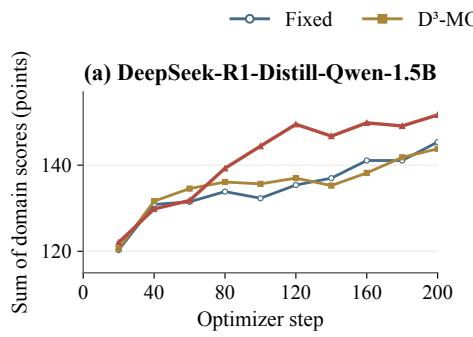

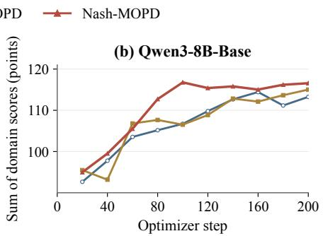  
Figure 2. Held-out domain-score totals for DeepSeek-R1-Distill-Qwen-1.5B (left: math, code, and Multi-IF) and Qwen3-8B-Base (right: math and code). Math/code use pass@1. Totals are compared within each student.

Two-domain experiment. On the Qwen3-8B-Base student, NASH-MOPD reaches Fixed’s final math/code scores of 86.40/26.86% at step 100, scoring 88.20/28.57%, with margins of 1.80 and 1.71 points above these thresholds. Fixed and $\mathrm { D ^ { 3 } } .$ MOPD first reach the same reference level at steps 160 and 180, respectively. NASH-MOPD thus uses 60 and 80 fewer updates, reductions of 37.5% and 44.4%, and remains above both thresholds through step 200. Figure 2 also shows that NASH-MOPD has the highest domain-score totals from step 100 onward for both students.

Training cost. Figure 4 reports full 200- step training time. Fixed, $\mathbf { D ^ { 3 } - M O P D }$ , and NASH-MOPD take 6.63/6.49/6.81 hours on the DeepSeek-R1-Distill-Qwen-1.5B student and

12.97/12.97/13.21 hours on the Qwen3-8B-Base student, respectively. These totals exceed Fixed’s by 0.18 and 0.24 hours or 2.7% and 1.9%, respectively. We measure convergence speed in optimizer updates. Wall-clock time to the earlier performance crossings was not measured.

## 5.4 Additional Benchmarks and Candidate Coverage

AIME25 and AMC23 use sixteen candidates per question. HumanEval+ and MBPP+ Chen et al., 2021, Austin et al., 2021, Liu et al., 2023 use four. IFBench Pyatkin et al., 2025 reports loose and strict accuracy from one response per prompt.

Additional benchmark accuracy. For the DeepSeek-R1-Distill-Qwen-1.5B student, NASH-MOPD has the highest AIME25 avg@16 at 27.50%, HumanEval+ avg@4 at 68.75%, and MBPP+ avg@4 at 57.47%. Its IFBench loose and strict scores are 20.00% and 14.67%, exceeding Fixed by 3.33 and 2.34 points, roughly 20% relative gains under both scoring criteria. For the Qwen3-8B-Base student, NASH-MOPD leads AIME25 avg@16 at 23.13%, AMC23 avg@16 at 80.16%, HumanEval+ avg@4 at 83.23%, and MBPP+ avg@4 at 62.37%.

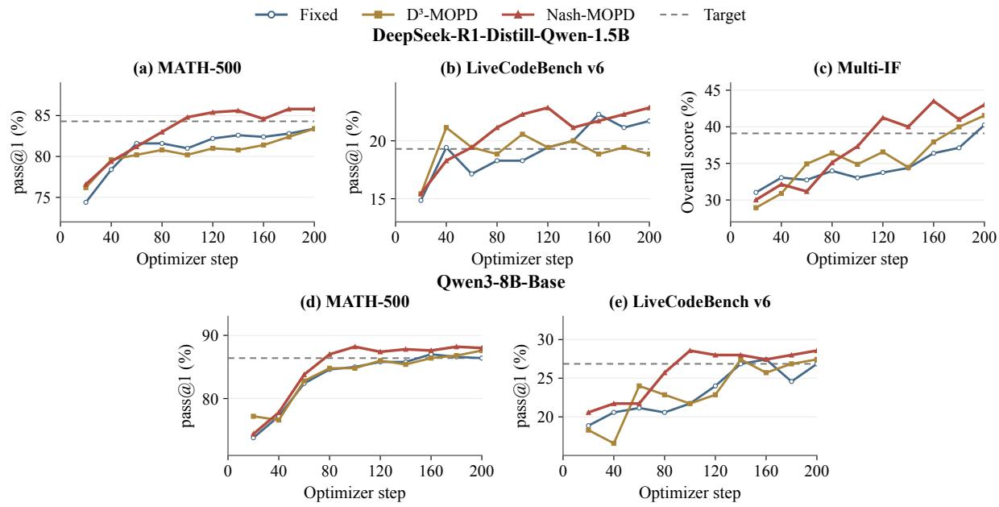  
Figure 3. Checkpoint scores for DeepSeek-R1-Distill-Qwen-1.5B (top) and Qwen3-8B-Base (bottom). Dashed lines mark teacher-referenced targets (top) and Fixed’s final math/code scores (bottom).

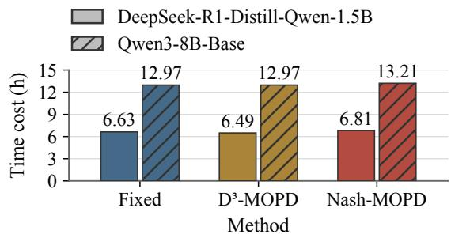  
Figure 4. 200-step training time without held-out evaluation: DeepSeek-R1-Distill-Qwen-1.5B (solid) and Qwen3-8B-Base (hatched).

Coverage under multiple candidates. Table 3 reports pass@4 for MATH-500, LiveCodeBench v6, HumanEval+, and MBPP+, and pass@16 for AIME25 and AMC23. NASH-MOPD is best or tied best on all six coverage metrics for the DeepSeek-R1-Distill-Qwen-1.5B student and five of six for the Qwen3-8B-Base student. On the DeepSeek-R1-Distill-Qwen-1.5B student, NASH-MOPD’s AIME25 coverage reaches 53.33%, compared with 36.67% for Fixed, a gain of about 16.7 points. MATH-500 and LCB coverage rise to 93.60% and 25.14%. On the Qwen3-8B-Base student, NASH-MOPD leads AIME25 at 46.67%,

AMC23 at 97.50%, LCB at 32.00%, and MBPP+ at 80.95%, and ties the best MATH-500 coverage at 94.00%. On HumanEval+ for the Qwen3- 8B-Base student, $\mathbf { D ^ { 3 } - M O P D }$ has higher pass@4 coverage than NASH-MOPD at 92.07% versus 91.46%, despite lower avg@4 accuracy at 82.62% versus 83.23%. Here, NASH-MOPD’s 0.61-point average-accuracy gain coexists with a 0.61-point coverage shortfall, illustrating that the two metrics can rank methods differently.

## 6 Conclusion

NASH-MOPD allocates prompts by maximizing the smallest predicted absorption rate of the remaining teacher–student reverse-KL gaps. Under a separable, frozen-rate progress model, the unconstrained equilibrium follows an inverse-rate rule. Online rate estimates, bounded shares, and smoothing implement this allocation during training. The DeepSeek-R1-Distill-Qwen-1.5B student reaches and sustains all three teacher-referenced targets from step 120, while the baselines remain short of the joint target through step 200. The Qwen3-8B-Base student reaches Fixed’s final math/code performance at step 100, requiring 37.5% and 44.4% fewer updates than Fixed and $\mathbf { D ^ { 3 } - M O P D }$ for first attainment. At the endpoint, NASH-MOPD leads eight of nine metrics on the DeepSeek-R1-Distill-Qwen-1.5B student and is best or tied best on all six metrics on the Qwen3-8B-Base student, with no extra teacher queries or rollouts.

## Limitations

NASH-MOPD relies on local, separable progress estimates. Future work could model cross-domain transfer and forgetting, quantify rate uncertainty, and handle delayed feedback. Incorporating token counts and training time could improve resource allocation. Learning sampling bounds, update intervals, and smoothing could reduce manual tuning. More domains, model sizes, and training budgets would test these extensions.

## References

Rishabh Agarwal, Nino Vieillard, Yongchao Zhou, Piotr Stanczyk, Sabela Ramos Garea, Matthieu Geist, and Olivier Bachem. 2024. On-policy distillation of language models: Learning from self-generated mistakes. In International Conference on Learning Representations.

Jacob Austin, Augustus Odena, Maxwell Nye, Maarten Bosma, Henryk Michalewski, David Dohan, Ellen Jiang, Carrie Cai, Michael Terry, Quoc Le, and Charles Sutton. 2021. Program synthesis with large language models. arXiv preprint arXiv:2108.07732.

Mark Chen, Jerry Tworek, Heewoo Jun, et al. 2021. Evaluating large language models trained on code. arXiv preprint arXiv:2107.03374.

Zhao Chen, Vijay Badrinarayanan, Chen-Yu Lee, and Andrew Rabinovich. 2018. GradNorm: Gradient normalization for adaptive loss balancing in deep multitask networks. In Proceedings of the 35th International Conference on Machine Learning, volume 80 of Proceedings of Machine Learning Research. PMLR.

DeepSeek-AI et al. 2026. DeepSeek-V4: Towards highly efficient million-token context intelligence. arXiv preprint arXiv:2606.19348.

Lang Feng, Zhenghai Xue, Tingcong Liu, and Bo An. 2025. Group-in-group policy optimization for LLM agent training. In Advances in Neural Information Processing Systems, volume 38.

Zixuan Fu, Bingxiang He, Yuxin Zuo, Haohuan Huang, Jinqian Zhang, Ruhang Xiao, Cheng Qian, Qinyu Luo, Huan-ang Gao, Yudong Wang, Zhiyuan Liu, Ning Ding, and Chaojun Xiao. 2026. Rethinking onpolicy distillation of large language models II: One training example. arXiv preprint arXiv:2609.04172.

Yuxian Gu, Li Dong, Furu Wei, and Minlie Huang. 2024. MiniLLM: Knowledge distillation of large language models. In International Conference on Learning Representations.

Daya Guo, Dejian Yang, Haowei Zhang, et al. 2025. DeepSeek-R1 incentivizes reasoning in LLMs through reinforcement learning. Nature, 645(8081):633–638.

Michelle Guo, Albert Haque, De-An Huang, Serena Yeung, and Li Fei-Fei. 2018. Dynamic task prioritization for multitask learning. In Proceedings ofthe European Conference on Computer Vision.

Bingxiang He, Zekai Qu, Zeyuan Liu, Yinghao Chen, Yuxin Zuo, Cheng Qian, Kaiyan Zhang, Weize Chen, Chaojun Xiao, Ganqu Cui, Ning Ding, and Zhiyuan Liu. 2026. JustRL: Scaling a 1.5b LLM with a simple RL recipe. In ICLR Blogposts 2026.

Yun He, Di Jin, Chaoqi Wang, Chloe Bi, Karishma Mandyam, Hejia Zhang, Chen Zhu, Ning Li, Tengyu Xu, Hongjiang Lv, Shruti Bhosale, Chenguang Zhu, Karthik Abinav Sankararaman, Eryk Helenowski, Melanie Kambadur, Aditya Tayade, Hao Ma, Han Fang, and Sinong Wang. 2024. Multi-IF: Benchmarking LLMs on multi-turn and multilingual instructions following. arXiv preprint arXiv:2410.15553.

Dan Hendrycks, Collin Burns, Saurav Kadavath, Akul Arora, Steven Basart, Eric Tang, Dawn Song, and Jacob Steinhardt. 2021. Measuring mathematical problem solving with the MATH dataset. In Proceedings of the Neural Information Processing Systems Track on Datasets and Benchmarks 1.

Naman Jain, King Han, Alex Gu, Wen-Ding Li, Fanjia Yan, Tianjun Zhang, Sida Wang, Armando Solar-Lezama, Koushik Sen, and Ion Stoica. 2025. Live-CodeBench: Holistic and contamination free evaluation of large language models for code. In International Conference on Learning Representations.

Kimi Team. 2026. Kimi K3: Open frontier intelligence. arXiv preprint arXiv:2607.24653.

Rongao Li, Jie Fu, Bo-Wen Zhang, Tao Huang, Zhihong Sun, Chen Lyu, Guang Liu, Zhi Jin, and Ge Li. 2023. TACO: Topics in algorithmic COde generation dataset. arXiv preprint arXiv:2312.14852.

Jiawei Liu, Chunqiu Steven Xia, Yuyao Wang, and Lingming Zhang. 2023. Is your code generated by Chat-GPT really correct? rigorous evaluation of large language models for code generation. In Advances in Neural Information Processing Systems.

LLM-Core Xiaomi. 2026. MiMo-V2.6: Scaling reinforcement learning towards self-improvement. Technical report, Xiaomi.

Wenhan Ma, Jianyu Wei, Liang Zhao, Hailin Zhang, Bangjun Xiao, Lei Li, Qibin Yang, Bofei Gao, Yudong Wang, Rang Li, Jinhao Dong, Zhifang Sui, and Fuli Luo. 2026. MOPD: Multi-teacher on-policy distillation for capability integration in LLM posttraining. arXiv preprint arXiv:2606.30406.

Linjian Meng, Siyuan Gan, YuHan Li, Xiran Wang, Ziyang Ding, Ditang Gou, Yiming Wu, and Zhen Zhao. 2026. Unbiased top-k estimation for on-policy distillation. arXiv preprint arXiv:2609.34447.

Rémi Munos, Michal Valko, Daniele Calandriello, Mohammad Gheshlaghi Azar, Mark Rowland, Zhaohan Daniel Guo, Yunhao Tang, Matthieu Geist, Thomas Mesnard, Côme Fiegel, Andrea Michi, Marco Selvi, Sertan Girgin, Nikola Momchev, Olivier Bachem, Daniel J. Mankowitz, Doina Precup, and Bilal Piot. 2024. Nash Learning from Human Feedback. In Proceedings ofthe 41st International Conference on Machine Learning, volume 235 of Proceedings of Machine Learning Research. PMLR.

Aviv Navon, Aviv Shamsian, Idan Achituve, Haggai Maron, Kenji Kawaguchi, Gal Chechik, and Ethan Fetaya. 2022. Multi-task learning as a bargaining game. In Proceedings ofthe 39th International Conference on Machine Learning, volume 162 of Proceedings ofMachine Learning Research. PMLR.

Valentina Pyatkin, Saumya Malik, Victoria Graf, Hamish Ivison, Shengyi Huang, Pradeep Dasigi, Nathan Lambert, and Hanna Hajishirzi. 2025. Generalizing verifiable instruction following. In Advances in Neural Information Processing Systems 38, Datasets and Benchmarks Track.

Ozan Sener and Vladlen Koltun. 2018. Multi-task learning as multi-objective optimization. In Advances in Neural Information Processing Systems, volume 31.

Zechen Sun, Zhiwei Zhang, Fei Zhao, Juntao Li, Mu Chuan, Huayu Deng, Guojian Zhan, Wenliang Chen, Yao Hu, and Min Zhang. 2026. D<sup>3</sup>-MOPD: Dynamic domain scheduling for efficient multi-teacher distillation. arXiv preprint arXiv:2608.24987.

Dhanasekar Sundararaman, Henry Tsai, Kuang-Huei Lee, Iulia Turc, and Lawrence Carin. 2021. Learning task sampling policy for multitask learning. In Findings of the Association for Computational Linguistics: EMNLP 2021. Association for Computational Linguistics.

Sang Michael Xie, Hieu Pham, Xuanyi Dong, Nan Du, Hanxiao Liu, Yifeng Lu, Percy Liang, Quoc V. Le, Tengyu Ma, and Adams Wei Yu. 2023. DoReMi: Optimizing data mixtures speeds up language model pretraining. In Advances in Neural Information Processing Systems 36.

An Yang et al. 2025. Qwen3 technical report. arXiv preprint arXiv:2505.09388.

Qiying Yu, Zheng Zhang, Ruofei Zhu, Yufeng Yuan, Xiaochen Zuo, Yu Yue, Weinan Dai, Tiantian Fan, Gaohong Liu, Juncai Liu, LingJun Liu, Xin Liu, Haibin Lin, Zhiqi Lin, Bole Ma, Guangming Sheng, Yuxuan Tong, Chi Zhang, Mofan Zhang, and 17 others. 2025. DAPO: An open-source LLM reinforcement learning system at scale. In Advances in Neural Information Processing Systems 38.

Aohan Zeng et al. 2026. GLM-5: from vibe coding to agentic engineering. arXiv preprint arXiv:2602.15763.

## A Theory of the Allocation Game

## A.1 Local surrogate and the zero-sum game

At one scheduler update, fix normalized gaps $g _ { k } >$ 0 and estimated per-prompt reductions $a _ { k } > 0$ for the active domains. A batch of B prompts with allocation $p \in \Delta _ { K }$ predicts gap reduction $B p _ { k } a _ { k }$ and fractional progress $B p _ { k } r _ { k }$ , where $r _ { k } = a _ { k } / g _ { k }$ Ignoring truncation at the target, define the local time surrogate

$$
T _ { \mathrm { l o c } } ( p ) = \operatorname* { m a x } _ { k \in [ K ] } { \frac { 1 } { B p _ { k } r _ { k } } } = { \frac { 1 } { B \operatorname* { m i n } _ { k } p _ { k } r _ { k } } } .\tag{11}
$$

This is a local planning quantity, not a guarantee for nonlinear training: student parameters, responses, losses, and rates can change after each update.

The sampler is the maximizing player and the adversary is a distribution $q \in \Delta _ { K }$ over domains. Their zero-sum payoff is

$$
u ( p , q ) = \sum _ { k = 1 } ^ { K } q _ { k } p _ { k } r _ { k } .\tag{12}
$$

For fixed $p ,$ the adversary places all mass on an index attaining min<sub>k</sub> $p _ { k } r _ { k }$ , so mi $\iota _ { q \in \Delta _ { K } } u ( p , q ) =$ min<sub>k</sub> $p _ { k } r _ { k }$ . The sampler’s problem is the linear maximin program

$$
\nu ^ { * } = \operatorname* { m a x } _ { p \in \Delta _ { K } } \operatorname* { m i n } _ { k \in [ K ] } p _ { k } r _ { k } .\tag{13}
$$

Theorem A.1 (Interior maximin solution). For a fixed active set and finite rates $r _ { k } \ > \ 0 .$ , with no active lower or upper share constraints, the unique maximizing allocation in Eq. (13) is

$$
p _ { k } ^ { * } = \frac { r _ { k } ^ { - 1 } } { \sum _ { j = 1 } ^ { K } r _ { j } ^ { - 1 } } , \qquad \boldsymbol { \nu } ^ { * } = \left( \sum _ { j = 1 } ^ { K } r _ { j } ^ { - 1 } \right) ^ { - 1 } .
$$

The associated worst-domain local time is $\begin{array} { r } { T _ { \mathrm { l o c } } ( p ^ { * } ) = B ^ { - 1 } \sum _ { j } r _ { j } ^ { - 1 } } \end{array}$ . The pair $( p ^ { * } , q ^ { * } )$ , where $q _ { k } ^ { * } = p _ { k } ^ { * }$ , is a saddle point ofEq. (12).

Proof. Let $p$ be any feasible allocation and write $m ( p ) = \mathrm { m i n } _ { k } p _ { k } r _ { k }$ . Then $p _ { k } \ge m ( p ) / r _ { k }$ for every $k ,$ , so

$$
\begin{array} { c } { { 1 = \displaystyle \sum _ { k } p _ { k } \ge m ( p ) \sum _ { k } r _ { k } ^ { - 1 } , } } \\ { { { } } } \\ { { m ( p ) \le \displaystyle \left( \sum _ { k } r _ { k } ^ { - 1 } \right) ^ { - 1 } . } } \end{array}\tag{14}
$$

The proposed allocation sums to one and satisfies $\begin{array} { r } { p _ { k } ^ { * } r _ { k } = ( \sum _ { j } r _ { j } ^ { - 1 } ) ^ { - 1 } } \end{array}$ for every domain, attaining this upper bound. Equality in Eq. (14) requires $p _ { k } = m ( p ) / r _ { k }$ for every k, which proves uniqueness. Substituting $\nu ^ { * }$ into Eq. (11) gives the stated local time. For the saddle-point claim, $p _ { k } ^ { * } r _ { k } = \nu ^ { * }$ makes $u ( p ^ { * } , q ) ~ = ~ \nu ^ { * }$ for every q. Also, since $q _ { k } ^ { * } r _ { k } = \nu ^ { * } , u ( p , q ^ { * } ) = \nu ^ { * }$ for every $p .$ Thus neither player can improve its payoff by a unilateral change. □

The minimum payoff requires fractional progress in every domain. Theorem A.1 therefore also minimizes worst-domain local time under frozen rates; the online controller re-estimates these rates after subsequent updates.

## A.2 Bounded shares and water-filling

The implementation imposes a floor ℓ and cap u on domain sampling ratios. We assume $K \ell \ \leq$ $1 \leq K u$ . Let A contain domains with a gap above the target threshold and a positive finite estimated rate; let $\mathcal { T }$ be the other domains. The code fixes $p _ { i } = \ell$ for $i \in \mathcal { T }$ and maximizes the worst rate over A using the remaining mass $b = 1 - | \mathcal { I } | \ell$ This convention is part of the controller: a zerorate domain is not assigned a modeled positive payoff, so its share is a per-domain floor rather than a maximin guarantee.

For $| { \mathcal { A } } | > 0$ , define

$$
\phi ( v ) = \sum _ { k \in \mathcal { A } } \mathrm { c l i p } \left( \frac { v } { r _ { k } } , \ell , u \right) .\tag{15}
$$

When $b \leq | { \mathcal { A } } | u$ , the bisection in the implementation finds a level v for which $\phi ( v ) = b$ (up to numerical tolerance), and sets the positive-rate shares to the clipped values in Eq. (15). If $b > | { \mathcal { A } } | u$ , all positive-rate domains receive u and the forced remainder is shared among inactive domains. The following result states what this construction does and, just as importantly, what its scalar v does not mean when a cap binds.

Theorem A.2 (Optimality of the bounded allocation). Suppose $| { \mathcal A } | > 0 , r _ { k } > 0$ for all $k \in$ ${ \mathcal A } ,$ and the floor/cap constraints are feasible. If $b \leq | { \mathcal { A } } | u ,$ , any vector $p _ { k } = \mathrm { c l i p } ( v / r _ { k } , \ell , u )$ satisfying $\textstyle \sum _ { k \in { \mathcal { A } } } p _ { k } = b$ maximizes min $\scriptstyle 1 _ { k \in \mathcal { A } } p _ { k } r _ { k }$ over $\ell \leq p _ { k } \leq \iota$ u with total mass b. $I f b > | { \cal A } | u ,$ , setting $p _ { k } = u$ for all $k \in { \mathcal { A } }$ maximizes the same objective; any feasible distribution of the remaining probability over I leaves that active-domain optimum unchanged. The maximizing allocation need not be unique.

Proof. Write $\begin{array} { r } { m ( p ) = \operatorname* { m i n } _ { k \in \mathcal { A } } p _ { k } r _ { k } } \end{array}$ . First consider a solution of Eq. (15). If an upper-clipped domain has payoff below v, choose j with the smallest payoff $u r _ { j }$ among such domains. Every feasible allocation then has $m ( p ) \leq u r _ { j }$ . The clipped vector assigns $p _ { j } = u ; $ every uncapped domain has payoff $v ,$ every floor-clipped domain has payoff at least $v ,$ and every other upper-clipped domain has payoff at least $u r _ { j }$ . Its minimum therefore equals this upper bound, so no allocation can do better. If no upper-clipped domain has payoff below v, all domain payoffs under the clipped vector are at least $v .$ Any allocation with minimum payoff strictly above $v$ must assign more than $v / r _ { k }$ to every domain with $\ell \leq v / r _ { k } < u$ , including a domain exactly at its floor. Domains with $v / r _ { k } < \ell$ can remain at their floor and already have payoff above v. If some domain has $v / r _ { k } = u _ { ; }$ , strict improvement is impossible for that domain because of its cap. Otherwise, when at least one domain needs a strict increase, the required total exceeds the clipped vector’s mass b. If all domains have $v / r _ { k } < \ell .$ feasibility fixes every share at its floor. Thus no feasible vector has a larger minimum payoff. Finally, when $b > | { \mathcal { A } } | u$ every active coordinate is already at its maximum, so no feasible allocation can increase any positiverate domain’s share; the minimum active payoff is therefore maximal. The inactive residual is feasible because $K \ell \leq 1 \leq K u$ □

The bounded objective has the same domainadversary interpretation: for fixed shares, minimizing the bilinear payoff over distributions on A selects an active bottleneck. The implementation needs only the maximizing allocation from Theorem $\mathsf { A } . 2 ;$ it does not compute a dual distribution or alternate between game players.

The level v equalizes payoffs only for interior coordinates. A capped domain can have payoff $u r _ { k } < v$ and become the bottleneck; plateaus of $\phi$ can make v non-unique. Hence v should not be interpreted as an empirical Nash value when constraints bind.

For a feasible active budget, the scalar search is well-defined: $\phi$ is continuous and nondecreasing, with $\phi ( 0 ) = | \mathcal { A } | \ell$ and $\phi ( u \operatorname* { m a x } _ { k \in \mathcal { A } } r _ { k } ) = | \mathcal { A } | u$ The implementation uses 80 bisection iterations within this bracket. Share clipping and a final projection handle finite precision; the root level describes the bounded allocation, not a measured convergence rate.

## A.3 Sensitivity to estimated positive rates

The controller uses window estimates $\widehat { r _ { k } }$ . The following result quantifies how a specified error changes its local planning objective. It compares the same active domain set and feasible share constraints; changes in which domains pass the positive-rate test are addressed separately in Section ${ \mathrm { A . 5 . } }$

Proposition A.3 (Deterministic rate sensitivity). Let A be a fixed nonempty active set and let $\mathcal { P } \subseteq$ $\Delta _ { K }$ be a nonempty compactfeasible allocation set with the controller’s coverage convention held fixed. Suppose $r _ { k } , \widehat { r } _ { k } > 0$ and max $k { \in } { \mathcal { A } } \left| r _ { k } - { \widehat { r } } _ { k } \right| \leq \epsilon .$ If $\widehat { p }$ maximizes min $\mathsf { I } _ { k \in \mathcal { A } } p _ { k } \widehat { r } _ { k }$ on ${ \mathcal P } ,$ then

$$
\begin{array} { c } { \displaystyle \operatorname* { m i n } _ { k \in \mathcal { A } } \widehat { p } _ { k } r _ { k } \geq \nu _ { \mathcal { A } } ( r ) - 2 \epsilon , } \\ { \nu _ { \mathcal { A } } ( r ) = \displaystyle \operatorname* { m a x } _ { p \in \mathcal { P } } \operatorname* { m i n } _ { k \in \mathcal { A } } p _ { k } r _ { k } . } \end{array}
$$

Proof. For every feasible p, $0 \leq p _ { k } \leq 1$ bounds the change in each active product by $\epsilon .$ Taking the minimum preserves that bound, so $\begin{array} { r } { | \operatorname* { m i n } _ { k \in \mathcal { A } } p _ { k } r _ { k } - \operatorname* { m i n } _ { k \in \mathcal { A } } p _ { k } \widehat { r } _ { k } | \leq \epsilon } \end{array}$ . Maximizing over the same compact set also gives $| \nu _ { \mathcal { A } } ( r ) -$ $\nu _ { \mathcal { A } } ( \widehat { r } ) \vert \ \leq \ \epsilon .$ . The estimated optimizer therefore satisfies

$$
\operatorname* { m i n } _ { k \in \cal { A } } \widehat { p } _ { k } r _ { k } \geq \nu _ { \cal { A } } ( \widehat { r } ) - \epsilon \geq \nu _ { \cal { A } } ( r ) - 2 \epsilon .
$$

This result applies to the bounded target before temporal smoothing. It is conditional on a specified perturbation of the local rates. Our moving-window EMA estimator is temporally dependent, and the experiments do not supply a calibrated bound on ϵ. Consequently the proposition explains sensitivity of the planning objective without assigning a confidence level or certifying progress for the reported training runs.

## A.4 Smoothing, batch-level jitter, and finite batches

Let $q _ { t }$ be the bounded target, $p _ { t }$ the smoothed allocation, and $\alpha \in ( 0 , 1 ]$ the smoothing coefficient. Convex combinations of feasible shares remain feasible, so Euclidean projection is a numerical safeguard after entry into the capped simplex. It also enforces bounds at the first dynamic update, since the instruction-following warm-up share is below 0.1. The lemma assumes a feasible initial allocation.

Lemma A.4 (Smoothing contraction and tracking). For a fixed target $q ,$ the update $p _ { t } ~ = ~ \Pi _ { \mathcal { P } } ( ( 1$ $\alpha ) p _ { t - 1 } + \alpha q )$ satisfies $\| p _ { t } - q \| _ { 2 } \leq ( 1 - \alpha ) \| p _ { t } .$ <sub>−1</sub>− $q \| _ { 2 } .$ Ifthe targets vary with $\| q _ { t } - q _ { t - 1 } \| _ { 2 } \leq \xi$ and the update uses $q _ { t } ,$ then

$$
\begin{array} { r } { \| p _ { t } - q _ { t } \| _ { 2 } \leq ( 1 - \alpha ) \| p _ { t - 1 } - q _ { t - 1 } \| _ { 2 } + ( 1 - \alpha ) \xi . } \end{array}
$$

Consequently lim sup $\| p _ { t } - q _ { t } \| _ { 2 }$ is at most $( 1 -$ $\alpha ) \xi / \alpha$ when the stated variation bound holds.

Proof. Euclidean projection onto a closed convex set is non-expansive and fixes $q .$ . Therefore $\| p _ { t } - q \| _ { 2 } \leq \| ( 1 - \alpha ) p _ { t - 1 } + \alpha q - q \| _ { 2 }$ , which gives the contraction. For a varying target, compare the projected update with $q _ { t }$ and apply the triangle inequality:

$$
\begin{array} { r l } & { \| p _ { t } - q _ { t } \| _ { 2 } \leq ( 1 - \alpha ) \| p _ { t - 1 } - q _ { t } \| _ { 2 } } \\ & { \qquad \leq ( 1 - \alpha ) \| p _ { t - 1 } - q _ { t - 1 } \| _ { 2 } } \\ & { \qquad + ( 1 - \alpha ) \xi . } \end{array}
$$

Iterating this scalar recursion gives a geometric transient plus a geometric sum bounded by $( 1 -$ $\alpha ) \xi / \alpha$ □

The lemma concerns the tracking of target shares. It supplies no contraction of the student’s KL gap or benchmark error. The runs use $\alpha = 0 . 2 5 ;$ we do not estimate a stationary target-variation bound from their traces.

For one batch, the implementation multiplies each share $p _ { k }$ by $1 + \eta _ { k }$ , with $| \eta _ { k } | \le \gamma$ , and renormalizes. Let $\widetilde { p }$ be this jittered distribution. Since $\begin{array} { r } { 1 - \gamma \le \sum _ { j } p _ { j } \bigl ( 1 + \eta _ { j } \bigr ) \le 1 + \gamma } \end{array}$

$$
\frac { 1 - \gamma } { 1 + \gamma } p _ { k } \leq \widetilde { p } _ { k } \leq \frac { 1 + \gamma } { 1 - \gamma } p _ { k } .
$$

For a batch of $B$ prompts, largest-remainder apportionment first assigns $\lfloor B \widetilde { p } _ { k } \rfloor$ examples to each domain and then distributes the remaining prompts according to fractional remainders. If $n _ { k }$ is the resulting integer quota, then

$$
\sum _ { k } n _ { k } = B , \qquad \left| \frac { n _ { k } } { B } - \widetilde { p } _ { k } \right| < \frac { 1 } { B } .
$$

The bound is deterministic and concerns batch composition only. It does not bound gradient noise or model quality. The random perturbations are sampled independently per batch. The sampler is shared by Fixed, $\mathbf { D ^ { 3 } - M O P D }$ , and NASH-MOPD in both the DeepSeek-R1-Distill-Qwen-1.5B and Qwen3-8B-Base experiments.

## A.5 Zero-rate domains and the scope of the guarantee

The bounded solver marks domain k as progressing only if $g _ { k } > 1 0 ^ { - 3 } , \widehat { r } _ { k } > 1 0 ^ { - 8 }$ , and its rate is finite. A domain outside this set receives its perdomain floor when a feasible positive-rate allocation can consume the remaining probability. If upper bounds prevent that allocation from consuming all mass, the residual is split equally over the other domains. When no domain passes the progressingdomain test, the target is uniform. These rules make every sampler update defined without dividing by zero.

They also change the scope of the optimization. If an unfinished domain has $r _ { k } = 0 ,$ , then min<sub>k</sub> $p _ { k } r _ { k } \ = \ 0$ for every feasible $p$ in the fulldomain game, and its modeled completion time is infinite. No allocation can certify positive alldomain progress from those rates. The controller instead optimizes on the positive-rate subset while retaining exposure to the other domains. A zero estimate can represent a noisy window, a plateau, interference, or an inadequate teacher; the observations do not identify which explanation holds. In particular, allocating the minimum share to a zero-rate domain should not be interpreted as the best recovery policy for a stalled domain.

The diagonal local model additionally assumes that a domain’s improvement is attributable to its own prompt exposure. A shared student can improve one domain from another domain’s data or suffer negative transfer. The present analysis does not model those interactions, prove monotone KL descent, or establish a connection from KL descent to a benchmark threshold. The theoretical statements therefore concern allocation under specified local rates, whereas the results test whether that controller is useful in the observed nonlinear training system.

## B Implementation Details

This appendix complements Algorithm 1 with the controller state, comparator settings, and shared training settings.
<table><tr><td>Setting</td><td>Value</td><td>Applied to</td></tr><tr><td>Global prompt batch / responses per prompt</td><td>64/1</td><td>All training runs</td></tr><tr><td>Maximum prompt / response tokens</td><td>4,096 / 7,168</td><td>All training runs</td></tr><tr><td>Student optimizer / learning rate / weight decay</td><td>AdamW / 10−⁶ / 0.01</td><td>All training runs</td></tr><tr><td>Training rollout / teacher temperature</td><td>1.0 / 1.0</td><td>All training runs</td></tr><tr><td>Loss aggregation / teacher precision</td><td>Token mean / bfloat16</td><td>All training runs</td></tr><tr><td>KL scale observations / EMA coefficient</td><td>5 /0.2</td><td>Domain-sampler controllers</td></tr><tr><td>KL target ratio / remaining-gap floor</td><td>0.10/ 10−3</td><td>NASH-MOPD signals</td></tr><tr><td>Positive-rate cutoff</td><td>10-8</td><td>NASH-MOPD allocation</td></tr><tr><td>Per-domain floor / cap</td><td>0.10 / 0.70</td><td>Dynamic post-warm-up mixtures</td></tr><tr><td>Warm-up / update interval</td><td>20 / 10 steps</td><td>Dynamic schedules</td></tr><tr><td>Rate-history window</td><td>10 observations</td><td>NASH-MOPD rate estimation</td></tr><tr><td>Descent-velocity windows / KL denominator floor</td><td>Up to 3 × 10 / 0.15</td><td>D³-MOPD comparator</td></tr><tr><td>Softmax temperature / remaining-gap cap</td><td>0.5 / 1.5</td><td>D³-MOPD comparator</td></tr><tr><td>Mixture smoothing</td><td>0.25</td><td>NASH-MOPD only</td></tr><tr><td>Batch-level jitter</td><td>Uniform [−0.3, 0.3]</td><td>Domain-sampler conditions</td></tr><tr><td>Scalar allocation / projection iterations</td><td>80/ 80</td><td>Bounded solver</td></tr><tr><td>Primary evaluation interval</td><td>20 optimizer steps</td><td>Main scheduler comparisons</td></tr><tr><td>Primary evaluation temperature / top-p</td><td>0.6 / 0.95</td><td>Shared held-out domains</td></tr></table>

Table 4: Training and scheduling settings for the reported studies.

## B.1 State, observations, and update order

The controller stores a domain-specific random row permutation, cursor, prompt exposure count, initial KL scale, EMA, and recent histories. Each domain’s raw signal is recovered from the dense token-level distillation reward and aggregated over its non-padding response tokens. Negative raw estimates are clipped to zero before entering the EMA. The first valid observation initializes the EMA; later observations use coefficient 0.2. The initial scale is the mean of the first five raw observations, floored at 10<sup>−8</sup>. At the fifth observation, the gap history is initialized at one; subsequent records use the normalized remaining gap from the main text. NASH-MOPD has no upper clipping of this gap.

A rolling history retains up to 11 exposure–gap pairs. Its oldest and newest entries provide a gap decrement over up to 10 observed updates. The nonnegative decrement divided by the exposure difference yields the estimated exposure-normalized descent velocity, and division by max(g<sub>k</sub>, 10<sup>−3</sup>) gives the exposure-normalized absorption rate. The exposure denominator is floored at one. Rates and gap observations are updated throughout warm-up, but sampling shares change only once every domain has a scale and at least two history points. Dynamic updates begin at step 20 and occur at 10-step intervals. The logged post-update mixture controls subsequent batches; the current batch has already been sampled. The teacher signal in row s is measured before optimizer update s.

The sampler uses one random-number generator for row permutations, batch-level jitter, and withinbatch ordering. It consumes each domain’s current row permutation before reshuffling that pool. Thus it permits repeated presentations across training while avoiding independent sampling with replacement at every draw within a cycle. Exposure counts measure prompt presentations, including repeats, rather than distinct training examples. Resume checkpoints retain the sampler’s random-number state, current permutations, cursors, yielded count, histories, EMA, scales, and last update. Resuming a trainer segment continues this state instead of restarting warm-up.

## B.2 Bounded allocation and comparator details

NASH-MOPD solves for a clipped inverse-rate target by 80 bisection iterations over [0, $u \operatorname* { m a x } _ { k } \widehat { r } _ { k } ]$ then normalizes its finite-precision result. It blends this target with the previous mixture using $\alpha =$ 0.25 and projects the result onto the capped simplex. The projection itself uses 80 bisection iterations. Share floors and caps apply to the controller’s base mixture after dynamic updates; the jittered probabilities and rounded batch fractions can exceed those nominal coordinate bounds. The DeepSeek-R1-Distill-Qwen-1.5B row-proportional warm-up also has an instruction-following base share below 0.1.

Each batch applies independent multiplicative jitter in [0.7, 1.3] to the scheduled shares and renormalizes them. Largest-remainder rounding converts the resulting probabilities into integer quotas summing to the global prompt batch size B. Fixed and dynamic schedules use the same batch construction and random-permutation sampler.

The $\mathbf { D ^ { 3 } - M O P D }$ comparator maintains an independent smoothed-KL history of up to 41 observations. Its remaining-gap signal is $\begin{array} { r l } { \bar { L } _ { k } } & { { } = } \end{array}$ clip $( L _ { k } / L _ { k } ^ { ( 0 ) } , 0 , 1 . 5 )$ The EMA and reference scale follow the initialization above. Descent velocity $v _ { k }$ averages the available 10-step differences from at most three windows, with previous KL floored at 0.15, and truncates negative descent to zero. Its composite signal multiplies the remaininggap and descent-velocity signals, divides by their maximum, uses softmax temperature 0.5, adds the probability floor, and applies the same cap. If all signals vanish, it proposes a uniform target. It uses no additional temporal blend. This baseline uses the original $\mathbf { D ^ { 3 } - M O P D }$ scheduling method, combining remaining gap and descent velocity to determine the domain sampling probabilities. Eq. (3) describes the proposal before the sampling floor and cap are applied. Both adaptive schedules retain the row-proportional base mixture during the shared warm-up and use the same batch-level jitter and integer-quota sampler; only NASH-MOPD uses the temporal blend in Eq. (10).

Fixed keeps the usable-row proportions throughout training. In the DeepSeek-R1-Distill-Qwen-1.5B experiment these proportions are approximately 38.2% math, 52.7% code, and 9.1% instruction following, computed from 17,917, 24,699, and 4,245 loaded rows. Qwen3-8B-Base removes instruction following and recomputes row proportions.

## B.3 Shared training and decoding settings

Schedules within each experiment share initialization, teachers, data, AdamW settings, and a global batch of 64 with one student rollout per prompt. Training uses learning rate $1 0 ^ { - 6 }$ , weight decay 0.01, up to 4,096 prompt tokens and 7,168 response tokens, on A100-SXM4-80GB GPUs. Held-out decoding uses temperature 0.6 and top-p 0.95, except for IFBench. Table 4 collects the training and scheduling settings.

## C Supplementary Results and Mechanism Analysis

Figure 5 compares training of the student model DeepSeek-R1-Distill-Qwen-1.5B over 200 optimizer steps, each representing one parameter update. The three domains are mathematics, code generation, and instruction following, which respectively involve solving mathematical problems, producing programs, and satisfying prompt requirements. Fixed samples domains in proportion to their training corpus sizes; $\mathrm { D ^ { 3 } - M O P D }$ adjusts sampling using remaining teacher–student divergence and its recent decrease; NASH-MOPD balances predicted proportional gap reductions across domains. A domain sampling ratio is the scheduled probability of selecting a prompt from that domain. Reverse Kullback–Leibler divergence, abbreviated KL, measures the discrepancy between the student’s and the domain teacher’s next-token distributions on student-generated responses. The remaining KL gap is the nonnegative difference between the smoothed divergence and 10% of its initial scale, divided by 90% of that scale. Smoothing assigns weight 0.2 to the latest observation and 0.8 to the previous smoothed value; the initial scale is the mean of the first five nonnegative observations. A gap of one represents the initial scale, and zero represents the target divergence.

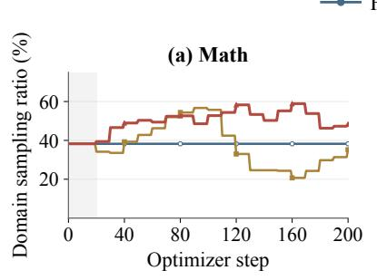

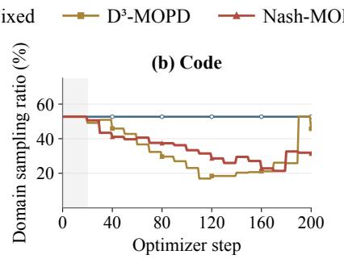

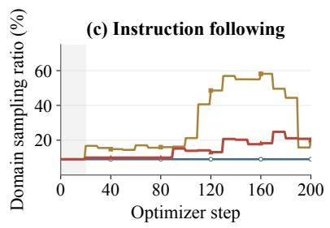

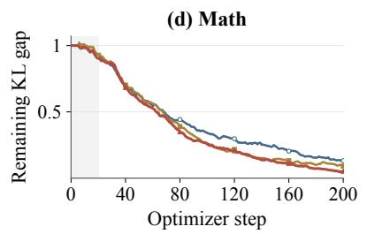

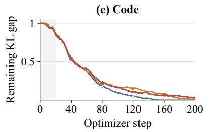

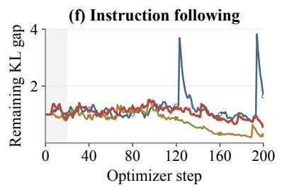  
Figure 5: Domain sampling ratios and remaining KL gaps for DeepSeek-R1-Distill-Qwen-1.5B through optimizer step 200 under Fixed, $\mathrm { D ^ { 3 } } .$ -MOPD, and NASH-MOPD. Columns show mathematics, code generation, and instruction following; the upper row shows sampling ratios and the lower row shows remaining gaps. Gray shading marks steps 1–20.

First, the upper row shows how the methods distribute training prompts. Fixed maintains ratios of 38.2%, 52.7%, and 9.1% for mathematics, code generation, and instruction following. In contrast, NASH-MOPD increases the mathematics ratio to 58.3% by step 120 while reducing the code generation ratio to 28.6%. $\mathrm { D ^ { 3 } } .$ -MOPD makes a larger shift toward instruction following after step 100, assigning it 58.2% at step 160, compared with 18.3% under NASH-MOPD. Thus, NASH-MOPD sustains a larger mathematics allocation, whereas $\mathrm { D ^ { 3 } }$ -MOPD concentrates more prompts on instruction following during the middle and later stages.

Correspondingly, the lower row shows distinct patterns of gap reduction. At step 200, the mathematics gap is 0.051 under NASH-MOPD, compared with 0.091 under $\mathrm { D ^ { 3 } - M O P D }$ and 0.131 under Fixed. Code generation shows the reverse ordering: Fixed reaches zero, while $\mathrm { D ^ { 3 } - M O P D }$ and NASH-MOPD finish at 0.008 and 0.034. Meanwhile, the instruction-following gap fluctuates around one during early training and declines more strongly under $\mathbf { D ^ { 3 } - M O P D }$ after its sampling ratio increases. Its final gap is 0.277 under $\mathrm { D ^ { 3 } } .$ -MOPD, 0.605 under NASH-MOPD, and 1.636 under Fixed. These trajectories show the domain trade-offs directly: NASH-MOPD achieves the smallest mathematics gap, Fixed the smallest code generation gap, and $\mathrm { D ^ { 3 } }$ -MOPD the smallest instruction-following gap.

Next, Figure $^ 6$ compares predictions of gap reduction over 18 ten-step windows starting at steps 20, 30, . . ., 190. For domain k and starting step s, let $\widehat { \boldsymbol { a } } _ { k , s }$ be the estimated gap decrease per prompt, computed by dividing the nonnegative gap decrease over up to ten observed updates by the number of prompt presentations during those updates. Let $\Delta e _ { k , s }$ count prompt presentations over the next ten steps, including repeated presentations. Holding the starting estimate fixed gives the predicted reduction

$$
\widehat { \Delta g } _ { k , s } = \widehat { a } _ { k , s } \Delta e _ { k , s } .
$$

The observed reduction $\Delta g _ { k , s }$ is the starting gap minus the ending gap, so a negative value indicates an increase. Task-macro correlation is the equal-weight mean of the three domain-specific Spearman rank correlations between predicted and observed reductions over the 18 windows. Spearman correlation measures agreement between their rankings, with larger values indicating closer agreement. Mean absolute error is the mean of $| \widehat { \Delta g } _ { k , s } - \Delta g _ { k , s } |$ over all three domains and 18 windows; smaller values indicate closer predicted magnitudes.

(a) Task-macro correlation  
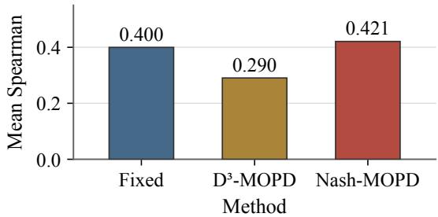

(b) Mean absolute error  
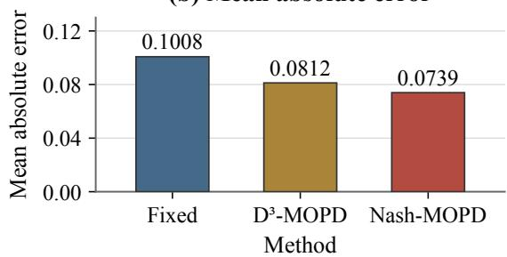

Figure 6: Gap-reduction prediction metrics for DeepSeek-R1-Distill-Qwen-1.5B under Fixed, $\mathbf { D ^ { 3 } - M O P D }$ , and NASH-MOPD across 18 ten-step windows from step 20 to step 200. The left panel shows task-macro correlation; the right panel shows mean absolute error.

Finally, both panels place NASH-MOPD ahead of the other methods. NASH-MOPD has the highest task-macro correlation at 0.421, followed by Fixed at 0.400 and $\mathbf { D ^ { 3 } - M O P D }$ at 0.290. The corresponding correlation advantages are 0.021 and 0.130. NASH-MOPD also has the lowest mean absolute error at 0.0739, compared with 0.1008 for Fixed and 0.0812 for $\mathrm { D ^ { 3 } }$ -MOPD, reductions of 26.6% and 8.9%, respectively. Together, the panels show that ${ \bf N } _ { \mathrm { A S H - M O P D ^ { \prime } s } }$ gap-reduction predictions achieve both closer agreement in ranking and smaller magnitude errors when averaged across the three domains.

## D Case Studies

## D.1 DeepSeek-R1-Distill-Qwen-1.5B: Mathematical Reasoning

Question (MATH-500). A steel sphere with a 3-inch radius is made by removing metal from the corners of a cube that has the shortest possible side lengths. How many cubic inches are in the volume of the cube?   
Reference answer: 216.

## Initial Student (Incorrect)

The response states that an inscribed sphere “touches the corners of the cub ${ \boldsymbol { \ ? } } { \boldsymbol { \ ? } }$ and equates its diameter to the cube’s space diagonal:

$$
s { \sqrt { 3 } } = 6 , \qquad s = 2 { \sqrt { 3 } } .
$$

$I . . .$ . intermediate reasoning omitted $\cdots J$

It cubes this edge length:

$$
( 2 { \sqrt { 3 } } ) ^ { 3 } = 2 4 { \sqrt { 3 } } .
$$

Model answer: $2 4 { \sqrt { 3 } } .$

Check. The sphere must fit inside the cube. Its diameter equals the shortest cube’s edge, rather than its space diagonal. The proposed edge $2 \sqrt { 3 } < 6$ cannot contain the sphere.

## D<sup>3</sup>-MOPD (Incorrect)

The response assumes a truncation plane $x + y + z = a$ and uses the distance from the cube’s center $( a / 2 , a / 2 , a / 2 )$ to that plane:

$$
{ \frac { | 3 a / 2 - a | } { \sqrt { 3 } } } = { \frac { a } { 2 { \sqrt { 3 } } } } = 3 \quad \Longrightarrow \quad a = 6 { \sqrt { 3 } } .
$$

$I . . .$ intermediate reasoning omitted $\cdots J$

It evaluates $( 6 { \sqrt { 3 } } ) ^ { 3 } = 6 4 8 { \sqrt { 3 } } .$

Model answer: 648 ${ \sqrt { 3 } } .$

Check. This assumed plane imposes an unsupported geometric condition. The shortest enclosing cube is determined by tangency to its six faces, so its edge is 6, not $6 { \sqrt { 3 } } .$

## Fixed (Incorrect)

The response models the removal of corners using a truncation plane $x + y + z = 3 { \sqrt { 3 } } .$ It then sets a corner-toplane distance equal to the sphere’s radius:

$$
\left| { \frac { 3 s / 2 - 3 { \sqrt { 3 } } } { \sqrt { 3 } } } \right| = 3 .
$$

$I . . .$ intermediate reasoning omitted $\cdots J$

It selects $s = 4 \sqrt { 3 }$ and computes

$$
( 4 { \sqrt { 3 } } ) ^ { 3 } = 1 9 2 { \sqrt { 3 } } .
$$

Model answer: ${ \mathrm { 1 9 2 } } { \sqrt { 3 } } .$

Check. The added corner-to-plane constraint does not determine the smallest enclosing cube. The resulting edge is larger than the required diameter 6.

## NASH-MOPD (Correct)

The response identifies the relevant tangency: “The sphere is inscribed inside the cube such that it touches the centers of the faces of the cube.” It therefore equates the cube’s edge to the sphere’s diameter:

$$
s = 2 \times 3 = 6 .
$$

[. . . intermediate reasoning omitted . . . ]

It answers the requested volume, rather than a diagonal or the sphere’s volume: $s ^ { 3 } = 6 ^ { 3 } = 2 1 6 .$

Model answer: 216.

Check. The radius-3 sphere fits inside a cube of edge 6 and touches all six faces. Any smaller edge would exclude part of the sphere.

```ini
[Reasoning and explanatory prose omitted.] [Reasoning and explanatory prose omitted.]
s = input().strip() s = input().strip()
n = len(s) count = 0
count = 0 n = len(s)
for j in range(n): for j in range(2, n):
max_d = n - j - 1 max_d = min(j - 1, n - j)
for d in range(1, max_d + 1): for d in range(1, max_d + 1):
i = j - d i = j - d
k = j + d k = j + d
if s[i] == 'A' and s[j] == 'B' and s[k] == 'C': if i < 1 or k > n:
count += 1 continue
print(count) if s[i-1] == 'A' and s[j-1] == 'B' and s[k-1] ==
'C':
count += 1
Recorded verdict: fail; 42/43 tests pass in the local recheck.
print(count)
Check. The upper bound constrains only the right endpoint.
For d > j, i = j − d is negative and Python reads from Recorded verdict: pass; 43/43 tests pass in the local
the end of the string. The saved test AABAAABBAEDCCCD recheck.
produces 5 rather than 4. Check. The response uses one-based mathematical indices
consistently and converts them to Python indices at access
time. The bound d ≤ min(j−1, n−j) keeps both endpoints
inside the string. It prints 4 on the same counterexample.
```

## D.2 DeepSeek-R1-Distill-Qwen-1.5B: Code Generation

Question (LiveCodeBench v6; condensed). Given an uppercase string S of length 3–100, count triples $1 \leq i < j < k \leq | S |$ such that $j - i = k - j$ and $S _ { i } = \mathsf { A } , S _ { j } = \mathsf { B } , S _ { k } = \mathsf { C } .$ Read S from standard input and print the count. For AABCC, the answer is 2; for AABAAABBAEDCCCD, it is 4.

Reference criterion: pass all 43 saved tests.

Initial Student (Incorrect) Fixed (Incorrect)   
[Reasoning and explanatory prose omitted.] The response repeatedly revisits the indexing and attempts   
S = input().strip() to count the example AABCC. One pass gives 3 instead of   
count = 0 the reference 2. It notices this mismatch: “So perhaps my   
n = len(S)   
approach is still wrong.”   
for d in range(1, n - 1):   
for j in range(1, n - d + 1): [. . . intermediate reasoning omitted . . . ]   
i = j - d k = j + d The saved response ends while reconsidering the loop   
if S[i] == 'A' and S[j] == 'B' and S[k] == 'C': bounds:   
count += 1   
print(count) “So for len(S)=5, j runs from 1 to4.   
Recorded verdict: fail; 38/43 tests pass in the local recheck. In j=4:   
Check. The bounds allow k = n, outside Python’s valid i can”   
indices. AABAAABBAEDCCCD raises IndexError instead of   
printing 4. Recorded verdict: fail; no complete code block.   
Check. The saved generation contains no complete delim  
ited Python program. It is an unfinished response, so no   
runnable solution can be submitted under the benchmark’s   
extraction rule.

## D<sup>3</sup>-MOPD (Incorrect)

## NASH-MOPD (Correct)

## D.3 DeepSeek-R1-Distill-Qwen-1.5B: Instruction Following

Question (IFBench; original English prompt). Generate 4 multiple choice questions with 5 options each about “20th century art history”. Each question should start with the label “Question”. The questions should get progressively longer. Do not provide an explanation.

Reference criterion: the official custom:mcq\_count\_length check. Length is the character count of question text before its options.

## Initial Student (Incorrect)

[Reasoning and the five options per question omitted; all question texts retained.]

Question 1: The Great Depression and World War II had a significant impact on 20th century art. Which of the following best describes this impact?

Question 2: The 1950s and 1960s were a time of digital art and computer use. Which movement emerged during this period?

Question 3: The 1970s and 1980s were a time of experimentation and new art movements. Which movement emerged during this period?

Question 4: The 1990s and 2000s brought about the digital revolution and the rise of digital art. Which of the following best describes this period?

Recorded verdict: strict fail; loose fail.

Check. The question lengths are 134, 107, 116, 136 characters. The second question is shorter than the first, so the required increasing-length sequence fails.

## D<sup>3</sup>-MOPD (Incorrect)

[Reasoning and the five options per question omitted; all question texts retained.]

Question Which artist is best known for creating abstract geometric patterns in the 20th century?

Question Which period in the 20th century saw the most significant contributions to modern art?

Question Which of the following artists is associated with the use of color in their work during the 20th century?

Question Which of the following movements was most influential in shaping 20th century art?

Recorded verdict: strict fail; loose fail.

Check. The question lengths are 88, 86, 105, 82 characters and are not strictly increasing. It also omits question numbers expected by the official parser.

## Fixed (Incorrect)

[Reasoning and the five options per question omitted; all question texts retained.]

Question 1: Which of the following best describes the origins of 20th century art?

Question 2: What was a key characteristic of Expressionism in 20th century art?

Question 3: How did the Great Depression and World War II shape 20th century art?

Question 4: What is a major concept in 20th century art history?

Recorded verdict: strict fail; loose fail.

Check. The question lengths are 70, 67, 69, 52 characters. They decrease at the first transition and again at the last transition.

## NASH-MOPD (Correct)

[Reasoning and the five options per question omitted; all question texts retained.]

Question 1: What was the first major movement in 20th century art history?

Question 2: Which of the following is a key figure in the Realism movement?

Question 3: What theory emerged in the 20th century that influenced modern art?

Question 4: Which of the following is a significant theory in 20th century art history?

Recorded verdict: strict pass; loose pass.

Check. The question lengths are 62, 63, 67, 75 characters, so all three transitions increase. The original response has four numbered questions, each with five options, and no explanatory prose. This verdict checks the requested format and lengths, rather than the factual quality of the quiz.

Initial Student (Incorrect) Fixed (Incorrect)   
The response describes repeated division and supplies a The response correctly obtains 1556<sub>7</sub> and 1165<sub>8</sub>, but com  
conversion function, then claims the following output: pares every occurrence of a digit in one representation   
([1, 6, 0, 2], [1, 1, 4, 5], {1}, 1) with every occurrence in the other. It lists five matches:   
[. . . intermediate reasoning omitted . . . ]   
“1 vs 1” (twice), “5 vs 5” (twice), and “6 vs   
It concludes that the representations are 1602<sub>7</sub> and 1145<sub>8</sub>,   
$\mathbf { \boldsymbol { 6 } } \mathbf { \mathit { " } } .$ 6”   
and that only the digit 1 appears in both.   
Model answer: 1. [. . . intermediate reasoning omitted . . . ]   
Check. The claimed conversions are incorrect: 1602<sub>7</sub> = It decides that matches at different positions should count   
639 and 1145 = 613. The actual representations are separately.   
1556<sub>7</sub> and 1165<sub>8</sub>. Model answer: 5.   
Check. The question counts distinct shared digits, as its   
example indicates. Repeated occurrences of 1 and 5 must   
not increase the count.

## D.4 Qwen3-8B-Base: Mathematical Reasoning

Question (MATH-500). How many of the same digits are found in the base 7 and base 8 representations of $6 2 9 _ { 1 0 } ?$ For example, 121<sub>3</sub> and 413<sub>5</sub> would have one digit in common.

## Reference answer: 3.

## D<sup>3</sup>-MOPD (Incorrect)

The response also correctly converts the number to 1556<sub>7</sub> and 1165<sub>8</sub>. It aligns their positions and compares 1 with 1, 5 with 1, 5 with 6, and 6 with 5.

## Model answer: 1.

Check. Shared digits need not occur in the same position. Digits 5 and 6 occur in both representations, so positional comparison misses two valid shared digits.

## NASH-MOPD (Correct)

The response computes 629 = 1556 = 1165 . It initially considers a positional comparison, then revisits the meaning: “Alternatively, perhaps I should consider that the digits are the same regardless of their positions, just looking for any matching digits.”

## [. . . intermediate reasoning omitted . . . ]

It identifies 1, 5, and 6 in both representations, and explicitly counts each digit only once despite repeated occurrences.

## Model answer: 3.

Check. The distinct digit sets are both {1, 5, 6}. Their intersection has size 3, matching the question’s example.

## D.5 Qwen3-8B-Base: Code Generation

Question (LiveCodeBench v6; condensed). Implement Solution.largestInteger(nums, k). An integer is “almost missing” if it appears in exactly one contiguous subarray of size k. Return the largest such integer, or −1 if none exists. Constraints: 1 ≤ |nums| ≤ 50, 0 ≤ nums[i] ≤ 50, and $1 \leq k \leq$ |nums|.

Reference criterion: pass all 34 saved tests. Repeated occurrences inside one subarray count as one containing subarray.

Initial Student (Incorrect)   
Its first code block accumulates each occurrence: [Surround  
ing code and prose omitted.]   
for subarray in subarrays:   
for num in subarray:   
count[num] += 1   
The last code block contains only example calls:   
solution = Solution()   
print(solution.largestInteger([3, 9, 2, 1, 7], 3)) #   
Output: 7   
print(solution.largestInteger([3, 9, 7, 2, 1, 7], 4)) #   
Output: 3   
print(solution.largestInteger([0, 0], 1)) # Output: -1   
Recorded verdict: fail; 0/34 tests pass in the local recheck.

Check. The benchmark extracts the last complete code block, which has no class definition and raises NameError. The earlier implementation also counts repeated elements within one subarray multiple times.

## D<sup>3</sup>-MOPD (Incorrect)

```ini
[Imports, signature, comments and prose omitted.]
subarrays = []
for i in range(len(nums) - k + 1):
subarrays.append(nums[i:i + k])
count_dict = {}
for num in nums:
count_dict[num] = 0
for subarray in subarrays:
for num in subarray:
if num in count_dict:
count_dict[num] += 1
max_num = -1
for num, count in count_dict.items():
if count == 1 and num > max_num:
max_num = num
return max_num
Recorded verdict: fail; 30/34 tests pass in the local recheck.
Check. The membership check tests whether a dictionary
entry exists; it does not deduplicate elements within a subar
ray. Thus the same saved counterexample, nums = [0] *
50, k = 50, returns −1 instead of 0.
```

Fixed (Incorrect)   
[Imports, signature, comments and prose omitted.]   
subarrays = []   
for i in range(len(nums) - k + 1):   
subarrays.append(nums[i:i + k])   
from collections import defaultdict   
count\_dict = defaultdict(int)   
for subarray in subarrays:   
for num in subarray:   
count\_dict[num] += 1   
largest\_integer = -1   
for num in sorted(count\_dict.keys(), reverse=True):   
if count\_dict[num] == 1:   
largest\_integer = num   
break   
return largest\_integer   
Recorded verdict: fail; 30/34 tests pass in the local recheck.   
Check. For nums = [0] \* 50 and k = 50, there is only   
one subarray. The correct answer is 0, but the code counts   
50 occurrences and returns −1.

## NASH-MOPD (Correct)

```ini
[Imports, signature, comments and prose omitted.]
subarrays = []
for i in range(len(nums) - k + 1):
subarrays.append(nums[i:i + k])
count_dict = {}
for num in nums:
count = 0
for subarray in subarrays:
if num in subarray:
count += 1
count_dict[num] = count
result = -1
for num, count in count_dict.items():
if count == 1 and num > result:
result = num
return result
Recorded verdict: pass; 34/34 tests pass in the local
recheck.
Check. Each subarray contributes at most one count for a
given integer via num in subarray. It returns 0 for the
all-zero counterexample, because 0 belongs to exactly one
size-50 subarray. It then selects the largest integer whose
containing-subarray count equals one.
```