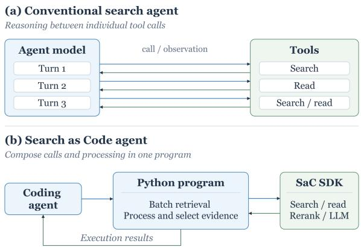
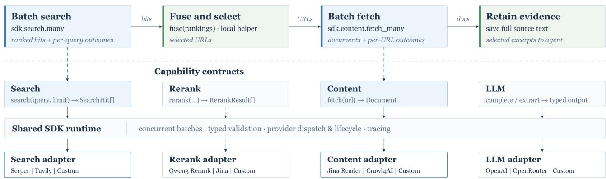

# OpenSaC: A Python Library for Search as Code in Deep Research Agents

Qi Liu   
qiliu6777@gmail.com   
Renmin University of China   
Beijing, China   
Jiaxin Mao   
maojiaxin@gmail.com   
Renmin University of China   
Beijing, China

Tat-Seng Chua dcscts@nus.edu.sg National University of Singapore Singapore, Singapore

Fengbin Zhu fengbin@nus.edu.sg National University of Singapore Singapore, Singapore

Ji-Rong Wen   
jrwen@ruc.edu.cn   
Renmin University of China   
Beijing, China

## Ab<sub>s</sub>t<sub>rac</sub>t

Deep research agents investigate complex questions through iterative search, source examination, and evidence synthesis. A conventional workflow alternates reasoning with individual search and reading actions. Search as Code introduces a new paradigm: agents write programs that compose search, source reading, reranking, model calls, and local processing, returning selected observations for further reasoning. To support this workflow in existing coding agents, we present OpenSaC, an open-source Python library with a companion Search as Code skill. Configurable capability interfaces let agents combine these operations while retaining evidence for inspection and reuse. Compared with standard Codex using its built-in web search, the OpenSaC configuration uses less execution time and fewer model tokens on BrowseComp and WideSearch, with higher accuracy on BrowseComp and slightly lower row F1 on WideSearch. We aim to lower the barrier to adopting Search as Code and provide an open foundation for community development and transparent research on deep research agents.

## CCS Conce<sub>p</sub>ts

• Information systems → Web searching and information discovery; • Computing methodologies → Intelligent agents.

## Ke<sub>y</sub>words

Search as Code, Deep Research Agents, Python library

ACM Reference Format:   
Qi Liu, Jiaxin Mao, Fengbin Zhu, Tat-Seng Chua, and Ji-Rong Wen. 2026. OpenSaC: A Python Library for Search as Code in Deep Research Agents. In . ACM, New York, NY, USA, 4 pages. https://doi.org/10.1145/nnnnnnn. nnnnnnn

Source code: https://github.com/liuqi6777/OpenSaC

  
Fi<sub>g</sub>ure 1: Com<sub>p</sub>arin<sub>g</sub> with tool-callin<sub>g</sub> a<sub>g</sub>ent<sub>,</sub> Search as Code com<sub>p</sub>oses SDK calls and local <sub>p</sub>rocessin<sub>g</sub> within a <sub>p</sub>ro<sub>g</sub>ram<sub>,</sub> returnin<sub>g</sub> execution results for further reasonin<sub>g</sub>.

## 1 I<sub>n</sub>t<sub>ro</sub>d<sub>uc</sub>ti<sub>on</sub>

Deep research agents investigate complex questions through iterative information gathering, source examination, and evidence synthesis [1, 5]. An agent must break a question into information needs, find relevant sources, reconcile their contents, and decide whether the evidence is suficient to answer. For example, comparing labor markets across states requires locating unemployment, employment, and earnings series, checking their definitions, and aligning observations across places and months. Producing a verifiable answer therefore requires coordinating retrieval with the processing and organization of evidence.

To carry out this process, a conventional approach alternates model reasoning with individual search and page-reading actions, following the reasoning–action loop exemplified by ReAct [12]. The agent receives tool outputs and then chooses its next action. This interaction is useful when new evidence determines what to do next. Within a research task, however, many requests have inputs that are already known, and operations such as merging candidates, filtering passages, or parsing records can proceed without another model decision. Returning every intermediate result to the model adds interactions and context that these operations do not require. Grouping them into executable programs allows the agent to reserve further reasoning for decisions that depend on new evidence.

  
Figure 2: Program com<sub>p</sub>osition and <sub>p</sub>rovider dis<sub>p</sub>atch in OpenSaC. fuse runs locall<sub>y</sub>, while <sub>p</sub>rovider-backed ca<sub>p</sub>abilities use a shared runtime for concurrenc<sub>y,</sub> dis<sub>p</sub>atch<sub>,</sub> lifec<sub>y</sub>cle mana<sub>g</sub>ement<sub>,</sub> and tracin<sub>g</sub>. Ada<sub>p</sub>ter choices illustrate extensibilit<sub>y</sub>: Tavil<sub>y,</sub> Qwen3 Rerank Jina Rerank and Crawl4AI re uire extensions while O enRouter is an O enAI-com atible end oint. Custom adapters use Python entry points. The program is schematic; Listings 1 and 2 show recorded case-study programs (Section 3.3).

Search as Code, proposed by Perplexity [8], realizes this idea by making an executable program the unit of interaction. The agent writes code that combines search, reading, reranking, and model calls with local processing, then returns selected execution results for further reasoning. Independent searches can run in a batch, candidates can be merged before reading, and full sources can be saved while only relevant passages enter the agent’s context. The agent then uses these observations to decide whether to answer or revise its research plan. The Programmatic Search Agents (PSA) framework likewise explores executable search cells and selective evidence presentation [9]. Direct Corpus Interaction (DCI) gives agents terminal-based access to a locally available corpus [4], whereas open-web research also requires source discovery and fetching.

Putting this paradigm into practice requires more than access to a hosted search service or a Python interpreter. Perplexity’s public Search SDK [7] provides hosted search and page snippets through a Python wrapper around a compiled core; it does not expose the implementation of the full SaC architecture. Building an open framework for existing coding agents requires composable interfaces across independently configurable providers, and agents need guidance on composing calls, retaining sources, and selecting observations. For transparent research, users must also be able to inspect the generated program and its evidence, and change a strategy or provider without rebuilding the surrounding workflow. Our goal is to bring these capabilities into existing coding agents through an open library and explicit guidance for program composition.

To this end, we present OpenSaC, an open-source Python library and companion Search as Code skill that provides instructions for composing research programs in agents such as Codex and Claude Code. The library provides composable interfaces for search, content fetching, reranking, and optional language-model calls through independently configurable providers. The skill guides agents to combine these operations with ordinary Python in their existing workspace. Together, they let agents batch requests, process results, retain sources, and return selected evidence within the host agent’s workflow. Figure 1 contrasts the interaction patterns, and Figure 2 outlines the supporting architecture.

We evaluate the OpenSaC configuration against standard Codex with built-in web search on BrowseComp [10] and WideSearch [11]. The OpenSaC configuration uses less execution time and fewer model tokens on both benchmarks; answer quality improves on BrowseComp and declines slightly on WideSearch. We also demonstrate with some cases to show how the agent works with the search-as-Code workflow. By making generated programs and retained evidence available for inspection and modification, OpenSaC aims to lower the barrier to adopting Search as Code and provide a shared foundation for community development and transparent academic research on deep research agents.

## 2 S<sub>y</sub>stem O<sub>v</sub>er<sub>v</sub>ie<sub>w</sub>

## 2.1 From an a<sub>g</sub>ent decision to an observation

OpenSaC separates the agent’s research decisions from program execution. The coding agent chooses the next steps and writes a Python program that combines software development kit (SDK) calls with local computation and file operations. The library supplies typed interfaces for search, content fetching, reranking, and model calls; the host executes the program. Selected execution results return to the agent, which decides whether to answer or investigate further. These observations can include source excerpts, extracted records, computed summaries, or errors.

Figure 2 illustrates a possible labor-statistics program. Independent searches cover unemployment, employment, and earnings series; the program merges rankings, selects URLs, fetches data, and retains responses before returning records. Grouping known requests leaves the agent to identify gaps and decide on follow-up queries.

Table 1: Core SDK methods. Batch <sub>v</sub>ariants <sub>p</sub>reser<sub>v</sub>e in<sub>p</sub>ut <sub>or</sub>d<sub>er</sub> <sub>an</sub>d <sub>re</sub>t<sub>urn</sub> <sub>per-</sub>i<sub>npu</sub>t d<sub>a</sub>t<sub>a</sub> <sub>or</sub> <sub>errors.</sub> L<sub>oca</sub>l h<sub>e</sub>l<sub>pers</sub> <sub>ma</sub>k<sub>e</sub> <sub>no</sub> <sub>prov</sub>id<sub>er</sub> <sub>ca</sub>ll<sub>s.</sub>
<table><tr><td>Method</td><td>Operation</td></tr><tr><td>search</td><td>Find and rank web pages</td></tr><tr><td>search.many</td><td>Run independent searches in a batch</td></tr><tr><td>content.fetch</td><td>Fetch text from a URL</td></tr><tr><td>content.fetch_many</td><td>Fetch text from multiple URLs</td></tr><tr><td>rerank</td><td>Reorder items by query relevance</td></tr><tr><td>11m.complete</td><td>Generate text from a prompt</td></tr><tr><td>11m.complete_many</td><td>Generate text for each prompt</td></tr><tr><td>11m.extract</td><td>Extract fields matching a schema</td></tr><tr><td>11m.extract_many</td><td>Extract fields from multiple texts</td></tr><tr><td>fuse</td><td>Merge ranked lists into one ranking</td></tr><tr><td>dedup</td><td>Remove duplicates by URL or key</td></tr></table>

## 2.2 Com<sub>p</sub>osable ca<sub>p</sub>abilities

Table 1 summarizes the core SDK methods. We expose information acquisition and evidence processing as separate capabilities so that agents can compose a workflow around the current information need. A program may stop after search, fetch known URLs directly, or use reranking and model-based extraction only when needed. Each capability is configured independently, including model calls that use an endpoint separate from the coding agent’s model.

Shared result types let programs connect capabilities without parsing each backend’s response format. Search hits carry URLs, titles, snippets, domains, and optional dates; fetched documents preserve their requested URLs. Reranking returns original objects, retaining source identifiers and attached fields. These choices pre serve the connection between processed evidence and its source. We also distinguish reformulations of one intent, which share a fused ranking, from independent information needs, whose batch outcomes remain separate. The agent can thus choose where to combine evidence rather than inherit a fixed pipeline.

## 2<sub>.</sub>3 Pr<sub>og</sub>r<sub>a</sub>m <sub>e</sub>x<sub>ecu</sub>ti<sub>o</sub>n <sub>a</sub>nd SDK r<sub>u</sub>ntim<sub>e</sub>

The host executes programs and provides a workspace for retained evidence. The synchronous SDK bridges to an asynchronous run time that manages capability calls.

Supporting Searc<sup>h</sup> as Code. Programs use the host’s workspace to retain sources and intermediate results across executions. They can save full documents with their URLs, return selected excerpts, and reuse saved text in later programs. Local helpers complement this workspace: fuse merges ranked lists through weighted re ciprocal rank fusion, and dedup removes repeated identities. Both preserve original objects, default to exact URL keys, and accept custom keys. Together, local helpers and ordinary file operations let programs combine evidence, retain sources, and select what to return to the agent.

Supporting re<sup>l</sup>iab<sup>l</sup>e execution. The runtime bounds concurrent provider requests, applies per-request timeouts, and validates inputs and outputs. Input-aligned batch outcomes preserve successful results when individual requests return errors, so programs can inspect failures and selectively retry. Providers are loaded on first use, reused across calls, and closed with the SDK. Optional hostcontrolled logging records capability calls, outcomes, and durations for inspection. The host controls program execution and the overall task budget.

## 2.4 Provider dis<sub>p</sub>atch

Research workflows may require diferent search services, content readers, or model endpoints. Provider dispatch separates these backend choices from program composition, allowing each capability to be configured independently.

Adapters map shared capability contracts to each backend’s request and response formats. They register through Python entry points; the runtime routes calls to the configured adapter for each capability. Included adapters support Serper and Jina Reader, HTTP backends, and model endpoints compatible with the OpenAI API.

Users can combine services, replace backends while retaining program logic, or compare provider configurations with the same program. Developers can connect new services through custom adapters without modifying the core library (Figure 2).

## 2<sub>.</sub>5 A<sub>gen</sub>t i<sub>n</sub>t<sub>egra</sub>ti<sub>on</sub>

OpenSaC pairs the library with a companion Search as Code skill that guides agents in composing research programs. The library supplies executable capabilities; the skill explains when to batch independent requests, preserve sources, select observations, and reuse evidence. This guidance is provided through the skill mechanisms of coding agents such as Codex and Claude Code [2, 6].

The skill works with the agent’s existing Python execution and file tools. Users can revise its guidance to explore diferent batch ing, evidence-selection, and reuse strategies within the same host workflow.

## 3 Ex<sub>p</sub>eriments

We evaluate answer quality and execution eficiency on two benchmarks, then illustrate the workflow with a recorded case study.

## 3.1 Ex<sub>p</sub>erimental setu<sub>p</sub>

We evaluate English BrowseComp fact finding [10] and WideSearch information collection [11] on paired task sets drawn from 200 tasks per benchmark. We ran both conditions through Harbor [3] and archived trajectories, outputs, and grader results on Harbor Hub; we report paired, audited subsets. The native condition uses the standard Codex environment with its built-in web search. The Open-SaC condition uses the package and skill, with native web search disabled. Both conditions use Codex 0.147.0 with gpt-5.6-luna, xhigh reasoning, and a 30-minute task budget.

Quality is answer accuracy for BrowseComp and macro row F1 for WideSearch, with failed runs included. We exclude 31 BrowseComp tasks and 33 WideSearch tasks whose saved trajectories show that benchmark answer materials exposed the current task’s answers to the agent in either condition. We further exclude one WideSearch task with a blocked output stream under OpenSaC, leaving 169 and 166 paired tasks, respectively. Reported WideSearch scores include targeted manual corrections for four tasks in both conditions, addressing grading issues involving units, formatting, and entity aliases without changing predictions or reference answers. We report mean agent execution time, cumulative input and output tokens, and recorded model cost over one run per task. Time excludes setup and judging; cost excludes retrieval-provider charges.

Table 2: Nati<sub>v</sub>e retrie<sub>v</sub>al and OpenSaC on Bro<sub>w</sub>seCom<sub>p</sub> and WideSearch. Quality is accuracy or macro row F1, respecti<sub>ve</sub>l<sub>y;</sub> ti<sub>me,</sub> t<sub>o</sub>k<sub>ens,</sub> <sub>an</sub>d <sub>recor</sub>d<sub>e</sub>d <sub>mo</sub>d<sub>e</sub>l <sub>cos</sub>t <sub>are</sub> <sub>per-</sub>t<sub>as</sub>k <sub>means.</sub> F<sub>a</sub>il<sub>e</sub>d <sub>runs</sub> <sub>an</sub>d <sub>cac</sub>h<sub>e</sub>d i<sub>npu</sub>t t<sub>o</sub>k<sub>ens</sub> <sub>are</sub> i<sub>nc</sub>l<sub>u</sub>d<sub>e</sub>d<sub>.</sub>
<table><tr><td>Benchmark</td><td>Condition Quality (%)</td><td></td><td>Time (s)</td><td>) Tokens (k)</td><td>Cost ($)</td></tr><tr><td>BrowseComp</td><td>Native</td><td>82.25</td><td>473.01</td><td>4102.9</td><td>0.14324</td></tr><tr><td></td><td>OPENSAC</td><td>85.21</td><td>329.59</td><td>2552.1</td><td>0.09117</td></tr><tr><td>WideSearch</td><td>Native</td><td>60.62</td><td>767.01</td><td>5416.0</td><td>0.18631</td></tr><tr><td></td><td>OPENSAC</td><td>59.78</td><td>540.36</td><td>4667.0</td><td>0.16286</td></tr></table>

## 3<sub>.</sub>2 R<sub>esu</sub>lt<sub>s</sub>

On BrowseComp, OpenSaC improves accuracy by 2.96 percentage points while reducing mean execution time by 30.3% (Table 2). Across the 169 paired tasks, OpenSaC answers 14 questions cor rectly that native retrieval misses, while native retrieval answers nine that OpenSaC misses. Model token usage falls by 37.8%, accompanied by a 36.4% reduction in recorded model cost.

On WideSearch, OpenSaC reduces mean execution time by 29.5%, saving about 227 seconds per task, while row F1 declines by 0.84 percentage points. Model token usage falls by 13.8% and recorded model cost by 12.6%. The time reduction is similar across benchmarks, but token and model-cost savings are larger on BrowseComp, where accuracy also improves.

## 3.3 Case stud<sub>y</sub>: collectin<sub>g</sub> labor statistics

The case study illustrates how the agent selects sources while code batches retrieval and parses monthly records. In a recorded WideSearch run, the task requests six monthly labor measures for Alabama, Georgia, Louisiana, and Mississippi from January through June 2024. Codex first searched for statistical series in a batch (Listing 1). After examining the sources, it fetched Bureau of Labor Statistics (BLS) and Federal Reserve Economic Data (FRED) endpoints in batches and parsed the responses in Python (Listing 2). The complete run produced a 24-row Markdown table. The excerpts omit query and URL setup, error checks, FRED CSV parsing, and final formatting.

## 4 C<sub>o</sub>n<sub>c</sub>l<sub>us</sub>i<sub>o</sub>n <sub>a</sub>nd F<sub>u</sub>t<sub>u</sub>r<sub>e</sub> W<sub>o</sub>rk

OpenSaC enables coding agents to compose retrieval operations in inspectable programs and retain evidence for reuse. With skill guidance, it reduced execution time and model token use on both benchmarks; accuracy improved on BrowseComp, while row F1 declined slightly on WideSearch.

Improving how agents use SaC-like paradigms remains open. Better provider services could expand source coverage and improve the relevance and reliability of evidence. Skill guidance could be optimized through evaluation, including methods that let agents propose and test revisions. Supervised fine-tuning and reinforcement

Listin<sub>g</sub> 1: A<sub>g</sub>ent-written batch search for statistical sources (excerpt).

```python
batches = sdk.search.many(queries, limit=8)
for q, result in zip(queries, batches, strict=True):
print('\nQUERY:', q)
if result.ok:
for h in result.data:
print(f'- {h.title} | {h.url}\n'
f' {h.snippet[:400]}')
else:
print('ERROR', result.error.code, result.error.message)
```

Listin<sub>g</sub> 2: A<sub>g</sub>ent-written batch retrieval of BLS and FRED data and BLS record parsing (excerpt).

```python
api_results = sdk.content.fetch_many(api_urls)
fred_results = sdk.content.fetch_many(fred_urls)
api_data = {}
for url, res in zip(api_urls, api_results, strict=True):
sid = url.split('/timeseries/data/')[1].split('?')[0]
fence = chr(96) * 3
raw = re.sub(rf'^{fence}(?:json)?\s*|\s*{fence}\s*$',
', res.data.text.strip(), flags=re.S)
obj = json.loads(raw)
dat = obj['Results']['series'][0]['data']
api_data[sid] = {
f"{x['year']}-{int(x['period'][1:]):02d}": x['value']
for x in dat if x['period'].startswith('M')
and x['period'] != 'M13'
}
```

learning could help agents choose and compose operations and recover from failures. OpenSaC’s common interfaces, interchangeable providers, and inspectable programs provide a foundation for future research.

## R<sub>e</sub>f<sub>erences</sub>

[1] Anthropic. 2025. How We Built Our Multi-Agent Research System. Anthropic Engineering. https://www.anthropic.com/engineering/multi-agent-researchsystem Accessed 2026-10-15.

[2] Anthropic. 2026. Extend Claude with Skills. Claude Code documentation. https: //code.claude.com/docs/en/skills Accessed 2026-10-06.

[3] Harbor Framework Team. 2026. Harbor: A Frameworkfor Evaluating and Optimizing Agents and Models in Container Environments. doi:10.5281/zenodo.20953922

[4] Zhuofeng Li, Haoxiang Zhang, Cong Wei, Pan Lu, Ping Nie, et al. 2026. Beyond Semantic Similarity: Rethinking Retrieval for Agentic Search via Direct Corpus Interaction. arXiv:2605.05242 https://arxiv.org/abs/2605.05242

[5] OpenAI. 2025. Introducing Deep Research. OpenAI. https://openai.com/index/ introducing-deep-research/ Accessed 2026-10-15.

[6] OpenAI. 2026. Build Skills. Oficial documentation. https://learn.chatgpt.com/ docs/build-skills Accessed 2026-10-06.

[7] Perplexity. 2026. Perplexity Search SDK. GitHub repository. https://github.com/ perplexityai/perplexity-search-sdk Accessed 2026-09-20.

[8] Perplexity. 2026. Rethinking Search as Code Generation. Perplexity Research. https://research.perplexity.ai/articles/rethinking-search-as-code-generation Ac cessed 2026-09-20

[9] Jiaming Qian, Huiyan Yang, Mandi Liu, Jie Liu, Wenkai Shen, Pengyang Zhou, JingJin,Jin Ma, Dezhi Ye, and Chaochao Chen. 2026. Programmatic Search Agents: Extending Agentic Search Beyond Query Reformulation. arXiv:2610.06689 https: //arxiv.org/abs/2610.06689

[10] Jason Wei, Zhiqing Sun, Spencer Papay, et al. 2025. BrowseComp: A Simple Yet Challenging Benchmark for Browsing Agents. arXiv:2504.12516 https://arxiv. org/abs/2504.12516

[11] Ryan Wong, Jiawei Wang, Junjie Zhao, et al. 2025. WideSearch: Benchmarking Agentic Broad Info-Seeking. arXiv:2508.07999 https://arxiv.org/abs/2508.07999

[12] Shunyu Yao, Jefrey Zhao, Dian Yu, Nan Du, Izhak Shafran, Karthik Narasimhan, and Yuan Cao. 2023. ReAct: Synergizing Reasoning and Acting in Language Models. International Conference on Learning Representations. https://arxiv. org/abs/2210.03629