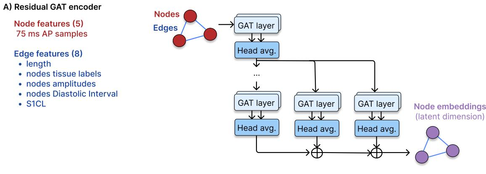
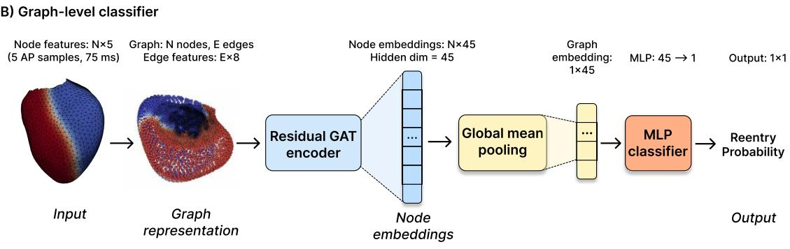
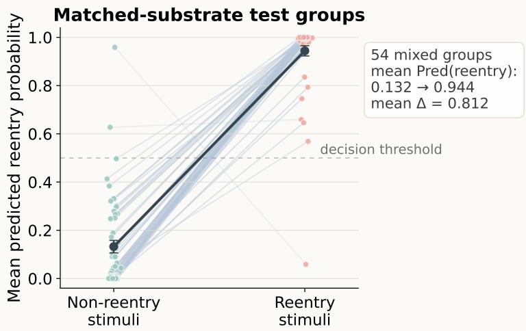
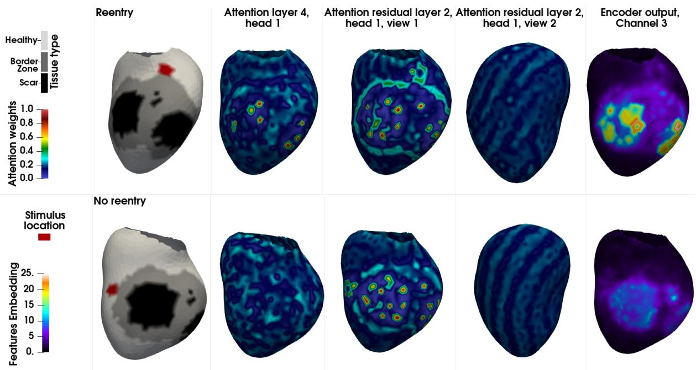

# Physiology-Aware Graph Attention for Early Ventricular Reentry Prediction

Maëlis Morier 1, Jairo Rodríguez Padilla 1, Patrick Gallinari 2,3, and Maxime Sermesant 1

1Epione Research Team, Inria, Université Côte d’Azur, France 2Sorbonne Université, CNRS, ISIR, 75005 Paris, France 3Criteo AI Lab, Paris, France

## Abstract

Sudden cardiac death mostly originates from post-infarct ventricular tachycardia. This reentry is sustained by propagation around scar tissue, but its risk remains dificult to predict from infarct imaging alone. While in silico induction studies can reveal these mechanisms, exploring many substrates and pacing locations remains computationally expensive. We propose a graph attention classifier for early prediction of sustained ventricular reentry from simulated cardiac electrophysiology. Each simulation is represented as a graph with early nodal voltage samples and edge attributes encoding geometry, stimulation frequency, tissue labels, amplitude, and diastolic interval. These descriptors are computed only from the first two paced activations, before sustained reentry is observed. On a balanced independent test set of 1000 simulations, the classifier achieves 94.6% accuracy, 95.4% sensitivity, 93.8% specificity, 94.6% F1-score, 0.987 ROC-AUC, and 0.985 PR-AUC. Ablation experiments show that diastolic interval is the most critical descriptor. Qualitative attention inspection suggests that diferent heads focus on border-zone, stimulation location, and early propagation path. These results support graph attention as a fast early-prediction approach for large-scale in silico ventricular reentry studies. Keywords: Cardiac electrophysiology; Ventricular

tachycardia; Reentry detection; Graph attention networks

## 1 Introduction

Ventricular tachycardia (VT) after myocardial infarction is often sustained by reentrant circuits around scar and border-zone tissue [6, 9]. The formation of such circuits depends on the interaction between scar geometry, local recovery, slow-conducting tissue, and the stimulation site. Patient-specific electrophysiology simulations can reproduce pacing protocols and study VT inducibility [20, 5, 24]. However, testing many scar configurations and pacing locations remains computationally expensive.

A fast model able to identify simulations likely to develop reentry could accelerate largescale in silico studies. This is especially useful because autoregressive models can accumulate errors during long rollouts [2], while reentry detection only requires predicting whether sustained activity will occur.

Graph neural networks (GNNs) are well suited to this problem because cardiac meshes are naturally represented as graphs [16]. Previous graph-based approaches have mainly focused on activation-map estimation or surrogate modeling of cardiac electrical propagation [16, 18, 14]. Other machine-learning methods have addressed arrhythmia classification from ECG signals, rotor localization, or prediction of action potential traces [26, 12, 15, 22]. In contrast, we study early reentry prediction directly on irregular cardiac meshes.

Our proposed approach is a physiology-aware graph attention classifier for early prediction of sustained ventricular reentry. Each simulation is represented as a graph, with nodes containing early voltage samples, and edge attributes describing geometry and physiological information. The model predicts whether the simulation will later develop sustained reentry, without observing the reentry phase itself. Our contributions are:

1. A graph attention classifier for early prediction of sustained ventricular reentry from simulated cardiac electrophysiology.

2. An ablation study showing the role of diastolic interval, tissue labels, geometry, and early voltage information.

3. An exploratory inspection of attention maps as qualitative explanations.

  
Figure 1: Overview of the proposed graph classifier. A residual GAT encoder produces node embeddings, which are averaged into a graph-level representation and passed to an MLP classifier to predict sustained reentry.

## 2 Methods

Figure 1 summarizes the full pipeline. We first generate simulated cardiac graphs from ventricular meshes with scar and border-zone regions. Each graph contains early AP samples as node features and physiological descriptors as edge features. A residual GAT encoder then maps the graph to node embeddings, which are pooled and classified to predict sustained reentry.

## 2.1 Electrophysiology Simulations

Synthetic simulations. We generated ventricular action-potential (AP) simulations using a modified Mitchell–Schaefer (MS) model [17], which describes the normalized transmembrane

potential $u \in [ 0 , 1 ]$ and a recovery variable $h \in [ 0 , 1 ]$

$$
\begin{array} { r l } & { \partial _ { t } u = \mathrm { d i v } ( \mathbf { D } \nabla u ) + \frac { h u ( u - \lambda ) ( u _ { \mathrm { m a x } } - u ) } { \tau _ { \mathrm { i n } } } - \frac { u } { \tau _ { \mathrm { o u t } } } + J _ { \mathrm { s t i m } } , } \\ & { \partial _ { t } h = \left\{ \begin{array} { l l } { ( 1 - h ) / \tau _ { \mathrm { o p e n } } , } & { u \leq u _ { \mathrm { g a t e } } , } \\ { - h / \tau _ { \mathrm { c l o s e } } , } & { u > u _ { \mathrm { g a t e } } . } \end{array} \right. } \end{array}\tag{1}
$$

Here, D is the difusion tensor and $J _ { \mathrm { s t i m } }$ is the external stimulus. Further model details are given in [8]. All simulations used the same MS ionic parameter setting. Parameter values for healthy tissue were: $\tau _ { \mathrm { i n } } = 0 . 3 , \tau _ { \mathrm { o u t } } = 6 , \tau _ { \mathrm { o p e n } } = 1 2 0 , \tau _ { \mathrm { c l o s e } } = 1 5 0 , u _ { \mathrm { g a t e } } = 0 . 1 3 , u _ { \mathrm { m a x } } = 1 , \lambda = 0 . 0 1 $ , and $D = 0 . 1 5$ . For border-zone tissue: $\tau _ { \mathrm { i n } } = 0 . 3 , \tau _ { \mathrm { o u t } } = 6 , \tau _ { \mathrm { o p e n } } = 1 2 0 , \tau _ { \mathrm { c l o s e } } = 2 6 5 , u _ { \mathrm { g a t e } } = 0 . 1 3$ $u _ { \mathrm { m a x } } = 0 . 9 , \lambda = 0 . 1 4$ , and $D = 0 . 0 3$ . Scar tissue used the border-zone time constants and gate threshold, with $u _ { \mathrm { m a x } } = 0$ and $\lambda = 0 . 2 5$ . The pacing cycle length was $S 1 C L = 3 1 0$ . All time constants and S1CL are in ms, except $u _ { m a x } , ~ u _ { g a t e }$ and λ (dimensionless). The meshes were derived from [10, 13]. For each mesh, scar and border-zone regions were generated procedurally by sampling patch centers, assigning nearby nodes as border-zone tissue, and embedding smaller low-conductivity scar islands. Simulations were run for 6.1 s using an implicit–explicit timeintegration scheme [1, 21].

Dataset splitting. The dataset was split by original anatomy to evaluate generalization to unseen meshes. The training set contains simulations from 12 meshes, the validation set from 4 meshes, and the test set from 2 held-out meshes. For each mesh, multiple scar/border-zone configurations and stimulation locations were simulated. Thus, the same anatomical substrate could produce either reentry or non-reentry depending on the pacing site. This design reduces the risk of solving the task by scar recognition alone.

The dataset contains 5000 training simulations, 2004 validation simulations, and a balanced independent test set of 1000 simulations. The training and validation sets were imbalanced, with reentry cases representing roughly 15–22% of the simulations, reflecting the lower prevalence of sustained reentry in the generated dataset. In contrast, the independent test set was balanced with 500 cases per class to evaluate sensitivity and specificity under controlled conditions.

Reentry labels. Labels were assigned from the full simulation outcome. A simulation was labelled as reentry when organized reentrant activity persisted until $t = 6 ~ \mathrm { s } .$ , and as non-reentry otherwise. We used this threshold as a practical compromise between computational and clinical criteria for sustained ventricular tachycardia [4, 19]. As a sensitivity check, we recomputed labels on the test set using earlier late-activity thresholds of 4.0, 5.0, and 5.5 s.

Graph representation. Each simulation mesh was represented as a graph, with mesh vertices as nodes and mesh adjacency as edges. Node features contained the first five saved voltage samples, corresponding to 75 ms of transmembrane voltage. This short window captures the beginning of the paced activation, before sustained reentry develops. Edge attributes encoded edge length, tissue labels, stimulation frequency, and node-wise amplitude and diastolic interval (DI) values for the two incident nodes. Amplitude and DI were computed only from the first two paced activations, before sustained reentry was observed. DI was defined as the interval between repolarization after the first paced activation and the next paced activation. The stimulation frequency was kept for compatibility with future variable pacing protocols, although it was fixed in the present dataset and therefore did not carry discriminative information here. Together, these features provide pre-reentry information about local geometry, tissue organization, and recovery timing.

## 2.2 Proposed Model

Graph Classifier. The proposed classifier takes as input the cardiac graph described above. We use an edge-conditioned GATv2 encoder [25, 3], so that message passing can depend on both the local AP state and the edge descriptors.

The encoder contains six GATv2 layers with two attention heads per layer and a hidden dimension of 45. The final two layers include additive residual connections from the first hidden representation, following the common use of residual connections to improve information flow in deeper neural networks [11]. The node embeddings are aggregated with global mean pooling and passed to an MLP that outputs one logit for graph-level reentry classification.

Training details. Models were trained on the training split, with checkpoints selected on the validation dataset and final performance reported only on the independent test set. To account for class imbalance during training, we used class-weighted binary cross-entropy. The positiveclass weight was set to the non-reentry $/$ reentry ratio. We used AdamW with learning rate $1 0 ^ { - 4 }$ , weight decay $1 0 ^ { - 6 }$ , batch size $^ { 8 , }$ and gradient clipping with maximum norm 1.0. Models were trained for up to 1000 epochs, while retaining the checkpoint with the highest validation F1-score. The learning rate was reduced when the validation F1-score plateaued (factor 0.5, patience 15 epochs, minimum learning rate $1 0 ^ { - 6 } )$ . A fixed threshold of 0.5 was used to classify test simulations as reentry or non-reentry. This threshold was used as a fixed operating point for sensitivity and specificity, while ROC-AUC and PR-AUC were reported as threshold-independent metrics.

Non-graph baselines. We also evaluated two non-graph baselines. The SVM-RBF baseline used one 26-dimensional global summary vector per simulation. The NodeMLP baseline used node-level voltage, amplitude, DI, and tissue inputs, followed by mean/max pooling, but no graph message passing.

## 3 Experiments and Results

## 3.1 Classification Performance

Balanced evaluation. Across five independent random seeds, performance was stable on the balanced anatomy-disjoint test set, with 93.94 ± 0.49% accuracy and 93.98 ± 0.44% F1-score. We report the seed selected by validation F1 as the main model. It achieved 94.6% accuracy, 93.9% precision, 95.4% sensitivity, 93.8% specificity, 94.6% F1-score, 0.987 ROC-AUC, and 0.985 PR-AUC, with 477 true positives, 469 true negatives, 31 false positives, and 23 false negatives. This indicates that sustained reentry can be predicted with high sensitivity from early activation information and graph-level physiological descriptors, while maintaining good specificity.

Threshold and calibration. The threshold 0.5 was used as a fixed operating point, while ROC-AUC and PR-AUC were reported as threshold-independent metrics. The Brier score was 0.0505 and the 10-bin expected calibration error was 0.0312. Because the model was trained with class-weighted loss on synthetic data, probabilities are interpreted as screening scores rather than calibrated clinical risks. Recomputing the sustained-reentry label at 5.0 and 5.5 s gave identical labels to the original 6.0 s criterion, and using 4.0 s changed only one test label.

Imbalanced evaluation. We also evaluated the same trained model on an imbalanced subset of the independent test set, using the same held-out meshes but a lower reentry prevalence of approximately 20%. This proportion was chosen within the range of reported clinical inducibility rates [23, 7]. The same decision threshold was used, without additional tuning. On this subset, the model achieved 94.6% accuracy, 93.2% specificity, and 88.1% F1-score, with 63 true positives, 233 true negatives, 17 false positives, and no false negatives. This corresponds to 100.0% sensitivity on the 63 reentry cases, which should be interpreted with caution given the smaller number of positives. Precision decreased to 78.8%, as expected under lower reentry prevalence.

Matched-substrate evaluation. To verify that the model was not simply recognizing scar patterns, we analyzed test cases with the same mesh and scar/border-zone configuration but diferent stimulation locations, producing both reentry and non-reentry propagation. Among 113 matched-substrate groups in the test set, 54 contained both reentry and non-reentry outcomes. When averaging predictions within each matched-substrate group, the mean predicted probability increased from 0.132 for non-reentry stimuli to 0.944 for reentry stimuli (Fig. 2).

  
Figure 2: Matched-substrate analysis. Lines connect mean reentry probabilities for non-reentry and reentry stimuli with the same substrate.

## 3.2 Ablation Study and Baselines

Table 1 summarizes the ablation experiments on the balanced test set.

Architectural baselines. The full model achieved high sensitivity while maintaining good specificity. We compared it with two architectural baselines: a sequential GAT with the same number of GATv2 layers but without residual additions, and a GCN baseline using the same input features and number of layers. The sequential GAT remained competitive, but showed lower sensitivity. The GCN baseline detected most reentry cases, but its low specificity indicates that it misclassified many non-reentry simulations as reentry. This suggests that residual GATv2 message passing with edge-conditioned attention provides a better trade-of between detecting reentry and rejecting non-reentry cases. The SVM-RBF baseline uses global graph-summary features, while the NodeMLP uses node-level features but no message passing.

Efect of the voltage window. The short-window ablation preserved high performance with only two voltage samples, showing that the result is not driven by a finely tuned 75 ms input window. We kept the five-sample window in the proposed model because it was defined a priori as a short early observation period and achieved the best accuracy, sensitivity, and F1-score.

Input-window and feature ablations. Input and feature ablations showed that edge attributes carried most of the predictive signal. Edge attributes alone reached 91.2% accuracy and 90.6% F1-score, whereas voltage-only inputs were much less specific. Tissue tags alone predicted all cases as reentry, confirming that scar and border-zone labels are insuficient on their own. DI alone remained predictive, whereas amplitude alone missed many reentry cases.

Table 1: Ablation results on the balanced independent test set.
<table><tr><td>Model variant</td><td>Accuracy</td><td>Precision</td><td>Sensitivity</td><td>Specificity</td><td>F1</td></tr><tr><td colspan="6">Architectural and non-graph baselines</td></tr><tr><td>Proposed residual GAT</td><td>0.9460</td><td>0.9390</td><td>0.9540</td><td>0.9380</td><td>0.9464</td></tr><tr><td>Sequential GAT</td><td>0.9240</td><td>0.9398</td><td>0.9060</td><td>0.9420</td><td>0.9226</td></tr><tr><td>GCN baseline</td><td>0.6310</td><td>0.5796</td><td>0.9540</td><td>0.3080</td><td>0.7211</td></tr><tr><td>SVM-RBF, global summaries</td><td>0.8590</td><td>0.9860</td><td>0.7280</td><td>0.9900</td><td>0.8380</td></tr><tr><td>NodeMLP, no message passing</td><td>0.9130</td><td>0.9210</td><td>0.9040</td><td>0.9220</td><td>0.9120</td></tr><tr><td colspan="6">Input-window and feature ablations</td></tr><tr><td>Short voltage window (2 samples)</td><td>0.9370</td><td>0.9524</td><td>0.9200</td><td>0.9540</td><td>0.9359</td></tr><tr><td>Edge attributes only</td><td>0.9120</td><td>0.9682</td><td>0.8520</td><td>0.9720</td><td>0.9064</td></tr><tr><td>Voltage only</td><td>0.6330</td><td></td><td>0.8780</td><td>0.3880</td><td></td></tr><tr><td></td><td></td><td>0.5893</td><td></td><td></td><td>0.7052</td></tr><tr><td>Tissue tags only</td><td>0.5000</td><td>0.5000</td><td>1.0000</td><td>0.0000</td><td>0.6667</td></tr><tr><td>DI only Amplitude only</td><td>0.8990 0.5550</td><td>0.9716</td><td>0.8220 0.2260</td><td>0.9760</td><td>0.8906</td></tr><tr><td></td><td></td><td>0.6608</td><td></td><td>0.8840</td><td>0.3368</td></tr><tr><td colspan="6">Feature-drop ablations</td></tr><tr><td>No edge length</td><td>0.9010</td><td>0.9740</td><td>0.8240</td><td>0.9780</td><td>0.8927</td></tr><tr><td>No amplitude</td><td>0.9280</td><td>0.9693</td><td>0.8840</td><td>0.9720</td><td>0.9247</td></tr><tr><td>No DI</td><td>0.6440</td><td>0.6417</td><td>0.6520</td><td>0.6360</td><td>0.6468</td></tr><tr><td>No tissue tags</td><td>0.9090</td><td>0.9745</td><td>0.8400</td><td>0.9780</td><td>0.9023</td></tr></table>

Feature-drop ablations. Feature-drop ablations further confirmed the importance of DI. Removing DI caused the largest degradation, with an F1-score of 0.6468 and lower sensitivity and specificity. This efect is physiologically plausible: DI summarizes local recovery timing after the early paced activations, indicating which regions are excitable, partially recovered, or still refractory when the next wavefront arrives. Since reentry depends on the combination of delayed propagation and heterogeneous recovery around scar and border-zone tissue, DI provides a key descriptor of the vulnerable substrate.

Overall interpretation. Removing amplitude, edge length, or tissue tags caused smaller performance drops than removing DI. Overall, these results indicate that the model does not rely on scar geometry alone. Instead, it combines recovery timing, geometry, amplitude, tissue labels, and early voltage information to obtain a balanced prediction.

## 3.3 Computational Cost

To quantify the potential benefit of early screening, we compared the runtime of the full simulation pipeline with the inference time of the trained classifier. The full pipeline, including Mitchell–Schaefer simulation and conversion to graph format, required $1 0 7 6 . 6 \pm 2 1 5 . 8$ s per simulated case on CPU. Classifier inference was measured on the same CPU architecture. Forward inference on the 1000 test graphs required $1 1 . 3 5 \pm 0 . 0 6$ ms per graph. This corresponds to an approximate forward-inference speed-up of $9 . 5 \times 1 0 ^ { 4 }$ compared with the full simulation pipeline. Including graph loading, model-side evaluation remained approximately $5 . 0 \times 1 0 ^ { 4 }$ faster. This comparison should be interpreted as an order-of-magnitude runtime estimate rather than a lowlevel solver benchmark, but it supports the use of the classifier as a fast screening step before running full electrophysiology simulations.

## 3.4 Model Inspection

We inspected attention maps to see which regions were highlighted by the classifier before graphlevel pooling. This analysis is qualitative only.

Qualitative attention maps. Figure 3 shows selected maps for a matched reentry and nonreentry pair. The first column shows tissue type and stimulation site. The next columns show attention maps from layer 4, head 1, and from the last residual layer in two diferent views. The last column shows channel 3 of the final node embedding before graph-level pooling. Layer 4, head 1 shows stronger localized hotspots in the reentry case than in the matched non-reentry case. A similar diference is visible in embedding channel 3, suggesting that this local attention signal may be retained in the final node representation. The residual-layer maps are more global, highlighting broader regions related to the stimulus location, scar and border-zone shape, and early propagation. Together, these maps suggest that the classifier combines localized hotspots with broader spatial information before graph-level pooling. We do not claim that these regions identify the critical isthmus or the reentry pathway. They should be interpreted as visual cues that may be interesting to inspect further. Additional propagation videos and attention-map examples are provided in the supplementary material.

Scar-associated hotspot analysis. We also analyzed layer 4, head 1 on the full balanced test set. We counted a case as having a strong scar hotspot when at least one scar node had attention above a chosen threshold. This pattern was strongly associated with reentry. At threshold 0.8, a strong scar hotspot was present in 454/500 reentry cases (90.8%), but only in 68/500 non-reentry cases (13.6%). The separation was stable across thresholds from 0.6 to 0.9: strong scar hotspots were present in 88.4–93.0% of reentry cases, compared with 8.2–21.4% of non-reentry cases. This suggests that layer 4, head 1 captures a scar-associated signal that is much more often activated in reentry simulations. These hotspots may therefore indicate regions worth inspecting further, but their physiological meaning remains to be validated.

  
Figure 3: Selected attention maps and one encoder-output channel for a matched reentry and nonreentry pair.

## 4 Limitations

This study uses synthetic Mitchell–Schaefer simulations with one global ionic parameter setting and a fixed stimulation protocol. This design isolates the efects of geometry, tissue organization, and stimulation location, but future work should test broader electrophysiological parameters, cycle lengths, pacing protocols, realistic scar morphologies, and patient-derived substrates. The train, validation, and test splits were anatomy-disjoint, but the balanced test set contained only two held-out anatomies; validation on larger and more diverse patient cohorts is therefore required. The classifier should also be interpreted as a fast simulation-screening tool, not as a calibrated clinical risk predictor, especially because training used class-weighted loss on synthetic data. The classifier predicts whether sustained reentry will occur, but does not yet localize the reentry pathway or identify an ablation target. Future work should combine early reentry prediction with localization tasks, such as critical isthmus or late-activation pathway detection. Finally, the attention maps are exploratory. They should be interpreted as visual cues. Expert review or a dedicated localization benchmark would be needed to determine whether these regions are physiologically meaningful.

## 5 Conclusion

We presented a graph-attention classifier for early prediction of sustained ventricular reentry in simulated post-infarct substrates. The model predicts future reentry from early voltage samples and physiological graph descriptors with high sensitivity and specificity. Ablation experiments show that DI is a key descriptor, but that the best performance is obtained by combining recovery timing with geometry, tissue labels, and early voltage information. Matched-substrate examples further suggest that the model captures pacing-dependent changes in reentry inducibility rather than scar geometry alone, and non-graph baselines indicate that graph message passing improves over using global or node-wise descriptors without propagation on the mesh. CPU timing suggests that the classifier can screen candidates orders of magnitude faster than running the full simulation pipeline. This approach could therefore reduce computational cost by selecting which pacing locations or substrates should be prioritized for full simulation, while future work should validate the method on more diverse and clinically realistic substrates.

## Acknowledgments

This work has received funding from the French government through the National Research Agency (ANR) PEPR Digital Health ChroniCardio project (2023000289), the ANR DeepNum project (ANR-21-CE23-0017), and through the ANR 3IA Côte d’Azur and IA Cluster project (ANR-19-3IA-0002 and ANR-23-IACL-0001). This work was granted access to the HPC resources of IDRIS under the allocation AD011015902R1 made by GENCI. The authors are grateful to the OPAL infrastructure from Université Côte d’Azur for providing resources and support.

## Disclosure of Interests

The authors have no competing interests to declare that are relevant to the content of this article.

## References

[1] Uri M Ascher, Steven J Ruuth, and Brian TR Wetton. Implicit-explicit methods for timedependent partial diferential equations. SIAM Journal on Numerical Analysis, 32(3):797– 823, 1995.

[2] Samy Bengio, Oriol Vinyals, Navdeep Jaitly, and Noam Shazeer. Scheduled Sampling for Sequence Prediction with Recurrent Neural Networks. In Advances in Neural Information Processing Systems, 2015.

[3] Shaked Brody, Uri Alon, and Eran Yahav. How Attentive are Graph Attention Networks? In International Conference on Learning Representations, 2022.

[4] Fernando O. Campos, Aurel Neic, Caroline Mendonca Costa, John Whitaker, Mark O’Neill, Reza Razavi, Christopher A. Rinaldi, Daniel Scherr, Steven A. Niederer, Gernot Plank, and Martin J. Bishop. An automated near-real time computational method for induction and treatment of scar-related ventricular tachycardias. Medical Image Analysis, 80:102483, 2022.

[5] Nicolas Cedilnik, Mihaela Pop, Josselin Duchateau, Frédéric Sacher, Pierre Jaïs, Hubert Cochet, and Maxime Sermesant. Eficient Patient-Specific Simulations of Ventricular Tachycardia Based on Computed Tomography-Defined Wall Thickness Heterogeneity. JACC: Clinical Electrophysiology, 9(12):2507–2519, 2023.

[6] P. Colli-Franzone, V. Gionti, L. F. Pavarino, S. Scacchi, and C. Storti. Role of infarct scar dimensions, border zone repolarization properties and anisotropy in the origin and maintenance of cardiac reentry. Mathematical Biosciences, 315:108228, 2019.

[7] Tejas Deshmukh, Sarah Zaman, Arun Narayan, and Pramesh Kovoor. Duration of Inducible Ventricular Tachycardia Early After ST-Segment-Elevation Myocardial Infarction and Its Impact on Mortality and Ventricular Tachycardia Recurrence. Journal of the American Heart Association, 9(13):e015204, 2020.

[8] Karima Djabella, Mayer Landau, and Michel Sorine. A two-variable model of cardiac action potential with controlled pacemaker activity and ionic current interpretation. In 2007 46th IEEE Conference on Decision and Control, pages 5186–5191, 2007.

[9] J. Kevin Donahue, Jonathan Chrispin, and Olujimi A. Ajijola. Mechanism of Ventricular Tachycardia Occurring in Chronic Myocardial Infarction Scar. Circulation research, 134(3):328–342, 2024.

[10] Terenz Escartin, Philippa Krahn, Cindy Yu, Matthew Ng, Jennifer Barry, Sheldon Singh, Graham Wright, and Mihaela Pop. The Extent of LGE-Defined Fibrosis Predicts Ventricular Arrhythmia Severity: Insights from a Preclinical Model of Chronic Infarction. In Functional Imaging and Modeling of the Heart, pages 698–707, 2023.

[11] Kaiming He, Xiangyu Zhang, Shaoqing Ren, and Jian Sun. Deep Residual Learning for Image Recognition. In 2016 IEEE Conference on Computer Vision and Pattern Recognition (CVPR), pages 770–778, 2016.

[12] Jan Lebert, Namita Ravi, Flavio H. Fenton, and Jan Christoph. Rotor Localization and Phase Mapping of Cardiac Excitation Waves Using Deep Neural Networks. Frontiers in Physiology, 12, 2021.

[13] Buntheng Ly, Sonny Finsterbach, Marta Nuñez-Garcia, Pierre Jais, Damien Garreau, Hubert Cochet, and Maxime Sermesant. Interpretable Prediction of Post-Infarct Ventricular Arrhythmia Using Graph Convolutional Network. In Statistical Atlases and Computational Models of the Heart. Regular and CMRxMotion Challenge Papers, pages 157–167, 2022.

[14] Elena Sabdy Martinez, Beatrice Moscoloni, Matteo Salvador, Fanwei Kong, Mathias Peirlinck, and Alison Lesley Marsden. Full-field surrogate modeling of cardiac electrophysiology encoding geometric variability. Computer Methods in Applied Mechanics and Engineering, 448:118444, 2026.

[15] Max Falkenberg McGillivray, William Cheng, Nicholas S. Peters, and Kim Christensen. Machine learning methods for locating re-entrant drivers from electrograms in a model of atrial fibrillation. Royal Society Open Science, 5(4):172434, 2018.

[16] Felix Meister, Tiziano Passerini, Chloe Audigier, Eric Lluch, Viorel Mihalef, Hiroshi Ashikaga, Andreas Maier, Henry Halperin, and Tommaso Mansi. Graph convolutional regression of cardiac depolarization from sparse endocardial maps. In Statistical Atlases and Computational Models of the Heart, 2020.

[17] C Mitchell. A two-current model for the dynamics of cardiac membrane. Bulletin of Mathematical Biology, 65(5):767–793, 2003.

[18] Maelis Morier, Jairo Rodríguez Padilla, Patrick Gallinari, and Maxime Sermesant. Learning Cardiac Electrophysiology with Graph Neural Networks for Fast Data-Driven Personalised Predictions. In Functional Imaging and Modeling of the Heart, pages 138–150, 2025.

[19] Jason Ng, Jason T. Jacobson, Justin K. Ng, David Gordon, Daniel C. Lee, James C. Carr, and Jefrey J. Goldberger. Virtual electrophysiological study in a 3-dimensional cardiac magnetic resonance imaging model of porcine myocardial infarction. Journal ofthe American College of Cardiology, 60(5):423–430, 2012.

[20] Jatin Relan, Phani Chinchapatnam, Maxime Sermesant, Kawal Rhode, Matt Ginks, Hervé Delingette, C. Aldo Rinaldi, Reza Razavi, and Nicholas Ayache. Coupled personalization of cardiac electrophysiology models for prediction of ischaemic ventricular tachycardia. Interface Focus, 1(3):396–407, 2011.

[21] Jairo Rodríguez Padilla, Rafael Silva, Buntheng Ly, Graham Wright, Mihaela Pop, and Maxime Sermesant. In silico assessment of arrhythmia inducibility dependence on stimulus location using calibrated mr-based infarcted heart models. In Radomír Chabiniok, Qing Zou, Tarique Hussain, Hoang H. Nguyen, Vlad G. Zaha, and Maria Gusseva, editors, Functional Imaging and Modeling ofthe Heart, pages 94–107, Cham, 2025. Springer Nature Switzerland.

[22] Shahrokh Shahi, Christopher D. Marcotte, Conner J. Herndon, Flavio H. Fenton, Yohannes Shiferaw, and Elizabeth M. Cherry. Long-Time Prediction of Arrhythmic Cardiac Action Potentials Using Recurrent Neural Networks and Reservoir Computing. Frontiers in Physiology, 12, 2021.

[23] Auriane Soris, Claudia Herrera-Siklody, Adrian Luca, Mathieu Le Bloa, Giulia Domenichini, Cheryl Teres, Alessandra Pia Porretta, Christelle Haddad, Grégoire Girod, Etienne Pruvot, and Patrizio Pascale. Programmed ventricular stimulation for risk stratification in patients with myocardial scarring and mildly reduced or preserved ejection fraction. Heart Rhythm, 22(11):2867–2876, 2025.

[24] Natalia A. Trayanova, Aurore Lyon, Julie Shade, and Jordi Heijman. Computational modeling of cardiac electrophysiology and arrhythmogenesis: toward clinical translation. Physiological Reviews, 104(3):1265–1333, 2024.

[25] Petar Veličković, Guillem Cucurull, Arantxa Casanova, Adriana Romero, Pietro Liò, and Yoshua Bengio. Graph Attention Networks. In International Conference on Learning Representations, 2018.

[26] Yihang Zhang and Hang Zhao. Deep attention model for arrhythmia signal classification based on multi-objective crayfish optimization algorithmic variational mode decomposition. Scientific Reports, 15(1):5080, 2025.