# REFLEX: RNA Ensemble Generation via Flexibility-Calibrated Stochastic Bridge

Wanli Ma1,2, Tianmeng Hu1,2, Ke Li2‡

1University of Exeter 2Earlham Institute

Email: wm385@exeter.ac.uk, tianmeng0824@gmail.com, Ke.Li@earlham.ac.uk

## Abstract

RNA molecules often function through multiple experimentally observed conformational states. A central challenge is to capture ensemble diversity without sacrificing structural fidelity: samples may collapse toward averaged representative structures or drift into unsupported conformational regions. We introduce REFLEX (RNA Ensemble generation calibrated by FLEXibility), a sequence-conditioned generator for RNA backbone-frame ensembles based on a heteroscedastic stochastic bridge on SE(3). During training, experimental B-factors calibrate residue-wise bridge widths, exposing each observed conformer through local perturbation neighborhoods with residue-specific scales while keeping constrained regions sharper. A learned flexibility condition guides the bridge-field network to recover target conformer-specific frames from these calibrated noisy states. At inference, REFLEX uses only the input sequence, requiring no MSA-subsampling heuristics. On a multi-conformer RNA benchmark, REFLEX achieves the best precision–recall trade-of for ensemble coverage across evaluation thresholds, while recovery-stress ablations indicate gains in target-frame recovery under stronger perturbations.

## 1 Introduction

RNA molecules are intrinsically dynamic, often interconverting among multiple conformational states rather than occupying a single static structure. Such ensembles are central to many RNA functions, including ligand recognition, molecular switching, and regulatory control [1–4]. Sequence-conditioned RNA modeling should therefore move beyond predicting one representative structure and aim to recover multiple plausible conformational states while preserving the local constraints that make each state structurally valid.

Recent deep learning methods have substantially advanced RNA 3D modeling. AlphaFold3 [5] and RhoFold+ [6] achieve strong accuracy when a single representative conformation is suficient. Alternative conformations can sometimes be elicited by repeated inference under perturbed evolutionary context, such as MSA subsampling [7], but these procedures are inference-time search heuristics rather than learned sequence-to-ensemble generators. Dedicated generative methods have begun to model RNA ensembles more directly: RNAbpFlow [8] generates RNA backbones conditioned on sequence and predicted base-pair information, while DynaRNA [9] models conformational ensembles through coordinate-space difusion from structural inputs. Yet existing approaches do not explicitly calibrate how conformational uncertainty should vary across nucleotides.

This local calibration matters because RNA flexibility is spatially heterogeneous. Base-paired helices are often constrained, whereas bulges, loops, junctions, and hinge regions can undergo largeramplitude motion [10, 11, 3]. Thus, the same sequence can have both rigid regions with narrow coordinate support and dynamic regions with multiple plausible conformational targets. Without a training signal for this local ambiguity, stochastic generators face a precision–recall tension: they may collapse toward dominant conformations or spread samples into unsupported structures. A sequence-to-ensemble generator should therefore learn where structural uncertainty is expected and allocate it as a nucleotide-wise property of the molecule.

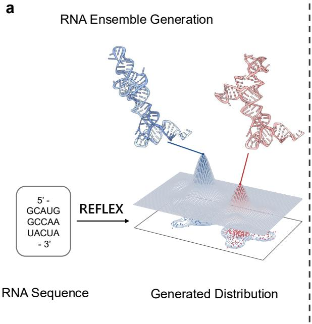

b  
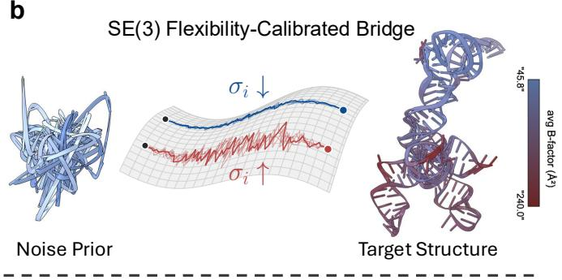

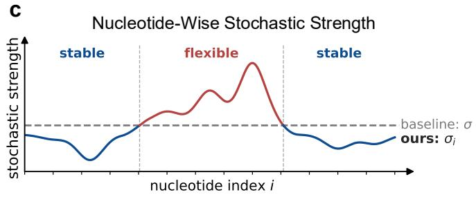  
Figure 1: Overview of REFLEX. a: RNA ensemble generation aims to recover accurate conformational alternatives rather than simply increase sample spread. b: Flexibility-calibrated stochastic bridge on SE(3). The structures on the right are multiple target conformations, and their averaged B-factor profile captures nucleotide-wise flexibility used to calibrate the stochastic bridge. c: Nucleotide-wise stochastic strength, with nucleotides on the horizontal axis and stochasticity strength on the vertical axis; flexible positions receive stronger stochasticity than constrained positions.

We introduce REFLEX, a sequence-conditioned stochastic bridge on SE(3) for RNA backbone-frame ensemble generation. During training, REFLEX uses chain-normalized experimental B-factors as a proxy for relative local mobility and converts them into nucleotide-wise bridge widths. Flexible nucleotides receive broader bridge perturbations, while rigid regions receive narrower ones. At inference, a sequence-derived latent flexibility condition guides the generative dynamics, incorporating learned relative-mobility information into generation. Figure 1 summarizes the sequence-to-ensemble task and the flexibility-calibrated bridge used by REFLEX.

Our main contributions are:

• We formulate RNA sequence-to-ensemble generation as stochastic bridge learning on SE(3), where the bridge field is trained to recover conformers from noisy frame states.

• We introduce a flexibility-calibrated heteroscedastic bridge that uses chain-normalized experimental B-factor to set nucleotide-wise bridge widths during training, while providing a sequence-derived latent flexibility condition to the bridge-field network at inference.

• We show on a multi-conformer RNA benchmark that REFLEX improves ensemble coverage, structural fidelity, and precision–recall balance over MSA-subsampling predictors and dedicated ensemble generators while maintaining meaningful structural diversity.

## 2 Preliminaries

## 2.1 RNA Representation and Problem Setup

Given an RNA sequence s of length L, let $S _ { \exp } ( s ) = \{ G _ { m } ^ { \star } \} _ { m = 1 } ^ { M _ { s } }$ denote the available experimental state representatives for this sequence. We do not assume access to calibrated thermodynamic populations.

Our goal is to learn a conditional generator $p _ { \theta } ( G \mid s )$ whose samples $\{ G ^ { ( k ) } \} _ { k = 1 } ^ { K }$ collectively recover this observed conformational support while remaining individually plausible.

Following RNA-FrameFlow [12], we represent the frame state of nucleotide i as a rigid transformation $G _ { i } = ( x _ { i } , R _ { i } ) \in \mathrm { S E } ( 3 )$ , where $\mathrm { S E } ( 3 ) = \mathbb { R } ^ { 3 } \rtimes \mathrm { S O } ( 3 )$ . Here $x _ { i } \in \mathbb { R } ^ { 3 }$ is the position of the C4′ atom, and $R _ { i } \in \mathrm { S O } ( 3 )$ specifies the local orientation defined by the $\mathrm { C 3 ^ { \prime } { - } C 4 ^ { \prime } { - } O 4 ^ { \prime } }$ sugar geometry. We write $G = ( G _ { 1 } , \dots , \bar { G } _ { L } ) \in \mathrm { S E } ( 3 ) ^ { L }$ for the RNA backbone-frame state. We reconstruct all heavy-atom coordinates, including complete nucleobases, using ten torsion angles $\Phi _ { i } \in ( S ^ { 1 } ) ^ { 1 0 }$ , represented by sine–cosine pairs, and nucleotide-specific reference geometry (Appendix F). In REFLEX, the stochastic bridge is defined over the frame state $G ;$ torsions are predicted as auxiliary target-structure outputs for all-atom reconstruction.

## 2.2 SE(3) Flow Matching

Flow matching [13–15] learns a velocity field that transports a tractable prior $p _ { 0 }$ to a data distribution by integrating an ordinary diferential equation along a prescribed probability path. For a single nucleotide frame in SE(3), let $( G _ { 0 } , G _ { 1 } )$ be a coupled pair of prior and data states, and let $t \in [ 0 , 1 ]$ Conditional flow matching constructs a deterministic intermediate state by geodesic interpolation:

$$
x _ { t } = ( 1 - t ) x _ { 0 } + t x _ { 1 } , \qquad R _ { t } = R _ { 0 } \exp \Bigl ( t \log ( R _ { 0 } ^ { \top } R _ { 1 } ) \Bigr ) .\tag{1}
$$

Diferentiating this path yields closed-form conditional velocity targets

$$
u _ { t } ^ { x } = \frac { x _ { 1 } - x _ { t } } { 1 - t } , \qquad u _ { t } ^ { R } = \frac { \log ( R _ { t } ^ { \top } R _ { 1 } ) ^ { \vee } } { 1 - t } \in \mathbb { R } ^ { 3 } ,\tag{2}
$$

where $( \cdot ) ^ { \vee }$ identifies an element of so(3) with its Euclidean coordinate vector. A network predicting $( \hat { v } _ { t } ^ { x } , \hat { v } _ { t } ^ { R } )$ is trained by tangent-space regression,

$$
\mathcal { L } _ { \mathrm { S E } ( 3 ) } ( \theta ) = \mathbb { E } _ { t , G _ { 0 } , G _ { 1 } } \left[ \frac { 1 } { | \mathcal { R } | } \sum _ { i \in \mathcal { R } } \left( \lambda _ { x } \| \hat { v } _ { t , i } ^ { x } - u _ { t , i } ^ { x } \| _ { 2 } ^ { 2 } + \lambda _ { R } \| \hat { v } _ { t , i } ^ { R } - u _ { t , i } ^ { R } \| _ { 2 } ^ { 2 } \right) \right] ,\tag{3}
$$

where R denotes resolved frame nucleotides and $\lambda _ { x } , \lambda _ { R } > 0$ balance translational and rotational terms. REFLEX uses this SE(3) velocity parameterization as a reference, but replaces the deterministic geodesic path with stochastic bridge marginals whose widths vary across nucleotides.

## 2.3 RNA Flexibility and B-factors

B-factors provide a widely available but noisy experimental proxy for local positional uncertainty [16]. In X-ray crystallography, they are refined as atomic displacement parameters and are related, under an ideal isotropic model, to mean-squared positional displacement [10]. In NMR-derived structures, analogous B-factor-like quantities can be estimated from coordinate dispersion across deposited structural ensembles, although these quantities are not identical to crystallographic B-factors [17, 18]. Because B-factors also depend on experimental modality, refinement, resolution, and static disorder, we do not treat their absolute values as calibrated thermodynamic mobilities across structures. Instead, they are best used as within-chain relative mobility signals, following prior computational studies of biomolecular flexibility [11, 19].

## 3 Proposed Method

REFLEX is a sequence-conditioned stochastic-bridge generator for RNA backbone-frame ensembles on SE(3). Rather than using the deterministic geodesic path in standard SE(3) flow matching [20], REFLEX introduces a residue-wise heteroscedastic bridge whose local width is calibrated by relative B-factor mobility. This flexibility-calibrated bridge exposes mobile nucleotides to broader training perturbations while keeping constrained regions sharper, and the model learns to recover target conformers from these calibrated noisy frames. Diversity is therefore induced through the bridge distribution itself, rather than by MSA subsampling or weakened structural supervision.

The input sequence s is encoded once by a frozen pretrained AlphaFold3 (AF3) Pairformer [5] into single and pair representations $( \mathbf { c } ^ { ( s ) } , \mathbf { c } ^ { ( p ) } )$ . A FlexibilityNet ψ learns a sequence-derived flexibility condition grounded by B-factor-derived mobility proxies during training, while an IPA-based bridge-field network $v _ { \theta }$ [12] predicts translational and rotational bridge velocities from the noisy state $G _ { t }$ , time $t ,$ AF3 representations, and this flexibility condition. The predicted fields are analytically inverted to target backbone frames and combined with torsions $\hat { \Phi } \in ( S ^ { 1 } ) ^ { 1 0 L }$ for all-atom reconstruction. At inference, REFLEX uses only the input sequence and does not require experimental flexibility annotations or re-computed AF3 features under perturbed evolutionary contexts.

## 3.1 Flexibility-calibrated Heteroscedastic Bridge

The heteroscedastic bridge trains the model to recover each target conformer from perturbed intermediate states. Small-noise analyses of supervised learning and denoising connect input corruption to derivative-based regularization, providing a rationale for improved local robustness [21, 22]. Motivated by this view, REFLEX exposes flexible residues to broader perturbations while keeping constrained regions sharper. We assess the resulting robustness in the recovery-stress experiments (Section 4.5); Appendix B gives a brief discussion.

To set these widths, we use experimental B-factors as within-chain mobility proxies. We therefore normalize B-factors within each chain:

$$
\widetilde { B } _ { i } = \frac { B _ { i } } { \sum _ { j = 1 } ^ { L } B _ { j } / L } , \qquad i = 1 , \dots , L .\tag{4}
$$

We rescale this proxy as $\alpha _ { i } = ( \mathrm { c l i p } ( \widetilde { B } _ { i } , 0 . 2 , 1 . 6 ) - 0 . 2 ) / 1 . 4 \in [ 0 , 1 ]$ and set the variance multiplier $a _ { i } = ( 1 + 2 \alpha _ { i } ) ^ { 2 }$ . The corresponding standard-deviation multiplier is ${ \sqrt { a _ { i } } } = 1 + 2 \alpha _ { i } ,$ consistent with Table 3. This calibration changes the training bridge only; no B-factor annotation is used at inference.

Translation bridge. For translations, the calibrated bridge width can be applied directly in $\mathbb { R } ^ { 3 }$ For a nucleotide with variance multiplier $^ { a , }$ define $\gamma _ { x } ( t ; a ) = \sigma _ { x } \sqrt { a t ( 1 - t ) }$ , where $\sigma _ { x }$ is a global translational scale. The translational bridge uses the Gaussian marginal:

$$
q _ { t } ^ { x } ( \cdot  { | } x _ { 0 } , x _ { 1 } ) = \mathcal { N } \left( ( 1 - t ) x _ { 0 } + t x _ { 1 } , \gamma _ { x } ^ { 2 } ( t ; a ) I _ { 3 } \right) .\tag{5}
$$

This Gaussian marginal provides a Euclidean carrier for the calibrated uncertainty. The factor $t ( 1 - t )$ makes the stochastic term vanish at the source and target structures, while the multiplier a determines how much intermediate uncertainty the model sees at this nucleotide during training. Thus, stochasticity is placed residue-wise rather than injected globally.

Rotation bridge. The same calibration principle is applied to nucleotide orientations. Since rotations lie on $\mathrm { S O ( 3 ) }$ , we place the stochastic perturbation in a local logarithmic chart centered on the principal geodesic from $R _ { 0 }$ to $R _ { 1 }$ . Let

$$
\Omega = \log ( R _ { 0 } ^ { \top } R _ { 1 } ) ^ { \vee } , \qquad \bar { R } _ { t } = R _ { 0 } \exp ( t \Omega ^ { \wedge } )
$$

be the geodesic center at time t. For the same variance multiplier $^ { a , }$ define $\gamma _ { R } ( t ; a ) = \sigma _ { R } \sqrt { a t ( 1 - t ) }$ where $\sigma _ { R }$ is a global rotational scale. The rotation bridge is the distribution induced by a Gaussian perturbation in the tangent coordinate around $\bar { R } _ { t }$

$$
\begin{array} { r } { q _ { t } ^ { R } ( \cdot \mid R _ { 0 } , R _ { 1 } ) = ( \Phi _ { \bar { R } _ { t } } ) _ { \# } \mathcal { N } \left( 0 , \gamma _ { R } ^ { 2 } ( t ; a ) I _ { 3 } \right) , \qquad \Phi _ { \bar { R } _ { t } } ( \xi ) = \bar { R } _ { t } \exp ( \xi ^ { \wedge } ) , } \end{array}\tag{6}
$$

## 3.2 Flexibility-Grounded Flexibility Condition

FlexibilityNet learns an explicit sequence-derived flexibility condition. This condition is grounded by relative B-factor mobility during training and guides the bridge-field network during recovery. The

input sequence s is encoded once by the frozen AF3 Pairformer into $( \mathbf { c } ^ { ( s ) } , \mathbf { c } ^ { ( p ) } )$ . FlexibilityNet $\psi$ maps these representations to supervised flexibility logits and to the flexibility condition $h _ { \psi } ( s )$

$$
\begin{array} { r } { \left( o _ { \psi } ( s ) , h _ { \psi } ( s ) \right) = \psi ( \mathbf { c } ^ { ( s ) } , \mathbf { c } ^ { ( p ) } ) , } \end{array}\tag{7}
$$

where $o _ { \psi } ( s ) \in \mathbb { R } ^ { L \times K _ { B } }$ parameterizes a $K _ { B } { \mathrm { - b u c k e t } }$ flexibility classifier and $h _ { \psi } ( s )$ is passed to the bridge-field network as an additional condition.

The supervised flexibility output provides a training-time ground: it encourages $h _ { \psi } ( s )$ to encode residue-wise mobility information derived from relative B-factors. The classifier head anchors this condition during training, and ensemble generation uses $h _ { \psi } ( s )$ to guide the bridge-field network.

Flexibility grounding. During training, the chain-normalized B-factor profile grounds the flexibility head. Let $\nu \subseteq \mathcal { R }$ be the supervised nucleotide set with valid B-factor annotations. We discretize the chain-normalized proxy ${ \widetilde { B } } _ { i }$ into bucket labels $b _ { \nu }$ over V, and train the logits with cross entropy:

$$
\mathcal { L } _ { \mathrm { B } } = \mathrm { C E } \left( o _ { \psi , \mathcal { V } } ( s ) , b _ { \mathcal { V } } \right) .\tag{8}
$$

This loss aligns the learned flexibility representation with relative mobility patterns observed in training structures. It does not provide test-time B-factors or manually specify flexible regions during sampling. If no valid annotations are available, we omit $\mathcal { L } _ { \mathrm { B } }$ for that example.

## 3.3 Training Objective

The bridge construction in Section 3.1 gives noisy states $G _ { t } = ( x _ { t } , R _ { t } )$ . The IPA-based network vθ [12] receives $G _ { t } , t , ( \mathbf { c } ^ { ( s ) } , \mathbf { c } ^ { ( p ) } )$ , and $h _ { \psi } ( s )$ , and predicts translation and rotation bridge fields $( \hat { u } _ { t } ^ { x } , \hat { u } _ { t } ^ { R } )$ . Rather than supervising the noisy bridge state itself, we analytically map the predicted fields back to a target frame:

$$
\hat { x } _ { 1 } = x _ { t } + ( 1 - t ) \hat { u } _ { t } ^ { x } , \qquad \hat { R } _ { 1 } = R _ { t } \exp \Bigl ( ( ( 1 - t ) \hat { u } _ { t } ^ { R } ) ^ { \wedge } \Bigr ) .\tag{9}
$$

This target-frame supervision encourages consistent recovery of the target under heteroscedastic bridge noise. It also couples the $h _ { \psi } ( s )$ -conditioned bridge-field network to the heteroscedastic training bridge: flexible nucleotides are learned from broader intermediate perturbations, while rigid nucleotides are learned from sharper bridge neighborhoods. We define

$$
\mathcal { L } _ { \mathrm { S B } } = \mathbb { E } _ { t , G _ { 0 } , G _ { 1 } } \left[ \frac { 1 } { ( 1 - t ) ^ { 2 } } \left( \lambda _ { x } \left. \hat { x } _ { 1 } - x _ { 1 } \right. _ { \mathbb { R } ^ { 3 } } ^ { 2 } + \lambda _ { R } \left. \log _ { R _ { t } } ( \hat { R } _ { 1 } ) - \log _ { R _ { t } } ( R _ { 1 } ) \right. _ { \mathrm { S O } ( 3 ) } ^ { 2 } \right) \right] .\tag{10}
$$

Here $\log _ { R } ( Q ) = \log ( R ^ { \top } Q ) ^ { \vee }$ , and the norms aggregate over resolved frame nucleotides. We use $\lambda _ { x } = 2$ and $\lambda _ { R } = 1$ , as listed in Table 3.

The full training objective combines target-frame supervision with flexibility grounding and an auxiliary structural reconstruction loss:

$$
\mathcal { L } _ { \mathtt { R E F L E X } } = \mathcal { L } _ { \mathtt { S B } } + \lambda _ { \mathrm { B } } \mathcal { L } _ { \mathrm { B } } + \lambda _ { \mathrm { a u x } } \mathcal { L } _ { \mathrm { a u x } } .\tag{11}
$$

The auxiliary term $\mathcal { L } _ { \mathrm { a u x } } .$ , defined in Appendix F, supervises the reconstructed geometry from $( \hat { x } _ { 1 } , \hat { R } _ { 1 } , \hat { \Phi } )$ Through this objective, B-factor information afects REFLEX only at training time: it calibrates the bridge distribution and grounds the flexibility representation. At inference, generation is driven by the bridge-field network conditioned on the sequence-derived embedding $h _ { \psi } ( s )$

## 3.4 Inference

To generate the ensemble given an RNA sequence, we firstly compute the AF3 representations. During sampling, each sample k starts from an independent prior $G _ { 0 } ^ { ( k ) } \sim p _ { 0 }$ . At each integration step, the conditional drift $\hat { u } _ { t } ^ { x } , \hat { u } _ { t } ^ { R }$ is predicted given the current frame state $G _ { t }$ , AF3 representations and the predicted flexibility condition. Given the predicted drift, the update is given by:

$$
x _ { t + \Delta t } = x _ { t } + \Delta t \hat { u } _ { t } ^ { x } + g _ { x } ( t ) \sqrt { \Delta t } \xi _ { t } ^ { x } ,
$$

$$
R _ { t + \Delta t } = R _ { t } \exp \biggl ( \Bigl [ \Delta t \hat { u } _ { t } ^ { R } + g _ { R } ( t ) \sqrt { \Delta t } \xi _ { t } ^ { R } \Bigr ] ^ { \wedge } \biggr ) .\tag{12}
$$

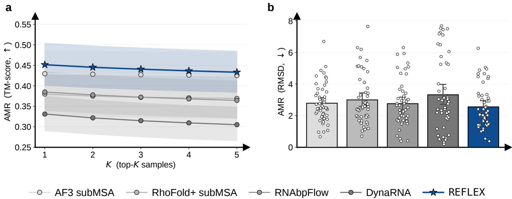  
Figure 2: Coverage of experimental conformers. a: Top-K AMR (TM-score), the mean of the K highest matching scores for each reference conformer, for $K = 1 , \ldots , 5 .$ , evaluated on clusters where every method has at least five samples. b: Best-match RMSD AMR on the test set. Shading and error bars show 95% bootstrap confidence intervals; points in b show per-cluster values.

Where $\xi _ { t } ^ { x } , \xi _ { t } ^ { R } \sim \mathcal { N } ( 0 , I _ { 3 } )$ is the independent standard Gaussian noises. After the frame trajectory reaches $t = 1$ , the predicted torsions $\hat { \Phi }$ and nucleotide-specific reference geometry reconstruct all heavy-atom coordinates. Repeating the procedure with independent initial states and sampler noise yields the generated ensemble.

## 4 Experiments

We evaluate REFLEX around three questions. First, does the generated ensemble improve recovery of experimentally observed conformers? Second, do generated samples remain near observed states as ensemble diversity increases? Third, does the flexibility-calibrated bridge improve conformer-specific target-frame recovery under controlled perturbations? The first two questions evaluate final generated ensembles; the third isolates the bridge-field mechanism using the ablation variants. Metric definitions and statistical tests are given in Appendix C and Appendix E.

## 4.1 Dataset construction

Our RNA dataset totals 2,698 structures across 1,517 sequences, curated from PDB [23] through the BGSU RNA 3D Hub representative set (release 4.30) [24], retaining chains of 20–300 nt with resolution ≤ 4.0 Å. We use a temporal cutof of June 1, 2023 and an 80% CD-HIT sequence-identity exclusion criterion between training and test sequences. The test set contains 50 multi-conformer RNA clusters. REFLEX is trained on the corresponding pre-cutof training split.

## 4.2 Baselines

We compare against two baseline families. The first uses single-structure predictors with inference-time MSA perturbations: AlphaFold3 [5] and RhoFold+ [6] with AFCluster-style MSA subsampling [7]. We disable templates and use the same fixed random seed for all subsampling runs. The second family consists of dedicated ensemble generators: RNAbpFlow [8], conditioned on sequence and MXFold2 [25] predicted base-pair information, and DynaRNA [9], a coordinate-space difusion model initialized from a randomly selected experimental conformer of the target RNA. For ensemble evaluation, all methods use a common budget of K = 20 samples.

All external baselines use released models or checkpoints and are not retrained on our curated split. The benchmark therefore compares released systems under a common evaluation protocol; component-level attribution relies on the matched REFLEX-family ablations.

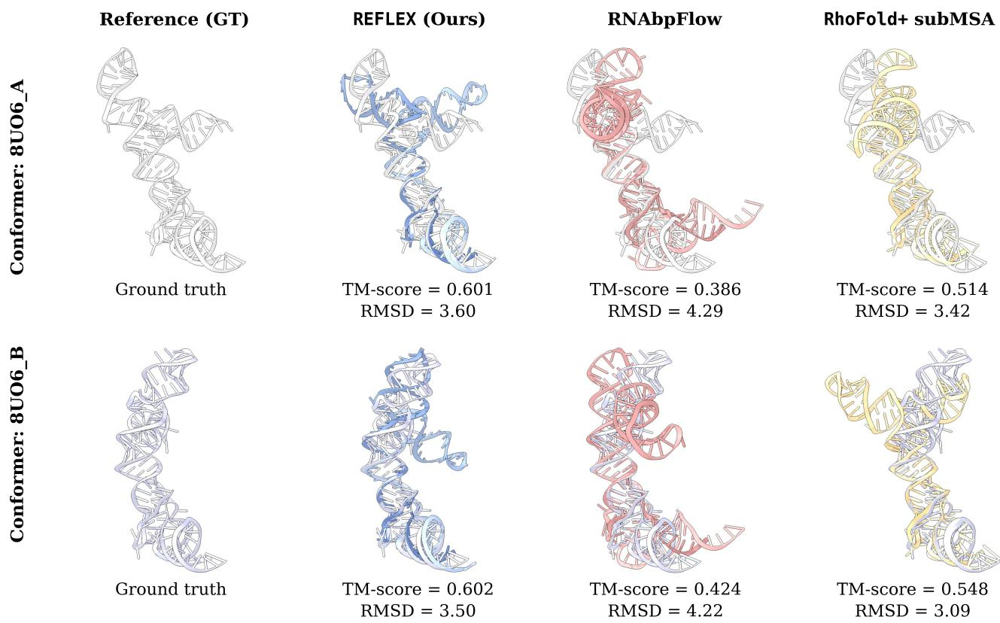  
Figure 3: Qualitative recovery on PDB 8UO6. Two experimentally resolved conformers are shown against their nearest generated matches from REFLEX, RNAbpFlow, and RhoFold+ subMSA. TM-score and RMSD are reported below each match.

For the recovery-stress ablations, we compare REFLEX with two bridge variants trained under the same backbone architecture. Linear Bridge corresponds to the standard deterministic flow-matching path, while Uniform Stochastic Bridge uses a single global bridge width for all nucleotides and removes the flexibility head. All three models use the same recovery-stress protocol, detailed in Appendix C.

## 4.3 REFLEX improves recovery of observed conformers

Table 1 reports full-ensemble recovery with K = 20 samples per RNA. AMR-R averages each resolved conformer’s best TM-score among generated samples; AMR-P averages each generated sample’s best TM-score among resolved conformers. Both are computed per cluster and then macro-averaged. REFLEX achieves the highest AMR-R (0.451) and AMR-P (0.419) among the evaluated systems, compared with 0.430 and 0.411 for the strongest baseline, AF3 subMSA.

The paired AMR-R gain over AF3 subMSA is 0.022 (cluster-bootstrap 95% CI: [0.006, 0.037]), with higher recovery on 70% of test clusters and a Holm-adjusted one-sided Wilcoxon $p = 1 . 2 \times 1 0 ^ { - 3 }$ . These results support improved recovery on this benchmark.

Figure 3 illustrates conformer matching on PDB 8UO6, which contains two resolved conformations. This example provides a structure-level view of generated matches; evidence for performance across targets comes from the cluster-level benchmark and paired analysis above.

## 4.4 REFLEX improves recovery while maintaining sample support

Table 1 evaluates whether generated ensembles place probability mass inside threshold-defined basins around experimentally observed conformers. COV-R measures how many observed conformers are recovered, while COV-P measures the complementary precision question: how many generated samples fall within one of these observed-state basins. REFLEX achieves the best COV-R and COV-P among the evaluated systems at every TM-score threshold $\tau \in \{ 0 . 3 0 , 0 . 3 5 , 0 . 4 0 \}$ . At $\tau = 0 . 4 0$ , its mean per-cluster recovered-reference and matched-sample fractions are 54.3% and 45.0%, respectively. Recovery remains incomplete, so these gains do not establish exhaustive or near-native reconstruction of physical RNA ensembles.

Table 1: Ensemble recovery on the RNA benchmark. All methods generate $K = 2 0$ samples per RNA. AMR-R and AMR-P report reference-to-sample and sample-to-reference best-match TM-scores. COV-R and COV-P use thresholds 0.30, 0.35, and 0.40. Each metric is macro-averaged over its evaluated clusters (Appendix C); higher AMR and coverage values are better, with the best in bold. Diversity is average pairwise RMSD in Å.
<table><tr><td rowspan="2">Method</td><td rowspan="2">AMR-R</td><td colspan="3">COV-R</td><td rowspan="2">AMR-P</td><td colspan="3">COV-P</td><td rowspan="2">Diversity (Å)</td></tr><tr><td>@0.30</td><td>@0.35</td><td>@0.40</td><td>@0.30</td><td>@0.35</td><td>@0.40</td></tr><tr><td>RNABPFLOW</td><td>0.385</td><td>0.640</td><td>0.422</td><td>0.358</td><td>0.378</td><td>0.558</td><td>0.386</td><td>0.371</td><td>3.178</td></tr><tr><td>AF3 subMSA</td><td>0.430</td><td>0.646</td><td>0.542</td><td>0.445</td><td>0.411</td><td>0.563</td><td>0.483</td><td>0.394</td><td>0.786</td></tr><tr><td>RHoFoLD+ subMSA</td><td>0.380</td><td>0.552</td><td>0.470</td><td>0.384</td><td>0.402</td><td>0.522</td><td>0.437</td><td>0.388</td><td>1.237</td></tr><tr><td>DYNARNA</td><td>0.331</td><td>0.436</td><td>0.327</td><td>0.247</td><td>0.257</td><td>0.250</td><td>0.218</td><td>0.204</td><td>4.439</td></tr><tr><td>REFLEX</td><td>0.451</td><td>0.742</td><td>0.647</td><td>0.543</td><td>0.419</td><td>0.634</td><td>0.533</td><td>0.450</td><td>2.900</td></tr></table>

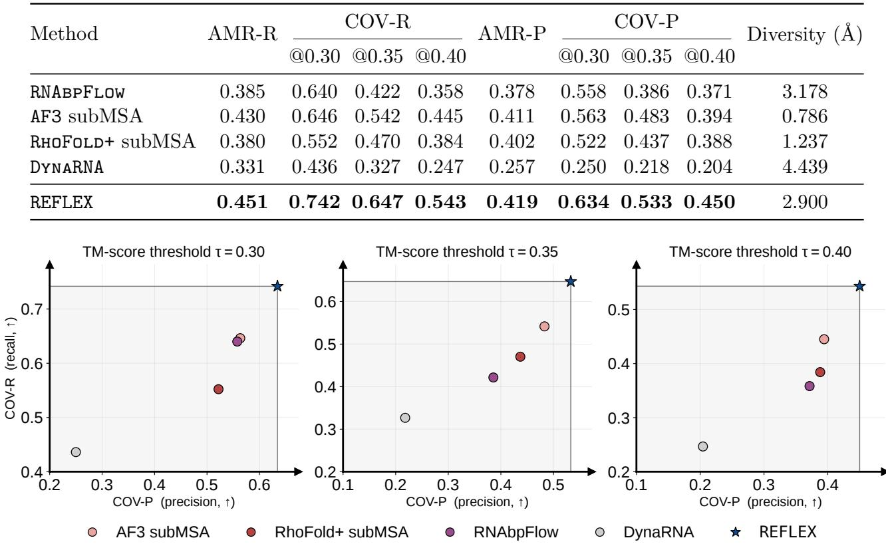  
Figure 4: Precision–recall Pareto plot. Each method is evaluated at TM-score thresholds $\tau \in \{ 0 . 3 0 , 0 . 3 5 , 0 . 4 0 \}$ . COV-R and COV-P are macro-averaged as in Table 1; the gray shaded region denotes the dominated region.

The diversity results show that the coverage gains do not require the largest sample spread. REFLEX has average pairwise RMSD of 2.900 Å, above AF3 subMSA (0.786 Å) and RhoFold+ subMSA (1.237 Å), but below RNAbpFlow (3.178 Å) and DynaRNA (4.439 Å). Its higher COV-R and COV-P across all thresholds indicate a better balance of observed-conformer recovery and sample support on this benchmark.

## 4.5 REFLEX learns more reliable conformer-specific recovery

We examine conformer-specific recovery with Linear Bridge, Uniform Stochastic Bridge, and REFLEX. For each multi-conformer sequence, we perturb bridge states around each target conformer at t ∈ {0.25, 0.5, 0.75} with corruption scale $\kappa \in \{ 0 , 1 , 2 , 3 \}$ , then ask each model to recover the target in one step. Figure 5 shows the results at $t = 0 . 7 5$

Figure 5 reports two complementary metrics. $E _ { \mathrm { f r a m e } }$ measures target-frame recovery error, so lower values indicate more accurate structural recovery; SepRet measures the ratio between recovered conformer separation and ground-truth conformer separation, so values closer to 1 indicate better preservation of conformer separation. At $t = 0 . 7 5$ , REFLEX has lower mean recovery error than both alternatives at $\kappa = 2 , 3 .$ , with significant paired diferences. At $\kappa = 0 , 1$ , the frame-error diferences are not significant. Mean SepRet is closer to 1 for REFLEX across all tested corruption levels, with significant paired diferences from both alternatives.

Table 2 stratifies the test set by ground-truth conformer distinctness. Uniform Stochastic Bridge has the highest mean AMR-R in the Low bin (0.540 versus 0.531 for REFLEX), while REFLEX leads in the Mid and High bins. The High-bin margin over Uniform Stochastic Bridge is only 0.002.

The recovery-stress analysis supports improved target-frame recovery under stronger perturbations, with gains that depend on bridge time and corruption strength. Matched ablations, FlexibilityNet validation, and DSSR base-pair evaluation are provided in Appendix H.

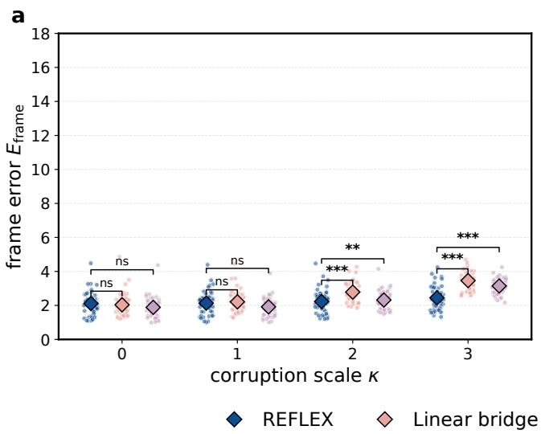

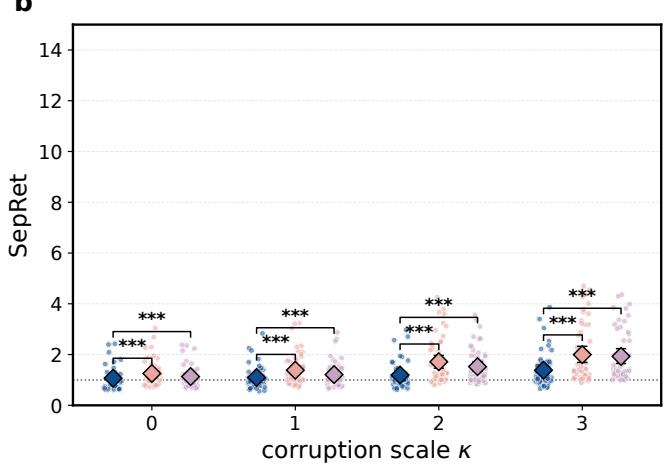  
Uniform stochastic bridge  
Figure 5: Multi-conformer supervision stability. a: Target-frame recovery error after one-step recovery from perturbed bridge states at $t = 0 . 7 5$ . b: SepRet under the same perturbation protocol. Stars and ns denote significant and non-significant paired comparisons with REFLEX. Additional results at $t = 0 . 2 5$ and $t = 0 . 5$ are provided in Appendix D.

Table 2: Conformer recovery by ground-truth distinctness. Distinctness is average pairwise TM-distance between resolved conformers. The Low/Mid/High bins contain $1 6 / 1 7 / 1 7$ clusters. Entries are mean per-cluster AMR-R over the evaluated structure sets; higher is better.
<table><tr><td>Method</td><td>Low [0.078, 0.363]</td><td>Mid [0.365, 0.471]</td><td>High [0.483, 0.843]</td></tr><tr><td>Linear Bridge</td><td>0.505</td><td>0.435</td><td>0.340</td></tr><tr><td>Uniform Stochastic Bridge</td><td>0.540</td><td>0.444</td><td>0.356</td></tr><tr><td>REFLEX</td><td>0.531</td><td>0.470</td><td>0.358</td></tr></table>

## 5 Related Work

Traditional RNA structure prediction. Traditional RNA tertiary-structure modeling largely relied on secondary-structure-aware motif assembly, fragment assembly, and coarse-grained or energybased search. MC-Fold/MC-Sym uses nucleotide cyclic motifs to connect sequence-level folding with three-dimensional assembly [26], while RNAComposer and 3dRNA automate secondary-structure-guided construction from fragment or template libraries [27, 28]. Sampling-based methods such as SimRNA and FARFAR2 explore candidate folds with coarse-grained statistical potentials or Rosetta refinement [29, 30]. This line of work organizes RNA 3D prediction around a pipeline of structural constraints, candidate assembly or sampling, and subsequent scoring or refinement.

Learning-based RNA modeling. Recent learning-based predictors have substantially improved RNA structure prediction. trRosettaRNA, RhoFold+, NuFold, and AlphaFold3 predict accurate representative structures using learned sequence, evolutionary, or geometric representations [31, 6, 32, 5]. This family of methods shifts RNA structure prediction from hand-designed assembly and search toward learned structural priors trained on available RNA structures. Alternative conformations can be obtained by inference with heuristically subsampled MSAs, which probes conformational variation by changing the evolutionary context supplied to a structure predictor [6].

RNA inverse design has also been explored through reinforcement-learning-guided difusion [33], cooperative multi-agent learning [34], and joint topology-and-geometry objectives [35]. These approaches design sequences for target structures, complementing the sequence-conditioned conformational ensemble modeling studied here.

Flow matching models. Flow matching learns a continuous path that transports samples from a tractable prior to the data distribution [13–15, 36–39]. For molecular structures, geometric generative models define such dynamics on Euclidean coordinates, rotations, or SE(3) frames [40, 41, 20]. RNAspecific generative models have adapted these ideas to backbone-frame generation, base-pair-augmented backbone generation, and difusion-based conformational modeling [12, 8, 9].

## 6 Conclusion

We presented REFLEX, a sequence-conditioned RNA ensemble generator that models conformational diversity as a nucleotide-wise property of the molecule. The method learns a flexibility-calibrated heteroscedastic stochastic bridge on SE(3), using chain-normalized experimental B-factors during training to set local stochastic strength and a sequence-derived flexibility condition at inference. On the test set, REFLEX better recovers experimentally observed conformational states, places more generated structures inside observed-state basins, and achieves the strongest precision–recall trade-of while maintaining meaningful diversity. The recovery-stress ablation indicates that target-frame recovery gains depend on bridge time and corruption strength: at t = 0.75, recovery error is significantly lower under stronger perturbations, while diferences at lower corruption levels are not significant. Mean separation retention is closer to the reference value across the tested corruption levels. These results support the central claim that RNA ensemble generation benefits from calibrating where stochasticity is placed, providing a route toward sequence-conditioned models that capture both global alternative states and local flexibility patterns.

## References

[1] Anthony M Mustoe, Charles L Brooks, and Hashim M Al-Hashimi. Hierarchy of rna functional dynamics. Annual review of biochemistry, 83(1):441–466, 2014.

[2] Laura R Ganser, Megan L Kelly, Daniel Herschlag, and Hashim M Al-Hashimi. The roles of structural dynamics in the cellular functions of rnas. Nature reviews Molecular cell biology, 20(8): 474–489, 2019.

[3] Maja Marušič, Judith Schlagnitweit, and Katja Petzold. Rna dynamics by nmr spectroscopy. ChemBioChem, 20(21):2685–2710, 2019.

[4] Megan L Ken, Rohit Roy, Ainan Geng, Laura R Ganser, Akanksha Manghrani, Bryan R Cullen, Ursula Schulze-Gahmen, Daniel Herschlag, and Hashim M Al-Hashimi. Rna conformational propensities determine cellular activity. Nature, 617(7962):835–841, 2023.

[5] Josh Abramson, Jonas Adler, Jack Dunger, Richard Evans, Tim Green, Alexander Pritzel, Olaf Ronneberger, Lindsay Willmore, Andrew J. Ballard, Joshua Bambrick, et al. Accurate structure prediction of biomolecular interactions with AlphaFold3. Nature, 630(8016):493–500, 2024.

[6] Tao Shen, Zhihang Hu, Siqi Sun, Di Liu, Felix Wong, Jiuming Wang, Jiayang Chen, Yixuan Wang, Liang Hong, Jin Xiao, Liangzhen Zheng, Tejas Krishnamoorthi, Irwin King, Sheng Wang, Peng Yin, James J. Collins, and Yu Li. Accurate RNA 3D structure prediction using a language model-based deep learning approach. Nat. Methods, 21(12):2287–2298, 2024.

[7] Hannah K. Wayment-Steele, Adedolapo Ojoawo, Renee Otten, Julia M. Apitz, Warintra Pitsawong, Marc Hömberger, Sergey Ovchinnikov, Lucy Colwell, and Dorothee Kern. Predicting multiple conformations via sequence clustering and AlphaFold2. Nature, 625(7996):832–839, 2024.

[8] Sumit Tarafder and Debswapna Bhattacharya. RNAbpFlow: Base pair-augmented SE(3)-flow matching for conditional RNA 3D structure generation. bioRxiv, 2025.

[9] Zhengxin Li, Junjie Zhu, Xiaokun Hong, Junxi Mu, Zhuoqi Zheng, Taeyoung Cui, Yutong Sun, Ting Wei, and Hai-Feng Chen. Dynarna: accurate dynamic rna conformation ensemble generation with difusion model. Communications Biology, 8(1):1472, 2025.

[10] Oliviero Carugo. Atomic displacement parameters in structural biology. Amino Acids, 50(7): 775–786, 2018.

[11] Ivantha Guruge, Ghazaleh Taherzadeh, Jian Zhan, Yaoqi Zhou, and Yuedong Yang. B-factor profile prediction for rna flexibility using support vector machines. Journal of Computational Chemistry, 39(8):407–411, 2018.

[12] Rishabh Anand, Chaitanya K. Joshi, Alex Morehead, Arian Rokkum Jamasb, Charles Harris, Simon V. Mathis, Kieran Didi, Rex Ying, Bryan Hooi, and Pietro Lio. RNA-FrameFlow: Flow matching for de novo 3D RNA backbone design. Trans. Mach. Learn. Res., 2025, 2025. URL https://openreview.net/forum?id=wOc1Yx5s09.

[13] Yaron Lipman, Ricky TQ Chen, Heli Ben-Hamu, Maximilian Nickel, and Matt Le. Flow matching for generative modeling. arXiv preprint arXiv:2210.02747, 2022.

[14] Xingchao Liu, Chengyue Gong, and Qiang Liu. Flow straight and fast: Learning to generate and transfer data with rectified flow. arXiv preprint arXiv:2209.03003, 2022.

[15] Alexander Tong, Kilian Fatras, Nikolay Malkin, Guillaume Huguet, Yanlei Zhang, Jarrid Rector-Brooks, Guy Wolf, and Yoshua Bengio. Improving and generalizing flow-based generative models with minibatch optimal transport. arXiv preprint arXiv:2302.00482, 2023.

[16] Zhoutong Sun, Qian Liu, Ge Qu, Yan Feng, and Manfred T Reetz. Utility of b-factors in protein science: interpreting rigidity, flexibility, and internal motion and engineering thermostability. Chemical reviews, 119(3):1626–1665, 2019.

[17] Yunfei Hu, Kai Cheng, Lichun He, Xu Zhang, Bin Jiang, Ling Jiang, Conggang Li, Guan Wang, Yunhuang Yang, and Maili Liu. Nmr-based methods for protein analysis. Analytical chemistry, 93 (4):1866–1879, 2021.

[18] Agustí Emperador, Tim Meyer, and Modesto Orozco. Protein flexibility from discrete molecular dynamics simulations using quasi-physical potentials. Proteins: Structure, Function, and Bioinformatics, 78(1):83–94, 2010.

[19] Petr Kouba, Joan Planas-Iglesias, Jiri Damborsky, Jiri Sedlar, Stanislav Mazurenko, and Josef Sivic. Learning to engineer protein flexibility. arXiv preprint arXiv:2412.18275, 2024.

[20] Jason Yim, Andrew Campbell, Yue Kwang Foong, Sarah Lewis, Victor Satorras, Michael Gastegger, Bas Veeling, Jose Jimenez-Luna, Regina Barzilay, Tommi Jaakkola, and Frank Noé. Fast protein backbone generation with SE(3) flow matching. In NeurIPS 2023 Machine Learning in Structural Biology Workshop, 2023.

[21] Christopher M. Bishop. Training with noise is equivalent to Tikhonov regularization. Neural Computation, 7(1):108–116, 1995. doi: 10.1162/neco.1995.7.1.108.

[22] Guillaume Alain and Yoshua Bengio. What regularized auto-encoders learn from the datagenerating distribution. Journal of Machine Learning Research, 15(110):3743–3773, 2014. URL https://www.jmlr.org/papers/v15/alain14a.html.

[23] Helen M Berman, John Westbrook, Zukang Feng, Gary Gilliland, Talapady N Bhat, Helge Weissig, Ilya N Shindyalov, and Philip E Bourne. The protein data bank. Nucleic acids research, 28(1): 235–242, 2000.

[24] Neocles B Leontis and Craig L Zirbel. Nonredundant 3d structure datasets for rna knowledge extraction and benchmarking. In RNA 3D structure analysis and prediction, pages 281–298. Springer, 2012.

[25] Kengo Sato, Manato Akiyama, and Yasubumi Sakakibara. Rna secondary structure prediction using deep learning with thermodynamic integration. Nature communications, 12(1):941, 2021.

[26] Marc Parisien and François Major. The MC-Fold and MC-Sym pipeline infers RNA structure from sequence data. Nature, 452(7183):51–55, 2008. doi: 10.1038/nature06684.

[27] Mariusz Popenda, Marta Szachniuk, Maciej Antczak, Katarzyna J. Purzycka, Piotr Lukasiak, Natalia Bartol, Jacek Blazewicz, and Ryszard W. Adamiak. Automated 3D structure composition for large RNAs. Nucleic Acids Research, 40(14):e112–e112, 2012. doi: 10.1093/nar/gks339.

[28] Yunjie Zhao, Yangyu Huang, Zhou Gong, Yanjie Wang, Jianfen Man, and Yi Xiao. Automated and fast building of three-dimensional RNA structures. Scientific Reports, 2(1), 2012. doi: 10.1038/srep00734.

[29] Michal J. Boniecki, Grzegorz Lach, Wayne K. Dawson, Konrad Tomala, Pawel Lukasz, Tomasz Soltysinski, Kristian M. Rother, and Janusz M. Bujnicki. SimRNA: a coarse-grained method for RNA folding simulations and 3D structure prediction. Nucleic Acids Research, 44(7):e63–e63, 2015. doi: 10.1093/nar/gkv1479.

[30] Andrew Martin Watkins, Ramya Rangan, and Rhiju Das. FARFAR2: Improved de novo Rosetta prediction of complex global RNA folds. Structure, 28(8):963–976.e6, 2020. doi: 10.1016/j.str. 2020.05.011.

[31] Wenkai Wang, Chenjie Feng, Renmin Han, Ziyi Wang, Lisha Ye, Zongyang Du, Hong Wei, Fa Zhang, Zhenling Peng, and Jianyi Yang. trRosettaRNA: automated prediction of RNA 3D structure with transformer network. Nature Communications, 14(1), 2023. doi: 10.1038/s41467-023-42528-4.

[32] Yuki Kagaya, Zicong Zhang, Nabil Ibtehaz, Xiao Wang, Tsukasa Nakamura, Pranav Deep Punuru, and Daisuke Kihara. Nufold: end-to-end approach for rna tertiary structure prediction with flexible nucleobase center representation. Nature communications, 16(1):881, 2025.

[33] Tianmeng Hu, Yongzheng Cui, Biao Luo, and Ke Li. RIDER: 3D RNA inverse design with reinforcement learning-guided difusion. In Proc. International Conference on Learning Representations, volume 2026, pages 79321–79346, 2026.

[34] Tianmeng Hu, Biao Luo, and Ke Li. CocoRNA: Collective RNA design with cooperative multiagent reinforcement learning. In Proc. International Conference on Machine Learning, volume 306, pages 45495–45519, 2026.

[35] Tianmeng Hu, Biao Luo, and Ke Li. TANGO: RNA topology and geometry co-design. arXiv preprint arXiv:2610.20277, 2026. URL https://arxiv.org/abs/2610.20277v1.

[36] Michael Albergo, Nicholas M Bofi, and Eric Vanden-Eijnden. Stochastic interpolants: A unifying framework for flows and difusions. Journal of Machine Learning Research, 26(209):1–80, 2025.

[37] Yang Song, Jascha Sohl-Dickstein, Diederik P Kingma, Abhishek Kumar, Stefano Ermon, and Ben Poole. Score-based generative modeling through stochastic diferential equations. arXiv preprint arXiv:2011.13456, 2020.

[38] Yuyang Shi, Valentin De Bortoli, Andrew Campbell, and Arnaud Doucet. Difusion schrödinger bridge matching. Advances in neural information processing systems, 36:62183–62223, 2023.

[39] Alexander Tong, Nikolay Malkin, Kilian Fatras, Lazar Atanackovic, Yanlei Zhang, Guillaume Huguet, Guy Wolf, and Yoshua Bengio. Simulation-free Schrödinger bridges via score and flow matching. arXiv preprint arXiv:2307.03672, 2023.

[40] Jason Yim, Brian L Trippe, Valentin De Bortoli, Emile Mathieu, Arnaud Doucet, Regina Barzilay, and Tommi Jaakkola. SE(3) difusion model with application to protein backbone generation. In International Conference on Machine Learning (ICML), 2023.

[41] Avishek Joey Bose, Tara Akhound-Sadegh, Guillaume Huguet, Kilian Fatras, Jarrid Rector-Brooks, Cheng-Hao Liu, Andrei Cristian Nica, Maksym Korablyov, Michael Bronstein, and Alexander Tong. Se (3)-stochastic flow matching for protein backbone generation. arXiv preprint arXiv:2310.02391, 2023.

[42] Xiang-Jun Lu, Harmen J. Bussemaker, and Wilma K. Olson. DSSR: an integrated software tool for dissecting the spatial structure of RNA. Nucleic Acids Research, 43(21):e142, 2015. doi: 10.1093/nar/gkv716.

## A Hyperparameter Settings

REFLEX was trained on a single NVIDIA GH200 GPU. Table 3 summarizes the main hyperparameters.

Table 3: Key hyperparameters of REFLEX.
<table><tr><td>Group</td><td>Symbol / Name</td><td>Value</td></tr><tr><td rowspan="2">Time grid</td><td>Cutoff  $\epsilon _ { t }$ </td><td> $1 0 ^ { - 2 }$ </td></tr><tr><td>Inference  $/$  validation steps</td><td> $6 0 ~ / ~ 6 0$ </td></tr><tr><td rowspan="4">Stochastic bridge</td><td>Base widths  $\sigma _ { x } \mathrm { ~ / ~ } \sigma _ { \Omega }$ </td><td> $1 . 0 \mathrm { ~ \AA ~ / ~ } / \mathrm { ~ 1 . 0 ~ r a d }$ </td></tr><tr><td>Heteroscedastic gain</td><td> $\sigma _ { i } = \sigma ( 1 + 2 \alpha _ { i } )$  , with</td></tr><tr><td>Diffusion</td><td> $\alpha _ { i } = ( \mathrm { c l i p } ( \widetilde { B } _ { i } , 0 . 2 , 1 . 6 ) - 0 . 2 ) / 1 . 4$ </td></tr><tr><td> $g _ { x } \mathrm { ~ / ~ } g _ { R }$  Rotation schedule</td><td> $1 . 0 \mathrm { ~ \AA ~ / ~ } 1 . 0$  rad; constant Exponential,  $\rho = 1 0$ </td></tr><tr><td rowspan="5">FlexibilityNet</td><td>AF3 single input  $/$  hidden</td><td> $3 8 4 \ / \ 6 4$ </td></tr><tr><td>dimension Transformer layers  $/$  heads  $/$ </td><td> $2 ~ / ~ 4 ~ / ~ 2 5 6$ </td></tr><tr><td>FFN Flexibility bins  $K _ { B }$ </td><td>64 over  $\tilde { B } \in [ 0 . 2 , 1 . 6 ]$ </td></tr><tr><td>Condition  $h _ { \psi } ( s )$ </td><td>Bin probabilities; FiLM on single embedding</td></tr><tr><td>Training status</td><td>Jointly trained with  $\mathcal { L } _ { \mathrm { B } }$ </td></tr><tr><td rowspan="5">Flow model</td><td>Node / edge embedding  $\mathrm { ~ \it ~ { ~ c ~ s ~ } ~ } / \mathrm { ~ \it ~ { ~ c ~ z ~ } ~ }$ </td><td>256 /  128</td></tr><tr><td>IPA blocks / heads / hidden dimension</td><td> $4 \ : / \ : 8 \ : / \ : 1 2 8$ </td></tr><tr><td>IPA query-key / value points</td><td> $8 ~ / ~ 1 2$ </td></tr><tr><td>Sequence transformer heads layers</td><td> $4 ~ / ~ 2$ </td></tr><tr><td>Predicted torsions</td><td>10 (8 backbone  $+ \ 0 2 ^ { \prime } + \chi )$ </td></tr><tr><td rowspan="4">Flow-branch loss</td><td>Translation / rotation weight</td><td> $2 . 0 ~ / ~ 1 . 0$ </td></tr><tr><td>Auxiliary weight  $/$  time threshold</td><td> $1 . 0 ~ / ~ 0 . 2 5$ </td></tr><tr><td>Torsion loss weight</td><td>1.0</td></tr><tr><td>Optimizer</td><td>AdamW; constant learning rate</td></tr><tr><td rowspan="6">Optimization</td><td>Learning rate / weight decay</td><td> $1 0 ^ { - 4 } / 1 0 ^ { - 2 }$ </td></tr><tr><td>Batch size</td><td>24</td></tr><tr><td>Self-conditioning probability</td><td>0.5</td></tr><tr><td>Gradient clipping</td><td>1.0, global  $L _ { 2 }$  norm</td></tr><tr><td></td><td></td></tr><tr><td>Training length</td><td>400 epochs / 22,000 steps</td></tr></table>

## B Noise Calibration and Robust Recovery

Small-noise training can regularize local sensitivity [21, 22]. Under the regularity assumptions of Alain and Bengio [22], a Euclidean denoiser $r _ { \eta }$ with $r _ { \eta } ( x ) = x + o ( 1 )$ as $\eta  0$ satisfies

$$
\begin{array} { r l } & { \mathcal { L } _ { \mathrm { d e n o i s e } } ( \eta ) = \mathbb { E } _ { x , z } \big \| r _ { \eta } ( x + \eta z ) - x \big \| _ { 2 } ^ { 2 } } \\ & { \qquad = \mathbb { E } _ { x } \big \| r _ { \eta } ( x ) - x \big \| _ { 2 } ^ { 2 } + \eta ^ { 2 } \mathbb { E } _ { x } \big \| J _ { r _ { \eta } } ( x ) \big \| _ { F } ^ { 2 } + o ( \eta ^ { 2 } ) . } \end{array}
$$

Here x is a clean input, $z \sim \mathcal { N } ( 0 , I )$ is independent noise, and $J _ { r _ { \eta } }$ is the denoiser’s Jacobian. The $\eta ^ { 2 } \cdot$ -weighted term penalizes local sensitivity to input perturbations.

This denoising result motivates our bridge design. In REFLEX, varying bridge noise keeps the target conformer fixed, encouraging recovery over a local neighborhood. Flexibility calibration widens this neighborhood at mobile residues while keeping constrained regions sharper. We use bounded noise scales to retain target-specific information, and assess robustness empirically in Section 4.5.

## C Ensemble Evaluation Metrics

For a cluster with K generated samples and $K _ { c }$ experimentally resolved states, let $\mathcal { G } = \{ g _ { j } \} _ { j = 1 } ^ { K }$ denote the generated ensemble and $\mathcal { V } = \{ y _ { k } \} _ { k = . } ^ { K _ { c } }$ the experimental ensemble. These metrics test three desiderata for ensemble generation: recovering experimentally observed conformational states, avoiding unsupported generated structures, and maintaining non-collapsed ensemble spread.

Fidelity. We measure recovery of experimentally observed states using average matched recovery. For each reference conformer $y ,$ order the TM-scores of all K generated samples as $s _ { ( 1 ) } ( y ) \geq \cdot \cdot \cdot \geq s _ { ( K ) } ( y )$ Figure 2a reports top-k AMR for $k = 1 , \ldots , 5$

$$
\mathrm { A M R } _ { \mathrm { T M } } @ k \ = \ \frac { 1 } { K _ { c } } \sum _ { y \in \mathcal { D } } \frac { 1 } { k } \sum _ { r = 1 } ^ { k } s _ { ( r ) } ( y ) \quad \uparrow .
$$

Here k counts the highest-scoring matches averaged within the fixed generated ensemble. The bestmatch case gives $\mathrm { A M R \mathrm { - } R } = \mathrm { A M R } _ { \mathrm { T M } } @ 1$ , as reported in Table 1. Figure 2b reports best-match RMSD AMR over the same generated ensemble:

$$
\mathrm { A M R } _ { \mathrm { R M S D } } \ = \ \frac { 1 } { K _ { c } } \sum _ { y \in \mathcal { V } } \operatorname* { m i n } _ { g \in \mathcal { G } } \ \mathrm { R M S D } ( g , y ) \quad \downarrow .
$$

The complementary sample-to-reference score is

$$
\mathrm { A M R - P } \ = \ \frac { 1 } { K } \sum _ { g \in \mathcal { G } } \operatorname* { m a x } _ { y \in \mathcal { V } } \ \mathrm { T M } ( g , y ) \quad \uparrow .
$$

We evaluate AMR-R, AMR-P, COV-R, and COV-P on the RNA benchmark. Each metric is computed per cluster and macro-averaged over its evaluated clusters.

Precision–recall trade-of. At TM-score threshold τ, recall coverage measures how many experimental states are covered by the generated ensemble, while precision coverage measures how many generated samples remain near the experimental ensemble:

$$
\mathrm { C O V - R } _ { \tau } \ = \ \frac { 1 } { K _ { c } } \sum _ { k = 1 } ^ { K _ { c } } \mathbf { 1 } \Big [ \operatorname* { m a x } _ { g \in \mathcal { G } } \ \mathrm { T M } ( g , y _ { k } ) \ \geq \ \tau \Big ] \quad \uparrow ,
$$

$$
\mathrm { C O V \mathrm { - } P } _ { \tau } \ = \ \frac { 1 } { K } \sum _ { j = 1 } ^ { K } \mathbf { 1 } \biggl [ \operatorname* { m a x } _ { y \in \mathcal { Y } } \mathrm { T M } ( g _ { j } , y ) \ \geq \ \tau \biggr ] \quad \uparrow .
$$

Diversity. We quantify ensemble spread as the average pairwise RMSD among generated samples:

$$
\operatorname { d i v e r s i t y } ( { \mathcal { G } } ) = { \binom { K } { 2 } } ^ { - 1 } \sum _ { 1 \leq i < j \leq K } \operatorname { R M S D } ( g _ { i } , g _ { j } ) \quad \uparrow .
$$

AMR and COV-R measure recovery of the experimental states, COV-P measures generated-sample fidelity to the experimental ensemble, and pairwise RMSD is used descriptively. We do not treat diversity alone as suficient evidence of ensemble quality.

Ground-truth conformer distinctness. For the bridge ablation, we stratify test clusters by how separated their experimentally resolved conformers are. We measure this separation by average pairwise TM-distance,

$$
D _ { \mathrm { G T } } ( \mathcal { Y } ) = \left( \begin{array} { l } { K _ { c } } \\ { 2 } \end{array} \right) ^ { - 1 } \sum _ { 1 \leq i < j \leq K _ { c } } \left( 1 - \mathrm { T M } ( y _ { i } , y _ { j } ) \right) \quad \uparrow ,
$$

where larger values indicate more distinct observed conformers.

Conformer-specific recovery stability. The recovery-stress analysis uses $K = 1 5 0$ samples per ablation variant and aggregates results over paired evaluation clusters. We test whether the learned field recovers each supervised conformer from nearby of-path bridge states. Let $G _ { 1 } ^ { ( m ) }$ denote an experimentally observed conformer of a sequence, and let $G _ { t } ^ { ( m , \kappa ) }$ denote a bridge state around that conformer at time t with perturbation scale κ. Applying the predicted bridge field and the same target-frame recovery used in training gives a recovered conformer $\hat { G } _ { 1 } ^ { ( m , \kappa ) }$ . We report the target-frame recovery error

$$
E _ { \mathrm { f r a m e } } ( \kappa ) \ : = \ : \frac { 1 } { | \mathcal { M } | } \sum _ { m \in \mathcal { M } } d _ { \mathrm { f r a m e } } \Big ( \hat { G } _ { 1 } ^ { ( m , \kappa ) } , G _ { 1 } ^ { ( m ) } \Big ) \quad \downarrow ,
$$

where $d _ { \mathrm { f r a m e } }$ is the frame-level distance used for the ablation. To test whether this recovery preserves distinct conformational states, we compute the separation retention ratio for conformer pairs,

$$
\mathrm { S e p R e t } _ { a , b } ( \kappa ) = \frac { d _ { \mathrm { f r a m e } } \Bigl ( \hat { G } _ { 1 } ^ { ( a , \kappa ) } , \hat { G } _ { 1 } ^ { ( b , \kappa ) } \Bigr ) } { d _ { \mathrm { f r a m e } } \Bigl ( G _ { 1 } ^ { ( a ) } , G _ { 1 } ^ { ( b ) } \Bigr ) } .
$$

SepRet values closer to 1 indicate that the recovered conformers preserve the ground-truth separation between conformers. Values much below 1 indicate collapse toward a shared structure, while values much above 1 indicate over-dispersion. We average SepRet over conformer pairs and clusters at each κ.

## D Additional Results

We report additional recovery-stress results at $t = 0 . 2 5$ and $t = 0 . 5$ to complement Figure 5. At $t = 0 . 2 5$ , frame-error improvements over Linear Bridge are significant at all tested corruption levels, while improvements over Uniform Stochastic Bridge are significant only at $\kappa = 3 . { \mathrm { ~ A t ~ } } t = 0 . 5$ , frameerror diferences are not significant at $\kappa = 0 , 1 $ ; at $\kappa = 2$ , only the comparison with Linear Bridge is significant, and at $\kappa = 3$ , both comparisons are significant. At both bridge times, mean SepRet is closer to 1 for REFLEX across the tested corruption levels, with significant paired diferences from both alternatives.

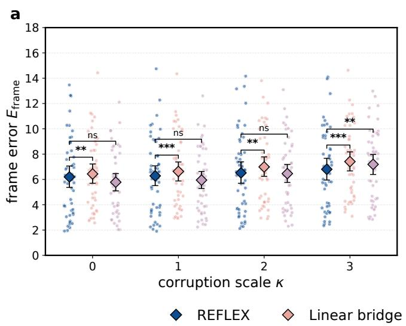

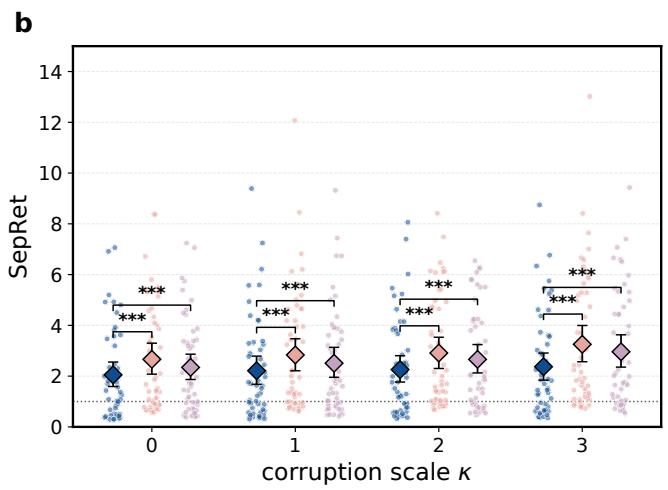  
◇ Uniform stochastic bridge  
Figure 6: Additional recovery-stress results at $t = 0 . 2 5$ . a: Target-frame recovery error after one-step recovery from perturbed bridge states. b: SepRet under the same perturbation protocol. Stars and ns denote significant and non-significant paired comparisons with REFLEX.

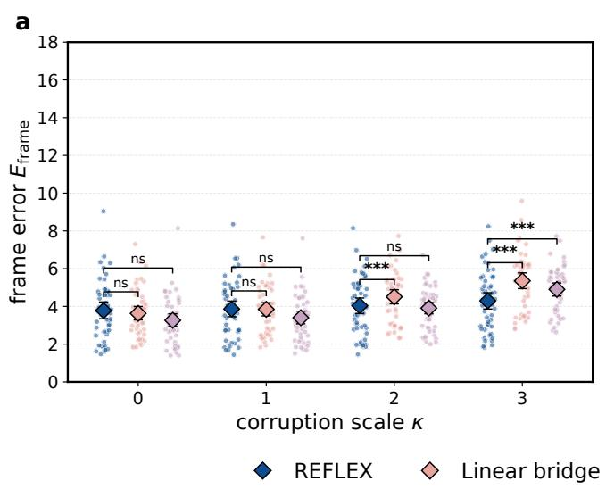

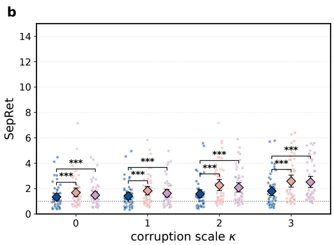  
Uniform stochastic bridge  
Figure 7: Additional recovery-stress results at $t = 0 . 5 .$ a: Target-frame recovery error after one-step recovery from perturbed bridge states. b: SepRet under the same perturbation protocol. Stars and ns denote significant and non-significant paired comparisons with REFLEX.

## E Statistical Significance Analysis

For the AMR and coverage analyses, we compute each metric per test cluster and report cluster-level means with 95% bootstrap confidence intervals from 10,000 resamples. Significance is assessed against REFLEX on the paired cluster intersection. For continuous AMR metrics, we use a one-sided Wilcoxon signed-rank test with the alternative that REFLEX is better. For thresholded COV-R and COV-P, we use a one-sided paired bootstrap on the mean cluster-wise diference ∆ = REFLEX − baseline. Within each metric, p-values across baseline comparisons are corrected with Holm’s step-down procedure; stars in Figures 8 and 9 denote Holm-corrected significance.

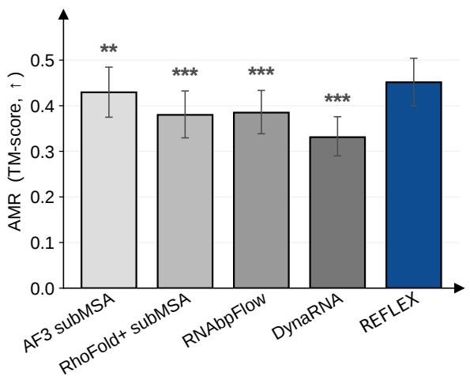

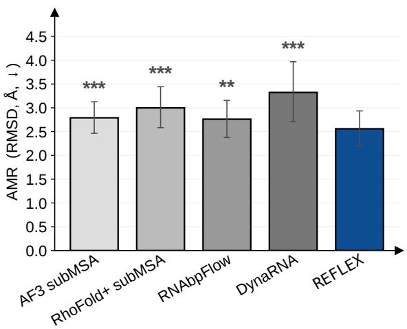  
Figure 8: Statistical analysis of conformer recovery. Left: best-match TM-score AMR, where higher is better. Right: best-match RMSD AMR, where lower is better. Bars show means with 95% bootstrap confidence intervals; stars denote Holm-corrected significance from one-sided paired Wilcoxon comparisons with REFLEX.

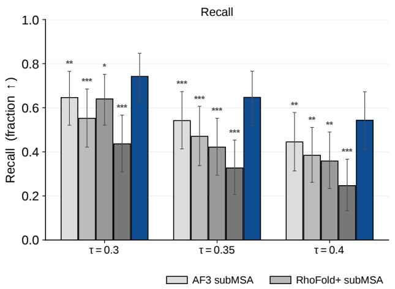

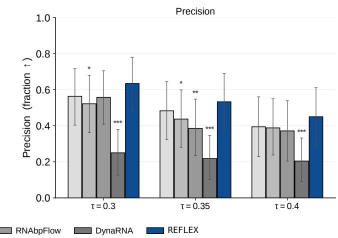  
Figure 9: Statistical analysis for precision–recall coverage. Left: COV-R at TM-score thresholds $\tau \in \{ 0 . 3 0 , 0 . 3 5 , 0 . 4 0 \}$ . Right: COV-P at the same thresholds. Bars show cluster-level means with 95% bootstrap confidence intervals; stars denote Holm-corrected significance from one-sided paired bootstrap comparisons with REFLEX. Absence of a star indicates that the comparison does not meet the 0.05 significance threshold.

## F All-atom Reconstruction and Auxiliary Loss

We extend the frame-based reconstruction of RNA-FrameFlow [12] with ten torsions per nucleotide: eight backbone angles, one for $\mathrm { O 2 ^ { \prime } }$ placement, and the glycosidic angle $\chi .$ . Nucleotide-specific reference geometry supplies complete bases, yielding all heavy-atom coordinates:

$$
\hat { Y } = \mathrm { A l l A t o m } ( \hat { x } _ { 1 } , \hat { R } _ { 1 } , \hat { \Phi } ; s ) , \qquad Y = \mathrm { A l l A t o m } ( x _ { 1 } , R _ { 1 } , \Phi ; s ) .\tag{13}
$$

The auxiliary geometry losses are

$$
\mathcal { L } _ { \mathrm { a t o m } } = \frac { 1 } { \left| \mathcal { A } \right| } \sum _ { a \in \mathcal { A } } \| \hat { Y } _ { a } - Y _ { a } \| _ { 2 } ^ { 2 } ,\tag{14}
$$

$$
\mathcal { L } _ { \mathrm { d i s t } } = \frac { 1 } { | \mathcal { P } | } \sum _ { ( a , b ) \in \mathcal { P } } \Big ( \| \hat { Y } _ { a } - \hat { Y } _ { b } \| _ { 2 } - \| Y _ { a } - Y _ { b } \| _ { 2 } \Big ) ^ { 2 } ,\tag{15}
$$

$$
\mathcal { L } _ { \mathrm { t o r s } } = \frac { 1 } { | \mathcal { T } | } \Vert \hat { z } _ { \mathcal { T } } - z _ { \mathcal { T } } \Vert _ { 2 } ^ { 2 } , \qquad z = ( \cos \Phi , \sin \Phi ) , \ \hat { z } = ( \cos \hat { \Phi } , \sin \hat { \Phi } ) .\tag{16}
$$

These terms can be combined as

$$
\ell _ { \mathrm { t a r g e t } } = \lambda _ { \mathrm { a t o m } } \mathcal { L } _ { \mathrm { a t o m } } + \lambda _ { \mathrm { d i s t } } \mathcal { L } _ { \mathrm { d i s t } } + \lambda _ { \mathrm { t o r s } } \mathcal { L } _ { \mathrm { t o r s } } .\tag{17}
$$

We use this reconstruction term as $\mathcal { L } _ { \mathrm { a u x } }$ in $\mathrm { E q . ~ ( 1 1 ) }$ , while Eq. (10) gives the frame-level stochastic bridge term.

## G Limitations and Broader Impact

REFLEX uses chain-normalized experimental B-factors as weak supervision for relative local mobility during training, so its calibration depends on the availability and quality of experimentally resolved RNA structures. B-factors are afected by experimental modality, refinement, resolution, and static disorder, and should not be interpreted as absolute thermodynamic fluctuations. The evaluation is also limited by the scarcity of RNA sequences with multiple experimentally resolved conformers; observed structures may cover only part of the accessible ensemble and do not provide equilibrium populations. Finally, REFLEX focuses on sequence-conditioned RNA backbone-frame ensembles, and does not explicitly model ligand-bound switching, protein–RNA complexes, ion efects, or experimentally validated conformational populations.

More broadly, REFLEX may help characterize RNA conformational heterogeneity and support hypothesis generation in settings where experimentally resolved ensembles are scarce. However, generated conformers should not be interpreted as experimentally validated structures or functional states. Downstream use may reflect biases in available RNA structures, pretrained representations, and the experimental proxies used for flexibility supervision. Care should therefore be taken when applying the method to biological design, functional interpretation, or therapeutic settings, where generated candidates require empirical validation.

## H Additional Ablations and Validation

Matched ablations on ensemble generation. We evaluate matched ablations with $K = 2 0$ samples per RNA (Table 4). All variants share frozen AF3 representations, generator backbone, training data, and evaluation protocol. In addition to Linear Bridge and Uniform Stochastic Bridge, we remove flexibility supervision by setting $\lambda _ { \mathrm { B } } = 0$ while retaining residue-dependent bridge widths, or remove per-residue calibration by using homoscedastic bridge noise while retaining $\mathcal { L } _ { \mathrm { B } }$

REFLEX improves all six coverage metrics over Linear Bridge and Uniform Stochastic Bridge while producing lower diversity. Removing per-residue calibration reduces coverage at every threshold. Removing flexibility supervision slightly improves coverage at $\tau = 0 . 3 0$ , but reduces COV-R/COV-P at $\tau = 0 . 4 0$ from 0.543/0.450 to 0.452/0.410. Thus, residue-dependent calibration provides consistent coverage gains, while flexibility supervision mainly benefits recovery at stricter thresholds.

Table 4: Matched component ablations. All variants use $K = 2 0$ samples per RNA. Coverage is macro-averaged across clusters, with the best value in each column in bold. Diversity is average pairwise RMSD in Å. The two $^ { 6 6 } \mathrm { W } \big / \mathrm { O } ^ { 3 }$ rows each remove one component from REFLEX.
<table><tr><td rowspan="2">Variant</td><td colspan="3">COV-R</td><td colspan="2">COV-P</td><td rowspan="2">Diversity (Å)</td></tr><tr><td>@0.30</td><td>@0.35</td><td>@0.40</td><td>@0.30 @0.35</td><td>@0.40</td></tr><tr><td>Linear Bridge</td><td>0.665</td><td>0.570</td><td>0.449</td><td>0.554 0.427</td><td>0.383</td><td>3.401</td></tr><tr><td>Uniform Stochastic Bridge</td><td>0.687</td><td>0.601</td><td>0.434</td><td>0.606 0.466</td><td>0.404</td><td>3.088</td></tr><tr><td>w/o flexibility supervision</td><td>0.753</td><td>0.616</td><td>0.452</td><td>0.647 0.506</td><td>0.410</td><td>3.157</td></tr><tr><td>w/o per-residue calibration</td><td>0.717</td><td>0.620</td><td>0.436</td><td>0.620 0.471</td><td>0.401</td><td>3.252</td></tr><tr><td>REFLEX</td><td>0.742</td><td>0.647</td><td>0.543</td><td>0.634 0.533</td><td>0.450</td><td>2.900</td></tr></table>

FlexibilityNet prediction. We evaluate the 64-bin supervised prediction head $o _ { \psi } ( s )$ on 50 sequencedisjoint RNA chains with 5,857 annotated nucleotides. Targets are the chain-normalized B-factor-derived proxy discretized into 64 bins. We report accuracy within ±2 bins and AUROC for identifying the top 25% of nucleotides within each chain according to this proxy. Metrics are computed per chain and macro-averaged; 95% confidence intervals use 10,000 bootstrap resamples of evaluation chains.

Table 5: FlexibilityNet prediction. Metrics assess agreement with the relative B-factor-derived proxy.
<table><tr><td>Metric</td><td>Chain-macro result</td><td>95% CI</td></tr><tr><td>Accuracy within ±2 bins</td><td>0.759</td><td>[0.691,0.824]</td></tr><tr><td>AUROC for the top 25% by the proxy</td><td>0.681</td><td>[0.630, 0.731]</td></tr></table>

Table 5 indicates that the supervised head captures informative patterns in the relative proxy. These measurements do not establish agreement with absolute mobility, coordinate RMSF, or thermodynamic fluctuations. At inference, only the latent condition $h _ { \psi } ( s )$ is passed to the bridge-field network; the scalar predictions from the supervised head are not consumed by the sampler. The downstream contribution of flexibility grounding is assessed separately by the $\lambda _ { \mathrm { B } } = 0$ ablation in Table 4.

Base-pair consistency of recovered conformers. For each experimental conformer, we select the highest-TM-score generated sample, as in AMR-R, without using base-pair information. For REFLEX, these structures include complete nucleobases reconstructed as in Appendix F. We annotate reference and matched structures with DSSR [42]. Base-pair precision, recall, and F1 are computed per match, averaged within each cluster, and then macro-averaged across test clusters.

Table 6: DSSR base-pair consistency of TM-score-selected matches. Higher values are better; the best observed value in each column is in bold.
<table><tr><td>Method</td><td>Precision</td><td>Recall</td><td>F1</td></tr><tr><td>AF3 subMSA</td><td>0.697</td><td>0.787</td><td>0.729</td></tr><tr><td>RNABPFLOW</td><td>0.712</td><td>0.757</td><td>0.725</td></tr><tr><td>RHoFoLD+ subMSA</td><td>0.694</td><td>0.630</td><td>0.647</td></tr><tr><td>REFLEX</td><td>0.734</td><td>0.765</td><td>0.741</td></tr></table>

REFLEX has the highest observed base-pair precision and F1, while AF3 subMSA has the highest recall (Table 6). These results support base-pair consistency among the TM-score-selected matches; they do not assess local validity across the entire generated ensemble. DynaRNA is excluded because its native output contains only $\mathrm { C 4 ^ { \prime } }$ coordinates. DSSR evaluation would require a separate full-atom reconstruction model, introducing dependence on additional post-processing.