# REMEMBER LESS, ADAPT LONGER:BOUNDED-STATE IN-CONTEXT REINFORCEMENTLEARNING WITH RECURRENT SUMMARY MEMORY

Jiawen Wang, Cheng Xue, Peng Zhang, Jochen Renz

The Australian National University

{jiawen.wang, cheng.xue, peng.zhang, jochen.renz}@anu.edu.au

## ABSTRACT

In-context reinforcement learning (ICRL) enables agents to adapt to new tasks without parameter updates, relying on memory to retain what they learn from experience. For agents operating continually, existing approaches using memory trade off bounded cost against access to past experience. Approaches using growing memories, such as full-history attention and accumulating summaries, incur storage and per-decision costs that increase with task length. Fixed-size memories bound storage but restrict access: sliding windows discard older steps, while recurrent networks compress even recent interactions into a hidden state. We introduce Recurrent Summary Memory (RSM), a Transformer policy that attends exactly to a short working buffer of recent interactions and carries a fixed-capacity summary of earlier experience. When the buffer fills, RSM rewrites the summary from its previous contents and the buffer, then clears the buffer, so deployment memory and per-decision cost stay O(1) in task length. On long-running partially observable tasks, frozen RSM policies sustain their adapted performance for eight times the training horizon with about 1% of full-history memory, ending ahead of every evaluated baseline while growing memories deteriorate. When the task configuration changes mid-run, RSM re-adapts better than growing and recurrent memories. Clearing the summary or blocking the policy’s access to it removes its benefit, while swapping in another task’s summary steers behaviour towards that task. Together, these results show that our fixed-capacity summary can sustain in-context adaptation far beyond the training horizon.

## 1 INTRODUCTION

An agent placed in an unfamiliar environment often cannot directly observe everything it needs to act, so it must use past experience to inform its decisions and adapt to the environment (Kaelbling et al., 1998). In Dark Key-to-Door (Laskin et al., 2023), for example, an agent that searches a dark room for a hidden key and then a door should reuse the key’s location on every later attempt; in a maze with unfamiliar controls, an inferred mapping from actions to movements should support navigation throughout the task. In-context reinforcement learning (ICRL) trains policies to adapt in this way: a single policy is trained across tasks to condition its decisions on its history of observations, actions, and rewards, enabling adaptation without test-time parameter updates (Laskin et al., 2023; Lee et al., 2023; Grigsby et al., 2024). Because its parameters remain fixed, memory must carry the task knowledge acquired during deployment (Duan et al., 2016; Wang et al., 2016). For an agent that keeps operating, continued adaptation therefore depends on preserving useful discoveries.

Existing memory architectures trade off bounded cost against access to experience. Full-history Transformers (Parisotto et al., 2020; Grigsby et al., 2024) let a policy revisit individual records, but their key/value caches and per-decision attention costs grow with task duration. Sliding windows bound these costs by discarding older records, even when their information remains useful (Xiao et al., 2024). Recurrent networks such as GRUs (Cho et al., 2014) maintain a fixed-size hidden state and provide strong baselines under partial observability, but compress even recent interactions (Heess et al., 2015; Ni et al., 2022; Morad et al., 2023). Summary memory offers a way to separate immediate access from longer-term retention: recent records provide direct context, while a compact representation carries earlier experience (Rae et al., 2020; Ge et al., 2024). Segment-level Transformers implement this separation with local attention and representations carried between segments (Dai et al., 2019; Hutchins et al., 2022): Recurrent Memory Transformers (RMTs) carry a fixed bank of memory tokens (Bulatov et al., 2022), whereas Memo appends one summary block per segment, so its state still grows (Gupta et al., 2025).

A fixed-capacity summary eliminates storage growth, but bounded storage alone does not guarantee sustained adaptation. Once a segment is discarded, its useful evidence must survive not only the next summary, but every subsequent rewrite until it is needed. Re-exploring the room may recover a forgotten key location, but not a cue presented only once (Ni et al., 2023). Conversely, when the hidden task changes, retaining obsolete evidence can obstruct adaptation. The summary must therefore learn both to preserve relevant information and to revise it. These demands grow beyond the training horizon, where memory undergoes more rewrites than in training. Success on finite training tasks need not imply reliable memory during continued operation; indeed, finite and continuing memory tasks can reverse the relative performance of recurrent and attention-based agents (Pleines et al., 2025). We therefore ask: Can a Transformer policy sustain useful in-context adaptation beyond its local context and training horizon under a fixed deployment memory budget?

We address this question with Recurrent Summary Memory (RSM), a Transformer policy with a recurrent-memory architecture. RSM combines exact attention over a short-term working buffer of the current segment’s interactions with a fixed-capacity long-term summary. Here, exact means that each decision attends directly to the cached representation of every record in the buffer, not that the whole history is kept. At each segment boundary, it writes a replacement summary from the previous summary and buffered steps, then clears the buffer, so only the new summary carries earlier experience into the next segment. What the summary retains is learned only through the actor–critic losses, not set by token-retention rules (StreamingLLM; Xiao et al., 2024) or auxiliary reconstruction losses (Compressive Transformers; Rae et al., 2020). With fixed capacities, RSM’s deployment state and per-decision computation are O(1) in task length: in our experiments it holds 249.9 KB per agent, whereas a full-history cache of the same backbone grows by 6 KB per step, to about 5 GB after a day of 10 Hz control. Such bounds matter for robots with fixed onboard memory, game agents acting over thousands of steps, and services running many agents in parallel.

To test whether this bounded memory sustains adaptation, we evaluate RSM on four partially observable benchmarks: Dark Key-to-Door (location reuse; Laskin et al., 2023), CountRecall (evidence accumulation; Morad et al., 2023), MazeRunner (navigation with unknown action mappings; Grigsby et al., 2024), and the passive T-Maze (one-time-cue recall; Ni et al., 2023). We compare against a full-history Transformer, a GRU, accumulating-summary Memo, and a state-matched sliding win dow, trained with the same learner, inputs, losses, and interaction budget. On these benchmarks, a fixed-capacity summary sustains in-context adaptation far beyond the training horizon, answering our question affirmatively. Specifically, our contributions are:

• Bounded summary memory for online in-context RL. We specify and evaluate RSM, combining an exact segment-local working buffer with a fixed-capacity summary produced by learned write queries and a projected overwrite. RSM is trained with AMAGO’s (Grigsby et al., 2024) off-policy actor–critic losses through every carried write. Its deployment state and per-decision cost remain O(1) in task length (Section 3).

• Sustained adaptation beyond the training horizon. RSM remains competitive at the training horizon; frozen RSM policies maintain adapted performance over eight times that horizon and re-adapt better than growing and recurrent memories when the hidden task changes, whereas growing memories deteriorate (Section 4.2).

• Evidence that decisions depend on summary content. Clearing the summary, transplanting another task’s summary into it, and blocking the policy’s access to it show that the policy uses its content; linear probes recover hidden task variables; and write-rule ablations show greater stability with overwriting than with additive updates (Sections 4.3–4.4).

## 2 PRELIMINARIES AND PROBLEM FORMULATION

Task setting and in-context adaptation. A task $\xi ,$ such as a room layout or an action mapping, defines a finite-horizon POMDP $\bar { \mathcal { M } } _ { \xi } = ( \mathcal { X } , \mathcal { O } , \mathcal { A } , \dot { P } _ { \xi } , \Omega _ { \xi } , R _ { \xi } , \rho _ { \xi } , T _ { \xi } )$ (Kaelbling et al., 1998), with hidden states $x _ { t } \in \mathcal { X }$ , observations $o _ { t } \in \mathcal { O }$ drawn from the observation function $\Omega _ { \xi } ( \cdot \mid x _ { t } )$ , actions $a _ { t } \in A ,$ , dynamics $P _ { \xi }$ , reward function $R _ { \xi }$ , initial-state distribution $\rho _ { \xi }$ and horizon $T _ { \xi }$ . The agent plays each task as one outer task, an episode of $\mathcal { M } _ { \xi }$ that may contain several physical attempts; an attempt reset is a transition of $P _ { \xi }$ back to a start state under the same $\xi$ . At decision t the policy conditions on the history $\mathcal { H } _ { t } = \left( o _ { 0 } , a _ { 0 } , r _ { 1 } , o _ { 1 } , \ldots , a _ { t - 1 } , r _ { t } , o _ { t } \right)$ , where $r _ { t + 1 } = R _ { \xi } ( x _ { t } , a _ { t } )$ is the environment’s native (unscaled) reward. Every interface call is a step, including the reset-only call that starts each new attempt: it takes no physical action, so the environment ignores $a _ { t }$ , returns the new attempt’s first observation and gives no reward $( r _ { t + 1 } = 0 )$ , yet it counts towards the task length and the training budget. ICRL learns one set of parameters θ for the policy and its encoders, shared across all training tasks, so that the policy adapts to new tasks through interaction (Duan et al., 2016; Wang et al., 2016; Grigsby et al., 2024). It maximises the expected discounted return $J _ { \gamma } ( \theta )$ over training tasks $\xi \sim p _ { \mathrm { t r a i n } }$ and the outer-task trajectories τ that $\pi _ { \theta }$ generates in $\mathcal { M } _ { \xi }$ , with discount $\gamma \in ( 0 , 1 ]$

$$
J _ { \gamma } ( \theta ) = \mathbb { E } _ { \xi \sim p _ { \mathrm { t r a i n } } , \tau \sim \pi _ { \theta } , \mathcal { M } _ { \xi } } \left[ \sum _ { t = 0 } ^ { T _ { \xi } - 1 } \gamma ^ { t } r _ { t + 1 } \right] .\tag{1}
$$

Because the return sums the rewards of every attempt in an outer task, information gathered in early attempts pays off in later ones. At evaluation, θ is frozen and the policy runs on held-out tasks disjoint from training; we report native, undiscounted metrics. More details in Appendix C.

History-dependent policies. All compared policies receive the same public input, the current observation with the native $\mathtt { R L } ^ { 2 }$ action–reward feedback (Duan et al., 2016); task identifiers, hidden layouts and evaluator labels never enter it. A stateless timestep encoder $f _ { \phi }$ embeds each step’s record $u _ { t }$ (with $a _ { - 1 }$ and $r _ { 0 }$ set to zero), and a causal history encoder $F _ { \theta }$ updates the policy state:

$$
\begin{array} { r } { u _ { t } = ( o _ { t } , a _ { t - 1 } , r _ { t } ) , \qquad e _ { t } = f _ { \phi } ( u _ { t } ) , \qquad ( m _ { t } , s _ { t } ) = F _ { \theta } ( s _ { t - 1 } , e _ { t } ) , \qquad a _ { t } \sim \pi _ { \theta } ( \cdot \mid m _ { t } ) . } \end{array}\tag{2}
$$

Here, $s _ { t }$ denotes all history-dependent state that the policy retains for future decisions, $m _ { t }$ the actor– critic representation and $s _ { - 1 }$ a task-independent initial state; θ includes $\phi .$ . The state $s _ { t }$ is updated at every step and kept across attempt resets, and returns to $s _ { - 1 }$ only when a new outer task begins.

Bounded-state adaptation objective. We seek a policy that adapts through interaction while its history-dependent deployment state respects a fixed budget B:

$$
\operatorname* { m a x } _ { \theta } J _ { \gamma } ( \theta ) \quad { \mathrm { s u b j e c t ~ t o } } \quad { \mathrm { b y t e s } } ( s _ { t } ) \leq B \quad { \mathrm { f o r ~ a l l ~ } } \xi , \ { \mathcal { H } } _ { t } , \ 0 \leq t < T _ { \xi } ,\tag{3}
$$

where $\mathrm { b y t e s } ( s _ { t } )$ is the memory needed to store $s _ { t }$ at implementation precision (its summary or hidden-state tensors, key/value caches and counters, but not the parameters, workspace or training resources) and $B$ does not depend on $T _ { \xi }$ : the deployment state must be $O ( 1 )$ in the task length, whereas a full-history Transformer, whose cache holds every record, needs $\dot { O } ( \mathcal { T } _ { \xi } )$ . More details in Appendices D.1 and D.2.

## 3 RECURRENT SUMMARY MEMORY

RSM (Figure 1) processes interaction history in segments of $C = 3 2$ admitted records, using an exact segment-local working buffer and a recurrent summary of $M = 4$ tokens. The same causal Transformer produces decision representations and the next summary. Learned write queries attend to the previous summary and the completed segment; a learned projection of their final-normalised outputs replaces the summary before the buffer is cleared.

## 3.1 WORKING BUFFER AND RECURRENT SUMMARY

We partition the per-step embeddings ${ e _ { t } ~ = ~ f _ { \phi } ( u _ { t } ) }$ of Equation 2 into consecutive segments of $C = 3 2$ records: record t belongs to segment $b = \lfloor t / C \rfloor$ at position $i = t - b C + 1$ , so that $e _ { b , i } = e _ { t }$ and $m _ { b , i } = m _ { t }$ . Segment b receives a summary $\bar { Z } _ { b } \in \mathbf { \bar { R } } ^ { M \times d }$ of $M = 4$ tokens (its rows) and the records $X _ { b } = ( e _ { b , 1 } , . . . , e _ { b , n _ { b } } )$ , where $1 \leq n _ { b } \leq C$ and only the last segment of a task can have $n _ { b } < C$ . One causal Transformer (Vaswani et al., 2017) of width $d = 2 5 6$ , with $L = 3$ layers and eight heads, supplies both the decision representation and the next summary:

$$
\begin{array} { r } { m _ { b , i } = \mathcal { R } _ { \theta } ( Z _ { b } , X _ { b , 1 : i } ) , \qquad Z _ { b + 1 } = \mathcal { U } _ { \theta } ( Z _ { b } , X _ { b } ) , \qquad Z _ { 0 } = Z _ { \mathrm { i n i t } } , } \end{array}\tag{4}
$$

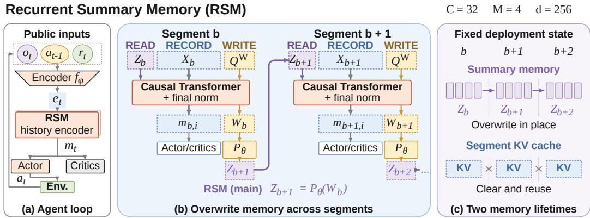  
Figure 1: Recurrent Summary Memory. (a) The stateless encoder $f _ { \phi }$ maps each public record to $_ { e t } ;$ RSM supplies mt to the actor and critics. (b) $X _ { b } = ( e _ { b , 1 } , \dots , e _ { b , n _ { b } } )$ contains the segment’s records. Each RECORD output $m _ { b , i }$ uses $Z _ { b }$ and the causal prefix $X _ { b , 1 : i } ;$ normalised WRITE outputs $W _ { b }$ yield $Z _ { b + 1 } = P _ { \theta } ( W _ { b } )$ for the next segment. Parameters are shared across segments; token embeddings are omitted. (c) Successive snapshots of the same bounded deployment state: the summary is replaced and the segment KV cache cleared (crosses). Counters are also retained; full-task training memory grows with task length.

where $Z _ { \mathrm { i n i t } }$ is a learned, task-independent initial summary. Both maps share the slot layout

$$
[ \operatorname { R E A D } ( Z _ { b } ) \mid \operatorname { R E C O R D } ( X _ { b } ) \mid \operatorname { W R I T E } ( Q ^ { \mathrm { W } } ) \mid ] ,\tag{5}
$$

where $Q ^ { \mathrm { W } } \in \mathbb { R } ^ { M \times d }$ is a learned bank of write queries, and READ, RECORD and WRITE embed their arguments as rows of that role, with role, memory-slot and segment-local position embeddings and, for records, an input projection. The working buffer is the per-layer key/value cache of these $M { + } C { + } M$ slots. All layers apply ordinary causal attention over this slot order. The final-normalised RECORD and WRITE outputs are the decision representations $m _ { b , \cdot }$ i and the rows of $W _ { b } \in \mathbb { R } ^ { M \times d }$ Because the WRITE slots follow every RECORD slot, $W _ { b }$ cannot affect the current segment’s decisions and reaches the policy only through $Z _ { b + 1 } ;$ READ and WRITE slots are not environment steps and receive no direct RL loss. More details in Appendices A.3 and B.

## 3.2 OVERWRITE UPDATE AND TRAINING

At each boundary RSM replaces the carried summary with the projected WRITE outputs; the residual-write ablation RSM-R adds them instead:

$$
Z _ { b + 1 } = P _ { \theta } ( W _ { b } ) \quad ( \mathrm { R S M } ) , \qquad Z _ { b + 1 } = Z _ { b } + P _ { \theta } ( W _ { b } ) \quad ( \mathrm { R S M - R } ) ,\tag{6}
$$

where $P _ { \theta }$ applies one affine map $\mathbb { R } ^ { d } \to \mathbb { R } ^ { d }$ to each of the M rows, so that $\mathcal { U } _ { \theta } ( Z _ { b } , X _ { b } ) = P _ { \theta } ( W _ { b } )$ for RSM. The WRITE outputs depend on $Z _ { b }$ through the READ rows, which makes the overwrite recurrent without an additive identity path between summaries: the writer must express both the retained information and the new evidence in M output tokens. Only $Z _ { b + 1 }$ crosses a boundary: the working buffer is cleared and the slot counter restarts. During cached interaction, a write is executed only when a full segment is followed by another record. Dense training also computes a final WRITE output, but it has no downstream decision loss.

RSM is trained with AMAGO’s off-policy actor–critic learner (Grigsby et al., 2024), shared by all compared policies: each update replays complete outer tasks, recomputes their summaries from $Z _ { \mathrm { i n i t } }$ under the current weights and backpropagates through every carried write (Werbos, 1990), with no summary target or auxiliary memory loss. Every later loss therefore reaches every earlier write through $Z _ { b + 1 } \stackrel { \cdot } { = } \ P _ { \theta } ( W _ { b } )$ ; under the overwrite, the Jacobian $\partial Z _ { b + 2 } / \partial Z _ { b + 1 }$ passes only through attention to the READ rows, whereas RSM-R adds an identity term. Before each collection block, the parallel agents’ states are rebuilt from their consumed public prefixes under the current weights. More details in Appendices B and C.

## 3.3 DEPLOYMENT-STATE AND SUMMARY BOUNDS

Proposition 1 (Bounded deployment state). Forfixed C, M, d and $L ,$ each agent of a frozen RSM policy retains its summary (Md values), the working buffer’s per-layer key/value caches $( 2 L ( C +$

2M)d values), a 32-bit occupied-slot counter and a 64-bit segment counter. With its tensors in 32-bit floating point (FP32), this state occupies

$$
B _ { \mathrm { d e p l o y } } = 4 \big [ M d + 2 L ( C + 2 M ) d \big ] + 1 2 b y t e s ,\tag{7}
$$

independent oftask duration,for RSM-R and RSM w/o memory alike.

Space complexity. With the values of Section 3.1, $B _ { \mathrm { d e p l o y } } = 2 4 9 , 8 6 8$ bytes per agent, so RSM’s deployment state is $O ( 1 )$ in the task length $T _ { \xi } ,$ , as for a GRU (Cho et al., 2014), whereas a fullhistory Transformer of the same L and d caches keys and values for every record $( 2 L T _ { \xi } d$ values) and Memo (Gupta et al., 2025) for M summary tokens per segment (about $2 L M T _ { \xi } d / \overset { \cdot } { C }$ values), both $O ( T _ { \xi } )$ . Every RSM query also attends to at most $\bar { C } + 2 \bar { M } = 4 0$ cached slots, so attention per decision is $O ( 1 )$ in $T _ { \xi }$ as well. The overwrite also keeps every summary row within a fixed bound at any horizon, whereas the residual write admits only a bound that grows with every write (Proposition 2). More details in Appendix D.

## 4 EXPERIMENTS

We ask (1) whether RSM adapts as well as growing memories, at and far beyond the training horizon (Section 4.2); (2) whether its decisions use the summary (Section 4.3); and (3) which design choices matter (Section 4.4).

## 4.1 EXPERIMENTAL SETUP

Environments. We use four partially observable benchmarks. In Dark Key-to-Door (Key-to-Door below; Laskin et al., 2023; Grigsby et al., 2024), the agent searches an 8 × 8 room for a hidden key and door over repeated attempts in one 500-step task; CountRecall (POPGym; Morad et al., 2023) deals 104 cards from four categories and asks at every step how many of a queried category have been dealt; in MazeRunner (Grigsby et al., 2024), the agent reaches three ordered goals in a hidden $1 5 \times 1 5$ maze with permuted actions in one 500-step attempt; and the passive T-Maze (Ni et al., 2023) requires recalling a cue shown only at the first step of a 128-cell corridor.

Baselines and Ablations. All policies share the stateless timestep encoder, the public inputs and the AMAGO off-policy learner; the Transformers share width 256, three layers and eight heads. We compare RSM (Section 3) with the full-history Transformer, whose key–value cache grows with every record; AMAGO’s recurrent GRU, whose state is fixed; and Memo (Gupta et al., 2025), which appends four summary tokens per 32-record segment, both as published (jittered segment lengths) and with fixed segments. We call the full-history Transformer and Memo the growing memories. The sliding window is a summary-free Transformer attending only to the last $W = 4 0$ records at every layer, the largest window within RSM’s per-agent state. The ablations train RSM w/o memory, which resets the summary at every segment boundary; RSM-R, which adds the write to the carried summary instead of overwriting it (Equation 6); RSM with $M \in \{ 1 , 4 , 8 , 1 6 \}$ summary tokens on Key-to-Door; and, on CountRecall, RSM detach, whose summary is detached at every boundary so that no later loss reaches the write.

Evaluation Protocol. Every policy is trained three times, with seeds 42, 100 and 2026, for 8M steps each, and evaluated at its final checkpoint by greedy rollouts on 256 held-out confirmation tasks per benchmark, whose layouts, card streams and mazes never occur in training. The metrics are doors per 500 steps on Key-to-Door, exact accuracy on CountRecall (CR evicted: queries whose evidence has left the buffer), the fraction of the three goals reached on MazeRunner, and success on the T-Maze, each first at the training horizon, the length of a training task. CountRecall and the T-Maze have fixed-length tasks; Key-to-Door and MazeRunner also run for 4,000 steps, eight times that horizon, counting successes per 500 steps: in the same task the layout or map stays fixed while attempts continue, and in a new task a new layout arrives every 500 steps, or a new maze with the same action mapping every 1,000, with memory carried. A change of layout or maze within such a run is not a new outer task in the sense of Section 2: no memory is reset during the 4,000 steps. We report means over tasks and seeds and compare policies by paired differences on the same tasks and seeds: a difference is consistent when it exceeds a practical margin δ (1 door, 0.05 accuracy, 0.1 goal fraction or one goal per 500 steps, and 0.25 success), its 95% joint seed/task bootstrap interval (Agarwal et al., 2021) excludes zero and all three seeds agree in sign, and equivalent when the whole interval lies within ±δ; any other difference is no consistent difference. Bands and whiskers are 95% intervals; dots mark seeds. More details in Appendices A, E and F.7.

Table 1: Performance at the training horizon and over long tasks (settings in Section 4.1). Training horizon: Key-to-Door (KD) doors per 500 steps, CountRecall (CR) exact accuracy, MazeRunner (MR) fraction of goals reached, T-Maze (TM) success. Long-running: doors or goals per 500 steps, in the last 500 of 4,000 steps (same task), per later layout or on the fourth map (new task). CR evicted: accuracy on evidence that left the buffer. State: peak per agent. Bold: best compared memory.
<table><tr><td rowspan="3"></td><td colspan="4">Training horizon</td><td colspan="4">Long-running, 4,000 steps</td><td></td><td></td></tr><tr><td rowspan="2">KD↑</td><td rowspan="2">CR↑</td><td rowspan="2">MR↑</td><td rowspan="2"></td><td colspan="2">same task</td><td colspan="2">new task</td><td rowspan="2"></td><td rowspan="2">CR evicted ↑ State ↓</td></tr><tr><td>TM↑</td><td>KD↑MR↑</td><td>KD↑</td><td>MR↑</td></tr><tr><td>RSM (ours)</td><td>29.1</td><td>0.989</td><td>0.804</td><td>1.000</td><td>46.0</td><td>26.6</td><td>9.4</td><td>23.0</td><td>0.986</td><td>249.9 KB</td></tr><tr><td>Full-history Transformer</td><td>27.4</td><td>0.998</td><td>0.737</td><td>1.000</td><td>28.2</td><td>0.8</td><td>0.8</td><td>0.4</td><td>0.998</td><td>24.58 MB</td></tr><tr><td>GRU</td><td>29.6</td><td>0.930</td><td>0.643</td><td>1.000</td><td>40.6</td><td>19.1</td><td>1.6</td><td>16.1</td><td>0.937</td><td>3.1 KB</td></tr><tr><td>Memo</td><td>29.6</td><td>0.956</td><td>0.863</td><td>1.000</td><td>10.6</td><td>1.8</td><td>0.5</td><td>2.0</td><td>0.939</td><td>3.24 MB</td></tr><tr><td>Memo, fixed segments</td><td>26.8</td><td>0.944</td><td>0.836</td><td>1.000</td><td>31.4</td><td>2.8</td><td>0.6</td><td>2.9</td><td>0.933</td><td>3.24MB</td></tr><tr><td>RSM w/o memory</td><td>2.0</td><td>0.680</td><td>0.738</td><td>0.514</td><td>2.9</td><td>19.2</td><td>1.9</td><td>17.9</td><td>0.538</td><td>249.9 KB</td></tr><tr><td>RSM-R (residual)</td><td>29.8</td><td>0.990</td><td>0.756</td><td>1.000</td><td>45.2</td><td>5.0</td><td>1.8</td><td>0.4</td><td>0.988</td><td>249.9 KB</td></tr></table>

The same task, repeated

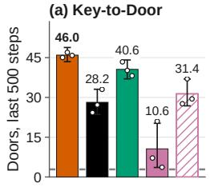

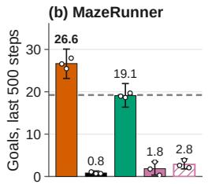  
A new layout or map inside the run

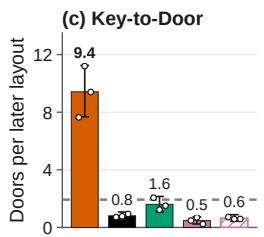

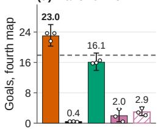

(e) Key-to-Door  
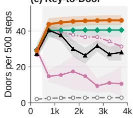

(h) MazeRunner  
(g) Key-to-Door  
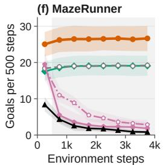

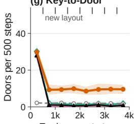

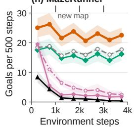  
Figure 2: Long-running tasks (4,000 steps). Columns: the same layout or map throughout, or a new one at intervals. (a–d) Final-window scores, doors per later layout, or goals on the fourth map; dots: seeds; dashed: RSM w/o memory. (e–h) Scores per 500-step window; shading marks steps beyond training, ticks mark task changes.

## 4.2 ADAPTATION AT AND BEYOND THE TRAINING HORIZON

At the training horizon. RSM is competitive at the training horizon and pulls ahead over long tasks (below). Some baselines score higher in mean, but none is consistently better: the full-history Transformer reaches 0.998 against 0.989 accuracy on CountRecall, within the equivalence margin, and Memo reaches a goal fraction of 0.863 against 0.804 on MazeRunner, ahead on every seed but by a mean gap below δ. RSM is equivalent to the full-history Transformer on CountRecall, MazeRunner and the T-Maze and consistently better than the GRU on CountRecall and MazeRunner; on Key-to-Door the intervals are too wide to separate it from the growing memories and the GRU (Tables 1 and 7). These scores reflect adaptation within a task: on Key-to-Door, door success rises from about 0.15 on the first attempt to above 0.8 on the ninth for every memory except RSM w/o memory (Appendix F.1). Its state stays fixed while the full-history cache and Memo’s store grow; after 4,000 steps it is about 1% of the full-history cache (Figure 3).

Over a long task. In the same task, RSM and the GRU sustain their adapted performance over the whole run, RSM at a higher level and, in the last window, ahead of every compared memory on every seed (Figure 2a,b,e,f; Table 1), so its advantage widens as the task runs on. The growing memories fall from their early-run rate, Memo most steeply, and on the repeated MazeRunner map they collapse towards zero goals; they also meet longer contexts than in training, while RSM’s context

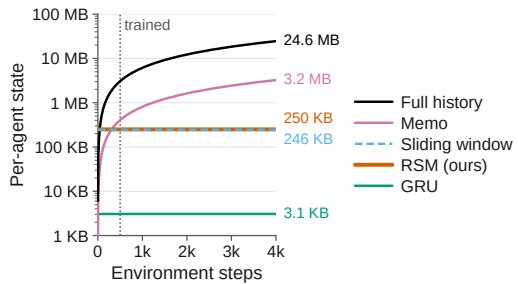  
Figure 3: Per-agent state against task length.

stays at 40 slots (Section 3.3). The causes differ: on one MazeRunner map, wiping the memory at every attempt prevents Memo’s decline but not the full-history Transformer’s, so retained history alone does not explain the latter (Appendix F.2).

A state-matched sliding window. The sliding window, with about the same deployment state as RSM, trails it consistently on Key-to-Door at the training horizon, where every position was seen in training, so evidence older than 40 records matters; on MazeRunner the two show no consistent difference. Over 4,000 steps

Table 2: A state-matched sliding window (the last 40 records per layer, 246.1 KB per agent).
<table><tr><td rowspan="2"></td><td colspan="2">Training horizon Last 500 of 4,000</td><td colspan="2"></td></tr><tr><td>KD</td><td>MR</td><td>KD</td><td>MR</td></tr><tr><td>RSM</td><td>29.1</td><td>0.804</td><td>46.0</td><td>26.6</td></tr><tr><td>window 24.1</td><td></td><td>0.750</td><td>4.9</td><td>2.6</td></tr></table>

the window falls to a few doors or goals per window (Table 2), but it then also meets untrained positions, so this comparison is operational rather than a clean test of summarisation.

After the task changes. In the new task (Table 1; Figure $^ { 2 \mathrm { c } , \mathrm { d } , \mathrm { g } , \mathrm { h } ) }$ , RSM drops after each change and recovers once it finds the new layout or map, largely on MazeRunner and in about a third of Key-to-Door layouts, yet stays above every other memory on every later layout, map and seed. On Key-to-Door the others average under two doors per layout; on MazeRunner the GRU and RSM w/o memory stay lower and the growing memories collapse. More details in Appendices E.2 and F.2.

## 4.3 DO THE DECISIONS USE THE SUMMARY?

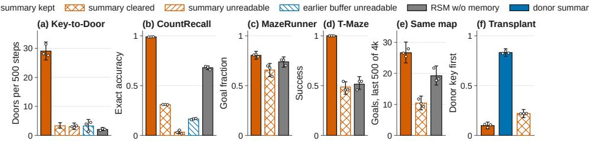  
Figure 4: Interventions on the frozen RSM policy. (a–e) The summary kept or cleared at every boundary, beside RSM w/o memory, and in (a,b) the summary or the earlier buffer unreadable to the decisions $( \beta = \infty )$ (e) MazeRunner goals in the last 500 of 4,000 steps on one map. (f) Key-to-Door tasks whose next attempt visits the donor’s key first, after a transplant. Dots: seeds.

Clearing, transplanting and blocking. We test causally whether the decisions depend on the carried summary (Figure 4). Resetting RSM’s summary to $Z _ { \mathrm { i n i t } }$ at every boundary, with the working buffer intact, removes the benefit of the summary on every benchmark and every seed, and leaves the policy well below RSM w/o memory on CountRecall and the long MazeRunner task and at its fixed-turn level on the T-Maze: the trained policy does not fall back on the buffer-only strategy that RSM w/o memory learns (Figure 4a–e). To transplant, we replace each task’s summary at one boundary with the summary that a different task, the donor, carried there; behaviour then follows the donor task: on Key-to-Door the next attempt visits the donor’s key cell first in most tasks (Figure 4f), and on CountRecall the policy answers with the donor’s counts until the next rewrite. As attention weights alone do not explain a decision (Jain & Wallace, 2019), we also intervene on them: adding $- \beta$ to every decision’s attention scores on the four summary keys leaves the summary carried but unreadable at $\beta = \infty$ , which reduces RSM to the level of RSM w/o memory on Key-to-Door and below it on CountRecall (Figure 4a,b), with a loss growing with $\beta .$ Blocking the earlier buffer records costs about as much: the decisions depend on both memories.

Retention and Attention. On CountRecall, we group queries by how often the summary has been rewritten since the queried category was first dealt (Figure 5). Queries whose evidence has passed through up to three rewrites are answered about as accurately as by the full-history Transformer, which keeps every card, while the GRU and both Memo variants are less accurate in the last segment. A linear read-out (ridge regression) from the summary recovers every CountRecall count almost perfectly and the hidden key’s position on Key-to-Door well, on every seed: four tokens hold the task’s hidden variables in a readable form. The decisions also attend to the summary far more than the same slots in RSM w/o memory; on Key-to-Door this extra attention is flat across the room on the first attempt, while the agent searches, and on later attempts is higher in the room’s interior than along its walls (Figure 6): once the agent has something to recall, how much it reads the summary varies slightly with where it is. More details in Appendices F.3–F.5.

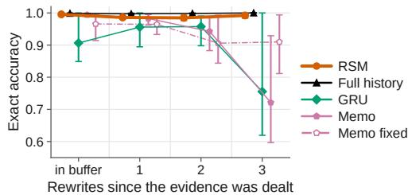

Figure 5: CountRecall retention: accuracy by the number of summary rewrites since the queried evidence was dealt.  
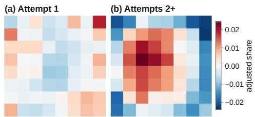  
Figure 6: Where the summary is read in the Keyto-Door room: summary attention adjusted for segment position, by the agent’s cell.

## 4.4 ABLATIONS

Carrying and training the summary. Removing the carried summary, keeping only the 32-record buffer, loses most of the adaptation (Table 1, RSM w/o memory), consistently on every seed on Key-to-Door, CountRecall and the T-Maze, and the loss widens over the 4,000-step Key-to-Door task. On MazeRunner one 500-step attempt is largely solvable from the buffer, so the summary adds less than δ at the training horizon, but several goals per window over longer tasks. How the write is trained also matters: detaching the summary at every boundary lowers RSM’s CountRecall accuracy on every seed (0.914 against 0.989), yet keeps most of the gain over RSM w/o memory (0.680). Training each write through the decisions that later read it thus improves what is kept.

Overwrite versus additive write. RSM-R stays within δ of RSM in mean at the training horizon and over the 4,000-step Key-to-Door task, but over many MazeRunner attempts on one map it declines below RSM w/o memory and on the map-change task it collapses by the fourth map, on every seed, while after a Key-to-Door layout change it adapts again no better than RSM w/o memory (Table 1). Wiping its memory at every attempt boundary preserves its rate, so the decline comes from what it carries. Its summaries drift in one direction until the first and the last are anti-correlated, at a norm tens of times larger than RSM’s: a drift that Proposition 2 bounds only for the overwrite.

Summary length. Varying the summary from one to sixteen tokens on Key-to-Door, with buffer, backbone and budget fixed, changes adaptation by no consistent margin (Table 3): the paired differences from four tokens change sign across seeds at the training horizon, and in the last window every length completes 45 to 46 doors. Even one token shows no consistent difference from four, and a larger summary buys no further adaptation on this task. More details in Appendices F.4 and F.6.

Table 3: Summary length on Key-to-Door (4,000-step tasks; 95% intervals).
<table><tr><td></td><td>M = 1</td><td>M = 4 (RSM)</td><td>M = 8</td><td>M = 16</td></tr><tr><td>State per agent</td><td>209.9 KB</td><td>249.9 KB</td><td>303.1 KB</td><td>409.6 KB</td></tr><tr><td>Doors, steps 1–500</td><td>29.6 [26.5, 33.0]</td><td>29.1 [25.9, 32.4]</td><td>30.8 [28.5, 33.1]</td><td>30.1 [27.8, 32.4]</td></tr><tr><td>Doors, steps 3,501–4,000</td><td>45.3 [42.2, 48.2]</td><td>46.0 [43.3, 48.6]</td><td>45.3 [42.5, 48.1]</td><td>45.9 [43.1, 48.7]</td></tr></table>

## 5 RELATED WORK

In-context reinforcement learning. Recurrent meta-RL first achieved in-context adaptation through hidden-state updates (Duan et al., 2016; Wang et al., 2016), and PEARL and VariBAD infer a belief over the task from context (Rakelly et al., 2019; Zintgraf et al., 2020). Sequence models extend the idea to longer histories: Algorithm Distillation imitates the learning histories of RL algorithms (Laskin et al., 2023), Decision-Pretrained Transformers predict optimal actions from interaction data (Lee et al., 2023), and AMAGO and ReLIC learn in context through off-policy and on-policy updates over long sequences (Grigsby et al., 2024; Elawady et al., 2024). How well such agents remember is harder to measure: memory is easily confounded with exploration and credit assignment (Pasukonis et al.ˇ , 2023; Ni et al., 2023; Cherepanov et al., 2026a), finite and end less versions of a task can reverse the ranking of recurrent and Transformer memories (Pleines et al., 2025), and retaining information differs from rewriting it when the task changes (Shchendrigin et al., 2026). Our evaluation follows these findings: we ran frozen policies far beyond the training horizon, changed the hidden task mid-run, and intervened on the summary directly.

Memory for sequence-based control. Like recurrent networks, state-space models and gated linear attention keep a fixed-size state (Lu et al., 2023; Pramanik et al., 2024), and Stable Hadamard Memory calibrates each update to erase what is no longer needed (Le et al., 2025). Learned summaries compress long contexts in language models (Chevalier et al., 2023; Ge et al., 2024), and language-model and RL memories have also been trained with reconstruction or predictive losses (Rae et al., 2020; Wayne et al., 2018). In RL, RATE and ELMUR carry segment memory offline, ELMUR detaching it between segments (Cherepanov et al., 2026c;b), and Memo, the closest online method, compresses each segment into summary tokens and backpropagates through them, but keeps every summary block, so its state grows with the task (Gupta et al., 2025). Memo also prompts each write with learned summary embeddings and reports a fixed-size, RMT-style variant, finding that accumulating summaries better retains relevant past experience; we instead test whether a fixed-capacity summary, trained with an overwrite, sustains adaptation far beyond the training horizon. Like Recurrent Memory Transformers (Bulatov et al., 2022), RSM carries a fixed bank of memory tokens between segments. RMTs are trained with token-prediction losses on language and algorithmic tasks and place the carried memory at both their read and write positions; RSM instead writes with learned, history-independent queries, as Memo does, overwrites its summary with their projected, normalised outputs, and is trained online through actor–critic losses.

## 6 DISCUSSION AND CONCLUSION

We introduced Recurrent Summary Memory, a Transformer policy that attends exactly to a short working buffer and carries a fixed-capacity summary, overwritten at every segment boundary and trained only through actor–critic losses. With 249.9 KB of deployment state per agent, about 1% of a full-history cache after 4,000 steps, RSM remains competitive with growing memories at the training horizon. Over tasks eight times longer, it sustains its adapted performance and re-adapts better than the growing and recurrent memories when the hidden task changes, while the growing memories deteriorate. Memories that perform alike at the training horizon can thus diverge in continued operation, so finite-horizon scores alone are an incomplete test of memory for long-running agents. Clearing, transplanting and blocking the summary show that the decisions depend on what it carries, and the overwrite provably bounds the summary at any horizon, whereas an additive write drifts. These results suggest that a fixed-capacity memory can keep an agent adapting far beyond its training horizon, provided it is trained to decide what to keep at every rewrite.

Three limits remain. We trained only on tasks of at most 500 steps; only the deployment memory is bounded, since each training update replays whole tasks and backpropagates through every summary write; on Key-to-Door, RSM learns more slowly than every other memory that learns the task and, after a layout change, recovers in only about a third of layouts. Future work can also bound training memory, for example by backpropagating through only the most recent summaries: on CountRecall, cutting the gradient at every boundary still kept most of the summary’s benefit (Section 4.4). Update rules could also learn when to keep or revise evidence over far longer horizons, and RSM could be extended to visual and embodied agents, such as robots running for hours on fixed onboard memory.

## AI USE STATEMENT

In this work, we used generative AI tools to assist with developing and executing training and evaluation scripts. We did not use generative AI tools to generate research ideas; the research ideas were developed independently by the authors. Additionally, we used generative AI tools to polish the manuscript for clarity, concision, and readability. We have reviewed all AI-assisted work, including the manuscript revisions and the training and evaluation scripts. We take responsibility for the final content of this work, including all text, code, claims, and experimental results produced with the aid of generative AI.

## REPRODUCIBILITY STATEMENT

Section 3 defines the memory operator, and Appendices B–D provide pseudocode, the learning objective and the memory analysis. Appendix A reports the configurations, training budgets, task splits and evaluation procedures. A repository containing the implementation, pinned environment, experiment configurations, tests, summary evaluation records, and scripts and notebooks used to regenerate the reported figures and tables is available at https://github.com/Jiaweeeeeen/ RSM-ICLR.

## REFERENCES

Rishabh Agarwal, Max Schwarzer, Pablo Samuel Castro, Aaron C. Courville, and Marc G. Bellemare. Deep Reinforcement Learning at the Edge of the Statistical Precipice. In Advances in Neural Information Processing Systems, volume 34, pp. 29304– 29320, 2021. URL https://proceedings.neurips.cc/paper/2021/hash/ f514cec81cb148559cf475e7426eed5e-Abstract.html.

Jimmy Lei Ba, Jamie Ryan Kiros, and Geoffrey E. Hinton. Layer Normalization. arXiv preprint arXiv:1607.06450, 2016.

Aydar Bulatov, Yury Kuratov, and Mikhail Burtsev. Recurrent Memory Transformer. In Advances in Neural Information Processing Systems, volume 35, pp. 11079–11091, 2022. doi: 10.52202/ 068431-0805.

Egor Cherepanov, Nikita Kachaev, Artem Zholus, Alexey K. Kovalev, and Aleksandr I. Panov. Unraveling the Complexity of Memory in RL Agents: An Approach for Classification and Evaluation. In International Conference on Learning Representations, 2026a. URL https://proceedings.iclr.cc/paper\_files/paper/2026/file/ 467a02a02aa88a71a4a2e7e259c60206-Paper-Conference.pdf.

Egor Cherepanov, Alexey K. Kovalev, and Aleksandr I. Panov. ELMUR: External Layer Memory with Update/Rewrite for Long-Horizon RL Problems. In International Conference on Learning Representations, 2026b.

Egor Cherepanov, Aleksei Staroverov, Alexey Kovalev, and Aleksandr Panov. Recurrent Action Transformer with Memory. In International Conference on Learning Representations, volume 2026, pp. 129379–129407, 2026c.

Alexis Chevalier, Alexander Wettig, Anirudh Ajith, and Danqi Chen. Adapting Language Models to Compress Contexts. In Proceedings ofthe 2023 Conference on Empirical Methods in Natural Language Processing, pp. 3829–3846, 2023. doi: 10.18653/v1/2023.emnlp-main.232.

Kyunghyun Cho, Bart van Merrienboer, Caglar Gulcehre, Dzmitry Bahdanau, Fethi Bougares,¨ Holger Schwenk, and Yoshua Bengio. Learning Phrase Representations using RNN Encoder– Decoder for Statistical Machine Translation. In Proceedings ofthe 2014 Conference on Empirical Methods in Natural Language Processing (EMNLP), pp. 1724–1734. Association for Computational Linguistics, 2014. doi: 10.3115/v1/D14-1179.

Zihang Dai, Zhilin Yang, Yiming Yang, Jaime G Carbonell, Quoc Le, and Ruslan Salakhutdinov. Transformer-XL: Attentive Language Models beyond a Fixed-Length Context. In Proceedings of the 57th Annual Meeting of the Association for Computational Linguistics, pp. 2978–2988, 2019. doi: 10.18653/v1/P19-1285.

Yan Duan, John Schulman, Xi Chen, Peter L Bartlett, Ilya Sutskever, and Pieter Abbeel. RL2: Fast Reinforcement Learning via Slow Reinforcement Learning. arXiv preprint arXiv:1611.02779, 2016.

Ahmad Elawady, Gunjan Chhablani, Ram Ramrakhya, Karmesh Yadav, Dhruv Batra, Zsolt Kira, and Andrew Szot. ReLIC: A Recipe for 64k Steps of In-Context Reinforcement Learning for Embodied AI. arXiv preprint arXiv:2410.02751, 2024.

Tao Ge, Jing Hu, Lei Wang, Xun Wang, Si-Qing Chen, and Furu Wei. Incontext Autoencoder for Context Compression in a Large Language Model. In International Conference on Learning Representations, volume 2024, pp. 2591–2607, 2024. URL https://proceedings.iclr.cc/paper\_files/paper/2024/file/ 0b276510ec2d3f6613a8b60c41ff0438-Paper-Conference.pdf.

Jake Grigsby, Linxi Fan, and Yuke Zhu. AMAGO: Scalable In-Context Reinforcement Learning for Adaptive Agents. In International Conference on Learning Representations, volume 2024, pp. 26919–26952, 2024.

Gunshi Gupta, Karmesh Yadav, Zsolt Kira, Yarin Gal, and Rahaf Aljundi. Memo: Training Memory-Efficient Embodied Agents with Reinforcement Learning. In Advances in Neural Information Processing Systems, volume 38, pp. 115540–115562, 2025. doi: 10.52202/085713-3486.

Nicolas Heess, Jonathan J Hunt, Timothy P Lillicrap, and David Silver. Memory-based control with recurrent neural networks. arXiv preprint arXiv:1512.04455, 2015. URL https://arxiv. org/abs/1512.04455.

DeLesley Hutchins, Imanol Schlag, Yuhuai Wu, Ethan Dyer, and Behnam Neyshabur. Block-Recurrent Transformers. In Advances in Neural Information Processing Systems, volume 35, pp. 33248–33261, 2022. doi: 10.52202/068431-2409. URL https://proceedings.neurips.cc/paper\_files/paper/2022/file/ d6e0bbb9fc3f4c10950052ec2359355c-Paper-Conference.pdf.

Sarthak Jain and Byron C. Wallace. Attention is not Explanation. In Proceedings of the 2019 Conference of the North American Chapter of the Association for Computational Linguistics: Human Language Technologies, Volume 1 (Long and Short Papers), pp. 3543–3556. Association for Computational Linguistics, 2019. doi: 10.18653/v1/N19-1357.

Leslie Pack Kaelbling, Michael L. Littman, and Anthony R. Cassandra. Planning and acting in partially observable stochastic domains. Artificial Intelligence, 101(1-2):99–134, 1998. doi: 10. 1016/s0004-3702(98)00023-x.

Steven Kapturowski, Georg Ostrovski, John Quan, Remi Munos, and Will Dabney. Recurrent Expe-´ rience Replay in Distributed Reinforcement Learning. In International Conference on Learning Representations, 2019. URL https://openreview.net/forum?id=r1lyTjAqYX.

Michael Laskin, Luyu Wang, Junhyuk Oh, Emilio Parisotto, Stephen Spencer, Richie Steigerwald, DJ Strouse, Steven Stenberg Hansen, Angelos Filos, Ethan Brooks, Maxime Gazeau, Himanshu Sahni, Satinder Singh, and Volodymyr Mnih. In-context Reinforcement Learning with Algorithm Distillation. In International Conference on Learning Representations, 2023.

Hung Le, Dung Nguyen, Kien Do, Sunil Gupta, and Svetha Venkatesh. Stable Hadamard Memory: Revitalizing Memory-Augmented Agents for Reinforcement Learning. In International Conference on Learning Representations, volume 2025, pp. 73455–73472, 2025. URL https://proceedings.iclr.cc/paper\_files/paper/2025/file/ b6446566965fa38e183650728ab70318-Paper-Conference.pdf.

Jonathan Lee, Annie Xie, Aldo Pacchiano, Yash Chandak, Chelsea Finn, Ofir Nachum, and Emma Brunskill. Supervised Pretraining Can Learn In-Context Reinforcement Learning. In Advances in Neural Information Processing Systems, volume 36, pp. 43057–43083, 2023. doi: 10.52202/ 075280-1866. URL https://proceedings.neurips.cc/paper\_files/paper/ 2023/file/8644b61a9bc87bf7844750a015feb600-Paper-Conference.pdf.

Chris Lu, Yannick Schroecker, Albert Gu, Emilio Parisotto, Jakob Foerster, Satinder Singh, and Feryal Behbahani. Structured State Space Models for In-Context Reinforcement Learning. In Advances in Neural Information Processing Systems, volume 36, pp. 47016–47031, 2023. doi: 10.52202/075280-2036.

Steven Morad, Ryan Kortvelesy, Matteo Bettini, Stephan Liwicki, and Amanda Prorok. POPGym: Benchmarking Partially Observable Reinforcement Learning. In International Conference on Learning Representations, 2023. URL https://arxiv.org/abs/2303.01859.

Tianwei Ni, Benjamin Eysenbach, and Ruslan Salakhutdinov. Recurrent Model-Free RL Can Be a Strong Baseline for Many POMDPs. In Proceedings of the 39th International Conference on Machine Learning, volume 162 of Proceedings ofMachine Learning Research, pp. 16691–16723, 2022.

Tianwei Ni, Michel Ma, Benjamin Eysenbach, and Pierre-Luc Bacon. When Do Transformers Shine in RL? Decoupling Memory from Credit Assignment. In Advances in Neural Information Processing Systems, volume 36, pp. 50429–50452, 2023. doi: 10.52202/075280-2194. URL https://arxiv.org/abs/2307.03864.

Emilio Parisotto, H. Francis Song, Jack W. Rae, Razvan Pascanu, Caglar Gulcehre, Siddhant M. Jayakumar, Max Jaderberg, Raphael Lopez Kaufman, Aidan Clark, Seb Noury, Matthew M.¨ Botvinick, Nicolas Heess, and Raia Hadsell. Stabilizing Transformers for Reinforcement Learning. In Proceedings of the 37th International Conference on Machine Learning, volume 119 of Proceedings ofMachine Learning Research, pp. 7487–7498, 2020.

Jurgis Pasukonis, Timothy Lillicrap, and Danijar Hafner. Evaluating Long-Term Memory in ˇ 3D Mazes. In International Conference on Learning Representations, 2023. URL https: //openreview.net/forum?id=yHLvIlE9RGN.

Marco Pleines, Matthias Pallasch, Frank Zimmer, and Mike Preuss. Memory Gym: Towards Endless Tasks to Benchmark Memory Capabilities of Agents. Journal ofMachine Learning Research, 26 (6):1–40, 2025. URL http://jmlr.org/papers/v26/24-0043.html.

Subhojeet Pramanik, Esraa Elelimy, Marlos C. Machado, and Adam White. AGaLiTe: Approximate Gated Linear Transformers for Online Reinforcement Learning. Transactions on Machine Learning Research, 2024. URL https://openreview.net/forum?id=lh6vOAHuvo.

Jack W Rae, Anna Potapenko, Siddhant M Jayakumar, Chloe Hillier, and Timothy P Lillicrap. Compressive Transformers for Long-Range Sequence Modelling. In International Conference on Learning Representations, 2020. URL https://arxiv.org/abs/1911.05507.

Kate Rakelly, Aurick Zhou, Chelsea Finn, Sergey Levine, and Deirdre Quillen. Efficient Off-Policy Meta-Reinforcement Learning via Probabilistic Context Variables. In Proceedings of the 36th International Conference on Machine Learning, volume 97 of Proceedings of Machine Learning Research, pp. 5331–5340, 2019. URL https://proceedings.mlr.press/v97/ rakelly19a.html.

Oleg Shchendrigin, Egor Cherepanov, Alexey K. Kovalev, and Aleksandr I. Panov. Memory Retention Is Not Enough to Master Memory Tasks in Reinforcement Learning. arXiv preprint arXiv:2601.15086, 2026. URL https://arxiv.org/abs/2601.15086.

Hado van Hasselt, Arthur Guez, Matteo Hessel, Volodymyr Mnih, and David Silver. Learning values across many orders of magnitude. In Advances in Neural Information Processing Systems, volume 29, 2016.

Ashish Vaswani, Noam Shazeer, Niki Parmar, Jakob Uszkoreit, Llion Jones, Aidan N Gomez, Łukasz Kaiser, and Illia Polosukhin. Attention is All you Need. In I. Guyon, U. Von Luxburg, S. Bengio, H. Wallach, R. Fergus, S. Vishwanathan, and R. Garnett (eds.), Advances in Neural Information Processing Systems, volume 30. Curran Associates, Inc., 2017. URL https://proceedings.neurips.cc/paper\_files/paper/2017/ file/3f5ee243547dee91fbd053c1c4a845aa-Paper.pdf.

Jane X Wang, Zeb Kurth-Nelson, Dhruva Tirumala, Hubert Soyer, Joel Z Leibo, Remi Munos, Charles Blundell, Dharshan Kumaran, and Matt Botvinick. Learning to reinforcement learn. arXiv preprint arXiv:1611.05763, 2016.

Ziyu Wang, Alexander Novikov, Konrad Zolna, Josh S Merel, Jost Tobias Springenberg, Scott E Reed, Bobak Shahriari, Noah Siegel, Caglar Gulcehre, Nicolas Heess, and Nando de Freitas. Critic Regularized Regression. In Advances in Neural Information Processing Systems, volume 33, pp. 7768–7778, 2020.

Greg Wayne, Chia-Chun Hung, David Amos, Mehdi Mirza, Arun Ahuja, Agnieszka Grabska-Barwinska, Jack Rae, Piotr Mirowski, Joel Z. Leibo, Adam Santoro, Mevlana Gemici, Malcolm Reynolds, Tim Harley, Josh Abramson, Shakir Mohamed, Danilo Rezende, David Saxton, Adam Cain, Chloe Hillier, David Silver, Koray Kavukcuoglu, Matt Botvinick, Demis Hassabis, and Timothy Lillicrap. Unsupervised Predictive Memory in a Goal-Directed Agent. arXiv preprint arXiv:1803.10760, 2018. URL https://arxiv.org/abs/1803.10760.

P. J. Werbos. Backpropagation through time: what it does and how to do it. Proceedings of the IEEE, 78(10):1550–1560, 1990. doi: 10.1109/5.58337.

Guangxuan Xiao, Yuandong Tian, Beidi Chen, Song Han, and Mike Lewis. Efficient Streaming Language Models with Attention Sinks. In International Conference on Learning Representations, volume 2024, pp. 21875–21895, 2024. URL https://proceedings.iclr.cc/paper\_files/paper/2024/file/ 5e5fd18f863cbe6d8ae392a93fd271c9-Paper-Conference.pdf.

Luisa Zintgraf, Kyriacos Shiarlis, Maximilian Igl, Sebastian Schulze, Yarin Gal, Katja Hofmann, and Shimon Whiteson. VariBAD: A Very Good Method for Bayes-Adaptive Deep RL via Meta-Learning. In International Conference on Learning Representations, 2020. URL https:// arxiv.org/abs/1910.08348.

Appendix overview. Appendix A describes the compared memories, their training settings and compute; Appendices B and C give RSM’s pseudocode and learning objective; Appendix D proves the memory bounds and accounts for every memory’s state; Appendix E specifies the benchmarks, long-running evaluations and statistics; and Appendix F reports additional results.

## A COMPARED MEMORIES AND TRAINING

All compared memories receive the same public record: the current observation, previous action and previous reward, encoded by the same stateless timestep encoder with no observation bypass. Each agent carries its own memory state and resets it only at an outer-task boundary. The Transformers have width 256, three layers and eight heads, and the GRU matches their width and depth; RSM uses $C = 3 2$ and $M = 4$ . Within each benchmark, every memory is trained by the same learner (Appendix C) with the same replay, exploration and update schedule (Appendix A.4), in FP32. Table 4 lists the compared memories with their identifiers in our code and their parameter counts, which range over the four benchmarks because their input and action sizes differ; the GRU has about 1.3M fewer parameters than the Transformers.

Table 4: Compared memories, their code identifiers, what each carries forward and its parameter count over the benchmarks it runs on.
<table><tr><td>Memory</td><td>Code identifier</td><td>Carried forward</td><td>Parameters</td></tr><tr><td>RSM (ours)</td><td>raw_summary</td><td>Pθ (W) at each boundary</td><td>3.18-3.39M</td></tr><tr><td>Full-history Transformer</td><td>full_context</td><td>Every record&#x27;s keys and values</td><td>3.11-3.32M</td></tr><tr><td>GRU</td><td>full_gru</td><td>Recurrent hidden state</td><td>1.82-2.03M</td></tr><tr><td>Memo</td><td>memo</td><td>Every summary block; jittered segments</td><td>3.11-3.32M</td></tr><tr><td>Memo, fixed segments</td><td>memo_fixed</td><td>Every summary block</td><td>3.11-3.32M</td></tr><tr><td>Sliding window</td><td>raw_window</td><td>The last W = 40 records per layer</td><td>3.12M</td></tr><tr><td>RSM w/o memory</td><td>raw_segment</td><td>Zinit at each boundary</td><td>3.18-3.39M</td></tr><tr><td>RSM-R</td><td>raw_summary_residual</td><td>Z + Pθ (W) at each boundary</td><td>3.18-3.39M</td></tr><tr><td>RSM detach</td><td>raw_summary-detach</td><td> $P _ { \theta } ( W ) .$  gradient stopped</td><td>3.39M</td></tr></table>

## A.1 MEMO ADAPTATION

Our comparator follows the author-linked Memo implementation at revision 9e7044f, adapted to the shared backbone and learner. Each segment produces four summary tokens. Memo samples a segment length from 26–38 once per learner forward and uses 32 during interaction; the fixed-segment variant uses 32 in both settings. Both retain all earlier summary blocks and propagate gradients through them. This comparison matches the present study’s conditions rather than reproducing Memo’s published task, architecture, and budget in full.

## A.2 SLIDING WINDOW

The sliding window runs the full-history Transformer’s backbone under a banded causal mask: every layer attends only to the last $W = 4 0$ records, through a rolling cache of 40 slots per layer during interaction. $W = 4 0$ is the largest window whose state fits within RSM’s per-agent state (Appendix D.2). Its records keep their absolute positions in the task, so beyond the 500-step training tasks it meets positions it never trained on. It runs on Key-to-Door and MazeRunner with the same learner, 8M-step interaction budget and seeds as every other memory.

## A.3 RSM EMBEDDINGS AND CONTROLS

Token embeddings. Let $p _ { k }$ be the fixed sinusoidal embedding of slot $k , s _ { j }$ a learned embedding of memory row j, and $\rho ^ { \mathrm { R } } , \rho ^ { \mathrm { X } } , \rho ^ { \mathrm { W } }$ the learned role embeddings. Before embedding dropout, the rows are

$$
\begin{array} { r l r l } & { \widetilde { z } _ { b , j } = Z _ { b } [ j ] + s _ { j } + \rho ^ { \mathrm { R } } + p _ { j - 1 } , } & & { \quad 1 \leq j \leq M , } \\ & { \widetilde { e } _ { b , i } = A _ { \theta } ( e _ { b , i } ) + \rho ^ { \mathrm { X } } + p _ { M + i - 1 } , } & & { \quad 1 \leq i \leq C , } \\ & { \widetilde { q } _ { j } = Q ^ { \mathrm { W } } [ j ] + s _ { j } + \rho ^ { \mathrm { W } } + p _ { M + C + j - 1 } , } & & { \quad 1 \leq j \leq M . } \end{array}\tag{8}
$$

The input projection is $A _ { \theta } .$ READ and WRITE rows share memory-slot embeddings but use distinct roles and positions. Both $Z _ { \mathrm { i n i t } }$ and $Q ^ { \mathrm { W } }$ are learned; the affine map $P _ { \theta } : \mathbb { R } ^ { d } \overset { \smile } { \to } \mathbb { R } ^ { d }$ projects

each final-normalised WRITE output. Parameters are shared across segments, and training retains gradients through the carried summary.

Controls. RSM w/o memory preserves RSM’s writer modules and boundary schedule, but discarded writes receive no gradient from later segments. This separately trained control differs from clearing the summary of a frozen RSM policy at evaluation.

## A.4 TRAINING SETTINGS AND COMPUTE

Training runs 1,000 epochs; each collects 500 steps from each of 16 agents and then takes 128 gradient updates, for 8M environment steps, reset-only steps included. Saved counters verify this budget. Replay retains complete outer tasks, and before each collection block the agents’ states are rebuilt under the current weights (Appendix B). On MazeRunner, following AMAGO’s MazeRunner recipe, replay also relabels goals in hindsight for every memory: a replayed task has a random number of its unreached goals replaced by positions the agent reached, and its rewards recomputed; the other benchmarks use no relabeling. Every 50 epochs the greedy policy is scored on the 64 development tasks (Appendix F.7); the reported results use the final checkpoint, with no checkpoint selection. Table 5 lists the settings. Exploration anneals over each agent’s first 50,000 steps, as in AMAGO: ϵ-greedy from 1.0 to 0.05; Key-to-Door’s bilevel schedule also lowers ϵ within each task, from 1.0 to 0.8 at the start of training and from 0.05 to 0.01 once annealed; and the T-Maze schedule holds ϵ at 0.5/L inside the corridor and uses the annealed value at the first decision and at the last decisions before the junction.

Table 5: Training settings, shared by every memory within a benchmark.
<table><tr><td></td><td>Key-to-Door</td><td>CountRecall</td><td>MazeRunner</td><td>T-Maze</td></tr><tr><td>Optimiser</td><td colspan="4">AdamW; learning rate  $1 0 ^ { - 4 } ;$  weight decay  $1 0 ^ { - 3 }$ </td></tr><tr><td>Warm-up; gradient-norm clip</td><td colspan="4">128 updates; 1.0</td></tr><tr><td>Epochs × steps × agents</td><td colspan="4"> $1 , 0 0 0 \times 5 0 0 \times 1 6 \stackrel { \textstyle - } { = } 8 \mathbf { M }$  environment steps</td></tr><tr><td>Updates per epoch; batch</td><td colspan="4">128; 16 complete tasks</td></tr><tr><td>Replay capacity</td><td colspan="4">10,000 complete tasks</td></tr><tr><td>Longest training task (steps)</td><td>500</td><td>103</td><td>500</td><td>257</td></tr><tr><td>Target-network rate τ</td><td>0.003</td><td>0.0025</td><td>0.003</td><td>0.0025</td></tr><tr><td>Exploration (€-greedy)</td><td>bilevel</td><td>standard</td><td>standard</td><td>T-Maze</td></tr><tr><td>Hindsight goal relabeling</td><td>no</td><td>no</td><td>yes</td><td>no</td></tr></table>

Compute. The paper reports 102 fits: seven memories on four benchmarks, the sliding window on two, RSM detach and three further summary lengths, each with three seeds. Every fit trained in FP32 on one GPU at a time, on NVIDIA RTX 3090, RTX A6000, A30, L40S, RTX 6000 $\mathrm { \ A d a } .$ , RTX PRO 6000 Blackwell and A100 GPUs, and on RTX 2080 Ti GPUs for the M = 1 arm. The records hold at least 880 fit-hours of training time, excluding evaluation. Seventy-two fits were resumed at least once, often on another GPU model, and several fits sometimes shared one GPU. These durations are therefore not hardware-normalised and are not used to compare training efficiency across memories.

## B RSM PSEUDOCODE

Algorithm 1 implements cached interaction for one agent; Algorithm 2 gives dense training and agent-state reconstruction. Both encode the public record $u _ { t } ~ = ~ ( o _ { t } , a _ { t - 1 } , r _ { t } )$ with the stateless map ${ e _ { t } ~ = ~ f _ { \phi } ( u _ { t } ) }$ . State $s = ( Z , \mathcal { K } , \ell , b )$ contains the summary, per-layer key/value caches of $C + 2 M$ slots, the occupied-slot counter, and the segment counter (the number of completed writes). $\operatorname { A p p e n d } _ { \theta }$ processes embedded rows in causal order (Equation 8), updates the caches and slot count, and returns final-normalised outputs. The boundary operator selects the write rule:

$$
\operatorname { U p d a t e } _ { \omega , \theta } ( Z , W ) = \left\{ \begin{array} { l l } { P _ { \theta } ( W ) , } & { \omega = \mathrm { o v e r w r i t e } \quad \mathrm { ( R S M ) } , } \\ { Z + P _ { \theta } ( W ) , } & { \omega = \mathrm { r e s i d u a l } \quad \mathrm { ( R S M - R ) } , } \\ { Z _ { \mathrm { i n i t } } , } & { \omega = \mathrm { n o ~ c a r r y } \quad \mathrm { ( R S M ~ w / o ~ m e m o r y ) } . } \end{array} \right.\tag{9}
$$

The action is selected from the RECORD representation $m ;$ READ and WRITE outputs produce no actions or direct RL losses. A segment that has just received its Cth record keeps its write pending until the next record arrives. RESETAGENT is called only at an outer-task reset, so physical-attempt resets preserve the state.

Algorithm 1 RSM interaction with lazy boundary writes (one agent)   
Require: Parameters θ (including ϕ), rule ω, capacities C, M   
1: function RESETAGENT   
2: return $( Z _ { \mathrm { i n i t } } ,$ EMPTYCACHE(C + 2M), 0, 0)   
3: end function   
4: function $\mathrm { A D V A N C E } ( u , s = ( Z , \mathcal { K } , \ell , b ) )$   
5: if $\ell = 0$ then ▷ The READ pass is pending   
6: $( - , \mathcal { K } , \ell ) \gets \mathrm { A p p e n d } _ { \theta } ( \mathcal { K } , \ell , \mathrm { R E A D } ( Z ) )$   
7: end if   
8: if $\ell = M + C$ then ▷ Write before admitting the next record   
9: $( W , \boldsymbol { \mathcal { K } } , \boldsymbol { \ell } ) \gets \mathrm { A }$ ppen $\mathrm { { i } } _ { \theta } ( { \cal K } , \ell ,$ WRITE $( Q ^ { \mathrm { W } } ) )$   
10: $\dot { Z } \dot {  } \dot { \mathrm { U p d a t e } } _ { \omega , \theta } ( Z , \dot { W } )$   
11: K ← EMPTYCACHE(C + 2M); ℓ ← 0; b ← b + 1   
12: $( - , \mathcal { K } , \ell ) \gets \mathrm { A p p e n d } _ { \theta } ( \mathcal { K } , \ell , \mathrm { R E A D } ( Z ) )$   
13: end if   
14: $e  f _ { \phi } ( u )$   
15: (m, $\boldsymbol { \kappa } , \boldsymbol { \ell } ) \gets \mathrm { A }$ ppen $\mathrm { d } _ { \theta } ( \boldsymbol { K } , \ell ,$ RECORD(e, ℓ))   
16: return $\dot { m } , ( Z , \bar { \mathcal { K } } , \ell , b )$   
17: end function

Algorithm 2 Dense RSM unroll and agent-state rebuild   
Require: Parameters θ, rule ω   
1: function DENSEUNROL $\mathbf { \nabla } _ { \cdot } ( U = ( u _ { 0 } , \dots , u _ { N - 1 } ) , v )$ ▷ v: record validity   
2: $E  f _ { \phi } ( U ) ; Z  Z _ { \mathrm { i n i t } } ; O  [ ]$   
3: Right-pad E and v to a multiple of C; padded records have $v = 0$   
4: for each consecutive C-record block $( \hat { E } _ { b } , v _ { b } )$ do   
5: $X \gets [ \mathrm { R E A D } ( Z )$ | RECORD(E ) | WRITE $( Q ^ { \mathrm { W } } ) ]$   
6: H ← Normθ(Transformerθ(X)) ▷ Causal; padded records masked as keys   
7: Append the RECORD rows $H ^ { \mathrm { R } }$ to O   
8: $Z ^ { \bullet } \gets \operatorname { U p d a t e } _ { \omega , \theta } ( Z , H ^ { \mathrm { W } } )$ ▷ Keep the gradient path   
9: end for   
10: return $v \odot O _ { 0 : N - 1 , Z }$   
11: end function   
12: function REBUIL $\operatorname { D } ( U ^ { \mathrm { p r o c } } = \left( u _ { 0 } , \dots , u _ { n - 1 } \right) )$ ▷ No gradients   
13: s ← RESETAGENT   
14: if $n = 0$ then   
15: return s   
16: end if   
17: $q  \lfloor ( n - 1 ) / C \rfloor$ ▷ Segments whose writes have occurred   
18: if $\cdot _ { q \mathrm { ~ } } >$ 0 then   
19: $( - , Z ) \gets$ DENSEUNROLL $\begin{array} { r } { . ( U _ { 0 : q C - 1 } ^ { \mathrm { p r o c } } , \mathbf { 1 } _ { q C } ) ; s  ( Z , } \end{array}$ EMPTYCACHE $( C + 2 M ) , 0 , q )$   
20: end if   
21: for $t = q C , \dots , n - 1$ do   
22: $( - , \bar { s } ) \gets \mathrm { A D V A N C E } ( u _ { t } , s )$ ▷ Re-encode the open segment   
23: end for   
24: return s   
25: end function

Attention masks. All layers use ordinary causal content attention. READ rows attend to preceding and self READ rows; RECORD rows attend to the READ rows and to preceding and self RECORD rows; WRITE rows attend to the READ rows, all valid RECORD rows, and preceding and self WRITE rows. C RECORD slots are reserved even for a partial segment, and padded records are masked as attention keys.

Boundaries and deferred writes. A boundary occurs after C admitted records, counting the initial observation and valid reset observations. Cached execution defers the write until the next record arrives: the full segment remains in state, then the model writes, clears the cache, and loads the new READ tokens before admitting that record. Ending an outer task alone triggers no write. Attempt resets preserve memory; an outer-task reset clears the cache and restores $Z _ { \mathrm { i n i t } }$ independently for each agent. Reset-only steps keep the interface’s reward and transition semantics and are not physical actions.

Training and rebuild. Dense training reconstructs complete replayed tasks under current weights and propagates the actor–critic loss (Appendix C) through every carried write. Only valid recorded transitions contribute to the loss; a final write with no following segment has no downstream decision loss. Padding preserves WRITE positions and is masked as attention keys.

Before collection resumes, REBUILD runs without gradients in evaluation mode on $U ^ { \mathrm { p r o c } }$ , the records consumed since the agent’s last outer-task reset. This prefix excludes the pending observation. Using $q = \lfloor ( n - 1 ) / C \rfloor$ preserves the deferred write when the last processed segment is full. The resulting state matches cached execution under current weights. Rebuilding avoids replaying stored recurrent states, which become stale as the weights change (Kapturowski et al., 2019). Frozen-policy evaluation uses only Algorithm 1, with no replay or reconstruction.

## C OFF-POLICY LEARNING OBJECTIVE

All conditions use AMAGO v3.4.0’s scalar actor–critic learner (Grigsby et al., 2024). The actor and four critic heads share the timestep and trajectory encoders. Losses average over valid replay positions and discount heads, with padding masked. Slowly updated target networks are maintained for the actor and critic heads.

Critic regression. For discount γ, let $Q _ { \psi , i } ^ { \gamma }$ denote critic i in scaled reward units and $q _ { \psi , i } ^ { \gamma } = ( Q _ { \psi , i } ^ { \gamma } -$ $\mu _ { \gamma } ) / \sigma _ { \gamma }$ its PopArt-normalised value (van Hasselt et al., 2016). With reward scale $\alpha _ { r }$ and a pair of target-critic indices $\mathcal { T } _ { t , \gamma }$ sampled uniformly with replacement, the one-step target is

$$
y _ { t } ^ { \gamma } = \alpha _ { r } r _ { t + 1 } + \gamma ( 1 - d _ { t + 1 } ) \operatorname* { m i n } _ { i \in \mathcal { L } _ { t , \gamma } } \sum _ { a ^ { \prime } \in \mathcal { A } } \bar { \pi } ^ { \gamma } ( a ^ { \prime } \mid m _ { t + 1 } ) Q _ { \bar { \psi } , i } ^ { \gamma } ( m _ { t + 1 } , a ^ { \prime } ) ,\tag{10}
$$

where bars denote slowly updated target heads, and the critic loss is

$$
\mathcal { L } _ { Q } = \mathbb { E } _ { \tau , t , \gamma , i } \left[ \left( q _ { \psi , i } ^ { \gamma } ( m _ { t } , a _ { t } ) - \mathrm { s g } \left( \frac { y _ { t } ^ { \gamma } - \mu _ { \gamma } } { \sigma _ { \gamma } } \right) \right) ^ { 2 } \right] .\tag{11}
$$

The operator sg stops gradients. Only the outer-task terminal d stops bootstrapping; an attempt reset preserves future value.

Policy improvement. With the current policy value under critic i and the ensemble-mean advantage of a replay action,

$$
v _ { i , t } ^ { \gamma } = \sum _ { a \in \mathcal { A } } \pi _ { \theta } ^ { \gamma } ( a \mid m _ { t } ) q _ { \psi , i } ^ { \gamma } ( \operatorname { s g } ( m _ { t } ) , a ) ,
$$

$$
A _ { t } ^ { \gamma } = \frac { 1 } { 4 } \sum _ { i = 1 } ^ { 4 } \left[ q _ { \psi , i } ^ { \gamma } ( m _ { t } , a _ { t } ) - v _ { i , t } ^ { \gamma } \right] ,\tag{12}
$$

AMAGO combines value maximisation with behaviour cloning filtered by a positive advantage (Wang et al., 2020):

$$
\mathcal { L } _ { \pi } = - \mathbb { E } _ { \tau , t , \gamma } \left[ c _ { Q } \operatorname* { m i n } _ { i } v _ { i , t } ^ { \gamma } + c _ { \mathrm { B C } } \operatorname { s g } ( \mathbf { 1 } \{ A _ { t } ^ { \gamma } > 0 \} ) \log \pi _ { \theta } ^ { \gamma } ( a _ { t } \mid m _ { t } ) \right] .\tag{13}
$$

We optimise $\mathcal { L } = \mathcal { L } _ { \pi } + \lambda _ { Q } \mathcal { L } _ { Q }$ with $c _ { Q } = 1 , c _ { \mathrm { B C } } = 0 . 1 , \lambda _ { Q } = 1 0$ , and $\alpha _ { r } = 1 0 0$ . Reward scaling applies to learning targets; policy feedback and evaluation metrics use native, unscaled rewards.

Discount heads. The learner uses seven discount heads, $\Gamma = \{ 0 . 1 , 0 . 9 , 0 . 9 5 , 0 . 9 7 , 0 . 9 9 , 0 . 9 9 5 .$ 0.999}, and the policy acts with the $\gamma = 0 . 9 9 9$ head. Both losses backpropagate through the shared causal encoder over complete outer tasks, including every carried write; READ and WRITE slots have no separate loss.

Gradient through carried summaries. Let $\mathcal { L } _ { b }$ be the part of L on the decisions of segment b and $\begin{array} { r } { \mathcal { L } _ { > b } = \sum _ { b ^ { \prime } > b } \mathcal { L } _ { b ^ { \prime } } } \end{array}$ . Because $\mathcal { L } _ { b + 1 }$ reads $Z _ { b + 1 }$ directly and every later loss reads it only through $Z _ { b + 2 }$ , the gradient that reaches a summary obeys

$$
\frac { \partial \mathcal { L } _ { > b } } { \partial Z _ { b + 1 } } = \frac { \partial \mathcal { L } _ { b + 1 } } { \partial Z _ { b + 1 } } + \left( \frac { \partial Z _ { b + 2 } } { \partial Z _ { b + 1 } } \right) ^ { \top } \frac { \partial \mathcal { L } _ { > b + 1 } } { \partial Z _ { b + 2 } } ,\tag{14}
$$

and trains the writer of segment b through $Z _ { b + 1 } = P _ { \theta } ( W _ { b } )$ . Under the overwrite, $\partial Z _ { b + 2 } / \partial Z _ { b + 1 } =$ $\partial P _ { \theta } ( W _ { b + 1 } ) / \partial Z _ { b + 1 }$ passes only through attention to the READ rows; under RSM-R it is $I +$ $\partial P _ { \theta } ( W _ { b + 1 } ) / \partial Z _ { b + 1 }$

## D MEMORY BOUNDS

## D.1 DEPLOYMENT-STATE ACCOUNTING

ProofofProposition 1. At reset, each agent stores Md summary values and per-layer key/value slabs with $C { + 2 M }$ slots. A READ pass uses M slots, followed by at most C RECORD slots. Before the next record, M WRITE queries occupy the reserved final slots and produce the replacement summary. Clearing the cache and loading that summary restores the same layout. Induction over records and boundaries gives $M d + 2 L ( \bar { C } + 2 M ) d$ retained floating-point values, regardless of the number of segments. FP32 storage and the 32-bit and 64-bit counters yield Equation 7, within the supported counter range. Residual and no-carry updates change values but preserve this allocation. □

For $C = 3 2 , M = 4 , d = 2 5 6 .$ , and $L = 3 ,$ , the per-agent allocation is

$$
4 ( 4 \cdot 2 5 6 ) + 4 ( 2 \cdot 3 \cdot 4 0 \cdot 2 5 6 ) + 1 2 = 2 4 9 , 8 6 8 \mathrm { b y t e s } .\tag{15}
$$

One detached FP32 copy of $Z _ { \mathrm { i n i t } } , 4 M d = 4 { , } 0 9 6$ bytes, is shared across the agent batch, so N agents retain $N B _ { \mathrm { d e p l o y } } + 4 M d$ tensor bytes, excluding parameters, temporary computation, replay, and training-time prefixes and gradients.

## D.2 STATE OF THE COMPARED MEMORIES

Table 6 gives the state that each memory keeps per agent between decisions, counted as for Proposition 1: the history-dependent tensors at FP32 with their counters, excluding parameters and workspace, at their peak within a task of T steps. Table 1 and Figure 3 report these peaks, measured at $T = 4 { , } 0 0 0$ . The fixed-size memories keep the same state at every step; the full history and Memo grow with every record or segment.

Table 6: Per-agent state of each memory (L = 3, d = 256, FP32).
<table><tr><td>Memory</td><td>State kept between decisions</td><td>Peak, T = 4,000</td></tr><tr><td>RSM, RSM-R, RSM w/o memory</td><td>Summary, buffer caches and counters (Equation 7)</td><td>249.9 KB</td></tr><tr><td>Sliding window</td><td>Keys and values of W records per layer, their positions and a length:  $\mathring { 8 } L W \dot { d } +$ </td><td>246.1 KB</td></tr><tr><td>GRU</td><td>8W + 4 bytes Hidden state of three layers: 12d bytes</td><td>3.1 KB</td></tr><tr><td>Memo, both variants</td><td>Keys and values of four tokens per com- pleted segment and of the open segment</td><td>3.24MB</td></tr><tr><td>Full-history Transformer</td><td>Keys and values of every record and a length:  $8 L ( T + 1 ) d + 4 \mathrm { b y t e s }$ </td><td>24.58MB</td></tr></table>

## D.3 BOUNDED SUMMARY VALUES

Proposition 2 (Bounded summary values). Fix θ, and let $\nu = \operatorname* { s u p } _ { w } \| P _ { \theta } ( w ) \| _ { 2 }$ overfinal-normalised rows w, which is finite because the final normalisation is a LayerNorm (Ba et al., 2016). For every task, every $b \geq 1$ and every row $j \in \{ 1 , \dots , M \}$

$$
\| Z _ { b } [ j ] \| _ { 2 } \leq \nu \quad ( R S M ) , \qquad \| Z _ { b } [ j ] \| _ { 2 } \leq \| Z _ { \mathrm { i n i t } } [ j ] \| _ { 2 } + b \nu \quad ( R S M - R ) .\tag{16}
$$

Under the overwrite, the READ input thus stays in one bounded set however many boundaries a task crosses. The residual rule has only a boundary-dependent bound, which grows with every write. These norm bounds concern the summary’s values, not what they encode or how the policy uses them.

ProofofProposition 2. The final LayerNorm maps a row $x \in \mathbb { R } ^ { d }$ to $w = \eta \odot { \hat { x } } + \zeta ,$ with gain $\eta ,$ bias ζ and $\hat { x } _ { k } = ( x _ { k } - \bar { x } ) / \sqrt { s ^ { 2 } + \epsilon } ,$ where x¯ and $s ^ { 2 }$ are the row’s mean and (biased) variance and $\epsilon > 0$ . Since $\textstyle \sum _ { k } ( x _ { k } - { \bar { x } } ) ^ { 2 } = d s ^ { 2 }$ , we have $\| \hat { x } \| _ { 2 } ^ { 2 } = d s ^ { 2 } / ( s ^ { 2 } + \epsilon ) < d ,$ so $\| w \| _ { 2 } \leq \sqrt { d } \| \eta \| _ { \infty } + \| \zeta \| _ { 2 }$ for every input. Writing $P _ { \theta } ( w ) = A _ { \mathrm { P } } w + c _ { \mathrm { P } }$ on each row,

$$
\nu \leq \| A _ { \mathrm { P } } \| _ { 2 } \bigl ( \sqrt { d } \| \eta \| _ { \infty } + \| \zeta \| _ { 2 } \bigr ) + \| c _ { \mathrm { P } } \| _ { 2 } < \infty .\tag{17}
$$

Under the overwrite, $Z _ { b } [ j ] = P _ { \theta } ( W _ { b - 1 } [ j ] )$ for $b \geq 1 , \mathrm { ~ s o ~ } \| Z _ { b } [ j ] \| _ { 2 } \leq \nu$ . Under the residual rule, $\begin{array} { r } { Z _ { b } = Z _ { \mathrm { i n i t } } + \sum _ { b ^ { \prime } = 0 } ^ { b - 1 } P _ { \theta } ( W _ { b ^ { \prime } } ) } \end{array}$ , and the triangle inequality gives $\| Z _ { b } [ j ] \| _ { 2 } \le \| Z _ { \mathrm { i n i t } } [ j ] \| _ { 2 } + b \nu .$ . Both bounds hold for every input sequence, so they apply at every horizon. □

## E EVALUATION PROTOCOL

Every policy observes the fields listed below together with its previous action and reward; task identities, hidden layouts and evaluator labels never reach it. Training tasks are drawn from identities 0–999,999, development tasks from 1,000,000–1,000,063 and the 256 confirmation tasks from 5,000,000–5,000,255, disjoint from each other. Every reported result is one greedy rollout per confirmation task at the final checkpoint of each run, and nothing is retrained or tuned for the long running evaluations.

## E.1 BENCHMARKS

Dark Key-to-Door. The start, key and door cells of an $8 \times 8$ room are hidden and fixed for the outer task; the agent observes its position, whether it holds the key, and the attempt clock. A task lasts 500 environment steps and holds attempts of at most 50 actions separated by reset-only steps, with memory kept across attempts. The metric is the number of doors completed in 500 steps $( \delta = 1$ door).

CountRecall. A stream of 104 cards from four categories is dealt in a hidden order; the agent observes the dealt and the queried category (one-hot) and a timer, and answers 103 scored queries for the running count of the queried category. The metric is exact accuracy $( \delta = 0 . 0 5 )$ . Retention is read by the number of summary rewrites since the queried category was first dealt.

MazeRunner. The walls of a $1 5 \times 1 5$ maze and the permutation of its five actions are hidden; the agent observes its position, the distances to the four surrounding walls, a timer and the coordinates of three ordered goals, all scaled by the maze size. A task is one episode of at most 500 steps that ends at the third goal or at the timer. The metric is the fraction of goals reached $( \delta = 0 . 1 ;$ one goal per 500 steps on the long-running tasks).

Passive T-Maze. A cue at the first step fixes the rewarded turn at the junction of a corridor of length L; the agent observes the cue only then; afterwards it observes a flag that marks the junction. Training draws L from the multiples of 32 between 32 and 256 and allows $L + 1$ decisions, with $\mathbf { a - 1 } / 1 2 8$ penalty for a non-forward action before the junction. The metric is success at $L = 1 2 8$ $( \delta = 0 . 2 5 )$

## E.2 LONG-RUNNING EVALUATIONS

Each frozen policy keeps acting in one task for 4,000 steps with its memory carried throughout, and we count its successes in each 500-step window, so a longer task confers no advantage from extra opportunity alone. In the same task, the Key-to-Door layout stays fixed while attempts continue, and one MazeRunner map is replayed over repeated attempts: after the third goal or the 500-step timer, the agent restarts on the same maze. A MazeRunner training task holds a single attempt, so on

Table 7: Paired differences at the training horizon, RSM minus each memory on the same tasks and seeds: mean, 95% joint seed/task interval, the value on each seed (42 / 100 / 2026) and the verdict of Appendix E.3. T-Maze: every memory reaches 1.000 on every seed (practically equivalent under our rule), except RSM w/o memory $( + 0 . \dot { 4 } 8 6 \dot { [ + 0 . 4 1 0 , + 0 . 5 3 6 ] } ;$ consistent). At the Key-to-Door and CountRecall training horizon, RSM-R differs from RSM by less than δ in mean (Table 1), so neither difference is consistent.
<table><tr><td>RSM minus</td><td>Mean</td><td>95% interval</td><td>Seeds</td><td>Verdict</td></tr><tr><td colspan="5">Key-to-Door, training horizon (δ = 1)</td></tr><tr><td>Full-history Transformer</td><td>+1.6</td><td> $[ - 1 . 3 , + 4 . 7 ]$ </td><td> $- 0 . 5 \ : / \left. + 3 . 8 \ : / + 1 . 6 \right.$ </td><td>no consistent difference</td></tr><tr><td>GRU</td><td>-0.5</td><td> $[ - 5 . 0 , + 3 . 3 ]$ </td><td> $- 4 . 9 \ : / \ : + 0 . 4 \ : / \ : + 2 . 8$ </td><td>no consistent difference</td></tr><tr><td>Memo</td><td>-0.5</td><td> $[ - 2 . 8 , + 1 . 7 ]$ </td><td> $+ 0 . 5 / - 0 . 3 / - 1 . 8$ </td><td>no consistent difference</td></tr><tr><td>Memo, fixed segments</td><td>+2.3</td><td> $[ - 1 . 4 , + 5 . 5 ]$ </td><td> $- 1 . 1 / + 3 . 9 / + 4 . 1$ </td><td>no consistent difference</td></tr><tr><td>Sliding window</td><td>+4.9</td><td> $[ + 1 . 4 , + 9 . 0 ]$ </td><td> $+ 2 . 6 / + 3 . 1 / + 9 . 1$ </td><td>consistent</td></tr><tr><td>RSM w/o memory</td><td>+27.0</td><td> $[ + 2 4 . 4 , + 2 9 . { \dot { 8 } } ]$ </td><td> $+ 2 6 . 4 / + 2 9 . 2 / + 2 5 . 5$ </td><td>consistent</td></tr><tr><td colspan="5">CountRecall, training horizon (δ = 0.05)</td></tr><tr><td>Full-history Transformer —0.009</td><td></td><td> $[ - 0 . 0 1 2 , - 0 . 0 0 7 ]$ </td><td> $- 0 . 0 1 0 / - 0 . 0 1 0 / - 0 . 0 0 8$ </td><td>equivalent</td></tr><tr><td>GRU</td><td>+0.059</td><td> $\left[ + 0 . 0 1 7 , + 0 . 0 9 5 \right]$ </td><td> $+ 0 . 0 1 6 / + 0 . 0 6 5 / + 0 . 0 9 6$ </td><td>consistent</td></tr><tr><td>Memo</td><td>+0.033</td><td> $\left[ + 0 . 0 2 5 , + 0 . 0 4 2 \right]$ </td><td> $+ 0 . 0 4 3 / + 0 . 0 3 2 / + 0 . 0 2 4$ </td><td>equivalent</td></tr><tr><td>Memo, fixed segments</td><td>+0.045</td><td> $[ + 0 . 0 3 7 , + 0 . 0 5 7 ]$ </td><td> $+ 0 . 0 5 8 / + 0 . 0 3 8 / + 0 . 0 3 9$ </td><td>no consistent difference</td></tr><tr><td>RSM w/o memory</td><td>+0.309</td><td> $[ + 0 . 2 9 2 , + 0 . 3 3 0 ]$ </td><td> $+ 0 . 2 9 5 / + 0 . 3 0 3 / + 0 . 3 3 1$ </td><td>consistent</td></tr><tr><td>RSM detach</td><td>+0.075</td><td> $\left[ + 0 . 0 6 2 , + 0 . 0 8 8 \right]$ </td><td> $+ 0 . 0 7 8 / + 0 . 0 8 8 / + 0 . 0 6 0$ </td><td>consistent</td></tr><tr><td colspan="5">MazeRunner, training horizon  $( \delta = 0 . 1 )$ </td></tr><tr><td>Full-history Transformer +0.067</td><td></td><td> $\left[ + 0 . 0 3 8 , + 0 . 0 9 8 \right]$ </td><td> $+ 0 . 0 6 0 / + 0 . 0 6 5 / + 0 . 0 7 7$ </td><td>equivalent</td></tr><tr><td>GRU</td><td>+0.161</td><td> $\left[ + 0 . 1 2 3 , + 0 . 1 9 9 \right]$ </td><td> $+ 0 . 1 7 2 / + 0 . 1 6 9 / + 0 . 1 4 2$ </td><td>consistent</td></tr><tr><td>Memo</td><td>-0.059</td><td> $[ - 0 . 1 0 3 , - 0 . 0 1 7 ]$ </td><td> $- 0 . 0 6 6 / - 0 . 0 2 5 / - 0 . 0 8 7$ </td><td>no consistent difference</td></tr><tr><td>Memo, fixed segments</td><td>-0.033</td><td> $[ - 0 . 0 7 3 , + 0 . 0 0 5 ]$ </td><td> $- 0 . 0 1 0 / - 0 . 0 6 1 / - 0 . 0 2 6$ </td><td>equivalent</td></tr><tr><td>Sliding window</td><td>+0.053</td><td>[+0.002, +0.107]</td><td> $+ 0 . 0 1 0 / + 0 . 1 0 2 / + 0 . 0 4 8$ </td><td>no consistent difference</td></tr><tr><td>RSM w/o memory</td><td>+0.066</td><td>[+0.033, +0.105]</td><td> $+ 0 . 0 4 9 / + 0 . 0 6 0 / + 0 . 0 8 7$ </td><td>no consistent difference</td></tr><tr><td>RSM-R</td><td>+0.048</td><td>[+0.016, +0.084]</td><td> $+ 0 . 0 6 1 / + 0 . 0 5 2 / + 0 . 0 3 1$ </td><td>equivalent</td></tr></table>

MazeRunner every attempt after the first, in both long-running protocols, is new to every memory, whereas Key-to-Door trains with repeated attempts. In a new task inside the run, a new Key-to-Door layout is drawn at the first attempt boundary after every 500 steps, and a new MazeRunner maze and goal sequence, with the same action permutation, at the first attempt boundary after every 1,000 steps; the new maps are drawn from identities 6,000,000–6,999,999. Wiping a memory at every attempt boundary isolates what it carries from one attempt to the next.

## E.3 STATISTICS AND THRESHOLDS

We report means over tasks and seeds. A paired difference between two memories is formed on each task and seed; its 95% interval comes from a joint bootstrap that resamples the three seeds and the tasks with replacement, 2,000 times (Agarwal et al., 2021), and we also report the difference within each seed. CountRecall resamples whole streams, never the queries within one. A difference is consistent when its mean exceeds the benchmark’s margin δ in magnitude, its joint interval excludes zero and all three seeds agree in sign, practically equivalent under this rule when the whole interval lies within ±δ, and otherwise no consistent difference. These are descriptive reporting labels, not additional hypothesis tests. Tables 7 and 8 list the paired differences between RSM and the other memories behind the comparisons of Section 4, at the training horizon, over long tasks, after task changes and across summary lengths, each with its interval, its value on each seed and its verdict. The margins are practical reporting thresholds rather than significance levels: one event per 500-step window on Key-to-Door and long-running MazeRunner, five accuracy points on CountRecall, ten percentage points of the three-goal fraction on MazeRunner, and 25 percentage points of success on T-Maze. The development thresholds of Figure 13 are 20 doors per task on Key-to-Door, 0.9 exact accuracy on CountRecall, a goal fraction of 0.5 on MazeRunner (descriptive only) and T-Maze success of 1.0 held to the end of training, each on the 64 development tasks. They summarise learning speed and are not used for checkpoint selection.

Table 8: Paired differences on long-running tasks and summary-length ablations, reported as in Table 7.
<table><tr><td>RSM minus</td><td>Mean</td><td>95% interval</td><td>Seeds</td><td>Verdict</td></tr><tr><td colspan="5">Key-to-Door, last 500 of 4,000 steps (δ = 1)</td></tr><tr><td>Full-history Transformer GRU</td><td>+17.8 +5.4</td><td>[+13.1, +21.5] [+1.9, +8.5]</td><td>1 +20.8 / +19.8 / +12.8 consistent +1.6 / +6.8 / +7.7 consistent</td><td></td></tr><tr><td>Memo</td><td>+35.4</td><td>[+27.0, +42.3]</td><td>+37.9 / +26.0 / +42.2 consistent</td><td></td></tr><tr><td>Memo, fixed segments</td><td>+14.6</td><td>[+10.0, +18.8]</td><td>+17.4/ +10.0 / +16.4consistent</td><td></td></tr><tr><td>Sliding window</td><td>+41.1</td><td>[+38.6, +43.8]</td><td>+42.4 / +41.6 / +39.3consistent</td><td></td></tr><tr><td>RSM w/o memory</td><td>+43.1</td><td>[+40.6, +45.6]</td><td>+42.8 / +43.8 / +42.7 consistent</td><td></td></tr><tr><td>RSM-R</td><td>+0.7</td><td>[−0.7, +2.1]</td><td>-0.3/+0.7/+1.8</td><td>no consistent difference</td></tr><tr><td colspan="5">MazeRunner, last 500 of 4,000 steps (δ = 1)</td></tr><tr><td>Full-history Transformer</td><td>+25.8</td><td>[+22.5, +29.3]</td><td>1 +25.5 / +24.8 / +27.2 consistent</td><td></td></tr><tr><td>GRU</td><td>+7.6</td><td>[+5.7, +9.5]</td><td> $+ 7 . 6 / + 6 . 8 / + 8 . 2$ </td><td>consistent</td></tr><tr><td>Memo</td><td>+24.8</td><td>[+21.0, +28.8]</td><td> $+ 2 4 . 8 / + 2 2 . 0 / + 2 7 . 6$ </td><td>consistent</td></tr><tr><td>Memo, fixed segments</td><td>+23.8</td><td>[+20.1, +27.5]</td><td>+24.0 / +21.6 / +25.9consistent</td><td></td></tr><tr><td>Sliding window</td><td>+24.1</td><td>[+21.2, +27.2]</td><td>+23.2 / +23.9 / +25.1consistent</td><td></td></tr><tr><td>RSM w/o memory</td><td>+7.4</td><td>[+4.6, +10.3]</td><td>+4.9/+7.7/+9.7</td><td>consistent</td></tr><tr><td>RSM-R</td><td>+21.6</td><td>[+18.4, +25.1]</td><td>+19.1/+23.7/+22.1</td><td>consistent</td></tr><tr><td colspan="5">Key-to-Door, doors per later layout (δ = 1)</td></tr><tr><td>Full-history Transformer</td><td>+8.6</td><td>[+6.9, +10.3]</td><td>+6.9 /+10.4 /+8.5</td><td>consistent</td></tr><tr><td>GRU</td><td>+7.8</td><td>[+5.6, +9.9]</td><td>+5.6/+10.0/+7.9</td><td>consistent</td></tr><tr><td>Memo</td><td>+8.9</td><td>[+7.3, +10.5]</td><td>+7.2 / +10.5 / +9.2</td><td>consistent</td></tr><tr><td>Memo, fixed segments</td><td>+8.8</td><td>[+7.0, +10.6]</td><td>+6.9 / +10.6 / +8.8</td><td>consistent</td></tr><tr><td>RSM w/o memory</td><td>+7.5</td><td>[+5.8, +9.1]</td><td>+5.8 /+9.2 /+7.5</td><td>consistent</td></tr><tr><td>RSM-R</td><td>+7.6</td><td>[+5.4, +10.2]</td><td>+5.4/+10.4/+7.0</td><td>consistent</td></tr><tr><td colspan="5">MazeRunner, goals per 500 steps on the fourth map (δ = 1)</td></tr><tr><td>Full-history Transformer</td><td></td><td></td><td>+22.6 [+19.9, +25.3]+23.2 / +21.1 / +23.3 consistent</td><td></td></tr><tr><td>GRU Memo</td><td>+6.9</td><td>[+4.9, +9.0]</td><td>+7.9/+5.7/+7.1</td><td>consistent</td></tr><tr><td></td><td>+21.0</td><td></td><td>[+17.5, +24.4]+21.9 / +17.9 / +23.3consistent</td><td></td></tr><tr><td>Memo, fixed segments</td><td>+20.0</td><td>[+17.1, +23.1]</td><td>+20.9 / +17.7 / +21.6 consistent</td><td></td></tr><tr><td>RSM w/o memory</td><td>+5.1</td><td>[+2.9, +7.7]</td><td>+3.6/+4.4/+7.3</td><td>consistent</td></tr><tr><td>RSM-R</td><td>+22.6</td><td>[+19.8, +25.6]</td><td>+23.6 / +20.9 / +23.4consistent</td><td></td></tr><tr><td colspan="5">Key-to-Door, summary length: RSM (M = 4) minus M tokens (δ = 1)</td></tr><tr><td>M = 1, steps 1–500</td><td>-0.5</td><td>[−4.0, +2.7]</td><td>-4.0 /+2.0 /+0.3</td><td>no consistent difference</td></tr><tr><td>M = 1, steps 3,501–4,000</td><td>+0.7</td><td>[−1.9, +2.8]</td><td>-1.9/+1.5/+2.4</td><td>no consistent difference</td></tr><tr><td>M = 8, steps 1–500</td><td>-1.8</td><td>[−4.7, +1.4]</td><td>-2.5 /+1.2 /−4.0</td><td>no consistent difference</td></tr><tr><td>M = 8, steps 3,501–4,000</td><td>+0.7</td><td>[−1.2, +2.9]</td><td>-0.3 /+3.1/-0.7</td><td>no consistent difference</td></tr><tr><td>M = 16, steps 1–500</td><td>-1.0</td><td>-3.7, +1.7]</td><td>-1.2/+1.0/-2.9</td><td>no consistent difference</td></tr><tr><td>M = 16, steps 3,501–4,000</td><td></td><td></td><td></td><td></td></tr><tr><td></td><td>+0.1</td><td>[−0.8, +1.3]</td><td>+0.6 /-0.1 /-0.3</td><td>no consistent difference</td></tr></table>

## F ADDITIONAL RESULTS

Appendices F.1 and F.2 extend Section 4.2; Appendices F.3–F.5 extend Section 4.3; Appendix F.6 extends Section 4.4; and Appendix F.7 shows the training runs of Section 4.1.

## F.1 IN-CONTEXT ADAPTATION AT THE TRAINING HORIZON

Figure 7 shows adaptation within one task at the training horizon. On Key-to-Door every memory except RSM w/o memory raises its door success from about 0.15 on the first attempt to above 0.8 on the ninth by reusing the layout it found, while RSM w/o memory stays near its first-attempt rate. On CountRecall RSM’s cumulative accuracy stays close to the full history’s through all three rewrites, whereas RSM w/o memory falls once queries reach beyond its buffer and both Memo variants drift down late in the stream. On MazeRunner the fraction of maps reaching each ordered goal is similar across memories, with the GRU lowest. On the T-Maze every memory reaches the goal the cue indicates on every task and on both cue sides, whereas RSM w/o memory turns the same way on every task and succeeds only when the cue points that way.

Table 9: Memory kept or wiped at every attempt on one MazeRunner map: goals in the first and last 500 of 4,000 steps (confirmation maps, three seeds).
<table><tr><td rowspan="2"></td><td colspan="2">Memory kept</td><td colspan="2">Memory wiped</td></tr><tr><td>1-500</td><td>3,501-4,000</td><td>1-500</td><td>3,501-4,000</td></tr><tr><td>RSM (ours)</td><td>25.0</td><td>26.6</td><td>21.4</td><td>22.2</td></tr><tr><td>Full-history Transformer</td><td>8.4</td><td>0.8</td><td>3.6</td><td>0.7</td></tr><tr><td>GRU</td><td>17.6</td><td>19.1</td><td>14.9</td><td>15.7</td></tr><tr><td>Memo</td><td>19.5</td><td>1.8</td><td>21.1</td><td>22.2</td></tr><tr><td>Memo, fixed segments</td><td>18.5</td><td>2.8</td><td>18.2</td><td>18.7</td></tr><tr><td>RSM w/o memory</td><td>18.4</td><td>19.2</td><td>17.7</td><td>18.2</td></tr><tr><td>RSM-R (residual)</td><td>20.8</td><td>5.0</td><td>20.4</td><td>21.2</td></tr></table>

RSM (ours) Full-history Transformer GRU Memo Memo, fixed segments RSM w/o memory

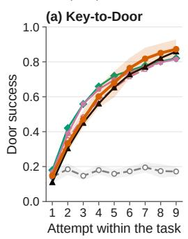

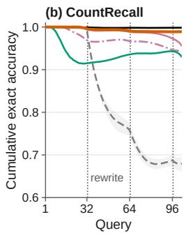

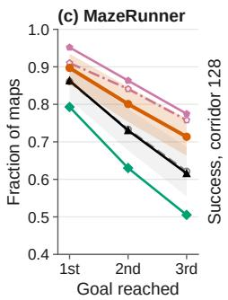

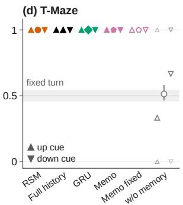  
Figure 7: Within-task adaptation. (a) Key-to-Door door success by attempt. (b) CountRecall cumulative accuracy; dotted: rewrites after queries 32, 64, 96. (c) Fraction of MazeRunner maps reaching each ordered goal. (d) T-Maze success at corridor 128 over all tasks (95% interval) and by cue side (triangles; faint: seeds); shaded: the success of a fixed turn. Bands in (a–c): RSM and RSM w/o memory.

## F.2 LONG-RUNNING EVALUATIONS

Table 9 separates what each memory carries from one attempt to the next on one MazeRunner map (Appendix E.2). The retained-memory mean for RSM exceeds its wiped-memory mean in both the first and last windows, by similar amounts. For both Memo variants, the retained-memory mean falls to a few goals per window, whereas the wiped-memory mean stays near its early value. The full-history Transformer declines even when wiped, so its retained history alone cannot explain the decline, and its retained-versus-wiped difference is negligible in the last window. RSM-R shows the same retained-memory decline (Appendix F.6), while the GRU and RSM w/o memory means change little. Table 9 reports point estimates; we therefore treat these kept-versus-wiped comparisons as descriptive.

Figure 8 resolves the new-task runs of Figure 2g,h in time. With memory never reset, RSM is the only memory whose mean success rate rises within later Key-to-Door layouts: averaged over tasks, its rate within each later layout climbs from under one door per 100 steps to about 3.5, for 9.4 doors per layout against at most 1.9 for every other memory. This average comes from a minority of layouts. RSM completes a door in 34% of later layouts, ranging from 22% to 48% across seeds, and then repeats it at about its adapted rate, but completes none in the rest. This asymmetry suggests that information retained from the preceding layout can bias subsequent search, but the experiment does not identify the content responsible. The other memories that carry the old layout complete a door in at most 15% of later layouts, so in panel (c), where a layout without a door counts as 500 steps, all of them sit near that limit (about 410 steps for RSM, at least 450 for the others). Only RSM w/o memory, which carries no stale layout, finds a door in most later layouts (72%, after about 270 steps), but it cannot repeat what it finds. On MazeRunner, RSM finishes its first attempt on each new map in about 200 steps, as on the first map, against about 300 for the GRU and at least 370 for the growing memories.

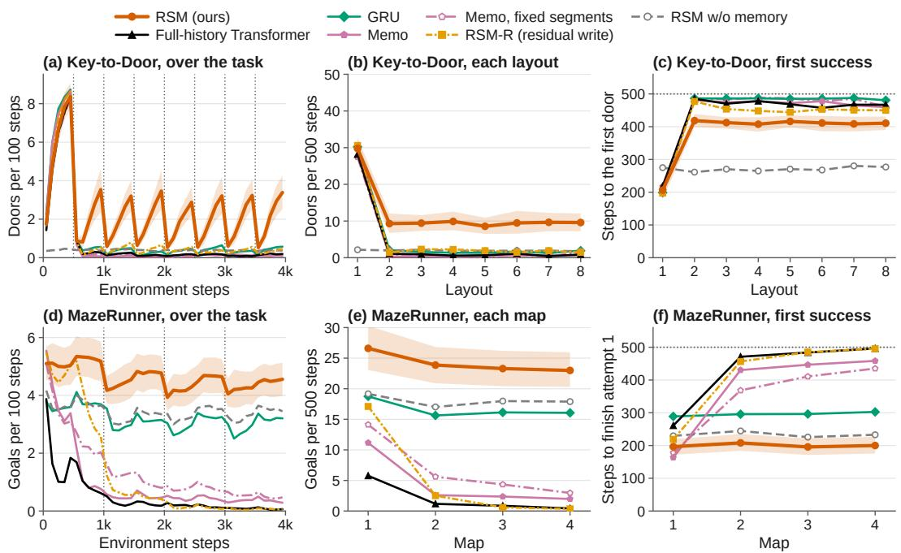  
Figure 8: Re-adaptation without memory resets (4,000 steps). New Key-to-Door layouts every 500 steps (top); new MazeRunner mazes/goals every 1,000 (bottom). (a,d) Successes per 100 steps; changes dotted. (b,e) Doors per layout/goals per 500 steps. (c,f) Steps to first door (censored at 500)/completed attempt. Band: RSM.

## F.3 SUMMARY TRANSPLANTS

At one boundary, we replace every task’s written summary with the summary that another task of the same seed read at that boundary, and leave the buffer, the weights and everything else unchanged; the control writes the initial summary at the same boundary (cleared once). On Key-to-Door, the first attempt after the boundary visits the donor’s key cell far more often than with the task’s own summary or with the summary cleared once (Figure 9b), and the misdirected policy completes fewer doors than the cleared one for the rest of the task (Figure 9a): the transplanted summary redirects the policy towards donor-associated cells, and the effect persists across later rewrites. On CountRecall the transplanted policy answers with the counts that the donor’s summary implies rather than the true counts until the next rewrite, which moves its answers away from the donor’s counts and partly towards the task’s own (Figure 9c). Because the early cards are not presented again, subsequent rewards are the only new feedback about whether answers that depend on those early counts are correct.

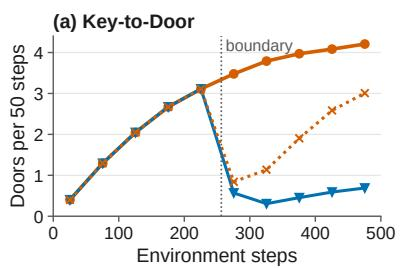

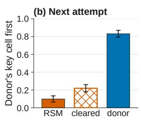

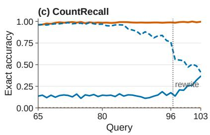  
Figure 9: Summary transplants. At one boundary, the summary is replaced by a donor task’s (blue) or the initial summary (dotted). (a) Key-to-Door doors per 50 steps; transplant before step 257. (b) Fraction of tasks whose next attempt visits the donor’s key first. (c) CountRecall accuracy after query 64, scored against true (solid) or donor-consistent (dashed) counts.

## F.4 WHAT THE SUMMARY HOLDS

Figure 10 looks inside the frozen summary (Section 4.3 and Section 4.4). In panels (a–c) and (e– g), one per seed, each dot is one confirmation task, placed by the summary its policy reads at one boundary and coloured by a hidden variable of that task; panels (d,h) report how well a linear readout recovers each hidden variable from the summary. Ridge regressions fitted on the 64 development tasks and scored on the 256 confirmation tasks recover every count on CountRecall almost perfectly and the row and column of the hidden key on Key-to-Door well, on every seed; the door’s position is recovered less well. Projected on its first two principal components, the Key-to-Door summary orders the tasks by where the key lies and the CountRecall summary by the counts, most clearly on seed 42 (the read-outs of the other seeds are as high). Panels (i–k) follow one MazeRunner map over 4,000 steps of repeated attempts: (i,j) compare the summary written at each point of the run with the summary at every other point, and (k) tracks its size. RSM’s summaries retain high within-map similarity at a steady norm across rewrites, consistent with a stable map-dependent representation. RSM-R summaries instead drift in one direction until the first and last are anti-correlated, at a norm tens of times larger. Proposition 2 provides a horizon-independent norm bound for the overwrite, but only a boundary-dependent bound for the additive write. These diagnostics are consistent with, but do not establish the cause of, RSM-R’s decline on long MazeRunner runs (Section 4.4). A good read-out shows that the information is present in the summary, not that the policy uses it; the interventions of Section 4.3 test its use.

(a) Key-to-Door, seed 42  
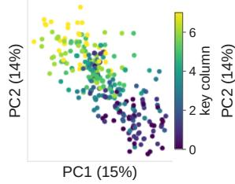

(b) Key-to-Door, seed 100  
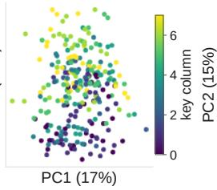  
(e) CountRecall, seed 42

(c) Key-to-Door, seed 2026  
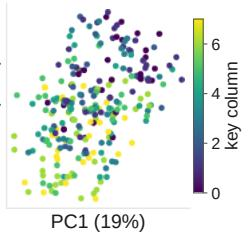  
(f) CountRecall, seed 100

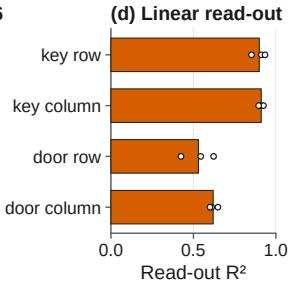  
(g) CountRecall, seed 2026  
(h) Linear read-out

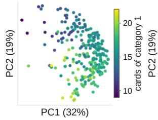

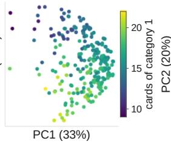

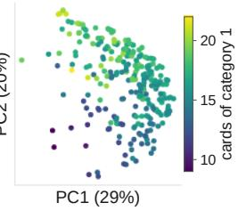

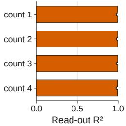

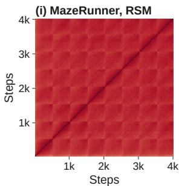

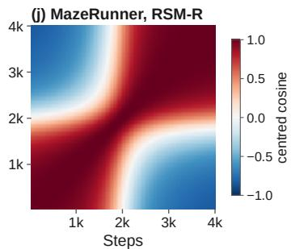

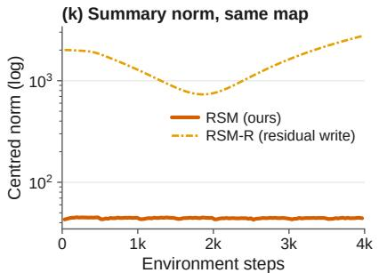  
Figure 10: Summary representations. (a–c,e–g) First two principal components, fitted per seed on develop ment tasks; colour: key column (Key-to-Door, step 257)/first-category count (CountRecall, query 65). (d,h) Ridge $R ^ { 2 }$ ; bars: seed means; dots: seeds. (i,j) Centred cosine similarity of the summaries over repeated MazeRunner attempts on one map; (k) centred norms. Panels (i–k): first 64 confirmation maps.

Probe details. Each read-out is a ridge regression from the flattened summary (M d values) that one segment reads, at step 257 on Key-to-Door (segment 8) and at query 65 on CountRecall (segment 2), to the task’s hidden variables: the key’s and the door’s row and column, or the four running counts. It is fitted per seed on the 64 development tasks and scored as $R ^ { 2 }$ on the 256 confirmation tasks. Features and targets are centred by the development means, and the penalty is chosen by fivefold cross-validation on the development tasks from 17 values spaced logarithmically between $1 0 ^ { - 3 }$ and 105. The principal components are fitted per seed on the same development summaries. For panels (i–k), each seed’s flattened summaries are centred by their mean over all maps and segments; panels (i,j) show the cosine similarity between the centred summaries read by two segments of the same map, averaged over maps and then seeds, and panel (k) their mean norm.

## F.5 SUMMARY ATTENTION

The READ-slot attention share is the attention mass that a decision’s heads place on the READ slots, averaged over heads. We compare it with the share $M / ( M + i )$ under uniform attention at segment position i and with RSM w/o memory, whose READ slots always hold $Z _ { \mathrm { i n i t } }$ . Because RSM w/o memory is separately trained, it controls for fixed READ-slot content and position, not for position alone. Figure 11 shows the READ-slot attention share by position in the segment and the effect of biasing decisions’ attention away from the summary or the buffer. The decisions assign more attention mass to these slots than RSM w/o memory does, in every layer on Key-to-Door and in the second and third layers on CountRecall, on every seed. Against uniform attention the excess is clear only in the first layer on Key-to-Door and the second on CountRecall; the other layers stay near or below $M / ( M + i )$ early in the segment and only slightly above it later. The share hardly depends on where the needed evidence lives: queries whose evidence survives only in the summary, and the first steps of later Key-to-Door attempts, draw only marginally more summary attention than their position predicts. For Figure 6 (Section 4.3), each decision’s summary share minus the seed’s mean at the same segment position is averaged over the decisions taken at each cell of the Key-to-Door room, on all 256 confirmation tasks at the training horizon, pooling seeds; every cell holds at least 50 decisions.

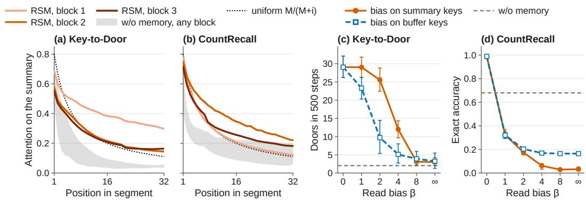  
Figure 11: Summary attention and read interventions. (a,b) Attention to four summary tokens by segment position/layer; grey band: RSM w/o memory (separately trained fixed-READ baseline); dotted: uniform $M / (  \hat { M } + i )$ . (c,d) Performance under attention-score bias $- \beta$ on summary (solid)/earlier buffer keys (dashed); $\beta = \infty$ blocks access; grey dashed: RSM w/o memory.

## F.6 ABLATIONS

Figure 12 follows the carry and rewrite ablations over the long-running tasks. On Key-to-Door RSM-R shows no consistent difference from RSM over all 4,000 steps, while RSM w/o memory stays near two doors per window. On one MazeRunner map RSM-R declines from window to window until it falls below RSM w/o memory; the same pattern is absent when its memory is wiped at every attempt (Table 9), implicating the carried state without identifying which property of that state causes the decline. When the maze changes every 1,000 steps, RSM-R falls to a few goals on the second map and almost none after, whereas RSM and RSM w/o memory keep a steady rate.

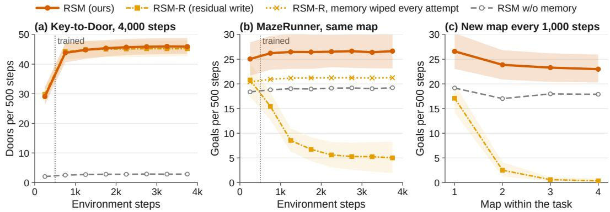  
Figure 12: Carry and rewrite ablations (Section 4.4; 500-step windows). (a) Key-to-Door doors. (b) MazeRunner goals on one repeated map; crosses: RSM-R with memory wiped each attempt. (c) Goals on four maps, changed every 1,000 steps. Dotted: training horizon.

RSM detach is trained on CountRecall with the same recipe and seeds, its summary detached at every boundary so that no later loss reaches the write. RSM exceeds RSM detach, and RSM detach exceeds RSM w/o memory; both gaps exceed δ on every seed and have joint intervals that exclude zero. The summary-length arms train RSM with $M \in \mathsf { \Gamma } \{ 1 , 8 , 1 6 \}$ on Key-to-Door under the same recipe, buffer and seeds, and are compared with $M = 4$ by paired differences on the confirmation tasks at 500 steps and in the last 500 of 4,000 steps with the layout kept (Table 3).

## F.7 LEARNING CURVES

Figure 13 shows collection return and greedy development performance over the 8M training steps, with every memory trained by the same learner and interaction budget. Every memory reaches the development threshold (Appendix E.3) on every benchmark, except RSM w/o memory on Keyto-Door and CountRecall, and all but RSM w/o memory solve the T-Maze early in training. On Key-to-Door RSM takes longer than every other memory that reaches the threshold, crossing it at 4.4M to 5.2M steps across seeds against at most 3.6M for the others, and then reaches their level by the end of training; on MazeRunner the GRU learns slowest.

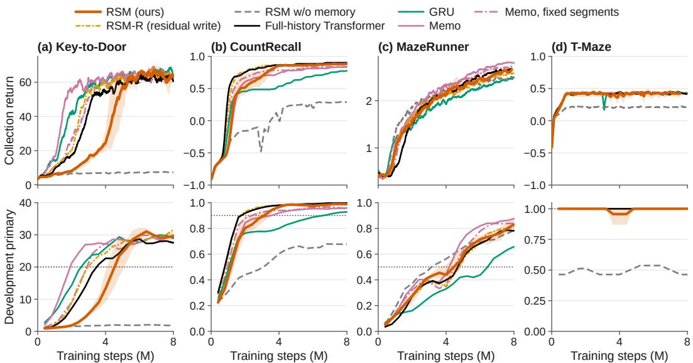  
Figure 13: Learning at matched experience. Collection return (top)/greedy development performance (bottom) versus training steps for every memory on all four benchmarks. Lines: seed means; band: RSM’s seed range; dotted: development thresholds. For display only, collection curves use a centred 25-epoch window and development curves a centred three-evaluation window, both with edge padding; threshold crossings use the raw series.