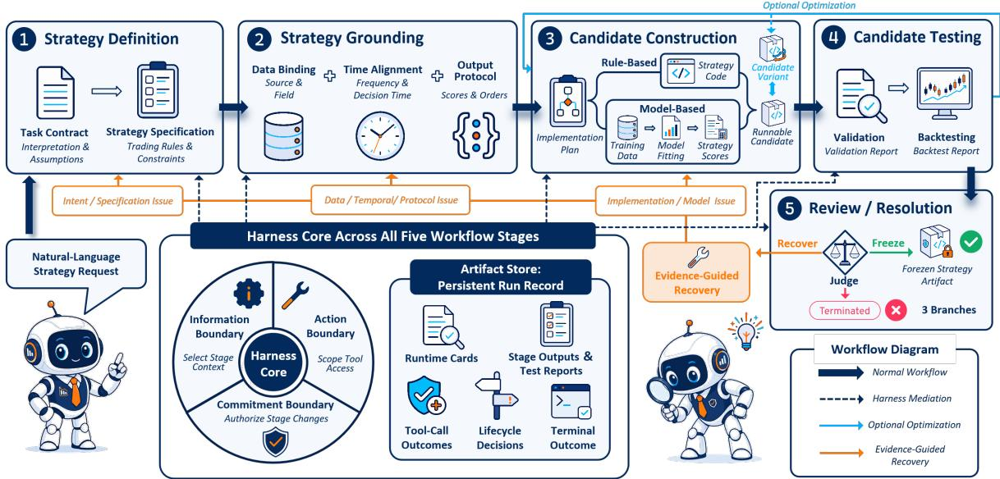
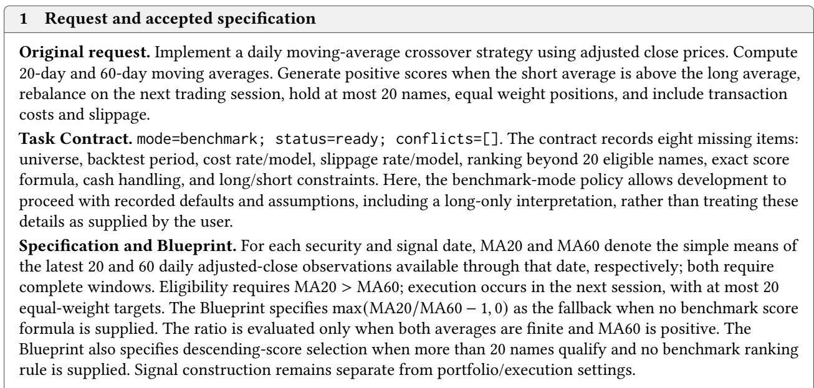
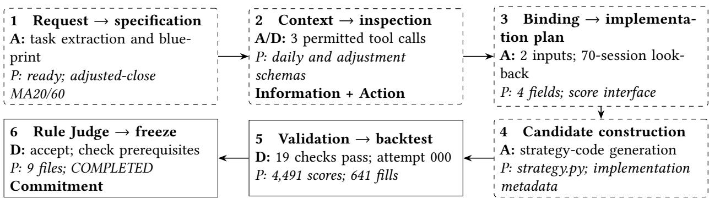

# Reliable Before Profitable: QuantHarness for Governing Financial Strategy Development with LLM Agents

Jiasheng Mao ShanghaiTech University Shanghai, China maojsh2025@shanghaitech.edu.cn

Hengwei Ye ShanghaiTech University Shanghai, China yehw2024@shanghaitech.edu.cn

## Abstract

Jiacheng Liu<sup>∗</sup> ShanghaiTech University Shanghai, China liujch12025@shanghaitech.edu.cn

LLM agents can turn natural-language financial research requests into executable and backtested strategies, but a successful run may still implement the wrong rule, use information unavailable at decision time, or obscure how repairs and candidate selection changed the strategy. Because these failures arise throughout development, final code and performance metrics alone are insuficient to establish either fidelity to the request or the validity of the development process. We therefore address the reliability of financial strategy development at the trajectory level: the system must control how intermediate outputs become downstream state and preserve the evidence needed to justify the terminal outcome. We introduce QuantHarness, a two-layer agent harness in which a finance-specific Workflow structures specification, data grounding, construction, testing, and review, while Harness Core enforces stagespecific information, action, and commitment boundaries. We also introduce FinRelBench, a benchmark that evaluates strategy-development reliability through execution success, requirement satisfaction, and runtime evidence. QuantHarness achieves the highest Task Success at 90.72%, compared with 74.23%–84.54% for the comparison systems. Controlled stress tests show that its boundaries contain targeted violations, while structured run records improve evidence retrieval and support decision replay under the evaluated protocol.

## Keywords

LLM agents, agent harnesses, quantitative finance, trajectory governance, agent reliability

<sup>∗</sup>These authors contributed equally to this work.   
<sup>†</sup>Corresponding author.

Zheng Tian<sup>†</sup> ShanghaiTech University Shanghai, China tianzheng@shanghaitech.edu.cn

## 1 Introduction

Recent LLM-based systems can carry quantitative strategy development from a natural-language research request to an implemented and backtested strategy [9, 29]. Yet successful execution alone does not establish that the resulting strategy is faithful to the original request. Generated code may implement a diferent trading rule from the one requested [7], use information unavailable at decision time, or introduce temporal misalignment [11]. Problems may also emerge after the initial implementation has been produced. A repair can remove an execution error by changing the trading rule itself. Repeated selection based on backtest results can turn evaluation into search over historical outcomes [2, 19]. Because these problems can arise at diferent stages, the final code and performance metrics alone may not reveal their source or the decisions that allowed them to persist. We call one execution of strategy development a run. The ordered path from its research request to its terminal outcome is the run’s development trajectory. We therefore examine reliability across this trajectory: whether the requested strategy is faithfully implemented and the development process is supported by evidence that justifies its terminal outcome.

Prior work approaches parts of this problem from two directions. Financial agents and benchmarks support trading decisions, factor discovery, executable research, and strategy evaluation [4, 7, 9, 18, 21, 29], whereas general agent-harness research studies how context, tools, persistent state, and runtime control shape agent behavior [12, 16, 24]. These directions motivate the question of how an LLM agent can reliably carry a financial strategy request through specification, data grounding, implementation, testing, and final acceptance.

We introduce QuantHarness, a two-layer system for governing this trajectory. The finance-specific Workflow organizes the progression from an explicit account of the intended strategy through implementation and testing to a terminal outcome. Harness Core mediates that progression by controlling the information and actions available at each stage and deciding which outputs may update the run state used downstream. Under these controls, the run ends with either a frozen strategy or termination without acceptance. QuantHarness also preserves a structured run record that links the run’s terminal outcome to its supporting artifacts and lifecycle decisions.

We evaluate trajectory reliability on FinRelBench, a benchmark of 97 explicit rule-based tasks. Our evaluation examines end-to-end Task Success, boundary enforcement, post-run audit and replay. The results show that QuantHarness achieves the highest Task Success among the compared systems, contains targeted violations in the stress tests, and supports more efective evidence retrieval and decision replay through structured run records. Reliable development provides a basis for interpreting financial outcomes, but a financial research system should also support economically meaningful strategy outputs. We therefore use FinResearchSuite as an auxiliary evaluation of QuantHarness’s practical utility for financial research, with results reported in Appendix E. Our contributions are as follows:

• We frame reliable financial strategy development as a problem of trajectory governance and distinguish trajectory reliability from financial quality.

• We introduce QuantHarness, a two-layer system that couples a finance-specific Workflow with Harness Core to govern workflow execution and preserve an artifact-backed run record.

• We develop FinRelBench, a 97-task benchmark with a controlled evaluation protocol for strategy-development reliability, and use its tasks to evaluate end-to-end Task Success, boundary enforcement, post-run audit and replay.

## 2 Related Work

## 2.1 LLM Agents for Quantitative Finance

Recent work on LLM-based financial agents spans market-facing decision support and executable quan titative research. Decision-oriented systems organize market information through mechanisms such as memory, reflection, and role-based collaboration [21, 26–28], while platforms such as FinRobot [23] support a broader range of financial-analysis tasks. For executable research, Qlib [25] and FinRL-Meta [10] provide reusable data and market-simulation infrastructure. R&D-Agent-Quant [9] combines structured specifications with implementation, backtesting, iterative feedback, and retained research artifacts, while FactorMAD [4] uses agent debate for interpretable alpha-factor discovery. As these systems automate more of the research process, reliability concerns extend beyond the performance of the resulting strategy to the decisions and evidence accumulated during its development. Successful execution and financial results alone do not establish that a request was appropriately interpreted, grounded in data, and carried through to a justified outcome. QuantHarness addresses this broader need for task fidelity, process control, and supporting evidence across the full development trajectory.

## 2.2 Evaluation of Financial Agents

Recent evaluation eforts for financial LLM systems cover both broad financial capabilities and executable research. FinBen [22] illustrates this breadth, covering financial language tasks, forecasting, risk management, and trading. More specialized evaluations address the outputs of quantitative research: AlphaForgeBench [29] evaluates generated factors and strategies through standardized backtesting, while BacktestBench [18] compares automated backtesting outputs with reference answers. At the code level, QuantCode-Bench [7] and AlphaQT-Bench [11] assess properties such as alignment with task descriptions, temporal causality, functional correctness, and structural compliance. Together, these benchmarks assess financial capabilities and the quality of research outputs. However, output-level assessment alone does not establish whether task constraints were respected throughout development. We therefore use FinRelBench to assess whether the requested strategy is faithfully implemented and its required behavior is demonstrated in execution. We also examine how agents reached that result, asking whether development respected task constraints and left suficient evidence for subsequent audit.

## 2.3 Agent Harnesses and Runtime Governance

Beyond the capabilities of individual models, recent work on LLM agents examines the surrounding harness: the supporting execution environment that organizes context, tool access, state, and workflow execution. Frameworks such as AutoGen [20], SWE-agent [24], OpenHands [17], and AIOS [12] provide diferent combinations ofthese capabilities. Recent studies also examine how to represent and improve the harness itself. Natural-Language Agent Harnesses [15] expresses control policies as editable documents executed through a shared runtime, with explicit handofs, state updates, and validation gates. Meta-Harness [8] optimizes harness code by inspecting earlier candidates, evaluation scores, and execution traces. Alongside this work on harness design, AgentSpec [16] enforces configurable rules during agent execution. Together, these approaches provide mechanisms for organizing, improving, and constraining agent behavior. For financial strategy development, these mechanisms must be grounded in trading requirements and market-data constraints. The challenge is to carry those requirements through construction, testing, and acceptance while retaining the evidence needed to justify each outcome. QuantHarness investigates this problem across the full development trajectory.

## 3 QuantHarness

## 3.1 System Overview

Turning a natural-language request into a runnable financial strategy requires both an explicit development process and control over how intermediate results are used. QuantHarness governs the development trajectory through two interacting layers: an agent-facing Workflow organizes strategy development, while Harness Core governs its execution and preserves the resulting run record. Figure 1 summarizes how the two layers interact. The following subsections describe the Workflow and Harness Core in turn.

## 3.2 Finance-Specific Workflow

Within QuantHarness, the Workflow spans the process from clarifying a request to producing and testing a runnable strategy implementation. The remainder of this subsection presents the stages of this process in sequence.

Making the requested strategy explicit. A naturallanguage strategy request often leaves information required for implementation unspecified. If the model fills these gaps only while writing code, its assumptions become part of the implementation without being stated explicitly. Later stages then cannot compare the code with an explicit description of the intended strategy. QuantHarness therefore first documents its interpretation of the request, including any assumptions and unresolved information. The resulting structured description is the task contract. The Workflow then uses the contract to produce a strategy specification. Whereas the task contract captures what the system understood from the request, the strategy specification states the trading rules and constraints that the eventual implementation must satisfy. The specification is the common reference for connecting the strategy to available data and implementing it in code. Any later change in strategy meaning must first be reflected in the specification.

Grounding strategy requirements in available data and output formats. A strategy specification identifies the data a trading rule needs, but it does not establish whether a compatible source and field exist among the available datasets. Deferring this check to code generation may cause the implementation to refer to nonexistent fields or use data at an incompatible frequency. QuantHarness therefore inspects the available data before implementation rather than assuming that every required input exists. A data binding maps each requirement to a confirmed data source, field, and frequency; requirements that cannot be resolved remain explicit rather than being bound to guessed inputs. A data binding alone is not suficient for testing because the backtester must also know how to interpret the strategy’s decisions. An output protocol specifies whether these decisions are represented as asset scores or trade orders and defines the fields expected by the backtester. Together, the data binding and output protocol define how the strategy receives data and communicates decisions without changing the trading rule itself.

Constructing a runnable strategy implementation. The preceding stages fix the strategy requirements, data inputs, and output protocol, but they do not yet specify the computation that will produce the trading decisions. If this procedure is determined only during code generation or model training, the choices that define it remain implicit in the resulting implementation. QuantHarness therefore makes these choices explicit in an implementation plan before construction begins. The plan states how the bound inputs will be transformed into trading decisions under the strategy specification and output protocol. QuantHarness realizes this plan through one of two supported paths. Rule-based strategies are implemented as code that follows the specified calculation. Model-based strategies use a separate construction path. To keep model construction within a testable interface, the current path is limited to a predefined library of machine-learning and deep-learning templates provided by QuantHarness. The system first constructs training data from the bound inputs and fits a model instantiated from the selected template. The fitted model then produces strategy scores in the declared output format. The resulting strategy implementation, whether rule-based or model-based, becomes the candidate examined in the next stage.

  
Figure 1: Overview: Workflow structures strategy development; Harness Core governs each run and preserves its run record.

Testing the candidate against established requirements. The implementation plan guides construction, but the resulting candidate may still fail to satisfy the structural, data, or execution requirements established earlier. QuantHarness therefore tests the completed candidate against those requirements before it can proceed. The testing stage has two required steps: (1) validation and (2) backtesting. Validation first checks whether the candidate is structurally complete and compatible with the execution environment. It then checks whether the candidate uses the declared inputs and provides trading decisions in the required form. The results, including any failed checks, are listed in a validation report. Only candidates that pass validation proceed to backtesting. Back testing applies the candidate to the market data specified by the data binding and passes its trading decisions to the backtester under the declared output protocol. The resulting backtest report indicates whether backtest execution succeeds and whether the trading decisions can be processed by the backtester. When backtest execution succeeds, the report also includes the resulting financial performance metrics. These financial values do not override the validation and execution checks. A candidate proceeds only after both checks pass.

Optional strategy optimization. Passing validation and backtesting establishes that a candidate can be executed with the bound inputs and declared output protocol. At this point, QuantHarness supports an optional, budget-limited exploration of whether its financial quality can be improved without changing the task requirements, data binding, or output protocol. Within this loop, candidate variants must pass validation before being backtested on the optimization period and compared under a preset objective. The selected candidate is then evaluated once on a separate final period. This result is not returned to the loop, and its financial values sup port quality analysis rather than determine engineering acceptance. The candidate then proceeds to Judge review with the corresponding validation and backtest reports. The full optimization protocol is provided in Appendix D.4.

Candidate review and Workflow resolution. After candidate development and testing are complete, the Workflow must decide whether the candidate can be accepted or requires further action. QuantHarness assigns this review to the Judge, which considers the candidate together with the artifacts and reports produced earlier in the Workflow. The review leads to three routes: recovery, termination, or freezing. When the Judge identifies a correctable problem, its report states which earlier stage needs to be revisited. Recovery returns the run to that stage, after which the afected downstream stages are repeated within a fixed attempt budget. If the problem cannot be resolved or the budget is exhausted, the run terminates without an accepted strategy. If the available evidence supports acceptance, freezing creates a frozen strategy artifact that preserves the candidate implementation and the evidence supporting its acceptance. Harness Core checks the evidence supporting the Judge’s recommendation before it allows the corresponding change to take efect.

## 3.3 Harness Core: Runtime Mediation and Governance

The Workflow organizes strategy development into stages, but stage order alone does not control how each stage operates or how its results afect later stages. QuantHarness therefore introduces Harness Core, a runtime control layer that mediates stage execution across the Workflow. The information boundary determines which existing run information is supplied to a stage. A separate action boundary limits the external capabilities that the stage may invoke. Once a stage produces an output, the commitment boundary determines whether later stages may rely on it. Across these three boundaries, Harness Core preserves the artifacts and lifecycle decisions needed to explain how the run progressed.

Providing stage-specific context. Each Workflow stage requires information tailored to its current task. The full history mixes current artifacts with superseded candidates, evidence from earlier failures, and control or audit metadata. Because the relevance of this material changes across stages, supplying the full history would leave the agent to determine what remains valid. Harness Core instead constructs a distinct Runtime Card for each agent-facing stage. Its agent-visible portion states the stage goal, required outputs, and applicable constraints, together with the task information and feedback relevant at that point in the run. Control and audit information remains private to Harness Core. This stage-specific selection gives the agent a defined context without requiring it to interpret the full run history.

Mediating tools and external efects. Not every external capability is appropriate at every Workflow stage. Unrestricted access could allow a stage to trigger an operation intended for another part of the Workflow or to act before its required inputs exist. QuantHarness enforces the action boundary by representing each agentaccessible capability as a tool mediated by Harness Core. A tool registry gives every tool a stable name and a declared input structure. For each stage, Harness Core exposes only the registered tools allowed for its current task. Calls to these tools are checked against their declared input structures and routed through Harness Core to the corresponding capabilities. Tool access is therefore enforced by Harness Core rather than left to prompt instructions.

Authorizing and committing lifecycle changes. A Workflow stage may recommend what should happen next. Allowing this recommendation to change the run could advance the Workflow before the required outputs and evidence have been checked. QuantHarness separates the stage’s proposal from the authorization and state update performed by Harness Core. The run’s lifecycle is its progression through Workflow stages from creation to a terminal result. Before a proposed transition changes this lifecycle, Harness Core intercepts it through a lifecycle hook. A guard then checks whether the proposed route is allowed and whether the artifacts and evidence required by the target stage are available. The guard approves or rejects the proposal without altering the run. On approval, the runtime commits the transition by updating the current stage and making the outputs available downstream.

Preserving run evidence and artifacts. A final strategy implementation and its backtest result do not explain how a run reached its outcome. QuantHarness therefore maintains an Artifact Store for each run. During the run, the store retains the Runtime Cards supplied to agentfacing stages, tool-call outcomes, lifecycle decisions, and the outputs produced at each stage, including outputs that later fail a check. When the Workflow freezes a candidate, the store links the final implementation to the intermediate artifacts and decisions supporting its acceptance. If no candidate is accepted, the store retains the evidence showing where and why the run ended. Post-run analyses can inspect these materials but cannot modify them or feed new measurements back to the Workflow. The Artifact Store thus preserves the terminal outcome together with the intermediate evidence needed to inspect how it was produced.

## 4 FinRelBench

## 4.1 Benchmark Objective

Reliable financial strategy development requires an agent to preserve the user’s requirements throughout requirement interpretation, data preparation, strategy implementation, runtime verification, and final acceptance. A strategy may run successfully and produce favorable backtest results even when its data processing or trading logic departs from those requirements. Evaluating this reliability therefore requires tasks that connect explicit strategy requirements to verifiable implementation and execution evidence. To meet this need, we construct FinRelBench (Financial Strategy Development Reliability Benchmark) to assess whether agents translate stated requirements into correct data processing, strategy implementations, and observed runtime behavior.

FinRelBench assesses this translation at three complementary levels: executability, whether the data pipeline and strategy run successfully; requirement satisfaction, whether the implementation meets the stated data and trading requirements; and runtime evidence, whether execution records demonstrate the required behavior. Together, these levels support end-to-end evaluation of task completion. The same tasks also provide common workloads for boundary-control experiments and audit and replay studies, which examine how errors are controlled during development and how outcomes can be traced and reproduced.

## 4.2 Benchmark Composition

FinRelBench comprises 97 explicitly specified, rulebased strategy-development tasks in the A-share equity setting: 80 tasks selected and adapted from the 400-task QuantCode-Bench [7], and 17 tasks of our own design. We select source tasks whose core trading logic can be expressed as verifiable requirements using the available market data under long-only equity trading. Tasks whose defining requirements depend on short selling, derivatives, or unavailable external data are excluded. Adaptation preserves the core trading logic while aligning the stock universe, market data, and execution timing with A-share trading rules, including T+1 settlement.

The 80 adapted tasks cover trend and momentum, breakouts, mean reversion, volatility and liquidity conditions, and combinations of indicators, including rules that depend on position state or calendar schedules. Under QuantCode-Bench’s original dificulty labels, these 80 tasks comprise 41 easy, 29 medium, and 10 hard cases. The 17 tasks of our own design test data adjustment and temporal alignment, stock eligibility and portfolio constraints, cash fallback, and execution timing. Together, these tasks test whether agents preserve both the specified trading logic and the data and execution requirements needed to implement it correctly.

The combined suite contains 64 daily-score tasks (50 adapted and 14 original) and 33 minute-order tasks (30 adapted and three original). Daily-score tasks assign scores to stocks for cross-sectional ranking and portfolio construction, testing whether agents correctly implement historical windows, ranking rules, and portfolio constraints. Minute-order tasks produce timestamped buy and sell instructions, testing bar aggregation, decision windows, order delays, and position-state transitions. These output types provide complementary checks of how strategy requirements are translated into data processing and actual trading behavior. Task examples are provided in Appendix A.

FinRelBench evaluates reliability against explicit strategy requirements. While reliable development provides a basis for interpreting financial outcomes, practical use in financial research also requires evidence of economically meaningful strategy outputs. To complement this primary evaluation with evidence of practical financial utility, we introduce FinResearchSuite (Financial Strategy Development Research Suite). This auxiliary suite contains 22 tasks: 12 open-ended rule-research tasks, 5 specified-model development tasks, and 5 open-ended model-research tasks. It assesses research completion and the return and risk of the resulting strategies to examine whether QuantHarness’s governed development process can support economically meaningful strategy research. Financial performance thus serves as an auxiliary check of basic research utility and does not enter FinRelBench’s reliability scores. Task definitions and results are provided in Appendices D and E.

## 4.3 Evaluation Protocol

Each FinRelBench case is a self-contained evaluation package divided into agent-visible and evaluator-only components. The agent-visible components are the public task query, market snapshot, and data and submission documentation. The evaluator-only components are the trade execution settings and task-specific rubric. The public task query states the task objective and public constraints. The market snapshot provides versioned, read-only market data, while the data and submission documentation describes the tables, column definitions, time coverage, and access paths, explaining how to access the data and submit results. The trade execution settings specify the test period, trade execution rules, and transaction costs. The task-specific rubric defines the requirements used to assess the implementation and its execution results. Because diferent implementations can correctly fulfill the same request, these requirements are expressed as checkable criteria. Data criteria examine whether the requested securities and fields are used, enough past observations are available for the specified calculations, and the prepared data are actually consumed. Strategy criteria examine the requested signal calculation, stock selection, and trading schedule. Criteria labeled must must all be satisfied for minimum correctness, while partial satisfaction of supporting should criteria allows some implementation flexibility. The criteria describe the expected data processing and strategy behavior, while forbidden conditions identify behavior that invalidates the result regardless of other requirements satisfied. For example, a strategy may implement the requested trading rule but use future prices to generate earlier signals. Confirmed forbidden behavior therefore causes task failure, even when the implementation passes execution checks and satisfies other criteria.

Deterministic mechanical checks establish whether the agent’s code can construct the data and execute the strategy needed for task completion. Systems provide their code, data-construction and strategy-execution commands, and saved data and outputs through a common interface. The evaluator runs these commands under fixed market and execution conditions. Data Pipeline Success requires the dataset to be constructed, saved, and consumed by the strategy; Strategy Run Success requires the strategy to complete execution and produce its declared output.

A strategy can run successfully while using incorrect data or trading rules, so an external panel uses the rubric to check whether the implementation meets the task requirements. The panel examines anonymized code, summaries of the prepared datasets, execution records, and outputs. For each criterion, it separately assesses whether the requirement is satisfied and whether execution evidence demonstrates the relevant behavior. Runtime support requires both code on the actual execution path and corresponding evidence from the run or its outputs. Independent evaluators assess two equivalent wordings of the same rubric. Disagreements that can afect the result are resolved by an arbiter who reviews the evidence without seeing the earlier judgments.

These assessments jointly determine Task Success. Both mechanical checks must pass, and each semantic dimension must satisfy all must criteria, at least 75% of should criteria rounded up, and no confirmed forbidden condition or independently confirmed fatal defect. Additionally, every criterion derived from an explicit public requirement must be satisfied and supported by runtime evidence, including those marked should.

Alongside the two mechanical metrics, we report Requirement Satisfaction and Runtime-Evidence Coverage separately for data and strategy, giving six diagnostics in total. These criterion-based metrics measure the fractions judged satisfied and supported by execution evidence, respectively, with equal weight for must and should criteria. Section 5.2 specifies how task-level outcomes and criterion-level judgments are aggregated for the reported comparison. Appendix A provides the detailed rubric, evidence rules, and worked examples.

## 5 Experiments

## 5.1 Experimental Setup

Our evaluation is designed to establish three comple mentary forms of reliability evidence. We first test whether QuantHarness, as a complete system, can construct executable strategies that use the required data and realize the requested behavior. We then examine how individual Harness Core boundaries afect reliable completion and violation containment, followed by an evaluation of whether structured run records support post-run audit and decision replay. FinResearchSuite separately assesses completion and financial utility in open-ended rule and model research.

For strategy construction and research, we compare QuantHarness with Codex CLI [13], OpenHands [17], SWE-agent [24], and Aider [5]. All strategy-generation calls use GPT-5.5 [14]. Within each task, these systems receive the same public request, frozen market data, and documentation, while retaining their native agent loops, tools, and recovery policies.

To compare systems with diferent internal workflows, FinRelBench evaluates task completion using a common set of materials. Each system provides its code, commands for preparing data and running the strategy, and saved data and outputs. These materials allow the evaluator to apply the mechanical and semantic checks defined in Section 4.3, without requiring systems to reproduce QuantHarness’s workflow stages or internal record formats. Within each comparison, a deterministic A-share backtester uses shared signal timing, transaction costs, and trading constraints. Software versions, resource limits, data windows, and execution parameters are specified in Appendices F and D.2.

For FinRelBench semantic assessment, Claude Opus 4.6 [1] and Gemini 3.1 Pro [6] independently examine anonymized evidence under two equivalent rubric wordings. DeepSeek V4 Pro [3] blindly adjudicates disagreements that can change the outcome. These external assessments provide no feedback for another development attempt. Appendix A details the panel procedure, and Appendix B documents the implementation and evidence-collection configurations represented in the reported comparison.

## 5.2 Strategy Development Reliability

A strategy may execute successfully while using unsuitable data, implementing a diferent trading rule, or leaving required behavior unverified. We evaluate this reliability gap on all 97 FinRelBench tasks, asking whether each system carries an explicit request through data preparation and strategy implementation to a verifiable final result. Task Success is the primary measure: within the same task, both mechanical checks and minimum semantic gates must pass, and every explicit public requirement must be satisfied and supported by runtime evidence, as defined in Section 4.3.

Task Success and the two mechanical metrics are pass rates over all 97 planned tasks. Requirement Satisfaction and Runtime-Evidence Coverage measure the fractions of criteria satisfied and supported by execution evidence within each task and dimension. These fractions are averaged across tasks, giving each task equal weight regardless of how many criteria its rubric contains. Completed diagnostic assessments retain their scores even when Task Success is zero, showing which requirements were fulfilled within otherwise unsuccessful tasks. Incomplete assessments are distinguished from confirmed failures in Appendix B.

Table 1 shows that producing runnable strategies is more common than completing tasks with all required behavior verified. QuantHarness achieves the highest Task Success at 90.72%, compared with 74.23–84.54% for the comparison systems. Across systems, Strategy Run Success exceeds Task Success. Aider illustrates this gap: its strategies execute successfully on 94.85% of tasks, but its Task Success is 79.38%. Its average Strategy Requirement Satisfaction reaches 99.09%, while Strategy Runtime-Evidence Coverage is 92.64%. These results show that successful execution and high average requirement satisfaction can coexist with incomplete runtime verification. Reliable completion requires the execution, requirement, and evidence conditions to hold together within each task.

QuantHarness more consistently meets requirements and provides runtime evidence while encountering fewer failures during construction and execution. OpenHands has the lowest Data Pipeline Success and Strategy Run Success, at 86.60% and 84.54%, respectively; Appendix B records 13 generation or data-pipeline failures, supporting construction as its main bottleneck. Codex CLI shows a gap between Strategy Requirement Satisfaction (97.50%) and Strategy Runtime-Evidence Coverage (91.11%), indicating less complete evidence than its implementation-level assessments suggest. SWE-agent likewise achieves 93.81% Strategy Run Success but 84.54% Task Success; the case-level breakdown identifies five mechanically completed tasks with unmet or unverifiable requirements and four with missing runtime evidence. For Aider, the same breakdown records ten mechanically completed tasks with unmet or unverifiable requirements, explaining why its high average criterion scores do not imply complete requirement fulfillment within individual tasks. These diferences are consistent with QuantHarness’s Workflow: the strategy specification makes the request explicit, data grounding checks the inputs before implementation, and validation and review connect candidate acceptance to supporting artifacts.

Two QuantHarness cases illustrate the diference between an unmet requirement and missing runtime evidence. In the industry-aware multifactor task, selection without industry constraints is permitted when industry labels are unavailable, provided that this limitation is reported. The code implements the fallback but omits the required reporting, leaving an explicit requirement unmet. In the relative-strength task, the strategy implements a cash fallback when no stock passes the liquidity and trend filters. Both strategies pass validation and execution, but one omits required reporting while the other leaves a conditional behavior unverified. Further details are provided in Appendices A and B.

## 5.3 Harness Boundary Ablation and Stress Tests

The complete-system comparison shows QuantHarness’s overall reliability, but not which parts of Harness Core produce it. We therefore examine how the Harness selects information for each stage and controls tool use and changes to the run. For each test, we compare the system with the target boundary enabled against its ablated configuration, while keeping the task, shared inputs, and remaining boundary settings fixed. We report paired results on a fixed subset of 30 FinRelBench tasks, selected before the experiments to cover diverse strategy rules and both daily-score and minute-order outputs.

In normal runs, the Information Boundary controls the history given to the Agent; the Action boundary limits its tools and checks calls before execution. For the Information ablation, both variants draw from the same source run history and receive the same inputlength budget: with the boundary enabled, the Agent receives the requirements and implementation decisions that still apply; when it is weakened, the Agent receives a chronological slice and must decide for itself which information remains valid. With Action enabled, the Agent sees only the tools needed at that stage and calls are checked; after ablation, the Agent sees more tools, receives no guidance, and faces fewer checks. Table 2 Panel A shows that, with the Information Boundary enabled, 25/30 initial implementations execute successfully and satisfy the public requirements, compared with 23/30 under ablation. With the Action boundary enabled, all 30 Workflows complete correctly, compared with 23/30 under ablation, where failures include invalid data bindings and empty outputs. Together, these results suggest that stage-appropriate information and coordinated tool guidance and execution checks help agents preserve task requirements and carry development through to executable strategies.

Table 1: Strategy-development reliability on 97 planned FinRelBench tasks per system. Higher is better.
<table><tr><td></td><td>Main measure</td><td colspan="2">Mechanical diagnostics</td><td colspan="4">Requirement diagnostics</td></tr><tr><td></td><td>Task</td><td>Data Pipeline</td><td>Strategy Run</td><td>Data Requirement Satisfaction</td><td>Data Runtime- Evidence</td><td>Strategy Requirement</td><td>Strategy Runtime- Evidence</td></tr><tr><td>System QuantHarness</td><td>90.72%</td><td>Success 100.00%</td><td>Success 98.97%</td><td>98.97%</td><td>Coverage 98.28%</td><td>Satisfaction 98.71%</td><td>Coverage 96.07%</td></tr><tr><td>Codex CLI</td><td>81.44%</td><td>96.91%</td><td>91.75%</td><td>97.59%</td><td>96.56%</td><td>97.50%</td><td>91.11%</td></tr><tr><td>OpenHands</td><td>74.23%</td><td>86.60%</td><td>84.54%</td><td>84.54%</td><td>84.54%</td><td>85.38%</td><td>81.40%</td></tr><tr><td>SWE-agent</td><td>84.54%</td><td>94.85%</td><td>93.81%</td><td>94.85%</td><td>94.50%</td><td>94.44%</td><td>92.85%</td></tr><tr><td>Aider</td><td>79.38%</td><td>98.97%</td><td>94.85%</td><td>96.91%</td><td>99.31%</td><td>99.09%</td><td>92.64%</td></tr></table>

Notes. Bold indicates the highest value in each column. Task Success and mechanical diagnostics are task pass rates. Requirement diagnostics are task-macro averages of criterion-level fractions, not the percentages of tasks satisfying all criteria. Every metric uses all 97 planned tasks; incomplete assessments receive no credit and are reported separately in Appendix B.

Table 2: Paired boundary ablations and stress tests on 30 FinRelBench tasks.
<table><tr><td>A. Normal runs Boundary</td><td>Successful outcome ↑</td><td>On</td><td>Off</td></tr><tr><td>Information</td><td>Initial implementation succeeds</td><td>25/30</td><td>23/30</td></tr><tr><td>Action</td><td>Workflow completes correctly</td><td>30/30</td><td>23/30</td></tr><tr><td>B. Controlled stress tests Boundary</td><td>Observed failure ↓</td><td>On</td><td>Off</td></tr><tr><td>Information</td><td>Invalid information used</td><td>0/30</td><td>11/30</td></tr><tr><td>Action</td><td>Unapproved file created</td><td>0/30</td><td>22/30</td></tr><tr><td>Commitment</td><td>Changed candidate frozen</td><td>0/30</td><td>14/30</td></tr></table>

Normal runs may not naturally expose the failure conditions that each boundary is designed to prevent, so we next conduct controlled stress tests. Each test introduces a targeted opportunity for a boundary violation under matched task and starting-stage conditions, and counts a violation only when saved evidence con firms it. For Information, the ablation adds information from superseded and rejected decisions to information from the accepted decision, leaving the Agent to decide what remains valid. Table 2 Panel B shows that no run uses invalid information with the Information Boundary enabled, compared with 11/30 cases under ablation. For Action, the Agent may request data construction before approval to avoid a synthetic scheduling delay. It chooses early execution in 22/30 cases; each request is then shared between the two variants. The Action Boundary blocks all 22 requests, while removing the check allows all 22 to create files. For Commitment, we preselect 14 cases without using task content or results, replace the candidate between Judge approval and freeze, and leave the other 16 as controls; the ablation removes the identity check. The check catches all 14 replacements; after ablation, all 14 reach freeze, while the controls remain unchanged. Together, these checks keep invalid information, unauthorized writes, and changed candidates from carrying forward into later stages. Appendix C describes the boundary-test protocols and stress-test activation criteria.

Table 3: Evidence retrieval and replay for 44 run records covering 30 FinRelBench tasks.
<table><tr><td>Evidence view</td><td>Exact evidence</td><td>Replay</td></tr><tr><td>Organized artifacts</td><td>100.0%</td><td>44/44</td></tr><tr><td>Same artifacts, unorganized</td><td>43.2%</td><td>0/44</td></tr><tr><td>Final artifacts only</td><td>27.6%</td><td>0/44</td></tr></table>

## 5.4 Auditability and Replay

The preceding tests assess boundary behavior during execution, but they do not show whether the Artifact Store preserves run evidence for later inspection and decision replay. We use 44 run records produced by the Commitment stress test, covering the same 30 FinRel Bench tasks. We give an LLM three views of each record, with the same lookup budget for each: artifacts organized by Workflow stage and their links, the same visible artifacts without that organization, and final artifacts only. We test whether the auditor returns the exact location and matching hash for requested evidence. Replay reruns validation and backtesting in isolation and uses the saved Judge proposal to reconstruct Commitment authorization outcomes and terminal candidate identity.

Table 3 shows that the organized view recovers 100.0% and replays 44/44; the unorganized and finalonly views recover 43.2% and 27.6%, respectively, and replay none. These results show that saving files alone is not enough: their organization and intermediate artifacts enable later inspection and replay. Appendix C describes the record views, evidence-retrieval protocol, and conjunctive decision-replay criterion.

## 6 Limitations and Future Work

Using GPT-5.5 as a shared generation backbone helps distinguish system-level diferences from variation due to model choice. This common setting supports a controlled comparison, although the findings remain specific to a single generation model. Broader model coverage would require substantial additional resources, as each task involves a complete development trajectory with multiple stages of generation and evaluation. Ex tending the study to other model families and capability levels would help establish whether the observed reliability gains generalize and clarify the trade-of between reliable completion and inference cost.

FinRelBench currently evaluates explicitly specified rule-based tasks in a long-only A-share environment through daily-score and minute-order interfaces. These tasks connect strategy requirements to verifiable data processing and execution behavior under a shared market protocol. Extending evaluation to other markets, asset classes, and more open-ended research tasks would test development reliability under diferent data conventions and trading constraints. Additional historical periods would further broaden the conditions covered by this evaluation.

Our evaluation of Harness Core focuses on governance within individual development trajectories. Building on the retained run records, a further direction is governed experience reuse across tasks and runs. A memory module could enable later runs to reuse verified data bindings, recurring failure patterns, and successful repair procedures, with Harness Core mediating memory writes and retrieval. Retrieved experience would remain linked to its source evidence and be checked for compatibility with the current task and market context before use. Evaluating this extension would examine whether experience reuse improves Task Success and efficiency while preserving traceability and the separation between development and held-out evaluation.

## 7 Conclusion

This paper presents QuantHarness, a two-layer harness for governing the development trajectory of LLM-driven quantitative strategies. Its finance-specific Workflow structures strategy construction and evaluation, while Harness Core mediates information handof, tool actions, and lifecycle commitments through the Information, Action, and Commitment boundaries. An artifactbacked run record links each terminal outcome to the evidence and decisions that produced it, and FinRelBench evaluates strategy-development reliability through executability, requirement satisfaction, and runtime evidence. The experiments show improved reliable completion on FinRelBench, containment of targeted workflow violations, and stronger evidence recovery and decision replay from structured provenance. Together, these results expose the gap between producing a runnable strategy and establishing that the requested strategy was faithfully developed through an inspectable process. QuantHarness operationalizes a reliability-first view in which strategy development is assessed through task fidelity, process control, and supporting evidence, providing a systems foundation for more rigorous financialagent research.

## References

[1] Anthropic. 2026. Claude Opus 4.6 System Card. https://www-cdn.anthropic.com/14e4fb01875d2a 69f646fa5e574dea2b1c0ff7b5.pdf

[2] David H. Bailey, Jonathan M. Borwein, Marcos López de Prado, and Qiji Jim Zhu. 2017. The Probability of Backtest Overfitting. Journal of Computational Finance 20, 4 (2017), 39–69. doi:10.21314/J CF.2016.322

[3] DeepSeek-AI. 2026. DeepSeek V4 Preview Release. https://api-docs.deepseek.com/news/news26042 4/

[4] Yitong Duan, Chuheng Zhang, and Jian Li. 2025. FactorMAD: A Multi-Agent Debate Framework Based on Large Language Models for Interpretable Stock Alpha Factor Mining. In Proceedings of the 6th ACM International Conference on AI in Finance (ICAIF ’25). Association for Computing Machinery, New York, NY, USA, 605–613. doi:10.1145/376829 2.3770377

[5] Paul Gauthier. 2026. Aider Documentation. https: //aider.chat/docs/

[6] Google DeepMind. 2026. Gemini 3.1 Pro Model Card. https://deepmind.google/models/modelcards/gemini-3-1-pro/

[7] Alexey Khoroshilov, Alexey Chernysh, Orkhan Ekhtibarov, Nini Kamkia, and Dmitry Zmitrovich. 2026. QuantCode-Bench: A Benchmark for Evaluating the Ability of Large Language Models to Generate Executable Algorithmic Trading Strategies. arXiv:2604.15151 [cs.CL] https://arxiv.org/ab s/2604.15151

[8] Yoonho Lee, Roshen Nair, Qizheng Zhang, Kangwook Lee, Omar Khattab, and Chelsea Finn. 2026. Meta-Harness: End-to-End Optimization of Model Harnesses. arXiv:2603.28052 [cs.AI] https://arxiv. org/abs/2603.28052

[9] Yuante Li, Xu Yang, Xiao Yang, Xisen Wang, Weiqing Liu, and Jiang Bian. 2025. R&D-Agent-Quant: A Multi-Agent Framework for Data-Centric Factors and Model Joint Optimization. In Advances in Neural Information Processing Systems, Vol. 38. Curran Associates, Inc. doi:10.52202/085713-3967

[10] Xiao-Yang Liu, Ziyi Xia, Jingyang Rui, Jiechao Gao, Hongyang Yang, Ming Zhu, Christina Wang, Zhaoran Wang, and Jian Guo. 2022. FinRL-Meta: Market Environments and Benchmarks for Data-Driven Financial Reinforcement Learning. In Advances in Neural Information Processing Systems, Vol. 35. Curran Associates, Inc., 1835–1849. doi:10.52202/068 431-0134

[11] Sichun Luo, Yi Huang, Shichang Meng, Fengyuan Liu, Mukai Li, Qinghua Yao, Zefa Hu, Junlan Feng, and Qi Liu. 2026. AlphaQT-Bench: Diagnosing the Gap between Financial Code Generation and Quantitative Reasoning in LLMs. In Findings of the Association for Computational Linguistics: ACL 2026. Association for Computational Linguistics, San Diego, California, United States, 2871–2886. doi:10.18653/v1/2026.findings-acl.138

[12] Kai Mei, Xi Zhu, Wujiang Xu, Mingyu Jin, Wenyue Hua, Zelong Li, Shuyuan Xu, Ruosong Ye, Yingqiang Ge, and Yongfeng Zhang. 2025. AIOS:

LLM Agent Operating System. In Second Conference on Language Modeling. https://openreview.n et/forum?id=L4HHkCDz2x

[13] OpenAI. 2025. Introducing Codex. https://openai .com/index/introducing-codex/

[14] OpenAI. 2026. Introducing GPT-5.5. https://open ai.com/index/introducing-gpt-5-5/

[15] Linyue Pan, Lexiao Zou, Shuo Guo, Jingchen Ni, and Hai-Tao Zheng. 2026. Natural-Language Agent Harnesses. arXiv:2603.25723 [cs.AI] https://arxiv. org/abs/2603.25723

[16] Haoyu Wang, Christopher M. Poskitt, and Jun Sun. 2026. AgentSpec: Customizable Runtime Enforcement for Safe and Reliable LLM Agents. In Proceedings of the 2026 IEEE/ACM 48th International Conference on Software Engineering (ICSE ’26). Association for Computing Machinery, 2938–2950. doi:10.1145/3744916.3764546

[17] Xingyao Wang, Boxuan Li, Yufan Song, Frank F. Xu, Xiangru Tang, Mingchen Zhuge, Jiayi Pan, Yueqi Song, Bowen Li, Jaskirat Singh, Hoang Tran, Fuqiang Li, Ren Ma, Mingzhang Zheng, Bill Qian, Daniel Shao, Niklas Muennighof, Yizhe Zhang, Binyuan Hui, Junyang Lin, Robert Brennan, Hao Peng, Heng Ji, and Graham Neubig. 2025. Open-Hands: An Open Platform for AI Software Developers as Generalist Agents. In International Conference on Learning Representations. 65882–65919. https://proceedings.iclr.cc/paper\_files/paper/2 025/hash/a4b6ad6b48850c0c331d1259fc66a69c-Abstract-Conference.html

[18] Zhensheng Wang, Wenmian Yang, Qingtai Wu, Lequan Ma, Yiquan Zhang, and Weijia Jia. 2026. BacktestBench: Benchmarking Large Language Models for Automated Quantitative Strategy Backtesting. In Proceedings ofthe 32nd ACM SIGKDD Conference on Knowledge Discovery and Data Mining V.2. Association for Computing Machinery, 9973–9984. doi:10.1145/3770855.3817460

[19] Halbert White. 2000. A Reality Check for Data Snooping. Econometrica 68, 5 (2000), 1097–1126. https://www.ssc.wisc.edu/\~bhansen/718/White20 00.pdf

[20] Qingyun Wu, Gagan Bansal, Jieyu Zhang, Yiran Wu, Beibin Li, Erkang Zhu, Li Jiang, Xiaoyun Zhang, Shaokun Zhang, Jiale Liu, Ahmed Awadallah, Ryen W. White, Doug Burger, and Chi Wang. 2024. AutoGen: Enabling Next-Gen LLM Applications via Multi-Agent Conversations. In First Conference on Language Modeling. https://openreview .net/forum?id=BAakY1hNKS

[21] Yijia Xiao, Edward Sun, Di Luo, and Wei Wang. 2025. TradingAgents: Multi-Agents LLM Financial Trading Framework. arXiv:2412.20138 [q-fin.TR] https://arxiv.org/abs/2412.20138

[22] Qianqian Xie, Weiguang Han, Zhengyu Chen, Ruoyu Xiang, Xiao Zhang, Yueru He, Mengxi Xiao, Dong Li, Yongfu Dai, Duanyu Feng, Yijing Xu, Haoqiang Kang, Ziyan Kuang, Chenhan Yuan, Kailai Yang, Zheheng Luo, Tianlin Zhang, Zhiwei Liu, Guojun Xiong, Zhiyang Deng, Yuechen Jiang, Zhiyuan Yao, Haohang Li, Yangyang Yu, Gang Hu, Jiajia Huang, Xiao-Yang Liu, Alejandro Lopez-Lira, Benyou Wang, Yanzhao Lai, Hao Wang, Min Peng, Sophia Ananiadou, and Jimin Huang. 2024. Fin-Ben: A Holistic Financial Benchmark for Large Language Models. In Advances in Neural Information Processing Systems, Vol. 37. Curran Associates, Inc., 95716–95743. doi:10.52202/079017-3033

[23] Hongyang Yang, Boyu Zhang, Neng Wang, Cheng Guo, Xiaoli Zhang, Likun Lin, Junlin Wang, Tianyu Zhou, Mao Guan, Runjia Zhang, and Christina Dan Wang. 2024. FinRobot: An Open-Source AI Agent Platform for Financial Applications using Large Language Models. arXiv:2405.14767 [q-fin.ST] ht tps://arxiv.org/abs/2405.14767

[24] John Yang, Carlos E. Jimenez, Alexander Wettig, Kilian Lieret, Shunyu Yao, Karthik Narasimhan, and Ofir Press. 2024. SWE-agent: Agent-Computer Interfaces Enable Automated Software Engineering. In Advances in Neural Information Processing Systems, Vol. 37. Curran Associates, Inc., 50528– 50652. doi:10.52202/079017-1601

[25] Xiao Yang, Weiqing Liu, Dong Zhou, Jiang Bian, and Tie-Yan Liu. 2020. Qlib: An AI-oriented Quantitative Investment Platform. arXiv:2009.11189 [qfin.GN] https://arxiv.org/abs/2009.11189

[26] Yangyang Yu, Haohang Li, Zhi Chen, Yuechen Jiang, Yang Li, Denghui Zhang, Rong Liu, Jordan W. Suchow, and Khaldoun Khashanah. 2024. FinMem: A Performance-Enhanced LLM Trading Agent with Layered Memory and Character Design. Proceedings of the AAAI Symposium Series 3, 1 (2024), 595–597. doi:10.1609/aaaiss.v3i1.31290

[27] Yangyang Yu, Zhiyuan Yao, Haohang Li, Zhiyang Deng, Yuechen Jiang, Yupeng Cao, Zhi Chen, Jordan W. Suchow, Zhenyu Cui, Rong Liu, Zhaozhuo Xu, Denghui Zhang, Koduvayur Subbalakshmi, Guojun Xiong, Yueru He, Jimin Huang, Dong Li, and Qianqian Xie. 2024. FinCon: A Synthesized LLM Multi-Agent System with Conceptual Verbal Reinforcement for Enhanced Financial Decision

Making. In Advances in Neural Information Processing Systems, Vol. 37. Curran Associates, Inc., 137010–137045. doi:10.52202/079017-4354

[28] Wentao Zhang, Lingxuan Zhao, Haochong Xia, Shuo Sun, Jiaze Sun, Molei Qin, Xinyi Li, Yuqing Zhao, Yilei Zhao, Xinyu Cai, Longtao Zheng, Xinrun Wang, and Bo An. 2024. A Multimodal Foundation Agent for Financial Trading: Tool-Augmented, Diversified, and Generalist. In Proceedings ofthe 30th ACM SIGKDD Conference on Knowledge Discovery and Data Mining. Association for Computing Machinery, 4314–4325. doi:10.1145/3637528.36 71801

[29] Wentao Zhang, Mingxuan Zhao, Jincheng Gao, Jieshun You, Huaiyu Jia, Yilei Zhao, Bo An, and Shuo Sun. 2026. AlphaForgeBench: Benchmarking End-to-End Trading Strategy Design with Large Language Models. In Proceedings of the 32nd ACM SIGKDD Conference on Knowledge Discovery and Data Mining V.2. Association for Computing Machinery, 10268–10277. doi:10.1145/3770855.381750 0

## Appendices

A FinRelBench Details and Evaluation Protocol

B Additional Reliability Results and Failure Analysis

C Boundary Tests, Auditability, and Replay

D FinResearchSuite

E FinResearchSuite Results

F Implementation and Reproducibility Details

## A FinRelBench Details and Evaluation Protocol

FinRelBench evaluates whether a strategy-development system turns an explicit request into an executable implementation supported by requirement-level evidence. This appendix describes the task coverage, scoring rules, worked examples, and external evaluation procedure behind the main comparison.

## A.1 Benchmark Composition and Coverage

FinRelBench contains 97 explicit rule-based tasks: 64 daily-score tasks and 33 intraday-order tasks. Each public case contains an identifier, a natural-language query, and an output type. The 22 auxiliary research tasks in Appendix D are evaluated separately, not pooled with this benchmark.

Original tasks. The fourteen daily-score cases cover moving-average crossover, filtered reversal, mediumterm risk-adjusted momentum, volatility-regime mean reversion, multifactor selection, industry-aware multifactor selection, low-volatility portfolio construction, momentum with volatility and cash gating, relative-strength rotation, index-gated selection, price-limit-distance filtering, gap reversal, factor-bucket rotation, and rolling-pattern ranking. The three intraday-order cases cover opening-range breakout, executionaware target orders, and minute-level liquidity-shock reversal. These tasks introduce explicit requirements concerning adjusted prices, security and timestamp identity, tradability, regime filters, missing metadata, and cash fallback.

Adapted tasks and scope. The remaining 80 tasks contain 50 daily-score and 30 intraday-order requests, adapted from QuantCode-Bench, distributed under the MIT license. Selection retains explicit rule-based strategies whose core trading logic can be expressed as verifiable requirements using the available daily or minute equity data under long-only trading. Tasks whose defining requirements depend on unavailable inputs, non-equity instruments, short selling, or machine learning are excluded. Adaptation preserves the core trading logic and retains numerical parameters where compatible, while aligning the stock universe, data interfaces, and execution timing with A-share trading rules, including T+1 settlement.

The adapted tasks broaden indicator combinations, lookbacks, stateful entry and exit rules, and multifrequency timing. Examples include 252-session absolute momentum, volume-and-RSI breakouts, re-entry following an earlier exit, Donchian contraction breakouts, and session-VWAP reversals. Minute tasks may construct session-aligned 5-, 15-, or 30-minute aggregates but still emit orders through the same latency-constrained interface.

Table 4: Composition of the current FinRelBench task set.
<table><tr><td>Origin</td><td>Daily scores</td><td>Intraday orders</td><td>Total</td></tr><tr><td>Original reliability-oriented tasks</td><td>14</td><td>3</td><td>17</td></tr><tr><td>Adapted QuantCode-Bench tasks</td><td>50</td><td>30</td><td>80</td></tr><tr><td>Total</td><td>64</td><td>33</td><td>97</td></tr></table>

Table 4 summarizes the tasks by origin and output type; Appendix A.3 gives representative requests and their evaluation. Public requests state the strategy requirements, while source mappings and evaluatorspecific rubrics are reserved for evaluation. Results are grouped by task origin and output type to reflect these two complementary dimensions of coverage.

## A.2 Rubric Construction and Reliability Endpoints

To assess whether an implementation fulfills a public request, we use a task-specific rubric: a structured evaluation specification that maps the request and the validity conditions needed for correct implementation to criteria and disqualifying conditions. For task �, we write $\mathcal { R } _ { i } = ( C _ { i } ^ { d } , C _ { i } ^ { s } , \mathcal { F } _ { i } ^ { d } , \mathcal { F } _ { i } ^ { s } )$ , where � and � denote the data and strategy dimensions, C contains criteria, and $\mathcal { F }$ contains predefined forbidden conditions. Data criteria concern security and timestamp identity, required inputs, temporal coverage, and their actual use; strategy criteria concern signals, portfolios, timing, and execution. Forbidden conditions identify invalid behavior, such as using information unavailable at decision time.

For each task, we decompose the public request into independently assessable data and strategy obligations. Compound instructions are separated when their components can be satisfied or violated individually; for example, transaction costs and slippage are assessed as separate criteria. Conditional obligations retain both the trigger and its required response, so decomposition preserves the meaning of the requested behavior. Each criterion has an identifier and is traceable either to an explicit public requirement or to a necessary semantic precondition—a validity condition required for correct implementation of the task. Each added precondition records a rationale explaining its necessity, such as suficient historical observations to compute a requested moving average.

To reflect each criterion’s importance to the requested strategy and the validity of its inputs, we assign a task-specific must or should level. Must criteria capture requirements treated as indispensable to the task’s defining data or trading semantics and must all hold for minimum semantic acceptance. Should criteria capture supporting requirements that refine the implementation; partial satisfaction is permitted at this minimum gate. This distinction sets the minimum acceptance standard without changing the requirements stated in the public request. For each dimension $k \in \{ d , s \} , C _ { i } ^ { k }$ is partitioned into the disjoint sets of must criteria $\mathcal { M } _ { i } ^ { k }$ and should criteria $\mathcal { H } _ { i } ^ { k }$ . These levels determine the minimum semantic gate formalized below. Each dimension contains at least one must criterion, so $| C _ { i } ^ { k } | > 0 . \mathrm { I f } \mathcal { H } _ { i } ^ { k }$ is empty, the should-satisfaction condition is automatically met.

To assess whether judgments remain stable when only wording changes, each criterion has two semantically equivalent statements. These rephrase the same atomic requirement without changing what is assessed, when it applies, the required behavior, or its numerical constraints. For illustration, “The portfolio holds at most 20 securities” and “The number of securities held in the portfolio does not exceed $2 0 ^ { \ d H }$ express the same constraint: the criterion identifier, must/should level, and 20-security limit remain unchanged. To check rubric completeness and source traceability, structural validation verifies task coverage, identifiers and links, and exact matches between source quotations and public requests. The two statements share one criterion identifier and level, while automated checks verify numerical consistency between them. Source quotations remain verbatim even when the criterion wording changes. These checks establish structural and numerical consistency, not semantic equivalence by themselves. The rubric definitions are frozen before evaluation; Appendix A.4 describes how the two wordings are used in the evaluation procedure.

To identify which criteria directly encode requirements explicitly stated in task �’s public request, we define ${ \mathcal { E } } _ { i } \subseteq C _ { i } ^ { d } \cup C _ { i } ^ { s }$ as the subset of all such data and strategy criteria. The criteria included in $\mathcal { E } _ { i }$ are determined during rubric construction, before any system output is assessed. Each criterion in $\mathcal { E } _ { i }$ is linked to a verbatim quotation from the public request. The same criterion retains its identifier in both equivalent forms of the rubric, allowing its judgments to be aligned across the two wordings. Criteria added solely as necessary semantic preconditions are excluded from $\mathcal { E } _ { i } ,$ , although they remain in $C _ { i } ^ { d }$ or $C _ { i } ^ { s }$ for semantic evaluation. For example, when the public request explicitly requires adjusted prices, the corresponding input criterion belongs to $\mathcal { E } _ { i } .$ , whereas a general check of security and timestamp identity introduced only as a validity precondition does not. Membership in $\mathcal { E } _ { i }$ identifies a criterion’s origin within the full criterion set, whereas its must/should level specifies its role in the minimum semantic gate. Membership is fixed during rubric construction and does not change with the observed run outcome. A criterion corresponding to an explicit conditional requirement remains in $\mathcal { E } _ { i }$ even when the triggering condition is not observed during the run. For complete fulfillment of the public request, Task Success requires every criterion in $\mathcal { E } _ { i }$ to be both satisfied and supported by runtime evidence, as formalized below.

For every criterion in $C _ { i } ^ { d } \cup C _ { i } ^ { s }$ , we record two assessments: semantic status evaluates whether the requirement is met, while evidence strength distinguishes runtime support for the relevant behavior from code or declarations alone. An individual reviewer assigns semantic status as Satisfied when evidence supports fulfillment, Not Satisfied when evidence shows contradiction or omission, and Not Verifiable when evidence is insuficient or ambiguous. Evidence strength records the implementation support available for the criterion, using the labels Operationalized, Code Only, Declared Only, and Not Verifiable. Operationalized evidence requires executable code on the actual launch path together with execution or artifact evidence of the relevant behavior. Code Only denotes a visible implementation without a corresponding runtime witness. Declared Only denotes an unsupported claim in comments or metadata, or a setting unconnected to execution. Not Verifiable evidence strength denotes the absence of defensible implementation evidence.

Data and strategy assessments attribute defects to the relevant semantic dimension, avoiding duplicate semantic penalties for the same missing input. Insuficient data do not by themselves invalidate strategy logic correctly expressed in code, although they may limit runtime evidence. For a strategy criterion that explicitly requires observed end-to-end behavior, code-level correctness alone is insuficient to establish satisfaction.

The external panel combines these individual judgments using the procedure in Appendix A.4. A semanticstatus disagreement that remains unresolved is recorded as Disagreed, a panel-level outcome rather than an individual reviewer’s judgment. For a fixed evaluated system and its run on task �, let $s _ { i c } = 1$ when criterion � has final status Satisfied, and $e _ { i c } = 1$ when its evidence strength is Operationalized and its final status is not Disagreed, with each indicator zero otherwise. The system index is omitted throughout the following run-level definitions. These indicators capture diferent properties: an incorrect rule can be visibly executed, while a correct conditional branch can lack runtime evidence.

Before applying the semantic gate, we check whether each dimension has the minimum materials needed for assessment. The data dimension is reviewable when the collected evidence records at least one dataset artifact as present. The strategy dimension is reviewable when the evidence contains nonempty, readable source code for the strategy or dataset construction. Reviewability permits semantic assessment but does not establish execution success or requirement satisfaction. For a reviewable assessment, the minimum semantic gate in dimension � is

$$
G _ { i } ^ { k } = \left( \prod _ { c \in \mathcal { M } _ { i } ^ { k } } s _ { i c } \right) \mathbf { 1 } \left[ \sum _ { c \in \mathcal { H } _ { i } ^ { k } } s _ { i c } \geq \left\lceil 0 . 7 5 | \mathcal { H } _ { i } ^ { k } | \right\rceil \right] ( 1 - v _ { i } ^ { k } ) ,\tag{1}
$$

where 1[·] equals one when the enclosed condition holds and zero otherwise. To account for taskinvalidating defects beyond the listed items, an unlisted fatal defect is a directly evidenced defect in the current dimension that is not covered by any listed criterion or forbidden condition but would invalidate the task implementation even if all listed items passed. Such a defect requires confirmation through the blind procedure in Appendix A.4. The flag $v _ { i } ^ { k }$ is one when a forbidden condition in $\mathcal { F } _ { i } ^ { k }$ is confirmed or an unlisted fatal defect is confirmed through that procedure, and zero otherwise. Forbidden conditions are assessed as present, not present, or not verifiable. Thus the gate requires all must criteria, at least 75% of should criteria rounded up, and no confirmed disqualifying defect. If dimension � is not reviewable, we set $G _ { i } ^ { k } = 0$

Passing the minimum semantic gates does not by itself establish complete fulfillment of the public request. Task Success therefore requires both gates to pass and both the data pipeline and strategy to execute successfully; every criterion in $\mathcal { E } _ { i }$ must also be satisfied and supported by runtime evidence. Data Pipeline Success requires the dataset to be constructed, saved, and consumed by the strategy; Strategy Run Success requires the strategy to complete execution and produce its declared output. Let $P _ { i } = 1$ when both execution checks pass, and zero otherwise. Then

$$
\mathrm { T S } _ { i } = P _ { i } G _ { i } ^ { d } G _ { i } ^ { s } \pmb { 1 } \left[ s _ { i c } = e _ { i c } = 1 \mathrm { f o r } \mathrm { a l l } c \in \mathcal { E } _ { i } \right] .\tag{2}
$$

Every explicit requirement must therefore be satisfied and operationalized, even when its rubric level is should.

Task Success gives a binary overall outcome. To describe requirement satisfaction and runtime-evidence coverage, including for runs that do not achieve Task Success, we separately aggregate the previously defined $s _ { i c }$ and $e _ { i c }$ within each task and dimension. These fractions are Requirement Satisfaction (RS) and Runtime-Evidence Coverage (REC), respectively:

$$
\mathrm { R S } _ { i } ^ { k } = \frac { \sum _ { c \in C _ { i } ^ { k } } s _ { i c } } { | C _ { i } ^ { k } | } , \qquad \mathrm { R E C } _ { i } ^ { k } = \frac { \sum _ { c \in C _ { i } ^ { k } } e _ { i c } } { | C _ { i } ^ { k } | } .\tag{3}
$$

RS and REC measure the extent of criterion satisfaction and runtime-evidence coverage, with scoring distinct from the minimum semantic gate and execution checks. Although must and should criteria play diferent roles in that gate, each criterion receives equal weight in these two fractions. Passing an execution check likewise does not establish runtime evidence for every requirement: a zero-row output, for example, can pass a launch check while leaving a conditional requirement without runtime evidence. Appendix A.6 specifies how these task-level values are aggregated across tasks and how system failures and incomplete assessments are handled.

## A.3 From Public Request to Evidence and Verdict

The following examples apply the same rubric definitions in Appendix A.2 to two contrasting QuantHarness runs. In the first, a conditional requirement is semantically satisfied but lacks a runtime witness; in the second, requirement satisfaction and runtime support are complete. Tracing each public request through data and strategy evidence to the final verdict shows why runs that pass both execution checks and minimum semantic gates can still difer in Task Success.

A.3.1 Daily Relative-Strength Rotation. The first run illustrates the distinction between implementing a conditional rule and providing evidence of its execution. Its public request is:

Build a long-only relative strength rotation strategy across a small eligible equity universe. Rank names by recent relative performance, hold the strongest names, rebalance weekly or monthly, and stay in cash when no name passes liquidity and trend filters.

To assess whether the data support the requested ranking and filtering, the rubric checks security identity, comparable price histories, and liquidity and trend inputs. The persisted daily dataset contains 500 securities over 90 trading dates, with 44,936 rows and no duplicate entity–time pairs. Its profiles show aligned price and momentum inputs, alongside liquidity and trend features consumed by the strategy. On this evidence, the resolved panel marks all three data criteria, including the shared security-identity criterion, Satisfied/Operationalized. Each therefore has $s _ { i c } = e _ { i c } = 1$ , giving $\mathrm { R S } _ { i } ^ { d } = \mathrm { R E C } _ { i } ^ { d } = 3 / 3 = 1 0 0 \%$ under Eq. (3).

With these inputs established, the strategy rubric checks ranking (S01), selection of the strongest names (S02), cash fallback (S03), and weekly or monthly rebalancing (S04). All four come directly from the public request and therefore belong to $\mathcal { E } _ { i }$ . For S01, S02, and S04, the executed strategy combines recent momentum measures into relative-strength scores, selects the highest-ranked eligible names, and schedules signals on the last trading day of each week. The reproduced output contains positive scores for the selected names, with sampled signal dates one week apart. The panel therefore marks these three criteria Satisfied/Operationalized, with $s _ { i c } = e _ { i c } = 1$

S03 warrants closer examination because its implementation is supported but its conditional behavior lacks a runtime witness. In the executable code, eligibility requires both liquidity and trend filters; ifno name passes, the branch emits no scores for that date. The efective execution configuration disables retention of prior holdings when scores are absent. These code and configuration facts support the cash-fallback rule, but do not establish that the condition was triggered. The supplied run evidence does not identify a date on which no name passed both filters. The resolved panel therefore records S03 as Satisfied/Code Only: $s _ { i , \mathrm { S 0 3 } } = 1$ but $e _ { i , S 0 3 } = 0$ . Thus all four strategy criteria are satisfied, while three have runtime support, giving $\mathrm { R S } _ { i } ^ { s } = 4 / 4 = 1 0 0 \%$ and $\mathrm { R E C } _ { i } ^ { s } = 3 / 4 = 7 5 \%$

For the final task verdict, the execution checks complement these criterion-level judgments: the datasets were constructed, saved, and consumed, and the strategy completed with its declared score output, so $P _ { i } = 1$ . Both semantic dimensions are reviewable, all must and should criteria are satisfied, and the panel records the predefined forbidden conditions as not present with no confirmed unlisted fatal defect. Hence both minimum semantic gates pass: $G _ { i } ^ { d } = G _ { i } ^ { s } = 1$ . Despite these passes, S03 belongs to $\mathcal { E } _ { i }$ and lacks runtime evidence, so Eq. (2) yields $\mathrm { T S } _ { i } = 0$ . The missing runtime witness, rather than an incorrect cash rule, separates minimum semantic acceptance from complete task success in this example.

A.3.2 Daily Adjusted-Price Moving-Average Crossover. The second run provides the complementary case: the requested behavior is both implemented and supported by runtime evidence. Its public request is:

Implement a daily moving-average crossover strategy using adjusted close prices. Compute 20-day and 60-day moving averages. Generate positive scores when the short average is above the long average, rebalance on the next trading session, hold at most 20 names, equal weight positions, and include transaction costs and slippage.

Here, the data assessment checks whether each security has adjusted-price inputs and suficient chronological history to compute the requested moving averages. The persisted dataset preserves individual securities and dated observations, with 80–90 observations per security. The implementation derives adjusted close from the bound close-price and adjustment-factor columns. Full-window rolling calculations require suficient observations before producing a signal. The dataset profiles and reproduced output support the use of these inputs and the required history, so the resolved panel marks all three data criteria Satisfied/Operationalized. Each has $s _ { i c } = e _ { i c } = 1$ , giving $\mathrm { R S } _ { i } ^ { d } = \mathrm { R E C } _ { i } ^ { d } = 3 / 3 = 1 0 0 \%$ under Eq. (3).

Using these inputs, the executed strategy computes the requested 20-day and 60-day adjusted-close averages (S01) and emits positive scores only when the short average exceeds the long average (S02); the reproduced output records the resulting selections. The code caps selections at 20 names per signal date, and the reproduced output respects this limit (S04).

For the resulting selections, the efective execution configuration specifies a one-session lag (S03) and equal-weight portfolio construction (S05). Dated orders and fills support next-session execution, while the orders’ equal-weight targets support the weighting rule. Fee deductions and slippage-adjusted fill prices provide runtime evidence for transaction costs (S06) and slippage (S07). All seven strategy criteria directly encode public requirements and belong to $\mathcal { E } _ { i }$ . On this combined implementation and execution evidence, the panel marks all seven strategy criteria Satisfied/Operationalized, with $s _ { i c } = e _ { i c } = 1$ for each. Thus $\mathrm { R S } _ { i } ^ { s } = \mathrm { R E C } _ { i } ^ { s } = 7 / 7 = 1 0 0 \%$

For the final task verdict, the execution checks again complement these criterion-level judgments: dataset construction, persistence, and consumption succeed, followed by strategy completion with its declared score output, giving $P _ { i } = 1$ . Both semantic dimensions are reviewable, all must and should criteria are satisfied, and the panel records the predefined forbidden conditions as not present with no confirmed unlisted fatal defect. Therefore $G _ { i } ^ { d } = G _ { i } ^ { s } = 1$ . Unlike the first run, every explicit requirement also has both a satisfied status and operationalized evidence. With all conditions met, Eq. (2) yields $\mathrm { T S } _ { i } = 1$

Together, the examples distinguish successful execution, semantic satisfaction, and complete runtime evidence: the first two do not by themselves establish the third. Both runs pass the execution checks and minimum semantic gates; their diferent Task Success verdicts reflect whether every explicit requirement has a runtime witness under the same evaluation rule. The next subsection describes the external panel that produces these criterion-level judgments and how it resolves disagreements.

## A.4 External Panel Resolution and Calibration

The criterion-level judgments illustrated above are produced by an external benchmark panel, separate from the internal Workflow Judge. The internal Judge recommends acceptance or recovery during development; the external panel evaluates submitted evidence without feeding its judgments back into further candidate development.

The panel uses the two equivalent rubric wordings described in Appendix A.2 and frozen before evaluation to assess the stability of judgments across equivalent formulations. Under each wording, Claude Opus 4.6 (claude-opus-4-6) and Gemini 3.1 Pro (gemini-3.1-pro-preview) independently assess the same anonymized evidence. They return criterion-level semantic status, evidence strength, and evidence locators rather than an overall pass or score.

When these independent judgments disagree on decisions relevant to minimum semantic acceptance or complete fulfillment of the public request, DeepSeek V4 Pro (deepseek-v4-pro) provides targeted arbitration. Within a wording, the overlapping triggers concern must-criterion satisfaction; whether the number of satisfied should criteria reaches the fixed threshold while minimum acceptance remains possible; the semantic status or evidence strength of a criterion in the explicit-requirement set $\mathcal { E } _ { i } ;$ or whether a predefined forbidden condition is present. For criteria not sent to arbitration, an agreed semantic status is retained; otherwise, the status is Disagreed. In either case, the weaker of the two evidence-strength labels is retained.

After this within-wording aggregation, the same arbiter addresses any remaining diferences between the two sets of results. When a criterion has the same semantic status and evidence strength under both wordings, those labels are retained, including a shared Disagreed status. In both arbitration stages, the arbiter judges the original evidence without seeing previous conclusions. An unlisted fatal defect, as defined in Appendix $\mathsf { A } . 2 ,$ additionally requires blind confirmation as an independent defect in the relevant dimension, not already covered by a listed criterion or forbidden condition. The final labels and execution checks then determine the reliability endpoints using the fixed formulas in that appendix; any criterion with a final Disagreed status receives zero credit in both RS and REC.

To check whether this review procedure identifies fulfilled requirements and defects as intended, we use controlled cases with known expected judgments. Calibration here means verification against these expected labels. The 17 anonymized static fixtures are preconstructed, fixed evidence bundles containing public requests, code excerpts, dataset and output profiles, and execution records, with expected judgments specified separately. Four positive controls provide implementations expected to satisfy the requirements, covering daily crossover, opening-range breakout, adapted daily momentum, and adapted intraday breakout. Thirteen negative controls introduce defects in three groups: data adequacy and identity (insuficient history, incorrect observation identity, collapsed entities, unusable timestamps, unadjusted prices, and incorrect intraday frequency); strategy logic and timing (reversed rules, entry during range formation, an of-by-one lag, and omission of the required pre-entry channel-contraction condition); and execution constraints (same-session daily execution, T+1 violation, and zero execution latency).

For example, the insuficient-history fixture supplies 30 observations for a 60-session requirement. The long-window average remains undefined, while the supplied execution record reports normal termination with an empty output. This tests whether the panel attributes the defect to inadequate data coverage. Across the full fixture set, the final-panel checks require agreement with the expected must statuses, specified evidence strengths for must criteria, forbidden-condition and unlisted-fatal decisions, and, where specified, whether all explicit requirements are satisfied and operationalized. The saved reports record successful completion of these predefined core checks across the 17 fixtures, with should-label comparisons reported separately.

To make these checks traceable to the evaluated configuration, each validation report records hashes of the protocol, rubric, judge configuration, output schema, instructions, and fixture bundle. Appendix B complements these controlled checks with panel consistency and arbitration statistics on benchmark submissions. The next subsection describes how evidence from the evaluated systems’ benchmark runs is collected and organized for this review.

## A.5 Evidence Collection

All evaluated systems follow the same neutral submission rules: declared data-construction and strategyexecution commands, persisted datasets and outputs, code on the actual launch path, and captured execution evidence. These requirements do not oblige other systems to emit QuantHarness stage names or internal contracts.

The evaluator organizes these materials into an anonymized, structured evidence pack, supplied to the panel together with the task requirements and rubric. Dataset profiles, observed file access, executed outputs, and code references carry evidence labels and locators, allowing criterion-level judgments to point to specific code or records. Where orders, fills, fees, and holdings are exported from an existing native run, the export protocol uses code and artifact hashes, invocation settings, and backtest metadata to associate the records with their originating execution. This association preserves their status as evidence from the original execution: exporting or linking the records does not constitute an independent replay or by itself establish that a strategy requirement is satisfied. Self-reported fields provide auxiliary context rather than substitutes for actual execution materials. The same distinction between reported claims and observed evidence applies to every system.

An interruption of the evidence-collection infrastructure leaves the assessment incomplete, rather than confirming a strategy failure. Appendix A.6 specifies how completed and incomplete task assessments enter the aggregate metrics.

## A.6 Aggregation and Missing Outcomes

System-level results aggregate the task-level endpoints in Appendix A.2 across all 97 planned cases for every system. Data Pipeline Success, Strategy Run Success, and Task Success are each the number of tasks passing the corresponding check divided by 97. Requirement Satisfaction (RS) and Runtime-Evidence Coverage (REC) use the task-level fractions defined in Eq. 3, separately for the data and strategy dimensions. Each system-level value is the sum of the corresponding task values divided by 97, with unavailable values treated as specified below. This is an unweighted task-macro average: cases with longer rubrics do not receive greater weight. Must and should criteria have equal diagnostic weight within a case, without changing their roles in the minimum semantic gate. For illustration, within one dimension, complete coverage on a four-criterion case and coverage of four of eight criteria on another case yield a two-case mean of 75%, not the pooled-criterion value of 8/12.

Eligibility for external semantic assessment requires successful generation, a valid submission, and an execution-check record without infrastructure errors; it does not require either mechanical check to pass. This run-level eligibility check is distinct from the dimension-level reviewability conditions in Appendix A.2, which concern the minimum evidence available for assessment. Completed, eligible semantic assessments retain their measured RS and REC values even when Task Success is zero. A completed system failure that prevents semantic assessment, such as generation failure or an invalid submission, contributes zero to these diagnostics rather than removing the task from their denominators.

Eligibility does not guarantee completion: an external assessment is incomplete when evidence collection or required panel reviews remain unfinished. Such tasks receive no Task Success credit and contribute zero to RS and REC, while their observed Data Pipeline Success and Strategy Run Success outcomes are retained. They remain in all planned denominators and are reported separately from confirmed strategy failures, so missing evaluation is not interpreted as evidence of an incorrect strategy. Appendix B reports the corresponding counts and task-group results.

## B Additional Reliability Results and Failure Analysis

This appendix expands the main reliability comparison by task group and failure stage, then connects the aggregate results to individual requirements and the evidence used to assess them.

## B.1 Task Groups and Evaluation Coverage

Table 5 expands the main reliability comparison of five systems on 97 planned tasks per system by output type and task origin. These are two separate partitions of the same task set. Following Appendix A.6, each cell reports confirmed Task Success over all planned tasks in its group, including unsuccessful tasks and incomplete assessments in the denominator.

Table 5: Task Success by output type and task origin. Each pair of columns partitions the same 97 planned tasks.
<table><tr><td rowspan="2">System</td><td colspan="2">Output type</td><td colspan="2">Task origin</td></tr><tr><td>Daily scores</td><td>Intraday orders</td><td>Original</td><td>Adapted</td></tr><tr><td>QuantHarness</td><td>60/64</td><td>28/33</td><td>14/17</td><td>74/80</td></tr><tr><td>Codex CLI</td><td>54/64</td><td>25/33</td><td>12/17</td><td>67/80</td></tr><tr><td>OpenHands</td><td>49/64</td><td>23/33</td><td>12/17</td><td>60/80</td></tr><tr><td>SWE-agent</td><td>56/64</td><td>26/33</td><td>14/17</td><td>68/80</td></tr><tr><td>Aider</td><td>52/64</td><td>25/33</td><td>14/17</td><td>63/80</td></tr></table>

QuantHarness has the highest confirmed Task Success in both output groups, 60/64 daily-score tasks and 28/33 intraday-order tasks. The other systems achieve 49–56 daily-score successes and 23–26 intraday-order successes. In the original subset, QuantHarness, SWE-agent, and Aider each reach 14/17. In the adapted subset, QuantHarness reaches 74/80, compared with 60–68 successes for the other systems. The adapted tasks thus further distinguish systems that are tied on the original subset.

Incomplete assessments. External assessments remain incomplete for one QuantHarness task because the external reviewer’s evidence references failed validation, and for two OpenHands tasks because a required review or arbitration stage timed out. In each case, the afected evaluation stage remained unsuccessful after three attempts. No incomplete external assessments are recorded for Codex CLI, SWE-agent, or Aider. The three tasks with incomplete assessments remain in the planned denominators and are reported separately from confirmed strategy failures in Table 6.

Evaluation configuration. All systems are assessed on the same public task set using common rubric and endpoint definitions. The comparison includes 485 system–task evaluations, with one retained development trajectory per system–task pair. Appendix F.5 specifies the system settings and the budgets for generation and independent evaluation.

## B.2 Where End-to-End Reliability Breaks Down

Table 6 decomposes the non-successes in the comparison above into mutually exclusive categories. Incomplete assessments are separated first; each remaining non-success is assigned to the first applicable category in the following order: generation or data-pipeline failure, strategy-execution failure, unmet or unverifiable requirements, and missing runtime evidence. Each task is counted once, even if it fails multiple success conditions. By contrast, the separately reported Data Pipeline Success and Strategy Run Success metrics can both record a failure for the same task, so their failure counts can overlap.

For the remaining non-successful tasks that pass both the data-pipeline and strategy-execution checks, the last two categories distinguish requirement satisfaction from runtime evidence. A task falls into the unmet or unverifiable requirements category if either minimum semantic gate fails or any explicit public requirement is not judged satisfied. In contrast, runtime-evidence-only cases pass both minimum semantic gates, with every explicit public requirement judged satisfied; at least one such requirement lacks runtime evidence under the Task Success definition in Appendix A.2.

Table 6: Non-success accounting over 97 planned tasks per system. The final column is evaluator incompleteness, not a strategy-failure category.
<table><tr><td></td><td>Generation/ data pipeline</td><td>Strategy execution</td><td>Unmet/unverifiable requirements</td><td>Runtime evidence only</td><td>Evaluation incomplete</td></tr><tr><td>QuantHarness</td><td>0</td><td>1</td><td>1</td><td>6</td><td>1</td></tr><tr><td>Codex CLI</td><td>3</td><td>5</td><td>5</td><td>5</td><td>0</td></tr><tr><td>OpenHands</td><td>13</td><td>1</td><td>4</td><td>5</td><td>2</td></tr><tr><td>SWE-agent</td><td>5</td><td>1</td><td>5</td><td>4</td><td>0</td></tr><tr><td>Aider</td><td>1</td><td>4</td><td>10</td><td>5</td><td>0</td></tr></table>

In the retained results, OpenHands has 13 generation or data-pipeline failures, whereas QuantHarness has none. For QuantHarness, six of the eight confirmed failures are evidence-only outcomes, alongside one execution failure and one unmet reporting requirement. Aider’s high average Strategy Requirement Satisfaction in Table 1 likewise coexists with ten mechanically completed cases with unmet or unverifiable requirements. These patterns distinguish executable delivery from verified requirement fulfillment: Task Success requires the execution, requirement-satisfaction, and runtime-evidence conditions to hold together within each task. The next subsection illustrates these distinctions through individual requests, implementations, and supporting evidence.

## B.3 Representative Cases

The examples below connect the outcome categories above to public requirements, implementations, and supporting evidence. They illustrate complete requirement fulfillment, an executed rule defect, and a missing reporting path. The cash-fallback rule in the relative-strength rotation example in Appendix A.3 provides a complementary illustration of how a correctly implemented conditional rule can remain without runtime evidence.

## Case 1. Complete success: adjusted-price moving-average crossover.

System: QuantHarness Task: generic\_explicit\_ma\_crossover

The request specifies 20- and 60-session moving averages of adjusted close prices, positive scores when the short average is above the long average, next-session rebalancing, a maximum of 20 equally weighted names, and transaction costs and slippage. QuantHarness implements these requirements, with evidence connecting the actual daily-price and adjustment-factor columns to their computation in the submitted strategy; adjusted close need not already be stored as a separate input column ifit is reproducibly constructed. The final panel marks all three data and seven strategy criteria Satisfied/Operationalized, and both mechanical gates pass, yielding Task Success.

## Case 2. Runnable but incorrect: ATR pullback in an EMA trend.

System: Codex CLI Task: qcb\_daily\_atr\_pullback\_in\_ema\_trend

The request requires a non-positive score to represent an inactive or exit state. The executed implementation maintains an active flag that is set on entry and cleared on exit. However, it additionally requires a positive ATR-normalized pullback before emitting a positive score, allowing active states to receive zero scores. The full output profile contains 54,161 active rows but only 54,021 positive scores, leaving 140 active rows with zero scores. The cross-wording arbiter uses this additional condition in the implementation and the full output counts to mark S06 Not Satisfied/Operationalized. The execution evidence thus establishes the rule violation, and the task fails despite passing both mechanical checks.

## Case 3. Missing required fallback reporting.

System: QuantHarness Task: generic\_industry\_aware\_multifactor

The public request permits a non-industry-constrained fallback only with a record of unavailable industry metadata. The fallback function returns the selected names and an industry-metadata availability flag. The caller receives the flag but does not propagate it to persisted outputs or a limitation report. The available run contains industry metadata; the unmet requirement concerns the missing reporting path for the permitted fallback. Although both mechanical checks pass, the final S03 verdict is Not Satisfied/Code Only, preventing Task Success.

## B.4 External-Panel Agreement and Arbitration

The preceding cases illustrate how criterion-level judgments determine task outcomes. We next examine whether the initial reviewers agree on these judgments and how often the protocol requires further arbitration. Table 7 summarizes these aspects of the external-panel protocol in Appendix A.4 for cases eligible for semantic assessment with all required reviews complete. Some mechanically unsuccessful submissions still contain inspectable artifacts and can receive a panel. The complete-panel count describes review coverage, not Task Success, and does not alter the all-planned-task denominators in Appendix A.6.

Exact agreement is the fraction of criteria for which the two initial reviewers agree on both semantic status and evidence strength before arbitration. It uses the canonical wording, the reference version of the two equivalent rubric wordings. Counts are pooled across must and should criteria in both data and strategy dimensions and all eligible, complete cases, rather than averaged per task. The arbitration columns instead report proportions of these cases: Any arbitration includes arbitration within either wording or across wordings, and Cross-wording reports the latter subset. Each case is counted at most once per arbitration column.

Table 7: External-panel consistency on eligible cases with complete assessments. Agreement is criterionlevel; arbitration counts cases, not model calls. Cross-wording arbitration is a subset of any arbitration.
<table><tr><td>System</td><td>Complete panels</td><td>Exact agreement</td><td>Any arbitration</td><td>Cross-wording</td></tr><tr><td>QuantHarness</td><td>96</td><td>98.2%</td><td>25/96</td><td>8/96</td></tr><tr><td>Codex CLI</td><td>95</td><td>97.5%</td><td>30/95</td><td>12/95</td></tr><tr><td>OpenHands</td><td>83</td><td>98.3%</td><td>20/83</td><td>9/83</td></tr><tr><td>SWE-agent</td><td>92</td><td>99.4%</td><td>17/92</td><td>7/92</td></tr><tr><td>Aider</td><td>97</td><td>98.1%</td><td>33/97</td><td>15/97</td></tr></table>

Exact agreement ranges from 97.5% to 99.4% across systems. Thus, for the large majority of criteria under the canonical wording, the reviewers independently reach the same judgment about requirement satisfaction and the strength of the supporting evidence before arbitration.

This broad agreement does not mean that every task can be assessed without arbitration. For QuantHarness, 25 of 96 cases invoke arbitration, including eight with cross-wording arbitration. Each task contains multiple criteria, so a small fraction of criterion-level disagreements can be distributed across multiple tasks; arbitration also considers the other wording and diferences between wordings. The table therefore documents both broad initial agreement under the canonical wording and the task-level use of arbitration in producing the reported verdicts. These diagnostics characterize the evaluation process, not strategy quality or independently established judgment accuracy.

## C Boundary Tests, Auditability, and Replay

The experiments separate three questions: how runtime boundaries afect ordinary development, whether they contain specified invalid events, and whether the resulting records support evidence retrieval and decision replay.

## C.1 Case Selection and Shared Experimental Conditions

Normal-run ablations and controlled stress tests use the same fixed 30-case subset of FinRelBench: 20 daily-score and ten intraday-order tasks. Cases were selected from public task text before these experiments to cover diferent strategy rules and implementation requirements. The subset contains eight basic, fourteen intermediate, and eight advanced tasks by assigned implementation complexity, reflecting diferences in rule composition, state maintenance, and temporal dependencies. Coverage spans moving averages, momentum, regime filters, multifactor rules, breakouts, and intraday state and timing constraints, allowing the boundary tests to examine both simple rules and strategies with interacting conditions.

Within each boundary experiment, Full retains the target boundary and Of applies its protocol-defined ablation. Paired conditions share the task, the saved workflow state used as the source checkpoint for that experiment, the canonical data binding, the market configuration, and the non-target boundary settings. Saved source artifacts and intervention checks verify that the paired conditions share these inputs.

The backtest gate uses the 100-stock universe defined by the CSI 100 constituent snapshot dated 2025- 12-31, with a backtest period of 2026-01-05–2026-05-29. Strategy-generation requests use GPT-5.5 at temperature 0.0. The following sections specify the stage-specific interventions, endpoints, and units of analysis for each experiment.

## C.2 Normal-Run Boundary Ablations

On the paired tasks described above, normal-run ablations examine how Information and Action boundaries support development without injected violations.

Information. This ablation tests how organizing prior information into a development handof afects code generation. The shared checkpoint follows task understanding, planning, and the data-binding agent’s proposal and tool evidence. Full receives the resolved field contract, which specifies the available input fields and their mapping from data sources to code, together with the implementation plan and compact development context. Of instead presents earlier workflow records available to the agent in chronological order, including the task contract, specification, planning blueprint, raw binding proposal, tool evidence, Runtime Card, and public execution interface, without the organized context provided to Full. Both conditions draw on the same earlier records.

For each case, the Full and Of code-generation requests share the same upper limit on the total number of characters in their instruction text and message bodies. This shared limit is determined from the Full reference request, reconstructed from the saved artifacts of the frozen Full run. To stay within this limit, Of

uses a fixed rule that retains nearly equal portions from the beginning and end of the chronological history.   
The comparison thus varies information selection and organization under a common input-length limit.

The intervention changes the context presented to the code-generation model, while keeping the task requirements and downstream evaluation setup unchanged. Specifically, the downstream canonical binding, field contract, implementation plan, quantitative input requirements, and protocol decision remain the same. All 30 pairs pass the recorded task-contract, data-binding, and manipulation-validity checks.

We assess the initial candidate separately from the terminal Workflow outcome. Initial implementation success requires both mechanical execution and public-obligation conformity for the same task. Mechanical execution requires the first validation and backtest checks to pass without strategy repair; the backtest must confirm the expected output protocol and actionable strategy output, meaning signals or orders usable for trading within the backtest window. A GPT-5.5 assessment, blinded to the Full/Of condition, judges the initial source against the predefined public requirements and recorded execution semantics; public-obligation conformity requires all assessed requirements to be satisfied. Repaired source does not replace the initial candidate in this assessment. Terminal completion separately requires validation, backtest, Judge approval, and authorized freezing with consistent candidate identity.

Action. Full exposes stage-appropriate tools, provides their associated guidance, and checks authorization at invocation. Of exposes a larger set of registered tools, removes the corresponding guidance, and weakens the targeted checks. The ablation changes stage-scoped tool exposure, guidance, and invocation checks together.

Admissible Workflow completion requires the terminal completion checks above together with predefined checks on saved planning, data-binding, and implementation records. These checks verify the expected output protocol, require predefined minimum numbers of signal-rule, position-rule, risk-rule, and dataselection entries, and check for required task concepts using predefined term matches in these records. For example, the moving-average crossover task requires at least two signal-rule entries and one entry each for position rules, risk rules, and data selections, together with terms covering the moving averages, their 20- and 60-day windows, next-session execution, and equal weighting. These checks assess record structure and task-concept coverage, rather than the full requirement-level semantics assessed by FinRelBench.

We separately track unauthorized behavior, since a run can fail to complete without violating an authorization rule. Observed unauthorized behavior counts a run if records show a completed unauthorized tool call, an overridden lifecycle authorization check, or a freeze for which the required checks have not passed or the frozen artifacts cannot be verified against their recorded hashes.

Table 8: Normal-run boundary diagnostics on 30 paired tasks, separating first-candidate execution and semantics from terminal completion.
<table><tr><td>Boundary</td><td>Endpoint</td><td>Full</td><td>Off</td></tr><tr><td>Information</td><td>Initial mechanical execution</td><td>29/30</td><td>30/30</td></tr><tr><td rowspan="3"></td><td>Public-obligation conformity</td><td>26/30</td><td>23/30</td></tr><tr><td>Initial implementation success</td><td>25/30</td><td>23/30</td></tr><tr><td>Terminal completion</td><td>30/30</td><td>30/30</td></tr><tr><td rowspan="2">Action</td><td>Admissible Workflow completion</td><td>30/30</td><td>23/30</td></tr><tr><td>Observed unauthorized behavior</td><td>0/30</td><td>0/30</td></tr></table>

For Information, Table 8 reports initial implementation success on 25/30 tasks under Full and 23/30 under Of, while both conditions reach 30/30 terminal completion. The initial requirement-conformity diference remains visible even when both conditions complete the Workflow; terminal completion does not reassess all public obligations on the final candidate. For Action, admissible Workflow completion is 30/30 under Full and 23/30 under Of. Neither condition exhibits unauthorized behavior in these ordinary runs, which need not activate a boundary’s rejection condition. The stress tests below supply explicit opportunities to exercise rejection.

## C.3 Controlled Boundary Stress Tests

Table 2 Panel B in the main text reports the aggregate stress-test results. Table 9 summarizes the corresponding interventions and evidence criteria. Information and Action leave the agent to choose its response, without instructions to take the violating option. Commitment instead injects an external candidate replacement after approval to test authorization. All three count an escape only when observable evidence confirms that the targeted boundary violation occurred. These tests assess containment of the specified violations, not general adversarial security.

Table 9: Stress protocols. Counts distinguish exposure, agent activation, and verified escape.
<table><tr><td>Boundary</td><td>Starting condition and intervention</td><td>Evidence and denominator</td></tr><tr><td>Information</td><td>currently accepted version; Off receives the raw in 0/30 Full and 11/30 Off cases. versions and governance events without an ex- plicit current-version answer.</td><td>A revision handoff contains accepted, super- Execution evidence must show use of an obso- seded, and rejected decisions. Full receives the lete or rejected value. Invalid information is used</td></tr><tr><td>Action</td><td>parallel work; waiting costs one synthetic sched- unauthorized persistent files. uling cycle and remains feasible.</td><td>A provisional binding passes mechanical checks The agent chooses early construction in 22/30 but substantive review and approval are pending. cases. The same request is replayed against both Building early uses a temporary opportunity for guards: 0/22 Full and 22/22 Off requests produce</td></tr><tr><td>Commitment</td><td>moves the targeted identity enforcement.</td><td>After a real Judge approval, the candidate imple- Compare the hashes of the approved source, the mentation is replaced in 14 prespecified cases; source presented for freezing, and the frozen 16 cases retain the approved candidate. Off re- source. Full blocks freezing of all 14 modified candidates, whereas Off freezes them; all 16 un- changed controls commit in both conditions.</td></tr></table>

Information authority. This test examines whether code generation uses the currently accepted information when the revision history also contains superseded and rejected versions. Each version links a dataset and its required fields to a derived feature and execution step. Full receives the currently accepted combination. Of retains the correct version alongside superseded and rejected versions and their acceptance, validation, and rollback events, but not the resolved current-version answer. Public task and data requirements remain unchanged. The invalid-information endpoint requires execution evidence of using an obsolete or rejected value, such as recorded access to its fields. The eleven escapes count verified adoption, separately from other first-pass failures. This contrast evaluates selection of authoritative information at the revision handof.

Action activation and side efects. The agent can request dataset construction before the provisional binding has received substantive review and approval. Building immediately uses a temporary opportunity to prepare data in parallel with the pending review; waiting for approval adds one synthetic scheduling cycle but still permits task completion. The binding may be revised, invalidating early work; the scenario supplies neither a revision probability nor a recommended choice. The agent has at most four turns, with a 600-second timeout per model request. It requests early construction in 22 cases and waits in the remaining eight, which do not activate the guard. Each early-construction request and its arguments are shared across Full and Of, using the same real dataset-construction tool in separate run directories. Invocation-time enforcement blocks the unauthorized calls in Full; Of allows them to execute, and the resulting files confirm that unauthorized construction occurred. The all-task escape rate is 0/30 versus 22/30; conditional on the 22 activated requests, it is 0/22 versus 22/22. Two separate authorized-call controls both pass Full enforcement; these mechanism checks are reported separately from the 30 agent choices.

Commitment identity. This test concerns the transition from Judge approval to freezing: the candidate may be modified after review, leaving the recorded approval associated with an earlier version. We test whether the Commitment boundary prevents the modified candidate from being frozen under that earlier approval. Full and Of share the recorded Judge approval and a commitment seal that records the paths and content hashes of the approved candidate and its supporting artifacts. A fixed hash-based assignment using case identifiers and a prespecified seed selects the 14 replacement cases, without task-content or outcome-based selection; the other 16 remain unchanged. In each exposed pair, the same fixed comment is appended to the strategy source after approval and sealing, without asking the Judge to approve a new candidate. This deterministic intervention requires no new strategy-generation calls. The change preserves executable behavior but alters byte identity, isolating authorization of the exact reviewed artifact. An escape requires the frozen source to match the modified live source and difer from the approved identity recorded in the seal. Unsupported freezing is 0/30 under Full and 14/30 under Of, or 0/14 versus 14/14 among the modified cases. Both conditions commit all 16 unchanged controls. The next subsection defines an audit corpus from these clean, contained, and escaped outcomes.

## C.4 Audit Corpus and Evidence Views

The Commitment stress test above asks whether the system prevents a modified candidate from being frozen under an earlier approval. We next examine whether the saved records allow an auditor to recover the evidence needed to understand what happened during development and how the terminal authorization outcome arose.

Each audit record links a task’s saved development history to one post-Judge branch of that stress test. The corpus contains 44 records from the same 30 tasks: sixteen in which the candidate remains unchanged after approval and is frozen (clean); fourteen in which a post-approval replacement is prevented from being frozen (contained); and fourteen in which the replacement is frozen under the earlier approval (escaped). Following the prespecified replacement assignment, the unmodified tasks contribute their Full branches, while the replacement tasks contribute both their Full (contained) and Of (escaped) branches. Selection does not depend on audit or replay outcomes.

The audit comparison holds each recorded process and outcome fixed and varies the evidence available to the auditor. Each record is presented through three evidence views—organized, flat, and final-only—which specify the artifacts and organizational information available, giving 132 record–view audits.

For each record, organized and flat views retain the same visible artifact contents, hashes, and ordering under a shared 240,000-character artifact-content budget. The organized view additionally provides descriptive file paths and metadata, links between related artifacts, and an index organized by evidence role. A role identifies the type of evidence sought, such as a validation report or the approved source code. Flat replaces the descriptive paths with numbered item identifiers and removes the explicit structure; its underlying file contents remain searchable and readable. These visible paths or item identifiers serve as locators for accessing artifacts. The final-only view exposes the terminal candidate and final summary artifacts, omitting intermediate process and governance evidence.

The auditor is asked to locate each requested item of evidence and return its locator and visible-content hash. It also reports findings about the first process failure, if any, the Judge proposal, authorization and seal status, and the identities of the approved, live, and frozen candidates. The auditor uses GPT-5.5 at temperature 0.0 with up to twelve evidence-tool calls per record–view audit. All views support listing, content search, and reading by locator. Only the organized view supports batch lookup by evidence role, returning locators and hashes for multiple requested roles in a single budgeted call. Access is restricted to the assigned view, without preassigned outcome-category labels or access to the original run directories. The organized–flat comparison therefore evaluates structured evidence organization together with its retrieval interface under this call budget; comparison with final-only additionally examines evidence retention.

To compare how well the views support evidence recovery, we report Exact audit evidence, the fraction of required audit roles that the auditor recovers accurately. A role counts as accurately recovered only when the returned artifact locator is correct and the hash matches its visible content. For each record, the score is the number of accurately recovered required roles divided by the number of audit roles required for that source record. The reported value is the unweighted mean of these fractions over all 44 records in a view.

For this metric, twelve evidence roles are required for every record: process trace, Runtime Card, validation report, backtest report, Judge report, Judge proposal, commitment seal, seal-verification result, governance events, run metric, accepted code, and live code. Frozen hashes form a thirteenth required role when the source record contains a frozen candidate; contained records without one do not require this role. Any role required for a source record remains required in all three views, even if a view does not expose it. Recovering these audit roles does not by itself establish that the recorded outcomes can be reproduced. The auditor also searches for additional inputs, including task specifications, data bindings, and execution configurations, to support the validation, backtesting, and Commitment reconstruction described next.

## C.5 Replay Inputs, Execution, and Reconstruction

Replay uses the retrieved evidence to check two linked outcomes: validation and backtesting ofthe approved candidate, and authorization of the candidate presented for Commitment. The acceptance component requires ten roles: task contract, strategy specification, blueprint, and implementation plan describe the task and design; data binding, field contract, implementation metadata, and accepted code identify the candidate and its data constraints; validation and backtest configurations specify execution. After resolving locators and verifying hashes, the runner restores these inputs in a fresh run directory, reruns validation and, if it passes, the configured backtest using the separately configured frozen market-data snapshot. It compares the content hashes of the candidate code, data binding, and field contract with those in the source record. The comparison also covers the validation outcome, backtest status, and output protocol.

The Commitment component instead reconstructs the authorization outcome for the live candidate at commitment time. It resolves live code, the saved Judge proposal, commitment seal, seal verification, governance events, run metric, and frozen hashes where a frozen candidate exists. It recomputes the livecode identity and compares it with the seal, while using recorded verification evidence for the supporting artifacts covered by the seal. The reconstruction checks authorization and terminal candidate identity under the recorded enforcement condition. The saved Judge proposal is an input; Judge review itself is not rerun.

Each component can proceed only with a complete input packet: all of its required artifacts must be available through the retrieved locators with matching visible-content hashes. The replay input interface accepts either descriptive file paths or numbered item identifiers and restores the required inputs in the same canonical workspace. All views use the same completeness and execution checks.

A replay is verified only when both components match the source record’s specified outcomes and candidate identities. This includes reproducing normal authorization and freezing for clean records, denied authorization without freezing for contained records, and unsupported freezing under Of for escaped records. Verification concerns these execution and authorization outcomes and artifact identities; it does not require byte-identical trading outputs or identical financial metrics.

The results in Table 10 show why partial evidence recovery need not yield a verified replay. Flat recovers 43.2% of audit evidence and completes six Commitment sub-replays, but none of its 44 acceptance packets is complete. Acceptance replay therefore cannot proceed, leaving zero verified replays. Final-only recovers 27.6% of audit evidence and completes neither component. By contrast, the organized view completes both components and verifies replay for all 44 records.

Table 10: Audit and replay decomposition for 44 records per view. Packet completeness requires all roles for that component; execution counts are record counts, not average role-coverage percentages.
<table><tr><td>View</td><td>Exact audit evidence</td><td>Acceptance packet</td><td>Commitment packet</td><td>Acceptance executed</td><td>Commitment executed</td><td>Verified replay</td></tr><tr><td>Organized</td><td>100.0%</td><td>44/44</td><td>44/44</td><td>44/44</td><td>44/44</td><td>44/44</td></tr><tr><td>Flat</td><td>43.2%</td><td>0/44</td><td>6/44</td><td>0/44</td><td>6/44</td><td>0/44</td></tr><tr><td>Final only</td><td>27.6%</td><td>0/44</td><td>0/44</td><td>0/44</td><td>0/44</td><td>0/44</td></tr></table>

## D FinResearchSuite

## D.1 Task Composition and Interfaces

FinResearchSuite complements FinRelBench by assessing research-task completion and financial utility; these results are not pooled into the FinRelBench reliability score. It contains 22 auxiliary tasks in three groups: open-ended rule research, specified model development, and open-ended model research. The groups difer in whether the strategies are rule- or model-based and in how much of the design is specified by the public request. They are evaluated separately.

Across the three groups, each public case contains an identifier, a natural-language query, and a required output type. Daily scores support stock ranking and portfolio construction, whereas intraday orders specify timestamped buy and sell instructions.

RuleResearchBench (12 open-ended rule cases). Each request fixes a research objective and public constraints while leaving the detailed signal construction, parameter choices, and portfolio design to the system within those constraints. The ten daily-score cases cover trend–value blending, market-regime rotation, liquidity-quality selection, reversal with risk controls, low-volatility and momentum mixing, price-limitaware alpha, industry-balanced alpha, gap–volatility alpha, cash-gated relative strength, and factor-bucket ensembling. Two additional cases require intraday orders for liquidity reversal and breakout-or-reversion research.

ModelBench (5 explicit model cases). Each case specifies the model to implement, with the five cases covering LightGBM, gradient-boosted decision trees, a multilayer perceptron, a long short-term memory network, and a Transformer encoder. The public requests also specify input features or feature groups, prediction targets, chronological train/validation/test separation, and daily-score output; some also fix sequence lengths, architecture settings, or portfolio constraints.

ModelResearchBench (5 open-ended model cases). In contrast to ModelBench, these requests set a research direction and any model-family requirements while leaving more of the design to the system. Within the public constraints, the system selects the model or its configuration, feature set, preprocessing, and training design. The five cases cover tabular, tree/boosting, neural, sequential, and Transformer-style alpha research. All five cases require daily-score output.

## D.2 Evaluation Protocol

The direct comparison includes QuantHarness, Codex CLI, OpenHands, SWE-agent, and Aider. Human input is limited to the initial request. Each system then follows its native agent loop without manual correction or strategy refinement. All submitted strategies are evaluated by the shared backtester using the same market data, trading costs, and execution assumptions within each task.

Table 11: Chronological windows for the open-ended rule and model research protocol. Dates in the Universe column identify the constituent snapshots; each snapshot predates its evaluation or training window.
<table><tr><td>Phase</td><td>Dates</td><td>Universe</td><td>Use</td></tr><tr><td>Training</td><td>2025-01-02-2025-08-29</td><td>CSI 500 (2024-12-31)</td><td>Fitting/construction</td></tr><tr><td>Optimization</td><td>2025-09-01-2025-12-31</td><td>CSI 500 (2025-08-29)</td><td>Candidate selection</td></tr><tr><td>Final</td><td>2026-01-05-2026-05-29</td><td>CSI 500 (2025-12-31)</td><td>One-time reporting</td></tr></table>

RD-Agent(Q) is additionally evaluated on the daily rule-research tasks. Its factor outputs require a deterministic adapter to produce the daily scores consumed by the shared backtester, so these results are reported separately. The adapter does not produce intraday orders.

To separate candidate development from final performance assessment, the model tasks use three non-overlapping data periods in chronological order: training, optimization, and final evaluation. During candidate development, models are fitted on the training period. Limited performance feedback from the optimization period supports comparison and selection of candidates. The selected design is then held fixed for a single evaluation on the final period, which is used neither for fitting nor for candidate selection. The final-period result is not returned for further strategy revision. For the rule-research tasks, final evaluation likewise uses the selected strategy implementation under the common backtest protocol. Table 11 gives the dates and CSI 500 constituent snapshots for these windows. Shared market and execution assumptions are specified in Appendix F.4.

FinResearchSuite uses GPT-5.5 for the five direct systems, with temperature 0.0 where supported and a sixhour runner time limit per task. The external system releases are those listed in Table 16; the FinRelBench time limits in Table 17 do not apply to these research runs. QuantHarness uses a 20-turn limit per agent invocation.

For both model groups, the published evaluation interface permits at most three optimization evaluations and one final submission per system–task pair. External systems perform their own model construction, training, and inference; these evaluation limits do not impose QuantHarness’s internal proposal or ranking procedure on them. For rule research, QuantHarness uses the bounded optimization route in Appendix D.4, while external systems produce their submissions through their native workflows.

The common backtest protocol provides a shared basis for assessing the diferent designs that can satisfy an open-ended request, without requiring a unique reference implementation. Across all three groups, completion records whether a strategy produces a final-period backtest, while financial quality describes its performance in that backtest. Appendix D.3 defines these outcomes and their aggregation.

## D.3 Completion and Financial Metrics

A task is counted as completed only when it produces a final-period backtest. For each system, completion uses all planned tasks as its denominator: 12 for open-ended rule research and five for each model group. The rule group is further separated into ten daily-score tasks and two intraday-order tasks, with completion reported separately for these two output types.

Financial summaries cover the daily rule tasks and the two model groups; intraday-order tasks are reported only through completion counts. For each system, financial metrics are computed per completed task and averaged with equal task weight within the corresponding group. Tasks without a final-period backtest remain in the completion denominator but are excluded from financial means, rather than being assigned zero returns. A group with no completed tasks has no financial estimate. Financial means are therefore reported alongside completion counts to show how many tasks contribute to them.

Daily rule-research results report annualized return, Sharpe ratio, maximum drawdown, and turnover. Model results report total return, Sharpe ratio, maximum drawdown, and the generalization gap defined below. The annualized returns of the daily rule tasks are not pooled with the total returns of the model tasks. The positive-return count in the model results reports how many completed tasks earn a strictly positive final-period total return, with the number of completed tasks as its denominator.

For each backtest, let � be the number of recorded daily observations and $V _ { t }$ the total account equity at observation �, with $t = 1 , \dots , T$ in chronological order. Total return is $V _ { T } / V _ { 1 } - 1$ , and annualized return is $( V _ { T } / V _ { 1 } ) ^ { 2 5 2 / T } - 1$ , using 252 trading days per year.

To compute volatility and the Sharpe ratio, we use daily returns $r _ { 1 } = 0$ and $r _ { t } = V _ { t } / V _ { t - 1 } - 1$ for $t = 2 , \ldots , T$ Annualized volatility is the population standard deviation of these � daily returns multiplied by 252. The shared backtester computes Sharpe as annualized return divided by this volatility, without subtracting a risk-free return; Sharpe is set to zero when volatility is zero.

Maximum drawdown measures the largest peak-to-trough loss in the recorded equity series. It is the minimum of $V _ { t } / \operatorname* { m a x } _ { 1 \leq u \leq t } V _ { u } - 1$ over the recorded observations, where � indexes observations up to and including �, so the denominator is the highest equity recorded by that point. It is reported as a non-positive return, so a value closer to zero denotes a smaller loss from peak to trough. Trading activity is measured by turnover: the total monetary value of executed purchases and sales, counting both positively, divided by mean account equity over the evaluation period. This is reported as a cumulative multiple, not a daily or annualized rate.

For the model tasks, the generalization gap compares the selected candidate’s total return in final evaluation with its total return during optimization. Let $R _ { \mathrm { f i n a l } }$ and $R _ { \mathrm { o p t i m i z a t i o n } }$ denote these two returns, respectively. We compute the gap as

$$
\Delta R = R _ { \mathrm { f i n a l } } - R _ { \mathrm { o p t i m i z a t i o n } } .
$$

For a given task, a negative gap indicates a lower total return in the final period than in the optimization period; a positive gap indicates a higher total return. For each system, these task-level gaps are averaged with equal weight over completed tasks within each model group and reported in percentage points. The gap compares returns between the two periods; it does not measure performance across other market periods or regimes.

## D.4 QuantHarness Optimization and Candidate Selection

This subsection details how QuantHarness develops and selects candidates for the final evaluation in FinResearchSuite. The optimization and selection rules below are specific to QuantHarness; the shared evaluation protocol is described in Appendix D.2.

Passing validation and backtesting establishes that a candidate can be executed with the bound inputs and declared output protocol. At this point, QuantHarness supports an optional, budget-limited exploration of whether its financial quality can be improved while preserving the task requirements. The Workflow can complete without this loop. During optimization, the task requirements, data binding, and output protocol remain unchanged. Repair addresses execution or interface errors; optimization explores improvements to an executable candidate, and the two budgets are not interchangeable.

Protocol and candidate proposals. The optimization budget and financial-quality objective are fixed before the run. In FinResearchSuite, QuantHarness allows at most three optimization evaluations and one final submission per task. Market data are divided into non-overlapping optimization and final evaluation periods; during candidate development, model-based strategies fit on an earlier training period.

Within this protocol, the proposing agent receives the permitted changes and evaluation settings, the current candidate, and optimization-period feedback, not final-period results. A proposal must name an allowed change and remain consistent with the task, data binding, and output protocol. The proposal guard checks whether the requested change is permitted before development; the variant guard then checks the resulting candidate against the proposal’s constraints and the fixed task and data requirements. Modelbased variants also produce the training and inference artifacts required for validation and backtesting. Each variant must pass validation before backtesting on the same optimization period.

Budget accounting and evidence. To keep exploration within the declared budget, the Workflow tracks candidate identities, proposal iterations, optimization evaluations, repairs, final submissions, and final evaluation attempts separately. An append-only budget ledger records evaluation starts and completions, candidate identity, and submission status. Starting an evaluation consumes its applicable allowance, even if the attempt subsequently fails.

To identify duplicate candidates, hashes are computed from the designated files that define the strategy and its implementation, including model configuration where applicable. A duplicate candidate does not receive a new independent evaluation. Instead, it may reuse a recorded result only if that result comes from a completed evaluation of the same candidate under a matching recorded execution protocol. Incomplete or incompatible cached evidence cannot make a candidate eligible for selection.

Stopping and selection. Exploration ends and the Workflow proceeds to selection when the configured iteration, candidate, or evaluation budget is exhausted, or when no actionable improvement or further admissible proposal is available. Rejection of a new proposal, for example because it attempts to change the fixed data environment, blocks that proposal and can end exploration without invalidating previously eligible candidates.

By contrast, a run-level protocol violation, such as attempting to evaluate an unregistered candidate or replace an already registered selection with another candidate, terminates the run without a valid final submission. When the protocol remains valid, selection considers both the initial candidate and its revisions. Eligibility requires the applicable validation and backtest checks, not just a favorable financial number. If no eligible candidate remains, the run terminates without a valid final submission. Otherwise, the eligible candidates are compared under the fixed objective using optimization-period evidence. The selected candidate’s identity, the ranking, and the record of its final submission are retained.

In FinResearchSuite, QuantHarness uses a composite financial score rather than return alone. For the eligible candidates in the reported runs, the score adds annualized return and 0.5 times the Sharpe ratio, then subtracts 0.5 times absolute maximum drawdown and 0.05 times cumulative turnover. Returns and drawdowns enter as fractions; the metric conventions are defined in Appendix D.3. Rule-task scoring adds 0.01 per executed fill, capped at 0.1. Model-task scoring halves this fill-count bonus and adds 0.05 times the fill rate, the ratio of executed to requested shares, clipped to [0, 1]. Turnover above 2 incurs a further penalty of 0.25.

Rule-research candidates are ranked by this score over the optimization period. Model candidates instead require complete evidence for four monthly subperiods within that window, September–December 2025, with at least ten daily observations per subperiod. Their ranking score is the median monthly score minus half the population standard deviation of the four scores and half the diference between the median and worst monthly scores. A model variant must also outperform the candidate it revises on at least three of the four monthly scores to remain eligible. Selection takes the highest-ranked eligible candidate; equal scores retain candidate registration order. These calculations use only optimization-period evidence.

Final evaluation and engineering acceptance. After selection, the candidate’s design is held fixed for a single evaluation on the final period. For QuantHarness’s model tasks in FinResearchSuite, preparation for this evaluation includes refitting the selected model on the training and optimization periods and generating predictions for the final period, without revising the selected design. The final attempt is registered before execution; failure does not authorize reselection or a second final attempt. Final financial results are retained for quality analysis and are not returned to optimization or used to retune the strategy. Their magnitude does not determine engineering acceptance.

The candidate then proceeds to Judge review with the corresponding validation and backtest reports. Harness Core checks the evidence supporting the Judge’s recommended route before allowing it to take efect. Formal Workflow freezing follows an authorized acceptance decision and preserves the candidate together with its supporting artifacts; holding a candidate fixed for evaluation does not itself constitute freezing. Experimental windows and generation budgets are specified in Appendix D.2.

Full financial results and their interpretation are provided in Appendix E.

## E FinResearchSuite Results

This appendix reports the auxiliary evaluation results on FinResearchSuite. Task definitions and the evaluation protocol appear in Appendix D. Completion is measured over all planned tasks, while financial means include only completed final-period backtests. We retain the three task groups separately so that diferences in their specification, output type, and completion coverage remain visible.

## E.1 Daily Open-Ended Rule Research

The ten daily-score tasks test whether systems can turn an open-ended research idea into a strategy that can be evaluated under the common market protocol. Human involvement ends after the initial request, and all systems are evaluated under the same cost and slippage rules within each task, as specified in Appendix F.4.

Table 12 reports completion and the financial performance of the resulting strategies, using the metrics defined in Appendix D.3. RD-Agent(Q) is shown separately because its factor outputs require an adapter to produce daily scores for the shared backtester.

Table 12: Financial results for the ten daily-score tasks in RuleResearchBench. Financial metrics are means over each system’s completed tasks.
<table><tr><td>System</td><td>Completed tasks ↑</td><td>Mean ann. return ↑</td><td>Mean Sharpe ↑</td><td>Mean max drawdown ↑</td><td>Mean turnover ↓</td></tr><tr><td>QuantHarness</td><td>10/10</td><td>-3.27%</td><td>-0.219</td><td>-13.85%</td><td>33.06</td></tr><tr><td>Codex CLI</td><td>10/10</td><td>-10.65%</td><td>-0.611</td><td>-15.03%</td><td>51.63</td></tr><tr><td>OpenHands</td><td>10/10</td><td>-5.68%</td><td>-0.350</td><td>-14.95%</td><td>59.75</td></tr><tr><td>SWE-agent</td><td>9/10</td><td>-13.07%</td><td>-0.732</td><td>-14.50%</td><td>59.90</td></tr><tr><td>Aider</td><td>9/10</td><td>-5.59%</td><td>-0.384</td><td>-15.22%</td><td>62.26</td></tr><tr><td>RD-Agent(Q)</td><td>10/10</td><td>-7.66%</td><td>-0.503</td><td>-18.75%</td><td>57.31</td></tr></table>

Notes. Missing tasks are not imputed as zero returns. Turnover is a cumulative multiple. RD-Agent(Q) uses a factor-to score adapter for the daily interface. Bold marks the best observed value in each column, including ties.

QuantHarness, Codex CLI, OpenHands, and RD-Agent(Q) complete all ten tasks; SWE-agent and Aider complete nine each. Among the completed strategies, QuantHarness has the highest mean annualized return and Sharpe ratio, the smallest mean drawdown magnitude, and the lowest mean turnover. Mean return and Sharpe remain negative for all systems, so this is a relative advantage among the completed strategies under the shared evaluation conditions.

## E.2 Specified and Open-Ended Model Development

The two model groups assess completion and financial performance under diferent degrees of research freedom. ModelBench provides more explicit modeling requirements, whereas ModelResearchBench leaves more choices about features, preprocessing, and training to the system within the public request’s constraints. Table 13 reports their completion and final-period financial results separately.

Table 13: Financial results for ModelBench and ModelResearchBench. Financial metrics are means over each system’s completed tasks within the corresponding group.
<table><tr><td>System</td><td>Completed tasks ↑</td><td>Positive returns ↑</td><td>Mean total return ↑</td><td>Mean Sharpe ↑</td><td>Mean max drawdown ↑</td><td>Mean generalization gap (pp)</td></tr><tr><td colspan="7">A. ModelBench-5: specified model families</td></tr><tr><td>QuantHarness</td><td>5/5</td><td>3/5</td><td>+1.75%</td><td>0.168</td><td>-15.32%</td><td>+4.32</td></tr><tr><td>Codex CLI</td><td>5/5</td><td>2/5</td><td>-0.77%</td><td>-0.170</td><td>-17.27%</td><td>-0.82</td></tr><tr><td>OpenHands</td><td>5/5</td><td>2/5</td><td>+1.24%</td><td>0.058</td><td>-16.05%</td><td>+0.83</td></tr><tr><td>SWE-agent</td><td>3/5</td><td>0/3</td><td>-14.79%</td><td>-1.152</td><td>-22.63%</td><td>-15.53</td></tr><tr><td>Aider</td><td>0/5</td><td>一</td><td>一</td><td>一</td><td></td><td></td></tr><tr><td colspan="7">B. ModelResearchBench-5: open-ended model research</td></tr><tr><td>QuantHarness</td><td>5/5</td><td>4/5</td><td>+1.29%</td><td>0.132</td><td>-15.93%</td><td>+2.39</td></tr><tr><td>Codex CLI</td><td>5/5</td><td>2/5</td><td>-5.64%</td><td>-0.748</td><td>-18.41%</td><td>-6.50</td></tr><tr><td>OpenHands</td><td>5/5</td><td>1/5</td><td>-5.58%</td><td>-0.617</td><td>-16.86%</td><td>-8.05</td></tr><tr><td>SWE-agent</td><td>0/5</td><td>一</td><td>1</td><td></td><td></td><td></td></tr><tr><td>Aider</td><td>0/5</td><td>一</td><td>一</td><td>一</td><td></td><td></td></tr></table>

Notes. The positive-return count uses completed tasks as its denominator. Missing tasks are not imputed as zero returns. Generalization gaps are in percentage points (pp). Bold marks the best observed completion, positive-return count, and final-period financial metrics in each panel, including ties.

QuantHarness, Codex CLI, and OpenHands complete all five tasks in each model group. SWE-agent completes three specified-model tasks and no open-ended model tasks; Aider does not complete any task in either group.

QuantHarness is the only system with positive mean total return and Sharpe ratio in both groups. Three of its five specified-model strategies and four of its five open-ended model strategies earn positive final-period returns. The open-ended model group illustrates why completion and financial quality must be considered separately: Codex CLI and OpenHands also complete every task, but both have negative mean final-period returns. Thus, a completed modeling pipeline does not by itself establish the utility of the selected strategy.

To compare the selected candidates’ final-period returns with their optimization-period returns, we also report the generalization gap (Appendix D.3). QuantHarness’s mean generalization gaps are +4.32 and +2.39 percentage points for the specified and open-ended model groups, respectively. These values indicate higher mean total returns in the final period than in the optimization period for the selected candidates in each group. Codex CLI and OpenHands instead have negative mean gaps in the open-ended model group, indicating lower final-period returns than optimization-period returns on average.

## E.3 Intraday Output Coverage

Beyond the daily-score tasks above, the two intraday rule-research tasks require timestamped buy and sell orders. Here, we assess whether systems can also complete research tasks through this order-based interface and execution path. We therefore report completion coverage for these two tasks; the financial comparisons above remain scoped to daily-score strategies.

Table 14: Completion of the two intraday rule-research tasks.
<table><tr><td>System</td><td>Completed tasks</td></tr><tr><td>QuantHarness</td><td>2/2</td></tr><tr><td>Codex CLI</td><td>0/2</td></tr><tr><td>OpenHands</td><td>1/2</td></tr><tr><td>SWE-agent Aider</td><td>1/2</td></tr><tr><td></td><td>0/2</td></tr><tr><td>Total (system-task runs)</td><td>4/10</td></tr></table>

Across the five direct systems, four of ten system–task runs produce a final-period backtest (Table 14). QuantHarness is the only system to complete both tasks, extending its completion coverage from dailyscore research to the intraday-order interface. RD-Agent(Q) is excluded because the adapter used here produces daily scores rather than intraday orders.

## E.4 Scope of the Auxiliary Evidence

QuantHarness completes all 22 tasks under the common final-period evaluation and obtains favorable relative financial results. The profitable model-based candidates provide evidence of practical research utility, while the negative average daily rule returns show that successful development need not produce a profitable strategy. Together, these results complement the reliability experiments by showing that the governed Workflow can carry less constrained strategy research through to final-period evaluation.

For this task set and final period, financial means should be read alongside completion coverage. These financial rankings compare complete systems; the paired boundary tests in Appendix C separately examine the contribution of individual governance boundaries to runtime reliability.

## F Implementation and Reproducibility Details

This appendix connects the method to its operational interfaces. It identifies stage-level decision authority and follows a real candidate through development and freezing, before giving the experimental settings and reproducibility scope.

## F.1 Stage Responsibilities and Decision Authority

The Workflow defines the finance-specific operations at each stage. Harness Core controls which information a stage receives, which tools it may invoke, and whether the run may change state on the basis of its outputs. Table 15 summarizes the inputs, permitted actions, required evidence, and decision authority at each stage; the following paragraphs explain how the three boundaries apply across these stages. The optional optimization route is detailed separately in Appendix D.4.

Information boundary. For each agent-facing stage, this boundary separates the context supplied to the model from information retained for governance and audit. The Runtime Card stores agent\_visible and harness\_private fields. The former contains the current goal, task intent, public assumptions and feedback, constraints, allowed tools, and required outputs. The latter records context budgets, policy notes, which information is excluded from the request, and references to source artifacts. The complete card is retained for audit; each stage’s request builder uses the agent-visible fields to assemble the model messages. The information boundary is therefore applied when the stage’s request is assembled, rather than by passing the complete audit record to the agent.

Action boundary. The allowed-tool list in the Runtime Card is enforced both when tools are exposed to the agent and when a call is invoked. Tool definitions and their execution handlers are registered once, but only the stage’s permitted tools are exposed. Before executing a call, the runtime checks permission again. If the call is denied, the runtime records the requested tool, arguments, allowed-tool list, and rejection before returning a tool error. Appendix C.2 describes how the Action ablation changes tool exposure, guidance, and enforcement.

Table 15: Stage interfaces and authority. An agent proposal or a written report is not itself permission to advance the run.
<table><tr><td>Stage</td><td>Stage inputs and permitted actions</td><td>Required evidence and authority</td></tr><tr><td>Task understanding</td><td>Public request and operating mode; structured Task contract. Intake policy determines extraction of intent, missing fields, conflicts, whether the task is ready to proceed or needs and assumptions; no strategy-code generation. clarification; the runtime checks the associated</td><td>state transition.</td></tr><tr><td>grounding</td><td>Planning and data Public task and stage-specific Runtime Card. Specification, planning blueprint, data bind-</td><td>Catalog listing and asset inspection precede ing, and field contract. Deterministic cata- binding; only authorized data tools are exposed. log/schema checks verify the proposed sources and fields.</td></tr><tr><td>Construction</td><td>rather than choosing new data sources.</td><td>Accepted specification, bound fields, implemen- Candidate source and implementation meta- tation plan, and required output interface. Code data; model paths additionally produce train- generation uses the established data binding ing/inference artifacts. Stages pass candidates to checks, not directly to acceptance.</td></tr><tr><td>Validation and backtest</td><td>execution protocol; they do not redesign the gression; recovery requires authorization. strategy.</td><td>Deterministic services validate and backtest Validation checks, execution outputs, and back- the candidate under the configured data and test reports. Failed checks block normal pro-</td></tr><tr><td>Recovery</td><td>authority and bounded attempts.</td><td>Public failure feedback and the current candi- Proposed change, guard result, revised candi- date, with stage-limited repair/replan/rebind date, and renewed checks. Recovery cannot silently weaken the task to make execution</td></tr><tr><td>Judge and commitment</td><td>Judge reads a compact evidence bundle and Judge report, policy/guard decision, and ap- recommends acceptance, recovery, or stopping; proved candidate identity. The guarded run- it does not execute its own recommendation.time authorizes transitions. Before saving the</td><td>pass. frozen artifact, the freezer checks required evi- dence and, when seal enforcement is enabled, verifies that the files match their approved ver-</td></tr></table>

Commitment boundary. Producing candidate files or reports does not itself authorize the run to change state. The guarded runtime checks whether the proposed transition is allowed and whether its required evidence is available. At candidate review, the Judge recommends acceptance, recovery, or stopping; it does not itself change the run’s state. When the authorized route leads to freezing, the freezer checks Judge acceptance, validation, backtest, and required artifacts before copying key files and recording their hashes. The runtime, rather than the freezer, records the run’s completion after freezing succeeds.

In configurations with seal enforcement, freezing additionally checks that the candidate and supporting evidence still match the approved versions. A commitment seal records the paths and content hashes ofthose files; the freezer checks the current files against this record before commitment. Financial performance remains separate from these engineering prerequisites. The paired ablations and controlled interventions in Appendices C.2 and C.3 evaluate these boundaries.



## F.2 A Complete Development Trajectory from Request to Freeze

To illustrate how these stage responsibilities connect in a recorded run, we follow a completed Full QuantHarness trajectory for the daily moving-average crossover task, selected for its explicit request and complete development records. The run uses a rule-based internal Judge, one backtest attempt, and no repair or optional optimization.

Figure 2 gives an overview; Boxes 1–6 follow the same candidate through the requests, decisions, and saved artifacts at each step. The original request is quoted verbatim; other excerpts are shortened or translated, code omissions are marked, and displayed numerical samples are rounded. Code is rewrapped without changing its tokens.

  
Figure 2: The observed request-to-freeze trajectory. Numbers match the content boxes below. A denotes agent proposals/generation, D deterministic operations, and P persisted evidence. Dashed rounded nodes contain agent stages; solid nodes contain deterministic review and execution. The three boundary annotations identify the mediation observed in this run.

The ready contract and supported rule-based specification permit entry into development. The binding agent must now identify available data sources and fields for this plan without changing the requested strategy.

## 2 Stage context and observed actions

Saved binding request, translated excerpt. Perform data binding only; do not write strategy.py or executable   
code. The supplied visible context has current\_state=DEVELOPING and task\_status=ready, and requires   
matching the Blueprint without changing the user’s intent or inventing hidden configuration values.   
Exposed tools. list\_data\_catalog, inspect\_data\_asset, inspect\_quant\_layer,   
build\_strategy\_dataset. The three observed calls, all completed, are catalog listing (layer=all,   
include\_files=false), then inspection of the daily-price asset (clean:daily) and adjustment-factor asset   
(clean:adj\_factor).   
One actual call and observation. inspect\_data\_asset with asset\_id="clean:adj\_factor",   
sample\_rows=5, include\_stats=false returns ok=true, daily frequency, fields [ts\_code, trade\_date,   
adj\_factor], and coverage 2020-01-02–2026-05-29.

These inspections identify the price and adjustment-factor sources needed to derive adjusted close prices. The resulting data binding and field contract specify how their fields will be presented to the generated code.

## 3 Grounded data and implementation plan

Binding or plan item Recorded content   
Price input clean:daily.close → daily\_\_close   
Adjustment input clean:adj\_factor.adj\_factor → adj\_factor\_\_adj\_factor   
Alignment and history Daily panel joined by security (ts\_code) and date (trade\_date); 70 trading sessions   
of lookback   
Field contract The two keys and two bound value columns above; output signal\_date, symbol,   
score   
Implementation plan Multiply close by adjustment factor; sort by security/date; compute full-window   
MA20/60; retain finite positive crossover scores   
Execution responsibility Portfolio capacity, equal weighting, next-session execution, costs and slippage are   
delegated to the backtest framework, not hardcoded into the signal calculation

The field contract fixes the source-to-code mapping, while the plan specifies the derived calculations. Together they guide code generation; the market dataset is assembled later, after validation, as part of the backtest attempt.

```python
4 Candidate implementation
Source excerpts. The single candidate has source SHA-256 prefix 012e769de4b3, used below to link the
executed and frozen code. The excerpts implement the adjusted-price calculation, moving averages, and scoring
rule from Box 3. The surrounding code checks required columns, sorts by security/date, removes duplicate keys,
and filters invalid numeric values.
short_window = 20
long_window = 60
# ...
work["derived_adjusted_close"] = work["daily__close"] * work["adj_factor__adj_factor"]
# ...
work["derived_ma20"] = work.groupby("ts_code", sort=False)[
"derived_adjusted_close"].transform(
lambda series: series.rolling(
window=self.short_window, min_periods=self.short_window).mean())
work["derived_ma60"] = work.groupby("ts_code", sort=False)[
```

```python
4 Candidate implementation (continued)
"derived_adjusted_close"].transform(
lambda series: series.rolling(
window=self.long_window, min_periods=self.long_window).mean())
# ...
work["derived_score"] = (work["derived_ma20"] / work["derived_ma60"]) - 1.0
# ...
valid_score = (
pd.notna(work["derived_ma20"])
& pd.notna(work["derived_ma60"])
& pd.notna(work["derived_score"])
& (work["derived_ma60"] > 0.0)
& (work["derived_ma20"] > work["derived_ma60"])
& (work["derived_score"] > 0.0)
)
```

The Workflow next checks the candidate’s syntax, interface, and data usage before allowing it to execute in backtest attempt 000.

## 5 Validation and execution evidence

Validation report. All 19 checks pass; errors = 0; warnings = 0. Selected recorded checks:

<table><tr><td>Check</td><td>Result</td></tr><tr><td>Python syntax</td><td>passed</td></tr><tr><td>Dataset specification</td><td>passed; two inspected assets</td></tr><tr><td>Strategy interface</td><td>passed; scores</td></tr><tr><td>Dataset column access Lightweight execution (dry-run) passed; 62 output rows</td><td>passed; four bound columns</td></tr></table>

The dry-run checks that the candidate loads, executes, and returns the required score fields; it is not the market backtest. With validation passed, the validation gate permits entry into backtesting, recording status=approved; action=enter\_backtesting.

Backtest attempt 000. The runner assembles 16,481 daily input rows, including history from 2025-09-17, for a 100-name universe and an evaluation window of 2026-01-05–2026-05-29. Recorded execution settings specify session-close signals and a one-session lag; efective portfolio settings are max\_names=20 and weighting=equal. Costs include a 0.0003 commission rate (minimum CNY 5) and 5-basis-point slippage.

Generated scores.

<table><tr><td>signal_date</td><td>symbol</td><td>score</td></tr><tr><td>2026-01-05</td><td>000100.SZ</td><td>0.043810</td></tr><tr><td>2026-01-05</td><td>000333.SZ</td><td>0.028322</td></tr><tr><td>2026-01-05</td><td>000338.SZ</td><td>0.059951</td></tr></table>

The saved scores contain 4,491 rows, of which 4,124 lie in the requested evaluation window; the remainder come from the supplied history. The output manifest records the dataset identity and source hash 012e769de4b3, linking these scores to the inputs and code that produced them.

From scores to an observed order and fill. The backtest framework converts these scores into portfolio targets using the recorded position limit and equal-weight setting. The 2026-01-05 score for 000100.SZ leads to a buy on 2026-01-06: target weight 0.05; 10,400 shares requested and filled; volume-weighted average price (VWAP) 4.795185; fill price 4.797583 after slippage; fees 15.467407 (prices and fees in CNY). The report records ok=true, 95 equity observations, 641 orders, and 641 fills. The backtest evidence guard approves the evidence

<table><tr><td>5 Validation and execution evidence (continued)</td></tr><tr><td>after confirming that the latest and attempt-specific reports refer to the same attempt and that the referenced output manifest is available.</td></tr></table>

Thus adjusted-price inputs and 20/60 windows are visible in the binding and code, while the next-session requirement has a dated execution example. The internal Judge reviews this engineering evidence to decide whether the candidate can be frozen. This Workflow decision is separate from the external requirement-level evaluation defined in Appendix A.

## 6 Judge decision and frozen artifact

Internal review. For this review, an analysis bundle collects the task, specification, implementation metadata, validation and backtest reports, tool-use summary, and repair count. The rule-based Judge accepts the candidate because validation and backtesting pass and trades are recorded:

<table><tr><td>Field Value</td><td></td></tr><tr><td>judge_mode; 11m_judge_used</td><td>rule; false</td></tr><tr><td>decision; accepted_for_freeze freeze; true</td><td></td></tr><tr><td>primary_reason</td><td>validation_and_backtest_passed_with_trades</td></tr><tr><td>issues; repair attempts</td><td>[];0</td></tr></table>

Authorization and persistence. The runtime guard authorizes the transition from candidate review

(ANALYZING) to FREEZING. The recorded freeze-precondition check has no violations. Nine files are copied: Task Contract, specification, Blueprint, implementation metadata, source, validation report, backtest report, analysis bundle, and Judge report.

Linking executed and frozen artifacts. The source hash in the execution output manifest matches the frozen source hash 012e769de4b3; all nine copied files match their indexed SHA-256 values. The dataset, scores, and backtest tables remain linked through reports and manifests rather than being copied into the frozen package. After the frozen candidate and hash index exist, the final guard approves the transition from FREEZING to COMPLETED; the state history records candidate\_frozen as the reason for completion. This run records freeze-time hashes but uses no separate pre-freeze commitment seal. Seal enforcement against post-Judge candidate replacement is evaluated separately in Appendix C.3.

The trajectory connects the request to grounded inputs, executable rules, dated trading evidence, and an authorized frozen artifact. The rule-based Judge’s acceptance rests on successful validation and backtesting with recorded trades, not on a return threshold

## F.3 Prompt Constraints and Deterministic Checks

The preceding example follows one run from request to freeze. Here, we explain the reusable instructions that guide agent proposals and the deterministic checks that govern whether their outputs can advance the Workflow. The five activities covered are task understanding, data binding, candidate construction, repair, and LLM-assisted Judge review. They are not five mandatory steps: repair requires an authorized recovery route, and the Judge instructions apply only when LLM-assisted review is enabled.

The boxes present English translations of core instructions, retaining their requirements and identifiers. Shared rules are printed once, with their applicable activities indicated, followed by the activity-specific instructions. This template-level presentation complements the saved binding request in Appendix F.2; it is not a transcript of that run. Run-specific context, tool definitions, full output schemas, and additional detailed execution-policy and library-compatibility blocks are not expanded here. Boxed text addresses the agent; the surrounding prose explains the checks performed outside the model.

<table><tr><td>Shared prompt blocks — applicability by activity</td></tr><tr><td>Output format — all five activities below. Output-format constraint: output exactly one JSON object; do not output Markdown, explanatory paragraphs, or</td></tr><tr><td>code blocks. Backtest-result boundary — task understanding, data binding, candidate construction, and repair.</td></tr><tr><td>• Do not run backtests or claim to have obtained returns, Sharpe ratios, maximum drawdown, or other results.</td></tr><tr><td>• You may only state that the current stage has produced a plan, binding, implementation, repair, or review recommendation.</td></tr><tr><td>Cross-stage requirement integrity — data binding and candidate construction. • agent_visible.raw_request (task.raw_request during code generation) is the complete public request and the basis for requirements. Task summaries, StrategySpec, and implementation plans may refine it, but</td></tr><tr><td>must not remove or override its requirements. Preserve the original requirements even if an upstream stage omitted them; explicitly report a blocker if there is a conflict or insufficient capability. • Distinguish explicitly requested data products from the minimum inputs to a formula. For example, when adjusted OHLCV is requested, do not omit the construction, persistence, and validation of the other OHLCV</td></tr><tr><td>fields merely because an EMA uses only close. Preserve all explicit parameters, windows, filters, rebalancing, holding, risk, and output conditions. • State how each public requirement is implemented in the data pipeline, execution steps, or code. Do not</td></tr><tr><td>replace unimplemented requirements with assumptions, defaults, or “downstream handling." A textual explanation is not itself evidence of execution. • The shared executor handles standard market execution, fees, and tradability constraints. It does not</td></tr><tr><td>automatically configure strategy-specific selection, rebalancing frequency, holding continuation, exits, or cash branches from natural-language requests or strategy notes. Without an explicit configuration commitment, do not delegate these responsibilities to the Runner, backtester, or evaluator.</td></tr><tr><td>• Scores are ranking signals, not target weights. Score magnitude does not guarantee position size, and a non-positive score does not guarantee automatic exclusion. Implement the explicit selection set and rebalancing logic in the strategy. Do not replace weekly/monthly rebalancing with daily reselection or</td></tr><tr><td>assume that omitting scores on non-rebalancing days preserves holdings. Distinguish retaining the previous selection from actively moving to cash. • downstream_requirements in implementation-plan and code outputs must list strategy requirements that</td></tr><tr><td>still need downstream execution. The current generation interface does not authorize such task-specific delegation, so a nonempty list blocks candidate construction. If the protocol cannot express a requirement, report the limitation rather than claiming completion. Standard market matching and fees themselves do not</td></tr><tr><td>belong in this list. Strategy runtime interface — candidate construction and repair.</td></tr><tr><td>• The strategy class must implement only a synchronous run(self, context); do not implement generate_scores or generate_order_signals.</td></tr><tr><td>• context exposes only dataset_name, manifest_path, manifest, and datasets. • Read the Runner-built parquet files using pandas.read_parquet(context.datasets["daily"]) context.datasets["minute"], or context.datasets["snapshot"].</td></tr><tr><td>Shared prompt blocks — applicability by activity (continued)</td></tr><tr><td>• Under the scores protocol, the returned columns must be signal_date, symbol, and score, with at most one row per signal_date+symbol.</td></tr><tr><td>• Under the orders protocol, the returned columns must include at least signal_time, symbol, and side. Each row must provide one of shares, notional, or weight, or use sell_all=True when selling; side must be buy or sel1.</td></tr><tr><td>• Diagnostic columns prefixed with evidence_ may be added to actual decision rows to record computed condition values, thresholds, state changes, and results. Use separate Boolean columns for cash, exit, and invalidation conditions while retaining their numerical basis. These columns do not change trading rules or replace fill evidence. Do not add orders, fabricate triggers, or label an untriggered condition as verified to obtain coverage.</td></tr></table>

<table><tr><td>Prompt 1: Task understanding</td></tr><tr><td>You are the Task Builder Agent of QuantHarness.</td></tr><tr><td>Your task is to understand the user&#x27;s natural-language request and output a structured task-understanding result.</td></tr><tr><td>You are not a strategy-code generator: do not write strategy code or claim that backtesting has been completed.</td></tr><tr><td>You need to determine:</td></tr><tr><td>• What type of task the user wants to perform.</td></tr><tr><td>• What the user&#x27;s strategy intent is. • Which key information is already explicit.</td></tr><tr><td>• Which key information is missing.</td></tr><tr><td>• Whether the user&#x27;s description contains conflicts.</td></tr><tr><td>• Whether clarification is required in the current mode.</td></tr><tr><td>The output must conform to the supplied structured schema.</td></tr></table>

The model interprets the request, while parsing checks that its structured output has the required fields and types. The task-intake policy then uses the operating mode and recorded missing information, conflicts, and assumptions to determine whether development may proceed or clarification is required.

Data binding. Data binding connects the planned strategy to available inputs. The agent uses the strategy specification (StrategySpec) and planning blueprint to select data assets, fields, and an output protocol; catalog and inspection tools provide evidence for these choices.

<table><tr><td>Prompt 2: Data binding — assets, protocol, and history</td></tr><tr><td>You are the Strategy Developer Agent of QuantHarness, currently executing the data-binding substep of the DEVELOPING stage.</td></tr><tr><td>Your task is to select the data assets, fields, and output protocol needed by the strategy implementation based on the Runtime Card, StrategySpec, and strategy_blueprint.md.</td></tr><tr><td>You must comply with the following: • Perform data binding only; do not write strategy .py or output executable code.</td></tr><tr><td>• First call list_data_catalog to inspect the available assets.</td></tr><tr><td>• Call inspect_data_asset for every asset to be used. Omitting file_path returns the asset's fields, a sample</td></tr><tr><td>parquet schema, and sample rows. • dataset.selections may use only asset identifiers and fields confirmed to exist by inspect_data_asset.</td></tr><tr><td>Prompt 2: Data binding — assets, protocol, and history (continued)</td></tr><tr><td>• dataset.selections[*].fields must contain source-asset field names, such as close, amount, and mom_20d, not Runner output column names such as alias__field or dataset_key. field. • The asset_id, kind, frequency, table, and fields returned by list_data_catalog are the</td></tr><tr><td>highest-priority source for quant-asset namespaces. When producing dataset. selections, copy asset identifiers and fields present in the catalog exactly.</td></tr><tr><td>• Do not infer feature/factor namespaces from natural-language semantics. A “factor" in strategy terminology is not necessarily kind="factor" in the data system. For example, if the catalog lists mom_20d under quant:feature:mom, select quant:feature:mom; do not rewrite it as quant:factor:mom.</td></tr><tr><td>• For any quant field, first match its name to a unique or unambiguous asset in the assets returned by list_data_catalog. If it appears only under quant: feature:*, select that feature asset; select a factor asset only if it appears exclusively under quant: factor:*.</td></tr><tr><td>• If a field cannot be confirmed in the catalog or inspect_quant_layer results, do not invent a quant asset or guess its kind/table. Record it as missing/unresolved, or select existing base-data fields and leave the derivation to ImplementationPlan.</td></tr><tr><td>• If the strategy involves quant features, factors, or factor ranking, also call inspect_quant_layer. First use overview/table to inspect available features/factors, then use table or column to confirm built status, output columns, coverage, and upstream inputs.</td></tr><tr><td>• Do not treat a quant factor with only metadata/configuration and built=false as directly readable data. Such assets must first be processed by external data/factor-building tools, or replaced with base/feature data already built in the current lake.</td></tr><tr><td>• Do not proactively call build_quant_layer during DataBinding. If a configuration exists but built=false, the Harness builds it after DataBinding into a run-local overlay using a controlled date window.</td></tr><tr><td>• If no ready-made local factor exists but the strategy can derive intermediate variables from existing base fields in strategy .py, select the base-data assets and leave the derived variables to ImplementationPlan rather than inventing a quant asset.</td></tr><tr><td>• For daily moving-average, momentum, reversal, and factor-ranking rule strategies, select protocol="scores"</td></tr><tr><td>by default. • Select protocol="orders" only when the task explicitly requires minute-level orders.</td></tr><tr><td>• When using minute assets, set dataset. freqs, for example ["1min"]. Do not put freq in selection. fields; the dataset builder generates it.</td></tr><tr><td>• Do not directly join daily stock-panel fields to those of a single benchmark/index by ts_code. When selecting clean:index_daily, set selection.entity_scope="broadcast" and use selection.ts_codes to specify one index code whose existence has been confirmed by inspect_data_asset. Do not let it inherit the stock universe's global ts_codes.</td></tr><tr><td>• Use entity_scope="panel" for an ordinary stock-panel selection, or retain the default auto. Use broadcast only for a single daily entity that must be broadcast to the stock panel by date. • Set dataset .lookback_trading_days according to the strategy's actual history requirement; a 20/60-day</td></tr><tr><td>moving-average crossover typically uses 70. • Check asset coverage and trading-calendar coverage before calculating the minimum required history. Do not convert months/years into trading days using minute-bar counts. Do not increase the warmup period without</td></tr><tr><td>justification, or hide insufficient history by padding with zeros or shortening a publicly required window. If history is genuinely missing, explicitly report the required data range. The output must conform to the supplied structured schema. The top-level JSON may contain only protoco1, dataset, field_usage_notes, and confidence.</td></tr></table>

The proposed binding is checked against catalog and asset-inspection evidence. The resulting field contract (DataFieldContract) records how source fields map to the dataset columns available to the strategy. Construction uses this contract rather than repeating data discovery.

Construction and repair. With the binding fixed, construction turns the implementation plan into candidate code. Prompt 3 requires this code to use the shared runtime interface: context.datasets supplies input file paths, and run(context) returns the declared protocol together with a table of scores or order intents. Protocol selection belongs to data binding; construction cannot change that choice.

<table><tr><td>Prompt 3: Candidate construction — fixed inputs and executable output</td></tr><tr><td>You are the Strategy Developer Agent of QuantHarness, currently executing only the DEVELOPING stage. Your task is to generate a candidate strategy implementation based on the complete public request, strategy requirements, and field contract in development_context.</td></tr><tr><td>You must comply with the following:</td></tr><tr><td>• Generate only a candidate implementation. • Output the complete Python source for strategy.py as the line array strategy_source_lines, together with the minimum loading information: strategy_file, object_name, strategy_kwargs, assumptions,</td></tr><tr><td>and notes. • The Harness generates strategy_implementation. json from StrategySpec and DataBinding. Do not output</td></tr><tr><td>implementation, protocol, or dataset. • By default, use implementation/strategy.py for strategy_file and Strategy for object_name.</td></tr><tr><td>• The protocol and dataset in DataBinding are immutable inputs. Do not reselect data or change the protocol during code generation.</td></tr><tr><td>• StrategyImplementationPlan is the auditable implementation plan prepared before code generation. Write code according to its input_datasets, derived_features, output_columns, execution_steps, and pseudocode.</td></tr><tr><td>• development_context.data_contract is a compact version of DataFieldContract. When reading parquet files in context. datasets, use only the fields declared there.</td></tr><tr><td>• Use the column names in development_context.data_contract.datasets[*].columns exactly. Do not rewrite contract columns such as mom__mom_20d and small_size__small_size into semantic aliases such as momentum__mom_20d and size__small_size.</td></tr><tr><td>• Do not rename strategy-ready fields to source-field names outside the contract and then access them by indexing. For example, do not rename ret__ret_5d to ret_5d and then write work["ret_5d"]. Use ret__ret_5d directly, or name internal derived columns clearly, such as derived_ret_5d or</td></tr><tr><td>derived_score. • If a temporary DataFrame is created for calculation, its temporary columns must use internal derived names such as derived_*, tmp_*, or score_component_*. Do not use bare names such as close, amount, ret_5d,</td></tr><tr><td>or price_position_20d that look like source-data fields. • Rule-based strategies are the current default. If StrategySpec explicitly requires an ML/DL/training route, conservatively produce the minimal implementation that the current toolchain can audit, or explain the point</td></tr><tr><td>of failure. Do not pass off simple pandas rules as actual model training. • The strategy class must have a nonempty name attribute.</td></tr><tr><td>• Data discovery has already been completed by the DataBinding substep. This stage does not call data tools; write code using only DataBinding and DataFieldContract.</td></tr><tr><td>• Do not assume field names. Every input field must come from DataFieldContract. • For daily moving-average, momentum, reversal, and factor-ranking rule strategies, select protocol="scores" by default; select protocol="orders" only for strategies requiring minute-level order matching.</td></tr><tr><td>Prompt 4: Repair – preserve intent and bound the change</td></tr><tr><td>You are the Strategy Repair Agent of QuantHarness, currently executing only the REPAIRING stage. Your task is to make the smallest-scope repair to the current candidate strategy implementation based on public</td></tr><tr><td>failure feedback. You must comply with the following:</td></tr><tr><td>• Do not reinterpret the user's task or change the strategy intent, parameters, or rules defined in strategy_spec.</td></tr><tr><td>• Empty output, zero trades, or an untriggered branch does not mean that the trading conditions are wrong. Do not relax thresholds, shorten windows, remove filters, change AND to OR, or add fallback entry, exit, or forced-trade branches to produce orders. Do not hide an exception by removing calculation logic and</td></tr><tr><td>returning an empty table. • Automatic write-back compares the source AST before and after repair, accepting only changes that preserve the logic or mechanical corrections explicitly supported by the validator or field contract. Preserve the</td></tr><tr><td>existing code structure and avoid unrelated refactoring. Merely declaring “unchanged semantics” or retaining implementation parameters does not replace source-code checks.</td></tr><tr><td>• If no verifiable engineering error can be found, retain the original strategy and explain the untriggered conditions and data requiring inspection in root_cause, intended_fix, and developer_notes. Do not turn</td></tr><tr><td>a no-trade strategy into one that trades more easily, or claim that it has been repaired. • By default, modify only candidate/implementation/strategy.py; do not change strategy_file, object_name,</td></tr><tr><td>or protocol. • Do not remove data assets, fields, or existing strategy_kwargs parameters declared in</td></tr></table>

Prompt 3: Candidate construction — fixed inputs and executable output (continued)   
• The Runner-built dataset parquet uses alias-prefixed column names. For example, selecting   
{"asset\_id":"clean:daily","fields":["close"]} without an alias typically produces daily\_\_close,   
not close. Prefer daily\_\_close; when compatibility is needed, search daily.columns for a column ending   
in \_\_close or containing close.   
• Do not import StrategyContext or OrderSignalContext.   
• context.datasets is a dictionary of parquet paths, such as {"daily": Path, "minute": Path,   
"snapshot": Path}.   
• Missing trading days under the scores protocol are treated as empty scores by the backtest engine; they are not   
forward-filled.   
• strategy\_source\_lines must be a JSON string array, with one line of Python source per element. Do not   
output a strategy\_source field or bare multiline text.   
The output must conform to the supplied structured schema. The top-level JSON may contain only   
strategy\_file, object\_name, strategy\_kwargs, assumptions, notes, strategy\_source\_lines,   
developer\_notes, downstream\_requirements, and confidence.

Candidate code is validated before backtesting. If a failure leads to an authorized repair, Prompt 4 limits the change to the identified engineering problem while preserving the strategy’s intent. An empty output or an untriggered condition is not, by itself, a reason to change a trading rule. Before allowing a source change to be written back, the repair guard compares the original and proposed code. This comparison uses their abstract syntax trees (ASTs), which represent executable code structure.

<table><tr><td>Prompt 5: LLM Judge — evidence review</td></tr><tr><td>You are the LLM Judge of QuantHarness.</td></tr><tr><td>LLM Judge evidence boundary:</td></tr><tr><td>• Perform semantic review using only public compact evidence.</td></tr><tr><td>• Do not invent evidence absent from artifact_references.</td></tr><tr><td>• Do not bypass hard validation or backtest failures.</td></tr><tr><td>• evidence_paths may refer only to paths in artifact_references with exists=true. • Focus on whether the strategy matches the user&#x27;s intent, whether the backtest evidence is sufficient, and</td></tr><tr><td>whether no trades or few trades are more indicative of an implementation error, an insufficient window, data limitations, or a legitimate no-position state.</td></tr></table>

## Prompt 4: Repair — preserve intent and bound the change (continued)

• You may extend an explicitly specified lookback\_trading\_days or add necessary fields. Do not shorten the history window or change as\_of\_date, freqs, or the stock universe to obtain output. If these data boundaries must change, retain the current candidate and report the data-side problem.

• If the failure comes from validation\_report, repair only the engineering/interface problems identified in that report.

• If the failure comes from backtest\_report, repair only the runtime problems exposed by the traceback or error message.

• If where(..., shares.astype(int)) raises IntCastingNaNError because a sell\_all row has no quantity, convert only non-null rows: orders.loc[orders["shares"].notna(),"shares"]= orders["shares"].dropna().astype(int). Preserve missing quantities and all trading conditions. Do not hide the error with fillna(0) or by deleting sell orders.

• Retain the strategy class’s name; do not add dangerous imports or calls.

• If the failed validation check is strategy\_name\_consistency, align implementation.strategy\_name only to strategy\_spec.strategy\_name; do not change it to a third name.

• If failure\_feedback.repair\_mode is code\_only, this round may repair only strategy\_source. Copy strategy\_name, protocol, strategy\_file, object\_name, strategy\_kwargs, and dataset in implementation unchanged from current\_implementation.

• strategy\_source must be a plain Python source-code string, not wrapped in a Markdown code block.

The output must conform to the supplied structured schema. The top-level JSON may contain only repair\_plan, implementation, strategy\_source, developer\_notes, and confidence.

Alongside source checks, the repair guard checks changes to the implementation fields; code-only repair retains the non-code fields. The revised candidate must then pass validation again, including checks of its interface, data access, and executable output. Data-side problems requiring broader changes are reported or routed through separately authorized recovery, not silently solved by changing the evaluation universe or dates.

Judge review. The internal Judge reviews the candidate using validation and backtest evidence. It supports rule-based and configured LLM-assisted modes; Prompt 5 applies only to the latter. Its compact evidence input summarizes the task, candidate, and execution reports, while artifact\_references lists the available supporting artifacts.

The Judge guard checks the LLM’s cited evidence paths and whether its recommendation is compatible with hard validation and backtest prerequisites. The recommendation does not itself authorize freezing or a state transition. Tool permissions, permitted state transitions, and budget accounting are enforced by the runtime, as are candidate-identity checks when seal enforcement is enabled (Appendix F.1). These are deterministic checks, not additional language-model judgments. This internal review is distinct from the independent requirement-level panel in Appendix A.4.

## F.4 Market and Backtest Protocol

All reported financial outcomes are recomputed by one deterministic A-share evaluator rather than taken from a system’s native backtester. This keeps the price basis, transaction costs, liquidity limits, and market rules fixed within each comparison.

The FinRelBench snapshot uses the CSI 500 constituent list dated 2025-12-31, with daily coverage from 2025-01-02 through 2026-05-29 and minute coverage from 2026-04-29 through 2026-05-29. The provider is Tushare; snapshot manifests record checksums that identify the exported clean and quantitative data files. Individual tasks request the history they need within this coverage. Daily history before the evaluation window provides warmup observations for computing the task’s signals. When a task requests adjusted prices, evaluation inspects both the adjustment-factor inputs and the code that computes those prices. The separate boundary tests use a frozen 100-name CSI 100 universe for checking whether a candidate passes backtesting.

FinResearchSuite’s chronological windows and CSI 500 constituent snapshots are specified in Appendix D.2.

F.4.1 Signal Timing, Portfolio Conversion, and Execution Constraints. Daily scores generated at market close cannot trade on that close. They are converted to orders for the next session, using the 09:30–10:00 volume-weighted average price for execution. Unless a public task specifies another construction rule, daily-score outputs form equal-weight, long-only portfolios with at most 100% gross exposure.

Intraday order outputs retain their declared shares, notional amounts, or weights. Execution is attempted on the first available minute bar at least one minute after the signal time, using the price basis stated by the task. Both timing rules prevent execution on the bar that produced the signal and apply equally to systems within a case. Actual fills remain subject to the account and market constraints below.

Each account starts with CNY 1,000,000. The evaluator charges a three-basis-point brokerage commission with a CNY 5 minimum, a five-basis-point stamp duty on sales, and a 0.1-basis-point transfer fee on both purchases and sales. The experimental default slippage is five basis points; the filtered-reversal case has a prespecified eight-basis-point override.

Beyond trading costs, fills are constrained by liquidity, available cash, and market rules. Each order may consume at most 10% of market volume in its execution window or minute bar. The account prohibits negative cash and does not allow purchased shares to be sold until the next trading session (T+1). It also enforces trading suspensions, daily price limits, and purchases in multiples of 100 shares, while allowing complete liquidation of an odd-lot remainder.

Case-specific lookback, portfolio, and execution constraints are fixed across systems within a task. These settings define the common evaluation conditions; they enter requirement-fidelity assessment only when specified in the public request.

## F.5 Systems, Budgets, and Environments

This subsection records the software, generation budgets, and independent evaluation environment used for FinRelBench. Strategy-generation calls use GPT-5.5 at temperature 0.0 where the runtime exposes that parameter. QuantHarness accesses the frozen market data through its governed data tools; external systems receive the corresponding read-only files or catalog views through their native runtime.

Generation budgets. Table 16 records the system releases and native generation limits used in this comparison. These native limits operate within a shared, task-dependent time limit for the whole generation process, specified in Table 17. Thus, the comparison bounds elapsed time without imposing a common iteration or tool-use policy on all systems.

Table 16: FinRelBench system releases and native generation limits.
<table><tr><td>System</td><td>Implementation / release</td><td>Native limit within the process cap</td></tr><tr><td>QuantHarness</td><td>Native Workflow</td><td>20 turns; one repair allowance</td></tr><tr><td>Codex CLI</td><td>exec 0.144.1</td><td>No comparable turn cap exposed</td></tr><tr><td>OpenHands</td><td>agent-server 1.8.0 (de4e2eb)</td><td>80 native iterations</td></tr><tr><td>SWE-agent</td><td>runner 1.1.0 (abd7d69)</td><td>2.00 per-instance cost limit</td></tr><tr><td>Aider</td><td>CLI 0.86.3.dev53 (5dc9490)</td><td>No comparable turn cap exposed</td></tr></table>

For QuantHarness, the turn limit applies to each agent invocation; the whole generation-process time limit bounds the task across stages. Native limits and the shared time limits are separate controls, not interchangeable units. Table 17 distinguishes the limits for generation from those for independent dataset construction and strategy execution.

Table 17: FinRelBench time limits in seconds, separating strategy generation from independent evaluation for each output type.
<table><tr><td>Operation</td><td>Daily-score task Intraday-order task</td></tr><tr><td>Whole generation process</td><td>1,200 2,400</td></tr><tr><td>Individual model request</td><td>300 600</td></tr><tr><td>Agent stage, including request retry</td><td>660 1,260</td></tr><tr><td>Data-binding stage</td><td>660 1,260</td></tr><tr><td>Independent dataset construction</td><td>300 600</td></tr><tr><td>Independent strategy execution</td><td>150 300</td></tr></table>

The model-request policy permits one retry. Stage limits apply where the native runtime exposes the corresponding stage. Infrastructure recovery addresses service interruptions separately from native strategy repair. The comparison reports these configured budgets and observed outcomes; product-specific token and tool counters are not treated as a common eficiency metric.

Independent evaluation. Declared data-construction and strategy-execution commands run in the container image quantharness-contract-neutral:py311-v1 through the common submission interface. External panel calls use temperature 0.0, a 600-second request timeout, a maximum of three runtime turns, and two infrastructure retries. The panel procedure and evidence collection are described in Appendices A.4 and A.5.

Reproduction requirements. Recomputing aggregate results or reviewing saved evidence does not require new strategy-generation calls. Execution and decision replay require complete retained inputs and matching runtime configurations (Appendix C.5); strategy execution also requires authorized access to the same market-data snapshot. Regenerating a development trajectory requires new model calls, access to the corresponding model, the complete prompts and tool definitions used for the run, and matching runtime settings. Appendix F.3 presents core instruction blocks rather than complete run-specific requests.