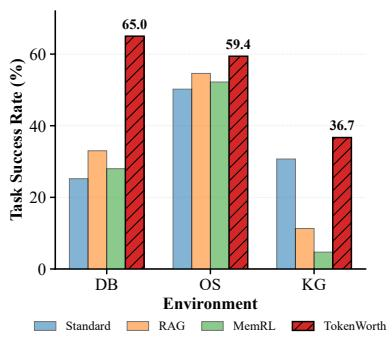
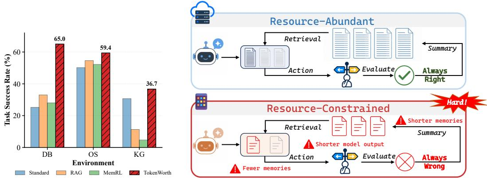
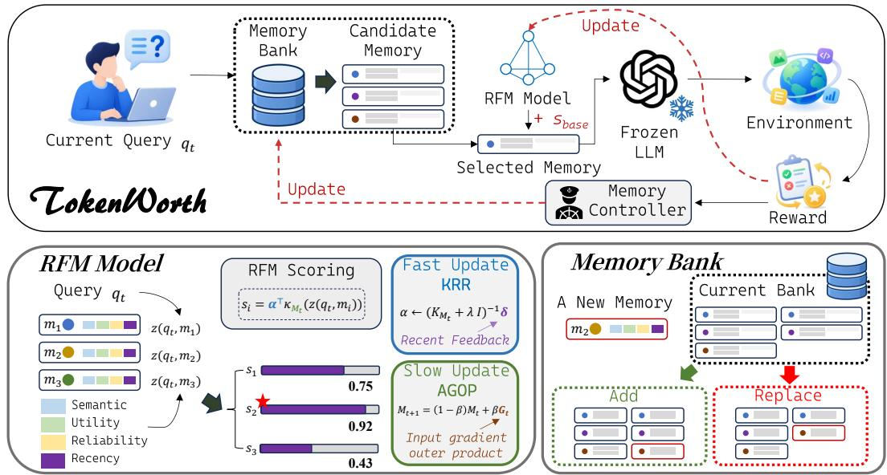
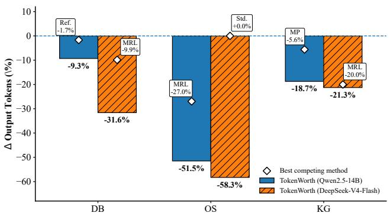
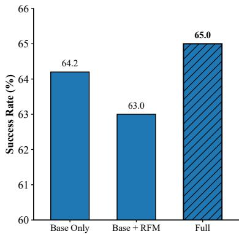

# Remembering Has a Price: Learning Memory Worth under Resource Constraints

Guannan Lai1,2 Zi-Yang Bai1,2 Jun-Peng Jiang1,2 Han-Jia Ye1,2

1School of Artificial Intelligence, Nanjing University

2National Key Laboratory for Novel Software Technology, Nanjing University {laign, jiangjp, yehj}@lamda.nju.edu.cn baizy@smail.nju.edu.cn

## Abstract

Lifelong agents continually accumulate and reuse experience to improve after deployment, yet in practice they often operate under tight generation, interaction, and memory budgets. Under such stringent joint constraints, we find that existing lifelong-memory methods can become ineffective, with several sophisticated approaches offering little advantage over simple retrieval or even no-memory agents. This reveals a more fundamental problem: resource scarcity makes each memory decision more consequential. When only a small amount of past experience can be retained or reused and opportunities for reasoning and recovery are limited, retrieving a relevant but ineffective memory can consume scarce context and hinder downstream execution. The key challenge is therefore not simply to retrieve relevant experience, but to determine which experiences are actually worth retaining and reusing. To address this challenge, we propose TokenWorth, a lightweight online memory framework that learns query-dependent memory worth from sparse execution feedback and applies it consistently to memory retrieval and bounded memory management. Across three LifelongAgentBench environments and both local and API-based deployments, TokenWorth achieves the highest task success rate while using the fewest output tokens among the evaluated methods. These results suggest that effective lifelong adaptation under resource constraints depends not on remembering more, but on learning what is worth remembering. Our code is publicly available at https://github.com/AIGNLAI/TokenWorth.

## 1 Introduction

Lifelong agents continually accumulate, retain, and reuse experience from an evolving task stream, enabling continued adaptation after deployment [35]. This capability is particularly valuable for long-running interactive agents that must adapt to changing users, environments, and tasks [4, 6, 16]. In practice, however, lifelong adaptation rarely operates with unlimited resources. Generation is constrained by latency, computation, or inference cost; interaction opportunities are finite; and only a bounded amount of historical experience can be stored or supplied to the agent at each decision step [8, 11, 29]. This raises a fundamental question: do existing lifelong-memory mechanisms remain effective when generation, interaction, and memory resources are jointly constrained?

Our evaluation reveals that they often do not. As shown in Figure 1(a), under stringent joint resource constraints, several sophisticated lifelong-memory approaches provide limited improvement over simple retrieval or even no-memory agents, and can substantially underperform in some environments. These results highlight the need to evaluate lifelong agents for their effectiveness under a specified joint resource budget, where generation, interaction, and memory resources are severely limited. Importantly, this failure cannot be attributed simply to insufficient memory capacity: under the same resource budget, different memory policies can lead to markedly different downstream task performance.

  
Figure 1: Left: Representative local results with Qwen2.5-14B-Instruct under the evaluated stringent joint resource constraints; TokenWorth remains effective where several memory baselines do not. Right: Resource-constrained lifelong agents operate under bounded generation, interaction, and memory budgets.

To study this problem systematically, we formalize resource-constrained lifelong agents: lifelong agents that must continually improve from experience while operating under bounded generation, interaction, and memory budgets. As illustrated in Figure 1(b), we jointly constrain the resources available for both task execution and experience reuse. Specifically, the agent operates with a bounded output budget and a limited number of interaction rounds, while its external memory is constrained in capacity, the number of retrieved experiences, and the amount of memory that can be injected at each step. These inference-time constraints leave backbone capacity unchanged, allowing us to study lifelong adaptation under a controlled, stringent resource budget.

Why do existing memory mechanisms become fragile under such constraints? When only a small amount of past experience can be retained or supplied to the agent, and opportunities for reasoning and recovery are limited, each memory decision becomes more consequential. In particular, semantic relevance alone may be insufficient for allocating scarce memory resources: an experience can appear relevant to the current query yet provide little downstream utility. Conversely, a useful experience that is not retained or selected cannot be recovered by simply injecting more context or extending the interaction. Resource scarcity therefore turns memory allocation into a more stringent value-estimation problem. The central challenge is no longer merely to retrieve the most relevant past experience, but to determine which experiences are actually worth retaining and reusing when memory and execution resources are limited.

To address this challenge, we propose TokenWorth, a lightweight online memory framework that learns query-dependent memory worth from sparse execution feedback. TokenWorth combines an interpretable online base scorer with a residual Recursive Feature Machine (RFM), allowing stable global patterns of memory usefulness to be complemented by nonlinear, query-specific corrections. The learned worth is used to guide both memory retrieval and bounded memory-bank management, allocating limited memory resources toward experiences that are most useful for future tasks.

We conduct our main evaluation on three LifelongAgentBench environments covering database interaction, operating-system tasks, and knowledge-graph reasoning, under both local and API-based deployments. Across all six environment–deployment combinations, TokenWorth achieves the highest task success rate among the evaluated methods while also using the fewest output tokens. These results show that its gains do not rely on longer generations; instead, selecting higher-value experience allows the frozen backbone to use a limited generation budget more effectively.

Our contributions are threefold:

• We formulate resource-constrained lifelong agents and study effectiveness under stringent joint constraints on generation, interaction, and memory.

• We propose TokenWorth, which learns query-dependent memory worth from online execution feedback and uses it consistently for memory retrieval and bounded memory management.

• We evaluate TokenWorth across three LifelongAgentBench environments under both local and API-based deployments, demonstrating improved task success and generation efficiency under stringent resource constraints.

## 2 Related Work

Lifelong Language Agents. Lifelong language agents aim to continually improve from accumulated interaction experience, enabling continued adaptation after deployment [6, 35]. Early agent systems demonstrated that past trajectories, reflections, or reusable skills can improve future decision making, including Reflexion [19], ExpeL [33], Voyager [24], and SocioDojo [4]. More recent work has developed explicit memory and skill mechanisms for continual adaptation, such as MemoryBank [37], Mem0 [5], MemRL [32], MemSkill [30], and AutoSkill [27]. Meanwhile, LifelongAgentBench [34], AgentCL [21], SkillLearnBench [36], and XSkill [10] provide increasingly systematic evaluation of continual adaptation in language agents. Most of these studies focus on how agents can accumulate and exploit experience to improve capability; in contrast, we study whether such memory mechanisms remain effective under stringent joint constraints on generation, interaction, and memory.

Resource-Constrained Language Agents. Resource efficiency has been extensively studied for LLM inference and serving, including memory-efficient execution [11] and collaborative inference under computation and communication constraints [29]. More recent work has begun to examine resource constraints at the agent level. Hajimiri et al. [9] study whether online memory and skill modules remain beneficial under fixed inference-token budgets, while Wu et al. [25] investigate continual learning with a hard-bounded on-device memory. BudgetMem [31] further considers query-aware routing across runtime memory budgets, and Chen and Cheng [3] model agentic memory value using multiple factors for memory retention and retrieval.

These studies highlight the importance of accounting for resource cost in agent memory, but largely focus on individual resource constraints, runtime budgeting, or memory valuation in isolation. Our work instead studies lifelong adaptation under a fixed joint budget on generation, interaction, and memory resources. We identify memory-worth estimation as a central challenge and introduce TokenWorth, which learns query-dependent worth from streaming execution feedback to guide retrieval and bounded memory management.

## 3 Resource-Constrained Lifelong Agents

We consider a lifelong agent that sequentially processes an online task stream $\mathcal { Q } = \{ q _ { 1 } , q _ { 2 } , . . . , q _ { T } \}$ At step $t ,$ the agent receives task $q _ { t }$ and may retrieve a set of past experiences $\mathcal { R } _ { t }$ from its current memory bank $\bar { \cal B } _ { t } = \{ m _ { 1 } , \ldots , m _ { \bar { N _ { t } } } \}$ . Conditioned on $q _ { t }$ and $\mathcal { R } _ { t }$ , the backbone model interacts with the environment for $J _ { t }$ rounds, producing a trajectory

$$
\tau _ { t } = \{ ( o _ { t , j } , a _ { t , j } ) \} _ { j = 1 } ^ { J _ { t } } ,
$$

where $o _ { t , j }$ and $a _ { t , j }$ denote the observation and model output at interaction round $j ,$ respectively. The environment then returns a task-level reward $r _ { t } \in \{ 0 , 1 \}$ . After observing this outcome, the memory policy may update the bank from $B _ { t }$ to $B _ { t + 1 }$ . In this work, we focus on a frozen-backbone setting, where continual adaptation is achieved solely through external memory.

We impose resource constraints on both task execution and experience reuse. For execution, the total amount of model generation associated with each task, including both environment interaction and any method-specific auxiliary language-model calls, is bounded by

$$
\sum _ { j = 1 } ^ { J _ { t } } \bigl | a _ { t , j } \bigr | _ { \mathrm { t o k } } + A _ { t } ^ { \mathrm { a u x } } \leq O _ { \operatorname* { m a x } } , \qquad J _ { t } \leq J _ { \operatorname* { m a x } } ,
$$

where $A _ { t } ^ { \mathrm { a u x } }$ denotes the output tokens generated by auxiliary language-model calls such as memory construction, reflection, or skill extraction. For memory, the persistent bank is bounded by

$$
| B _ { t } | \leq B _ { \operatorname* { m a x } } ,
$$

while the memories supplied to the agent satisfy

$$
\vert \mathcal { R } _ { t } \vert \leq K _ { \operatorname* { m a x } } , \qquad \mathrm { L e n } ( \mathcal { R } _ { t } ) \leq L _ { \operatorname* { m a x } } .
$$

We summarize the overall resource budget as

$$
\mathcal { C } = ( O _ { \operatorname* { m a x } } , J _ { \operatorname* { m a x } } , B _ { \operatorname* { m a x } } , K _ { \operatorname* { m a x } } , L _ { \operatorname* { m a x } } ) ,
$$

which jointly constrains generation, interaction, memory storage, and memory usage.

Let $\pi _ { \mathrm { m e m } }$ denote an online memory policy that determines both which experiences to retrieve for the current task and how the memory bank is updated after observing the task outcome. For a fixed resource budget C, we define its lifelong task performance as

$$
S ( \pi _ { \mathrm { m e m } } ; \mathcal { C } ) = \frac { 1 } { T } \sum _ { t = 1 } ^ { T } \mathbb { E } [ r _ { t } ] .
$$

The objective is therefore

$$
\pi _ { \mathrm { m e m } } ^ { \star } = \arg \operatorname* { m a x } _ { \pi _ { \mathrm { m e m } } \in \Pi ( \mathcal { C } ) } S \big ( \pi _ { \mathrm { m e m } } ; \mathcal { C } \big ) ,\tag{1}
$$

where Π(C) denotes the class of online memory policies satisfying the resource constraints above.

Our focus is on a stringent joint resource budget, under which generation, interaction, and memory resources are simultaneously limited. We evaluate whether a memory mechanism remains effective under this specified budget. In this setting, an imperfect memory decision cannot easily be compensated for by retrieving additional experience, generating longer reasoning traces, or interacting for more rounds. Each retrieval and retention decision therefore becomes more consequential. The central challenge is not merely to identify which past experiences are relevant, but to determine which are actually worth allocating scarce memory resources to.

## 4 TokenWorth: Learning What to Remember

## 4.1 Overview

Figure 2 illustrates the overall workflow of TokenWorth. Given a query q , the agent first recalls a small candidate set from its bounded memory bank. TokenWorth then estimates the query-dependent worth of each candidate using a learnable linear base scorer together with an RFM-based residual cor rection, and selects the highest-valued experience for task execution. After receiving the environment reward, the worth model is updated online and the learned worth is further used to guide long-term memory-bank management.

TokenWorth consists of three components. First, an interpretable linear scorer captures stable global patterns of memory usefulness, while a residual Recursive Feature Machine (RFM) models nonlinear and query-specific corrections [2, 18]. Second, the residual learner separates fast value adaptation from slower AGOP-based feature adaptation for stable online learning. Third, learned worth guides query-time retrieval and long-term management of the bounded memory bank.

## 4.2 Learning Query-Dependent Memory Worth

TokenWorth aims to determine which past experiences are worth allocating the agent’s limited memory resources to. Unlike a fixed memory utility, the usefulness of an experience depends on the current query and must be inferred from sparse and indirect execution feedback. Each task is executed only once, feedback is observed only for the memory actually used, and an execution failure may arise from factors beyond the selected memory itself.

To balance stability and adaptivity under such feedback, TokenWorth decomposes memory worth into two complementary components. A lightweight linear base scorer captures stable and interpretable patterns that generalize across the task stream, while an RFM learns nonlinear residual structure not captured by the base scorer. The linear component is updated conservatively around an informative prior, whereas the RFM adapts more flexibly to local query–memory interactions.

  
Figure 2: Overview of TokenWorth. Online execution feedback guides query-dependent memoryworth learning for retrieval and bounded memory-bank management.

Candidate recall and representation. Each memory $m _ { i } \in { \cal B } _ { t }$ contains a compact record of a previously successful interaction together with lightweight statistics describing its historical use. Given the current query $q _ { t } .$ , we first recall a small candidate set using a lightweight textual relevance function:

$$
\begin{array} { r } { \mathcal { C } _ { t } = \mathrm { T o p K } _ { K _ { c } } \left\{ s _ { \mathrm { r e c a l l } } ( q _ { t } , m ) : m \in \mathcal { B } _ { t } \right\} , } \end{array}
$$

where $K _ { c }$ controls only the internal candidate pool and is independent of the number of memories ultimately supplied to the agent.

For each candidate $m _ { i } \in { \mathcal { C } } _ { t }$ , we construct four interpretable features

$$
\phi _ { t } ^ { i } = \left[ \phi _ { \mathrm { s i m } } ( q _ { t } , m _ { i } ) , \phi _ { \mathrm { u t i l } } ( m _ { i } ) , \phi _ { \mathrm { r e l } } ( m _ { i } ) , \phi _ { \mathrm { r e c e n t } } ( m _ { i } ) \right] ,
$$

capturing lightweight textual similarity, historical utility, reliability, and recency.

For residual estimation, we additionally construct a richer query–memory representation

$$
\mathbf { z } _ { t } ^ { i } = \left[ | \mathbf { e } _ { t } - \mathbf { e } _ { i } | , \cos ( \mathbf { e } _ { t } , \mathbf { e } _ { i } ) , u _ { i } , \mathrm { r e l } _ { t } ( m _ { i } ) , \mathrm { r e c } _ { t } ( m _ { i } ) , \mathrm { f r e q } _ { t } ( m _ { i } ) \right] .
$$

This representation combines hashed textual similarity features with the empirical history of each memory. The text representation is deterministic and lightweight rather than a learned semantic embedding; detailed definitions are provided in Appendix B.

Prior-regularized base scorer. The base scorer captures stable global relationships between memory characteristics and downstream usefulness:

$$
s _ { \mathrm { b a s e } , t } ( q _ { t } , m _ { i } ) = \mathbf { w } _ { t } ^ { \top } \phi _ { t } ^ { i } .
$$

Rather than learning $\mathbf { w } _ { t }$ from scratch, we initialize it from an informative prior $\mathbf { w } _ { 0 }$ and regularize subsequent online updates toward this prior. Given observed execution feedback $\mathcal { D } _ { t } ^ { \mathrm { b a s e } } = \{ ( \bar { \phi } _ { j } ^ { \star } , y _ { j } ) \}$ we optimize

$$
\mathcal { L } _ { \mathrm { b a s e } } ( \mathbf { w } ) = \sum _ { ( \phi _ { j } ^ { \star } , y _ { j } ) \in \mathcal { D } _ { t } ^ { \mathrm { b a s e } } } \log \left( 1 + \exp \left( - y _ { j } \mathbf { w } ^ { \top } \phi _ { j } ^ { \star } \right) \right) + \lambda _ { w } \| \mathbf { w } - \mathbf { w } _ { 0 } \| _ { 2 } ^ { 2 } .
$$

The prior anchors the scorer when evidence is scarce, while online updates allow it to gradually capture persistent patterns in the task stream. We further use conservative periodic updates, smoothing, and bounded weights to prevent unstable drift; implementation details are provided in Appendix B.

Residual worth estimation. The linear base scorer captures stable global regularities but cannot model all nonlinear or query-specific interactions among memory signals. TokenWorth therefore augments it with an RFM-based residual correction:

$$
s _ { t } ( q _ { t } , m _ { i } ) = s _ { \mathrm { b a s e } , t } ( q _ { t } , m _ { i } ) + \eta _ { t } f _ { t } ( \mathbf { z } _ { t } ^ { i } ) ,\tag{2}
$$

where $f _ { t }$ predicts the residual memory worth not explained by the base scorer and $\eta _ { t }$ controls its contribution. The selected memory is

$$
m _ { t } ^ { \star } = \arg \operatorname* { m a x } _ { m _ { i } \in \mathcal { C } _ { t } } s _ { t } ( q _ { t } , m _ { i } ) .
$$

The linear scorer captures stable global patterns of memory usefulness, while the RFM models nonlinear, query-specific deviations.

After task execution, the observed reward provides execution-derived supervision for the selected query–memory pair:

$$
y _ { t } = 2 r _ { t } - 1 \in \{ - 1 , + 1 \} .
$$

The base scorer is updated directly from $( \phi _ { t } ^ { \star } , y _ { t } )$ . For the residual learner, we first compute the prediction implied by the base scorer,

$$
\boldsymbol { \hat { y } } _ { t } ^ { \mathrm { b a s e } } = 2 \sigma ( s _ { \mathrm { b a s e } , t } ( \boldsymbol { q } _ { t } , \boldsymbol { m } _ { t } ^ { \star } ) ) - 1 ,
$$

and define the residual target

$$
\delta _ { t } = y _ { t } - \hat { y } _ { t } ^ { \mathrm { b a s e } } .
$$

The RFM is then updated from $\left( \mathbf { z } _ { t } ^ { \star } , \delta _ { t } \right)$ . Importantly, this supervision reflects downstream execution success rather than the counterfactual causal contribution of $m _ { t } ^ { \star }$ : TokenWorth does not re-execute the same task with alternative memories.

## 4.3 Two-Timescale RFM Adaptation

Within the residual learner, prediction and feature geometry need not adapt at the same rate. Recent execution outcomes provide immediate evidence about local residual structure, whereas the geometry governing query–memory features should evolve more conservatively. TokenWorth therefore separatesfast residual adaptation from slow geometry adaptation.

Fast residual adaptation. Given a short feedback buffer $\mathcal { D } _ { t } ^ { \mathrm { f a s t } } = \{ ( \mathbf { z } _ { j } , \delta _ { j } ) \} _ { j = 1 } ^ { N _ { f } }$ , we fit a kernel ridge regressor

$$
f _ { t } ( \mathbf { z } ) = \sum _ { j = 1 } ^ { N _ { f } } \alpha _ { j } K _ { \mathbf { M } _ { t } } ( \mathbf { z } , \mathbf { z } _ { j } ) , \qquad \mathbf { \alpha } \alpha = \left( \mathbf { K } _ { \mathbf { M } _ { t } } + \lambda \mathbf { I } \right) ^ { - 1 } \delta ,\tag{3}
$$

where ${ { \bf { M } } _ { t } }$ is an adaptive diagonal feature metric. The KRR coefficients are updated frequently, allowing the residual learner to rapidly capture deviations from the global base scorer.

Slow geometry adaptation. A fixed kernel metric would assume that different query–memory features retain the same relative importance throughout the task stream. Instead, RFM adapts the feature geometry using the Average Gradient Outer Product (AGOP) [18, 13]. Given a longer feedback window $\mathcal { D } _ { t } ^ { \mathrm { s l o w } } = \{ ( \mathbf { z } _ { j } , \delta _ { j } ) \} _ { j = 1 } ^ { N _ { s } }$ , we compute the diagonal AGOP

$$
\widetilde { \mathbf { G } } _ { t } = \mathrm { D i a g } \left( \frac { 1 } { N _ { s } } \sum _ { j = 1 } ^ { N _ { s } } \nabla _ { \mathbf { z } } f _ { t } ( \mathbf { z } _ { j } ) \odot \nabla _ { \mathbf { z } } f _ { t } ( \mathbf { z } _ { j } ) \right) ,
$$

and update the metric as

$$
\mathbf { M } _ { t + 1 } = \operatorname { N o r m C l i p } \left( ( 1 - \beta ) \mathbf { M } _ { t } + \beta \widetilde { \mathbf { G } } _ { t } \right) .\tag{4}
$$

After each metric update, the KRR predictor is refitted under the updated geometry.

The three adaptation mechanisms therefore play complementary roles. The prior-regularized linear scorer captures slowly evolving global regularities, the fast KRR update tracks local residual structure, and the slower $\mathbf { A G O \bar { P } }$ update adapts the feature geometry used to represent these residuals.

## 4.4 Worth-Guided Memory Lifecycle

Learning which memory to use for the current query addresses only part of the resource-allocation problem. Under a bounded persistent capacity $B _ { \mathrm { m a x } }$ , TokenWorth must also determine which experiences deserve to remain in memory for future tasks. We therefore extend the same querydependent notion of worth from immediate retrieval to long-term memory management.

Only successful, externally verified interactions are considered as new memory candidates. For a candidate memory m, we estimate its broader worth over a small set of recent probe queries $\mathcal { P } _ { t } \mathbf { : }$

$$
V _ { t } ( \boldsymbol { m } ) = \frac { 1 } { | \mathcal { P } _ { t } | } \sum _ { \boldsymbol { q } \in \mathcal { P } _ { t } } \boldsymbol { s } _ { t } ( \boldsymbol { q } , \boldsymbol { m } ) .\tag{5}
$$

While $s _ { t } ( q , m )$ measures the query-dependent worth of m for a particular query, $V _ { t } ( m )$ aggregates this signal over recent queries to estimate whether the memory deserves persistent capacity under the current task distribution.

TokenWorth follows a coverage–quality principle for memory admission. When capacity remains available, successful experiences are admitted to build initial coverage. Once the bank is full, a candidate is admitted if it is sufficiently novel, or if its probe-averaged worth exceeds that of the best existing memory and satisfies a positive-score ratio criterion. Candidates failing this admission gate may still replace a low-utility nearest neighbor when they provide a sufficiently large worth improvement. Detailed admission and replacement criteria are provided in Appendix B.

For candidates passing the admission gate, TokenWorth enforces the capacity bound by evicting the memory with the lowest probe-averaged worth from the enlarged bank:

$$
m _ { \mathrm { e v i c t } } = \arg \operatorname* { m i n } _ { \substack { m \in \mathcal { B } _ { t } \cup \{ m _ { \mathrm { n e w } } \} } } V _ { t } ( m ) .
$$

TokenWorth thus applies a unified notion of memory worth at two complementary timescales: querydependent worth determines which experience should be used now, while probe-averaged worth determines which experience should be retained for later. This continually reallocates limited memory capacity toward experiences that remain useful for the evolving task stream. All adaptation occurs within the lightweight memory controller; TokenWorth requires no backbone updates, task replay, counterfactual execution, or additional language-model calls.

## 5 Experiments

## 5.1 Experimental Setup

Benchmarks. We conduct our main evaluation on three environments from LifelongAgentBench [34]: database interaction (DB), operating-system interaction (OS), and knowledge-graph interaction (KG). These environments cover heterogeneous forms of interactive decision making while naturally following an online lifelong protocol, where experience accumulated from earlier tasks can be retained and reused in subsequent interactions. In all environments, the memory bank is initialized empty, each task is executed once, and memory decisions depend only on experience observed from previous tasks.

We additionally evaluate generalization beyond LifelongAgentBench using online lifelong variants of BigCodeBench [38] and ALFWorld [20]. These results are reported in Appendix C.

Backbone and deployment. We evaluate TokenWorth under two complementary deployment settings. In the local setting, all methods use Qwen2.5-14B-Instruct [17] as the frozen backbone, where generation and interaction are constrained by computation and latency. In the API-based setting, all methods use DeepSeek-V4-Flash [26] through an external API, where model generation and repeated interaction directly incur inference cost. The backbone remains frozen throughout evaluation.

Resource-constrained protocol. Following Sec. 3, we evaluate all methods under a stringent joint resource budget that constrains generation, interaction, persistent memory capacity, and memory injection. Within each environment and deployment setting, all methods process the same task stream under the same resource budget. All language-model generation incurred by a method, including auxiliary calls for memory construction, reflection, or skill extraction, is counted toward the same per-task generation budget $O _ { \mathrm { m a x } }$ . This controlled protocol allows us to examine whether lifelongmemory mechanisms remain effective when both task execution and experience reuse are severely constrained. Across DB, OS, and KG, memory capacity is 64 and at most one memory is retrieved per task. The respective output-token budgets are 128, 512, and 128, with interaction limits of 3, 5, and 15 rounds. These results characterize effectiveness under this fixed stringent budget; we do not claim robustness across a range of budget levels.

Table 1: Task success rate (%) on LifelongAgentBench under stringent joint resource constraints. Best results are shown in bold and second-best results are underlined.
<table><tr><td></td><td colspan="3">Local: Qwen2.5-14B-Instruct</td><td colspan="3">API: DeepSeek-V4-Flash</td></tr><tr><td>Method</td><td>DB</td><td>Os</td><td>KG</td><td>DB</td><td>Os</td><td>KG</td></tr><tr><td>Standard</td><td>25.2</td><td>50.2</td><td>30.7</td><td>26.2</td><td>67.2</td><td>12.7</td></tr><tr><td>RAG</td><td>33.0</td><td>54.6</td><td>11.3</td><td>29.4</td><td>66.6</td><td>31.3</td></tr><tr><td>MemRL</td><td>28.0</td><td>52.2</td><td>4.7</td><td>30.4</td><td>66.2</td><td>32.0</td></tr><tr><td>Mem0</td><td>21.2</td><td>50.6</td><td>30.7</td><td>32.2</td><td>68.8</td><td>15.3</td></tr><tr><td>MemP</td><td>23.4</td><td>46.8</td><td>27.3</td><td>28.0</td><td>69.8</td><td>21.3</td></tr><tr><td>MemSkill</td><td>24.4</td><td>50.8</td><td>26.0</td><td>27.4</td><td>66.0</td><td>20.7</td></tr><tr><td>Reflexion</td><td>22.0</td><td>48.8</td><td>30.0</td><td>30.6</td><td>67.2</td><td>14.7</td></tr><tr><td>EvoSC</td><td>19.2</td><td>50.2</td><td>27.3</td><td>30.6</td><td>70.2</td><td>18.7</td></tr><tr><td>EvoSkill</td><td>24.6</td><td>49.6</td><td>30.0</td><td>25.6</td><td>68.4</td><td>14.7</td></tr><tr><td>TokenWorth</td><td>65.0</td><td>59.4</td><td>36.7</td><td>62.2</td><td>73.2</td><td>36.7</td></tr></table>

Baselines. We compare TokenWorth with a no-memory agent (Standard), vanilla retrieval-augmented generation (RAG) [15], and representative lifelong-memory methods, including MemRL [32], Mem0 [5], MemP [7], MemSkill [30], Reflexion [19], EvoSC [28], and EvoSkill [1]. All methods share the same frozen backbone, task stream, and resource budget within each setting.

Metrics. We evaluate task effectiveness using task success rate (SR ↑). To measure generation efficiency, we report the average number of output tokens per task (OutputTok ↓), including all language-model generation incurred by the method during both task execution and method-specific auxiliary operations such as memory construction, reflection, or skill extraction. We further report the relative change in output-token usage with respect to the no-memory Standard agent:

$$
\Delta \mathrm { T o k } = \frac { \mathrm { O u t p u t T o k } _ { \mathrm { m e t h o d } } - \mathrm { O u t p u t T o k } _ { \mathrm { S t a n d a r d } } } { \mathrm { O u t p u t T o k } _ { \mathrm { S t a n d a r d } } } \times 1 0 0 \% ,
$$

where a negative value indicates lower generation consumption than the no-memory baseline.

## 5.2 Results and Analysis

RQ1: Does TokenWorth remain effective under stringent resource constraints? Table 1 reports the main results on LifelongAgentBench. TokenWorth achieves the highest task success rate in all six environment–deployment combinations, indicating that its advantage is consistent across both local and API-based backbones.

Under the local deployment, the improvement is particularly pronounced on DB, where TokenWorth reaches 65.0%, outperforming the strongest baseline RAG (33.0%) by 32.0 percentage points. It also improves the strongest baseline by 4.8 points on OS and 6.0 points on KG. The same pattern holds under the API-based deployment: TokenWorth improves the best competing method by 30.0 points on DB, 3.0 points on OS, and 4.7 points on KG.

Notably, several memory-based methods provide limited gains over the no-memory Standard agent and can even substantially underperform it, particularly on KG. These results indicate that effective memory selection is particularly important when generation, interaction, and memory resources are jointly constrained.

RQ2: Does TokenWorth use the generation budget more effectively? Figure 3(a) compares TokenWorth’s output-token usage across the six LifelongAgentBench environment–deployment combinations. We report the relative change with respect to the no-memory Standard agent, while the diamonds indicate the most token-efficient competing method. TokenWorth achieves the lowest output-token usage in all six settings.

  
(a) Output-token efficiency

  
(b) Core component ablation  
Figure 3: Efficiency and component analysis of TokenWorth. (a) Relative output-token usage on LifelongAgentBench with respect to the no-memory Standard agent; diamonds denote the most token-efficient competing method in each setting. (b) Core ablation on DB using the local backbone; the plotted vertical axis is truncated, so the absolute percentages should be read alongside the numeric values discussed in the text.

Under the local Qwen2.5-14B-Instruct deployment, TokenWorth reduces output generation by 9.3%, 51.5%, and 18.7% on DB, OS, and KG, respectively. Under DeepSeek-V4-Flash, the corresponding reductions are 31.6%, 58.3%, and 21.3%. The reduction is particularly substantial on OS, where TokenWorth uses less than half the output tokens of the Standard agent under both deployments.

These savings accompany the highest success rate in all six settings (Table 1). TokenWorth also uses fewer output tokens than the most generation-efficient baseline in each setting, with clear margins on DB and OS. Although the margin over MemRL on API-based KG is smaller, TokenWorth still improves both success and token usage. Thus, higher-value experience helps the frozen backbone solve more tasks within the generation budget.

RQ3: How do the core components affect memory-worth learning? Figure 3(b) reports a core ablation on DB with Qwen2.5-14B-Instruct. We compare the base scorer alone (Base Only), the base scorer augmented with an RFM residual learner using a fixed feature metric (Base + RFM), and the full framework with AGOP-based feature adaptation (Full).

The base scorer achieves 64.2%, demonstrating the effectiveness of stable, interpretable memory signals. Adding the RFM residual learner with a fixed feature metric reduces performance to 63.0%, indicating that nonlinear residual modeling alone does not necessarily improve memory-worth estimation. With AGOP-based feature adaptation, the full framework reaches 65.0%, recovering this degradation and modestly outperforming the base-only variant. These results suggest that adapting the feature geometry helps the residual learner provide more effective corrections under sparse execution feedback.

## 6 Conclusion

We study lifelong language agents under joint constraints on generation, interaction, and memory. We propose TokenWorth, a lightweight online framework that learns query-dependent memory worth from execution feedback and uses it for retrieval and bounded memory management. Across three LifelongAgentBench environments and local and API-based backbones, TokenWorth achieves the highest task success rates among evaluated methods while using the fewest output tokens. Additional experiments show competitive performance on coding and embodied-agent tasks. Feedback is observed only for selected memories, so their causal contributions remain unidentified. Developing budget-efficient credit assignment is an important direction for future work.

## Acknowledgments and Disclosure of Funding

This work was supported by the National Key R&D Program of China under Grant No. 2024YFE0202800 and the National Natural Science Foundation of China under Grant Nos. 62522605 and 62376118.

## References

[1] Salaheddin Alzubi, Noah Provenzano, Jaydon Bingham, Weiyuan Chen, and Tu Vu. Evoskill: Automated skill discovery for multi-agent systems. arXiv preprint arXiv:2603.02766, 2026.

[2] Daniel Beaglehole, David Holzmüller, Adityanarayanan Radhakrishnan, and Misha Belkin. xrfm: Accurate, scalable, and interpretable feature learning models for tabular data. In International Conference on Learning Representations, volume 2026, pages 146422–146454, 2026.

[3] Zhibao Chen and Qian Cheng. Learning what to remember: A cognitively grounded multi-factor value model for agentic memory. arXiv preprint arXiv:2606.12945, 2026.

[4] Junyan Cheng and Peter Chin. Sociodojo: Building lifelong analytical agents with real-world text and time series. In ICLR, 2024.

[5] Prateek Chhikara, Dev Khant, Saket Aryan, Taranjeet Singh, and Deshraj Yadav. Mem0: Building production-ready ai agents with scalable long-term memory. arXiv preprint arXiv:2504.19413, 2025.

[6] Jinyuan Fang, Yanwen Peng, Xi Zhang, Yingxu Wang, Xinhao Yi, Guibin Zhang, Yi Xu, Bin Wu, Siwei Liu, Zihao Li, et al. A comprehensive survey of self-evolving ai agents: A new paradigm bridging foundation models and lifelong agentic systems. arXiv preprint arXiv:2508.07407, 2025.

[7] Runnan Fang, Yuan Liang, Xiaobin Wang, Jialong Wu, Shuofei Qiao, Pengjun Xie, Fei Huang, Huajun Chen, and Ningyu Zhang. Memp: Exploring agent procedural memory. In Findings of the Association for Computational Linguistics: ACL 2026, pages 17490–17502, 2026.

[8] Shubham Gupta. Ai agents collaboration under resource constraints: Practical implementations. International journal of artificial intelligence research and development, 3(1):51–63, 2025.

[9] Sina Hajimiri, Masih Aminbeidokhti, Jose Dolz, Ismail Ben Ayed, Issam H Laradji, Spandana Gella, and Nicolas Gontier. Are online skill and memory modules always worth their tokens? a budget-constrained study of web agents. arXiv preprint arXiv:2606.15017, 2026.

[10] Guanyu Jiang, Zhaochen Su, Xiaoye Qu, and Yi R Fung. Xskill: Continual learning from experience and skills in multimodal agents. In ICML, 2026.

[11] Woosuk Kwon, Zhuohan Li, Siyuan Zhuang, Ying Sheng, Lianmin Zheng, Cody Hao Yu, Joseph Gonzalez, Hao Zhang, and Ion Stoica. Efficient memory management for large language model serving with pagedattention. In Proceedings of the 29th symposium on operating systems principles, pages 611–626, 2023.

[12] Guannan Lai, Yujie Li, Xiangkun Wang, Junbo Zhang, Tianrui Li, and Xin Yang. Order-robust class incremental learning: Graph-driven dynamic similarity grouping. In 2025 IEEE/CVF Conference on Computer Vision and Pattern Recognition (CVPR), pages 4894–4904. IEEE, 2025.

[13] Guannan Lai, Da-Wei Zhou, Zhenguo Li, and Han-Jia Ye. The golden subspace: Where efficiency meets generalization in continual test-time adaptation. In CVPR, 2026.

[14] Guannan Lai, Da-Wei Zhou, Xin Yang, and Han-Jia Ye. The lie of the average: How class incremental learning evaluation deceives you? In International Conference on Learning Representations, volume 2026, pages 110530–110562, 2026.

[15] Patrick Lewis, Ethan Perez, Aleksandra Piktus, Fabio Petroni, Vladimir Karpukhin, Naman Goyal, Heinrich Küttler, Mike Lewis, Wen-tau Yih, Tim Rocktäschel, et al. Retrieval-augmented generation for knowledge-intensive nlp tasks. NeurIPS, 2020.

[16] Weidi Luo, Shenghong Dai, Xiaogeng Liu, Suman Banerjee, Huan Sun, Muhao Chen, and Chaowei Xiao. Agrail: A lifelong agent guardrail with effective and adaptive safety detection. In ACL, 2025.

[17] Qwen Team. Qwen2.5: A party of foundation models, September 2024. URL https:// qwenlm.github.io/blog/qwen2.5/.

[18] Adityanarayanan Radhakrishnan, Daniel Beaglehole, Parthe Pandit, and Mikhail Belkin. Mechanism for feature learning in neural networks and backpropagation-free machine learning models. Science, 383(6690):1461–1467, 2024.

[19] Noah Shinn, Federico Cassano, Ashwin Gopinath, Karthik Narasimhan, and Shunyu Yao. Reflexion: Language agents with verbal reinforcement learning. NeurIPS, 2023.

[20] Mohit Shridhar, Xingdi Yuan, Marc-Alexandre Côté, Yonatan Bisk, Adam Trischler, and Matthew Hausknecht. Alfworld: Aligning text and embodied environments for interactive learning. arXiv preprint arXiv:2010.03768, 2020.

[21] Yiheng Shu, Bernal Jiménez Gutiérrez, Saisri Padmaja Jonnalagedda, Yuguang Yao, Huan Sun, and Yu Su. Agentcl: Toward rigorous evaluation of continual learning in language agents. arXiv preprint arXiv:2606.02461, 2026.

[22] Xu Sun, Tongkai Xu, Baiheng Xie, Li Huang, Qiang Gao, and Kunpeng Zhang. M-rag: Semantic key-value indexing for retrieval-augmented generation. arXiv e-prints, pages arXiv–2603, 2026.

[23] Xun Sun, Baiheng Xie, Li Huang, and Qiang Gao. Scaling dpps for rag: Density meets diversity. arXiv preprint arXiv:2604.03240, 2026.

[24] Guanzhi Wang, Yuqi Xie, Yunfan Jiang, Ajay Mandlekar, Chaowei Xiao, Yuke Zhu, Linxi Fan, and Anima Anandkumar. Voyager: An open-ended embodied agent with large language models. TMLR, 2023.

[25] Beining Wu, Zihao Ding, Jun Huang, and Yanxiao Zhao. Forget to improve: On-device llm-agent continual learning via budget-curated memory. arXiv preprint arXiv:2606.25115, 2026.

[26] Anyi Xu, Bangcai Lin, Bing Xue, Bingxuan Wang, Bingzheng Xu, Bochao Wu, Bowei Zhang, Chaofan Lin, Chen Dong, Chenchen Ling, et al. Deepseek-v4: Towards highly efficient million-token context intelligence. arXiv preprint arXiv:2606.19348, 2026.

[27] Yutao Yang, Junsong Li, Qianjun Pan, Bihao Zhan, Yuxuan Cai, Lin Du, Jie Zhou, Kai Chen, Qin Chen, Xin Li, et al. Autoskill: Experience-driven lifelong learning via skill self-evolution. arXiv preprint arXiv:2603.01145, 2026.

[28] Hongzhuo Yu, Fei Zhu, Guo-Sen Xie, and Ling Shao. Self-consolidation for self-evolving agents. arXiv preprint arXiv:2602.01966, 2026.

[29] Liangqi Yuan, Wenzhi Fang, Shiqiang Wang, H Vincent Poor, and Christopher G Brinton. Large language models over networks: Collaborative intelligence under resource constraints. arXiv preprint arXiv:2605.08626, 2026.

[30] Haozhen Zhang, Quanyu Long, Jianzhu Bao, Tao Feng, Weizhi Zhang, Haodong Yue, and Wenya Wang. Memskill: Learning and evolving memory skills for self-evolving agents. arXiv preprint arXiv:2602.02474, 2026.

[31] Haozhen Zhang, Haodong Yue, Tao Feng, Quanyu Long, Jianzhu Bao, Bowen Jin, Weizhi Zhang, Xiao Li, Jiaxuan You, Chengwei Qin, et al. Learning query-aware budget-tier routing for runtime agent memory. arXiv preprint arXiv:2602.06025, 2026.

[32] Shengtao Zhang, Jiaqian Wang, Ruiwen Zhou, Junwei Liao, Yuchen Feng, Zhuo Li, Yujie Zheng, Weinan Zhang, Ying Wen, Zhiyu Li, et al. Memrl: Self-evolving agents via runtime reinforcement learning on episodic memory. arXiv preprint arXiv:2601.03192, 2026.

[33] Andrew Zhao, Daniel Huang, Quentin Xu, Matthieu Lin, Yong-Jin Liu, and Gao Huang. Expel: Llm agents are experiential learners. In AAAI, 2024.

[34] Junhao Zheng, Xidi Cai, Qiuke Li, Duzhen Zhang, ZhongZhi Li, Yingying Zhang, Le Song, and Qianli Ma. Lifelongagentbench: Evaluating llm agents as lifelong learners. arXiv preprint arXiv:2505.11942, 2025.

[35] Junhao Zheng, Chengming Shi, Xidi Cai, Qiuke Li, Duzhen Zhang, Chenxing Li, Dong Yu, and Qianli Ma. Lifelong learning of large language model based agents: A roadmap. TPAMI, 2026.

[36] Shanshan Zhong, Yi Lu, Jingjie Ning, Yibing Wan, Lihan Feng, Yuyi Ao, Leonardo FR Ribeiro, Markus Dreyer, Sean Ammirati, and Chenyan Xiong. Skilllearnbench: Benchmarking continual learning methods for agent skill generation on real-world tasks. arXiv preprint arXiv:2604.20087, 2026.

[37] Wanjun Zhong, Lianghong Guo, Qiqi Gao, He Ye, and Yanlin Wang. Memorybank: Enhancing large language models with long-term memory. In AAAI, 2024.

[38] Terry Yue Zhuo, Minh Chien Vu, Jenny Chim, Han Hu, Wenhao Yu, Ratnadira Widyasari, Imam Nur Bani Yusuf, Haolan Zhan, Junda He, Indraneil Paul, et al. Bigcodebench: Benchmarking code generation with diverse function calls and complex instructions. In International Conference on Learning Representations, volume 2025, pages 66602–66656, 2025.

## A Additional Experimental Details

## A.1 Benchmarks

Our main experiments use three environments from LifelongAgentBench [34]: database interaction (DB), operating-system interaction (OS), and knowledge-graph interaction (KG). Tasks are processed sequentially, and only experience from preceding tasks may be reused. DB requires structured database operations and answers grounded in retrieved observations. OS requires multi-step system management through Bash commands. KG follows an AgentBench-style protocol in which the agent interacts with a knowledge graph through structured tool calls, while SPARQL queries are executed by the backend. The environments thus cover heterogeneous forms of interactive decision making under a shared online lifelong-learning protocol.

We additionally evaluate online lifelong variants of BigCodeBench [38] and ALFWorld [20]; their results are reported in Appendix C.

Beyond language agents, class-incremental learning has examined the impact of task ordering on continual adaptation [12] and the variability of performance across evaluation sequences [14]. These studies highlight the importance of evaluation protocols in continual learning, while our experiments focus on online memory adaptation under fixed resource budgets.

## A.2 Baselines

We compare TokenWorth with a no-memory agent (Standard), retrieval-augmented generation (RAG), and representative memory- and skill-learning methods.

Standard. The frozen backbone solves every task independently, without persistent cross-task memory.

RAG. RAG [15, 22, 23] stores successful experiences and retrieves them by lightweight textual relevance, without online value learning.

MemRL. MemRL [32] uses execution feedback to learn utility signals for episodic memories, serving as a value-aware baseline.

Mem0. Mem0 [5] supports memory extraction, storage, retrieval, and update in long-running agents.

MemP. MemP [7] retains procedural task experience for later reuse.

MemSkill. MemSkill [30] converts experience into reusable memory skills and evolves them online.

Reflexion. Reflexion [19] stores verbal reflections derived from task feedback for reuse in subsequent tasks.

EvoSC. EvoSC [28] consolidates and evolves agent experience.

EvoSkill. EvoSkill [1] extracts reusable skills from interaction trajectories and updates its skill repository.

Within each environment and deployment setting, methods share the same task sequence, backbone, environment interface, and resource budget. We preserve baseline-specific auxiliary operations such as reflection, memory construction, and skill extraction; their generated output tokens are included in both the per-task budget and the reported OutputTok. Baseline implementations are adapted to satisfy the common resource limits.

## A.3 Backbones and Deployment Settings

Local deployment. All methods use the frozen Qwen2.5-14B-Instruct [17] backbone on NVIDIA A800 GPUs.

API-based deployment. All methods use the frozen DeepSeek-V4-Flash [26] backbone through an external inference API.

In both deployments, the memory bank starts empty, task order is fixed within an environment, and no backbone parameters are updated. TokenWorth uses neither offline pretraining nor task replay or counterfactual re-execution.

## A.4 Evaluation Protocol

We measure task effectiveness with task success rate (SR ↑). A task succeeds only if the environment evaluator marks its final answer or state as correct. Generation efficiency is measured by average output tokens per task (OutputTok ↓), including tokens from task execution and all method-specific auxiliary language-model calls. Relative to Standard,

$$
\Delta \mathrm { T o k } = \frac { \mathrm { O u t p u t T o k } _ { \mathrm { m e t h o d } } - \mathrm { O u t p u t T o k } _ { \mathrm { S t a n d a r d } } } { \mathrm { O u t p u t T o k } _ { \mathrm { S t a n d a r d } } } \times 1 0 0 \%
$$

Negative values indicate fewer generated tokens. OutputTok does not include input tokens or controller-side computation and should not be interpreted as total inference cost.

## B Implementation Details of TokenWorth

## B.1 Common Online Implementation

Online feedback protocol. At the beginning of task t, retrieval uses the bank $B _ { t }$ and feedback available through task $t - 1$ . Task t is executed once. Following its completion, the observed reward updates the worth model and the selected memory’s statistics, and memory admission or eviction constructs $B _ { t + 1 }$ . These updates may affect task $t + 1$ and later tasks; there is no same-task counterfactual execution or backbone fine-tuning.

Lightweight text representation. We construct deterministic 512-dimensional text vectors by token hashing and character 3–5-gram hashing, followed by $\ell _ { 2 }$ normalization. This representation requires no learned encoder and captures lightweight textual similarity rather than learned semantic embeddings. For a query $q$ and memory $m ,$ the residual input is

$$
\begin{array} { r } { \mathbf { z } ( q , m ) = \left[ | \mathbf { e } _ { q } - \mathbf { e } _ { m } | , \cos ( \mathbf { e } _ { q } , \mathbf { e } _ { m } ) , u _ { m } , \mathrm { r e l } ( m ) , \mathrm { r e c } ( m ) , \mathrm { f r e q } ( m ) \right] . } \end{array}
$$

Here $u _ { m }$ is historical utility. With $h _ { m }$ and $d _ { m }$ denoting counts of successful and unsuccessful executions, respectively, conditioned on selecting m, the other statistics are

$$
\begin{array} { l } { \displaystyle \mathrm { r e l } ( m ) = \frac { h _ { m } + 1 } { h _ { m } + d _ { m } + 2 } , } \\ { \displaystyle \mathrm { r e c } ( m ) = \exp ( - \kappa \Delta t _ { m } ) , } \\ { \displaystyle \mathrm { f r e q } ( m ) = \frac { c _ { m } } { \operatorname* { m a x } ( 1 , t - \tau _ { m } + 1 ) } . } \end{array}
$$

Here $\Delta t _ { m }$ is the number of steps since last access, $c _ { m }$ is the access count, and $\tau _ { m }$ is the creation step. We set $\kappa = 0 . 0 2$ . The success and failure counts are execution-derived statistics, not causal estimates of a memory’s effect.

Candidate recall and base scorer. The bank is screened by lightweight textual relevance to form

$$
\mathcal { C } _ { t } = \mathrm { T o p K } _ { K _ { c } } \{ s _ { \mathrm { r e c a l l } } ( q _ { t } , m ) : m \in \mathcal { B } _ { t } \} .
$$

For each candidate, define $\phi ( q , m ) = [ \phi _ { \mathrm { s i m } } , \phi _ { \mathrm { u t i l } } , \phi _ { \mathrm { r e l } } , \phi _ { \mathrm { r e c e n t } } ]$ and $s _ { \mathrm { b a s e } , t } ( q , m ) = \mathbf { w } _ { t } ^ { \top } \phi ( q , m )$ We initialize $\mathbf { w } _ { 0 } = [ 1 . 0 , 0 . 1 0 , 0 . 1 0 , 0 . 0 2 ]$ and fit

$$
\mathcal { L } _ { \mathrm { b a s e } } ( \mathbf { w } ) = \sum _ { ( \phi _ { j } , y _ { j } ) \in \mathcal { D } _ { t } ^ { \mathrm { b a s e } } } \log \left( 1 + \exp ( - y _ { j } \mathbf { w } ^ { \top } \phi _ { j } ) \right) + \lambda _ { w } \| \mathbf { w } - \mathbf { w } _ { 0 } \| _ { 2 } ^ { 2 } .
$$

The FIFO training window contains at most 256 selected query–memory pairs, with $y _ { j } \in \{ - 1 , + 1 \}$ We use $\lambda _ { w } ~ = ~ 0 . 1$ and refit after every 50 new feedback examples using deterministic Newton optimization with backtracking line search. Updated weights are smoothed with coefficient $\beta _ { w } = 0 . 5$ and clipped coordinate-wise between [0, 0, 0, 0] and [2.0, 1.0, 1.0, 1.0].

Residual worth estimation. The combined score and selected memory are

$$
s _ { t } ( q , m ) = s _ { \mathrm { b a s e } , t } ( q , m ) + \eta _ { t } f _ { t } ( \mathbf { z } ( q , m ) ) , \qquad m _ { t } ^ { \star } = \arg \operatorname* { m a x } _ { m \in \mathcal { C } _ { t } } s _ { t } ( q _ { t } , m ) .
$$

To avoid abrupt residual corrections during early adaptation, we linearly increase the residual coefficient over the first three KRR fits:

$$
\eta _ { t } = \eta _ { \mathrm { m a x } } \operatorname* { m i n } \left\{ \frac { n _ { \mathrm { K R R } } ( t ) } { 3 } , 1 \right\} ,
$$

where $n _ { \mathrm { K R R } } ( t )$ denotes the number of completed KRR fits and $\eta _ { \mathrm { m a x } }$ is the environment-specific coefficient given in Table A1. For a task reward $r _ { t } \in \{ 0 , 1 \}$ , the execution label and residual target are

$$
y _ { t } = 2 r _ { t } - 1 , \qquad { \widehat { y } } _ { t } ^ { \mathrm { b a s e } } = 2 \sigma \big ( s _ { \mathrm { b a s e } , t } ( q _ { t } , m _ { t } ^ { \star } ) \big ) - 1 , \qquad \delta _ { t } = y _ { t } - { \widehat { y } } _ { t } ^ { \mathrm { b a s e } } .
$$

Only the selected pair $( q _ { t } , m _ { t } ^ { \star } )$ receives feedback. These labels reflect downstream task outcomes, not same-task comparisons among memories.

Kernel ridge regression and AGOP. The residual predictor fits kernel ridge regression (KRR) to a FIFO window of at most 128 feedback pairs $\{ ( \mathbf { z } _ { j } , \delta _ { j } ) \}$ }, using the Laplacian kernel

$$
K _ { \mathbf { M } _ { t } } ( \mathbf { z } , \mathbf { z } ^ { \prime } ) = \exp \left[ - \gamma \sqrt { ( \mathbf { z } - \mathbf { z } ^ { \prime } ) ^ { \top } \mathbf { M } _ { t } ( \mathbf { z } - \mathbf { z } ^ { \prime } ) } \right] ,
$$

with $\lambda _ { \mathrm { K R R } } = 0 . 0 1$ and $\gamma = 1 . 0$ . The metric ${ { \bf { M } } _ { t } }$ is diagonal. Fast KRR coefficients are periodically refitted; slower feature-geometry updates use the diagonal Average Gradient Outer Product (AGOP):

$$
\begin{array} { r l r } & { } & { \widetilde { \mathbf { G } } _ { t } = \mathrm { D i a g } \left( \displaystyle \frac { 1 } { N _ { s } } \sum _ { j = 1 } ^ { N _ { s } } \nabla _ { \mathbf { z } } f _ { t } ( \mathbf { z } _ { j } ) \odot \nabla _ { \mathbf { z } } f _ { t } ( \mathbf { z } _ { j } ) \right) , } \\ & { } & { \mathbf { M } _ { t + 1 } = \mathrm { N o r m C l i p } \left( ( 1 - \beta _ { M } ) \mathbf { M } _ { t } + \beta _ { M } \widetilde { \mathbf { G } } _ { t } \right) . } \end{array}
$$

The slow window contains at most 256 feedback examples. We set $\beta _ { M } = 0 . 2 5$ , clip diagonal weights to [0.05, 8.0], and normalize them to mean 1. KRR is refitted after every AGOP update; update intervals are listed in Table A1.

Execution-derived memory statistics. A newly created memory starts with utility $u ( m ) = 1 . 0$ After a task with selected memory $m _ { t } ^ { \star }$ , its utility is updated without an EMA:

$$
u _ { t } ( m _ { t } ^ { \star } ) = \mathrm { c l i p } \biggl ( u _ { t - 1 } ( m _ { t } ^ { \star } ) + \left\{ \begin{array} { l l } { { + 0 . 2 5 , } } & { { r _ { t } = 1 , } } \\ { { - 0 . 4 5 , } } & { { r _ { t } = 0 , } } \end{array} - 2 , 5 \right) .
$$

Successful (unsuccessful) task execution with the selected memory increments $h _ { m } \left( d _ { m } \right)$ . Access count and recency are updated after each use.

Memory admission, replacement, and eviction. Only externally verified successful tasks produce candidate memories. While $\left. B _ { t } \right. < B _ { \mathrm { m a x } } .$ , each eligible candidate is admitted to establish coverage. For a full bank, let $m _ { \mathrm { n e a r } }$ denote the nearest existing memory in the same hashed textual representation. Define

$$
\operatorname { n o v } _ { t } ( m _ { \mathrm { n e w } } ) = 1 - \operatorname* { m a x } _ { m _ { i } \in \mathcal { B } _ { t } } \cos ( \mathbf { e } _ { \mathrm { n e w } } , \mathbf { e } _ { i } ) ,
$$

$$
V _ { t } ( \boldsymbol { m } ) = \frac { 1 } { | \mathcal { P } _ { t } | } \sum _ { \boldsymbol { q } \in \mathcal { P } _ { t } } \boldsymbol { s } _ { t } ( \boldsymbol { q } , \boldsymbol { m } ) ,
$$

$$
\rho _ { t } ^ { + } ( m _ { \mathrm { n e w } } ) = \frac { 1 } { | \mathcal { P } _ { t } | } \sum _ { q \in \mathcal { P } _ { t } } \mathbb { I } [ s _ { t } ( q , m _ { \mathrm { n e w } } ) > 0 ] .
$$

The probe set $\mathcal { P } _ { t }$ includes the current query and up to eight previous queries on which memory retrieval occurred $( { \mathrm { F I F O } } ) .$ hence $| \mathcal { P } _ { t } | \leq 9$ . The positive-score ratio $\rho _ { t } ^ { + }$ measures the fraction of probe queries for which the candidate receives a positive worth score, rather than the fraction on which it outperforms the nearest memory.

For a full bank, a candidate passes the admission gate if

$$
\begin{array} { r l r } {  { \operatorname { n o v } _ { t } ( m _ { \mathrm { n e w } } ) > \tau _ { \mathrm { n o v } } } } \\ & { } & { \quad \vee [ V _ { t } ( m _ { \mathrm { n e w } } ) > \operatorname* { m a x } _ { m \in \mathcal { B } _ { t } } V _ { t } ( m ) + \delta _ { \mathrm { w r i t e } } \wedge \rho _ { t } ^ { + } ( m _ { \mathrm { n e w } } ) \geq \tau _ { \mathrm { p o s } } ] , } \end{array}
$$

where $\tau _ { \mathrm { n o v } } = 0 . 3 5 , \delta _ { \mathrm { w r i t e } } = 0 . 0 2$ , and $\tau _ { \mathrm { p o s } } = 0 . 4 5$ . Thus, admission requires either sufficient novelty or a worth improvement over the best existing memory together with a sufficiently high positive-score ratio.

Candidates passing this admission gate are added to the bank. The capacity bound is then enforced by evicting the memory with the lowest probe-averaged worth from the enlarged bank:

$$
m _ { \mathrm { e v i c t } } = \arg \operatorname* { m i n } _ { m \in { \cal B } _ { t } \cup \{ m _ { \mathrm { n e w } } \} } V _ { t } ( m ) , \qquad | { \cal B } _ { t + 1 } | \leq B _ { \mathrm { m a x } } .
$$

The newly admitted candidate may itself be evicted if it has the lowest probe-averaged worth.

If the candidate fails the admission gate, the controller instead considers direct replacement of its nearest existing memory. Replacement occurs only when the nearest memory has low utility and the candidate exceeds its probe-averaged worth by a larger margin:

$$
u ( m _ { \mathrm { n e a r } } ) < \tau _ { \mathrm { u t i l } } = 0 . 5 , \qquad V _ { t } ( m _ { \mathrm { n e w } } ) > V _ { t } ( m _ { \mathrm { n e a r } } ) + \delta _ { \mathrm { r e p } } , \quad \delta _ { \mathrm { r e p } } = 0 . 1 0 .
$$

When both conditions hold, $m _ { \mathrm { n e w } }$ directly replaces $m _ { \mathrm { n e a r } }$ without invoking the lowest-worth eviction rule. Candidates satisfying neither the admission gate nor the fallback replacement conditions are rejected.

## B.2 Common Hyperparameters

The main common parameters are $\mathbf { w } _ { 0 } = [ 1 . 0 , 0 . 1 0 , 0 . 1 0 , 0 . 0 2 ] , \lambda _ { w } = 0 . 1 , \beta _ { w } = 0 . 5 , \lambda _ { \mathrm { K R R } } = 0 . 0 1$ $\gamma = 1 . 0 , \beta _ { M } = 0 . 2 5 .$ , and $\kappa = 0 . 0 2$ . The base, fast KRR, and slow AGOP feedback windows contain at most 256, 128, and 256 examples, respectively. The shared memory-management thresholds are $\tau _ { \mathrm { n o v } } = 0 . 3 5 , \delta _ { \mathrm { w r i t e } } = 0 . 0 2 , \tau _ { \mathrm { p o s } } = 0 . 4 5$ , and $\delta _ { \mathrm { r e p } } = 0 . 1 0$ . Further bounds and update rules are specified in Appendix B above, and the environment-dependent settings in Table A1.

## B.3 Environment-Specific Configuration

TokenWorth uses the same worth-learning method across DB, OS, and KG, with resource limits and online-update intervals adapted to the environment.

Table A1: Environment-specific resource and adaptation configurations for LifelongAgentBench.
<table><tr><td>Setting</td><td>DB</td><td>OS</td><td>KG</td></tr><tr><td>Generation budget  $O _ { \mathrm { m a x } }$ </td><td>128</td><td>512</td><td>128</td></tr><tr><td>Interaction budget  $J _ { \mathrm { m a x } }$ </td><td>3</td><td>5</td><td>15</td></tr><tr><td>Memory capacity  $B _ { \mathrm { m a x } }$ </td><td>64</td><td>64</td><td>64</td></tr><tr><td>Retrieved memories  $K _ { \mathrm { m a x } }$ </td><td>1</td><td>1</td><td>1</td></tr><tr><td>Injection budget  $L _ { \mathrm { m a x } }$ </td><td>900 chars</td><td>800 chars</td><td>4096 chars</td></tr><tr><td>Candidate pool size  $K _ { c }$ </td><td>12</td><td>12</td><td>12</td></tr><tr><td>KRR update interval</td><td>50</td><td>25</td><td>25</td></tr><tr><td>AGOP update interval</td><td>200</td><td>100</td><td>100</td></tr><tr><td>Residual influence η</td><td>0.15</td><td>0.05</td><td>0.10</td></tr><tr><td>RFM warm-up feedback</td><td>4</td><td>4</td><td>24</td></tr></table>

## B.4 Environment-Specific Memory Construction

DB. Successful tasks are stored as compact demonstrations containing the question, valid SQL actions, truncated database observations, and final answer. Invalid actions and unnecessary output are omitted.

OS. Complete shell trajectories contain instance-specific paths, user names, and process identifiers that transfer poorly. We retain concise patterns from successful Bash actions, including permission management, batch file processing, text editing, symbolic links, and process management. A task is successful when the environment evaluator reports correct, including when the interaction limit is reached after a correct final state.

KG. Memories contain successful knowledge-graph tool calls and truncated knowledge-graph observations, rather than SPARQL queries executed by the backend. KG allows up to 15 interaction rounds and 4096 characters of injected memory; residual adaptation starts after at least 24 query– memory feedback pairs. In all three environments, TokenWorth first screens up to $K _ { c } = 1 2$ memories and injects at most one selected experience.

## C Generalization Beyond LifelongAgentBench

We evaluate online lifelong variants of BigCodeBench [38] (code generation) and ALFWorld [20] (text-based embodied decision making). Each run starts without stored experience from benchmark tasks. Tasks are processed sequentially, with retrieval using only preceding experience. Memory is updated after the current task has been evaluated, without access to future tasks. The language-model backbone remains frozen throughout each run.

BigCodeBench. We use BigCodeBench Full v0.1.4 in the Instruct format, comprising 1,140 coding problems. Each method makes a single pass through the same deterministic sequence: the 992 problems in Full excluding Hard, followed by the 148 problems in the Hard subset. Within these two groups, we preserve the order of the pinned Full and Hard dataset files, respectively; no random shuffling is applied. The memory bank is carried across the two groups without resetting. For each problem, the agent generates one solution, which is sanitized and evaluated using Big-CodeBench’s official execution-based evaluator inside a Docker worker. A problem succeeds only when the evaluator returns pass; generated-code failures and execution timeouts count as unsuccessful outcomes. Evaluator infrastructure errors invalidate the run. We report pass@1 over all 1,140 problems, counting each problem once. Memory is updated after evaluation, and previously evaluated problems are not revisited. The local deployment uses Qwen2.5-14B-Instruct. The API deployment uses DeepSeek-V4-Flash with thinking explicitly disabled. Both deployments use temperature zero. Reference solutions and unit tests are excluded from the model’s memory and input prompts.

ALFWorld. We use Qwen2.5-14B-Instruct as the frozen backbone, with temperature zero and top-p equal to one. A complete run contains 574 episodes: 300 training episodes selected by tasktype-stratified sampling, all 140 validation-seen episodes, and all 134 validation-unseen episodes. The phases run in this order. The base seed is 42; the sampling and ordering routines use seeds 42, 43, and 44 for the three phases, respectively. Within each phase, game paths are sorted, shuffled within task-type groups using the phase seed, and selected by round-robin traversal of the groups. The resulting ordered episode manifest is fixed and shared across methods, and the runner checks that the environment follows this order. Each selected episode is executed once. An episode succeeds when TextWorld’s external won flag indicates task completion. The success rate reported here is the total number of successful episodes divided by 574, including all three phases; it is not an unweighted average of phase success rates. Memory persists across phase boundaries and is updated after every completed episode, including validation-seen and validation-unseen episodes. Thus, this is an online lifelong protocol rather than evaluation with memory frozen after training. Expert trajectories are excluded from memory.

Resource accounting. We follow the resource-constrained evaluation principle in Sec. 3, using benchmark-specific limits. Within each benchmark and deployment, methods share the backbone, ordered task stream, solver-call output limit, and, for ALFWorld, interaction controller. Memory contexts are bounded by the complete injected block, including its headings and separators. Injection lengths below are measured in characters. The two adapters enforce output limits per model call, rather than pooling all calls into a single per-task output allowance. Method-specific auxiliary calls, including memory construction, reflection, and skill extraction, have a separate limit of 512 output tokens per call. Their actual usage is recorded in addition to solver usage, including action repairs in ALFWorld. TokenWorth makes no auxiliary language-model calls. Consequently, the methods share per-call limits but need not consume equal total output tokens per task or episode.

BigCodeBench configuration. The solver output limit is $O _ { \mathrm { m a x } } = 1 2 8 0$ tokens per call for both the local and API deployments. Auxiliary API calls have thinking disabled. TokenWorth uses a memory capacity of $\bar { B } _ { \mathrm { m a x } } = 5 0$ records, injects at most $K _ { \operatorname* { m a x } } = 1$ record, and caps the complete injection block at $L _ { \mathrm { m a x } } = 4 0 9 6$ characters. Each stored experience is also capped at 4096 characters. BM25 recalls at most $K _ { c } = 1 2$ candidates for learned worth ranking. All TokenWorth representation, learning, and memory-management parameters are identical across the local and API deployments; the solver output budget and thinking setting follow the selected deployment.

ALFWorld configuration. The interaction limit is $J _ { \mathrm { m a x } } = 5 0$ environment steps per episode. Each action-generation call has an output limit of $O _ { \mathrm { m a x } } = 1 2 8$ tokens. An inadmissible action permits at most one repair call for that step, also capped at 128 output tokens. These are per-call limits, not a 128-token allowance for the entire episode. The same action controller is used for all methods, with memory-dependent loop removal disabled. TokenWorth uses $B _ { \mathrm { m a x } } = 1 2 8$ records, $K _ { \operatorname* { m a x } } = 1 .$ , a complete injection budget of $L _ { \mathrm { m a x } } = 4 2 0 0$ characters, a per-experience limit of 4096 characters, and a BM25 candidate pool of at most $K _ { c } = 1 2$

Online learning configuration. Both benchmarks use the same deterministic 512-dimensional hashing representation of tokens and character 3–5-grams. Only a memory actually injected into the agent receives outcome supervision. KRR and AGOP updates are scheduled every 75 and 225 accumulated feedback examples, respectively, with FIFO buffers of 128 and 256 examples. These counters track feedback examples, not elapsed tasks or episodes. Each scheduled residual fit requires at least four feedback examples; this minimum does not trigger an immediate fit at the fourth example. Under these settings, the first scheduled KRR fit occurs at feedback example 75. The residual coefficient is $\eta _ { t } = 0 . 1 0 \operatorname* { m i n } ( 1 , u _ { t } / 3 )$ , where $u _ { t }$ is the number of completed KRR fits: its influence ramps linearly over the first three fits. KRR uses ridge regularization 0.01 and Laplacian-kernel scale 1. AGOP uses smoothing 0.25, clips the updated diagonal metric to [0.05, 8], normalizes it to have mean one, and immediately refits KRR. The base scorer is refitted every 50 feedback examples, using a FIFO of 256, regularization 0.1, and smoothing 0.5. Successful interactions can create new experiences; unsuccessful interactions provide negative feedback to injected memories without creating successful-experience records.

Table A2: Task success rate (%) on additional generalization benchmarks. Best results are bold; second-best results are underlined (including ties).
<table><tr><td rowspan="2">Method</td><td colspan="2">Local: Qwen2.5-14B-Instruct</td><td rowspan="2">API: DeepSeek-V4-Flash BIGCODE</td></tr><tr><td>BIGCODE</td><td>ALFWORLD</td></tr><tr><td>Standard</td><td>41.7</td><td>59.1</td><td>49.9</td></tr><tr><td>RAG</td><td>42.6</td><td>73.2</td><td>50.9</td></tr><tr><td>MemRL</td><td>42.9</td><td>69.7</td><td>50.5</td></tr><tr><td>Mem0</td><td>41.7</td><td>64.1</td><td>50.2</td></tr><tr><td>MemP</td><td>42.3</td><td>66.4</td><td>49.6</td></tr><tr><td>MemSkill</td><td>42.9</td><td>63.6</td><td>49.1</td></tr><tr><td>Reflexion</td><td>40.8</td><td>69.2</td><td>49.0</td></tr><tr><td>EvoSC</td><td>42.6</td><td>65.0</td><td>49.6</td></tr><tr><td>EvoSkill</td><td>41.8</td><td>64.8</td><td>48.8</td></tr><tr><td>TokenWorth</td><td>43.1</td><td>73.5</td><td>50.6</td></tr></table>

Table A2 shows that TokenWorth achieves 43.1% on local BigCodeBench and 73.5% on local ALFWorld, exceeding the best competitors by 0.2 and 0.3 percentage points, respectively. On API-based BigCodeBench, TokenWorth reaches 50.6%, below RAG’s 50.9%. These small margins

support competitive transfer rather than consistent dominance beyond the three main interactive environments.

## D Hyperparameter Sensitivity

We evaluate the sensitivity of TokenWorth to its key hyperparameters on the same 500-task DB stream using Qwen2.5-14B-Instruct. Starting from the default configuration, which achieves a 65.0% task success rate, we vary one parameter at a time while keeping all others fixed. Table A3 summarizes the results.

Table A3: Hyperparameter sensitivity on DB using Qwen2.5-14B-Instruct. The default configuration achieves 65.0% task success. $\Delta$ denotes the change in percentage points relative to the default.
<table><tr><td>Parameter</td><td>Default</td><td>Tested value</td><td>SR (%)</td><td>∆(pp)</td></tr><tr><td rowspan="3">RFM influence η</td><td rowspan="3">0.15</td><td>0.05</td><td>62.4</td><td>-2.6</td></tr><tr><td>0.10</td><td>63.8</td><td>-1.2</td></tr><tr><td>0.20 0.30</td><td>64.2 64.0</td><td>-0.8 -1.0</td></tr><tr><td rowspan="3">Base regularization  $\lambda _ { w }$ </td><td rowspan="3">0.10</td><td></td><td></td><td></td></tr><tr><td>0.03 0.30</td><td>64.8 62.6</td><td>-0.2 -2.4</td></tr><tr><td>1.00</td><td>63.0</td><td>-2.0</td></tr><tr><td rowspan="3">Base smoothing</td><td rowspan="3">0.50</td><td></td><td>64.2</td><td>-0.8</td></tr><tr><td>0.25 0.75</td><td>62.8</td><td>-2.2</td></tr><tr><td>1.00</td><td>62.6</td><td>-2.4</td></tr><tr><td rowspan="2">Base update interval</td><td rowspan="2">50</td><td>25</td><td>65.2</td><td>+0.2</td></tr><tr><td>100</td><td>62.4</td><td>-2.6</td></tr><tr><td rowspan="3">AGOP smoothing</td><td rowspan="3">0.25</td><td>0.10</td><td>64.4</td><td>-0.6</td></tr><tr><td>0.50</td><td>64.6</td><td>-0.4</td></tr><tr><td>0.75</td><td>62.2</td><td>-2.8</td></tr><tr><td rowspan="2">KRR update interval</td><td rowspan="2">50</td><td>25</td><td>62.2</td><td>-2.8</td></tr><tr><td>100</td><td>63.4</td><td>-1.6</td></tr><tr><td rowspan="2">AGOP update interval</td><td rowspan="2">200</td><td>100</td><td>62.6</td><td>-2.4</td></tr><tr><td>400</td><td>62.0</td><td>-3.0</td></tr><tr><td rowspan="2">Kernel  $\gamma$ </td><td rowspan="2">1.0</td><td>0.5</td><td>64.0</td><td>-1.0</td></tr><tr><td>2.0</td><td>63.0</td><td>-2.0</td></tr></table>

TokenWorth maintains relatively stable performance under moderate changes to several hyperparameters. Varying the RFM influence $\eta$ between 0.10 and 0.30 results in performance differences of at most 1.2 percentage points, while adjusting AGOP smoothing between 0.10 and 0.50 leads to differences within 0.6 points. Reducing the base update interval from 50 to 25 yields a comparable success rate of 65.2%.

Larger deviations in adaptation settings lead to more pronounced performance degradation. Reducing η to 0.05 decreases success by 2.6 points, while increasing AGOP smoothing to 0.75 causes a 2.8-point drop. The update schedules also play an important role: changing the KRR update interval from 50 to 25 reduces success by 2.8 points, while changing the AGOP interval from 200 to 100 or 400 decreases success by 2.4 and 3.0 points, respectively. These results highlight the importance of balancing adaptation speed and stability, supporting the conservative, two-timescale design of TokenWorth.