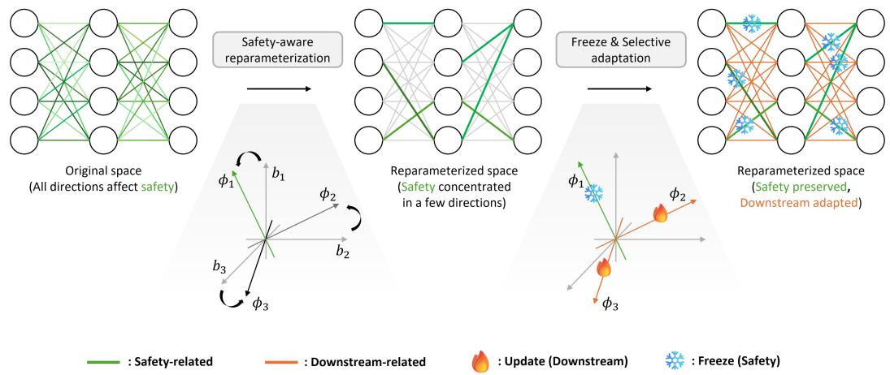
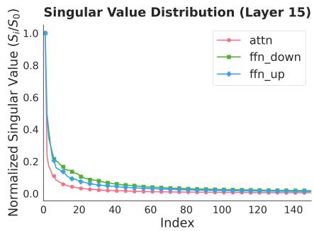
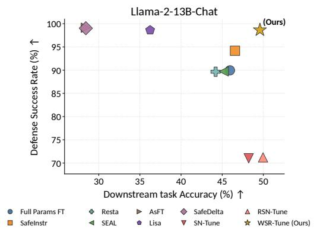
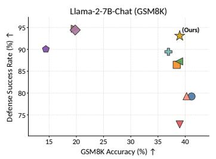
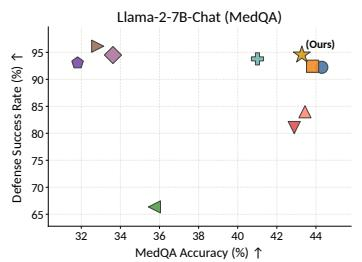
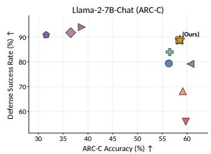
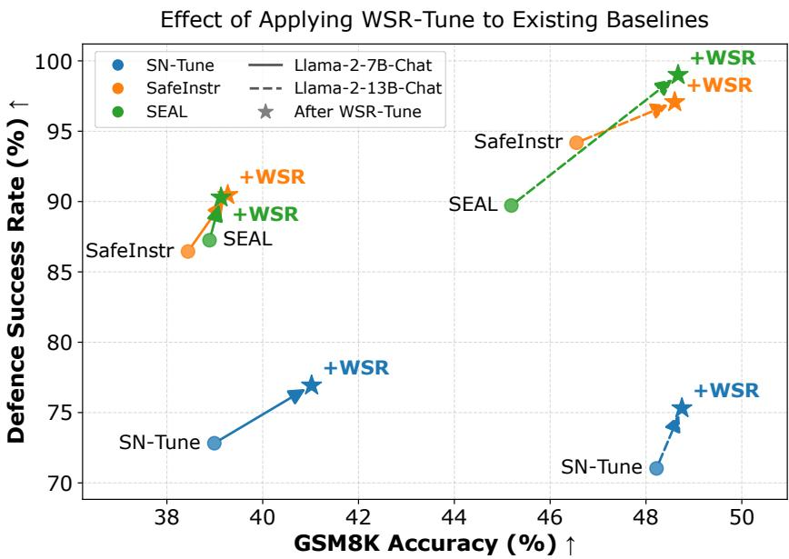

# Rethinking LLM Fine-Tuning via Weight Space Reparameterization: Preserving Safety during Downstream Adaptation

Min-Seong Kim\* Jongbok Won\* Jeesup Park Yonghee Choi Dong-Jun Han Yonsei University

{minseongkim, jongbok.won, jeesup, 2025321337, djh}@yonsei.ac.kr

## Abstract

Fine-tuning large language models (LLMs) on downstream tasks often weakens their previously aligned safety behavior, creating an inherent trade-off between task adaptation and safety preservation. Existing approaches attempt to mitigate this issue by identifying safety-relevant neurons, layers, or update directions in the original parameter space. However, safety-related information is often distributed across many directions in this space, causing downstream updates to overwrite parameters that encode safety behavior. We propose WSR-Tune, a Weight Space Reparameterization-based fine-tuning framework that preserves safety during downstream adaptation. Our approach constructs a safety-conditioned basis and reparameterizes the weight matrices such that safety-relevant information becomes concentrated in a small subset of directions. We then identify safety-critical directions and freeze them in the reparameterized space, while updating the remaining complementary directions for downstream adaptation. By explicitly structuring the parameter space to disentangle safety and task information, our method reduces interference between objectives and enables simultaneous preservation of safety and improvement in downstream performance. Experimental results show that our method achieves a more favorable trade-off between downstream performance and safety retention, demonstrating its effectiveness for reliable LLM fine-tuning.

## 1 Introduction

Large Language Models (LLMs) are increasingly being deployed in real-world settings where safety is critical [1]. As their capabilities continue to advance, LLMs are expected to play important roles across diverse domains such as healthcare, education, and software engineering [2, 3, 4, 5]. Without adequate safety tuning, LLMs can provide harmful assistance, violate policies, and exhibit unsafe behavior at scale [6]. Ensuring that these models remain helpful while consistently refusing harmful or disallowed requests has therefore become a central challenge in modern LLM development.

In practice, LLM deployment typically involves multiple post-training stages: a base model is first improved through instruction tuning and/or safety tuning, and is then further adapted to userspecific downstream tasks [7]. However, such downstream adaptation can degrade previously learned safety behaviors [8]. This issue becomes more critical as attempts to misuse LLMs have become increasingly sophisticated [9, 10, 11]. Recent work has introduced a wide range of jailbreak strategies, including manually crafted prompts [12], automated prompt optimization [13, 14], adversarial finetuning [15, 16], and other adaptive attacks [17, 18, 19] designed to elicit harmful or policy-violating outputs even from safety-tuned models [20]. These threats suggest that safety must be preserved throughout model adaptation, deployment, and continual improvement.

A central challenge in LLM fine-tuning is thus preserving safety during downstream adaptation, motivating a growing body of safety-preserving methods. Data- and optimization-based methods incorporate safety supervision or select safety-compatible training data to guide downstream optimization [21, 8, 22]. Parameter- and update-constrained methods protect safety-relevant components or restrict update directions to limit safety degradation [23, 24, 25]. Low-rank and post-hoc modelspace methods constrain low-rank updates or modify fine-tuned weights to preserve or restore safety [26, 27, 28, 29]. These methods show that safety can be partially preserved or recovered during downstream adaptation.

Challenges. However, despite prior efforts, existing methods share a key limitation: they operate entirely in the original parameterization of the model. For example, consider a safety-tuned $2 \times 2$ weight matrix W from an arbitrary layer, which can be expressed as

$$
W = \bigg [ w _ { 1 1 } \quad w _ { 1 2 } \bigg ] = w _ { 1 1 } b _ { 1 1 } + w _ { 1 2 } b _ { 1 2 } + w _ { 2 1 } b _ { 2 1 } + w _ { 2 2 } b _ { 2 2 } ,\tag{1}
$$

where $\{ w _ { i j } \}$ are the model parameters, $\{ b _ { i j } \}$ are the canonical basis matrices, and each $b _ { i j }$ has a single nonzero entry of 1 at position $( i , j )$ and zeros elsewhere $( { \mathrm { e . g . } } , b _ { 1 1 } = { \Big [ } { \begin{array} { c c } { 1 } & { 0 } \\ { 0 } & { 0 } \end{array} } { \Big ] } , b _ { 2 2 } = { \Big [ } { \begin{array} { c c } { 0 } & { 0 } \\ { 0 } & { 1 } \end{array} } { \Big ] } )$

In this representation, safety-related information is not localized to a specific coordinate $w _ { i j }$ , but is instead distributed across multiple directions in the parameter space (i.e., across $w _ { 1 1 } , w _ { 1 2 } , w _ { 2 1 } , w _ { 2 2 } )$ Consequently, even if prior methods identify and preserve safety-relevant parameters, downstream adaptation can still overwrite other parameters that encode safety behavior. In other words, preserving a subset of parameters in the original space is often insufficient, as the parameterization does not provide a clear separation between safety-preservation and task adaptation.

Table 1 empirically demonstrates this limitation. Fullparameter adaptation on a downstream task severely degrades safety, while freezing 10%, 30%, and 50% of the original-space parameters only partially alleviates this degradation. In contrast, applying the same freeze-and-adapt procedure after reparameterization preserves safety much more effectively while maintaining sufficient capacity for downstream adaptation. These results suggest that robust safety preservation cannot be achieved solely by selecting parameters to freeze in the original space; rather, it requires reparameterizing the model so that safety-preserving and task-adaptive directions are more easily disentangled. We thus pose the following key question:

Table 1: Impact of freezing safety-relevant parameters on safety preservation after downstream fine-tuning. The reported values are averaged over Direct, AutoDAN, PAIR, and PAP attacks using safety-tuned Llama-2-7B.

<table><tr><td>Fine-tuning setting</td><td>Safety ↓</td></tr><tr><td>FT (0% frozen)</td><td>53.84</td></tr><tr><td>FT (10% frozen)</td><td>33.95</td></tr><tr><td>FT (30% frozen)</td><td>21.44</td></tr><tr><td>FT (50% frozen)</td><td>18.43</td></tr><tr><td>WSR-Tune (10% frozen)</td><td>14.67</td></tr></table>

Can we construct a weight-space representation that concentrates safety-relevant information into a compact subspace, while leaving the remaining directions availablefor downstream adaptation?

Contributions. Motivated by this question, we propose WSR-Tune, a safety-aware LLM fine-tuning framework based on weight-space reparameterization. Specifically, we replace the above canonical parameterization in Equation (1) with a reparameterized form as

$$
W = \biggl [ w _ { 1 1 } \quad w _ { 1 2 } \biggr ] = \tilde { w } _ { 1 1 } \phi _ { 1 1 } + \tilde { w } _ { 1 2 } \phi _ { 1 2 } + \tilde { w } _ { 2 1 } \phi _ { 2 1 } + \tilde { w } _ { 2 2 } \phi _ { 2 2 } ,\tag{2}
$$

where $\phi _ { i j }$ indicates a new basis and $\tilde { w } _ { i j }$ are the corresponding weights in the reparameterized space. Unlike the canonical basis where each $b _ { i j }$ contains a single nonzero entry, the new basis $\{ \phi _ { i j } \}$ can consist of directions with multiple nonzero entries.

Building on this framework, we construct a safety-conditioned basis $\{ \phi _ { i j } \}$ and reparameterize the weight space from $\{ w _ { i j } \}$ to $\{ \tilde { w } _ { i j } \}$ such that safety-relevant behavior is concentrated in a small subset of directions (i.e., only a few basis directions in $\{ \phi _ { i j } \}$ capture safety-relevant information), rather than being diffusely distributed. This safety-conditioned reparameterization is our key contribution: it restructures the weight space to better separate safety-preserving and task-adaptive directions. Under this reparameterized space, we selectively freeze the coefficients associated with safety-critical directions while updating the complementary directions for downstream adaptation, as illustrated in Figure 1. As a result, our approach reduces interference between previously learned safety behavior and downstream adaptation, enabling more effective safety-preserving fine-tuning.

  
Figure 1: Overview of WSR-Tune. The weight space is reparameterized into a safety-conditioned basis, in which safety-relevant information is concentrated in a subset of coefficients. Safety-critical coefficients are then identified and frozen, while the remaining coefficients are updated for downstream adaptation. This reduces interference between safety and downstream task information during fine-tuning, improving task performance with minimal safety degradation.

Our WSR-Tune can be seamlessly integrated with existing downstream adaptation methods originally designed for the original parameter space, by applying them in the reparameterized space without modifying their update rules. Experimental results demonstrate that our method better preserves safety during downstream fine-tuning and achieves a more favorable trade-off between downstream performance and safety retention, compared to methods operating in the original parameter space.

## 2 Related Works

Preserving safety during downstream adaptation. Recent efforts to mitigate safety degradation during downstream fine-tuning [15, 30] broadly fall into three categories. Data- and optimization-based defenses enforce safety via supervision or sample filtering: SafeInstr [21] mixes safety examples into downstream training, Lisa [8] applies proximal regularization, SEAL [22] selects downstream data through bilevel optimization, and SPARD [31] selects safety examples and applies corrective updates. Gradient and subspace projection methods restrict updates to safe sub-manifolds: SafeGrad [25] and SPF [32] filter conflicting task gradients via alignment directions or gradient-derived subspaces, while SaLoRA [27] and GuardSpace [33] project low-rank updates into activation-derived null spaces; SafeAnchor [34] combines Fisher-based gradient constraints with corrective replay for continual adaptation. Parameter-level protection and post-hoc methods preserve or restore safety at the weight level: SN-Tune [23] freezes safety-critical neurons, while AsFT [24] regularizes updates relative to an alignment direction. After fine-tuning, SafeLoRA [26] applies alignment-aware projection to LoRA updates, SafeDelta [28] selects task-delta components and compensates for residual safety loss, and RESTA [29] adds a safety vector through task arithmetic. However, most of these methods still attempt to protect safety within the original parameterization of the model. In contrast, our approach addresses this limitation by reparameterizing the weight space itself, enabling safety preservation through a more structured separation between safety-critical and task-adaptive components. We discuss a broader range of methods for preserving safety during downstream adaptation in Appendix J.

Analyzing safety in representation and parameter space. Other recent work analyzes LLM safety through structured dimensions and spaces [35, 36]. A recent study [37] shows that safety-aligned behavior is not governed by a single refusal direction, but by a multi-dimensional residual space in which a dominant direction captures refusal while additional orthogonal directions encode other safety-related features. A complementary line of work [38] studies safety directly in the original weight space and shows that safety-critical regions can be identified not only at the neuron level bu also at the rank level. Safety appears to be highly entangled with general learning rather than isolated in a distinct linear subspace, as both weight-space and activation-space analyses show substantial overlap between safety-related and utility-related directions [39]. Overall, these studies suggest that safety is distributed across directions, ranks, and subspaces rather than being cleanly localized to a small set of canonical parameters [36, 40]. This in turn implies that post-hoc selection of important components in the original space may be insufficient for robust safety preservation.

Subspace-constrained adaptation. Although not focused on safety, a line of prior work studies how to reduce interference by constraining parameter updates within structured subspaces. AlphaEdit [41] projects updates into the null space of preserved knowledge, while orthogonal fine-tuning methods, such as PSOFT [42] orthogonally transforms the principal subspace of pretrained weights to preserve its geometry. These methods mitigate interference by carefully selecting update directions, but they still operate within the original parameterization of the model. In a related but distinct direction, [43] explores weight space rotation primarily in the context of class-incremental learning. While this highlights the potential of restructuring the parameter space, it is not designed to address safety preservation during downstream adaptation. These works motivate our view that the safety problem is not only about identifying certain parameters, but also about choosing a suitable space in which preservation and adaptation can be disentangled.

## 3 Algorithm

## 3.1 Problem setup

We consider adapting an LLM to downstream tasks while preserving its previously learned safety behaviors. Let $f _ { W _ { \mathrm { { 0 } } } }$ denote a safety-tuned model with parameters $W _ { 0 }$ , where “safety-tuned” indicates that the model has learned to refuse harmful requests through prior safety post-training. In many practical settings, such a model is subsequently adapted to a downstream task using a task-specific dataset $D _ { \mathrm { t a s k } }$ . However, standard fine-tuning on $D _ { \mathrm { t a s k } }$ often degrades the model’s previously learned safety behaviors, even when the downstream data itself is benign. This leads to an inherent trade-off between improving downstream performance and preserving safety during adaptation.

Formally, let $\mathcal { L } ( W ; D )$ denote the loss of model W on dataset $D ,$ , and let $D _ { \mathrm { s a f e } }$ denote a safetyoriented dataset used to preserve safe behavior. In conventional fine-tuning, adaptation is performed by applying a parameter update $\Delta W$ to $W _ { 0 }$ in the original weight space. Our objective is to improve downstream performance while preserving safety:

$$
\operatorname* { m i n } _ { \Delta W } \mathcal { L } ( W _ { 0 } + \Delta W ; D _ { \mathrm { t a s k } } ) \mathrm { ~ s u b j e c t ~ t o ~ } \mathcal { L } ( W _ { 0 } + \Delta W ; D _ { \mathrm { s a f e } } ) \leq \mathcal { L } ( W _ { 0 } ; D _ { \mathrm { s a f e } } ) + \epsilon ,\tag{3}
$$

where $\epsilon \geq 0$ denotes a tolerable increase in safety loss.

## 3.2 Motivation and Insight

Despite extensive efforts, existing approaches [21, 23, 26, 28, 29] operate in the original parameter space. To understand the limitation of this representation, consider an arbitrary $m \times n$ weight matrix

$$
W = \left[ \begin{array} { c c c } { w _ { 1 1 } } & { \cdots } & { w _ { 1 n } } \\ { \vdots } & { \ddots } & { \vdots } \\ { w _ { m 1 } } & { \cdots } & { w _ { m n } } \end{array} \right] = \sum _ { i = 1 } ^ { m } \sum _ { j = 1 } ^ { n } w _ { i j } b _ { i j }\tag{4}
$$

of a safety-tuned model, where $\{ w _ { i j } \}$ are the model parameters and $\{ b _ { i j } \}$ are the canonical basi matrices. Each $b _ { i j }$ has a single nonzero entry of 1 at position $( i , j )$ and zeros elsewhere.

In this coordinate system, safety-related information is not localized to a specific coordinate $w _ { i j }$ , but is instead distributed across multiple directions in the parameter space. Consequently, downstream fine-tuning (even when applied to only a subset of parameters) can still overwrite safety-related information encoded in other parameters, leading to degraded safety. This hypothesis is supported by our preliminary results in Table 1, where freezing a certain fraction of parameters in the original space is insufficient to adequately preserve safety. This raises the following question:

Is the original coordinate system the most suitableforfine-tuning, or can we construct a better basis that enables effective downstream adaptation without compromising safety?

## 3.3 WSR-Tune: Reparameterized Fine-Tuning for Safety Preservation

We propose WSR-Tune, which moves beyond identifying what to protect and instead reconsiders how the parameter space itself is represented. To this end, we transform the weight space into a safetyconditioned coordinate system in which safety-relevant behavior is more compactly concentrated, making it easier to preserve during downstream fine-tuning. We replace the canonical parameterization

$$
W = \sum _ { i = 1 } ^ { m } \sum _ { j = 1 } ^ { n } w _ { i j } b _ { i j } \xrightarrow [ ] { \mathrm { R e p a r a m e t e r i z a t i o n } } W = \sum _ { i = 1 } ^ { m } \sum _ { j = 1 } ^ { n } \tilde { w } _ { i j } \phi _ { i j } ,\tag{5}
$$

where $\{ \phi _ { i j } \}$ denotes a new basis and $\{ \tilde { w } _ { i j } \}$ are the corresponding weights in the reparameterized space. Unlike the canonical basis, where each $b _ { i j }$ contains a single nonzero entry, the new basis matrices can represent structured directions spanning multiple parameters. The reparameterized weight matrix $\tilde { W }$ can be expressed in terms of the new basis $\{ \phi _ { i j } \}$ as

$$
\tilde { W } = \left[ \begin{array} { c c c } { \tilde { w } _ { 1 1 } } & { \cdots } & { \tilde { w } _ { 1 n } } \\ { \vdots } & { \ddots } & { \vdots } \\ { \tilde { w } _ { m 1 } } & { \cdots } & { \tilde { w } _ { m n } } \end{array} \right] = \left[ \begin{array} { c c c } { \left. W , \phi _ { 1 1 } \right. } & { \cdots } & { \left. W , \phi _ { 1 n } \right. } \\ { \vdots } & { \ddots } & { \vdots } \\ { \left. W , \phi _ { m 1 } \right. } & { \cdots } & { \left. W , \phi _ { m n } \right. } \end{array} \right] ,\tag{6}
$$

where $\langle \cdot , \cdot \rangle$ denotes the Frobenius inner product between two matrices.

This transformation aims to make safety-critical directions more identifiable and concentrated in the reparameterized space, while leaving the complementary directions with sufficient capacity for adaptation. Our key idea is to perform adaptation by updating a subset of $\tilde { w } _ { i j }$ , rather than directly modifying the original parameters $w _ { i j }$ , thereby better preserving safety during downstream adaptation. The high-level idea of WSR-Tune is illustrated in Figure 1. In the following, we describe how our reparameterization is constructed and applied in practice.

Safety-aware weight reparameterization. Our first step is to construct a new basis $\{ \phi _ { i j } \}$ in which safety-relevant information is concentrated in a small subset of directions. Let $\bar { W _ { l } } \bar { \in }$ Rml×nl denote the weight matrix of the l-th selected layer. For each sample $x _ { i }$ and token position $t \in [ T _ { i } ]$ , let $h _ { l } ( x _ { i } , t ) \in \mathbb { R } ^ { n _ { l } }$ denote the input activation of the t-th token to layer $W _ { l } , \mathrm { i . e . }$ ., the hidden representation of that token produced by the preceding layers before being transformed by $W _ { l }$ . We then collect these token-wise activations to form

$$
H _ { l } = [ h _ { l } ( x _ { i } , t ) ] _ { ( i , t ) \in \mathcal { T } _ { \mathrm { s a f e } } } \in \mathbb { R } ^ { n _ { l } \times M } ,\tag{7}
$$

where $\mathcal { T } _ { \mathrm { s a f e } }$ denotes the set of valid sample-token indices from the safety examples in $D _ { \mathrm { s a f e } }$ $T _ { i }$ denotes the number of valid tokens in sample $x _ { i }$ , and $\begin{array} { r } { M = \sum _ { i = 1 } ^ { N } T _ { i } } \end{array}$ is the total number of collected token-wise activations. Here, $D _ { \mathrm { s a f e } }$ consists of harmful prompts paired with safe refusal responses. We then compute the activation covariance and perform singular value decomposition:

$$
\begin{array} { r } { H _ { l } H _ { l } ^ { \top } = U _ { l } \Sigma _ { l } U _ { l } ^ { \top } , } \end{array}\tag{8}
$$

where $U _ { l } \ \in \ \mathbb { R } ^ { n _ { l } \times n _ { l } }$ is an orthonormal matrix whose columns are ordered according to the singular values in $\Sigma _ { l }$ . Figure 2 shows that the singular values exhibit a clear low-rank structure, motivating the use of $U _ { l }$ as an activation-induced basis.

We thus reparameterize the weight matrix as

$$
\widetilde { W _ { l } } = { V _ { l } } ^ { \top } W _ { l } U _ { l } ,\tag{9}
$$

where $U _ { l }$ is defined above, $V _ { l } \in \mathbb { R } ^ { m _ { l } \times m _ { l } }$ is an arbitrary unitary matrix, and $\widetilde { W _ { l } } \in \mathbb { R } ^ { m _ { l } \times n _ { l } }$ denotes the weights in the reparameterized space. Let $\{ v _ { i } \} _ { i = 1 } ^ { m _ { l } }$ and $\{ u _ { j } \} _ { j = 1 } ^ { n _ { l } }$ denote the column vectors of $V _ { l }$ and $U _ { l } ,$ , respectively. Introducing $V _ { l }$ allows us to define a complete orthonormal basis over the matrix space via outer products of row and column directions, i.e.,

$$
\phi _ { i j } = v _ { i } u _ { j } ^ { \top } ,
$$

  
Figure 2: For each layer, singular values are sorted in descending order and normal ized by the largest value. Llama-2-7B-Chat model is used.

(10)

ensuring that each $( i , j )$ corresponds to a distinct basis element. In this work, we set $V _ { l } ~ = ~ I$ for simplicity, which avoids multiple equivalent representations induced by different choices of $V _ { l } ;$ Appendix C shows that WSR-Tune remains robust to alternative choices of $\dot { V _ { l } }$ . Under this formulation, each entry $\widetilde { W } _ { l } ( i , j ) = \tilde { w } _ { i j }$ represents the reparameterized weight along the basis element $\phi _ { i j }$ . This reparameterization defines a coordinate system aligned with activation statistics, in which safetyrelated information can be represented more compactly. The new coordinate framework is constructed only once before downstream fine-tuning, which is then kept fixed throughout adaptation.

Preserving safety in the reparameterized space. Under this reparameterization, downstream adaptation is applied to the coefficients of $\widetilde { W _ { l } }$ , rather than to $W _ { l }$ . To preserve safety, within each layer, we estimate the importance of each coefficient using its gradient magnitude on a safety corpus:

$$
G _ { l } = \sum _ { x \in D _ { \mathrm { s a f e } } } \left| \frac { \partial \mathcal { L } ( x ) } { \partial \widetilde { W } _ { l } } \right| .\tag{11}
$$

Here, $G _ { l } ( i , j )$ quantifies the sensitivity of the safety loss to $\widetilde { W } _ { l } ( i , j )$ , and larger values indicate greater importance for safety retention. Based on $G _ { l } ,$ , we construct a binary mask $\mathbf { \bar { \boldsymbol { M } } } _ { l } \in \{ 0 , 1 \} ^ { m _ { l } \times n _ { l } }$ , where $M _ { l } ( i , j ) = 1$ denotes a safety-critical coefficient to be preserved in the reparameterized space. In practice, we select the $\mathrm { t o p } { - \rho }$ fraction of entries according to $G _ { l }$ within each layer, where $\rho \in [ 0 , 1 ]$ controls the trade-off between safety retention and downstream adaptability.

Downstream adaptation in the complementary subspace. During downstream fine-tuning, we update only the complementary coefficients while blocking gradients through the masked ones:

$$
\widetilde { W } _ { l } \gets \mathrm { s t o p g r a d } ( \widetilde { W } _ { l } \odot M _ { l } ) + \widetilde { W } _ { l } \odot ( 1 - M _ { l } ) ,\tag{12}
$$

where $\odot$ denotes element-wise multiplication. This constrains adaptation to the complementary subspace, while preserving the coefficients most critical for safety in the reparameterized space.

Our WSR-Tune differs from standard fine-tuning by reparameterizing the weight space for safety preservation. First, it decouples basis construction from task adaptation: a safety-conditioned basis is constructed once using safety data and remains fixed throughout downstream adaptation. Second, protection is applied in the reparameterized space, where coefficients are aligned with safety-relevant activation directions. This enables targeted safety preservation while leaving the remaining directions available for downstream updates, thereby reducing interference between safety preservation and downstream adaptation. Appendix D further examines how this coordinate change enables more safety-selective protection under the same masking rule.

## 3.4 Discussion

Extension to parameter-efficient fine-tuning. To support practical downstream adaptation under limited memory and compute budgets, we extend WSR-Tune beyond full-parameter fine-tuning to parameter-efficient fine-tuning. We apply safety-conditioned reparameterization and protection to LoRA [44] factors, enabling safety-preserving adaptation with a small set of trainable parameters. Detailed implementation and optimization procedures are provided in Appendix E.

Applicability to different layers. WSR-Tune can be applied not only to MLP layers but also to attention layers, including the key, query, and value projection matrices. In our experiments in Section 4, we apply WSR-Tune to both attention and MLP projections and evaluate its effectiveness.

Compatibility with prior works. We validate this in Section 4, which highlights the plug-and-play compatibility of WSR-Tune, allowing it to seamlessly enhance prior safety-preserving methods without altering their native mechanisms.

Freeze ratio. The freeze ratio $\rho$ controls the fraction of coefficients preserved for safety. In Section 4, we study the impact of varying $\rho ,$ demonstrating its role in balancing safety and downstream performance. Notably, WSR-Tune achieves a strong trade-off even with relatively small values of $\rho .$

Computational overhead. WSR-Tune requires a one-time SVD to construct the safety-conditioned basis, which is then fixed and reused throughout downstream fine-tuning. Thus, the basis construction introduces only a one-time preprocessing cost, without requiring repeated decomposition or additional optimization during adaptation. We provide a detailed runtime analysis in Appendix B.

Table 2: Comparison across various chat and instruction-tuned models. Safety is measured by Jailbreak (JB) AVG (averaged over Direct, AutoDAN, PAIR, and PAP; lower is better), and downstream performance is measured by task accuracy (higher is better). Specifically, we use GSM8K for the Llama-2 Chat models and MATH for the Llama-3 Instruct models. We also report changes relative to Full Params FT: $\Delta _ { \mathrm { S } }$ (safety, lower is better) and $\Delta _ { \mathrm { D } }$ (downstream, higher is better). We further define $\Delta _ { \mathrm { O v e r a l l } } = - \Delta _ { \mathrm { S } } + \Delta _ { \mathrm { D } }$ to summarize the safety–utility trade-off.
<table><tr><td></td><td colspan="5">Llama-2-7B-Chat</td><td colspan="5">Llama-2-13B-Chat</td></tr><tr><td></td><td colspan="2">Safety ↓</td><td colspan="2">Downstream ↑</td><td>Overall ↑</td><td colspan="2">Safety ↓</td><td colspan="2">Downstream ↑</td><td>Overall ↑</td></tr><tr><td>Method</td><td>JB AVG</td><td> $\pmb { \triangle } _ { \mathbf { S } }$ </td><td>Accuracy</td><td> $\scriptstyle \Delta _ { \mathbf { D } }$ </td><td> $\pmb { \Delta } _ { \mathbf { O v e r a l l } }$ </td><td>JB AVG</td><td> $\pmb { \triangle } _ { \mathbf { S } }$ </td><td>Accuracy</td><td> $\scriptstyle \mathbf { \Delta } \triangleq { \Delta } _ { \mathbf { D } }$ </td><td> $\pmb { \Delta } _ { \mathbf { O v e r a l l } }$ </td></tr><tr><td>Full Params FT</td><td>20.78</td><td>0.00</td><td>41.17</td><td>0.00</td><td>0.00</td><td>10.04</td><td>0.00</td><td>45.94</td><td>0.00</td><td>0.00</td></tr><tr><td>SafeInstr</td><td>13.55</td><td>-7.23</td><td>38.44</td><td>-2.73</td><td>+4.50</td><td>5.82</td><td>-4.22</td><td>46.55</td><td>+0.61</td><td>+4.83</td></tr><tr><td>Resta</td><td>10.56</td><td>-10.22</td><td>36.92</td><td>-4.25</td><td>+5.97</td><td>10.34</td><td>+0.30</td><td>44.20</td><td>-1.74</td><td>-2.04</td></tr><tr><td>SEAL</td><td>12.75</td><td>-8.03</td><td>38.89</td><td>-2.28</td><td>+5.75</td><td>10.28</td><td>+0.24</td><td>45.19</td><td>-0.75</td><td>-0.99</td></tr><tr><td>AsFT</td><td>5.27</td><td>-15.51</td><td>19.71</td><td>-21.46</td><td>-5.95</td><td>0.86</td><td>-9.18</td><td>28.43</td><td>-17.51</td><td>-8.33</td></tr><tr><td>Lisa</td><td>9.95</td><td>-10.83</td><td>14.40</td><td>-26.77</td><td>-15.94</td><td>1.39</td><td>-8.65</td><td>36.24</td><td>-9.70</td><td>-1.05</td></tr><tr><td>SafeDelta</td><td>5.57</td><td>-15.21</td><td>19.79</td><td>-21.38</td><td>-6.17</td><td>0.97</td><td>-9.07</td><td>28.43</td><td>-17.51</td><td>-8.44</td></tr><tr><td>SN-Tune</td><td>27.18</td><td>+6.40</td><td>38.99</td><td>-2.18</td><td>-8.58</td><td>28.97</td><td>+18.93</td><td>48.22</td><td>+2.28</td><td>-16.65</td></tr><tr><td>RSN-Tune</td><td>20.73</td><td>-0.05</td><td>40.26</td><td>-0.91</td><td>-0.86</td><td>28.79</td><td>+18.75</td><td>49.96</td><td>+4.02</td><td>-14.73</td></tr><tr><td>WSR-Tune (Ours)</td><td>6.90</td><td>-13.88</td><td>38.99</td><td>-2.18</td><td>+11.70</td><td>1.35</td><td>-8.69</td><td>49.58</td><td>+3.64</td><td>+12.33</td></tr><tr><td></td><td colspan="8">Llama-3.2-3B-Instruct</td><td>Llama-3.1-8B-Instruct</td><td></td></tr><tr><td></td><td colspan="2">Safety ↓</td><td colspan="2">Downstream ↑</td><td>Overall ↑</td><td colspan="2">Safety ↓</td><td colspan="2">Downstream ↑</td><td>Overall ↑</td></tr><tr><td>Method</td><td>JBAVG</td><td> $\pmb { \triangle } _ { \mathbf { S } }$ </td><td>Accuracy</td><td> $\pmb { \triangle } _ { \mathbf { D } }$ </td><td> $\pmb { \Delta } _ { \mathbf { O v e r a l l } }$ </td><td>JBAVG</td><td> $\pmb { \triangle } _ { \mathbf { S } }$ </td><td>Accuracy</td><td> $\pmb { \triangle } _ { \mathbf { D } }$ </td><td>∆Overall</td></tr><tr><td>Full Params FT</td><td>8.65</td><td>0.00</td><td>21.52</td><td>0.00</td><td>0.00</td><td>9.28</td><td>0.00</td><td>12.12</td><td>0.00</td><td>0.00</td></tr><tr><td>SafeInstr</td><td>8.23</td><td></td><td>22.26</td><td>+0.74</td><td></td><td>6.21</td><td>-3.07</td><td>13.98</td><td></td><td>+4.93</td></tr><tr><td>Resta</td><td>8.12</td><td>-0.42 -0.53</td><td>20.56</td><td>-0.96</td><td>+1.16 -0.43</td><td>6.74</td><td>-2.54</td><td>10.56</td><td>+1.86 -1.56</td><td>+0.98</td></tr><tr><td>SEAL</td><td>8.37</td><td>-0.28</td><td>21.62</td><td>+0.10</td><td>+0.38</td><td>5.45</td><td>-3.83</td><td>13.18</td><td>+1.06</td><td>+4.89</td></tr><tr><td>AsFT</td><td>7.11</td><td>-1.54</td><td>7.76</td><td>-13.76</td><td>-12.22</td><td>3.36</td><td>-5.92</td><td>5.66</td><td>-6.46</td><td>-0.54</td></tr><tr><td>Lisa</td><td>6.83</td><td>-1.82</td><td>8.82</td><td>-12.70</td><td>-10.88</td><td>3.52</td><td>-5.76</td><td>11.32</td><td>-0.80</td><td>+4.96</td></tr><tr><td>SafeDelta</td><td>6.48</td><td>-2.17</td><td>6.48</td><td>-15.04</td><td>-12.87</td><td>4.55</td><td>-4.73</td><td>1.18</td><td>-10.94</td><td>-6.21</td></tr><tr><td>SN-Tune</td><td>21.84</td><td>+13.19</td><td>19.36</td><td>-2.16</td><td>-15.35</td><td>54.35</td><td>+45.07</td><td>13.62</td><td>+1.50</td><td>-43.57</td></tr><tr><td>RSN-Tune</td><td>24.49</td><td>+15.84</td><td>19.62</td><td>-1.90</td><td>-17.74</td><td>55.34</td><td>+46.06</td><td>14.10</td><td>+1.98</td><td>-44.08</td></tr><tr><td>WSR-Tune (Ours)</td><td>6.40</td><td>-2.25</td><td>22.38</td><td>+0.86</td><td>+3.11</td><td>5.62</td><td>-3.66</td><td>13.70</td><td>+1.58</td><td>+5.24</td></tr></table>

## 4 Experiments

## 4.1 Experimental Setup & Details

Datasets and models. Unless otherwise specified, we use the Circuit Breakers dataset [45] as the safety dataset, consisting of harmful prompts with safe refusal responses. To evaluate sensitivity to the safety-data source, we conduct additional experiments using safety data selected from Beaver-Tails [46] in Appendix F.3. For downstream adaptation, we use GSM8K [47], Hendrycks MATH [48], MedQA [49], and ARC-Challenge [50]. We additionally evaluate AGNEWS [51] and report the results in Appendix F.5, extending the downstream evaluation beyond reasoning tasks. We conduct experiments on a diverse set of large language models spanning the Llama [52, 53], Qwen [54], and Gemma [55] families, where the exact configurations are provided in Appendix A.

Baselines. We compare WSR-Tune with representative safety-preserving fine-tuning baselines; Safe-Instr [21] and SEAL [22], which use safety supervision or select safety-compatible data; Resta [29] and SafeDelta [28], which modify fine-tuned weights post hoc; and SN-Tune and RSN-Tune [23], which constrain updates using safety-neuron importance. We also consider AsFT [24], which regularizes updates using alignment directions, and Lisa [8], which alternates safety and task optimization with a proximal penalty.

Evaluation metrics. We evaluate downstream performance using 5-shot accuracy on each downstream dataset. For safety evaluation, we use harmful prompts from AdvBench [13] and report attack success rate (ASR). We consider one direct prompting setting using the original AdvBench prompts, and three jailbreak attack methods, AutoDAN [14], PAIR [17], and PAP [18], which generate attack prompts. We generate jailbreak prompts using the HarmBench [56] and measure ASR with its refusal keywords, counting an attack as successful if the response does not begin with these keywords. We additionally evaluate the same responses using WildGuard [57], an LLM-based judge, in Appendix H.

Implementation details. Unless otherwise specified, all methods follow the same downstream fine-tuning pipeline and are trained for 3 epochs, with method-specific learning rates chosen to balance downstream performance and safety retention. Shared training settings and method-specific hyperparameters are provided in Appendix A.1.

Table 3: Compatibility of WSR-Tune with existing safety-preserving fine-tuning methods on Llama2- Chat models. Lower is better for safety metrics, and higher is better for downstream performance. Values are reported as percentages without the percent sign.
<table><tr><td rowspan="2">Llama-2-7B-Chat Method</td><td colspan="5">Safety ↓</td><td rowspan="2">Downstream ↑</td></tr><tr><td>Direct</td><td>AutoDAN</td><td>PAIR</td><td>PAP</td><td>AVG</td></tr><tr><td>SN-Tune</td><td>0.00</td><td>17.69</td><td>45.58</td><td>45.46</td><td>27.18</td><td>Accuracy 38.99</td></tr><tr><td>SN-Tune + WSR-Tune</td><td>0.00</td><td>11.92</td><td>41.92</td><td>38.46</td><td>23.07</td><td>41.02</td></tr><tr><td>SafeInstr</td><td>0.00</td><td>0.38</td><td>18.85</td><td>34.96</td><td>13.55</td><td>38.44</td></tr><tr><td>SafeInstr + WSR-Tune</td><td>0.00</td><td>0.00</td><td>8.46</td><td>29.69</td><td>9.53</td><td>39.27</td></tr><tr><td>SEAL</td><td>0.00</td><td>4.23</td><td>16.92</td><td>29.85</td><td>12.75</td><td>38.89</td></tr><tr><td>SEAL + WSR-Tune</td><td>0.00</td><td>0.00</td><td>15.38</td><td>23.46</td><td>9.71</td><td>39.13</td></tr><tr><td>Llama-2-13B-Chat</td><td></td><td></td><td>Safety ↓</td><td></td><td></td><td></td></tr><tr><td>Method</td><td>Direct</td><td>AutoDAN</td><td>PAIR</td><td>PAP</td><td>AVG</td><td>Downstream ↑</td></tr><tr><td>SN-Tune</td><td>0</td><td>24.42</td><td>33.08</td><td>58.38</td><td></td><td>Accuracy</td></tr><tr><td>SN-Tune + WSR-Tune</td><td>0</td><td>7.12</td><td>33.27</td><td>58.38</td><td>28.97 24.69</td><td>48.22 48.75</td></tr><tr><td>SafeInstr</td><td>0</td><td>0</td><td>9.62</td><td>13.65</td><td></td><td></td></tr><tr><td>SafeInstr + WSR-Tune</td><td>0</td><td>0</td><td>6.54</td><td>5.19</td><td>5.82 2.93</td><td>46.55 48.60</td></tr><tr><td></td><td></td><td></td><td></td><td></td><td></td><td></td></tr><tr><td>SEAL SEAL + WSR-Tune</td><td>0 0</td><td>0.96 0</td><td>15.19 2.69</td><td>24.96 1.31</td><td>10.28 1.00</td><td>45.19 48.67</td></tr></table>

## 4.2 Main Results

Comparison with baselines. We first compare WSR-Tune with representative safetypreserving fine-tuning baselines under downstream adaptation. Table 2 reports the main results across chat models. Overall, WSR-Tune achieves the best trade-off between safety and downstream performance across all model settings. WSR-Tune substantially reduces jailbreak attack success while maintaining competitive or improved downstream performance, leading to the largest overall gains over full-parameter finetuning. Figure 3 further visualizes these tradeoff. Compared with existing baselines, WSR-Tune is positioned closer to the upper-right region, indicating higher downstream accuracy and stronger defense success rate, achieving a favorable balance between safety retention and downstream adaptation. These results indicate

  
Figure 3: Safety-downstream trade-off among finetuning on Llama-2-13B-Chat. The x-axis shows downstream accuracy, and the y-axis shows defense success rate (1− ASR), where higher indicates better safety.

that reparameterizing the weight space enables more effective safety preservation than directly constraining updates in the original parameter space. WSR-Tune also improves the safety-utility trade-off over their respective unconstrained fine-tuning baselines on both models.

Compatibility with existing fine-tuning methods. A useful property of WSR-Tune is that it can be combined with existing safety-preserving fine-tuning strategies rather than replacing them entirely. Table 3 shows the performance changes after applying WSR-Tune on top of existing baselines. Across SN-Tune, SafeInstr, and SEAL, adding WSR-Tune reduces the average attack success rate while also improving downstream performance. These results suggest that the benefits of reparameterization are complementary to existing parameter-selection and safety-data-based strategies, allowing WSR-Tune to serve as a plug-in mechanism for improving the safety-downstream trade-off of prior methods.

SafeInstr SEAL Lisa SN-Tune WSR-Tune (Ours)

Table 4: Additional results on Qwen-2.5-7B-Instruct and Gemma-2-9B-IT. Both models are fine-tuned on GSM8K as the downstream task. The table follows the same delta-based format as Table 2, all deltas are relative to Full Params FT.
<table><tr><td></td><td colspan="5">Qwen-2.5-7B-Instruct</td><td colspan="5">Gemma-2-9B-IT</td></tr><tr><td></td><td colspan="2">Safety ↓</td><td colspan="2">Downstream ↑</td><td>Overall</td><td colspan="2">Safety ↓</td><td colspan="2">Downstream ↑</td><td>Overall</td></tr><tr><td>Method</td><td>JB AVG</td><td>Δs</td><td>Accuracy</td><td>∆D</td><td>∆Overall</td><td>JB AVG</td><td>∆s</td><td>Accuracy</td><td>∆D</td><td>∆Overall</td></tr><tr><td>Full Params FT</td><td>3.62</td><td>0.00</td><td>67.32</td><td>0.00</td><td>0.00</td><td>5.37</td><td>0.00</td><td>69.75</td><td>0.00</td><td>0.00</td></tr><tr><td>SafeInstr</td><td>6.66</td><td>+3.04</td><td>67.70</td><td>+0.38</td><td>-2.66</td><td>8.47</td><td>+3.10</td><td>70.89</td><td>+1.14</td><td>-1.96</td></tr><tr><td>Resta</td><td>1.82</td><td>-1.80</td><td>66.87</td><td>-0.45</td><td>+1.35</td><td>4.58</td><td>-0.79</td><td>57.85</td><td>-11.90</td><td>-11.11</td></tr><tr><td>SEAL</td><td>4.34</td><td>+0.72</td><td>70.05</td><td>+2.73</td><td>+2.01</td><td>5.19</td><td>-0.18</td><td>68.31</td><td>-1.44</td><td>-1.26</td></tr><tr><td>AsFT</td><td>3.72</td><td>+0.10</td><td>71.57</td><td>+4.25</td><td>+4.15</td><td>4.77</td><td>-0.60</td><td>36.62</td><td>-33.13</td><td>-32.53</td></tr><tr><td>Lisa</td><td>4.16</td><td>+0.54</td><td>70.89</td><td>+3.57</td><td>+3.03</td><td>3.03</td><td>-2.34</td><td>65.28</td><td>-4.47</td><td>-2.13</td></tr><tr><td>SafeDelta</td><td>3.82</td><td>+0.20</td><td>66.87</td><td>-0.45</td><td>-0.65</td><td>4.52</td><td>-0.85</td><td>64.37</td><td>-5.38</td><td>-4.53</td></tr><tr><td>SN-Tune</td><td>37.55</td><td>+33.93</td><td>69.52</td><td>+2.20</td><td>-31.73</td><td>36.87</td><td>+31.50</td><td>74.37</td><td>+4.62</td><td>-26.88</td></tr><tr><td>RSN-Tune</td><td>38.31</td><td>+34.69</td><td>71.34</td><td>+4.02</td><td>-30.67</td><td>41.15</td><td>+35.78</td><td>71.57</td><td>+1.82</td><td>-33.96</td></tr><tr><td>WSR-Tune (Ours)</td><td>2.68</td><td>-0.94</td><td>70.81</td><td>+3.49</td><td>+4.43</td><td>4.99</td><td>-0.38</td><td>70.81</td><td>+1.06</td><td>+1.44</td></tr></table>

  
Figure 4: Comparison of safety-preserving downstream among fine-tuning methods on Llama-2-7B-Chat with GSM8K, ARC-C and MedQA.

## 4.3 Additional Analyses

Applications to other models. We further evaluate WSR-Tune on Qwen-2.5-7B-Instruct and Gemma-2-9B-IT, as shown in Table 4. Both methods preserve safety while maintaining strong downstream performance, suggesting that the benefits of weight-space reparameterization generalize across diverse instruction-tuned model families beyond Llama architectures.

Varying downstream datasets. To assess whether the benefits of WSR-Tune extend beyond mathe matical reasoning, we additionally evaluate it on MedQA and ARC-C (Figure 4). These tasks cover diverse settings, including medical question answering and scientific knowledge reasoning. Across all settings, WSR-Tune preserves stronger safety than standard fine-tuning while remaining competitive in downstream performance, indicating that its advantages generalize beyond a single task family.

Results on base models. We also evaluate whether the same trend holds when downstream adaptation starts from base models rather than chat or instruction-tuned models. The detailed results are provided in the Appendix F.2, where WSR-Tune consistently achieves the best performance. This suggests that the advantage of weight-space reparameterization is not limited to a specific alignment regime, but also extends to base-to-safe-to-downstream adaptation pipelines.

Ablation study. Table 5 provides an ablation study on Llama-2-7B-Chat, designed to isolate the effect of each component in our method. Full-parameter fine-tuning severely degrades safety, while simply freezing important parameters in the original space improves safety only partially. Applying an importance mask in the original parameter space improves safety by freezing parameters with high safety importance, but the average ASR is still close to 10%. The full WSR-Tune method, which applies safety-aware masking in the reparameterized space, yields the best overall balance, confirming that both components are important for the final performance gain

Impact of freeze ratio. Table 6 analyzes the effect of the freeze ratio using Llama-2-7B-Chat. Increasing the freeze ratio to 20% freezes more safety-related coefficients, improving safety preservation while reducing the capacity for downstream adaptation. Overall, WSR-Tune remains robust across a moderate range of freeze ratios, maintaining low average ASR and competitive downstream performance. Results for freeze ratios up to 50% are provided in Appendix F.4.

Table 5: Ablation study on Llama-2-7B-Chat. Lower JB AVG indicates stronger safety, and higher Accuracy indicates better downstream performance.
<table><tr><td colspan="2">Llama-2-7B-Chat</td><td colspan="2">Safety↓</td><td colspan="2">Downstream ↑</td><td>Overall ↑</td></tr><tr><td>Category</td><td>Method</td><td>JB AVG</td><td> $\pmb { \Delta } \mathbf { s }$ </td><td>Accuracy</td><td> $\Delta _ { \mathrm { D } }$ </td><td>Overall</td></tr><tr><td rowspan="3">Ablation</td><td>Full parameter FT</td><td>20.78</td><td>0.00</td><td>41.17</td><td>0.00</td><td>0.00</td></tr><tr><td>Original space + important mask FT</td><td>9.17</td><td>-11.61</td><td>40.41</td><td>-0.76</td><td>+10.85</td></tr><tr><td>WSR-Tune</td><td>6.90</td><td>-13.88</td><td>38.99</td><td>-2.18</td><td>+11.70</td></tr></table>

Other results. Appendix B reports runtime and memory measurements, showing that SVD-based basis construction incurs a one-time cost relative to downstream training. Appendix C examines sensitivity to the output-side basis Vl. Appendix F further reports results on Llama-3 models (Appendix F.1), adaptation from the Llama-3.1- 8B base model (Appendix F.2), robustness

Table 6: Effect of the freeze ratio in WSR-Tune.
<table><tr><td rowspan="2">Freeze ratio</td><td colspan="5">Safety ↓</td><td rowspan="2">Downstream ↑</td></tr><tr><td>Direct</td><td>AutoDAN</td><td>PAIR</td><td>PAP</td><td>AVG</td></tr><tr><td>1%</td><td>0.00</td><td>0.00</td><td>10.38</td><td>16.88</td><td>6.82</td><td>Accuracy 38.82</td></tr><tr><td>5%</td><td>0.00</td><td>0.00</td><td>9.04</td><td>16.42</td><td>6.37</td><td>39.04</td></tr><tr><td>10%</td><td>0.00</td><td>0.00</td><td>9.62</td><td>18.00</td><td>6.90</td><td>38.99</td></tr><tr><td>15%</td><td>0.00</td><td>0.00</td><td>9.04</td><td>18.00</td><td>6.76</td><td>39.88</td></tr><tr><td>20%</td><td>0.00</td><td>0.00</td><td>8.08</td><td>14.27</td><td>5.59</td><td>38.36</td></tr></table>

when BeaverTails is used as the safety dataset and when different data fractions are used for basi construction and importance masking (Appendix F.3), freeze-ratio results up to 50% (Appendix F.4), evaluation on AGNEWS (Appendix F.5), and complete attack-wise results for the main experiments (Appendix F.6). Appendix H shows that WSR-Tune’s favorable safety–utility trade-off persists under an LLM-based judge (WildGuard).

## 5 Conclusion

In this work, we revisited safety-preserving fine-tuning in LLMs and showed that existing approaches are fundamentally constrained by operating in the original parameter space, where safety information is distributed across directions. We proposed WSR-Tune, a weight-space reparameterization framework that constructs a safety-conditioned basis, enabling downstream adaptation in a complementary subspace. By concentrating safety-relevant information into a small set of coefficients, WSR-Tune allows effective preservation of safety through simple freezing while maintaining strong downstream performance. While prior work highlights the entanglement of safety- and task-related information in the original parameter space, our findings suggest that changing parameter coordinates can enable more targeted protection of safety-relevant components. Together, these results suggest that safety preservation depends not only on which parameters are updated, but also on the coordinates in which they are protected, highlighting weight-space reparameterization as a promising direction for balancing safety preservation and downstream task adaptation.

## Acknowledgments

This work was supported in part by the “Advanced GPU Utilization Support Program” funded by the Government of the Republic of Korea (Ministry of Science and ICT), the National Research Foundation of Korea (NRF) grants funded by the Korea government (MSIT) (RS-2026-25470983, RS-2026-25612350), and the Institute of Information & Communications Technology Planning & Evaluation (IITP) grant funded by the Korea government (MSIT) (RS-2024-00457882, AI Research Hub Project). Dong-Jun Han is the corresponding author.

## References

[1] Yue Huang, Lichao Sun, Haoran Wang, Siyuan Wu, Qihui Zhang, Yuan Li, Chujie Gao, Yixin Huang, Wenhan Lyu, Yixuan Zhang, et al. Position: Trustllm: Trustworthiness in large language models. In International Conference on Machine Learning, pages 20166–20270. PMLR, 2024.

[2] Shijie Wu, Ozan Irsoy, Steven Lu, Vadim Dabravolski, Mark Dredze, Sebastian Gehrmann, Prabhanjan Kambadur, David Rosenberg, and Gideon Mann. BloombergGPT: A large language model for finance, 2023.

[3] Enkelejda Kasneci, Kathrin Sessler, Stefan Küchemann, Maria Bannert, Daryna Dementieva, Frank Fischer, Urs Gasser, Georg Groh, Stephan Günnemann, Eyke Hüllermeier, Stephan Krusche, Gitta Kutyniok, Tilman Michaeli, Claudia Nerdel, Jürgen Pfeffer, Oleksandra Poquet, Michael Sailer, Albrecht Schmidt, Tina Seidel, Matthias Stadler, Jochen Weller, Jochen Kuhn, and Gjergji Kasneci. ChatGPT for good? on opportunities and challenges of large language models for education. Learning and Individual Differences, 103, 2023.

[4] Mark Chen, Jerry Tworek, Heewoo Jun, Qiming Yuan, Henrique Ponde De Oliveira Pinto, Jared Kaplan, Harri Edwards, Yuri Burda, Nicholas Joseph, Greg Brockman, et al. Evaluating large language models trained on code. arXiv preprint arXiv:2107.03374, 2021.

[5] Carlos E Jimenez, John Yang, Alexander Wettig, Shunyu Yao, Kexin Pei, Ofir Press, and Karthik R Narasimhan. SWE-bench: Can language models resolve real-world GitHub issues? In The Twelfth International Conference on Learning Representations, 2024.

[6] Shangbin Feng, Chan Young Park, Yuhan Liu, and Yulia Tsvetkov. From pretraining data to language models to downstream tasks: Tracking the trails of political biases leading to unfair NLP models. In Proceedings of the 61st Annual Meeting of the Association for Computational Linguistics (Volume 1: Long Papers), pages 11737–11762, 2023.

[7] Long Ouyang, Jeffrey Wu, Xu Jiang, Diogo Almeida, Carroll Wainwright, Pamela Mishkin, Chong Zhang, Sandhini Agarwal, Katarina Slama, Alex Gray, John Schulman, Jacob Hilton, Fraser Kelton, Luke Miller, Maddie Simens, Amanda Askell, Peter Welinder, Paul Christiano, Jan Leike, and Ryan Lowe. Training language models to follow instructions with human feedback. In Alice H. Oh, Alekh Agarwal, Danielle Belgrave, and Kyunghyun Cho, editors, Advances in Neural Information Processing Systems, 2022.

[8] Tiansheng Huang, Sihao Hu, Fatih Ilhan, Selim Furkan Tekin, and Ling Liu. Lisa: Lazy safety alignment for large language models against harmful fine-tuning attack. In The Thirty-eighth Annual Conference on Neural Information Processing Systems, 2024.

[9] Weichen Yu, Kai Hu, Tianyu Pang, Chao Du, Min Lin, and Matt Fredrikson. Infecting LLM agents via generalizable adversarial attack. In Red Teaming GenAI: What Can We Learnfrom Adversaries?, 2025.

[10] Ang Li, Yin Zhou, Vethavikashini Chithrra Raghuram, Tom Goldstein, and Micah Goldblum. Commercial llm agents are already vulnerable to simple yet dangerous attacks, 2025.

[11] Wenkai Yang, Xiaohan Bi, Yankai Lin, Sishuo Chen, Jie Zhou, and Xu Sun. Watch out for your agents! investigating backdoor threats to LLM-based agents. In The Thirty-eighth Annual Conference on Neural Information Processing Systems, 2024.

[12] Yi Liu, Gelei Deng, Zhengzi Xu, Yuekang Li, Yaowen Zheng, Ying Zhang, Lida Zhao, Tianwei Zhang, Kailong Wang, and Yang Liu. Jailbreaking ChatGPT via prompt engineering: An empirical study, 2024.

[13] Andy Zou, Zifan Wang, J. Zico Kolter, and Matt Fredrikson. Universal and transferable adversarial attacks on aligned language models, 2023.

[14] Xiaogeng Liu, Nan Xu, Muhao Chen, and Chaowei Xiao. AutoDAN: Generating stealthy jailbreak prompts on aligned large language models. In The Twelfth International Conference on Learning Representations, 2024.

[15] Xiangyu Qi, Yi Zeng, Tinghao Xie, Pin-Yu Chen, Ruoxi Jia, Prateek Mittal, and Peter Henderson. Fine-tuning aligned language models compromises safety, even when users do not intend to! In The Twelfth International Conference on Learning Representations, 2024.

[16] Xianjun Yang, Xiao Wang, Qi Zhang, Linda Ruth Petzold, William Yang Wang, Xun Zhao, and Dahua Lin. Shadow alignment: The ease of subverting safely-aligned language models, 2024.

[17] Patrick Chao, Alexander Robey, Edgar Dobriban, Hamed Hassani, George J. Pappas, and Eric Wong. Jailbreaking black box large language models in twenty queries, 2024.

[18] Yi Zeng, Hongpeng Lin, Jingwen Zhang, Diyi Yang, Ruoxi Jia, and Weiyan Shi. How Johnny can persuade LLMs to jailbreak them: Rethinking persuasion to challenge AI safety by humanizing LLMs. In Proceedings of the 62nd Annual Meeting of the Association for Computational Linguistics (Volume 1: Long Papers), pages 14322–14350, 2024.

[19] James Beetham, Souradip Chakraborty, Mengdi Wang, Furong Huang, Amrit Singh Bedi, and Mubarak Shah. Jailbreaks as inference-time alignment: A framework for understanding safety failures in LLMs. In Vera Demberg, Kentaro Inui, and Lluís Marquez, editors, Proceedings of the 19th Conference ofthe European Chapter ofthe Associationfor Computational Linguistics (Volume 1: Long Papers), pages 7689–7713, Rabat, Morocco, March 2026. Association for Computational Linguistics.

[20] Alexander Wei, Nika Haghtalab, and Jacob Steinhardt. Jailbroken: How does LLM safety training fail? In Thirty-seventh Conference on Neural Information Processing Systems, 2023.

[21] Federico Bianchi, Mirac Suzgun, Giuseppe Attanasio, Paul Rottger, Dan Jurafsky, Tatsunori Hashimoto, and James Zou. Safety-tuned LLaMAs: Lessons from improving the safety of large language models that follow instructions. In The Twelfth International Conference on Learning Representations, 2024.

[22] Han Shen, Pin-Yu Chen, Payel Das, and Tianyi Chen. SEAL: Safety-enhanced aligned LLM fine-tuning via bilevel data selection. In The Thirteenth International Conference on Learning Representations, 2025.

[23] Yiran Zhao, Wenxuan Zhang, Yuxi Xie, Anirudh Goyal, Kenji Kawaguchi, and Michael Shieh. Understanding and enhancing safety mechanisms of LLMs via safety-specific neuron. In The Thirteenth International Conference on Learning Representations, 2025.

[24] Shuo Yang et al. AsFT: Anchoring safety during LLM fine-tuning within narrow safety basin. arXiv preprint arXiv:2506.08473, 2025.

[25] Biao Yi, Jiahao Li, Baolei Zhang, Lihai Nie, Tong Li, Tiansheng Huang, and Zheli Liu. Safegrad: Gradient surgery for safe llm fine-tuning. In ICASSP 2026-2026 IEEE International Conference on Acoustics, Speech and Signal Processing (ICASSP), pages 3326–3330. IEEE, 2026.

[26] Chia-Yi Hsu, Yu-Lin Tsai, Chih-Hsun Lin, Pin-Yu Chen, Chia-Mu Yu, and Chun-Ying Huang. Safe LoRA: The silver lining of reducing safety risks when finetuning large language models. In The Thirty-eighth Annual Conference on Neural Information Processing Systems, 2024.

[27] Mingjie Li et al. SaLoRA: Safety-alignment preserved low-rank adaptation. In The Thirteenth International Conference on Learning Representations, 2025.

[28] Ning Lu, Shengcai Liu, Jiahao Wu, Weiyu Chen, Zhirui Zhang, Yew-Soon Ong, Qi Wang, and Ke Tang. Safe Delta: Consistently preserving safety when fine-tuning LLMs on diverse datasets. In Forty-second International Conference on Machine Learning, 2025.

[29] Rishabh Bhardwaj, Duc Anh Do, and Soujanya Poria. Language models are Homer Simpson! safety re-alignment of fine-tuned language models through task arithmetic. In Proceedings of the 62nd Annual Meeting ofthe Associationfor Computational Linguistics (Volume 1: Long Papers), pages 14138–14149, 2024.

[30] Tiansheng Huang, Gautam Bhattacharya, Pratik Joshi, Joshua Kimball, and Ling Liu. Antidote: Post-fine-tuning safety alignment for large language models against harmful fine-tuning attack. In Forty-second International Conference on Machine Learning, 2025.

[31] Shuhao Chen, Weisen Jiang, Yeqi Gong, Shengda Luo, Chengxiang Zhuo, Zang Li, James T Kwok, and Yu Zhang. Spard: Defending harmful fine-tuning attack via safety projection with relevance-diversity data selection. arXiv preprint arXiv:2605.28030, 2026.

[32] Jiawen Zhang, Yangfan Hu, Kejia Chen, Lipeng He, Jiachen Ma, Jian Lou, Dan Li, Jian Liu, Xiaohu Yang, and Ruoxi Jia. Understanding and preserving safety in fine-tuned llms. arXiv preprint arXiv:2601.10141, 2026.

[33] Bingjie Zhang, Yibo Yang, Ren Zhe, Dandan Guo, Jindong Gu, Philip Torr, and Bernard Ghanem. A guardrail for safety preservation: When safety-sensitive subspace meets harmfulresistant null-space. In International Conference on Learning Representations, volume 2026, pages 134322–134347, 2026.

[34] Dongxin Guo, Jikun Wu, and Siu Ming Yiu. Safeanchor: Preventing cumulative safety erosion in continual domain adaptation of large language models. arXiv preprint arXiv:2604.17691, 2026.

[35] Andy Zou, Long Phan, Sarah Chen, James Campbell, Phillip Guo, Richard Ren, Alexander Pan, Xuwang Yin, Mantas Mazeika, Ann-Kathrin Dombrowski, Shashwat Goel, Nathaniel Li, Michael J. Byun, Zifan Wang, Alex Mallen, Steven Basart, Sanmi Koyejo, Dawn Song, Matt Fredrikson, J. Zico Kolter, and Dan Hendrycks. Representation engineering: A top-down approach to ai transparency, 2025.

[36] Tom Wollschläger, Jannes Elstner, Simon Geisler, Vincent Cohen-Addad, Stephan Günnemann, and Johannes Gasteiger. The geometry of refusal in large language models: Concept cones and representational independence. In Forty-second International Conference on Machine Learning, 2025.

[37] Wenbo Pan, Zhichao Liu, Qiguang Chen, Xiangyang Zhou, Yu Haining, and Xiaohua Jia. The hidden dimensions of LLM alignment: A multi-dimensional analysis of orthogonal safety directions. In Forty-second International Conference on Machine Learning, 2025.

[38] Boyi Wei, Kaixuan Huang, Yangsibo Huang, Tinghao Xie, Xiangyu Qi, Mengzhou Xia, Prateek Mittal, Mengdi Wang, and Peter Henderson. Assessing the brittleness of safety alignment via pruning and low-rank modifications. In International Conference on Machine Learning, pages 52588–52610. PMLR, 2024.

[39] Kaustubh Ponkshe, Shaan Shah, Raghav Singhal, and Praneeth Vepakomma. Safety subspaces are not linearly distinct: A fine-tuning case study. In The Fourteenth International Conference on Learning Representations, 2026.

[40] Shen Li, Liuyi Yao, Lan Zhang, and Yaliang Li. Safety layers in aligned large language models: The key to LLM security. In The Thirteenth International Conference on Learning Representations, 2025.

[41] Junfeng Fang, Houcheng Jiang, Kun Wang, Yunshan Ma, Jie Shi, Xiang Wang, Xiangnan He, and Tat-Seng Chua. AlphaEdit: Null-space constrained model editing for language models. In The Thirteenth International Conference on Learning Representations, 2025.

[42] Fei Wu, Jia Hu, Geyong Min, and Shiqiang Wang. Efficient orthogonal fine-tuning with principal subspace adaptation. In The Fourteenth International Conference on Learning Representations, 2026.

[43] Do-Yeon Kim, Dong-Jun Han, Jun Seo, and Jaekyun Moon. Warping the space: Weight space rotation for class-incremental few-shot learning. In The Eleventh International Conference on Learning Representations, 2023.

[44] Edward J Hu, Yelong Shen, Phillip Wallis, Zeyuan Allen-Zhu, Yuanzhi Li, Shean Wang, Lu Wang, and Weizhu Chen. Lora: Low-rank adaptation of large language models. arXiv preprint arXiv:2106.09685, 2021.

[45] Andy Zou, Long Phan, Justin Wang, Derek Duenas, Maxwell Lin, Maksym Andriushchenko, J Zico Kolter, Matt Fredrikson, and Dan Hendrycks. Improving alignment and robustness with circuit breakers. In The Thirty-eighth Annual Conference on Neural Information Processing Systems, 2024.

[46] Jiaming Ji, Mickel Liu, Josef Dai, Xuehai Pan, Chi Zhang, Ce Bian, Boyuan Chen, Ruiyang Sun, Yizhou Wang, and Yaodong Yang. Beavertails: Towards improved safety alignment of llm via a human-preference dataset. Advances in Neural Information Processing Systems, 36:24678–24704, 2023.

[47] Karl Cobbe, Vineet Kosaraju, Mohammad Bavarian, Mark Chen, Heewoo Jun, Lukasz Kaiser, Matthias Plappert, Jerry Tworek, Jacob Hilton, Reiichiro Nakano, Christopher Hesse, and John Schulman. Training verifiers to solve math word problems. CoRR, abs/2110.14168, 2021.

[48] Dan Hendrycks, Collin Burns, Saurav Kadavath, Akul Arora, Steven Basart, Eric Tang, Dawn Song, and Jacob Steinhardt. Measuring mathematical problem solving with the MATH dataset. In Thirty-fifth Conference on Neural Information Processing Systems Datasets and Benchmarks Track (Round 2), 2021.

[49] Di Jin, Eileen Pan, Nassim Oufattole, Wei-Hung Weng, Hanyi Fang, and Peter Szolovits. What disease does this patient have? a large-scale open domain question answering dataset from medical exams. arXiv preprint arXiv:2009.13081, 2020.

[50] Peter Clark, Isaac Cowhey, Oren Etzioni, Tushar Khot, Ashish Sabharwal, Carissa Schoenick, and Oyvind Tafjord. Think you have solved question answering? try ARC, the AI2 reasoning challenge. arXiv:1803.05457v1, 2018.

[51] Xiang Zhang, Junbo Zhao, and Yann LeCun. Character-level convolutional networks for text classification. Advances in neural information processing systems, 28, 2015.

[52] Hugo Touvron, Louis Martin, Kevin Stone, Peter Albert, Amjad Almahairi, Yasmine Babaei, Nikolay Bashlykov, Soumya Batra, Prajjwal Bhargava, Shruti Bhosale, et al. Llama 2: Open foundation and fine-tuned chat models. arXiv preprint arXiv:2307.09288, 2023.

[53] Aaron Grattafiori, Abhimanyu Dubey, Abhinav Jauhri, Abhinav Pandey, Abhishek Kadian, Ahmad Al-Dahle, Aiesha Letman, Akhil Mathur, Alan Schelten, Alex Vaughan, et al. The llama 3 herd of models. arXiv preprint arXiv:2407.21783, 2024.

[54] Qwen Team, An Yang, Baosong Yang, Beichen Zhang, Binyuan Hui, Bo Zheng, Bowen Yu, Chengyuan Li, Dayiheng Liu, Fei Huang, Haoran Wei, Huan Lin, Jian Yang, Jianhong Tu, Jianwei Zhang, Jianxin Yang, Jiaxi Yang, Jingren Zhou, Junyang Lin, Kai Dang, Keming Lu, Keqin Bao, Kexin Yang, Le Yu, Mei Li, Mingfeng Xue, Pei Zhang, Qin Zhu, Rui Men, Runji Lin, Tianhao Li, Tianyi Tang, Tingyu Xia, Xingzhang Ren, Xuancheng Ren, Yang Fan, Yang Su, Yichang Zhang, Yu Wan, Yuqiong Liu, Zeyu Cui, Zhenru Zhang, and Zihan Qiu. Qwen2.5 technical report, 2025.

[55] Gemma Team, Morgane Riviere, Shreya Pathak, Pier Giuseppe Sessa, Cassidy Hardin, Surya Bhupatiraju, Léonard Hussenot, Thomas Mesnard, Bobak Shahriari, Alexandre Ramé, et al. Gemma 2: Improving open language models at a practical size. arXiv preprint arXiv:2408.00118, 2024.

[56] Mantas Mazeika, Long Phan, Xuwang Yin, Andy Zou, Zifan Wang, Norman Mu, Elham Sakhaee, Nathaniel Li, Steven Basart, Bo Li, David Forsyth, and Dan Hendrycks. HarmBench: A standardized evaluation framework for automated red teaming and robust refusal. In Forty-first International Conference on Machine Learning, 2024.

[57] Seungju Han, Kavel Rao, Allyson Ettinger, Liwei Jiang, Bill Yuchen Lin, Nathan Lambert, Yejin Choi, and Nouha Dziri. WildGuard: Open one-stop moderation tools for safety risks, jailbreaks, and refusals of LLMs. In The Thirty-eighth Conference on Neural Information Processing Systems Datasets and Benchmarks Track, 2024.

[58] Fanxu Meng, Zhaohui Wang, and Muhan Zhang. Pissa: Principal singular values and singular vectors adaptation of large language models. Advances in Neural Information Processing Systems, 37:121038–121072, 2024.

[59] Tiansheng Huang, Sihao Hu, Fatih Ilhan, Selim Furkan Tekin, and Ling Liu. Harmful fine-tuning attacks and defenses for large language models: A survey. arXiv preprint arXiv:2409.18169, 2024.

[60] Xiangyu Qi, Ashwinee Panda, Kaifeng Lyu, Xiao Ma, Subhrajit Roy, Ahmad Beirami, Prateek Mittal, and Peter Henderson. Safety alignment should be made more than just a few tokens deep. In The Thirteenth International Conference on Learning Representations, 2025.

[61] Guozhi Liu, Weiwei Lin, Tiansheng Huang, Ruichao Mo, Qi Mu, Xiumin Wang, and Li Shen. Surgery: Mitigating harmful fine-tuning for large language models via attention sink. arXiv preprint arXiv:2602.05228, 2026.

[62] Tiansheng Huang, Sihao Hu, and Ling Liu. Vaccine: Perturbation-aware alignment for large language models against harmful fine-tuning attack. Advances in Neural Information Processing Systems, 37:74058–74088, 2024.

[63] Guozhi Liu, Weiwei Lin, Qi Mu, Tiansheng Huang, Ruichao Mo, Yuren Tao, and Li Shen. Targeted vaccine: Safety alignment for large language models against harmful fine-tuning via layer-wise perturbation. IEEE Transactions on Information Forensics and Security, 2025.

[64] Domenic Rosati, Jan Wehner, Kai Williams, Ł ukasz Bartoszcze, David Atanasov, Robie Gonzales, Subhabrata Majumdar, Carsten Maple, Hassan Sajjad, and Frank Rudzicz. Representation noising: A defence mechanism against harmful finetuning. In A. Globerson, L. Mackey, D. Belgrave, A. Fan, U. Paquet, J. Tomczak, and C. Zhang, editors, Advances in Neural Information Processing Systems, volume 37, pages 12636–12676. Curran Associates, Inc., 2024.

[65] Tiansheng Huang, Sihao Hu, Fatih Ilhan, Selim Tekin, and Ling Liu. Booster: Tackling harmful fine-tuning for large language models via attenuating harmful perturbation. In International Conference on Learning Representations, volume 2025, pages 67202–67226, 2025.

[66] Yuhui Wang, Rongyi Zhu, and Ting Wang. Self-destructive language models. In International Conference on Learning Representations, volume 2026, pages 15873–15899, 2026.

[67] Biao Yi, Tiansheng Huang, Baolei Zhang, Tong Li, Lihai Nie, Zheli Liu, and Li Shen. Ctrap: Embedding collapse trap to safeguard large language models from harmful fine-tuning. In Proceedings of the 64th Annual Meeting of the Association for Computational Linguistics (Volume 1: Long Papers), pages 10013–10030, 2026.

[68] Zixuan Chen, Weikai Lu, Xin Lin, and Ziqian Zeng. Sdd: Self-degraded defense against malicious fine-tuning. In Proceedings of the 63rd Annual Meeting of the Association for Computational Linguistics (Volume 1: Long Papers), pages 29109–29125, 2025.

[69] Amber Yijia Zheng, Cedar Site Bai, Brian Bullins, and Raymond A Yeh. Model immunization from a condition number perspective. arXiv preprint arXiv:2505.23760, 2025.

[70] Domenic Rosati, Sebastian Dionicio, Xijie Zeng, Subhabrata Majumdar, Frank Rudzicz, and Hassan Sajjad. Locking open weight models with spectral deformation. In ICML Workshop on Technical AI Governance (TAIG), 2025.

## A Experimental Setup

All experiments are conducted on a server equipped with a single NVIDIA B200 GPU with 180GB of memory, AMD EPYC 9365 36-core processor × 2 (72 cores total), and 2.2TB of system memory. We use bf16 mixed-precision training with a maximum sequence length of 1024 tokens. For training, we use gradient accumulation to obtain an effective batch size of 16.

## A.1 Training Hyperparameters

Shared settings. Downstream training uses 3 epochs, an effective batch size of 16, a maximum sequence length of 1024, bf16 precision, and random seed 42. We use AdamW with cosine learningrate decay and a gradient-clipping norm of 1.0.

Full-parameter adaptation. Safety tuning uses a learning rate of $5 \times 1 0 ^ { - 5 }$ for the Llama and Qwen models and $3 \times 1 0 ^ { - 5 }$ for Gemma-2-9B-IT. Full-parameter downstream training uses a learning rate of $5 \times 1 0 ^ { - 5 }$ , weight decay of 0.01, and a warmup ratio of 0.1. For Gemma-2-9B-IT, the downstream learning rate is $1 \times 1 0 ^ { - 5 }$ . SN-Tune, RSN-Tune, and WSR-Tune target the attention projections q, k, and v and the MLP projections up and down in all transformer layers.

LoRA-based adaptation. Vanilla LoRA FT, AsFT, Lisa, SafeLoRA, SaLoRA, and WSR-LoRA use rank $r = 1 6 ,$ , scaling parameter $\alpha = 1 6 ( \mathrm { i . e . , } \alpha / r = 1 )$ , and dropout 0.05. Adapters are applied to the same five projections (q, k, v, up, and down) in all transformer layers. For GSM8K, MATH, MedQA, and ARC-C, all six methods use a learning rate of $3 \times 1 0 ^ { - 4 } ,$ weight decay of 0, and a warmup ratio of 0.03. The same settings are used for the BeaverTails-based comparison.

Method-specific settings. Table 7 lists the additional settings for each method. WSR-Tune uses a default freeze ratio of 10%, whereas the reported WSR-LoRA comparisons use 30%. WSR-LoRA uses function-preserving SVD initialization and importance-based masks on both low-rank factors, as detailed in Appendix E.

Table 7: Method-specific settings used in the reported comparisons, unless explicitly varied in an ablation. Common optimization and adapter settings are described above.
<table><tr><td>Method</td><td>Additional settings</td></tr><tr><td>Full Params FT</td><td>No additional safety constraint.</td></tr><tr><td>SafeInstr</td><td>Safety examples equal to 10% of the downstream training-set size.</td></tr><tr><td>Resta</td><td>Safety-vector scaling coefficient  $\gamma = 0 . 3 .$ </td></tr><tr><td>SafeDelta</td><td>Safety degradation constraint  $s = 0 . 1 .$ </td></tr><tr><td>SEAL</td><td>Select the top 80% of downstream samples.</td></tr><tr><td>SN-Tune / RSN-Tune</td><td>Safety-neuron or critical-safety-neuron budget of at most 1% of model parameters.</td></tr><tr><td>WSR-Tune</td><td>Freeze ratio  $\rho = 0 . 1$  in the reparameterized weight space.</td></tr><tr><td>Vanilla LoRA FT</td><td>No additional safety constraint.</td></tr><tr><td>AsFT</td><td>Alignment regularization coefficient  $\lambda = 1 . 0 .$ </td></tr><tr><td>Lisa</td><td>Proximal coefficient  $\rho _ { \mathrm { L i s a } } = 1 . 0 ;$  alternate 100 safety-alignment steps and 900 downstream steps.</td></tr><tr><td>SafeLoRA</td><td>Cosine-similarity threshold  $\tau = 0 . 3$  for selecting updates to project.</td></tr><tr><td>SaLoRA</td><td>Safety and task subspace ranks  $r _ { s } = r _ { t } = 3 2 ;$  task-specific initialization using 256 safety examples and 256 downstream examples.</td></tr><tr><td>WSR-LoRA</td><td>Freeze ratio  $\rho = 0 . 3 ;$  importance masks on both B and  ${ \widetilde { A } } = A U .$ </td></tr></table>

## B Runtime and Computational Overhead

We analyze the computational overhead of WSR-Tune. All measurements are conducted on the Llama-2-7B-Chat model with GSM8K as the downstream dataset, using a single NVIDIA B200 GPU.

Basis construction cost. In WSR-Tune, an additional preprocessing step is required to construct the safety-conditioned basis. This involves performing SVD on all target layers (32 layers, including attention projections q, k, v and MLP projections up, down), sharing a single SVD across projections with the same input activations. This step takes approximately 9 minutes 31 seconds and requires around 30 GB of GPU memory. Notably, this cost is incurred only once before downstream finetuning.

Table 8: Measured costs of WSR-Tune on Llama-2-7B-Chat with GSM8K using a single NVIDIA B200 GPU. Relative costs compare one-time basis construction with the three-epoch WSR-Tune downstream training stage.
<table><tr><td>Process</td><td>Time</td><td>VRAM Cost</td></tr><tr><td>Basis construction (one time)</td><td>9 min 31 s</td><td>30 GB</td></tr><tr><td>Downstream training (3 epochs)</td><td>39 min 8 s</td><td>96 GB</td></tr><tr><td>Basis construction / training</td><td>≈0.24</td><td>≈0.32</td></tr></table>

Training time comparison. For downstream adaptation, WSR-Tune requires 39 minutes 8 seconds for 3 epochs (approximately 13 minutes per epoch), with a peak GPU memory usage of 96 GB. As shown in Table 8, basis construction adds approximately 24% relative to this three-epoch fine-tuning time, while requiring approximately 0.32× the GPU memory of the training stage. Also, WSR-LoRA reduces this cost: including the one-time basis construction, it requires approximately 0.32× the end-to-end wall-clock time and 0.55× the peak VRAM of WSR-Tune, and reusing the fixed basis lowers the run-specific time further to 0.18×.

Summary. Overall, WSR-Tune introduces additional computational overhead due to basis construction and reparameterized training. However, since the basis construction is a one-time cost, its relative cost decreases over longer training runs. The method remains practical while providing an improved trade-off between safety and downstream performance.

## C Effect of the Output-Side Basis Choice

In the main experiments, we set the output-side basis to $V _ { l } = I$ in Equation (9). To examine the sensitivity of WSR-Tune to this choice, we additionally consider two orthogonal alternatives while keeping all other settings unchanged: a signed permutation matrix $V _ { \mathrm { p e r m } } .$ , which permutes and signflips the output coordinates without mixing them, and a dense Haar-random orthogonal matrix Vdense, which fully mixes the output coordinates.

As shown in Table 9, all three choices of $V _ { l }$ yield similar safety–utility trade-offs and substantially improve over full-parameter fine-tuning. Although changing Vl can alter the coordinate-wise importance scores and the resulting mask, the overall performance varies only modestly.

This is consistent with the role of $V _ { l }$ and $U _ { l }$ in $\widetilde { W _ { l } } = V _ { l } ^ { \top } W _ { l } U _ { l } \colon U _ { l }$ is constructed from the safety activation covariance and therefore encodes safety-conditioned input directions, whereas V only changes the orthonormal coordinates of the output dimension without introducing additional safety information. We therefore use $V _ { l } = I$ throughout the main experiments as the simplest canonical choice that avoids introducing an arbitrary output-side rotation.

Table 9: Effect of the output-side basis V on Llama-2-7B-Chat with GSM8K.
<table><tr><td>Method</td><td>JBAVG↓</td><td> $\Delta _ { S } \downarrow$ </td><td>GSM8K↑</td><td> $\Delta _ { D }$  ↑</td><td>Overall ↑</td></tr><tr><td>Full Params FT</td><td>20.78</td><td>0.00</td><td>41.17</td><td>0.00</td><td>0.00</td></tr><tr><td>WSR-Tune  $( V = V _ { \mathrm { p e r m } } )$ </td><td>8.38</td><td>-12.40</td><td>39.95</td><td>-1.22</td><td>+11.18</td></tr><tr><td>WSR-Tune  $( V = \dot { V _ { \mathrm { d e n s e } } } )$ </td><td>8.21</td><td>-12.57</td><td>39.65</td><td>-1.52</td><td>+11.05</td></tr><tr><td>WSR-Tune (V = I)</td><td>6.90</td><td>-13.88</td><td>38.99</td><td>-2.18</td><td>+11.70</td></tr></table>

Table 10: Overall protected activation-energy fractions under a 10% masking budget. Safety and Task denote $P _ { \mathrm { s a f e } }$ and $\bar { P } _ { \mathrm { t a s k } }$ , respectively; $R = { \mathrm { \bar { \it P } } _ { \mathrm { s a f e } } } / { \cal P } _ { \mathrm { t a s k } } .$
<table><tr><td>Mask space</td><td>Safety</td><td>Task</td><td>R</td></tr><tr><td>Original</td><td>0.321</td><td>0.287</td><td>1.12</td></tr><tr><td>WSR</td><td>0.530</td><td>0.359</td><td>1.48</td></tr></table>

Table 11: Projection-wise safety-to-task activation-energy ratios under a 10% masking budget. Each entry reports the mean per-layer R over 32 transformer layers.
<table><tr><td>Mask space</td><td>q</td><td>k</td><td>V</td><td>up</td><td>down</td></tr><tr><td>Original</td><td>1.08</td><td>1.08</td><td>1.08</td><td>1.08</td><td>1.26</td></tr><tr><td>WSR</td><td>1.36</td><td>1.36</td><td>1.41</td><td>1.83</td><td>1.54</td></tr></table>

## D Mechanistic Effect of Reparameterized Protection

We examine how safety-conditioned reparameterization changes the effect of the same importancebased protection rule, complementing the ablation in Table 5.

Induced update constraints. With $V _ { l } = I .$ , we have ${ \widetilde { W _ { l } } } = W _ { l } U _ { l }$ . Let $S _ { l , i } = \{ j : M _ { l } ( i , j ) = 1 \}$ denote the protected basis indices for row i. Freezing $\widetilde { W } _ { l } ( i , j )$ imposes $e _ { i } ^ { \top } \Delta W _ { l } u _ { j } = 0$ , where $e _ { i }$ selects the i-th output row and $u _ { j }$ is the j-th column of $U _ { l }$ . Equivalently,

$$
P _ { l , i } = \sum _ { j \in S _ { l , i } } u _ { j } u _ { j } ^ { \top } , \qquad e _ { i } ^ { \top } \Delta W _ { l } P _ { l , i } = 0 .\tag{13}
$$

Different rows can therefore preserve different subsets of the shared basis. Original-space masking is the special case $U _ { l } = I ,$ , which freezes individual weight entries rather than their linear combinations.

Two consequences. First, the protection budget is distributed differently. At $\rho = 1 0 \% , 9 9 . 9 \%$ of original weight coordinates participate in the induced constraints, and 98.2% of all coordinates are only partially constrained: they can still change while satisfying the coupled constraints. The reparameterized mask also mixes protected and trainable entries in 99.22% of rows and 95.74% of columns.

Second, since $U _ { l }$ diagonalizes $\begin{array} { r } { C _ { l } = H _ { l } H _ { l } ^ { \top } } \end{array}$ , the protected and complementary directions satisfy

$$
P _ { l , i } C _ { l } ( I - P _ { l , i } ) = 0 .\tag{14}
$$

Thus, these directions decouple under the empirical safety activation statistics used to construct the basis, a property that canonical-coordinate masking does not generally satisfy.

Held-out safety selectivity. We evaluate the masks on 256 BeaverTails safety examples and 256 GSM8K task examples, none used to construct the basis or masks. For each dataset $D ,$ we measure the protected activation-energy fraction $P _ { D }$ in each mask’s own basis across 160 projections $( \mathsf { q } , \mathsf { k } , \mathsf { v } ,$ up, and down over 32 layers), excluding padding tokens. We report $R = P _ { \mathrm { s a f e } } / \bar { P } _ { \mathrm { t a s k } }$ , with overall energy fractions and projection-wise ratios shown separately in Table 10 and 11.

WSR increases the overall ratio from 1.12 to 1.48 and achieves higher ratios across all projection types. Here, R = 1 indicates equal relative coverage of safety and task activation energy. Together with Table 5, these results support that reparameterization changes what the importance criterion selects and how protection constrains updates, without implying complete separation of safety and task representations.

## E Detailed Formulation of WSR-LoRA

We provide the detailed formulation of WSR-LoRA. For clarity, we omit the layer index and the standard LoRA [44] scaling factor; the same procedure is applied independently to each adapted linear projection.

Function-preserving low-rank initialization. Standard LoRA starts from a zero low-rank update, such that the pre-existing safety-aligned structure remains entirely in the frozen weight $W _ { 0 }$ . To expose a nonzero component of the aligned weight to the WSR protection mechanism, we adopt the function preserving low-rank initialization of PiSSA [58].

Let

$$
W _ { 0 } = P \Lambda Q ^ { \top }\tag{15}
$$

be the singular value decomposition of the safety-aligned weight. Using the leading r singular components, we initialize

$$
B _ { 0 } = P _ { r } \Lambda _ { r } ^ { 1 / 2 } , \qquad A _ { 0 } = \Lambda _ { r } ^ { 1 / 2 } Q _ { r } ^ { \top } ,\tag{16}
$$

and define the frozen residual weight as

$$
\begin{array} { r } { W _ { \mathrm { r e s } } = W _ { 0 } - B _ { 0 } A _ { 0 } . } \end{array}\tag{17}
$$

Therefore,

$$
W _ { 0 } = { \cal W } _ { \mathrm { r e s } } + B _ { 0 } A _ { 0 } .\tag{18}
$$

This initialization is used only to obtain a nonzero trainable factorization that exactly reproduces the original model at initialization; it does not assume that the selected singular components are themselves safety-specific. The safety-aware component of WSR-LoRA is introduced by the subsequent reparameterization and importance-based protection.

Safety-conditioned reparameterization. Let $U \in \mathbb { R } ^ { n \times n }$ denote the safety-conditioned input basis constructed as in Section 3.3. At downstream optimization step t, we reparameterize the input-side factor as

$$
\begin{array} { r } { \widetilde A _ { t } = A _ { t } U , \qquad A _ { t } = \widetilde A _ { t } U ^ { \top } . } \end{array}\tag{19}
$$

The adapted weight can then be written as

$$
\boldsymbol { W _ { t } } = \boldsymbol { W _ { \mathrm { r e s } } } + B _ { t } \tilde { \boldsymbol { A } } _ { t } \boldsymbol { U } ^ { \top } .\tag{20}
$$

At initialization $( t = 0 ) , \widetilde { A } _ { 0 } = A _ { 0 } U$ , and since $U U ^ { \top } = I .$

$$
W _ { \mathrm { r e s } } + B _ { 0 } \widetilde { A } _ { 0 } U ^ { \top } = W _ { \mathrm { r e s } } + B _ { 0 } A _ { 0 } = W _ { 0 } .\tag{21}
$$

Thus, WSR-LoRA preserves the original model function at initialization while expressing the trainable input-side factor in the same safety-conditioned coordinates used by WSR-Tune.

Importance estimation and protection. During downstream adaptation, $W _ { \mathrm { r e s } }$ and U remain fixed, while B and $\widetilde { A }$ are trainable. Following the same importance criterion as WSR-Tune, we compute

$$
G _ { B } = \sum _ { x \in D _ { \mathrm { s a f e } } } \left| \frac { \partial \mathcal { L } ( x ) } { \partial B } \right| , \qquad G _ { \widetilde { A } } = \sum _ { x \in D _ { \mathrm { s a f e } } } \left| \frac { \partial \mathcal { L } ( x ) } { \partial \widetilde { A } } \right| .\tag{22}
$$

We construct binary masks $M _ { B }$ and $M _ { \tilde { A } }$ by selecting the top-ρ entries according to these scores. During downstream fine-tuning, the selected safety-critical entries of B and $\widetilde { A }$ are kept fixed at their initialized values, while only the remaining entries are updated.

Unlike full-parameter WSR-Tune, the effective low-rank update depends bilinearly on $B$ and ${ \widetilde { A } } .$ Therefore, factor-wise protection does not impose the exact coefficient-wise constraints of WSR-Tune; rather, WSR-LoRA transfers the same safety-conditioned protection principle to a low-rank trainable parameterization.

## F Additional Experimental Results

This appendix provides additional experimental results omitted from the main text due to space constraints. In the main paper, Table 2 reports average safety changes across models. Here, we provide the full breakdown for each model, including attack-specific safety results for Direct, AutoDAN, PAIR, and PAP, as well as downstream performance on each evaluated dataset.

## F.1 Results on Llama-3 Models

Table 12 compares safety-preserving fine-tuning methods on Llama-3.2-3B-Instruct and Llama-3.1- 8B-Instruct with MATH fine-tuning. WSR-Tune improves Overall by +3.11 and +5.24 points over Full Params FT, respectively, while WSR-LoRA improves Overall by +2.35 and +0.34 points over Vanilla LoRA FT. The full attack-wise breakdown is provided in Table 19.

Table 12: Results on Llama-3.2-3B-Instruct and Llama-3.1-8B-Instruct with MATH fine-tuning. Metrics follow Table 2; deltas in the upper block, including AsFT and Lisa, are relative to Full Params FT, while those in the lower block are relative to Vanilla LoRA FT. AsFT and Lisa use LoRA adapters in these experiments. Lower JB AVG and higher MATH accuracy and Overall are better.
<table><tr><td rowspan="3"></td><td colspan="5">Llama-3.2-3B-Instruct</td><td colspan="5">Llama-3.1-8B-Instruct</td></tr><tr><td colspan="2">Safety↓</td><td colspan="2">Downstream ↑</td><td>Overall ↑</td><td colspan="2">Safety ↓</td><td colspan="2">Downstream ↑</td><td>Overall ↑</td></tr><tr><td>JB AVG</td><td>∆s</td><td>MATH</td><td> $\scriptstyle \mathbf { \Delta } \triangleq$ </td><td>∆Overall</td><td>JBAVG</td><td>∆s</td><td>MATH</td><td>∆D</td><td>∆Overall</td></tr><tr><td>Full Params FT</td><td>8.65</td><td>0.00</td><td>21.52</td><td>0.00</td><td>0.00</td><td>9.28</td><td>0.00</td><td>12.12</td><td>0.00</td><td>0.00</td></tr><tr><td>SafeInstr</td><td>8.23</td><td>-0.42</td><td>22.26</td><td>+0.74</td><td>+1.16</td><td>6.21</td><td>-3.07</td><td>13.98</td><td>+1.86</td><td>+4.93</td></tr><tr><td>Resta</td><td>8.12</td><td>-0.53</td><td>20.56</td><td>-0.96</td><td>-0.43</td><td>6.74</td><td>-2.54</td><td>10.56</td><td>-1.56</td><td>+0.98</td></tr><tr><td>SEAL</td><td>8.37</td><td>-0.28</td><td>21.62</td><td>+0.10</td><td>+0.38</td><td>5.45</td><td>-3.83</td><td>13.18</td><td>+1.06</td><td>+4.89</td></tr><tr><td>AsFT</td><td>7.11</td><td>-1.54</td><td>7.76</td><td>-13.76</td><td>-12.22</td><td>3.36</td><td>-5.92</td><td>5.66</td><td>-6.46</td><td>-0.54</td></tr><tr><td>Lisa</td><td>6.83</td><td>-1.82</td><td>8.82</td><td>-12.70</td><td>-10.88</td><td>3.52</td><td>-5.76</td><td>11.32</td><td>-0.80</td><td>+4.96</td></tr><tr><td>SafeDelta</td><td>6.48</td><td>-2.17</td><td>6.48</td><td>-15.04</td><td>-12.87</td><td>4.55</td><td>-4.73</td><td>1.18</td><td>-10.94</td><td>-6.21</td></tr><tr><td>SN-Tune</td><td>21.84</td><td>+13.19</td><td>19.36</td><td>-2.16</td><td>-15.35</td><td>54.35</td><td>+45.07</td><td>13.62</td><td>+1.50</td><td>-43.57</td></tr><tr><td>RSN-Tune</td><td>24.49</td><td>+15.84</td><td>19.62</td><td>-1.90</td><td>-17.74</td><td>55.34</td><td>+46.06</td><td>14.10</td><td>+1.98</td><td>-44.08</td></tr><tr><td>WSR-Tune (Ours)</td><td>6.40</td><td>-2.25</td><td>22.38</td><td>+0.86</td><td>+3.11</td><td>5.62</td><td>-3.66</td><td>13.70</td><td>+1.58</td><td>+5.24</td></tr><tr><td>Vanilla LoRA FT</td><td>8.23</td><td>0.00</td><td>24.80</td><td>0.00</td><td>0.00</td><td>5.82</td><td>0.00</td><td>25.30</td><td>0.00</td><td>0.00</td></tr><tr><td>SafeLoRA</td><td>6.26</td><td>-1.97</td><td>23.04</td><td>-1.76</td><td>+0.21</td><td>3.94</td><td>-1.88</td><td>22.04</td><td>-3.26</td><td>-1.38</td></tr><tr><td>SaLoRA</td><td>9.35</td><td>+1.12</td><td>22.38</td><td>-2.42</td><td>-3.54</td><td>6.56</td><td>+0.74</td><td>23.20</td><td>-2.10</td><td>-2.84</td></tr><tr><td>WSR-LoRA (Ours)</td><td>6.76</td><td>-1.47</td><td>25.68</td><td>+0.88</td><td>+2.35</td><td>4.18</td><td>-1.64</td><td>24.00</td><td>-1.30</td><td>+0.34</td></tr></table>

## F.2 Results on Llama-3.1-8B Base

Table 13 reports full-parameter and PEFT results when downstream adaptation starts from Llama-3.1-8B Base. Deltas are computed relative to Full Params FT for full-parameter methods and Vanilla LoRA FT for PEFT methods. WSR-Tune and WSR-LoRA achieve the best overall trade-offs in their respective adaptation regimes, showing that weight-space reparameterization generalizes to base-to-safe-to-downstream adaptation.

## F.3 Robustness to Safety-Data Source and Quantity

We further examine whether WSR-Tune depends strongly on the source or amount of offline safety data. In addition to the default Circuit Breakers (CB) dataset, we construct an alternative BeaverTails based (BV) safety dataset. We screen the BeaverTails source using Llama-Guard-3-8B and match the number of safety examples to Circuit Breakers for a controlled comparison. As in the main experiments, the safety examples used by WSR consist of harmful prompts with safe refusal responses.

We evaluate three aspects of safety-data sensitivity: (i) replacing Circuit Breakers with BeaverTails as the safety source, (ii) reducing the amount of data used for basis construction or importance estimation, and (iii) using different sources for basis construction and importance estimation. All experiments use Llama-2-7B-Chat with GSM8K downstream fine-tuning.

Alternative safety-data source. Table 14 reports results when the WSR pipeline is constructed using the BeaverTails-based safety source. For full-parameter methods, ∆S and $\Delta _ { \mathrm { D } }$ are computed relative to Full Params FT; for PEFT methods, they are computed relative to Vanilla LoRA FT.

Table 13: Results on Llama-3.1-8B Base with GSM8K fine-tuning. Safety is measured by ASR under Direct, AutoDAN, PAIR, and PAP, with JB AVG denoting their mean. Raw scores are percentages and deltas are percentage-point differences. Deltas in the upper comparison block, including AsFT and Lisa, are relative to Full Params FT; those in the lower comparison block are relative to Vanilla LoRA FT. AsFT and Lisa use LoRA adapters. We use $\Delta _ { \mathrm { O v e r a l l } } = - \Delta _ { \mathrm { S } } + \Delta _ { \mathrm { D } }$ . Green cells highlight the Overall changes of WSR methods.
<table><tr><td></td><td colspan="6">Safety ↓</td><td colspan="2">Downstream ↑</td><td>Overall ↑</td></tr><tr><td>Method</td><td>Direct</td><td>AutoDAN</td><td>PAIR</td><td>PAP</td><td>JBAVG</td><td> $\pmb { \triangle } _ { \mathbf { S } }$ </td><td>GSM8K</td><td> $\scriptstyle \mathbf { \Delta } \triangleq$ </td><td>∆Overall</td></tr><tr><td>Full Params FT</td><td>0.00</td><td>0.19</td><td>9.04</td><td>26.00</td><td>8.81</td><td>0.00</td><td>57.32</td><td>0.00</td><td>0.00</td></tr><tr><td>SafeInstr</td><td>0.00</td><td>0.00</td><td>2.88</td><td>23.35</td><td>6.56</td><td>-2.25</td><td>56.94</td><td>-0.38</td><td>+1.87</td></tr><tr><td>Resta</td><td>0.00</td><td>0.00</td><td>7.69</td><td>25.00</td><td>8.17</td><td>-0.64</td><td>48.45</td><td>-8.87</td><td>-8.23</td></tr><tr><td>SEAL</td><td>0.00</td><td>0.19</td><td>8.08</td><td>25.00</td><td>8.32</td><td>-0.49</td><td>55.95</td><td>-1.37</td><td>-0.88</td></tr><tr><td>AsFT</td><td>0.00</td><td>0.00</td><td>0.96</td><td>15.62</td><td>4.14</td><td>-4.67</td><td>27.14</td><td>-30.18</td><td>-25.51</td></tr><tr><td>Lisa</td><td>0.00</td><td>0.00</td><td>0.19</td><td>18.73</td><td>4.73</td><td>-4.08</td><td>30.25</td><td>-27.07</td><td>-22.99</td></tr><tr><td>SafeDelta</td><td>0.00</td><td>0.00</td><td>0.77</td><td>15.19</td><td>3.99</td><td>-4.82</td><td>41.32</td><td>-16.00</td><td>-11.18</td></tr><tr><td>SN-Tune</td><td>9.04</td><td>20.96</td><td>48.27</td><td>69.12</td><td>36.85</td><td>+28.04</td><td>63.00</td><td>+5.68</td><td>-22.36</td></tr><tr><td>RSN-Tune</td><td>23.27</td><td>12.12</td><td>40.38</td><td>38.38</td><td>28.54</td><td>+19.73</td><td>63.53</td><td>+6.21</td><td>-13.52</td></tr><tr><td>WSR-Tune (Ours)</td><td>0.00</td><td>0.00</td><td>1.35</td><td>16.50</td><td>4.46</td><td>-4.35</td><td>55.12</td><td>-2.20</td><td>+2.15</td></tr><tr><td>Vanilla LoRA FT</td><td>1.15</td><td>81.73</td><td>38.85</td><td>68.12</td><td>47.46</td><td>0.00</td><td>57.24</td><td>0.00</td><td>0.00</td></tr><tr><td>SafeLoRA</td><td>0.00</td><td>0.38</td><td>7.31</td><td>33.58</td><td>10.32</td><td>-37.14</td><td>48.37</td><td>-8.87</td><td>+28.27</td></tr><tr><td>SaLoRA</td><td>1.54</td><td>93.27</td><td>28.27</td><td>70.69</td><td>48.44</td><td>+0.98</td><td>56.41</td><td>-0.83</td><td>-1.81</td></tr><tr><td>WSR-LoRA (Ours)</td><td>0.00</td><td>5.96</td><td>8.08</td><td>27.50</td><td>10.38</td><td>-37.08</td><td>59.29</td><td>+2.05</td><td>+39.13</td></tr></table>

Table 14: Results using the BeaverTails-based safety source on Llama-2-7B-Chat with GSM8K. Safety is measured by ASR under Direct, AutoDAN, PAIR, and PAP, with JB AVG denoting their mean. Raw scores are percentages and deltas are percentage-point differences. Deltas in the upper comparison block, including AsFT and Lisa, are relative to Full Params FT; those in the lower comparison block are relative to Vanilla LoRA FT. AsFT and Lisa use LoRA adapters. We use $\Delta _ { \mathrm { O v e r a l l } } = - \Delta _ { \mathrm { S } } + \Delta _ { \mathrm { D } }$ . Green cells highlight the Overall changes of WSR methods.
<table><tr><td></td><td colspan="6">Safety↓</td><td colspan="2">Downstream ↑</td><td>Overall ↑</td></tr><tr><td>Method</td><td>Direct</td><td>AutoDAN</td><td>PAIR</td><td>PAP</td><td>JB AVG</td><td> $\pmb { \triangle } _ { \mathbf { S } }$ </td><td>GSM8K</td><td> $\scriptstyle \mathbf { \Delta } \triangleq$ </td><td>∆Overall</td></tr><tr><td>Full Params FT</td><td>0.19</td><td>6.73</td><td>34.04</td><td>35.69</td><td>19.16</td><td>0.00</td><td>41.85</td><td>0.00</td><td>0.00</td></tr><tr><td>SafeInstr</td><td>0.00</td><td>2.88</td><td>19.42</td><td>13.38</td><td>8.92</td><td>-10.24</td><td>40.33</td><td>-1.52</td><td>+8.72</td></tr><tr><td>Resta</td><td>0.19</td><td>4.62</td><td>36.54</td><td>32.88</td><td>18.56</td><td>-0.60</td><td>39.35</td><td>-2.50</td><td>-1.90</td></tr><tr><td>SEAL</td><td>0.19</td><td>5.58</td><td>27.50</td><td>26.08</td><td>14.84</td><td>-4.32</td><td>39.04</td><td>-2.81</td><td>+1.51</td></tr><tr><td>AsFT</td><td>0.38</td><td>26.92</td><td>26.35</td><td>25.85</td><td>19.87</td><td>+0.71</td><td>21.15</td><td>-20.70</td><td>-21.41</td></tr><tr><td>Lisa</td><td>0.00</td><td>0.77</td><td>16.15</td><td>15.19</td><td>8.03</td><td>-11.13</td><td>18.73</td><td>-23.12</td><td>-11.99</td></tr><tr><td>SafeDelta</td><td>0.00</td><td>0.00</td><td>10.19</td><td>20.08</td><td>7.57</td><td>-11.59</td><td>24.49</td><td>-17.36</td><td>-5.77</td></tr><tr><td>SN-Tune</td><td>0.19</td><td>13.27</td><td>29.62</td><td>43.08</td><td>21.54</td><td>+2.38</td><td>41.09</td><td>-0.76</td><td>-3.14</td></tr><tr><td>RSN-Tune</td><td>0.19</td><td>13.65</td><td>35.00</td><td>49.73</td><td>24.64</td><td>+5.48</td><td>41.24</td><td>-0.61</td><td>-6.09</td></tr><tr><td>WSR-Tune (Ours)</td><td>0.00</td><td>0.19</td><td>13.27</td><td>15.27</td><td>7.18</td><td>-11.98</td><td>41.09</td><td>-0.76</td><td>+11.22</td></tr><tr><td>Vanilla LoRA FT</td><td>0.19</td><td>0.96</td><td>21.92</td><td>32.38</td><td>13.86</td><td>0.00</td><td>36.62</td><td>0.00</td><td>0.00</td></tr><tr><td>SafeLoRA</td><td>0.19</td><td>0.38</td><td>20.19</td><td>27.31</td><td>12.02</td><td>-1.84</td><td>37.53</td><td>+0.91</td><td>+2.75</td></tr><tr><td>SaLoRA</td><td>0.19</td><td>18.27</td><td>36.15</td><td>44.12</td><td>24.68</td><td>+10.82</td><td>36.16</td><td>-0.46</td><td>-11.28</td></tr><tr><td>WSR-LoRA (Ours)</td><td>0.19</td><td>0.58</td><td>18.65</td><td>22.65</td><td>10.52</td><td>-3.34</td><td>36.92</td><td>+0.30</td><td>+3.64</td></tr></table>

WSR-Tune achieves the strongest overall safety–utility trade-off among the evaluated full-parameter methods, reducing JB AVG from 19.16 to 7.18 while retaining GSM8K accuracy of 41.09. In the PEFT setting, WSR-LoRA reduces JB AVG from 13.86 to 10.52 while slightly improving downstream accuracy over Vanilla LoRA, yielding the largest Overall improvement among the evaluated PEFT methods. These results show that the benefit of WSR is not specific to Circuit Breakers.

Sensitivity to basis and importance data. WSR uses the offline safety data for two distinct purposes: constructing the safety-conditioned activation basis and estimating coefficient importance. Table 15 separates these effects by varying the source and quantity of the two datasets independently. Unless otherwise specified, the full same-source safety dataset is used. “Cross” indicates that the basis is constructed from one safety source while importance is estimated using the other source.

The importance estimation is robust to substantial reductions in data. With the Circuit Breakers basis fixed, reducing the importance data to 50% or 10% yields Overall scores of +10.81 and +12.55, respectively. Similarly, with the BeaverTails basis, using only 50% or 10% of the importance data retains favorable trade-offs (+10.29 and +10.17). Cross-source importance estimation is also stable: using BeaverTails importance with a Circuit Breakers basis gives +11.82 Overall, while the reverse combination gives +10.65.

Table 15: Sensitivity of WSR-Tune to the source and quantity of safety data on Llama-2-7B-Chat with GSM8K. CB and BV denote Circuit Breakers and BeaverTails, respectively. Percentages indicate the fraction of the corresponding safety source used for basis construction or importance estimation. Deltas are computed relative to Full Params FT under the corresponding safety-source setting.
<table><tr><td>Basis data</td><td>Importance data</td><td>JBAVG↓</td><td>GSM8K ↑</td><td>∆s ↓</td><td>∆D↑</td><td>Overall ↑</td></tr><tr><td></td><td colspan="6">Circuit Breakers pipeline</td></tr><tr><td>CB 100%</td><td>CB 100%</td><td>6.90</td><td>38.99</td><td>-13.88</td><td>-2.18</td><td>+11.70</td></tr><tr><td>CB 100%</td><td>CB 50%</td><td>9.09</td><td>40.29</td><td>-11.69</td><td>-0.88</td><td>+10.81</td></tr><tr><td>CB 100%</td><td>CB 10%</td><td>7.01</td><td>39.95</td><td>-13.77</td><td>-1.22</td><td>+12.55</td></tr><tr><td>CB 100%</td><td>BV 100%</td><td>8.81</td><td>41.02</td><td>-11.97</td><td>-0.15</td><td>+11.82</td></tr><tr><td>CB 50%</td><td>CB 100%</td><td>8.79</td><td>40.86</td><td>-11.99</td><td>-0.31</td><td>+11.68</td></tr><tr><td>CB 25%</td><td>CB 100%</td><td>6.08</td><td>40.94</td><td>-14.70</td><td>-0.23</td><td>+14.47</td></tr><tr><td colspan="7">BeaverTails pipeline</td></tr><tr><td>BV 100%</td><td>BV 100%</td><td>7.18</td><td>41.09</td><td>-11.98</td><td>-0.76</td><td>+11.22</td></tr><tr><td>BV 100%</td><td>BV 50%</td><td>7.88</td><td>40.86</td><td>-11.28</td><td>-0.99</td><td>+10.29</td></tr><tr><td>BV 100%</td><td>BV 10%</td><td>8.00</td><td>40.86</td><td>-11.16</td><td>-0.99</td><td>+10.17</td></tr><tr><td>BV 100%</td><td>CB 100%</td><td>7.52</td><td>40.86</td><td>-11.64</td><td>-0.99</td><td>+10.65</td></tr><tr><td>BV 50%</td><td>BV 100%</td><td>10.38</td><td>40.18</td><td>-8.78</td><td>-1.67</td><td>+7.11</td></tr><tr><td>BV 25%</td><td>BV 100%</td><td>9.23</td><td>38.21</td><td>-9.93</td><td>-3.64</td><td>+6.29</td></tr></table>

Basis construction is somewhat more sensitive to data reduction, particularly for BeaverTails. Nevertheless, even with only 25% of the BeaverTails basis data, WSR-Tune reduces JB AVG from 19.16 to 9.23. For Circuit Breakers, the method remains robust even with 25% of the basis data. Overall, these results indicate that WSR-Tune does not depend on a particular safety-data source and is especially robust to the source and quantity of the data used for importance estimation.

## F.4 Sensitivity to the Freeze Ratio

Table 16 reports the full freeze-ratio ablation for WSR-Tune on Llama-2-7B-Chat with GSM8K fine-tuning. It extends the 1%–20% range shown in Table 6 to 50%, reporting attack-specific ASR, average ASR, and downstream accuracy.

WSR-Tune maintains low average ASR and competitive downstream accuracy across the 1%–20% range. Compared with the default 10% setting, freezing 40% or 50% of coefficients yields lower average ASR with reduced GSM8K accuracy. The trend is not strictly monotonic: the 30% setting yields both higher average ASR and higher downstream accuracy than the 10% setting.

Table 16: Full freeze-ratio ablation for WSR-Tune on Llama-2-7B-Chat with GSM8K fine-tuning. Safety metrics are attack success rates (ASR), and AVG is the mean over Direct, AutoDAN, PAIR, and PAP. All values are percentages. Lower ASR and higher GSM8K accuracy are better.
<table><tr><td rowspan="2">Freeze ratio</td><td colspan="5">Safety ↓</td><td rowspan="2">Downstream ↑</td></tr><tr><td>Direct</td><td>AutoDAN</td><td>PAIR</td><td>PAP</td><td>AVG</td></tr><tr><td>1%</td><td>0.00</td><td>0.00</td><td>10.38</td><td>16.88</td><td>6.82</td><td>38.82</td></tr><tr><td>5%</td><td>0.00</td><td>0.00</td><td>9.04</td><td>16.42</td><td>6.37</td><td>39.04</td></tr><tr><td>10%</td><td>0.00</td><td>0.00</td><td>9.62</td><td>18.00</td><td>6.90</td><td>38.99</td></tr><tr><td>15%</td><td>0.00</td><td>0.00</td><td>9.04</td><td>18.00</td><td>6.76</td><td>39.88</td></tr><tr><td>20%</td><td>0.00</td><td>0.00</td><td>8.08</td><td>14.27</td><td>5.59</td><td>38.36</td></tr><tr><td>30%</td><td>0.00</td><td>0.00</td><td>11.15</td><td>21.12</td><td>8.07</td><td>40.41</td></tr><tr><td>40%</td><td>0.00</td><td>0.00</td><td>5.58</td><td>15.62</td><td>5.30</td><td>38.36</td></tr><tr><td>50%</td><td>0.00</td><td>0.00</td><td>6.15</td><td>14.08</td><td>5.06</td><td>37.76</td></tr></table>

## F.5 Results on AGNEWS

To evaluate downstream adaptation beyond reasoning tasks, we consider AGNEWS news classification on Llama-2-7B-Chat. Table 17 reports results for selected baselines, including attack-specific ASR, average ASR, and classification accuracy. We compare AsFT and Lisa with WSR-Tune using Full Params FT as the reference, and report the four LoRA-family methods in a separate block using Vanilla LoRA FT as the reference. These results show that WSR-Tune also preserves a favorable safety–utility trade-off on a classification task.

Table 17: AGNEWS results on Llama-2-7B-Chat for selected baselines. Safety is measured by ASR under Direct, AutoDAN, PAIR, and PAP, with JB AVG denoting their mean; downstream performance is AGNEWS accuracy. Raw scores are percentages and deltas are percentage-point differences. Deltas in the upper block, including AsFT and Lisa, are relative to Full Params FT; those in the lower block are relative to Vanilla LoRA FT. We use $\Delta _ { \mathrm { O v e r a l l } } = - \Delta _ { \mathrm { S } } + \Delta _ { \mathrm { D } }$ , as in Table 2.
<table><tr><td></td><td colspan="6">Safety ↓</td><td colspan="2">Downstream ↑</td><td>Overall ↑</td></tr><tr><td>Method</td><td>Direct</td><td>AutoDAN</td><td>PAIR</td><td>PAP</td><td>JBAVG</td><td>Δs</td><td>AGNEWS</td><td>ΔD</td><td>∆Overall</td></tr><tr><td>Full Params FT</td><td>0.00</td><td>0.00</td><td>25.77</td><td>32.04</td><td>14.45</td><td>0.00</td><td>94.00</td><td>0.00</td><td>0.00</td></tr><tr><td>Resta</td><td>0.00</td><td>0.00</td><td>14.62</td><td>17.54</td><td>8.04</td><td>-6.41</td><td>93.60</td><td>-0.40</td><td>+6.01</td></tr><tr><td>SEAL</td><td>0.00</td><td>0.00</td><td>12.69</td><td>14.46</td><td>6.79</td><td>-7.66</td><td>92.50</td><td>-1.50</td><td>+6.16</td></tr><tr><td>AsFT</td><td>0.00</td><td>0.00</td><td>5.58</td><td>10.73</td><td>4.08</td><td>-10.37</td><td>91.50</td><td>-2.50</td><td>+7.87</td></tr><tr><td>Lisa</td><td>0.00</td><td>0.00</td><td>6.92</td><td>11.65</td><td>4.64</td><td>-9.81</td><td>90.80</td><td>-3.20</td><td>+6.61</td></tr><tr><td>SafeDelta</td><td>0.00</td><td>0.00</td><td>8.65</td><td>23.23</td><td>7.97</td><td>-6.48</td><td>91.10</td><td>-2.90</td><td>+3.58</td></tr><tr><td>SN-Tune</td><td>0.96</td><td>55.96</td><td>66.15</td><td>89.54</td><td>53.15</td><td>+38.70</td><td>94.00</td><td>0.00</td><td>-38.70</td></tr><tr><td>RSN-Tune</td><td>0.96</td><td>49.42</td><td>65.00</td><td>88.62</td><td>51.00</td><td>+36.55</td><td>94.40</td><td>+0.40</td><td>-36.15</td></tr><tr><td>WSR-Tune (Ours)</td><td>0.00</td><td>0.00</td><td>9.04</td><td>11.88</td><td>5.23</td><td>-9.22</td><td>93.80</td><td>-0.20</td><td>+9.02</td></tr><tr><td>Vanilla LoRA FT</td><td>0.00</td><td>0.00</td><td>10.77</td><td>19.31</td><td>7.52</td><td>0.00</td><td>92.80</td><td>0.00</td><td>0.00</td></tr><tr><td>SafeLoRA</td><td>0.00</td><td>0.00</td><td>7.50</td><td>15.38</td><td>5.72</td><td>-1.80</td><td>83.20</td><td>-9.60</td><td>-7.80</td></tr><tr><td>SaLoRA</td><td>0.00</td><td>0.00</td><td>14.23</td><td>24.62</td><td>9.71</td><td>+2.19</td><td>92.70</td><td>-0.10</td><td>-2.29</td></tr><tr><td>WSR-LoRA (Ours)</td><td>0.00</td><td>0.00</td><td>10.19</td><td>21.73</td><td>7.98</td><td>+0.46</td><td>93.30</td><td>+0.50</td><td>+0.04</td></tr></table>

## F.6 Detailed Results for Main Experiments

Table 18 provides the exact attack-wise results corresponding to Table 2 in the main text. While Table 2 reports the average jailbreak score and delta-based trade-off metrics, Table 18 reports the full values for Direct, AutoDAN, PAIR, and PAP, together with downstream accuracy for each model.

Table 20 provides the exact attack-wise results for the additional model-family experiments summarized in Table 4. Similarly, Table 21 reports the complete results for the downstream dataset experiments visualized in Figure 4, including both full-parameter and PEFT methods. These detailed tables show that the averaged improvements reported in the main text are consistent across individual attack settings and downstream datasets.

Table 18: Complete results on Llama-2 models with GSM8K fine-tuning. JB AVG denotes mean ASR over the four attacks. Within each model panel, deltas are relative to Full Params FT above the divider and Vanilla LoRA FT below it. AsFT and Lisa use LoRA adapters. Raw scores are percentages and deltas are percentage-point differences, with $\Delta _ { \mathrm { O v e r a l l } } = - \bar { \Delta } _ { \mathrm { S } } + \Delta _ { \mathrm { D } }$ . Green cells highlight the Overall changes of WSR methods.
<table><tr><td></td><td colspan="9">Llama-2-7B-Chat</td></tr><tr><td></td><td colspan="6">Safety ↓</td><td colspan="2">Downstream ↑</td><td>Overall ↑</td></tr><tr><td>Method</td><td>Direct</td><td>AutoDAN</td><td>PAIR</td><td>PAP</td><td>JB AVG</td><td> $\pmb { \triangle } _ { \mathbf { S } }$ </td><td>GSM8K</td><td> $\scriptstyle \mathbf { \Delta } \triangleq { \Delta } \mathbf { \Phi }$ </td><td> $\pmb { \Delta } _ { \mathbf { O v e r a l l } }$ </td></tr><tr><td>Full Params FT</td><td>0.00</td><td>8.27</td><td>26.35</td><td>48.50</td><td>20.78</td><td>0.00</td><td>41.17</td><td>0.00</td><td>0.00</td></tr><tr><td>SafeInstr</td><td>0.00</td><td>0.38</td><td>18.85</td><td>34.96</td><td>13.55</td><td>-7.23</td><td>38.44</td><td>-2.73</td><td>+4.50</td></tr><tr><td>Resta</td><td>0.00</td><td>0.38</td><td>15.77</td><td>26.08</td><td>10.56</td><td>-10.22</td><td>36.92</td><td>-4.25</td><td>+5.97</td></tr><tr><td>SEAL</td><td>0.00</td><td>4.23</td><td>16.92</td><td>29.85</td><td>12.75</td><td>-8.03</td><td>38.89</td><td>-2.28</td><td>+5.75</td></tr><tr><td>AsFT</td><td>0.00</td><td>0.00</td><td>8.46</td><td>12.62</td><td>5.27</td><td>-15.51</td><td>19.71</td><td>-21.46</td><td>-5.95</td></tr><tr><td>Lisa</td><td>0.00</td><td>0.38</td><td>16.35</td><td>23.08</td><td>9.95</td><td>-10.83</td><td>14.40</td><td>-26.77</td><td>-15.94</td></tr><tr><td>SafeDelta</td><td>0.00</td><td>0.00</td><td>6.92</td><td>15.35</td><td>5.57</td><td>-15.21</td><td>19.79</td><td>-21.38</td><td>-6.17</td></tr><tr><td>SN-Tune</td><td>0.00</td><td>17.69</td><td>45.58</td><td>45.46</td><td>27.18</td><td>+6.40</td><td>38.99</td><td>-2.18</td><td>-8.58</td></tr><tr><td>RSN-Tune</td><td>0.19</td><td>5.96</td><td>38.85</td><td>37.92</td><td>20.73</td><td>-0.05</td><td>40.26</td><td>-0.91</td><td>-0.86</td></tr><tr><td>WSR-Tune (Ours)</td><td>0.00</td><td>0.00</td><td>9.62</td><td>18.00</td><td>6.90</td><td>-13.88</td><td>38.99</td><td>-2.18</td><td>+11.70</td></tr><tr><td>Vanilla LoRA FT</td><td>0.00</td><td>2.69</td><td>37.31</td><td>63.42</td><td>25.86</td><td>0.00</td><td>36.16</td><td>0.00</td><td>0.00</td></tr><tr><td>SafeLoRA</td><td>0.00</td><td>0.00</td><td>13.46</td><td>19.62</td><td>8.27</td><td>-17.59</td><td>31.08</td><td>-5.08</td><td>+12.51</td></tr><tr><td>SaLoRA</td><td>0.00</td><td>5.96</td><td>46.15</td><td>70.88</td><td>30.75</td><td>+4.89</td><td>38.74</td><td>+2.58</td><td>-2.31</td></tr><tr><td>WSR-LoRA (Ours)</td><td>0.00</td><td>0.19</td><td>12.50</td><td>17.00</td><td>7.42</td><td>-18.44</td><td>33.45</td><td>-2.71</td><td>+15.73</td></tr></table>

<table><tr><td></td><td colspan="9">Llama-2-13B-Chat</td></tr><tr><td></td><td colspan="6">Safety ↓</td><td colspan="2">Downstream ↑</td><td>Overall ↑</td></tr><tr><td>Method</td><td>Direct</td><td>AutoDAN</td><td>PAIR</td><td>PAP</td><td>JBAVG</td><td> $\pmb { \triangle } _ { \mathbf { S } }$ </td><td>GSM8K</td><td> $\scriptstyle \mathbf { \Delta } \triangleq$ </td><td>∆Overall</td></tr><tr><td>Full Params FT</td><td>0.00</td><td>0.38</td><td>15.58</td><td>24.19</td><td>10.04</td><td>0.00</td><td>45.94</td><td>0.00</td><td>0.00</td></tr><tr><td>SafeInstr</td><td>0.00</td><td>0.00</td><td>9.62</td><td>13.65</td><td>5.82</td><td>-4.22</td><td>46.55</td><td>+0.61</td><td>+4.83</td></tr><tr><td>Resta</td><td>0.19</td><td>0.00</td><td>15.19</td><td>25.96</td><td>10.34</td><td>+0.30</td><td>44.20</td><td>-1.74</td><td>-2.04</td></tr><tr><td>SEAL</td><td>0.00</td><td>0.96</td><td>15.19</td><td>24.96</td><td>10.28</td><td>+0.24</td><td>45.19</td><td>-0.75</td><td>-0.99</td></tr><tr><td>AsFT</td><td>0.00</td><td>0.00</td><td>1.73</td><td>1.73</td><td>0.86</td><td>-9.18</td><td>28.43</td><td>-17.51</td><td>-8.33</td></tr><tr><td>Lisa</td><td>0.00</td><td>0.00</td><td>4.62</td><td>0.96</td><td>1.39</td><td>-8.65</td><td>36.24</td><td>-9.70</td><td>-1.05</td></tr><tr><td>SafeDelta</td><td>0.00</td><td>0.00</td><td>1.54</td><td>2.35</td><td>0.97</td><td>-9.07</td><td>28.43</td><td>-17.51</td><td>-8.44</td></tr><tr><td>SN-Tune</td><td>0.00</td><td>24.42</td><td>33.08</td><td>58.38</td><td>28.97</td><td>+18.93</td><td>48.22</td><td>+2.28</td><td>-16.65</td></tr><tr><td>RSN-Tune</td><td>0.00</td><td>17.88</td><td>37.88</td><td>59.38</td><td>28.79</td><td>+18.75</td><td>49.96</td><td>+4.02</td><td>-14.73</td></tr><tr><td>WSR-Tune (Ours)</td><td>0.00</td><td>0.00</td><td>3.46</td><td>1.92</td><td>1.35</td><td>-8.69</td><td>49.58</td><td>+3.64</td><td>+12.33</td></tr><tr><td>Vanilla LoRA FT</td><td>0.00</td><td>0.96</td><td>31.35</td><td>54.04</td><td>21.59</td><td>0.00</td><td>48.60</td><td>0.00</td><td>0.00</td></tr><tr><td>SafeLoRA</td><td>0.00</td><td>0.00</td><td>10.58</td><td>3.96</td><td>3.64</td><td>-17.95</td><td>42.30</td><td>-6.30</td><td>+11.65</td></tr><tr><td>SaLoRA</td><td>0.00</td><td>0.96</td><td>17.88</td><td>52.46</td><td>17.82</td><td>-3.77</td><td>38.44</td><td>-10.16</td><td>-6.39</td></tr><tr><td>WSR-LoRA (Ours)</td><td>0.00</td><td>0.00</td><td>7.88</td><td>4.12</td><td>3.00</td><td>-18.59</td><td>44.81</td><td>-3.79</td><td>+14.80</td></tr></table>

Table 19: Complete results on Llama-3 models with MATH fine-tuning. JB AVG denotes mean ASR over the four attacks. Within each model panel, deltas are relative to Full Params FT above the divider and Vanilla LoRA FT below it. AsFT and Lisa use LoRA adapters. Raw scores are percentages and deltas are percentage-point differences, with $\Delta _ { \mathrm { O v e r a l l } } = - \Delta _ { \mathrm { S } } + \Delta _ { \mathrm { D } }$ . Green cells highlight the Overall changes of WSR methods.
<table><tr><td colspan="9">Llama-3.2-3B-Instruct</td></tr><tr><td></td><td colspan="6">Safety ↓</td><td colspan="2">Downstream ↑</td><td>Overall ↑</td></tr><tr><td>Method</td><td>Direct</td><td>AutoDAN</td><td>PAIR</td><td>PAP</td><td>JBAVG</td><td> $\pmb { \triangle } \mathbf { s }$ </td><td>MATH</td><td> $\scriptstyle \mathbf { \Delta } \triangleq$ </td><td> $\pmb { \Delta } \mathbf { o } \mathbf { v e r a l l }$ </td></tr><tr><td>Full Params FT</td><td>0.19</td><td>0.00</td><td>5.77</td><td>28.62</td><td>8.65</td><td>0.00</td><td>21.52</td><td>0.00</td><td>0.00</td></tr><tr><td>SafeInstr</td><td>0.19</td><td>0.00</td><td>6.54</td><td>26.19</td><td>8.23</td><td>-0.42</td><td>22.26</td><td>+0.74</td><td>+1.16</td></tr><tr><td>Resta</td><td>0.19</td><td>0.00</td><td>7.31</td><td>24.96</td><td>8.12</td><td>-0.53</td><td>20.56</td><td>-0.96</td><td>-0.43</td></tr><tr><td>SEAL</td><td>0.00</td><td>0.00</td><td>7.31</td><td>26.15</td><td>8.37</td><td>-0.28</td><td>21.62</td><td>+0.10</td><td>+0.38</td></tr><tr><td>AsFT</td><td>0.00</td><td>0.00</td><td>5.19</td><td>23.23</td><td>7.11</td><td>-1.54</td><td>7.76</td><td>-13.76</td><td>-12.22</td></tr><tr><td>Lisa</td><td>0.00</td><td>0.00</td><td>5.96</td><td>21.35</td><td>6.83</td><td>-1.82</td><td>8.82</td><td>-12.70</td><td>-10.88</td></tr><tr><td>SafeDelta</td><td>0.00</td><td>0.00</td><td>5.19</td><td>20.73</td><td>6.48</td><td>-2.17</td><td>6.48</td><td>-15.04</td><td>-12.87</td></tr><tr><td>SN-Tune</td><td>0.38</td><td>0.00</td><td>18.46</td><td>68.50</td><td>21.84</td><td>+13.19</td><td>19.36</td><td>-2.16</td><td>-15.35</td></tr><tr><td>RSN-Tune</td><td>0.96</td><td>0.00</td><td>26.35</td><td>70.65</td><td>24.49</td><td>+15.84</td><td>19.62</td><td>-1.90</td><td>-17.74</td></tr><tr><td>WSR-Tune (Ours)</td><td>0.00</td><td>0.00</td><td>4.23</td><td>21.35</td><td>6.40</td><td>-2.25</td><td>22.38</td><td>+0.86</td><td>+3.11</td></tr><tr><td>Vanilla LoRA FT</td><td>0.00</td><td>0.00</td><td>7.12</td><td>25.81</td><td>8.23</td><td>0.00</td><td>24.80</td><td>0.00</td><td>0.00</td></tr><tr><td>SafeLoRA</td><td>0.00</td><td>0.00</td><td>6.15</td><td>18.88</td><td>6.26</td><td>-1.97</td><td>23.04</td><td>-1.76</td><td>+0.21</td></tr><tr><td>SaLoRA</td><td>0.19</td><td>0.00</td><td>7.50</td><td>29.69 22.23</td><td>9.35</td><td>+1.12 -1.47</td><td>22.38 25.68</td><td>-2.42 +0.88</td><td>-3.54</td></tr><tr><td>WSR-LoRA (Ours)</td><td>0.00</td><td>0.00</td><td>4.81</td><td></td><td>6.76</td><td></td><td></td><td></td><td>+2.35</td></tr></table>

<table><tr><td colspan="9">Llama-3.1-8B-Instruct</td></tr><tr><td></td><td colspan="6">Safety↓</td><td colspan="2">Downstream ↑</td><td>Overall ↑</td></tr><tr><td>Method</td><td>Direct</td><td>AutoDAN</td><td>PAIR</td><td>PAP</td><td>JBAVG</td><td> $\pmb { \triangle } _ { \mathbf { S } }$ </td><td>MATH</td><td> $\scriptstyle \mathbf { \Delta } \triangleq { \Delta } _ { \mathbf { D } }$ </td><td> $\pmb { \Delta } _ { \mathbf { O v e r a l l } }$ </td></tr><tr><td>Full Params FT</td><td>0.00</td><td>0.00</td><td>4.04</td><td>33.08</td><td>9.28</td><td>0.00</td><td>12.12</td><td>0.00</td><td>0.00</td></tr><tr><td>SafeInstr</td><td>0.00</td><td>0.00</td><td>1.35</td><td>23.50</td><td>6.21</td><td>-3.07</td><td>13.98</td><td>+1.86</td><td>+4.93</td></tr><tr><td>Resta</td><td>0.00</td><td>0.00</td><td>2.31</td><td>24.65</td><td>6.74</td><td>-2.54</td><td>10.56</td><td>-1.56</td><td>+0.98</td></tr><tr><td>SEAL</td><td>0.00</td><td>0.00</td><td>1.46</td><td>20.35</td><td>5.45</td><td>-3.83</td><td>13.18</td><td>+1.06</td><td>+4.89</td></tr><tr><td>AsFT</td><td>0.00</td><td>0.00</td><td>0.38</td><td>13.08</td><td>3.36</td><td>-5.92</td><td>5.66</td><td>-6.46</td><td>-0.54</td></tr><tr><td>Lisa</td><td>0.00</td><td>0.00</td><td>0.77</td><td>13.31</td><td>3.52</td><td>-5.76</td><td>11.32</td><td>-0.80</td><td>+4.96</td></tr><tr><td>SafeDelta</td><td>0.00</td><td>0.00</td><td>0.38</td><td>17.81</td><td>4.55</td><td>-4.73</td><td>1.18</td><td>-10.94</td><td>-6.21</td></tr><tr><td>SN-Tune</td><td>1.73</td><td>74.23</td><td>57.50</td><td>83.92</td><td>54.35</td><td>+45.07</td><td>13.62</td><td>+1.50</td><td>-43.57</td></tr><tr><td>RSN-Tune</td><td>6.54</td><td>61.35</td><td>68.85</td><td>84.62</td><td>55.34</td><td>+46.06</td><td>14.10</td><td>+1.98</td><td>-44.08</td></tr><tr><td>WSR-Tune (Ours)</td><td>0.00</td><td>0.00</td><td>1.15</td><td>21.31</td><td>5.62</td><td>-3.66</td><td>13.70</td><td>+1.58</td><td>+5.24</td></tr><tr><td>Vanilla LoRA FT</td><td>0.00</td><td>0.00</td><td>1.54</td><td>21.73</td><td>5.82</td><td>0.00</td><td>25.30</td><td>0.00</td><td>0.00</td></tr><tr><td>SafeLoRA</td><td>0.00</td><td>0.00</td><td>0.58</td><td>15.19</td><td>3.94</td><td>-1.88</td><td>22.04</td><td>-3.26</td><td>-1.38</td></tr><tr><td>SaLoRA</td><td>0.00</td><td>0.00</td><td>0.58</td><td>25.65</td><td>6.56</td><td>+0.74</td><td>23.20</td><td>-2.10</td><td>-2.84</td></tr><tr><td>WSR-LoRA (Ours)</td><td>0.00</td><td>0.00</td><td>0.58</td><td>16.15</td><td>4.18</td><td>-1.64</td><td>24.00</td><td>-1.30</td><td>+0.34</td></tr></table>

Table 20: Complete results on Qwen-2.5-7B-Instruct and Gemma-2-9B-IT with GSM8K fine-tuning. Safety is measured by ASR under Direct, AutoDAN, PAIR, and PAP, with JB AVG denoting their mean. Raw scores are percentages and deltas are percentage-point differences. Deltas in the upper comparison block, including AsFT and Lisa, are relative to Full Params FT; those in the lower comparison block are relative to Vanilla LoRA FT. AsFT and Lisa use LoRA adapters. We use $\Delta _ { \mathrm { O v e r a l l } } = - \Delta _ { \mathrm { S } } + \Delta _ { \mathrm { D } }$ . Green cells highlight the Overall changes of WSR methods.
<table><tr><td></td><td colspan="9">Qwen-2.5-7B-Instruct</td></tr><tr><td></td><td colspan="6">Safety ↓</td><td colspan="2">Downstream ↑</td><td>Overall ↑</td></tr><tr><td>Method</td><td>Direct</td><td>AutoDAN</td><td>PAIR</td><td>PAP</td><td>JBAVG</td><td> $\pmb { \triangle } _ { \mathbf { S } }$ </td><td>GSM8K</td><td> $\pmb { \triangle } _ { \mathbf { D } }$ </td><td> $\pmb { \Delta } _ { \mathbf { O v e r a l l } }$ </td></tr><tr><td>Full Params FT</td><td>0.00</td><td>0.00</td><td>2.31</td><td>12.15</td><td>3.62</td><td>0.00</td><td>67.32</td><td>0.00</td><td>0.00</td></tr><tr><td>SafeInstr</td><td>0.00</td><td>0.00</td><td>4.81</td><td>21.81</td><td>6.66</td><td>+3.04</td><td>67.70</td><td>+0.38</td><td>-2.66</td></tr><tr><td>Resta</td><td>0.00</td><td>0.00</td><td>0.96</td><td>6.31</td><td>1.82</td><td>-1.80</td><td>66.87</td><td>-0.45</td><td>+1.35</td></tr><tr><td>SEAL</td><td>0.00</td><td>0.00</td><td>3.85</td><td>13.50</td><td>4.34</td><td>+0.72</td><td>70.05</td><td>+2.73</td><td>+2.01</td></tr><tr><td>AsFT</td><td>0.00</td><td>0.00</td><td>2.12</td><td>12.77</td><td>3.72</td><td>+0.10</td><td>71.57</td><td>+4.25</td><td>+4.15</td></tr><tr><td>Lisa</td><td>0.00</td><td>0.00</td><td>2.88</td><td>13.77</td><td>4.16</td><td>+0.54</td><td>70.89</td><td>+3.57</td><td>+3.03</td></tr><tr><td>SafeDelta</td><td>0.00</td><td>0.00</td><td>1.73</td><td>13.54</td><td>3.82</td><td>+0.20</td><td>66.87</td><td>-0.45</td><td>-0.65</td></tr><tr><td>SN-Tune</td><td>1.15</td><td>10.96</td><td>53.08</td><td>85.00</td><td>37.55</td><td>+33.93</td><td>69.52</td><td>+2.20</td><td>-31.73</td></tr><tr><td>RSN-Tune</td><td>1.35</td><td>10.19</td><td>58.08</td><td>83.62</td><td>38.31</td><td>+34.69</td><td>71.34</td><td>+4.02</td><td>-30.67</td></tr><tr><td>WSR-Tune (Ours)</td><td>0.00</td><td>0.00</td><td>1.35</td><td>9.38</td><td>2.68</td><td>-0.94</td><td>70.81</td><td>+3.49</td><td>+4.43</td></tr><tr><td>Vanilla LoRA FT</td><td>0.00</td><td>0.00</td><td>3.85</td><td>8.58</td><td>3.11</td><td>0.00</td><td>71.19</td><td>0.00</td><td>0.00</td></tr><tr><td>SafeLoRA</td><td>0.00</td><td>0.00</td><td>2.69</td><td>10.26</td><td>3.24</td><td>+0.13</td><td>73.74</td><td>+2.55</td><td>+2.42</td></tr><tr><td>SaLoRA</td><td>0.00</td><td>0.00</td><td>5.19</td><td>12.42</td><td>4.40</td><td>+1.29</td><td>70.66</td><td>-0.53</td><td>-1.82</td></tr><tr><td>WSR-LoRA (Ours)</td><td>0.00</td><td>0.00</td><td>2.12</td><td>9.88</td><td>3.00</td><td>-0.11</td><td>73.54</td><td>+2.35</td><td>+2.46</td></tr></table>

<table><tr><td colspan="10">Gemma-2-9B-IT</td></tr><tr><td rowspan="2">Method</td><td colspan="6">Safety↓</td><td colspan="2">Downstream ↑</td><td>Overall ↑</td></tr><tr><td>Direct</td><td>AutoDAN</td><td>PAIR</td><td>PAP</td><td>JB AVG</td><td> $\pmb { \triangle } _ { \mathbf { S } }$ </td><td>GSM8K</td><td> $\scriptstyle \mathbf { \Delta } \triangleq$ </td><td> $\pmb { \Delta } _ { \mathbf { O v e r a l l } }$ </td></tr><tr><td>Full Params FT</td><td>0.00</td><td>0.38</td><td>0.96</td><td>20.15</td><td>5.37</td><td>0.00</td><td>69.75</td><td>0.00</td><td>0.00</td></tr><tr><td>SafeInstr</td><td>0.00</td><td>2.12</td><td>3.46</td><td>28.31</td><td>8.47</td><td>+3.10</td><td>70.89</td><td>+1.14</td><td>-1.96</td></tr><tr><td>Resta</td><td>0.00</td><td>0.00</td><td>1.35</td><td>16.96</td><td>4.58</td><td>-0.79</td><td>57.85</td><td>-11.90</td><td>-11.11</td></tr><tr><td>SEAL</td><td>0.00</td><td>0.38</td><td>0.77</td><td>19.61</td><td>5.19</td><td>-0.18</td><td>68.31</td><td>-1.44</td><td>-1.26</td></tr><tr><td>AsFT</td><td>0.00</td><td>0.00</td><td>0.77</td><td>18.31</td><td>4.77</td><td>-0.60</td><td>36.62</td><td>-33.13</td><td>-32.53</td></tr><tr><td>Lisa</td><td>0.00</td><td>0.00</td><td>0.19</td><td>11.92</td><td>3.03</td><td>-2.34</td><td>65.28</td><td>-4.47</td><td>-2.13</td></tr><tr><td>SafeDelta</td><td>0.00</td><td>0.00</td><td>0.96</td><td>17.12</td><td>4.52</td><td>-0.85</td><td>64.37</td><td>-5.38</td><td>-4.53</td></tr><tr><td>SN-Tune</td><td>0.00</td><td>50.38</td><td>41.54</td><td>55.54</td><td>36.87</td><td>+31.50</td><td>74.37</td><td>+4.62</td><td>-26.88</td></tr><tr><td>RSN-Tune</td><td>0.38</td><td>64.23</td><td>39.80</td><td>60.18</td><td>41.15</td><td>+35.78</td><td>71.57</td><td>+1.82</td><td>-33.96</td></tr><tr><td>WSR-Tune (Ours)</td><td>0.00</td><td>0.00</td><td>0.77</td><td>19.19</td><td>4.99</td><td>-0.38</td><td>70.81</td><td>+1.06</td><td>+1.44</td></tr><tr><td>Vanilla LoRA FT</td><td>0.00</td><td>14.23</td><td>7.50</td><td>29.96</td><td>12.92</td><td>0.00</td><td>70.74</td><td>0.00</td><td>0.00</td></tr><tr><td>SafeLoRA</td><td>0.19</td><td>0.00</td><td>1.35</td><td>18.23</td><td>4.94</td><td>-7.98</td><td>69.29</td><td>-1.45</td><td>+6.53</td></tr><tr><td>SaLoRA</td><td>0.00</td><td>1.92</td><td>10.38</td><td>32.96</td><td>11.32</td><td>-1.60</td><td>68.23</td><td>-2.51</td><td>-0.91</td></tr><tr><td>WSR-LoRA (Ours)</td><td>0.00</td><td>0.77</td><td>1.35</td><td>18.69</td><td>5.20</td><td>-7.72</td><td>70.81</td><td>+0.07</td><td>+7.79</td></tr></table>

Table 21: Complete results on Llama-2-7B-Chat with MedQA and ARC-C fine-tuning. Safety is measured by ASR under Direct, AutoDAN, PAIR, and PAP, with JB AVG denoting their mean. Raw scores are percentages and deltas are percentage-point differences. Deltas in the upper comparison block, including AsFT and Lisa, are relative to Full Params FT; those in the lower comparison block are relative to Vanilla LoRA FT. AsFT and Lisa use LoRA adapters. We use $\Delta _ { \mathrm { O v e r a l l } } = - \Delta _ { \mathrm { S } } + \Delta _ { \mathrm { D } }$ Green cells highlight the Overall changes of WSR methods.
<table><tr><td rowspan="3">Method</td><td colspan="9">MedQA</td></tr><tr><td colspan="6">Safety ↓</td><td colspan="2">Downstream ↑</td><td>Overall ↑</td></tr><tr><td>Direct</td><td>AutoDAN</td><td>PAIR</td><td>PAP</td><td>JB AVG</td><td> $\pmb { \triangle } _ { \mathbf { S } }$ </td><td>MedQA</td><td> $\scriptstyle \mathbf { \Delta } \triangleq { \Delta } _ { \mathrm { { D } } }$ </td><td> $\pmb { \Delta } _ { \mathbf { O v e r a l l } }$ </td></tr><tr><td>Full Params FT</td><td>0.00</td><td>0.00</td><td>10.00</td><td>21.08</td><td>7.77</td><td>0.00</td><td>44.30</td><td>0.00</td><td>0.00</td></tr><tr><td>SafeInstr</td><td>0.00</td><td>0.00</td><td>10.00</td><td>20.27</td><td>7.57</td><td>-0.20</td><td>43.83</td><td>-0.47</td><td>-0.27</td></tr><tr><td>Resta</td><td>0.00</td><td>0.00</td><td>7.50</td><td>17.35</td><td>6.21</td><td>-1.56</td><td>41.01</td><td>-3.29</td><td>-1.73</td></tr><tr><td>SEAL</td><td>0.38</td><td>13.27</td><td>45.58</td><td>75.31</td><td>33.64</td><td>+25.87</td><td>35.74</td><td>-8.56</td><td>-34.43</td></tr><tr><td>AsFT</td><td>0.00</td><td>0.00</td><td>5.19</td><td>10.23</td><td>3.86</td><td>-3.91</td><td>32.84</td><td>-11.46</td><td>-7.55</td></tr><tr><td>Lisa</td><td>0.00</td><td>0.00</td><td>12.12</td><td>15.73</td><td>6.96</td><td>-0.81</td><td>31.81</td><td>-12.49</td><td>-11.68</td></tr><tr><td>SafeDelta</td><td>0.00</td><td>0.00</td><td>6.54</td><td>15.46</td><td>5.50</td><td>-2.27</td><td>33.62</td><td>-10.68</td><td>-8.41</td></tr><tr><td>SN-Tune</td><td>0.19</td><td>0.96</td><td>25.00</td><td>49.58</td><td>18.93</td><td>+11.16</td><td>42.89</td><td>-1.41</td><td>-12.57</td></tr><tr><td>RSN-Tune</td><td>0.00</td><td>0.58</td><td>22.31</td><td>41.15</td><td>16.01</td><td>+8.24</td><td>43.44</td><td>-0.86</td><td>-9.10</td></tr><tr><td>WSR-Tune (Ours)</td><td>0.00</td><td>0.00</td><td>7.12</td><td>14.69</td><td>5.45</td><td>-2.32</td><td>43.28</td><td>-1.02</td><td>+1.30</td></tr><tr><td>Vanilla LoRA FT</td><td>0.00</td><td>0.19</td><td>23.46</td><td>40.81</td><td>16.12</td><td>0.00</td><td>45.95</td><td>0.00</td><td>0.00</td></tr><tr><td>SafeLoRA</td><td>0.00</td><td>0.19</td><td>20.38</td><td>38.77</td><td>14.84</td><td>-1.28</td><td>45.95</td><td>0.00</td><td>+1.28</td></tr><tr><td>SaLoRA</td><td>0.00</td><td>1.15</td><td>29.23</td><td>69.54</td><td>24.98</td><td>+8.86</td><td>42.11</td><td>-3.84</td><td>-12.70</td></tr><tr><td>WSR-LoRA (Ours)</td><td>0.00</td><td>0.00</td><td>13.65</td><td>26.42</td><td>10.02</td><td>-6.10</td><td>45.17</td><td>-0.78</td><td>+5.32</td></tr></table>

<table><tr><td colspan="9">ARC-C</td></tr><tr><td></td><td colspan="5">Safety ↓</td><td colspan="3">Downstream ↑</td></tr><tr><td>Method</td><td>Direct</td><td>AutoDAN</td><td>PAIR</td><td>PAP</td><td>JBAVG</td><td> $\pmb { \triangle } \mathbf { s }$ </td><td>ARC-C</td><td> $\pmb { \triangle } _ { \mathbf { D } }$ </td><td>∆Overall</td></tr><tr><td>Full Params FT</td><td>0.00</td><td>0.00</td><td>31.54</td><td>51.00</td><td>20.64</td><td>0.00</td><td>56.31</td><td>0.00</td><td>0.00</td></tr><tr><td>SafeInstr</td><td>0.00</td><td>0.00</td><td>22.88</td><td>22.00</td><td>11.22</td><td>-9.42</td><td>58.45</td><td>+2.14</td><td>+11.56</td></tr><tr><td>Resta</td><td>0.00</td><td>0.00</td><td>25.19</td><td>39.12</td><td>16.08</td><td>-4.56</td><td>56.48</td><td>+0.17</td><td>+4.73</td></tr><tr><td>SEAL</td><td>0.00</td><td>0.58</td><td>29.23</td><td>53.54</td><td>20.84</td><td>+0.20</td><td>60.67</td><td>+4.36</td><td>+4.16</td></tr><tr><td>AsFT</td><td>0.00</td><td>0.00</td><td>5.96</td><td>18.08</td><td>6.01</td><td>-14.63</td><td>38.74</td><td>-17.57</td><td>-2.94</td></tr><tr><td>Lisa</td><td>0.00</td><td>0.00</td><td>9.42</td><td>27.23</td><td>9.16</td><td>-11.48</td><td>31.57</td><td>-24.74</td><td>-13.26</td></tr><tr><td>SafeDelta</td><td>0.00</td><td>0.00</td><td>10.77</td><td>22.27</td><td>8.26</td><td>-12.38</td><td>36.52</td><td>-19.79</td><td>-7.41</td></tr><tr><td>SN-Tune</td><td>0.00</td><td>64.42</td><td>30.77</td><td>81.23</td><td>44.11</td><td>+23.47</td><td>59.73</td><td>+3.42</td><td>-20.05</td></tr><tr><td>RSN-Tune</td><td>0.19</td><td>18.85</td><td>32.88</td><td>75.38</td><td>31.83</td><td>+11.19</td><td>59.13</td><td>+2.82</td><td>-8.37</td></tr><tr><td>WSR-Tune (Ours)</td><td>0.00</td><td>0.00</td><td>18.27</td><td>26.88</td><td>11.29</td><td>-9.35</td><td>58.53</td><td>+2.22</td><td>+11.57</td></tr><tr><td>Vanilla LoRA FT</td><td>0.00</td><td>0.00</td><td>20.00</td><td>36.23</td><td>14.06</td><td>0.00</td><td>61.09</td><td>0.00</td><td>0.00</td></tr><tr><td>SafeLoRA</td><td>0.00</td><td>0.00</td><td>18.46</td><td>33.12</td><td>12.90</td><td>-1.16</td><td>61.95</td><td>+0.86</td><td>+2.02</td></tr><tr><td>SaLoRA</td><td>0.00</td><td>0.38</td><td>21.35</td><td>36.85</td><td>14.64</td><td>+0.58</td><td>62.97</td><td>+1.88</td><td>+1.30</td></tr><tr><td>WSR-LoRA (Ours)</td><td>0.00</td><td>0.00</td><td>18.85</td><td>29.69</td><td>12.13</td><td>-1.93</td><td>61.57</td><td>+0.48</td><td>+2.41</td></tr></table>

## G Visualization of Baseline Compatibility Results

Figure 5 visualizes the results in Table 3. Each point represents the safety-downstream trade-off of an existing baseline, and each arrow indicates the change after applying WSR-Tune. The figure shows consistent improvements for SN-Tune, SafeInstr, and SEAL on Llama-2-7B-Chat and Llama-2-13B-Chat.

  
Figure 5: Visualization of the results in Table 3. Each arrow indicates the change from an existing baseline to its WSR-Tune-enhanced variant, where “+WSR” denotes applying WSR-Tune on top of the corresponding baseline. The x-axis denotes GSM8K accuracy, and the y-axis denotes defense success rate. Moving toward the upper-right direction indicates a better safety–downstream trade-off.

## H Robustness of the Safety Metric: An LLM-Based Refusal Judge

We additionally evaluate the generated responses using WildGuard [57], an LLM-based classifier, on Llama-2-7B-Chat and Llama-2-13B-Chat after GSM8K fine-tuning. We use WildGuard’s responserefusal predictions, counting a non-refusal response as a successful attack. This evaluation uses the same attack prompts, test examples, system prompt, and generated responses as the main experiments.

Table 22 summarizes the results. WSR-Tune achieves the largest overall improvement among the compared methods. These results are consistent with the favorable safety–utility trade-off observed in our main experiments, showing that this trend also holds under LLM-based classification.

## I Comparison with Null space projection in Original Space

A common way to separate safety-relevant and task-relevant components is to construct subspaces in the original parameterization and explicitly project weights or updates onto, or away from, these subspaces. In particular, null-space projection can remove components aligned with a utility subspace from a safety-related subspace, yielding a more safety-specific component. WSR-Tune differs in that it does not directly project the original weight matrix onto a predefined safety subspace. Instead, it first constructs a safety-conditioned coordinate system and performs importance estimation and selective protection within that reparameterized space.

Activation-based subspace analysis [38] provides a representative example of this projection-based approach: it derives safety- and utility-related subspaces from projected activations and isolates safety-specific components by projecting the safety subspace onto the null space of the utility subspace.

Table 22: Comparison under an LLM-based refusal judge (WildGuard) instead of refusal-keyword matching, on Llama-2-7B-Chat and Llama-2-13B-Chat with GSM8K fine-tuning. The generations, attacks, and system prompt are identical to Table 2; only the judge is replaced. Safety is measured by Jailbreak (JB) AVG (averaged over Direct, AutoDAN, PAIR, and $\mathrm { P A P } ;$ lower is better); downstream performance is task accuracy (higher is better). We report changes relative to Full Params FT: $\Delta _ { \mathrm { S } }$ (safety, lower is better) and $\Delta _ { \mathrm { D } }$ (downstream, higher is better), and $\Delta _ { \mathrm { O v e r a l l } } = - \Delta _ { \mathrm { S } } + \Delta _ { \mathrm { D } }$ . Raw scores are percentages and deltas are percentage-point differences. Green cells highlight the Overall changes of WSR-Tune.
<table><tr><td></td><td colspan="5">Llama-2-7B-Chat</td><td colspan="5">Llama-2-13B-Chat</td></tr><tr><td></td><td colspan="2">Safety ↓</td><td colspan="2">Downstream ↑</td><td>Overall ↑</td><td colspan="2">Safety ↓</td><td colspan="2">Downstream ↑</td><td>Overall ↑</td></tr><tr><td>Method</td><td>JB AVG</td><td> $\pmb { \triangle } _ { \mathbf { S } }$ </td><td>GSM8K</td><td> $\pmb { \triangle } _ { \mathbf { D } }$ </td><td> $\pmb { \Delta } _ { \mathbf { O v e r a l l } }$ </td><td>JB AVG</td><td> $\pmb { \triangle } _ { \mathbf { S } }$ </td><td>GSM8K</td><td> $\scriptstyle \mathbf { \Delta } \triangleq { \mathbf { \delta } }$ </td><td> $\pmb { \Delta } _ { \mathbf { O v e r a l l } }$ </td></tr><tr><td>Full Params FT</td><td>17.64</td><td>0.00</td><td>41.17</td><td>0.00</td><td>0.00</td><td>8.64</td><td>0.00</td><td>45.94</td><td>0.00</td><td>0.00</td></tr><tr><td>SafeInstr</td><td>15.26</td><td>-2.38</td><td>38.44</td><td>-2.73</td><td>-0.35</td><td>5.82</td><td>-2.82</td><td>46.55</td><td>+0.61</td><td>+3.43</td></tr><tr><td>Resta</td><td>10.46</td><td>-7.18</td><td>36.92</td><td>-4.25</td><td>+2.93</td><td>8.33</td><td>-0.31</td><td>44.20</td><td>-1.74</td><td>-1.43</td></tr><tr><td>SEAL</td><td>12.12</td><td>-5.52</td><td>38.89</td><td>-2.28</td><td>+3.24</td><td>9.08</td><td>+0.44</td><td>45.19</td><td>-0.75</td><td>-1.19</td></tr><tr><td>AsFT</td><td>5.29</td><td>-12.35</td><td>19.71</td><td>-21.46</td><td>-9.11</td><td>0.98</td><td>-7.66</td><td>28.43</td><td>-17.51</td><td>-9.85</td></tr><tr><td>Lisa</td><td>8.47</td><td>-9.17</td><td>14.40</td><td>-26.77</td><td>-17.60</td><td>1.53</td><td>-7.11</td><td>36.24</td><td>-9.70</td><td>-2.59</td></tr><tr><td>SafeDelta</td><td>5.95</td><td>-11.69</td><td>19.79</td><td>-21.38</td><td>-9.69</td><td>1.01</td><td>-7.63</td><td>28.43</td><td>-17.51</td><td>-9.88</td></tr><tr><td>SN-Tune</td><td>25.16</td><td>+7.52</td><td>38.99</td><td>-2.18</td><td>-9.70</td><td>21.43</td><td>+12.79</td><td>48.22</td><td>+2.28</td><td>-10.51</td></tr><tr><td>RSN-Tune</td><td>20.64</td><td>+3.00</td><td>40.26</td><td>-0.91</td><td>-3.91</td><td>21.18</td><td>+12.54</td><td>49.96</td><td>+4.02</td><td>-8.52</td></tr><tr><td>WSR-Tune (Ours)</td><td>7.44</td><td>-10.20</td><td>38.99</td><td>-2.18</td><td>+8.02</td><td>1.46</td><td>-7.18</td><td>49.58</td><td>+3.64</td><td>+10.82</td></tr></table>

Original-space projection. Let $W _ { l } \in \mathbb { R } ^ { d _ { \mathrm { o u t } } \times d _ { \mathrm { i n } } }$ denote a linear projection and $X _ { l } \in \mathbb { R } ^ { d _ { \mathrm { i n } } \times N }$ its input activations. This approach performs SVD on the projected activations,

$$
W _ { l } X _ { l } \in \mathbb { R } ^ { d _ { \mathrm { o u t } } \times N } ,\tag{23}
$$

and uses the leading output singular vectors $U _ { l , r } \in \mathbb { R } ^ { d _ { \mathrm { o u t } } \times r }$ to construct

$$
\begin{array} { r } { W _ { l } ^ { c } = U _ { l , r } ( U _ { l , r } ) ^ { \top } W _ { l } . } \end{array}\tag{24}
$$

It further isolates safety-specific modifications through projections such as

$$
\Delta W _ { l } = ( I - \Pi _ { l } ^ { u } ) \Pi _ { l } ^ { s } W _ { l } .\tag{25}
$$

Thus, this approach explicitly separates safety-specific components in the original parameterization by first projecting onto the safety subspace and then removing components shared with the utility subspace.

WSR-Tune. WSR-Tune instead constructs a complete basis from the covariance of safety input activations,

$$
\begin{array} { r } { H _ { l } H _ { l } ^ { \top } = U _ { l } \Sigma _ { l } U _ { l } ^ { \top } , } \end{array}\tag{26}
$$

and reparameterizes the weight matrix as

$$
\widetilde { W } _ { l } = { V } _ { l } ^ { \top } W _ { l } { U } _ { l } .\tag{27}
$$

Safety importance is then evaluated for each coefficient $\widetilde { W } _ { l } ( i , j )$ , and downstream adaptation is restricted by

$$
\begin{array} { r } { \Delta W _ { l } = V _ { l } \left( \Delta \widetilde { W _ { l } } \odot \left( 1 - M _ { l } \right) \right) U _ { l } ^ { \top } . } \end{array}\tag{28}
$$

Therefore, WSR-Tune does not preserve an entire rank component. Its preservation unit is an individual coefficient in the reparameterized basis, and the resulting update is not required to be low-rank.

With the default $V _ { l } = I ,$ let

$$
S _ { l , i } = \{ j : M _ { l } ( i , j ) = 1 \}\tag{29}
$$

denote the basis directions protected for output row i. The corresponding projector is

$$
P _ { l , i } = \sum _ { j \in S _ { l , i } } u _ { j } u _ { j } ^ { \top } .\tag{30}
$$

Hence, different output rows can preserve different subsets of the safety-conditioned input basis. In contrast, rank-level projection couples parameters through shared output-rank components. This provides WSR-Tune with a finer-grained preservation mechanism than rank-level projection.

Table 23: Comparison with rank- and neuron-level fine-tuning defenses on Llama-2-7B-Chat with GSM8K. JB AVG denotes average ASR and downstream performance is GSM8K accuracy. Raw scores are percentages and deltas are percentage-point differences relative to Full Params FT. We use $\Delta _ { \mathrm { O v e r a l l } } = - \Delta _ { \mathrm { S } } + \Delta _ { \mathrm { D } }$ . The green cell highlights the Overall change of WSR-Tune.
<table><tr><td rowspan="2">Method</td><td colspan="2">Safety↓</td><td colspan="2">Downstream ↑</td><td rowspan="2">Overall ↑</td></tr><tr><td>JB AVG</td><td> $\pmb { \Delta } \mathbf { s }$ </td><td>GSM8K</td><td> $\Delta _ { \mathbf { D } }$   $\pmb { \Delta } _ { \mathbf { O v e r a l l } }$ </td></tr><tr><td>Rank-level protection</td><td>15.11</td><td>-5.67</td><td>39.42</td><td>-1.75</td><td>+3.92</td></tr><tr><td>Neuron-level protection</td><td>15.77</td><td>-5.01</td><td>40.33</td><td>-0.84</td><td>+4.17</td></tr><tr><td>WSR-Tune</td><td>6.90</td><td>-13.88</td><td>38.99</td><td>-2.18</td><td>+11.70</td></tr></table>

The distinction also applies to importance scoring. Since

$$
\frac { \partial L } { \partial \widetilde { W _ { l } } } = \boldsymbol { V _ { l } ^ { \top } } \frac { \partial L } { \partial W _ { l } } \boldsymbol { U _ { l } } ,\tag{31}
$$

coordinate-wise importance ranking depends on the chosen basis. Thus, applying the same gradientbased criterion after reparameterization generally identifies a different protected subspace from applying it directly in the original parameterization.

Fine-tuning-stage comparison. To compare these protection strategies, we adapt the componentidentification procedures of [38] into downstream fine-tuning-stage defenses at both the rank and neuron levels. Rank-level protection preserves the safety-relevant output-rank components identified from

$$
\begin{array} { r } { W _ { 0 } X _ { \mathrm { s a f e } } = U \Sigma V ^ { \top } , } \end{array}\tag{32}
$$

whereas neuron-level protection freezes the identified safety-critical neurons. Table 23 reports the results under the same Llama-2-7B-Chat and GSM8K setting as our main experiments.

WSR-Tune substantially improves safety preservation over both original-space protection variants while maintaining comparable downstream performance. These results support the benefit of coefficient-level selection in a safety-conditioned reparameterized space, rather than preserving coupled rank or neuron components in the original parameterization.

## J Additional Related Work on Harmful Fine-Tuning Defenses

We complement Section 2 with a broader discussion of harmful fine-tuning defenses, emphasizing parameter preservation and update constraints. Following the stage-based taxonomy of [59], we distinguish alignment-stage preparation, interventions during downstream fine-tuning, and posttuning restoration. The mechanism-based groups below are not mutually exclusive and do not assume identical threat models or access to safety data.

Safety-critical components and parameter freezing. Safety-related components have been investigated at different granularities. [40] identify middle layers important for safety and propose SPPFT, which freezes these layers while updating the remaining parameters. [38] examine safety-critical neurons and low-rank components, including activation-derived safety and utility projections in their low-rank analysis. Their analysis also shows that freezing identified safety-critical neurons does not generally prevent subsequent fine-tuning attacks. These findings distinguish identifying components responsible for existing safety behavior from ensuring its preservation throughout adaptation.

Optimization and gradient constraints. Several fine-tuning-stage methods control how parameters change rather than freezing entire layers. AsFT [24] uses the weight difference between aligned and unaligned models as an alignment direction and penalizes update components orthogonal to it, motivated by a narrow safety basin. Lisa [8] alternates safety and task optimization, using proximal penalties relative to the preceding switching checkpoint to limit drift. SafeGrad [25] removes taskgradient components that conflict with an alignment gradient before combining the two gradients; its alignment objective uses KL divergence to a frozen safety-aligned reference model. SPF [32] instead extracts a low-rank subspace from safety-loss gradients and, when safety and utility gradients conflict, projects the utility gradient onto its orthogonal complement. Non-conflicting updates are retained. These methods therefore differ in the safety signal used to constrain adaptation: checkpoint differences, optimization proximity, reference distributions, or gradient-derived subspaces.

Low-rank and continual adaptation. SaLoRA [27] combines task-specific adapter initialization with a fixed projection that restricts adapter-induced feature changes to directions orthogonal to estimated safety features. GuardSpace [33] uses covariance-preconditioned weight decomposition to initialize adapters from low-sensitivity components and additionally projects adapter updates into a null space derived from harmful-prompt activations. Its initialization and null-space restriction are separate components. SafeAnchor [34] addresses cumulative safety erosion across sequential domain adaptations: it estimates a Fisher-based safety subspace in LoRA parameter space, incrementally updates this subspace, and combines gradient projection with safety-triggered corrective replay. Thus, low-rank parameterization alone does not specify a common defense mechanism; feature preservation, null-space restrictions, and continual safety monitoring impose different constraints.

Safety supervision and data selection. SafeInstr [21] augments downstream training with safety examples. SEAL [22] instead learns sample weights through bilevel optimization, evaluating the safety loss of a model trained on weighted downstream data, and then selects high-ranked downstream samples for fine-tuning. SPARD [31] selects a compact safety dataset using a relevance–diversity determinantal point process. After each utility update, it applies a trust-region-limited correction based on a linearized safety constraint when the safety loss exceeds a threshold. SEAL selects downstream training samples, whereas SPARD selects safety examples used to constrain optimization.

Token- and attention-level constraints. [60] show that refusal alignment can be concentrated in early response tokens and investigate both deeper safety alignment and constrained fine-tuning. Their constrained objective limits deviations from the aligned model with token-dependent regularization, especially at the beginning of a response. Surgery [61] operates on attention behavior, penalizing positive attention-sink divergence measured between harmful and safe responses to harmful prompts. These methods constrain output or attention behavior during optimization rather than directly freezing a selected block of weight coefficients.

Perturbation and representation-based alignment. Alignment-stage defenses seek to make subsequent harmful adaptation less effective. Vaccine [62] optimizes alignment under adversarial perturbations of hidden embeddings. Targeted Vaccine [63] concentrates perturbation and training on selected layers according to their importance, rather than perturbing all layers uniformly. Representation Noising [64] combines benign-behavior retention with suppression of harmful outputs and noise-distribution matching of harmful intermediate representations. Booster [65] penalizes the reduction in harmful loss after a simulated harmful parameter perturbation while optimizing the alignment objective. These approaches modify the model’s preparation for subsequent adaptation, rather than necessarily changing the downstream optimizer.

Conditional degradation under malicious adaptation. Other defenses deliberately couple harmful adaptation with loss of model capability. Self-destructive language models [66] encourage opposing gradients on benign and harmful data and incorporate harmful-knowledge unlearning, aiming to make harmful fine-tuning degrade general utility. CTRAP [67] plants a collapse objective evaluated after a simulated harmful update, encouraging context-independent fixed-token outputs when the trap is triggered. SDD [68] trains on harmful instructions with unrelated, high-quality benign responses, so that malicious fine-tuning is intended to impair general capabilities. These methods seek to retain benign usability while accepting capability degradation under malicious adaptation as part of the defense.

Conditioning and model locking. A related but broader perspective changes the difficulty of subsequent optimization. [69] study model immunization through the condition number of the downstream linear-probing Hessian, shaping representations to impede a designated harmful task while preserving pre-training performance. Their linear-probing analysis and vision experiments provide an optimization perspective rather than direct evidence of safety preservation in aligned LLMs. Spectral Deformation [70] enlarges leading singular values of weight matrices while optimizing a retention loss, aiming to make further training impractically slow without substantially degrading the original task. This model-locking objective restricts subsequent trainability more broadly than safety-preserving task adaptation.

Post-tuning restoration. Post-tuning methods modify the result of adaptation rather than its training trajectory. SafeLoRA [26] applies alignment-aware projection to learned low-rank updates, while SafeDelta [28] adjusts task deltas with safety-aware compensation and RESTA [29] adds a safety vector through task arithmetic. These interventions differ in timing from constraints enforced throughout fine-tuning.

Relation to WSR-Tune. WSR-Tune belongs to the fine-tuning-stage family and shares the goal of protecting safety-relevant structure while permitting task adaptation. Its distinction is the combination of a fixed, complete basis derived from safety activations with importance-based selection and protection of reparameterized coefficients. Unlike online gradient-conflict correction, the basis and mask remain fixed during downstream training. Coefficient freezing in this basis induces rowspecific linear constraints in the original weights, so it is related to projection-based methods rather than mathematically opposed to them. WSR-LoRA extends this principle through input-factor reparameterization and importance masks on both adapter factors, without equating factor-wise protection with exact freezing of their product. Our contribution is this reparameterization–selection composition, not a new freezing primitive. Detailed geometric and PEFT formulations are provided in Appendices D and E.