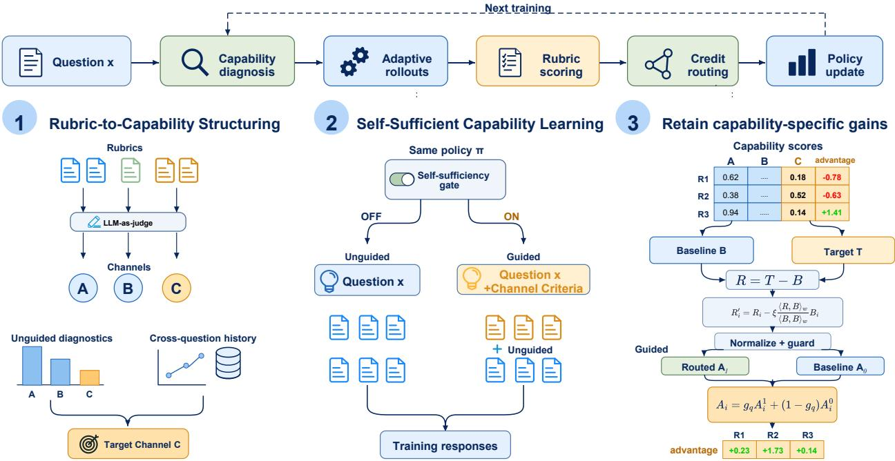
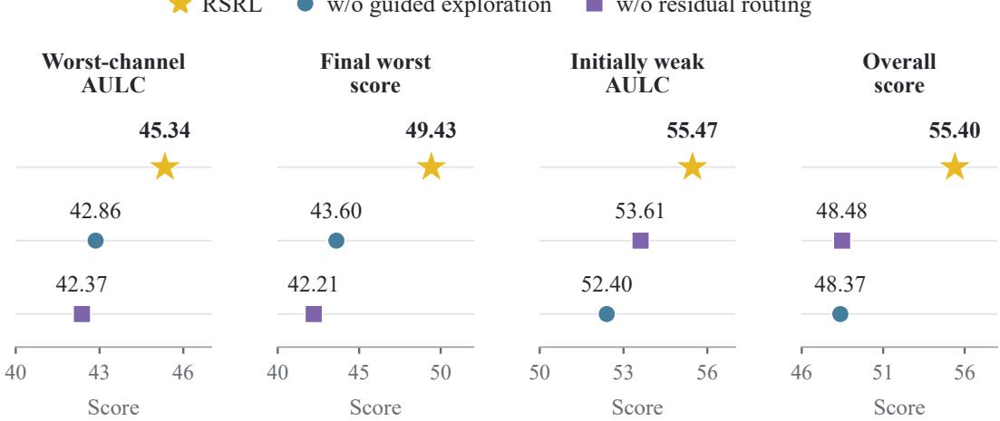
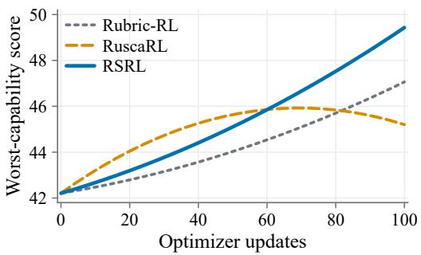

THE INTELLIGENT MEDIA COMPUTING AND CYBERSECURITY LABORATORY

# Rubrics Beyond Evaluation: Exploiting Rubric Structure in Reinforcement Learning

Yuxun Huang1,\* • Yunyao Zhang1,\* • ZeLiang Chen1 Yi-Ping Phoebe Chen2 • Junqing Yu1 • Zikai Song1,†

1Huazhong University of Science and Technology, Wuhan, China 2La Trobe University, Melbourne, Australia

Yuxun Huang and Yunyao Zhang contributed equally to this work.

Corresponding author: Zikai Song at skyesong@hust.edu.cn.

## ABSTRACT

Rubrics are widely used to evaluate open-ended question answering by breaking overall quality into explicit criteria (Arora et al., 2025; Kim et al., 2024). These explicit criteria make rubrics a rich source of learning guidance, yet their potential for guiding the training process has been largely overlooked. Existing methods use rubrics mainly as direct feedback signals, without explicitly modeling the capabilities behind their criteria (Gunjal et al., 2025; Li et al., 2026b). This leaves their capability structure largely unused in guiding the training process. We introduce Rubric-Structured Reinforcement Learning (RSRL), a RL framework that unlocks the full potential of rubrics by exploiting their structure throughout the training process, rather than treating them simply as direct reward signals. At its core, RSRL builds on three key designes: (1) Rubric-to-Capability Structuring first recovers the capability structure hidden in rubric criteria, (2) Self-Suficient Capability Learning then uses this structure to bootstrap underdeveloped capabilities into efective learning, (3) Capability-Residual Credit Routing finally preserves capability-specific gains during optimization. Experiments show that RSRL consistently improves both overall performance and underdeveloped capabilities, boosting downstream scientific question-answering performance by up to 7.43 over the initial policy and 7.60 over non-rubric structured RL baselines, showing that reinforcement learning can substantially benefit from the capability structure encoded in rubrics.

## 1 Introduction

Rubrics (Kim et al., 2024) have become increasingly popular for evaluating complex model outputs across a wide range of openended tasks (Arora et al., 2025; Yifei et al., 2025), as they provide a structured way to break overall quality into explicit criteria. These criteria can capture aspects such as correctness, completeness, evidence use, reasoning quality, and clarity. More importantly, these criteria are not merely scoring rules, they reveal the capabilities required to produce high-quality responses, making rubrics a rich source ofguidancefor model learning. However, this potential has barely been explored. Most existing work (Arora et al., 2025; Kim et al., 2024) uses rubrics only for evaluation, and the few atempts (Li et al., 2026b; Gunjal et al., 2025; Shao et al., 2026) that incorporate them into reinforcement learning, they largely treat individual criteria as direct supervision or reward signals. As a result, the capability structure encoded across rubric criteria remains largely unused during learning.

We argue that rubrics should not be treated merely as collections of reward criteria, but as structured descriptions of the capabilities required to solve a task (Zhang et al., 2026e; Zheng et al., 2026). The key is to preserve and exploit this structure throughout reinforcement learning, rather than collapsing it into a single aggregate training signal. This shifts rubric-based learning from criterion-level optimization to capability-level development: rubric criteria reveal what capabilities the policy lacks, and the capability structure can further guide how learning resources are allocated during training (Li et al., 2026a). Based on this view, we formulate Rubric-Structured Reinforcement Learning (RSRL), which turns rubrics from an evaluation tool into a structure that actively shapes the learning process (Song et al., 2026a).

Three key challenges arise when bringing rubric structure into reinforcement learning: (C1) What capability is underdeveloped? Rubric criteria are defined at the question level, while the weaknesses they reveal may reflect shared capabilities across many questions, making it dificult to recover these shared capabilities and identify which ones remain weak; (C2) How can weak capabilities be efectively explored? Once a weak capability is identified, natural rollouts may still provide too litle useful variation for the policy to discover beter behaviors, making it dificult to achieve efective early-stage improvement. (C3) How can capability gains be preserved? Even when beter capability-specific behaviors are found, their signals can be diluted once multiple rubric criteria are aggregated during optimization, causing the improvement to have litle efect on the final policy update

To address these challenges, our RSRL carries rubric structure through the full learning process rather than using it only at the reward level. (For C1) we introduce Rubric-to-Capability Structuring to recover the capability structure hidden in rubric criteria. Specifically, we construct Hierarchical Capability Channels to organize fragmented criteria into shared capabilities and track which capabilities remain underdeveloped across questions. (For C2), Self-Suficient Capability Learning is designed to bootstrap underdeveloped capabilities when the current policy lacks useful learning behaviors, while allowing them to transition toward independent learning as they improve (Song et al., 2023). To realize this idea, we develop a Self-Suficiency Gating Module that introduces capability-enhanced rollouts through capability-specific prompting when additional support is needed, and adaptively withdraws them once the capability becomes suficiently established. (For C3), we further introduce Capability-Residual Credit Routing to preserve capability-specific gains during aggregate optimization. In practice, we formulate a Capability Residual Projection Policy to separate the target capability’s residual improvement from the aggregate advantage and carry this signal into the final policy update. Experiments on ResearchQA (Yifei et al., 2025), closed-book SQAv2 (Bragg et al., 2026), and GPQA-Diamond (Rein et al., 2024) show that RSRL improves downstream scientific question-answering performance by up to 11.52% over the initial policy and 11.81% over non-rubric RL baselines. It also achieves the best final worst-capability and overall response scores on a fixed 128-question development probe, while preserving gains in strong capabilities. These results demonstrate the value of exploiting rubric-encoded capability structure throughout reinforcement learning.

Our main contributions are as follows:

• A systematic formulation of rubric-structured reinforcement learning. We are the first to deeply examine how rubric structure can be exploited beyond evaluation and direct reward supervision, revealing its role in capability modeling, learning allocation, and policy optimization. This establishes RSRL as a general framework for integrating rubric structure throughout reinforcement learning

• A structured RL framework built around capability development. We instantiate this view with RSRL through three coordinated designs: Rubric-to-Capability Structuring recovers shared capability structure from rubric criteria, Self-Suficient Capability Learning enables eficient improvement of underdeveloped capabilities, and Capability-Residual Credit Routing preserves capability-specific gains during policy optimization.

## 2 Related Work

Rubric-based supervision and exploration. Rubrics as Rewards uses instance-specific criteria as RL feedback (Gunjal et al., 2025); RubricHub scales rubric construction and rubric-based post-training (Li et al., 2026b). DR Tulu evolves criteria with the policy using newly retrieved evidence and contrasting responses (Shao et al., 2026). RuscaRL guides exploration with rubric scafolds that decay over training (Zhou et al., 2025). RISE-RL targets repeatedly missed criteria and learns from reward-filtered guided trajectories through an auxiliary objective under the original prompt (Hou et al., 2026). CRAFT builds a hierarchical capability tree from rubric criteria to guide targeted supervised fine-tuning (Gupta et al., 2026). The RL methods above organize reinforcement around question-specific criteria, without a shared capability diagnosis that jointly coordinates online exploration and responselevel credit across questions.

Adaptive allocation and reward balancing. Automated curricula allocate training exposure using learning progress (Graves et al., 2017; Zhang et al., 2026d). For multi-reward optimization, GDPO normalizes reward dimensions separately (Liu et al., 2026a), $\mathrm { G D ^ { 2 } P O }$ filters conflicting rollouts and reweights queries by reward agreement (Liu et al., 2026b), and SMOPD distills rewardspecialized teachers into one policy (Wang et al., 2026a). These methods manage training exposure and reward trade-ofs, but do not specify how persistent capability deficits should jointly determine exploration support and response-level credit.

Controlled generation and sampling correction. PREADD contrasts distributions with and without a control prefix (Pei et al., 2023), while contrastive decoding compares stronger and weaker models (Li et al., 2023). Multiple importance sampling provides density-based weights for combining samples from diferent proposals through the balance heuristic (Veach and Guibas, 1995). These tools support generation control and sampling correction, but leave unspecified when a weak capability needs guidance and when that guidance should be withdrawn during learning.

Together, these gaps motivate a learning process organized around evolving capability needs. RSRL uses rubric structure to connect shared capability diagnosis, selective exploration, and capability-specific policy updates, making the policy’s diagnosed capability state govern the provision and withdrawal of exploration support.

## 3 Problem Motivation

Rubric-based RL needs sampled responses that provide useful variation on weak capabilities. When unguided rollouts rarely satisfy a requirement, rubric feedback can identify the gap without supplying successful behaviors to learn from. Reweighting scores alone cannot introduce behaviors absent from the sampled group. Self-Suficient Capability Learning uses capability-guided proposals when diagnostics identify insuficient support and a suficiently large deficit, then withdraws guidance when its activation conditions no longer hold (Zhang et al., 2026c). Guided responses are learned under the original question context, with sampling weights accounting for the proposal shift.

RSRL connects this exploration process to diagnosis and optimization through a shared capability target. Rubric-to-Capability Structuring groups question-local criteria into cross-question channels (Song et al., 2026b) and combines current evidence with history (Song et al., 2025; Wang et al., 2026b; Zhang et al., 2026a). Capability-Residual Credit Routing carries target-specific dis tinctions into response-level advantages. Together, these stages coordinate which capability receives exploration support and how its feedback afects policy updates.

## 4 Rubric-Structured Reinforcement Learning

RSRL uses rubric structure to identify weak capabilities, guide exploration, and route capability-specific signals into policy updates under the original question (Figure 1).

## 4.1 Rubric-to-Capability Structuring

Rubric-to-Capability Structuring uses Hierarchical Capability Channels to link question-specific rubric requirements with recurring domain capabilities.

Constructing capability channels. For a question �, let $x _ { q }$ denote its original context, $\mathcal { R } _ { q }$ its rubric criteria, and $\mathcal { C } _ { q }$ its applicable local capability channels. Each source criterion is counted once and assigned to one local channel. A domain codebook � links channels across questions through

$$
m _ { q } : { \mathcal { C } } _ { q } \to { \mathcal { Z } } \cup \{ \perp \} ,\tag{1}
$$

where ⊥ denotes no reliable match. An LLM proposes the definitions, and an LLM judge assesses their correspondence. Definitions and mappings are frozen before training. Unmatched channels retain local diagnosis and training credit but do not update domain state (Appendix A)

Estimating capability performance. Before update �, we sample unguided diagnostics from $\pi _ { \theta _ { s - 1 } } ( \cdot \ | \ x _ { q } )$ separately from optimization rollouts. Criterion scores lie in [0, 1], with higher values beter. We average valid observations, including zeros, per criterion and combine them with fixed within-channel weights to obtain $S _ { q , c } \in [ 0 , 1 ]$

For a mapped channel, we pool current observations with cross-question history whenever both estimates are available:

$$
\tilde { S } _ { q , c } = \nu _ { q , c } S _ { q , c } + ( 1 - \nu _ { q , c } ) U _ { m _ { q } ( c ) , s - 1 } , \qquad \nu _ { q , c } = \frac { n _ { q , c } } { n _ { q , c } + \kappa } .\tag{2}
$$

  
Figure 1. Overview of RSRL. Rubric-to-Capability Structuring identifies targets from local and cross-question evidence. Self-Suficient Capability Learning gates guided exploration. Capability-Residual Credit Routing adjusts response credit, with a guard selecting the routed candidate or baseline. Sampling weights account for the proposal shift; updates use the original question.

Here $U _ { z , s - }$ −1 is the historical domain estimate, $n _ { q , c }$ counts distinct responses with valid channel evidence, and $\kappa > 0$ controls pooling.   
We use either estimate directly if the other is unavailable; channels lacking both are excluded from target selection.

Selecting the target capability. Channels with available estimates form ${ \mathcal { C } } _ { q } ^ { \mathrm { d i a g } } \subseteq { \mathcal { C } } _ { q } .$ A fixed performance threshold $\tau \in ( 0 , 1 ]$ defines their normalized deficit:

$$
h _ { q , c } = \operatorname* { m a x } \left( 0 , \frac { \tau - \tilde { S } _ { q , c } } { \tau } \right) .\tag{3}
$$

If $\mathcal { C } _ { q } ^ { \mathrm { d i a g } }$ is empty, targeted exploration and residual routing are disabled for that question. Otherwise, we select the channel with the largest estimated deficit:

$$
c _ { q } ^ { \star } = \arg \operatorname* { m a x } _ { c \in \mathcal { C } _ { q } ^ { \mathrm { d i a g } } } h _ { q , c } , \qquad h _ { q } ^ { \star } = h _ { q , c _ { q } ^ { \star } } .\tag{4}
$$

Stable channel identifiers break ties. If $h _ { q } ^ { * } = 0 ;$ , both exploration and routing coeficients are zero. Reliability $\chi _ { q } \in \left[ 0 , 1 \right]$ combines local evidence, domain-prior confidence, and mapping confidence for routing (Appendix F).

Maintaining the domain state. We initialize domain estimates with unguided diagnostics of the starting policy. At each update, observations sharing a domain capability are merged within questions and averaged equally across questions to obtain $\bar { U } _ { z , s } .$ . After the optimizer step,

$$
U _ { z , s } = \beta _ { D } U _ { z , s - 1 } + ( 1 - \beta _ { D } ) \bar { U } _ { z , s } ,\tag{5}
$$

where $\beta _ { D } \in [ 0 , 1 )$ controls historical retention. The selected channel and deficit guide exploration and credit allocation in Sections 4.2–4.3.

## 4.2 Self-Suficient Capability Learning

Self-Suficient Capability Learning uses a Self-Suficiency Gating Module to activate capability-guided sampling while retaining the original question for policy updates.

Deciding when guidance is needed. Guidance requires suficient diagnostic evidence, a deficit above the activation threshold, and either uniformly minimal scores (Zero) or varying scores with few positive responses (Low). Other cases use unguided sampling. Reassessment before each update withdraws guidance whenever an activation condition fails, tying exploration support to the policy’s current diagnostic state rather than a fixed training schedule. These are observed score paterns, not probabilitysupport claims (Appendix B.2).

Constructing guided proposals. At a shared response prefix $y _ { < t } .$ we evaluate three distributions from the same pre-update policy: ${ \mathbf { \nabla } } \mathcal { P } 0 , t$ conditions on $x _ { q } ; p _ { c , t }$ adds the target capability description and training criteria; and $\displaystyle { \mathit { P n } } , t$ adds nondirectional guidance. This target–control comparison provides a reference for distinguishing capability cues from the efects of extra prompting, adapting prefix-based control (Pei et al., 2023).

Using the full softmax distributions, we form the target–control contrast

$$
u _ { t } ( \nu ) = \log p _ { c , t } ( \nu ) - \log p _ { n , t } ( \nu ) ,\tag{6}
$$

where � denotes a candidate token. We standardize this contrast under the unguided distribution and clip its magnitude:

$$
\delta _ { t } ( \nu ) = \mathrm { c l i p } \left( \frac { u _ { t } ( \nu ) - \mathbb { E } _ { \nu ^ { \prime } \sim p _ { 0 , t } } [ u _ { t } ( \nu ^ { \prime } ) ] } { \sqrt { \mathrm { V a r } _ { \nu ^ { \prime } \sim p _ { 0 , t } } [ u _ { t } ( \nu ^ { \prime } ) ] + \varepsilon } } , - b , b \right) .\tag{7}
$$

Here, $b > 0$ bounds the standardized contrast, and � $\cdot > 0$ stabilizes the variance normalization. We apply the resulting perturbation to the unguided distribution:

$$
q _ { \eta , t } ( \nu ) = \frac { \mathcal { P } _ { 0 , t } ( \nu ) \exp \bigl ( \eta _ { q } \delta _ { t } ( \nu ) \bigr ) } { \sum _ { \nu ^ { \prime } } \mathcal { P } _ { 0 , t } ( \nu ^ { \prime } ) \exp \bigl ( \eta _ { q } \delta _ { t } ( \nu ^ { \prime } ) \bigr ) } .\tag{8}
$$

The strength $\eta _ { q } \geq 0$ increases with $h _ { q } ^ { * }$ up to a cap, with a smaller multiplier for Low. At $\eta _ { q } = 0 \mathrm  $ , the proposal is ${ \mathbf { \nabla } } \mathcal { P } 0 , t$ . Appendix B.2 specifies the schedule and prompt content.

Learning under the original question. An active gate allocates optimization responses equally between guided and unguided sampling; otherwise, all are unguided.

Guided sampling can change the response distribution. We account for this shift using sequence-level importance weights based on the balance heuristic of Veach and Guibas (1995). Let $P _ { 0 } ( y \mid x _ { q } )$ denote the pre-update unguided sequence distribution. The guided sequence distribution is

$$
Q _ { \eta } ( y \mid x _ { q } ) = \prod _ { t = 1 } ^ { | y | } q _ { \eta , t } ( y _ { t } ) ,\tag{9}
$$

where each token probability is evaluated at the corresponding response prefix. The mixture density associated with the equal allocation is

$$
\begin{array} { r } { M ( y \mid x _ { q } ) = \frac { 1 } { 2 } P _ { 0 } ( y \mid x _ { q } ) + \frac { 1 } { 2 } Q _ { \eta } ( y \mid x _ { q } ) . } \end{array}\tag{10}
$$

We evaluate both sequence densities for every optimization response, regardless of which proposal generated it. The raw importance ratios and self-normalized weights are

$$
\omega _ { i } = \frac { P _ { 0 } ( y _ { i } \mid x _ { q } ) } { M ( y _ { i } \mid x _ { q } ) } , \qquad w _ { i } = \frac { \omega _ { i } } { \sum _ { j = 1 } ^ { G } \omega _ { j } } ,\tag{11}
$$

Here � is the group size, and densities include each proposal’s sampling and stopping rules. Since $M \ge P _ { 0 } / 2 , 0 \le \omega _ { i } \le 2$ . Raw ratios weight the loss; $w _ { i }$ weights routing statistics. Unguided-only groups use $\omega _ { i } = 1 , w _ { i } = 1 / G .$ . Appendix B.4 specifies density evaluation and overlap checks; Appendix C gives the scope of correction.

## 4.3 Capability-Residual Credit Routing

Capability-Residual Credit Routing uses a Capability Residual Projection Policy to retain target-specific distinctions relative to a channel-balanced baseline. It partially atenuates their shared component, scales the residual by diagnosed need, and applies a group-level guard.

Constructing target-specific credit. We standardize valid criterion scores across the � responses with unweighted moments to obtain $a _ { i r } ;$ invalid judgments and inactive criteria contribute zero. Fixed within-channel weights $p _ { \boldsymbol { q } } ( \boldsymbol { r } \mid \boldsymbol { c } )$ sum to one without redistribution when criteria become inactive. Channel advantages and the baseline are

$$
C _ { i c } = \sum _ { r \mapsto c } \mathscr { p } _ { q } ( r \vert c ) a _ { i r } , \qquad B _ { i } = \frac { 1 } { \vert { \mathscr { C } _ { q } } \vert } \sum _ { c \in { \mathscr { C } _ { q } } } C _ { i c } .\tag{12}
$$

Appendix B.3 specifies criterion eligibility and standardization. For a diagnosed target, we compare its advantage with this baseline and form their residual diference:

$$
T _ { i } = C _ { i , c _ { q } ^ { * } } , \qquad R _ { i } = T _ { i } - B _ { i } .\tag{13}
$$

Projecting and scaling the residual. To control overlap with baseline credit, we use the self-normalized weights from Section 4.2 and define $\begin{array} { r } { \langle a , b \rangle _ { w } = \sum _ { i } } \end{array}$ ������ and $\| a \| _ { w } = \sqrt { \langle a , a \rangle _ { w } }$ . We partially atenuate the baseline-aligned component and scale the resulting residual:

$$
R _ { i } ^ { \prime } = R _ { i } - \xi \frac { \langle R , B \rangle _ { w } } { \langle B , B \rangle _ { w } } B _ { i } ,\tag{14}
$$

$$
H _ { i } = B _ { i } + \lambda _ { q } r _ { \mathrm { r e f } } \frac { R _ { i } ^ { \prime } } { \Vert R ^ { \prime } \Vert _ { w } } .\tag{15}
$$

Here, $0 ~ < ~ \xi ~ < ~ 1$ controls the degree of partial projection. We set $R ^ { \prime } ~ = ~ R$ when baseline energy is negligible. The coeficient $\lambda _ { q } = \chi _ { q } f ( h _ { q } ^ { \ast } )$ links correction strength to the diagnosed deficit and reliability. The schedule � is fixed, bounded, and nondecreasing, with $f ( 0 ) = 0$ . The positive reference scale $r _ { \mathrm { r e f } }$ is computed from the weighted norms of the baseline and channel advantages. Appendix B.3 gives both definitions.

When applied, the correction has weighted norm $\lambda _ { q } r _ { \mathrm { r e f } } .$ We set $H = B$ when routing is disabled, the question has only one channel, or the weighted residual norm is below a numerical tolerance.

Selecting the final credit assignment. The guard checks the final normalized advantages used for policy optimization. Let $\mathcal { N } _ { w }$ denote weighted advantage normalization with centering and magnitude control, as specified in Appendix B.3. We compute

$$
A ^ { 0 } = \mathcal { N } _ { w } ( B ) , \qquad A ^ { 1 } = \mathcal { N } _ { w } ( H ) , \qquad \Delta A = A ^ { 1 } - A ^ { 0 } .\tag{16}
$$

We distinguish target opportunities from response preferences shared with the baseline:

$$
\begin{array} { r } { \mathcal { U } = \{ ( i , j ) : T _ { i } > T _ { j } , B _ { i } \leq B _ { j } \} , } \\ { \mathcal { P } = \{ ( i , j ) : B _ { i } \geq B _ { j } , T _ { i } \geq T _ { j } \} . } \end{array}\tag{17}
$$

We accept the candidate only when all four conditions hold:

$$
\begin{array} { r l } & { \mathcal { U } \neq \emptyset , \qquad \langle T , \Delta A \rangle _ { w } > 0 , } \\ & { A _ { i } ^ { 1 } \geq A _ { j } ^ { 1 } \quad \mathrm { f o r ~ e v e r y ~ } ( i , j ) \in \mathcal { P } , } \\ & { \| \Delta A \| _ { w } \leq \displaystyle \frac { \| R ^ { \prime } \| _ { w } } { r _ { \mathrm { r e f } } } . } \end{array}\tag{18}
$$

The guard requires a target opportunity and a target-aligned change, preserves shared orderings, and bounds the adjustment. With acceptance ${ \{ g _ { q } \in \{ 0 , 1 \} } $ , select

$$
A _ { i } = g _ { q } A _ { i } ^ { 1 } + ( 1 - g _ { q } ) A _ { i } ^ { 0 } .\tag{19}
$$

No normalization follows selection; questions without a target use $A ^ { 0 }$ . Appendix C.2 proves these within-group credit properties.

Updating the policy. Each selected advantage weights the tokens of its response. We accumulate gradients over one batch pass and take one optimizer step. With proposal weights, judgments, and advantages held fixed, the implemented loss has the same local gradient as the following surrogate at $\theta = \theta _ { s - 1 } :$

$$
\mathcal { L } _ { \mathrm { s p } } ( \theta ) = \frac { 1 } { | \mathcal { B } | G } \sum _ { q \in \mathcal { B } } \sum _ { i = 1 } ^ { G } \omega _ { q i } \left[ - \frac { A _ { q i } } { L _ { q i } } \sum _ { t = 1 } ^ { L _ { q i } } \log \pi _ { \theta } \big ( y _ { q i t } \mid x _ { q } , y _ { q i , < t } \big ) + \beta _ { \mathrm { K L } } \bar { k } _ { q i } ( \theta ) \right] .\tag{20}
$$

Here ℬ is the question batch, $L _ { q i }$ the response length, and $\omega _ { q i }$ the raw proposal ratio. The token-averaged penalty $\bar { k } _ { q i }$ compares the current and frozen starting policies with strength $\beta _ { \mathrm { K I } }$ . Appendix B.4 gives the implemented loss.

## 5 Experiments

We evaluate scientific question answering and capability development. Table 1 summarizes benchmark performance; we then examine component contributions, capability changes, and guidance strength.

## 5.1 Experimental Setup

Benchmarks and evaluation. We use 487 ResearchQA questions (Yifei et al., 2025), the 100-question SQAv2 test split (Bragg et al., 2026), GPQA-Diamond’s 198 questions (Rein et al., 2024), and 500 science questions from RubricHub excluded from training (Li et al., 2026b). SQAv2 is closed-book and averages ingredient recall and answer precision, excluding citation metrics. Openended responses are graded by Gemma-4-31B-it, an open-weight judge evaluated in JudgeArena (Lushtaku et al., 2026). A fixed

Table 1. Scientific question-answering scores. Upper blocks provide external references; Qwen3-4B methods use our evaluation. Higher is beter. Initial is the starting checkpoint. Parentheses are diferences from Initial: score points, or percentage points for GPQA-Diamond. Within Qwen3-4B, bold/underlined scores mark best/second-best, including ties. Green/red parentheses mark gains/drops. Darker purple behind Ours indicates larger gains from Initial.
<table><tr><td>Method</td><td>ResearchQA</td><td>SQAv2</td><td>GPQA-Diamond</td><td>RubricHub</td></tr><tr><td>Closed-source Frontier</td><td></td><td></td><td></td><td></td></tr><tr><td>GPT-5</td><td>77.60</td><td></td><td>85.70</td><td></td></tr><tr><td>Claude Opus 4.1</td><td>74.30</td><td>86.10</td><td>77.30</td><td></td></tr><tr><td>GPT-4.1</td><td>70.80</td><td></td><td>50.50</td><td>一</td></tr><tr><td>DeepSeek V3.1</td><td>75.90</td><td></td><td>68.30</td><td></td></tr><tr><td>Open-weight</td><td></td><td></td><td></td><td></td></tr><tr><td>Search-R1-7B</td><td>27.90</td><td>44.35</td><td></td><td>35.22</td></tr><tr><td>WebThinker-32B-DPO</td><td>48.60</td><td>65.80</td><td></td><td>46.34</td></tr><tr><td>WebExplorer-8B</td><td>64.80</td><td>85.00</td><td>43.81</td><td>47.38</td></tr><tr><td>Qwen3-8B</td><td>64.90</td><td>80.75</td><td>60.60</td><td>51.74</td></tr><tr><td>Qwen3-4B</td><td></td><td></td><td></td><td></td></tr><tr><td>Initial</td><td>64.49</td><td>81.44</td><td>42.80</td><td>50.82</td></tr><tr><td>SFT</td><td>69.37(+4.88)</td><td>83.24(+1.80)</td><td>44.07(+1.27)</td><td>50.56(-0.26)</td></tr><tr><td>RL(GRPO)</td><td>64.32(-0.17)</td><td>83.12(+1.68)</td><td>43.80(+1.00)</td><td>52.36(+1.54)</td></tr><tr><td>Rubric-RL</td><td>69.37(+4.88)</td><td>84.02(+2.58)</td><td>45.20(+2.40)</td><td>54.93(+4.11)</td></tr><tr><td>RuscaRL</td><td>69.27(+4.78)</td><td>81.24(-0.20)</td><td>41.92(-0.88)</td><td>53.08(+2.26)</td></tr><tr><td>Ours</td><td>71.92(+7.43)</td><td>85.84(+4.40)</td><td>47.60(+4.80)</td><td>55.01(+4.19)</td></tr></table>

128-question RubricHub subset supports capability tracking and development monitoring. Appendix D.1 specifies scoring and generation protocols.

Baselines and training. Table 1 compares the starting Qwen3-4B checkpoint, SFT, RL, Rubric-RL, RuscaRL (Zhou et al., 2025), and RSRL. SFT uses 606 question–response pairs matched to the training questions; Rubric-RL averages standardized advantages over active criteria. RL comparisons share the starting checkpoint, question schedule, and optimization rollout budget. We train Qwen3-4B (Yang et al., 2025) with LoRA (Hu et al., 2022) on 2,460 RubricHub science questions for 100 updates, with 32 questions per update. Training criteria are scored by a local gpt-oss-120b judge, separately from evaluation. DeepSeek-V4-Pro constructs channels and mappings, which are frozen before training. Appendices A and D detail construction, configurations, and baseline implementations.

## 5.2 Overall Performance

Comparison with proprietary models. Against the external reference scores in Table 1, RSRL’s 71.92 on ResearchQA exceeds GPT-4.1’s 70.80. Its 85.84 on SQAv2 approaches Claude Opus 4.1’s 86.10, highlighting the progress achieved from the 4B starting policy.

Comparison with open-weight models. RSRL’s ResearchQA score exceeds the listed Qwen3-8B (64.90) and WebExplorer-8B (64.80) results. Its SQAv2 score also exceeds WebExplorer-8B’s 85.00 and Qwen3-8B’s 80.75, placing RSRL competitively among these larger reference systems on both open-ended benchmarks.

Comparison with post-training baselines. RSRL leads our Qwen3-4B comparison across all four benchmarks, ahead of SFT, RL, Rubric-RL, and RuscaRL. Gains over Rubric-RL are 2.55 points on ResearchQA, 1.82 on SQAv2, 2.40 percentage points on GPQA-Diamond, and 0.08 points on RubricHub

## 5.3 Ablation Studies

Component contributions. We retain capability channels and remove guided exploration or residual routing in turn (Table 2; Figure 2). The exploration ablation uses only unguided optimization responses; the routing ablation retains guided sampling and proposal correction but uses the normalized channel-balanced baseline. Appendix D.4 specifies the comparison.

  
Figure 2. Efects of component removal. Points show the four performance metrics in Table 2. Within each metric, methods are ordered from highest to lowest score. Colors and symbols identify methods; horizontal axes use metric-specific ranges.

Table 2. Component ablations on the 128-question development probe. Metrics follow Appendix D.1; scores/AULCs use 0–100 and changes use score points. Bold marks column maxima. Parentheses show diferences from full RSRL; red indicates decreases.
<table><tr><td>Method</td><td>W.C.</td><td>F.W.</td><td>O.W.</td><td>W.S.</td><td>Overall</td></tr><tr><td>RSRL</td><td>45.34</td><td>49.43</td><td>55.47</td><td>+1.38</td><td>55.40</td></tr><tr><td>w/o guided exploration</td><td>42.86(-2.48)</td><td>43.60(-5.83)</td><td>52.40(-3.07)</td><td>-0.32</td><td>48.37(-7.03)</td></tr><tr><td>w/o residual routing</td><td>42.37(-2.97)</td><td>42.21(-7.22)</td><td>53.61(-1.86)</td><td>-0.64</td><td>48.48(-6.92)</td></tr></table>

Targeted exploration. Removing guided exploration lowers Final Worst by 5.83 points and Overall by 7.03. Worst-Strong (Δ) is −0.32, compared with +1.38 for full RSRL, linking targeted exploration to stronger performance across weak and initially strong capabilities on this probe

Residual credit routing. Removing routing lowers Final Worst by 7.22 points and Overall by 6.92, with Worst-Strong (Δ) at −0.64. This highlights the contribution of capability-specific credit allocation.

## 5.4 Detailed Analysis

Table 3. Capability tracking on 128 development questions. W.C./O.W.: current-worst/initially weak channel AULC; F.W.: final worst score; W.S.: minimum strong-channel change; Overall: mean question score. Scores/AULCs use 0–100; changes use points. Bold marks maxima.
<table><tr><td>Method</td><td>W.C.</td><td>F.W.</td><td>O.W.</td><td>W.S.</td><td>Overall</td></tr><tr><td>Rubric-RL</td><td>44.23</td><td>47.06</td><td>55.02</td><td>-0.45</td><td>54.31</td></tr><tr><td>RuscaRL</td><td>44.99</td><td>45.20</td><td>56.08</td><td>-2.31</td><td>54.00</td></tr><tr><td>RSRL</td><td>45.34</td><td>49.43</td><td>55.47</td><td>+1.38</td><td>55.40</td></tr></table>

  
Figure 3. Worst-channel scores over 100 updates: 27 checkpoints on 128 development questions.

Capability development. We track six channels at 27 checkpoints on the 128-question development probe (Figure 3). RSRL’s Final Worst exceeds Rubric-RL and RuscaRL by 2.37 and 4.23 points, with Worst-Ch. AULC gains of 1.11 and 0.35 (Table 3). Its Worst-Strong (Δ) of +1.38 means every initially strong channel improves; Overall gains are 1.09 and 1.40. Appendix D.1 defines the metrics.

Guidance strength and proposal overlap. Ofline diagnostic compares 1×, 3×, and 4× guidance on 900 common-valid triggered questions.Mean target gains are 0.001747, −0.004924, and 0.012816 on the raw 0–1 scale, while median ESS/8 is 0.990510, 0.920261, and 0.865988. The paired 4 × −1× gain is 0.011069 (95% bootstrap interval [−0.00402, 0.02641]). These diagnostics characterize how guidance changes both target scores and proposal overlap, motivating their joint monitoring. Appendix E reports the full statistics and the separate 50-update comparison.

## 6 Conclusion

We introduced RSRL, which uses rubric structure to connect capability diagnosis, selective exploration, and response-level credit assignment. A shared capability target determines where exploration support is needed and how the resulting signals enter policy updates under the original question. Our scientific question-answering experiments show higher benchmark scores and improved weak-capability performance, alongside gains in initially strong capabilities on the development probe.

## Ethics statement

This work uses existing question and rubric datasets and does not introduce a human-subject study. Model-generated scientific answers can be incorrect, omit relevant evidence, or express unjustified confidence. Improvements on rubric-based evaluations should not be taken as validation for scientific or other high-stakes decisions. Automated channel construction and grading may reproduce biases in the underlying models and rubric design (Zhang et al., 2026b). Dataset access and any redistribution must respect the source licenses.

## Reproducibility statement

The manuscript and appendices describe the method, training setings, evaluation protocols, and aggregate results. The source package includes numerical tables and ploting code; the appendices provide proofs of the stated proposal and routing properties. Training code, frozen checkpoints, and per-response judgments are not included. Appendix F details domain aggregation and routing reliability.

## AI use statement

ChatGPT and Codex were used for literature search, discussion of conceptual framing and mathematical interpretation. The experimental pipeline also uses an LLM for ofline channel construction and LLM judges for training and evaluation, as described in the paper. The human authors remain responsible for the final claims, citations, experimental provenance, and submited content

## References

Rahul K. Arora, Jason Wei, Rebecca Soskin Hicks, Preston Bowman, Joaquin Quiñonero-Candela, Foivos Tsimpourlas, Michael Sharman, Meghan Shah, Andrea Vallone, Alex Beutel, Johannes Heidecke, and Karan Singhal. 2025. HealthBench: Evaluating Large Language Models Towards Improved Human Health. arXiv preprin arXiv:2505.08775 (2025). https://arxiv.org/abs/2505.08775

Jonathan Bragg, Mike D’Arcy, Nishant Balepur, Dan Bareket, Bhavana Dalvi, Sergey Feldman, Dany Haddad, Jena D. Hwang, Peter Jansen, Varsha Kishore, et al. 2026. AstaBench: Rigorous Benchmarking of AI Agents with a Scientific Research Suite. In International Conference on Learning Representations. https://arxiv.org/abs 2510.21652

Alex Graves, Marc G. Bellemare, Jacob Menick, Rémi Munos, and Koray Kavukcuoglu. 2017. Automated Curriculum Learning for Neural Networks. In Proceedings of the 34th International Conference on Machine Learning, Vol. 70. PMLR, 1311–1320. https://proceedings.mlr.press/v70/graves17a.html

Anisha Gunjal, Anthony Wang, Elaine Lau, Vaskar Nath, Yunzhong He, Bing Liu, and Sean Hendryx. 2025. Rubrics as Rewards: Reinforcement Learning Beyond Verifiable Domains. arXiv preprint arXiv:2507.17746 (2025). https://arxiv.org/abs/2507.17746

Vipul Gupta, Zihao Wang, Razvan-Gabriel Dumitru, MohammadHossein Rezaei, Aakash Sabharwal, and Yunzhong He. 2026. CRAFT: Clustering Rubrics to Diagnose Weak LLM Capabilities and Generate Targeted Fine-Tuning Data. arXiv preprint arXiv:2607.16122 (2026). https://arxiv.org/abs/2607.16122

Jinkun Hou, Zhuo Liu, Huimin Ren, Hongsheng Xin, Pan Zhou, and Kun Zhan. 2026. RISE-RL: Rubric-Informed Selective Exploration for Open-Ended Reinforcement Learning. arXiv preprint arXiv:2608.09123 (2026). https://arxiv.org/abs/2608.09123

Edward J. Hu, Yelong Shen, Phillip Wallis, Zeyuan Allen-Zhu, Yuanzhi Li, Shean Wang, Lu Wang, and Weizhu Chen. 2022. LoRA: Low-Rank Adaptation of Large Language Models. In International Conference on Learning Representations. https://arxiv.org/abs/2106.09685

Seungone Kim, Jamin Shin, Yejin Cho, Joel Jang, Shayne Longpre, Hwaran Lee, Sangdoo Yun, Seongjin Shin, Sungdong Kim, James Thorne, and Minjoon Seo. 2024. Prometheus: Inducing Fine-Grained Evaluation Capability in Language Models. In The Twelfth International Conference on Learning Representations. https://openreview.net/forum?id=8euJaTveKw

Sunzhu Li, Jiale Zhao, Miteto Wei, Huimin Ren, Yang Zhou, Jingwen Yang, Shunyu Liu, Kaike Zhang, and Wei Chen. 2026b. RubricHub: A Comprehensive and Highly Discriminative Rubric Dataset via Automated Coarse-to-Fine Generation. arXiv preprint arXiv:2601.08430 (2026). https://arxiv.org/abs/2601.08430

Wenbing Li, Zikai Song, Hang Zhou, Junqing Yu, Yunyao Zhang, and Wei Yang. 2026a. Lora-mixer: Coordinate modular lora experts through serial atention routing. In International Conference on Learning Representations, Vol. 2026. 14694–14716.

Xiang Lisa Li, Ari Holtzman, Daniel Fried, Percy Liang, Jason Eisner, Tatsunori Hashimoto, Luke Zetlemoyer, and Mike Lewis. 2023. Contrastive Decoding: Open-ended Text Generation as Optimization. In Proceedings ofthe 61st Annual Meeting ofthe Association for Computational Linguistics (Volume 1: Long Papers). Association for Computational Linguistics, 12286–12312. doi:10.18653/v1/2023.acl-long.687

Haotian Liu, Yihao Liu, Jingwei Ni, Siyuan Huang, Xinpeng Liu, Pengyu Cheng, Jiajun Song, Ruijin Ding, Junfeng Li, Zhechao Yu, Mengyu Zhou, Hongteng Xu, Xiaoxi Jiang, and Guanjun Jiang. 2026b. GD2PO: Mitigating Multi-Reward Conflicts via Group-Dynamic reward-Decoupled Policy Optimization. arXiv preprin arXiv:2606.16771 (2026). https://arxiv.org/abs/2606.16771

Shih-Yang Liu, Xin Dong, Ximing Lu, Shizhe Diao, Peter Belcak, Mingjie Liu, Min-Hung Chen, Hongxu Yin, Yu-Chiang Frank Wang, Kwang-Ting Cheng, Yejin Choi, Jan Kautz, and Pavlo Molchanov. 2026a. GDPO: Group reward-Decoupled Normalization Policy Optimization for Multi-reward RL Optimization. arXiv preprint arXiv:2601.05242 (2026). https://arxiv.org/abs/2601.05242

Erlis Lushtaku, Bora Kargi, Ali Elganzory, Fabio Ferreira, Alejandro R. Salamanca, Julia Kreutzer, and David Salinas. 2026. JudgeArena: A Unified Framework for Reproducible LLM-Judge Evaluation. arXiv preprint arXiv:2608.02620 (2026). https://arxiv.org/abs/2608.02620

Jonathan Pei, Kevin Yang, and Dan Klein. 2023. PREADD: Prefix-Adaptive Decoding for Controlled Text Generation. In Findings ofthe Association for Computational Linguistics: ACL 2023. Association for Computational Linguistics, 10018–10037. doi:10.18653/v1/2023.findings-acl.636

David Rein, Bety Li Hou, Asa Cooper Stickland, Jackson Pety, Richard Yuanzhe Pang, Julien Dirani, Julian Michael, and Samuel R. Bowman. 2024. GPQA: A Graduate-Level Google-Proof Q&A Benchmark. In First Conference on Language Modeling. https://arxiv.org/abs/2311.12022

Rulin Shao, Akari Asai, Shannon Zejiang Shen, Hamish Ivison, Varsha Kishore, Jingming Zhuo, Xinran Zhao, Molly Park, Samuel G. Finlayson, David Sontag, Tyler Murray, Sewon Min, Pradeep Dasigi, Luca Soldaini, Faeze Brahman, Wen-tau Yih, Tongshuang Wu, Luke Zetlemoyer, Yoon Kim, Hannaneh Hajishirzi, and Pang Wei Koh. 2026. DR Tulu: Reinforcement Learning with Evolving Rubrics for Deep Research. In International Conference on Machine Learning. https://arxiv.org/abs/2511. 19399

Zikai Song, Xiajie Li, Yunyao Zhang, Xinglang Zhang, Wei Yang, and Junqing Yu. 2026a. Social Intelligence Modeling: A Comprehensive Survey from Social Perception to Social Simulation. ResearchGate preprint. Preprint available on ResearchGate. doi:10.13140/RG.2.2.21157.87528

Zikai Song, Run Luo, Lintao Ma, Ying Tang, Yi-Ping Phoebe Chen, Junqing Yu, and Wei Yang. 2025. Temporal Coherent Object Flow for Multi-Object Tracking. In Proceedings ofthe AAAI Conference on Artificial Intelligence, Vol. 39. 6978–6986. doi:10.1609/aaai.v39i7.32749

Zikai Song, Run Luo, Junqing Yu, Yi-Ping Phoebe Chen, and Wei Yang. 2023. Compact Transformer Tracker with Correlative Masked Modeling. In Proceedings of the AAAI Conference on Artificial Intelligence, Vol. 37. 2321–2329. doi:10.1609/aaai.v37i2.25327

Zikai Song, Junqing Yu, Yi-Ping Phoebe Chen, Wei Yang, and Xinchao Wang. 2026b. Hypergraph-State Collaborative Reasoning for Multi-Object Tracking. arXiv preprint arXiv:2604.12665 (2026). https://arxiv.org/abs/2604.12665

Eric Veach and Leonidas J. Guibas. 1995. Optimally Combining Sampling Techniques for Monte Carlo Rendering. In Proceedings of SIGGRAPH. 419–428. https: //graphics.stanford.edu/papers/combine/

Dali Wang, Yunyao Zhang, Junqing Yu, Yi-Ping Phoebe Chen, Chen Xu, and Zikai Song. 2026b. Seeing Further and Wider: Joint Spatio-Temporal Enlargement for Micro-Video Popularity Prediction. arXiv:2604.20311 [cs.MM] https://arxiv.org/abs/2604.20311

Wen Wang, Jiahua Bao, Tu Yongsiqi, Yihao Liu, Haotian Zhou, Haoxuan Ma, Mengyu Zhou, Wenkui Fan, Junwei He, Xiaoxi Jiang, and Guanjun Jiang. 2026a. SMOPD: Multi-Reward Reinforcement Learning via Specialize-and-Merge Online Policy Distillation. arXiv preprint arXiv:2608.03092 (2026). https://arxiv.org/abs/2608. 03092v2

An Yang, Anfeng Li, Baosong Yang, Beichen Zhang, Binyuan Hui, Bo Zheng, Bowen Yu, et al. 2025. Qwen3 Technical Report. arXiv preprint arXiv:2505.09388 (2025). https://arxiv.org/abs/2505.09388

Li S. Yifei, Allen Chang, Chaitanya Malaviya, and Mark Yatskar. 2025. ResearchQA: Evaluating Scholarly Question Answering at Scale Across 75 Fields with Survey-Mined Questions and Rubrics. arXiv preprint arXiv:2509.00496 (2025). https://arxiv.org/abs/2509.00496

Xinglang Zhang, Yuanmeng Xiang, Yunyao Zhang, Zeliang Chen, Junqing Yu, and Zikai Song. 2026b. Too Good to Be Real? Diagnosing and Reducing the Gap Between AI Preference and Real User Engagement. arXiv preprint arXiv:2609.18282 (2026).

Xinglang Zhang, Yunyao Zhang, ZeLiang Chen, Junqing Yu, Wei Yang, and Zikai Song. 2026d. Logical Phase Transitions: Understanding Collapse in LLM Logical Reasoning. In Proceedings ofthe 64th Annual Meeting ofthe AssociationforComputational Linguistics (Volume 1: Long Papers), Maria Liakata, Viviane P. Moreira, Jiajun Zhang, and David Jurgens (Eds.). Association for Computational Linguistics, San Diego, California, United States, 18836–18860. doi:10.18653/v1/2026.acl-long.858

Yunyao Zhang, Yihao Ai, Zuocheng Ying, Qirui Mi, Junqing Yu, Wei Yang, and Zikai Song. 2026a. Coupling Macro Dynamics and Micro States for Long-Horizon Social Simulation. arXiv preprint arXiv:2604.05516 (2026).

Yunyao Zhang, Zuocheng Ying, Xinglang Zhang, Junqing Yu, Peng Fang, Xu Chen, Wei Yang, and Zikai Song. 2026c. IntervenSim: Intervention-Aware Social Network Simulation for Opinion Dynamics. arXiv:2604.06600 [cs.SI] https://arxiv.org/abs/2604.06600

Yunyao Zhang, Xinglang Zhang, Junxi Sheng, Wenbing Li, Junqing Yu, Yi-Ping Phoebe Chen, Wei Yang, and Zikai Song. 2026e. Semantic-Aware Logical Reasoning via a Semiotic Framework. In Proceedings ofthe 64th Annual Meeting ofthe Association for Computational Linguistics (Volume 1: Long Papers), Maria Liakata, Viviane P. Moreira, Jiajun Zhang, and David Jurgens (Eds.). Association for Computational Linguistics, San Diego, California, United States, 18349–18374. doi:10.18653/v1 2026.acl-long.835

Zhenyan Zheng, Yunyao Zhang, Junxi Sheng, Junqing Yu, and Zikai Song. 2026. Surfacing the Unsaid: CUE-Bench for Afective Stance in Chinese Discourse. arXiv preprint arXiv:2608.10810 (2026).

Yang Zhou, Sunzhu Li, Shunyu Liu, Wenkai Fang, Kongcheng Zhang, Jiale Zhao, Jingwen Yang, Yihe Zhou, Jianwei Lv, Tongya Zheng, Hengtong Lu, Wei Chen, Yan Xie, and Mingli Song. 2025. Breaking the Exploration Botleneck: Rubric-Scafolded Reinforcement Learning for General LLM Reasoning. arXiv preprint arXiv:2508.16949 (2025). https://arxiv.org/abs/2508.16949v7

## A Capability construction and diagnostic scores

## A.1 Frozen domain and local channels

We construct the domain codebook from 64 questions sampled from training, calibration, and development records, excluding evaluation and reserve splits. Selection uses a fixed hash ordering. The construction model receives the questions and their source rubrics. It proposes three to eight recurring capabilities, after which coverage checks and consolidation yield six science channels: quantitative and formal derivation; precise technical communication and structured setup; mechanistic and causal explanation; experimental, computational, and intervention design; comparison and synthesis across alternatives; and assessment of evidence, assumptions, and scope.

Each question’s source criteria are grouped into two to five local channels, with at least two criteria per channel. Canonical source identifiers prevent aliases from receiving duplicate assignments. Programmatic checks enforce coverage and unique assignment; model-based review checks grouping coherence. The frozen training set contains 2,460 questions after construction checks. These local channels retain question-specific requirements while the domain codebook supplies shared categories.

## A.2 Mapping local channels to the domain codebook

Construction and mapping use the API identifier deepseek-v4-pro, with temperature zero, and JSON output. The mapping judge receives the question, local channel definition, and domain codebook. It returns a domain identifier, applicability decision, confidence score, and rationale.

For each local channel, two separate requests to the same model produce mappings $m _ { q } ^ { A } ( c ) , m _ { q } ^ { B } ( c )$ and confidence scores $p _ { q , c } ^ { A } , p _ { q , c } ^ { B }$ We accept a mapping when both requests judge it applicable and

$$
m _ { q } ^ { A } ( c ) = m _ { q } ^ { B } ( c ) \neq \bot , \qquad \mathrm { m i n } ( p _ { q , c } ^ { A } , p _ { q , c } ^ { B } ) \geq 0 . 8 .
$$

The accepted confidence is $m _ { q , c } ^ { \mathrm { c o n f } } = \operatorname* { m i n } ( p _ { q , c } ^ { A } , p _ { q , c } ^ { B } )$ . Otherwise, the channel remains local-only, with $m _ { q } ( c ) = \bot$ and $m _ { q , c } ^ { \mathrm { c o n f } } = 0$ These are two calls to one model, and their self-reported scores are not calibrated probabilities. Definitions, assignments, and mapping confidences are frozen before policy training. Appendix F describes their use in diagnosis.

## A.3 Rubric banks and valid observations

Within each channel, diagnostic and training banks use the same set of at most five canonical criteria, selected by descending absolute source points with fixed hash tie-breaking. The evaluation bank retains the source criteria required by its evaluation protocol. Evaluation criteria are not supplied as generation guidance

Let $s _ { j r } \in \left[ 0 , 1 \right]$ be the polarity-aligned diagnostic score for response � and criterion �, and let $\nu _ { j r }$ indicate validity. Scores are normalized by the criterion’s predefined range. A valid zero remains an observation. For $\begin{array} { r } { N _ { r } ^ { D } = \sum _ { j } \nu _ { j r } > 0 . } \end{array}$ , define

$$
\mu _ { r } ^ { D } = \frac { \sum _ { j } \nu _ { j r } s _ { j r } } { N _ { r } ^ { D } } , \qquad \mathcal { F } _ { q , c } = \{ r \in \mathcal { R } _ { q , c } ^ { D } : N _ { r } ^ { D } > 0 \} .
$$

Using frozen criterion reliability $u _ { r }$ , the local score and reliability are

$$
S _ { q , c } = \frac { \sum _ { r \in \mathcal { F } _ { q , c } } u _ { r } \mu _ { r } ^ { D } } { \sum _ { r \in \mathcal { F } _ { q , c } } u _ { r } } , \qquad r _ { q , c } = \frac { 1 } { | \mathcal { F } _ { q , c } | } \sum _ { r \in \mathcal { F } _ { q , c } } u _ { r } .
$$

Thus, a wholly missing criterion is omited from both numerator and denominator. The science banks use $u _ { r } = 1$ , giving equal weight to available criterion means. If $\mathcal { F } _ { q , c }$ is empty, the local score is unavailable and $r _ { q , c } = 0 ;$ ; diagnosis then follows the missingevidence rules in Section 4.1.

The count used for historical pooling is

$$
n _ { q , c } = \sum _ { j = 1 } ^ { 4 } \mathbf { 1 } \big [ \exists r \in \mathcal { R } _ { q , c } ^ { D } : \nu _ { j r } = 1 \big ] .
$$

One valid criterion sufices to count a response once. This count difers from the stricter criterion eligibility tests for guided exploration and optimization advantages below.

## B Training procedure and estimator details

## B.1 One policy update

An unguided diagnostic pass initializes the domain state without gradient updates. Each subsequent update uses the following order:

(1) Snapshot the policy and commited domain state. Generate four unguided diagnostic responses for each scheduled question.

(2) Score the diagnostic criteria, pool local and historical evidence, and select the target capability. Hold this target fixed for the question’s update.

(3) Apply the exploration support test. Generate four unguided and four guided optimization responses if active, or eight unguided responses otherwise. Evaluate the proposal densities and weights.

(4) Score the optimization responses, construct the baseline and routed candidate, and apply the guard after final normalization.

(5) Accumulate the clean-context loss over the question batch, clip the accumulated gradient, and take one optimizer step.

(6) Aggregate the unguided diagnostic observations within questions and then equally across questions. Commit the domain update for use at the next step.

All questions in an update use the same historical snapshot. Guided responses do not update the domain state.

## B.2 Support detection and exploration strength

For the selected channel, let $\mathcal { E } = \{ r : N _ { r } ^ { D } \geq 4 \}$ . Since diagnosis uses four responses, only criteria with all four valid judgments enter the support test. For each eligible criterion, compute its population variance $V _ { r }$ and positive-response fraction $\mathcal { P } r$ , using score 0.5 as the positive threshold. The ZeRo regime requires all eligible scores to be zero. The Low regime requires at least one $V _ { r } > 1 0 ^ { - 4 }$ and $\begin{array} { r } { | \mathcal { E } | ^ { - 1 } \sum _ { r \in \mathcal { E } } p _ { r } \le 0 . 2 5 } \end{array}$ . An empty eligible set or any other support state leaves sampling unguided.

The coeficient in Section 4.2 is

$$
\eta _ { q } = \frac { \eta _ { \mathrm { m a x } } } { \sqrt { H _ { \mathrm { m a x } } } } \mathrm { c l i p } \left( \frac { h _ { q } ^ { \ast } - 0 . 0 5 } { 0 . 3 0 - 0 . 0 5 } , 0 , 1 \right) \mathrm { g } _ { \mathrm { s u p p o r t } } ,\tag{21}
$$

where $g _ { \mathrm { s u p p o r t } }$ is one for ZeRo, one-half for Low, and zero otherwise. Here $H _ { \mathrm { m a x } } = 3 0 7 2$ is the response cap and $\eta _ { \mathrm { m a x } } = 1$ , so the efective coeficient is capped at $1 / { \sqrt { 3 0 7 2 } } .$ . The strength therefore vanishes for deficits at most 0.05 and saturates at 0.30.

The target prompt contains the selected capability’s description and associated training criteria, together with an instruction not to disclose the internal guidance. The control prompt supplies nondirectional guidance. The three distributions are evaluated at the same response prefix; the optimization loss is always conditioned on the original question.

## B.3 Criterion advantages and final normalization

Let $z _ { i r }$ be an optimization score oriented so that higher is beter, with validity $\nu _ { i r }$ . For a criterion with $\begin{array} { r } { N _ { r } = \sum _ { i } { \nu _ { i r } } > 0 } \end{array}$ , compute unweighted moments

$$
\mu _ { r } = \frac { \sum _ { i } \nu _ { i r } z _ { i r } } { N _ { r } } , \qquad \sigma _ { r } ^ { 2 } = \frac { \sum _ { i } \nu _ { i r } ( z _ { i r } - \mu _ { r } ) ^ { 2 } } { N _ { r } } .\tag{22}
$$

A criterion is active if it is canonical, has frozen reliability at least 0.8, has at least ma $\langle 4 , \lceil 0 . 7 5 G \rceil ) = 6$ valid observations, and has standard deviation greater than 0.05 times its predefined score range. Valid active entries use $a _ { i r } = \mathrm { c l i p } ( ( z _ { i r } - \mu _ { r } ) / \sigma _ { r } , - 5 , 5 )$ ; all other entries are zero. Fixed within-channel weights are not redistributed when criteria become inactive.

The deficit schedule and reference scale in Section 4.3 are

$$
f ( h ) = \lambda _ { \mathrm { m a x } } \left[ \mathrm { c l i p } \Big ( \frac { h - h _ { R } } { 1 - h _ { R } } , 0 , 1 \Big ) \right] ^ { \mathcal { P } } ,\tag{23}
$$

$$
\| C \| _ { w } ^ { 2 } = \sum _ { i } w _ { i } \frac { 1 } { | \mathcal { C } _ { q } | } \sum _ { c } C _ { i c } ^ { 2 } , \qquad r _ { \mathrm { r e f } } = \operatorname* { m a x } \bigl ( \| B \| _ { w } , \operatorname* { m i n } ( 1 , \| C \| _ { w } ) , \varepsilon \bigr ) .\tag{24}
$$

We set $R ^ { \prime } = R$ when $\langle B , B \rangle _ { w } \leq \varepsilon ^ { 2 }$ and omit the correction when $\| R ^ { \prime } \| _ { w } \leq 1 0 ^ { - 6 }$ . Single-channel questions and zero routing strength use the baseline.

The final normalization is

$$
\widehat { X } _ { i } = \mathrm { c l i p } \bigg ( \frac { X _ { i } } { \operatorname* { m a x } ( \| X \| _ { w } , \varepsilon ) } , - 5 , 5 \bigg ) , \qquad V _ { i } = \widehat { X } _ { i } - \sum _ { j } w _ { j } \widehat { X } _ { j } ,\tag{25}
$$

$$
Z _ { i } = \frac { V _ { i } } { \operatorname* { m a x } ( \mathbb { | } V \mathbb { | } _ { w } , \varepsilon ) } , \qquad \mathcal { N } _ { w } ( X ) _ { i } = Z _ { i } \operatorname* { m i n } \biggl ( 1 , \frac { 5 } { \operatorname* { m a x } _ { j } | Z _ { j } | } \biggr ) .\tag{26}
$$

The last factor is one when $Z = 0$ . Both candidate and baseline use this order of operations. No further normalization follows the guard decision. Table 5 lists the fixed parameters.

## B.4 Sequence densities and the implemented loss

Training uses temperature one, top-� one, and no top-� truncation. The target–control contrast uses full softmax probabilities. Sequence log densities include all realized tokens, including sampled EOS, but exclude padding and any unobserved EOS at the length cap. Teacher-forced replay evaluates the guided density of unguided responses, and log-sum-exp evaluates the mixture density.

We monitor $\begin{array} { r } { \mathrm { E S S } = ( \sum _ { i } \omega _ { i } ) ^ { 2 } / \sum _ { i } \omega _ { i } ^ { 2 } } \end{array}$ and guided mass Shar $\begin{array} { r } { { \bf e } _ { \mathrm { g } } = \sum _ { i } { \mathrm { g u i d e d } } w _ { i } } \end{array}$ . Valid branch densities and $\mathrm { E S S } / G \geq 0 . 2 5$ are required; failure raises an error without modifying the weights. Small guided weights are not floored.

Write $\ell _ { q i t } ( \theta ) = \log \pi _ { \theta } ( y _ { q i t } \mid x _ { q } , y _ { q i , < t } )$ . With all sampled quantities held fixed, the implemented loss is

$$
\mathcal { L } _ { \mathrm { i m p l } } ( \theta ) = \frac { 1 } { | \mathcal { B } | G } \sum _ { q , i } \omega _ { q i } \left[ - \frac { 1 } { L _ { q i } } \sum _ { t } \operatorname* { m i n } ( r _ { q i t } A _ { q i } , \mathrm { c l i p } ( r _ { q i t } , 0 . 8 , 1 . 2 ) A _ { q i } ) + \beta _ { \mathrm { K L } } \bar { k } _ { q i } ( \theta ) \right] ,\tag{27}
$$

$$
r _ { q i t } = \exp \bigl ( \ell _ { q i t } ( \theta ) - \mathrm { s t o p g r a d } ( \ell _ { q i t } ( \theta ) ) \bigr ) ,\tag{28}
$$

$$
\bar { k } _ { q i } ( \theta ) = \frac { 1 } { L _ { q i } } \sum _ { t } \left( e ^ { d _ { q i t } ( \theta ) } - d _ { q i t } ( \theta ) - 1 \right) ,
$$

$$
d _ { q i t } ( \theta ) = \log \pi _ { \mathrm { r e f } } ( y _ { q i t } \mid x _ { q } , y _ { q i , < t } ) - \ell _ { q i t } ( \theta ) .\tag{29}
$$

Here stopgrad denotes stop-gradient and $\pi _ { \mathrm { r e f } }$ is the frozen starting policy. During the single pre-update pass, $r _ { q i t } = 1$ with nonzero derivative, so clipping is inactive and the policy term has the local gradient stated in Equation (20). The reference penalty remains diferentiable. Raw proposal weights multiply both terms. This equality describes the specified one-pass update.

## C Properties of exploration and routing

## C.1 Proposal support and importance correction

At a fixed prefix, the bound $| \delta ( \nu ) | \le b$ places both exp(��(� )) and its normalizer in $[ e ^ { - \eta b } , e ^ { \eta b } ]$ . Hence

$$
e ^ { - 2 \eta b } \leq \frac { q _ { \eta } ( \nu ) } { p _ { 0 } ( \nu ) } \leq e ^ { 2 \eta b } \quad \mathrm { f o r } \ p _ { 0 } ( \nu ) > 0 .\tag{30}
$$

Finite perturbations preserve probability support. The diagnostic ZeRo label concerns observed scores, not zero probability under the policy.

Conditioning on diagnosis fixes $P _ { 0 }$ and $Q _ { \eta }$ . For an integrable function � independent of the sampled optimization group, the equal-allocation balance estimator satisfies

$$
\frac 1 2 \mathbb { E } _ { P _ { 0 } } \bigg [ \frac { P _ { 0 } } M f \bigg ] + \frac 1 2 \mathbb { E } _ { Q _ { \eta } } \bigg [ \frac { P _ { 0 } } M f \bigg ] = \int M ( y ) \frac { P _ { 0 } ( y ) } { M ( y ) } f ( y ) d y = \mathbb { E } _ { P _ { 0 } } [ f ] .\tag{31}
$$

Also, $M \geq P _ { 0 } / 2$ gives the ratio bound in Section 4.2. This identity applies to a fixed integrand; criterion normalization and routing depend on the sampled group, so it does not establish unbiasedness of the complete gradient estimator.

For fixed $\mathcal { P } 0$ and �, let $Z ( \eta ) = \mathbb { E } _ { p _ { 0 } } e ^ { \eta \delta }$ . Then

$$
D _ { \mathrm { K L } } ( p _ { 0 } \| q _ { \eta } ) = \log Z ( \eta ) - \eta \mathbb { E } _ { \hat { p } _ { 0 } } \delta , \qquad \frac { d ^ { 2 } } { d \eta ^ { 2 } } D _ { \mathrm { K L } } ( p _ { 0 } \| q _ { \eta } ) = \mathrm { V a r } _ { q _ { \eta } } ( \delta ) \geq 0 .\tag{32}
$$

The first derivative is zero at $\eta = 0 \mathrm { ; }$ , so this divergence is nondecreasing for $\eta \geq 0$ at the fixed prefix. This is the seting used for the replay diagnostic in Appendix E.

## C.2 Normalization and guard guarantees

Assume finite channel advantages, $\begin{array} { r } { w _ { i } \geq 0 , \sum _ { i } w _ { i } = 1 } \end{array}$ , and the numerical conventions in Appendix B.3. Partial projection satisfies $\langle R ^ { \prime } , B \rangle _ { w } = ( 1 - \xi ) \langle R , B \rangle _ { w }$ on its nondegenerate branch; it atenuates the baseline-parallel component. When applied, the correction has $\begin{array} { r } { \| H - B \| _ { w } = \lambda _ { q } r _ { \mathrm { r e f } } . } \end{array}$

Proposition C.1. For every finite $X , { \mathcal { N } } _ { w } ( X )$ has weighted mean zero, weighted norm at most one, and coordinate magnitude at most five. It preserves weak coordinate ordering.

Proof. The first positive common scaling and nondecreasing clipping preserve order. Subtracting a common weighted mean centers the vector without changing pairwise diferences. Division by $\operatorname* { m a x } ( \| V \| _ { w } , \varepsilon )$ gives weighted norm at most one. The final common factor is positive and at most one, preserves centering and order, and enforces the coordinate bound. □

Proposition C.2. The advantage � selected in Equation (19) has the preceding normalization properties. For every $( i , j ) \in \mathcal { P } , A _ { i } \geq A _ { i }$ � . In addition,

$$
\begin{array} { r } { \langle T , A - A ^ { 0 } \rangle _ { w } \geq 0 , \qquad r _ { \mathrm { r e f } } \| A - A ^ { 0 } \| _ { w } \leq \| R ^ { \prime } \| _ { w } . } \end{array}
$$

The first inequality is strict whenever the candidate is accepted.

Proof. On acceptance, the ordering and both inequalities are explicit guard conditions. On rejection, $A = A ^ { 0 } ;$ its ordering follows that of $B ,$ and its change is zero. Either selected vector has the normalization properties, and no subsequent transformation is applied. □

A constant target has no strict target preference. The same opportunity set is empty for $T = a B + b \mathbf { 1 }$ with $a > 0 .$ Both cases return $A ^ { 0 } .$ . Moreover, if $\| R ^ { \prime } \| _ { w } / r _ { \mathrm { r e f } } \to 0$ , the weighted norm of the final credit change tends to zero.

## C.3 Boundary and acceptance examples

Let eight responses have equal weights and define orthogonal vectors with unit weighted norm

$$
\begin{array} { r } { u = ( - 1 , - 1 , - 1 , - 1 , 1 , 1 , 1 , 1 ) , \qquad \nu = ( - 1 , - 1 , 1 , 1 , - 1 , - 1 , 1 , 1 ) . } \end{array}
$$

For $C _ { 1 } = 0 , C _ { 2 } = u ,$ and $C _ { 3 } = - 0$ .8� $+ \ 0 . 2 \nu ,$ selecting channel one gives $T = 0 , B = ( 0 . 2 u + 0 . 2 \nu ) / 3 , \| B \| _ { w } = 0 . 0 9 4 2 8 1$ , and $r _ { \mathrm { r e f } } = 0 .$ .748331. With $\xi = 0 . 5$ and $\lambda _ { q } = 0 . 4 5$ , the unguarded candidate is � = −2.571764�. The guard returns $A ^ { 0 }$ because there is no target opportunity. More generally, for $T = a B$ with $0 \leq a < 1$ and an applied correction,

$$
H = \left( 1 - \frac { \lambda _ { q } r _ { \mathrm { r e f } } } { \left\| B \right\| _ { w } } \right) B .
$$

This exposes the aligned-target boundary even when the target varies across responses.

For an accepted case, take $C _ { 1 } = u , C _ { 2 } = \nu ,$ and $T = u . \mathrm { T h e n } B = ( u + \nu ) / 2 , R ^ { \prime } = ( u - \nu ) / 2 , \mathrm { a n d } r _ { \mathrm { r e f } } = 1 . \mathrm { A t } \lambda _ { q } = 0 . 4 5 ,$

$$
A ^ { 0 } = ( u + \nu ) / \sqrt { 2 } , \qquad A ^ { 1 } = 0 . 9 7 6 1 9 2 1 u + 0 . 2 1 6 9 0 7 9 \nu .
$$

There is a target preference within a baseline tie, shared orderings are preserved, and $\langle T , \Delta A \rangle _ { w } = 0 . 2 6 9 0 8 5 3 > 0 .$ . The weighted norm of the change is $0 . 5 5 9 1 9 7 5 < 1 / \sqrt { 2 } ,$ , so all four conditions hold. These channel vectors can be formed from distinct binary criteria with repeated score paterns; the examples describe the rule’s behavior, not experimental frequencies.

## D Experimental setings and evaluation

## D.1 Evaluation protocols and capability metrics

Evaluation responses use the original question without rubric or channel guidance. Open-ended scoring uses Gemma-4-31B-it with thinking enabled, a default context of 16,384 tokens, and an 8,192-token completion ceiling, separately from the training judge.

ResearchQA.. The 487 evaluation questions, containing 3,633 source criteria, are disjoint from the 2,460 training questions. Source-weighted criterion scores are aggregated within each question and averaged equally over questions. Missing or invalid judgments receive zero. Generation uses temperature 0.6, top-� 0.95, top-� 20, an initial response cap of 16,384, and context length 40,960. The evaluation protocol includes repetition and length repair.

SQAv2. We use the 100-question $\mathsf { S Q A – C S – V 2 }$ test split with 1,094 source ingredients and ASTA/astabench 0.3.1 scoring functions. The reported content score is $1 0 0 ( \mathrm { I R } + \mathrm { A P } ) / 2$ , where ingredient recall and answer precision are on a 0–1 scale. This closedbook evaluation excludes citation metrics.

GPQA-Diamond. Accuracy is averaged across four independent evaluation runs on 198 questions. Generation uses temperature 0.7, top-� 0.8, top-� 20, a 32,768-token response cap, and context length 40,960. Format completion handles answers without a parseable option without consulting the answer key; remaining unparseable answers count as incorrect. These are inference repetitions of each trained model.

RubricHub and capability tracking. The 500-question science evaluation set is excluded from policy training. Its evaluator averages valid criterion judgments within a question, omiting invalid judgments, and then averages across questions. The fixed 128-question development probe is a subset of this set. It is evaluated at checkpoints 0, 2, 4, 8, 12, … , 100, giving 27 observations.

Let $S _ { z } ( s )$ average the scores of questions applicable to capability � at checkpoint �, and $W ( s ) = \mathrm { m i n } _ { z } S _ { z } ( s )$ . For $0 = s _ { 0 } < \cdots <$ $s _ { m } = S ,$ normalized AULC is

$$
\mathrm { A U L C } _ { S } ( W ) = \frac { 1 } { S } \sum _ { j = 1 } ^ { m } ( s _ { j } - s _ { j - 1 } ) \frac { W ( s _ { j } ) + W ( s _ { j - 1 } ) } { 2 } .\tag{33}
$$

The main comparison uses � = 100. Orig.-Weak AULC replaces � with the score of the fixed initially weak capability, assessment of evidence, assumptions, and scope. The prespecified strong set comprises technical communication, mechanistic explanation, and quantitative derivation. These identities come from the shared initial training diagnosis. The retention metric is

$$
\Delta _ { \mathrm { s t r o n g } } = \operatorname* { m i n } _ { z \in \mathcal { Z } _ { \mathrm { s t r o n g } } } \left[ S _ { z } ( 1 0 0 ) - S _ { z } ( 0 ) \right] .
$$

Overall is the mean question-level response score, not a mean over the six capabilities.

## D.2 Training configuration

Each RL run processes 3,200 question visits. RSRL generates 25,600 optimization responses and 12,800 diagnostics, excluding initialization. The 256 optimization trajectories per update are processed in microbatches of four before one optimizer step. Runs use one to three A800 GPUs across stages, with judging on separate resources. Equal optimization rollout budgets do not equate the additional computation for the guided proposal’s conditional distributions and density evaluation.

All setings remain fixed during training. With $\kappa = 8 ,$ four valid local diagnostics receive one-third of the pooled weight and an available domain prior receives two-thirds.

## D.3 Baseline details

SFT uses 606 normalized exact-query matches to the training questions, selecting the highest-scoring existing response from a best-of-six source. It trains for one epoch with efective batch size eight, microbatch two, four accumulation steps, learning rate $1 0 ^ { - 5 }$ , and LoRA rank/alpha 32/32. Loss is restricted to assistant tokens.

Rubric-RL standardizes eligible criteria separately, averages active criterion advantages, and applies root-mean-square scaling and clipping to [−5, 5]. RSRL instead forms fixed-weight channel advantages before the balanced baseline.

RuscaRL uses linear intra-group scafolding and sigmoid withdrawal over training progress. Criterion scores are first aggregated into a scalar reward for each response, then standardized across the eight optimization responses. Scafolds appear during generation; training log probabilities use the original question. Its model, LoRA, judge, learning rate, batch, length cap, and update schedule are given in Table 4. It generates four discovery responses per question and uses neither capability-guided exploration nor residual credit routing.

## D.4 Component ablation protocol

The comparisons in Section 5.3 share the frozen capability channels, mappings, and diagnostic procedure. Removing guided exploration sets every optimization group to eight unguided responses, with unit proposal ratios, while retaining residual routing and its guard. Removing residual routing retains guided/unguided sampling and density evaluation but uses $A ^ { 0 }$ for every policy update. Thus the reported contrasts concern the guided proposal and routed credit rule under a fixed capability structure. The shared mapping and adaptive gate are not separately isolated by these variants.

Table 4. Training configuration. Response budgets are per question. The lower block records additional RuscaRL setings.
<table><tr><td>Setting</td><td>Value</td></tr><tr><td>Starting policy / training questions</td><td>Qwen3-4B / 2,460 science questions</td></tr><tr><td>Optimizer updates / questions per update</td><td>100 /32</td></tr><tr><td>Diagnostic / optimization responses</td><td>4/8</td></tr><tr><td>Active guided-sampling allocation</td><td>4 unguided + 4 guided</td></tr><tr><td>Response cap / generation mode</td><td>3,072 tokens / non-thinking</td></tr><tr><td>LoRA rank / alpha / dropout LoRA targets / bias</td><td>32 / 32 / 0</td></tr><tr><td>Learning rate / KL coefficient</td><td>All linear layers / none</td></tr><tr><td>Trajectory microbatch / gradient clip</td><td> $1 0 ^ { - 5 } \mathrm { ~ / ~ } 1 0 ^ { - 3 }$ </td></tr><tr><td>Training judge</td><td>4 / 1.0</td></tr><tr><td>Judge completion ceiling</td><td>gpt-oss-120b, medium reasoning</td></tr><tr><td></td><td>8,192 tokens</td></tr><tr><td>Additional RuscaRL settings</td><td></td></tr><tr><td>Scaffold decay / intra-group allocation Rollout / training contexts</td><td>Sigmoid (α = 125, t0 = 0.2) / linear</td></tr><tr><td>Criterion score levels</td><td>Scaffolded / original question</td></tr><tr><td>Sampling</td><td>0,0.5, 1</td></tr><tr><td></td><td>Temperature 1; top-p 1; no top-k</td></tr><tr><td>Optimizer / policy clip Checkpoint interval / capability guidance and routing</td><td>AdamW / 0.2</td></tr></table>

Table 5. Fixed diagnosis, exploration, and routing parameters.
<table><tr><td>Parameter</td><td>Value</td></tr><tr><td>Capability threshold τ / pooling κ</td><td>0.75 / 8</td></tr><tr><td>Domain retention  $\beta _ { D } /$  mapping acceptance</td><td>0.9 / 0.8</td></tr><tr><td>Guidance activation / saturation deficit</td><td>0.05 / 0.30</td></tr><tr><td>Guidance  $\eta _ { \mathrm { m a x } }$  / contrast clip b</td><td>1/4</td></tr><tr><td>Positive-score threshold / Low fraction</td><td>0.5 / 0.25</td></tr><tr><td>Partial projection ξ</td><td>0.5</td></tr><tr><td>Routing  $\lambda _ { \operatorname* { m a x } } / h _ { R }$  / exponent p</td><td>0.45 / 0.05 / 1.5</td></tr><tr><td>Criterion / final advantage cap</td><td>5/5</td></tr><tr><td>Normalization ε / residual tolerance</td><td> $1 0 ^ { - 8 } / 1 0 ^ { - 6 }$ </td></tr></table>

## E Exploration-strength diagnostics

This appendix provides the protocol and complete statistics for the guidance-strength analysis in Section 5.4. Ofline diagnostic compares 1×, 3×, and 4× guidance strength on 1000 triggered questions: 310 with ZeRo and 690 with Low support. We use the 900 questions valid under all three setings for paired summaries; Scores in Table 6 use the raw 0–1 scale and measure guided minus-clean target or non-target performance. The efective-signal proxy is a signed sum of guided importance weights, response advantage, and target-score improvement; it is not a gradient norm.

Table 6. Ofline guidance diagnostics on 900 common-valid questions. Gains use the 0–1 score scale; ESS is divided by the eight-response group size.
<table><tr><td>Statistic</td><td>1x</td><td>3x</td><td>4x</td></tr><tr><td>Mean target gain</td><td>0.001747</td><td>-0.004924</td><td>0.012816</td></tr><tr><td>Mean non-target gain</td><td>-0.011115</td><td>-0.006001</td><td>0.002867</td></tr><tr><td>Median ESS / 8</td><td>0.990510</td><td>0.920261</td><td>0.865988</td></tr><tr><td>Mean guided weight share</td><td>0.489837</td><td>0.427703</td><td>0.381443</td></tr><tr><td>Mean effective-signal proxy</td><td>0.044115</td><td>0.039832</td><td>0.038713</td></tr></table>

Table 6 shows larger target-gain point estimates at 4× together with lower proposal overlap. The paired 4 × −1× gain is 0.011069 with a recorded 95% bootstrap interval of [−0.00402, 0.02641], which includes zero. At 4×, fixed-prefix sequence KL and ESS have HUST Media Lab · media.hust.edu.cn 16

Spearman correlation −0.8029. The separate 50-update comparison has a lower final worst-channel score but higher capability mean at 4× (Table 7).

Target and non-target gains compare guided and unguided channel scores. The signed proxy is

$$
U _ { q } = \sum _ { i \mathrm { ~ g u i d e d } } w _ { i } A _ { i } \left( S _ { i , c _ { q } ^ { \star } } - \overline { { S } } _ { \mathrm { c l e a n } , c _ { q } ^ { \star } } \right) .
$$

Here $A _ { i }$ is the advantage used in that diagnostic. Since two negative factors can contribute positively, this statistic is not a beneficialgradient measure. The paired 4 × −1× target-gain comparison has 450 wins, 250 ties, and 200 losses, with median zero. Fixed-prefix replay gives mean sequence KL values of 0.03658, 0.33031, and 0.58828 at the three strengths.

The 50-update run starts from a fresh base checkpoint and uses the first 50 steps of the training schedule. Table 7 uses checkpoints. These setings make it an exploratory comparison rather than an isolated strength ablation.

Table 7. Earlier 50-update training comparison. AULCs are normalized by 50. Capability macro averages the six channel scores.
<table><tr><td>Method</td><td>Worst AULC</td><td>Final worst</td><td>Initial weak AULC</td><td>Strong  $\Delta _ { \mathrm { m i n } }$ </td><td>Capability macro</td></tr><tr><td>Full 1×</td><td>42.6268</td><td>42.2695</td><td>52.6774</td><td>+0.0620</td><td>50.2890</td></tr><tr><td>Full 4×</td><td>42.3726</td><td>40.9658</td><td>52.9860</td><td>-1.2417</td><td>50.8242</td></tr><tr><td>RuscaRL</td><td>43.2669</td><td>44.9219</td><td>53.1383</td><td>-0.8908</td><td>51.1511</td></tr></table>

## F Domain aggregation and routing reliability

Let $\mathcal { C } _ { q , z } ^ { \mathrm { v a l i d } }$ contain the applicable local channels mapped to � with an available local score and $n _ { q , c } > 0$ . The score and confidence contribution of one question are

$$
O _ { q , z } = \frac { \sum _ { c \in \mathcal { C } _ { q , z } ^ { \mathrm { v a l i d } } } r _ { q , c } S _ { q , c } } { \sum _ { c \in \mathcal { C } _ { q , z } ^ { \mathrm { v a l i d } } } r _ { q , c } } , \qquad D _ { q , z } = \frac { \sum _ { c \in \mathcal { C } _ { q , z } ^ { \mathrm { v a l i d } } } r _ { q , c } m _ { q , c } ^ { \mathrm { c o n f } } \operatorname* { m i n } ( 1 , r _ { q , c } ) } { \sum _ { c \in \mathcal { C } _ { q , z } ^ { \mathrm { v a l i d } } } r _ { q , c } } .
$$

With unit local reliability these become the mean channel score and mean mapping confidence. Mapping confidence does not weight the score average

Let $\mathcal { Q } _ { z } ^ { 0 }$ be the initialization questions with an available contribution to �. Shared unguided diagnostics initialize

$$
U _ { z , 0 } = \frac { 1 } { | \mathcal { Q } _ { z } ^ { 0 } | } \sum _ { q \in \mathcal { Q } _ { z } ^ { 0 } } O _ { q , z } , \qquad d _ { z } ^ { \mathrm { c o n f } } = \frac { 1 } { | \mathcal { Q } _ { z } ^ { 0 } | } \sum _ { q \in \mathcal { Q } _ { z } ^ { 0 } } D _ { q , z } .
$$

During training, $\bar { U } _ { z , s }$ averages the current $O _ { q , z }$ equally over observed questions and updates the domain score through Equation (5). It uses local diagnostic observations rather than prior-pooled scores. Unobserved capabilities retain their previous estimates. Domain and mapping confidence remain fixed.

With both local evidence and a mapped domain estimate, routing uses

$$
\chi _ { q , c } = \mathrm { c l i p } \Big [ \nu _ { q , c } \mathrm { m i n } ( 1 , r _ { q , c } ) + ( 1 - \nu _ { q , c } ) d _ { m _ { q } ( c ) } ^ { \mathrm { c o n f } } m _ { q , c } ^ { \mathrm { c o n f } } , 0 , 1 \Big ] , \qquad \nu _ { q , c } = \frac { n _ { q , c } } { n _ { q , c } + \kappa } .\tag{34}
$$

With local evidence alone, $\chi _ { \boldsymbol { q } , \boldsymbol { c } } = \mathrm { c l i p } ( r _ { \boldsymbol { q } , \boldsymbol { c } } , 0 , 1 )$ ; with a mapped domain estimate alone, $\chi _ { \boldsymbol { q } , \boldsymbol { c } } = d _ { m _ { q } ( \boldsymbol { c } ) } ^ { \mathrm { c o n f } } m _ { \boldsymbol { q } , \boldsymbol { c } } ^ { \mathrm { c o n f } }$ . Channels with neither source are excluded from target selection. The selected channel supplies $\chi _ { \boldsymbol { q } } . \boldsymbol { \mathrm { A } }$ prior alone does not satisfy the local support test for guided exploration. This composite weight controls routing strength; unit local reliability is a configured weight, not perfect judge accuracy.