# SAR: Learning Global Item–Space Matching and Geometry-Aware Placement Ranking for Bufered Online 3D Bin Packing

Xinpeng Leia, Jin Zhangb, Yizhe Yangb, Yihong Duanb and Fucheng Wana,∗

aNorthwest Minzu University, Lanzhou, Gansu, China

bLanzhou University, Lanzhou, Gansu, China

## A R T I C L E I N F O

Keywords:   
Combinatorial optimization   
Deep reinforcement learning   
Online 3D bin packing   
Warehousing

## A BS T RA C T

Online 3D bin packing with a bounded bufer requires irreversible item-selection and placement decisions under limited knowledge of future arrivals. Feasibility alone is insuficient, as feasible actions can produce diferent residual-space structures and subsequent packing opportunities. A central architectural question is how to allocate spatial reasoning between item selection and placement evaluation. We propose Spatial Afordance Retrieval (SAR), a novel learning-based framework that coordinates global item–space matching with geometry-aware placement ranking. A voxel-token spatial encoder represents 3D container occupancy, enabling a picker to match bufered items to the residual space without requiring item-specific placement proposals as inputs. After item selection, a loader ranks feasible rotation–position candidates using candidate geometry, local geometric features (LGF), and inter-candidate comparison, without directly accessing global spatial tokens. The feasible candidate set connects the two stages, which are jointly optimized under a shared long-horizon packing return. On the Random, JD, and SF datasets, the best SAR variants improve utilization over the strongest evaluated online baselines by 0.96–4.20 percentage points under the no-bufer setting (� = 1). With a bufer (� = 5), the best utilization rates across SAR variants reach 93.55%, 91.04%, and 90.41%, respectively. Ablations support the complementary roles of global item–space matching and geometry-aware placement evaluation, counterfactual analysis suggests that learned item selection favors greater future packing potential, and experiments demonstrate compatibility with multiple candidate generators.

## 1. Introduction

The rapid growth of e-commerce and modern logistics has placed increasing demand on automated warehousing and robotic packing, where eficiently loading items into containers directly afects transportation cost, storage footprint, and throughput (Dahmani et al., 2025). At the core of these systems lies the online 3D bin packing (3D-BP), which requires sequentially placing cuboid items into a container to maximize space utilization under limited knowledge of future arrivals (Zhao et al., 2021). The problem is NPhard (Martello et al., 2000), and its online, irreversible nature makes it especially challenging: each placement is committed immediately and reshapes the residual space, constraining all subsequent packing opportunities. In the bounded-bufer setting considered in this work, the policy must therefore jointly decide which visible item to pack and where to place it. Figure 1 illustrates the simulated experimental scenario.

Existing 3D-BP methods can be broadly divided into heuristic and learning-based approaches (Wu et al., 2023). Heuristic methods are eficient but depend on manually designed rules, whereas recent deep reinforcement learning (DRL) methods learn adaptive policies for sequential packing and have shown strong performance in complex settings (Dahmani et al., 2025). Yet in crowded containers, feasibility alone is not enough: diferent feasible actions can induce markedly diferent residual-space structures and hence diferent future packing potential. Early deep learning methods predicted joint packing actions in a single step, but learning dificulties and performance bottlenecks have motivated hierarchical networks based on action decomposition, whose efectiveness has been demonstrated despite the lack of clear principles for decomposing packing decisions.

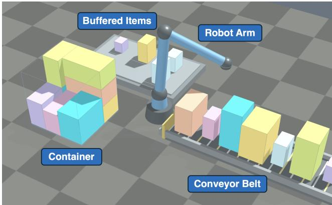  
Figure 1: Illustration of the bufered online 3D-BP scenario. Items arrive on a conveyor and enter a limited bufer. The policy selects which item to pack and its orientation and position in the container. The robot arm visualizes the selected item’s transfer and placement.

To identify performance bottlenecks and opportunities for improvement, we conducted empirical analyses based on existing methods. First, Figure 2(a) shows that distributions with smaller items yield more packed items and hence longer packing trajectories. These distributions also achieve higher final utilization, while distributions with larger items exhibit the opposite pattern. Although item size jointly afects both quantities, their co-variation suggests that sustaining feasible placements is associated with more complete exploitation of the residual space. Second, Figure 2(b) shows that feasible placement candidates become fewer and more spatially aggregated as packing progresses. Although these candidates satisfy the same feasibility constraints, they can still difer in their efects on local space structure. Together, these observations motivate evaluating item choices against the global residual space and distinguishing placement candidates by their local geometric efects, particularly in high-occupancy states.

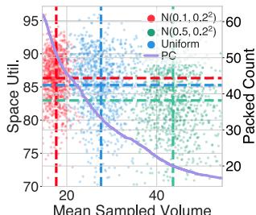  
(a)

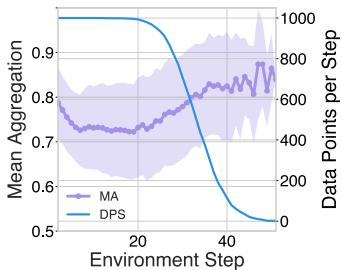  
(b)  
Figure 2: Empirical observations. (a) Across item-size distributions, smaller items are associated with higher packed-item counts (longer packing trajectories) and higher final utilization, whereas larger items exhibit the opposite pattern. (b) As packing progresses, feasible placement candidates become fewer and more spatially aggregated, increasing the need for fine-grained candidate evaluation.

Existing work has explored bufered item selection (Sarawgi et al., 2026), fine-grained placement quality evaluation (Poolavaram et al., 2026a), and joint item– placement learning through hierarchical policies (Wang et al., 2026). These advances motivate a central architectural question: how should spatial reasoning be allocated between item selection and placement in bufered online packing? Two coupled design choices follow: how to represent the global residual space for matching bufered items, and which geometric cues and contextual interactions are needed to rank a selected item’s feasible placements. Some placementaware designs combine several relational and contextual components whose individual contributions are not fully disentangled, motivating a focused examination of the interactions required for placement ranking.

With a volume-based per-step reward, all feasible placements of a selected item yield the same immediate gain. Item selection therefore afects both immediate gain and future reward, whereas feasible rotation–position choices for that item afect only future reward. This distinction motivates assigning global item–space matching to item selection and local geometric comparison to placement ranking.

We propose Spatial Afordance Retrieval (SAR), a novel learning-based framework for online 3D-BP. SAR adopts a modular design with the feasible candidate set as an explicit interface between item selection and placement evaluation. A Spatial Encoder converts binary 3D voxel occupancy into spatial tokens, which the picker uses to match bufered items to the global residual-space structure. For the selected item, candidate generation and feature computation produce feasible rotation–position candidates with Local Geometric Features (LGF). The loader performs fine-grained evaluation of this set using candidate geometry, LGF, and inter-candidate comparison, without directly accessing global spatial tokens. The two stages are jointly optimized under a shared long-horizon packing return. Here, spatial afordance denotes learned, state-conditioned suitability for exploiting residual space, and retrieval denotes scoring and selecting among available items and feasible placements.

Our main contributions are summarized as follows:

1. 3D occupancy-conditioned item–space matching. We develop a voxel-token spatial encoder that extracts local occupancy geometry and global spatial context for matching bufered items to the residual space. The picker conditions item selection on this representation without requiring item-specific placement proposals as inputs, while detailed rotation–position evaluation is deferred to the loader.

2. Spatial Afordance Retrieval. We propose SAR, a novel learning-based framework for bufered online 3D-BP, whose voxel-based picker and LGF-based loader are jointly designed for item selection and fine-grained placement evaluation. Both stages are optimized under a shared packing objective.

3. Experimental validation. Experiments across three datasets and multiple candidate generators demonstrate improved utilization. Ablations support the complementary roles of the two stages, while counterfactual analysis suggests that learned item selection favors greater future packing potential.

## 2. Related Work

Research on 3D-BP spans geometric heuristics, searchbased optimization, and learned sequential policies. Beyond this broad classification, methods difer in the items they can observe, the decisions they learn, and the spatial information used to evaluate those decisions. We organize the discussion around candidate generation, action decomposition, spatial representation, and placement quality evaluation. Table 1 summarizes representative designs, distinguishing local from global item visibility and fixed from adjustable item order, alongside learned item and placement decisions.

## 2.1 Geometric Heuristics and Candidate Generation

Geometric heuristics reduce the placement search space through structured candidate construction. Corner Point (CP) methods identify candidate anchors from the packing configuration (Martello et al., 2000), while Extreme Point (EP) methods construct and update points induced by placed items (Crainic et al., 2008). Empty Maximal Space (EMS) methods describe available rectangular regions and derive placements within them (Ha et al., 2017). Event Point (EV) generation provides another way to discretize placements from the evolving configuration (Zhao et al., 2022a). These schemes ofer diferent candidate coverage and computational costs; physical constraints, such as support and stability, additionally determine which generated placements are admissible.

Comparison of representative packing policies. Item visibility is global when the policy observes the complete item set and loca when it observes only the current item or a bounded bufer. Item order is fixed or adjustable during packing. Learned decisions are listed in the order item, rotation, and position, where a parenthesized group denotes joint selection and a comma between groups denotes separate stages; decisions not learned by the policy itself are omitted. Entries refer to the formulations discussed in the text.
<table><tr><td>Method</td><td>Type</td><td>Item visibility</td><td>Item order</td><td>Learned decisions</td><td>Spatial representation</td><td>Placement evaluation</td><td>Training</td></tr><tr><td>PackIt (Goyal and Deng, 2020)</td><td>Offline</td><td>Global</td><td>Adjustable</td><td>Item</td><td>3D voxel grid</td><td>Handcrafted; BLBF placement with Aligned rotation</td><td>PPO</td></tr><tr><td>TAP-Net (Hu et al., 2020)</td><td>Offline</td><td>Global</td><td>Adjustable</td><td>(Item, rotation)</td><td>2D height map</td><td>Handcrafted criteria inside the heuristic; no learned evaluation</td><td>Policy gradient; heuristic packing</td></tr><tr><td>Attend2Pack (Zhang et al., 2021)</td><td>Offline</td><td>Global</td><td>Adjustable</td><td>Item, (rotation, position)</td><td>2D frontier map</td><td>Implicit; from oriented dimensions and frontier geometry</td><td>REINFORCE with rollout baseline</td></tr><tr><td>PCT (Zhao et al., 2022a)</td><td>Online</td><td>Local</td><td>Fixed</td><td>(Rotation, position)</td><td>Tree structure</td><td>Implicit; from placed-item and candidate-node geometry</td><td>ACKTR</td></tr><tr><td>Zhao et al. (Zhao et al., 2022b)</td><td>Online</td><td>Local</td><td>Fixed</td><td>Rotation, position</td><td>2D height map</td><td>Implicit; from height-map geometry; stacking tree for feasibility</td><td>Constrained ACKTR</td></tr><tr><td>GOPT (Xiong et al., 2024)</td><td>Online</td><td>Local</td><td>Fixed</td><td>(Rotation, position)</td><td>2D height map</td><td>Implicit; from free-space and item-space relations</td><td>PPO</td></tr><tr><td>STEP (Sarawgi et al., 2026)</td><td>Online</td><td>Local</td><td>Adjustable</td><td>Item</td><td>2D height map</td><td>External; supplied by a separate GOPT policy</td><td>Preference- conditioned RL</td></tr><tr><td>Wang et al. (2026)</td><td>Online</td><td>Local</td><td>Adjustable</td><td>Item, (rotation, position)</td><td>Tree structure</td><td>Implicit; mixed attention over placed-item and candidate geometry</td><td>Dueling DQN</td></tr><tr><td>OPAL (Poolavaram et al., 2026a)</td><td>Online</td><td>Local</td><td>Fixed</td><td>(Rotation, position)</td><td>2D height map</td><td>Explicit; geometric and operational descriptors exposed per candidate</td><td>PPO</td></tr><tr><td>SAR (ours)</td><td>Online</td><td>Local</td><td>Adjustable</td><td>Item, (rotation, position)</td><td>3D voxel grid</td><td>Explicit; geometric descriptors (LGF) exposed per candidate</td><td>PPO</td></tr></table>

Candidate construction can be combined with item ordering, placement scores, and search over packing sequences. Classical approaches include hybrid genetic algorithms, layer-based construction with tabu search, guided local search, and beam search (Bortfeldt and Gehring, 2001; Lodi et al., 2002; Faroe et al., 2003; Araya and Rif, 2014). Recent industrial optimization also remains relevant: GENPACK combines a genetic search with domain-specific construction procedures and multiple operational criteria (Poolavaram et al., 2026b). These search procedures illustrate how geometric construction and operational preferences jointly shape a packing solution, and provide useful baselines for learned policies.

For learned policies, candidate generation and candidate selection serve diferent purposes. Generation determines which actions are available; selection determines which feasible action is preferable for the packing objective. Heuristics already encode geometric preferences through anchor construction, pruning, or handcrafted scores. Nevertheless, exposing only a candidate’s coordinates does not explicitly describe its support, contacts, or fit to the surrounding geometry. SAR retains heuristic generation and physical validation, while making such local geometric cues available to the learned placement evaluator.

## 2.2 Learning-based Packing Policies and Action Decomposition

Item selection, rotation selection, and position selection need not be learned through the same action structure. In flexible ofline packing, Duan et al. (2018) use a shared representation with separate sequence and orientation learners, while determining placement through a heuristic. TAP-Net instead learns an item–orientation choice and uses a packing heuristic to determine its position (Hu et al., 2020). Its transport-and-pack setting additionally constrains which items can be extracted from the initial arrangement. For large-container ofline packing, Yin et al. (2024) couple item and orientation selection before learning position selection, using bidirectional packing to constrain the position search. Their subsequent framework further develops this two-stage bidirectional design (Yin et al., 2025a). Attend2Pack learns item selection followed by joint orientation and placementcoordinate prediction, with the remaining coordinates obtained through a geometric rule (Zhang et al., 2021). Its main formulation observes the complete item set and trains both policies using a terminal packing objective. These designs combine learned decisions with geometric procedures, assigning diferent roles to the three packing components.

For fixed-arrival online packing, Zhao et al. (2022b) instead factorize placement into conditional coordinate and orientation heads, without learning which item to process next. Other fixed-order methods learn orientation and position separately, combining item reorientation with a physicsbased stability heuristic (Zhou et al., 2024). Thus, similar component names can describe diferent decision scopes and conditioning structures.

Information availability is equally important when interpreting selection policies. Ofline methods can reorder a complete set; fixed-arrival online methods must place the current item; bufered or semi-online methods can select among a limited visible set. Adjustable-order semionline packing has explicitly been studied by Yin et al. (2025b). STEP learns preference-conditioned item–graspface selection from a bufer, while obtaining placement and rotation suggestions from an external GOPT policy (Sarawgi et al., 2026). This difers from learning both selection and placement under a shared objective. For bufered robotic packing, Wang et al. (2026) learn item selection followed by joint rotation–position selection under a shared stepwise volume reward. Lookahead search is also distinct from actual reordering: Fang et al. (2026) use visible future parcels to improve placement planning while preserving the arrival order. These distinctions prevent attributing gains from a larger information horizon solely to network architecture.

Other online formulations expand the available decisions: Song et al. (2023) learn packing and unpacking to revise earlier placements, while Tsang et al. (2025) address concurrent dual-bin packing with bin-replacement strategies.

SAR addresses irreversible packing within a single container and adopts item selection followed by joint rotation– position selection, a decomposition also used in bufered robotic packing (Wang et al., 2026). It organizes the two stages around voxel-based item–space matching and placement evaluation with explicit local geometric features. With a volume-based per-step reward, item selection afects both immediate and future rewards, whereas feasible rotation– position choices for the selected item afect only future reward.

## 2.3 Spatial Representations and Item–Space Matching

The spatial representation determines what a policy can infer about the remaining container geometry. Height-map policies summarize the upper occupied surface on a twodimensional grid and support eficient convolutional encoding and feasibility prediction (Zhao et al., 2021, 2022b). For variable-height packing, Que et al. (2023) augment height maps with plane features describing horizontal clearances and encode the state with a Transformer policy. This is compact, but the representation alone does not distinguish all occupancy configurations beneath that surface. Its eficiency therefore comes with a trade-of in the volumetric details retained for subsequent decisions. For bufered selection, these details matter because several visible items may fit the same surface configuration in diferent ways.

Structured representations ofer alternatives to dense surface maps. Packing Configuration Trees (PCT) represent placed items as internal nodes and candidate rotation– position actions as leaf nodes, supporting attention-based evaluation and selection of candidate placements (Zhao et al., 2022a). PCT encodes spatial relations among configuration nodes using graph attention networks (GATs) (Veličković et al., 2018). Wang et al. (2026) build on this tree representation for bufered packing: a manager selects an item from the bufer, and a worker selects an EMS-generated placement leaf. Their networks use mixed self-attention over geometric node embeddings and are trained with separate Dueling DQNs under a shared stepwise volume reward. Both methods encode the packing configuration through discrete item and candidate nodes. Although these nodes contain three-dimensional coordinates, the tree representation does not directly supply a unified volumetric occupancy field to the policy; relationships among occupied regions and residual cavities must be inferred from node geometry.

GOPT represents free spaces through EMS tokens and uses attention to model both relations among spaces and their compatibility with the current item (Xiong et al., 2024). STEP extends EMS-based reasoning to a bufer of item– face options (Sarawgi et al., 2026). These methods already demonstrate the value of relational spatial reasoning. For bufered packing, spatial reasoning additionally needs to compare the compatibility of several visible items with the residual space before committing to a placement.

Voxel representations explicitly describe occupied and empty regions at a chosen spatial resolution. Prior work has demonstrated their usefulness for explicit geometric optimization in irregular packing (Lamas-Fernandez et al., 2023). PackIt learns item selection by concatenating candidate-item, max-pooled item-set, and container features and applying nonlinear MLP scoring (Goyal and Deng, 2020).

These considerations motivate using explicit 3D occupancy to match bufered items to the global residual space. SAR learns item–space matching from a 3D spatial representation of container occupancy by separately projecting item and spatial features and averaging their scaled dotproduct compatibility scores. This scoring introduces an explicit multiplicative interaction between item and spatial representations for bufered item selection.

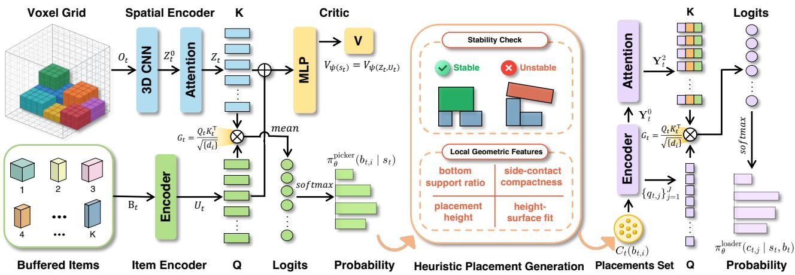  
Figure 3: Overview of the proposed Spatial Afordance Retrieval (SAR) framework. A 3D CNN with max pooling and self-attention encodes the container voxel grid $\mathbf { 0 } _ { t }$ (top left) into spatial tokens $\mathbf { Z } _ { t } ,$ and an item encoder embeds the bufered items $B _ { t }$ (bottom left) into $\mathbf { U } _ { t } .$ The picker computes scaled dot-product scores between item embeddings (Q) and these tokens (K), averages the scores, and softmax-normalizes them into the item-selection policy $\pi _ { \theta } ^ { \mathrm { p i c k e r } } ( b _ { t , i } \mid s _ { t } ) ;$ ; a critic additionally estimates the state value $V _ { \psi } ( s _ { t } )$ for training. Given the selected item, heuristic placement generation enumerates rotation–position candidates, filters them by stability, and computes Local Geometric Features (LGF; support, compactness, height, and surface fit), forming the feasible placement set $C _ { t } ( b _ { t , i } )$ (middle). For fine-grained placement evaluation, the loader encodes these candidates into tokens $\mathbf { Y } _ { t } ^ { 0 }$ , refines them by self-attention into $\mathbf { Y } _ { t } ^ { 2 }$ , and scores them by scaled dot-products between placement queries $\{ q _ { t , j } \} _ { j = 1 } ^ { J } \left( \mathsf { Q } \right)$ and the refined keys (K), yielding the placement policy $\pi _ { \theta } ^ { \mathrm { l o a d e r } } ( c _ { t , j } \mid s _ { t } , b _ { t } )$ that determines the final orientation and position (right). The selected item determines the loader’s feasible candidate set, and both stages are trained under a shared return.

## 2.4 Placement Quality Evaluation and Candidate Ranking

Feasibility masks exclude invalid actions but do not rank the remaining placements by their longer-term consequences. Policies using height maps, configuration trees, or free-space tokens can learn these preferences implicitly (Zhao et al., 2021, 2022a; Xiong et al., 2024). Explicit placement descriptors ofer a complementary route by exposing geometric or operational properties before policy scoring. However, feature selection and relational modeling are separate design choices: supplying local quality cues does not by itself establish which interactions should be learned, or how much additional global context a placementranking network requires.

Handcrafted placement evaluation also remains relevant: Wang and Hauser (2022) use a heightmap-minimization heuristic for irregular-object packing subject to stability and robot-motion feasibility.

OPAL demonstrates the efectiveness of placementaware learned evaluation in industrial packing (Poolavaram et al., 2026a). It enriches EMS-derived candidates with geometric and operational descriptors, encodes dependencies among attributes within each candidate, and mixes candidate representations with oriented-item and pallet-state representations. Its evaluated workflow uses a prescribed item order, while the policy selects among feasible rotation– position candidates. Its configuration-level comparisons do not fully isolate the contributions of every relational component, motivating further analysis of the interactions needed for efective placement evaluation.

Like OPAL, SAR ranks generated placement candidates; the architectural comparison concerns the scope of feature encoding and contextual interaction. SAR focuses the loader on the selected item’s feasible candidate set. Its four LGF expose bottom support, side-contact compactness, placement height, and height-surface fit, supplementing coordinates and rotated item dimensions. These features convey statederived local context, enabling comparison among candidate tokens without an additional learned global containercontext encoder at this stage. Global item–space matching remains the picker’s responsibility, and both stages are optimized using a shared packing return. SAR thus coordinates voxel-based item matching and focused local placement ranking through a clear division of decision roles, with shared training connecting their efects on residual-space utilization.

## 3. Method

Figure 3 presents the SAR framework, which combines voxel-based item–space matching with local ranking of feasible placement candidates.

## 3.1 Voxelized Environment Representation

Voxel Representation. The container is discretized into a regular voxel grid $\Omega _ { R } = \{ 0 , \ldots , R - 1 \} ^ { 3 }$ , � denotes resolution. Each voxel $q \ = \ ( x , y , z ) \ \in \ \Omega _ { R }$ defines both the minimum perceptual unit of the environment and a discrete anchor for placement execution. At time step �, the container state is represented as a single-channel occupancy grid $\mathbf { O } _ { t } ~ : ~ \Omega _ { R } ~ \to ~ \{ 0 , 1 \} , \mathbf { O } _ { t } ~ \in ~ \{ \bar { 0 , } 1 \} ^ { R \times R \times R }$ . The occupancy value $\mathbf { O } _ { t } ( q )$ equals 1 when voxel � is occupied and 0 when � is empty. The picker is given a candidate item bufer $B _ { t } = \{ b _ { t , 1 } , b _ { t , 2 } , \ldots , b _ { t , K } \}$ , � denotes bufer size. Each candidate item is represented by its dimensions and mass, $\mathbf { \Phi } _ { b _ { t , i } } \ = \ ( d _ { x , i } , d _ { y , i } , d _ { z , i } , m _ { i } ) \mathrm { ~ , ~ }$ , where $m _ { i }$ is used for stability checks. A binary mask $\mathbf { M } _ { t } ^ { \mathrm { b u f } } \ \in \ \{ 0 , 1 \} ^ { K }$ indicates valid candidates. The complete observation is therefore written as $s _ { t } = ( \mathbf { O } _ { t } , B _ { t } , \mathbf { M } _ { t } ^ { \mathrm { b u f } } )$ . � is updated after $b _ { t , i }$ is successfully placed. This voxelized container represents the placed items as a unified occupied solid rather than as a set of mutually dependent stacked boxes. Thus, the policy does not need to explicitly infer stacking dependencies among placed items, but can instead focus on global spatial state of the container.

Heuristic Placement Generation. SAR supports various placement generation schemes, including CP, EP, EMS, EV, and full coordinate (FC). Candidates are incrementally generated based on the newly placed item. Following (Zhao et al., 2022b), stability checking is enabled in all experiments to filter these candidates into a feasible placement set $c _ { t } ,$ separating physical validation from decision making. An efective generation scheme reduces the search space while preserving feasible packing options.

Local Geometric Features. For each feasible candidate set $C _ { t } = \{ c _ { t , 1 } , c _ { t , 2 } , . . . , c _ { t , j } \}$ , the environment directly computes LGF. For each feasible placement candidate $c _ { t } \in$ $c _ { t } ,$ we denote these environment-computed features as

$$
\begin{array} { r } { g _ { \mathrm { e n v } } ( c _ { t } ; \mathbf { O } _ { t } ) = ( \rho _ { \mathrm { s u p } } ( c _ { t } ) , \rho _ { \mathrm { c o m p } } ( c _ { t } ) , h _ { \mathrm { n o r m } } ( c _ { t } ) , \rho _ { \mathrm { f i t } } ( c _ { t } ) ) , } \end{array}\tag{1}
$$

where $\rho _ { \mathrm { s u p } }$ measures bottom support ratio, $\rho _ { \mathrm { c o m p } }$ measures side-contact compactness, $h _ { \mathrm { n o r m } }$ is the normalized placement height, and $\rho _ { \mathrm { f i t } }$ measures height-surface fit under the candidate footprint. LGF does not directly define packing quality. Instead, the policy learns how these local cues relate to the long-term packing return.

For a candidate item with anchor $p = ( x , y , z )$ and rotated dimensions $( d _ { x } , d _ { y } , d _ { z } )$ on the voxel grid, let $O ( u , v , w ) \in$ {0, 1} denote the current occupancy grid and let $H ( u , v )$ be the height map. The footprint of the candidate is:

$$
{ \mathcal { F } } ( p ) = \{ ( u , v ) ~ | ~ x \leq u < x + d _ { x } , ~ y \leq v < y + d _ { y } \} .\tag{2}
$$

$\rho _ { \mathrm { s u p } }$ is computed from the occupied voxels immediately below the footprint, where $\chi _ { u v }$ is a binary support indicator for footprint cell (�, �).

$$
\begin{array} { l l } { \rho _ { \operatorname* { s u p } } = \left\{ \begin{array} { l l } { 1 , } & { z = 0 , } \\ { \frac { 1 } { | \mathcal { F } ( p ) | } \displaystyle \sum _ { ( u , v ) \in \mathcal { F } ( p ) } \chi _ { u v } , } & { z > 0 , } \end{array} \right. } \\ { \chi _ { u v } = \mathbf { 1 } \{ O ( u , v , z - 1 ) > 0 \} . } \end{array}\tag{3}
$$

(4)

$\rho _ { \mathrm { c o m p } }$ measures contact with neighboring boxes and container walls using only the four vertical side faces. Let

$S _ { \mathrm { s i d e } } ~ = ~ 2 ( d _ { y } d _ { z } + d _ { x } d _ { z } )$ denote the total side area. $\boldsymbol { A } _ { \mathrm { b o x } }$ is computed by counting occupied voxels in the one-voxelthick layer adjacent to each side face that is not on a container boundary. $A _ { \mathrm { w a l l } }$ is computed by adding the full area of each side face that coincides with a container wall, i.e., faces at $x = 0 \mathrm { o r } x + d _ { x } = R$ contribute $d _ { y } d _ { z }$ , and faces at $y = 0$ or $y + d _ { y } = R$ contribute $d _ { x } d _ { z }$ . The compactness ratio is

$$
\rho _ { \mathrm { c o m p } } = \mathrm { c l i p } \left( \frac { A _ { \mathrm { b o x } } + w _ { \mathrm { w a l l } } A _ { \mathrm { w a l l } } } { S _ { \mathrm { s i d e } } } , 0 , 1 \right) ,\tag{5}
$$

where $w _ { \mathrm { w a l l } } = 0 . 3$ controls the contribution of wall contacts. The normalized placement height is:

$$
h _ { \mathrm { n o r m } } = \mathrm { c l i p } \left( \frac { z } { R - 1 } , 0 , 1 \right) .\tag{6}
$$

Finally, the height-surface fit measures the average height gap between the candidate base plane and the local height map under the footprint, normalized by the item height $d _ { z } .$ . Here $\eta _ { u v }$ denotes the clipped height gap between the placement height � and the local height-map value �(�, �) at footprint cell (�, �). A flatter surface closer to the placement height � yields a value closer to 1.

$$
\rho _ { \mathrm { f i t } } = 1 - \mathrm { c l i p } \left( \frac { 1 } { d _ { z } | \mathcal { F } ( p ) | } \sum _ { ( u , v ) \in \mathcal { F } ( p ) } \eta _ { u v } , 0 , 1 \right) ,\tag{7}
$$

$$
\eta _ { u v } = \mathrm { c l i p } ( z - H ( u , v ) , 0 , d _ { z } ) .\tag{8}
$$

## 3.2 Hierarchical Policy Network

The proposed network parameterizes a hierarchical policy, thereby reducing the complexity of learning a single monolithic distribution over item–rotation–position triples. This hierarchy also reflects the natural structure of the packing process: the policy first selects the item best suited to the current packing state and then determines its rotation and placement position.

Spatial Encoder. To standardize the experimental comparison environment, we set the container to be cube. We use meters to measure the dimensions of container and items. Any length unit may be used as long as the relative dimensions are preserved. The spatial discretization granularity is controlled by the voxel resolution �. We encode the container state with a voxel-token hybrid spatial encoder, which aggregates local 3D structure with a 3D CNN (Ji et al., 2012) and models long-range spatial dependencies with a Transformer-based self-attention module (SA1) (Vaswani et al., 2017).

The 3D CNN contains three strided convolutional blocks. Each block $\mathcal { E } _ { l }$ contains two 3×3×3 convolutions with group normalization and LeakyReLU (Maas et al., 2013), the first uses stride 2 for downsampling, and the second uses stride 1 for feature refinement. The convolutional hierarchy is

$$
\mathbf { H } _ { t } ^ { 1 } = \mathcal { E } _ { 1 } ( \mathbf { O } _ { t } ) , \quad \mathbf { H } _ { t } ^ { 2 } = \mathcal { E } _ { 2 } ( \mathbf { H } _ { t } ^ { 1 } ) , \quad \mathbf { H } _ { t } ^ { 3 } = \mathcal { E } _ { 3 } ( \mathbf { H } _ { t } ^ { 2 } ) .\tag{9}
$$

The channel dimensions are $C ~ = ~ 3 2 , ~ 2 C$ , and $4 C .$ respectively, producing a compact feature volume that summarizes local occupancy geometry. We then apply adaptive

3D max pooling to obtain a fixed $N = P \times P \times P$ token grid, ${ \bf H } _ { t } ^ { \mathrm { p o o l } } = \mathrm { P o o l } _ { \mathrm { m a x } } ( { \bf H } _ { t } ^ { 3 } )$ , where $d _ { s } ~ = ~ 4 C$ and $P = 4$ The pooled volume is flattened as $\mathbf { S } _ { t } = \mathrm { F l a t t e n } ( \mathbf { H } _ { t } ^ { \mathrm { p o o l } } ) ^ { \top }$ . To preserve spatial location, each token adds a continuous 3D positional encoding. For token �, let $\mathbf { p } _ { i } \in [ - 1 , 1 ] ^ { 3 }$ , be its normalized coordinate on the pooled grid. The initial token is ${ \bf Z } _ { t } ^ { 0 } [ i ] = { \bf S } _ { t } [ i ] + { \bf e } _ { i }$ . Here, $\mathbf { e } _ { i } = \phi _ { \mathrm { p o s } } ( \mathbf { p } _ { i } )$ ) is produced by a two-layer Multi-Layer Perceptron (MLP) with LeakyReLU. This keeps absolute location information, which is important for space reasoning. Finally, we use self-attention to model global relationships among them. In our implementation, a single-head, single-layer self-attention (SHA) module keeps the encoder lightweight. The final spatial tokens (ST) are obtained as follows:

$$
\begin{array} { r } { \tilde { \mathbf { Z } } _ { t } = \mathrm { L N } _ { 1 } \left( \mathbf { Z } _ { t } ^ { 0 } + \mathrm { S H A } \left( \mathbf { Z } _ { t } ^ { 0 } \right) \right) , } \end{array}\tag{10}
$$

$$
\mathbf { Z } _ { t } = \mathrm { L N } _ { 2 } \big ( \tilde { \mathbf { Z } } _ { t } + \mathrm { F F N } \big ( \tilde { \mathbf { Z } } _ { t } \big ) \big ) .\tag{11}
$$

Here, LN denotes layer normalization and FFN denotes the feed-forward network. $\mathbf { Z } _ { t }$ is then used by the picker module for item selection.

Picker. The picker first encodes the candidate item bufer $B _ { t }$ . Each item $b _ { t , i } \in B _ { t }$ is passed through a two-layer MLP with LeakyReLU activation and projected into the item embedding space as $\widehat { \mathbf { U } } _ { t } = \phi _ { \mathrm { i t e m } } ( B _ { t } )$ . To preserve candidateorder information, we add a learnable order embedding ${ { \bf { P } } _ { i } }$ and apply the bufer-validity mask: $\mathbf { U } _ { t , i } = M _ { t , i } ^ { \mathrm { b u f } } ( \widehat { \mathbf { U } } _ { t , i } + \mathbf { P } _ { i } )$

The picker uses item–space cross-attention (CA2) between the candidate item tokens � and the spatial tokens $\mathbf { Z } _ { t } .$ . The former provide queries and the latter provide keys for single-head scaled dot-product compatibility scoring. Following the pointer mechanism (Vinyals et al., 2015), we compute

$$
\mathbf { Q } _ { t } = \mathbf { U } _ { t } \mathbf { W } ^ { Q } , \mathbf { K } _ { t } = \mathbf { Z } _ { t } \mathbf { W } ^ { K } , \mathbf { G } _ { t } = \mathbf { Q } _ { t } \mathbf { K } _ { t } ^ { \top } / \sqrt { d _ { i } } ,\tag{12}
$$

where $g _ { t , i , n } ~ \in ~ { \bf G } _ { t }$ measures the compatibility between candidate item $b _ { t , i }$ and the �-th spatial token $\mathbf { z } _ { t , n } \in \mathrm { ~ \mathbf { Z } } _ { t }$ Mean aggregation over the spatial tokens gives the item logit $\begin{array} { r } { \ell _ { t , i } ^ { \mathrm { i t e m } } = N ^ { - 1 } \sum _ { n = 1 } ^ { N } g _ { t , i , n } , } \end{array}$ capturing global item-space compatibility. $\ell _ { t , i } ^ { \mathrm { i t e m } }$ are clipped with tanh, where the range is controlled by hyperparameter $c _ { c l i p } ,$ and finally normalized by a softmax operation (Bello et al., 2016). The resulting item-selection policy is

$$
\pi _ { \theta } ^ { \mathrm { p i c k e r } } ( b _ { t , i } \mid s _ { t } ) = \mathrm { s o f t m a x } _ { i } ( c _ { \mathrm { c l i p } } \operatorname { t a n h } ( \ell _ { t , i } ^ { \mathrm { i t e m } } ) ) .\tag{13}
$$

Loader. After the picker selects an item $b _ { t , i } .$ , the environment enumerates feasible rotation–position candidates and filters them using stability check rules. The loader can process up to � candidates. � is adjusted according to the placement generation schemes. If the number of feasible candidates exceeds �, orientation-stratified sampling is performed across the $N _ { \mathrm { o r i } }$ orientations to preserve a balanced orientation distribution after truncation. The resulting padded candidate set is denoted by $C _ { t } ( b _ { t , i } ) ~ = ~ \{ c _ { t , j } \} _ { j = 1 } ^ { J } .$

$c _ { t , j } = ( \mathbf { r } _ { t , j } , \mathbf { p } _ { t , j } , \mathbf { f } _ { t , j } ) \in C _ { t } ( b _ { t , i } )$ , where $\mathbf { r } _ { t , j } = ( d _ { x } , d _ { y } , d _ { z } )$ is a rotated-item representation, $\mathbf { p } _ { t , j } ~ = ~ ( x , y , z )$ is an anchor coordinate, and $\mathbf { f } _ { t , j } ~ = ~ ( \rho _ { \mathrm { s u p } } , \rho _ { \mathrm { c o m p } } , h _ { \mathrm { n o r m } } , \rho _ { \mathrm { f i t } } )$ is an LGF vector. Then $c _ { t , j }$ are embedded and fused into an initial candidate token

$$
\mathbf { \boldsymbol { \mathsf { y } } } _ { t , j } ^ { 0 } = \mathbf { \boldsymbol { \mathsf { W } } } ^ { \mathrm { i t e m } } \phi _ { \mathrm { i t e m } } ( \mathbf { \boldsymbol { \mathsf { r } } } _ { t , j } ) + \phi _ { \mathrm { p o s } } ( \mathbf { \boldsymbol { \mathsf { p } } } _ { t , j } ) + \phi _ { \mathrm { l g f } } ( \mathbf { \boldsymbol { \mathsf { f } } } _ { t , j } ) .\tag{14}
$$

The loader uses self-attention (SA2), implemented as two SHA blocks with FFN, to compare feasible placements, masking padded candidates and applying LN after each residual connection (He et al., 2016). For $l \ \in \ \{ 1 , 2  \}$ , let $\mathbf { Y } _ { t } ^ { l - 1 } = \{ \mathbf { y } _ { t , j } ^ { l - 1 } \} _ { j = 1 } ^ { J }$ , the candidate representations are updated as

$$
\widetilde { \mathbf { Y } } _ { t } ^ { l } = \mathrm { L N } ^ { l } ( \mathbf { Y } _ { t } ^ { l - 1 } + \mathrm { S H A } ^ { l } ( \mathbf { Y } _ { t } ^ { l - 1 } ; \mathbf { m } _ { t } ^ { \mathrm { c a n d } } ) )
$$

$$
\mathbf { Y } _ { t } ^ { l } = \mathrm { L N } ^ { l } ( \widetilde { \mathbf { Y } } _ { t } ^ { l } + \mathrm { F F N } ^ { l } ( \widetilde { \mathbf { Y } } _ { t } ^ { l } ) ) .\tag{15}
$$

(16)

Here, $\mathbf { m } _ { t } ^ { \mathrm { c a n d } }$ masks padded candidates.

The default loader omits candidate–space cross-attention (CA1), which would directly connect placement candidate tokens with spatial tokens $\mathbf { Z } _ { t }$ , following the component analysis in Section 4.4.

Inspired by the Set Transformer (Lee et al., 2019) and Pointer Networks (Vinyals et al., 2015), the loader scores feasible placements using query and key vectors $\begin{array} { r l } { \mathbf { q } _ { t , j } } & { { } = } \end{array}$ $\mathbf { W } ^ { Q } \phi _ { \mathrm { i t e m } } ( \mathbf { r } _ { t , j } )$ and $\mathbf { k } _ { t , j } = \mathbf { W } ^ { K } \mathbf { y } _ { t , j } ^ { 2 }$ , yielding the placement logits $\ell _ { t , j } ^ { \mathrm { p l a c e } } = \mathbf { q } _ { t , j } ^ { \intercal } \mathbf { k } _ { t , j } / \sqrt { d _ { p } } .$ After clipping valid logits and masking padded candidates, the placement policy is

$$
\pi _ { \theta } ^ { \mathrm { l o a d e r } } ( c _ { t , j } \mid s _ { t } , b _ { t } ) = \mathrm { s o f t m a x } _ { j } \Big ( c _ { \mathrm { c l i p } } \operatorname { t a n h } ( \ell _ { t , j } ^ { \mathrm { p l a c e } } ) \Big )\tag{17}
$$

The selected candidate determines the final item orientation and position.

## 3.3 Markov Decision Process Formulation

We present our problem as Markov Decision Process (MDP).

State. The state $s _ { t } \in S$ at time step � is represented as $s _ { t } = ( \mathbf { O } _ { t } , B _ { t } , \mathbf { M } _ { t } ^ { \mathrm { b u f } } )$ , where $\mathbf { O } _ { t }$ is the voxel occupancy grid, $B _ { t } = \{ b _ { t , i } \} _ { i = 1 } ^ { K }$ is the candidate item bufer, and $\mathbf { M } _ { t } ^ { \mathrm { b u f } }$ is the bufer-validity mask.

Action. An action is a two-step hierarchical decision. We denote the joint action as $a _ { t } ~ = ~ ( b _ { t , i } , c _ { t , j } ) ~ \in ~ \mathcal { A } ( s _ { t } )$ where the picker first selects a valid item $b _ { t , i } \in B _ { t }$ and the loader then selects one feasible placement candidate $c _ { t , j } \in$ $C _ { t } ( b _ { t , i } ) = \{ c _ { t , j } \} _ { j = 1 } ^ { J }$ . The state-dependent joint action space is therefore defined as $\mathcal { A } ( s _ { t } ) = \{ ( b _ { t , i } , c _ { t , j } ) \ | \ M _ { t , i } ^ { \mathrm { b u f } } = 1 \}$

Transition. The transition $\textstyle \mathcal { P } ( s _ { t + 1 } \mid s _ { t } , a _ { t } )$ is determined by the selected joint action $a _ { t } ~ = ~ ( b _ { t , i } , c _ { t , j } )$ . After feasibility verification, the environment places $b _ { t , i }$ according to $c _ { t , j } .$ , updates $\mathbf { O } _ { t }$ to $\mathbf { O } _ { t + 1 }$ , removes the selected item from the bufer, adds the next item according to the online arrival process, and refreshes the bufer-validity mask. The episode terminates when no feasible placement $C _ { t } ( b _ { t , i } ) = \emptyset$ after item selection.

Reward. We use a stepwise volume reward. For each successful placement, the reward is $\begin{array} { r } { r _ { t } = \alpha \frac { \mathrm { V o l } ( b _ { t , i } ) } { \mathrm { V o l } ( \Omega _ { R } ) } } \end{array}$ , where ${ \mathrm { V o l } } ( \Omega _ { R } )$ is the container volume and � is a scaling coefficient. The immediate reward $r _ { t }$ measures the utilization gained from the current placement. We use neither terminal rewards nor invalid-action penalties. Conditional on successful placement, this reward is identical for all feasible rotation–position candidates of the selected item. Item selection therefore influences both immediate reward and future packing opportunities, whereas feasible placement choices afect future return by changing the residual geometry without altering the immediate reward. This reward structure motivates separating item selection from joint rotation–position evaluation.

## 3.4 Training Method.

We optimize hierarchical policy using policy-gradient learning (Williams, 1992), specifically Proximal Policy Optimization (PPO; Schulman et al., 2017), an on-policy actor– critic algorithm. The joint policy factorizes as

$$
\pi _ { \theta } ( a _ { t } \mid s _ { t } ) = \pi _ { \theta } ^ { \mathrm { p i c k e r } } ( b _ { t , i } \mid s _ { t } ) \pi _ { \theta } ^ { \mathrm { l o a d e r } } ( c _ { t , j } \mid s _ { t } , b _ { t , i } ) .\tag{18}
$$

Thus, the joint action log-probability is the sum of the picker and loader log-probabilities. The actor $\pi _ { \theta }$ consists of the spatial encoder, picker, and loader. The critic $V _ { \psi } ( s _ { t } )$ uses $\mathbf { Z } _ { t }$ and $\mathbf { U } _ { t }$ as input and estimates the standard state value of the hierarchical policy. The same return-based advantage estimate is applied to the picker and loader log-probabilities, jointly updating item and placement selection. We collect rollouts from 64 parallel environments with diferent random seeds. Each environment is advanced for $\textit { T } = \textit { s }$ steps per rollout, yielding a batch of $5 \times 6 4 = 3 2 0$ transitions. We then compute advantages using Generalized Advantage Estimation (GAE; Schulman et al., 2015) and perform one PPO update on the collected batch. The actor and critic are trained end-to-end with the clipped policy and value objectives of PPO. The learning-based methods are trained until there are no significant performance gains.

## 4. Experiments

## 4.1 Experimental Setup

Baselines. We conducted comparative experiments on both heuristic and learning-based methods. For the learningbased methods, we compared online and ofline approaches. The heuristic methods we used were DBL(Karabulut and İnceoğlu, 2004), LSAH (Hu et al., 2017), MACS(Hu et al., 2020), BR(Zhao et al., 2021), OnlineBPH(Ha et al., 2017), and HM(Wang and Hauser, 2019). PCT(Zhao et al., 2022a), GOPT(Xiong et al., 2024), and Zhao et al. (2021) were online learning methods. Yin et al. (2025a) is an ofline learning method. Since ofline methods allow for the observation of near-complete queue information and support the reordering of the queue, we selected an ofline method as a baseline to compare with SAR and evaluate actual performance under a limited observation window. $N _ { \mathrm { o r i } }$ denotes the number of allowed item orientations.

Datasets. We designed three independent datasets  covering both simulated and real-world scenarios. To identify unique item types, we sorted the three dimensions of each item in ascending order and removed duplicate dimension triplets, treating items that difer only by rotation as the same type. The complete item-type visualization is provided in Figure A.1 in Appendix A.

• Dataset 1 $( D _ { 1 } ) \colon$ Following (Zhao et al., 2022b), items are randomly generated with dimensions $( l , w , h )$ satisfying $l , w , h \in \{ 1 , 2 , 3 , 4 , 5 \}$ , include 35 types of items.

• Dataset 2 $( D _ { 2 } )$ : Data collected from JD Logistics, includes 10 types of items.

• Dataset $\begin{array} { r } { { \bf 3 } ( D _ { 3 } ) \mathrm { : } } \end{array}$ Data collected from SF Express, includes 11 types of items.

## 4.2 Performance Comparison

We compare SAR with heuristic and learning-based methods over 1,000 episodes with 5 random seeds. The experimental results are shown in Table 2. To match the strict no-bufer setting ofPCT and GOPT, SAR1 uses $K = 1$ where the picker has no non-trivial decision, so the comparison mainly evaluates placement selection. Across Datasets 1–3, the best SAR1 variants improve utilization over the strongest � = 1 online baseline by 4.20, 3.34, and 0.96 percentage points, respectively.

Figure 4 shows one packing progression. Increasing the bufer to $K = 5$ further raises utilization to 93.55%, 91.04%, and 90.41% on the three datasets, as shown in Figure 5(b), reflecting both the larger observation window and learned selection among visible items. We additionally report (Yin et al., 2025a) as an ofline full-information $\left( K \ = \ 5 0 \right)$ reference, as it sees a larger item-information horizon than SAR.

Notably, FC constructs feasible candidates by direct coordinate enumeration rather than handcrafted geometric partition rules such as CP, EP, EMS, or EV. The competitive performance of SAR1-FC and SAR5-FC suggests that direct enumeration is a viable candidate-generation option for SAR in the tested settings. The two kinds of generators difer in both candidate coverage and computational cost. Heuristic rules such as EMS and EV shrink the search space to a few promising positions, so fewer candidates have to be generated and ranked at each step, which keeps decisions fast. FC instead enumerates every feasible coordinate and produces a much larger set. Candidate generation and learned ranking thus play complementary roles: generation determines which placement options are available, while ranking evaluates and selects among them, with both components contributing to packing performance. A comparison across CP, EP, EMS, EV, and FC is provided in Section 4.5.

## 4.3 Sensitivity Analysis

Table 3 evaluates SAR under diferent bufer sizes and voxel resolutions, with six item orientations and EV placement generation. On $D _ { 1 }$ , increasing � from 1 to 5 consistently improves utilization and packed-item count at every tested resolution. For $R \ = \ 1 0 , 3 0 , 5 0$ , increasing � from 1 to 3 raises utilization by 3.15, 3.76, and 3.61 percentage points, respectively, whereas increasing � from 3 to 5 adds 0.93, 2.00, and 2.39 percentage points. These gains should be interpreted in the context of 3D-BP: further improvements generally become more dificult as utilization increases, because the remaining free space is limited and often fragmented, making additional items harder to accommodate. Since utilization already exceeds 91% at � = 3 for all three tested resolutions, the further improvements at $K = 5$ remain meaningful despite their smaller absolute magnitude. A larger bufer exposes more candidate items to the policy and provides more opportunities for reordering, consistent with the training curves in Figure 5(b). The picker ablation in Table 4 further isolates the contribution of learned item reordering.

Performance comparisons. {util.} denotes space utilization of the environment (%); {std.} denotes standard deviation of space utilization $\left( \times 1 0 ^ { - 2 } \right)$ ; {num.} denotes the average number of packed items per episode; {time} denotes the average decision time per step. SAR1 denotes � = 1. SAR5 denotes � = 5. All learning-based methods were set $R = 1 0 , N _ { \mathrm { o r i } } = 6$ . Bold and underlined entries indicate the best and second-best results within each setting.
<table><tr><td></td><td colspan="4">Dataset 1</td><td colspan="4">Dataset 2</td><td colspan="4">Dataset 3</td></tr><tr><td>Method</td><td>util.↑</td><td>std.↓</td><td>num.</td><td>time↓</td><td>util.↑</td><td>std.↓</td><td>num.</td><td>time↓</td><td>util.↑</td><td>std.↓</td><td>num.</td><td>time↓</td></tr><tr><td colspan="9">Heuristic</td><td></td><td></td><td></td><td></td></tr><tr><td>Random</td><td>39.53</td><td>9.17</td><td>16.65</td><td>&lt;0.1s</td><td>37.30</td><td>9.33</td><td>9.84</td><td>&lt;0.1s</td><td>34.22</td><td>10.15</td><td>7.28</td><td>&lt;0.1s</td></tr><tr><td>MACS</td><td>63.01</td><td>9.54</td><td>24.99</td><td>&lt;0.1s</td><td>61.35</td><td>9.27</td><td>14.97</td><td>&lt;0.1s</td><td>61.96</td><td>11.09</td><td>12.41</td><td>&lt;0.1s</td></tr><tr><td>LSAH</td><td>62.56</td><td>9.95</td><td>24.78</td><td>&lt;0.1s</td><td>55.82</td><td>11.49</td><td>14.27</td><td>&lt;0.1s</td><td>56.48</td><td>9.381</td><td>11.62</td><td>&lt;0.1s</td></tr><tr><td>BR</td><td>54.34</td><td>10.57</td><td>22.02</td><td>&lt;0.1s</td><td>53.65</td><td>10.21</td><td>13.39</td><td>&lt;0.1s</td><td>54.82</td><td>10.36</td><td>11.24</td><td>&lt;0.1s</td></tr><tr><td>DBL</td><td>68.33</td><td>9.80</td><td>26.89</td><td>&lt;0.1s</td><td>57.83</td><td>10.68</td><td>14.35</td><td>&lt;0.1s</td><td>53.55</td><td>10.82</td><td>10.76</td><td>&lt;0.1s</td></tr><tr><td>HM</td><td>64.03</td><td>8.99</td><td>25.53</td><td>&lt;0.1s</td><td>48.39</td><td>12.65</td><td>12.49</td><td>&lt;0.1s</td><td>45.08</td><td>11.96</td><td>9.14</td><td>&lt;0.1s</td></tr><tr><td>OnlineBPH</td><td>61.08</td><td>14.04</td><td>24.9</td><td>&lt;0.1s</td><td>60.27</td><td>13.04</td><td>14.92</td><td>&lt;0.1s</td><td>59.02</td><td>11.75</td><td>11.69</td><td>&lt;0.1s</td></tr><tr><td colspan="9">Learning-based (K = 1)</td><td></td><td></td><td></td><td></td></tr><tr><td>Zhao et al.</td><td>62.11</td><td>11.23</td><td>24.43</td><td>&lt;0.5s</td><td>68.52</td><td>14.09</td><td>17.21</td><td>&lt;0.5s</td><td>56.33</td><td>12.19</td><td>11.79</td><td>&lt;0.5s</td></tr><tr><td>PCT</td><td>84.75</td><td>5.35</td><td>32.44</td><td>&lt;0.5s</td><td>79.63</td><td>4.61</td><td>19.35</td><td>&lt;0.5s</td><td>77.38</td><td>4.66</td><td>15.10</td><td>&lt;0.5s</td></tr><tr><td>GOPT</td><td>84.81</td><td>6.15</td><td>32.77</td><td>&lt;0.5s</td><td>79.25</td><td>7.18</td><td>19.29</td><td>&lt;0.5s</td><td>76.37</td><td>6.84</td><td>14.99</td><td>&lt;0.5s</td></tr><tr><td>SAR1-EV</td><td>88.78</td><td>4.79</td><td>35.29</td><td>&lt;0.5s</td><td>82.97</td><td>6.96</td><td>21.21</td><td>&lt;0.5s</td><td>78.19</td><td>7.35</td><td>16.55</td><td>&lt;0.5s</td></tr><tr><td>SAR1-EMS</td><td>88.84</td><td>4.65</td><td>35.32</td><td>&lt;0.5s</td><td>81.69</td><td>6.79</td><td>20.90</td><td>&lt;0.5s</td><td>78.03</td><td>7.23</td><td>16.63</td><td>&lt;0.5s</td></tr><tr><td>SAR1-FC</td><td>89.01</td><td>4.82</td><td>35.37</td><td>&lt;0.5s</td><td>81.54</td><td>7.67</td><td>20.91</td><td>&lt;0.5s</td><td>78.34</td><td>7.09</td><td>16.50</td><td>&lt;0.5s</td></tr><tr><td colspan="9">Learning-based (K &gt; 1)</td><td></td><td></td><td></td><td></td></tr><tr><td>Yin et al.</td><td>86.53</td><td>3.51</td><td>36.01</td><td>&lt;0.5s</td><td>88.56</td><td>2.49</td><td>24.29</td><td>&lt;0.5s</td><td>87.92</td><td>2.86</td><td>20.85</td><td>&lt;0.5s</td></tr><tr><td>SAR5-EV</td><td>92.54</td><td>4.14</td><td>37.68</td><td>&lt;0.5s</td><td>90.13</td><td>4.91</td><td>25.13</td><td>&lt;0.5s</td><td>89.30</td><td>5.35</td><td>19.90</td><td>&lt;0.5s</td></tr><tr><td>SAR5-EMS</td><td>92.75</td><td>2.91</td><td>40.54</td><td>&lt;0.5s</td><td>91.04</td><td>4.59</td><td>25.46</td><td>&lt;0.5s</td><td>90.41</td><td>4.33</td><td>20.31</td><td>&lt;0.5s</td></tr><tr><td>SAR5-FC</td><td>93.55</td><td>3.03</td><td>39.45</td><td>&lt;0.5s</td><td>90.96</td><td>4.75</td><td>25.16</td><td>&lt;0.5s</td><td>89.20</td><td>4.89</td><td>19.90</td><td>&lt;0.5s</td></tr></table>

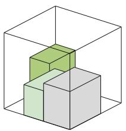

26.70%, 3 items  
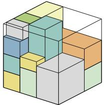  
75.67%, 15 items

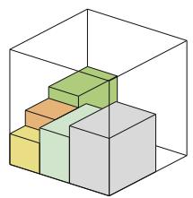  
31.90%, 5 items

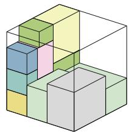

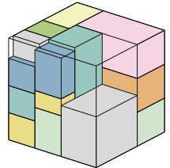  
87.40%, 17 items

57.13%, 11 items  
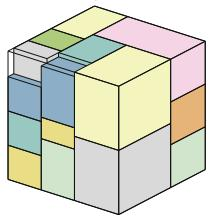  
99.40%, 18 items  
Figure 4: Packing progression of one episode on $\textstyle { \mathcal { D } } _ { 2 }$

Voxel resolution has a smaller efect on utilization within the tested range. On $\mathcal { D } _ { 1 }$ , the utilization ranges across $R =$ 10, 30, 50 are 0.86, 0.48, and 1.15 percentage points for $K \ = \ 1 , 3 , 5$ , respectively, compared with gains of 4.08– 6.00 percentage points when increasing � from 1 to 5. Moreover, increasing resolution does not yield monotonic improvements. These results suggest that utilization is more sensitive to bufer size than to voxel resolution under the tested settings.

At $K \ = \ 5 ,$ the efect of resolution also varies across datasets. Both $\mathcal { D } _ { 1 }$ and $D _ { 2 }$ achieve their highest reported utilization at $R = 3 0$ , reaching 93.69% and 91.80%, respectively, while $\mathcal { D } _ { 3 }$ records its highest voxel-based utilization at $\begin{array} { l l l } { R } & { = } & { 1 0 } \end{array}$ , with 89.30%. This comparison is afected by the upward-rounding rule used in voxelization: a partially occupied cell is treated as fully occupied, and the reported utilization is calculated from this rounded voxel occupancy rather than the original item volumes. A coarse grid can therefore overestimate occupied volume. Increasing � reduces voxel size and the scale of the rounding error, providing a closer approximation to the actual occupied volume. The higher reported utilization at $R = 1 0$ on $D _ { 3 }$ may thus partly reflect this discretization bias. Meanwhile, the packed-item count increases from 19.90 to 20.29 and 21.68 as � increases from 10 to 30 and 50, respectively. These results highlight the need to account for rounding bias when comparing utilization across resolutions; the highest voxel-based utilization alone does not establish the best physical packing performance. No single tested resolution maximizes reported utilization on all three datasets. The training curves in Figure 5(a) provide a complementary view of the performance diferences across datasets.

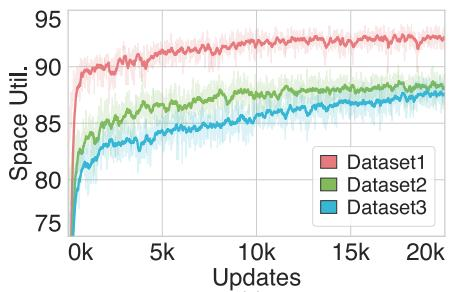  
(a)

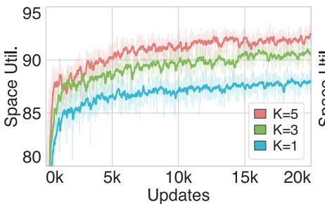  
(b)

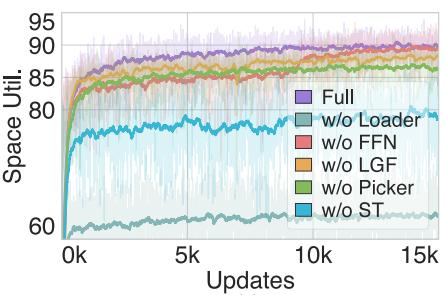  
(c)  
Figure 5: Sensitivity Analysis and ablation studies. (a) Performance across the three datasets. (b) Efect of � on $D _ { 1 } .$ . (c) Ablation studies on space utilization during training.

Table 3  
Performance of SAR under diferent settings. All experiments were set $N _ { \mathrm { o r i } } = 6$ and EV.
<table><tr><td></td><td> $R = 1 0$ </td><td></td><td> $R = 3 0$ </td><td></td><td> $R = 5 0$ </td></tr><tr><td></td><td>D K util.↑ std.↓ num. util.↑ std.↓ num. util.↑ std.↓ num.</td><td></td><td></td><td></td><td></td></tr><tr><td></td><td></td><td></td><td></td><td></td><td>1 1 88.46 4.80 35.17 87.93 4.80 34.95 87.60 5.05 34.85</td></tr><tr><td></td><td>1 3 91.61 3.92 36.91 91.69 3.56 37.89 91.21 4.25 37.45</td><td></td><td></td><td></td><td></td></tr><tr><td></td><td></td><td></td><td></td><td></td><td>1 5 92.54 4.14 37.68 93.69 3.88 37.99 93.60 3.44 38.38</td></tr><tr><td></td><td></td><td></td><td></td><td></td><td>2 5 90.13 4.91 25.13 91.80 4.75 25.93 90.21 5.08 25.17 3 5 89.30 5.35 19.90 88.64 5.12 20.29 88.37 4.94 21.68</td></tr></table>

## 4.4 Ablation Studies

Ablation of Components. Table 4 evaluates the contribution of each component. Here, w/o Picker removes learned reordering among bufered items and selects items by a fixed bufer-order rule, while the loader is still used to evaluate placement candidates after an item is chosen. In contrast, w/o Loader keeps item selection but replaces learned ranking over feasible placement candidates with random selection. Removing the loader causes the largest degradation, confirming that candidate-position evaluation is essential beyond feasibility checking. Removing spatial tokens (ST) also substantially reduces utilization, showing that global spatial context benefits item–space matching for reordering decisions. The picker and LGF provide further gains from two diferent aspects: learned item reordering and fine-grained candidate-position evaluation. Removing FFN has only a minor efect on final performance, but it slows training convergence, as shown in Figure 5(c). Overall, these results support the complementary roles of item-level reordering and placement-level evaluation in SAR.

Table 4  
Ablation study of model components. All experiments were set $K = 3 , R = 1 0 , N _ { \mathrm { o r i } } = 6 , D _ { 1 } = $ , and EMS.
<table><tr><td>Method</td><td>util.↑</td><td>Δ</td><td>std.↓</td><td>Δ</td><td>num.</td><td>∆</td></tr><tr><td>Full</td><td>90.63</td><td>一</td><td>4.69</td><td>一</td><td>36.42</td><td>1</td></tr><tr><td> $w / \circ$  FFN</td><td>90.13</td><td>-0.50</td><td>5.12</td><td>0.43</td><td>36.34</td><td>-0.08</td></tr><tr><td>w/o LGF</td><td>87.93</td><td>-2.70</td><td>5.07</td><td>0.38</td><td>35.68</td><td>-0.74</td></tr><tr><td>w/o ST</td><td>84.22</td><td>-6.41</td><td>7.72</td><td>3.03</td><td>31.97</td><td>-4.45</td></tr><tr><td>w/o Picker</td><td>87.77</td><td>-2.86</td><td>5.74</td><td>1.05</td><td>34.93</td><td>-1.49</td></tr><tr><td> $w / \circ$  Loader</td><td>62.85</td><td>-27.78</td><td>12.49</td><td>7.80</td><td>26.39</td><td>-10.03</td></tr></table>

Attention Architecture Analysis. We study how the depth and number of heads in the three attention stages afect SAR. Table 5 reports results on $D _ { 1 }$ with resolution $R = 1 0$ , bufer size $K = 5 ,$ , all six item orientations, and FC placement generation. The spatial encoder, picker, and loader columns give the number of attention heads and layers as H/L.

The reference configuration uses one head and one layer in each attention stage. Increasing the picker width from one to four heads has almost no efect on the final policy (93.50% versus 93.46% utilization), and widening the spatial encoder or loader to four heads is not beneficial. In contrast, adding a second loader layer improves utilization by 0.30 percentage points, reduces the utilization standard deviation from 3.80 to 3.06, and increases the average packed-item count by 0.52. This gain is not monotonic: three or four loader layers return to the reference level, while four or eight heads in the two-layer loader reduce both utilization and packed-item count. These results indicate that the loader benefits from a small amount of additional depth for candidate comparison, but the candidate sets in this task do not require a wide or very deep attention stack. We therefore retain a two-layer, single-head loader and lightweight single-head attention in the other stages.

Ablation of Attention Components. We further isolate the contribution of each attention component under $R = 1 0 ,$ $K = 5$ , six item orientations, and FC placement generation. Table 6 ablates spatial encoder self-attention (SA1), loader self-attention (SA2), loader candidate–space cross-attention (CA1), and picker item–space cross-attention (CA2). CA1 performs cross-attention between candidate placement tokens and spatial tokens, allowing placement evaluation to incorporate global container context. A checkmark $( \checkmark )$ indicates that the component is enabled, whereas a cross (×) indicates that it is disabled. The adjacent Δ column gives the change relative to the Full model.

Table 5  
Table 6  
Performance under diferent attention configurations. H/L denotes the number of attention heads/layers. Util. denotes space utilization (%), std. denotes its standard deviation $\left( \times 1 0 ^ { - 2 } \right)$ , and num. denotes the average number of packed items per episode.
<table><tr><td>Spatial Encoder (H/L)</td><td>Picker (H/L)</td><td>Loader (H/L)</td><td>util.↑</td><td>std.↓</td><td>num.</td></tr><tr><td>1/1</td><td>1/1</td><td>1/1</td><td>93.46</td><td>3.80</td><td>38.92</td></tr><tr><td>1/1</td><td>4/1</td><td>1/1</td><td>93.50</td><td>3.52</td><td>38.95</td></tr><tr><td>4/1</td><td>1/1</td><td>1/1</td><td>93.24</td><td>3.55</td><td>38.43</td></tr><tr><td>1/1</td><td>1/1</td><td>4/1</td><td>93.46</td><td>3.28</td><td>38.56</td></tr><tr><td>1/2</td><td>1/1</td><td>1/1</td><td>93.05</td><td>3.66</td><td>38.98</td></tr><tr><td>1/1</td><td>1/1</td><td>1/2</td><td>93.76</td><td>3.06</td><td>39.44</td></tr><tr><td>1/1</td><td>1/1</td><td>1/3</td><td>93.47</td><td>3.21</td><td>38.86</td></tr><tr><td>1/1</td><td>1/1</td><td>1/4</td><td>93.25</td><td>4.28</td><td>38.28</td></tr><tr><td>1/1</td><td>1/1</td><td>4/2</td><td>93.10</td><td>3.32</td><td>38.15</td></tr><tr><td>1/1</td><td>1/1</td><td>8/2</td><td>93.04</td><td>3.18</td><td>38.06</td></tr></table>

The component ablation separates the global and local roles of the attention blocks. Removing picker item– space cross-attention (CA2) causes the largest single drop, decreasing utilization by 3.32 percentage points and the packed-item count by 4.46. This is consistent with the picker implementation: without CA2, item scores cannot directly condition on the current spatial tokens. Removing spatial encoder self-attention (SA1) also has a clear cost (0.80 percentage points and 0.81 items), although the loss is smaller than for CA2. By comparison, removing loader self-attention (SA2) or loader cross-attention (CA1) changes utilization by at most 0.15 percentage points in this matrix; disabling both even gives a small improvement over the all-enabled reference. Thus the additional global context supplied by CA1 does not improve utilization in this setting, whereas global item–space interaction through CA2 is central to the learned policy.

Table 6 and Figure 6 show that the variant without CA1 ofers the most favorable overall balance of packing performance and convergence behavior among the tested configurations. It maintains high utilization and packeditem count, reduces utilization variability relative to the all-enabled model, and shows rapid initial learning. Some alternatives improve an individual final metric, but yield fewer packed items or slower initial learning. Considering packing quality, variability, and convergence together, we therefore adopt the variant without CA1 as the default net work configuration for our experiments.

## 4.5 Placement Generation Schemes

We further evaluate whether SAR depends on a particular heuristic for generating placement candidates. Table 7 reports results on $D _ { 1 }$ using a 10×10×10 container, a visibleitem bufer of $K \ = \ 5 .$ and all six item orientations. We compare Empty Maximal Space (EMS), Corner Point (CP), Event Point (EV), Full Coordinate (FC), Extreme Point (EP), and two incremental candidate-generation variants (V1 and V2). All other model and environment settings follow the defaults used elsewhere in this section.

Attention-component ablation. ✓ and × indicate enabled and disabled components, respectively. Each metric is reported as an absolute result and an adjacent Δ column showing its change from Full. Util. denotes space utilization (%), std. denotes its standard deviation $\left( \times 1 0 ^ { - 2 } \right)$ , and num. denotes the average packed-item count.
<table><tr><td rowspan="2">SA1</td><td rowspan="2">SA2</td><td rowspan="2">CA1</td><td rowspan="2">CA2</td><td colspan="2">util.</td><td colspan="2">std.</td><td colspan="2">num.</td></tr><tr><td>value</td><td>Δ</td><td>value</td><td>Δ</td><td>value</td><td>Δ</td></tr><tr><td>√</td><td>√</td><td>√</td><td>√</td><td>93.39</td><td>(-)</td><td>4.14</td><td>(-)</td><td>39.05</td><td>(-)</td></tr><tr><td>X</td><td>√</td><td>√</td><td>√</td><td>92.59</td><td>(-0.80)</td><td>4.56</td><td>(+0.42)</td><td>38.24</td><td>(-0.81)</td></tr><tr><td>√</td><td>X</td><td>√</td><td>√</td><td>93.24</td><td>(-0.15)</td><td>3.28</td><td>(-0.86)</td><td>38.92</td><td>(-0.13)</td></tr><tr><td>√</td><td>√</td><td>X</td><td>√</td><td>93.46</td><td>(+0.07)</td><td>3.80</td><td>(-0.34)</td><td>38.92</td><td>(-0.13)</td></tr><tr><td>√</td><td>X</td><td>X</td><td>√</td><td>93.52</td><td>(+0.13)</td><td>3.83</td><td>(-0.31)</td><td>38.69</td><td>(-0.36)</td></tr><tr><td>√</td><td>√</td><td>√</td><td>X</td><td>90.07</td><td>(-3.32)</td><td>4.29</td><td>(+0.15)</td><td>34.59</td><td>(-4.46)</td></tr><tr><td>X</td><td>×</td><td>√</td><td>√</td><td>93.34</td><td>(-0.05)</td><td>4.08</td><td>(-0.06)</td><td>38.06</td><td>(-0.99)</td></tr><tr><td>√</td><td>√</td><td>X</td><td>X</td><td>90.83</td><td>(-2.56)</td><td>3.94</td><td>(-0.20)</td><td>35.57</td><td>(-3.48)</td></tr><tr><td>X</td><td>X</td><td>X</td><td>X</td><td>90.23</td><td>(-3.16)</td><td>4.06</td><td>(-0.08)</td><td>34.72</td><td>(-4.33)</td></tr></table>

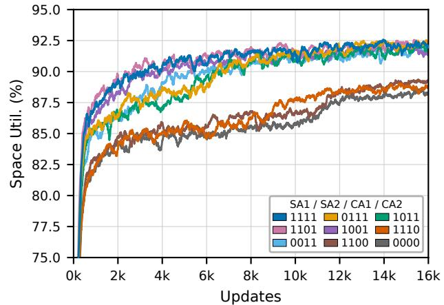  
Figure 6: Training dynamics for representative attentioncomponent configurations. Each curve shows the space utilization from one training run after exponential smoothing with a factor of 0.99.

Classical geometric schemes. EMS maintains a set of maximal axis-aligned empty cuboids, each defined by its front-left-bottom (FLB) corner and dimensions. When item $n _ { t }$ is placed, every EMS that intersects $n _ { t }$ is split into residual EMSs; any EMS fully contained within another is then removed. For every EMS large enough to hold the current item orientation, candidates are formed by aligning the item footprint with the left-up, right-up, left-bottom, and rightbottom corners of the EMS vertical bottom face, converted to FLB placement coordinates, as shown in Figure 7(a).

CP identifies positions where the silhouette of packed items, projected onto a 2D axis plane, transitions from a vertical to a horizontal boundary segment, as shown in Figure 7(b). When $n _ { t }$ is placed, 3D candidate positions are introduced from the set $\{ ( p _ { n } ^ { x } + s _ { n } ^ { x } , p _ { n } ^ { y } , p _ { n } ^ { z } ) , ( p _ { n } ^ { x } , p _ { n } ^ { y } + s _ { n } ^ { y } , p _ { n } ^ { z } ) \}$ $( p _ { n } ^ { x } , p _ { n } ^ { y } , p _ { n } ^ { z } + s _ { n } ^ { z } ) \}$ on whichever of the ���, ���, and ��� planes has its boundary envelope changed by $n _ { t } .$ Positions that no longer satisfy the envelope condition are removed.

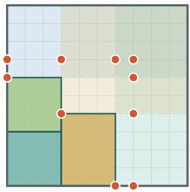  
(a) EMS

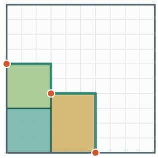  
(b) CP

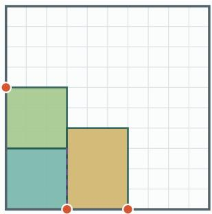  
(c) EP

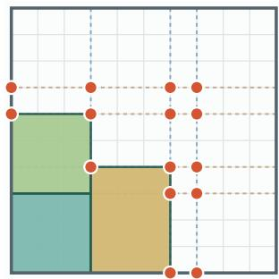  
(d) EV  
Figure 7: Reference candidate construction on a valid groundlevel packing. (a) EMS aligns the item with the corners of valid empty spaces. (b) CP extracts positions where the projected item silhouette transitions from a vertical to a horizontal boundary segment. (c) $\mathsf { E P }$ shows the raw anchors retained by the reference implementation’s sequential 2D projection routine. (d) EV combines item and container boundary alignments, converted to FLB coordinates for the candidate footprint, at each relevant boundary height within the vertical span of $n _ { t }$ . Red points denote retained candidate FLB anchors from the $z = 0$ construction plane for an item whose bottom face spans 3 grid cells along both the � and � axes (a 3 × 3 footprint). These anchors are shown before height lifting and physics checks; the EP anchor at (3, 0) is lifted above the yellow item.

EP follows the sequential 2D projection routine in the reference implementation of Zhao et al. (2022a). At ground level and each distinct item-top height, projected items are sorted by increasing lower � coordinate, with increasing upper � coordinate breaking ties. Each item’s upper-left and lower-right boundary points are projected toward the negative � and � directions, respectively, onto eligible faces of previously processed items or container walls. Previously collected anchors covered by the current item are removed before its new projections are added. The routine retains newly appearing anchors relative to the preceding height plane. These raw anchors can overlap another item’s footprint in top view, as at (3, 0) in Figure 7(c); height lifting and physical checks subsequently determine their placement heights and feasibility.

EV combines item and container boundary alignments to generate candidate positions (Zhao et al., 2022a). When

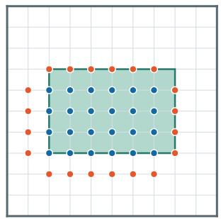  
(a) V1

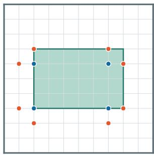  
(b) V2  
Figure 8: Top-view illustration of the incremental candidategeneration variants. Blue points denote top-face candidates, and orange points denote bottom-perimeter candidates. Points lie on integer grid intersections and show the (�, �) coordinates of voxel lower corners used as candidate FLB anchors for subsequent items. V1 densely samples the top face and perimeter edges, whereas V2 retains only their corner and endpoint representatives.

## Table 7

Performance of SAR with diferent placement generation schemes. Util. denotes space utilization (%), std. denotes its standard deviation $\left( \times 1 0 ^ { - 2 } \right)$ , num. denotes the average number of packed items per episode, and time denotes the average decision time per step (ms).
<table><tr><td>Scheme</td><td>util.↑</td><td>std.↓</td><td>num.</td><td>time</td></tr><tr><td>EMS</td><td>92.75</td><td>2.91</td><td>40.54</td><td>126</td></tr><tr><td>CP</td><td>89.42</td><td>4.16</td><td>36.34</td><td>90</td></tr><tr><td>EV</td><td>93.17</td><td>3.42</td><td>38.78</td><td>279</td></tr><tr><td>FC</td><td>93.46</td><td>3.00</td><td>39.45</td><td>300</td></tr><tr><td>EP</td><td>89.06</td><td>5.12</td><td>36.84</td><td>116</td></tr><tr><td>V1</td><td>93.28</td><td>3.68</td><td>38.75</td><td>280</td></tr><tr><td>V2</td><td>92.42</td><td>4.31</td><td>38.20</td><td>185</td></tr></table>

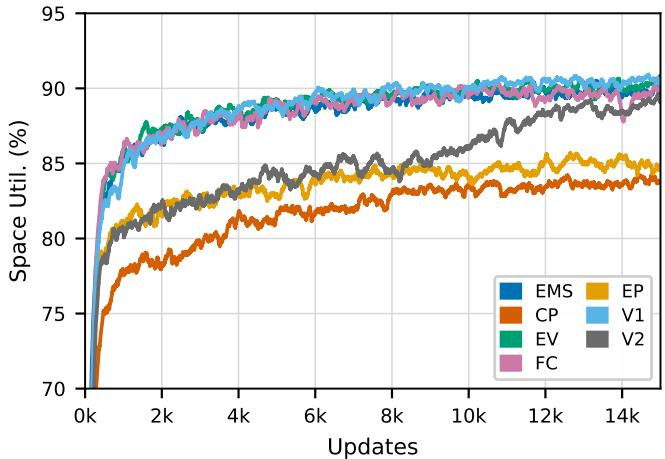  
Figure 9: Training dynamics under diferent placementgeneration schemes. Each curve shows the space utilization from one training run after exponential smoothing with a factor of 0.99. Final policy evaluation results are reported in Table 7.

$n _ { t }$ is placed, the existing candidate set is updated by scanning distinct boundary heights $p ^ { z }$ , given by the start/end � coordinates of packed items and satisfying $p _ { n } ^ { z } \leq p ^ { z } \leq p _ { n } ^ { z } + s _ { n } ^ { z } .$

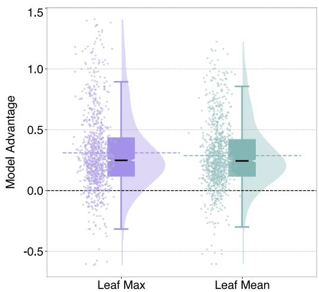  
Figure 10: Episode-averaged model advantage (percentage points) under Leaf-Max and Leaf-Mean. Positive and negative values favor the selected and unselected items, respectively; zero denotes equal outcomes.

In each corresponding �-plane, the start/end � and � coordinates of $n _ { t }$ are combined with existing item boundaries and container boundaries; the initial empty container is treated as a special packed item. For each orientation of the item to be placed next, boundary alignments are converted to FLB coordinates using its horizontal dimensions $( s ^ { x } , s ^ { y } )$ . An edge aligned to a boundary coordinate $b _ { x }$ or $b _ { \nu }$ gives an FLB coordinate of $b _ { x }$ or $b _ { x } - s ^ { x }$ along �, and $b _ { y } \operatorname { o r } b _ { y } - s ^ { y }$ along �, depending on which edge is aligned. Cartesian combinations of the resulting � and � anchors form proposals for that plane. The reference generator retains proposals whose complete footprints lie within an EMS at the same height, as shown in Figure 7(d).

Figure 7 illustrates the four constructions on a common top-view state, with the EMSs and event-boundary records updated after each placed item. In the implementation, every two-dimensional anchor is lifted to the maximum occupied height below the candidate footprint. Boundary, collision, and stability checks then produce the feasible placement set passed to the loading policy.

Incremental variants. To assess whether SAR depends on carefully designed geometric candidate-generation rules, we compare EMS, CP, EP, and EV with two simple incremental variants based on local sampling around newly placed items. Figure 8 illustrates their candidate anchors. V1 and V2 update a persistent candidate set after each placement. For a placed item with lower corner $( x , y , z )$ and voxel dimensions $( d _ { x } , d _ { y } , d _ { z } )$ , define $x _ { 0 } ~ = ~ x , x _ { 1 } ~ =$ $x + d _ { x } - 1 , y _ { 0 } = y , y _ { 1 } = y + d _ { y } - 1$ , and $z _ { \mathrm { t o p } } = z + d _ { z }$ V1 adds every empty voxel on the top face together with the positions adjacent to the four bottom perimeter edges. V2 sparsifies this set to four top corners and eight bottomperimeter points:

$$
C _ { \mathrm { t o p } } ^ { \mathrm { V } 2 } = \{ ( x _ { i } , y _ { j } , z _ { \mathrm { t o p } } ) \ : | \ : i , j \in \lbrace 0 , 1 \rbrace \} ,
$$

$$
\begin{array} { r } { C _ { \mathrm { b o t t o m } } ^ { \mathrm { V 2 } } = \{ ( x _ { 0 } , y _ { 1 } + 1 , z ) , ( x _ { 0 } - 1 , y _ { 1 } , z ) ,  } \\ {  ( x _ { 0 } - 1 , y _ { 0 } , z ) , ( x _ { 0 } , y _ { 0 } - 1 , z ) ,  } \\ {  ( x _ { 1 } , y _ { 0 } - 1 , z ) , ( x _ { 1 } + 1 , y _ { 0 } , z ) ,  } \\ {  ( x _ { 1 } + 1 , y _ { 1 } , z ) , ( x _ { 1 } , y _ { 1 } + 1 , z ) \} . } \end{array}\tag{19}
$$

The accumulated candidates are deduplicated and filtered by boundary, collision, and stability checks before placement selection.

The competitive performance of V1 and V2 in Table 7 further supports flexible customization of candidategeneration rules to application requirements while keeping SAR’s policy architecture unchanged.

## 4.6 Behavioral Analysis

To examine whether learned item selection improves packing outcomes in crowded states, we conduct a counterfactual tree analysis on $ D _ { 1 } ~ ( K { = } 2 , ~ N _ { \mathrm { o r i } } { = } 6 ,$ FC) over 1,000 episodes. Before utilization reaches 85%, packing follows only the model-selected branch; thereafter, both the selected and unselected item branches are expanded recursively. Their sibling subtrees start from the same packing state, enabling a controlled comparison of alternative item choices. Leaf-Max and Leaf-Mean denote, respectively, the maximum and mean utilization over the leaves of each explored subtree.

For each comparison node, we define the model advantage as $\Delta _ { q } = U _ { q } ^ { \mathrm { s e l } } - U _ { q } ^ { \mathrm { u n s e l } }$ , where $q \in$ {max, mean} specifies the leaf statistic, and $U _ { q } ^ { \mathrm { s e l } }$ and $U _ { q } ^ { \mathrm { u n s e l } }$ are the corresponding utilization values for the selected and unselected branches. The diference is measured in percentage points: a positive value indicates higher utilization for the model-selected branch, zero indicates equal outcomes, and a negative value indicates higher utilization for the unselected branch. Figure 10 shows the distributions of these diferences averaged over comparison nodes within each episode. Thus, the sign of a plotted value describes an episode-level average rather than every individual decision.

The win/tie/loss ratios are 88.66/1.05/10.29 (%) for Leaf-Max and 90.02/0.84/9.14 (%) for Leaf-Mean. Leaf-Max characterizes the best packing outcome found within an explored subtree, and Leaf-Mean characterizes the average outcome across its explored leaves. The high win rates under both statistics suggest that learned item selection favors branches with better best-case outcomes and higher average leaf utilization. Together, these results support the efectiveness of learned item selection in improving packing outcomes under the tested crowded conditions.

## 4.7 Adaptation Ability

We evaluate cross-dataset transferability through zeroshot evaluation and sequential fine-tuning. Model A is trained on Dataset 1 and directly evaluated on Datasets 2 and 3 without parameter updates, yielding the zero-shot results. We then fine-tune Model A on Dataset 2 to obtain Model B and further fine-tune Model B on Dataset 3 to obtain Model C. The fine-tuned results are obtained by evaluating Model

Table 8  
Generalization performance under zero-shot and fine-tuned settings. Util. denotes space utilization (%), std. denotes its standard deviation $\left( \times 1 0 ^ { - 2 } \right)$ , and num. denotes the average packed-item count. Underlined values correspond to sourcedomain evaluation of Model A.
<table><tr><td></td><td colspan="3">Dataset 1</td><td colspan="3">Dataset 2</td><td colspan="3">Dataset 3</td></tr><tr><td>Method</td><td>util.↑</td><td>std.↓</td><td>num.</td><td>util.↑</td><td>std.↓</td><td>num.</td><td>util.↑</td><td>std.↓</td><td>num.</td></tr><tr><td>zero-shot</td><td>93.69</td><td>3.88</td><td>37.99</td><td>76.44</td><td>8.00</td><td>22.24</td><td>72.34</td><td>8.47</td><td>17.56</td></tr><tr><td>fine-tuned</td><td>87.42</td><td>5.72</td><td>37.24</td><td>89.22</td><td>4.65</td><td>25.04</td><td>86.69</td><td>5.57</td><td>21.53</td></tr></table>

C on all three datasets. Model A’s performance on Dataset 1 is also reported as a source-domain reference.

Table 8 and Figure 11 show that the final fine-tuned model improves utilization on Dataset 2 from 76.44% to 89.22% and on Dataset 3 from 72.34% to 86.69%, relative to zero-shot evaluation. These increases amount to 12.78 and 14.35 percentage points, respectively. The utilization standard deviation decreases from 8.00 to 4.65 on Dataset 2 and from 8.47 to 5.57 on Dataset 3, while the average packed-item count increases from 22.24 to 25.04 and from 17.56 to 21.53, respectively. Thus, the utilization gains are accompanied by more packed items and lower utilization variability on both target datasets.

On Dataset 1, utilization decreases from 93.69% for Model A to 87.42% for Model C, a loss of 6.27 percentage points, and the average packed-item count decreases from 37.99 to 37.24. These results support SAR’s adaptability under the tested Dataset 1 → Dataset 2 → Dataset 3 finetuning sequence, with a trade-of between target-domain improvement and source-domain performance retention. The findings characterize the final Model C obtained after this sequence.

## 5. Conclusion

This paper presented SAR, a learning-based framework for bufered online 3D-BP. This decision decomposition reflects the distinct roles of item selection and rotation– position selection: conditional on successful placement, item selection determines the immediate volume gain and also influences future returns, while rotation and position shape the remaining free-space configuration, thereby afecting subsequent packing opportunities and future returns. The picker selects bufered items using voxel-based spatial tokens, while the loader performs fine-grained evaluation of feasible rotation–position candidates using LGF and intercandidate comparison. Both stages are jointly optimized under a shared long-term packing return. SAR improves utilization over the evaluated online baselines without bufering, with further gains when a bufer is available. Ablations support the complementary contributions of voxel-based item selection and LGF-based placement evaluation, while experiments demonstrate compatibility with multiple candidate generators. Counterfactual analysis further supports the benefits of learned item selection in crowded packing states.

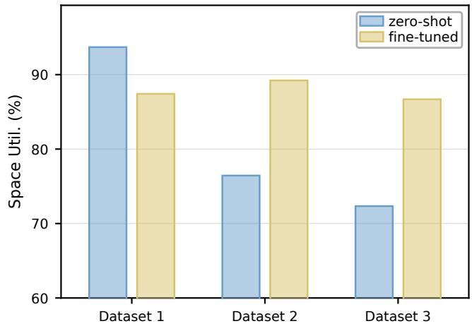  
Figure 11: Cross-dataset space utilization under zero-shot and fine-tuned settings.

Several limitations remain. SAR assumes cuboid items and standardized cubic containers, with evaluation limited to simulation. Distribution shifts reduce zero-shot performance, while fine-tuning involves a trade-of between adaptation and retention. Voxel rounding may also bias reported utilization measurements. Future work should extend geometric applicability, improve adaptation and retention, validate physical deployment, and refine volume evaluation. We hope that our work could provide a new perspective from which to formulate and examine 3D-BP and related problems.

## Appendix A. Dataset Item Types

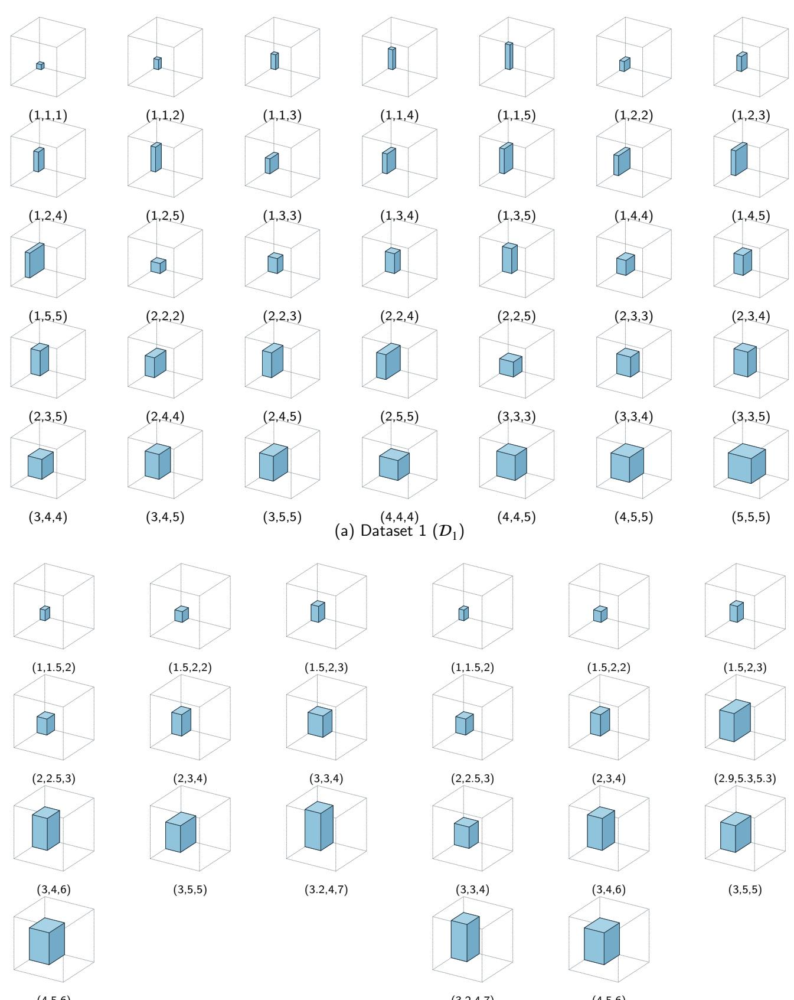  
(b) Dataset 2 (2)  
(c) Dataset 3 ( )  
Figure A.1: Item types in the three datasets. Each cube is rendered at the relative dimensions of one item type within a unit container and labeled by its dimensions in ascending order. (a) Dataset 1 $( D _ { 1 } )$ , (b) Dataset $2 \ ( D _ { 2 } )$ , and (c) Dataset $3 \left( D _ { 3 } \right)$

## References

Araya, I., Rif, M.C., 2014. A beam search approach to the container loading problem. Computers & Operations Research 43, 100–107.

Bello, I., Pham, H., Le, Q.V., Norouzi, M., Bengio, S., 2016. Neural combinatorial optimization with reinforcement learning. arXiv preprint arXiv:1611.09940 .

Bortfeldt, A., Gehring, H., 2001. A hybrid genetic algorithm for the container loading problem. European Journal of Operational Research 131, 143–161.

Crainic, T.G., Perboli, G., Tadei, R., 2008. Extreme point-based heuristics for three-dimensional bin packing. Informs Journal on computing 20, 368–384.

Dahmani, N., Nazir, A., Taleb, I., Bukhari, S.M.S., 2025. Reinforcement learning based intelligent optimisation for bin packing problems: A review. Array 28, 100616.

Duan, L., Hu, H., Qian, Y., Gong, Y., Zhang, X., Xu, Y., Wei, J., 2018. A multi-task selected learning approach for solving 3d flexible bin packing problem. arXiv preprint arXiv:1804.06896 .

Fang, J., Zhou, B., Wang, H., Zhu, X., Wang, L., 2026. Efective online 3d bin packing with lookahead parcels using monte carlo tree search, in: Proceedings of the 32nd ACM SIGKDD Conference on Knowledge Discovery and Data Mining V. 1, pp. 2184–2195.

Faroe, O., Pisinger, D., Zachariasen, M., 2003. Guided local search for the three-dimensional bin-packing problem. Informs journal on computing 15, 267–283.

Goyal, A., Deng, J., 2020. PackIt: A virtual environment for geometric planning, in: Proceedings of the 37th International Conference on Machine Learning, PMLR. pp. 3700–3710. URL: https://proceedings.mlr. press/v119/goyal20b.html.

Ha, C.T., Nguyen, T.T., Bui, L.T., Wang, R., 2017. An online packing heuristic for the three-dimensional container loading problem in dynamic environments and the physical internet, in: European Conference on the Applications of Evolutionary Computation, Springer. pp. 140– 155.

He, K., Zhang, X., Ren, S., Sun, J., 2016. Deep residual learning for image recognition, in: Proceedings of the IEEE conference on computer vision and pattern recognition, pp. 770–778.

Hu, H., Zhang, X., Yan, X., Wang, L., Xu, Y., 2017. Solving a new 3d bin packing problem with deep reinforcement learning method. arXiv preprint arXiv:1708.05930 .

Hu, R., Xu, J., Chen, B., Gong, M., Zhang, H., Huang, H., 2020. Tap-net: transport-and-pack using reinforcement learning. ACM Transactions on Graphics (TOG) 39, 1–15.

Ji, S., Xu, W., Yang, M., Yu, K., 2012. 3d convolutional neural networks for human action recognition. IEEE transactions on pattern analysis and machine intelligence 35, 221–231.

Karabulut, K., İnceoğlu, M.M., 2004. A hybrid genetic algorithm for packing in 3d with deepest bottom left with fill method, in: International Conference on Advances in Information Systems, Springer. pp. 441– 450.

Lamas-Fernandez, C., Bennell, J.A., Martinez-Sykora, A., 2023. Voxelbased solution approaches to the three-dimensional irregular packing problem. Operations Research 71, 1298–1317.

Lee, J., Lee, Y., Kim, J., Kosiorek, A., Choi, S., Teh, Y.W., 2019. Set transformer: A framework for attention-based permutation-invariant neural networks, in: International conference on machine learning, PMLR. pp. 3744–3753.

Lodi, A., Martello, S., Vigo, D., 2002. Heuristic algorithms for the threedimensional bin packing problem. European Journal of Operational Research 141, 410–420.

Maas, A.L., Hannun, A.Y., Ng, A.Y., et al., 2013. Rectifier nonlinearities improve neural network acoustic models, in: Proc. ICML, Atlanta, GA. p. 3.

Martello, S., Pisinger, D., Vigo, D., 2000. The three-dimensional bin packing problem. Operations research 48, 256–267.

Poolavaram, D., Chugh, A.R., Dorn, S., 2026a. Operationally guided placement-aware learning for industrial online 3d bin packing. arXiv preprint arXiv:2607.28257 .

Poolavaram, D., Markgraf, C., Dorn, S., 2026b. GENPACK: KPI-guided multi-criteria genetic algorithm for industrial 3D bin packing. arXiv preprint arXiv:2601.11325 .

Que, Q., Yang, F., Zhang, D., 2023. Solving 3d packing problem using transformer network and reinforcement learning. Expert Systems with Applications 214, 119153.

Sarawgi, N., Manyar, O.M., Wang, F., Nguyen, T.H., Seita, D., Gupta, S.K., 2026. Preference-conditioned reinforcement learning for space-time eficient online 3d bin packing. arXiv preprint arXiv:2603.07800 .

Schulman, J., Moritz, P., Levine, S., Jordan, M., Abbeel, P., 2015. Highdimensional continuous control using generalized advantage estimation. arXiv preprint arXiv:1506.02438 .

Schulman, J., Wolski, F., Dhariwal, P., Radford, A., Klimov, O., 2017. Proximal policy optimization algorithms. arXiv preprint arXiv:1707.06347

Song, S., Yang, S., Song, R., Chu, S., Li, Y., Zhang, W., 2023. Towards online 3d bin packing: Learning synergies between packing and unpacking via drl, in: Conference on Robot Learning, PMLR. pp. 1136–1145.

Tsang, Y., Mo, D., Chung, K., Lee, C., 2025. A deep reinforcement learning approach for online and concurrent 3d bin packing optimisation with bin replacement strategies. Computers in Industry 164, 104202.

Vaswani, A., Shazeer, N., Parmar, N., Uszkoreit, J., Jones, L., Gomez, A.N., Kaiser, Ł., Polosukhin, I., 2017. Attention is all you need. Advances in neural information processing systems 30.

Veličković, P., Cucurull, G., Casanova, A., Romero, A., Lio, P., Bengio, Y., 2018. Graph attention networks, in: International Conference on Learning Representations.

Vinyals, O., Fortunato, M., Jaitly, N., 2015. Pointer networks. Advances in neural information processing systems 28.

Wang, B., Yu, W., Zhang, X., Zheng, Z., Kong, W., Dong, H., 2026. Robotic bin packing via hierarchical reinforcement learning. IEEE Transactions on Automation Science and Engineering 23, 8634–8646. doi:10.1109/TASE.2026.3678655.

Wang, F., Hauser, K., 2019. Stable bin packing of non-convex 3d objects with a robot manipulator, in: 2019 International Conference on Robotics and Automation (ICRA), IEEE. pp. 8698–8704.

Wang, F., Hauser, K., 2022. Dense robotic packing of irregular and novel 3d objects. IEEE Transactions on Robotics 38, 1160–1173. doi:10.1109/ TRO.2021.3097261.

Williams, R.J., 1992. Simple statistical gradient-following algorithms for connectionist reinforcement learning. Machine learning 8, 229–256.

Wu, W., Fan, C., Huang, J., Liu, Z., Yan, J., 2023. Machine learning for the multi-dimensional bin packing problem: Literature review and empirical evaluation. arXiv preprint arXiv:2312.08103 .

Xiong, H., Guo, C., Peng, J., Ding, K., Chen, W., Qiu, X., Bai, L., Xu, J., 2024. Gopt: Generalizable online 3d bin packing via transformer-based deep reinforcement learning. IEEE Robotics and Automation Letters 9, 10335–10342.

Yin, H., Chen, F., He, H., 2024. Solving ofline 3d bin packing problem with large-sized bin via two-stage deep reinforcement learning, in: Proceedings of the 23rd International Conference on Autonomous Agents and Multiagent Systems, pp. 2576–2578.

Yin, H., Chen, F., He, H., 2025a. A learning-based two-stage bidirectional packing framework for 3d packing problems. IEEE Transactions on Automation Science and Engineering 22, 21541–21551. doi:10.1109/ TASE.2025.3607410.

Yin, H., Zhang, C., Chen, F., He, H., 2025b. Learning three-dimensional bin packing with adjustable-order semi-online setting, in: 2025 IEEE International Conference on Robotics and Automation (ICRA), IEEE. pp. 16088–16094. doi:10.1109/ICRA55743.2025.11127655.

Zhang, J., Zi, B., Ge, X., 2021. Attend2pack: Bin packing through deep reinforcement learning with attention. arXiv preprint arXiv:2107.04333

Zhao, H., She, Q., Zhu, C., Yang, Y., Xu, K., 2021. Online 3d bin packing with constrained deep reinforcement learning, in: Proceedings of the AAAI Conference on Artificial Intelligence, pp. 741–749.

Zhao, H., Yu, Y., Xu, K., 2022a. Learning eficient online 3d bin packing on packing configuration trees, in: International conference on learning

representations.

Zhao, H., Zhu, C., Xu, X., Huang, H., Xu, K., 2022b. Learning practically feasible policies for online 3d bin packing. Science China Information Sciences 65, 112105.

Zhou, P., Gao, Z., Li, C., Chong, N.Y., 2024. An eficient deep reinforcement learning model for online 3d bin packing combining object rearrangement and stable placement, in: 2024 24th International Conference on Control, Automation and Systems (ICCAS), IEEE. pp. 964–969.