# SPHERICAL FIXED-POINT REASONERS: ADAPTIVE LOOP HALTING ON THE HYPERSPHERE

Arber Zelaα Artavazd Maranjyanα Pol Puigdemontα David Berghausβ,γ

Valentyn Boreikoδ Volkan Cevherα

αEPFL βLamarr Institute γFraunhofer IAIS δAmazon AGI

## ABSTRACT

Looped (weight-tied) transformers enable adaptive computation by allocating more iterations to harder inputs. Fixed-Point Reasoners (FPRM) achieve this with a damped fixed-point solver, but operate in an unbounded Euclidean residual space with coupled rescaling and relative-norm halting. We introduce Spherical Fixed-Point Reasoners (SFPRM), which performs the same computation on the unit hypersphere of normalized transformers (nGPT). Input injection, damping, and halting become geodesic operations, yielding boundedness by construction and eliminating coefficient coupling. We prove fixed-point existence, local convergence under an explicit step-size condition, and global convergence under strong injection. On Sudoku-Extreme, Maze-Hard and Mini-ARC, SFPRM achieves 96.6%, 87.9% and 59.1% test accuracy, respectively, outperforming FPRM and other baselines while allocating test-time compute more effectively. Its converged geometry is also interpretable: token–input angles capture puzzle structure and predict correctness.

## 1 INTRODUCTION

Scaling test-time computation has become the main lever for improving the reasoning ability of sequence models, most visibly through chain-of-thought traces (Wei et al., 2022; Wang et al., 2023; Cobbe et al., 2021; Yao et al., 2023; Snell et al., 2025). Looped transformers offer a latent alternative (Dehghani et al., 2019; Bai et al., 2019; Geiping et al., 2025): a single weight-tied block is applied repeatedly, so depth becomes an iteration count chosen at inference time, and compute can be allocated per input according to its difficulty. On algorithmic puzzles such as Sudoku, mazes, and ARC, this recipe lets small recursive reasoners compete with far larger models (Wang et al., 2025; Jolicoeur-Martineau, 2025; Movahedi et al., 2026).

A looped transformer raises two questions: when should it stop, and will it stay well-behaved as it runs? The fixed-point view (Bai et al., 2019), answers the first by treating the loop as a solver for $\mathbf { z } ^ { \star } = F _ { \theta } ( \mathbf { z } ^ { \star } ; \mathbf { x } )$ and halting once the iterate stops moving. Fixed-Point Reasoners (FPRM) (Movahedi et al., 2026) turn this into a practical recipe: a damped iteration whose step size decays on a patience rule, a relative-norm residual as the halting test, and a boundedness theorem that keeps the recurrent state from diverging. The second question is where the Euclidean formulation shows its cost. Because the residual stream is free to grow, a boundedness theorem must couple four residualrescaling coefficients, and the halting residual needs a normalization factor to be scale-invariant.

We introduce Spherical Fixed-Point Reasoning Models (SFPRM), which run FPRM’s damped solver on nGPT’s (Loshchilov et al., 2025) unit sphere (Figure 1). The normalized Transformer (nGPT) obtains stable dynamics by changing the geometry rather than adding control: every hidden state lives on the unit hypersphere $\mathbb { S } ^ { d - \breve { 1 } }$ and each sub-layer is a learned angular move followed by renormalization, so the divergence FPRM must guard against cannot occur. Every control quantity of the loop becomes an angle: the input is re-injected by moving a fraction λ of the great-circle arc toward it, the damped update is a spherical linear interpolation (Slerp) whose coefficient η is an angular step size that FPRM’s patience-based decay literally shrinks, and the halting residual is the worst-token angle between an iterate and its proposal. Our contributions are:

(b) Halting on the sphere  
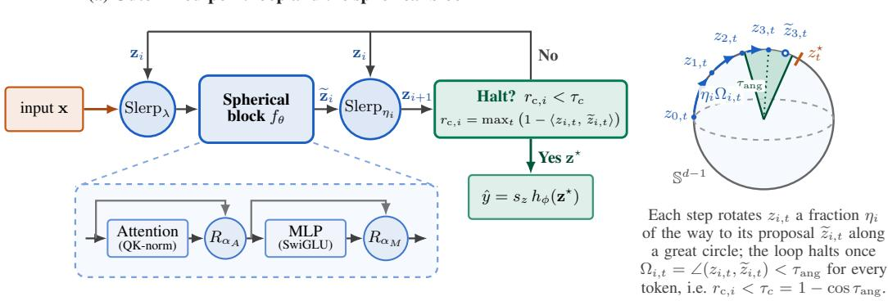  
Figure 1: SFPRM overview. (a) Each iteration interpolates the current state toward the normalized input $( { \mathrm { S l e r p } } _ { \lambda } )$ , applies the weight-tied spherical nGPT block to obtain the proposal $\widetilde { \mathbf { z } } _ { i } .$ , and rotates a fraction $\eta _ { i }$ of the way toward it $\mathrm { ( S l e r p } _ { \eta _ { i } } \mathrm { ) }$ ); the loop halts once the worst-token chordal residual $r _ { \mathrm { c } , i }$ falls below $\tau _ { c } .$ The eigen-learning-rate retractions $R _ { \alpha }$ inside the block keep every token state on unit sphere $\mathbb { S } ^ { d - 1 }$ . (b) One token’s iterates rotate along a great circle by shrinking angles $\eta _ { i } \Omega _ { i , t } ;$ the halting test compares each proposal with the current iterate, so it never needs the fixed point $z _ { t } ^ { \star }$

(i) Simplicity: because the state cannot leave the sphere, boundedness is structural, and FPRM’s coupled residual-rescaling coefficients, its boundedness theorem, and its relative-norm residual disappear rather than being re-proved;

(ii) guarantees: a fixed point exists from continuity and input injection alone, with no contraction or Lipschitz assumption; angular damping stabilizes any fixed point whose tangent Jacobian has real parts below one, with an explicit step-size window; and sufficiently strong injection makes it a unique global attractor;

(iii) performance: on Sudoku-Extreme and Maze-Hard, SFPRM halts up to 2.7× earlier than FPRM at equal or higher accuracy; and

(iv) interpretability: the angle between each token state and its input anchor separates token classes during the recursion, converges to a readable encoding of the task’s structure, and, on Sudoku, predicts whether the answer is correct.

## 2 RELATED WORK

Looped and weight-tied transformers. Tying the weights of a transformer block (Vaswani et al., 2017) and applying it repeatedly turns depth into an iteration count at inference time (Dehghani et al., 2019; Lan et al., 2020). Looped models match much deeper non-looped ones on synthetic reasoning tasks and can simulate chain-of-thought in latent space (Saunshi et al., 2025), learn in-context algorithms more sample-efficiently (Yang et al., 2024; Gatmiry et al., 2024), emulate programmable computation (Giannou et al., 2023), generalize in length when the loop matches the algorithm’s recursion (Fan et al., 2025), scale to billions of parameters (Geiping et al., 2025; Prairie et al., 2026), and supply a scaling axis for masked diffusion models (Carballo-Castro et al., 2026; Miele et al., 2026). SFPRM is a looped transformer whose loop is run as a fixed-point solve on the sphere.

Equilibrium models, adaptive computation, and halting. Adaptive Computation Time (Graves, 2016) and PonderNet (Banino et al., 2021) learn a halting distribution through an auxiliary loss, so halting is a learned head rather than a property of the dynamics. Recent methods such as HRM (Wang et al., 2025), URM (Gao et al., 2025), TRM (Jolicoeur-Martineau, 2025), and PTRM (Sghaier et al., 2026) inherit this design. Deep equilibrium models (Bai et al., 2019; 2020; Winston & Kolter, 2020; Bai et al., 2021) replace the unrolled iteration by the fixed point of a weight-tied layer and differentiate implicitly through it. Attractor models (Fein-Ashley & Rashidinejad, 2026) and equilibrium reasoners (Huang et al., 2026) make the loop’s attractor explicit and halt on a solver tol erance or a residual-based selection, and FPRM (Movahedi et al., 2026) halts on a scale-invariant residual of the tied block itself, at the cost of coupled residual-rescaling coefficients that keep its Euclidean residual stream bounded; iterating past the point where the answer has settled is itself harmful (Bansal et al., 2022; Schwarzschild et al., 2021). Table 1 sorts these reasoners by whether a numerical fixed-point solve is performed and what governs halting; SFPRM alone combines a genuine solve with an intrinsic, scale-free halting criterion on a curved state space.

Table 1: Recent recurrent reasoners: HRM (Wang et al., 2025), TRM (Jolicoeur-Martineau, 2025), URM (Gao et al., 2025), Attractor (Fein-Ashley & Rashidinejad, 2026), EqR (Huang et al., 2026) and FPRM (Movahedi et al., 2026). “Appr.” means no numerical fixed-point solve is performed.
<table><tr><td>Method</td><td>Recurrence</td><td>Fix. pt.</td><td>State update and input</td><td>Halting / output</td></tr><tr><td>HRM</td><td>Fast L-loop + slow H-loop</td><td>Appr.</td><td>Euclidean  $( z _ { L } , z _ { H } ) ;$  input drives L</td><td>ACT head; read zH</td></tr><tr><td>TRM</td><td>Shared net refines z, answer y</td><td>No</td><td>Euclidean; input re-read each step</td><td>ACT head; read y</td></tr><tr><td>URM</td><td>UT; fixed inner + ACT outer loop</td><td>No</td><td>Euclidean; short conv in MLP</td><td>ACT head, ≤16 steps</td></tr><tr><td>EqR</td><td>Tied loop; B stochastic restarts</td><td>Appr.</td><td>Euclidean; random init, path noise</td><td>ACT; lowest-residual run</td></tr><tr><td>Attractor</td><td>Backbone + equilibrium loop</td><td>Yes</td><td>Backbone ğo seeds each step</td><td>Solver tol.; read  $\tilde { y } ^ { \star }$ </td></tr><tr><td>FPRM</td><td>Tied Transformer loop</td><td>Yes</td><td> $( \alpha _ { 1 } , \beta _ { 1 } )$  mix; (α2, β2) injection</td><td>Rel.  $\cdot \ell _ { \infty }$  residual</td></tr><tr><td>SFPRM</td><td>Tied nGPT spherical loop</td><td>Yes</td><td>Eigen-LR motion; λ geodesic injection</td><td>Chordal residual</td></tr></table>

Normalized and hyperspherical representations. Constraining representations to a sphere is a long-standing stabilization device, for parameters (Salimans & Kingma, 2016; Miyato et al., 2018), latent variables (Davidson et al., 2018), contrastive representations (Wang & Isola, 2020), and flow language models that rotate tokens on $\mathbb { S } ^ { d - 1 }$ (Deschenaux & Gülçehre, 2026). nGPT (Loshchilov et al., 2025) carries the constraint through an entire transformer, with every hidden state and weight vector on $\mathbb { S } ^ { d - 1 }$ and each sub-layer a normalized retraction toward a learned target. SFPRM adopts that block, hence every optimizer and solver step becomes an angular update.

## 3 SPHERICAL FIXED-POINT REASONING MODELS

## 3.1 PRELIMINARIES

Notation. For a sequence of T tokens with hidden dimension d, the recurrent state at loop iteration i is $\mathbf z _ { i } = ( z _ { i , 1 } , \dots , z _ { i , T } )$ with token states $z _ { i , t } \in \mathbb { R } ^ { d }$ . We use i for loop iterations, t for token positions, and ℓ for sub-layers. $\mathbb { S } ^ { d - 1 } : = \{ z \in \mathbb { R } ^ { d } : \| z \| = 1 \}$ denotes the unit hypersphere in $\mathbb { R } ^ { d }$ . The embedded input is ${ \bf x } = ( x _ { 1 } , \dots , x _ { T } )$ . Tuples carry the product inner product $\textstyle \langle \mathbf { u } , \mathbf { v } \rangle : = \sum _ { t = 1 } ^ { T } \langle u _ { t } , v _ { t } \rangle$ and norm $\begin{array} { r } { \| \mathbf { u } \| ^ { 2 } : = \sum _ { t = 1 } ^ { T } \| u _ { t } \| _ { 2 } ^ { 2 } } \end{array}$ . Lowercase $f _ { \theta }$ always denotes the weight-tied network, uppercase $F _ { \boldsymbol { \theta } } ( \cdot ; \mathbf { x } )$ the complete input-dependent recurrent map, and $h _ { \phi }$ the readout.

Looped transformers and fixed-point reasoning. A looped Transformer applies a weight-tied network repeatedly to a state that is re-exposed to the same input x at every application: $\mathbf { z } _ { i + 1 } =$ $F _ { \theta } ( \mathbf { z } _ { i } ; \mathbf { x } )$ , for $i = 0 , 1 , \ldots$ , and predicts with a readout $h _ { \phi } ( \mathbf { z } _ { i } )$ . A convergent iteration reaches a fixed point $\mathbf { z } ^ { \star } = F _ { \theta } ( \mathbf { z } ^ { \star } ; \mathbf { x } )$ , the equilibrium view of Bai et al. (2019). The prediction is determined by the fixed point, while the number of iterations needed to reach it is chosen per input. FPRM (Movahedi et al., 2026) uses a pre-norm block of depth D (2D attention and MLP sub-layers). Because the residual stream is free to grow indefinitely, FPRM uses tied residual coefficients $( \alpha _ { 1 } , \beta _ { 1 } )$ and iteration-level coefficients $\left( \alpha _ { 2 } , \beta _ { 2 } \right)$

$$
\begin{array} { r } { \mathbf { z } _ { i } ^ { \ell } = \alpha _ { 1 } \mathbf { z } _ { i } ^ { \ell - 1 } + \beta _ { 1 } f _ { \theta ^ { \ell } } ^ { \ell } \left( \mathrm { N o r m } _ { \mathrm { p r e } } ( \mathbf { z } _ { i } ^ { \ell - 1 } ) \right) , \quad \ell = 1 , \ldots , 2 D , \qquad \mathbf { z } _ { i + 1 } ^ { 0 } = \alpha _ { 2 } \mathbf { z } _ { i } ^ { 2 D } + \beta _ { 2 } \mathbf { x } . } \end{array}\tag{1}
$$

Via a boundedness theorem that couples the four coefficients:,

$$
\begin{array} { r } { \beta _ { 2 } = 1 - \alpha _ { 2 } \alpha _ { 1 } ^ { 2 D } , \qquad \beta _ { 1 } = \frac { \beta _ { 2 } \left( 1 - \alpha _ { 1 } \right) } { 1 - \alpha _ { 1 } ^ { 2 D } } , \qquad 0 \le \alpha _ { 1 } , \alpha _ { 2 } < 1 , } \end{array}\tag{2}
$$

ensures that the recurrent carry path (gain $\alpha _ { 2 } \alpha _ { 1 } ^ { 2 D } )$ is balanced against the injected input. Given a proposal $\widetilde { \mathbf { z } } _ { i } = F _ { \theta } ( \mathbf { z } _ { i } ; \mathbf { x } )$ , FPRM damps linearly:

$$
\mathbf { z } _ { i + 1 } = ( 1 - \eta _ { i } ) \mathbf { z } _ { i } + \eta _ { i } \widetilde { \mathbf { z } } _ { i } ,\tag{3}
$$

with a per-sample $\eta _ { i } \in ( 0 , 1 ]$ that is decayed on a patience rule whenever the residual stalls, and halts on the relative residual:

$$
\begin{array} { r } { r _ { \mathrm { E } , i } = \frac { \| \mathbf { z } _ { i } - \widetilde { \mathbf { z } } _ { i } \| _ { \infty } } { \| \widetilde { \mathbf { z } } _ { i } \| _ { \infty } + \epsilon } , \qquad \| \mathbf { u } \| _ { \infty } : = \operatorname* { m a x } _ { 1 \leq t \leq T , 1 \leq j \leq d } | ( u _ { t } ) _ { j } | , } \end{array}\tag{4}
$$

once $r _ { \mathrm { E } , i } ~ < ~ \tau _ { \mathrm { E } }$ or the budget is exhausted. The coefficient coupling and the denominator of the residual exist to contain a Euclidean residual stream whose scale is not fixed. Rather than differentiate implicitly through the equilibrium as in Bai et al. (2019), FPRM trains with truncated BPTT over windows of K iterations, deep supervision, and state detachment between windows.

nGPT and spherical geometry. nGPT (Loshchilov et al., 2025) constrains every hidden state to the unit sphere $\mathbb { S } ^ { d - 1 }$ via $\mathrm { N o r m } ( u ) = u / \| u \| _ { 2 }$ for a nonzero token vector and folds each sub-layer output into the state through learned, per-coordinate eigen learning rates $\alpha _ { A } , \alpha _ { M } \in \mathbb { R } ^ { d }$

$$
\begin{array} { r l } & { \mathbf { z } \gets \mathrm { N o r m } \big ( \mathbf { z } + \alpha _ { A } \odot \big ( \mathrm { N o r m } ( \mathrm { A t t n } ( \mathbf { z } ) ) - \mathbf { z } \big ) \big ) , } \\ & { \mathbf { z } \gets \mathrm { N o r m } \big ( \mathbf { z } + \alpha _ { M } \odot \big ( \mathrm { N o r m } ( \mathrm { M L P } ( \mathbf { z } ) ) - \mathbf { z } \big ) \big ) . } \end{array}\tag{5}
$$

Norm acts token-wise on tuples, and $\alpha _ { A } , \alpha _ { M }$ are shared across tokens. Each sub-layer is a normalized retraction toward a learned target, so unit norm is preserved by construction rather than enforced by a constraint (Absil et al., 2008). For unit vectors $u ,$ v write $\dot { \angle } ( u , v ) : = \operatorname { a r c c o s } ( \langle u , v \rangle )$ For $\Omega = \angle ( u , v ) \in ( 0 , \pi )$ , the spherical linear interpolation:

$$
\begin{array} { r } { \mathrm { S l e r p } _ { \eta } ( u , v ) = \frac { \sin \left( ( 1 - \eta ) \Omega \right) } { \sin \Omega } u + \frac { \sin \left( \eta \Omega \right) } { \sin \Omega } v , \qquad \eta \in [ 0 , 1 ] , } \end{array}\tag{6}
$$

moves a fraction η along the shortest great-circle arc from u to v and stays on the sphere. For coincident endpoints we set $\mathrm { S l e r p } _ { \eta } ( u , u ) : = u .$ , the limit of eq. (6) as $v  u ;$ at an antipodal pair $( v = - u )$ the shortest arc is not unique, so we use eq. (12) (Section $\mathbf { A } . 2 )$ . For small Ω, Slerp agrees with normalized linear interpolation Norm $( ( 1 - \eta ) u + \eta v )$ up to ${ \cal O } ( \Omega ^ { 3 } )$ (Lemma 2).

## 3.2 SFPRM: THE RECURRENT MAP AND ITS SOLVER

SFPRM is a looped Transformer model whose recurrent state lives on the unit hypersphere and whose loop is run as a damped fixed-point solver. Algorithm 1 places it next to FPRM (Movahedi et al., 2026), its Euclidean predecessor. Every difference is a Euclidean operation replaced by its spherical one: the state is confined to $s$ by a weight-tied nGPT block (line 5, eq. (5)), affine injection becomes a geodesic move a fraction λ of the arc toward the input (line 4, eq. (8)), the relative residual becomes the chordal one (line $^ { 6 , }$ eq. (9)), and linear damping becomes a rotation a fraction $\eta _ { i }$ of the way toward the proposal (line 9, eq. (10)).

State space and spherical block. SFPRM’s recurrent state is a tuple of unit token vectors, $\begin{array} { r l } { \mathbf { z } _ { i } } & { { } = } \end{array}$ $( z _ { i , 1 } , \ldots , z _ { i , T } ) \in \mathcal { S } : = ( \mathbb { S } ^ { d - 1 } ) ^ { T }$ , where $\| z _ { i , t } \| _ { 2 } = 1$ and the input $\mathbf { x } = ( x _ { 1 } , \hdots , x _ { T } ) \in S$ is the embedded sequence normalized token-wise. The weighttied network $f _ { \theta } : { \mathcal { S } }  { \mathcal { S } }$ is a stack of D nGPT layers, each an attention retraction followed by an MLP retraction as in eq. (5), with QK-normalization and eigen learning rates shared across iterations. Attention couples tokens, so $f _ { \theta }$ acts on the product $s$ rather than token by token; it is the block applied at every iteration in eq. (8). Following nGPT’s logit scaling, predictions are read out as $s _ { z } h _ { \phi } ( \mathbf { z } )$ where, given the vocabulary V, $h _ { \phi }$ is a linear map $\mathbb { R } ^ { d } \to \mathbb { R } ^ { | \nu | }$ and $s _ { z }$ is a learned scalar. nGPT would normalize the rows of ϕ like every other weight vector, however we keep them unnormalized so the head can set its own per-class scale while the state stays on the sphere.

Geodesic input injection. We lift Slerp from tokens to sequences by applying it position-wise. Given two unit token vectors u and v, we write:

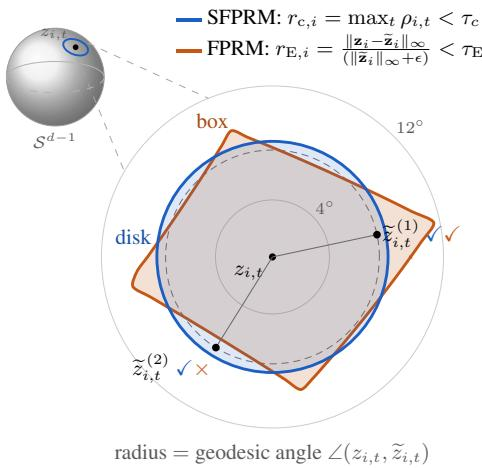  
Figure 2: Proposals accepted by each halting test around a token state $z _ { i , t }$ . The chordal test accepts a disk; FPRM’s accepts an axisaligned $\ell _ { \infty }$ section, so two proposals at the same angle can be judged differently.

$$
\operatorname { S l e r p } _ { \eta } ( \mathbf u , \mathbf v ) : = \left( \operatorname { S l e r p } _ { \eta } ( u _ { t } , v _ { t } ) \right) _ { t = 1 } ^ { T } , \qquad \eta \in [ 0 , 1 ] .\tag{7}
$$

At every iteration $i ,$ the current state is first pulled toward the input along the shortest arc using ${ \mathrm { S l e r p } } _ { \lambda }$ of eq. (7), and the result is then passed through the nGPT block of eq. (5):

$$
F _ { \theta } ( \mathbf { z } ; \mathbf { x } ) : = f _ { \theta } ( \mathrm { S l e r p } _ { \lambda } ( \mathbf { z } , \mathbf { x } ) ) , \qquad 0 < \lambda < 1 .\tag{8}
$$

Algorithm 1 FPRM (left) and SFPRM (right) in one skeleton. Black=shared control flow; or  
ange=FPRM-specific; blue=SFPRM-specific. Both start from a random state $\mathbf { z } _ { 0 }$ and re-inject the   
input before every application of $f _ { \boldsymbol { \theta } } ;$ the coloured lines are the only differences.   
FPRM (Euclidean fixed point) SFPRM (spherical fixed point)   
Require: Euclidean block $f _ { \theta }$ (Transformer), head Require: spherical block $f _ { \theta } ( \mathrm { n G P T } ) ,$ head $h _ { \phi } ;$ tol.   
$h _ { \phi } ;$ tol. τ ; decay γ; patience $P ;$ cap $N _ { \mathrm { m a x } }$ $\tau _ { c } ;$ decay $\gamma ;$ patience $P ;$ cap $N _ { \mathrm { m a x } }$   
1: $\mathbf { z }  \mathbf { z } _ { 0 }$ ▷ random init 1: $\mathbf { z }  \mathbf { z } _ { 0 } \in { \mathcal { S } }$ ▷ random unit-norm init   
2: $\eta {  } 1 ; p {  } P ; r _ { \mathrm { b e s t } } {  } \infty$ 2: $\eta {  } 1 ; p {  } P ; r _ { \mathrm { b e s t } } {  } \infty$   
3: repeat 3: repeat   
4: $\widetilde { \mathbf { z } } \gets \alpha _ { 2 } \ \mathbf { z } + \beta _ { 2 } \ \mathbf { x }$ ▷ affine input injection 4: $\widetilde { \mathbf { z } } \gets \mathrm { S l e r p } _ { \lambda } ( \mathbf { z } , \mathbf { x } )$ ▷ geodesic injection   
5: $\widetilde { \mathbf { z } } \gets f _ { \theta } ( \widetilde { \mathbf { z } } )$ $\triangleright 2 D$ sub-layers, $( \overset { \cdot } { \alpha } _ { 1 } , \overset { \cdot } { \beta } _ { 1 } )$ 5: $\widetilde { \mathbf z } \gets f _ { \boldsymbol \theta } ( \widetilde { \mathbf z } )$ ▷ tied spherical block   
6: $r  \| \mathbf { z } - \mathbf { \widetilde { z } } \| _ { \infty } / ( \| \mathbf { \widetilde { z } } \| _ { \infty } + \epsilon )$ ▷ relative $- { \ell _ { \infty } }$ 6: $r \gets$ maxt $\left( 1 - \left. z _ { t } , \widetilde { z } _ { t } \right. \right)$ ▷ chordal residual   
7: $\mathbf { i f } r < r _ { \mathrm { b e s t } }$ then $r _ { \mathrm { b e s t } }  r ; p  P$ else $p {  } p { - } 1$ 7: $\mathbf { i f } r < r _ { \mathrm { b e s t } }$ then $r _ { \mathrm { b e s t } }  r ; p  P$ else $p {  } p { - } 1$   
8: if $p { \le } 0$ and $r > \tau _ { \mathrm { { E } } }$ then $\eta {  } \gamma \eta ; p {  } P$ 8: i $\mathbf { f } \ p { \leq } 0$ and $r > \tau _ { c }$ then $\eta {  } \gamma \eta ; p {  } P$   
9: $\mathbf { z } \gets ( 1 { - } \eta ) \mathbf { z } + \eta \widetilde { \mathbf { z } }$ ▷ linear damping 9: $\mathbf { z } \gets \mathrm { S l e r p } _ { \eta } ( \mathbf { z } , \widetilde { \mathbf { z } } )$ ▷ geodesic damping   
10: (train) every $K \colon$ backprop $\mathrm { C E } \left( h _ { \phi } ( { \mathbf { z } } ) , y \right) ;$ 10: (train) every $K \colon$ backprop $\mathrm { C E } \left( s _ { z } h _ { \phi } ( \mathbf { z } ) , y \right) ;$   
detach z detach z   
11: until $r { < } \tau _ { \mathrm { E } }$ or $N _ { \mathrm { m a x } }$ steps 11: until $r { < } \tau _ { c }$ or $N _ { \mathrm { m a x } }$ steps   
12: return $h _ { \phi } ( \mathbf { z } )$ 12: return $s _ { z } h _ { \phi } ( \mathbf { z } )$ ▷ scaled readout

The injection strength λ is a model parameter, fixed or learned, with the same reading in either case: it is the fraction of the arc from each token state to its input token that is traversed before the block is applied. Geodesic injection is the intrinsic form of FPRM’s additive mixing $\alpha _ { 2 } { \bf z } + \beta _ { 2 } { \bf x }$ (eq. (1)): normalizing any positive combination αu + βv lands on the same shortest arc from u to vb, at a fraction set by the coefficients, the norms, and the angle (Lemma 3 in Section A.3). FPRM’s coefficients therefore do two jobs at once: they place the state along this arc, and, through the coupling (eq. (2)), they keep its norm from drifting. On the unit sphere the second part is given by construction, and the first is done by λ alone. SFPRM thus replaces the implicit, state-dependent fraction by a single parameter and drops $\left( \alpha _ { 1 } , \beta _ { 1 } , \alpha _ { 2 } , \beta _ { 2 } \right)$ together with their coupling.

Scale-free halting residual. Given the same proposal $\widetilde { \mathbf { z } } _ { i } = F _ { \theta } ( \mathbf { z } _ { i } ; \mathbf { x } )$ of eq. (8), geodesic distance on S is the angle between unit vectors, so SFPRM halts on the worst-token chordal residual, which is smooth where the angle itself is not:

$$
\begin{array} { r } { r _ { \mathrm { c } , i } = \operatorname* { m a x } _ { 1 \leq t \leq T } \rho _ { i , t } , \qquad \rho _ { i , t } : = 1 - \langle z _ { i , t } , \widetilde { z } _ { i , t } \rangle = \frac { 1 } { 2 } \| z _ { i , t } - \widetilde { z } _ { i , t } \| _ { 2 } ^ { 2 } , } \end{array}\tag{9}
$$

and halts once $r _ { \mathrm { c } , i } < \tau _ { c } .$ where $\tau _ { c } = 1 - \cos \tau _ { \mathrm { a n g } }$ for an angular tolerance $\tau _ { \mathrm { a n g } } ,$ so the test fires exactly when every token’s proposal lies within $\tau _ { \mathrm { a n g } }$ of its iterate. The worst token max is the spherical analogue of the maximum over tokens and coordinates in $r _ { \mathrm { E } , i }$ (eq. (4)): a few unconverged but decisive tokens should keep the iteration running. What FPRM’s denominator and ϵ provide is scale invariance, and on the unit sphere that is automatic, so neither is needed. The two tests remain inequivalent: $\rho _ { i , t }$ sees only the geodesic angle and so accepts a disk of radius $\tau _ { \mathrm { a n g } }$ around the iterate, whereas $r _ { \mathrm { E } , i }$ i sees the largest-magnitude coordinate and so accepts an axis-aligned $\ell _ { \infty }$ region whose angular extent depends on the direction of the update, and two proposals at the same angle can get opposite verdicts (Figure 2). We adopt the chordal form for its simplicity and frame-independence.

Geodesic damping. If the residual is above tolerance, the state is advanced by a rotation toward the proposal, in place of FPRM’s linear interpolation (eq. (3)):

$$
\begin{array} { r } { \mathbf { z } _ { i + 1 } : = \mathrm { S l e r p } _ { \eta _ { i } } ( \mathbf { z } _ { i } , \widetilde { \mathbf { z } } _ { i } ) , \qquad 0 < \eta _ { i } \le 1 . } \end{array}\tag{10}
$$

By Lemma 1, token t turns by exactly $\eta _ { i } \angle ( z _ { i , t } , \widetilde { z } _ { i , t } )$ , so $\eta _ { i }$ is an angular step size: $\eta _ { i } = 1$ applies the raw map and smaller values shrink the rotation without leaving the sphere, so the block is always evaluated on the geometry it was trained on. The update never changes the equilibria: for $\eta _ { i } > 0$ the step returns $\mathbf { z } _ { i }$ if and only if $\widetilde { \mathbf { z } } _ { i } = \mathbf { z } _ { i }$ , so the damped iteration and $F _ { \theta }$ have exactly the same fixed points wherever the arcs are defined. As in FPRM (eq. (3)), ηi is per sample, starts at 1, and is multiplied by $\gamma < 1$ whenever the residual has not improved for $\dot { P }$ iterations. On the sphere this patience rule is literally a shrinking of the per-iteration rotation angle, a derivative-free search for a step inside the stability window of Theorem 1.

Training. Training follows FPRM: deep supervision with truncated BPTT, i.e., each optimizer step backpropagating through one segment of K geodesic steps with the state detached between segments. The residual, patience counter and step-size schedule are computed from detached states, so they steer the solver without entering the gradient; differentiating Norm projects state cotangents onto the tangent space, parameters stay Euclidean, and weight vectors are renormalized after every optimizer step. In practice, we use a guarded Slerp (eq. (12)), which replaces the sine formula by normalized linear interpolation near coincident endpoints and by an explicit arc near antipodes.

## 3.2.1 THEORETICAL GUARANTEES

We now investigate what the geometry buys analytically. All statements concern the exact recurrence eqs. (8) to (10) with shortest-arc interpolation. Full proofs are in Appendix A.

Boundedness by construction. Because injection and damping return unit token vectors (Lemma 1), the block does so by construction (eq. (5)), and so does every branch of the guarded step (Lemma 2), the state stays on $\dot { \boldsymbol { s } }$ for every i and every θ: recurrent magnitudes can neither explode nor vanish, which is what FPRM’s boundedness theorem secures through the coefficient constraints in eq. (2). However, boundedness alone says nothing about whether a fixed point exists or is reached, which is what we address next.

Input injection guarantees a fixed point. On a sphere, continuity alone does not guarantee a fixed point since rotating a circle moves every point. Input injection repairs this by moving each token a fraction $\lambda$ of the way to its input, keeping every injected state in the cap $\bar { \mathcal { C } _ { \mathbf { x } } } : = \{ \mathbf { y } \in \mathcal { S } : \angle ( y _ { t } , x _ { t } ) \leq ( 1 - \lambda ) \pi$ for every token t}, which, unlike the sphere, can be flattened into a closed ball, where every continuous self-map has a fixed point.

Proposition 1 (Fixed-point existence). Fix x and $0 < \lambda < 1$ . Assume $f _ { \theta }$ is continuous on $\mathcal { C } _ { \bf x }$ and $f _ { \theta } ( \mathbf { y } ) _ { t } \neq - x _ { t } f o r$ every $\mathbf { y } \in \mathcal { C } _ { \mathbf { x } }$ and token t. Then the recurrent map $F _ { \theta } ( \cdot ; \mathbf { x } )$ in eq. (8) has at least onefixed point $\mathbf { z } ^ { \star } = F _ { \theta } ( \mathbf { z } ^ { \star } ; \mathbf { x } )$ in $s .$

The full proof (Appendix A.4) applies Brouwer’s theorem (Brouwer, 1911; Ortega & Rheinboldt, 1970) to the reversed composition $H ( \mathbf { y } ) : = \mathrm { S l e r p } _ { \lambda } ( f _ { \boldsymbol { \theta } } ( \mathbf { y } ) , \mathbf { x } )$ . Unlike $F _ { \theta }$ , which injects before the block, H ends with the injection, so it maps the cap into itself, and the antipode assumption keeps it well defined and continuous; its fixed point $\mathbf { y } ^ { \star }$ gives the fixed point $\mathbf { z } ^ { \star } : = f _ { \theta } ( \mathbf { y } ^ { \star } )$ of $F _ { \theta }$ . No Lipschitz constant, contraction modulus, or spectral bound on $f _ { \theta }$ is needed. FPRM proves existence only via global convergence, hence under contraction (Movahedi et al., 2026, Theorem 2); Brouwer alone would need the coefficient coupling that keeps a ball invariant. On the sphere compactness is structural and injection supplies the missing ball-shaped domain. Only $\mathbf { y } ^ { \star }$ , however, provably lies in $\mathcal { C } _ { \bf x }$ , and existence implies neither uniqueness nor attraction, which the next two results address.

Angular damping stabilizes a fixed point. Let $\mathbf { z } ^ { \star }$ be a fixed point of $F _ { \theta } ( \cdot ; \mathbf { x } )$ and let $\begin{array} { l l } { \boldsymbol { J } } & { : = } \end{array}$ $D _ { \mathbf { z } } F _ { \theta } ( \mathbf { z } ^ { \star } ; \mathbf { x } )$ be its Jacobian in the recurrent state at $\mathbf { z } ^ { \star }$ , with θ and x held fixed. Since $F _ { \theta }$ maps $s$ to itself, J sends tangent perturbations $\mathbf { u } = ( u _ { t } ) _ { t = 1 } ^ { T }$ with $\langle u _ { t } , z _ { t } ^ { \star } \rangle = 0$ to tangent perturbations, and we regard it as an endomorphism of that $T ( d - \bar { 1 }$ )-dimensional tangent space. It contains all coupling between tokens through attention and need be neither orthogonal nor diagonalizable.

Theorem 1 (Local convergence of angular damping). Suppose $F _ { \boldsymbol { \theta } } ( \cdot ; \mathbf { x } )$ is differentiable at a fixed point $\mathbf { z } ^ { \star }$ and every $\zeta \in \sigma ( J )$ , where $\sigma ( J )$ is the Jacobian’s set of eigenvalues, satisfies $\mathrm { R e } ( \zeta ) < 1$ Thenfor everyfixed $0 < \eta \leq 1$ with

$$
\begin{array} { r } { \eta < \eta _ { \mathrm { m a x } } : = \operatorname* { m i n } _ { \zeta \in \sigma ( J ) } \frac { 2 \big ( 1 - \mathrm { R e } ( \zeta ) \big ) } { | \zeta - 1 | ^ { 2 } } , } \end{array}\tag{11}
$$

the damped iteration $\mathbf { z } _ { i + 1 } = \mathrm { S l e r p } _ { \eta } ( \mathbf { z } _ { i } , F _ { \theta } ( \mathbf { z } _ { i } ; \mathbf { x } ) )$ converges to $\mathbf { z } ^ { \star }$ from every sufficiently close initial state, with $\| \mathbf { z } _ { i } - \mathbf { z } ^ { \star } \| \leq C q ^ { i } \| \mathbf { z } _ { 0 } - \mathbf { z } ^ { \star } \|$ for some $C > 0$ and $q \in ( 0 , 1 )$ ). Moreover, wherever the shortest arcs are defined, the damped iteration and $F _ { \theta }$ have exactly the samefixed points.

This is the spherical counterpart of FPRM’s stabilization result (Movahedi et al., 2026, Theorem 3), with an explicit window and with unit norm and fixed points preserved. The window is certified for a fixed $\eta ;$ the patience rule (lines 7–8 of Algorithm 1) searches for one heuristically, without guarantee. The proof (Appendix A.6) linearizes the damped step at $\mathbf { z } ^ { \star }$ to $( 1 - \eta )$ Id $+ \eta J$ (Lemma 4), which moves each eigenvalue $\zeta$ of J a fraction $\eta$ from 1 toward $\zeta ;$ the window of eq. (11) is exactly what keeps them all inside the unit disk. A spectral radius below one then gives geometric convergence in tangent coordinates, which the coordinate map transfers to the state. Such an $\eta$ exists only if $\mathrm { R e } ( \zeta ) ^ { - } < 1$ for every $\zeta \colon$ damping tames modes that oscillate or spiral away under the raw map, not expansive ones with $\mathrm { R e } ( \zeta ) \bar { \geq } 1$ , which training must remove (Remark 1).

Table 2: Comparison with published recurrent reasoners. Reported numbers are taken from the respective papers; Mini-ARC numbers are from Huang et al. (2026) (Table 14). Numbers in parentheses are our own runs under the same setting as SFPRM. Tf = Transformer, Mixer = MLP-Mixer, rec. = recurrent refinement, FP = fixed-point solve. Within the 5–7M group the best result is bold and the second best underlined.
<table><tr><td colspan="6"></td><td>Maze-Hard</td><td>Mini-ARC</td><td>ARC-1</td></tr><tr><td colspan="2">Model</td><td>Architecture</td><td># params.</td><td>(No Hier.)</td><td>Pass@1</td><td>Pass@1</td><td>Pass@1</td><td>Pass@2</td></tr><tr><td colspan="2">HRM</td><td>rec. Tf</td><td>27M</td><td>x</td><td>55.0%</td><td>74.5%</td><td>44.9% (51.7%)</td><td>40.3%</td></tr><tr><td rowspan="3">Lager</td><td>Attractor Model</td><td> $\mathrm { T f } + \mathrm { F P } \log \mathrm { \ l o o p }$ </td><td>27M</td><td>x</td><td>91.4%</td><td>93.1%</td><td></td><td></td></tr><tr><td>URM</td><td>rec. Tf + conv</td><td>14M</td><td>x</td><td>77.6%</td><td></td><td></td><td></td></tr><tr><td>TRM</td><td>rec. Tf</td><td>7M</td><td>x</td><td>74.7%</td><td>85.3%</td><td>48.4% (36.9%)</td><td>44.6%</td></tr><tr><td rowspan="3">7M EqR</td><td></td><td>rec. Mixer + restarts</td><td>5-7M</td><td>x</td><td>93.0%</td><td></td><td>55.3% (40.3%)</td><td></td></tr><tr><td>Attractor Model</td><td>FP Tf</td><td>7M</td><td>x</td><td>54.3%</td><td>46.7%</td><td></td><td></td></tr><tr><td>FPRM</td><td>FP Tf</td><td>7M</td><td>√</td><td>94.2% (78.4%)</td><td>87.0% (83.9%)</td><td>— (55.0%)</td><td>47.5%</td></tr><tr><td colspan="2">SFPRM (ours)</td><td>spherical FP Tf</td><td>7M</td><td>√</td><td>96.6%</td><td>87.9%</td><td>59.1%</td><td>47.4%</td></tr></table>

Global convergence under strong injection. Finally, we identify a regime where the raw recurrence (η = 1) converges from every admissible initialization. x and $f _ { \theta }$ are held fixed while λ varies.

Theorem 2 (Global convergence under strong input injection). Suppose $f _ { \theta } : S  S$ is continuously differentiable in a neighborhood of $\mathbf { x }$ and $f _ { \theta } ( \mathbf { x } ) _ { t } \ \ne \ - x _ { t }$ for every token t. Then there exists a $\lambda _ { 0 } \in ( 0 , 1 )$ , depending on $f _ { \theta }$ and $\mathbf { x } ,$ such that for every $\lambda \in ( \lambda _ { 0 } , 1 )$ the map $F _ { \theta } ( \cdot ; \mathbf { x } )$ has a fixed point $\mathbf { z } ^ { \star }$ , unique among all states at which the input interpolation is defined. For each such λ and every $\mathbf { z } _ { 0 } \in { \mathcal { S } }$ with $z _ { 0 , t } \neq - x _ { t }$ for all t, the iterates $\mathbf { z } _ { i + 1 } = F _ { \theta } ( \mathbf { z } _ { i } ; \mathbf { x } )$ are well defined and satisfy $\| \mathbf { z } _ { i } - \mathbf { z } ^ { \star } \| \leq C q ^ { i - 1 }$ for all $i \geq 1$ , with $C > 0$ and $q \in ( 0 , 1 )$ independent of $\mathbf { z } _ { 0 }$

The proof (Appendix A.7, with an explicit $\lambda _ { 0 } )$ uses logarithmic coordinates at x, where injection multiplies by 1 − λ: for λ near one, the first injection pulls every admissible state into a small ball around x on which the map is a Banach contraction, so only that ball matters. FPRM’s global result (Movahedi et al., 2026, Theorem 2) instead rests on a global Lipschitz bound and a small residual coefficient, which the sphere lacks: injection does not contract near the input’s antipode. Together the three results cover every injection strength: a fixed point exists for all λ, strong injection makes it a unique global attractor, and damping gives local convergence under weaker injection.

## 4 EMPIRICAL EVALUATION

With the following experiments we answer three research questions:

(RQ1) Accuracy. How does SFPRM compare to FPRM and other recurrent reasoner baselines? Does constraining the recurrence on the sphere cost accuracy? (Section 4.1)

(RQ2) Convergence and halting. How effectively does SFPRM utilize the learned recurrence under the angular halting criterion and is the fixed-point unique? (Section 4.2)

(RQ3) Geometry of the computation. What does the fixed-point iteration write into the state, and does the spherical parameterization make it readable? (Section 4.3)

Setup. We evaluate SFPRM on puzzle benchmarks: Maze-Hard, Sudoku-Extreme (Wang et al., 2025), Mini-ARC (Kim et al., 2022) and ARC-1 (Chollet et al., 2024), used to assess generalization when trained with a limited number of examples. SFPRM and FPRM share a 6.83M-parameter

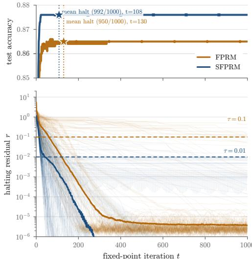  
Figure 3: Exact accuracy and halting on Maze-Hard (Sudoku: fig. 10). SFPRM vs. FPRM evaluation on 1000 test puzzles. Top: exact accuracy; mean halt and number of examples halting. Bottom: per-sequence residual (thin), median (heavy).

Transformer backbone and follow the hyperparameters of Movahedi et al. (2026) (details in Appendix B). SFPRM trains its weight matrices with Muon (Jordan et al., 2024) and its embeddings, normalization scales, and scalars with AdamW, regularizes with variational and weight dropout, and learns the injection fraction $\lambda ,$ except on Sudoku (λ fixed at 0.1). It halts once $r _ { \mathrm { c } , i } < \tau _ { c } = 0 . 0 1$ (eq. (9)), i.e. once every token’s proposal lies within 8.1◦ of its iterate.

## 4.1 RQ1: ACCURACY ON PUZZLE BENCHMARKS

Table 2 compares SFPRM with published recurrent reasoners. On Sudoku-Extreme, SFPRM reaches 96.6% exact accuracy, 2.4 points above FPRM published results. Since we cannot resample the same 1k base puzzles augmented 1000× from FPRM, we train it on 5k puzzles augmented 200× instead: the same number of training examples, but five times as many distinct puzzles. On Maze-Hard, SFPRM reaches 87.9% on the 1,000 test mazes, above TRM’s and FPRM’s published results and behind only the 27M-parameter Attractor model (Fein-Ashley & Rashidinejad, 2026). On Mini ARC, SFPRM reaches 59.1% Pass@1, above both the best published result in its size group (EqR, 55.3% (Huang et al., 2026)) and all baselines retrained under our protocol (FPRM 55.0%, HRM 51.7%, EqR 40.3%, TRM 36.9%). On ARC-1, it matches FPRM.

Answer to RQ1. Confining the state to the sphere improves accuracy: SFPRM outperforms FPRM and other baselines on Sudoku-Extreme (96.6% vs. 94.2%), Maze-Hard (87.9% vs. 87.0%) and Mini-ARC (59.1% vs. 55.0%), and matches it on ARC-1 (47.4% vs. 47.5%).

## 4.2 RQ2: CONVERGENCE AND HALTING

Loop utilization and halting. To see how the two solvers converge and when they stop, we run each trained model with halting disabled for $N _ { \mathrm { m a x } }$ iterations, decode every iterate $\mathbf { z } _ { i }$ , and record the residual its solver tests. Halting is counted per sequence, i.e., a sequence halts once its residual stays below the threshold (Appendix C.4). Figure 3 shows the result on Maze and Figure 10 on Sudoku. Both residuals fall quickly, and both models saturate their accuracy within 20–35 iterations, so every later loop is spent after the answer stops changing. SFPRM converges faster and stops sooner: it halts on 992/1000 mazes against FPRM’s 950, and on average 22 iterations earlier (108 vs. 130).

Fixed-point uniqueness. Theorem 2 predicts that for $\lambda > \lambda _ { 0 }$ the raw recurrence $\mathbf { z } _ { i + 1 } = F _ { \theta } ( \mathbf { z } _ { i } ; \mathbf { x } )$ contracts to one fixed point from every initialization. We test this by overriding λ at inference in the trained model (learned $\lambda = 0 . 4 7 )$ and running the raw map, without damping, in fp32 for 400 steps on 32 evenly spaced test puzzles, from eight initializations each: six random states, the input $\mathbf { x } ,$ and its antipode −x, which the theorem excludes. The largest geodesic angle between the eight end states measures uniqueness without a reference point (Figure 4a). For $\lambda \geq 0 . 8$ all eight end states coincide on every puzzle. At the trained $\lambda = 0 . { \bar { 4 } } 7$ the raw map reaches an attracting fixed point on 91% of the puzzles, and on the puzzle of Figure 4b all eight paths end inside the exact-match region. $\mathrm { A t } \lambda = 0 . 1$ the raw iteration does not converge, while for $\lambda \geq 0 . 7$ it converges within a few steps to a unique fixed point that no longer solves the puzzle.

Varying the fixed-point solver. At inference we replace the damped step of Algorithm 1 by two standard solvers, keeping the model and the halting rule: Anderson acceleration (Anderson, 1965;

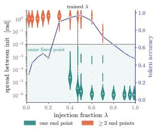  
(a) Uniqueness vs. λ.

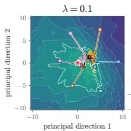

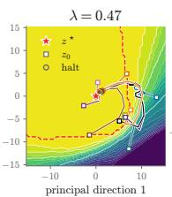

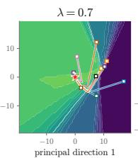

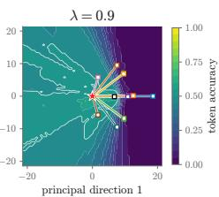  
(b) Trajectories in the top-2 principal plane at four values of λ.

Figure 4: Global convergence under input injection (SFPRM, Sudoku). (a) Largest angle between the end states of eight initializations, over 32 puzzles, against λ (teal: all coincide, coral: $\geq 2$ end states); indigo, right axis: token accuracy. (b) Trajectories from the eight $\mathbf { z } _ { 0 }$ (squares) to $\mathbf { z } ^ { \star }$ (star), coloured by the token accuracy of the decoded state; circles mark the first iteration with $r _ { \mathrm { c } , i } < \tau _ { c } ,$ dashed red the exact-match region.

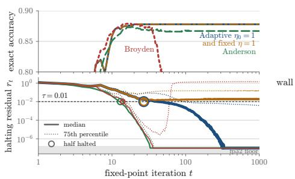  
(a) Accuracy per solver.

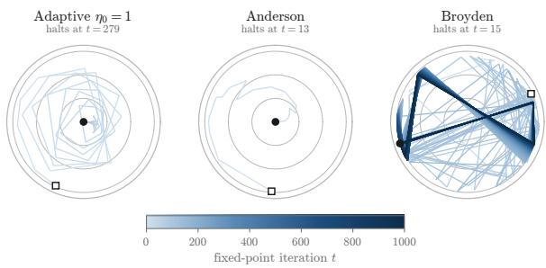  
(b) Path-token trajectory per solver.  
Figure 5: Fixed-point solvers (SFPRM, Maze). (a) Accuracy, halting disabled. (b) Radius is the geodesic angle (log-scaled) to $\mathbf { z } ^ { \star }$ , rings at $0 . 1 / 1 / 1 0 / 1 0 0 ^ { \circ }$

Walker & Ni, 2011) and limited-memory Broyden (Broyden, 1965), the solver of deep equilibrium models (Bai et al., 2019). Both cost one evaluation of $F _ { \theta }$ per iteration, like the damped step (details in Appendix C.5). For both models Anderson halts earlier than the default solver, on every Maze example, while staying within one point of its accuracy (Table 5 and Figure 5). Broyden halts about as early on Maze but diverges afterwards, so it relies on stopping in time. Without damping $( \eta = 1 )$ 37–100% of examples never reach τ , and on Sudoku accuracy drops as well. We leave training with these solvers, rather than swapping them in at inference, for future work.

Answer to RQ2. SFPRM uses its loop iterations more effectively than FPRM: its angular criterion halts earlier on Sudoku-Extreme and Maze-Hard at equal or higher accuracy. Under strong input injection the raw iteration converges to a unique fixed point, as Theorem 2 predicts.

## 4.3 RQ3: THE GEOMETRY OF THE COMPUTATION

The state reveals the task structure. On the sphere a token state’s only free quantity is its direction, so we probe the computation through the anchor angle $\angle ( z _ { i , t } , x _ { t } )$ between each cell’s iterate and its unitnormalized input embedding, the quantity that injection acts on (eq. (8)).

Figure 7 shows four frames of one rollout per task (FPRM and more puzzles in Figures 21 and 22), and Figures 6 and 15 show the angle over loops for every cell of a test puzzle, clustered by cell class. On Sudoku, we can see that, for SFPRM, the clue tokens rotate toward their anchors while the blanks end near orthogonal. By i=39 the anchor map is a binary image of the clue mask. Each loop iteration writes the cell class information into the direction of the state. On the other hand, FPRM encodes the mask mainly in the norm of its state (Figure 9), a scale set by training rather than by the geometry. Its anchor map shows only small

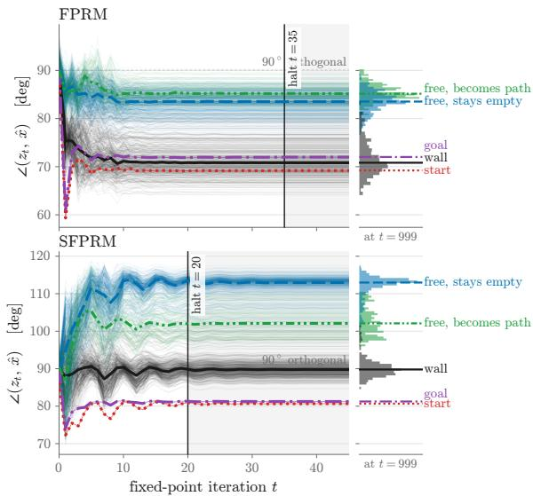  
Figure 6: Anchor angles by cell class on Maze: cells (thin lines), class means (heavy), the halt iteration (vertical line), and the final distribution (margin).

differences between clues and blanks. Similarly, on Maze, SFPRM settles walls at ${ \approx } 9 0 ^ { \circ }$ , empty cells at ${ \approx } 1 1 3 ^ { \circ }$ , and path cells at ${ \approx } 1 0 2 ^ { \circ }$ . Empty and path cells receive the same input token but still end at different angles, so the looping itself decides which cells lie on the path instead of reading it off the input. FPRM separates walls from free cells but not path from empty cells. On Mini-ARC (Figures 8, 23 and 24), the cells a task rewrites end furthest from their anchors under SFPRM (mean AUC 0.81), while FPRM’s ordering varies across tasks (AUC 0.51).

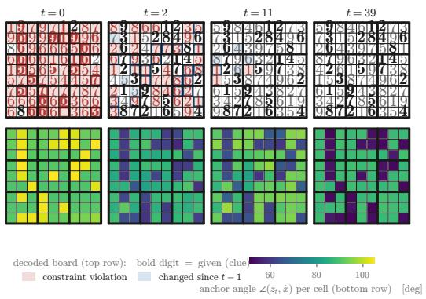

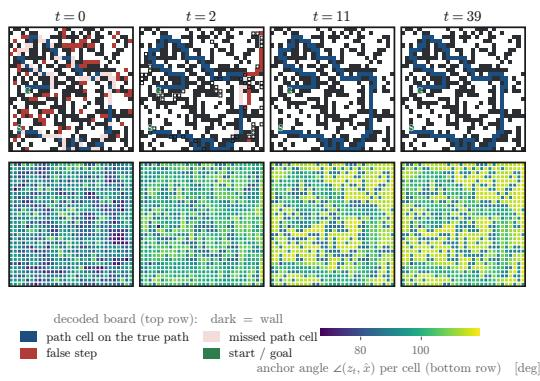

Figure 7: SFPRM rollout frames (FPRM in Figures 21 and 22). Top row: the board decoded from zi; bottom row: each cell’s angle to its own input anchor. left: Sudoku-Extreme; right: Maze-Hard.  
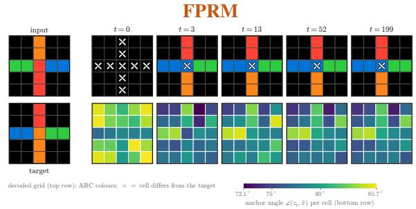

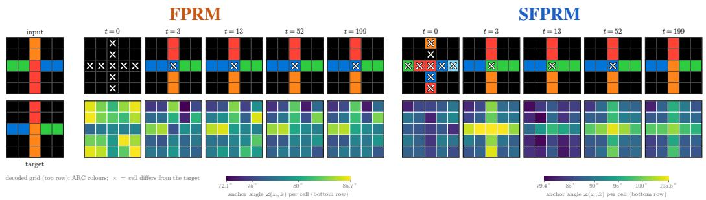  
Figure 8: Rollout frames on Mini-ARC for FPRM (left) and SFPRM (right). Input (top) and target (bottom), then iterations t = 0 to 199: decoded grid (×: wrong cell) and angle to the input anchor, $\angle ( z _ { t } , \hat { x } )$ . Only SFPRM solves this puzzle, and its angle map singles out the cells the task rewrites.

The final angle predicts correctness. On unsolved Sudoku puzzles both SFPRM cell classes end farther from their anchors (Figure 9): the clues at ≈65◦ instead of ≈52◦, almost disjoint from the solved ones, and the blanks at ≈92◦ instead of ≈88◦. The converged angle thus flags a wrong answer without labels, shared by every cell and puzzle. FPRM’s final norms separate the two outcomes far less: its clue and blank norms overlap widely.

Answer to RQ3. SFPRM’s loop writes task structure into the state, and on the sphere it is legible as an angle to the input: the clue mask on Sudoku, the path on Maze, and, on Sudoku, whether the answer is correct. FPRM’s angles and state norm carry this structure only faintly or partially.

## 5 CONCLUSION

We introduced SFPRM, which runs FPRM’s damped fixed-point loop on nGPT’s hypersphere. This change of geometry assures norm boundedness by construction and eliminates the need for FPRM’s coupled residual-rescaling coefficients. We provide theoretical guarantees under weaker assumptions than its Euclidean counterpart. Empirically, on puzzle and reasoning tasks, SFPRM halts more effectively at equal or higher accuracy than FPRM. Finally, we showed that the angle each token keeps to its input turns out to be a readable encoding of the task’s structure and, on Sudoku, a label-free predictor of correctness. Natural next steps are to scale SFPRM to language modeling and train with better solvers, which we have so far used only at inference.

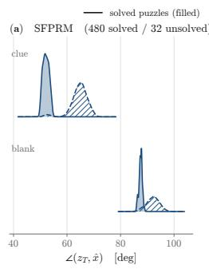

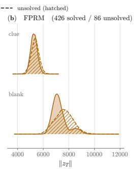  
Figure 9: Final anchor angle vs. correctness on 512 Sudoku puzzles: angle (SFPRM) and state norm (FPRM) of clue and blank cells, for solved (filled) and unsolved (hatched) puzzles.

Reproducibility. We provide the experimental protocol in Appendix B and in Table 3 a list of the used hyperparameters in our experiments. The inference-time solver description and comparison from Section 4.2 is provided in Appendix C.5. We implemented SFPRM on top of the public FPRM code base (Movahedi et al., 2026). The code is provided at https://github.com/ arberzela/sfprm.git. All runs were trained using Nvidia A100 GPUs for a single seed each.

LLM Usage. Running FPRM’s damped fixed-point solver on nGPT’s unit hypersphere, with geodesic injection, angular damping, and a chordal halting residual, was the authors’ idea. For the theory, the authors provided proof strategies and guidance, while AI tools helped develop, write, and check parts of the proofs. The SFPRM implementation on the FPRM code base was assisted by Claude and verified by the authors, who also produced the experimental design, analyses, and figures with LLM assistance. Claude helped restructure and edit the manuscript for length and readability.

Acknowledgments. This work was supported by EPFL AI Center & Swiss AI Initiative Postdoctoral Fellowship Programme. This work was supported as part of the Swiss AI Initiative, through a grant from the ETH Domain and computational resources provided by the Swiss National Supercomputing Centre (CSCS) under the Alps infrastructure.

## REFERENCES

P.-A. Absil, Robert Mahony, and Rodolphe Sepulchre. Optimization Algorithms on Matrix Manifolds. Princeton University Press, 2008.

Donald G. Anderson. Iterative procedures for nonlinear integral equations. Journal of the ACM, 12 (4):547–560, 1965.

Shaojie Bai, J. Zico Kolter, and Vladlen Koltun. Deep equilibrium models. In Advances in Neural Information Processing Systems (NeurIPS), 2019.

Shaojie Bai, Vladlen Koltun, and J. Zico Kolter. Multiscale deep equilibrium models. In Advances in Neural Information Processing Systems (NeurIPS), 2020.

Shaojie Bai, Vladlen Koltun, and J. Zico Kolter. Stabilizing equilibrium models by Jacobian regularization. In International Conference on Machine Learning (ICML), 2021.

Andrea Banino, Jan Balaguer, and Charles Blundell. PonderNet: Learning to ponder. In ICML Workshop on Automated Machine Learning (AutoML), 2021.

Arpit Bansal, Avi Schwarzschild, Eitan Borgnia, Zeyad Emam, Furong Huang, Micah Goldblum, and Tom Goldstein. End-to-end algorithm synthesis with recurrent networks: Logical extrapolation without overthinking. In Advances in Neural Information Processing Systems (NeurIPS), 2022.

L. E. J. Brouwer. Über Abbildung von Mannigfaltigkeiten. Mathematische Annalen, 71:97–115, 1911.

Charles G. Broyden. A class of methods for solving nonlinear simultaneous equations. Mathematics ofComputation, 19(92):577–593, 1965.

Alba Carballo-Castro, Julianna Piskorz, Paulius Rauba, Mihaela van der Schaar, and Pascal Frossard. Recursive scaling in masked diffusion models. arXiv preprint arXiv:2606.18022, 2026.

François Chollet, Mike Knoop, Gregory Kamradt, and Bryan Landers. ARC prize 2024: Technical report. arXiv preprint arXiv:2412.04604, 2024.

Karl Cobbe, Vineet Kosaraju, Mohammad Bavarian, Mark Chen, Heewoo Jun, Łukasz Kaiser, Matthias Plappert, Jerry Tworek, Jacob Hilton, Reiichiro Nakano, Christopher Hesse, and John Schulman. Training verifiers to solve math word problems. arXiv preprint arXiv:2110.14168, 2021.

Tim R. Davidson, Luca Falorsi, Nicola De Cao, Thomas Kipf, and Jakub M. Tomczak. Hyperspherical variational auto-encoders. In Conference on Uncertainty in Artificial Intelligence (UAI), 2018.

Mostafa Dehghani, Stephan Gouws, Oriol Vinyals, Jakob Uszkoreit, and Łukasz Kaiser. Universal transformers. In International Conference on Learning Representations (ICLR), 2019.

Justin Deschenaux and Çaglar Gülçehre. Language modeling with hyperspherical flows. ˘ arXiv preprint arXiv:2605.11125, 2026.

Ying Fan, Yilun Du, Kannan Ramchandran, and Kangwook Lee. Looped transformers for length generalization. In International Conference on Learning Representations (ICLR), 2025.

Jacob Fein-Ashley and Paria Rashidinejad. Solve the loop: Attractor models for language and reasoning. In ICML 2026 Workshop on Foundations of Deep Generative Models: Understanding Memorization, Generalization, and Reasoning, 2026.

Zitian Gao, Lynx Chen, Yihao Xiao, He Xing, Ran Tao, Haoming Luo, Joey Zhou, and Bryan Dai. Universal reasoning model. arXiv preprint arXiv:2512.14693, 2025.

Khashayar Gatmiry, Nikunj Saunshi, Sashank J. Reddi, Stefanie Jegelka, and Sanjiv Kumar. Can looped transformers learn to implement multi-step gradient descent for in-context learning? In International Conference on Machine Learning (ICML), 2024.

Jonas Geiping, Sean Michael McLeish, Neel Jain, John Kirchenbauer, Siddharth Singh, Brian R. Bartoldson, Bhavya Kailkhura, Abhinav Bhatele, and Tom Goldstein. Scaling up test-time compute with latent reasoning: A recurrent depth approach. In The Thirty-ninth Annual Conference on Neural Information Processing Systems, 2025.

Angeliki Giannou, Shashank Rajput, Jy-yong Sohn, Kangwook Lee, Jason D. Lee, and Dimitris Papailiopoulos. Looped transformers as programmable computers. In International Conference on Machine Learning (ICML), pp. 11398–11442, 2023.

Alex Graves. Adaptive computation time for recurrent neural networks. arXiv preprint arXiv:1603.08983, 2016.

Benhao Huang, Zhengyang Geng, and J. Zico Kolter. Equilibrium reasoners: Learning attractors enables scalable reasoning. In International Conference on Machine Learning (ICML), 2026.

Alexia Jolicoeur-Martineau. Less is more: Recursive reasoning with tiny networks. arXiv preprint arXiv:2510.04871, 2025.

Keller Jordan, Yuchen Jin, Vlado Boza, Jiacheng You, Franz Cesista, Laker Newhouse, and Jeremy Bernstein. Muon: An optimizer for hidden layers in neural networks. Blog post, 2024. URL https://kellerjordan.github.io/posts/muon/.

Subin Kim, Prin Phunyaphibarn, Donghyun Ahn, and Sundong Kim. Playgrounds for abstraction and reasoning. In NeurIPS 2022 Workshop on Neuro Causal and Symbolic AI (nCSI), 2022.

Zhenzhong Lan, Mingda Chen, Sebastian Goodman, Kevin Gimpel, Piyush Sharma, and Radu Soricut. ALBERT: A lite BERT for self-supervised learning of language representations. In International Conference on Learning Representations (ICLR), 2020.

Ilya Loshchilov, Cheng-Ping Hsieh, Simeng Sun, and Boris Ginsburg. nGPT: Normalized transformer with representation learning on the hypersphere. In International Conference on Learning Representations (ICLR), 2025.

Andrea Miele, Yiming Qin, Alba Carballo-Castro, Justin Deschenaux, and Pascal Frossard. Fixedpoint masked generative modeling. arXiv preprint arXiv:2605.31215, 2026.

Takeru Miyato, Toshiki Kataoka, Masanori Koyama, and Yuichi Yoshida. Spectral normalization for generative adversarial networks. In International Conference on Learning Representations (ICLR), 2018.

Sajad Movahedi, Vera Milovanovic, Shlomo Libo Feigin, Alexander Theus, Thomas Hofmann,´ Valentina Boeva, T. Konstantin Rusch, and Antonio Orvieto. Fixed-point reasoners: Stable and adaptive deep looped transformers. arXiv preprint arXiv:2606.18206, 2026.

James M. Ortega and Werner C. Rheinboldt. Iterative Solution of Nonlinear Equations in Several Variables. Academic Press, New York, 1970.

Thomas Pethick, Wanyun Xie, Kimon Antonakopoulos, Zhenyu Zhu, Antonio Silveti-Falls, and Volkan Cevher. Training deep learning models with norm-constrained LMOs. In International Conference on Machine Learning (ICML), 2025.

Hayden Prairie, Zachary Novack, Taylor Berg-Kirkpatrick, and Daniel Y. Fu. Parcae: Scaling laws for stable looped language models. arXiv preprint arXiv:2604.12946, 2026.

Tim Salimans and Diederik P. Kingma. Weight normalization: A simple reparameterization to accelerate training of deep neural networks. In Advances in Neural Information Processing Systems (NeurIPS), 2016.

Nikunj Saunshi, Nishanth Dikkala, Zhiyuan Li, Sanjiv Kumar, and Sashank J. Reddi. Reasoning with latent thoughts: On the power of looped transformers. In International Conference on Learning Representations (ICLR), 2025.

Avi Schwarzschild, Eitan Borgnia, Arjun Gupta, Furong Huang, Uzi Vishkin, Micah Goldblum, and Tom Goldstein. Can you learn an algorithm? Generalizing from easy to hard problems with recurrent networks. In Advances in Neural Information Processing Systems (NeurIPS), 2021.

Amin Sghaier, Ali Parviz, and Alexia Jolicoeur-Martineau. Probabilistic tiny recursive model. arXiv preprint arXiv:2605.19943, 2026.

Charlie Victor Snell, Jaehoon Lee, Kelvin Xu, and Aviral Kumar. Scaling LLM test-time compute optimally can be more effective than scaling parameters for reasoning. In International Conference on Learning Representations (ICLR), 2025.

Ayhan Suleymanzade, Chanhyuk Lee, Floor Eijkelboom, Nicholas M. Boffi, ˙Ismail ˙Ilkan Ceylan, and Jinwoo Kim. Thinking with looped flows. arXiv preprint arXiv:2609.11801, 2026.

Ashish Vaswani, Noam Shazeer, Niki Parmar, Jakob Uszkoreit, Llion Jones, Aidan N. Gomez, Łukasz Kaiser, and Illia Polosukhin. Attention is all you need. In Advances in Neural Information Processing Systems (NeurIPS), 2017.

Homer F. Walker and Peng Ni. Anderson acceleration for fixed-point iterations. SIAM Journal on Numerical Analysis, 49(4):1715–1735, 2011.

Guan Wang, Jin Li, Yuhao Sun, Xing Chen, Changling Liu, Yue Wu, Meng Lu, Sen Song, and Yasin Abbasi Yadkori. Hierarchical reasoning model. arXiv preprint arXiv:2506.21734, 2025.

Tongzhou Wang and Phillip Isola. Understanding contrastive representation learning through alignment and uniformity on the hypersphere. In International Conference on Machine Learning (ICML), 2020.

Xuezhi Wang, Jason Wei, Dale Schuurmans, Quoc V. Le, Ed H. Chi, Sharan Narang, Aakanksha Chowdhery, and Denny Zhou. Self-consistency improves chain of thought reasoning in language models. In International Conference on Learning Representations (ICLR), 2023.

Jason Wei, Xuezhi Wang, Dale Schuurmans, Maarten Bosma, Brian Ichter, Fei Xia, Ed H. Chi, Quoc V. Le, and Denny Zhou. Chain-of-thought prompting elicits reasoning in large language models. In Advances in Neural Information Processing Systems (NeurIPS), 2022.

Ezra Winston and J. Zico Kolter. Monotone operator equilibrium networks. In Advances in Neural Information Processing Systems (NeurIPS), 2020.

Liu Yang, Kangwook Lee, Robert D. Nowak, and Dimitris Papailiopoulos. Looped transformers are better at learning learning algorithms. In International Conference on Learning Representations (ICLR), 2024.

Shunyu Yao, Dian Yu, Jeffrey Zhao, Izhak Shafran, Thomas L. Griffiths, Yuan Cao, and Karthik Narasimhan. Tree of thoughts: Deliberate problem solving with large language models. In Advances in Neural Information Processing Systems (NeurIPS), 2023.

## A PROOFS FOR THE SFPRM GUARANTEES

Throughout this appendix, the already token-wise normalized input $\mathbf { x } \in S$ is fixed and

$$
\mathcal S = ( \mathbb S ^ { d - 1 } ) ^ { T } , \qquad \angle ( u , v ) : = \operatorname { a r c c o s } ( \langle u , v \rangle ) , \qquad u , v \in \mathbb S ^ { d - 1 } .
$$

The integer T is the number of tokens. Every spherical operation is applied independently to the $T$ token vectors. In particular, we use the sequence-level convention from eq. (7). All operands passed to Norm are assumed nonzero. Exact Slerp means interpolation along the unique shortest arc, so its endpoints are assumed non-antipodal. Numerical guards require separate care because an arbitrary antipodal fallback need not be continuous.

## A.1 BASIC GEOMETRY OF SPHERICAL INTERPOLATION

Lemma 1 (Geometry of SLERP). Let $u , v \in \mathbb { S } ^ { d - 1 }$ with $v \ne - u ,$ , and let $s \in [ 0 , 1 ]$ . Then

$$
\begin{array} { r l } & { \quad \| \mathrm { S l e r p } _ { s } ( u , v ) \| _ { 2 } = 1 , } \\ & { \angle ( u , \mathrm { S l e r p } _ { s } ( u , v ) ) = s \angle ( u , v ) , } \\ & { \angle ( \mathrm { S l e r p } _ { s } ( u , v ) , v ) = ( 1 - s ) \angle ( u , v ) . } \end{array}
$$

Moreover, $i f \Omega : = \angle ( u , v ) > 0$ , then

$$
\operatorname { S l e r p } _ { s } ( u , v ) = \cos ( s \Omega ) u + \sin ( s \Omega ) e , \qquad e : = \frac { v - \cos \Omega u } { \sin \Omega } ,
$$

where e is a unit vector orthogonal to u.

Proof. Set $\Omega = \angle ( u , v )$ . If $\Omega = 0 $ , then $v = u$ and $\mathrm { S l e r p } _ { s } ( u , u ) = u$ by definition. Its norm is one and both angles are zero, proving all three claims in this case. For $0 < \Omega < \pi$ , define

$$
e : = \frac { v - \cos \Omega u } { \sin \Omega } .
$$

Then $\left. u , e \right. = 0 , \| e \| _ { 2 } = 1$ , and $v = \cos \Omega u + \sin \Omega e$ . Substituting this identity into the SLERP formula and using the sine addition rule gives

$$
{ \mathrm { S l e r p } } _ { s } ( u , v ) = \cos ( s \Omega ) u + \sin ( s \Omega ) e .
$$

The two terms are orthogonal, so the result has unit norm. The same expression places it at angle sΩ from u and $( 1 - s ) \Omega$ from v. □

## A.2 GUARDED INTERPOLATION

The implementation replaces exact SLERP by a guarded step. The sine formula of eq. (6) gives $0 / 0$ at $\Omega = 0$ and is ill conditioned nearby, especially in bf16, although $\operatorname { S l e r p } _ { \eta } ( u , u ) = u ;$ at $\Omega = \pi$ the shortest arc is not unique. Write $c = \langle u , v \rangle$ and nler $) _ { \eta } ( u , v ) : = \mathrm { N }$ orm ${ \bigl ( } ( 1 - \eta ) u + \eta v { \bigr ) }$ , and near an antipode fix an explicit arc through a unit vector $e ( u , v ) \perp u _ { : }$ , namely $e ( u , v ) = \mathrm { N o r m } ( P _ { u } v )$ with $P _ { u } = \dot { I } - u u ^ { \top }$ when $\lVert P _ { u } v \rVert _ { 2 } > \epsilon _ { v }$ and a fixed unit vector $e _ { 0 } ( u ) \perp u$ otherwise. The guarded interpolation is

$$
\operatorname { g S l e r p } _ { \eta } ( u , v ) = \left\{ \begin{array} { l l } { \operatorname { n l e r p } _ { \eta } ( u , v ) , } & { c > 1 - \epsilon _ { \Omega } , } \\ { \operatorname { A r c } _ { \eta } ( u , v ) : = \cos ( \eta \Omega ) u + \sin ( \eta \Omega ) e ( u , v ) , } & { c < - 1 + \epsilon _ { \Omega } , } \\ { \operatorname { S l e r p } _ { \eta } ( u , v ) , } & { \mathrm { o t h e r w i s e } . } \end{array} \right.\tag{12}
$$

The last branch is the exact step, and the middle one makes the unavoidable choice of arc near an antipode explicit. The first branch is what the solver executes in the convergence regime, and the following lemma is what the boundedness argument of Section 3.2.1 needs from it.

Lemma 2 (The guarded step stays on the sphere and on the arc). Let $u , v \in \mathbb { S } ^ { d - 1 }$ and $\eta \in [ 0 , 1 ]$ Every branch $o f e q . \ ( 1 2 )$ returns a unit vector. On the first branch, nler $\mathrm { p } _ { \eta } ( u , v )$ lies on the same great circle as $\operatorname { S l e r p } _ { \eta } ( u , v )$ , at angle $\theta = \eta \Omega + O ( \Omega ^ { 3 } )$ from u, where $\Omega = \angle ( u , v )$

Proof. The first branch normalizes explicitly, the third has unit norm by Lemma 1, and the middle branch is $\cos ( \eta \Omega ) u + \sin ( \eta \Omega ) \epsilon$ e with $e \perp u$ of unit norm. For the first branch, $( 1 - \eta ) u + \eta v$ lies in span{u, v}, so normalizing it lands on the great circle through u and v: the guard can change the position along the arc, not the arc. Its angle θ from u satisfies

$$
\cos \theta = \frac { ( 1 - \eta ) + \eta \cos \Omega } { \| ( 1 - \eta ) u + \eta v \| _ { 2 } } = \frac { 1 - \eta \Omega ^ { 2 } / 2 + O ( \Omega ^ { 4 } ) } { 1 - \eta ( 1 - \eta ) \Omega ^ { 2 } / 2 + O ( \Omega ^ { 4 } ) } = 1 - \frac { \eta ^ { 2 } \Omega ^ { 2 } } { 2 } + O ( \Omega ^ { 4 } ) ,
$$

using cos $\Omega = 1 - \Omega ^ { 2 } / 2 + O ( \Omega ^ { 4 } )$ and $\| ( 1 - \eta ) u + \eta v \| _ { 2 } ^ { 2 } = 1 - 2 \eta ( 1 - \eta ) ( 1 - \cos \Omega )$ . Hence $\theta = \mathsf { \bar { \eta } } \Omega + O ( \Omega ^ { 3 } )$ : the guard’s error is a third-order timing error along the correct arc. The guard fires for $\Omega \lesssim \sqrt { 2 \epsilon _ { \Omega } } .$ , where this discrepancy is of order $\epsilon _ { \Omega } ^ { 3 / 2 }$ , while the $0 / 0$ is removed. □

## A.3 EUCLIDEAN MIXING FOLLOWS THE SAME GEODESIC

This is the identity behind the geodesic injection of eq. (8): FPRM’s affine input mixing, once normalized, moves along the same arc with a state-dependent fraction.

Lemma 3 (Normalized Euclidean mixing follows the same geodesic). Let $u , v \in \mathbb { R } ^ { d } \setminus \{ 0 \}$ , write $\widehat { \boldsymbol { u } } = \boldsymbol { u } / \lVert \boldsymbol { u } \rVert _ { 2 }$ and $\widehat { \boldsymbol { v } } = \boldsymbol { v } / \Vert \boldsymbol { v } \Vert _ { 2 } ,$ , and assume $\widehat { v } \neq - \widehat { u } .$ . For any $\alpha , \beta > 0 , i f \Omega = \angle ( \widehat { u } , \widehat { v } ) \widetilde { \in } \left( 0 , \pi \right)$ then

$$
\mathrm { N o r m } ( \alpha u + \beta v ) = \mathrm { S l e r p } _ { \lambda _ { \mathrm { e f f } } } ( \widehat { u } , \widehat { v } ) ,\tag{13}
$$

$$
\lambda _ { \mathrm { e f f } } = \frac { 1 } { \Omega } \mathrm { a t a n 2 } ( \beta \| v \| _ { 2 } \sin \Omega , \alpha \| u \| _ { 2 } + \beta \| v \| _ { 2 } \cos \Omega ) \in ( 0 , 1 ) .
$$

${ \cal I } f \Omega = 0 ,$ , then $\mathrm { N o r m } ( \alpha u + \beta v ) = \widehat { u } = \widehat { v } .$

Proof. If $\Omega = 0 ;$ , then $\widehat { u } = \widehat { v }$ and the positive mixture $\alpha u + \beta v = ( \alpha \| u \| _ { 2 } + \beta \| v \| _ { 2 } ) \hat { u }$ normalizes to ub. This is also $\mathrm { S l e r p } _ { s } ( \widehat { u } , \widehat { u } )$ for every $s \in [ 0 , 1 ]$

For $0 < \Omega < \pi$ , define

$$
e : = \frac { \widehat { v } - \cos \Omega \widehat { u } } { \sin \Omega } .
$$

As in Lemma 1, ub and e are orthonormal and vb = cos $\Omega \widehat { u } +$ sin $\Omega e .$ Hence

$$
\alpha u + \beta v = ( \alpha \| u \| _ { 2 } + \beta \| v \| _ { 2 } \cos \Omega ) \hat { u } + \beta \| v \| _ { 2 } \sin \Omega e .
$$

By the definition of atan2 and $\lambda _ { \mathrm { e f f } }$ in the lemma, the normalized mixture is therefore

$$
\mathrm { N o r m } ( \alpha u + \beta v ) = \cos ( \lambda _ { \mathrm { e f f } } \Omega ) \widehat { u } + \sin ( \lambda _ { \mathrm { e f f } } \Omega ) e .
$$

The first argument of atan2 is positive, so $0 < \lambda _ { \mathrm { e f f } } \Omega < \pi$ . Moreover,

$$
\sin ( \Omega - \lambda _ { \mathrm { e f f } } \Omega ) = \frac { \alpha \| u \| _ { 2 } \sin \Omega } { \| \alpha u + \beta v \| _ { 2 } } > 0 .
$$

Since $\Omega - \lambda _ { \mathrm { e f f } } \Omega \in ( - \pi , \pi )$ , this implies $0 < \lambda _ { \mathrm { e f f } } \Omega < \Omega , \mathrm { o r } 0 < \lambda _ { \mathrm { e f f } } < 1$ . The representation in Lemma 1 now gives

$$
\mathrm { N o r m } ( \alpha u + \beta v ) = \mathrm { S l e r p } _ { \lambda _ { \mathrm { e f f } } } ( \widehat { u } , \widehat { v } ) ,
$$

which is exactly eq. (13).

$\mathbf { A } \mathbf { t } { \boldsymbol { \Omega } } = { \boldsymbol { \pi } } .$ , the shortest great-circle direction is not unique. If the two opposing weighted vectors also have equal magnitudes, their Euclidean mixture is zero and cannot be normalized. This explains why antipodal directions are excluded. □

## A.4 DETAILED PROOF OF FIXED-POINT EXISTENCE

Proof of Proposition 1. Set $R : = ( 1 - \lambda ) \pi$ . Since $0 < \lambda < 1$ , we have $0 < R < \pi$ . Recall the cap

$$
\mathcal { C } _ { \mathbf { x } } = \{ \mathbf { y } \in \mathcal { S } : \angle ( y _ { t } , x _ { t } ) \leq R \mathrm { f o r } \mathrm { e v e r y } t \}
$$

The exact recurrent map $F _ { \theta }$ does not generally map this cap into itself, because the network is applied after the token-wise interpolation in eq. (8). The proof therefore uses the reversed order only in an auxiliary map:

$$
H ( \mathbf { y } ) : = \mathrm { S l e r p } _ { \lambda } ( f _ { \boldsymbol { \theta } } ( \mathbf { y } ) , \mathbf { x } ) .
$$

For every $\textbf { y } \in \ \mathcal { C } _ { \bf x }$ , the assumptions ensure that $f _ { \theta } ( \mathbf { y } ) _ { t }$ is a unit vector different from $- { \boldsymbol { x } } _ { t }$ . By Lemma 1,

$$
\begin{array} { c } { { \angle ( H ( { \bf y } ) _ { t } , x _ { t } ) = ( 1 - \lambda ) \angle ( f _ { \boldsymbol { \theta } } ( { \bf y } ) _ { t } , x _ { t } ) } } \\ { { < ( 1 - \lambda ) \pi = R . } } \end{array}
$$

Thus $H ( { \mathcal { C } } _ { \mathbf { x } } ) \subseteq { \mathcal { C } } _ { \mathbf { x } }$ . Continuity of $f _ { \theta }$ and exclusion of the antipode make H continuous throughout this cap.

We next give the Euclidean coordinates needed for Brouwer’s theorem. The spherical logarithm below is a vector-valued coordinate map, not a scalar logarithm. Given unit vectors u and $v \ne - u$ let $\Omega = \angle ( u , v ) < \pi$ and define

$$
\operatorname { L o g } _ { u } ( v ) : = { \left\{ \begin{array} { l l } { 0 , } & { v = u , } \\ { \displaystyle { \frac { \Omega } { \sin \Omega } } \left( v - \cos \Omega u \right) , } & { v \neq u . } \end{array} \right. }
$$

The vector in parentheses is orthogonal to u and has norm sin Ω. Therefore

$$
\langle \mathrm { L o g } _ { u } ( v ) , u \rangle = 0 , \qquad \| \mathrm { L o g } _ { u } ( v ) \| _ { 2 } = \Omega .
$$

In words, $\operatorname { L o g } _ { u } ( v )$ points in the tangent direction of the shortest arc from u to v, and its length equals that arc’s angle. Its inverse is

$$
\begin{array} { r } { \mathrm { E x p } _ { u } ( w ) : = \left\{ \begin{array} { l l } { u , \quad } & { w = 0 , } \\ { \cos ( \| w \| _ { 2 } ) u + \sin ( \| w \| _ { 2 } ) \displaystyle \frac { w } { \| w \| _ { 2 } } , } & { w \neq 0 , } \end{array} \right. } \end{array}
$$

for $\langle w , u \rangle = 0$ and $\| w \| _ { 2 } < \pi$ . The two maps are continuous inverses on every closed cap of radius strictly smaller than π.

Applying the spherical logarithm token by token identifies $\mathcal { C } _ { \bf x }$ continuously and bijectively with

$$
\mathcal { B } : = \prod _ { t = 1 } ^ { T } \left\{ u _ { t } \in \mathbb { R } ^ { d } : \langle u _ { t } , x _ { t } \rangle = 0 , \| u _ { t } \| _ { 2 } \leq R \right\} .
$$

Each factor is an ordinary closed Euclidean ball inside the hyperplane perpendicular to $x _ { t }$ . Consequently, B is nonempty, compact, and convex and can be identified with a subset of R $\scriptstyle \sum ^ { } T ( d - 1 )$

We now apply Brouwer’s fixed-point theorem (Brouwer, 1911), in the following standard form: if K is a nonempty, compact, convex subset of a finite-dimensional Euclidean space and $G : K  K$ is continuous, then

$$
{ \mathrm { t h e r e ~ e x i s t s ~ } } y ^ { \star } \in K { \mathrm { ~ s u c h ~ t h a t ~ } } G ( y ^ { \star } ) = y ^ { \star } .
$$

For a textbook statement, see Ortega & Rheinboldt (1970, Section 6.3, p. 161). Transforming H into the logarithmic coordinates above produces just such a continuous self-map of B. Therefore there exists $\mathbf { y } ^ { \star } \in \mathcal { C } _ { \mathbf { x } }$ such that

$$
\begin{array} { r } { \mathbf { y } ^ { \star } = H ( \mathbf { y } ^ { \star } ) = \mathrm { S l e r p } _ { \lambda } ( f _ { \theta } ( \mathbf { y } ^ { \star } ) , \mathbf { x } ) . } \end{array}
$$

Now define

$$
\mathbf { z } ^ { \star } : = f _ { \theta } ( \mathbf { y } ^ { \star } ) .
$$

The preceding fixed-point identity gives $\mathbf { y } ^ { \star } = \mathrm { S l e r p } _ { \lambda } ( \mathbf { z } ^ { \star } , \mathbf { x } )$ , and hence

$$
\begin{array} { c } { { F _ { \theta } ( { \bf z } ^ { \star } ; { \bf x } ) = f _ { \theta } ( \mathrm { S l e r p } _ { \lambda } ( { \bf z } ^ { \star } , { \bf x } ) ) } } \\ { { { \mathbf \xi = f _ { \theta } ( { \bf y } ^ { \star } ) = { \bf z } ^ { \star } . } } } \end{array}
$$

Thus $\mathbf { z } ^ { \star }$ is a fixed point of the exact injection-first recurrent map. Notice that the proof places $\mathbf { y } ^ { \star } ,$ not necessarily $\mathbf { z } ^ { \star }$ , in the input-centered cap. □

## A.5 THE FIRST DERIVATIVE OF SLERP AT COINCIDENT ENDPOINTS

Lemma 4 (First-order interpolation rule). Fix $0 \leq \eta \leq 1$ and $a \in \mathbb { S } ^ { d - 1 }$ . As unit vectors $u , v$ approach a,

$$
\mathrm { S l e r p } _ { \eta } ( u , v ) = ( 1 - \eta ) u + \eta v + O ( \Vert u - v \Vert _ { 2 } ^ { 2 } ) ,
$$

with the exact value $\mathrm { S l e r p } _ { \eta } ( u , u ) = u$ at coincidence. In particular, the interpolation is jointly differentiable at $( a , a )$ , with tangent derivative

$$
D \operatorname { S l e r p } _ { \eta } ( a , a ) [ h , k ] = ( 1 - \eta ) h + \eta k , \qquad \langle a , h \rangle = \langle a , k \rangle = 0 .
$$

Proof. For $\Omega = \angle ( u , v ) > 0$ small, the elementary estimate sin $\begin{array} { r } { \mathrm { \Omega } _ { \mathrm { i } } ( c \Omega ) = c \Omega + O ( \Omega ^ { 3 } ) } \end{array}$ , for fixed $c ,$ gives

$$
{ \frac { \sin ( ( 1 - \eta ) \Omega ) } { \sin \Omega } } = ( 1 - \eta ) + { \cal O } ( \Omega ^ { 2 } ) , \qquad { \frac { \sin ( \eta \Omega ) } { \sin \Omega } } = \eta + { \cal O } ( \Omega ^ { 2 } ) .
$$

Substituting into the interpolation formula gives an error of order $\Omega ^ { 2 }$ , since both endpoints have unit norm. The chord identity $\lVert u - v \rVert _ { 2 } = 2 \bar { \sin ( \Omega / 2 ) }$ implies $\Omega = O ( \Vert u - v \Vert _ { 2 } )$ , proving the stated estimate. If $u = v ,$ , the error is exactly zero because $\mathrm { S l e r p } _ { \eta } ( u , u ) = u$

To obtain the joint derivative, express nearby endpoints using tangent coordinates $h , k \perp a \colon$

$$
u = { \frac { a + h } { \| a + h \| _ { 2 } } } = a + h + O ( \| h \| _ { 2 } ^ { 2 } ) , \qquad v = { \frac { a + k } { \| a + k \| _ { 2 } } } = a + k + O ( \| k \| _ { 2 } ^ { 2 } ) .
$$

Here $\| a + h \| _ { 2 } ^ { 2 } = 1 + \| h \| _ { 2 } ^ { 2 }$ , so normalization has no first-order effect. The uniform interpolation estimate now yields

$$
\mathrm { S l e r p } _ { \eta } ( u , v ) = a + ( 1 - \eta ) h + \eta k + O ( \| h \| _ { 2 } ^ { 2 } + \| k \| _ { 2 } ^ { 2 } ) .
$$

Thus the linear response to arbitrary simultaneous endpoint perturbations is $( 1 - \eta ) h + \eta k .$ , as claimed. □

## A.6 PROOF OF LOCAL CONVERGENCE UNDER ANGULAR DAMPING

ProofofTheorem 1. Tangent directions and fixed points. Let $J = D _ { \mathbf { z } } F _ { \theta } ( \mathbf { z } ^ { \star } ; \mathbf { x } )$ . Consider a differentiable spherical curve $\mathbf { z } ( \varepsilon )$ with $\mathbf { z } ( 0 ) = \mathbf { z } ^ { \star }$ and ${ \bf z } ^ { \prime } { ( 0 ) } = { \bf u }$ . Both its input and output tokens have unit norm, so differentiation gives

$$
\begin{array} { l } { { 0 = \displaystyle \frac { d } { d \varepsilon } \| z _ { t } ( \varepsilon ) \| _ { 2 } ^ { 2 } \bigg \vert _ { \varepsilon = 0 } = 2 \langle z _ { t } ^ { \star } , u _ { t } \rangle , } } \\ { { 0 = \displaystyle \frac { d } { d \varepsilon } \| F _ { \theta } ( \mathbf { z } ( \varepsilon ) ; \mathbf { x } ) _ { t } \| _ { 2 } ^ { 2 } \bigg \vert _ { \varepsilon = 0 } = 2 \langle z _ { t } ^ { \star } , ( J \mathbf { u } ) _ { t } \rangle . } } \end{array}
$$

The output derivative uses $F _ { \theta } ( \mathbf { z } ^ { \star } ; \mathbf { x } ) = \mathbf { z } ^ { \star }$ . Hence $J$ sends tangent perturbations to tangent perturbations at the same fixed point; it includes all coupling between tokens.

For $\eta > 0 .$ , interpolation moves a positive fraction of the shortest arc, so it returns its first endpoint exactly when the endpoints coincide. The damped update therefore has exactly the fixed points of $F _ { \theta } .$ , wherever these arcs are defined. $\mathbf { A } \mathbf { t } \mathbf { z } ^ { \star }$ the endpoints coincide, and continuity ensures that nearby endpoint pairs are non-antipodal.

Linearization and the damping range. Represent a nearby state by tangent coordinates $\mathbf { w } =$ $( w _ { t } ) _ { t = 1 } ^ { T }$

$$
z _ { t } = \frac { z _ { t } ^ { \star } + w _ { t } } { \| z _ { t } ^ { \star } + w _ { t } \| _ { 2 } } , \qquad \langle z _ { t } ^ { \star } , w _ { t } \rangle = 0 .
$$

These coordinates measure displacement along the sphere to first order: $\mathbf { z } = \mathbf { z } ^ { \star } + \mathbf { w } + O ( \| \mathbf { w } \| ^ { 2 } )$ The inverse is $w _ { t } = z _ { t } / \langle z _ { t } ^ { \star } , z _ { t } \rangle - z _ { t } ^ { \star }$ , defined nearby, and also has identity tangent derivative. Differentiability of $F _ { \theta }$ gives

$$
F _ { \boldsymbol \theta } ( \mathbf { z } ; \mathbf { x } ) = \mathbf { z } ^ { \star } + J \mathbf { w } + o ( \| \mathbf { w } \| ) .
$$

In particular, the two interpolation endpoints differ by $O ( \| \mathbf { w } \| )$ . By Lemma 4, replacing their spherical interpolation by their weighted average incurs only $\ddot { O } ( \| \mathbf { w } \| ^ { 2 } )$ error. Thus, writing $\Phi _ { \eta }$ for the damped update in these coordinates,

$$
\Phi _ { \eta } ( \mathbf { w } ) = A \mathbf { w } + o ( \Vert \mathbf { w } \Vert ) , \qquad A : = ( 1 - \eta ) \operatorname { I d } + \eta J .
$$

If $J v = \zeta v$ for a nonzero, possibly complex eigenvector $v ,$ then $A v = [ 1 + \eta ( \zeta - 1 ) ] v$ . Conversely, every eigenvector of A is one of $J = ( { \cal A } - ( \mathrm { i } - \eta ) \mathrm { I d } ) / \eta$ . This identifies all eigenvalues without assuming diagonalizability. As in Euclidean damping (Movahedi et al., 2026, Appendix $\mathbf { A . } 3 )$

$$
| 1 + \eta ( \zeta - 1 ) | ^ { 2 } = 1 + 2 \eta ( \mathrm { R e } ( \zeta ) - 1 ) + \eta ^ { 2 } | \zeta - 1 | ^ { 2 } < 1
$$

exactly when $0 < \eta < 2 ( 1 - \operatorname { R e } ( \zeta ) ) / | \zeta - 1 | ^ { 2 }$ . The theorem’s damping bound therefore places every eigenvalue of A strictly inside the unit disk.

From the linearization to convergence. This eigenvalue condition need not make the Euclidean norm shrink at every step. A standard finite-dimensional stability result instead provides a vector norm $\lVert \cdot \rVert$ ∗ with induced matrix norm $a : = \| A \| _ { * } < 1$ (Ortega & Rheinboldt, $1 9 \hat { 7 } 0 )$ . This norm is equivalent to the Euclidean norm: positive constants $c _ { 1 } , c _ { 2 }$ satisfy

$$
c _ { 1 } \| \mathbf { w } \| \leq \| \mathbf { w } \| _ { * } \leq c _ { 2 } \| \mathbf { w } \| .
$$

It therefore measures the same notion of convergence, up to fixed factors.

Choose $a < q < 1$ . The remainder $o ( \| \mathbf { w } \| )$ means that its norm divided by $\| \mathbf { w } \|$ tends to zero. By norm equivalence, we may choose a sufficiently small neighborhood where

$$
\| \Phi _ { \eta } ( \mathbf { w } ) - A \mathbf { w } \| _ { * } \leq ( q - a ) \| \mathbf { w } \| _ { * } .
$$

The triangle inequality then gives the full one-step error bound:

$$
\begin{array} { r l } & { \| \Phi _ { \eta } ( \mathbf { w } ) \| _ { * } \leq \| A \mathbf { w } \| _ { * } + \| \Phi _ { \eta } ( \mathbf { w } ) - A \mathbf { w } \| _ { * } } \\ & { \qquad \leq a \| \mathbf { w } \| _ { * } + ( q - a ) \| \mathbf { w } \| _ { * } = q \| \mathbf { w } \| _ { * } . } \end{array}
$$

Because $q < 1$ , a sufficiently small ball in this norm stays within itself after every update. Starting there, induction gives $\| \mathbf { w } _ { i } \| _ { * } \leq q ^ { i } \| \mathbf { w } _ { 0 } \| _ { * }$ . Finally, the coordinate map and its inverse are smooth nearby, so they bound coordinate error and state error by constant multiples of each other. Together with norm equivalence, this yields

$$
\| \mathbf { z } _ { i } - \mathbf { z } ^ { \star } \| \leq C q ^ { i } \| \mathbf { z } _ { 0 } - \mathbf { z } ^ { \star } \|
$$

for some $C > 0$ , proving the asserted local geometric convergence.

The guarded step. Near $\mathbf { z } ^ { \star }$ the endpoints $\mathbf { z } _ { i }$ and $F _ { \theta } ( \mathbf { z } _ { i } ; \mathbf { x } )$ are $O ( \| \mathbf { w } \| )$ apart, so on a neighborhood of $\mathbf { z } ^ { \star }$ the solver executes the first branch of eq. (12). By Lemma 2 that branch lies on the same arc as the exact step, at an angle from u that differs by ${ \cal O } ( \dot { \Omega } ^ { 3 } )$ , so it differs from $\operatorname { S l e r p } _ { \eta } ( u , v )$ by $O ( \| u - v \| _ { 2 } ^ { 3 } )$ and shares the expansion $( 1 - \eta ) u + \eta v + O ( \Vert u - v \Vert _ { 2 } ^ { 2 } )$ of Lemma 4. It also returns u only when $v = u ,$ because for $\eta > 0$ a normalized nonnegative combination of two non-antipodal unit vectors equals u only if $v = u$ . The proof above therefore applies verbatim, and Theorem 1 holds for the guarded step the solver runs.

Remark 1 (Optimal damping, and when the window is narrow). Write $\zeta = a + b i$ . The squared modulus $| 1 + \eta ( \zeta - 1 ) | ^ { 2 } \stackrel { . } { = } 1 - 2 \eta ( 1 - a ) + \eta ^ { 2 } | \zeta - 1 | ^ { 2 }$ is an upward parabola in η with value 1 at $\eta = 0 ;$ so for $a < 1$ the window $0 < \eta < 2 ( 1 - a ) / | \zeta - 1 | ^ { 2 }$ of eq. (11) is exactly the interval on which it lies below one, the vertex $\eta ^ { \star } = ( 1 - a ) \dot { / } | \zeta - \hat { 1 } | ^ { 2 }$ is the optimal damping for that mode, and the smallest attainable squared modulus is $1 - ( 1 - a ) ^ { 2 } / | \zeta - 1 | ^ { 2 }$ , a contraction factor of $\sqrt { 1 - ( 1 - a ) ^ { 2 } / | \zeta - 1 | ^ { 2 } }$ per step. Three consequences. (i) Damping handles rotation but not expansion: for $a \ge 1$ every term is nonnegative, so no $\eta > 0$ contracts the mode and only training can remove it. (ii) The guarantee is weak when $1 - a$ is small compared with |b|, that is, when $\zeta - 1$ is nearly imaginary, whatever $| \zeta |$ is: for $\zeta = 0 . 9 + 1 . 5 i$ the undamped mode grows by $| \zeta | \approx 1 . 7 5$ per step while rotating by about $5 9 ^ { \circ }$ , the window is $0 < \eta < 0 . 0 8 9$ , and even the optimal damping contracts by only 0.22% per step, so halving the error takes about 313 iterations. Bounding the rotation magnitude, not only the expansion, is therefore what makes halting fast. (iii) The patience rule of Algorithm 1, which starts at $\eta = 1$ and multiplies it by γ whenever the residual stalls, is a derivative-free descent into this window: well-conditioned modes $( \zeta ~ = ~ 0 . 5$ admits every $\eta \ : < \ : 4 )$ converge at once, and the geometric decay eventually drops $\eta$ below the threshold of the rotational modes, at which point their tangent error contracts geometrically and, whenever the residual then improves within $P$ iterations, the decay pauses, without any spectrum ever being estimated. Because the contraction is in an adapted norm, the residual need not fall monotonically, so the rule may keep shrinking $\eta ;$ this slows convergence but cannot break it, since every smaller η stays inside the window.

## A.7 GLOBAL CONVERGENCE UNDER SUFFICIENTLY STRONG INPUT INJECTION

Proof of Theorem 2. We use the token-wise logarithm and exponential from Appendix A.4. They satisfy

$$
\operatorname { S l e r p } _ { \lambda } ( \mathbf { z } , \mathbf { x } ) = \operatorname { E x p } _ { \mathbf { x } } ( ( 1 - \lambda ) \operatorname { L o g } _ { \mathbf { x } } ( \mathbf { z } ) )
$$

whenever $z _ { t } \neq - x _ { t }$ for every token t. Indeed, eq. (6) gives $\mathrm { 3 l e r p } _ { \lambda } ( z _ { t } , x _ { t } ) = \mathrm { S l e r p } _ { 1 - \lambda } ( x _ { t } , z _ { t } )$ which by the representation in Lemma 1 equals $\cos ( ( 1 - \lambda ) \Omega ) x _ { t } +$ sin $\left( ( 1 - \lambda ) \Omega \right) e$ with $\Omega =$ $\angle ( x _ { t } , z _ { t } )$ and $\mathrm { L o g } _ { x _ { t } } ( z _ { t } ) = \Omega e$ , and this is $\mathrm { E x p } _ { x _ { t } } ( ( 1 - \lambda ) \mathrm { L o g } _ { x _ { t } } ( z _ { t } ) )$ by definition, also when $\Omega = 0$ . Thus input injection multiplies the logarithmic coordinates by exactly $1 - \lambda \colon$ it preserves the direction toward the current state while reducing its angular distance from the input.

The geometric difficulty is that shrinking angles to the input does not give a global contraction bound between states. Two states approaching an input antipode along different arcs can be arbitrarily close while their injected states remain separated for fixed $0 < \lambda \bar { < } 1$ . Thus the direct global Lipschitz argument for Euclidean input mixing in FPRM (Movahedi et al., 2026, Appendix $\mathbf { A } . 2 )$ does not apply here. Instead, every injected token has angle less than $( 1 - \lambda ) \pi$ to its input. We use this uniform bound to place all injected states in one fixed neighborhood, prove contraction in its logarithmic coordinates, and then transfer convergence back to the original states.

These are smooth inverse coordinate maps for $\| w _ { t } \| _ { 2 } < \pi$ . The spherical exponential is smooth, and its differential has singular values 1 in the radial direction and sin $r / r$ in the transverse directions at radius $0 < r < \pi ,$ , with identity differential at the origin. Its differential is therefore invertible throughout this domain, so the inverse function theorem gives smoothness of the logarithm.

A fixed neighborhood of the input. Since $f _ { \theta }$ is $C ^ { 1 }$ near x and $f _ { \theta } ( \mathbf { x } ) _ { t } \neq - x _ { t }$ for every $t ,$ continuity allows us to choose $0 < r < \pi / 2$ such that $f _ { \theta } \circ \mathrm { E x p } _ { \mathbf { x } } \mathrm { i s } \ C ^ { 1 }$ and none of its output tokens equals $- { \boldsymbol { x } } _ { t }$ on an open neighborhood of

$$
\begin{array} { r } { \mathcal { B } _ { r } : = \left\{ \mathbf { w } \in ( \mathbb { R } ^ { d } ) ^ { T } : \left. w _ { t } , x _ { t } \right. = 0 , \quad \| w _ { t } \| _ { 2 } \leq r \mathrm { f o r e v e r y } t \right\} . } \end{array}
$$

Here $B _ { r }$ is a compact, convex product of ordinary tangent-space balls. Define, on this neighborhood,

$$
A ( \mathbf { w } ) : = \mathrm { L o g } _ { \mathbf { x } } \big ( f _ { \theta } ( \mathrm { E x p } _ { \mathbf { x } } ( \mathbf { w } ) ) \big ) .
$$

Here w represents an injected state, and $A ( \mathbf { w } )$ represents the network’s output in the same coordinates. Multiplication by $1 - \lambda$ then performs the next input injection. Both $A$ and $f _ { \boldsymbol { \theta } } \circ \mathrm { E x p } _ { \mathbf { x } }$ are $C ^ { 1 }$ so their derivatives are bounded on the compact set $B _ { r }$ . Integrating these derivatives along the line segment between any $\mathbf { w } , \mathbf { v } \in B _ { \ i }$ gives a common finite constant $L \geq 1$ such that

$$
\begin{array} { r } { \| A ( \mathbf { w } ) - A ( \mathbf { v } ) \| \leq L \| \mathbf { w } - \mathbf { v } \| , } \\ { \| f _ { \theta } ( \mathrm { E x p } _ { \mathbf { x } } ( \mathbf { w } ) ) - f _ { \theta } ( \mathrm { E x p } _ { \mathbf { x } } ( \mathbf { v } ) ) \| \leq L \| \mathbf { w } - \mathbf { v } \| . } \end{array}
$$

All norms here are the product Euclidean norm defined in the main text. Moreover, $\| A ( \mathbf { w } ) _ { t } \| _ { 2 } < \pi$ for every token, because the logarithm’s length is the angle to $x _ { t }$ and the antipode is excluded.

Strong injection gives a contraction. Choose

$$
\lambda _ { 0 } : = 1 - \operatorname* { m i n } \left\{ { \frac { r } { \pi } } , { \frac { 1 } { 2 L } } \right\} \in ( 0 , 1 ) .
$$

Fix any $\lambda \in \mathsf { \Gamma } ( \lambda _ { 0 } , 1 )$ , and set $a : = 1 - \lambda$ and $q : = a L$ . Then $a \pi \ < \ r$ and $0 < q < 1 / 2$ . The two terms in the threshold serve separate purposes: $a \pi < r$ keeps all injected states in the chosen neighborhood, while $a L < 1$ makes their distances contract. The factor $1 / 2$ simply leaves a strict margin below one. The map $\mathbf { w } \mapsto a A ( \mathbf { w } )$ sends $B _ { r }$ into itself, since

$$
\| a A ( \mathbf { w } ) _ { t } \| _ { 2 } < a \pi < r .
$$

It is also a contraction:

$$
\| a A ( \mathbf { w } ) - a A ( \mathbf { v } ) \| \leq q \| \mathbf { w } - \mathbf { v } \| .
$$

The set $B _ { r }$ is closed in a finite-dimensional Euclidean space, hence complete. Banach’s contraction theorem therefore gives a unique $\mathbf { w } ^ { \star } \in { \cal B } _ { \iota }$ satisfying $\bar { \mathbf { w } } ^ { \star } = a A ( \mathbf { w } ^ { \star } )$ , and every iteration $\mathbf { w } _ { i + 1 } =$ $a A ( \mathbf { w } _ { i } )$ starting in $B _ { r }$ satisfies

$$
\| \mathbf { w } _ { i } - \mathbf { w } ^ { \star } \| \leq q ^ { i } \| \mathbf { w } _ { 0 } - \mathbf { w } ^ { \star } \| .
$$

Return to the original recurrence. Let $\mathbf { z } _ { 0 }$ be any admissible initialization, with $z _ { 0 , t } \neq - x _ { t }$ for every $t ,$ and set

$$
\begin{array} { r } { \mathbf { w } _ { 0 } : = a \operatorname { L o g } _ { \mathbf { x } } ( \mathbf { z } _ { 0 } ) . } \end{array}
$$

Because $\| w _ { 0 , t } \| _ { 2 } < a \pi < r .$ , this initial coordinate lies in $B _ { r } ,$ , regardless of the distance from $\mathbf { z } _ { 0 }$ to a fixed point. The original recurrence and the coordinate iteration are related by

$$
\mathbf { z } _ { i + 1 } = f _ { \theta } ( \mathrm { E x p } _ { \mathbf { x } } ( \mathbf { w } _ { i } ) ) , \qquad \mathbf { w } _ { i + 1 } = a \mathrm { L o g } _ { \mathbf { x } } ( \mathbf { z } _ { i + 1 } ) = a A ( \mathbf { w } _ { i } ) .
$$

These identities hold inductively for every $i \geq 0 ;$ each $\mathbf { w } _ { i }$ remains in $B _ { r }$ , where the network’s outputs avoid the antipodes. Hence every subsequent interpolation is well-defined.

Define $\begin{array} { r } { \mathbf { z } ^ { \star } : = f _ { \theta } ( \mathrm { E x p } _ { \mathbf { x } } ( \mathbf { w } ^ { \star } ) ) } \end{array}$ ). The identity $\mathbf { w } ^ { \star } = a A ( \mathbf { w } ^ { \star } )$ implies $\mathbf { w } ^ { \star } = a \operatorname { L o g } _ { \mathbf { x } } ( \mathbf { z } ^ { \star } )$ , so

$$
F _ { \theta } ( \mathbf { z } ^ { \star } ; \mathbf { x } ) = f _ { \theta } ( \mathrm { E x p } _ { \mathbf { x } } ( \mathbf { w } ^ { \star } ) ) = \mathbf { z } ^ { \star } .
$$

This fixed point is admissible by the choice of $r .$ Conversely, any admissible fixed point z of $F _ { \theta }$ gives $\mathbf { w } = a \mathrm { L o g } _ { \mathbf { x } } ( \mathbf { z } ) \in B _ { \iota }$ with $\mathbf { w } = a A ( \mathbf { w } )$ . Uniqueness of $\mathbf { w } ^ { \star }$ then implies $\mathbf { z } = \mathbf { z } ^ { \star }$

Finally, the Lipschitz bound above transfers convergence to the original states:

$$
\begin{array} { r l } & { \| \mathbf { z } _ { i + 1 } - \mathbf { z } ^ { \star } \| \leq L \| \mathbf { w } _ { i } - \mathbf { w } ^ { \star } \| } \\ & { \qquad \leq L q ^ { i } \| \mathbf { w } _ { 0 } - \mathbf { w } ^ { \star } \| \leq 2 L r \sqrt { T } q ^ { i } , \qquad i \geq 0 . } \end{array}
$$

Thus the theorem holds with $C = 2 L r { \sqrt { T } } ,$ , uniformly over all admissible initializations. The neighborhood, derivative bound, and injection threshold depend on the fixed network and input. □

## B DETAILS ON EXPERIMENTAL SETUP

This appendix section provides the details on the experimental setup and experiments in Section 4. Details on tasks and data are in Appendix B.1, on models in Appendix B.2, on training and solver settings in Appendix B.3. Table 3 reports all hyperparameters. The evaluation protocol is in $\mathsf { A p - }$ pendix B.4.

## B.1 TASKS AND DATA

Sudoku-Extreme. This dataset consists of 9×9 Sudoku puzzles selected for difficulty, with a test split of 422,786 puzzles. The standard training build has 1,000 base puzzles, each augmented 1000× by validity-preserving transformations (relabeling of the digits and permutations of rows, columns, bands, and stacks), giving $1 0 ^ { 6 }$ training examples. We train instead on a $5 \mathbf { k } \times 2 0 0$ build, 5,000 base puzzles with 200 augmentations each, which has the same number of training examples. Unless stated otherwise, every SFPRM Sudoku run and every rollout of Sections 4.2 and 4.3 uses this build. A puzzle is a sequence of 81 cell tokens (blank or a digit) preceded by a learned per-puzzle embedding of 16 tokens, and the model predicts the digit of every cell.

Maze-Hard. The $3 0 \times 3 0$ maze benchmark of the same suite: 1,000 training and 1,000 test mazes, used without augmentation. A maze is a sequence of 900 cell tokens (wall, free, start, goal) plus the puzzle embedding, and the model predicts for every cell whether it lies on the shortest path.

Mini-ARC. $\mathrm { \bf A } 5 \times 5$ -grid ARC variant (Kim et al., 2022) with 149 tasks. We train on the 528 demonstration pairs augmented 100× and report task-level Pass@1 on the 149 test pairs, voting over augmentations. A puzzle is 25 cell tokens over a 12-token vocabulary plus the puzzle embedding.

ARC-AGI-1 and ARC-AGI-2. The abstraction-and-reasoning benchmarks of Chollet et al. (2024): few-shot tasks in which a grid transformation must be inferred from demonstration pairs and applied to a test grid. Following the HRM/TRM protocol, we train on 960 (ARC-1) and 1,280 (ARC-2) base puzzles, each augmented 1000× with the transformations of Wang et al. (2025), and report Pass@2 on the 400 and 120 evaluation tasks. Grids are padded to $3 0 \times 3 0$ , so a puzzle is a sequence of 900 cell tokens over a 12-token vocabulary plus the puzzle embedding.

## B.2 MODELS

SFPRM is implemented in the FPRM code base and shares an identical backbone with 6.83M trainable parameters: hidden size 512, 8 attention heads, MLP expansion 4, rotary position embeddings, and the configuration fields H\_cycles/L\_cycles/L\_layers = 3/6/2 of the code base, run as a single weight-tied loop without hierarchy. The number of iterations backpropagated through, is the BPTT window $K = 6$ of Section 3.1.

FPRM. FPRM uses a pre-norm block with the coupled residual-rescaling coefficients $\left( \alpha _ { 1 } , \beta _ { 1 } , \alpha _ { 2 } , \beta _ { 2 } \right)$ of Section 3.1, linear damping, and the relative residual r with tolerance $\tau _ { \mathrm { E } } = 0 . 1$

SFPRM. The spherical model replaces the block by the nGPT-style block of Section 3.2: QK normalized attention and a SwiGLU MLP, each folded into the unit-norm state by an eigen-learningrate retraction, with all weight vectors renormalized after every optimizer step. Three further choices are specific to SFPRM. (i) The input is injected by the geodesic step of eq. (8) with a learned fraction λ, initialized at 0.1. (ii) The readout is unnormalized: the rows of the output head are not constrained to unit norm, since with a unit-norm state that constraint would cap every logit a $\mathbf { t } \pm s _ { z } ,$ , and with it the confidence of the predictions. (iii) The solver is the geodesic one of Algorithm 1, with the chordal residual of eq. (9) and tolerance $\tau _ { c } = 0 . 0 1$ , which corresponds to an angular tolerance of $\tau _ { \mathrm { a n g } } = \operatorname { a r c c o s } ( 0 . 9 9 ) \approx 8 . 1 ^ { \circ }$ per token.

## B.3 TRAINING AND SOLVER SETTINGS

Table 3 lists every hyperparameter. Unless stated otherwise, SFPRM trains with a constant learning rate after the warmup steps and an exponential moving average of the weights with rate 0.999. We optimize SFPRM’s 2-D weight matrices with Muon (Jordan et al., 2024; Pethick et al., 2025) at learning rate $5 \times 1 0 ^ { - 3 }$ and momentum 0.95, and its embeddings, normalization scales, and scalar parameters with AdamW at $1 0 ^ { - 3 }$ . Weight decay is 0.1 for SFPRM, and the per-puzzle embeddings have their own learning rate. SFPRM additionally uses weight dropout and variational dropout of 0.1 on the main build (variational dropout only on the 1k×1000 Sudoku run). Following the HRM/FPRM code base, one epoch draws one augmented example for every base puzzle; hence 12,000 epochs on the 5k×200 build and 60,000 epochs on the 1k×1000 build and on Maze-Hard all amount to the same 78,125 optimizer steps at a global batch of 768. For the final Sudoku results, we train for 15,000 epochs.

Deep supervision. Training runs one segment of $K = 6$ solver iterations per optimizer step and backpropagates through all K geodesic steps of the segment; the recurrent state is carried across optimizer steps and detached between segments, and a sample is re-initialized once it halts or once it has been unrolled for max\_iter = 12 iterations. The halting residual, patience counter, step-size schedule, and iterate bookkeeping are evaluated on detached states, so they steer the solver without entering the gradient.

Solver. Both geodesic steps of SFPRM use the guarded interpolation gSlerp of eq. (12). Per sample, the solver keeps the current step size η, the patience counter, the residual, and the residual state. As in FPRM, η starts at 1 and is multiplied by the decay factor γ whenever the residual has not improved for $P = 5$ consecutive iterations. The loop halts when the residual drops below tolerance, when η falls below the floor $\eta _ { \mathrm { m i n } }$ , or when the iteration budget is exhausted.

## B.4 EVALUATION PROTOCOL

All tasks are scored by exact accuracy (Pass@1 for Maze-Hard and Sudoku-Extreme and Pass@2 for ARC-1 and ARC-2): a puzzle counts only if every cell is correct, i.e. the whole board or the whole path. We report the final exact test accuracy, except that the SFPRM run on the 1k×1000

Table 3: Hyperparameters and learned scalars of the SFPRM runs in Section 4. Sudoku-Extreme values are for the epoch-15,000 run, while values in parentheses are for the 12,000-epoch constant-schedule run. All convolutions are depthwise and bias-free. For the per-channel step sizes $\alpha _ { A } , \alpha _ { M }$ and the per-dimension QK scale $s _ { q k }$ , cells give the mean for layer 1 / layer 2, and the range row gives the minimum and maximum over all channels of both layers. On ARC, a linear Q-head on a detached state copy only breaks ties in Pass@K.
<table><tr><td></td><td>Maze-Hard</td><td>Sudoku-Extreme</td><td>ARC-AGI-1</td><td>Mini-ARC</td></tr><tr><td colspan="5">Data and schedule</td></tr><tr><td>base puzzles × augmentations</td><td>1,000 × 1</td><td>5,000 × 200</td><td> $9 6 0 \times 1 , 0 0 0$ </td><td> $1 4 9 \times 1 0 0$ </td></tr><tr><td>sequence length / vocabulary</td><td>900 / 6</td><td>81/11</td><td>900 / 12</td><td>25 / 12</td></tr><tr><td>test set</td><td>1,000 mazes</td><td>422,786 puzzles</td><td>400 tasks</td><td>149 tasks</td></tr><tr><td>epochs</td><td>60,000</td><td>15,000 (12,000)</td><td>100,000</td><td>100,000</td></tr><tr><td>optimizer steps</td><td>78,125</td><td>97,656 (78,125)</td><td>518,226</td><td>68,993</td></tr><tr><td>global batch size</td><td></td><td>768</td><td></td><td></td></tr><tr><td colspan="5">Optimization</td></tr><tr><td>optimizer</td><td colspan="5">Muon + AdamW</td></tr><tr><td>Muon lr / momentum</td><td></td><td> $5 \times 1 0 ^ { - 3 } / 0 . 9 5$ </td><td></td><td> $2 . 5 \times 1 0 ^ { - 3 } / 0 . 9 5$ </td></tr><tr><td>AdamW lr</td><td></td><td>1 × 10−3</td><td></td><td></td></tr><tr><td>LR schedule</td><td>constant</td><td>cosine to 0.87× (const.)</td><td>constant</td><td>constant</td></tr><tr><td>warmup steps</td><td>200</td><td>200 (2,000)</td><td>0</td><td>0</td></tr><tr><td>weight decay</td><td></td><td>0.1</td><td></td><td></td></tr><tr><td>puzzle-embedding lr / wd</td><td> $1 0 ^ { - 2 } / 0$ </td><td> $1 0 ^ { - 3 } / 0$ </td><td> $1 0 ^ { - 2 } / 0$ </td><td> $1 0 ^ { - 2 } / 0$ </td></tr><tr><td>EMA rate</td><td></td><td>0.999</td><td></td><td></td></tr><tr><td colspan="5">Backbone</td></tr><tr><td>hidden / heads / MLP expansion</td><td colspan="5">512 / 8 / 4 3/6/2</td></tr><tr><td>H_cycles/L_cycles/L_layers BPTT window K (n_back)</td><td colspan="5"></td></tr><tr><td></td><td colspan="5">16</td></tr><tr><td>puzzle-embedding length</td><td colspan="5"></td></tr><tr><td>positional encoding</td><td colspan="5"></td></tr><tr><td>conv branch</td><td colspan="5">1-D causal, k = 4 none (2-D, k = 3)</td></tr><tr><td>trainable parameters</td><td colspan="5"></td></tr><tr><td>Solver and regularization halting tolerance τ</td><td colspan="5">0.01</td></tr><tr><td>patience P / floor ηmin</td><td colspan="5">5/ 0.001</td></tr><tr><td>readout</td><td colspan="5">unnormalized head, scale sz</td></tr><tr><td>max_iter (train/eval)</td><td></td><td>12 / 35,000</td><td>8/48</td><td></td><td>8/200</td></tr><tr><td>step-size decay γ (train / eval)</td><td>24 /1,000 0.9 / 0.99</td><td>0.9/0.99</td><td>0.9 / 0.9</td><td></td><td>0.9 / 0.9</td></tr><tr><td>Q-head loss weight</td><td>0</td><td>0</td><td>0.5</td><td></td><td>0.5</td></tr><tr><td></td><td>0.1</td><td></td><td></td><td></td><td>0.05</td></tr><tr><td>weight dropout variational dropout</td><td>0.1</td><td>0.1</td><td></td><td>0.05</td><td></td></tr><tr><td></td><td></td><td>0.1</td><td></td><td>0.1</td><td>0.2</td></tr><tr><td colspan="5">Learned scalars at the evaluated checkpoint</td><td></td></tr><tr><td>input injection λ, init. 0.1</td><td></td><td>0.1, fixed (0.470)</td><td></td><td>0.334</td><td>0.436</td></tr><tr><td>logit scale sz, init. 16</td><td>75.8</td><td>88.9 (75.8) 0.41 / 0.50</td><td></td><td>206.0</td><td>79.0</td></tr><tr><td>attention step size  $\alpha . 4 ,$  init. 0.5</td><td>0.50 / 0.54</td><td>(0.49 / 0.42)</td><td></td><td>0.44/0.46</td><td>0.41 / 0.47</td></tr><tr><td>MLP step size αM, init. 0.5</td><td>0.48 / 0.58</td><td>0.47 / 0.47 (0.48 / 0.64)</td><td></td><td>0.49 / 0.67</td><td>0.54 / 0.71</td></tr><tr><td>QK scale  $s _ { q k } ,$  init. 1</td><td>1.56 /1.40</td><td>1.11/0.95 (0.86 / 1.00)</td><td></td><td>1.31 / 1.53</td><td>1.07 / 1.06</td></tr></table>

Sudoku build is reported at both its best and its final evaluation because it collapses between them (Table 4). The published rows of Table 2 are taken from the respective papers.

## C ADDITIONAL RESULTS, ABLATIONS, AND ANALYSIS

This section provides the results that complement Section 4: the Sudoku-Extreme training dataset ablation (Appendix C.1), the Sudoku-Extreme and Maze-Hard counterparts of the convergence analyses of Section 4.2 (Appendix C.2), the learned scalars over training (Appendix C.3), additional results on the geometry of the computation (Appendix C.4), and the study of alternative fixed-point solvers at inference (Appendix C.5).

## C.1 TRAINING-BUILD ABLATION

Table 4 compares SFPRM with an FPRM control trained under the same budget on the two Sudoku-Extreme builds described in Appendix B.1. The 5k×200 does not seem to provide benefits for

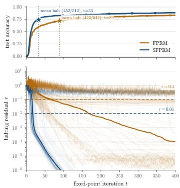

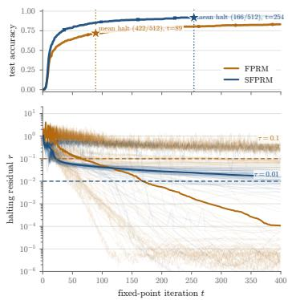  
(a) Sudoku-Extreme, learned $\lambda = 0 . 4 7$ (left) and fixed $\lambda = 0 . 1$ (right)

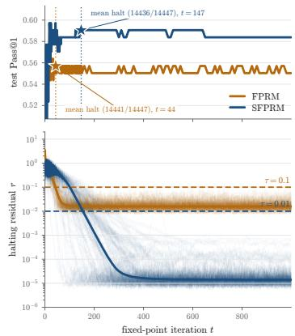  
(b) Mini-ARC  
Figure 10: Accuracy and halting on Sudoku-Extreme and Mini-ARC. Open-loop rollouts of FPRM (amber) and SFPRM (blue). (a) 512 Sudoku test sequences of the released FPRM checkpoint and of SFPRM with the learned $\lambda = 0 . 4 7$ (left) and with λ fixed at 0.1 (right, the run in Table 2). (b) All 14,447 Mini-ARC test rows (149 tasks, 100 augmentations each) over 1000 iterations, for the runs in Table 2. Top: exact accuracy of the decoded state (a) and task-level Pass@1 (b). Dotted lines and stars mark each model’s mean halt iteration, labelled with how many sequences halt. Bottom: every sequence’s halting residual (thin) and its median (heavy) against its own threshold $( \tau _ { c } { = } 0 . 0 1$ chordal for SFPRM, $\tau _ { \mathrm { E } } \mathrm { = } 0 . 1$ for FPRM).

FPRM, however for SFPRM it removes the collapse happening when training with the $1 \mathbf k \times 1 0 0 0$ build between its best and its final checkpoint.

## C.2 CONVERGENCE AND HALTING

For Sections 4.2 and 4.3 each trained model is rolled with halting disabled and without segment resets, in fp32, for a fixed budget of $N _ { \mathrm { m a x } } \ = \ 4 0 0$ iterations on $\textit { n } = \ 5 1 2$ uniformly sampled test sequences from Sudoku-Extreme and $N _ { \mathrm { m a x } } ~ = ~ 1 0 0 0$ on the full Maze-Hard test data. At every iterate $\mathbf { z } _ { i }$ the model’s readout head decodes the board, and we record exact and per-token accuracy together with the residual each solver tests: the worst-token chordal residual $r _ { \mathrm { c } , i } = \mathrm { m a x } _ { t } \big ( 1 - \langle z _ { i , t } , \widetilde { z } _ { i , t } \rangle \big )$ with $\tau _ { c } =$ 0.01 for SFPRM, and the worst-token relative residual $\begin{array} { r c l } { r _ { \mathrm { E } , i } } & { = } & { \operatorname* { m a x } _ { t } \Vert z _ { i , t } \ - } \end{array}$ $\mathcal { \widetilde { z } } _ { i , t } \| _ { \infty } / \| \mathcal { \widetilde { z } } _ { i , t } \| _ { \infty }$ with $\tau _ { \mathrm { { E } } } ~ = ~ 0 . 1$ for FPRM, where $\widetilde { { \mathbf z } } _ { i } ~ = ~ F _ { \theta } ( { \mathbf z } _ { i } ; { \mathbf x } )$ is each model’s proposal. A sequence counts as halted at the first iteration from which its

Table 4: Exact accuracy on Sudoku-Extreme for SF-PRM vs. FPRM at matched backbone (6.83M trainable parameters), data, global batch (768), and optimizer steps/epochs (78,125/12,000). $^ { 6 4 } \mathrm { 1 k } \times 1 0 0 0 ^ { 3 }$ and $^ { 6 6 } 5 \mathbf { k } \times 2 0 0 ^ { 3 }$ are the number of distinct base puzzles times the augmentations per puzzle. The SFPRM 1k run is given at both its best and checkpoint because it collapses between them, which the 5k build fixes. For the 5k run the final checkpoint is also the best. The FPRM rows fall well below the 94.2% reported for FPRM in Table 2.

<table><tr><td>Model</td><td>Setting</td><td>Sudoku-Ext.</td></tr><tr><td>FPRM</td><td>Sudoku 1k× 1000</td><td>78.5%</td></tr><tr><td>FPRM</td><td>Sudoku  $5 \mathbf { k } \times 2 0 0$ </td><td>78.4%</td></tr><tr><td>SFPRM</td><td>Sudoku 1k× 1000 (best checkpoint)</td><td>87.0%</td></tr><tr><td>SFPRM</td><td>Sudoku 1k × 1000 (final checkpoint)</td><td>12.2%</td></tr><tr><td>SFPRM</td><td>Sudoku  $5 \mathbf { k } \times 2 0 0$ </td><td>92.8%</td></tr></table>

residual stays below its own threshold. Halt iterations are reported per sequence (mean over the sequences that halt), whereas the deployed evaluator halts a whole batch on its worst sequence, so the per-sequence counts are idealized costs. Every FPRM rollout is generated using the released checkpoints from Movahedi et al. (2026).

Halting. Figure 10 shows the two Sudoku runs of Table 3 (one that reached 92.8% and one 96.6% exact accuracy) against FPRM. With the learned $\lambda = 0 . 4 7$ (left), the median residual of SFPRM drops below $\tau _ { c }$ within a few dozen iterations, whereas FPRM’s decays roughly geometrically over the whole window. 452 of the 512 sequences halt for SFPRM, at a mean of 33 iterations, against 422 at a mean of 89 for FPRM. Exact accuracy is still rising after the mean halt for both models, so on this task the threshold fires before the population has finished improving. With λ fixed at 0.1 (right) the residual of SFPRM decays far more slowly and hovers near $\tau _ { c } ,$ so only 166 sequences halt within 400 iterations, at a mean of 254, although the decoded accuracy is higher. In both runs the puzzles a solver halts on are solved in 99.7–100% of cases, so on Sudoku a halt certifies the answer, whereas a missing halt does not certify a failure.

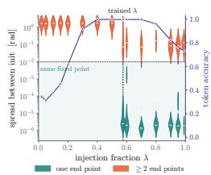

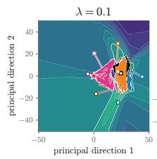

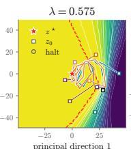

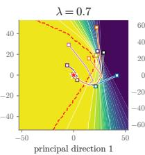

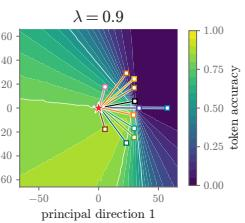  
Figure 11: Global convergence under input injection on Maze-Hard (SFPRM, learned $\lambda \ =$ 0.575), analogue to Figure 4. (left) The largest angle between the end states of eight initializations of the raw map (teal: all coincide, coral: $\geq 2$ end states), and the token accuracy of the end state (indigo, right axis), as a function of λ. (right) Trajectories at four values of λ for a single Maze example: the top-2 principal plane of the trajectories from the eight initializations $\mathbf { z } _ { 0 }$ (squares) through $\mathbf { z } ^ { \star }$ (star; circles: first iteration with $r _ { \mathrm { c } , i } < \tau _ { c } )$ . The color shows the token accuracy of the state decoded at each position (dashed red: exact-match region).

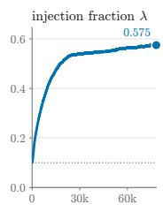

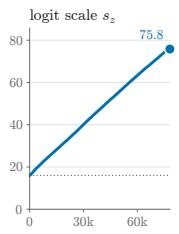

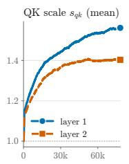

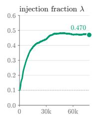

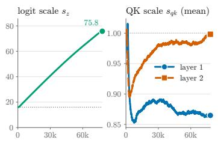

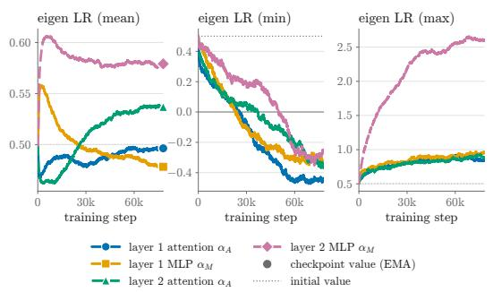  
(a) Maze-Hard

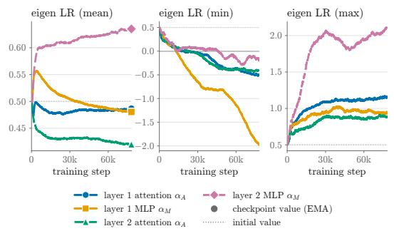  
(b) Sudoku-Extreme  
Figure 12: Learned parameters of SFPRM during training. Per task, top row: injection fraction $\lambda ,$ logit scale $s _ { z } ,$ , and QK scale $s _ { q k }$ (mean over its 64 dimensions, per layer). Bottom row: the eigen learning rates $\alpha _ { A }$ (attention) and $\alpha _ { M }$ (MLP) of both layers, as the mean, minimum and maximum over the 512 hidden dimensions.

Fixed-point uniqueness. Figure 11 repeats the global-convergence test of Figure 4 on the Maze model (learned $\lambda = 0 . 5 7 5 )$ , running the raw map without damping for 1000 steps. The contractive regime of Theorem 2 exists here too, but it is narrower: all eight initializations reach the same fixed point only for λ between about 0.6 and 0.8. The trained λ sits at the lower edge of this band, where some mazes have a single end point and others do not, and below $\lambda \approx 0 . { \bar { 5 } }$ no maze does. For $\lambda \geq 0 . 9$ the end states spread again, while the token accuracy of the fixed point falls to 0.7–0.8 as the input pulls the state onto itself. On the maze of panel (b) the raw map does not reach the tolerance at the trained λ within 1000 steps, although it decodes the maze exactly throughout; it is the damped solver that halts this model. $\bar { \mathbf { A } } \mathbf { t } \lambda = 0 . \bar { 7 }$ the raw map converges inside the exact-match region, and at $\lambda = 0 . 9$ the eight paths run straight to one point that no longer solves the maze.

## C.3 EIGEN LR AND OTHER LEARNABLE PARAMETERS DURING TRAINING

Figure 12 tracks the learned scalars of SFPRM during training on Maze and Sudoku. Both model raise the injection fraction from 0.1 to $\lambda = 0 . 5 7 5$ on Maze and $\lambda = 0 . 4 7 0$ on Sudoku, with most of the increase in the first 30k of 78k training steps. This moves them toward the strong-injection regime of Theorem $2 .$ On Sudoku, all eight initializations already reach the same fixed point on 72% of puzzles at the learned λ (Figure 4). The logit scale $s _ { z }$ grows almost linearly from 16 to $^ { 7 6 , }$ at nearly the same rate on both tasks, and is still rising when training ends. The eigen learning rates keep means near their initial 0.5, similarly as noted by Loshchilov et al. (2025). However, individual dimensions spread widely, from negative values, which move the state away from the sub-layer output, to values up to 2.6.

## C.4 THE GEOMETRY OF THE COMPUTATION

Qualitative results (Figures 7 and 21 to 24). We unroll several test puzzles from each task open loop, for 40 iterations on Maze and Sudoku (rendered at $t = 0 , 2 , 1 1 , 3 9 )$ and 200 on Mini-ARC (rendered at $t = 0 , 3 , 1 3 , 5 2 , 1 9 9 )$ . The decoded board is the per-cell argmax of the readout. The anchor map shows, per cell, the angle $\mathcal { L } ( z _ { i , t } , \hat { x } _ { i } )$ between the iterate and its unit-normalized input embedding ${ \hat { x } } _ { i }$ (token plus position), on a colour scale normalized to the minimum and maximum angle over that puzzle’s whole rollout, so that a colour means the same angle in every frame of a strip. The same quantity is computed for FPRM from its unnormalized state. SFPRM’s anchor angles separate the roles of the cells far more cleanly than FPRM’s: on Sudoku, clue cells end 35◦ closer to their anchors than blank cells, against $6 ^ { \circ }$ for FPRM, and on Mini-ARC the cells a task must rewrite end furthest from their anchors (AUC 0.81 for changed vs. unchanged cells, averaged over tasks), whereas FPRM’s ordering flips from task to task (AUC 0.51).

Anchor angles by cell class (Figures 6, 15 and 16). For four Sudoku and Maze test puzzles, we track the anchor angle of every cell throughout the unrolling, grouped by cell class (clues and blanks on Sudoku; walls, free cells that stay empty, free cells that become path, start, and goal on Maze). In the figures, the heavy lines are class means, whilst the thin lines show the individual cells’ anchor angles. The histograms on the righthand side of each figure show the distribution at the end of the unrolling $( i = 3 9 9$ on Sudoku, 999 on Maze). For FPRM the angle is that of the normalized state.

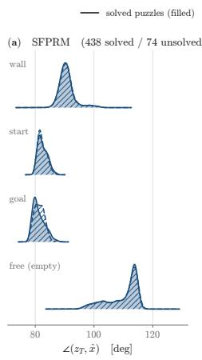

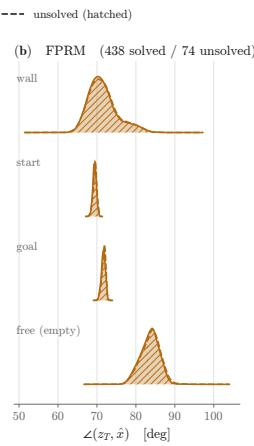

Trajectories on the sphere (Figure 14). We draw each token’s path in the frame spanned by the inference unrolling trajectory’s two leading singular directions and its input anchor x. This way the anchor is exact rather than a near-zero projection. We only show the cell trajectories that capture the most trajectory variance. Over 98% of each trajectory’s variance lies in that frame, so every token effectively moves on one great circle, as the geodesic steps of Algorithm 1 prescribe, and the anchor sits nearly orthogonal to that cir-

Figure 13: Final anchor angle on solved and unsolved mazes (Maze-Hard analogue of Figure 9). Per-class angle to the anchor at the end of the rollout over 512 test mazes (438 solved, 74 unsolved), for (a) SFPRM and (b) FPRM’s normalized state. Filled: solved; hatched: unsolved. Unlike on Sudoku, the distributions overlap for every class, so the final angle does not predict correctness.

cle $( | \langle x _ { t } , v _ { 1 , 2 } \rangle | \approx 0 . 0 5 )$ . The input injection pulls from far off the plane in which the computation happens, explaining how a small λ can anchor the hidden state without dictating it.

Solved versus unsolved (Figure 9). For 128 Sudoku test puzzles we compare the distribution of the final anchor angle (SFPRM) or final norm (FPRM) of clue and blank cells between solved and unsolved puzzles. The same comparison on 512 test mazes (Figure 13) shows no separation for either model.

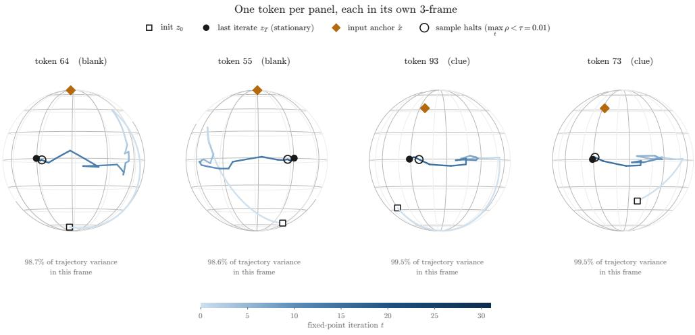  
One token per panel, each in its own 3-frame

init z0 last iterate z (stationary) input anchor x^ sample halts (max ½ < ¿ = 0:01)  
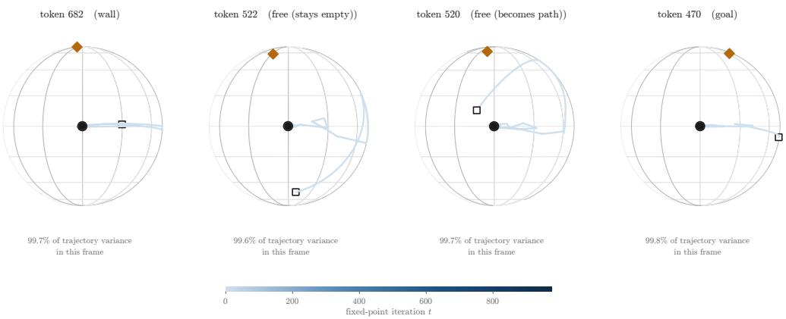  
Figure 14: One SFPRM trajectory per cell class, on the sphere (Sudoku left, Maze right). For every cell class we draw the token whose 3-frame captures the most trajectory variance. The frame is spanned by the trajectory’s two leading singular directions and the anchor $x _ { t } ,$ which sits at the pole. $x _ { t }$ is nearly orthogonal to the plane of the trajectory $( | \langle x _ { t } , v _ { 1 , 2 } \rangle | \approx 0 . 0 5 )$ . Arcs are great circles between projected iterates. The colour shows the iteration index.

## C.5 FIXED-POINT SOLVERS AT INFERENCE

Both SFPRM and FPRM are trained with a damped fixed-point iteration, but at inference any method that finds a fixed point of $F _ { \theta } ( \cdot ; \mathbf { x } )$ can take its place. We run four solvers (including the default one) on the trained models, without retraining and without changing the architecture (see Section 4.2).

## C.5.1 SOLVERS

All four solvers seek a fixed point of the same trained map. The model weights are unchanged, and only the default solver (adaptive) was used during training. At test time the input embedding x is computed once and every solver runs the loop

$$
\begin{array} { r } { \widetilde { \mathbf { z } } _ { i } = F _ { \theta } ( \mathbf { z } _ { i } ; \mathbf { x } ) , \qquad \mathrm { s t o p ~ i f ~ } r _ { i } < \tau , \qquad \mathbf { z } _ { i + 1 } = \mathrm { u p d a t e } \big ( \mathbf { z } _ { i } , \widetilde { \mathbf { z } } _ { i } , \mathrm { h i s t o r y } \big ) , } \end{array}
$$

starting from a random $\mathbf { z } _ { 0 }$ . Across solvers, only the update function differs. Each step evaluates $F _ { \theta }$ once, and the same evaluation gives the halting residual, so the number of steps is the compute spent. SFPRM halts on the chordal residual $r _ { i } = r _ { \mathrm { c } , i }$ of eq. (9) with $\tau _ { c } = 0 . 0 1$ , and FPRM on the pertoken relative residual $r _ { i } = r _ { \mathrm { E } , i } = \operatorname* { m a x } _ { t } \lVert z _ { i , t } - \widetilde { z } _ { i , t } \rVert _ { \infty } / \lVert \widetilde { z } _ { i , t } \rVert _ { \infty } \left( \mathbf { e q . } \left( 4 \right) \right)$ with $\tau _ { \mathrm { E } } = 0 . 1$ . We write $\mathbf { g } _ { i } : = \widetilde { \mathbf { z } } _ { i } - \mathbf { z } _ { i }$ for the residual vector. Two operators adapt the updates to each model’s state space: the interpolation $\mathcal { T } _ { \eta } ( \mathbf { a } , \mathbf { b } )$ moves a a fraction η of the way to $\mathbf { b } ,$ along the great circle token by token for $\mathrm { S F P R M } , \mathcal { T } _ { \eta } = \mathrm { \ddot { S l e r p } } _ { \eta }$ as in $\mathrm { e q . } \left( 7 \right)$ , and along the straight line for FPRM, $\mathscr { T } _ { \eta } ( \mathbf { a } , \mathbf { b } ) = ( 1 - \eta ) \mathbf { a } + \eta \mathbf { b }$ as in eq. (3); the projection Π applies Norm to every token for SFPRM and is the identity for FPRM.

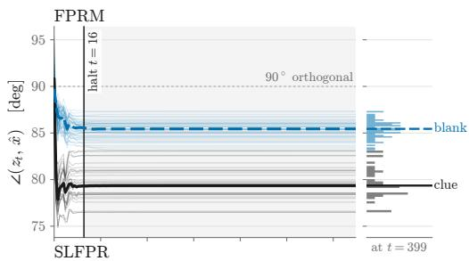

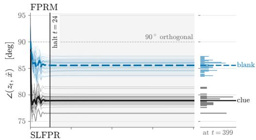

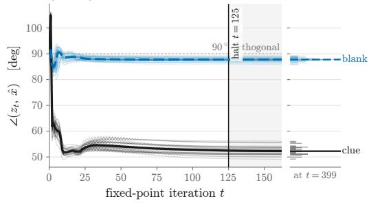  
(a) Sudoku test puzzle 0

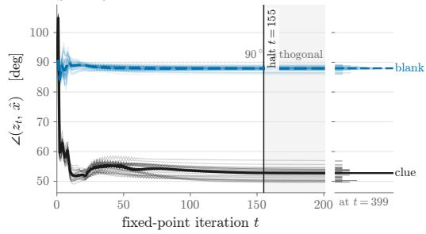  
(b) Sudoku test puzzle 1

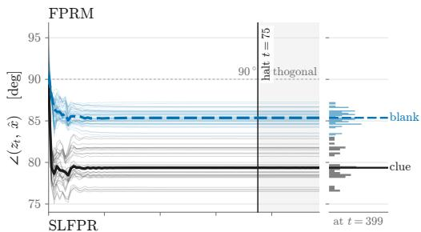

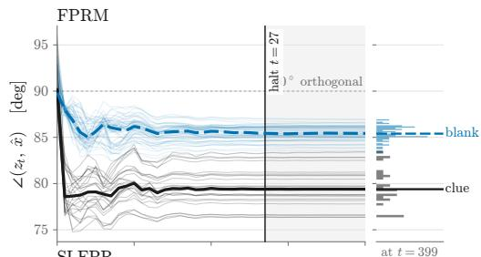

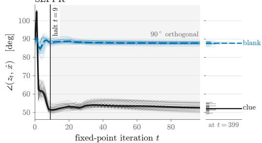  
(c) Sudoku test puzzle 2

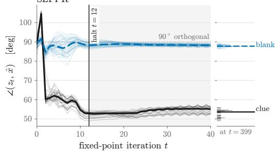  
(d) Sudoku test puzzle 3  
Figure 15: Anchor angles by cell class on Sudoku-Extreme. Four test puzzles (Maze in Figures 6 and 16). In each pair FPRM is above and SFPRM below. Thin lines are individual cells, thick lines class means, the vertical line the halt iteration, and the margin the distribution at the end of the rollout. SFPRM rotates the clues to ${ \approx } 5 2 ^ { \circ }$ from their anchors within about 20 iterations and leaves the blanks near orthogonal, whereas FPRM’s normalized states settle within the first few iterations with clues and blanks only ${ \approx } 6 ^ { \circ }$ apart.

Adaptive (default). $\mathbf { z } _ { i + 1 } = \mathcal { T } _ { \eta _ { i } } ( \mathbf { z } _ { i } , \widetilde { \mathbf { z } } _ { i } )$ with $\eta _ { 0 } = 1$ . The step size is multiplied by $\gamma = 0 . 9 9$ whenever the residual has not improved for $P = 5$ consecutive steps while it is still above τ. Both models are trained and evaluated with this solver.

Fixed step. The same update with $\eta _ { i } = 1$ throughout, that is, plain fixed-point iteration $\mathbf { z } _ { i + 1 } = \widetilde { \mathbf { z } } _ { i }$

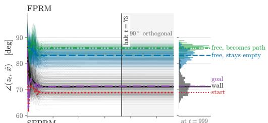

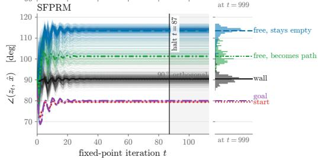

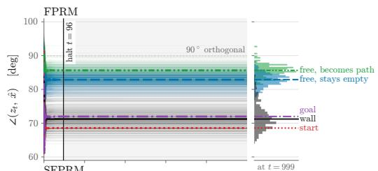

(a) Maze test maze 0  
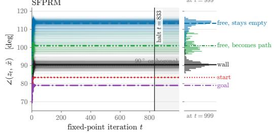  
(b) Maze test maze 1

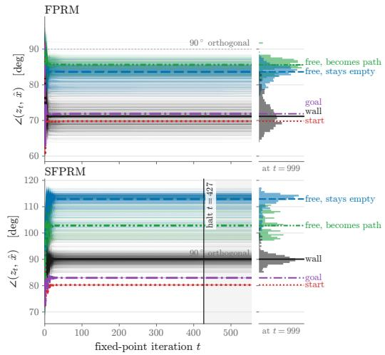  
(c) Maze test maze 2

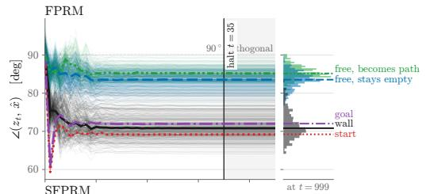

  
(d) Maze test maze 3 (fig. 6)  
Figure 16: Anchor angles by cell class on Maze-Hard. Four test puzzles, FPRM above and SF-PRM below in each pair, with the conventions of Figure 15. On every maze SFPRM settles walls at ${ \approx } 9 0 ^ { \circ }$ , free cells that stay empty at ≈ $1 1 3 ^ { \circ }$ , free cells that become path at ${ \approx } 1 0 2 ^ { \circ }$ , and start and goal at ${ \approx } 8 0 ^ { \circ }$ , whereas FPRM keeps all classes within $7 0 – 8 7 ^ { \circ }$ and separates the two free-cell classes by only a few degrees.

Anderson acceleration (Anderson, 1965; Walker & Ni, 2011) replaces the latest state by the combination of the last $m + 1$ states whose residuals cancel best. With the columns of $\Delta \mathbf { G } _ { i }$ and $\Delta \widetilde { \mathbf { Z } } _ { i }$ the $m$ differences of consecutive stored residuals and images,

$$
\omega _ { i } = \arg \operatorname* { m i n } _ { \omega \in \mathbb { R } ^ { m } } \| \mathbf { g } _ { i } - \Delta \mathbf { G } _ { i } \omega \| _ { 2 } ^ { 2 } + \delta \| \omega \| _ { 2 } ^ { 2 } , \qquad \mathbf { z } _ { i + 1 } = \Pi \big ( \widetilde { \mathbf { z } } _ { i } - \Delta \widetilde { \mathbf { Z } } _ { i } \omega _ { i } \big ) ,
$$

with a small ridge $\delta > 0$ . The least-squares problem learns, from the recent iterates alone, how the residual responds to a change of state, and the combination removes the components that the plain step overshoots, so an oscillation across the fixed point, for example, cancels between consecutive states. We use memory $m = 3$

Broyden’s method (Broyden, 1965), the solver commonly used for deep equilibrium models (Bai et al., 2019), takes quasi-Newton steps on $\mathbf { g } ( \mathbf { z } ) = F _ { \boldsymbol \theta } ( \mathbf { z } ; \mathbf { x } ) - \mathbf { z }$ with an estimate $\mathbf { B } _ { i }$ of the inverse Jacobian of $\mathbf { g } \mathrm { : }$

$$
\mathbf { z } _ { i + 1 } = \Pi { \bigl ( } \mathbf { z } _ { i } - \mathbf { B } _ { i } \mathbf { g } _ { i } { \bigr ) } , \qquad \mathbf { B } _ { i } = \mathbf { B } _ { i - 1 } + { \frac { \left( \mathbf { s } _ { i } - \mathbf { B } _ { i - 1 } \mathbf { y } _ { i } \right) \mathbf { s } _ { i } ^ { \top } \mathbf { B } _ { i - 1 } } { \mathbf { s } _ { i } ^ { \top } \mathbf { B } _ { i - 1 } \mathbf { y } _ { i } } } ,
$$

Table 5: Inference-time fixed-point solvers on the trained models. Every example runs 1000 steps from its own random start, shared by the four solvers; each step is one evaluation of $F _ { \theta } ,$ and an example halts at the first iterate with residual below τ . Halting: share of examples that halt (%), median and mean halting step over those, and mean $F$ evaluations over all examples. Exact at halt: accuracy over all examples, exact binomial test against the default solver (p), and accuracy among halted examples. Open loop: accuracy with halting disabled, at its best step and at $t = 1 0 0 0$ . Maze: all 1000 test mazes; Sudoku: 1000 puzzles evenly spaced over the test set. Best within each block: exact accuracy, share halted, fewest halting steps.
<table><tr><td rowspan="2">Solver</td><td colspan="4">Halting</td><td colspan="3">Exact at halt (%)</td><td colspan="2">Open loop (%)</td></tr><tr><td></td><td>% med. t</td><td>mean t</td><td>F evals</td><td>all</td><td>p</td><td>halted</td><td>peak (t)</td><td>t=1000</td></tr><tr><td colspan="10">SFPRM, Maze  $( \lambda { = } 0 . 5 7 5 , \tau _ { c } { = } 0 . 0 1 )$ </td></tr><tr><td>Adaptive (default)</td><td>99.2</td><td>27</td><td>96.3</td><td>104.5</td><td>87.8</td><td></td><td>87.9</td><td>87.8 (20)</td><td>87.8</td></tr><tr><td>Fixed, η=1</td><td>63.1</td><td>23</td><td>25.8</td><td>386.3</td><td>87.8</td><td>1.00</td><td>87.3</td><td>87.8 (20)</td><td>87.8</td></tr><tr><td>Anderson, m=3</td><td>100.0</td><td>13</td><td>13.8</td><td>14.8</td><td>86.8</td><td>0.04</td><td>86.8</td><td>87.4 (19)</td><td>86.7</td></tr><tr><td>Broyden, m=5</td><td>99.4</td><td>14</td><td>14.0</td><td>20.9</td><td>87.4</td><td>0.39</td><td>87.9</td><td>87.9 (16)</td><td>51.5</td></tr><tr><td colspan="10">SFPRM, Sudoku  $( \lambda { = } 0 . 1 , \tau _ { c } { = } 0 . 0 1 )$ </td></tr><tr><td>Adaptive (default)</td><td>75.0</td><td>435</td><td>469.9</td><td>603.5</td><td>95.9</td><td></td><td>100.0</td><td>95.9 (933)</td><td>95.9</td></tr><tr><td>Fixed, η=1</td><td>0.0</td><td></td><td></td><td>1001.0</td><td>93.2</td><td>&lt;0.001</td><td></td><td>93.2 (973)</td><td>93.2</td></tr><tr><td>Anderson, m=3</td><td>95.4</td><td>37</td><td>71.3</td><td>115.1</td><td>95.3</td><td>0.34</td><td>99.9</td><td>95.3 (909)</td><td>95.3</td></tr><tr><td>Broyden, m=5</td><td>89.8</td><td>24</td><td>49.9</td><td>147.8</td><td>90.0</td><td>&lt;0.001</td><td>99.7</td><td>69.6 (27)</td><td>1.5</td></tr><tr><td colspan="10">FPRM, Maze  $( \tau _ { \mathrm { E } } { = } 0 . 1 )$ </td></tr><tr><td>Adaptive (default)</td><td>95.9</td><td>55</td><td>129.3</td><td>166.0</td><td>86.0</td><td></td><td>86.8</td><td>86.1 (102)</td><td>86.0</td></tr><tr><td>Fixed, η=1</td><td>51.4</td><td>32</td><td>51.9</td><td>513.7</td><td>85.4</td><td>0.07</td><td>92.0</td><td>85.8 (24)</td><td>85.4</td></tr><tr><td>Anderson, m=3</td><td>100.0</td><td>17</td><td>18.0</td><td>19.0</td><td>86.1</td><td>1.00</td><td>86.1</td><td>86.0 (64)</td><td>86.0</td></tr><tr><td>Broyden, m=5</td><td>98.6</td><td>16</td><td>21.1</td><td>35.8</td><td>86.0</td><td>1.00</td><td>87.1</td><td>86.1 (19)</td><td>32.8</td></tr><tr><td colspan="10">FPRM, Sudoku  $( \tau _ { \mathrm { E } } { = } 0 . 1 )$ </td></tr><tr><td>Adaptive (default)</td><td>91.5</td><td>50</td><td>125.0</td><td>200.3</td><td>88.0</td><td></td><td>96.2</td><td>88.1 (972)</td><td>88.1</td></tr><tr><td>Fixed, η=1</td><td>43.8</td><td>39</td><td>82.6</td><td>599.2</td><td>80.9</td><td>&lt;0.001</td><td>100.0</td><td>80.9 (932)</td><td>80.9</td></tr><tr><td>Anderson, m=3</td><td>89.2</td><td>34</td><td>91.1</td><td>190.2</td><td>88.8</td><td>0.38</td><td>99.6</td><td>89.0 (984)</td><td>89.0</td></tr><tr><td>Broyden, m=5</td><td>18.3</td><td>344</td><td>389.7</td><td>889.3</td><td>14.7</td><td>&lt;0.001</td><td>79.2</td><td>13.6 (8)</td><td>0.6</td></tr></table>

where ${ \bf s } _ { i } = { \bf z } _ { i } - { \bf z } _ { i - 1 }$ and $\mathbf { y } _ { i } = \mathbf { g } _ { i } - \mathbf { g } _ { i - 1 }$ . Starting from $\mathbf { B } _ { 0 } = - \mathbf { I } ,$ , the estimate is stored as the last $m = 5$ rank-one corrections.

Neither Anderson’s nor Broyden’s method computes a Jacobian or any gradient. Both are quasi-Newton methods that infer curvature from secants, the observed changes of state and residual between steps, so each step still costs one evaluation of $F _ { \theta }$ . With an empty memory both take exactly the fixed step. Both act on the whole state of an example at once, all tokens flattened into one vector, with one history per example in a batch. Their extrapolated points leave the sphere and are projected back by Π. The extra work per step is a few vector operations on the state and an $m \times m$ linear solve, and the extra memory is m stored copies of the state, both small next to an evaluation of $F _ { \theta }$ As safeguards, a non-finite extrapolation falls back to the fixed step, and Broyden skips an update whose denominator is near zero. Both methods use the step size $\eta = 1$ (no damping).

## C.5.2 RESULTS

We run every solver on all 1000 Maze test examples and on 1000 Sudoku test puzzles spaced evenly over the 422,786-puzzle test set, in fp32, with SFPRM at its trained injection fraction $( \lambda = 0 . 5 7 5$ on Maze, $\lambda = 0 .$ 1 on Sudoku) and FPRM from its released checkpoints. Each example starts from its own random state (uniform on the sphere for SFPRM, the truncated normal of the FPRM solver for FPRM), shared by the four solvers, and is iterated for 1000 steps. We then apply the halting rule to each example separately: the answer is the first iterate whose residual is below τ, and an example that never halts is answered by its iterate at step 1000. Table 5 reports the results, and Figures 5 and 17 show accuracy and residual over the iterations in the four settings.

  
Figure 17: Accuracy and halting residual over the iterations for the remaining settings of Table 5. SFPRM on Sudoku $( \lambda = 0 . 1$ , left), FPRM on Maze (middle) and FPRM on Sudoku (right); SFPRM on Maze is Figure 5. Same 1000 examples and solvers as the table. Top: exact accuracy of the iterate with halting disabled. Bottom: each model’s halting residual, median (solid) and 75th percentile (dotted) over the examples, its threshold (dashed), and the iteration by which half of the examples have halted (circle).

The undamped step does not halt reliably. The fixed step never reaches τ on 37%, 100%, 49% and 56% of the examples in the four settings. For SFPRM on Maze its answers are identical to the default solver’s, but on Sudoku it is less accurate for both models. For SFPRM on Sudoku a quarter of the puzzles do not halt within 1000 steps.

Anderson acceleration matches the default solver at a fraction of the cost. Its accuracy at the halt is within one point of the default solver’s in all four settings. Anderson halts earlier in every setting, with a striking 37 against 435 for SFPRM on Sudoku. Averaged over all examples, this is 9× fewer evaluations of $\bar { F } _ { \theta }$ . For FPRM on Sudoku the saving disappears (190 against 200 evaluations): 10.8% of the puzzles never reach τ under Anderson, and all of them are answered incorrectly.

Broyden’s method reaches the tolerance threshold quickly but does not stay there. On Maze it halts as early as Anderson (14 and 16 median steps), and its halted answers are as accurate as the default solver’s. By continuing to iterate beyond the tolerance, however, it leaves the fixed point and its accuracy degrades, making it usable only with halting.

On Sudoku, halting certifies the answer. For SFPRM on Sudoku, 99.7–100% of the puzzles a solver halts on are solved exactly, so the accuracy differences come entirely from the puzzles it fails to halt on. The same holds less strictly for FPRM (96.2% of the default solver’s halted puzzles are solved, 99.6% of Anderson’s). On Maze, halting does not certify the answer: incorrect mazes converge too, and for the solvers that halt on almost every example the accuracy among halted examples is about the same as the overall accuracy.

Trajectories in the principal plane. Figure 18 shows the four solvers at the trained λ in the plane construction of Figure 4b, on a single test example from each task, from eight initializations. The reference $\mathbf { z } ^ { \star }$ is Anderson’s end point, a fixed point to fp32 precision that decodes both examples exactly. On Maze, Anderson halts at iteration 13 from all eight initializations, the default solver crosses the tolerance at a median of 140 iterations but ends 0.06 rad away, and fixed $\eta = 1$ never crosses it. On the Sudoku puzzle only Anderson halts (median 40), while the default and fixed solvers end 0.16 and 0.33 rad from $\mathbf { z } ^ { \star }$ and still decode the puzzle exactly. Broyden reaches the tolerance as early as Anderson and then leaves from most starts.

Trajectories in polar coordinates. Figures 19 and 20 follow one token per cell class under each solver in the polar view of Figure 5b, for the maze of that panel and for a Sudoku puzzle. The radius is the geodesic angle to a common reference, Anderson’s end point after 2000 iterations, a fixed point to fp32 precision that decodes both examples exactly. Inward is convergence toward $\mathbf { z } ^ { \star }$ , a held radius is orbiting, and outward is leaving. Anderson ends within $1 0 ^ { - 4 }$ degrees of the reference. The default solver ends $0 . 0 0 5 { - } 0 . 1 4 ^ { \circ }$ away on the mazes and up to $2 . 1 ^ { \circ }$ on the Sudoku puzzles, after orbiting for hundreds of iterations; fixed $\eta = 1$ stays up to $\bar { 0 . 6 4 ^ { \circ } }$ and $4 { - } 1 7 ^ { \circ }$ away and never halts; and Broyden reaches the tolerance first and then leaves to 60–103◦.

adaptive (´0 = 1)  

fixed (´ = 1)  

Anderson (m = 3)  

Broyden (m = 5)  

  
fixed (´ = 1)

Anderson (m = 3)  

Broyden (m = 5)  
  
Figure 18: The four solvers in the principal plane through the fixed point, for test example 0 of Maze-Hard (top, λ = 0.575) and of Sudoku-Extreme (bottom, λ = 0.1). Axes and markers as in Figure 4b, with $\mathbf { z } ^ { \star }$ the end point of Anderson acceleration; every solver runs from the same eight initializations (squares) and six further starts placed on its plane. Each panel uses the top-2 principal directions of that solver’s own iterates, so the background landscapes differ between panels.

## C.6 ARC-AGI-2 RESULTS

We compute the Pass@2 on the 120 evaluation tasks of ARC-AGI-2. All models remain far from solving the benchmark. The best recurrent reasoner, TRM, reaches 7.8%, and SFPRM reaches 3.8%. The gaps nonetheless amount to only a few tasks, so we do not draw strong conclusions from them. At 7M parameters, SF-PRM still outperforms reasoning LLMs, including o3-mini-high (3.0%), DeepSeek-R1 (1.3%) and Claude 3.7 (0.7%).

Table 6: SFPRM ablations on Mini-ARC. Pass@1 accuracy at an iteration cap of 200. Each row changes one component of the full model. ∆: change relative to the full model.
<table><tr><td>Variant</td><td>Pass@1</td><td>∆</td></tr><tr><td>SFPRM (full)</td><td>59.1</td><td>一</td></tr><tr><td>w/o QK normalization</td><td>26.2</td><td>-32.9</td></tr><tr><td>w/o damping (η = 1)</td><td>47.7</td><td>-11.4</td></tr><tr><td>Fixed injection fraction (λ = 0.1)</td><td>49.7</td><td>-9.4</td></tr><tr><td>ACT halting instead of chordal residual</td><td>54.4</td><td>-4.7</td></tr><tr><td>Fixed eigen learning rates  $( \alpha _ { A } = \alpha _ { M } = 0 . 5 )$ </td><td>55.0</td><td>-4.0</td></tr><tr><td>w/o logit scale  $( s _ { z } = 1 )$ </td><td>55.7</td><td>-3.4</td></tr><tr><td>w/o weight normalization</td><td>56.4</td><td>-2.7</td></tr></table>

## C.7 ALGORITHMIC ABLATIONS

Table 6 retrains the Mini-ARC model with one component of SFPRM changed at a time. QK normalization is essential, and removing the step damping (η = 1) or fixing the input-injection fraction costs 11.4 and 9.4 points, respectively. The remaining changes, including ACT halting in place of the chordal residual, cost at most 4.7 points.

## D LIMITATIONS

On the theory side, Theorem 1 certifies a step-size window but not that the patience rule finds it, and Theorem 2 covers only strong injection. On the experimental side, every run uses a single seed and neither model was tuned beyond FPRM’s recipe: a broader hyperparameter search, stronger regularization, and optimizers that exploit the spherical geometry further would likely improve both. Two directions remain open. Attention-free MLP-Mixer blocks have been reported to beat Transformer blocks on some of these puzzles (Jolicoeur-Martineau, 2025; Sghaier et al., 2026; Suleymanzade et al., 2026); the spherical loop is agnostic to the block and could be combined with them. And we have not applied SFPRM to language modeling, where looped Transformers are gaining ground (Geiping et al., 2025; Prairie et al., 2026) and where halting on a fixed angular tolerance may be most valuable.

  
Figure 19: SFPRM on Maze-Hard: State trajectories in polar coordinates. The four solvers (rows, with each one’s halting step) on the maze of Figure 5b, one token per cell class (columns). Radius: geodesic angle to the reference fixed point, log-scaled from $0 . 1 ^ { \circ }$ at the centre to $\mathrm { 1 8 0 ^ { \circ } }$ at the rim, rings at 1, 10 and 100◦; azimuth: the top-2 principal plane of that token’s component orthogonal to the reference; square: start, dot: end of the 1000-iteration run; colour: iteration. Anderson ends at the centre, the default and fixed steps orbit at a small radius, and Broyden leaves for the rim.

clue

blank, early

blank, median

blank, late

  
Figure 20: SFPRM on Sudoku-Extreme: State trajectories in polar coordinates. A puzzle on which the default solver halts at its median step (435); columns: the middle clue cell and the blank cells whose decode settles earliest, at the median and last. Anderson and Broyden reach the tolerance early, the default solver orbits for hundreds of iterations before halting, fixed η = 1 never halts, and Broyden fills the disc after leaving.

SFPRM  
  
Figure 21: Filmstrip gallery on Sudoku-Extreme. Test puzzles 0–4. One test puzzle per row, rolled open-loop for 40 iterations and rendered at i = 0, 2, 11, 39 (protocol in Appendix C.4), for FPRM (left) and SFPRM (right): decoded board on top, each cell’s angle to its input anchor below.

SFPRM  
FPRM  
  
Figure 22: Filmstrip gallery on Maze-Hard. Test puzzles 0–4. One 30×30 test maze per row, rolled open-loop for 40 iterations and rendered at i = 0, 2, 11, 39 (protocol in Appendix C.4), for FPRM (left) and SFPRM (right): decoded path on top, each cell’s angle to its input anchor below.

  
Figure 23: Filmstrip gallery on Mini-ARC. One test task per row, rolled out open-loop for 200 iterations. Left: FPRM; right: SFPRM. Each row starts with the test input (top) and its target (bottom), followed by five iterations from $t = 0 \mathrm { ~ t o ~ } t = 1 9 9$ . At each iteration the decoded grid is shown on top, with × marking cells that differ from the target, and each cell’s angle to its input anchor, $\angle ( z _ { t } , \hat { x } )$ , below.

  
Figure 24: Filmstrip gallery on Mini-ARC (continued). Same caption as in Figure 23.