# STEPBENCH: Diagnosing Real-World Procedural Understanding in AI Agents

Hossein A. Rahmani<sup>1</sup>\* Bin Wu<sup>1</sup> Chaeeun Lee<sup>2</sup> Fanghua Ye<sup>1</sup> Sahan Bulathwela<sup>1</sup> Sujay Kumar Jauhar<sup>3</sup> Marzieh Fadaee<sup>4</sup> Nick Craswell<sup>3</sup> Emine Yilmaz<sup>1</sup>

<sup>1</sup>UCL AI Centre, University College London

<sup>2</sup>School of Informatics, University of Edinburgh

<sup>3</sup>Microsoft

<sup>4</sup>Cohere Labs

StepBench

StepBench

StepEval

## Abstract

Evaluating an agent’s planning ability remains challenging for open-domain tasks, where verifying procedures through execution is often impractical. Existing evaluations typically assess only the final plan and do not distinguish procedural errors such as missing, incorrect, or misordered actions. We introduce STEP-BENCH, a benchmark of 6,885 verified procedures crawled from wikiHow across 81 opendomain categories. From each procedure, we derive 5 diagnostic tasks: four with deterministic answers involving withheld, incorrect, or shuffled steps, and one requiring next-step generation. We additionally evaluate full-plan generation to examine how diagnostic performance correlates with end-to-end plan validity. Using the same procedures across tasks lets us directly compare different planning capabilities. For generation, STEPEVAL identifies critical failures that prevent goal completion. Across 14 configurations of 12 models, we find substantial differences across planning capabilities, with step ordering proving the most difficult: the strongest model correctly orders only 63.0% of procedures, dropping to 33.1% for those with nine or more steps. Incorrect-step detection also predicts judged plan validity across models, suggesting a lower-cost alternative for evaluating generation quality. On STEPBENCH-Val, comprising 214 procedures published in 2026, comprehension scores and rankings remain stable, suggesting limited influence from memorisation.

## 1 Introduction

Large Language Model (LLM)-based agents are on behalf of humans to perform long-horizon tasks, with access to tools and actions that go beyond text generation. These tools and actuators that can link AI systems beyond cyber-digital spaces will emerge, enabling LLM agents to tackle opendomain cyberphysical tasks (tasks that require manipulating both digital and physical environments). AI agents capable of goal-based planning and tool calling (Shen et al., 2024; Huang et al., 2024) on physical, open-domain tasks lead to synergistic teaming with humans (who have access to physical environments) at present and, in time, take autonomy over executing and completing these tasks. Having a deep understanding of task decomposition, sequencing and gap identification in opendomain tasks plays a foundational role in creating reliable agents that can succeed in both knowledgebased and (much broader) cyber-physical tasks.

Open-domain task-planning benchmarks primarily focus on generating task decompositions (Zhang et al., 2021; Shen et al., 2024; Huang et al., 2024) or predicting inter-step temporal dependencies (Zhang et al., 2020a; Yuan et al., 2023a; Lal et al., 2024). Fine-grained error analysis exists in formal (Valmeekam et al., 2023b; Kokel et al., 2025, 2026) and embodied (Li et al., 2024) environments, where an executor supplies ground truth, but is harder to obtain for open-domain written procedures.

Our goal is to diagnose the capabilities underlying open-domain agent planning without executing the proposed steps. For open-domain tasks, generated plans generally cannot be physically executed or formally verified at benchmark scale, while evaluating only the final plan or task outcome provides little insight into which planning capabilities models struggle with. We aim to identify these strengths and weaknesses through targeted diagnostic tasks and examine how they relate to end-to-end plan generation performance.

We introduce STEPBENCH, comprising 5 tasks derived from 6,885 curated wikiHow procedures across 81 categories. STEPBENCH’s 5 diagnostic tasks probe distinct aspects of procedural understanding: last-step selection, missing-step recovery, incorrect-step detection, reordering, and next-step generation. The source articles have documented editorial provenance, with 96.1% co-authored by subject experts, and distractors are retrieved from other procedures to create plausible errors. Using the same procedures across tasks enables direct comparison of different aspects of agentic planning ability. For next-step and full-plan generation, STEPEVAL adopts the critical-failure formulation of Chang et al. (2026), judging whether an output contains an error severe enough to prevent goal completion while allowing valid alternative plans.

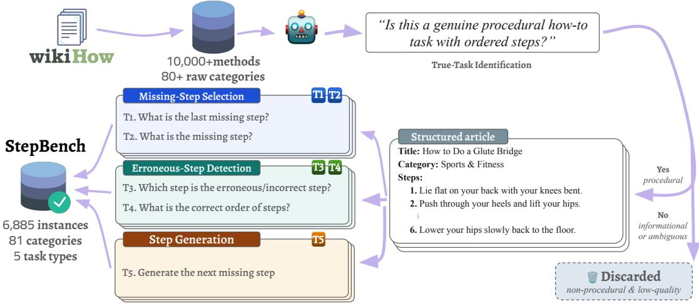  
Figure 1: Constructing STEPBENCH. wikiHow methods are crawled into an initial pool, filtered by GPT-4.1 for whether they describe a genuine procedural task, and the selected procedures (each a task query, category, and ordered steps) instantiate five diagnostic tasks: missing-step selection (T1–T2), erroneous-step detection and reordering (T3–T4), and next-step generation (T5). Full-plan generation is additionally evaluated to examine how diagnostic performance correlates with end-to-end plan validity.

Across 14 configurations of 12 models, we find that performance varies substantially across capabilities. Models with similar incorrect-step detection scores can differ markedly in reordering. Even when all correct steps are provided, the strongest configuration recovers the reference order for only 63.0% of procedures, falling to 33.1% for procedures with nine or more steps. Reordering accuracy also correlates strongly with judged full-plan validity (ρ = 0.96), suggesting that diagnostic tasks can provide a lower-cost signal of plan quality.

Our main contributions are as follows:

• We introduce STEPBENCH, a planning diagnosis benchmark suite for evaluating plan recovery, error detection, ordering, and generation on 6,885 open-domain procedures. We additionally evaluate on 214 procedures published in 2026 (§3–§4).

• We apply critical-failure evaluation to next-step and full-plan generation through STEPEVAL, an 8B judge distilled from GPT-5 and validated against human annotations (§5).

• We evaluate 12 models across 14 configurations and find substantial differences across planning abilities. Diagnostic performance also correlates with judged full-plan validity, providing a lower-cost signal of generation quality (§7).

## 2 Related Work

Task Decomposition for Planning. Language models can decompose high-level goals into executable steps, evaluated against task-management logs and wikiHow (Zhang et al., 2021), represented as task graphs (Yuan et al., 2023a), or incorporated into tool-use pipelines (Shen et al., 2024; Huang et al., 2024). Evaluating only the final plan, however, can obscure distinct failure modes: necessary actions may be missing, incorrect actions introduced, or correct actions placed in the wrong order. Several benchmarks separate such planning abilities when a simulator, formal domain, or annotated workflow provides an oracle (Li et al., 2024; Kokel et al., 2025, 2026; Qiao et al., 2025). Embodied Agent Interface, for example, executes modelgenerated action sequences in household simulators and uses the resulting state to label failures as missing, additional, or misordered steps (Li et al., 2024), while ACPBench uses planning domain definition language (McDermott, 2000) to automatically generate planning questions with verifiable groundtruth answers, covering capabilities such as action applicability and plan validity (Kokel et al., 2025).

STEPBENCH instead evaluates open-domain procedures that cannot be checked against a simulator or formal model. Its tasks are derived from the same underlying procedures, enabling direct comparisons between component procedural skills and full-plan generation.

Procedural Reasoning and Plan Verification. Related benchmarks capture individual components of this profile. Zhang et al. (2020a) introduce wikiHow goal–step and pairwise temporal-ordering tasks with semantically similar negatives, while other procedural benchmarks test temporal relations or step ordering (Lal et al., 2024; Anika and Miah, 2025; Sakaguchi et al., 2021). Formal planning benchmarks verify complete plans through execution (Valmeekam et al., 2022, 2023b), and reasoning benchmarks localise errors in mathematical solutions or long chains of thought (Zheng et al., 2025; He et al., 2025). STEPBENCH brings these abilities together for open-domain procedures, relating error localisation and full-order recovery to generation for the same goals. This joint evaluation is relevant to agents that must audit as well as generate plans, consistent with prior findings that language models can struggle to identify errors in their own outputs (Valmeekam et al., 2023a; Stechly et al., 2025).

Evaluating Generated Plans. Open-ended plan evaluation has typically relied on surface overlap (Zhang et al., 2021; Shen et al., 2024; Brahman et al., 2024), with recent benchmarks increasingly using LLM judges (Huang et al., 2024; Chang et al., 2026). To evaluate next-step and full-plan generation, we follow the critical-failure formulation of Chang et al. (2026) and distil an 8B judge from GPT-5’s judgments, validating it against human annotations (§5). Unlike evaluations focused solely on final generated plans, STEPBENCH probes distinct components of procedural planning through targeted diagnostic tasks. Appendix A provides a detailed benchmark comparison and further discussion of procedural corpora and LLM-judge reliability.

## 3 STEPBENCH: Data Curation

STEPBENCH is built from wikiHow procedures that pass a two-stage filtering and curation pipeline (see Figure 1). We crawl 3,637 wikiHow articles across 81 categories. wikiHow suits this purpose because its articles are written as explicitly ordered imperative steps, span diverse open-domain tasks, and carry an inspectable editorial history. 96.1% of articles behind the final benchmark are co-authored by a credentialed subject expert, and a substantial fraction has additionally been fact-checked, expertapproved, or physically tested. Further details are provided in Table 5 and Figure 3 in Appendix C. While these features do not prove every procedure correct, they are evidence that the procedures were written for real users and reviewed through an accountable process.

wikiHow articles often contain multiple task queries and methods, each with its own ordered sequence of steps. We treat each method as an independent procedure, yielding 10,305 candidate procedures from the initial crawl. To ensure procedural quality, we use GPT-4.1 (OpenAI, 2025) to filter and refine candidates in two stages (prompts are included in Appendix B.1). (1) Task filtering retains only candidates that describe a welldefined procedural task with a specific objective achieved through an ordered sequence of steps. We exclude, for example, collections of advice or reflective prompts presented in a step-like format. This leaves 6,944 of the original 10,305 candidates. (2) Step curation applies two checks to each remaining procedure: a necessity check removes steps not required to complete the task (e.g., encouragements, asides, and optional variations), while an order check reorders the remaining steps where necessary to form an executable sequence. This yields 6,885 curated procedures, each represented by its category, task query, and ordered reference steps. Only 59 candidates are discarded during step curation. This limited attrition may partly reflect the expert co-authorship and editorial review of the source articles described above. All tasks draw from this shared pool, enabling direct cross-task comparison (§7.2).

Human validation. We assess both task filtering and step curation validity on 200 instances each, with 3 independent annotators per instance. Filtering decisions agree with the human majority on 82.0% of instances, and 81.5% of curated procedures are judged correct by a majority. Sampling protocol, instructions, and inter-annotator agreement are in Appendix C.3.

STEPBENCH-Val. The main corpus was crawled by 2025-04-10, before the release of some evaluated models, raising the risk of training-data contamination. To account for this, we construct a separate validation set from wikiHow articles created in 2026, after the release of the 11 evaluated models (§6). We also evaluate GPT-5.6-sol on this set, but do not establish that these articles postdate its training or release. Applying the same twostage pipeline yields 214 procedures (1,034 steps from 94 articles), spanning 27 of the 81 categories. This set is excluded from the main STEPBENCH benchmark and its headline results. We report the corresponding evaluation results in Appendix E.6.

## 4 The STEPBENCH Task Suite

Agents can fail at procedural tasks in different ways: identifying the final step, detecting missing or incorrect steps, or recovering the correct order. These require distinct capabilities that no single task can fully assess. We therefore define five complementary diagnostic tasks over the same 6,885 verified procedures, which together constitute our benchmark. By evaluating these tasks on a shared set of procedures, we can attribute performance differences to the capabilities being tested rather than variations in the underlying data. We further examine how performance on these diagnostic tasks correlates with full plan generation, assessing whether they serve as effective indicators of agents’ procedural capabilities. Figure 4 in Appendix C illustrates the five diagnostic tasks and the procedure generation task using a single example.

## 4.1 Task Definitions

T1: Last-step selection. Given the task query, all steps except the last, and four candidate final steps, the model selects the correct one.

T2: Missing-step recovery. Similar to T1, but the withheld step can occur at any position, with a gap marking its location in the sequence. The model must identify the missing step using both preceding and following context.

T3: Incorrect-step detection. A step at a random position is replaced with a retrieved incategory step (§4.2) from another procedure. The model must identify its index without knowing where the replacement occurred, testing its ability to verify a complete, superficially coherent plan against the task goal.

T4: Step reordering. The reference steps are shuffled and renumbered by their shuffled positions, and the model must recover the original ordering.

Since all steps are present, this isolates ordering knowledge from content knowledge.

T5: Next-step generation. Given the task goal and a partial sequence of steps, the model generates the next step without candidate options. We randomly select where to stop the sequence, with at least one preceding and one remaining step, covering early, middle, and late continuations. Unlike T2, the model must generate the step without candidate options.

Full plan generation. Given only the task goal, the model generates the complete ordered procedure. We examine how performance on the diagnostic tasks correlates with full plan generation, assessing the extent to which the capabilities measured by our benchmark are predictive of procedural generation performance.

## 4.2 Distractor Retrieval

T1, T2, and T3 require plausible distractor steps, which we retrieve from other procedures in STEP-BENCH. We embed all steps using Qwen3- Embedding-8B (Zhang et al., 2025) and rank candidates by cosine similarity. For T3, we replace one reference step with an in-category distractor to prevent detection based on topic similarity alone. For T1 and T2, we pair the correct step with three distractors, one from each of the following strategies:

• Step-similar. The most similar step to the withheld step, drawn from another task. These are near-misses involving the same action at a different granularity or with different parameters, making them the hardest distractors and testing procedural detail rather than topic alone.

• In-category. The step most similar to the procedure as a whole, drawn from another procedure in the same category. The distractor is topically relevant but belongs to a different task.

• Out-of-category. The same retrieval strategy, but restricted to a different category. These are easier to reject and serve as a basic check that the model is engaging with the task.

## 5 STEPEVAL: Detecting Critical Failures

Four of the five diagnostic tasks (T1–T4) have known ground-truth answers and are evaluated using accuracy, with T4 additionally reporting normalised edit distance. Evaluating next-step (T5)

Table 1: Examples of critical-failure evaluation with STEPEVAL on full-plan generation. Each example pairs a task query and reference steps with a plan generated by Llama 3.1 8B Instruct and the judgment of the STEPEVAL. The examples show an omitted essential action, failure to satisfy the task goal, and an acceptable variation. Steps and explanations are abbreviated for readability, and bold text highlights the relevant differences.
<table><tr><td>Task query and reference steps</td><td>Model-generated steps</td><td>STEPEVAL</td></tr><tr><td>Query: [Cakes] How to make cake flour from all-purpose flour? Reference: 1. Measure one level cup of all-purpose flour. 2. Remove two tablespoons of flour. 3. Replace them with two tablespoons of cornstarch. 4. Sift the flour and cornstarch together five times.</td><td>1. Measure one cup of all-purpose flour. 2. Sift into a bowl to remove lumps. 3. Sift again through a fine-mesh sieve. 4. Repeat sifting two or three more times until powdery and smooth. 5. Store the cake flour in an airtight container.</td><td>Missing critical action. The plan omits the cornstarch substitution. Repeated sifting leaves the ingredient composition unchanged and does not achieve the conversion described by the reference.</td></tr><tr><td>Query: [Computers and Electronics] How to blur your background in Zoom using the mobile app? Reference: 1. Open the Zoom app. 2. Join a meeting. 3. Tap the three-dot menu. 4. Tap Virtual Background or Background and Filters. 5. Tap Blur.</td><td>1. Open the Zoom mobile app. 2. Join or start a meeting. 3. Tap More or the three-dot icon. 4. Select Virtual Background. 5. Choose an available background or upload your own. 6. Select the background to apply it. 7. Adjust it through the Background option as needed.</td><td>Failure to achieve the stated goal. The plan reaches the relevant menu but instructs the user to apply a replacement background, omitting the essential action of selecting Blur.</td></tr><tr><td>Query: [Computers] How to check your computer uptime on Linux? Reference: 1. Open the terminal. 2. Type uptime -p and press Enter.</td><td>1. Open the terminal. 2. Type uptime and press Enter. 3. Read the displayed system uptime.</td><td>No critical failure. Omitting -p changes the output format, but the command still provides the requested uptime information.</td></tr></table>

and full-plan generation is less straightforward: valid procedures may differ substantially from the reference, making text-overlap metrics insufficient, while human evaluation is costly and difficult to scale (Brahman et al., 2024). We use STEPEVAL valid-plan rate (VPR; §5.1) as our primary metric, and additionally report ROUGE (Lin, 2004) and baseline-rescaled BERTScore (Zhang et al., 2020b). Following the critical-failure formulation of Chang et al. (2026), STEPEVAL assesses whether a generated procedure contains any failure severe enough to prevent task completion or render the instructions unusable. We also validate the judge’s perinstance labels against human annotations and distil a lower-cost judge for large-scale evaluation.

## 5.1 STEPEVAL Protocol

Following the formulation of Chang et al. (2026), we define a critical failure as an omission, extraneous or counterproductive action, contradiction, severe vagueness, or other error that prevents task completion or renders the instructions unusable. Given the task query, reference steps, and generated plan, failures are classified into three families: contradictions with the goal or reference steps; structural faults, including internal inconsistency, incoherence, and severe vagueness; and missing or extraneous actions, such as omitted essential steps, counterproductive additions, or unwarranted repetition. The reference steps help establish essential actions and their dependencies, but differences in wording, granularity, emphasis, or ordering, as well as harmless additions, are accepted if the necessary actions are preserved. The judge returns free-text reasoning and a list of failures, each linked to the relevant reference and candidate steps. Full guidelines and prompts are provided in Appendix D.

We derive a binary failure label from the judge’s output and compute the valid-plan rate (VPR) as the proportion of plans with no critical failures:

$$
\mathsf { v P R } ( D ) \ = \ \frac { 1 } { | D | } \sum _ { x \in D } \mathbb { I } \Big [ J ( g , S ^ { \star } , \hat { S } ) = \mathsf { n o \_ f a i l u r e } \Big ]
$$

where $g$ is the task goal, $S ^ { \star }$ the reference procedure, $\hat { S }$ the generated plan, and J the judge. Table 1 shows representative critical failure examples.

Human validation. We validate STEPEVAL on 200 generated plans assessed by three human annotators, who identify critical failures using the task query, reference steps, and generated plan. GPT-5 agrees with the human majority on 85.5% of examples, including 87.1% of has\_failure and 83.8% of no\_failure cases. Annotation details and interannotator agreement are reported in Appendix D.5.

<table><tr><td></td><td colspan="6">Diagnostic tasks</td><td>Full plan</td></tr><tr><td>Model</td><td>T1 Acc.</td><td>T2 Acc.</td><td>T3 Acc.</td><td>T4 Acc.</td><td>T4NED</td><td>T5 VPR</td><td>VPR</td></tr><tr><td colspan="8">Proprietary</td></tr><tr><td>GPT-5.6-sol</td><td>75.7</td><td>73.6</td><td>66.5</td><td>63.0</td><td>80.6</td><td>79.7</td><td>92.1</td></tr><tr><td>Gemini 3 Flash T=0</td><td>78.8</td><td>78.2</td><td>71.1</td><td>58.7</td><td>73.4</td><td>77.0</td><td>84.5</td></tr><tr><td>Gemini 3 Flash T=1</td><td>77.4</td><td>77.1</td><td>69.8</td><td>59.4</td><td>76.6</td><td>77.7</td><td>83.0</td></tr><tr><td>Command A Reasoning</td><td>67.9</td><td>43.9</td><td>60.5</td><td>51.8</td><td>74.1</td><td>70.0</td><td>82.0</td></tr><tr><td>Command A</td><td>65.5</td><td>59.1</td><td>61.2</td><td>44.3</td><td>70.0</td><td>70.7</td><td>67.4</td></tr><tr><td colspan="8">Open weight</td></tr><tr><td>Qwen3 32B think</td><td>65.4</td><td>43.6</td><td>58.4</td><td>49.6</td><td>72.4</td><td>73.3</td><td>75.7</td></tr><tr><td>Qwen3 32B</td><td>62.7</td><td>30.5</td><td>57.3</td><td>48.6</td><td>72.4</td><td>69.7</td><td>73.8</td></tr><tr><td>Gemma 3 27B</td><td>62.0</td><td>47.2</td><td>57.4</td><td>47.1</td><td>71.5</td><td>68.3</td><td>73.5</td></tr><tr><td>Qwen3 14B</td><td>53.9</td><td>24.9</td><td>56.9</td><td>45.3</td><td>70.3</td><td>71.5</td><td>66.2</td></tr><tr><td>GLM-4 9B</td><td>54.3</td><td>28.3</td><td>53.9</td><td>38.3</td><td>65.5</td><td>65.9</td><td>60.6</td></tr><tr><td>Qwen3 8B</td><td>28.2</td><td>23.5</td><td>51.5</td><td>39.8</td><td>66.5</td><td>67.4</td><td>55.0</td></tr><tr><td>Llama 3.1 8B</td><td>21.6</td><td>26.3</td><td>48.0</td><td>16.0</td><td>45.9</td><td>50.4</td><td>53.6</td></tr><tr><td>2507 Qwen3 4B Instruct</td><td>42.4</td><td>28.2</td><td>49.9</td><td>35.2</td><td>62.8</td><td>68.2</td><td>57.3</td></tr><tr><td>Qwen3 4B</td><td>25.4</td><td>28.2</td><td>49.7</td><td>38.0</td><td>65.2</td><td>64.1</td><td>11.2</td></tr><tr><td>Random baseline</td><td>25.0</td><td>25.0</td><td>一</td><td>一</td><td>一</td><td>一</td><td>一</td></tr></table>

Table 2: Performance on the five diagnostic tasks and end-to-end full-plan generation (%). T1–T4 report exact-match accuracy. T4 additionally reports normalised edit distance (NED), with higher values indicating closer agreement with the reference order. T5 and full-plan generation are evaluated using STEPEVAL valid-plan rate (VPR). Best scores within each column are bold; second-best scores are underlined.

## 5.2 Cost-Efficient Planning Judge at Scale

GPT-5 (OpenAI, 2026) achieves 85.5% agreement with human annotations, but its cost makes largescale evaluation impractical. We therefore distil GPT-5’s judgements into STEPEVAL, a smaller Qwen3-8B judge designed for cost-efficient evaluation. We collect 82K GPT-5 annotations on plans generated by diverse models and fine-tune Qwen3- 8B for three epochs. On the human-labelled evaluation set, STEPEVAL achieves 92% agreement with GPT-5 and 82.5% with the human majority, including 80.2% on has\_failure and 84.8% on no\_failure cases. These results suggest that the distilled judge retains strong agreement across both labels while reducing evaluation costs. Further training details are provided in Appendix D.3.

## 6 Experimental Setup

Models. We evaluate 12 open-weight and proprietary models spanning an order of magnitude in parameter size. Evaluated models include Qwen3-4B, Qwen3-8B, Qwen3-14B, Qwen3-32B, and Qwen3- 4B-Instruct-2507 (Qwen Team, 2025), Llama-3.1-

8B-Instruct (Grattafiori et al., 2024), Gemma-3- 27B-IT (Gemma Team, 2025), and GLM-4-9B (GLM Team, 2024), as well as proprietary models GPT-5.6 Sol, Gemini 3 Flash (Google DeepMind, 2025), Command A, and its reasoning-tuned variant Command A Reasoning (Cohere, 2025). All 14 configurations have results on all diagnostic tasks and full-plan generation on both datasets. We use the fine-tuned 8B STEPEVAL judge for next-step and full-plan VPR throughout the results. GPT-5 is used only as a reference in judge training and validation. Further model details are provided in Appendix F.

Evaluation. We evaluate each configuration on both STEPBENCH and STEPBENCH-Val (§3), using identical prompts, decoding settings, parsers, and judges. First four diagnostic tasks (T1–T4) are scored by exact match, with normalised edit distance additionally reported for T4. For nextstep (T5) and full-plan generation, we use STEPE-VAL valid-plan rate (§5.1) as our primary metric, and additionally report ROUGE-1/2/L and baselinerescaled BERTScore.

## 7 Results and Discussion

We examine what StepBench’s five diagnostic tasks reveal about planning capabilities and how they relate to full-plan generation. Table 2 reports results across all 14 configurations. Despite being substantially less costly to evaluate than full plans, with T1–T4 requiring no judge model at all, the diagnostic scores are strongly associated with full-plan validity while also exposing capability differences that full-plan evaluation alone can obscure.

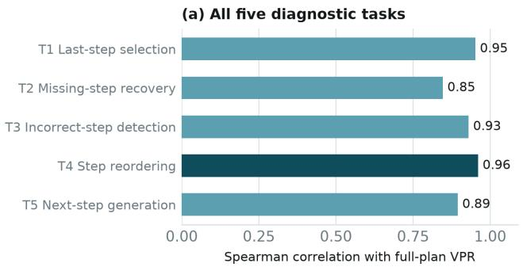

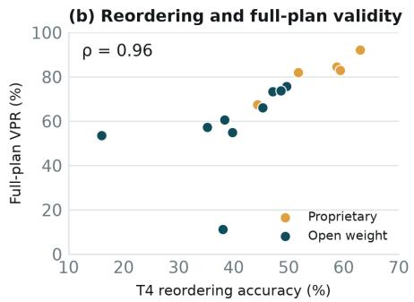  
Figure 2: Correlations between the five diagnostic tasks and end-to-end plan validity. Left: Spearman correlations with full-plan VPR across all 14 configurations, using accuracy for T1–T4 and VPR for T5. Right: reordering accuracy versus full-plan VPR, with each point representing one configuration.

## 7.1 Planning Beyond Aggregate Scores

Table 2 shows that similar full-plan validity can hide differences in specific planning capabilities. Command A and Qwen3 14B have similar full-plan VPR (67.4% and 66.2%), but differ in missing-step recovery (59.1% and 24.9%). Their reordering accuracy is much closer (44.3% and 45.3%). The diagnostic tasks therefore reveal a difference in recovering missing content that full-plan VPR alone does not show.

Success on one diagnostic task also does not imply success on the others. Qwen3 4B and its Instruct-2507 variant have nearly identical incorrect-step detection accuracy (49.7% and 49.9%), but different full-plan VPR (11.2% and 57.3%). The original model has slightly higher reordering accuracy (38.0% versus 35.2%). These results support evaluating recovery, detection, ordering, and continuation separately. Each task tests a specific capability, while full-plan generation requires producing both the actions and their sequence.

## 7.2 Correlation with Full-Plan Validity

Section 7.1 shows that the diagnostics expose capability differences that full-plan VPR hides. Figure 2 shows how each diagnostic task relates to full-plan VPR across all 14 configurations. All five tasks are positively associated with full-plan validity. Reordering has the strongest correlation $( \rho = 0 . 9 6 )$ , followed by last-step selection $( \rho = 0 . 9 5 )$ , incorrect-step detection $( \rho = 0 . 9 3 )$ next-step VPR $( \rho = 0 . 8 9 )$ , and missing-step recovery $( \rho = 0 . 8 5 )$ . Thus, models that perform well on the diagnostic tasks also tend to generate more valid full plans over the same procedure pool.

These associations suggest that the diagnostic tasks provide a lightweight signal of planning ability without requiring full-plan generation and costly judge evaluation. In particular, T1–T4 have known answers and require no judge model. The correlations should nevertheless be interpreted at the model level: strong performance on a diagnostic task does not imply valid full-plan generation for every procedure on which the model succeeds in that task. Taken together, the diagnostics complement full-plan evaluation by capturing overall planning performance while revealing capability differences that full-plan VPR can obscure.

## 7.3 Procedure Length Effects

Table 2 shows that the best reordering accuracy is 63.0%, even though all required steps are supplied. This is below the best accuracy on selection, recovery, and detection. Figure 5 in Appendix E.1 shows how performance changes with procedure length. For GPT-5.6-sol, exact-order accuracy falls from 86.8% at two steps to 33.1% at nine or more steps, while normalised edit distance falls from 86.8 to 76.6. The model often produces an order close to the reference, but recovering the complete sequence becomes harder as the length increases. Exact reference agreement is a strict diagnostic: a different order is not necessarily an invalid plan when some actions can be exchanged.

Length affects detection differently. Gemini 3 Flash’s incorrect-step detection accuracy rises from 68.5% at four steps to 80.3% at nine or more, whereas Qwen3 4B falls from 51.1% at three steps to 42.5% at seven or eight. Longer procedures therefore do not make every diagnostic task harder in the same way, and aggregate scores can hide these differences.

## 7.4 Effects of Scale and Reasoning

Table 2 shows that increasing model size changes some capabilities more than others. From Qwen3 4B to Qwen3 32B without thinking, reordering accuracy rises from 38.0% to 48.6%, while full-plan VPR rises from 11.2% to 73.8%. Incorrect-step detection changes less, from 49.7% to 57.3%.

Reasoning comparisons also show uneven changes. Qwen3 32B gains +1.0 points on reordering and +1.9 on full-plan VPR with thinking enabled. Command A Reasoning improves on Command A by +7.4 and +14.6 points, respectively. However, missing-step recovery improves by 13.2 points for Qwen3 32B and falls by 15.2 points for Command A Reasoning. These comparisons show why gains in full-plan generation should not be taken to imply gains in every diagnostic capability. The Command A comparison also involves different model variants, so it does not isolate the effect of reasoning alone.

## 7.5 Performance on STEPBENCH-Val

Table 3 shows performance on STEPBENCH-Val after matching category composition and procedure length. Selection, recovery, and detection change by at most 1.4 points on average, while reordering and next-step VPR decrease by 8.3 and 7.5 points, respectively. Full-plan VPR decreases by 16.2 points. Overall, the diagnostic tasks show varying sensitivity to the dataset change, while remaining comparatively stable.

Model rankings are also strongly preserved across datasets, with rank correlations ranging from 0.77 to 0.99. This consistency suggests that the diagnostic patterns observed on STEPBENCH, although it does not by itself rule out memorisation because the sets differ in construction and GPT-5.6-sol’s training chronology is unverified. Appendix E.6 provides per-configuration comparisons and additional controls.

## 8 Conclusion

We introduce STEPBENCH, a benchmark for diagnosing open-domain procedural planning through five complementary tasks over 6,885 curated procedures. Existing open-domain benchmarks primarily evaluate final generated plans (Zhang et al., 2021; Shen et al., 2024; Huang et al., 2024), while fine-grained error analysis has largely focused on formal or embodied settings with executable plans (Valmeekam et al., 2023b; Kokel et al., 2025; Li et al., 2024). STEPBENCH bridges this gap by probing distinct aspects of procedural understanding, enabling fine-grained diagnosis of planning strengths and weaknesses without requiring execution.

<table><tr><td></td><td>T1</td><td>T2</td><td>T3</td><td>T4</td><td></td><td>T5 Full plan</td></tr><tr><td>Change -1.4 -0.5</td><td></td><td></td><td>-0.6</td><td>-8.3</td><td>-7.5</td><td>-16.2</td></tr></table>

Table 3: Mean score change on STEPBENCH-Val relative to STEPBENCH (percentage points), after matching categories and reweighting procedure lengths. The five diagnostic tasks use accuracy (T1–T4) or VPR (T5), while full-plan generation uses VPR. Results are averaged over all 14 configurations.

Our evaluation of 12 models across 14 configurations reveals substantial differences in diagnostic profiles. Reordering remains particularly challenging even when all correct steps are provided: the strongest configuration recovers the reference order for only 63.0% of procedures, dropping to 33.1% for procedures with nine or more steps. Models with similar incorrect-step detection scores can also differ markedly in reordering, highlighting differences that aggregate planning scores may obscure.

All five diagnostic tasks are positively correlated with judged end-to-end plan validity, with reordering showing the strongest association $( \rho = 0 . 9 6 )$ These findings suggest that diagnostic tasks can provide lower-cost indicators of planning performance while revealing strengths and weaknesses that full-plan evaluation alone cannot capture. Evaluation on STEPBENCH-Val, comprising 214 procedures published in 2026, further supports the robustness of these findings, with relatively stable diagnostic performance and preserved model rankings across older and newer procedures.

Overall, STEPBENCH provides a framework for fine-grained planning diagnosis, connecting distinct procedural capabilities to end-to-end generation performance. We release the corpus, task suite, model outputs, judge annotations, and analysis code to support further research on diagnosing procedural planning in open-domain settings.

## Limitations

STEPBENCH focuses on English-language procedures from wikiHow, primarily covering everyday tasks. Broader coverage of languages, sources, and specialised domains would strengthen its generality. The procedures are also relatively short, leaving longer and more complex planning scenarios for future evaluation.

STEPEVAL provides a scalable assessment of critical failures, but its judgements depend on reference quality and the interpretation of acceptable procedural variation. Additional references and expert assessments could improve coverage of alternative valid plans. Computational resources and API credit budgets also limited the number of models and configurations we could evaluate; expanding this coverage would further strengthen the empirical findings.

## Acknowledgments

This research is supported by the Engineering and Physical Sciences Research Council [EP/S021566/1] and the EPSRC Fellowship titled “Task Based Information Retrieval” [EP/P024289/1]. This project also used the DGX Spark compute equipment provided by NVIDIA for the grant titled “Agentic Evaluation: Efficient and Reliable Evaluation for Agentic AI Systems”. This research is supported in part by the Cohere Labs Catalyst Grant Program.

## References

Adrita Anika and Md Messal Monem Miah. 2025. Evaluating llms’ reasoning over ordered procedural steps. In Proceedings ofthe 14th International Joint Conference on Natural Language Processing and the 4th Conference of the Asia-Pacific Chapter of the Associationfor Computational Linguistics, IJCNLP-AACL 2025, Mumbai, India, December 20-24, 2025, pages 2259–2267. The Asian Federation of Natural Language Processing and The Association for Computational Linguistics.

Faeze Brahman, Chandra Bhagavatula, Valentina Pyatkin, Jena D. Hwang, Xiang Lorraine Li, Hirona J. Arai, Soumya Sanyal, Keisuke Sakaguchi, Xiang Ren, and Yejin Choi. 2024. PlaSma: Making small language models better procedural knowledge models for (counterfactual) planning. arXiv preprint arXiv:2305.19472.

Yapei Chang, Kyle Lo, Mohit Iyyer, and Luca Soldaini. 2026. How2everything: Mining the web for how-to procedures to evaluate and improve LLMs. arXiv preprint arXiv:2602.08808.

Cohere. 2025. Command a: An enterprise-ready large language model. Model card. Accessed 2026-08-17.

Florian E. Dorner, Vivian Yvonne Nastl, and Moritz Hardt. 2025. Limits to scalable evaluation at the frontier: LLM as judge won’t beat twice the data. In The Thirteenth International Conference on Learning Representations, ICLR 2025, Singapore, April 24-28, 2025. OpenReview.net.

Gemma Team. 2025. Gemma 3 technical report. arXiv preprint arXiv:2503.19786.

GLM Team. 2024. ChatGLM: A family of large language models from glm-130b to glm-4 all tools. arXiv preprint arXiv:2406.12793.

Google DeepMind. 2025. Gemini 3 model card. Model card. Accessed 2026-08-17.

Aaron Grattafiori, Abhimanyu Dubey, Abhinav Jauhri, et al. 2024. The llama 3 herd of models. arXiv preprint arXiv:2407.21783.

Yancheng He, Shilong Li, Jiaheng Liu, Weixun Wang, Xingyuan Bu, Ge Zhang, Zhongyuan Peng, Zhaoxiang Zhang, Zhicheng Zheng, Wenbo Su, and Bo Zheng. 2025. Can large language models detect errors in long chain-of-thought reasoning? In Proceedings of the 63rd Annual Meeting of the Associationfor Computational Linguistics (Volume 1: Long Papers), ACL 2025, Vienna, Austria, July 27 - August 1, 2025, pages 18468–18489. Association for Computational Linguistics.

Shijue Huang, Wanjun Zhong, Jianqiao Lu, Qi Zhu, Jiahui Gao, Weiwen Liu, Yutai Hou, Xingshan Zeng, Yasheng Wang, Lifeng Shang, Xin Jiang, Ruifeng Xu, and Qun Liu. 2024. Planning, creation, usage: Benchmarking LLMs for comprehensive tool utilization in real-world complex scenarios. In Findings of the Associationfor Computational Linguistics: ACL 2024, pages 4363–4400. Association for Computational Linguistics.

Harsha Kokel, Michael Katz, Kavitha Srinivas, and Shirin Sohrabi. 2025. Acpbench: Reasoning about action, change, and planning. In Thirty-Ninth AAAI Conference on Artificial Intelligence, Thirty-Seventh Conference on Innovative Applications ofArtificial Intelligence, Fifteenth Symposium on Educational Advances in Artificial Intelligence, AAAI 2025, Philadelphia, PA, USA, February 25 - March 4, 2025, pages 26559–26568. AAAI Press.

Harsha Kokel, Michael Katz, Kavitha Srinivas, and Shirin Sohrabi. 2026. Acpbench hard: Unrestrained reasoning about action, change, and planning. In The Fourteenth International Conference on Learning Representations, ICLR 2026, Rio de Janeiro, Brazil, April 23-27, 2026. proceedings.iclr.cc.

Mahnaz Koupaee and William Yang Wang. 2018. Wiki-How: A large scale text summarization dataset. arXiv preprint arXiv:1810.09305.

Yash Kumar Lal, Vanya Cohen, Nathanael Chambers, Niranjan Balasubramanian, and Raymond Mooney. 2024. CaT-bench: Benchmarking language model understanding of causal and temporal dependencies in plans. In Proceedings ofthe 2024 Conference on Empirical Methods in Natural Language Processing, pages 19336–19354. Association for Computational Linguistics.

Haoming Li, Zhaoliang Chen, Jonathan Zhang, and Fei Liu. 2025. PLANET: A collection of benchmarks for evaluating LLMs’ planning capabilities. arXiv preprint arXiv:2504.14773.

Manling Li, Shiyu Zhao, Qineng Wang, Kangrui Wang, Yu Zhou, Sanjana Srivastava, Cem Gokmen, Tony Lee, Li Erran Li, Ruohan Zhang, Weiyu Liu, Percy Liang, Li Fei-Fei, Jiayuan Mao, and Jiajun Wu. 2024. Embodied agent interface: Benchmarking llms for embodied decision making. In Advances in Neural Information Processing Systems 37: Annual Conference on Neural Information Processing Systems 2024, NeurIPS 2024, Vancouver, BC, Canada, December 10 - 15, 2024.

Chin-Yew Lin. 2004. ROUGE: A package for automatic evaluation of summaries. In Text Summarization Branches Out, pages 74–81. Association for Computational Linguistics.

Qing Lyu, Li Zhang, and Chris Callison-Burch. 2021. Goal-oriented script construction. In Proceedings of the 14th International Conference on Natural Language Generation, pages 184–200. Association for Computational Linguistics.

Drew V. McDermott. 2000. The 1998 AI planning systems competition. AI Mag., 21(2):35–55.

OpenAI. 2025. Introducing GPT-4.1 in the API. https: //openai.com/index/gpt-4-1/. Accessed 2026- 08-17.

OpenAI. 2026. GPT-5 system card. arXiv preprint arXiv:2601.03267.

Shuofei Qiao, Runnan Fang, Zhisong Qiu, Xiaobin Wang, Ningyu Zhang, Yong Jiang, Pengjun Xie, Fei Huang, and Huajun Chen. 2025. Benchmarking agentic workflow generation. In The Thirteenth International Conference on Learning Representations, ICLR 2025, Singapore, April 24-28, 2025. OpenReview.net.

Qwen Team. 2025. Qwen3 technical report. arXiv preprint arXiv:2505.09388.

Yangjun Ruan, Chris J. Maddison, and Tatsunori B. Hashimoto. 2024. Observational scaling laws and the predictability of language model performance. In Advances in Neural Information Processing Systems 37: Annual Conference on Neural Information Processing Systems 2024, NeurIPS 2024, Vancouver, BC, Canada, December 10 - 15, 2024.

Keisuke Sakaguchi, Chandra Bhagavatula, Ronan Le Bras, Niket Tandon, Peter Clark, and Yejin Choi. 2021. proscript: Partially ordered scripts generation via pre-trained language models. arXiv preprint arXiv:2104.08251.

Yongliang Shen, Kaitao Song, Xu Tan, Wenqi Zhang, Kan Ren, Siyu Yuan, Weiming Lu, Dongsheng Li, and Yueting Zhuang. 2024. TaskBench: Benchmarking large language models for task automation. In Advances in Neural Information Processing Systems 37 (NeurIPS Datasets and Benchmarks Track).

Kaya Stechly, Karthik Valmeekam, and Subbarao Kambhampati. 2025. On the self-verification limitations of large language models on reasoning and planning tasks. In The Thirteenth International Conference on Learning Representations, ICLR 2025, Singapore, April 24-28, 2025. OpenReview.net.

Sijun Tan, Siyuan Zhuang, Kyle Montgomery, William Yuan Tang, Alejandro Cuadron, Chenguang Wang, Raluca A. Popa, and Ion Stoica. 2025. Judgebench: A benchmark for evaluating llm-based judges. In The Thirteenth International Conference on Learning Representations, ICLR 2025, Singapore, April 24-28, 2025. OpenReview.net.

Yansong Tang, Dajun Ding, Yongming Rao, Yu Zheng, Danyang Zhang, Lili Zhao, Jiwen Lu, and Jie Zhou. 2019. COIN: A large-scale dataset for comprehensive instructional video analysis. In Proceedings of the IEEE/CVF Conference on Computer Vision and Pattern Recognition (CVPR), pages 1207–1216.

Aman Singh Thakur, Kartik Choudhary, Venkat Srinik Ramayapally, Sankaran Vaidyanathan, and Dieuwke Hupkes. 2024. Judging the judges: Evaluating alignment and vulnerabilities in llms-as-judges. CoRR, abs/2406.12624.

Arda Uzunoglu, Abdalfatah Rashid Safa, and Gözde Gül ¸Sahin. 2024. PARADISE: Evaluating implicit planning skills of language models with procedural warnings and tips dataset. arXiv preprint arXiv:2403.03167.

Karthik Valmeekam, Matthew Marquez, and Subbarao Kambhampati. 2023a. Can large language models really improve by self-critiquing their own plans? CoRR, abs/2310.08118.

Karthik Valmeekam, Matthew Marquez, Alberto Olmo, Sarath Sreedharan, and Subbarao Kambhampati. 2023b. PlanBench: An extensible benchmark for evaluating large language models on planning and reasoning about change. In Advances in Neural Information Processing Systems 36 (NeurIPS Datasets and Benchmarks Track).

Karthik Valmeekam, Alberto Olmo, Sarath Sreedharan, and Subbarao Kambhampati. 2022. Large language models still can’t plan (a benchmark for llms on planning and reasoning about change). In NeurIPS 2022 Foundation Models for Decision Making Workshop.

Yoko Yamakata, Shinsuke Mori, and John Carroll. 2020. English recipe flow graph corpus. In Proceedings of the 12th Language Resources and Evaluation Conference (LREC), pages 5187–5194.

Quan Yuan, Mehran Kazemi, Xin Xu, Isaac Noble, Vaiva Imbrasaite, and Deepak Ramachandran. 2023a. TaskLAMA: Probing the complex task understanding of language models. arXiv preprint arXiv:2308.15299.

Siyu Yuan, Jiangjie Chen, Ziquan Fu, Xuyang Ge, Soham Shah, Charles Jankowski, Yanghua Xiao, and Deqing Yang. 2023b. Distilling script knowledge from large language models for constrained language planning. In Proceedings of the 61st Annual Meeting ofthe Associationfor Computational Linguistics (Volume 1: Long Papers), pages 4303–4325. Association for Computational Linguistics.

Li Zhang, Qing Lyu, and Chris Callison-Burch. 2020a. Reasoning about goals, steps, and temporal ordering with WikiHow. In Proceedings of the 2020 Conference on Empirical Methods in Natural Language Processing (EMNLP), pages 4630–4639. Association for Computational Linguistics.

Tianyi Zhang, Varsha Kishore, Felix Wu, Kilian Q. Weinberger, and Yoav Artzi. 2020b. BERTScore: Evaluating text generation with BERT. In International Conference on Learning Representations (ICLR).

Yanzhao Zhang, Mingxin Li, Dingkun Long, Xin Zhang, Huan Lin, Baosong Yang, Pengjun Xie, An Yang, Dayiheng Liu, Junyang Lin, Fei Huang, and Jingren Zhou. 2025. Qwen3 embedding: Advancing text embedding and reranking through foundation models. Preprint, arXiv:2506.05176.

Yi Zhang, Sujay Kumar Jauhar, Julia Kiseleva, Ryen White, and Dan Roth. 2021. Learning to decompose and organize complex tasks. In Proceedings of the 2021 Conference of the North American Chapter ofthe Associationfor Computational Linguistics: Human Language Technologies, pages 2726–2735. Association for Computational Linguistics.

Chujie Zheng, Zhenru Zhang, Beichen Zhang, Runji Lin, Keming Lu, Bowen Yu, Dayiheng Liu, Jingren Zhou, and Junyang Lin. 2025. Processbench: Identifying process errors in mathematical reasoning. In Proceedings of the 63rd Annual Meeting of the Associationfor Computational Linguistics (Volume 1: Long Papers), ACL 2025, Vienna, Austria, July 27 - August 1, 2025, pages 1009–1024. Association for Computational Linguistics.

Lianmin Zheng, Wei-Lin Chiang, Ying Sheng, Siyuan Zhuang, Zhanghao Wu, Yonghao Zhuang, Zi Lin, Zhuohan Li, Dacheng Li, Eric P. Xing, Hao Zhang, Joseph E. Gonzalez, and Ion Stoica. 2023. Judging LLM-as-a-judge with MT-bench and chatbot arena. In Advances in Neural Information Processing Systems 36.

Shuyan Zhou, Li Zhang, Yue Yang, Qing Lyu, Pengcheng Yin, Chris Callison-Burch, and Graham Neubig. 2022. Show me more details: Discovering hierarchies of procedures from semi-structured web data. In Proceedings ofthe 60th Annual Meeting of the Associationfor Computational Linguistics (Volume 1: Long Papers), pages 2998–3012. Association for Computational Linguistics.

## A Extended Related Work

## A.1 Benchmark Comparison

Table 4 positions STEPBENCH against selected benchmarks most closely related to task decomposition or procedural comprehension. It is a map of task coverage, rather than a ranking of resources or a claim that the benchmarks solve identical problems. In particular, the source column records where procedures originate; it is not a measure of reference correctness. The coverage columns distinguish plan production, recovery of a withheld step, localisation of an inserted incorrect step, and ordering. They make explicit that STEPBENCH combines diagnostic comprehension and generation over the same procedure instances. We report separate task scores because similar overall performance can conceal different procedural strengths and weaknesses. Prior work shows that a few underlying capabilities explain much of the variation in benchmark scores across models (Ruan et al., 2024). STEPBENCH provides a more detailed procedural profile by evaluating missing-step recovery, incorrect-step detection, ordering, and generation over the same procedure instances.

## A.2 Procedural Understanding

Task-decomposition benchmarks generally measure whether a model can generate a suitable collection of steps for a goal. Zhang et al. (2021) use reference-overlap metrics for generated decompositions; TaskLAMA (Yuan et al., 2023a) evaluates generated task graphs and separately probes pairwise temporal dependencies; TaskBench (Shen et al., 2024) embeds decomposition in a toolautomation pipeline; and UltraTool (Huang et al., 2024) evaluates natural-language plans before tools are used. PLANET (Li et al., 2025) collects multiple planning evaluations under one framework, further illustrating the breadth of behaviours subsumed by a single “planning” label. These benchmarks motivate evaluating planning before execution, but their plan-production scores do not localise a model’s failure mode. Benchmarks that do localise it restrict the setting to where an oracle can check each sub-skill. Embodied Agent Interface (Li et al., 2024) factors embodied decision making into goal interpretation, subgoal decomposition, action sequencing, and transition modelling, using simulators to type errors as missing, additional, or misordered steps; ACPBench (Kokel et al., 2025) poses atomic reasoning tasks over thirteen formal planning domains, with generative variants in ACPBench Hard (Kokel et al., 2026); and WorfBench (Qiao et al., 2025) scores workflows by subsequence and subgraph matching, finding models markedly weaker on graph-structured plans than linear ones. Each depends on a simulator, a formal domain, or an annotated graph. STEPBENCH obtains a comparable per-capability readout from controlled perturbations of verified references instead.

<table><tr><td>Benchmark</td><td>Source</td><td></td><td></td><td></td><td></td><td></td><td>Size Gen. Miss. Err. Ord. Decomp. metric</td></tr><tr><td colspan="8">Task decomposition</td></tr><tr><td>Zhang et al. (2021)</td><td>Wunderlist, wikiHow</td><td>8,262</td><td>√</td><td>x</td><td>x</td><td>o</td><td>ROUGE, BERTScore</td></tr><tr><td>TaskLAMA (Yuan et al., 2023a)</td><td>search logs, MSCT</td><td>1,612</td><td>√</td><td>x</td><td>x</td><td>o</td><td>ROUGE, Hungarian</td></tr><tr><td>TaskBench (Shen et al., 2024)</td><td>synth. tool graphs</td><td>17,331</td><td>√</td><td>x</td><td>x</td><td>x</td><td>ROUGE only</td></tr><tr><td>UltraTool (Huang et al., 2024)</td><td>expert queries</td><td>5,824</td><td>√</td><td>x</td><td>x</td><td>x</td><td>LLM judge (6 dim.)</td></tr><tr><td colspan="8">Procedural comprehension</td></tr><tr><td>CaT-Bench (Lal et al., 2024)</td><td>recipes</td><td>4,260</td><td>x</td><td>x</td><td>X</td><td>o</td><td>accuracy, F1</td></tr><tr><td>Anika and Miah (2025)</td><td>recipes</td><td></td><td>x</td><td>x</td><td>x</td><td>√</td><td>Kendall τ, NED</td></tr><tr><td>proScript (Sakaguchi et al., 2021)</td><td>crowd</td><td>6,400</td><td>√</td><td>x</td><td>x</td><td>o</td><td>edge F1</td></tr><tr><td>How2Bench (Chang et al., 2026)</td><td>open web</td><td>7,000</td><td>√</td><td>x</td><td>x</td><td>x</td><td>LLM judge (failures)</td></tr><tr><td>STEPBENCH (ours)</td><td>wikiHow, expert-prov.</td><td>6,885</td><td></td><td>√</td><td>√</td><td></td><td>accuracy, NED, judge</td></tr></table>

Table 4: Selected benchmarks for task decomposition or procedural comprehension. Gen.: the model must produce step text. Miss.: the model must identify a step withheld from a given procedure. Err.: the model must localise an incorrect step injected into an otherwise correct procedure. Ord.: the model must recover or judge step order — ◦ marks benchmarks that predict pairwise dependencies over gold steps rather than requiring a full ordering. Among the task-decomposition benchmarks in this table, none evaluates recovery of missing or detection of incorrect steps, and none evaluates comprehension and generation over a shared procedure pool. Sizes are as reported by each paper; STEPBENCH is the count of curated procedures, each of which yields an instance of every task.

Several works isolate parts of procedural understanding. CaT-Bench (Lal et al., 2024) evaluates whether a step should precede another in recipe plans, and Anika and Miah (2025) reconstruct shuffled recipe sequences. Most closely, Zhang et al. (2020a) derive wikiHow tasks for goal-step inference and pairwise temporal ordering, using semantic similarity to obtain challenging negative examples. STEPBENCH inherits this controlledinference tradition but evaluates gaps and complete orders within procedures, adds plausible inserted faults, and connects all of these diagnostics to generation over the same goals. PARADISE (Uzunoglu et al., 2024) evaluates warnings and tips associated with procedures, Yuan et al. (2023b)

distil script knowledge for constrained generation, and proScript (Sakaguchi et al., 2021) models partially ordered scripts. These tasks assess relations among supplied steps, but do not present a complete procedure with a topically plausible violation and ask the model to identify it. Error localisation of that kind exists where the answer is formally checkable: ProcessBench (Zheng et al., 2025) asks for the earliest erroneous step in expertannotated mathematical solutions, and DeltaBench (He et al., 2025) for faulty sections in long reasoning traces. The capability matters because models audit their own output unreliably: self-critique degrades plans in closed domains rather than repairing them (Valmeekam et al., 2023a; Stechly et al., 2025), which argues for measuring detection as a capability of its own rather than assuming generation implies it. STEPBENCH supplies that diagnostic setting through incorrect-step detection and full-order recovery, while its missing-step tasks assess recovery with the surrounding procedural context visible.

Executable planning benchmarks provide another useful point of comparison. Valmeekam et al. (2022) and PlanBench (Valmeekam et al., 2023b) use formal action models that can determine whether a plan is valid. Their closed action spaces provide an execution oracle, whereas STEPBENCH evaluates open-domain procedures for which executing every candidate plan would require diverse real-world environments. The two settings therefore answer different questions: executable benchmarks assess success under a formal dynamics; STEPBENCH diagnoses how a model represents the content and order of a procedure without executing it.

## A.3 References and Generation Scoring

Procedural corpora make different trade-offs among scale, domain, and source characteristics. wikiHow has supported summarisation, goal reasoning, and procedure discovery (Koupaee and Wang, 2018; Zhang et al., 2020a; Lyu et al., 2021; Zhou et al., 2022); recipes and instructional videos provide narrower domains (Yamakata et al., 2020; Tang et al., 2019); proScript uses crowdauthored scripts (Sakaguchi et al., 2021); and How2Everything (Chang et al., 2026) mines webscale procedures. Because STEPBENCH creates controlled faults from its references, it records editorial signals for every source article and validates its model-assisted curation, rather than treating source provenance as a guarantee of correctness.

For open-ended plan generation, ROUGE and BERTScore remain common points of comparison (Zhang et al., 2021; Shen et al., 2024; Brahman et al., 2024). Judge-based protocols instead assess properties of a plan that need not match a single reference closely (Zheng et al., 2023). The judges themselves are now measured: JudgeBench (Tan et al., 2025) finds strong judges near chance on response pairs with objectively correct answers, Thakur et al. (2024) show high raw agreement coexisting with weak chance-corrected alignment, and Dorner et al. (2025) bound how much ground-truth labelling a judge can save once the judged models rival it. UltraTool evaluates six dimensions of a plan with an LLM judge (Huang et al., 2024); How2Everything asks whether a plan contains a critical failure that prevents the goal being achieved (Chang et al., 2026). STEPEVAL adopts the latter formulation for STEPBENCH’s generation tasks.

## B Prompts

All prompts are reproduced verbatim. Placeholders in braces are filled at runtime with the corresponding instance fields.

## B.1 Data Construction Prompts

These two prompts implement the pipeline stages in §3. All use GPT-4.1.

## Stage 1: Task Filtering

You are an expert in wikiHow task understanding and evaluation.

## [User]

I have a method and its steps from wikiHow. Please analyse the method title and its steps and strictly evaluate whether they constitute a well-defined task. A task is a specific objective that can be completed by following a structured sequence of steps. Steps are the individual actions that, when executed in order, should lead to the successful completion of the task. Specifically, determine if completing the steps logically leads to accomplishing the task described in the method title, and if they can be modelled as a task and steps in a general.

Here is the method and its steps: {method}.

Please strictly follow the instruction, and output 'Yes' if it is logically a task and 'No' if it is not. Please do not provide any extra information or assumptions.

## Stage 2: Step Curation

[System]   
You are an expert in analysing procedural   
tasks.   
[User]   
Given a task title, the list of steps, and   
the description of each step, evaluate them   
based on the following criteria:   
1. Necessity Check: Determine if each step   
is STRICTLY required to accomplish the   
task. If any step is unnecessary, REMOVE it.   
2. Order Check: If the remaining steps are   
not in the correct sequential order,   
reorder them logically.   
Here is the task title, the list of steps,   
and the description of each step: {method}.   
Please follow the following instructions   
carefully:   
- Remove the unnecessary steps from the   
initial steps.   
- If reordering is needed for the remaining   
STRICTLY required steps, return the step   
titles arranged logically ordered.   
- Respond strictly in JSON format as   
follows: {'Step 1': 'Title', 'Step 2':   
'Title', ...}   
- Please do not provide any details, just   
provide the final STRICTLY logically   
ordered steps in the provided JSON format.

## B.2 Task Prompts

These are the prompts given to evaluated models, one per task (§4).

T1: Last-Step Selection   
[System]   
You are an expert in task understanding and   
decomposition.   
[User]   
You are given a task title, the initial   
steps required to accomplish the task, and   
a list of candidate options for the final   
step. The last step is missing, and your   
goal is to identify the correct final step   
from the given options. Choose the single   
correct missing last step and provide your   
answer strictly in the following JSON   
format: {"step\_index": "Step Index"}.   
Task Title: {method\_title}   
Task Steps:   
{steps}   
Options:   
{options}

## T2: Missing-Step Recovery

```ini
[System]
You are an expert in task understanding and
decomposition.
[User]
You are given a task title, the initial
steps required to accomplish the task, and
a list of candidate options for the missing
step. One of the steps is missing, and your
goal is to identify the correct step from
the given options. Choose the single
correct missing step and provide your
answer strictly in the following JSON
format: {"step_index": "Step Index"}.
Task Title: {method_title}
Task Steps:
{steps}
Options:
{options}
```

## T3: Incorrect-Step Detection

```ini
[System]
You are an expert in task understanding and
decomposition.
[User]
```

You are given a task title and a list of   
steps to accomplish the task. Your goal is   
to identify the incorrect step from the   
given steps. Choose only one step and   
provide your final answer strictly in the   
following JSON format: {"step\_index": "Step   
Index"}   
Task Title: {method\_title}   
Task Steps:   
{steps}

## T4: Step Reordering

```ini
[System]
You are an expert in task understanding and
decomposition.
[User]
You are given a task title and a list of
steps to accomplish the task. Your goal is
to determine the correct order of the
steps. Return the step indices in the
correct order as a list of integers.
Provide your final answer strictly in the
following JSON format: {"ordered_steps":
[<integer indices in correct order>]}
Only return valid JSON. Do not include any
explanations or additional text.
Task Title: {method_title}
Task Steps:
{steps}
```

## T5: Next-Step Generation

```ini
[System]
You are an expert in task understanding and
decomposition.
[User]
You are given a task and the steps
completed so far. Your goal is to generate
the NEXT step only. Return your answer
strictly in the following JSON format:
{"title": "Next concrete action"}
Requirements:
- Generate exactly ONE next step.
- The step must logically follow the given
steps.
- The step must be concrete and actionable
(not vague).
Do not repeat previous steps.
- Do not include explanations or additional
text.
- Only return valid JSON.
Task Title:
{method_title}
Steps completed so far:
```

Full Plan Generation   
[System]   
You are an expert in task understanding and   
decomposition.   
[User]   
You are given a task query. Your goal is to   
decompose the request into a sequence of   
concrete steps required to accomplish it.   
Return your final answer strictly in the   
following JSON format, which is a list of   
ordered steps:   
{"steps": [   
{"index": 1, "title": "First concrete   
action"},   
{"index": 2, "title": "Second concrete   
action"}   
]}   
Requirements:   
- Steps must be logically ordered.   
- Steps must be concrete and actionable   
(not vague).   
- The plan must fully solve the USER   
REQUEST.   
- Do not include explanations or additional   
text.   
- Only return valid JSON.   
Task Title:   
{method\_title}  
Decoding. All runs use greedy decoding (T = 0) unless a model’s provider requires otherwise. We add one sampled configuration, Gemini 3 Flash at T = 1, to check that our conclusions are not artefacts of greedy decoding. Models supporting extended reasoning are run in both modes where available (Qwen3 32B); Command A Reasoning and Gemini 3 Flash are evaluated in reasoning mode only, as their non-reasoning counterparts are separate models rather than a toggle.

Parsing. Model output is parsed by a per-task extractor that attempts strict JSON first, then a progressively more tolerant sequence: fenced-block stripping, JSON5, Python literal evaluation, and finally a regular-expression fallback for the expected fields. Outputs that survive none of these are recorded as unparsed and scored as failures.

## C Corpus Details

## C.1 Datasheet

Motivation. STEPBENCH was created to evaluate whether language-model agents can understand, verify, and construct real-world task procedures. No existing resource measured comprehension and generation on a shared pool of procedures with a stated reference provenance.

Composition. 6,885 procedures, each a goal plus an ordered list of reference steps, derived from 2,920 wikiHow articles across 81 categories. 30,975 reference steps in total. Instances carry a category label and a stable identifier linking them across all 5 tasks. Text is English.

Collection. Articles were crawled from wiki-How in February 2025. The crawl retained article text, method structure, and the article’s editorial metadata (expert-authorship flag, editorial review tag, co-author count, reference count, view count, reader helpfulness rating). Processing is described in §3.

Preprocessing. Two GPT-4.1 stages: task filtering and step curation (prompts in Appendix B.1). Raw crawl, intermediate outputs, and final pool are all released, so any stage can be inspected or re-run.

## C.2 Provenance Signals in Detail

wikiHow attaches two independent quality signals to articles. The expert co-author flag indicates the article was written with a named, credentialed subject expert. The editorial tag records a separate review process with three levels: Expert Approved (a subject expert reviewed the finished article), Fact Checked (staff verified factual claims against cited sources), and Tested (staff physically performed the procedure). Table 5 reports the distribution over STEPBENCH’s source articles. Neither signal is a correctness proof, and we do not use them to filter: every article that passes the pipeline enters the benchmark regardless of its tags. They are reported because they characterise the population the references are drawn from, and because that population differs materially from an unfiltered web crawl.

## C.3 Human Validation

Stages 1 and 2 make the consequential decisions in our pipeline: Stage 1 determines which candidates qualify as procedural tasks, while Stage 2 determines the reference steps used to construct the benchmark. We therefore evaluate both stages against independent human judgements.

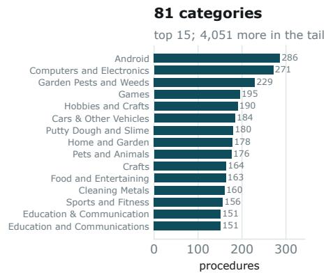

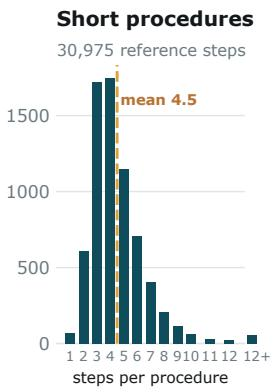

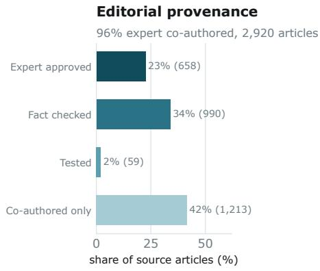  
Figure 3: STEPBENCH corpus. Left: procedures per category, top 15 of 81; the distribution is long-tailed because how-to content is. Centre: procedures are short — a median of 4 steps — which is what makes exact-match reordering a demanding but not hopeless task. Right: editorial provenance of the source articles.

For each stage, we sample 200 instances and collect independent judgements from 3 annotators. Annotators receive the same instruction as the model and answer the corresponding evaluation question without seeing its decision. We construct the two samples differently to reflect what each validation is intended to measure. For Stage 1, we sample methods by including candidates that the Stage 1 filter accepts and rejects to evaluate whether the filtering criterion generalises beyond the procedures retained in the benchmark. For Stage 2, we sample directly from STEPBENCH, since the objective is to assess the quality of the reference procedures used in the final benchmark.

Task Filtering. Annotators judge whether each candidate constitutes a well-defined procedural task. Human annotators agree with one another on 84.5-87.0% of instances, while their majority judgment agrees with the model on 82.0%.

Step Curation. Annotators are shown the original and curated step sequences side by side and judge whether the curation preserves all necessary steps, removes unnecessary ones, and produces a logical ordering. Human annotators agree with one another on 84.5–89.5% of instances and judge 81.5% of the resulting curations to be correct.

## D STEPEVAL Details

## D.1 Judge Prompt and Codebook

The judge receives the goal, the reference procedure $S ^ { \star }$ (labelled L1), and the candidate plan S<sup>ˆ</sup> (labelled L2), and returns JSON with a free-text reasoning field and a list of critical\_failures, each linked to the reference and candidate steps it concerns.

Failure taxonomy.

• Contradiction of the goal — a step directly contradicts a condition stated in the goal.

• Contradiction of the reference — a step diverges from a reference step in a way that prevents the goal being achieved.

• Internal inconsistency — a step is inconsistent with another step in the same plan.

• Incoherence — the plan has very low readability or logical flow; determinable without consulting the reference.

• Severe vagueness — the plan omits so much essential detail that it is unusable as instructions.

• Missing critical action — an essential reference step is absent with no equivalent or implied action.

• Extraneous action — an added step is unnecessary, confusing, or counterproductive.

• Redundant repetition — a step repeats an earlier one where the reference has no such repetition.

Acceptable variation. The codebook explicitly instructs the judge not to flag differences of tone, phrasing, or level of detail; differences of emphasis or ordering that do not change the outcome; additional steps that are neutral or practical; or omissions that are reasonably implied by another step. This is what distinguishes the protocol from generic preference judging, and it is why the protocol can credit a plan that is correct by a different route.

<table><tr><td colspan="2">Scale</td><td colspan="2">Provenance of source articles</td></tr><tr><td>Procedures</td><td>6,885</td><td>Distinct articles</td><td>2,920</td></tr><tr><td>Reference steps</td><td>30,975</td><td>Expert co-authored</td><td>2,806 (96.1%)</td></tr><tr><td>Categories</td><td>81</td><td>Editorially reviewed</td><td>1,707 (58.5%)</td></tr><tr><td>Steps per procedure</td><td>4.5</td><td>Fact checked</td><td>990</td></tr><tr><td>median (range)</td><td>4 (1–28)</td><td>Expert approved</td><td>658</td></tr><tr><td>Words per step</td><td>7.27</td><td>Tested</td><td>59</td></tr><tr><td>Words per task title</td><td>10.56</td><td>Median readership</td><td>244,916 views</td></tr><tr><td>Largest / smallest category</td><td>286 / 2</td><td>Cumulative readership</td><td>1.49 B views</td></tr><tr><td>Median category size</td><td>68</td><td>Median helpfulness</td><td>82%</td></tr></table>

Table 5: STEPBENCH at a glance. Left: benchmark scale. Right: provenance of the wikiHow articles the procedures are drawn from. wikiHow attaches an authorship record to every article; the great majority of STEPBENCH’s sources were co-authored with a credentialed subject expert, and a further editorial process fact-checks, expert-approves, or physically tests a large subset. Readership and helpfulness ratings are reader-supplied signals that these are procedures people actually follow.

Aggregation. A plan is scored no\_failure if the returned failure list is empty, has\_failure otherwise. The valid-plan rate is the share scored no\_failure. Following Chang et al. (2026), we take “any failure” rather than “first failure” as the aggregation, which yields higher inter-annotator agreement in their validation.

## D.2 Judge Configurations

• GPT-5 (OpenAI, 2026): Reference judge used to evaluate selected models and provide annotations for distillation; it is not used for the final reported evaluation. Default temperature, with no top\_p or top\_k settings, in non-thinking mode.

• STEPEVAL: Qwen3-8B fine-tuned for three epochs on GPT-5 annotations. This judge provides all final reported evaluations for both T5 and full-plan generation across all configurations and both datasets. Decoding settings: T = 0, top\_p 0.95, and top\_k 20.

## D.3 Distillation Setup

Training data joins GPT-5 judge outputs back to their source instances using the same promptrendering code the judge harness uses at inference, so training and inference formats cannot drift. We fine-tune Qwen3-8B for 3 epochs, effective batch size 16, learning rate $1 \times 1 0 ^ { - 5 }$ , cosine schedule with 3% warmup, bf16, gradient checkpointing, no sequence-length truncation.

## StepEval Critical Failure

You are given a goal and two lists of steps, L1 and L2. L1 is one correct procedure that is guaranteed to achieve the goal. L2 is a candidate procedure whose correctness needs to be determined. Your task is to determine whether L2 has any \*\*critical failures\*\*, using the goal and L1 as the reference.

## # Important Guidelines

## ## L1 as Reference

L1 reliably achieves the goal as written, but it may not be the only valid way to do so. Use it as a reliable reference, not the exclusive solution.

\## Definition of Critical Failure A \*\*critical failure\*\* is an issue that fundamentally prevents the goal from being achieved or makes L2 unusable as a set of followable instructions. Critical failures can take several forms: Critical failures can take several forms:

## ### Contradictions

\- \*\*Contradiction to the goal:\*\* An L2 step directly contradicts a condition specified in the goal.

\- \*\*Contradiction to L1 steps:\*\* An L2 step directly contradicts or significantly diverges from an L1 step, preventing the goal from being achieved.

\### Logical or Structural Issues - \*\*Internal inconsistency:\*\* An L2 step is inconsistent with another step within L2. - \*\*Incoherence:\*\* L2 has very low readability or logical flow and is hard to follow. This doesn't require reading L1 to determine.

\- \*\*Severe vagueness:\*\* As a whole, L2 lacks so much essential detail from L1 that it becomes basically unusable.

## ### Missing or Extraneous Actions

<table><tr><td>- **Missing critical action:** An essential L1 step required to achieve the goal is completely omitted in L2, with no equivalent or implied action present - **Unnecessary, confusing, or counterproductive extra action:** An L2 step introduces an action not present in L1 that is unnecessary or counterproductive. - **Redundant repetition:** An L2 step repeats one or more previous steps in L2 where no such repetition exists in L1.</td><td>aromatics, then finish with lime juice, seasoning, and coriander garnish. Summary of L2: Soak lentils only 30 minutes, then fry onions, garlic, chili, cumin, and salt in ghee, add lentils with water, and simmer until soft. Example critical failure: L2 soaks lentils for only 30 minutes, whereas L1 soaks for 8</td></tr><tr><td>These categories are not exhaustive. In practice, a single critical failure may span multiple categories. ## Acceptable Variations</td><td>hours. This is a critical difference in time. Example critical failure: L2 omits the oven entirely, using only stovetop simmering, which deviates from L1's oven-based preparation method and contradicts the goal</td></tr><tr><td>When assessing L2, focus on whether any issue is severe enough to prevent the goal from being achieved or to make L2 incoherent or unusable as a set of instructions. If not, the variation is</td><td>Goal: To construct a traditional wooden Jacob's Ladder toy using wood, ribbon, and small nails. Summary of L1: Mark and cut the wood into equal pieces, sand coarse then fine, cut</td></tr><tr><td>acceptable. Acceptable variations include: - Minor differences in tone, phrasing, or</td><td>ribbon to equal lengths, stack the wood in Jacob's Ladder pattern, and nail ribbons to the pieces. Summary of L2: Cut the wood into 5 equal</td></tr><tr><td>level of detail. - Differences in emphasis or ordering that do not affect the outcome.</td><td>pieces, sand smooth, then arrange them from largest to smallest, nailing and wrapping ribbon around each piece in sequence.</td></tr><tr><td>- Additional steps that are neutral or practical. - Reasonable implicit equivalence, where an omitted action is implied by another step.</td><td>Example critical failure: L2 contradicts itself; if the 5 pieces are of equal size, there is no largest or smallest piece.</td></tr><tr><td>Ignore stylistic or verbosity differences</td><td>Goal: To treat head lice by applying a tea</td></tr><tr><td>unless the omissions make L2 lack essential details from L1 to the point that it</td><td>tree oil and apple cider vinegar solution to the hair. Summary of L1: Mix tea tree oil with apple</td></tr><tr><td>becomes unusable. In that case, treat it as a critical failure (severe vagueness).</td><td>cider vinegar, wash hair, apply solution,</td></tr><tr><td>## External Knowledge</td><td>cover 15 minutes, rinse, then comb with a fine-tooth comb.</td></tr><tr><td>Base all decisions only on the provided **Goal** and **L1**.</td><td>Summary of L2: Wash hair with shampoo, apply diluted tea tree oil--vinegar spray</td></tr><tr><td>Minimize reliance on outside knowledge as</td><td>under a cap for 1 hour, comb, and repeat treatment over 2 weeks, wash hair with</td></tr><tr><td>much as possible.</td><td>shampoo.</td></tr><tr><td># Examples</td><td>Example critical failure: L2 step 7 repeats the shampooing step almost verbatim, a</td></tr><tr><td>Below are examples of what qualifies as a</td><td>redundancy not present in L1.</td></tr><tr><td>critical failure, as well as examples of what does not. To keep things concise, the</td><td>Goal: Prepare an alkyl chloride from a</td></tr><tr><td>L1 and L2 cases are shown in summarized</td><td>primary or secondary alcohol using thionyl chloride to avoid acid and rearrangements.</td></tr><tr><td>form. Please read through them carefully to understand how to make the distinction.</td><td>Summary of L1: Place alcohol in a flask,</td></tr><tr><td>Keep in mind that these examples are not an</td><td>add thionyl chloride, reflux, cool, then separate and dry the alkyl chloride with a</td></tr><tr><td>exhaustive list of all possible failures for each L2.</td><td>drying agent. Summary of L2: Add alcohol and thionyl</td></tr><tr><td></td><td>chloride to a flask, then add the drying</td></tr><tr><td>## Examples of critical failures</td><td>agent, attach condenser, reflux, cool, and filter off the drying agent.</td></tr><tr><td></td><td></td></tr><tr><td>Note: The following examples are not</td><td>Example critical failure: L2 adds the</td></tr><tr><td>listing all failures present in each L2;</td><td></td></tr><tr><td></td><td>drying agent to the flask before heating</td></tr><tr><td>it's only for demonstration purposes</td><td></td></tr><tr><td></td><td>the flask, while L1 uses the drying agent</td></tr><tr><td></td><td></td></tr><tr><td></td><td></td></tr><tr><td></td><td></td></tr><tr><td></td><td></td></tr><tr><td></td><td>at the very end.</td></tr><tr><td></td><td></td></tr><tr><td></td><td></td></tr><tr><td>Goal: Prepare Indian-style red lentil dhal</td><td></td></tr><tr><td></td><td></td></tr><tr><td></td><td></td></tr><tr><td></td><td></td></tr><tr><td>for 8 portions using an oven and skillet.</td><td></td></tr><tr><td></td><td>Goal: Housebreak your Bichon Frise so that</td></tr><tr><td></td><td></td></tr><tr><td></td><td></td></tr><tr><td></td><td></td></tr><tr><td>Summary of L1: Soak lentils 8 hours, rinse,</td><td>it reliably uses the designated outdoor</td></tr><tr><td>Summary of L1: Take your Bichon Frise to the outdoor bathroom spot, praise it after use, crate when unsupervised, and repeat until accident free.</td><td>labels. Summary of L2: Place items in box with cushioning, tape securely, attach and verify label, seal seams, mark fragile if</td></tr><tr><td>Summary of L2: Put the dog in the crate, take the dog out of the crate, take the dog to the bathroom, put the dog back into the crate. Example critical failure: L2 omits praising</td><td>needed, and send to shipping service. Acceptable variation: L2 omits removing old labels, but this is not critical since it is reasonable to assume a new box without old labels.</td></tr><tr><td>the dog after outdoor bathroom use, removing the positive reinforcement step that is critical in L1 for reliable housebreaking.</td><td>Goal: Clean and protect car wheels safely and effectively using appropriate products and techniques for the specific wheel</td></tr><tr><td>Goal: To establish a clear, concise, and objective view of the accident based on</td><td>finish. Summary of L1: Identify wheel finish by contacting the manufacturer, choose a safe</td></tr><tr><td>evidence and actions. L1: 1. Establish specific snapshots of the accident based on evidence.</td><td>cleaner for this finish, spray from bottom up, agitate with mitt/brush, and rinse thoroughly.</td></tr><tr><td>2. Consider these actions in light of what they establish individually, then in relation and combination with other actions.</td><td>Summary of L2: Follow manufacturer's cleaning recommendations for this wheel finish, wash with mitt and cleaner, rinse,</td></tr><tr><td>3. Order or sequence the entire series of actions using specific sequencing evidence</td><td>polish with metal polish, and apply protectant. Acceptable variation: L1 explicitly</td></tr><tr><td>and common sense. 4. Audit actions where contradictions and</td><td>requires identifying the wheel finish, while L2 implies this through reading the</td></tr><tr><td>questions arise to help decide what happened.</td><td>manufacturer's recommendations---a reasonable equivalent. This is not a</td></tr><tr><td>5. Define the events and overall</td><td>critical omission.</td></tr><tr><td>conclusions about the accident based on the established actions and evidence.</td><td>Goal: Create distressed terra cotta pots as</td></tr><tr><td>L2: 1. Get the basic facts.</td><td>baby shower favors, each with an herb seed</td></tr><tr><td>2. Do not make assumptions.</td><td>packet in a stamped muslin bag. Summary of L1: Paint pots with a base coat,</td></tr><tr><td>3. Separate the people from the problem</td><td>dry, add a second coat, dry overnight, sand</td></tr><tr><td>4. Define the problem</td><td>for a distressed look, add pebbles, tie</td></tr><tr><td>5. Do not judge.</td><td>twine with a thank-you note, stamp "GROw"</td></tr><tr><td>Example critical failure: L2 as a whole</td><td>on muslin bags, insert herb seed packets,</td></tr><tr><td>omits many critical details present in L1,</td><td>and place the bags next to each pot.</td></tr><tr><td>making it practically unusable as a set of</td><td>Summary of L2: Paint pots in a contrasting</td></tr><tr><td>instructions.</td><td>color and dry, lightly sand, add pebbles</td></tr><tr><td></td><td>and soil, tie twine with a handwritten</td></tr><tr><td>## Examples of acceptable variations that</td><td>thank-you card, stamp and label muslin bags</td></tr><tr><td>do not count as failures</td><td>with the herb name, fill with seed packets,</td></tr><tr><td></td><td>tie shut , and place the bag in each pot.</td></tr><tr><td>Goal: Prepare Ambrosia Fruit Dip using</td><td>Acceptable variation: L1 step 8 and L2 step</td></tr><tr><td>cream cheese, yogurt, vanilla extract,</td><td>8 differ in what is written on each muslin</td></tr><tr><td>grated lemon rind, and Equal sweetener</td><td>bag, but this difference is trivial and</td></tr><tr><td>Summary of L1: Blend cream cheese and</td><td>does not change the intended presentation</td></tr><tr><td>yogurt until smooth, add vanilla, lemon</td><td>or functionality.</td></tr><tr><td>rind, and sweetener, mix well, and chill in</td><td></td></tr><tr><td>refrigerator.</td><td>Goal: To perform a basic sitting meditation</td></tr><tr><td>Summary of L2: Combine cream cheese, yogurt, vanilla, and sweetener, beat until</td><td>focused on mental relaxation and body</td></tr><tr><td>smooth, add lemon rind, chill, then serve</td><td>awareness. Summary of L1: Sit cross-legged and adjust</td></tr><tr><td>with fruit, enjoy, clean up, and store leftovers.</td><td>posture until relaxed; focus attention and</td></tr><tr><td>Acceptable variation: L2 last step (storing</td><td>let the body readjust; maintain focus until fully relaxed; if distracted, return focus</td></tr><tr><td>leftovers) is not in L1, but it is an extra</td><td>to the body.</td></tr><tr><td>practical step that is reasonable and does</td><td>Summary of L2: Sit on a chair or cushion</td></tr><tr><td></td><td></td></tr><tr><td>not hurt the process.</td><td>with feet flat; close eyes and relax</td></tr><tr><td></td><td></td></tr><tr><td></td><td></td></tr><tr><td></td><td>shoulders and jaw; notice body sensations</td></tr><tr><td></td><td></td></tr><tr><td>Goal: Prepare a package for shipping so</td><td></td></tr><tr><td></td><td>without change; when thoughts arise, return</td></tr><tr><td></td><td></td></tr><tr><td></td><td></td></tr><tr><td>that its contents arrive in good condition.</td><td></td></tr><tr><td></td><td>focus to the body.</td></tr><tr><td></td><td></td></tr><tr><td></td><td></td></tr><tr><td></td><td></td></tr><tr><td>Summary of L1: Choose a strong box, wrap</td><td></td></tr><tr><td></td><td></td></tr><tr><td></td><td></td></tr><tr><td></td><td>Acceptable variation: L2 substitutes a</td></tr><tr><td></td><td></td></tr><tr><td></td><td></td></tr><tr><td></td><td></td></tr><tr><td></td><td></td></tr><tr><td></td><td></td></tr><tr><td>and cushion items, fill empty space, close</td><td></td></tr><tr><td></td><td></td></tr><tr><td></td><td></td></tr><tr><td></td><td></td></tr><tr><td></td><td></td></tr><tr><td></td><td>seated position with feet flat on the floor</td></tr><tr><td></td><td></td></tr><tr><td>and tape box, attach label , and remove old</td><td></td></tr></table>

```prolog
the goal, this variation should not be
considered a critical failure, as both
represent valid meditation positions.
Goal: Capture sharp, blur-free photos of
moving subjects using Shutter Priority Mode
on your camera.
L1:
1. Set your camera to Shutter Priority Mode.
2. Select an appropriate shutter speed for
the action you want to freeze (e.g., 250
for moderate movement, 1000 for fast
action).
3. If shooting in low light, increase the
ISO setting to a higher value (e.g., 800 or
higher) to allow for faster shutter speeds.
4. Use a lens with a wide aperture (low
f-number) to let in more light.
5. Position yourself at an appropriate
angle or level for the subject (e.g., get
low to the ground for children or sports).
6. Take the photo by pressing the shutter
button.
L2:
1. Set the camera's mode dial to Shutter
Priority.
2. Set the ISO setting to a high value for
adequate light sensitivity.
3. Select a wide aperture to capture as
much light as possible.
4. Set the shutter speed to a fast value
(at least 1/500 of a second) to freeze
motion.
5. Use the camera's viewfinder to frame and
focus on your subject.
6. Press the shutter button to take the
photo.
Acceptable variation: L2 simplifies the
process a bit but retains all essential
actions, so it is not a critical failure.
However, if it used vague terms like
"appropriate value" instead of specifying
"high" or " fast," it would be a critical
failure, as the instructions would no
longer be useful.
# Input data
Goal:
{goal}
L1:
{reference_steps}
L2:
{steps}
# Output format
To ensure transparency, provide clear
reasoning in the "reasoning" field. This
part should explain why each potential
issue in L2 does or does not qualify as a
critical failure. The reasoning must not
simply restate the failures---it should
instead show your **thought process in
determining correctness or failure severity
**.
```

Guidelines for marking critical failures:   
- Identify \*\*all\*\* critical failures in the   
given L2, and return them as a list called   
"critical\_failures".   
- The "failure" field should provide a   
concise and clear explanation of what the   
failure is.   
- Each failure must be linked to \*\*one or   
two\*\* most relevant steps from L1 and/or   
L2. Record these in the " L1\_steps" and   
"L2\_steps" fields as lists of step numbers.   
Only link to more than two steps if there   
is a good reason to do so. - If no failures   
are found, return "critical\_failures": [].   
Return your response in the following JSON   
format:   
{{   
"reasoning": "<string>",   
"critical\_failures": [   
{{   
"failure": "<string>",   
"L1\_steps": [<int>],   
"L2\_steps": [<int>]   
}},   
]   
}}

## D.4 Applying STEPEVAL to T5

T5 asks for one step, not a procedure, so a planlevel judge does not apply to it directly. Rather than introduce a second judge with its own calibration, we reframe each T5 instance as a single-step splice: the reference procedure with only the step at the target index replaced by the model’s generated step, every other position identical. Because reference and candidate differ at exactly one position, any failure the judge reports must trace to that step — including failures that depend on context, such as redundancy with an earlier step or inconsistency with a later one, which a bare step-against-step comparison could not detect. It also avoids the spurious “missing action” flags that comparing a one-step output against a full reference would produce on every instance.

## D.5 Validation via Human Annotations

To validate the definition of critical failures for STEPEVAL, we ask three human annotators to label 200 examples using our evaluation protocol. We reuse the procedures sampled for step-curation evaluation, pairing each with a model-generated procedure. Annotators inspect the goal, reference procedure, and generated procedure and identify any critical failures. We derive a binary label, ‘has\_failure‘ if at least one critical failure is identified, and ‘no\_failure‘ otherwise.

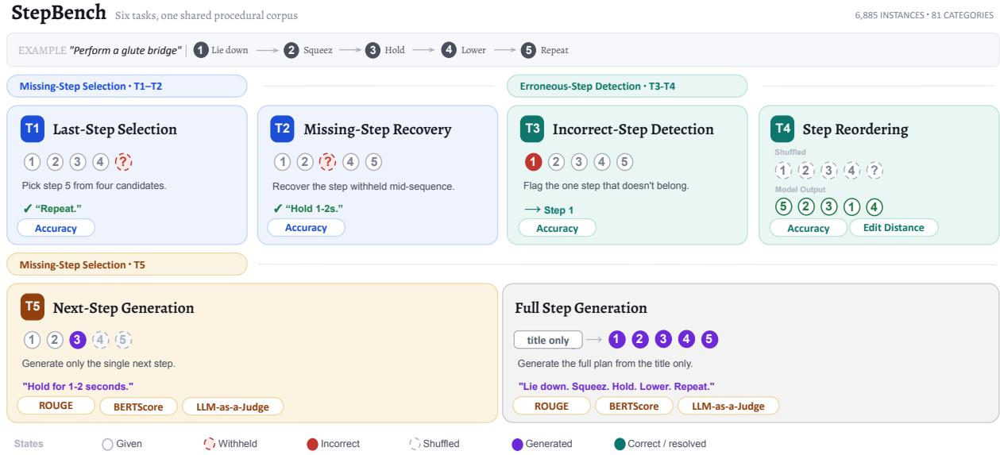  
Figure 4: The five STEPBENCH diagnostic tasks and full-plan generation on a shared procedure (“perform a glute bridge”). T1–T2 withhold a step for recovery from candidates; T3–T4 introduce incorrect or shuffled steps for detection or reordering; and T5 requires generating the next step. Full-plan generation is shown separately as an end-to-end evaluation setting. Circles indicate each step’s state: given, withheld, incorrect, shuffled, or generated.

Inter-annotator agreement. With binary score aggregation, we observe Krippendorff’s α = 0.612. Given the non-executable, open-world setting, we do not expect near-perfect agreement. To contextualise judge performance, we also measure leaveone-out agreement among annotators, which ranges from 87.2% to 90.5%, excluding examples where the other two annotators disagree.

Evaluating GPT-5 against human labels. We compare the judgements from GPT-5 with the human majority labels on the same 200 examples. GPT-5 achieves 85.5% agreement overall, with 87.1% agreement on human-majority has\_failure cases and 83.8% on no\_failure cases. We interpret these results alongside human leave-one-out agreement to assess how closely GPT-5 reproduces human judgements under the critical-failure protocol.

## E Additional Diagnostic Results

This appendix provides further breakdowns for the five diagnostic tasks and their relationship with full-plan generation. We use the same scores as Section 7: accuracy for T1–T4, normalised edit distance for partial ordering agreement, and STE-PEVAL VPR for T5 and full-plan generation.

## E.1 Performance by Procedure Length

Figure 5 shows incorrect-step detection and reordering scores by procedure length for eight configurations. Detection does not follow the same pattern across models. Gemini 3 Flash’s accuracy rises from 68.5% at four steps to 80.3% at nine or more, while Qwen3 4B falls from 51.1% at three steps to 42.5% at seven or eight. These comparisons show different responses to longer procedures; they do not establish whether additional context itself causes the change, since the procedures also differ.

Exact-order accuracy declines with length. GPT-5.6-sol achieves 86.8% at two steps and 33.1% at nine or more. Its normalised edit distance score changes less, from 86.8 to 76.6. Reporting both metrics therefore distinguishes complete referenceorder recovery from partial agreement. Neither score identifies the particular dependency that was violated, and a different order can still be valid when actions can be exchanged. The length breakdown describes difficulty in recovering the reference sequence rather than directly measuring execution success.

## E.2 Position of the Missing or Incorrect Step

Figure 6 shows accuracy by the relative position of the missing or incorrect step. Neither sequence boundary offers a general advantage. On T3, Gemini 3 Flash scores 64.9% when the incorrect step is first and 77.0% when it is last. Qwen3 4B scores

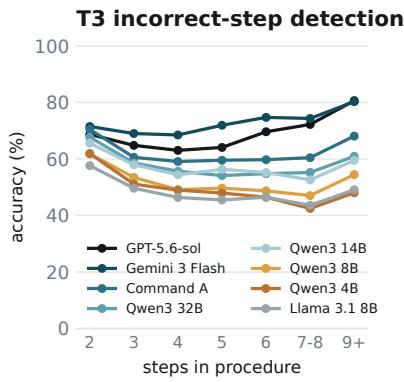

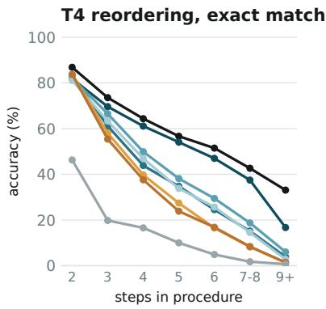

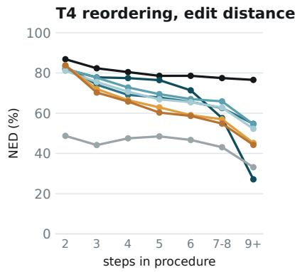  
Figure 5: Scores by procedure length for eight configurations. Left: incorrect-step detection accuracy. Centre: exact-order accuracy. Right: normalised edit distance, where higher scores indicate closer reference agreement. Gemini 3 Flash uses $T = 0 ;$ Qwen3 32B uses non-thinking mode.

27.2% and 59.7%, respectively. On T2, the pattern differs: Gemini 3 Flash scores 81.5% for a middle gap, compared with 77.0% for the first position and 74.8% for the last. Qwen3 4B instead performs best at the first position (39.2%).

These differences show why a single task score does not fully describe a model’s recovery or detection performance. Position groups also contain different procedures and length distributions, so the results should not be read as evidence of a particular attention mechanism.

## E.3 Per-Category Results

Figure 7 shows mean scores across all 14 configurations for the twenty largest categories. It includes all five diagnostic tasks alongside full-plan generation. Categories are ordered by procedure count, and shading compares categories within each task. We do not combine accuracy and VPR into a single category-difficulty score.

These breakdowns help identify domains in which a diagnostic task is particularly difficult. However, differences may reflect procedure length, content, or the available models’ familiarity with a domain. They do not by themselves establish that one domain has stricter dependencies or more interchangeable actions than another. The figure shows the largest categories for readability; results for all 81 categories are available in the released per-category analysis.

## E.4 Sensitivity of Diagnostic-to-Generation Correlations

Table 6 shows how the correlations in Section 7.2 change under two exclusions. First, we keep one configuration per underlying model by retaining

<table><tr><td>Configurations</td><td>n</td><td>T1</td><td>T2</td><td>T3</td><td>T4</td><td>T5</td></tr><tr><td>All configurations</td><td>14</td><td>0.95</td><td>0.85</td><td>0.93</td><td>0.96</td><td>0.89</td></tr><tr><td>One per model</td><td>12</td><td>0.96</td><td>0.82</td><td>0.93</td><td>0.94</td><td>0.86</td></tr><tr><td>Without GPT-5.6-sol</td><td>13</td><td>0.96</td><td>0.82</td><td>0.93</td><td>0.95</td><td>0.87</td></tr></table>

Table 6: Spearman correlations between diagnostic scores and full-plan VPR. Each column uses accuracy for T1–T4 or VPR for T5. The two restricted sets are sensitivity checks, not independent test sets.

Gemini 3 Flash at $T = 0$ and Qwen3 32B without thinking. Second, we exclude GPT-5.6-sol from the full set to check whether the strongest full-plan result drives the association. All five correlations remain positive and above 0.80 in both checks. This supports the overall association, although the ordering of the diagnostic tasks by correlation changes slightly.

These are sensitivity checks on the same model sample, not independent validation. Models within a family still share architecture and training, and the results do not establish prediction accuracy for individual plans or for models outside this sample.

## E.5 Sampling Temperature

Table 2 shows results for Gemini 3 Flash at $T = 0$ and $T = 1$ . The two configurations differ by at most 1.5 percentage points across T1–T4 accuracy and VPR for T5 and full-plan generation. Full-plan VPR is 84.5% and 83.0%, respectively. Partialorder agreement changes more: normalised edit distance is 73.4 at $T = 0$ and 76.6 at $T = 1$ . The $T = 1$ configuration also has fewer unparseable reordering outputs (57 versus 440), while exact-order accuracy changes from 58.7% to 59.4%. These results show that the two settings produce similar headline scores, but differ in output formatting and partial ordering agreement.

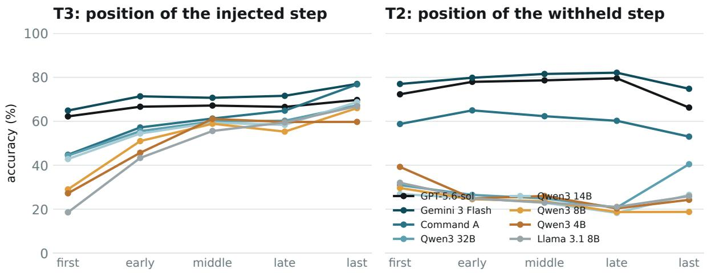  
Figure 6: Accuracy by relative step position for the same eight configurations as Figure 5. Left: the replaced step in T3. Right: the missing step in T2. Position effects vary across tasks and models.

## E.6 Results and Controls on STEPBENCH-Val

Table 7 shows the change for each configuration after restricting the main set to the 27 shared categories and reweighting its scores to the validation set’s procedure-length distribution. The length groups are two–three, four–five, six–eight, and nine or more steps. These adjustments reduce differences in category coverage and length; they do not make the two sets equivalent in every respect.

Twelve of 14 configurations change by less than three points on T1. The largest decrease is Qwen3 32B without thinking (-8.8 points), compared with -2.3 for its thinking configuration. In contrast, every configuration has lower scores on T4, T5, and full-plan generation. Thus, the small average changes on selection, recovery, and detection should not be generalised to all five diagnostic tasks.

Remaining differences between the datasets. The validation set contains only 214 procedures and uses a variant of the construction pipeline described in Section 3. Its goal statements are also shorter on average (7.1 words versus 10.6). A separate sensitivity check matches shared categories and goal length instead of procedure length. The mean full-plan VPR change is then -19.7 points, compared with -16.2 under the main adjustment. This check is limited by sparse support: the main set has only 73 goals of six words or fewer, compared with 99 in the validation set.

Limits of the temporal comparison. A lower score on newer procedures is not sufficient evidence of memorisation. The model sample, dataset construction, and task difficulty can also affect the differences. GPT-5.6-sol’s training chronology is unverified, and documented cutoffs for other models do not measure their exposure to individual articles. We therefore interpret these results as a check of how diagnostic profiles change across the two datasets, rather than as a test that rules contamination in or out.

## F Experimental Setup

Table 8 lists the evaluated models, their exact identifiers, and the dates used for temporal comparisons. Our evaluation covers 14 configurations of 12 models, including open-weight and proprietary models. The Qwen3 family spans four parameter sizes, supporting comparisons within a model family, while additional configurations examine reasoning mode and sampling temperature. Where providers disclose a knowledge cutoff, we report it directly; otherwise, we use the model’s release date as a conservative temporal bound, rather than as its training cutoff. GPT-5.6-sol is included in the performance evaluation but excluded from temporal-exclusion claims because its relevant dates are unverified.

<table><tr><td rowspan=2 colspan=2>T1Acc.</td><td rowspan=1 colspan=1>T2</td><td rowspan=1 colspan=1>T3</td><td rowspan=1 colspan=1>T4</td><td rowspan=1 colspan=1>T5</td><td rowspan=1 colspan=1>T6</td></tr><tr><td rowspan=1 colspan=1></td><td rowspan=1 colspan=1>Acc.</td><td rowspan=1 colspan=1>Acc.</td><td rowspan=1 colspan=1>Acc.</td><td rowspan=1 colspan=1>VPR</td><td rowspan=1 colspan=1>VPR</td></tr><tr><td rowspan=1 colspan=1>Android (286)</td><td rowspan=1 colspan=1>59</td><td rowspan=1 colspan=1>44</td><td rowspan=1 colspan=1>66</td><td rowspan=1 colspan=1>47</td><td rowspan=1 colspan=1>78</td><td rowspan=1 colspan=1>67</td></tr><tr><td rowspan=1 colspan=1>Computers and Electronics (271)</td><td rowspan=1 colspan=1>66</td><td rowspan=1 colspan=1>50</td><td rowspan=1 colspan=1>70</td><td rowspan=1 colspan=1>53</td><td rowspan=1 colspan=1>72</td><td rowspan=1 colspan=1>68</td></tr><tr><td rowspan=1 colspan=1>Garden Pests and Weeds (229)</td><td rowspan=1 colspan=1>54</td><td rowspan=1 colspan=1>44</td><td rowspan=1 colspan=1>55</td><td rowspan=1 colspan=1>44</td><td rowspan=1 colspan=1>63</td><td rowspan=1 colspan=1>65</td></tr><tr><td rowspan=1 colspan=1>Games (195)</td><td rowspan=1 colspan=1>60</td><td rowspan=1 colspan=1>47</td><td rowspan=1 colspan=1>59</td><td rowspan=1 colspan=1>46</td><td rowspan=1 colspan=1>53</td><td rowspan=1 colspan=1>40</td></tr><tr><td rowspan=1 colspan=1>Hobbies and Crafts (190)</td><td rowspan=1 colspan=1>63</td><td rowspan=1 colspan=1>47</td><td rowspan=1 colspan=1>64</td><td rowspan=1 colspan=1>48</td><td rowspan=1 colspan=1>64</td><td rowspan=1 colspan=1>59</td></tr><tr><td rowspan=1 colspan=1>Cars &amp; Other Vehicles (184)</td><td rowspan=1 colspan=1>62</td><td rowspan=1 colspan=1>48</td><td rowspan=1 colspan=1>56</td><td rowspan=1 colspan=1>43</td><td rowspan=1 colspan=1>60</td><td rowspan=1 colspan=1>52</td></tr><tr><td rowspan=1 colspan=1>Putty Dough and Slime (180)</td><td rowspan=1 colspan=1>53</td><td rowspan=1 colspan=1>46</td><td rowspan=1 colspan=1>64</td><td rowspan=1 colspan=1>64</td><td rowspan=1 colspan=1>58</td><td rowspan=1 colspan=1>47</td></tr><tr><td rowspan=1 colspan=1>Home and Garden (178)</td><td rowspan=1 colspan=1>59</td><td rowspan=1 colspan=1>44</td><td rowspan=1 colspan=1>59</td><td rowspan=1 colspan=1>42</td><td rowspan=1 colspan=1>65</td><td rowspan=1 colspan=1>62</td></tr><tr><td rowspan=1 colspan=1>Pets and Animals (176)</td><td rowspan=1 colspan=1>57</td><td rowspan=1 colspan=1>44</td><td rowspan=1 colspan=1>55</td><td rowspan=1 colspan=1>42</td><td rowspan=1 colspan=1>59</td><td rowspan=1 colspan=1>61</td></tr><tr><td rowspan=1 colspan=1>Crafts (164)</td><td rowspan=1 colspan=1>65</td><td rowspan=1 colspan=1>48</td><td rowspan=1 colspan=1>63</td><td rowspan=1 colspan=1>48</td><td rowspan=1 colspan=1>63</td><td rowspan=1 colspan=1>49</td></tr><tr><td rowspan=1 colspan=1>Food and Entertaining (163)</td><td rowspan=1 colspan=1>64</td><td rowspan=1 colspan=1>46</td><td rowspan=1 colspan=1>72</td><td rowspan=1 colspan=1>55</td><td rowspan=1 colspan=1>68</td><td rowspan=1 colspan=1>69</td></tr><tr><td rowspan=1 colspan=1>Cleaning Metals (160)</td><td rowspan=1 colspan=1>54</td><td rowspan=1 colspan=1>42</td><td rowspan=1 colspan=1>56</td><td rowspan=1 colspan=1>58</td><td rowspan=1 colspan=1>70</td><td rowspan=1 colspan=1>73</td></tr><tr><td rowspan=1 colspan=1>Sports and Fitness (156)</td><td rowspan=1 colspan=1>57</td><td rowspan=1 colspan=1>45</td><td rowspan=1 colspan=1>54</td><td rowspan=1 colspan=1>44</td><td rowspan=1 colspan=1>69</td><td rowspan=1 colspan=1>59</td></tr><tr><td rowspan=1 colspan=1>Education &amp; Communication (151)</td><td rowspan=1 colspan=1>57</td><td rowspan=1 colspan=1>40</td><td rowspan=1 colspan=1>54</td><td rowspan=1 colspan=1>44</td><td rowspan=1 colspan=1>73</td><td rowspan=1 colspan=1>75</td></tr><tr><td rowspan=1 colspan=1>Education and Communications (151)</td><td rowspan=1 colspan=1>55</td><td rowspan=1 colspan=1>47</td><td rowspan=1 colspan=1>56</td><td rowspan=1 colspan=1>44</td><td rowspan=1 colspan=1>75</td><td rowspan=1 colspan=1>75</td></tr><tr><td rowspan=1 colspan=1>Hair Care (151)</td><td rowspan=1 colspan=1>55</td><td rowspan=1 colspan=1>40</td><td rowspan=1 colspan=1>54</td><td rowspan=1 colspan=1>50</td><td rowspan=1 colspan=1>70</td><td rowspan=1 colspan=1>60</td></tr><tr><td rowspan=1 colspan=1>Finance and Business (134)</td><td rowspan=1 colspan=1>60</td><td rowspan=1 colspan=1>46</td><td rowspan=1 colspan=1>65</td><td rowspan=1 colspan=1>49</td><td rowspan=1 colspan=1>71</td><td rowspan=1 colspan=1>76</td></tr><tr><td rowspan=1 colspan=1>Personal Care and Style (129)</td><td rowspan=1 colspan=1>56</td><td rowspan=1 colspan=1>46</td><td rowspan=1 colspan=1>53</td><td rowspan=1 colspan=1>39</td><td rowspan=1 colspan=1>69</td><td rowspan=1 colspan=1>61</td></tr><tr><td rowspan=1 colspan=1>Arts and Entertainment (127)</td><td rowspan=1 colspan=1>58</td><td rowspan=1 colspan=1>46</td><td rowspan=1 colspan=1>58</td><td rowspan=1 colspan=1>41</td><td rowspan=1 colspan=1>69</td><td rowspan=1 colspan=1>63</td></tr><tr><td rowspan=1 colspan=1>Personal Hygiene (113)</td><td rowspan=1 colspan=1>52</td><td rowspan=1 colspan=1>41</td><td rowspan=1 colspan=1>56</td><td rowspan=1 colspan=1>45</td><td rowspan=1 colspan=1>65</td><td rowspan=1 colspan=1>68</td></tr></table>

Figure 7: Mean scores across 14 configurations for the twenty largest categories, ordered by procedure count. Counts in parentheses refer to the source procedure pool; task-specific counts can differ. T1–T4 use accuracy and T5 and full-plan generation use VPR. Shading is normalised within each column.

<table><tr><td></td><td colspan="4">Diagnostic tasks</td><td colspan="2">Full plan</td></tr><tr><td>Configuration</td><td>T1</td><td>T2</td><td>T3</td><td>T4</td><td>T5 (VPR)</td><td>VPR</td></tr><tr><td>GPT-5.6-sol (T=0, no think)</td><td>-0.7</td><td>-4.0</td><td>+0.6</td><td>-11.7</td><td>-8.3</td><td>-15.7</td></tr><tr><td>Gemini 3 Flash (think, T=0)</td><td>-0.2</td><td>-0.6</td><td>+1.9</td><td>-20.7</td><td>-8.0</td><td>-13.8</td></tr><tr><td>Gemini 3 Flash (think, T=1)</td><td>-2.9</td><td>-1.2</td><td>-0.3</td><td>-20.1</td><td>-10.7</td><td>-14.2</td></tr><tr><td>Command A Reasoning (think)</td><td>-1.7</td><td>-2.3</td><td>-3.3</td><td>-10.4</td><td>-12.1</td><td>-16.0</td></tr><tr><td>Command A</td><td>-1.3</td><td>+1.6</td><td>+0.5</td><td>-7.5</td><td>-7.7</td><td>-13.9</td></tr><tr><td>Qwen3 32B (think)</td><td>-2.3</td><td>+4.8</td><td>+0.4</td><td>-11.1</td><td>-9.9</td><td>-22.0</td></tr><tr><td>Qwen3 32B</td><td>-8.8</td><td>+1.7</td><td>+0.1</td><td>-7.2</td><td>-7.9</td><td>-21.7</td></tr><tr><td>Gemma 3 27B</td><td>+0.0</td><td>-2.2</td><td>-1.1</td><td>-5.8</td><td>-7.8</td><td>-13.0</td></tr><tr><td>Qwen3 14B</td><td>+0.7</td><td>+1.2</td><td>-0.7</td><td>-3.8</td><td>-6.7</td><td>-22.2</td></tr><tr><td>GLM-4 9B</td><td>-3.6</td><td>+0.6</td><td>-5.0</td><td>-5.5</td><td>-3.5</td><td>-13.7</td></tr><tr><td>Qwen3 8B</td><td>-1.1</td><td>-1.6</td><td>+2.3</td><td>-5.8</td><td>-4.0</td><td>-19.0</td></tr><tr><td>Llama 3.1 8B</td><td>+0.4</td><td>-1.6</td><td>-5.5</td><td>-0.1</td><td>-6.1</td><td>-22.1</td></tr><tr><td>Qwen3 4B Instruct (2507)</td><td>+0.1</td><td>-1.7</td><td>+3.6</td><td>-4.8</td><td>-6.6</td><td>-17.3</td></tr><tr><td>Qwen3 4B</td><td>+1.9</td><td>-2.0</td><td>-2.0</td><td>-2.2</td><td>-5.7</td><td>-2.0</td></tr><tr><td>Mean</td><td>-1.4</td><td>-0.5</td><td>-0.6</td><td>-8.3</td><td>-7.5</td><td>-16.2</td></tr></table>

Table 7: Per-configuration change from STEPBENCH to the 2026 validation set, after matching category composition and reweighting to the 2026 procedure-length distribution. T1–T4 use accuracy; T5 and full-plan generation use StepEval VPR. Values are percentage-point changes. Every configuration has lower scores on reordering, next-step generation, and full-plan generation. Amber marks a decrease of more than three points.

<table><tr><td>Model</td><td>Model ID</td><td>Knowledge Cut-off</td><td>Date basis</td></tr><tr><td>Qwen3-4B</td><td>Qwen/Qwen3-4B</td><td>2025-04-29</td><td>Release date</td></tr><tr><td>Qwen3-8B</td><td>Qwen/Qwen3-8B</td><td>2025-04-29</td><td>Release date</td></tr><tr><td>Qwen3-14B</td><td>Qwen/Qwen3-14B</td><td>2025-04-29</td><td>Release date</td></tr><tr><td>Qwen3-32B</td><td>Qwen/Qwen3-32B</td><td>2025-04-29</td><td>Release date</td></tr><tr><td>Qwen3-4B-Instruct-2507</td><td>Qwen/Qwen3-4B-Instruct-2507</td><td>2025-08-06</td><td>Release date</td></tr><tr><td>Llama-3.1-8B-Instruct</td><td>meta-1lama/Llama-3.1-8B-Instruct</td><td>2023-12</td><td>Knowledge cutoff</td></tr><tr><td>Gemma-3-27B-IT</td><td>google/gemma-3-27b-it</td><td>2025-03-12</td><td>Release date</td></tr><tr><td>GLM-4-9B</td><td>zai-org/GLM-4-9B-0414</td><td>2025-04-15</td><td>Release date</td></tr><tr><td>GPT-5.6-sol</td><td>gpt-5.6-sol</td><td>Unverified</td><td>Not used for temporal claims</td></tr><tr><td>Gemini 3 Flash</td><td>gemini-3-flash-preview</td><td>2025-01</td><td>Knowledge cutoff</td></tr><tr><td>Command A</td><td>command-a-03-2025</td><td>2024-06-01</td><td>Knowledge cutoff</td></tr><tr><td>Command A Reasoning</td><td>command-a-reasoning-08-2025</td><td>2024-06-01</td><td>Knowledge cutoff</td></tr></table>

Table 8: Evaluated models, exact identifiers, and knowledge cutoffs. Where the knowledge cutoff is undisclosed and a release date is available, we use that date as a proxy, as indicated in the final column. GPT-5.6-sol is excluded from temporal-exclusion claims because neither date is verified. Month-only dates preserve the precision of the reported cutoff.